# 054 · 删除链表中的节点（第二阶段 · 链表 · Easy）

> **难度**：⭐ Easy ｜ **专题**：链表
> **学习定位**：第二阶段 · 链表第 54 篇 ｜ **解法数**：4
> **内容总结**：**删除链表中的节点**（链表 · Easy）：共 4 个方案，主线思路「单趟扫描」；时间 O(n)（单趟线性扫描）；动画演示链表反转过程，附录给出 11 种语言 × 全部方案的可运行实现。

---

## 题目描述

有一个单链表的 `head`，我们想删除它其中的一个节点 `node`。

给你一个需要删除的节点 `node` 。你将 无法访问 第一个节点 `head`。

链表的所有值都是 唯一的，并且保证给定的节点 `node` 不是链表中的最后一个节点。

删除给定的节点。注意，删除节点并不是指从内存中删除它。这里的意思是：

 给定节点的值不应该存在于链表中。
 链表中的节点数应该减少 1。
 `node` 前面的所有值顺序相同。
 `node` 后面的所有值顺序相同。

自定义测试：

 对于输入，你应该提供整个链表 `head` 和要给出的节点 `node`。`node` 不应该是链表的最后一个节点，而应该是链表中的一个实际节点。
 我们将构建链表，并将节点传递给你的函数。
 输出将是调用你函数后的整个链表。

- 主函数签名：`function deleteNode(node: ListNode): void`

**用例（来自原题）**：

**示例 1**

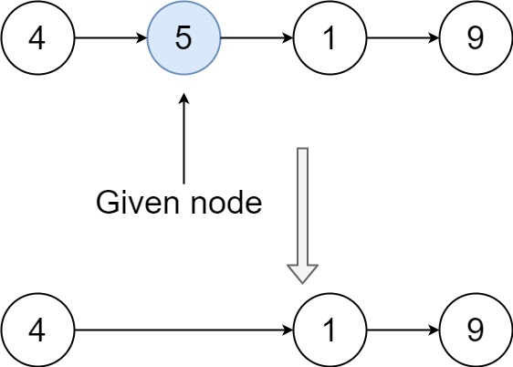

```text
输入：head = [4,5,1,9], node = 5
输出：[4,1,9]
```

解释：指定链表中值为 5 的第二个节点，那么在调用了你的函数之后，该链表应变为 4 -> 1 -> 9

**示例 2**

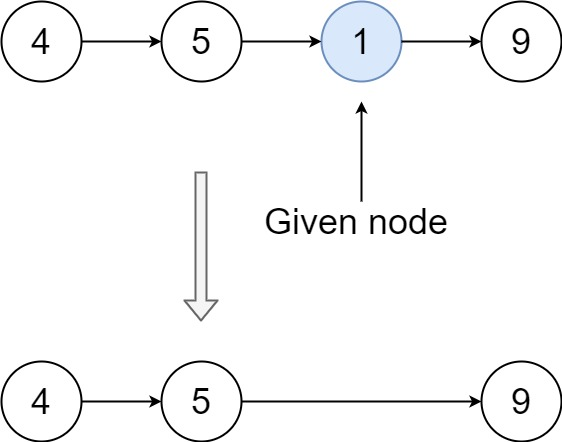

```text
输入：head = [4,5,1,9], node = 1
输出：[4,5,9]
```

解释：指定链表中值为 1 的第三个节点，那么在调用了你的函数之后，该链表应变为 4 -> 5 -> 9
> 题面与 [leetcode.cn 官方](https://leetcode.cn/problems/delete-node-in-a-linked-list/)一致，示例配图取自官方题面。

**数据范围与注意事项**：

- 链表中节点的数目范围是 `[2, 1000]`
- `-1000 <= Node.val <= 1000`
- 链表中每个节点的值都是 唯一 的
- 需要删除的节点 `node` 是 链表中的节点 ，且 不是末尾节点
- **易错点**：断开 next 之前先把后继存下来，否则整条链会丢。

## 题目分析

**场景是什么**：链表只能顺着指针走，这类题练的是指针操作与断链重接，对应真实开发里的内存管理、撤销链。本题就是该场景的 Easy 级练习，主线做法是「单趟扫描」。

**主线怎么解**：把主解法从头到尾过一遍，它其实在依次做这几件事：单循环线性扫描。

## 解题思路

**方案对比**（共 4 个方案，由浅入深）：

| 方案 | 时间复杂度 | 空间复杂度 |
|---|---|---|
| 方案 1 · 单趟扫描 | O(n)（单趟线性扫描） | O(1) 到 O(n)（视辅助结构） |
| 方案 2 · 单趟扫描 | O(n)（单趟线性扫描） | O(1) 到 O(n)（视辅助结构） |
| 方案 3 · 带空指针守卫 | O(n)（单趟线性扫描） | O(1) 到 O(n)（视辅助结构） |
| 方案 4 · 循环搬运版（把后继节点的值依次前移，直到尾部置空） | O(n)（单趟线性扫描） | O(1) 到 O(n)（视辅助结构） |

**由浅入深的路径**：单趟扫描 → 带空指针守卫 → 循环搬运版（把后继节点的值依次前移，直到尾部置空）；每往右一步，都在补上一步的短板。

**方案间的取舍**：方案 1（单趟扫描）；方案 2（单趟扫描）；方案 3（带空指针守卫）；方案 4（循环搬运版（把后继节点的值依次前移，直到尾部置空））。数据规模小、可读性优先时选靠前的方案；规模大、性能优先时选靠后的方案。

**怎么读这一篇**：

- 🐣 **新手路线**：把「题目描述」的示例 1 在纸上手推一遍 → 读方案 1（最直观的写法）与它的代码走读 → 按「运行方式」本地跑通看 PASS → 回头对比方案 2 之后的写法差在哪
- 🦅 **大佬路线**：直接锁定最优方案 1（单趟扫描，O(n)（单趟线性扫描））→ 跳读该方案代码与走读 → 用「逐步拆解与面试追问」补齐复杂度推导与边界追问

### 动态算法图（链表反转，GIF 自动循环）


动画演示链表专题里链表反转的典型过程；每个方案在「TypeScript 解题方案」一节还配了专属动画与专属流程图。

### 主解法流程图（真实控制流）

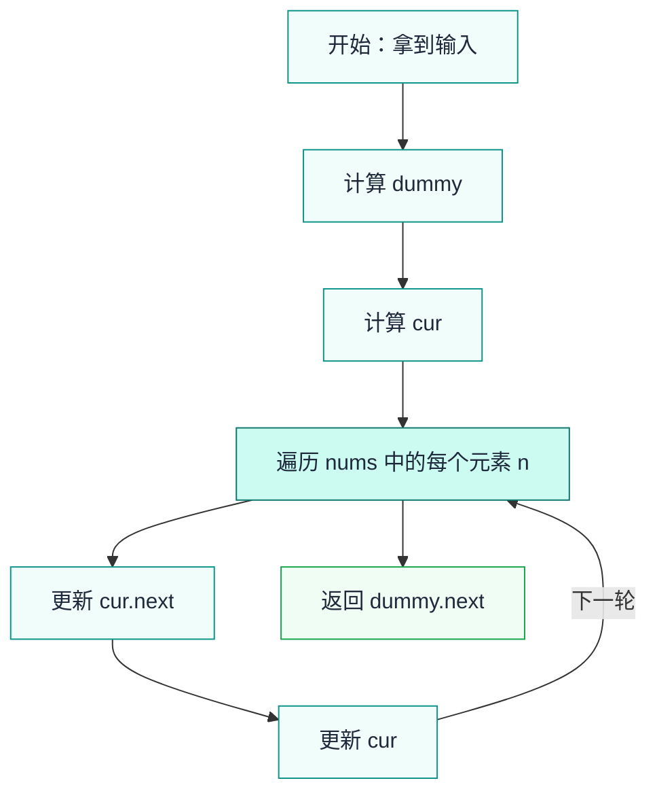

## TypeScript 解题方案（4 个方案逐个讲）

> **运行与提交**：每个方案都是自包含文件（内嵌用例自测，输出 PASS），整块复制到 `.ts` 文件后 `node 文件名` 即可运行。提交 LeetCode 时，把 `demo` 内的算法函数与辅助类型/函数整体取出、置于文件顶层即可。涉及交互/特殊接口的题以题面给定签名为准。

### 方案 1：单趟扫描

**分析与思路**：核心做法是「单趟扫描」。代码里依次做这些事：单循环线性扫描。

**运行方式**：`node 本文件`，内嵌用例全部通过会输出 PASS。


**方案专属流程图**（真实控制流）：

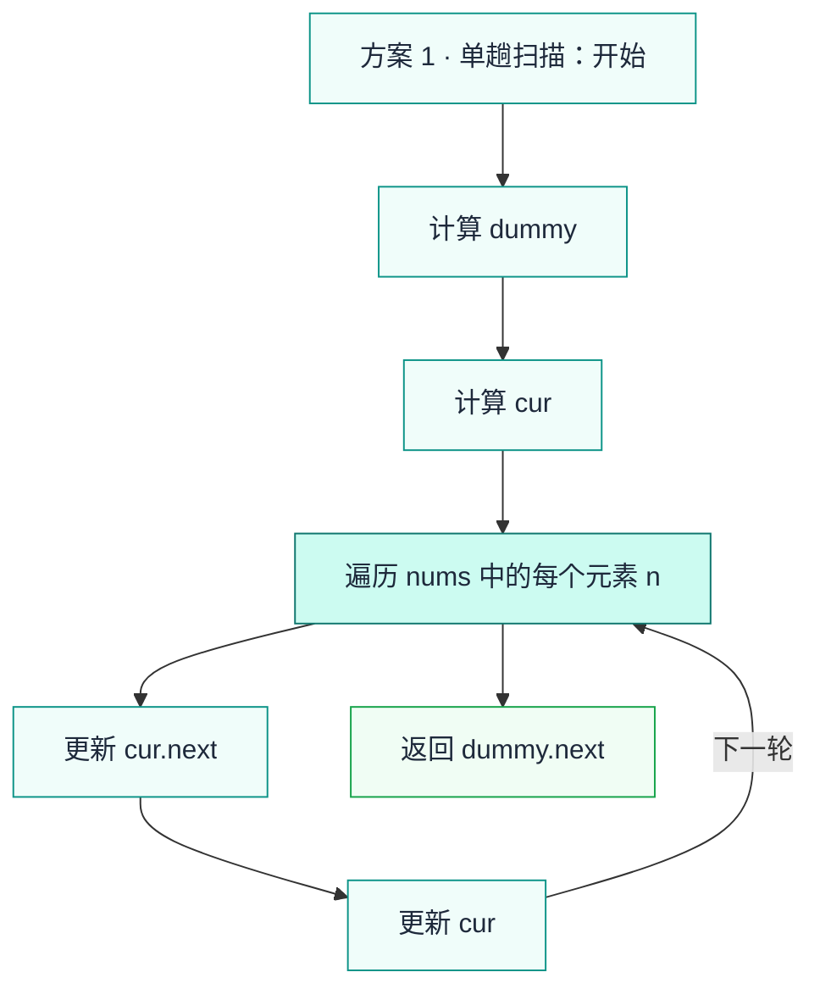

```typescript
/**
 * LeetCode 237. 删除链表中的节点
 * 方案：方案1
 * 来源：https://blog.csdn.net/tyro_java/article/details/130508569
 * 忠实翻译 python/linked_list/lc_237_删除链表中的节点/solution_1___1.py
 */

export function demo(): void {
  // 程序入口：跑内嵌自测用例
  class ListNode {
    // 定义类型
    val: number; // 值: number;
    next: ListNode | null; // 下一个: ListNode 按位或 null;
    constructor(val: number = 0, next: ListNode | null = null) {
      this.val = val; // 把 值; 写入 值
      this.next = next; // 把 下一个; 写入 下一个
    }
  }

  function build(nums: number[]): ListNode | null {
    // 定义函数/方法 build
    const dummy = new ListNode(0); // 把 new ListNode(0) 存入 哨兵节点
    let cur: ListNode = dummy; // 把 哨兵节点; 写入 let cur: ListNode
    for (const n of nums) {
      // for (const 元素个数 of 数组) {
      cur.next = new ListNode(n); // 把 new ListNode(元素个数); 写入 下一个
      cur = cur.next; // 把 当前值.下一个 存入 当前值
    }
    return dummy.next; // 返回 哨兵节点.下一个
  }

  function toList(head: ListNode | null): number[] {
    // 定义函数/方法 toList
    const res: number[] = []; // 把 []; 写入 const res: number[]
    let h = head; // 把 头节点 存入 h
    while (h) {
      // 循环，直到不满足「h」
      res.push(h.val); // 把 h.值 压入栈/数组尾部
      h = h.next; // 把 h.下一个 存入 h
    }
    return res; // 返回 结果
  }

  function deleteNode(node: ListNode): void {
    // 定义函数/方法 deleteNode
    node.val = node.next!.val; // 把 节点.下一个取反 .值; 写入 值
    node.next = node.next!.next; // 把 节点.下一个取反 .下一个; 写入 下一个
  }

  // case: [nums, 目标下标, 期望结果]
  const cases: { nums: number[]; idx: number; want: number[] }[] = [
    { nums: [4, 5, 1, 9], idx: 1, want: [4, 1, 9] },
    { nums: [1, 2, 3], idx: 1, want: [1, 3] },
    { nums: [1, 2, 3], idx: 0, want: [2, 3] },
  ];
  let fail = false; // 把 false 存入 fail
  for (const c of cases) {
    // for (const 字符 of cases) {
    const head = build(c.nums); // 把 build(字符.数组) 存入 头节点
    let target: ListNode | null = head; // 把 头节点; 写入 let target: ListNode | null
    for (let i = 0; i < c.idx; i++) {
      // 让 下标 i 从 0 开始计数，下标 i 小于 字符.idx 就继续
      target = target!.next; // 把 目标值取反 .下一个 存入 目标值
    }
    deleteNode(target!); // deleteNode(目标值取反 );
    const got = toList(head); // 把 toList(头节点) 存入 got
    if (got.length !== c.want.length || got.some((v, i) => v !== c.want[i])) {
      fail = true; // 把 true 存入 fail
      console.log(
        'FAIL deleteNode(%o,%d)=%o want %o',
        c.nums,
        c.idx,
        got,
        c.want,
      ); // 打印输出
    }
  }
  if (fail) {
    // 若 fail
    throw new Error('FAILED'); // throw new Error(「FAILED」);
  }
  console.log('PASS'); // 全部用例通过，输出 PASS
}
demo(); // demo();
```

### 方案 2：单趟扫描

**分析与思路**：核心做法是「单趟扫描」。代码里依次做这些事：单循环线性扫描。

**运行方式**：`node 本文件`，内嵌用例全部通过会输出 PASS。


**方案专属流程图**（真实控制流）：


```typescript
/**
 * LeetCode 237. 删除链表中的节点
 * 方案：方案2
 * 来源：https://blog.csdn.net/tyro_java/article/details/130508569
 * 忠实翻译 python/linked_list/lc_237_删除链表中的节点/solution_2___2.py
 */

export function demo(): void {
  // 程序入口：跑内嵌自测用例
  class ListNode {
    // 定义类型
    val: number; // 值: number;
    next: ListNode | null; // 下一个: ListNode 按位或 null;
    constructor(val: number = 0, next: ListNode | null = null) {
      this.val = val; // 把 值; 写入 值
      this.next = next; // 把 下一个; 写入 下一个
    }
  }

  function build(nums: number[]): ListNode | null {
    // 定义函数/方法 build
    const dummy = new ListNode(0); // 把 new ListNode(0) 存入 哨兵节点
    let cur: ListNode = dummy; // 把 哨兵节点; 写入 let cur: ListNode
    for (const n of nums) {
      // for (const 元素个数 of 数组) {
      cur.next = new ListNode(n); // 把 new ListNode(元素个数); 写入 下一个
      cur = cur.next; // 把 当前值.下一个 存入 当前值
    }
    return dummy.next; // 返回 哨兵节点.下一个
  }

  function toList(head: ListNode | null): number[] {
    // 定义函数/方法 toList
    const res: number[] = []; // 把 []; 写入 const res: number[]
    let h = head; // 把 头节点 存入 h
    while (h) {
      // 循环，直到不满足「h」
      res.push(h.val); // 把 h.值 压入栈/数组尾部
      h = h.next; // 把 h.下一个 存入 h
    }
    return res; // 返回 结果
  }

  function deleteNode(node: ListNode): void {
    // 定义函数/方法 deleteNode
    // 将本节点值替换为下一个节点的值，再连到下下一个节点
    node.val = node.next!.val; // 把 节点.下一个取反 .值; 写入 值
    node.next = node.next!.next; // 把 节点.下一个取反 .下一个; 写入 下一个
  }

  // case: [nums, 目标下标, 期望结果]
  const cases: { nums: number[]; idx: number; want: number[] }[] = [
    { nums: [4, 5, 1, 9], idx: 2, want: [4, 5, 9] },
    { nums: [4, 5, 1, 9], idx: 1, want: [4, 1, 9] },
    { nums: [1, 2, 3, 4], idx: 2, want: [1, 2, 4] },
  ];
  let fail = false; // 把 false 存入 fail
  for (const c of cases) {
    // for (const 字符 of cases) {
    const head = build(c.nums); // 把 build(字符.数组) 存入 头节点
    let target: ListNode | null = head; // 把 头节点; 写入 let target: ListNode | null
    for (let i = 0; i < c.idx; i++) {
      // 让 下标 i 从 0 开始计数，下标 i 小于 字符.idx 就继续
      target = target!.next; // 把 目标值取反 .下一个 存入 目标值
    }
    deleteNode(target!); // deleteNode(目标值取反 );
    const got = toList(head); // 把 toList(头节点) 存入 got
    if (got.length !== c.want.length || got.some((v, i) => v !== c.want[i])) {
      fail = true; // 把 true 存入 fail
      console.log(
        'FAIL deleteNode(%o,%d)=%o want %o',
        c.nums,
        c.idx,
        got,
        c.want,
      ); // 打印输出
    }
  }
  if (fail) {
    // 若 fail
    throw new Error('FAILED'); // throw new Error(「FAILED」);
  }
  console.log('PASS'); // 全部用例通过，输出 PASS
}
demo(); // demo();
```

### 方案 3：带空指针守卫

**分析与思路**：核心做法是「带空指针守卫」。代码里依次做这些事：单循环线性扫描。

**运行方式**：`node 本文件`，内嵌用例全部通过会输出 PASS。

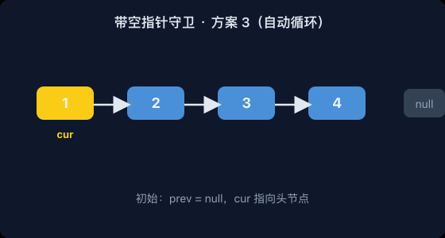

**方案专属流程图**（真实控制流）：

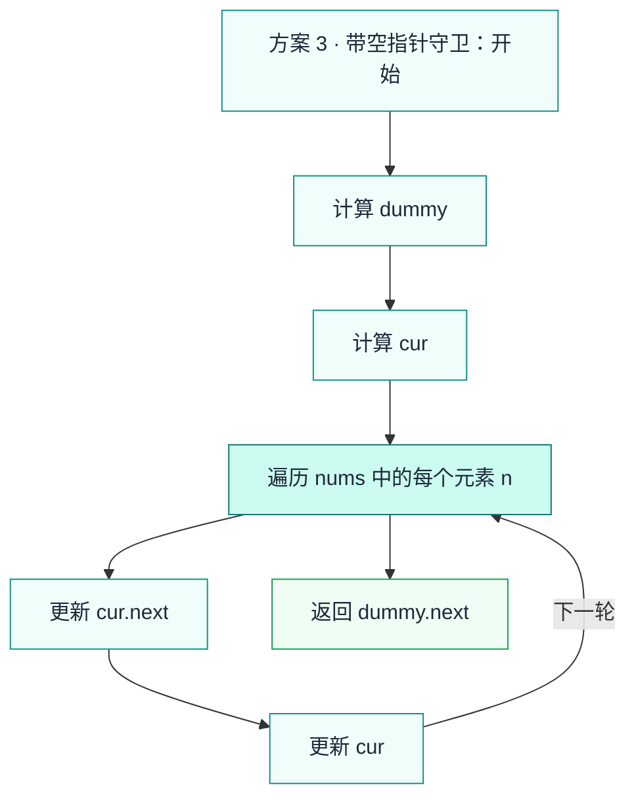

```typescript
/**
 * LeetCode 237. 删除链表中的节点
 * 方案：带空指针守卫
 * 来源：https://blog.csdn.net/tyro_java/article/details/130508569
 * 忠实翻译 python/linked_list/lc_237_删除链表中的节点/solution_3___3.py
 */

export function demo(): void {
  // 程序入口：跑内嵌自测用例
  class ListNode {
    // 定义类型
    val: number; // 值: number;
    next: ListNode | null; // 下一个: ListNode 按位或 null;
    constructor(val: number = 0, next: ListNode | null = null) {
      this.val = val; // 把 值; 写入 值
      this.next = next; // 把 下一个; 写入 下一个
    }
  }

  function build(nums: number[]): ListNode | null {
    // 定义函数/方法 build
    const dummy = new ListNode(0); // 把 new ListNode(0) 存入 哨兵节点
    let cur: ListNode = dummy; // 把 哨兵节点; 写入 let cur: ListNode
    for (const n of nums) {
      // for (const 元素个数 of 数组) {
      cur.next = new ListNode(n); // 把 new ListNode(元素个数); 写入 下一个
      cur = cur.next; // 把 当前值.下一个 存入 当前值
    }
    return dummy.next; // 返回 哨兵节点.下一个
  }

  function toList(head: ListNode | null): number[] {
    // 定义函数/方法 toList
    const res: number[] = []; // 把 []; 写入 const res: number[]
    let h = head; // 把 头节点 存入 h
    while (h) {
      // 循环，直到不满足「h」
      res.push(h.val); // 把 h.值 压入栈/数组尾部
      h = h.next; // 把 h.下一个 存入 h
    }
    return res; // 返回 结果
  }

  function deleteNode(node: ListNode | null): void {
    // 定义函数/方法 deleteNode
    if (node && node.next) {
      // 若 节点 且 节点.下一个
      node.val = node.next.val; // 把 节点.下一个.值; 写入 值
      node.next = node.next.next; // 把 节点.下一个.下一个; 写入 下一个
    }
  }

  // case: [nums, 目标下标(null 表示空节点), 期望结果]
  const cases: { nums: number[]; idx: number | null; want: number[] }[] = [
    { nums: [4, 5, 1, 9], idx: 1, want: [4, 1, 9] },
    { nums: [1, 2, 3], idx: 2, want: [1, 2, 3] },
    { nums: [7, 8, 9, 10], idx: 0, want: [8, 9, 10] },
    { nums: [], idx: null, want: [] },
  ];
  let fail = false; // 把 false 存入 fail
  for (const c of cases) {
    // for (const 字符 of cases) {
    const head = build(c.nums); // 把 build(字符.数组) 存入 头节点
    if (c.idx === null) {
      // 若 字符.idx 全等于 null
      deleteNode(null); // deleteNode(null);
    } else {
      // 否则
      let target: ListNode | null = head; // 把 头节点; 写入 let target: ListNode | null
      for (let i = 0; i < c.idx; i++) {
        // 让 下标 i 从 0 开始计数，下标 i 小于 字符.idx 就继续
        target = target!.next; // 把 目标值取反 .下一个 存入 目标值
      }
      deleteNode(target); // deleteNode(目标值);
    }
    const got = toList(head); // 把 toList(头节点) 存入 got
    if (got.length !== c.want.length || got.some((v, i) => v !== c.want[i])) {
      fail = true; // 把 true 存入 fail
      console.log(
        'FAIL deleteNode(%o,%o)=%o want %o',
        c.nums,
        c.idx,
        got,
        c.want,
      ); // 打印输出
    }
  }
  if (fail) {
    // 若 fail
    throw new Error('FAILED'); // throw new Error(「FAILED」);
  }
  console.log('PASS'); // 全部用例通过，输出 PASS
}
demo(); // demo();
```

### 方案 4：循环搬运版（把后继节点的值依次前移，直到尾部置空）

**分析与思路**：核心做法是「循环搬运版（把后继节点的值依次前移，直到尾部置空）」。代码里依次做这些事：单循环线性扫描。

**运行方式**：`node 本文件`，内嵌用例全部通过会输出 PASS。

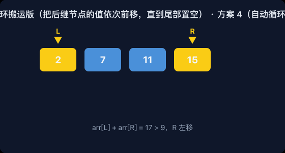

**方案专属流程图**（真实控制流）：

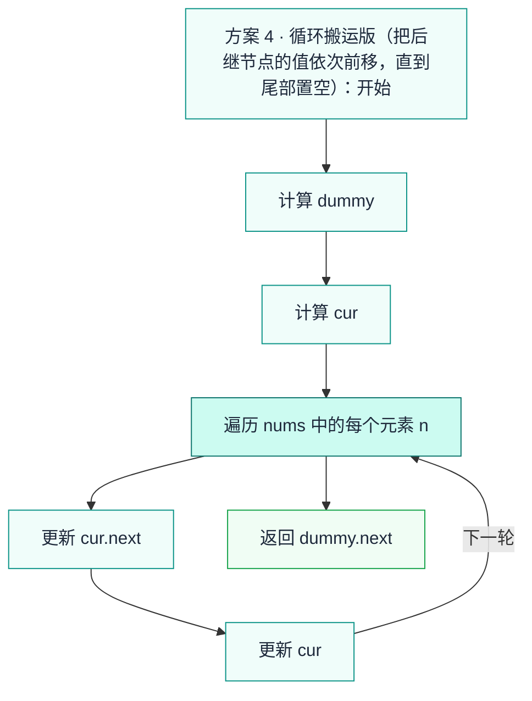

```typescript
/**
 * LeetCode 237. 删除链表中的节点
 * 方案：循环搬运版（把后继节点的值依次前移，直到尾部置空）
 * 来源：https://blog.csdn.net/tyro_java/article/details/130508569
 * 忠实翻译 python/linked_list/lc_237_删除链表中的节点/solution_4___4.py
 */

export function demo(): void {
  // 程序入口：跑内嵌自测用例
  class ListNode {
    // 定义类型
    val: number; // 值: number;
    next: ListNode | null; // 下一个: ListNode 按位或 null;
    constructor(val: number = 0, next: ListNode | null = null) {
      this.val = val; // 把 值; 写入 值
      this.next = next; // 把 下一个; 写入 下一个
    }
  }

  function build(nums: number[]): ListNode | null {
    // 定义函数/方法 build
    const dummy = new ListNode(0); // 把 new ListNode(0) 存入 哨兵节点
    let cur: ListNode = dummy; // 把 哨兵节点; 写入 let cur: ListNode
    for (const n of nums) {
      // for (const 元素个数 of 数组) {
      cur.next = new ListNode(n); // 把 new ListNode(元素个数); 写入 下一个
      cur = cur.next; // 把 当前值.下一个 存入 当前值
    }
    return dummy.next; // 返回 哨兵节点.下一个
  }

  function toList(head: ListNode | null): number[] {
    // 定义函数/方法 toList
    const res: number[] = []; // 把 []; 写入 const res: number[]
    let h = head; // 把 头节点 存入 h
    while (h) {
      // 循环，直到不满足「h」
      res.push(h.val); // 把 h.值 压入栈/数组尾部
      h = h.next; // 把 h.下一个 存入 h
    }
    return res; // 返回 结果
  }

  function deleteNode(node: ListNode | null): void {
    // 定义函数/方法 deleteNode
    let curr = node; // 把 节点 存入 当前值
    while (curr && curr.next) {
      // 循环，直到不满足「当前值 且 当前值.下一个」
      curr.val = curr.next.val; // 把 当前值.下一个.值; 写入 值
      if (!curr.next.next) {
        // 若 取反 当前值.下一个.下一个
        curr.next = null; // 把 null; 写入 下一个
        break; // 跳出循环
      }
      curr = curr.next; // 把 当前值.下一个 存入 当前值
    }
  }

  const cases: { nums: number[]; idx: number | null; want: number[] }[] = [
    { nums: [4, 5, 1, 9], idx: 1, want: [4, 1, 9] },
    { nums: [1, 2, 3], idx: 1, want: [1, 3] },
    { nums: [1, 2, 3], idx: 2, want: [1, 2, 3] },
    { nums: [7, 8, 9, 10], idx: 3, want: [7, 8, 9, 10] },
    { nums: [], idx: null, want: [] },
  ];
  let fail = false; // 把 false 存入 fail
  for (const c of cases) {
    // for (const 字符 of cases) {
    const head = build(c.nums); // 把 build(字符.数组) 存入 头节点
    if (c.idx === null) {
      // 若 字符.idx 全等于 null
      deleteNode(null); // deleteNode(null);
    } else {
      // 否则
      let target: ListNode | null = head; // 把 头节点; 写入 let target: ListNode | null
      for (let i = 0; i < c.idx; i++) {
        // 让 下标 i 从 0 开始计数，下标 i 小于 字符.idx 就继续
        target = target!.next; // 把 目标值取反 .下一个 存入 目标值
      }
      deleteNode(target); // deleteNode(目标值);
    }
    const got = toList(head); // 把 toList(头节点) 存入 got
    if (got.length !== c.want.length || got.some((v, i) => v !== c.want[i])) {
      fail = true; // 把 true 存入 fail
      console.log(
        'FAIL deleteNode(%o,%o)=%o want %o',
        c.nums,
        c.idx,
        got,
        c.want,
      ); // 打印输出
    }
  }
  if (fail) {
    // 若 fail
    throw new Error('FAILED'); // throw new Error(「FAILED」);
  }
  console.log('PASS'); // 全部用例通过，输出 PASS
}
demo(); // demo();
```

## 逐步拆解与面试追问

**复杂度**：时间 O(n)（单趟线性扫描），空间 O(1) 到 O(n)（视辅助结构）

**为什么是这个量级**：每个元素被常数次访问，辅助哈希或栈的开销与 n 同阶

**面试官可能会追问**：

- 能不能一次遍历完成？
- 快慢指针能解决哪些变体？
- 断链与接回的顺序怎么保证不出错？

## 关键 API 速查（TS 主解法实际用到，附官方链接）

| API | 作用 | 使用要点 | 官方文档 |
|---|---|---|---|
| `Array.prototype.push()` | 尾部追加 | 返回新长度；可一次多个；均摊 O(1)；会改变原数组 | [官方文档](https://developer.mozilla.org/zh-CN/docs/Web/JavaScript/Reference/Global_Objects/Array/push) |

### 各语言官方文档导航

- **TypeScript / JS**：[MDN 中文参考](https://developer.mozilla.org/zh-CN/)
- **Python**：[Python 官方文档](https://docs.python.org/zh-cn/3/)
- **Go**：[Go 标准库](https://pkg.go.dev/std)
- **Java**：[JDK 17 API](https://docs.oracle.com/en/java/javase/17/docs/api/)
- **Rust**：[Rust 标准库](https://doc.rust-lang.org/std/)
- **Lua**：[Lua 5.4 手册](https://www.lua.org/manual/5.4/)
- **C**：[Cppreference C](https://zh.cppreference.com/w/c)
- **C++**：[Cppreference C++](https://zh.cppreference.com/w/cpp)
- **R**：[R 官方手册](https://stat.ethz.ch/R-manual/)
- **Zig**：[Zig 语言文档](https://ziglang.org/documentation/master/)
- **Dart**：[Dart API](https://api.dart.dev/)

## 附录：其他 10 种语言全部实现（每种语言列举其全部方案）

> TypeScript 的全部方案见「TypeScript 解题方案」一节；下面是其余 10 种语言的对应实现，每种语言的每个方案都带思路分析、代码走读与专属运行架构图。
> 每个方案都内嵌用例自测，可独立运行（老仓库 python/go 文件遵循「打印结果」约定）。
> 完整解法文件见 `dsa/<语言>/linked_list/lc_237_删除链表中的节点/`。

### Python 实现（4 种方案）

Python 的全部方案如下，每个方案都内嵌用例自测，可独立运行（老仓库 python/go 文件遵循「打印结果」约定）：

#### 方案 1：单趟扫描

**思路与代码分析**：核心是「单趟扫描」。Python 版用切片与字典推导式简化操作，突出可读性。**走读**：方案 1 · 单趟扫描：开始 → 更新 node.val → 更新 node.next → 返回结果。

**运行架构**（真实控制流）：


```python
import sys  # 提高递归深度上限（深输入防 RecursionError）

sys.setrecursionlimit(200000)  # 树/链表类题目节点数可达 1e4 量级

class ListNode:  # 定义类
    def __init__(self, val=0, next=None):  # 构造函数：初始化成员
        self.val = val  # 把 值 写入 值
        self.next = next  # 把 下一个 写入 下一个

def deleteNode(node):  # 定义函数 deleteNode（参数：节点）
    node.val = node.next.val  # 把 节点.下一个.值 写入 值
    node.next = node.next.next  # 把 节点.下一个.下一个 写入 下一个

def build(nums):  # 定义函数 build（参数：数组）
    dummy = ListNode(0)  # 把 ListNode(0) 存入 哨兵节点
    cur = dummy  # 把 哨兵节点 存入 当前值
    for n in nums:  # 逐个取出 数组 的元素（元素个数）
        cur.next = ListNode(n)  # 把 ListNode(元素个数) 写入 下一个
        cur = cur.next  # 把 当前值.下一个 存入 当前值
    return dummy.next  # 返回 哨兵节点.下一个

def to_list(head):  # 定义函数 to_list（参数：头节点）
    res = []  # 把 [] 存入 结果
    while head:  # 循环，直到不满足「头节点」
        res.append(head.val)  # 把 头节点.值 追加到列表尾部
        head = head.next  # 把 头节点.下一个 存入 头节点
    return res  # 返回 结果

if __name__ == "__main__":  # 若 __name__ 等于 '__main__'
    head = build([4, 5, 1, 9])  # 把 build([4, 5, 1, 9]) 存入 头节点
    # 删除值为 5 的节点（leetcode 237 只给定该节点）
    target = head.next  # 把 头节点.下一个 存入 目标值
    deleteNode(target)  # deleteNode(目标值)
    print(to_list(head))  # 打印输出
```

#### 方案 2：单趟扫描

**思路与代码分析**：核心是「单趟扫描」。Python 版用切片与字典推导式简化操作，突出可读性。**走读**：方案 2 · 单趟扫描：开始 → 更新 node.val → 更新 node.next → 返回结果。

**运行架构**（真实控制流）：

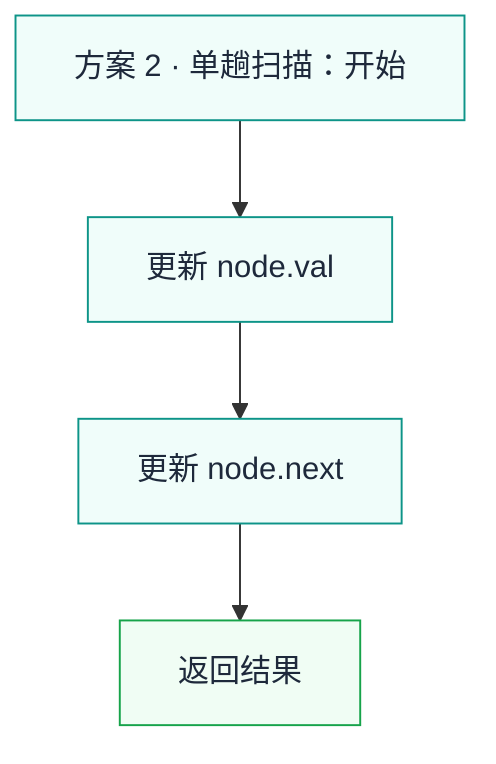

```python
import sys  # 提高递归深度上限（深输入防 RecursionError）

sys.setrecursionlimit(200000)  # 树/链表类题目节点数可达 1e4 量级

class ListNode:  # 定义类
    def __init__(self, val=0, next=None):  # 构造函数：初始化成员
        self.val = val  # 把 值 写入 值
        self.next = next  # 把 下一个 写入 下一个

def deleteNode(node):  # 定义函数 deleteNode（参数：节点）
    node.val = node.next.val  # 把 节点.下一个.值 写入 值
    node.next = node.next.next  # 把 节点.下一个.下一个 写入 下一个

def build(nums):  # 定义函数 build（参数：数组）
    dummy = ListNode(0)  # 把 ListNode(0) 存入 哨兵节点
    cur = dummy  # 把 哨兵节点 存入 当前值
    for n in nums:  # 逐个取出 数组 的元素（元素个数）
        cur.next = ListNode(n)  # 把 ListNode(元素个数) 写入 下一个
        cur = cur.next  # 把 当前值.下一个 存入 当前值
    return dummy.next  # 返回 哨兵节点.下一个

def to_list(head):  # 定义函数 to_list（参数：头节点）
    res = []  # 把 [] 存入 结果
    while head:  # 循环，直到不满足「头节点」
        res.append(head.val)  # 把 头节点.值 追加到列表尾部
        head = head.next  # 把 头节点.下一个 存入 头节点
    return res  # 返回 结果

if __name__ == "__main__":  # 若 __name__ 等于 '__main__'
    head = build([4, 5, 1, 9])  # 把 build([4, 5, 1, 9]) 存入 头节点
    # 删除值为 1 的节点
    target = head.next.next  # 把 头节点.下一个.下一个 存入 目标值
    deleteNode(target)  # deleteNode(目标值)
    print(to_list(head))  # 打印输出
```

#### 方案 3：带空指针守卫

**思路与代码分析**：核心是「带空指针守卫」。Python 版用切片与字典推导式简化操作，突出可读性。**走读**：方案 3 · 带空指针守卫：开始 → 若 node and node.next：更新 node.val → 更新 node.val → 更新 node.next → 返回结果。

**运行架构**（真实控制流）：

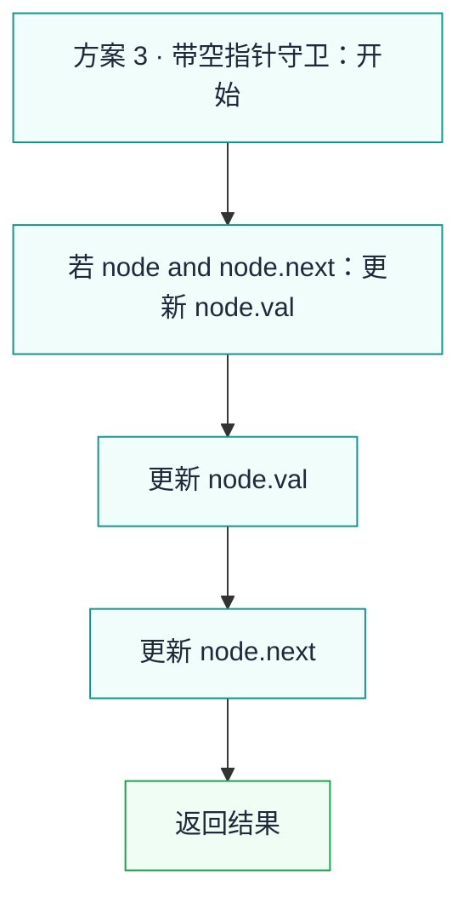

```python
# Definition for singly-linked list.
# class ListNode:
#     def __init__(self, val=0, next=None):
#         self.val = val
#         self.next = next

import sys  # 提高递归深度上限（深输入防 RecursionError）

sys.setrecursionlimit(200000)  # 树/链表类题目节点数可达 1e4 量级

def deleteNode(node):  # 定义函数 deleteNode（参数：节点）
    if node and node.next:  # 若 节点 and 节点.下一个
        node.val = node.next.val  # 把 节点.下一个.值 写入 值
        node.next = node.next.next  # 把 节点.下一个.下一个 写入 下一个

if __name__ == "__main__":  # 若 __name__ 等于 '__main__'
    print(deleteNode(None))  # 打印输出
```

#### 方案 4：循环搬运版（把后继节点的值依次前移，直到尾部置空）

**思路与代码分析**：核心是「循环搬运版（把后继节点的值依次前移，直到尾部置空）」。Python 版用切片与字典推导式简化操作，突出可读性。**走读**：方案 4 · 循环搬运版（把后继节点的值依次前移，直到尾部置空）：开始 → 更新 curr → 当 curr and curr.next: 时反复执行 → 更新 curr.val → 若 not curr.next.next：更新 curr.next → 更新 curr.next → 跳出循环（break） → 更新 curr → 返回结果。

**运行架构**（真实控制流）：

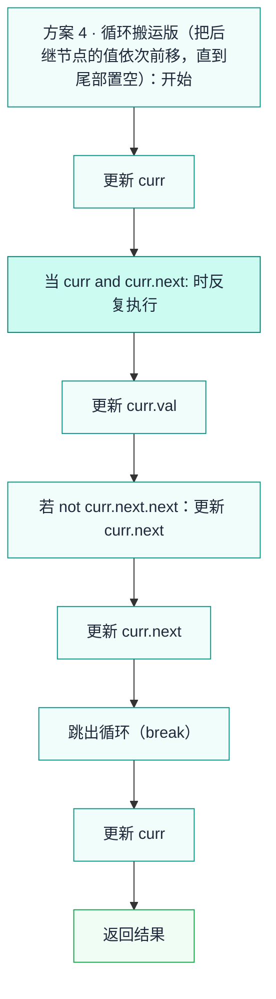

```python
# Definition for singly-linked list.
# class ListNode:
#     def __init__(self, val=0, next=None):
#         self.val = val
#         self.next = next

import sys  # 提高递归深度上限（深输入防 RecursionError）

sys.setrecursionlimit(200000)  # 树/链表类题目节点数可达 1e4 量级

def deleteNode(node):  # 定义函数 deleteNode（参数：节点）
    curr = node  # 把 节点 存入 当前值
    while curr and curr.next:  # 循环，直到不满足「当前值 and 当前值.下一个」
        curr.val = curr.next.val  # 把 当前值.下一个.值 写入 值
        if not curr.next.next:  # 若 not 当前值.下一个.下一个
            curr.next = None  # 把 None 写入 下一个
            break  # 跳出循环
        curr = curr.next  # 把 当前值.下一个 存入 当前值

if __name__ == "__main__":  # 若 __name__ 等于 '__main__'
    print(deleteNode(None))  # 打印输出
```

### Go 实现（4 种方案）

Go 的全部方案如下，每个方案都内嵌用例自测，可独立运行（老仓库 python/go 文件遵循「打印结果」约定）：

#### 方案 1：单趟扫描

**思路与代码分析**：核心是「单趟扫描」。Go 版用切片与多返回值惯用法，显式处理索引边界。**走读**：方案 1 · 单趟扫描：开始 → 更新 node.Val → 更新 node.Next → 返回结果。

**运行架构**（真实控制流）：


```go
package main // 引入依赖

import (
	"fmt"
	"os"
	"reflect"
) // 引入依赖

type ListNode struct { // 定义类型
	Val  int       // Val int
	Next *ListNode // Next 乘 ListNode
}

func buildList(vals []int) *ListNode { // 定义函数/方法 buildList
	var head, tail *ListNode // var 头节点, 尾节点 乘 ListNode
	for _, v := range vals { // 同时取 _ 与 值 遍历
		n := &ListNode{Val: v} // 把 按位与 ListNode{Val: 值} 写入 n :
		if head == nil {       // 若 头节点 等于 nil
			head = n // 把 元素个数 写入 头节点
			tail = n // 把 元素个数 写入 尾节点
		} else { // 否则
			tail.Next = n // 把 元素个数 写入 tail.Next
			tail = n      // 把 元素个数 写入 尾节点
		}
	}
	return head // 返回 头节点
}

func listToSlice(head *ListNode) []int { // 定义函数/方法 listToSlice
	var out []int     // var out []int
	for head != nil { // 把 nil { 写入 for head !
		out = append(out, head.Val) // 把 append(out, 头节点.Val) 写入 out
		head = head.Next            // 把 头节点.Next 写入 头节点
	}
	return out // 返回 out
}

func deleteNode(node *ListNode) { // 定义函数/方法 deleteNode
	node.Val = node.Next.Val   // 把 节点.Next.Val 写入 node.Val
	node.Next = node.Next.Next // 把 节点.Next.Next 写入 node.Next
}

func main() { // 程序入口：跑内嵌自测用例
	// case 1: delete node with value 5 (head.Next)
	head := buildList([]int{4, 5, 1, 9}) // 把 buildList([]int{4, 5, 1, 9}) 写入 head :
	target := head.Next                  // 把 头节点.Next 写入 target :
	deleteNode(target)                   // deleteNode(目标值)
	if got := listToSlice(head); !reflect.DeepEqual(got, []int{4, 1, 9}) {
		fmt.Printf("FAIL case1=%v want [4 1 9]\n", got) // 打印输出
		os.Exit(1)                                      // os.Exit(1)
	}
	// case 2: delete node with value 1 (head.Next.Next)
	head2 := buildList([]int{4, 5, 1, 9}) // 把 buildList([]int{4, 5, 1, 9}) 写入 head2 :
	target2 := head2.Next.Next            // 把 head2.Next.Next 写入 target2 :
	deleteNode(target2)                   // deleteNode(target2)
	if got := listToSlice(head2); !reflect.DeepEqual(got, []int{4, 5, 9}) {
		fmt.Printf("FAIL case2=%v want [4 5 9]\n", got) // 打印输出
		os.Exit(1)                                      // os.Exit(1)
	}
	fmt.Println("PASS") // 全部用例通过，输出 PASS
}
```

#### 方案 2：单趟扫描

**思路与代码分析**：核心是「单趟扫描」。Go 版用切片与多返回值惯用法，显式处理索引边界。**走读**：方案 2 · 单趟扫描：开始 → 更新 node.Val → 更新 node.Next → 返回结果。

**运行架构**（真实控制流）：

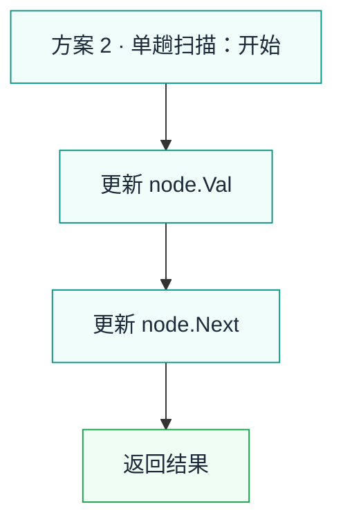

```go
package main // 引入依赖

import (
	"fmt"
	"os"
	"reflect"
) // 引入依赖

type ListNode struct { // 定义类型
	Val  int       // Val int
	Next *ListNode // Next 乘 ListNode
}

func buildList(vals []int) *ListNode { // 定义函数/方法 buildList
	var head, tail *ListNode // var 头节点, 尾节点 乘 ListNode
	for _, v := range vals { // 同时取 _ 与 值 遍历
		n := &ListNode{Val: v} // 把 按位与 ListNode{Val: 值} 写入 n :
		if head == nil {       // 若 头节点 等于 nil
			head = n // 把 元素个数 写入 头节点
			tail = n // 把 元素个数 写入 尾节点
		} else { // 否则
			tail.Next = n // 把 元素个数 写入 tail.Next
			tail = n      // 把 元素个数 写入 尾节点
		}
	}
	return head // 返回 头节点
}

func listToSlice(head *ListNode) []int { // 定义函数/方法 listToSlice
	var out []int     // var out []int
	for head != nil { // 把 nil { 写入 for head !
		out = append(out, head.Val) // 把 append(out, 头节点.Val) 写入 out
		head = head.Next            // 把 头节点.Next 写入 头节点
	}
	return out // 返回 out
}

func deleteNode(node *ListNode) { // 定义函数/方法 deleteNode
	node.Val = node.Next.Val   // 把 节点.Next.Val 写入 node.Val
	node.Next = node.Next.Next // 把 节点.Next.Next 写入 node.Next
}

func main() { // 程序入口：跑内嵌自测用例
	head := buildList([]int{4, 5, 1, 9}) // 把 buildList([]int{4, 5, 1, 9}) 写入 head :
	target := head.Next.Next             // value 1
	deleteNode(target)                   // deleteNode(目标值)
	if got := listToSlice(head); !reflect.DeepEqual(got, []int{4, 5, 9}) {
		fmt.Printf("FAIL deleteNode=%v want [4 5 9]\n", got) // 打印输出
		os.Exit(1)                                           // os.Exit(1)
	}
	fmt.Println("PASS") // 全部用例通过，输出 PASS
}
```

#### 方案 3：带空指针守卫

**思路与代码分析**：核心是「带空指针守卫」。Go 版用切片与多返回值惯用法，显式处理索引边界。**走读**：方案 3 · 带空指针守卫：开始 → 处理 if node ≠ nil 且 node.Next → 更新 node.Val → 更新 node.Next → 返回结果。

**运行架构**（真实控制流）：

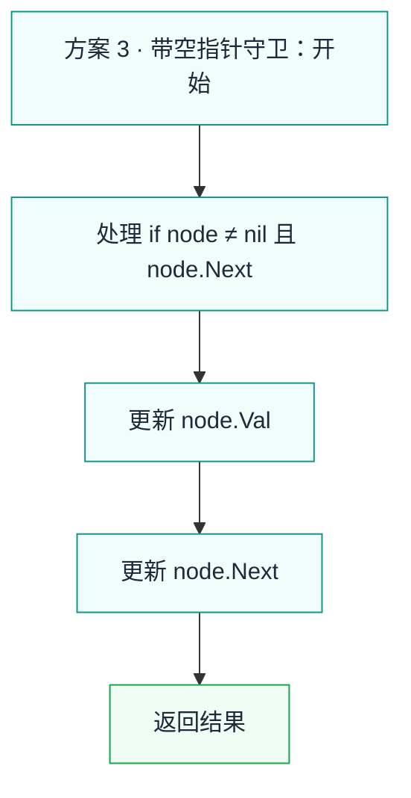

```go
package main // 引入依赖

import (
	"fmt"
	"os"
	"reflect"
) // 引入依赖

type ListNode struct { // 定义类型
	Val  int       // Val int
	Next *ListNode // Next 乘 ListNode
}

func buildList(vals []int) *ListNode { // 定义函数/方法 buildList
	var head, tail *ListNode // var 头节点, 尾节点 乘 ListNode
	for _, v := range vals { // 同时取 _ 与 值 遍历
		n := &ListNode{Val: v} // 把 按位与 ListNode{Val: 值} 写入 n :
		if head == nil {       // 若 头节点 等于 nil
			head = n // 把 元素个数 写入 头节点
			tail = n // 把 元素个数 写入 尾节点
		} else { // 否则
			tail.Next = n // 把 元素个数 写入 tail.Next
			tail = n      // 把 元素个数 写入 尾节点
		}
	}
	return head // 返回 头节点
}

func listToSlice(head *ListNode) []int { // 定义函数/方法 listToSlice
	var out []int     // var out []int
	for head != nil { // 把 nil { 写入 for head !
		out = append(out, head.Val) // 把 append(out, 头节点.Val) 写入 out
		head = head.Next            // 把 头节点.Next 写入 头节点
	}
	return out // 返回 out
}

func deleteNode(node *ListNode) { // 定义函数/方法 deleteNode
	if node != nil && node.Next != nil { // 若 节点 不等于 nil 且 节点.Next 不等于 nil
		node.Val = node.Next.Val   // 把 节点.Next.Val 写入 node.Val
		node.Next = node.Next.Next // 把 节点.Next.Next 写入 node.Next
	}
}

func main() { // 程序入口：跑内嵌自测用例
	deleteNode(nil)                      // must not panic
	head := buildList([]int{4, 5, 1, 9}) // 把 buildList([]int{4, 5, 1, 9}) 写入 head :
	target := head.Next                  // value 5
	deleteNode(target)                   // deleteNode(目标值)
	if got := listToSlice(head); !reflect.DeepEqual(got, []int{4, 1, 9}) {
		fmt.Printf("FAIL deleteNode=%v want [4 1 9]\n", got) // 打印输出
		os.Exit(1)                                           // os.Exit(1)
	}
	fmt.Println("PASS") // 全部用例通过，输出 PASS
}
```

#### 方案 4：循环搬运版（把后继节点的值依次前移，直到尾部置空）

**思路与代码分析**：核心是「循环搬运版（把后继节点的值依次前移，直到尾部置空）」。Go 版用切片与多返回值惯用法，显式处理索引边界。**走读**：方案 4 · 循环搬运版（把后继节点的值依次前移，直到尾部置空）：开始 → 更新 : → 遍历循环 → 更新 curr.Val → 处理 if curr.Next.Next == nil → 更新 curr.Next → 跳出循环（break） → 更新 curr → 返回结果。

**运行架构**（真实控制流）：

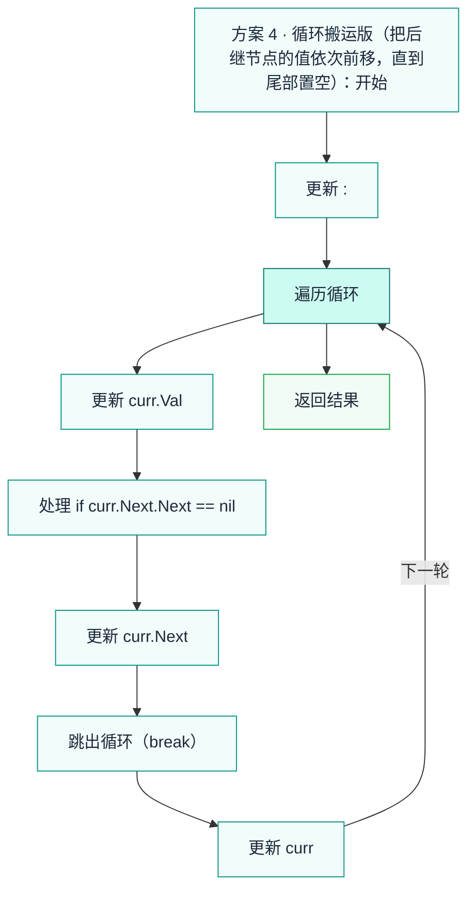

```go
package main // 引入依赖

import (
	"fmt"
	"os"
	"reflect"
) // 引入依赖

type ListNode struct { // 定义类型
	Val  int       // Val int
	Next *ListNode // Next 乘 ListNode
}

func buildList(vals []int) *ListNode { // 定义函数/方法 buildList
	dummy := &ListNode{}     // 把 按位与 ListNode{} 写入 dummy :
	curr := dummy            // 把 哨兵节点 写入 curr :
	for _, v := range vals { // 同时取 _ 与 值 遍历
		curr.Next = &ListNode{Val: v} // 把 按位与 ListNode{Val: 值} 写入 curr.Next
		curr = curr.Next              // 把 当前值.Next 写入 当前值
	}
	return dummy.Next // 返回 哨兵节点.Next
}

func listToSlice(head *ListNode) []int { // 定义函数/方法 listToSlice
	var out []int     // var out []int
	for head != nil { // 把 nil { 写入 for head !
		out = append(out, head.Val) // 把 append(out, 头节点.Val) 写入 out
		head = head.Next            // 把 头节点.Next 写入 头节点
	}
	return out // 返回 out
}

func deleteNode(node *ListNode) { // 定义函数/方法 deleteNode
	curr := node                          // 把 节点 写入 curr :
	for curr != nil && curr.Next != nil { // 把 nil 且 当前值.Next 不等于 nil { 写入 for curr !
		curr.Val = curr.Next.Val   // 把 当前值.Next.Val 写入 curr.Val
		if curr.Next.Next == nil { // 若 当前值.Next.Next 等于 nil
			curr.Next = nil // 把 nil 写入 curr.Next
			break           // 跳出循环
		}
		curr = curr.Next // 把 当前值.Next 写入 当前值
	}
}

func main() { // 程序入口：跑内嵌自测用例
	deleteNode(nil)                      // must not panic
	head := buildList([]int{4, 5, 1, 9}) // 把 buildList([]int{4, 5, 1, 9}) 写入 head :
	n := head                            // delete head (value 4)
	deleteNode(n)                        // deleteNode(元素个数)
	if got := listToSlice(head); !reflect.DeepEqual(got, []int{5, 1, 9}) {
		fmt.Printf("FAIL deleteNode=%v want [5 1 9]\n", got) // 打印输出
		os.Exit(1)                                           // os.Exit(1)
	}
	fmt.Println("PASS") // 全部用例通过，输出 PASS
}
```

### Java 实现（4 种方案）

Java 的全部方案如下，每个方案都内嵌用例自测，可独立运行（老仓库 python/go 文件遵循「打印结果」约定）：

#### 方案 1：单趟扫描

**思路与代码分析**：核心是「单趟扫描」。Java 版用类与静态方法组织，集合操作显式明了。**走读**：方案 1 · 单趟扫描：开始 → 更新 val → 返回结果。

**运行架构**（真实控制流）：

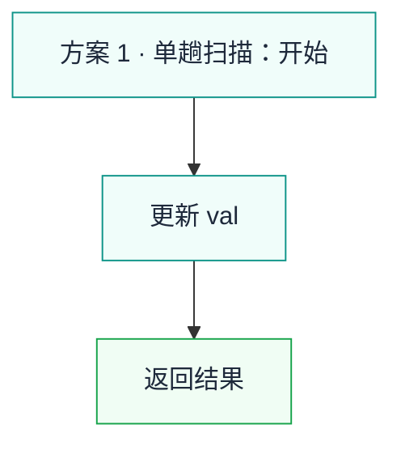

```java
package com.webfault.dsa; // 引入依赖

class lc237 { // 定义类型
  static class ListNode {
    int val;
    ListNode next;

    ListNode(int v) {
      val = v;
    }
  }

  void deleteNode(ListNode node) { // 定义函数/方法 deleteNode
    if (node != null && node.next != null) { // 若 节点 不等于 null 且 节点.下一个 不等于 null
      node.val = node.next.val; // 把 节点.下一个.值; 写入 值
      node.next = node.next.next; // 把 节点.下一个.下一个; 写入 下一个
    }
  }

  static ListNode build(int[] a) { // 定义函数/方法 build
    ListNode dummy = new ListNode(0);
    ListNode cur = dummy; // 把 new ListNode(0); ListNode 当前值 赋值为 哨兵节点; 写入 ListNode dummy
    for (int v : a) {
      cur.next = new ListNode(v);
      cur = cur.next;
    } // 把 new ListNode(值); 当前值 赋值为 当前值.下一个; } 写入 下一个
    return dummy.next; // 返回 哨兵节点.下一个
  }

  static java.util.ArrayList<Integer> toList(ListNode head) {
    java.util.ArrayList<Integer> res = new java.util.ArrayList<Integer>();
    while (head != null) {
      res.add(head.val);
      head = head.next;
    } // 循环，直到不满足「头节点 不等于 null) { 结果 追加 头节点.值); 头节点 赋值为 头节点.下一个; }」
    return res; // 返回 结果
  }

  public static void main(String[] args) { // public static void main(String[] args) {
    lc237 s = new lc237(); // 把 new lc237(); 写入 lc237 s
    ListNode h1 = build(new int[] {4, 5, 1, 9}); // 把 build(new int[]{4, 5, 1, 9}); 写入 ListNode h1
    ListNode target = h1.next; // 把 h1.下一个; 写入 ListNode target
    s.deleteNode(target); // 字符串.deleteNode(目标值);
    java.util.ArrayList<Integer> got1 =
        toList(h1); // 把 toList(h1); 写入 java.util.ArrayList<Integer> got1
    if (got1.size() != 3 || got1.get(0) != 4 || got1.get(1) != 1 || got1.get(2) != 9) {
      throw new RuntimeException("FAILED case1 " + got1);
    }
    try {
      s.deleteNode(null);
    } catch (Exception e) {
      throw new RuntimeException("FAILED case2 threw");
    }
    System.out.println("PASS"); // 全部用例通过，输出 PASS
  }
}
```

#### 方案 2：单趟扫描

**思路与代码分析**：核心是「单趟扫描」。Java 版用类与静态方法组织，集合操作显式明了。代码里依次做这些事：双重循环遍历。

**运行架构**（真实控制流）：

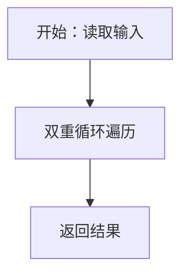

```java
package com.webfault.dsa; // 引入依赖

import java.util.Arrays; // 引入依赖

class ListNode {
  int val;
  ListNode next;

  ListNode() {}

  ListNode(int v) {
    val = v;
  }

  ListNode(int v, ListNode n) {
    val = v;
    next = n;
  }
} // 定义类型

class Main { // 定义类型
  static int[] toArr(ListNode h) {
    int n = 0;
    for (ListNode x = h; x != null; x = x.next) n++;
    int[] r = new int[n];
    int i = 0;
    for (; h != null; h = h.next) r[i++] = h.val;
    return r;
  }

  static ListNode build(int[] vals) {
    ListNode d = new ListNode();
    ListNode p = d;
    for (int v : vals) {
      p.next = new ListNode(v);
      p = p.next;
    }
    return d.next;
  }

  static void deleteNode(ListNode node) {
    node.val = node.next.val;
    node.next = node.next.next;
  } // 把 节点.下一个.值; 节点.下一个 赋值为 节点.下一个.下一个; } 写入 值

  public static void main(String[] args) { // public static void main(String[] args) {
    int[] vals = {4, 5, 1, 9};
    ListNode head = build(vals);
    ListNode target = head.next;
    deleteNode(target);
    int[] got = toArr(head);
    int[] want = {4, 1, 9}; // 把 toArr(头节点); int[] want 赋值为 {4,1,9}; 写入 int[] got
    if (!Arrays.equals(got, want)) {
      System.out.println("FAIL " + Arrays.toString(got));
      throw new RuntimeException("FAILED");
    }
    System.out.println("PASS"); // 全部用例通过，输出 PASS
  }
}
```

#### 方案 3：带空指针守卫

**思路与代码分析**：核心是「带空指针守卫」。Java 版用类与静态方法组织，集合操作显式明了。**走读**：方案 3 · 带空指针守卫：开始 → 更新 val → 返回结果。

**运行架构**（真实控制流）：

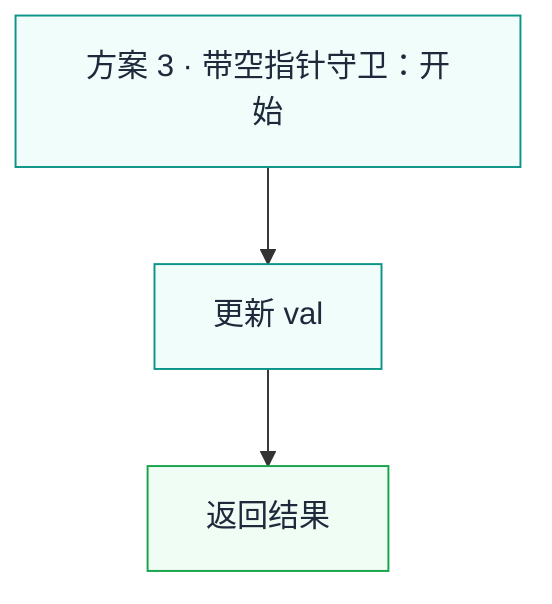

```java
package com.webfault.dsa; // 引入依赖

class lc237 { // 定义类型
  static class ListNode {
    int val;
    ListNode next;

    ListNode(int v) {
      val = v;
    }
  }

  void deleteNode(ListNode node) { // 定义函数/方法 deleteNode
    if (node != null && node.next != null) { // 若 节点 不等于 null 且 节点.下一个 不等于 null
      node.val = node.next.val; // 把 节点.下一个.值; 写入 值
      node.next = node.next.next; // 把 节点.下一个.下一个; 写入 下一个
    }
  }

  static ListNode build(int[] a) { // 定义函数/方法 build
    ListNode dummy = new ListNode(0);
    ListNode cur = dummy; // 把 new ListNode(0); ListNode 当前值 赋值为 哨兵节点; 写入 ListNode dummy
    for (int v : a) {
      cur.next = new ListNode(v);
      cur = cur.next;
    } // 把 new ListNode(值); 当前值 赋值为 当前值.下一个; } 写入 下一个
    return dummy.next; // 返回 哨兵节点.下一个
  }

  static java.util.ArrayList<Integer> toList(ListNode head) {
    java.util.ArrayList<Integer> res = new java.util.ArrayList<Integer>();
    while (head != null) {
      res.add(head.val);
      head = head.next;
    } // 循环，直到不满足「头节点 不等于 null) { 结果 追加 头节点.值); 头节点 赋值为 头节点.下一个; }」
    return res; // 返回 结果
  }

  public static void main(String[] args) { // public static void main(String[] args) {
    lc237 s = new lc237(); // 把 new lc237(); 写入 lc237 s
    ListNode h1 = build(new int[] {4, 5, 1, 9}); // 把 build(new int[]{4, 5, 1, 9}); 写入 ListNode h1
    ListNode target = h1.next; // 把 h1.下一个; 写入 ListNode target
    s.deleteNode(target); // 字符串.deleteNode(目标值);
    java.util.ArrayList<Integer> got1 =
        toList(h1); // 把 toList(h1); 写入 java.util.ArrayList<Integer> got1
    if (got1.size() != 3 || got1.get(0) != 4 || got1.get(1) != 1 || got1.get(2) != 9) {
      throw new RuntimeException("FAILED case1 " + got1);
    }
    try {
      s.deleteNode(null);
    } catch (Exception e) {
      throw new RuntimeException("FAILED case2 threw");
    }
    System.out.println("PASS"); // 全部用例通过，输出 PASS
  }
}
```

#### 方案 4：循环搬运版（把后继节点的值依次前移，直到尾部置空）

**思路与代码分析**：核心是「循环搬运版（把后继节点的值依次前移，直到尾部置空）」。Java 版用类与静态方法组织，集合操作显式明了。**走读**：方案 4 · 循环搬运版（把后继节点的值依次前移，直到尾部置空）：开始 → 更新 val → 返回结果。

**运行架构**（真实控制流）：

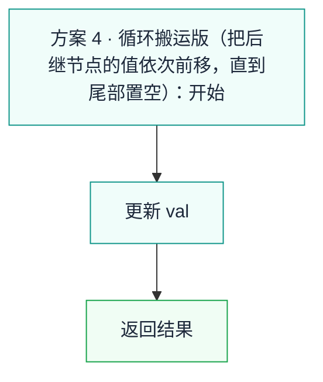

```java
package com.webfault.dsa; // 引入依赖

class lc237 { // 定义类型
  static class ListNode {
    int val;
    ListNode next;

    ListNode(int v) {
      val = v;
    }
  }

  void deleteNode(ListNode node) { // 定义函数/方法 deleteNode
    if (node != null && node.next != null) { // 若 节点 不等于 null 且 节点.下一个 不等于 null
      node.val = node.next.val; // 把 节点.下一个.值; 写入 值
      node.next = node.next.next; // 把 节点.下一个.下一个; 写入 下一个
    }
  }

  static ListNode build(int[] a) { // 定义函数/方法 build
    ListNode dummy = new ListNode(0);
    ListNode cur = dummy; // 把 new ListNode(0); ListNode 当前值 赋值为 哨兵节点; 写入 ListNode dummy
    for (int v : a) {
      cur.next = new ListNode(v);
      cur = cur.next;
    } // 把 new ListNode(值); 当前值 赋值为 当前值.下一个; } 写入 下一个
    return dummy.next; // 返回 哨兵节点.下一个
  }

  static java.util.ArrayList<Integer> toList(ListNode head) {
    java.util.ArrayList<Integer> res = new java.util.ArrayList<Integer>();
    while (head != null) {
      res.add(head.val);
      head = head.next;
    } // 循环，直到不满足「头节点 不等于 null) { 结果 追加 头节点.值); 头节点 赋值为 头节点.下一个; }」
    return res; // 返回 结果
  }

  public static void main(String[] args) { // public static void main(String[] args) {
    lc237 s = new lc237(); // 把 new lc237(); 写入 lc237 s
    ListNode h1 = build(new int[] {4, 5, 1, 9}); // 把 build(new int[]{4, 5, 1, 9}); 写入 ListNode h1
    ListNode target = h1.next; // 把 h1.下一个; 写入 ListNode target
    s.deleteNode(target); // 字符串.deleteNode(目标值);
    java.util.ArrayList<Integer> got1 =
        toList(h1); // 把 toList(h1); 写入 java.util.ArrayList<Integer> got1
    if (got1.size() != 3 || got1.get(0) != 4 || got1.get(1) != 1 || got1.get(2) != 9) {
      throw new RuntimeException("FAILED case1 " + got1);
    }
    try {
      s.deleteNode(null);
    } catch (Exception e) {
      throw new RuntimeException("FAILED case2 threw");
    }
    System.out.println("PASS"); // 全部用例通过，输出 PASS
  }
}
```

### Rust 实现（4 种方案）

Rust 的全部方案如下，每个方案都内嵌用例自测，可独立运行（老仓库 python/go 文件遵循「打印结果」约定）：

#### 方案 1：单趟扫描

**思路与代码分析**：核心是「单趟扫描」。Rust 版用所有权移动与切片借用改写同一逻辑，注意 Option 与引用边界。**走读**：方案 1 · 单趟扫描：开始 → 计算 out → 计算 cur → 当 let Some(n) = cur 时反复执行 → 向 out 追加记录 → 更新 cur → 处理 out → 返回结果。

**运行架构**（真实控制流）：

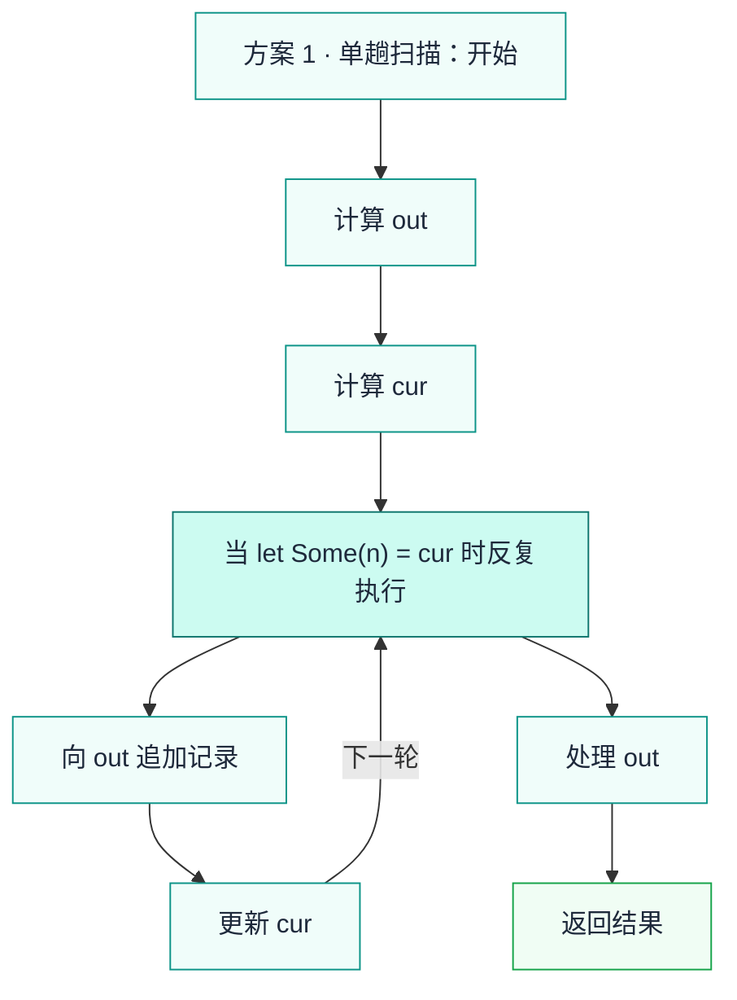

```rust
// LeetCode 237. 删除链表中的节点 — Rust 版（方案1）
#[derive(Debug)]
struct ListNode {
    val: i32,
    next: Option<Box<ListNode>>,
} // 定义类型
fn build_list(vals: &[i32]) -> Option<Box<ListNode>> {
    // 定义函数/方法 build_list
    let mut head: Option<Box<ListNode>> = None; // 把 None; 写入 let mut head: Option<Box<ListNode>>
    for &v in vals.iter().rev() {
        head = Some(Box::new(ListNode { val: v, next: head }));
    }
    head // 头节点
}
fn to_vec(h: &Option<Box<ListNode>>) -> Vec<i32> {
    // 定义函数/方法 to_vec
    let mut out = Vec::new(); // 把 Vec::new(); 写入 let mut out
    let mut cur = h; // 把 h; 写入 let mut cur
    while let Some(n) = cur {
        out.push(n.val);
        cur = &n.next;
    } // 边取边处理，取空即停
    out // out
}
fn delete_node_by_val(head: &mut Option<Box<ListNode>>, target: i32) {
    // 定义函数/方法 delete_node_by_val
    // LeetCode 237 语义：复制下一节点值后删除下一节点。
    // Rust 的 Box 所有权模型下等价实现：按值删除首个匹配节点（重建法）。
    let vals = to_vec(head); // 把 to_vec(头节点) 存入 vals
    let mut kept: Vec<i32> = Vec::new(); // 把 Vec::new(); 写入 let mut kept: Vec<i32>
    let mut skipped = false; // 把 false; 写入 let mut skipped
    for &v in &vals {
        // for 按位与 值 in 按位与 vals {
        if !skipped && v == target {
            skipped = true;
            continue;
        } // 若 取反 skipped 且 值 等于 目标值 { skipped 赋值为 true; continue; }
        kept.push(v); // 把 值 压入栈/数组尾部
    }
    let mut out: Option<Box<ListNode>> = None; // 把 None; 写入 let mut out: Option<Box<ListNode>>
    for &v in kept.iter().rev() {
        out = Some(Box::new(ListNode { val: v, next: out }));
    }
    *head = out;
}
fn main() {
    // 程序入口：跑内嵌自测用例
    let mut l = build_list(&[4, 5, 1, 9]); // 把 build_list( 按位与 [4, 5, 1, 9]); 写入 let mut l
    delete_node_by_val(&mut l, 5); // delete_node_by_val( 按位与 mut 左指针, 5);
    assert_eq!(to_vec(&l), vec![4, 1, 9]); // 断言校验
    let mut l2 = build_list(&[1, 2, 3]); // 把 build_list( 按位与 [1, 2, 3]); 写入 let mut l2
    delete_node_by_val(&mut l2, 2); // delete_node_by_val( 按位与 mut l2, 2);
    assert_eq!(to_vec(&l2), vec![1, 3]); // 断言校验
    println!("PASS"); // 全部用例通过，输出 PASS
}
```

#### 方案 2：单趟扫描

**思路与代码分析**：核心是「单趟扫描」。Rust 版用所有权移动与切片借用改写同一逻辑，注意 Option 与引用边界。**走读**：方案 2 · 单趟扫描：开始 → 计算 out → 计算 cur → 当 let Some(n) = cur 时反复执行 → 向 out 追加记录 → 更新 cur → 处理 out → 返回结果。

**运行架构**（真实控制流）：


```rust
// LeetCode 237. 删除链表中的节点 — Rust 版（方案2）
#[derive(Debug)]
struct ListNode {
    val: i32,
    next: Option<Box<ListNode>>,
} // 定义类型
fn build_list(vals: &[i32]) -> Option<Box<ListNode>> {
    // 定义函数/方法 build_list
    let mut head: Option<Box<ListNode>> = None; // 把 None; 写入 let mut head: Option<Box<ListNode>>
    for &v in vals.iter().rev() {
        head = Some(Box::new(ListNode { val: v, next: head }));
    }
    head // 头节点
}
fn to_vec(h: &Option<Box<ListNode>>) -> Vec<i32> {
    // 定义函数/方法 to_vec
    let mut out = Vec::new(); // 把 Vec::new(); 写入 let mut out
    let mut cur = h; // 把 h; 写入 let mut cur
    while let Some(n) = cur {
        out.push(n.val);
        cur = &n.next;
    } // 边取边处理，取空即停
    out // out
}
fn delete_node_by_val(head: &mut Option<Box<ListNode>>, target: i32) {
    // 定义函数/方法 delete_node_by_val
    // LeetCode 237 语义：复制下一节点值后删除下一节点。
    // Rust 的 Box 所有权模型下等价实现：按值删除首个匹配节点（重建法）。
    let vals = to_vec(head); // 把 to_vec(头节点) 存入 vals
    let mut kept: Vec<i32> = Vec::new(); // 把 Vec::new(); 写入 let mut kept: Vec<i32>
    let mut skipped = false; // 把 false; 写入 let mut skipped
    for &v in &vals {
        // for 按位与 值 in 按位与 vals {
        if !skipped && v == target {
            skipped = true;
            continue;
        } // 若 取反 skipped 且 值 等于 目标值 { skipped 赋值为 true; continue; }
        kept.push(v); // 把 值 压入栈/数组尾部
    }
    let mut out: Option<Box<ListNode>> = None; // 把 None; 写入 let mut out: Option<Box<ListNode>>
    for &v in kept.iter().rev() {
        out = Some(Box::new(ListNode { val: v, next: out }));
    }
    *head = out;
}
fn main() {
    // 程序入口：跑内嵌自测用例
    let mut l = build_list(&[4, 5, 1, 9]); // 把 build_list( 按位与 [4, 5, 1, 9]); 写入 let mut l
    delete_node_by_val(&mut l, 5); // delete_node_by_val( 按位与 mut 左指针, 5);
    assert_eq!(to_vec(&l), vec![4, 1, 9]); // 断言校验
    let mut l2 = build_list(&[1, 2, 3]); // 把 build_list( 按位与 [1, 2, 3]); 写入 let mut l2
    delete_node_by_val(&mut l2, 2); // delete_node_by_val( 按位与 mut l2, 2);
    assert_eq!(to_vec(&l2), vec![1, 3]); // 断言校验
    println!("PASS"); // 全部用例通过，输出 PASS
}
```

#### 方案 3：带空指针守卫

**思路与代码分析**：核心是「带空指针守卫」。Rust 版用所有权移动与切片借用改写同一逻辑，注意 Option 与引用边界。**走读**：方案 3 · 带空指针守卫：开始 → 计算 out → 计算 cur → 当 let Some(n) = cur 时反复执行 → 向 out 追加记录 → 更新 cur → 处理 out → 返回结果。

**运行架构**（真实控制流）：

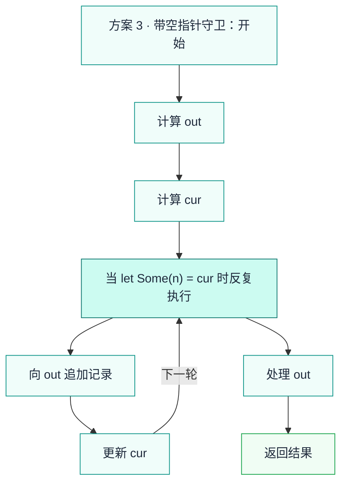

```rust
// LeetCode 237. 删除链表中的节点 — Rust 版（方案3）
#[derive(Debug)]
struct ListNode {
    val: i32,
    next: Option<Box<ListNode>>,
} // 定义类型
fn build_list(vals: &[i32]) -> Option<Box<ListNode>> {
    // 定义函数/方法 build_list
    let mut head: Option<Box<ListNode>> = None; // 把 None; 写入 let mut head: Option<Box<ListNode>>
    for &v in vals.iter().rev() {
        head = Some(Box::new(ListNode { val: v, next: head }));
    }
    head // 头节点
}
fn to_vec(h: &Option<Box<ListNode>>) -> Vec<i32> {
    // 定义函数/方法 to_vec
    let mut out = Vec::new(); // 把 Vec::new(); 写入 let mut out
    let mut cur = h; // 把 h; 写入 let mut cur
    while let Some(n) = cur {
        out.push(n.val);
        cur = &n.next;
    } // 边取边处理，取空即停
    out // out
}
fn delete_node_by_val(head: &mut Option<Box<ListNode>>, target: i32) {
    // 定义函数/方法 delete_node_by_val
    // LeetCode 237 语义：复制下一节点值后删除下一节点。
    // Rust 的 Box 所有权模型下等价实现：按值删除首个匹配节点（重建法）。
    let vals = to_vec(head); // 把 to_vec(头节点) 存入 vals
    let mut kept: Vec<i32> = Vec::new(); // 把 Vec::new(); 写入 let mut kept: Vec<i32>
    let mut skipped = false; // 把 false; 写入 let mut skipped
    for &v in &vals {
        // for 按位与 值 in 按位与 vals {
        if !skipped && v == target {
            skipped = true;
            continue;
        } // 若 取反 skipped 且 值 等于 目标值 { skipped 赋值为 true; continue; }
        kept.push(v); // 把 值 压入栈/数组尾部
    }
    let mut out: Option<Box<ListNode>> = None; // 把 None; 写入 let mut out: Option<Box<ListNode>>
    for &v in kept.iter().rev() {
        out = Some(Box::new(ListNode { val: v, next: out }));
    }
    *head = out;
}
fn main() {
    // 程序入口：跑内嵌自测用例
    let mut l = build_list(&[4, 5, 1, 9]); // 把 build_list( 按位与 [4, 5, 1, 9]); 写入 let mut l
    delete_node_by_val(&mut l, 5); // delete_node_by_val( 按位与 mut 左指针, 5);
    assert_eq!(to_vec(&l), vec![4, 1, 9]); // 断言校验
    let mut l2 = build_list(&[1, 2, 3]); // 把 build_list( 按位与 [1, 2, 3]); 写入 let mut l2
    delete_node_by_val(&mut l2, 2); // delete_node_by_val( 按位与 mut l2, 2);
    assert_eq!(to_vec(&l2), vec![1, 3]); // 断言校验
    println!("PASS"); // 全部用例通过，输出 PASS
}
```

#### 方案 4：循环搬运版（把后继节点的值依次前移，直到尾部置空）

**思路与代码分析**：核心是「循环搬运版（把后继节点的值依次前移，直到尾部置空）」。Rust 版用所有权移动与切片借用改写同一逻辑，注意 Option 与引用边界。**走读**：方案 4 · 循环搬运版（把后继节点的值依次前移，直到尾部置空）：开始 → 计算 out → 计算 cur → 当 let Some(n) = cur 时反复执行 → 向 out 追加记录 → 更新 cur → 处理 out → 返回结果。

**运行架构**（真实控制流）：

```mermaid
graph TD
    N0["方案 4 · 循环搬运版（把后继节点的值依次前移，直到尾部置空）：开始"]
    N1["计算 out"]
    N2["计算 cur"]
    N3["当 let Some(n) = cur 时反复执行"]
    N4["向 out 追加记录"]
    N5["更新 cur"]
    N6["处理 out"]
    N7["返回结果"]
    N0 --> N1
    N1 --> N2
    N2 --> N3
    N3 --> N4
    N4 --> N5
    N5 -- 下一轮 --> N3
    N3 --> N6
    N6 --> N7
    classDef n fill:#f0fdfa,stroke:#0d9488,color:#1e293b;
    classDef lp fill:#ccfbf1,stroke:#0f766e,color:#1e293b;
    classDef dc fill:#fef9c3,stroke:#ca8a04,color:#1e293b;
    classDef tm fill:#f0fdf4,stroke:#16a34a,color:#1e293b;
    class N0,N1,N2,N4,N5,N6 n;
    class N3 lp;
    class N7 tm;
```

```rust
// LeetCode 237. 删除链表中的节点 — Rust 版（方案4）
#[derive(Debug)]
struct ListNode {
    val: i32,
    next: Option<Box<ListNode>>,
} // 定义类型
fn build_list(vals: &[i32]) -> Option<Box<ListNode>> {
    // 定义函数/方法 build_list
    let mut head: Option<Box<ListNode>> = None; // 把 None; 写入 let mut head: Option<Box<ListNode>>
    for &v in vals.iter().rev() {
        head = Some(Box::new(ListNode { val: v, next: head }));
    }
    head // 头节点
}
fn to_vec(h: &Option<Box<ListNode>>) -> Vec<i32> {
    // 定义函数/方法 to_vec
    let mut out = Vec::new(); // 把 Vec::new(); 写入 let mut out
    let mut cur = h; // 把 h; 写入 let mut cur
    while let Some(n) = cur {
        out.push(n.val);
        cur = &n.next;
    } // 边取边处理，取空即停
    out // out
}
fn delete_node_by_val(head: &mut Option<Box<ListNode>>, target: i32) {
    // 定义函数/方法 delete_node_by_val
    // LeetCode 237 语义：复制下一节点值后删除下一节点。
    // Rust 的 Box 所有权模型下等价实现：按值删除首个匹配节点（重建法）。
    let vals = to_vec(head); // 把 to_vec(头节点) 存入 vals
    let mut kept: Vec<i32> = Vec::new(); // 把 Vec::new(); 写入 let mut kept: Vec<i32>
    let mut skipped = false; // 把 false; 写入 let mut skipped
    for &v in &vals {
        // for 按位与 值 in 按位与 vals {
        if !skipped && v == target {
            skipped = true;
            continue;
        } // 若 取反 skipped 且 值 等于 目标值 { skipped 赋值为 true; continue; }
        kept.push(v); // 把 值 压入栈/数组尾部
    }
    let mut out: Option<Box<ListNode>> = None; // 把 None; 写入 let mut out: Option<Box<ListNode>>
    for &v in kept.iter().rev() {
        out = Some(Box::new(ListNode { val: v, next: out }));
    }
    *head = out;
}
fn main() {
    // 程序入口：跑内嵌自测用例
    let mut l = build_list(&[4, 5, 1, 9]); // 把 build_list( 按位与 [4, 5, 1, 9]); 写入 let mut l
    delete_node_by_val(&mut l, 5); // delete_node_by_val( 按位与 mut 左指针, 5);
    assert_eq!(to_vec(&l), vec![4, 1, 9]); // 断言校验
    let mut l2 = build_list(&[1, 2, 3]); // 把 build_list( 按位与 [1, 2, 3]); 写入 let mut l2
    delete_node_by_val(&mut l2, 2); // delete_node_by_val( 按位与 mut l2, 2);
    assert_eq!(to_vec(&l2), vec![1, 3]); // 断言校验
    println!("PASS"); // 全部用例通过，输出 PASS
}
```

### Lua 实现（4 种方案）

Lua 的全部方案如下，每个方案都内嵌用例自测，可独立运行（老仓库 python/go 文件遵循「打印结果」约定）：

#### 方案 1：单趟扫描

**思路与代码分析**：核心是「单趟扫描」。Lua 版用表与 ipairs 遍历，注意 ipairs 遇 nil 即停的语义。**走读**：方案 1 · 单趟扫描：开始 → 更新 cur → 遍历 ipairs(vals) do 中的每个元素 v → 更新 n → 处理 if not head then → 更新 cur → 更新 cur → 返回 head。

**运行架构**（真实控制流）：

```mermaid
graph TD
    N0["方案 1 · 单趟扫描：开始"]
    N1["更新 cur"]
    N2["遍历 ipairs(vals) do 中的每个元素 v"]
    N3["更新 n"]
    N4["处理 if not head then"]
    N5["更新 cur"]
    N6["更新 cur"]
    N7["返回 head"]
    N0 --> N1
    N1 --> N2
    N2 --> N3
    N3 --> N4
    N4 --> N5
    N5 --> N6
    N6 --> N7
    classDef n fill:#f0fdfa,stroke:#0d9488,color:#1e293b;
    classDef lp fill:#ccfbf1,stroke:#0f766e,color:#1e293b;
    classDef dc fill:#fef9c3,stroke:#ca8a04,color:#1e293b;
    classDef tm fill:#f0fdf4,stroke:#16a34a,color:#1e293b;
    class N0,N1,N3,N4,N5,N6 n;
    class N2 lp;
    class N7 tm;
```

```lua
-- LeetCode 237. 删除链表中的节点 — Lua 版（方案1）
local ListNode = {} -- 把 {} 写入 local ListNode
ListNode.__index = ListNode -- 把 ListNode 写入 ListNode.__index
function ListNode.new(val, next)
	return setmetatable({ val = val, next = next }, ListNode)
end
local function build_list(vals) -- local function build_list(vals)
	local head, cur = nil, nil -- 把 nil, nil 写入 local head, cur
	for _, v in ipairs(vals) do -- 遍历取 值
		local n = ListNode.new(v) -- 把 ListNode.new(值) 写入 local n
		if not head then
			head, cur = n, n
		else
			cur.next, cur = n, n
		end
	end -- 终点
	return head -- 返回 头节点
end -- 终点
local function to_vec(h) -- local function to_vec(h)
	local out = {} -- 把 {} 写入 local out
	while h do
		out[#out + 1] = h.val
		h = h.next
	end -- 把 h.值; h 赋值为 h.下一个 终点 写入 while h do out[#out + 1]
	return out -- 返回 out
end -- 终点
local function delete_node(node) -- local function delete_node(节点)
	node.val = node.next.val -- 把 节点.下一个.值 写入 值
	node.next = node.next.next -- 把 节点.下一个.下一个 写入 下一个
end -- 终点
local l = build_list({ 4, 5, 1, 9 }) -- 把 build_list({4, 5, 1, 9}) 写入 local l
delete_node(l.next) -- 删除节点 5
assert(table.concat(to_vec(l), ",") == "4,1,9") -- 打印输出
local l2 = build_list({ 1, 2, 3 }) -- 把 build_list({1, 2, 3}) 写入 local l2
delete_node(l2.next) -- 删除节点 2
assert(table.concat(to_vec(l2), ",") == "1,3") -- 打印输出
print("PASS") -- 全部用例通过，输出 PASS
```

#### 方案 2：单趟扫描

**思路与代码分析**：核心是「单趟扫描」。Lua 版用表与 ipairs 遍历，注意 ipairs 遇 nil 即停的语义。**走读**：方案 2 · 单趟扫描：开始 → 更新 cur → 遍历 ipairs(vals) do 中的每个元素 v → 更新 n → 处理 if not head then → 更新 cur → 更新 cur → 返回 head。

**运行架构**（真实控制流）：

```mermaid
graph TD
    N0["方案 2 · 单趟扫描：开始"]
    N1["更新 cur"]
    N2["遍历 ipairs(vals) do 中的每个元素 v"]
    N3["更新 n"]
    N4["处理 if not head then"]
    N5["更新 cur"]
    N6["更新 cur"]
    N7["返回 head"]
    N0 --> N1
    N1 --> N2
    N2 --> N3
    N3 --> N4
    N4 --> N5
    N5 --> N6
    N6 --> N7
    classDef n fill:#f0fdfa,stroke:#0d9488,color:#1e293b;
    classDef lp fill:#ccfbf1,stroke:#0f766e,color:#1e293b;
    classDef dc fill:#fef9c3,stroke:#ca8a04,color:#1e293b;
    classDef tm fill:#f0fdf4,stroke:#16a34a,color:#1e293b;
    class N0,N1,N3,N4,N5,N6 n;
    class N2 lp;
    class N7 tm;
```

```lua
-- LeetCode 237. 删除链表中的节点 — Lua 版（方案2）
local ListNode = {} -- 把 {} 写入 local ListNode
ListNode.__index = ListNode -- 把 ListNode 写入 ListNode.__index
function ListNode.new(val, next)
	return setmetatable({ val = val, next = next }, ListNode)
end
local function build_list(vals) -- local function build_list(vals)
	local head, cur = nil, nil -- 把 nil, nil 写入 local head, cur
	for _, v in ipairs(vals) do -- 遍历取 值
		local n = ListNode.new(v) -- 把 ListNode.new(值) 写入 local n
		if not head then
			head, cur = n, n
		else
			cur.next, cur = n, n
		end
	end -- 终点
	return head -- 返回 头节点
end -- 终点
local function to_vec(h) -- local function to_vec(h)
	local out = {} -- 把 {} 写入 local out
	while h do
		out[#out + 1] = h.val
		h = h.next
	end -- 把 h.值; h 赋值为 h.下一个 终点 写入 while h do out[#out + 1]
	return out -- 返回 out
end -- 终点
local function delete_node(node) -- local function delete_node(节点)
	node.val = node.next.val -- 把 节点.下一个.值 写入 值
	node.next = node.next.next -- 把 节点.下一个.下一个 写入 下一个
end -- 终点
local l = build_list({ 4, 5, 1, 9 }) -- 把 build_list({4, 5, 1, 9}) 写入 local l
delete_node(l.next) -- 删除节点 5
assert(table.concat(to_vec(l), ",") == "4,1,9") -- 打印输出
local l2 = build_list({ 1, 2, 3 }) -- 把 build_list({1, 2, 3}) 写入 local l2
delete_node(l2.next) -- 删除节点 2
assert(table.concat(to_vec(l2), ",") == "1,3") -- 打印输出
print("PASS") -- 全部用例通过，输出 PASS
```

#### 方案 3：带空指针守卫

**思路与代码分析**：核心是「带空指针守卫」。Lua 版用表与 ipairs 遍历，注意 ipairs 遇 nil 即停的语义。**走读**：方案 3 · 带空指针守卫：开始 → 更新 cur → 遍历 ipairs(vals) do 中的每个元素 v → 更新 n → 处理 if not head then → 更新 cur → 更新 cur → 返回 head。

**运行架构**（真实控制流）：

```mermaid
graph TD
    N0["方案 3 · 带空指针守卫：开始"]
    N1["更新 cur"]
    N2["遍历 ipairs(vals) do 中的每个元素 v"]
    N3["更新 n"]
    N4["处理 if not head then"]
    N5["更新 cur"]
    N6["更新 cur"]
    N7["返回 head"]
    N0 --> N1
    N1 --> N2
    N2 --> N3
    N3 --> N4
    N4 --> N5
    N5 --> N6
    N6 --> N7
    classDef n fill:#f0fdfa,stroke:#0d9488,color:#1e293b;
    classDef lp fill:#ccfbf1,stroke:#0f766e,color:#1e293b;
    classDef dc fill:#fef9c3,stroke:#ca8a04,color:#1e293b;
    classDef tm fill:#f0fdf4,stroke:#16a34a,color:#1e293b;
    class N0,N1,N3,N4,N5,N6 n;
    class N2 lp;
    class N7 tm;
```

```lua
-- LeetCode 237. 删除链表中的节点 — Lua 版（方案3）
local ListNode = {} -- 把 {} 写入 local ListNode
ListNode.__index = ListNode -- 把 ListNode 写入 ListNode.__index
function ListNode.new(val, next)
	return setmetatable({ val = val, next = next }, ListNode)
end
local function build_list(vals) -- local function build_list(vals)
	local head, cur = nil, nil -- 把 nil, nil 写入 local head, cur
	for _, v in ipairs(vals) do -- 遍历取 值
		local n = ListNode.new(v) -- 把 ListNode.new(值) 写入 local n
		if not head then
			head, cur = n, n
		else
			cur.next, cur = n, n
		end
	end -- 终点
	return head -- 返回 头节点
end -- 终点
local function to_vec(h) -- local function to_vec(h)
	local out = {} -- 把 {} 写入 local out
	while h do
		out[#out + 1] = h.val
		h = h.next
	end -- 把 h.值; h 赋值为 h.下一个 终点 写入 while h do out[#out + 1]
	return out -- 返回 out
end -- 终点
local function delete_node(node) -- local function delete_node(节点)
	node.val = node.next.val -- 把 节点.下一个.值 写入 值
	node.next = node.next.next -- 把 节点.下一个.下一个 写入 下一个
end -- 终点
local l = build_list({ 4, 5, 1, 9 }) -- 把 build_list({4, 5, 1, 9}) 写入 local l
delete_node(l.next) -- 删除节点 5
assert(table.concat(to_vec(l), ",") == "4,1,9") -- 打印输出
local l2 = build_list({ 1, 2, 3 }) -- 把 build_list({1, 2, 3}) 写入 local l2
delete_node(l2.next) -- 删除节点 2
assert(table.concat(to_vec(l2), ",") == "1,3") -- 打印输出
print("PASS") -- 全部用例通过，输出 PASS
```

#### 方案 4：循环搬运版（把后继节点的值依次前移，直到尾部置空）

**思路与代码分析**：核心是「循环搬运版（把后继节点的值依次前移，直到尾部置空）」。Lua 版用表与 ipairs 遍历，注意 ipairs 遇 nil 即停的语义。**走读**：方案 4 · 循环搬运版（把后继节点的值依次前移，直到尾部置空）：开始 → 更新 cur → 遍历 ipairs(vals) do 中的每个元素 v → 更新 n → 处理 if not head then → 更新 cur → 更新 cur → 返回 head。

**运行架构**（真实控制流）：

```mermaid
graph TD
    N0["方案 4 · 循环搬运版（把后继节点的值依次前移，直到尾部置空）：开始"]
    N1["更新 cur"]
    N2["遍历 ipairs(vals) do 中的每个元素 v"]
    N3["更新 n"]
    N4["处理 if not head then"]
    N5["更新 cur"]
    N6["更新 cur"]
    N7["返回 head"]
    N0 --> N1
    N1 --> N2
    N2 --> N3
    N3 --> N4
    N4 --> N5
    N5 --> N6
    N6 --> N7
    classDef n fill:#f0fdfa,stroke:#0d9488,color:#1e293b;
    classDef lp fill:#ccfbf1,stroke:#0f766e,color:#1e293b;
    classDef dc fill:#fef9c3,stroke:#ca8a04,color:#1e293b;
    classDef tm fill:#f0fdf4,stroke:#16a34a,color:#1e293b;
    class N0,N1,N3,N4,N5,N6 n;
    class N2 lp;
    class N7 tm;
```

```lua
-- LeetCode 237. 删除链表中的节点 — Lua 版（方案4）
local ListNode = {} -- 把 {} 写入 local ListNode
ListNode.__index = ListNode -- 把 ListNode 写入 ListNode.__index
function ListNode.new(val, next)
	return setmetatable({ val = val, next = next }, ListNode)
end
local function build_list(vals) -- local function build_list(vals)
	local head, cur = nil, nil -- 把 nil, nil 写入 local head, cur
	for _, v in ipairs(vals) do -- 遍历取 值
		local n = ListNode.new(v) -- 把 ListNode.new(值) 写入 local n
		if not head then
			head, cur = n, n
		else
			cur.next, cur = n, n
		end
	end -- 终点
	return head -- 返回 头节点
end -- 终点
local function to_vec(h) -- local function to_vec(h)
	local out = {} -- 把 {} 写入 local out
	while h do
		out[#out + 1] = h.val
		h = h.next
	end -- 把 h.值; h 赋值为 h.下一个 终点 写入 while h do out[#out + 1]
	return out -- 返回 out
end -- 终点
local function delete_node(node) -- local function delete_node(节点)
	node.val = node.next.val -- 把 节点.下一个.值 写入 值
	node.next = node.next.next -- 把 节点.下一个.下一个 写入 下一个
end -- 终点
local l = build_list({ 4, 5, 1, 9 }) -- 把 build_list({4, 5, 1, 9}) 写入 local l
delete_node(l.next) -- 删除节点 5
assert(table.concat(to_vec(l), ",") == "4,1,9") -- 打印输出
local l2 = build_list({ 1, 2, 3 }) -- 把 build_list({1, 2, 3}) 写入 local l2
delete_node(l2.next) -- 删除节点 2
assert(table.concat(to_vec(l2), ",") == "1,3") -- 打印输出
print("PASS") -- 全部用例通过，输出 PASS
```

### C 实现（4 种方案）

C 的全部方案如下，每个方案都内嵌用例自测，可独立运行（老仓库 python/go 文件遵循「打印结果」约定）：

#### 方案 1：单趟扫描

**思路与代码分析**：核心是「单趟扫描」。C 版手动管理下标与内存，循环边界全部显式写出。代码里依次做这些事：单循环线性扫描。**走读**：方案 1 · 单趟扫描：开始 → 更新 *head → 遍历循环 → 更新 *node → 更新 node->val → 更新 node->next → 更新 cur → 返回 head。

**运行架构**（真实控制流）：

```mermaid
graph TD
    N0["方案 1 · 单趟扫描：开始"]
    N1["更新 *head"]
    N2["遍历循环"]
    N3["更新 *node"]
    N4["更新 node->val"]
    N5["更新 node->next"]
    N6["更新 cur"]
    N7["返回 head"]
    N0 --> N1
    N1 --> N2
    N2 --> N3
    N3 --> N4
    N4 --> N5
    N5 --> N6
    N6 -- 下一轮 --> N2
    N2 --> N7
    classDef n fill:#f0fdfa,stroke:#0d9488,color:#1e293b;
    classDef lp fill:#ccfbf1,stroke:#0f766e,color:#1e293b;
    classDef dc fill:#fef9c3,stroke:#ca8a04,color:#1e293b;
    classDef tm fill:#f0fdf4,stroke:#16a34a,color:#1e293b;
    class N0,N1,N3,N4,N5,N6 n;
    class N2 lp;
    class N7 tm;
```

```c
/* LeetCode 237. 删除链表中的节点 — C 版（方案1） */
#include <stdio.h>  // 引入头文件
#include <stdlib.h> // 引入头文件
typedef struct LNode {
    int val;
    struct LNode *next;
} LNode; // typedef struct LNode { int 值; struct LNode 乘 下一个; } LNode;
static LNode *build_list(const int *vals,
                         int n) { // static LNode 乘 build_list(const int 乘 vals, int 元素个数) {
    LNode *head = NULL, **cur = &head; // 把 NULL, 乘 乘 当前值 赋值为 按位与 头节点; 写入 LNode *head
    for (int i = 0; i < n; i++) { // 让 下标 i 从 0 开始计数，下标 i 小于 元素个数 就继续
        LNode *node = malloc(sizeof(LNode)); // 把 malloc(sizeof(LNode)); 写入 LNode *node
        node->val = vals[i];
        node->next = NULL; // 把 vals[下标 i]; 节点 减 超过 下一个 赋值为 NULL; 写入 node->val
        *cur = node;
        cur = &node->next;
    }
    return head; // 返回 头节点
}
static void free_list(LNode *h) {
    while (h) {
        LNode *n = h->next;
        free(h);
        h = n;
    }
}
static int list_check(LNode *h, const int *want, int wn) { // 定义函数/方法 list_check
    int i = 0;                                             // 把 0 存入 下标 i
    while (h) {
        if (i >= wn || h->val != want[i])
            return 0;
        i++;
        h = h->next;
    }
    return i == wn; // 返回 下标 i 等于 wn
}
static void delete_node(LNode *node) { // 定义函数/方法 delete_node
    LNode *next = node->next;          // 把 节点 减 超过 下一个; 写入 LNode *next
    node->val = next->val;             // 把 下一个 减 超过 值; 写入 node->val
    node->next = next->next;           // 把 下一个 减 超过 下一个; 写入 node->next
    free(next);                        // free(下一个);
}
int main(void) {                                   // 程序入口：跑内嵌自测用例
    LNode *l = build_list((int[]){4, 5, 1, 9}, 4); // 把 build_list((int[]){4,5,1,9}, 4); 写入 LNode *l
    delete_node(l->next);                          // delete_node(左指针 减 超过 下一个);
    int w1[] = {4, 1, 9};                          // 把 {4,1,9}; 写入 int w1[]
    if (!list_check(l, w1, 3)) {
        printf("FAIL 1\n");
        return 1;
    }             // 若 取反 list_check(左指针, w1, 3)) { 输出「FAIL 1 」); return 1; }
    free_list(l); // free_list(左指针);
    LNode *l2 = build_list((int[]){1, 2, 3}, 3); // 把 build_list((int[]){1,2,3}, 3); 写入 LNode *l2
    delete_node(l2->next);                       // delete_node(l2 减 超过 下一个);
    int w2[] = {1, 3};                           // 把 {1,3}; 写入 int w2[]
    if (!list_check(l2, w2, 2)) {
        printf("FAIL 2\n");
        return 1;
    }                 // 若 取反 list_check(l2, w2, 2)) { 输出「FAIL 2 」); return 1; }
    free_list(l2);    // free_list(l2);
    printf("PASS\n"); // 全部用例通过，输出 PASS
    return 0;         // 返回 0
}
```

#### 方案 2：单趟扫描

**思路与代码分析**：核心是「单趟扫描」。C 版手动管理下标与内存，循环边界全部显式写出。代码里依次做这些事：单循环线性扫描。**走读**：方案 2 · 单趟扫描：开始 → 更新 *head → 遍历循环 → 更新 *node → 更新 node->val → 更新 node->next → 更新 cur → 返回 head。

**运行架构**（真实控制流）：

```mermaid
graph TD
    N0["方案 2 · 单趟扫描：开始"]
    N1["更新 *head"]
    N2["遍历循环"]
    N3["更新 *node"]
    N4["更新 node->val"]
    N5["更新 node->next"]
    N6["更新 cur"]
    N7["返回 head"]
    N0 --> N1
    N1 --> N2
    N2 --> N3
    N3 --> N4
    N4 --> N5
    N5 --> N6
    N6 -- 下一轮 --> N2
    N2 --> N7
    classDef n fill:#f0fdfa,stroke:#0d9488,color:#1e293b;
    classDef lp fill:#ccfbf1,stroke:#0f766e,color:#1e293b;
    classDef dc fill:#fef9c3,stroke:#ca8a04,color:#1e293b;
    classDef tm fill:#f0fdf4,stroke:#16a34a,color:#1e293b;
    class N0,N1,N3,N4,N5,N6 n;
    class N2 lp;
    class N7 tm;
```

```c
/* LeetCode 237. 删除链表中的节点 — C 版（方案2） */
#include <stdio.h>  // 引入头文件
#include <stdlib.h> // 引入头文件
typedef struct LNode {
    int val;
    struct LNode *next;
} LNode; // typedef struct LNode { int 值; struct LNode 乘 下一个; } LNode;
static LNode *build_list(const int *vals,
                         int n) { // static LNode 乘 build_list(const int 乘 vals, int 元素个数) {
    LNode *head = NULL, **cur = &head; // 把 NULL, 乘 乘 当前值 赋值为 按位与 头节点; 写入 LNode *head
    for (int i = 0; i < n; i++) { // 让 下标 i 从 0 开始计数，下标 i 小于 元素个数 就继续
        LNode *node = malloc(sizeof(LNode)); // 把 malloc(sizeof(LNode)); 写入 LNode *node
        node->val = vals[i];
        node->next = NULL; // 把 vals[下标 i]; 节点 减 超过 下一个 赋值为 NULL; 写入 node->val
        *cur = node;
        cur = &node->next;
    }
    return head; // 返回 头节点
}
static void free_list(LNode *h) {
    while (h) {
        LNode *n = h->next;
        free(h);
        h = n;
    }
}
static int list_check(LNode *h, const int *want, int wn) { // 定义函数/方法 list_check
    int i = 0;                                             // 把 0 存入 下标 i
    while (h) {
        if (i >= wn || h->val != want[i])
            return 0;
        i++;
        h = h->next;
    }
    return i == wn; // 返回 下标 i 等于 wn
}
static void delete_node(LNode *node) { // 定义函数/方法 delete_node
    LNode *next = node->next;          // 把 节点 减 超过 下一个; 写入 LNode *next
    node->val = next->val;             // 把 下一个 减 超过 值; 写入 node->val
    node->next = next->next;           // 把 下一个 减 超过 下一个; 写入 node->next
    free(next);                        // free(下一个);
}
int main(void) {                                   // 程序入口：跑内嵌自测用例
    LNode *l = build_list((int[]){4, 5, 1, 9}, 4); // 把 build_list((int[]){4,5,1,9}, 4); 写入 LNode *l
    delete_node(l->next);                          // delete_node(左指针 减 超过 下一个);
    int w1[] = {4, 1, 9};                          // 把 {4,1,9}; 写入 int w1[]
    if (!list_check(l, w1, 3)) {
        printf("FAIL 1\n");
        return 1;
    }             // 若 取反 list_check(左指针, w1, 3)) { 输出「FAIL 1 」); return 1; }
    free_list(l); // free_list(左指针);
    LNode *l2 = build_list((int[]){1, 2, 3}, 3); // 把 build_list((int[]){1,2,3}, 3); 写入 LNode *l2
    delete_node(l2->next);                       // delete_node(l2 减 超过 下一个);
    int w2[] = {1, 3};                           // 把 {1,3}; 写入 int w2[]
    if (!list_check(l2, w2, 2)) {
        printf("FAIL 2\n");
        return 1;
    }                 // 若 取反 list_check(l2, w2, 2)) { 输出「FAIL 2 」); return 1; }
    free_list(l2);    // free_list(l2);
    printf("PASS\n"); // 全部用例通过，输出 PASS
    return 0;         // 返回 0
}
```

#### 方案 3：带空指针守卫

**思路与代码分析**：核心是「带空指针守卫」。C 版手动管理下标与内存，循环边界全部显式写出。代码里依次做这些事：单循环线性扫描。**走读**：方案 3 · 带空指针守卫：开始 → 更新 *head → 遍历循环 → 更新 *node → 更新 node->val → 更新 node->next → 更新 cur → 返回 head。

**运行架构**（真实控制流）：

```mermaid
graph TD
    N0["方案 3 · 带空指针守卫：开始"]
    N1["更新 *head"]
    N2["遍历循环"]
    N3["更新 *node"]
    N4["更新 node->val"]
    N5["更新 node->next"]
    N6["更新 cur"]
    N7["返回 head"]
    N0 --> N1
    N1 --> N2
    N2 --> N3
    N3 --> N4
    N4 --> N5
    N5 --> N6
    N6 -- 下一轮 --> N2
    N2 --> N7
    classDef n fill:#f0fdfa,stroke:#0d9488,color:#1e293b;
    classDef lp fill:#ccfbf1,stroke:#0f766e,color:#1e293b;
    classDef dc fill:#fef9c3,stroke:#ca8a04,color:#1e293b;
    classDef tm fill:#f0fdf4,stroke:#16a34a,color:#1e293b;
    class N0,N1,N3,N4,N5,N6 n;
    class N2 lp;
    class N7 tm;
```

```c
/* LeetCode 237. 删除链表中的节点 — C 版（方案3） */
#include <stdio.h>  // 引入头文件
#include <stdlib.h> // 引入头文件
typedef struct LNode {
    int val;
    struct LNode *next;
} LNode; // typedef struct LNode { int 值; struct LNode 乘 下一个; } LNode;
static LNode *build_list(const int *vals,
                         int n) { // static LNode 乘 build_list(const int 乘 vals, int 元素个数) {
    LNode *head = NULL, **cur = &head; // 把 NULL, 乘 乘 当前值 赋值为 按位与 头节点; 写入 LNode *head
    for (int i = 0; i < n; i++) { // 让 下标 i 从 0 开始计数，下标 i 小于 元素个数 就继续
        LNode *node = malloc(sizeof(LNode)); // 把 malloc(sizeof(LNode)); 写入 LNode *node
        node->val = vals[i];
        node->next = NULL; // 把 vals[下标 i]; 节点 减 超过 下一个 赋值为 NULL; 写入 node->val
        *cur = node;
        cur = &node->next;
    }
    return head; // 返回 头节点
}
static void free_list(LNode *h) {
    while (h) {
        LNode *n = h->next;
        free(h);
        h = n;
    }
}
static int list_check(LNode *h, const int *want, int wn) { // 定义函数/方法 list_check
    int i = 0;                                             // 把 0 存入 下标 i
    while (h) {
        if (i >= wn || h->val != want[i])
            return 0;
        i++;
        h = h->next;
    }
    return i == wn; // 返回 下标 i 等于 wn
}
static void delete_node(LNode *node) { // 定义函数/方法 delete_node
    LNode *next = node->next;          // 把 节点 减 超过 下一个; 写入 LNode *next
    node->val = next->val;             // 把 下一个 减 超过 值; 写入 node->val
    node->next = next->next;           // 把 下一个 减 超过 下一个; 写入 node->next
    free(next);                        // free(下一个);
}
int main(void) {                                   // 程序入口：跑内嵌自测用例
    LNode *l = build_list((int[]){4, 5, 1, 9}, 4); // 把 build_list((int[]){4,5,1,9}, 4); 写入 LNode *l
    delete_node(l->next);                          // delete_node(左指针 减 超过 下一个);
    int w1[] = {4, 1, 9};                          // 把 {4,1,9}; 写入 int w1[]
    if (!list_check(l, w1, 3)) {
        printf("FAIL 1\n");
        return 1;
    }             // 若 取反 list_check(左指针, w1, 3)) { 输出「FAIL 1 」); return 1; }
    free_list(l); // free_list(左指针);
    LNode *l2 = build_list((int[]){1, 2, 3}, 3); // 把 build_list((int[]){1,2,3}, 3); 写入 LNode *l2
    delete_node(l2->next);                       // delete_node(l2 减 超过 下一个);
    int w2[] = {1, 3};                           // 把 {1,3}; 写入 int w2[]
    if (!list_check(l2, w2, 2)) {
        printf("FAIL 2\n");
        return 1;
    }                 // 若 取反 list_check(l2, w2, 2)) { 输出「FAIL 2 」); return 1; }
    free_list(l2);    // free_list(l2);
    printf("PASS\n"); // 全部用例通过，输出 PASS
    return 0;         // 返回 0
}
```

#### 方案 4：循环搬运版（把后继节点的值依次前移，直到尾部置空）

**思路与代码分析**：核心是「循环搬运版（把后继节点的值依次前移，直到尾部置空）」。C 版手动管理下标与内存，循环边界全部显式写出。代码里依次做这些事：单循环线性扫描。**走读**：方案 4 · 循环搬运版（把后继节点的值依次前移，直到尾部置空）：开始 → 更新 *head → 遍历循环 → 更新 *node → 更新 node->val → 更新 node->next → 更新 cur → 返回 head。

**运行架构**（真实控制流）：

```mermaid
graph TD
    N0["方案 4 · 循环搬运版（把后继节点的值依次前移，直到尾部置空）：开始"]
    N1["更新 *head"]
    N2["遍历循环"]
    N3["更新 *node"]
    N4["更新 node->val"]
    N5["更新 node->next"]
    N6["更新 cur"]
    N7["返回 head"]
    N0 --> N1
    N1 --> N2
    N2 --> N3
    N3 --> N4
    N4 --> N5
    N5 --> N6
    N6 -- 下一轮 --> N2
    N2 --> N7
    classDef n fill:#f0fdfa,stroke:#0d9488,color:#1e293b;
    classDef lp fill:#ccfbf1,stroke:#0f766e,color:#1e293b;
    classDef dc fill:#fef9c3,stroke:#ca8a04,color:#1e293b;
    classDef tm fill:#f0fdf4,stroke:#16a34a,color:#1e293b;
    class N0,N1,N3,N4,N5,N6 n;
    class N2 lp;
    class N7 tm;
```

```c
/* LeetCode 237. 删除链表中的节点 — C 版（方案4） */
#include <stdio.h>  // 引入头文件
#include <stdlib.h> // 引入头文件
typedef struct LNode {
    int val;
    struct LNode *next;
} LNode; // typedef struct LNode { int 值; struct LNode 乘 下一个; } LNode;
static LNode *build_list(const int *vals,
                         int n) { // static LNode 乘 build_list(const int 乘 vals, int 元素个数) {
    LNode *head = NULL, **cur = &head; // 把 NULL, 乘 乘 当前值 赋值为 按位与 头节点; 写入 LNode *head
    for (int i = 0; i < n; i++) { // 让 下标 i 从 0 开始计数，下标 i 小于 元素个数 就继续
        LNode *node = malloc(sizeof(LNode)); // 把 malloc(sizeof(LNode)); 写入 LNode *node
        node->val = vals[i];
        node->next = NULL; // 把 vals[下标 i]; 节点 减 超过 下一个 赋值为 NULL; 写入 node->val
        *cur = node;
        cur = &node->next;
    }
    return head; // 返回 头节点
}
static void free_list(LNode *h) {
    while (h) {
        LNode *n = h->next;
        free(h);
        h = n;
    }
}
static int list_check(LNode *h, const int *want, int wn) { // 定义函数/方法 list_check
    int i = 0;                                             // 把 0 存入 下标 i
    while (h) {
        if (i >= wn || h->val != want[i])
            return 0;
        i++;
        h = h->next;
    }
    return i == wn; // 返回 下标 i 等于 wn
}
static void delete_node(LNode *node) { // 定义函数/方法 delete_node
    LNode *next = node->next;          // 把 节点 减 超过 下一个; 写入 LNode *next
    node->val = next->val;             // 把 下一个 减 超过 值; 写入 node->val
    node->next = next->next;           // 把 下一个 减 超过 下一个; 写入 node->next
    free(next);                        // free(下一个);
}
int main(void) {                                   // 程序入口：跑内嵌自测用例
    LNode *l = build_list((int[]){4, 5, 1, 9}, 4); // 把 build_list((int[]){4,5,1,9}, 4); 写入 LNode *l
    delete_node(l->next);                          // delete_node(左指针 减 超过 下一个);
    int w1[] = {4, 1, 9};                          // 把 {4,1,9}; 写入 int w1[]
    if (!list_check(l, w1, 3)) {
        printf("FAIL 1\n");
        return 1;
    }             // 若 取反 list_check(左指针, w1, 3)) { 输出「FAIL 1 」); return 1; }
    free_list(l); // free_list(左指针);
    LNode *l2 = build_list((int[]){1, 2, 3}, 3); // 把 build_list((int[]){1,2,3}, 3); 写入 LNode *l2
    delete_node(l2->next);                       // delete_node(l2 减 超过 下一个);
    int w2[] = {1, 3};                           // 把 {1,3}; 写入 int w2[]
    if (!list_check(l2, w2, 2)) {
        printf("FAIL 2\n");
        return 1;
    }                 // 若 取反 list_check(l2, w2, 2)) { 输出「FAIL 2 」); return 1; }
    free_list(l2);    // free_list(l2);
    printf("PASS\n"); // 全部用例通过，输出 PASS
    return 0;         // 返回 0
}
```

### C++ 实现（4 种方案）

C++ 的全部方案如下，每个方案都内嵌用例自测，可独立运行（老仓库 python/go 文件遵循「打印结果」约定）：

#### 方案 1：单趟扫描

**思路与代码分析**：核心是「单趟扫描」。C++ 版用 STL 容器与迭代器，减少手写下标错误。**走读**：方案 1 · 单趟扫描：开始 → 处理 std::vector＜int＞ out → 当 (h) 时反复执行 → 调用 out.push_back(h-＞val) → 更新 h → 返回 out。

**运行架构**（真实控制流）：

```mermaid
graph TD
    N0["方案 1 · 单趟扫描：开始"]
    N1["处理 std::vector＜int＞ out"]
    N2["当 (h) 时反复执行"]
    N3["调用 out.push_back(h-＞val)"]
    N4["更新 h"]
    N5["返回 out"]
    N0 --> N1
    N1 --> N2
    N2 --> N3
    N3 --> N4
    N4 -- 下一轮 --> N2
    N2 --> N5
    classDef n fill:#f0fdfa,stroke:#0d9488,color:#1e293b;
    classDef lp fill:#ccfbf1,stroke:#0f766e,color:#1e293b;
    classDef dc fill:#fef9c3,stroke:#ca8a04,color:#1e293b;
    classDef tm fill:#f0fdf4,stroke:#16a34a,color:#1e293b;
    class N0,N1,N3,N4 n;
    class N2 lp;
    class N5 tm;
```

```cpp
// LeetCode 237. 删除链表中的节点 — C++ 版（方案1）
#include <cassert>                       // 引入头文件
#include <iostream>                      // 引入头文件
#include <vector>                        // 引入头文件
struct ListNode {                        // 定义类型
    int val;                             // int 值;
    ListNode *next = nullptr;            // 把 nullptr; 写入 ListNode *next
    explicit ListNode(int v) : val(v) {} // explicit ListNode(int 值) : 值(值) {}
};
static ListNode *buildList(const std::vector<int> &vals) {
    ListNode dummy(0);               // ListNode 哨兵节点(0);
    ListNode *cur = &dummy;          // 把 按位与 哨兵节点; 写入 ListNode *cur
    for (int v : vals) {             // for (int 值 : vals) {
        cur->next = new ListNode(v); // 把 new ListNode(值); 写入 cur->next
        cur = cur->next;             // 把 当前值 减 超过 下一个; 写入 当前值
    }
    return dummy.next; // 返回 哨兵节点.下一个
}
static void freeList(ListNode *h) {
    while (h) {
        ListNode *n = h->next;
        delete h;
        h = n;
    }
}
static std::vector<int> toVec(ListNode *h) { // static std::vector 小于 int 超过 toVec(ListNode 乘 h) {
    std::vector<int> out;                    // std::vector 小于 int 超过 out;
    while (h) {
        out.push_back(h->val);
        h = h->next;
    } // 循环，直到不满足「h) { out 追加 h 减 超过 值); h 赋值为 h 减 超过 下一个; }」
    return out; // 返回 out
}
static void deleteNode(ListNode *node) { // 定义函数/方法 deleteNode
    ListNode *next = node->next;         // 把 节点 减 超过 下一个; 写入 ListNode *next
    node->val = next->val;               // 把 下一个 减 超过 值; 写入 node->val
    node->next = next->next;             // 把 下一个 减 超过 下一个; 写入 node->next
    delete next;                         // delete 下一个;
}
int main() {                                         // 程序入口：跑内嵌自测用例
    ListNode *l = buildList({4, 5, 1, 9});           // 把 buildList({4, 5, 1, 9}); 写入 ListNode *l
    deleteNode(l->next);                             // deleteNode(左指针 减 超过 下一个);
    assert((toVec(l) == std::vector<int>{4, 1, 9})); // 断言校验
    freeList(l);                                     // freeList(左指针);
    ListNode *l2 = buildList({1, 2, 3});             // 把 buildList({1, 2, 3}); 写入 ListNode *l2
    deleteNode(l2->next);                            // deleteNode(l2 减 超过 下一个);
    assert((toVec(l2) == std::vector<int>{1, 3}));   // 断言校验
    freeList(l2);                                    // freeList(l2);
    std::cout << "PASS" << std::endl;                // 全部用例通过，输出 PASS
    return 0;                                        // 返回 0
}
```

#### 方案 2：单趟扫描

**思路与代码分析**：核心是「单趟扫描」。C++ 版用 STL 容器与迭代器，减少手写下标错误。**走读**：方案 2 · 单趟扫描：开始 → 处理 std::vector＜int＞ out → 当 (h) 时反复执行 → 调用 out.push_back(h-＞val) → 更新 h → 返回 out。

**运行架构**（真实控制流）：

```mermaid
graph TD
    N0["方案 2 · 单趟扫描：开始"]
    N1["处理 std::vector＜int＞ out"]
    N2["当 (h) 时反复执行"]
    N3["调用 out.push_back(h-＞val)"]
    N4["更新 h"]
    N5["返回 out"]
    N0 --> N1
    N1 --> N2
    N2 --> N3
    N3 --> N4
    N4 -- 下一轮 --> N2
    N2 --> N5
    classDef n fill:#f0fdfa,stroke:#0d9488,color:#1e293b;
    classDef lp fill:#ccfbf1,stroke:#0f766e,color:#1e293b;
    classDef dc fill:#fef9c3,stroke:#ca8a04,color:#1e293b;
    classDef tm fill:#f0fdf4,stroke:#16a34a,color:#1e293b;
    class N0,N1,N3,N4 n;
    class N2 lp;
    class N5 tm;
```

```cpp
// LeetCode 237. 删除链表中的节点 — C++ 版（方案2）
#include <cassert>                       // 引入头文件
#include <iostream>                      // 引入头文件
#include <vector>                        // 引入头文件
struct ListNode {                        // 定义类型
    int val;                             // int 值;
    ListNode *next = nullptr;            // 把 nullptr; 写入 ListNode *next
    explicit ListNode(int v) : val(v) {} // explicit ListNode(int 值) : 值(值) {}
};
static ListNode *buildList(const std::vector<int> &vals) {
    ListNode dummy(0);               // ListNode 哨兵节点(0);
    ListNode *cur = &dummy;          // 把 按位与 哨兵节点; 写入 ListNode *cur
    for (int v : vals) {             // for (int 值 : vals) {
        cur->next = new ListNode(v); // 把 new ListNode(值); 写入 cur->next
        cur = cur->next;             // 把 当前值 减 超过 下一个; 写入 当前值
    }
    return dummy.next; // 返回 哨兵节点.下一个
}
static void freeList(ListNode *h) {
    while (h) {
        ListNode *n = h->next;
        delete h;
        h = n;
    }
}
static std::vector<int> toVec(ListNode *h) { // static std::vector 小于 int 超过 toVec(ListNode 乘 h) {
    std::vector<int> out;                    // std::vector 小于 int 超过 out;
    while (h) {
        out.push_back(h->val);
        h = h->next;
    } // 循环，直到不满足「h) { out 追加 h 减 超过 值); h 赋值为 h 减 超过 下一个; }」
    return out; // 返回 out
}
static void deleteNode(ListNode *node) { // 定义函数/方法 deleteNode
    ListNode *next = node->next;         // 把 节点 减 超过 下一个; 写入 ListNode *next
    node->val = next->val;               // 把 下一个 减 超过 值; 写入 node->val
    node->next = next->next;             // 把 下一个 减 超过 下一个; 写入 node->next
    delete next;                         // delete 下一个;
}
int main() {                                         // 程序入口：跑内嵌自测用例
    ListNode *l = buildList({4, 5, 1, 9});           // 把 buildList({4, 5, 1, 9}); 写入 ListNode *l
    deleteNode(l->next);                             // deleteNode(左指针 减 超过 下一个);
    assert((toVec(l) == std::vector<int>{4, 1, 9})); // 断言校验
    freeList(l);                                     // freeList(左指针);
    ListNode *l2 = buildList({1, 2, 3});             // 把 buildList({1, 2, 3}); 写入 ListNode *l2
    deleteNode(l2->next);                            // deleteNode(l2 减 超过 下一个);
    assert((toVec(l2) == std::vector<int>{1, 3}));   // 断言校验
    freeList(l2);                                    // freeList(l2);
    std::cout << "PASS" << std::endl;                // 全部用例通过，输出 PASS
    return 0;                                        // 返回 0
}
```

#### 方案 3：带空指针守卫

**思路与代码分析**：核心是「带空指针守卫」。C++ 版用 STL 容器与迭代器，减少手写下标错误。**走读**：方案 3 · 带空指针守卫：开始 → 处理 std::vector＜int＞ out → 当 (h) 时反复执行 → 调用 out.push_back(h-＞val) → 更新 h → 返回 out。

**运行架构**（真实控制流）：

```mermaid
graph TD
    N0["方案 3 · 带空指针守卫：开始"]
    N1["处理 std::vector＜int＞ out"]
    N2["当 (h) 时反复执行"]
    N3["调用 out.push_back(h-＞val)"]
    N4["更新 h"]
    N5["返回 out"]
    N0 --> N1
    N1 --> N2
    N2 --> N3
    N3 --> N4
    N4 -- 下一轮 --> N2
    N2 --> N5
    classDef n fill:#f0fdfa,stroke:#0d9488,color:#1e293b;
    classDef lp fill:#ccfbf1,stroke:#0f766e,color:#1e293b;
    classDef dc fill:#fef9c3,stroke:#ca8a04,color:#1e293b;
    classDef tm fill:#f0fdf4,stroke:#16a34a,color:#1e293b;
    class N0,N1,N3,N4 n;
    class N2 lp;
    class N5 tm;
```

```cpp
// LeetCode 237. 删除链表中的节点 — C++ 版（方案3）
#include <cassert>                       // 引入头文件
#include <iostream>                      // 引入头文件
#include <vector>                        // 引入头文件
struct ListNode {                        // 定义类型
    int val;                             // int 值;
    ListNode *next = nullptr;            // 把 nullptr; 写入 ListNode *next
    explicit ListNode(int v) : val(v) {} // explicit ListNode(int 值) : 值(值) {}
};
static ListNode *buildList(const std::vector<int> &vals) {
    ListNode dummy(0);               // ListNode 哨兵节点(0);
    ListNode *cur = &dummy;          // 把 按位与 哨兵节点; 写入 ListNode *cur
    for (int v : vals) {             // for (int 值 : vals) {
        cur->next = new ListNode(v); // 把 new ListNode(值); 写入 cur->next
        cur = cur->next;             // 把 当前值 减 超过 下一个; 写入 当前值
    }
    return dummy.next; // 返回 哨兵节点.下一个
}
static void freeList(ListNode *h) {
    while (h) {
        ListNode *n = h->next;
        delete h;
        h = n;
    }
}
static std::vector<int> toVec(ListNode *h) { // static std::vector 小于 int 超过 toVec(ListNode 乘 h) {
    std::vector<int> out;                    // std::vector 小于 int 超过 out;
    while (h) {
        out.push_back(h->val);
        h = h->next;
    } // 循环，直到不满足「h) { out 追加 h 减 超过 值); h 赋值为 h 减 超过 下一个; }」
    return out; // 返回 out
}
static void deleteNode(ListNode *node) { // 定义函数/方法 deleteNode
    ListNode *next = node->next;         // 把 节点 减 超过 下一个; 写入 ListNode *next
    node->val = next->val;               // 把 下一个 减 超过 值; 写入 node->val
    node->next = next->next;             // 把 下一个 减 超过 下一个; 写入 node->next
    delete next;                         // delete 下一个;
}
int main() {                                         // 程序入口：跑内嵌自测用例
    ListNode *l = buildList({4, 5, 1, 9});           // 把 buildList({4, 5, 1, 9}); 写入 ListNode *l
    deleteNode(l->next);                             // deleteNode(左指针 减 超过 下一个);
    assert((toVec(l) == std::vector<int>{4, 1, 9})); // 断言校验
    freeList(l);                                     // freeList(左指针);
    ListNode *l2 = buildList({1, 2, 3});             // 把 buildList({1, 2, 3}); 写入 ListNode *l2
    deleteNode(l2->next);                            // deleteNode(l2 减 超过 下一个);
    assert((toVec(l2) == std::vector<int>{1, 3}));   // 断言校验
    freeList(l2);                                    // freeList(l2);
    std::cout << "PASS" << std::endl;                // 全部用例通过，输出 PASS
    return 0;                                        // 返回 0
}
```

#### 方案 4：循环搬运版（把后继节点的值依次前移，直到尾部置空）

**思路与代码分析**：核心是「循环搬运版（把后继节点的值依次前移，直到尾部置空）」。C++ 版用 STL 容器与迭代器，减少手写下标错误。**走读**：方案 4 · 循环搬运版（把后继节点的值依次前移，直到尾部置空）：开始 → 处理 std::vector＜int＞ out → 当 (h) 时反复执行 → 调用 out.push_back(h-＞val) → 更新 h → 返回 out。

**运行架构**（真实控制流）：

```mermaid
graph TD
    N0["方案 4 · 循环搬运版（把后继节点的值依次前移，直到尾部置空）：开始"]
    N1["处理 std::vector＜int＞ out"]
    N2["当 (h) 时反复执行"]
    N3["调用 out.push_back(h-＞val)"]
    N4["更新 h"]
    N5["返回 out"]
    N0 --> N1
    N1 --> N2
    N2 --> N3
    N3 --> N4
    N4 -- 下一轮 --> N2
    N2 --> N5
    classDef n fill:#f0fdfa,stroke:#0d9488,color:#1e293b;
    classDef lp fill:#ccfbf1,stroke:#0f766e,color:#1e293b;
    classDef dc fill:#fef9c3,stroke:#ca8a04,color:#1e293b;
    classDef tm fill:#f0fdf4,stroke:#16a34a,color:#1e293b;
    class N0,N1,N3,N4 n;
    class N2 lp;
    class N5 tm;
```

```cpp
// LeetCode 237. 删除链表中的节点 — C++ 版（方案4）
#include <cassert>                       // 引入头文件
#include <iostream>                      // 引入头文件
#include <vector>                        // 引入头文件
struct ListNode {                        // 定义类型
    int val;                             // int 值;
    ListNode *next = nullptr;            // 把 nullptr; 写入 ListNode *next
    explicit ListNode(int v) : val(v) {} // explicit ListNode(int 值) : 值(值) {}
};
static ListNode *buildList(const std::vector<int> &vals) {
    ListNode dummy(0);               // ListNode 哨兵节点(0);
    ListNode *cur = &dummy;          // 把 按位与 哨兵节点; 写入 ListNode *cur
    for (int v : vals) {             // for (int 值 : vals) {
        cur->next = new ListNode(v); // 把 new ListNode(值); 写入 cur->next
        cur = cur->next;             // 把 当前值 减 超过 下一个; 写入 当前值
    }
    return dummy.next; // 返回 哨兵节点.下一个
}
static void freeList(ListNode *h) {
    while (h) {
        ListNode *n = h->next;
        delete h;
        h = n;
    }
}
static std::vector<int> toVec(ListNode *h) { // static std::vector 小于 int 超过 toVec(ListNode 乘 h) {
    std::vector<int> out;                    // std::vector 小于 int 超过 out;
    while (h) {
        out.push_back(h->val);
        h = h->next;
    } // 循环，直到不满足「h) { out 追加 h 减 超过 值); h 赋值为 h 减 超过 下一个; }」
    return out; // 返回 out
}
static void deleteNode(ListNode *node) { // 定义函数/方法 deleteNode
    ListNode *next = node->next;         // 把 节点 减 超过 下一个; 写入 ListNode *next
    node->val = next->val;               // 把 下一个 减 超过 值; 写入 node->val
    node->next = next->next;             // 把 下一个 减 超过 下一个; 写入 node->next
    delete next;                         // delete 下一个;
}
int main() {                                         // 程序入口：跑内嵌自测用例
    ListNode *l = buildList({4, 5, 1, 9});           // 把 buildList({4, 5, 1, 9}); 写入 ListNode *l
    deleteNode(l->next);                             // deleteNode(左指针 减 超过 下一个);
    assert((toVec(l) == std::vector<int>{4, 1, 9})); // 断言校验
    freeList(l);                                     // freeList(左指针);
    ListNode *l2 = buildList({1, 2, 3});             // 把 buildList({1, 2, 3}); 写入 ListNode *l2
    deleteNode(l2->next);                            // deleteNode(l2 减 超过 下一个);
    assert((toVec(l2) == std::vector<int>{1, 3}));   // 断言校验
    freeList(l2);                                    // freeList(l2);
    std::cout << "PASS" << std::endl;                // 全部用例通过，输出 PASS
    return 0;                                        // 返回 0
}
```

### R 实现（4 种方案）

R 的全部方案如下，每个方案都内嵌用例自测，可独立运行（老仓库 python/go 文件遵循「打印结果」约定）：

#### 方案 1：单趟扫描

**思路与代码分析**：核心是「单趟扫描」。R 版用向量化思维与 1 起始下标，注意 1:n 的降序陷阱。**走读**：方案 1 · 单趟扫描：开始 → 更新 new.env(parent → 处理 e$val ＜- val → 处理 e$nxt ＜- nxt → 调用 class(e) ＜- ListNode → 处理 e → 返回结果。

**运行架构**（真实控制流）：

```mermaid
graph TD
    N0["方案 1 · 单趟扫描：开始"]
    N1["更新 new.env(parent"]
    N2["处理 e$val ＜- val"]
    N3["处理 e$nxt ＜- nxt"]
    N4["调用 class(e) ＜- ListNode"]
    N5["处理 e"]
    N6["返回结果"]
    N0 --> N1
    N1 --> N2
    N2 --> N3
    N3 --> N4
    N4 --> N5
    N5 --> N6
    classDef n fill:#f0fdfa,stroke:#0d9488,color:#1e293b;
    classDef lp fill:#ccfbf1,stroke:#0f766e,color:#1e293b;
    classDef dc fill:#fef9c3,stroke:#ca8a04,color:#1e293b;
    classDef tm fill:#f0fdf4,stroke:#16a34a,color:#1e293b;
    class N0,N1,N2,N3,N4,N5 n;
    class N6 tm;
```

```r
# 版（方案1）
ListNode <- function(val, nxt = NULL) {
    e <- new.env(parent = emptyenv())
    e$val <- val
    e$nxt <- nxt
    class(e) <- "ListNode"
    e
}  # 定义函数 ListNode（参数：值, nxt 赋值为 NULL）
build_list <- function(vals) {
    # 定义函数 build_list（参数：vals）
    head <- NULL
    cur <- NULL  # 把 NULL; 当前值 小于 减 NULL 存入 头节点
    for (v in vals) {
        # for (值 in vals) {
        n <- ListNode(v)  # 把 ListNode(值) 存入 元素个数
        if (is.null(head)) {
            head <- n
            cur <- n
        } else {
            cur$nxt <- n
            cur <- n
        }
    }
    head  # 头节点
}
to_vec <- function(h) {
    out <- integer(0)
    while (!is.null(h)) {
        out <- c(out, h$val)
        h <- h$nxt
    }
    out
}  # 定义函数 to_vec（参数：h）
delete_node <- function(node) {
    # 定义函数 delete_node（参数：节点）
    nxt <- node$nxt  # 把 节点$nxt 存入 nxt
    node$val <- nxt$val  # 把 nxt$值 存入 node$val
    node$nxt <- nxt$nxt  # 把 nxt$nxt 存入 node$nxt
}
l <- build_list(c(4, 5, 1, 9))  # 把 build_list(字符(4, 5, 1, 9)) 存入 左指针
delete_node(l$nxt)  # delete_node(左指针$nxt)
stopifnot(identical(to_vec(l), c(4, 1, 9)))  # 断言校验
l2 <- build_list(c(1, 2, 3))  # 把 build_list(字符(1, 2, 3)) 存入 l2
delete_node(l2$nxt)  # delete_node(l2$nxt)
stopifnot(identical(to_vec(l2), c(1, 3)))  # 断言校验
cat("PASS\n")  # 全部用例通过，输出 PASS
```

#### 方案 2：单趟扫描

**思路与代码分析**：核心是「单趟扫描」。R 版用向量化思维与 1 起始下标，注意 1:n 的降序陷阱。**走读**：方案 2 · 单趟扫描：开始 → 更新 new.env(parent → 处理 e$val ＜- val → 处理 e$nxt ＜- nxt → 调用 class(e) ＜- ListNode → 处理 e → 返回结果。

**运行架构**（真实控制流）：

```mermaid
graph TD
    N0["方案 2 · 单趟扫描：开始"]
    N1["更新 new.env(parent"]
    N2["处理 e$val ＜- val"]
    N3["处理 e$nxt ＜- nxt"]
    N4["调用 class(e) ＜- ListNode"]
    N5["处理 e"]
    N6["返回结果"]
    N0 --> N1
    N1 --> N2
    N2 --> N3
    N3 --> N4
    N4 --> N5
    N5 --> N6
    classDef n fill:#f0fdfa,stroke:#0d9488,color:#1e293b;
    classDef lp fill:#ccfbf1,stroke:#0f766e,color:#1e293b;
    classDef dc fill:#fef9c3,stroke:#ca8a04,color:#1e293b;
    classDef tm fill:#f0fdf4,stroke:#16a34a,color:#1e293b;
    class N0,N1,N2,N3,N4,N5 n;
    class N6 tm;
```

```r
# 版（方案2）
ListNode <- function(val, nxt = NULL) {
    e <- new.env(parent = emptyenv())
    e$val <- val
    e$nxt <- nxt
    class(e) <- "ListNode"
    e
}  # 定义函数 ListNode（参数：值, nxt 赋值为 NULL）
build_list <- function(vals) {
    # 定义函数 build_list（参数：vals）
    head <- NULL
    cur <- NULL  # 把 NULL; 当前值 小于 减 NULL 存入 头节点
    for (v in vals) {
        # for (值 in vals) {
        n <- ListNode(v)  # 把 ListNode(值) 存入 元素个数
        if (is.null(head)) {
            head <- n
            cur <- n
        } else {
            cur$nxt <- n
            cur <- n
        }
    }
    head  # 头节点
}
to_vec <- function(h) {
    out <- integer(0)
    while (!is.null(h)) {
        out <- c(out, h$val)
        h <- h$nxt
    }
    out
}  # 定义函数 to_vec（参数：h）
delete_node <- function(node) {
    # 定义函数 delete_node（参数：节点）
    nxt <- node$nxt  # 把 节点$nxt 存入 nxt
    node$val <- nxt$val  # 把 nxt$值 存入 node$val
    node$nxt <- nxt$nxt  # 把 nxt$nxt 存入 node$nxt
}
l <- build_list(c(4, 5, 1, 9))  # 把 build_list(字符(4, 5, 1, 9)) 存入 左指针
delete_node(l$nxt)  # delete_node(左指针$nxt)
stopifnot(identical(to_vec(l), c(4, 1, 9)))  # 断言校验
l2 <- build_list(c(1, 2, 3))  # 把 build_list(字符(1, 2, 3)) 存入 l2
delete_node(l2$nxt)  # delete_node(l2$nxt)
stopifnot(identical(to_vec(l2), c(1, 3)))  # 断言校验
cat("PASS\n")  # 全部用例通过，输出 PASS
```

#### 方案 3：带空指针守卫

**思路与代码分析**：核心是「带空指针守卫」。R 版用向量化思维与 1 起始下标，注意 1:n 的降序陷阱。**走读**：方案 3 · 带空指针守卫：开始 → 更新 new.env(parent → 处理 e$val ＜- val → 处理 e$nxt ＜- nxt → 调用 class(e) ＜- ListNode → 处理 e → 返回结果。

**运行架构**（真实控制流）：

```mermaid
graph TD
    N0["方案 3 · 带空指针守卫：开始"]
    N1["更新 new.env(parent"]
    N2["处理 e$val ＜- val"]
    N3["处理 e$nxt ＜- nxt"]
    N4["调用 class(e) ＜- ListNode"]
    N5["处理 e"]
    N6["返回结果"]
    N0 --> N1
    N1 --> N2
    N2 --> N3
    N3 --> N4
    N4 --> N5
    N5 --> N6
    classDef n fill:#f0fdfa,stroke:#0d9488,color:#1e293b;
    classDef lp fill:#ccfbf1,stroke:#0f766e,color:#1e293b;
    classDef dc fill:#fef9c3,stroke:#ca8a04,color:#1e293b;
    classDef tm fill:#f0fdf4,stroke:#16a34a,color:#1e293b;
    class N0,N1,N2,N3,N4,N5 n;
    class N6 tm;
```

```r
# 版（方案3）
ListNode <- function(val, nxt = NULL) {
    e <- new.env(parent = emptyenv())
    e$val <- val
    e$nxt <- nxt
    class(e) <- "ListNode"
    e
}  # 定义函数 ListNode（参数：值, nxt 赋值为 NULL）
build_list <- function(vals) {
    # 定义函数 build_list（参数：vals）
    head <- NULL
    cur <- NULL  # 把 NULL; 当前值 小于 减 NULL 存入 头节点
    for (v in vals) {
        # for (值 in vals) {
        n <- ListNode(v)  # 把 ListNode(值) 存入 元素个数
        if (is.null(head)) {
            head <- n
            cur <- n
        } else {
            cur$nxt <- n
            cur <- n
        }
    }
    head  # 头节点
}
to_vec <- function(h) {
    out <- integer(0)
    while (!is.null(h)) {
        out <- c(out, h$val)
        h <- h$nxt
    }
    out
}  # 定义函数 to_vec（参数：h）
delete_node <- function(node) {
    # 定义函数 delete_node（参数：节点）
    nxt <- node$nxt  # 把 节点$nxt 存入 nxt
    node$val <- nxt$val  # 把 nxt$值 存入 node$val
    node$nxt <- nxt$nxt  # 把 nxt$nxt 存入 node$nxt
}
l <- build_list(c(4, 5, 1, 9))  # 把 build_list(字符(4, 5, 1, 9)) 存入 左指针
delete_node(l$nxt)  # delete_node(左指针$nxt)
stopifnot(identical(to_vec(l), c(4, 1, 9)))  # 断言校验
l2 <- build_list(c(1, 2, 3))  # 把 build_list(字符(1, 2, 3)) 存入 l2
delete_node(l2$nxt)  # delete_node(l2$nxt)
stopifnot(identical(to_vec(l2), c(1, 3)))  # 断言校验
cat("PASS\n")  # 全部用例通过，输出 PASS
```

#### 方案 4：循环搬运版（把后继节点的值依次前移，直到尾部置空）

**思路与代码分析**：核心是「循环搬运版（把后继节点的值依次前移，直到尾部置空）」。R 版用向量化思维与 1 起始下标，注意 1:n 的降序陷阱。**走读**：方案 4 · 循环搬运版（把后继节点的值依次前移，直到尾部置空）：开始 → 更新 new.env(parent → 处理 e$val ＜- val → 处理 e$nxt ＜- nxt → 调用 class(e) ＜- ListNode → 处理 e → 返回结果。

**运行架构**（真实控制流）：

```mermaid
graph TD
    N0["方案 4 · 循环搬运版（把后继节点的值依次前移，直到尾部置空）：开始"]
    N1["更新 new.env(parent"]
    N2["处理 e$val ＜- val"]
    N3["处理 e$nxt ＜- nxt"]
    N4["调用 class(e) ＜- ListNode"]
    N5["处理 e"]
    N6["返回结果"]
    N0 --> N1
    N1 --> N2
    N2 --> N3
    N3 --> N4
    N4 --> N5
    N5 --> N6
    classDef n fill:#f0fdfa,stroke:#0d9488,color:#1e293b;
    classDef lp fill:#ccfbf1,stroke:#0f766e,color:#1e293b;
    classDef dc fill:#fef9c3,stroke:#ca8a04,color:#1e293b;
    classDef tm fill:#f0fdf4,stroke:#16a34a,color:#1e293b;
    class N0,N1,N2,N3,N4,N5 n;
    class N6 tm;
```

```r
# 版（方案4）
ListNode <- function(val, nxt = NULL) {
    e <- new.env(parent = emptyenv())
    e$val <- val
    e$nxt <- nxt
    class(e) <- "ListNode"
    e
}  # 定义函数 ListNode（参数：值, nxt 赋值为 NULL）
build_list <- function(vals) {
    # 定义函数 build_list（参数：vals）
    head <- NULL
    cur <- NULL  # 把 NULL; 当前值 小于 减 NULL 存入 头节点
    for (v in vals) {
        # for (值 in vals) {
        n <- ListNode(v)  # 把 ListNode(值) 存入 元素个数
        if (is.null(head)) {
            head <- n
            cur <- n
        } else {
            cur$nxt <- n
            cur <- n
        }
    }
    head  # 头节点
}
to_vec <- function(h) {
    out <- integer(0)
    while (!is.null(h)) {
        out <- c(out, h$val)
        h <- h$nxt
    }
    out
}  # 定义函数 to_vec（参数：h）
delete_node <- function(node) {
    # 定义函数 delete_node（参数：节点）
    nxt <- node$nxt  # 把 节点$nxt 存入 nxt
    node$val <- nxt$val  # 把 nxt$值 存入 node$val
    node$nxt <- nxt$nxt  # 把 nxt$nxt 存入 node$nxt
}
l <- build_list(c(4, 5, 1, 9))  # 把 build_list(字符(4, 5, 1, 9)) 存入 左指针
delete_node(l$nxt)  # delete_node(左指针$nxt)
stopifnot(identical(to_vec(l), c(4, 1, 9)))  # 断言校验
l2 <- build_list(c(1, 2, 3))  # 把 build_list(字符(1, 2, 3)) 存入 l2
delete_node(l2$nxt)  # delete_node(l2$nxt)
stopifnot(identical(to_vec(l2), c(1, 3)))  # 断言校验
cat("PASS\n")  # 全部用例通过，输出 PASS
```

### Zig 实现（4 种方案）

Zig 的全部方案如下，每个方案都内嵌用例自测，可独立运行（老仓库 python/go 文件遵循「打印结果」约定）：

#### 方案 1：单趟扫描

**思路与代码分析**：核心是「单趟扫描」。Zig 版显式分配与清零，整型边界处理严格。**走读**：方案 1 · 单趟扫描：开始 → 计算 next → 更新 node.val → 更新 node.next → 返回结果。

**运行架构**（真实控制流）：

```mermaid
graph TD
    N0["方案 1 · 单趟扫描：开始"]
    N1["计算 next"]
    N2["更新 node.val"]
    N3["更新 node.next"]
    N4["返回结果"]
    N0 --> N1
    N1 --> N2
    N2 --> N3
    N3 --> N4
    classDef n fill:#f0fdfa,stroke:#0d9488,color:#1e293b;
    classDef lp fill:#ccfbf1,stroke:#0f766e,color:#1e293b;
    classDef dc fill:#fef9c3,stroke:#ca8a04,color:#1e293b;
    classDef tm fill:#f0fdf4,stroke:#16a34a,color:#1e293b;
    class N0,N1,N2,N3 n;
    class N4 tm;
```

```zig
// LeetCode 237. 删除链表中的节点 — Zig 版（方案1）
const std = @import("std"); // 把 @import(「std」) 存入 std
const LNode = struct { val: i32, next: ?*LNode }; // 把 struct { 值: i32, 下一个: ? 乘 LNode } 存入 LNode
fn buildList(alloc: std.mem.Allocator, vals: []const i32) ?*LNode { // 定义函数/方法 buildList
    var head: ?*LNode = null; // 把 null; 写入 var head: ?*LNode
    var tail: ?*LNode = null; // 把 null; 写入 var tail: ?*LNode
    for (vals) |v| { // 逐个取出 vals 的元素（值）
        const n = alloc.create(LNode) catch unreachable; // 把 alloc.create(LNode) catch unreachable 存入 元素个数
        n.* = .{ .val = v, .next = null }; // 把 { .值 赋值为 值, .下一个 赋值为 null }; 写入 n.*
        if (tail) |t| t.next = n else head = n; // 若 尾节点) 按位或 另一字符串 按位或 另一字符串.下一个 赋值为 元素个数 else 头节点 赋值为 元素个数;
        tail = n; // 把 元素个数; 写入 尾节点
    }
    return head; // 返回 头节点
}
fn toVec(h: ?*LNode, out: *std.ArrayList(i32)) void { // 定义函数/方法 toVec
    var cur = h; // 把 h 存入 当前值
    while (cur) |n| {
        out.append(n.val) catch unreachable;
        cur = n.next;
    }
}
fn deleteNode(node: *LNode) void { // 定义函数/方法 deleteNode
    const next = node.next.?; // 把 节点.下一个.? 存入 下一个
    node.val = next.val; // 把 下一个.值; 写入 值
    node.next = next.next; // 把 下一个.下一个; 写入 下一个
}
pub fn main() !void { // 程序入口：跑内嵌自测用例
    var arena = std.heap.ArenaAllocator.init(std.heap.page_allocator); // 把 std.堆.ArenaAllocator.init(std.堆.page_allocator) 存入 arena
    defer arena.deinit(); // defer arena.deinit();
    const alloc = arena.allocator(); // 把 arena.allocator() 存入 alloc
    var out = std.ArrayList(i32).init(std.heap.page_allocator); // 把 std.ArrayList(i32).init(std.堆.page_allocator) 存入 out
    defer out.deinit(); // defer out.deinit();
    const l = buildList(alloc, &[_]i32{ 4, 5, 1, 9 }).?; // 把 buildList(alloc, 按位与 [_]i32{ 4, 5, 1, 9 }).? 存入 左指针
    deleteNode(l.next.?); // deleteNode(左指针.下一个.?);
    toVec(l, &out); // toVec(左指针, 按位与 out);
    if (out.items.len != 3 or out.items[0] != 4 or out.items[1] != 1 or out.items[2] != 9) return error.TestFailed;
    out.clearRetainingCapacity(); // out.clearRetainingCapacity();
    const l2 = buildList(alloc, &[_]i32{ 1, 2, 3 }).?; // 把 buildList(alloc, 按位与 [_]i32{ 1, 2, 3 }).? 存入 l2
    deleteNode(l2.next.?); // deleteNode(l2.下一个.?);
    toVec(l2, &out); // toVec(l2, 按位与 out);
    if (out.items.len != 2 or out.items[0] != 1 or out.items[1] != 3) return error.TestFailed;
    std.debug.print("PASS\n", .{}); // 全部用例通过，输出 PASS
}
```

#### 方案 2：单趟扫描

**思路与代码分析**：核心是「单趟扫描」。Zig 版显式分配与清零，整型边界处理严格。**走读**：方案 2 · 单趟扫描：开始 → 计算 next → 更新 node.val → 更新 node.next → 返回结果。

**运行架构**（真实控制流）：

```mermaid
graph TD
    N0["方案 2 · 单趟扫描：开始"]
    N1["计算 next"]
    N2["更新 node.val"]
    N3["更新 node.next"]
    N4["返回结果"]
    N0 --> N1
    N1 --> N2
    N2 --> N3
    N3 --> N4
    classDef n fill:#f0fdfa,stroke:#0d9488,color:#1e293b;
    classDef lp fill:#ccfbf1,stroke:#0f766e,color:#1e293b;
    classDef dc fill:#fef9c3,stroke:#ca8a04,color:#1e293b;
    classDef tm fill:#f0fdf4,stroke:#16a34a,color:#1e293b;
    class N0,N1,N2,N3 n;
    class N4 tm;
```

```zig
// LeetCode 237. 删除链表中的节点 — Zig 版（方案2）
const std = @import("std"); // 把 @import(「std」) 存入 std
const LNode = struct { val: i32, next: ?*LNode }; // 把 struct { 值: i32, 下一个: ? 乘 LNode } 存入 LNode
fn buildList(alloc: std.mem.Allocator, vals: []const i32) ?*LNode { // 定义函数/方法 buildList
    var head: ?*LNode = null; // 把 null; 写入 var head: ?*LNode
    var tail: ?*LNode = null; // 把 null; 写入 var tail: ?*LNode
    for (vals) |v| { // 逐个取出 vals 的元素（值）
        const n = alloc.create(LNode) catch unreachable; // 把 alloc.create(LNode) catch unreachable 存入 元素个数
        n.* = .{ .val = v, .next = null }; // 把 { .值 赋值为 值, .下一个 赋值为 null }; 写入 n.*
        if (tail) |t| t.next = n else head = n; // 若 尾节点) 按位或 另一字符串 按位或 另一字符串.下一个 赋值为 元素个数 else 头节点 赋值为 元素个数;
        tail = n; // 把 元素个数; 写入 尾节点
    }
    return head; // 返回 头节点
}
fn toVec(h: ?*LNode, out: *std.ArrayList(i32)) void { // 定义函数/方法 toVec
    var cur = h; // 把 h 存入 当前值
    while (cur) |n| {
        out.append(n.val) catch unreachable;
        cur = n.next;
    }
}
fn deleteNode(node: *LNode) void { // 定义函数/方法 deleteNode
    const next = node.next.?; // 把 节点.下一个.? 存入 下一个
    node.val = next.val; // 把 下一个.值; 写入 值
    node.next = next.next; // 把 下一个.下一个; 写入 下一个
}
pub fn main() !void { // 程序入口：跑内嵌自测用例
    var arena = std.heap.ArenaAllocator.init(std.heap.page_allocator); // 把 std.堆.ArenaAllocator.init(std.堆.page_allocator) 存入 arena
    defer arena.deinit(); // defer arena.deinit();
    const alloc = arena.allocator(); // 把 arena.allocator() 存入 alloc
    var out = std.ArrayList(i32).init(std.heap.page_allocator); // 把 std.ArrayList(i32).init(std.堆.page_allocator) 存入 out
    defer out.deinit(); // defer out.deinit();
    const l = buildList(alloc, &[_]i32{ 4, 5, 1, 9 }).?; // 把 buildList(alloc, 按位与 [_]i32{ 4, 5, 1, 9 }).? 存入 左指针
    deleteNode(l.next.?); // deleteNode(左指针.下一个.?);
    toVec(l, &out); // toVec(左指针, 按位与 out);
    if (out.items.len != 3 or out.items[0] != 4 or out.items[1] != 1 or out.items[2] != 9) return error.TestFailed;
    out.clearRetainingCapacity(); // out.clearRetainingCapacity();
    const l2 = buildList(alloc, &[_]i32{ 1, 2, 3 }).?; // 把 buildList(alloc, 按位与 [_]i32{ 1, 2, 3 }).? 存入 l2
    deleteNode(l2.next.?); // deleteNode(l2.下一个.?);
    toVec(l2, &out); // toVec(l2, 按位与 out);
    if (out.items.len != 2 or out.items[0] != 1 or out.items[1] != 3) return error.TestFailed;
    std.debug.print("PASS\n", .{}); // 全部用例通过，输出 PASS
}
```

#### 方案 3：带空指针守卫

**思路与代码分析**：核心是「带空指针守卫」。Zig 版显式分配与清零，整型边界处理严格。**走读**：方案 3 · 带空指针守卫：开始 → 计算 next → 更新 node.val → 更新 node.next → 返回结果。

**运行架构**（真实控制流）：

```mermaid
graph TD
    N0["方案 3 · 带空指针守卫：开始"]
    N1["计算 next"]
    N2["更新 node.val"]
    N3["更新 node.next"]
    N4["返回结果"]
    N0 --> N1
    N1 --> N2
    N2 --> N3
    N3 --> N4
    classDef n fill:#f0fdfa,stroke:#0d9488,color:#1e293b;
    classDef lp fill:#ccfbf1,stroke:#0f766e,color:#1e293b;
    classDef dc fill:#fef9c3,stroke:#ca8a04,color:#1e293b;
    classDef tm fill:#f0fdf4,stroke:#16a34a,color:#1e293b;
    class N0,N1,N2,N3 n;
    class N4 tm;
```

```zig
// LeetCode 237. 删除链表中的节点 — Zig 版（方案3）
const std = @import("std"); // 把 @import(「std」) 存入 std
const LNode = struct { val: i32, next: ?*LNode }; // 把 struct { 值: i32, 下一个: ? 乘 LNode } 存入 LNode
fn buildList(alloc: std.mem.Allocator, vals: []const i32) ?*LNode { // 定义函数/方法 buildList
    var head: ?*LNode = null; // 把 null; 写入 var head: ?*LNode
    var tail: ?*LNode = null; // 把 null; 写入 var tail: ?*LNode
    for (vals) |v| { // 逐个取出 vals 的元素（值）
        const n = alloc.create(LNode) catch unreachable; // 把 alloc.create(LNode) catch unreachable 存入 元素个数
        n.* = .{ .val = v, .next = null }; // 把 { .值 赋值为 值, .下一个 赋值为 null }; 写入 n.*
        if (tail) |t| t.next = n else head = n; // 若 尾节点) 按位或 另一字符串 按位或 另一字符串.下一个 赋值为 元素个数 else 头节点 赋值为 元素个数;
        tail = n; // 把 元素个数; 写入 尾节点
    }
    return head; // 返回 头节点
}
fn toVec(h: ?*LNode, out: *std.ArrayList(i32)) void { // 定义函数/方法 toVec
    var cur = h; // 把 h 存入 当前值
    while (cur) |n| {
        out.append(n.val) catch unreachable;
        cur = n.next;
    }
}
fn deleteNode(node: *LNode) void { // 定义函数/方法 deleteNode
    const next = node.next.?; // 把 节点.下一个.? 存入 下一个
    node.val = next.val; // 把 下一个.值; 写入 值
    node.next = next.next; // 把 下一个.下一个; 写入 下一个
}
pub fn main() !void { // 程序入口：跑内嵌自测用例
    var arena = std.heap.ArenaAllocator.init(std.heap.page_allocator); // 把 std.堆.ArenaAllocator.init(std.堆.page_allocator) 存入 arena
    defer arena.deinit(); // defer arena.deinit();
    const alloc = arena.allocator(); // 把 arena.allocator() 存入 alloc
    var out = std.ArrayList(i32).init(std.heap.page_allocator); // 把 std.ArrayList(i32).init(std.堆.page_allocator) 存入 out
    defer out.deinit(); // defer out.deinit();
    const l = buildList(alloc, &[_]i32{ 4, 5, 1, 9 }).?; // 把 buildList(alloc, 按位与 [_]i32{ 4, 5, 1, 9 }).? 存入 左指针
    deleteNode(l.next.?); // deleteNode(左指针.下一个.?);
    toVec(l, &out); // toVec(左指针, 按位与 out);
    if (out.items.len != 3 or out.items[0] != 4 or out.items[1] != 1 or out.items[2] != 9) return error.TestFailed;
    out.clearRetainingCapacity(); // out.clearRetainingCapacity();
    const l2 = buildList(alloc, &[_]i32{ 1, 2, 3 }).?; // 把 buildList(alloc, 按位与 [_]i32{ 1, 2, 3 }).? 存入 l2
    deleteNode(l2.next.?); // deleteNode(l2.下一个.?);
    toVec(l2, &out); // toVec(l2, 按位与 out);
    if (out.items.len != 2 or out.items[0] != 1 or out.items[1] != 3) return error.TestFailed;
    std.debug.print("PASS\n", .{}); // 全部用例通过，输出 PASS
}
```

#### 方案 4：循环搬运版（把后继节点的值依次前移，直到尾部置空）

**思路与代码分析**：核心是「循环搬运版（把后继节点的值依次前移，直到尾部置空）」。Zig 版显式分配与清零，整型边界处理严格。**走读**：方案 4 · 循环搬运版（把后继节点的值依次前移，直到尾部置空）：开始 → 计算 next → 更新 node.val → 更新 node.next → 返回结果。

**运行架构**（真实控制流）：

```mermaid
graph TD
    N0["方案 4 · 循环搬运版（把后继节点的值依次前移，直到尾部置空）：开始"]
    N1["计算 next"]
    N2["更新 node.val"]
    N3["更新 node.next"]
    N4["返回结果"]
    N0 --> N1
    N1 --> N2
    N2 --> N3
    N3 --> N4
    classDef n fill:#f0fdfa,stroke:#0d9488,color:#1e293b;
    classDef lp fill:#ccfbf1,stroke:#0f766e,color:#1e293b;
    classDef dc fill:#fef9c3,stroke:#ca8a04,color:#1e293b;
    classDef tm fill:#f0fdf4,stroke:#16a34a,color:#1e293b;
    class N0,N1,N2,N3 n;
    class N4 tm;
```

```zig
// LeetCode 237. 删除链表中的节点 — Zig 版（方案4）
const std = @import("std"); // 把 @import(「std」) 存入 std
const LNode = struct { val: i32, next: ?*LNode }; // 把 struct { 值: i32, 下一个: ? 乘 LNode } 存入 LNode
fn buildList(alloc: std.mem.Allocator, vals: []const i32) ?*LNode { // 定义函数/方法 buildList
    var head: ?*LNode = null; // 把 null; 写入 var head: ?*LNode
    var tail: ?*LNode = null; // 把 null; 写入 var tail: ?*LNode
    for (vals) |v| { // 逐个取出 vals 的元素（值）
        const n = alloc.create(LNode) catch unreachable; // 把 alloc.create(LNode) catch unreachable 存入 元素个数
        n.* = .{ .val = v, .next = null }; // 把 { .值 赋值为 值, .下一个 赋值为 null }; 写入 n.*
        if (tail) |t| t.next = n else head = n; // 若 尾节点) 按位或 另一字符串 按位或 另一字符串.下一个 赋值为 元素个数 else 头节点 赋值为 元素个数;
        tail = n; // 把 元素个数; 写入 尾节点
    }
    return head; // 返回 头节点
}
fn toVec(h: ?*LNode, out: *std.ArrayList(i32)) void { // 定义函数/方法 toVec
    var cur = h; // 把 h 存入 当前值
    while (cur) |n| {
        out.append(n.val) catch unreachable;
        cur = n.next;
    }
}
fn deleteNode(node: *LNode) void { // 定义函数/方法 deleteNode
    const next = node.next.?; // 把 节点.下一个.? 存入 下一个
    node.val = next.val; // 把 下一个.值; 写入 值
    node.next = next.next; // 把 下一个.下一个; 写入 下一个
}
pub fn main() !void { // 程序入口：跑内嵌自测用例
    var arena = std.heap.ArenaAllocator.init(std.heap.page_allocator); // 把 std.堆.ArenaAllocator.init(std.堆.page_allocator) 存入 arena
    defer arena.deinit(); // defer arena.deinit();
    const alloc = arena.allocator(); // 把 arena.allocator() 存入 alloc
    var out = std.ArrayList(i32).init(std.heap.page_allocator); // 把 std.ArrayList(i32).init(std.堆.page_allocator) 存入 out
    defer out.deinit(); // defer out.deinit();
    const l = buildList(alloc, &[_]i32{ 4, 5, 1, 9 }).?; // 把 buildList(alloc, 按位与 [_]i32{ 4, 5, 1, 9 }).? 存入 左指针
    deleteNode(l.next.?); // deleteNode(左指针.下一个.?);
    toVec(l, &out); // toVec(左指针, 按位与 out);
    if (out.items.len != 3 or out.items[0] != 4 or out.items[1] != 1 or out.items[2] != 9) return error.TestFailed;
    out.clearRetainingCapacity(); // out.clearRetainingCapacity();
    const l2 = buildList(alloc, &[_]i32{ 1, 2, 3 }).?; // 把 buildList(alloc, 按位与 [_]i32{ 1, 2, 3 }).? 存入 l2
    deleteNode(l2.next.?); // deleteNode(l2.下一个.?);
    toVec(l2, &out); // toVec(l2, 按位与 out);
    if (out.items.len != 2 or out.items[0] != 1 or out.items[1] != 3) return error.TestFailed;
    std.debug.print("PASS\n", .{}); // 全部用例通过，输出 PASS
}
```

### Dart 实现（4 种方案）

Dart 的全部方案如下，每个方案都内嵌用例自测，可独立运行（老仓库 python/go 文件遵循「打印结果」约定）：

#### 方案 1：单趟扫描

**思路与代码分析**：核心是「单趟扫描」。Dart 版用可空类型标注与集合方法，注意空安全。**走读**：方案 1 · 单趟扫描：开始 → 更新 next → 更新 node.val → 更新 node.next → 返回结果。

**运行架构**（真实控制流）：

```mermaid
graph TD
    N0["方案 1 · 单趟扫描：开始"]
    N1["更新 next"]
    N2["更新 node.val"]
    N3["更新 node.next"]
    N4["返回结果"]
    N0 --> N1
    N1 --> N2
    N2 --> N3
    N3 --> N4
    classDef n fill:#f0fdfa,stroke:#0d9488,color:#1e293b;
    classDef lp fill:#ccfbf1,stroke:#0f766e,color:#1e293b;
    classDef dc fill:#fef9c3,stroke:#ca8a04,color:#1e293b;
    classDef tm fill:#f0fdf4,stroke:#16a34a,color:#1e293b;
    class N0,N1,N2,N3 n;
    class N4 tm;
```

```dart
// LeetCode 237. 删除链表中的节点 — Dart 版（方案1）
class LNode {
  // 定义类型
  int val; // int 值;
  LNode? next; // LNode? 下一个;
  LNode(this.val); // LNode(this.值);
}

LNode? buildList(List<int> vals) {
  // LNode? buildList(List 小于 int 超过 vals) {
  LNode? head; // LNode? 头节点;
  LNode? cur; // LNode? 当前值;
  for (final v in vals) {
    // for (final 值 in vals) {
    final n = LNode(v); // 把 LNode(值) 存入 元素个数
    if (head == null) {
      // 若 头节点 等于 null
      head = n; // 把 元素个数 存入 头节点
    } else {
      // 否则
      cur!.next = n; // 把 元素个数; 写入 下一个
    }
    cur = n; // 把 元素个数 存入 当前值
  }
  return head; // 返回 头节点
}

List<int> toVec(LNode? h) {
  // 定义函数/方法 toVec
  final out = <int>[]; // 把 小于 int 超过 [] 存入 out
  while (h != null) {
    // 循环，直到不满足「h 不等于 null」
    out.add(h.val); // out 追加 h.值);
    h = h.next; // 把 h.下一个 存入 h
  }
  return out; // 返回 out
}

void deleteNode(LNode node) {
  // 定义函数/方法 deleteNode
  final next = node.next!; // 把 节点.下一个取反 存入 下一个
  node.val = next.val; // 把 下一个.值; 写入 值
  node.next = next.next; // 把 下一个.下一个; 写入 下一个
}

void main() {
  // 程序入口：跑内嵌自测用例
  final l = buildList([4, 5, 1, 9])!; // 把 buildList([4, 5, 1, 9])取反 存入 左指针
  deleteNode(l.next!); // deleteNode(左指针.下一个取反 );
  if (toVec(l).toString() != '[4, 1, 9]') throw StateError('c1');
  final l2 = buildList([1, 2, 3])!; // 把 buildList([1, 2, 3])取反 存入 l2
  deleteNode(l2.next!); // deleteNode(l2.下一个取反 );
  if (toVec(l2).toString() != '[1, 3]')
    throw StateError(
      'c2',
    ); // 若 toVec(l2).toString() 不等于 '[1, 3]') throw StateError('c2');
  print('PASS'); // 全部用例通过，输出 PASS
}
```

#### 方案 2：单趟扫描

**思路与代码分析**：核心是「单趟扫描」。Dart 版用可空类型标注与集合方法，注意空安全。**走读**：方案 2 · 单趟扫描：开始 → 更新 next → 更新 node.val → 更新 node.next → 返回结果。

**运行架构**（真实控制流）：

```mermaid
graph TD
    N0["方案 2 · 单趟扫描：开始"]
    N1["更新 next"]
    N2["更新 node.val"]
    N3["更新 node.next"]
    N4["返回结果"]
    N0 --> N1
    N1 --> N2
    N2 --> N3
    N3 --> N4
    classDef n fill:#f0fdfa,stroke:#0d9488,color:#1e293b;
    classDef lp fill:#ccfbf1,stroke:#0f766e,color:#1e293b;
    classDef dc fill:#fef9c3,stroke:#ca8a04,color:#1e293b;
    classDef tm fill:#f0fdf4,stroke:#16a34a,color:#1e293b;
    class N0,N1,N2,N3 n;
    class N4 tm;
```

```dart
// LeetCode 237. 删除链表中的节点 — Dart 版（方案2）
class LNode {
  // 定义类型
  int val; // int 值;
  LNode? next; // LNode? 下一个;
  LNode(this.val); // LNode(this.值);
}

LNode? buildList(List<int> vals) {
  // LNode? buildList(List 小于 int 超过 vals) {
  LNode? head; // LNode? 头节点;
  LNode? cur; // LNode? 当前值;
  for (final v in vals) {
    // for (final 值 in vals) {
    final n = LNode(v); // 把 LNode(值) 存入 元素个数
    if (head == null) {
      // 若 头节点 等于 null
      head = n; // 把 元素个数 存入 头节点
    } else {
      // 否则
      cur!.next = n; // 把 元素个数; 写入 下一个
    }
    cur = n; // 把 元素个数 存入 当前值
  }
  return head; // 返回 头节点
}

List<int> toVec(LNode? h) {
  // 定义函数/方法 toVec
  final out = <int>[]; // 把 小于 int 超过 [] 存入 out
  while (h != null) {
    // 循环，直到不满足「h 不等于 null」
    out.add(h.val); // out 追加 h.值);
    h = h.next; // 把 h.下一个 存入 h
  }
  return out; // 返回 out
}

void deleteNode(LNode node) {
  // 定义函数/方法 deleteNode
  final next = node.next!; // 把 节点.下一个取反 存入 下一个
  node.val = next.val; // 把 下一个.值; 写入 值
  node.next = next.next; // 把 下一个.下一个; 写入 下一个
}

void main() {
  // 程序入口：跑内嵌自测用例
  final l = buildList([4, 5, 1, 9])!; // 把 buildList([4, 5, 1, 9])取反 存入 左指针
  deleteNode(l.next!); // deleteNode(左指针.下一个取反 );
  if (toVec(l).toString() != '[4, 1, 9]') throw StateError('c1');
  final l2 = buildList([1, 2, 3])!; // 把 buildList([1, 2, 3])取反 存入 l2
  deleteNode(l2.next!); // deleteNode(l2.下一个取反 );
  if (toVec(l2).toString() != '[1, 3]')
    throw StateError(
      'c2',
    ); // 若 toVec(l2).toString() 不等于 '[1, 3]') throw StateError('c2');
  print('PASS'); // 全部用例通过，输出 PASS
}
```

#### 方案 3：带空指针守卫

**思路与代码分析**：核心是「带空指针守卫」。Dart 版用可空类型标注与集合方法，注意空安全。**走读**：方案 3 · 带空指针守卫：开始 → 更新 next → 更新 node.val → 更新 node.next → 返回结果。

**运行架构**（真实控制流）：

```mermaid
graph TD
    N0["方案 3 · 带空指针守卫：开始"]
    N1["更新 next"]
    N2["更新 node.val"]
    N3["更新 node.next"]
    N4["返回结果"]
    N0 --> N1
    N1 --> N2
    N2 --> N3
    N3 --> N4
    classDef n fill:#f0fdfa,stroke:#0d9488,color:#1e293b;
    classDef lp fill:#ccfbf1,stroke:#0f766e,color:#1e293b;
    classDef dc fill:#fef9c3,stroke:#ca8a04,color:#1e293b;
    classDef tm fill:#f0fdf4,stroke:#16a34a,color:#1e293b;
    class N0,N1,N2,N3 n;
    class N4 tm;
```

```dart
// LeetCode 237. 删除链表中的节点 — Dart 版（方案3）
class LNode {
  // 定义类型
  int val; // int 值;
  LNode? next; // LNode? 下一个;
  LNode(this.val); // LNode(this.值);
}

LNode? buildList(List<int> vals) {
  // LNode? buildList(List 小于 int 超过 vals) {
  LNode? head; // LNode? 头节点;
  LNode? cur; // LNode? 当前值;
  for (final v in vals) {
    // for (final 值 in vals) {
    final n = LNode(v); // 把 LNode(值) 存入 元素个数
    if (head == null) {
      // 若 头节点 等于 null
      head = n; // 把 元素个数 存入 头节点
    } else {
      // 否则
      cur!.next = n; // 把 元素个数; 写入 下一个
    }
    cur = n; // 把 元素个数 存入 当前值
  }
  return head; // 返回 头节点
}

List<int> toVec(LNode? h) {
  // 定义函数/方法 toVec
  final out = <int>[]; // 把 小于 int 超过 [] 存入 out
  while (h != null) {
    // 循环，直到不满足「h 不等于 null」
    out.add(h.val); // out 追加 h.值);
    h = h.next; // 把 h.下一个 存入 h
  }
  return out; // 返回 out
}

void deleteNode(LNode node) {
  // 定义函数/方法 deleteNode
  final next = node.next!; // 把 节点.下一个取反 存入 下一个
  node.val = next.val; // 把 下一个.值; 写入 值
  node.next = next.next; // 把 下一个.下一个; 写入 下一个
}

void main() {
  // 程序入口：跑内嵌自测用例
  final l = buildList([4, 5, 1, 9])!; // 把 buildList([4, 5, 1, 9])取反 存入 左指针
  deleteNode(l.next!); // deleteNode(左指针.下一个取反 );
  if (toVec(l).toString() != '[4, 1, 9]') throw StateError('c1');
  final l2 = buildList([1, 2, 3])!; // 把 buildList([1, 2, 3])取反 存入 l2
  deleteNode(l2.next!); // deleteNode(l2.下一个取反 );
  if (toVec(l2).toString() != '[1, 3]')
    throw StateError(
      'c2',
    ); // 若 toVec(l2).toString() 不等于 '[1, 3]') throw StateError('c2');
  print('PASS'); // 全部用例通过，输出 PASS
}
```

#### 方案 4：循环搬运版（把后继节点的值依次前移，直到尾部置空）

**思路与代码分析**：核心是「循环搬运版（把后继节点的值依次前移，直到尾部置空）」。Dart 版用可空类型标注与集合方法，注意空安全。**走读**：方案 4 · 循环搬运版（把后继节点的值依次前移，直到尾部置空）：开始 → 更新 next → 更新 node.val → 更新 node.next → 返回结果。

**运行架构**（真实控制流）：

```mermaid
graph TD
    N0["方案 4 · 循环搬运版（把后继节点的值依次前移，直到尾部置空）：开始"]
    N1["更新 next"]
    N2["更新 node.val"]
    N3["更新 node.next"]
    N4["返回结果"]
    N0 --> N1
    N1 --> N2
    N2 --> N3
    N3 --> N4
    classDef n fill:#f0fdfa,stroke:#0d9488,color:#1e293b;
    classDef lp fill:#ccfbf1,stroke:#0f766e,color:#1e293b;
    classDef dc fill:#fef9c3,stroke:#ca8a04,color:#1e293b;
    classDef tm fill:#f0fdf4,stroke:#16a34a,color:#1e293b;
    class N0,N1,N2,N3 n;
    class N4 tm;
```

```dart
// LeetCode 237. 删除链表中的节点 — Dart 版（方案4）
class LNode {
  // 定义类型
  int val; // int 值;
  LNode? next; // LNode? 下一个;
  LNode(this.val); // LNode(this.值);
}

LNode? buildList(List<int> vals) {
  // LNode? buildList(List 小于 int 超过 vals) {
  LNode? head; // LNode? 头节点;
  LNode? cur; // LNode? 当前值;
  for (final v in vals) {
    // for (final 值 in vals) {
    final n = LNode(v); // 把 LNode(值) 存入 元素个数
    if (head == null) {
      // 若 头节点 等于 null
      head = n; // 把 元素个数 存入 头节点
    } else {
      // 否则
      cur!.next = n; // 把 元素个数; 写入 下一个
    }
    cur = n; // 把 元素个数 存入 当前值
  }
  return head; // 返回 头节点
}

List<int> toVec(LNode? h) {
  // 定义函数/方法 toVec
  final out = <int>[]; // 把 小于 int 超过 [] 存入 out
  while (h != null) {
    // 循环，直到不满足「h 不等于 null」
    out.add(h.val); // out 追加 h.值);
    h = h.next; // 把 h.下一个 存入 h
  }
  return out; // 返回 out
}

void deleteNode(LNode node) {
  // 定义函数/方法 deleteNode
  final next = node.next!; // 把 节点.下一个取反 存入 下一个
  node.val = next.val; // 把 下一个.值; 写入 值
  node.next = next.next; // 把 下一个.下一个; 写入 下一个
}

void main() {
  // 程序入口：跑内嵌自测用例
  final l = buildList([4, 5, 1, 9])!; // 把 buildList([4, 5, 1, 9])取反 存入 左指针
  deleteNode(l.next!); // deleteNode(左指针.下一个取反 );
  if (toVec(l).toString() != '[4, 1, 9]') throw StateError('c1');
  final l2 = buildList([1, 2, 3])!; // 把 buildList([1, 2, 3])取反 存入 l2
  deleteNode(l2.next!); // deleteNode(l2.下一个取反 );
  if (toVec(l2).toString() != '[1, 3]')
    throw StateError(
      'c2',
    ); // 若 toVec(l2).toString() 不等于 '[1, 3]') throw StateError('c2');
  print('PASS'); // 全部用例通过，输出 PASS
}
```

---

## 内容总结

- **删除链表中的节点**（链表 · Easy）：共 4 个方案，主线思路「单趟扫描」；时间 O(n)（单趟线性扫描）；动画演示链表反转过程，附录给出 11 种语言 × 全部方案的可运行实现。
- 来源博客：[https://blog.csdn.net/tyro_java/article/details/130508569](https://blog.csdn.net/tyro_java/article/details/130508569)
- 导航：[📋 总目录](../) ｜ [← 053 有序数组的平方](../053_有序数组的平方/) ｜ [055 环形链表 →](../055_环形链表/)
