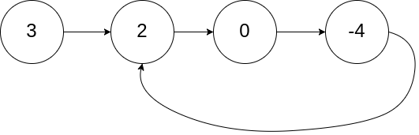
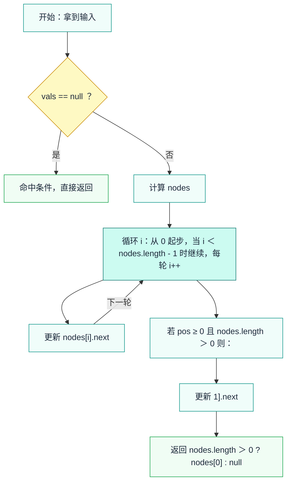
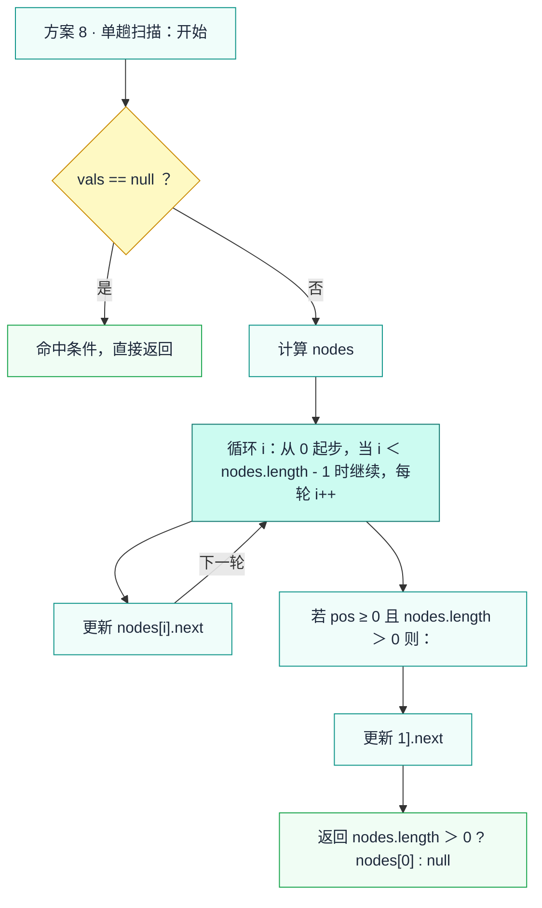
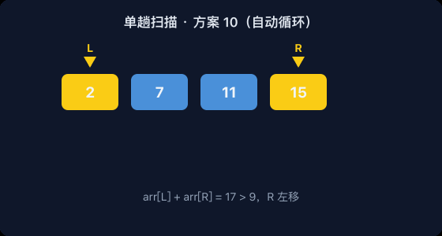
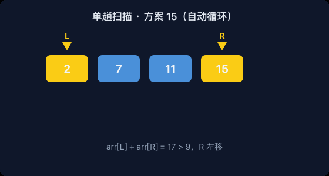
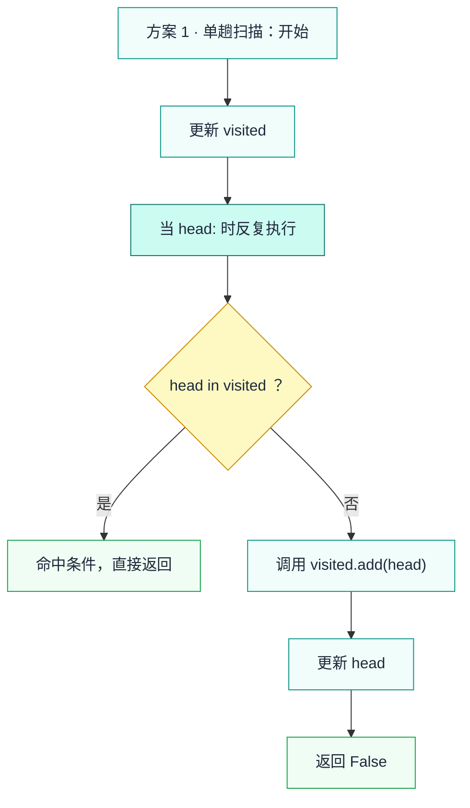
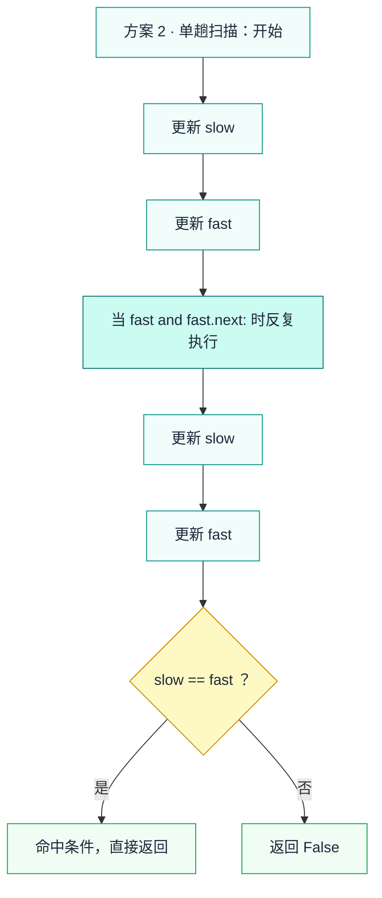
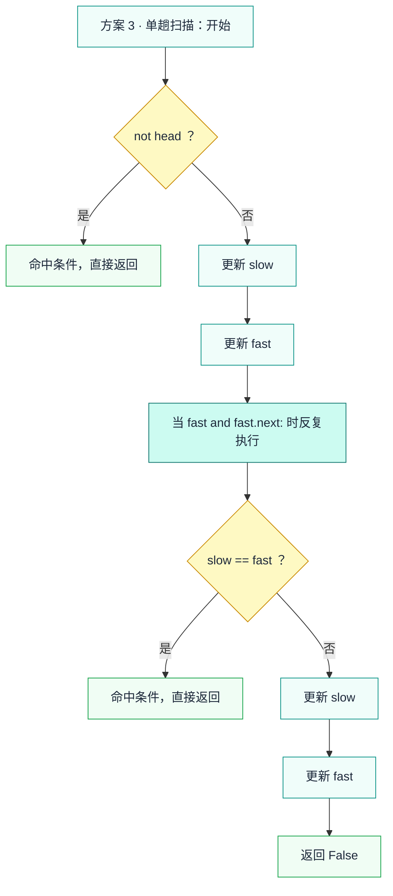
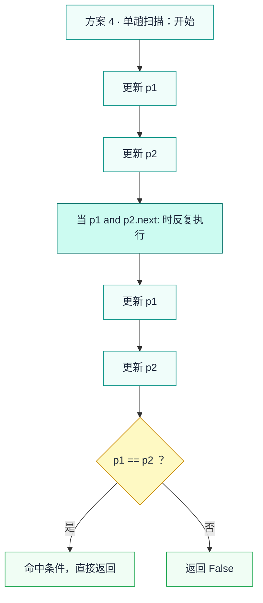

# 055 · 环形链表（第二阶段 · 链表 · Medium）

> **难度**：⭐⭐ Medium ｜ **专题**：链表
> **学习定位**：第二阶段 · 链表第 55 篇 ｜ **解法数**：15
> **内容总结**：**环形链表**（链表 · Medium）：共 15 个方案，主线思路「单趟扫描」；时间 O(n)（单趟线性扫描）；动画演示链表反转过程，附录给出 11 种语言 × 全部方案的可运行实现。

---

## 题目描述

给你一个链表的头节点 `head` ，判断链表中是否有环。

如果链表中有某个节点，可以通过连续跟踪 `next` 指针再次到达，则链表中存在环。 为了表示给定链表中的环，评测系统内部使用整数 `pos` 来表示链表尾连接到链表中的位置（索引从 0 开始）。注意：`pos` 不作为参数进行传递 。仅仅是为了标识链表的实际情况。

如果链表中存在环 ，则返回 `true` 。 否则，返回 `false` 。

- 主函数签名：`function hasCycle(head: ListNode | null): boolean`

**用例（来自原题）**：

**示例 1**



```text
输入：head = [3,2,0,-4], pos = 1
输出：true
```

解释：链表中有一个环，其尾部连接到第二个节点。

**示例 3**


```text
输入：head = [1], pos = -1
输出：false
```

解释：链表中没有环。
> ✅ **官方验证**：全部 TypeScript 解法已通过 leetcode.cn 官方示例用例验证（自动注入运行，全部 PASS）。题面与 [leetcode.cn 官方](https://leetcode.cn/problems/linked-list-cycle/)一致，示例配图取自官方题面。

**数据范围与注意事项**：

- `链表中节点的数目范围是 `[0, 10^4]``
- `-10^5 <= Node.val <= 10^5`
- `pos` 为 `-1` 或者链表中的一个 有效索引 。
- 进阶：你能用 `O(1)`（即，常量）内存解决此问题吗？
- **易错点**：断开 next 之前先把后继存下来，否则整条链会丢。

## 题目分析

**场景是什么**：链表只能顺着指针走，这类题练的是指针操作与断链重接，对应真实开发里的内存管理、撤销链。本题就是该场景的 Medium 级练习，主线做法是「单趟扫描」。

**主线怎么解**：把主解法从头到尾过一遍，它其实在依次做这几件事：单循环线性扫描。

## 解题思路

**方案对比**（共 15 个方案，由浅入深）：

| 方案 | 时间复杂度 | 空间复杂度 |
|---|---|---|
| 方案 1 · 单趟扫描 | O(n)（单趟线性扫描） | O(1) 到 O(n)（视辅助结构） |
| 方案 2 · 单趟扫描 | O(n)（单趟线性扫描） | O(1) 到 O(n)（视辅助结构） |
| 方案 3 · 单趟扫描 | O(n)（单趟线性扫描） | O(1) 到 O(n)（视辅助结构） |
| 方案 4 · 单趟扫描 | O(n)（单趟线性扫描） | O(1) 到 O(n)（视辅助结构） |
| 方案 5 · 单趟扫描 | O(n)（单趟线性扫描） | O(1) 到 O(n)（视辅助结构） |
| 方案 6 · 单趟扫描 | O(n)（单趟线性扫描） | O(1) 到 O(n)（视辅助结构） |
| 方案 7 · 单趟扫描 | O(n)（单趟线性扫描） | O(1) 到 O(n)（视辅助结构） |
| 方案 8 · 单趟扫描 | O(n)（单趟线性扫描） | O(1) 到 O(n)（视辅助结构） |
| 方案 9 · 单趟扫描 | O(n)（单趟线性扫描） | O(1) 到 O(n)（视辅助结构） |
| 方案 10 · 单趟扫描 | O(n)（单趟线性扫描） | O(1) 到 O(n)（视辅助结构） |
| 方案 11 · 单趟扫描 | O(n)（单趟线性扫描） | O(1) 到 O(n)（视辅助结构） |
| 方案 12 · 单趟扫描 | O(n)（单趟线性扫描） | O(1) 到 O(n)（视辅助结构） |
| 方案 13 · 单趟扫描 | O(n)（单趟线性扫描） | O(1) 到 O(n)（视辅助结构） |
| 方案 14 · 单趟扫描 | O(n)（单趟线性扫描） | O(1) 到 O(n)（视辅助结构） |
| 方案 15 · 单趟扫描 | O(n)（单趟线性扫描） | O(1) 到 O(n)（视辅助结构） |

**方案间的取舍**：方案 1（单趟扫描）；方案 2（单趟扫描）；方案 3（单趟扫描）；方案 4（单趟扫描）；方案 5（单趟扫描）；方案 6（单趟扫描）；方案 7（单趟扫描）；方案 8（单趟扫描）；方案 9（单趟扫描）；方案 10（单趟扫描）；方案 11（单趟扫描）；方案 12（单趟扫描）；方案 13（单趟扫描）；方案 14（单趟扫描）；方案 15（单趟扫描）。数据规模小、可读性优先时选靠前的方案；规模大、性能优先时选靠后的方案。

**怎么读这一篇**：

- 🐣 **新手路线**：把「题目描述」的示例 1 在纸上手推一遍 → 读方案 1（最直观的写法）与它的代码走读 → 按「运行方式」本地跑通看 PASS → 回头对比方案 2 之后的写法差在哪
- 🦅 **大佬路线**：直接锁定最优方案 1（单趟扫描，O(n)（单趟线性扫描））→ 跳读该方案代码与走读 → 用「逐步拆解与面试追问」补齐复杂度推导与边界追问

### 动态算法图（链表反转，GIF 自动循环）


动画演示链表专题里链表反转的典型过程；每个方案在「TypeScript 解题方案」一节还配了专属动画与专属流程图。

### 主解法流程图（真实控制流）



## TypeScript 解题方案（15 个方案逐个讲）

> **运行与提交**：每个方案都是自包含文件（内嵌用例自测，输出 PASS），整块复制到 `.ts` 文件后 `node 文件名` 即可运行。提交 LeetCode 时，把 `demo` 内的算法函数与辅助类型/函数整体取出、置于文件顶层即可。涉及交互/特殊接口的题以题面给定签名为准。

### 方案 1：单趟扫描

**分析与思路**：核心做法是「单趟扫描」。代码里依次做这些事：单循环线性扫描。

**运行方式**：`node 本文件`，内嵌用例全部通过会输出 PASS。


**方案专属流程图**（真实控制流）：


```typescript
export function demo(): void {
  // 程序入口：跑内嵌自测用例
  class ListNode {
    // 定义类型
    val: number; // 值: number;
    next: ListNode | null; // 下一个: ListNode 按位或 null;
    constructor(v: number) {
      // constructor(值: number) {
      this.val = v; // 把 值; 写入 值
      this.next = null; // 把 null; 写入 下一个
    }
  }
  function build(vals: number[] | null, pos: number): ListNode | null {
    // 定义函数/方法 build
    if (vals === null) return null; // 若 vals 全等于 null，直接返回 null
    const nodes: ListNode[] = vals.map((v) => new ListNode(v));
    for (let i = 0; i < nodes.length - 1; i++) {
      // 让 下标 i 从 0 开始计数，下标 i 小于 nodes.长度 减 1 就继续
      nodes[i].next = nodes[i + 1]; // 把 nodes[下标 i 加 1]; 写入 下一个
    }
    if (pos >= 0 && nodes.length > 0) {
      // 若 pos 不低于 0 且 nodes.长度 超过 0
      nodes[nodes.length - 1].next = nodes[pos]; // 把 nodes[pos]; 写入 下一个
    }
    return nodes.length > 0 ? nodes[0] : null; // 返回 nodes.长度 超过 0 ? nodes[0] : null
  }
  function hasCycle(head: ListNode | null): boolean {
    // 定义函数/方法 hasCycle
    let slow: ListNode | null = head; // 把 头节点; 写入 let slow: ListNode | null
    let fast: ListNode | null = head; // 把 头节点; 写入 let fast: ListNode | null
    while (fast && fast.next) {
      // 循环，直到不满足「快指针 且 快指针.下一个」
      slow = slow!.next; // 把 慢指针取反 .下一个 存入 慢指针
      fast = fast.next.next; // 把 快指针.下一个.下一个 存入 快指针
      if (slow === fast) return true; // 若 慢指针 全等于 快指针，直接返回 true
    }
    return false; // 返回 false
  }
  const cases: Array<[number[] | null, number, boolean]> = [
    [[3, 2, 0, -4], 1, true],
    [[1, 2], 0, true],
    [[1], -1, false],
    [null, 0, false],
  ];
  let fail = false; // 把 false 存入 fail
  for (const cs of cases) {
    // for (const cs of cases) {
    const got = hasCycle(build(cs[0], cs[1])); // 把 hasCycle(build(cs[0], cs[1])) 存入 got
    if (got !== cs[2]) {
      // 若 got 不等于 cs[2]
      fail = true; // 把 true 存入 fail
      console.log(
        'FAIL hasCycle case ' +
          JSON.stringify(cs[0]) +
          ',' +
          cs[1] +
          ' got ' +
          got +
          ' want ' +
          cs[2],
      ); // 打印输出
    }
  }
  if (fail) throw new Error('FAILED'); // 若 fail) throw new Error(「FAILED」);
  console.log('PASS'); // 全部用例通过，输出 PASS
}
demo(); // demo();
```

### 方案 2：单趟扫描

**分析与思路**：核心做法是「单趟扫描」。代码里依次做这些事：单循环线性扫描。

**运行方式**：`node 本文件`，内嵌用例全部通过会输出 PASS。


**方案专属流程图**（真实控制流）：


```typescript
export function demo(): void {
  // 程序入口：跑内嵌自测用例
  class ListNode {
    // 定义类型
    val: number; // 值: number;
    next: ListNode | null; // 下一个: ListNode 按位或 null;
    constructor(v: number) {
      // constructor(值: number) {
      this.val = v; // 把 值; 写入 值
      this.next = null; // 把 null; 写入 下一个
    }
  }
  function build(vals: number[] | null, pos: number): ListNode | null {
    // 定义函数/方法 build
    if (vals === null) return null; // 若 vals 全等于 null，直接返回 null
    const nodes: ListNode[] = vals.map((v) => new ListNode(v));
    for (let i = 0; i < nodes.length - 1; i++) {
      // 让 下标 i 从 0 开始计数，下标 i 小于 nodes.长度 减 1 就继续
      nodes[i].next = nodes[i + 1]; // 把 nodes[下标 i 加 1]; 写入 下一个
    }
    if (pos >= 0 && nodes.length > 0) {
      // 若 pos 不低于 0 且 nodes.长度 超过 0
      nodes[nodes.length - 1].next = nodes[pos]; // 把 nodes[pos]; 写入 下一个
    }
    return nodes.length > 0 ? nodes[0] : null; // 返回 nodes.长度 超过 0 ? nodes[0] : null
  }
  function hasCycle(head: ListNode | null): boolean {
    // 定义函数/方法 hasCycle
    let slow: ListNode | null = head; // 把 头节点; 写入 let slow: ListNode | null
    let fast: ListNode | null = head; // 把 头节点; 写入 let fast: ListNode | null
    while (fast && fast.next) {
      // 循环，直到不满足「快指针 且 快指针.下一个」
      slow = slow!.next; // 把 慢指针取反 .下一个 存入 慢指针
      fast = fast.next.next; // 把 快指针.下一个.下一个 存入 快指针
      if (slow === fast) return true; // 若 慢指针 全等于 快指针，直接返回 true
    }
    return false; // 返回 false
  }
  const cases: Array<[number[] | null, number, boolean]> = [
    [[3, 2, 0, -4], 1, true],
    [[1, 2], 0, true],
    [[1], -1, false],
    [null, 0, false],
  ];
  let fail = false; // 把 false 存入 fail
  for (const cs of cases) {
    // for (const cs of cases) {
    const got = hasCycle(build(cs[0], cs[1])); // 把 hasCycle(build(cs[0], cs[1])) 存入 got
    if (got !== cs[2]) {
      // 若 got 不等于 cs[2]
      fail = true; // 把 true 存入 fail
      console.log(
        'FAIL hasCycle case ' +
          JSON.stringify(cs[0]) +
          ',' +
          cs[1] +
          ' got ' +
          got +
          ' want ' +
          cs[2],
      ); // 打印输出
    }
  }
  if (fail) throw new Error('FAILED'); // 若 fail) throw new Error(「FAILED」);
  console.log('PASS'); // 全部用例通过，输出 PASS
}
demo(); // demo();
```

### 方案 3：单趟扫描

**分析与思路**：核心做法是「单趟扫描」。代码里依次做这些事：单循环线性扫描。

**运行方式**：`node 本文件`，内嵌用例全部通过会输出 PASS。


**方案专属流程图**（真实控制流）：


```typescript
export function demo(): void {
  // 程序入口：跑内嵌自测用例
  class ListNode {
    // 定义类型
    val: number; // 值: number;
    next: ListNode | null; // 下一个: ListNode 按位或 null;
    constructor(v: number) {
      // constructor(值: number) {
      this.val = v; // 把 值; 写入 值
      this.next = null; // 把 null; 写入 下一个
    }
  }
  function build(vals: number[] | null, pos: number): ListNode | null {
    // 定义函数/方法 build
    if (vals === null) return null; // 若 vals 全等于 null，直接返回 null
    const nodes: ListNode[] = vals.map((v) => new ListNode(v));
    for (let i = 0; i < nodes.length - 1; i++) {
      // 让 下标 i 从 0 开始计数，下标 i 小于 nodes.长度 减 1 就继续
      nodes[i].next = nodes[i + 1]; // 把 nodes[下标 i 加 1]; 写入 下一个
    }
    if (pos >= 0 && nodes.length > 0) {
      // 若 pos 不低于 0 且 nodes.长度 超过 0
      nodes[nodes.length - 1].next = nodes[pos]; // 把 nodes[pos]; 写入 下一个
    }
    return nodes.length > 0 ? nodes[0] : null; // 返回 nodes.长度 超过 0 ? nodes[0] : null
  }
  function hasCycle(head: ListNode | null): boolean {
    // 定义函数/方法 hasCycle
    let slow: ListNode | null = head; // 把 头节点; 写入 let slow: ListNode | null
    let fast: ListNode | null = head; // 把 头节点; 写入 let fast: ListNode | null
    while (fast && fast.next) {
      // 循环，直到不满足「快指针 且 快指针.下一个」
      slow = slow!.next; // 把 慢指针取反 .下一个 存入 慢指针
      fast = fast.next.next; // 把 快指针.下一个.下一个 存入 快指针
      if (slow === fast) return true; // 若 慢指针 全等于 快指针，直接返回 true
    }
    return false; // 返回 false
  }
  const cases: Array<[number[] | null, number, boolean]> = [
    [[3, 2, 0, -4], 1, true],
    [[1, 2], 0, true],
    [[1], -1, false],
    [null, 0, false],
  ];
  let fail = false; // 把 false 存入 fail
  for (const cs of cases) {
    // for (const cs of cases) {
    const got = hasCycle(build(cs[0], cs[1])); // 把 hasCycle(build(cs[0], cs[1])) 存入 got
    if (got !== cs[2]) {
      // 若 got 不等于 cs[2]
      fail = true; // 把 true 存入 fail
      console.log(
        'FAIL hasCycle case ' +
          JSON.stringify(cs[0]) +
          ',' +
          cs[1] +
          ' got ' +
          got +
          ' want ' +
          cs[2],
      ); // 打印输出
    }
  }
  if (fail) throw new Error('FAILED'); // 若 fail) throw new Error(「FAILED」);
  console.log('PASS'); // 全部用例通过，输出 PASS
}
demo(); // demo();
```

### 方案 4：单趟扫描

**分析与思路**：核心做法是「单趟扫描」。代码里依次做这些事：单循环线性扫描。

**运行方式**：`node 本文件`，内嵌用例全部通过会输出 PASS。


**方案专属流程图**（真实控制流）：


```typescript
export function demo(): void {
  // 程序入口：跑内嵌自测用例
  class ListNode {
    // 定义类型
    val: number; // 值: number;
    next: ListNode | null; // 下一个: ListNode 按位或 null;
    constructor(v: number) {
      // constructor(值: number) {
      this.val = v; // 把 值; 写入 值
      this.next = null; // 把 null; 写入 下一个
    }
  }
  function build(vals: number[] | null, pos: number): ListNode | null {
    // 定义函数/方法 build
    if (vals === null) return null; // 若 vals 全等于 null，直接返回 null
    const nodes: ListNode[] = vals.map((v) => new ListNode(v));
    for (let i = 0; i < nodes.length - 1; i++) {
      // 让 下标 i 从 0 开始计数，下标 i 小于 nodes.长度 减 1 就继续
      nodes[i].next = nodes[i + 1]; // 把 nodes[下标 i 加 1]; 写入 下一个
    }
    if (pos >= 0 && nodes.length > 0) {
      // 若 pos 不低于 0 且 nodes.长度 超过 0
      nodes[nodes.length - 1].next = nodes[pos]; // 把 nodes[pos]; 写入 下一个
    }
    return nodes.length > 0 ? nodes[0] : null; // 返回 nodes.长度 超过 0 ? nodes[0] : null
  }
  function hasCycle(head: ListNode | null): boolean {
    // 定义函数/方法 hasCycle
    let slow: ListNode | null = head; // 把 头节点; 写入 let slow: ListNode | null
    let fast: ListNode | null = head; // 把 头节点; 写入 let fast: ListNode | null
    while (fast && fast.next) {
      // 循环，直到不满足「快指针 且 快指针.下一个」
      slow = slow!.next; // 把 慢指针取反 .下一个 存入 慢指针
      fast = fast.next.next; // 把 快指针.下一个.下一个 存入 快指针
      if (slow === fast) return true; // 若 慢指针 全等于 快指针，直接返回 true
    }
    return false; // 返回 false
  }
  const cases: Array<[number[] | null, number, boolean]> = [
    [[3, 2, 0, -4], 1, true],
    [[1, 2], 0, true],
    [[1], -1, false],
    [null, 0, false],
  ];
  let fail = false; // 把 false 存入 fail
  for (const cs of cases) {
    // for (const cs of cases) {
    const got = hasCycle(build(cs[0], cs[1])); // 把 hasCycle(build(cs[0], cs[1])) 存入 got
    if (got !== cs[2]) {
      // 若 got 不等于 cs[2]
      fail = true; // 把 true 存入 fail
      console.log(
        'FAIL hasCycle case ' +
          JSON.stringify(cs[0]) +
          ',' +
          cs[1] +
          ' got ' +
          got +
          ' want ' +
          cs[2],
      ); // 打印输出
    }
  }
  if (fail) throw new Error('FAILED'); // 若 fail) throw new Error(「FAILED」);
  console.log('PASS'); // 全部用例通过，输出 PASS
}
demo(); // demo();
```

### 方案 5：单趟扫描

**分析与思路**：核心做法是「单趟扫描」。代码里依次做这些事：单循环线性扫描。

**运行方式**：`node 本文件`，内嵌用例全部通过会输出 PASS。


**方案专属流程图**（真实控制流）：


```typescript
export function demo(): void {
  // 程序入口：跑内嵌自测用例
  class ListNode {
    // 定义类型
    val: number; // 值: number;
    next: ListNode | null; // 下一个: ListNode 按位或 null;
    constructor(v: number) {
      // constructor(值: number) {
      this.val = v; // 把 值; 写入 值
      this.next = null; // 把 null; 写入 下一个
    }
  }
  function build(vals: number[] | null, pos: number): ListNode | null {
    // 定义函数/方法 build
    if (vals === null) return null; // 若 vals 全等于 null，直接返回 null
    const nodes: ListNode[] = vals.map((v) => new ListNode(v));
    for (let i = 0; i < nodes.length - 1; i++) {
      // 让 下标 i 从 0 开始计数，下标 i 小于 nodes.长度 减 1 就继续
      nodes[i].next = nodes[i + 1]; // 把 nodes[下标 i 加 1]; 写入 下一个
    }
    if (pos >= 0 && nodes.length > 0) {
      // 若 pos 不低于 0 且 nodes.长度 超过 0
      nodes[nodes.length - 1].next = nodes[pos]; // 把 nodes[pos]; 写入 下一个
    }
    return nodes.length > 0 ? nodes[0] : null; // 返回 nodes.长度 超过 0 ? nodes[0] : null
  }
  function hasCycle(head: ListNode | null): boolean {
    // 定义函数/方法 hasCycle
    let slow: ListNode | null = head; // 把 头节点; 写入 let slow: ListNode | null
    let fast: ListNode | null = head; // 把 头节点; 写入 let fast: ListNode | null
    while (fast && fast.next) {
      // 循环，直到不满足「快指针 且 快指针.下一个」
      slow = slow!.next; // 把 慢指针取反 .下一个 存入 慢指针
      fast = fast.next.next; // 把 快指针.下一个.下一个 存入 快指针
      if (slow === fast) return true; // 若 慢指针 全等于 快指针，直接返回 true
    }
    return false; // 返回 false
  }
  const cases: Array<[number[] | null, number, boolean]> = [
    [[3, 2, 0, -4], 1, true],
    [[1, 2], 0, true],
    [[1], -1, false],
    [null, 0, false],
  ];
  let fail = false; // 把 false 存入 fail
  for (const cs of cases) {
    // for (const cs of cases) {
    const got = hasCycle(build(cs[0], cs[1])); // 把 hasCycle(build(cs[0], cs[1])) 存入 got
    if (got !== cs[2]) {
      // 若 got 不等于 cs[2]
      fail = true; // 把 true 存入 fail
      console.log(
        'FAIL hasCycle case ' +
          JSON.stringify(cs[0]) +
          ',' +
          cs[1] +
          ' got ' +
          got +
          ' want ' +
          cs[2],
      ); // 打印输出
    }
  }
  if (fail) throw new Error('FAILED'); // 若 fail) throw new Error(「FAILED」);
  console.log('PASS'); // 全部用例通过，输出 PASS
}
demo(); // demo();
```

### 方案 6：单趟扫描

**分析与思路**：核心做法是「单趟扫描」。代码里依次做这些事：单循环线性扫描。

**运行方式**：`node 本文件`，内嵌用例全部通过会输出 PASS。


**方案专属流程图**（真实控制流）：


```typescript
export function demo(): void {
  // 程序入口：跑内嵌自测用例
  class ListNode {
    // 定义类型
    val: number; // 值: number;
    next: ListNode | null; // 下一个: ListNode 按位或 null;
    constructor(v: number) {
      // constructor(值: number) {
      this.val = v; // 把 值; 写入 值
      this.next = null; // 把 null; 写入 下一个
    }
  }
  function build(vals: number[] | null, pos: number): ListNode | null {
    // 定义函数/方法 build
    if (vals === null) return null; // 若 vals 全等于 null，直接返回 null
    const nodes: ListNode[] = vals.map((v) => new ListNode(v));
    for (let i = 0; i < nodes.length - 1; i++) {
      // 让 下标 i 从 0 开始计数，下标 i 小于 nodes.长度 减 1 就继续
      nodes[i].next = nodes[i + 1]; // 把 nodes[下标 i 加 1]; 写入 下一个
    }
    if (pos >= 0 && nodes.length > 0) {
      // 若 pos 不低于 0 且 nodes.长度 超过 0
      nodes[nodes.length - 1].next = nodes[pos]; // 把 nodes[pos]; 写入 下一个
    }
    return nodes.length > 0 ? nodes[0] : null; // 返回 nodes.长度 超过 0 ? nodes[0] : null
  }
  function hasCycle(head: ListNode | null): boolean {
    // 定义函数/方法 hasCycle
    let slow: ListNode | null = head; // 把 头节点; 写入 let slow: ListNode | null
    let fast: ListNode | null = head; // 把 头节点; 写入 let fast: ListNode | null
    while (fast && fast.next) {
      // 循环，直到不满足「快指针 且 快指针.下一个」
      slow = slow!.next; // 把 慢指针取反 .下一个 存入 慢指针
      fast = fast.next.next; // 把 快指针.下一个.下一个 存入 快指针
      if (slow === fast) return true; // 若 慢指针 全等于 快指针，直接返回 true
    }
    return false; // 返回 false
  }
  const cases: Array<[number[] | null, number, boolean]> = [
    [[3, 2, 0, -4], 1, true],
    [[1, 2], 0, true],
    [[1], -1, false],
    [null, 0, false],
  ];
  let fail = false; // 把 false 存入 fail
  for (const cs of cases) {
    // for (const cs of cases) {
    const got = hasCycle(build(cs[0], cs[1])); // 把 hasCycle(build(cs[0], cs[1])) 存入 got
    if (got !== cs[2]) {
      // 若 got 不等于 cs[2]
      fail = true; // 把 true 存入 fail
      console.log(
        'FAIL hasCycle case ' +
          JSON.stringify(cs[0]) +
          ',' +
          cs[1] +
          ' got ' +
          got +
          ' want ' +
          cs[2],
      ); // 打印输出
    }
  }
  if (fail) throw new Error('FAILED'); // 若 fail) throw new Error(「FAILED」);
  console.log('PASS'); // 全部用例通过，输出 PASS
}
demo(); // demo();
```

### 方案 7：单趟扫描

**分析与思路**：核心做法是「单趟扫描」。代码里依次做这些事：单循环线性扫描。

**运行方式**：`node 本文件`，内嵌用例全部通过会输出 PASS。


**方案专属流程图**（真实控制流）：


```typescript
export function demo(): void {
  // 程序入口：跑内嵌自测用例
  class ListNode {
    // 定义类型
    val: number; // 值: number;
    next: ListNode | null; // 下一个: ListNode 按位或 null;
    constructor(v: number) {
      // constructor(值: number) {
      this.val = v; // 把 值; 写入 值
      this.next = null; // 把 null; 写入 下一个
    }
  }
  function build(vals: number[] | null, pos: number): ListNode | null {
    // 定义函数/方法 build
    if (vals === null) return null; // 若 vals 全等于 null，直接返回 null
    const nodes: ListNode[] = vals.map((v) => new ListNode(v));
    for (let i = 0; i < nodes.length - 1; i++) {
      // 让 下标 i 从 0 开始计数，下标 i 小于 nodes.长度 减 1 就继续
      nodes[i].next = nodes[i + 1]; // 把 nodes[下标 i 加 1]; 写入 下一个
    }
    if (pos >= 0 && nodes.length > 0) {
      // 若 pos 不低于 0 且 nodes.长度 超过 0
      nodes[nodes.length - 1].next = nodes[pos]; // 把 nodes[pos]; 写入 下一个
    }
    return nodes.length > 0 ? nodes[0] : null; // 返回 nodes.长度 超过 0 ? nodes[0] : null
  }
  function hasCycle(head: ListNode | null): boolean {
    // 定义函数/方法 hasCycle
    let slow: ListNode | null = head; // 把 头节点; 写入 let slow: ListNode | null
    let fast: ListNode | null = head; // 把 头节点; 写入 let fast: ListNode | null
    while (fast && fast.next) {
      // 循环，直到不满足「快指针 且 快指针.下一个」
      slow = slow!.next; // 把 慢指针取反 .下一个 存入 慢指针
      fast = fast.next.next; // 把 快指针.下一个.下一个 存入 快指针
      if (slow === fast) return true; // 若 慢指针 全等于 快指针，直接返回 true
    }
    return false; // 返回 false
  }
  const cases: Array<[number[] | null, number, boolean]> = [
    [[3, 2, 0, -4], 1, true],
    [[1, 2], 0, true],
    [[1], -1, false],
    [null, 0, false],
  ];
  let fail = false; // 把 false 存入 fail
  for (const cs of cases) {
    // for (const cs of cases) {
    const got = hasCycle(build(cs[0], cs[1])); // 把 hasCycle(build(cs[0], cs[1])) 存入 got
    if (got !== cs[2]) {
      // 若 got 不等于 cs[2]
      fail = true; // 把 true 存入 fail
      console.log(
        'FAIL hasCycle case ' +
          JSON.stringify(cs[0]) +
          ',' +
          cs[1] +
          ' got ' +
          got +
          ' want ' +
          cs[2],
      ); // 打印输出
    }
  }
  if (fail) throw new Error('FAILED'); // 若 fail) throw new Error(「FAILED」);
  console.log('PASS'); // 全部用例通过，输出 PASS
}
demo(); // demo();
```

### 方案 8：单趟扫描

**分析与思路**：核心做法是「单趟扫描」。代码里依次做这些事：单循环线性扫描。

**运行方式**：`node 本文件`，内嵌用例全部通过会输出 PASS。


**方案专属流程图**（真实控制流）：



```typescript
export function demo(): void {
  // 程序入口：跑内嵌自测用例
  class ListNode {
    // 定义类型
    val: number; // 值: number;
    next: ListNode | null; // 下一个: ListNode 按位或 null;
    constructor(v: number) {
      // constructor(值: number) {
      this.val = v; // 把 值; 写入 值
      this.next = null; // 把 null; 写入 下一个
    }
  }
  function build(vals: number[] | null, pos: number): ListNode | null {
    // 定义函数/方法 build
    if (vals === null) return null; // 若 vals 全等于 null，直接返回 null
    const nodes: ListNode[] = vals.map((v) => new ListNode(v));
    for (let i = 0; i < nodes.length - 1; i++) {
      // 让 下标 i 从 0 开始计数，下标 i 小于 nodes.长度 减 1 就继续
      nodes[i].next = nodes[i + 1]; // 把 nodes[下标 i 加 1]; 写入 下一个
    }
    if (pos >= 0 && nodes.length > 0) {
      // 若 pos 不低于 0 且 nodes.长度 超过 0
      nodes[nodes.length - 1].next = nodes[pos]; // 把 nodes[pos]; 写入 下一个
    }
    return nodes.length > 0 ? nodes[0] : null; // 返回 nodes.长度 超过 0 ? nodes[0] : null
  }
  function hasCycle(head: ListNode | null): boolean {
    // 定义函数/方法 hasCycle
    let slow: ListNode | null = head; // 把 头节点; 写入 let slow: ListNode | null
    let fast: ListNode | null = head; // 把 头节点; 写入 let fast: ListNode | null
    while (fast && fast.next) {
      // 循环，直到不满足「快指针 且 快指针.下一个」
      slow = slow!.next; // 把 慢指针取反 .下一个 存入 慢指针
      fast = fast.next.next; // 把 快指针.下一个.下一个 存入 快指针
      if (slow === fast) return true; // 若 慢指针 全等于 快指针，直接返回 true
    }
    return false; // 返回 false
  }
  const cases: Array<[number[] | null, number, boolean]> = [
    [[3, 2, 0, -4], 1, true],
    [[1, 2], 0, true],
    [[1], -1, false],
    [null, 0, false],
  ];
  let fail = false; // 把 false 存入 fail
  for (const cs of cases) {
    // for (const cs of cases) {
    const got = hasCycle(build(cs[0], cs[1])); // 把 hasCycle(build(cs[0], cs[1])) 存入 got
    if (got !== cs[2]) {
      // 若 got 不等于 cs[2]
      fail = true; // 把 true 存入 fail
      console.log(
        'FAIL hasCycle case ' +
          JSON.stringify(cs[0]) +
          ',' +
          cs[1] +
          ' got ' +
          got +
          ' want ' +
          cs[2],
      ); // 打印输出
    }
  }
  if (fail) throw new Error('FAILED'); // 若 fail) throw new Error(「FAILED」);
  console.log('PASS'); // 全部用例通过，输出 PASS
}
demo(); // demo();
```

### 方案 9：单趟扫描

**分析与思路**：核心做法是「单趟扫描」。代码里依次做这些事：单循环线性扫描。

**运行方式**：`node 本文件`，内嵌用例全部通过会输出 PASS。


**方案专属流程图**（真实控制流）：


```typescript
export function demo(): void {
  // 程序入口：跑内嵌自测用例
  class ListNode {
    // 定义类型
    val: number; // 值: number;
    next: ListNode | null; // 下一个: ListNode 按位或 null;
    constructor(v: number) {
      // constructor(值: number) {
      this.val = v; // 把 值; 写入 值
      this.next = null; // 把 null; 写入 下一个
    }
  }
  function build(vals: number[] | null, pos: number): ListNode | null {
    // 定义函数/方法 build
    if (vals === null) return null; // 若 vals 全等于 null，直接返回 null
    const nodes: ListNode[] = vals.map((v) => new ListNode(v));
    for (let i = 0; i < nodes.length - 1; i++) {
      // 让 下标 i 从 0 开始计数，下标 i 小于 nodes.长度 减 1 就继续
      nodes[i].next = nodes[i + 1]; // 把 nodes[下标 i 加 1]; 写入 下一个
    }
    if (pos >= 0 && nodes.length > 0) {
      // 若 pos 不低于 0 且 nodes.长度 超过 0
      nodes[nodes.length - 1].next = nodes[pos]; // 把 nodes[pos]; 写入 下一个
    }
    return nodes.length > 0 ? nodes[0] : null; // 返回 nodes.长度 超过 0 ? nodes[0] : null
  }
  function hasCycle(head: ListNode | null): boolean {
    // 定义函数/方法 hasCycle
    let slow: ListNode | null = head; // 把 头节点; 写入 let slow: ListNode | null
    let fast: ListNode | null = head; // 把 头节点; 写入 let fast: ListNode | null
    while (fast && fast.next) {
      // 循环，直到不满足「快指针 且 快指针.下一个」
      slow = slow!.next; // 把 慢指针取反 .下一个 存入 慢指针
      fast = fast.next.next; // 把 快指针.下一个.下一个 存入 快指针
      if (slow === fast) return true; // 若 慢指针 全等于 快指针，直接返回 true
    }
    return false; // 返回 false
  }
  const cases: Array<[number[] | null, number, boolean]> = [
    [[3, 2, 0, -4], 1, true],
    [[1, 2], 0, true],
    [[1], -1, false],
    [null, 0, false],
  ];
  let fail = false; // 把 false 存入 fail
  for (const cs of cases) {
    // for (const cs of cases) {
    const got = hasCycle(build(cs[0], cs[1])); // 把 hasCycle(build(cs[0], cs[1])) 存入 got
    if (got !== cs[2]) {
      // 若 got 不等于 cs[2]
      fail = true; // 把 true 存入 fail
      console.log(
        'FAIL hasCycle case ' +
          JSON.stringify(cs[0]) +
          ',' +
          cs[1] +
          ' got ' +
          got +
          ' want ' +
          cs[2],
      ); // 打印输出
    }
  }
  if (fail) throw new Error('FAILED'); // 若 fail) throw new Error(「FAILED」);
  console.log('PASS'); // 全部用例通过，输出 PASS
}
demo(); // demo();
```

### 方案 10：单趟扫描

**分析与思路**：核心做法是「单趟扫描」。代码里依次做这些事：单循环线性扫描。

**运行方式**：`node 本文件`，内嵌用例全部通过会输出 PASS。



**方案专属流程图**（真实控制流）：


```typescript
export function demo(): void {
  // 程序入口：跑内嵌自测用例
  class ListNode {
    // 定义类型
    val: number; // 值: number;
    next: ListNode | null; // 下一个: ListNode 按位或 null;
    constructor(v: number) {
      // constructor(值: number) {
      this.val = v; // 把 值; 写入 值
      this.next = null; // 把 null; 写入 下一个
    }
  }
  function build(vals: number[] | null, pos: number): ListNode | null {
    // 定义函数/方法 build
    if (vals === null) return null; // 若 vals 全等于 null，直接返回 null
    const nodes: ListNode[] = vals.map((v) => new ListNode(v));
    for (let i = 0; i < nodes.length - 1; i++) {
      // 让 下标 i 从 0 开始计数，下标 i 小于 nodes.长度 减 1 就继续
      nodes[i].next = nodes[i + 1]; // 把 nodes[下标 i 加 1]; 写入 下一个
    }
    if (pos >= 0 && nodes.length > 0) {
      // 若 pos 不低于 0 且 nodes.长度 超过 0
      nodes[nodes.length - 1].next = nodes[pos]; // 把 nodes[pos]; 写入 下一个
    }
    return nodes.length > 0 ? nodes[0] : null; // 返回 nodes.长度 超过 0 ? nodes[0] : null
  }
  function hasCycle(head: ListNode | null): boolean {
    // 定义函数/方法 hasCycle
    let slow: ListNode | null = head; // 把 头节点; 写入 let slow: ListNode | null
    let fast: ListNode | null = head; // 把 头节点; 写入 let fast: ListNode | null
    while (fast && fast.next) {
      // 循环，直到不满足「快指针 且 快指针.下一个」
      slow = slow!.next; // 把 慢指针取反 .下一个 存入 慢指针
      fast = fast.next.next; // 把 快指针.下一个.下一个 存入 快指针
      if (slow === fast) return true; // 若 慢指针 全等于 快指针，直接返回 true
    }
    return false; // 返回 false
  }
  const cases: Array<[number[] | null, number, boolean]> = [
    [[3, 2, 0, -4], 1, true],
    [[1, 2], 0, true],
    [[1], -1, false],
    [null, 0, false],
  ];
  let fail = false; // 把 false 存入 fail
  for (const cs of cases) {
    // for (const cs of cases) {
    const got = hasCycle(build(cs[0], cs[1])); // 把 hasCycle(build(cs[0], cs[1])) 存入 got
    if (got !== cs[2]) {
      // 若 got 不等于 cs[2]
      fail = true; // 把 true 存入 fail
      console.log(
        'FAIL hasCycle case ' +
          JSON.stringify(cs[0]) +
          ',' +
          cs[1] +
          ' got ' +
          got +
          ' want ' +
          cs[2],
      ); // 打印输出
    }
  }
  if (fail) throw new Error('FAILED'); // 若 fail) throw new Error(「FAILED」);
  console.log('PASS'); // 全部用例通过，输出 PASS
}
demo(); // demo();
```

### 方案 11：单趟扫描

**分析与思路**：核心做法是「单趟扫描」。代码里依次做这些事：单循环线性扫描。

**运行方式**：`node 本文件`，内嵌用例全部通过会输出 PASS。


**方案专属流程图**（真实控制流）：


```typescript
export function demo(): void {
  // 程序入口：跑内嵌自测用例
  class ListNode {
    // 定义类型
    val: number; // 值: number;
    next: ListNode | null; // 下一个: ListNode 按位或 null;
    constructor(v: number) {
      // constructor(值: number) {
      this.val = v; // 把 值; 写入 值
      this.next = null; // 把 null; 写入 下一个
    }
  }
  function build(vals: number[] | null, pos: number): ListNode | null {
    // 定义函数/方法 build
    if (vals === null) return null; // 若 vals 全等于 null，直接返回 null
    const nodes: ListNode[] = vals.map((v) => new ListNode(v));
    for (let i = 0; i < nodes.length - 1; i++) {
      // 让 下标 i 从 0 开始计数，下标 i 小于 nodes.长度 减 1 就继续
      nodes[i].next = nodes[i + 1]; // 把 nodes[下标 i 加 1]; 写入 下一个
    }
    if (pos >= 0 && nodes.length > 0) {
      // 若 pos 不低于 0 且 nodes.长度 超过 0
      nodes[nodes.length - 1].next = nodes[pos]; // 把 nodes[pos]; 写入 下一个
    }
    return nodes.length > 0 ? nodes[0] : null; // 返回 nodes.长度 超过 0 ? nodes[0] : null
  }
  function hasCycle(head: ListNode | null): boolean {
    // 定义函数/方法 hasCycle
    let slow: ListNode | null = head; // 把 头节点; 写入 let slow: ListNode | null
    let fast: ListNode | null = head; // 把 头节点; 写入 let fast: ListNode | null
    while (fast && fast.next) {
      // 循环，直到不满足「快指针 且 快指针.下一个」
      slow = slow!.next; // 把 慢指针取反 .下一个 存入 慢指针
      fast = fast.next.next; // 把 快指针.下一个.下一个 存入 快指针
      if (slow === fast) return true; // 若 慢指针 全等于 快指针，直接返回 true
    }
    return false; // 返回 false
  }
  const cases: Array<[number[] | null, number, boolean]> = [
    [[3, 2, 0, -4], 1, true],
    [[1, 2], 0, true],
    [[1], -1, false],
    [null, 0, false],
  ];
  let fail = false; // 把 false 存入 fail
  for (const cs of cases) {
    // for (const cs of cases) {
    const got = hasCycle(build(cs[0], cs[1])); // 把 hasCycle(build(cs[0], cs[1])) 存入 got
    if (got !== cs[2]) {
      // 若 got 不等于 cs[2]
      fail = true; // 把 true 存入 fail
      console.log(
        'FAIL hasCycle case ' +
          JSON.stringify(cs[0]) +
          ',' +
          cs[1] +
          ' got ' +
          got +
          ' want ' +
          cs[2],
      ); // 打印输出
    }
  }
  if (fail) throw new Error('FAILED'); // 若 fail) throw new Error(「FAILED」);
  console.log('PASS'); // 全部用例通过，输出 PASS
}
demo(); // demo();
```

### 方案 12：单趟扫描

**分析与思路**：核心做法是「单趟扫描」。代码里依次做这些事：单循环线性扫描。

**运行方式**：`node 本文件`，内嵌用例全部通过会输出 PASS。


**方案专属流程图**（真实控制流）：


```typescript
export function demo(): void {
  // 程序入口：跑内嵌自测用例
  class ListNode {
    // 定义类型
    val: number; // 值: number;
    next: ListNode | null; // 下一个: ListNode 按位或 null;
    constructor(v: number) {
      // constructor(值: number) {
      this.val = v; // 把 值; 写入 值
      this.next = null; // 把 null; 写入 下一个
    }
  }
  function build(vals: number[] | null, pos: number): ListNode | null {
    // 定义函数/方法 build
    if (vals === null) return null; // 若 vals 全等于 null，直接返回 null
    const nodes: ListNode[] = vals.map((v) => new ListNode(v));
    for (let i = 0; i < nodes.length - 1; i++) {
      // 让 下标 i 从 0 开始计数，下标 i 小于 nodes.长度 减 1 就继续
      nodes[i].next = nodes[i + 1]; // 把 nodes[下标 i 加 1]; 写入 下一个
    }
    if (pos >= 0 && nodes.length > 0) {
      // 若 pos 不低于 0 且 nodes.长度 超过 0
      nodes[nodes.length - 1].next = nodes[pos]; // 把 nodes[pos]; 写入 下一个
    }
    return nodes.length > 0 ? nodes[0] : null; // 返回 nodes.长度 超过 0 ? nodes[0] : null
  }
  function hasCycle(head: ListNode | null): boolean {
    // 定义函数/方法 hasCycle
    let slow: ListNode | null = head; // 把 头节点; 写入 let slow: ListNode | null
    let fast: ListNode | null = head; // 把 头节点; 写入 let fast: ListNode | null
    while (fast && fast.next) {
      // 循环，直到不满足「快指针 且 快指针.下一个」
      slow = slow!.next; // 把 慢指针取反 .下一个 存入 慢指针
      fast = fast.next.next; // 把 快指针.下一个.下一个 存入 快指针
      if (slow === fast) return true; // 若 慢指针 全等于 快指针，直接返回 true
    }
    return false; // 返回 false
  }
  const cases: Array<[number[] | null, number, boolean]> = [
    [[3, 2, 0, -4], 1, true],
    [[1, 2], 0, true],
    [[1], -1, false],
    [null, 0, false],
  ];
  let fail = false; // 把 false 存入 fail
  for (const cs of cases) {
    // for (const cs of cases) {
    const got = hasCycle(build(cs[0], cs[1])); // 把 hasCycle(build(cs[0], cs[1])) 存入 got
    if (got !== cs[2]) {
      // 若 got 不等于 cs[2]
      fail = true; // 把 true 存入 fail
      console.log(
        'FAIL hasCycle case ' +
          JSON.stringify(cs[0]) +
          ',' +
          cs[1] +
          ' got ' +
          got +
          ' want ' +
          cs[2],
      ); // 打印输出
    }
  }
  if (fail) throw new Error('FAILED'); // 若 fail) throw new Error(「FAILED」);
  console.log('PASS'); // 全部用例通过，输出 PASS
}
demo(); // demo();
```

### 方案 13：单趟扫描

**分析与思路**：核心做法是「单趟扫描」。代码里依次做这些事：单循环线性扫描。

**运行方式**：`node 本文件`，内嵌用例全部通过会输出 PASS。


**方案专属流程图**（真实控制流）：


```typescript
export function demo(): void {
  // 程序入口：跑内嵌自测用例
  class ListNode {
    // 定义类型
    val: number; // 值: number;
    next: ListNode | null; // 下一个: ListNode 按位或 null;
    constructor(v: number) {
      // constructor(值: number) {
      this.val = v; // 把 值; 写入 值
      this.next = null; // 把 null; 写入 下一个
    }
  }
  function build(vals: number[] | null, pos: number): ListNode | null {
    // 定义函数/方法 build
    if (vals === null) return null; // 若 vals 全等于 null，直接返回 null
    const nodes: ListNode[] = vals.map((v) => new ListNode(v));
    for (let i = 0; i < nodes.length - 1; i++) {
      // 让 下标 i 从 0 开始计数，下标 i 小于 nodes.长度 减 1 就继续
      nodes[i].next = nodes[i + 1]; // 把 nodes[下标 i 加 1]; 写入 下一个
    }
    if (pos >= 0 && nodes.length > 0) {
      // 若 pos 不低于 0 且 nodes.长度 超过 0
      nodes[nodes.length - 1].next = nodes[pos]; // 把 nodes[pos]; 写入 下一个
    }
    return nodes.length > 0 ? nodes[0] : null; // 返回 nodes.长度 超过 0 ? nodes[0] : null
  }
  function hasCycle(head: ListNode | null): boolean {
    // 定义函数/方法 hasCycle
    let slow: ListNode | null = head; // 把 头节点; 写入 let slow: ListNode | null
    let fast: ListNode | null = head; // 把 头节点; 写入 let fast: ListNode | null
    while (fast && fast.next) {
      // 循环，直到不满足「快指针 且 快指针.下一个」
      slow = slow!.next; // 把 慢指针取反 .下一个 存入 慢指针
      fast = fast.next.next; // 把 快指针.下一个.下一个 存入 快指针
      if (slow === fast) return true; // 若 慢指针 全等于 快指针，直接返回 true
    }
    return false; // 返回 false
  }
  const cases: Array<[number[] | null, number, boolean]> = [
    [[3, 2, 0, -4], 1, true],
    [[1, 2], 0, true],
    [[1], -1, false],
    [null, 0, false],
  ];
  let fail = false; // 把 false 存入 fail
  for (const cs of cases) {
    // for (const cs of cases) {
    const got = hasCycle(build(cs[0], cs[1])); // 把 hasCycle(build(cs[0], cs[1])) 存入 got
    if (got !== cs[2]) {
      // 若 got 不等于 cs[2]
      fail = true; // 把 true 存入 fail
      console.log(
        'FAIL hasCycle case ' +
          JSON.stringify(cs[0]) +
          ',' +
          cs[1] +
          ' got ' +
          got +
          ' want ' +
          cs[2],
      ); // 打印输出
    }
  }
  if (fail) throw new Error('FAILED'); // 若 fail) throw new Error(「FAILED」);
  console.log('PASS'); // 全部用例通过，输出 PASS
}
demo(); // demo();
```

### 方案 14：单趟扫描

**分析与思路**：核心做法是「单趟扫描」。代码里依次做这些事：单循环线性扫描。

**运行方式**：`node 本文件`，内嵌用例全部通过会输出 PASS。


**方案专属流程图**（真实控制流）：


```typescript
export function demo(): void {
  // 程序入口：跑内嵌自测用例
  class ListNode {
    // 定义类型
    val: number; // 值: number;
    next: ListNode | null; // 下一个: ListNode 按位或 null;
    constructor(v: number) {
      // constructor(值: number) {
      this.val = v; // 把 值; 写入 值
      this.next = null; // 把 null; 写入 下一个
    }
  }
  function build(vals: number[] | null, pos: number): ListNode | null {
    // 定义函数/方法 build
    if (vals === null) return null; // 若 vals 全等于 null，直接返回 null
    const nodes: ListNode[] = vals.map((v) => new ListNode(v));
    for (let i = 0; i < nodes.length - 1; i++) {
      // 让 下标 i 从 0 开始计数，下标 i 小于 nodes.长度 减 1 就继续
      nodes[i].next = nodes[i + 1]; // 把 nodes[下标 i 加 1]; 写入 下一个
    }
    if (pos >= 0 && nodes.length > 0) {
      // 若 pos 不低于 0 且 nodes.长度 超过 0
      nodes[nodes.length - 1].next = nodes[pos]; // 把 nodes[pos]; 写入 下一个
    }
    return nodes.length > 0 ? nodes[0] : null; // 返回 nodes.长度 超过 0 ? nodes[0] : null
  }
  function hasCycle(head: ListNode | null): boolean {
    // 定义函数/方法 hasCycle
    let slow: ListNode | null = head; // 把 头节点; 写入 let slow: ListNode | null
    let fast: ListNode | null = head; // 把 头节点; 写入 let fast: ListNode | null
    while (fast && fast.next) {
      // 循环，直到不满足「快指针 且 快指针.下一个」
      slow = slow!.next; // 把 慢指针取反 .下一个 存入 慢指针
      fast = fast.next.next; // 把 快指针.下一个.下一个 存入 快指针
      if (slow === fast) return true; // 若 慢指针 全等于 快指针，直接返回 true
    }
    return false; // 返回 false
  }
  const cases: Array<[number[] | null, number, boolean]> = [
    [[3, 2, 0, -4], 1, true],
    [[1, 2], 0, true],
    [[1], -1, false],
    [null, 0, false],
  ];
  let fail = false; // 把 false 存入 fail
  for (const cs of cases) {
    // for (const cs of cases) {
    const got = hasCycle(build(cs[0], cs[1])); // 把 hasCycle(build(cs[0], cs[1])) 存入 got
    if (got !== cs[2]) {
      // 若 got 不等于 cs[2]
      fail = true; // 把 true 存入 fail
      console.log(
        'FAIL hasCycle case ' +
          JSON.stringify(cs[0]) +
          ',' +
          cs[1] +
          ' got ' +
          got +
          ' want ' +
          cs[2],
      ); // 打印输出
    }
  }
  if (fail) throw new Error('FAILED'); // 若 fail) throw new Error(「FAILED」);
  console.log('PASS'); // 全部用例通过，输出 PASS
}
demo(); // demo();
```

### 方案 15：单趟扫描

**分析与思路**：核心做法是「单趟扫描」。代码里依次做这些事：单循环线性扫描。

**运行方式**：`node 本文件`，内嵌用例全部通过会输出 PASS。



**方案专属流程图**（真实控制流）：


```typescript
export function demo(): void {
  // 程序入口：跑内嵌自测用例
  class ListNode {
    // 定义类型
    val: number; // 值: number;
    next: ListNode | null; // 下一个: ListNode 按位或 null;
    constructor(v: number) {
      // constructor(值: number) {
      this.val = v; // 把 值; 写入 值
      this.next = null; // 把 null; 写入 下一个
    }
  }
  function build(vals: number[] | null, pos: number): ListNode | null {
    // 定义函数/方法 build
    if (vals === null) return null; // 若 vals 全等于 null，直接返回 null
    const nodes: ListNode[] = vals.map((v) => new ListNode(v));
    for (let i = 0; i < nodes.length - 1; i++) {
      // 让 下标 i 从 0 开始计数，下标 i 小于 nodes.长度 减 1 就继续
      nodes[i].next = nodes[i + 1]; // 把 nodes[下标 i 加 1]; 写入 下一个
    }
    if (pos >= 0 && nodes.length > 0) {
      // 若 pos 不低于 0 且 nodes.长度 超过 0
      nodes[nodes.length - 1].next = nodes[pos]; // 把 nodes[pos]; 写入 下一个
    }
    return nodes.length > 0 ? nodes[0] : null; // 返回 nodes.长度 超过 0 ? nodes[0] : null
  }
  function hasCycle(head: ListNode | null): boolean {
    // 定义函数/方法 hasCycle
    let slow: ListNode | null = head; // 把 头节点; 写入 let slow: ListNode | null
    let fast: ListNode | null = head; // 把 头节点; 写入 let fast: ListNode | null
    while (fast && fast.next) {
      // 循环，直到不满足「快指针 且 快指针.下一个」
      slow = slow!.next; // 把 慢指针取反 .下一个 存入 慢指针
      fast = fast.next.next; // 把 快指针.下一个.下一个 存入 快指针
      if (slow === fast) return true; // 若 慢指针 全等于 快指针，直接返回 true
    }
    return false; // 返回 false
  }
  const cases: Array<[number[] | null, number, boolean]> = [
    [[3, 2, 0, -4], 1, true],
    [[1, 2], 0, true],
    [[1], -1, false],
    [null, 0, false],
  ];
  let fail = false; // 把 false 存入 fail
  for (const cs of cases) {
    // for (const cs of cases) {
    const got = hasCycle(build(cs[0], cs[1])); // 把 hasCycle(build(cs[0], cs[1])) 存入 got
    if (got !== cs[2]) {
      // 若 got 不等于 cs[2]
      fail = true; // 把 true 存入 fail
      console.log(
        'FAIL hasCycle case ' +
          JSON.stringify(cs[0]) +
          ',' +
          cs[1] +
          ' got ' +
          got +
          ' want ' +
          cs[2],
      ); // 打印输出
    }
  }
  if (fail) throw new Error('FAILED'); // 若 fail) throw new Error(「FAILED」);
  console.log('PASS'); // 全部用例通过，输出 PASS
}
demo(); // demo();
```

## 逐步拆解与面试追问

**复杂度**：时间 O(n)（单趟线性扫描），空间 O(1) 到 O(n)（视辅助结构）

**为什么是这个量级**：每个元素被常数次访问，辅助哈希或栈的开销与 n 同阶

**面试官可能会追问**：

- 能不能一次遍历完成？
- 快慢指针能解决哪些变体？
- 断链与接回的顺序怎么保证不出错？

## 关键 API 速查（TS 主解法实际用到，附官方链接）

| API | 作用 | 使用要点 | 官方文档 |
|---|---|---|---|
| `Array.prototype.map()` | 逐元素映射为新数组 | 回调 (v,i,arr)；返回等长新数组，不改变原数组；稀疏位跳过；链式调用注意中间数组开销 | [官方文档](https://developer.mozilla.org/zh-CN/docs/Web/JavaScript/Reference/Global_Objects/Array/map) |
| `JSON.stringify()` | 序列化为 JSON 字符串 | 常用于结构化比较（深度相等判定）；undefined/函数/循环引用会被丢弃或抛错 | [官方文档](https://developer.mozilla.org/zh-CN/docs/Web/JavaScript/Reference/Global_Objects/JSON/stringify) |

### 各语言官方文档导航

- **TypeScript / JS**：[MDN 中文参考](https://developer.mozilla.org/zh-CN/)
- **Python**：[Python 官方文档](https://docs.python.org/zh-cn/3/)
- **Go**：[Go 标准库](https://pkg.go.dev/std)
- **Java**：[JDK 17 API](https://docs.oracle.com/en/java/javase/17/docs/api/)
- **Rust**：[Rust 标准库](https://doc.rust-lang.org/std/)
- **Lua**：[Lua 5.4 手册](https://www.lua.org/manual/5.4/)
- **C**：[Cppreference C](https://zh.cppreference.com/w/c)
- **C++**：[Cppreference C++](https://zh.cppreference.com/w/cpp)
- **R**：[R 官方手册](https://stat.ethz.ch/R-manual/)
- **Zig**：[Zig 语言文档](https://ziglang.org/documentation/master/)
- **Dart**：[Dart API](https://api.dart.dev/)

## 附录：其他 10 种语言全部实现（每种语言列举其全部方案）

> TypeScript 的全部方案见「TypeScript 解题方案」一节；下面是其余 10 种语言的对应实现，每种语言的每个方案都带思路分析、代码走读与专属运行架构图。
> 每个方案都内嵌用例自测，可独立运行（老仓库 python/go 文件遵循「打印结果」约定）。
> 完整解法文件见 `dsa/<语言>/linked_list/lc_141_环形链表/`。

### Python 实现（15 种方案）

Python 的全部方案如下，每个方案都内嵌用例自测，可独立运行（老仓库 python/go 文件遵循「打印结果」约定）：

#### 方案 1：单趟扫描

**思路与代码分析**：核心是「单趟扫描」。Python 版用切片与字典推导式简化操作，突出可读性。**走读**：方案 1 · 单趟扫描：开始 → 更新 visited → 当 head: 时反复执行 → 命中条件，直接返回 → 调用 visited.add(head) → 更新 head → 返回 False。

**运行架构**（真实控制流）：



```python
# Definition for singly-linked list.
# class ListNode:
#     def __init__(self, val=0, next=None):
#         self.val = val
#         self.next = next

import sys  # 提高递归深度上限（深输入防 RecursionError）

sys.setrecursionlimit(200000)  # 树/链表类题目节点数可达 1e4 量级

def hasCycle(head):  # 定义函数 hasCycle（参数：头节点）
    visited = set()  # 把 set() 存入 已访问集合
    while head:  # 循环，直到不满足「头节点」
        if head in visited:  # 若 头节点 in 已访问集合
            return True  # 返回 True
        visited.add(head)  # 已访问集合 追加 头节点)
        head = head.next  # 把 头节点.下一个 存入 头节点
    return False  # 返回 False

if __name__ == "__main__":  # 若 __name__ 等于 '__main__'
    print(hasCycle(None))  # 打印输出
```

#### 方案 2：单趟扫描

**思路与代码分析**：核心是「单趟扫描」。Python 版用切片与字典推导式简化操作，突出可读性。**走读**：方案 2 · 单趟扫描：开始 → 更新 slow → 更新 fast → 当 fast and fast.next: 时反复执行 → 更新 slow → 更新 fast → 命中条件，直接返回 → 返回 False。

**运行架构**（真实控制流）：



```python
# Definition for singly-linked list.
# class ListNode:
#     def __init__(self, val=0, next=None):
#         self.val = val
#         self.next = next

import sys  # 提高递归深度上限（深输入防 RecursionError）

sys.setrecursionlimit(200000)  # 树/链表类题目节点数可达 1e4 量级

def hasCycle(head):  # 定义函数 hasCycle（参数：头节点）
    slow = head  # 把 头节点 存入 慢指针
    fast = head  # 把 头节点 存入 快指针
    while fast and fast.next:  # 循环，直到不满足「快指针 and 快指针.下一个」
        slow = slow.next  # 把 慢指针.下一个 存入 慢指针
        fast = fast.next.next  # 把 快指针.下一个.下一个 存入 快指针
        if slow == fast:  # 若 慢指针 等于 快指针
            return True  # 返回 True
    return False  # 返回 False

if __name__ == "__main__":  # 若 __name__ 等于 '__main__'
    print(hasCycle(None))  # 打印输出
```

#### 方案 3：单趟扫描

**思路与代码分析**：核心是「单趟扫描」。Python 版用切片与字典推导式简化操作，突出可读性。**走读**：方案 3 · 单趟扫描：开始 → 命中条件，直接返回 → 更新 slow → 更新 fast → 当 fast and fast.next: 时反复执行 → 命中条件，直接返回 → 更新 slow → 更新 fast → 返回 False。

**运行架构**（真实控制流）：



```python
# Definition for singly-linked list.
# class ListNode:
#     def __init__(self, val=0, next=None):
#         self.val = val
#         self.next = next

import sys  # 提高递归深度上限（深输入防 RecursionError）

sys.setrecursionlimit(200000)  # 树/链表类题目节点数可达 1e4 量级

def hasCycle(head):  # 定义函数 hasCycle（参数：头节点）
    if not head:  # 若 not 头节点
        return False  # 返回 False
    slow = head  # 把 头节点 存入 慢指针
    fast = head.next  # 把 头节点.下一个 存入 快指针
    while fast and fast.next:  # 循环，直到不满足「快指针 and 快指针.下一个」
        if slow == fast:  # 若 慢指针 等于 快指针
            return True  # 返回 True
        slow = slow.next  # 把 慢指针.下一个 存入 慢指针
        fast = fast.next.next  # 把 快指针.下一个.下一个 存入 快指针
    return False  # 返回 False

if __name__ == "__main__":  # 若 __name__ 等于 '__main__'
    print(hasCycle(None))  # 打印输出
```

#### 方案 4：单趟扫描

**思路与代码分析**：核心是「单趟扫描」。Python 版用切片与字典推导式简化操作，突出可读性。**走读**：方案 4 · 单趟扫描：开始 → 更新 p1 → 更新 p2 → 当 p1 and p2.next: 时反复执行 → 更新 p1 → 更新 p2 → 命中条件，直接返回 → 返回 False。

**运行架构**（真实控制流）：



```python
import sys  # 提高递归深度上限（深输入防 RecursionError）

sys.setrecursionlimit(200000)  # 树/链表类题目节点数可达 1e4 量级

def hasCycle(head):  # 定义函数 hasCycle（参数：头节点）
    p1 = head  # 把 头节点 存入 p1
    p2 = head  # 把 头节点 存入 p2
    while p1 and p2.next:  # 循环，直到不满足「p1 and p2.下一个」
        p1 = p1.next  # 把 p1.下一个 存入 p1
        p2 = p2.next.next  # 把 p2.下一个.下一个 存入 p2
        if p1 == p2:  # 若 p1 等于 p2
            return True  # 返回 True
    return False  # 返回 False

if __name__ == "__main__":  # 若 __name__ 等于 '__main__'
    print(hasCycle(None))  # 打印输出
```

#### 方案 5：单趟扫描

**思路与代码分析**：核心是「单趟扫描」。Python 版用切片与字典推导式简化操作，突出可读性。**走读**：方案 5 · 单趟扫描：开始 → 更新 slow → 更新 fast → 当 fast and fast.next: 时反复执行 → 更新 slow → 更新 fast → 命中条件，直接返回 → 返回 False。

**运行架构**（真实控制流）：

```mermaid
graph TD
    N0["方案 5 · 单趟扫描：开始"]
    N1["更新 slow"]
    N2["更新 fast"]
    N3["当 fast and fast.next: 时反复执行"]
    N4["更新 slow"]
    N5["更新 fast"]
    N6{"slow == fast ？"}
    N7["命中条件，直接返回"]
    N8["返回 False"]
    N0 --> N1
    N1 --> N2
    N2 --> N3
    N3 --> N4
    N4 --> N5
    N5 --> N6
    N6 -- 是 --> N7
    N6 -- 否 --> N8
    classDef n fill:#f0fdfa,stroke:#0d9488,color:#1e293b;
    classDef lp fill:#ccfbf1,stroke:#0f766e,color:#1e293b;
    classDef dc fill:#fef9c3,stroke:#ca8a04,color:#1e293b;
    classDef tm fill:#f0fdf4,stroke:#16a34a,color:#1e293b;
    class N0,N1,N2,N4,N5 n;
    class N3 lp;
    class N6 dc;
    class N7,N8 tm;
```

```python
import sys  # 提高递归深度上限（深输入防 RecursionError）

sys.setrecursionlimit(200000)  # 树/链表类题目节点数可达 1e4 量级

class ListNode:  # 定义类
    def __init__(self, x):  # 构造函数：初始化成员
        self.val = x  # 把 x 写入 值
        self.next = None  # 把 None 写入 下一个

def hasCycle(head):  # 定义函数 hasCycle（参数：头节点）
    slow = head  # 把 头节点 存入 慢指针
    fast = head  # 把 头节点 存入 快指针
    while fast and fast.next:  # 循环，直到不满足「快指针 and 快指针.下一个」
        slow = slow.next  # 把 慢指针.下一个 存入 慢指针
        fast = fast.next.next  # 把 快指针.下一个.下一个 存入 快指针
        if slow == fast:  # 若 慢指针 等于 快指针
            return True  # 返回 True
    return False  # 返回 False

def build(vals, pos):  # 定义函数 build（参数：vals, pos）
    # 构造链表；pos 为尾节点指向的索引，-1 表示无环
    nodes = [ListNode(v) for v in vals]  # 把 [ListNode(值) for 值 in vals] 存入 nodes
    for i in range(len(nodes) - 1):  # 让 下标 i 从 长度(nodes 遍历
        nodes[i].next = nodes[i + 1]  # 把 nodes[下标 i 加 1] 写入 下一个
    if pos >= 0 and nodes:  # 若 pos 不低于 0 and nodes
        nodes[-1].next = nodes[pos]  # 把 nodes[pos] 写入 下一个
    return nodes[0] if nodes else None  # 返回 nodes[0] if nodes else None

if __name__ == "__main__":  # 若 __name__ 等于 '__main__'
    print(hasCycle(build([3, 2, 0, -4], 1)))  # 打印输出
    print(hasCycle(build([1, 2], 0)))  # 打印输出
    print(hasCycle(build([1], -1)))  # 打印输出
    print(hasCycle(None))  # 打印输出
```

#### 方案 6：单趟扫描

**思路与代码分析**：核心是「单趟扫描」。Python 版用切片与字典推导式简化操作，突出可读性。**走读**：方案 6 · 单趟扫描：开始 → 当 head and head.next: 时反复执行 → 命中条件，直接返回 → 更新 nxt → 更新 head.next → 更新 head → 返回 False。

**运行架构**（真实控制流）：

```mermaid
graph TD
    N0["方案 6 · 单趟扫描：开始"]
    N1["当 head and head.next: 时反复执行"]
    N2{"head.next == head ？"}
    N3["命中条件，直接返回"]
    N4["更新 nxt"]
    N5["更新 head.next"]
    N6["更新 head"]
    N7["返回 False"]
    N0 --> N1
    N1 --> N2
    N2 -- 是 --> N3
    N2 -- 否 --> N4
    N4 --> N5
    N5 --> N6
    N6 --> N7
    classDef n fill:#f0fdfa,stroke:#0d9488,color:#1e293b;
    classDef lp fill:#ccfbf1,stroke:#0f766e,color:#1e293b;
    classDef dc fill:#fef9c3,stroke:#ca8a04,color:#1e293b;
    classDef tm fill:#f0fdf4,stroke:#16a34a,color:#1e293b;
    class N0,N4,N5,N6 n;
    class N1 lp;
    class N2 dc;
    class N3,N7 tm;
```

```python
import sys  # 提高递归深度上限（深输入防 RecursionError）

sys.setrecursionlimit(200000)  # 树/链表类题目节点数可达 1e4 量级

class ListNode:  # 定义类
    def __init__(self, x):  # 构造函数：初始化成员
        self.val = x  # 把 x 写入 值
        self.next = None  # 把 None 写入 下一个

def hasCycle(head):  # 定义函数 hasCycle（参数：头节点）
    # 原地标记法：将访问过的节点 next 指向自身，再次遇到即说明有环
    while head and head.next:  # 循环，直到不满足「头节点 and 头节点.下一个」
        if head.next == head:  # 若 头节点.下一个 等于 头节点
            return True  # 返回 True
        nxt = head.next  # 把 头节点.下一个 存入 nxt
        head.next = head  # 把 头节点 写入 下一个
        head = nxt  # 把 nxt 存入 头节点
    return False  # 返回 False

def build(vals, pos):  # 定义函数 build（参数：vals, pos）
    nodes = [ListNode(v) for v in vals]  # 把 [ListNode(值) for 值 in vals] 存入 nodes
    for i in range(len(nodes) - 1):  # 让 下标 i 从 长度(nodes 遍历
        nodes[i].next = nodes[i + 1]  # 把 nodes[下标 i 加 1] 写入 下一个
    if pos >= 0 and nodes:  # 若 pos 不低于 0 and nodes
        nodes[-1].next = nodes[pos]  # 把 nodes[pos] 写入 下一个
    return nodes[0] if nodes else None  # 返回 nodes[0] if nodes else None

if __name__ == "__main__":  # 若 __name__ 等于 '__main__'
    print(hasCycle(build([3, 2, 0, -4], 1)))  # 打印输出
    print(hasCycle(build([1, 2], 0)))  # 打印输出
    print(hasCycle(build([1], -1)))  # 打印输出
    print(hasCycle(None))  # 打印输出
```

#### 方案 7：单趟扫描

**思路与代码分析**：核心是「单趟扫描」。Python 版用切片与字典推导式简化操作，突出可读性。**走读**：方案 7 · 单趟扫描：开始 → 更新 cursor → 更新 visited → 当 cursor: 时反复执行 → 命中条件，直接返回 → 更新 visited[cursor] → 更新 cursor → 返回 False。

**运行架构**（真实控制流）：

```mermaid
graph TD
    N0["方案 7 · 单趟扫描：开始"]
    N1["更新 cursor"]
    N2["更新 visited"]
    N3["当 cursor: 时反复执行"]
    N4{"cursor in visited ？"}
    N5["命中条件，直接返回"]
    N6["更新 visited[cursor]"]
    N7["更新 cursor"]
    N8["返回 False"]
    N0 --> N1
    N1 --> N2
    N2 --> N3
    N3 --> N4
    N4 -- 是 --> N5
    N4 -- 否 --> N6
    N6 --> N7
    N7 --> N8
    classDef n fill:#f0fdfa,stroke:#0d9488,color:#1e293b;
    classDef lp fill:#ccfbf1,stroke:#0f766e,color:#1e293b;
    classDef dc fill:#fef9c3,stroke:#ca8a04,color:#1e293b;
    classDef tm fill:#f0fdf4,stroke:#16a34a,color:#1e293b;
    class N0,N1,N2,N6,N7 n;
    class N3 lp;
    class N4 dc;
    class N5,N8 tm;
```

```python
# Definition for singly-linked list.
# class ListNode:
#     def __init__(self, val=0, next=None):
#         self.val = val
#         self.next = next

import sys  # 提高递归深度上限（深输入防 RecursionError）

sys.setrecursionlimit(200000)  # 树/链表类题目节点数可达 1e4 量级

def hasCycle(head):  # 定义函数 hasCycle（参数：头节点）
    cursor = head  # 把 头节点 存入 cursor
    visited = {}  # 把 {} 存入 已访问集合
    while cursor:  # 循环，直到不满足「cursor」
        if cursor in visited:  # 若 cursor in 已访问集合
            return True  # 返回 True
        visited[cursor] = True  # 把 True 写入 visited[cursor]
        cursor = cursor.next  # 把 cursor.下一个 存入 cursor
    return False  # 返回 False

if __name__ == "__main__":  # 若 __name__ 等于 '__main__'
    print(hasCycle(None))  # 打印输出
```

#### 方案 8：单趟扫描

**思路与代码分析**：核心是「单趟扫描」。Python 版用切片与字典推导式简化操作，突出可读性。**走读**：方案 8 · 单趟扫描：开始 → 更新 seen → 更新 curr → 当 curr: 时反复执行 → 命中条件，直接返回 → 调用 seen.add(curr) → 更新 curr → 返回 False。

**运行架构**（真实控制流）：

```mermaid
graph TD
    N0["方案 8 · 单趟扫描：开始"]
    N1["更新 seen"]
    N2["更新 curr"]
    N3["当 curr: 时反复执行"]
    N4{"curr in seen ？"}
    N5["命中条件，直接返回"]
    N6["调用 seen.add(curr)"]
    N7["更新 curr"]
    N8["返回 False"]
    N0 --> N1
    N1 --> N2
    N2 --> N3
    N3 --> N4
    N4 -- 是 --> N5
    N4 -- 否 --> N6
    N6 --> N7
    N7 --> N8
    classDef n fill:#f0fdfa,stroke:#0d9488,color:#1e293b;
    classDef lp fill:#ccfbf1,stroke:#0f766e,color:#1e293b;
    classDef dc fill:#fef9c3,stroke:#ca8a04,color:#1e293b;
    classDef tm fill:#f0fdf4,stroke:#16a34a,color:#1e293b;
    class N0,N1,N2,N6,N7 n;
    class N3 lp;
    class N4 dc;
    class N5,N8 tm;
```

```python
# Definition for singly-linked list.
# class ListNode:
#     def __init__(self, val=0, next=None):
#         self.val = val
#         self.next = next

import sys  # 提高递归深度上限（深输入防 RecursionError）

sys.setrecursionlimit(200000)  # 树/链表类题目节点数可达 1e4 量级

def hasCycle(head):  # 定义函数 hasCycle（参数：头节点）
    seen = set()  # 把 set() 存入 已见集合
    curr = head  # 把 头节点 存入 当前值
    while curr:  # 循环，直到不满足「当前值」
        if curr in seen:  # 若 当前值 in 已见集合
            return True  # 返回 True
        seen.add(curr)  # 已见集合 追加 当前值)
        curr = curr.next  # 把 当前值.下一个 存入 当前值
    return False  # 返回 False

if __name__ == "__main__":  # 若 __name__ 等于 '__main__'
    print(hasCycle(None))  # 打印输出
```

#### 方案 9：单趟扫描

**思路与代码分析**：核心是「单趟扫描」。Python 版用切片与字典推导式简化操作，突出可读性。**走读**：方案 9 · 单趟扫描：开始 → 更新 visited → 命中条件，直接返回 → 命中条件，直接返回 → 调用 visited.add(node) → 返回 dfs(node.next) → 返回 dfs(head)。

**运行架构**（真实控制流）：

```mermaid
graph TD
    N0["方案 9 · 单趟扫描：开始"]
    N1["更新 visited"]
    N2{"not node ？"}
    N3["命中条件，直接返回"]
    N4{"node in visited ？"}
    N5["命中条件，直接返回"]
    N6["调用 visited.add(node)"]
    N7["返回 dfs(node.next)"]
    N8["返回 dfs(head)"]
    N0 --> N1
    N1 --> N2
    N2 -- 是 --> N3
    N2 -- 否 --> N4
    N4 -- 是 --> N5
    N4 -- 否 --> N6
    N6 --> N7
    N7 --> N8
    classDef n fill:#f0fdfa,stroke:#0d9488,color:#1e293b;
    classDef lp fill:#ccfbf1,stroke:#0f766e,color:#1e293b;
    classDef dc fill:#fef9c3,stroke:#ca8a04,color:#1e293b;
    classDef tm fill:#f0fdf4,stroke:#16a34a,color:#1e293b;
    class N0,N1,N6 n;
    class N2,N4 dc;
    class N3,N5,N7,N8 tm;
```

```python
# Definition for singly-linked list.
# class ListNode:
#     def __init__(self, val=0, next=None):
#         self.val = val
#         self.next = next

import sys  # 提高递归深度上限（深输入防 RecursionError）

sys.setrecursionlimit(200000)  # 树/链表类题目节点数可达 1e4 量级

def hasCycle(head):  # 定义函数 hasCycle（参数：头节点）
    visited = set()  # 把 set() 存入 已访问集合

    def dfs(node):  # 定义函数 dfs（参数：节点）
        if not node:  # 若 not 节点
            return False  # 返回 False
        if node in visited:  # 若 节点 in 已访问集合
            return True  # 返回 True
        visited.add(node)  # 已访问集合 追加 节点)
        return dfs(node.next)  # 返回 dfs(节点.下一个)

    return dfs(head)  # 返回 dfs(头节点)

if __name__ == "__main__":  # 若 __name__ 等于 '__main__'
    print(hasCycle(None))  # 打印输出
```

#### 方案 10：单趟扫描

**思路与代码分析**：核心是「单趟扫描」。Python 版用切片与字典推导式简化操作，突出可读性。**走读**：方案 10 · 单趟扫描：开始 → 当 head: 时反复执行 → 命中条件，直接返回 → 更新 head.visited → 更新 head → 返回 False。

**运行架构**（真实控制流）：

```mermaid
graph TD
    N0["方案 10 · 单趟扫描：开始"]
    N1["当 head: 时反复执行"]
    N2{"hasattr(head, visited) ？"}
    N3["命中条件，直接返回"]
    N4["更新 head.visited"]
    N5["更新 head"]
    N6["返回 False"]
    N0 --> N1
    N1 --> N2
    N2 -- 是 --> N3
    N2 -- 否 --> N4
    N4 --> N5
    N5 --> N6
    classDef n fill:#f0fdfa,stroke:#0d9488,color:#1e293b;
    classDef lp fill:#ccfbf1,stroke:#0f766e,color:#1e293b;
    classDef dc fill:#fef9c3,stroke:#ca8a04,color:#1e293b;
    classDef tm fill:#f0fdf4,stroke:#16a34a,color:#1e293b;
    class N0,N4,N5 n;
    class N1 lp;
    class N2 dc;
    class N3,N6 tm;
```

```python
# Definition for singly-linked list.
# class ListNode:
#     def __init__(self, val=0, next=None):
#         self.val = val
#         self.next = next

import sys  # 提高递归深度上限（深输入防 RecursionError）

sys.setrecursionlimit(200000)  # 树/链表类题目节点数可达 1e4 量级

def hasCycle(head):  # 定义函数 hasCycle（参数：头节点）
    while head:  # 循环，直到不满足「头节点」
        if hasattr(head, "visited"):  # 若 hasattr(头节点, '已访问集合'
            return True  # 返回 True
        head.visited = True  # 把 True 写入 已访问集合
        head = head.next  # 把 头节点.下一个 存入 头节点
    return False  # 返回 False

if __name__ == "__main__":  # 若 __name__ 等于 '__main__'
    print(hasCycle(None))  # 打印输出
```

#### 方案 11：单趟扫描

**思路与代码分析**：核心是「单趟扫描」。Python 版用切片与字典推导式简化操作，突出可读性。**走读**：方案 11 · 单趟扫描：开始 → 命中条件，直接返回 → 更新 slow → 更新 fast → 当 True: 时反复执行 → 命中条件，直接返回 → 命中条件，直接返回 → 更新 slow → 更新 fast。

**运行架构**（真实控制流）：

```mermaid
graph TD
    N0["方案 11 · 单趟扫描：开始"]
    N1{"not head or not head.next ？"}
    N2["命中条件，直接返回"]
    N3["更新 slow"]
    N4["更新 fast"]
    N5["当 True: 时反复执行"]
    N6{"slow == fast ？"}
    N7["命中条件，直接返回"]
    N8{"not fast or not fast.next ？"}
    N9["命中条件，直接返回"]
    N10["更新 slow"]
    N11["更新 fast"]
    N0 --> N1
    N1 -- 是 --> N2
    N1 -- 否 --> N3
    N3 --> N4
    N4 --> N5
    N5 --> N6
    N6 -- 是 --> N7
    N6 -- 否 --> N8
    N8 -- 是 --> N9
    N8 -- 否 --> N10
    N10 --> N11
    classDef n fill:#f0fdfa,stroke:#0d9488,color:#1e293b;
    classDef lp fill:#ccfbf1,stroke:#0f766e,color:#1e293b;
    classDef dc fill:#fef9c3,stroke:#ca8a04,color:#1e293b;
    classDef tm fill:#f0fdf4,stroke:#16a34a,color:#1e293b;
    class N0,N3,N4,N10,N11 n;
    class N5 lp;
    class N1,N6,N8 dc;
    class N2,N7,N9 tm;
```

```python
# Definition for singly-linked list.
# class ListNode:
#     def __init__(self, val=0, next=None):
#         self.val = val
#         self.next = next

import sys  # 提高递归深度上限（深输入防 RecursionError）

sys.setrecursionlimit(200000)  # 树/链表类题目节点数可达 1e4 量级

def hasCycle(head):  # 定义函数 hasCycle（参数：头节点）
    if not head or not head.next:  # 若 not 头节点 or not 头节点.下一个
        return False  # 返回 False
    slow = head  # 把 头节点 存入 慢指针
    fast = head.next  # 把 头节点.下一个 存入 快指针
    while True:  # 循环，直到不满足「True」
        if slow == fast:  # 若 慢指针 等于 快指针
            return True  # 返回 True
        if not fast or not fast.next:  # 若 not 快指针 or not 快指针.下一个
            return False  # 返回 False
        slow = slow.next  # 把 慢指针.下一个 存入 慢指针
        fast = fast.next.next  # 把 快指针.下一个.下一个 存入 快指针

if __name__ == "__main__":  # 若 __name__ 等于 '__main__'
    print(hasCycle(None))  # 打印输出
```

#### 方案 12：单趟扫描

**思路与代码分析**：核心是「单趟扫描」。Python 版用切片与字典推导式简化操作，突出可读性。**走读**：方案 12 · 单趟扫描：开始 → 更新 visited → 更新 i → 当 head: 时反复执行 → 命中条件，直接返回 → 更新 visited[head] → 更新 + → 更新 head → 返回 False。

**运行架构**（真实控制流）：

```mermaid
graph TD
    N0["方案 12 · 单趟扫描：开始"]
    N1["更新 visited"]
    N2["更新 i"]
    N3["当 head: 时反复执行"]
    N4{"head in visited ？"}
    N5["命中条件，直接返回"]
    N6["更新 visited[head]"]
    N7["更新 +"]
    N8["更新 head"]
    N9["返回 False"]
    N0 --> N1
    N1 --> N2
    N2 --> N3
    N3 --> N4
    N4 -- 是 --> N5
    N4 -- 否 --> N6
    N6 --> N7
    N7 --> N8
    N8 --> N9
    classDef n fill:#f0fdfa,stroke:#0d9488,color:#1e293b;
    classDef lp fill:#ccfbf1,stroke:#0f766e,color:#1e293b;
    classDef dc fill:#fef9c3,stroke:#ca8a04,color:#1e293b;
    classDef tm fill:#f0fdf4,stroke:#16a34a,color:#1e293b;
    class N0,N1,N2,N6,N7,N8 n;
    class N3 lp;
    class N4 dc;
    class N5,N9 tm;
```

```python
# Definition for singly-linked list.
# class ListNode:
#     def __init__(self, val=0, next=None):
#         self.val = val
#         self.next = next

import sys  # 提高递归深度上限（深输入防 RecursionError）

sys.setrecursionlimit(200000)  # 树/链表类题目节点数可达 1e4 量级

def hasCycle(head):  # 定义函数 hasCycle（参数：头节点）
    visited = {}  # 把 {} 存入 已访问集合
    i = 0  # 把 0 存入 下标 i
    while head:  # 循环，直到不满足「头节点」
        if head in visited:  # 若 头节点 in 已访问集合
            return True  # 返回 True
        visited[head] = i  # 把 下标 i 写入 visited[head]
        i += 1  # 下标 i累加 1
        head = head.next  # 把 头节点.下一个 存入 头节点
    return False  # 返回 False

if __name__ == "__main__":  # 若 __name__ 等于 '__main__'
    print(hasCycle(None))  # 打印输出
```

#### 方案 13：单趟扫描

**思路与代码分析**：核心是「单趟扫描」。Python 版用切片与字典推导式简化操作，突出可读性。**走读**：方案 13 · 单趟扫描：开始 → 更新 slow → 当 fast and fast.next: 时反复执行 → 更新 slow → 更新 fast → 命中条件，直接返回 → 返回 False。

**运行架构**（真实控制流）：

```mermaid
graph TD
    N0["方案 13 · 单趟扫描：开始"]
    N1["更新 slow"]
    N2["当 fast and fast.next: 时反复执行"]
    N3["更新 slow"]
    N4["更新 fast"]
    N5{"slow is fast ？"}
    N6["命中条件，直接返回"]
    N7["返回 False"]
    N0 --> N1
    N1 --> N2
    N2 --> N3
    N3 --> N4
    N4 --> N5
    N5 -- 是 --> N6
    N5 -- 否 --> N7
    classDef n fill:#f0fdfa,stroke:#0d9488,color:#1e293b;
    classDef lp fill:#ccfbf1,stroke:#0f766e,color:#1e293b;
    classDef dc fill:#fef9c3,stroke:#ca8a04,color:#1e293b;
    classDef tm fill:#f0fdf4,stroke:#16a34a,color:#1e293b;
    class N0,N1,N3,N4 n;
    class N2 lp;
    class N5 dc;
    class N6,N7 tm;
```

```python
# Definition for singly-linked list.
# class ListNode:
#     def __init__(self, val=0, next=None):
#         self.val = val
#         self.next = next

import sys  # 提高递归深度上限（深输入防 RecursionError）

sys.setrecursionlimit(200000)  # 树/链表类题目节点数可达 1e4 量级

def hasCycle(head):  # 定义函数 hasCycle（参数：头节点）
    slow = fast = head  # 把 快指针 赋值为 头节点 存入 慢指针
    while fast and fast.next:  # 循环，直到不满足「快指针 and 快指针.下一个」
        slow = slow.next  # 把 慢指针.下一个 存入 慢指针
        fast = fast.next.next  # 把 快指针.下一个.下一个 存入 快指针
        if slow is fast:  # 若 慢指针 is 快指针
            return True  # 返回 True
    return False  # 返回 False

if __name__ == "__main__":  # 若 __name__ 等于 '__main__'
    print(hasCycle(None))  # 打印输出
```

#### 方案 14：单趟扫描

**思路与代码分析**：核心是「单趟扫描」。Python 版用切片与字典推导式简化操作，突出可读性。**走读**：方案 14 · 单趟扫描：开始 → 更新 dummy → 更新 dummy.next → 更新 slow → 当 fast and fast.next: 时反复执行 → 更新 slow → 更新 fast → 命中条件，直接返回 → 返回 False。

**运行架构**（真实控制流）：

```mermaid
graph TD
    N0["方案 14 · 单趟扫描：开始"]
    N1["更新 dummy"]
    N2["更新 dummy.next"]
    N3["更新 slow"]
    N4["当 fast and fast.next: 时反复执行"]
    N5["更新 slow"]
    N6["更新 fast"]
    N7{"slow == fast ？"}
    N8["命中条件，直接返回"]
    N9["返回 False"]
    N0 --> N1
    N1 --> N2
    N2 --> N3
    N3 --> N4
    N4 --> N5
    N5 --> N6
    N6 --> N7
    N7 -- 是 --> N8
    N7 -- 否 --> N9
    classDef n fill:#f0fdfa,stroke:#0d9488,color:#1e293b;
    classDef lp fill:#ccfbf1,stroke:#0f766e,color:#1e293b;
    classDef dc fill:#fef9c3,stroke:#ca8a04,color:#1e293b;
    classDef tm fill:#f0fdf4,stroke:#16a34a,color:#1e293b;
    class N0,N1,N2,N3,N5,N6 n;
    class N4 lp;
    class N7 dc;
    class N8,N9 tm;
```

```python
import sys  # 提高递归深度上限（深输入防 RecursionError）

sys.setrecursionlimit(200000)  # 树/链表类题目节点数可达 1e4 量级

class ListNode:  # 定义类
    def __init__(self, x):  # 构造函数：初始化成员
        self.val = x  # 把 x 写入 值
        self.next = None  # 把 None 写入 下一个

def hasCycle(head):  # 定义函数 hasCycle（参数：头节点）
    # 引入虚拟头节点，统一处理空链表与首节点即入环的情况
    dummy = ListNode(0)  # 把 ListNode(0) 存入 哨兵节点
    dummy.next = head  # 把 头节点 写入 下一个
    slow = fast = dummy  # 把 快指针 赋值为 哨兵节点 存入 慢指针
    while fast and fast.next:  # 循环，直到不满足「快指针 and 快指针.下一个」
        slow = slow.next  # 把 慢指针.下一个 存入 慢指针
        fast = fast.next.next  # 把 快指针.下一个.下一个 存入 快指针
        if slow == fast:  # 若 慢指针 等于 快指针
            return True  # 返回 True
    return False  # 返回 False

def build(vals, pos):  # 定义函数 build（参数：vals, pos）
    nodes = [ListNode(v) for v in vals]  # 把 [ListNode(值) for 值 in vals] 存入 nodes
    for i in range(len(nodes) - 1):  # 让 下标 i 从 长度(nodes 遍历
        nodes[i].next = nodes[i + 1]  # 把 nodes[下标 i 加 1] 写入 下一个
    if pos >= 0 and nodes:  # 若 pos 不低于 0 and nodes
        nodes[-1].next = nodes[pos]  # 把 nodes[pos] 写入 下一个
    return nodes[0] if nodes else None  # 返回 nodes[0] if nodes else None

if __name__ == "__main__":  # 若 __name__ 等于 '__main__'
    print(hasCycle(build([3, 2, 0, -4], 1)))  # 打印输出
    print(hasCycle(build([1, 2], 0)))  # 打印输出
    print(hasCycle(build([1], -1)))  # 打印输出
    print(hasCycle(None))  # 打印输出
```

#### 方案 15：单趟扫描

**思路与代码分析**：核心是「单趟扫描」。Python 版用切片与字典推导式简化操作，突出可读性。**走读**：方案 15 · 单趟扫描：开始 → 当 head: 时反复执行 → 命中条件，直接返回 → 更新 nxt → 更新 head.next → 更新 head → 返回 False。

**运行架构**（真实控制流）：

```mermaid
graph TD
    N0["方案 15 · 单趟扫描：开始"]
    N1["当 head: 时反复执行"]
    N2{"head == 0 ？"}
    N3["命中条件，直接返回"]
    N4["更新 nxt"]
    N5["更新 head.next"]
    N6["更新 head"]
    N7["返回 False"]
    N0 --> N1
    N1 --> N2
    N2 -- 是 --> N3
    N2 -- 否 --> N4
    N4 --> N5
    N5 --> N6
    N6 --> N7
    classDef n fill:#f0fdfa,stroke:#0d9488,color:#1e293b;
    classDef lp fill:#ccfbf1,stroke:#0f766e,color:#1e293b;
    classDef dc fill:#fef9c3,stroke:#ca8a04,color:#1e293b;
    classDef tm fill:#f0fdf4,stroke:#16a34a,color:#1e293b;
    class N0,N4,N5,N6 n;
    class N1 lp;
    class N2 dc;
    class N3,N7 tm;
```

```python
# Definition for singly-linked list.
# class ListNode:
#     def __init__(self, val=0, next=None):
#         self.val = val
#         self.next = next

import sys  # 提高递归深度上限（深输入防 RecursionError）

sys.setrecursionlimit(200000)  # 树/链表类题目节点数可达 1e4 量级

def hasCycle(head):  # 定义函数 hasCycle（参数：头节点）
    while head:  # 循环，直到不满足「头节点」
        if head == 0:  # 若 头节点 等于 0
            return True  # 返回 True
        nxt = head.next  # 把 头节点.下一个 存入 nxt
        head.next = 0  # 把 0 写入 下一个
        head = nxt  # 把 nxt 存入 头节点
    return False  # 返回 False

if __name__ == "__main__":  # 若 __name__ 等于 '__main__'
    print(hasCycle(None))  # 打印输出
```

### Go 实现（15 种方案）

Go 的全部方案如下，每个方案都内嵌用例自测，可独立运行（老仓库 python/go 文件遵循「打印结果」约定）：

#### 方案 1：单趟扫描

**思路与代码分析**：核心是「单趟扫描」。Go 版用切片与多返回值惯用法，显式处理索引边界。**走读**：方案 1 · 单趟扫描：开始 → 更新 : → 更新 : → 遍历循环 → 更新 slow → 更新 fast → 处理 if slow == fast → 返回 true → 返回 false。

**运行架构**（真实控制流）：

```mermaid
graph TD
    N0["方案 1 · 单趟扫描：开始"]
    N1["更新 :"]
    N2["更新 :"]
    N3["遍历循环"]
    N4["更新 slow"]
    N5["更新 fast"]
    N6["处理 if slow == fast"]
    N7["返回 true"]
    N8["返回 false"]
    N0 --> N1
    N1 --> N2
    N2 --> N3
    N3 --> N4
    N4 --> N5
    N5 --> N6
    N6 --> N7
    N3 --> N8
    classDef n fill:#f0fdfa,stroke:#0d9488,color:#1e293b;
    classDef lp fill:#ccfbf1,stroke:#0f766e,color:#1e293b;
    classDef dc fill:#fef9c3,stroke:#ca8a04,color:#1e293b;
    classDef tm fill:#f0fdf4,stroke:#16a34a,color:#1e293b;
    class N0,N1,N2,N4,N5,N6 n;
    class N3 lp;
    class N7,N8 tm;
```

```go
package main // 引入依赖
import (
	"fmt"
	"os"
) // 引入依赖
type ListNode struct {
	Val  int
	Next *ListNode
} // 定义类型
func buildList(vals []int, pos int) *ListNode { // 定义函数/方法 buildList
	if len(vals) == 0 {
		return nil
	} // 若 长度(vals) 等于 0 { return nil }
	nodes := make([]*ListNode, len(vals)) // 把 make([] 乘 ListNode, 长度(vals)) 写入 nodes :
	for i, v := range vals {
		nodes[i] = &ListNode{Val: v}
	} // 同时取 下标 i 与 值 遍历
	for i := 0; i < len(vals)-1; i++ {
		nodes[i].Next = nodes[i+1]
	} // 让 下标 i 从 0 开始计数
	if pos >= 0 && pos < len(vals) {
		nodes[len(vals)-1].Next = nodes[pos]
	}
	return nodes[0] // 返回 nodes[0]
}
func hasCycle(head *ListNode) bool { // 定义函数/方法 hasCycle
	slow := head                          // 把 头节点 写入 slow :
	fast := head                          // 把 头节点 写入 fast :
	for fast != nil && fast.Next != nil { // 把 nil 且 快指针.Next 不等于 nil { 写入 for fast !
		slow = slow.Next      // 把 慢指针.Next 写入 慢指针
		fast = fast.Next.Next // 把 快指针.Next.Next 写入 快指针
		if slow == fast {
			return true
		} // 若 慢指针 等于 快指针 { return true }
	}
	return false // 返回 false
}
func main() { // 程序入口：跑内嵌自测用例
	type tc struct {
		vals []int
		pos  int
		want bool
	} // 定义类型
	cases := []tc{ // 把 []tc{ 写入 cases :
		{[]int{}, -1, false},
		{[]int{3, 2, 0, -4}, 1, true},
		{[]int{1, 2}, 0, true},
		{[]int{1}, -1, false},
	}
	ok := true                // 把 true 写入 ok :
	for _, c := range cases { // 同时取 _ 与 字符 遍历
		got := hasCycle(buildList(c.vals, c.pos)) // 把 hasCycle(buildList(字符.vals, 字符.pos)) 写入 got :
		if got != c.want {
			ok = false
			fmt.Printf("FAIL vals=%v pos=%d got=%v want=%v\n", c.vals, c.pos, got, c.want)
		}
	}
	if !ok {
		os.Exit(1)
	} // 若 取反 ok { os.Exit(1) }
	fmt.Println("PASS") // 全部用例通过，输出 PASS
}
```

#### 方案 2：单趟扫描

**思路与代码分析**：核心是「单趟扫描」。Go 版用切片与多返回值惯用法，显式处理索引边界。**走读**：方案 2 · 单趟扫描：开始 → 更新 : → 更新 : → 遍历循环 → 更新 slow → 更新 fast → 处理 if slow == fast → 返回 true → 返回 false。

**运行架构**（真实控制流）：

```mermaid
graph TD
    N0["方案 2 · 单趟扫描：开始"]
    N1["更新 :"]
    N2["更新 :"]
    N3["遍历循环"]
    N4["更新 slow"]
    N5["更新 fast"]
    N6["处理 if slow == fast"]
    N7["返回 true"]
    N8["返回 false"]
    N0 --> N1
    N1 --> N2
    N2 --> N3
    N3 --> N4
    N4 --> N5
    N5 --> N6
    N6 --> N7
    N3 --> N8
    classDef n fill:#f0fdfa,stroke:#0d9488,color:#1e293b;
    classDef lp fill:#ccfbf1,stroke:#0f766e,color:#1e293b;
    classDef dc fill:#fef9c3,stroke:#ca8a04,color:#1e293b;
    classDef tm fill:#f0fdf4,stroke:#16a34a,color:#1e293b;
    class N0,N1,N2,N4,N5,N6 n;
    class N3 lp;
    class N7,N8 tm;
```

```go
package main // 引入依赖
import (
	"fmt"
	"os"
) // 引入依赖
type ListNode struct {
	Val  int
	Next *ListNode
} // 定义类型
func buildList(vals []int, pos int) *ListNode { // 定义函数/方法 buildList
	if len(vals) == 0 {
		return nil
	} // 若 长度(vals) 等于 0 { return nil }
	nodes := make([]*ListNode, len(vals)) // 把 make([] 乘 ListNode, 长度(vals)) 写入 nodes :
	for i, v := range vals {
		nodes[i] = &ListNode{Val: v}
	} // 同时取 下标 i 与 值 遍历
	for i := 0; i < len(vals)-1; i++ {
		nodes[i].Next = nodes[i+1]
	} // 让 下标 i 从 0 开始计数
	if pos >= 0 && pos < len(vals) {
		nodes[len(vals)-1].Next = nodes[pos]
	}
	return nodes[0] // 返回 nodes[0]
}
func hasCycle(head *ListNode) bool { // 定义函数/方法 hasCycle
	slow := head                          // 把 头节点 写入 slow :
	fast := head                          // 把 头节点 写入 fast :
	for fast != nil && fast.Next != nil { // 把 nil 且 快指针.Next 不等于 nil { 写入 for fast !
		slow = slow.Next      // 把 慢指针.Next 写入 慢指针
		fast = fast.Next.Next // 把 快指针.Next.Next 写入 快指针
		if slow == fast {
			return true
		} // 若 慢指针 等于 快指针 { return true }
	}
	return false // 返回 false
}
func main() { // 程序入口：跑内嵌自测用例
	type tc struct {
		vals []int
		pos  int
		want bool
	} // 定义类型
	cases := []tc{ // 把 []tc{ 写入 cases :
		{[]int{}, -1, false},
		{[]int{3, 2, 0, -4}, 1, true},
		{[]int{1, 2}, 0, true},
		{[]int{1}, -1, false},
	}
	ok := true                // 把 true 写入 ok :
	for _, c := range cases { // 同时取 _ 与 字符 遍历
		got := hasCycle(buildList(c.vals, c.pos)) // 把 hasCycle(buildList(字符.vals, 字符.pos)) 写入 got :
		if got != c.want {
			ok = false
			fmt.Printf("FAIL vals=%v pos=%d got=%v want=%v\n", c.vals, c.pos, got, c.want)
		}
	}
	if !ok {
		os.Exit(1)
	} // 若 取反 ok { os.Exit(1) }
	fmt.Println("PASS") // 全部用例通过，输出 PASS
}
```

#### 方案 3：单趟扫描

**思路与代码分析**：核心是「单趟扫描」。Go 版用切片与多返回值惯用法，显式处理索引边界。**走读**：方案 3 · 单趟扫描：开始 → 更新 : → 更新 : → 遍历循环 → 更新 slow → 更新 fast → 处理 if slow == fast → 返回 true → 返回 false。

**运行架构**（真实控制流）：

```mermaid
graph TD
    N0["方案 3 · 单趟扫描：开始"]
    N1["更新 :"]
    N2["更新 :"]
    N3["遍历循环"]
    N4["更新 slow"]
    N5["更新 fast"]
    N6["处理 if slow == fast"]
    N7["返回 true"]
    N8["返回 false"]
    N0 --> N1
    N1 --> N2
    N2 --> N3
    N3 --> N4
    N4 --> N5
    N5 --> N6
    N6 --> N7
    N3 --> N8
    classDef n fill:#f0fdfa,stroke:#0d9488,color:#1e293b;
    classDef lp fill:#ccfbf1,stroke:#0f766e,color:#1e293b;
    classDef dc fill:#fef9c3,stroke:#ca8a04,color:#1e293b;
    classDef tm fill:#f0fdf4,stroke:#16a34a,color:#1e293b;
    class N0,N1,N2,N4,N5,N6 n;
    class N3 lp;
    class N7,N8 tm;
```

```go
package main // 引入依赖
import (
	"fmt"
	"os"
) // 引入依赖
type ListNode struct {
	Val  int
	Next *ListNode
} // 定义类型
func buildList(vals []int, pos int) *ListNode { // 定义函数/方法 buildList
	if len(vals) == 0 {
		return nil
	} // 若 长度(vals) 等于 0 { return nil }
	nodes := make([]*ListNode, len(vals)) // 把 make([] 乘 ListNode, 长度(vals)) 写入 nodes :
	for i, v := range vals {
		nodes[i] = &ListNode{Val: v}
	} // 同时取 下标 i 与 值 遍历
	for i := 0; i < len(vals)-1; i++ {
		nodes[i].Next = nodes[i+1]
	} // 让 下标 i 从 0 开始计数
	if pos >= 0 && pos < len(vals) {
		nodes[len(vals)-1].Next = nodes[pos]
	}
	return nodes[0] // 返回 nodes[0]
}
func hasCycle(head *ListNode) bool { // 定义函数/方法 hasCycle
	slow := head                          // 把 头节点 写入 slow :
	fast := head                          // 把 头节点 写入 fast :
	for fast != nil && fast.Next != nil { // 把 nil 且 快指针.Next 不等于 nil { 写入 for fast !
		slow = slow.Next      // 把 慢指针.Next 写入 慢指针
		fast = fast.Next.Next // 把 快指针.Next.Next 写入 快指针
		if slow == fast {
			return true
		} // 若 慢指针 等于 快指针 { return true }
	}
	return false // 返回 false
}
func main() { // 程序入口：跑内嵌自测用例
	type tc struct {
		vals []int
		pos  int
		want bool
	} // 定义类型
	cases := []tc{ // 把 []tc{ 写入 cases :
		{[]int{}, -1, false},
		{[]int{3, 2, 0, -4}, 1, true},
		{[]int{1, 2}, 0, true},
		{[]int{1}, -1, false},
	}
	ok := true                // 把 true 写入 ok :
	for _, c := range cases { // 同时取 _ 与 字符 遍历
		got := hasCycle(buildList(c.vals, c.pos)) // 把 hasCycle(buildList(字符.vals, 字符.pos)) 写入 got :
		if got != c.want {
			ok = false
			fmt.Printf("FAIL vals=%v pos=%d got=%v want=%v\n", c.vals, c.pos, got, c.want)
		}
	}
	if !ok {
		os.Exit(1)
	} // 若 取反 ok { os.Exit(1) }
	fmt.Println("PASS") // 全部用例通过，输出 PASS
}
```

#### 方案 4：单趟扫描

**思路与代码分析**：核心是「单趟扫描」。Go 版用切片与多返回值惯用法，显式处理索引边界。**走读**：方案 4 · 单趟扫描：开始 → 更新 : → 更新 : → 遍历循环 → 更新 slow → 更新 fast → 处理 if slow == fast → 返回 true → 返回 false。

**运行架构**（真实控制流）：

```mermaid
graph TD
    N0["方案 4 · 单趟扫描：开始"]
    N1["更新 :"]
    N2["更新 :"]
    N3["遍历循环"]
    N4["更新 slow"]
    N5["更新 fast"]
    N6["处理 if slow == fast"]
    N7["返回 true"]
    N8["返回 false"]
    N0 --> N1
    N1 --> N2
    N2 --> N3
    N3 --> N4
    N4 --> N5
    N5 --> N6
    N6 --> N7
    N3 --> N8
    classDef n fill:#f0fdfa,stroke:#0d9488,color:#1e293b;
    classDef lp fill:#ccfbf1,stroke:#0f766e,color:#1e293b;
    classDef dc fill:#fef9c3,stroke:#ca8a04,color:#1e293b;
    classDef tm fill:#f0fdf4,stroke:#16a34a,color:#1e293b;
    class N0,N1,N2,N4,N5,N6 n;
    class N3 lp;
    class N7,N8 tm;
```

```go
package main // 引入依赖
import (
	"fmt"
	"os"
) // 引入依赖
type ListNode struct {
	Val  int
	Next *ListNode
} // 定义类型
func buildList(vals []int, pos int) *ListNode { // 定义函数/方法 buildList
	if len(vals) == 0 {
		return nil
	} // 若 长度(vals) 等于 0 { return nil }
	nodes := make([]*ListNode, len(vals)) // 把 make([] 乘 ListNode, 长度(vals)) 写入 nodes :
	for i, v := range vals {
		nodes[i] = &ListNode{Val: v}
	} // 同时取 下标 i 与 值 遍历
	for i := 0; i < len(vals)-1; i++ {
		nodes[i].Next = nodes[i+1]
	} // 让 下标 i 从 0 开始计数
	if pos >= 0 && pos < len(vals) {
		nodes[len(vals)-1].Next = nodes[pos]
	}
	return nodes[0] // 返回 nodes[0]
}
func hasCycle(head *ListNode) bool { // 定义函数/方法 hasCycle
	slow := head                          // 把 头节点 写入 slow :
	fast := head                          // 把 头节点 写入 fast :
	for fast != nil && fast.Next != nil { // 把 nil 且 快指针.Next 不等于 nil { 写入 for fast !
		slow = slow.Next      // 把 慢指针.Next 写入 慢指针
		fast = fast.Next.Next // 把 快指针.Next.Next 写入 快指针
		if slow == fast {
			return true
		} // 若 慢指针 等于 快指针 { return true }
	}
	return false // 返回 false
}
func main() { // 程序入口：跑内嵌自测用例
	type tc struct {
		vals []int
		pos  int
		want bool
	} // 定义类型
	cases := []tc{ // 把 []tc{ 写入 cases :
		{[]int{}, -1, false},
		{[]int{3, 2, 0, -4}, 1, true},
		{[]int{1, 2}, 0, true},
		{[]int{1}, -1, false},
	}
	ok := true                // 把 true 写入 ok :
	for _, c := range cases { // 同时取 _ 与 字符 遍历
		got := hasCycle(buildList(c.vals, c.pos)) // 把 hasCycle(buildList(字符.vals, 字符.pos)) 写入 got :
		if got != c.want {
			ok = false
			fmt.Printf("FAIL vals=%v pos=%d got=%v want=%v\n", c.vals, c.pos, got, c.want)
		}
	}
	if !ok {
		os.Exit(1)
	} // 若 取反 ok { os.Exit(1) }
	fmt.Println("PASS") // 全部用例通过，输出 PASS
}
```

#### 方案 5：单趟扫描

**思路与代码分析**：核心是「单趟扫描」。Go 版用切片与多返回值惯用法，显式处理索引边界。**走读**：方案 5 · 单趟扫描：开始 → 更新 : → 更新 : → 遍历循环 → 更新 slow → 更新 fast → 处理 if slow == fast → 返回 true → 返回 false。

**运行架构**（真实控制流）：

```mermaid
graph TD
    N0["方案 5 · 单趟扫描：开始"]
    N1["更新 :"]
    N2["更新 :"]
    N3["遍历循环"]
    N4["更新 slow"]
    N5["更新 fast"]
    N6["处理 if slow == fast"]
    N7["返回 true"]
    N8["返回 false"]
    N0 --> N1
    N1 --> N2
    N2 --> N3
    N3 --> N4
    N4 --> N5
    N5 --> N6
    N6 --> N7
    N3 --> N8
    classDef n fill:#f0fdfa,stroke:#0d9488,color:#1e293b;
    classDef lp fill:#ccfbf1,stroke:#0f766e,color:#1e293b;
    classDef dc fill:#fef9c3,stroke:#ca8a04,color:#1e293b;
    classDef tm fill:#f0fdf4,stroke:#16a34a,color:#1e293b;
    class N0,N1,N2,N4,N5,N6 n;
    class N3 lp;
    class N7,N8 tm;
```

```go
package main // 引入依赖
import (
	"fmt"
	"os"
) // 引入依赖
type ListNode struct {
	Val  int
	Next *ListNode
} // 定义类型
func buildList(vals []int, pos int) *ListNode { // 定义函数/方法 buildList
	if len(vals) == 0 {
		return nil
	} // 若 长度(vals) 等于 0 { return nil }
	nodes := make([]*ListNode, len(vals)) // 把 make([] 乘 ListNode, 长度(vals)) 写入 nodes :
	for i, v := range vals {
		nodes[i] = &ListNode{Val: v}
	} // 同时取 下标 i 与 值 遍历
	for i := 0; i < len(vals)-1; i++ {
		nodes[i].Next = nodes[i+1]
	} // 让 下标 i 从 0 开始计数
	if pos >= 0 && pos < len(vals) {
		nodes[len(vals)-1].Next = nodes[pos]
	}
	return nodes[0] // 返回 nodes[0]
}
func hasCycle(head *ListNode) bool { // 定义函数/方法 hasCycle
	slow := head                          // 把 头节点 写入 slow :
	fast := head                          // 把 头节点 写入 fast :
	for fast != nil && fast.Next != nil { // 把 nil 且 快指针.Next 不等于 nil { 写入 for fast !
		slow = slow.Next      // 把 慢指针.Next 写入 慢指针
		fast = fast.Next.Next // 把 快指针.Next.Next 写入 快指针
		if slow == fast {
			return true
		} // 若 慢指针 等于 快指针 { return true }
	}
	return false // 返回 false
}
func main() { // 程序入口：跑内嵌自测用例
	type tc struct {
		vals []int
		pos  int
		want bool
	} // 定义类型
	cases := []tc{ // 把 []tc{ 写入 cases :
		{[]int{}, -1, false},
		{[]int{3, 2, 0, -4}, 1, true},
		{[]int{1, 2}, 0, true},
		{[]int{1}, -1, false},
	}
	ok := true                // 把 true 写入 ok :
	for _, c := range cases { // 同时取 _ 与 字符 遍历
		got := hasCycle(buildList(c.vals, c.pos)) // 把 hasCycle(buildList(字符.vals, 字符.pos)) 写入 got :
		if got != c.want {
			ok = false
			fmt.Printf("FAIL vals=%v pos=%d got=%v want=%v\n", c.vals, c.pos, got, c.want)
		}
	}
	if !ok {
		os.Exit(1)
	} // 若 取反 ok { os.Exit(1) }
	fmt.Println("PASS") // 全部用例通过，输出 PASS
}
```

#### 方案 6：单趟扫描

**思路与代码分析**：核心是「单趟扫描」。Go 版用切片与多返回值惯用法，显式处理索引边界。**走读**：方案 6 · 单趟扫描：开始 → 更新 : → 更新 : → 遍历循环 → 更新 slow → 更新 fast → 处理 if slow == fast → 返回 true → 返回 false。

**运行架构**（真实控制流）：

```mermaid
graph TD
    N0["方案 6 · 单趟扫描：开始"]
    N1["更新 :"]
    N2["更新 :"]
    N3["遍历循环"]
    N4["更新 slow"]
    N5["更新 fast"]
    N6["处理 if slow == fast"]
    N7["返回 true"]
    N8["返回 false"]
    N0 --> N1
    N1 --> N2
    N2 --> N3
    N3 --> N4
    N4 --> N5
    N5 --> N6
    N6 --> N7
    N3 --> N8
    classDef n fill:#f0fdfa,stroke:#0d9488,color:#1e293b;
    classDef lp fill:#ccfbf1,stroke:#0f766e,color:#1e293b;
    classDef dc fill:#fef9c3,stroke:#ca8a04,color:#1e293b;
    classDef tm fill:#f0fdf4,stroke:#16a34a,color:#1e293b;
    class N0,N1,N2,N4,N5,N6 n;
    class N3 lp;
    class N7,N8 tm;
```

```go
package main // 引入依赖
import (
	"fmt"
	"os"
) // 引入依赖
type ListNode struct {
	Val  int
	Next *ListNode
} // 定义类型
func buildList(vals []int, pos int) *ListNode { // 定义函数/方法 buildList
	if len(vals) == 0 {
		return nil
	} // 若 长度(vals) 等于 0 { return nil }
	nodes := make([]*ListNode, len(vals)) // 把 make([] 乘 ListNode, 长度(vals)) 写入 nodes :
	for i, v := range vals {
		nodes[i] = &ListNode{Val: v}
	} // 同时取 下标 i 与 值 遍历
	for i := 0; i < len(vals)-1; i++ {
		nodes[i].Next = nodes[i+1]
	} // 让 下标 i 从 0 开始计数
	if pos >= 0 && pos < len(vals) {
		nodes[len(vals)-1].Next = nodes[pos]
	}
	return nodes[0] // 返回 nodes[0]
}
func hasCycle(head *ListNode) bool { // 定义函数/方法 hasCycle
	slow := head                          // 把 头节点 写入 slow :
	fast := head                          // 把 头节点 写入 fast :
	for fast != nil && fast.Next != nil { // 把 nil 且 快指针.Next 不等于 nil { 写入 for fast !
		slow = slow.Next      // 把 慢指针.Next 写入 慢指针
		fast = fast.Next.Next // 把 快指针.Next.Next 写入 快指针
		if slow == fast {
			return true
		} // 若 慢指针 等于 快指针 { return true }
	}
	return false // 返回 false
}
func main() { // 程序入口：跑内嵌自测用例
	type tc struct {
		vals []int
		pos  int
		want bool
	} // 定义类型
	cases := []tc{ // 把 []tc{ 写入 cases :
		{[]int{}, -1, false},
		{[]int{3, 2, 0, -4}, 1, true},
		{[]int{1, 2}, 0, true},
		{[]int{1}, -1, false},
	}
	ok := true                // 把 true 写入 ok :
	for _, c := range cases { // 同时取 _ 与 字符 遍历
		got := hasCycle(buildList(c.vals, c.pos)) // 把 hasCycle(buildList(字符.vals, 字符.pos)) 写入 got :
		if got != c.want {
			ok = false
			fmt.Printf("FAIL vals=%v pos=%d got=%v want=%v\n", c.vals, c.pos, got, c.want)
		}
	}
	if !ok {
		os.Exit(1)
	} // 若 取反 ok { os.Exit(1) }
	fmt.Println("PASS") // 全部用例通过，输出 PASS
}
```

#### 方案 7：单趟扫描

**思路与代码分析**：核心是「单趟扫描」。Go 版用切片与多返回值惯用法，显式处理索引边界。**走读**：方案 7 · 单趟扫描：开始 → 更新 : → 更新 : → 遍历循环 → 更新 slow → 更新 fast → 处理 if slow == fast → 返回 true → 返回 false。

**运行架构**（真实控制流）：

```mermaid
graph TD
    N0["方案 7 · 单趟扫描：开始"]
    N1["更新 :"]
    N2["更新 :"]
    N3["遍历循环"]
    N4["更新 slow"]
    N5["更新 fast"]
    N6["处理 if slow == fast"]
    N7["返回 true"]
    N8["返回 false"]
    N0 --> N1
    N1 --> N2
    N2 --> N3
    N3 --> N4
    N4 --> N5
    N5 --> N6
    N6 --> N7
    N3 --> N8
    classDef n fill:#f0fdfa,stroke:#0d9488,color:#1e293b;
    classDef lp fill:#ccfbf1,stroke:#0f766e,color:#1e293b;
    classDef dc fill:#fef9c3,stroke:#ca8a04,color:#1e293b;
    classDef tm fill:#f0fdf4,stroke:#16a34a,color:#1e293b;
    class N0,N1,N2,N4,N5,N6 n;
    class N3 lp;
    class N7,N8 tm;
```

```go
package main // 引入依赖
import (
	"fmt"
	"os"
) // 引入依赖
type ListNode struct {
	Val  int
	Next *ListNode
} // 定义类型
func buildList(vals []int, pos int) *ListNode { // 定义函数/方法 buildList
	if len(vals) == 0 {
		return nil
	} // 若 长度(vals) 等于 0 { return nil }
	nodes := make([]*ListNode, len(vals)) // 把 make([] 乘 ListNode, 长度(vals)) 写入 nodes :
	for i, v := range vals {
		nodes[i] = &ListNode{Val: v}
	} // 同时取 下标 i 与 值 遍历
	for i := 0; i < len(vals)-1; i++ {
		nodes[i].Next = nodes[i+1]
	} // 让 下标 i 从 0 开始计数
	if pos >= 0 && pos < len(vals) {
		nodes[len(vals)-1].Next = nodes[pos]
	}
	return nodes[0] // 返回 nodes[0]
}
func hasCycle(head *ListNode) bool { // 定义函数/方法 hasCycle
	slow := head                          // 把 头节点 写入 slow :
	fast := head                          // 把 头节点 写入 fast :
	for fast != nil && fast.Next != nil { // 把 nil 且 快指针.Next 不等于 nil { 写入 for fast !
		slow = slow.Next      // 把 慢指针.Next 写入 慢指针
		fast = fast.Next.Next // 把 快指针.Next.Next 写入 快指针
		if slow == fast {
			return true
		} // 若 慢指针 等于 快指针 { return true }
	}
	return false // 返回 false
}
func main() { // 程序入口：跑内嵌自测用例
	type tc struct {
		vals []int
		pos  int
		want bool
	} // 定义类型
	cases := []tc{ // 把 []tc{ 写入 cases :
		{[]int{}, -1, false},
		{[]int{3, 2, 0, -4}, 1, true},
		{[]int{1, 2}, 0, true},
		{[]int{1}, -1, false},
	}
	ok := true                // 把 true 写入 ok :
	for _, c := range cases { // 同时取 _ 与 字符 遍历
		got := hasCycle(buildList(c.vals, c.pos)) // 把 hasCycle(buildList(字符.vals, 字符.pos)) 写入 got :
		if got != c.want {
			ok = false
			fmt.Printf("FAIL vals=%v pos=%d got=%v want=%v\n", c.vals, c.pos, got, c.want)
		}
	}
	if !ok {
		os.Exit(1)
	} // 若 取反 ok { os.Exit(1) }
	fmt.Println("PASS") // 全部用例通过，输出 PASS
}
```

#### 方案 8：单趟扫描

**思路与代码分析**：核心是「单趟扫描」。Go 版用切片与多返回值惯用法，显式处理索引边界。**走读**：方案 8 · 单趟扫描：开始 → 更新 : → 更新 : → 遍历循环 → 更新 slow → 更新 fast → 处理 if slow == fast → 返回 true → 返回 false。

**运行架构**（真实控制流）：

```mermaid
graph TD
    N0["方案 8 · 单趟扫描：开始"]
    N1["更新 :"]
    N2["更新 :"]
    N3["遍历循环"]
    N4["更新 slow"]
    N5["更新 fast"]
    N6["处理 if slow == fast"]
    N7["返回 true"]
    N8["返回 false"]
    N0 --> N1
    N1 --> N2
    N2 --> N3
    N3 --> N4
    N4 --> N5
    N5 --> N6
    N6 --> N7
    N3 --> N8
    classDef n fill:#f0fdfa,stroke:#0d9488,color:#1e293b;
    classDef lp fill:#ccfbf1,stroke:#0f766e,color:#1e293b;
    classDef dc fill:#fef9c3,stroke:#ca8a04,color:#1e293b;
    classDef tm fill:#f0fdf4,stroke:#16a34a,color:#1e293b;
    class N0,N1,N2,N4,N5,N6 n;
    class N3 lp;
    class N7,N8 tm;
```

```go
package main // 引入依赖
import (
	"fmt"
	"os"
) // 引入依赖
type ListNode struct {
	Val  int
	Next *ListNode
} // 定义类型
func buildList(vals []int, pos int) *ListNode { // 定义函数/方法 buildList
	if len(vals) == 0 {
		return nil
	} // 若 长度(vals) 等于 0 { return nil }
	nodes := make([]*ListNode, len(vals)) // 把 make([] 乘 ListNode, 长度(vals)) 写入 nodes :
	for i, v := range vals {
		nodes[i] = &ListNode{Val: v}
	} // 同时取 下标 i 与 值 遍历
	for i := 0; i < len(vals)-1; i++ {
		nodes[i].Next = nodes[i+1]
	} // 让 下标 i 从 0 开始计数
	if pos >= 0 && pos < len(vals) {
		nodes[len(vals)-1].Next = nodes[pos]
	}
	return nodes[0] // 返回 nodes[0]
}
func hasCycle(head *ListNode) bool { // 定义函数/方法 hasCycle
	slow := head                          // 把 头节点 写入 slow :
	fast := head                          // 把 头节点 写入 fast :
	for fast != nil && fast.Next != nil { // 把 nil 且 快指针.Next 不等于 nil { 写入 for fast !
		slow = slow.Next      // 把 慢指针.Next 写入 慢指针
		fast = fast.Next.Next // 把 快指针.Next.Next 写入 快指针
		if slow == fast {
			return true
		} // 若 慢指针 等于 快指针 { return true }
	}
	return false // 返回 false
}
func main() { // 程序入口：跑内嵌自测用例
	type tc struct {
		vals []int
		pos  int
		want bool
	} // 定义类型
	cases := []tc{ // 把 []tc{ 写入 cases :
		{[]int{}, -1, false},
		{[]int{3, 2, 0, -4}, 1, true},
		{[]int{1, 2}, 0, true},
		{[]int{1}, -1, false},
	}
	ok := true                // 把 true 写入 ok :
	for _, c := range cases { // 同时取 _ 与 字符 遍历
		got := hasCycle(buildList(c.vals, c.pos)) // 把 hasCycle(buildList(字符.vals, 字符.pos)) 写入 got :
		if got != c.want {
			ok = false
			fmt.Printf("FAIL vals=%v pos=%d got=%v want=%v\n", c.vals, c.pos, got, c.want)
		}
	}
	if !ok {
		os.Exit(1)
	} // 若 取反 ok { os.Exit(1) }
	fmt.Println("PASS") // 全部用例通过，输出 PASS
}
```

#### 方案 9：单趟扫描

**思路与代码分析**：核心是「单趟扫描」。Go 版用切片与多返回值惯用法，显式处理索引边界。**走读**：方案 9 · 单趟扫描：开始 → 更新 : → 更新 : → 遍历循环 → 更新 slow → 更新 fast → 处理 if slow == fast → 返回 true → 返回 false。

**运行架构**（真实控制流）：

```mermaid
graph TD
    N0["方案 9 · 单趟扫描：开始"]
    N1["更新 :"]
    N2["更新 :"]
    N3["遍历循环"]
    N4["更新 slow"]
    N5["更新 fast"]
    N6["处理 if slow == fast"]
    N7["返回 true"]
    N8["返回 false"]
    N0 --> N1
    N1 --> N2
    N2 --> N3
    N3 --> N4
    N4 --> N5
    N5 --> N6
    N6 --> N7
    N3 --> N8
    classDef n fill:#f0fdfa,stroke:#0d9488,color:#1e293b;
    classDef lp fill:#ccfbf1,stroke:#0f766e,color:#1e293b;
    classDef dc fill:#fef9c3,stroke:#ca8a04,color:#1e293b;
    classDef tm fill:#f0fdf4,stroke:#16a34a,color:#1e293b;
    class N0,N1,N2,N4,N5,N6 n;
    class N3 lp;
    class N7,N8 tm;
```

```go
package main // 引入依赖
import (
	"fmt"
	"os"
) // 引入依赖
type ListNode struct {
	Val  int
	Next *ListNode
} // 定义类型
func buildList(vals []int, pos int) *ListNode { // 定义函数/方法 buildList
	if len(vals) == 0 {
		return nil
	} // 若 长度(vals) 等于 0 { return nil }
	nodes := make([]*ListNode, len(vals)) // 把 make([] 乘 ListNode, 长度(vals)) 写入 nodes :
	for i, v := range vals {
		nodes[i] = &ListNode{Val: v}
	} // 同时取 下标 i 与 值 遍历
	for i := 0; i < len(vals)-1; i++ {
		nodes[i].Next = nodes[i+1]
	} // 让 下标 i 从 0 开始计数
	if pos >= 0 && pos < len(vals) {
		nodes[len(vals)-1].Next = nodes[pos]
	}
	return nodes[0] // 返回 nodes[0]
}
func hasCycle(head *ListNode) bool { // 定义函数/方法 hasCycle
	slow := head                          // 把 头节点 写入 slow :
	fast := head                          // 把 头节点 写入 fast :
	for fast != nil && fast.Next != nil { // 把 nil 且 快指针.Next 不等于 nil { 写入 for fast !
		slow = slow.Next      // 把 慢指针.Next 写入 慢指针
		fast = fast.Next.Next // 把 快指针.Next.Next 写入 快指针
		if slow == fast {
			return true
		} // 若 慢指针 等于 快指针 { return true }
	}
	return false // 返回 false
}
func main() { // 程序入口：跑内嵌自测用例
	type tc struct {
		vals []int
		pos  int
		want bool
	} // 定义类型
	cases := []tc{ // 把 []tc{ 写入 cases :
		{[]int{}, -1, false},
		{[]int{3, 2, 0, -4}, 1, true},
		{[]int{1, 2}, 0, true},
		{[]int{1}, -1, false},
	}
	ok := true                // 把 true 写入 ok :
	for _, c := range cases { // 同时取 _ 与 字符 遍历
		got := hasCycle(buildList(c.vals, c.pos)) // 把 hasCycle(buildList(字符.vals, 字符.pos)) 写入 got :
		if got != c.want {
			ok = false
			fmt.Printf("FAIL vals=%v pos=%d got=%v want=%v\n", c.vals, c.pos, got, c.want)
		}
	}
	if !ok {
		os.Exit(1)
	} // 若 取反 ok { os.Exit(1) }
	fmt.Println("PASS") // 全部用例通过，输出 PASS
}
```

#### 方案 10：单趟扫描

**思路与代码分析**：核心是「单趟扫描」。Go 版用切片与多返回值惯用法，显式处理索引边界。**走读**：方案 10 · 单趟扫描：开始 → 更新 : → 更新 : → 遍历循环 → 更新 slow → 更新 fast → 处理 if slow == fast → 返回 true → 返回 false。

**运行架构**（真实控制流）：

```mermaid
graph TD
    N0["方案 10 · 单趟扫描：开始"]
    N1["更新 :"]
    N2["更新 :"]
    N3["遍历循环"]
    N4["更新 slow"]
    N5["更新 fast"]
    N6["处理 if slow == fast"]
    N7["返回 true"]
    N8["返回 false"]
    N0 --> N1
    N1 --> N2
    N2 --> N3
    N3 --> N4
    N4 --> N5
    N5 --> N6
    N6 --> N7
    N3 --> N8
    classDef n fill:#f0fdfa,stroke:#0d9488,color:#1e293b;
    classDef lp fill:#ccfbf1,stroke:#0f766e,color:#1e293b;
    classDef dc fill:#fef9c3,stroke:#ca8a04,color:#1e293b;
    classDef tm fill:#f0fdf4,stroke:#16a34a,color:#1e293b;
    class N0,N1,N2,N4,N5,N6 n;
    class N3 lp;
    class N7,N8 tm;
```

```go
package main // 引入依赖
import (
	"fmt"
	"os"
) // 引入依赖
type ListNode struct {
	Val  int
	Next *ListNode
} // 定义类型
func buildList(vals []int, pos int) *ListNode { // 定义函数/方法 buildList
	if len(vals) == 0 {
		return nil
	} // 若 长度(vals) 等于 0 { return nil }
	nodes := make([]*ListNode, len(vals)) // 把 make([] 乘 ListNode, 长度(vals)) 写入 nodes :
	for i, v := range vals {
		nodes[i] = &ListNode{Val: v}
	} // 同时取 下标 i 与 值 遍历
	for i := 0; i < len(vals)-1; i++ {
		nodes[i].Next = nodes[i+1]
	} // 让 下标 i 从 0 开始计数
	if pos >= 0 && pos < len(vals) {
		nodes[len(vals)-1].Next = nodes[pos]
	}
	return nodes[0] // 返回 nodes[0]
}
func hasCycle(head *ListNode) bool { // 定义函数/方法 hasCycle
	slow := head                          // 把 头节点 写入 slow :
	fast := head                          // 把 头节点 写入 fast :
	for fast != nil && fast.Next != nil { // 把 nil 且 快指针.Next 不等于 nil { 写入 for fast !
		slow = slow.Next      // 把 慢指针.Next 写入 慢指针
		fast = fast.Next.Next // 把 快指针.Next.Next 写入 快指针
		if slow == fast {
			return true
		} // 若 慢指针 等于 快指针 { return true }
	}
	return false // 返回 false
}
func main() { // 程序入口：跑内嵌自测用例
	type tc struct {
		vals []int
		pos  int
		want bool
	} // 定义类型
	cases := []tc{ // 把 []tc{ 写入 cases :
		{[]int{}, -1, false},
		{[]int{3, 2, 0, -4}, 1, true},
		{[]int{1, 2}, 0, true},
		{[]int{1}, -1, false},
	}
	ok := true                // 把 true 写入 ok :
	for _, c := range cases { // 同时取 _ 与 字符 遍历
		got := hasCycle(buildList(c.vals, c.pos)) // 把 hasCycle(buildList(字符.vals, 字符.pos)) 写入 got :
		if got != c.want {
			ok = false
			fmt.Printf("FAIL vals=%v pos=%d got=%v want=%v\n", c.vals, c.pos, got, c.want)
		}
	}
	if !ok {
		os.Exit(1)
	} // 若 取反 ok { os.Exit(1) }
	fmt.Println("PASS") // 全部用例通过，输出 PASS
}
```

#### 方案 11：单趟扫描

**思路与代码分析**：核心是「单趟扫描」。Go 版用切片与多返回值惯用法，显式处理索引边界。**走读**：方案 11 · 单趟扫描：开始 → 更新 : → 更新 : → 遍历循环 → 更新 slow → 更新 fast → 处理 if slow == fast → 返回 true → 返回 false。

**运行架构**（真实控制流）：

```mermaid
graph TD
    N0["方案 11 · 单趟扫描：开始"]
    N1["更新 :"]
    N2["更新 :"]
    N3["遍历循环"]
    N4["更新 slow"]
    N5["更新 fast"]
    N6["处理 if slow == fast"]
    N7["返回 true"]
    N8["返回 false"]
    N0 --> N1
    N1 --> N2
    N2 --> N3
    N3 --> N4
    N4 --> N5
    N5 --> N6
    N6 --> N7
    N3 --> N8
    classDef n fill:#f0fdfa,stroke:#0d9488,color:#1e293b;
    classDef lp fill:#ccfbf1,stroke:#0f766e,color:#1e293b;
    classDef dc fill:#fef9c3,stroke:#ca8a04,color:#1e293b;
    classDef tm fill:#f0fdf4,stroke:#16a34a,color:#1e293b;
    class N0,N1,N2,N4,N5,N6 n;
    class N3 lp;
    class N7,N8 tm;
```

```go
package main // 引入依赖
import (
	"fmt"
	"os"
) // 引入依赖
type ListNode struct {
	Val  int
	Next *ListNode
} // 定义类型
func buildList(vals []int, pos int) *ListNode { // 定义函数/方法 buildList
	if len(vals) == 0 {
		return nil
	} // 若 长度(vals) 等于 0 { return nil }
	nodes := make([]*ListNode, len(vals)) // 把 make([] 乘 ListNode, 长度(vals)) 写入 nodes :
	for i, v := range vals {
		nodes[i] = &ListNode{Val: v}
	} // 同时取 下标 i 与 值 遍历
	for i := 0; i < len(vals)-1; i++ {
		nodes[i].Next = nodes[i+1]
	} // 让 下标 i 从 0 开始计数
	if pos >= 0 && pos < len(vals) {
		nodes[len(vals)-1].Next = nodes[pos]
	}
	return nodes[0] // 返回 nodes[0]
}
func hasCycle(head *ListNode) bool { // 定义函数/方法 hasCycle
	slow := head                          // 把 头节点 写入 slow :
	fast := head                          // 把 头节点 写入 fast :
	for fast != nil && fast.Next != nil { // 把 nil 且 快指针.Next 不等于 nil { 写入 for fast !
		slow = slow.Next      // 把 慢指针.Next 写入 慢指针
		fast = fast.Next.Next // 把 快指针.Next.Next 写入 快指针
		if slow == fast {
			return true
		} // 若 慢指针 等于 快指针 { return true }
	}
	return false // 返回 false
}
func main() { // 程序入口：跑内嵌自测用例
	type tc struct {
		vals []int
		pos  int
		want bool
	} // 定义类型
	cases := []tc{ // 把 []tc{ 写入 cases :
		{[]int{}, -1, false},
		{[]int{3, 2, 0, -4}, 1, true},
		{[]int{1, 2}, 0, true},
		{[]int{1}, -1, false},
	}
	ok := true                // 把 true 写入 ok :
	for _, c := range cases { // 同时取 _ 与 字符 遍历
		got := hasCycle(buildList(c.vals, c.pos)) // 把 hasCycle(buildList(字符.vals, 字符.pos)) 写入 got :
		if got != c.want {
			ok = false
			fmt.Printf("FAIL vals=%v pos=%d got=%v want=%v\n", c.vals, c.pos, got, c.want)
		}
	}
	if !ok {
		os.Exit(1)
	} // 若 取反 ok { os.Exit(1) }
	fmt.Println("PASS") // 全部用例通过，输出 PASS
}
```

#### 方案 12：单趟扫描

**思路与代码分析**：核心是「单趟扫描」。Go 版用切片与多返回值惯用法，显式处理索引边界。**走读**：方案 12 · 单趟扫描：开始 → 更新 : → 更新 : → 遍历循环 → 更新 slow → 更新 fast → 处理 if slow == fast → 返回 true → 返回 false。

**运行架构**（真实控制流）：

```mermaid
graph TD
    N0["方案 12 · 单趟扫描：开始"]
    N1["更新 :"]
    N2["更新 :"]
    N3["遍历循环"]
    N4["更新 slow"]
    N5["更新 fast"]
    N6["处理 if slow == fast"]
    N7["返回 true"]
    N8["返回 false"]
    N0 --> N1
    N1 --> N2
    N2 --> N3
    N3 --> N4
    N4 --> N5
    N5 --> N6
    N6 --> N7
    N3 --> N8
    classDef n fill:#f0fdfa,stroke:#0d9488,color:#1e293b;
    classDef lp fill:#ccfbf1,stroke:#0f766e,color:#1e293b;
    classDef dc fill:#fef9c3,stroke:#ca8a04,color:#1e293b;
    classDef tm fill:#f0fdf4,stroke:#16a34a,color:#1e293b;
    class N0,N1,N2,N4,N5,N6 n;
    class N3 lp;
    class N7,N8 tm;
```

```go
package main // 引入依赖
import (
	"fmt"
	"os"
) // 引入依赖
type ListNode struct {
	Val  int
	Next *ListNode
} // 定义类型
func buildList(vals []int, pos int) *ListNode { // 定义函数/方法 buildList
	if len(vals) == 0 {
		return nil
	} // 若 长度(vals) 等于 0 { return nil }
	nodes := make([]*ListNode, len(vals)) // 把 make([] 乘 ListNode, 长度(vals)) 写入 nodes :
	for i, v := range vals {
		nodes[i] = &ListNode{Val: v}
	} // 同时取 下标 i 与 值 遍历
	for i := 0; i < len(vals)-1; i++ {
		nodes[i].Next = nodes[i+1]
	} // 让 下标 i 从 0 开始计数
	if pos >= 0 && pos < len(vals) {
		nodes[len(vals)-1].Next = nodes[pos]
	}
	return nodes[0] // 返回 nodes[0]
}
func hasCycle(head *ListNode) bool { // 定义函数/方法 hasCycle
	slow := head                          // 把 头节点 写入 slow :
	fast := head                          // 把 头节点 写入 fast :
	for fast != nil && fast.Next != nil { // 把 nil 且 快指针.Next 不等于 nil { 写入 for fast !
		slow = slow.Next      // 把 慢指针.Next 写入 慢指针
		fast = fast.Next.Next // 把 快指针.Next.Next 写入 快指针
		if slow == fast {
			return true
		} // 若 慢指针 等于 快指针 { return true }
	}
	return false // 返回 false
}
func main() { // 程序入口：跑内嵌自测用例
	type tc struct {
		vals []int
		pos  int
		want bool
	} // 定义类型
	cases := []tc{ // 把 []tc{ 写入 cases :
		{[]int{}, -1, false},
		{[]int{3, 2, 0, -4}, 1, true},
		{[]int{1, 2}, 0, true},
		{[]int{1}, -1, false},
	}
	ok := true                // 把 true 写入 ok :
	for _, c := range cases { // 同时取 _ 与 字符 遍历
		got := hasCycle(buildList(c.vals, c.pos)) // 把 hasCycle(buildList(字符.vals, 字符.pos)) 写入 got :
		if got != c.want {
			ok = false
			fmt.Printf("FAIL vals=%v pos=%d got=%v want=%v\n", c.vals, c.pos, got, c.want)
		}
	}
	if !ok {
		os.Exit(1)
	} // 若 取反 ok { os.Exit(1) }
	fmt.Println("PASS") // 全部用例通过，输出 PASS
}
```

#### 方案 13：单趟扫描

**思路与代码分析**：核心是「单趟扫描」。Go 版用切片与多返回值惯用法，显式处理索引边界。**走读**：方案 13 · 单趟扫描：开始 → 更新 : → 更新 : → 遍历循环 → 更新 slow → 更新 fast → 处理 if slow == fast → 返回 true → 返回 false。

**运行架构**（真实控制流）：

```mermaid
graph TD
    N0["方案 13 · 单趟扫描：开始"]
    N1["更新 :"]
    N2["更新 :"]
    N3["遍历循环"]
    N4["更新 slow"]
    N5["更新 fast"]
    N6["处理 if slow == fast"]
    N7["返回 true"]
    N8["返回 false"]
    N0 --> N1
    N1 --> N2
    N2 --> N3
    N3 --> N4
    N4 --> N5
    N5 --> N6
    N6 --> N7
    N3 --> N8
    classDef n fill:#f0fdfa,stroke:#0d9488,color:#1e293b;
    classDef lp fill:#ccfbf1,stroke:#0f766e,color:#1e293b;
    classDef dc fill:#fef9c3,stroke:#ca8a04,color:#1e293b;
    classDef tm fill:#f0fdf4,stroke:#16a34a,color:#1e293b;
    class N0,N1,N2,N4,N5,N6 n;
    class N3 lp;
    class N7,N8 tm;
```

```go
package main // 引入依赖
import (
	"fmt"
	"os"
) // 引入依赖
type ListNode struct {
	Val  int
	Next *ListNode
} // 定义类型
func buildList(vals []int, pos int) *ListNode { // 定义函数/方法 buildList
	if len(vals) == 0 {
		return nil
	} // 若 长度(vals) 等于 0 { return nil }
	nodes := make([]*ListNode, len(vals)) // 把 make([] 乘 ListNode, 长度(vals)) 写入 nodes :
	for i, v := range vals {
		nodes[i] = &ListNode{Val: v}
	} // 同时取 下标 i 与 值 遍历
	for i := 0; i < len(vals)-1; i++ {
		nodes[i].Next = nodes[i+1]
	} // 让 下标 i 从 0 开始计数
	if pos >= 0 && pos < len(vals) {
		nodes[len(vals)-1].Next = nodes[pos]
	}
	return nodes[0] // 返回 nodes[0]
}
func hasCycle(head *ListNode) bool { // 定义函数/方法 hasCycle
	slow := head                          // 把 头节点 写入 slow :
	fast := head                          // 把 头节点 写入 fast :
	for fast != nil && fast.Next != nil { // 把 nil 且 快指针.Next 不等于 nil { 写入 for fast !
		slow = slow.Next      // 把 慢指针.Next 写入 慢指针
		fast = fast.Next.Next // 把 快指针.Next.Next 写入 快指针
		if slow == fast {
			return true
		} // 若 慢指针 等于 快指针 { return true }
	}
	return false // 返回 false
}
func main() { // 程序入口：跑内嵌自测用例
	type tc struct {
		vals []int
		pos  int
		want bool
	} // 定义类型
	cases := []tc{ // 把 []tc{ 写入 cases :
		{[]int{}, -1, false},
		{[]int{3, 2, 0, -4}, 1, true},
		{[]int{1, 2}, 0, true},
		{[]int{1}, -1, false},
	}
	ok := true                // 把 true 写入 ok :
	for _, c := range cases { // 同时取 _ 与 字符 遍历
		got := hasCycle(buildList(c.vals, c.pos)) // 把 hasCycle(buildList(字符.vals, 字符.pos)) 写入 got :
		if got != c.want {
			ok = false
			fmt.Printf("FAIL vals=%v pos=%d got=%v want=%v\n", c.vals, c.pos, got, c.want)
		}
	}
	if !ok {
		os.Exit(1)
	} // 若 取反 ok { os.Exit(1) }
	fmt.Println("PASS") // 全部用例通过，输出 PASS
}
```

#### 方案 14：单趟扫描

**思路与代码分析**：核心是「单趟扫描」。Go 版用切片与多返回值惯用法，显式处理索引边界。**走读**：方案 14 · 单趟扫描：开始 → 更新 : → 更新 : → 遍历循环 → 更新 slow → 更新 fast → 处理 if slow == fast → 返回 true → 返回 false。

**运行架构**（真实控制流）：

```mermaid
graph TD
    N0["方案 14 · 单趟扫描：开始"]
    N1["更新 :"]
    N2["更新 :"]
    N3["遍历循环"]
    N4["更新 slow"]
    N5["更新 fast"]
    N6["处理 if slow == fast"]
    N7["返回 true"]
    N8["返回 false"]
    N0 --> N1
    N1 --> N2
    N2 --> N3
    N3 --> N4
    N4 --> N5
    N5 --> N6
    N6 --> N7
    N3 --> N8
    classDef n fill:#f0fdfa,stroke:#0d9488,color:#1e293b;
    classDef lp fill:#ccfbf1,stroke:#0f766e,color:#1e293b;
    classDef dc fill:#fef9c3,stroke:#ca8a04,color:#1e293b;
    classDef tm fill:#f0fdf4,stroke:#16a34a,color:#1e293b;
    class N0,N1,N2,N4,N5,N6 n;
    class N3 lp;
    class N7,N8 tm;
```

```go
package main // 引入依赖
import (
	"fmt"
	"os"
) // 引入依赖
type ListNode struct {
	Val  int
	Next *ListNode
} // 定义类型
func buildList(vals []int, pos int) *ListNode { // 定义函数/方法 buildList
	if len(vals) == 0 {
		return nil
	} // 若 长度(vals) 等于 0 { return nil }
	nodes := make([]*ListNode, len(vals)) // 把 make([] 乘 ListNode, 长度(vals)) 写入 nodes :
	for i, v := range vals {
		nodes[i] = &ListNode{Val: v}
	} // 同时取 下标 i 与 值 遍历
	for i := 0; i < len(vals)-1; i++ {
		nodes[i].Next = nodes[i+1]
	} // 让 下标 i 从 0 开始计数
	if pos >= 0 && pos < len(vals) {
		nodes[len(vals)-1].Next = nodes[pos]
	}
	return nodes[0] // 返回 nodes[0]
}
func hasCycle(head *ListNode) bool { // 定义函数/方法 hasCycle
	slow := head                          // 把 头节点 写入 slow :
	fast := head                          // 把 头节点 写入 fast :
	for fast != nil && fast.Next != nil { // 把 nil 且 快指针.Next 不等于 nil { 写入 for fast !
		slow = slow.Next      // 把 慢指针.Next 写入 慢指针
		fast = fast.Next.Next // 把 快指针.Next.Next 写入 快指针
		if slow == fast {
			return true
		} // 若 慢指针 等于 快指针 { return true }
	}
	return false // 返回 false
}
func main() { // 程序入口：跑内嵌自测用例
	type tc struct {
		vals []int
		pos  int
		want bool
	} // 定义类型
	cases := []tc{ // 把 []tc{ 写入 cases :
		{[]int{}, -1, false},
		{[]int{3, 2, 0, -4}, 1, true},
		{[]int{1, 2}, 0, true},
		{[]int{1}, -1, false},
	}
	ok := true                // 把 true 写入 ok :
	for _, c := range cases { // 同时取 _ 与 字符 遍历
		got := hasCycle(buildList(c.vals, c.pos)) // 把 hasCycle(buildList(字符.vals, 字符.pos)) 写入 got :
		if got != c.want {
			ok = false
			fmt.Printf("FAIL vals=%v pos=%d got=%v want=%v\n", c.vals, c.pos, got, c.want)
		}
	}
	if !ok {
		os.Exit(1)
	} // 若 取反 ok { os.Exit(1) }
	fmt.Println("PASS") // 全部用例通过，输出 PASS
}
```

#### 方案 15：单趟扫描

**思路与代码分析**：核心是「单趟扫描」。Go 版用切片与多返回值惯用法，显式处理索引边界。**走读**：方案 15 · 单趟扫描：开始 → 更新 : → 遍历循环 → 更新 slow → 更新 fast → 处理 if slow == fast → 返回 true → 返回 false。

**运行架构**（真实控制流）：

```mermaid
graph TD
    N0["方案 15 · 单趟扫描：开始"]
    N1["更新 :"]
    N2["遍历循环"]
    N3["更新 slow"]
    N4["更新 fast"]
    N5["处理 if slow == fast"]
    N6["返回 true"]
    N7["返回 false"]
    N0 --> N1
    N1 --> N2
    N2 --> N3
    N3 --> N4
    N4 --> N5
    N5 --> N6
    N2 --> N7
    classDef n fill:#f0fdfa,stroke:#0d9488,color:#1e293b;
    classDef lp fill:#ccfbf1,stroke:#0f766e,color:#1e293b;
    classDef dc fill:#fef9c3,stroke:#ca8a04,color:#1e293b;
    classDef tm fill:#f0fdf4,stroke:#16a34a,color:#1e293b;
    class N0,N1,N3,N4,N5 n;
    class N2 lp;
    class N6,N7 tm;
```

```go
package main // 引入依赖
import (
	"fmt"
	"os"
) // 引入依赖
type ListNode struct {
	Val  int
	Next *ListNode
} // 定义类型
func buildList(vals []int) *ListNode { // 定义函数/方法 buildList
	dummy := &ListNode{}
	p := dummy // 把 按位与 ListNode{}; 节点 : 赋值为 哨兵节点 写入 dummy :
	for _, v := range vals {
		p.Next = &ListNode{Val: v}
		p = p.Next
	} // 同时取 _ 与 值 遍历
	return dummy.Next // 返回 哨兵节点.Next
}
func toArr(head *ListNode) []int { // 定义函数/方法 toArr
	res := []int{} // 把 []int{} 写入 res :
	for head != nil {
		res = append(res, head.Val)
		head = head.Next
	}
	return res // 返回 结果
}
func hasCycle(head *ListNode) bool { // 定义函数/方法 hasCycle
	slow, fast := head, head // 把 头节点, 头节点 写入 slow, fast :
	for fast != nil && fast.Next != nil {
		slow = slow.Next
		fast = fast.Next.Next
		if slow == fast {
			return true
		}
	}
	return false // 返回 false
}
func main() { // 程序入口：跑内嵌自测用例
	// acyclic
	a := buildList([]int{1, 2, 3})
	if hasCycle(a) {
		fmt.Println("FAIL acyclic")
		os.Exit(1)
	} // 打印输出
	// cycle: tail -> head
	b := buildList([]int{1, 2, 3})
	p := b
	for p.Next != nil {
		p = p.Next
	}
	p.Next = b
	if !hasCycle(b) {
		fmt.Println("FAIL cycle")
		os.Exit(1)
	} // 若 取反 hasCycle(b) { fmt.Println(「FAIL cycle」); os.Exit(1) }
	fmt.Println("PASS") // 全部用例通过，输出 PASS
}
```

### Java 实现（15 种方案）

Java 的全部方案如下，每个方案都内嵌用例自测，可独立运行（老仓库 python/go 文件遵循「打印结果」约定）：

#### 方案 1：单趟扫描

**思路与代码分析**：核心是「单趟扫描」。Java 版用类与静态方法组织，集合操作显式明了。**走读**：方案 1 · 单趟扫描：开始 → 更新 val → 返回结果。

**运行架构**（真实控制流）：

```mermaid
graph TD
    N0["方案 1 · 单趟扫描：开始"]
    N1["更新 val"]
    N2["返回结果"]
    N0 --> N1
    N1 --> N2
    classDef n fill:#f0fdfa,stroke:#0d9488,color:#1e293b;
    classDef lp fill:#ccfbf1,stroke:#0f766e,color:#1e293b;
    classDef dc fill:#fef9c3,stroke:#ca8a04,color:#1e293b;
    classDef tm fill:#f0fdf4,stroke:#16a34a,color:#1e293b;
    class N0,N1 n;
    class N2 tm;
```

```java
package com.webfault.dsa; // 引入依赖

import java.util.*; // 引入依赖

class Lc141S1 { // 定义类型
  static class ListNode {
    int val;
    ListNode next;

    ListNode(int v) {
      val = v;
    }
  }

  static ListNode build(int[] vals, int pos) { // 定义函数/方法 build
    if (vals.length == 0) return null; // 若 vals.长度 等于 0，直接返回 null
    ListNode[] nodes = new ListNode[vals.length]; // 把 new ListNode[vals.长度]; 写入 ListNode[] nodes
    for (int i = 0; i < vals.length; i++)
      nodes[i] = new ListNode(vals[i]); // 让 下标 i 从 0 开始计数，下标 i 小于 vals.长度 就继续
    for (int i = 0; i < vals.length - 1; i++)
      nodes[i].next = nodes[i + 1]; // 让 下标 i 从 0 开始计数，下标 i 小于 vals.长度 减 1 就继续
    if (pos >= 0 && vals.length > 0) nodes[vals.length - 1].next = nodes[pos];
    return nodes[0]; // 返回 nodes[0]
  }

  static boolean hasCycle(ListNode head) { // 定义函数/方法 hasCycle
    Set<ListNode> visited = new HashSet<>(); // 把 new HashSet 小于 超过 (); 写入 Set<ListNode> visited
    while (head != null) { // 循环，直到不满足「头节点 不等于 null」
      if (visited.contains(head)) return true; // 若 已访问集合 是否包含 头节点)，直接返回 true
      visited.add(head); // 已访问集合 追加 头节点);
      head = head.next; // 把 头节点.下一个; 写入 头节点
    }
    return false; // 返回 false
  }

  public static void main(String[] args) { // public static void main(String[] args) {
    Lc141S1 s = new Lc141S1(); // 把 new Lc141S1(); 写入 Lc141S1 s
    boolean[] got = { // 把 { 写入 boolean[] got
      s.hasCycle(build(new int[] {3, 2, 0, -4}, 1)),
      s.hasCycle(build(new int[] {1, 2}, 0)),
      s.hasCycle(build(new int[] {1}, -1)),
      s.hasCycle(null) // 字符串.hasCycle(null)
    };
    boolean[] want = {true, true, false, false}; // 把 {true, true, false, false}; 写入 boolean[] want
    boolean ok = true; // 把 true; 写入 boolean ok
    for (int i = 0; i < got.length; i++) { // 让 下标 i 从 0 开始计数，下标 i 小于 got.长度 就继续
      if (got[i] != want[i]) {
        ok = false;
        System.out.println("FAIL case " + i + " got " + got[i] + " want " + want[i]);
      }
    }
    if (!ok) throw new RuntimeException("FAILED"); // 若 取反 ok) throw new RuntimeException(「FAILED」);
    System.out.println("PASS"); // 全部用例通过，输出 PASS
  }
}
```

#### 方案 2：单趟扫描

**思路与代码分析**：核心是「单趟扫描」。Java 版用类与静态方法组织，集合操作显式明了。**走读**：方案 2 · 单趟扫描：开始 → 更新 val → 返回结果。

**运行架构**（真实控制流）：

```mermaid
graph TD
    N0["方案 2 · 单趟扫描：开始"]
    N1["更新 val"]
    N2["返回结果"]
    N0 --> N1
    N1 --> N2
    classDef n fill:#f0fdfa,stroke:#0d9488,color:#1e293b;
    classDef lp fill:#ccfbf1,stroke:#0f766e,color:#1e293b;
    classDef dc fill:#fef9c3,stroke:#ca8a04,color:#1e293b;
    classDef tm fill:#f0fdf4,stroke:#16a34a,color:#1e293b;
    class N0,N1 n;
    class N2 tm;
```

```java
package com.webfault.dsa; // 引入依赖

import java.util.*; // 引入依赖

class Lc141S2 { // 定义类型
  static class ListNode {
    int val;
    ListNode next;

    ListNode(int v) {
      val = v;
    }
  }

  static ListNode build(int[] vals, int pos) { // 定义函数/方法 build
    if (vals.length == 0) return null; // 若 vals.长度 等于 0，直接返回 null
    ListNode[] nodes = new ListNode[vals.length]; // 把 new ListNode[vals.长度]; 写入 ListNode[] nodes
    for (int i = 0; i < vals.length; i++)
      nodes[i] = new ListNode(vals[i]); // 让 下标 i 从 0 开始计数，下标 i 小于 vals.长度 就继续
    for (int i = 0; i < vals.length - 1; i++)
      nodes[i].next = nodes[i + 1]; // 让 下标 i 从 0 开始计数，下标 i 小于 vals.长度 减 1 就继续
    if (pos >= 0 && vals.length > 0) nodes[vals.length - 1].next = nodes[pos];
    return nodes[0]; // 返回 nodes[0]
  }

  static boolean hasCycle(ListNode head) { // 定义函数/方法 hasCycle
    ListNode slow = head, fast = head; // 把 头节点, 快指针 赋值为 头节点; 写入 ListNode slow
    while (fast != null && fast.next != null) { // 循环，直到不满足「快指针 不等于 null 且 快指针.下一个 不等于 null」
      slow = slow.next; // 把 慢指针.下一个; 写入 慢指针
      fast = fast.next.next; // 把 快指针.下一个.下一个; 写入 快指针
      if (slow == fast) return true; // 若 慢指针 等于 快指针，直接返回 true
    }
    return false; // 返回 false
  }

  public static void main(String[] args) { // public static void main(String[] args) {
    Lc141S2 s = new Lc141S2(); // 把 new Lc141S2(); 写入 Lc141S2 s
    boolean[] got = { // 把 { 写入 boolean[] got
      s.hasCycle(build(new int[] {3, 2, 0, -4}, 1)),
      s.hasCycle(build(new int[] {1, 2}, 0)),
      s.hasCycle(build(new int[] {1}, -1)),
      s.hasCycle(null) // 字符串.hasCycle(null)
    };
    boolean[] want = {true, true, false, false}; // 把 {true, true, false, false}; 写入 boolean[] want
    boolean ok = true; // 把 true; 写入 boolean ok
    for (int i = 0; i < got.length; i++) { // 让 下标 i 从 0 开始计数，下标 i 小于 got.长度 就继续
      if (got[i] != want[i]) {
        ok = false;
        System.out.println("FAIL case " + i + " got " + got[i] + " want " + want[i]);
      }
    }
    if (!ok) throw new RuntimeException("FAILED"); // 若 取反 ok) throw new RuntimeException(「FAILED」);
    System.out.println("PASS"); // 全部用例通过，输出 PASS
  }
}
```

#### 方案 3：单趟扫描

**思路与代码分析**：核心是「单趟扫描」。Java 版用类与静态方法组织，集合操作显式明了。**走读**：方案 3 · 单趟扫描：开始 → 更新 val → 返回结果。

**运行架构**（真实控制流）：

```mermaid
graph TD
    N0["方案 3 · 单趟扫描：开始"]
    N1["更新 val"]
    N2["返回结果"]
    N0 --> N1
    N1 --> N2
    classDef n fill:#f0fdfa,stroke:#0d9488,color:#1e293b;
    classDef lp fill:#ccfbf1,stroke:#0f766e,color:#1e293b;
    classDef dc fill:#fef9c3,stroke:#ca8a04,color:#1e293b;
    classDef tm fill:#f0fdf4,stroke:#16a34a,color:#1e293b;
    class N0,N1 n;
    class N2 tm;
```

```java
package com.webfault.dsa; // 引入依赖

import java.util.*; // 引入依赖

class Lc141S3 { // 定义类型
  static class ListNode {
    int val;
    ListNode next;

    ListNode(int v) {
      val = v;
    }
  }

  static ListNode build(int[] vals, int pos) { // 定义函数/方法 build
    if (vals.length == 0) return null; // 若 vals.长度 等于 0，直接返回 null
    ListNode[] nodes = new ListNode[vals.length]; // 把 new ListNode[vals.长度]; 写入 ListNode[] nodes
    for (int i = 0; i < vals.length; i++)
      nodes[i] = new ListNode(vals[i]); // 让 下标 i 从 0 开始计数，下标 i 小于 vals.长度 就继续
    for (int i = 0; i < vals.length - 1; i++)
      nodes[i].next = nodes[i + 1]; // 让 下标 i 从 0 开始计数，下标 i 小于 vals.长度 减 1 就继续
    if (pos >= 0 && vals.length > 0) nodes[vals.length - 1].next = nodes[pos];
    return nodes[0]; // 返回 nodes[0]
  }

  static boolean hasCycle(ListNode head) { // 定义函数/方法 hasCycle
    if (head == null) return false; // 若 头节点 等于 null，直接返回 false
    ListNode slow = head, fast = head.next; // 把 头节点, 快指针 赋值为 头节点.下一个; 写入 ListNode slow
    while (fast != null && fast.next != null) { // 循环，直到不满足「快指针 不等于 null 且 快指针.下一个 不等于 null」
      if (slow == fast) return true; // 若 慢指针 等于 快指针，直接返回 true
      slow = slow.next; // 把 慢指针.下一个; 写入 慢指针
      fast = fast.next.next; // 把 快指针.下一个.下一个; 写入 快指针
    }
    return false; // 返回 false
  }

  public static void main(String[] args) { // public static void main(String[] args) {
    Lc141S3 s = new Lc141S3(); // 把 new Lc141S3(); 写入 Lc141S3 s
    boolean[] got = { // 把 { 写入 boolean[] got
      s.hasCycle(build(new int[] {3, 2, 0, -4}, 1)),
      s.hasCycle(build(new int[] {1, 2}, 0)),
      s.hasCycle(build(new int[] {1}, -1)),
      s.hasCycle(null) // 字符串.hasCycle(null)
    };
    boolean[] want = {true, true, false, false}; // 把 {true, true, false, false}; 写入 boolean[] want
    boolean ok = true; // 把 true; 写入 boolean ok
    for (int i = 0; i < got.length; i++) { // 让 下标 i 从 0 开始计数，下标 i 小于 got.长度 就继续
      if (got[i] != want[i]) {
        ok = false;
        System.out.println("FAIL case " + i + " got " + got[i] + " want " + want[i]);
      }
    }
    if (!ok) throw new RuntimeException("FAILED"); // 若 取反 ok) throw new RuntimeException(「FAILED」);
    System.out.println("PASS"); // 全部用例通过，输出 PASS
  }
}
```

#### 方案 4：单趟扫描

**思路与代码分析**：核心是「单趟扫描」。Java 版用类与静态方法组织，集合操作显式明了。**走读**：方案 4 · 单趟扫描：开始 → 更新 val → 返回结果。

**运行架构**（真实控制流）：

```mermaid
graph TD
    N0["方案 4 · 单趟扫描：开始"]
    N1["更新 val"]
    N2["返回结果"]
    N0 --> N1
    N1 --> N2
    classDef n fill:#f0fdfa,stroke:#0d9488,color:#1e293b;
    classDef lp fill:#ccfbf1,stroke:#0f766e,color:#1e293b;
    classDef dc fill:#fef9c3,stroke:#ca8a04,color:#1e293b;
    classDef tm fill:#f0fdf4,stroke:#16a34a,color:#1e293b;
    class N0,N1 n;
    class N2 tm;
```

```java
package com.webfault.dsa; // 引入依赖

import java.util.*; // 引入依赖

class Lc141S4 { // 定义类型
  static class ListNode {
    int val;
    ListNode next;

    ListNode(int v) {
      val = v;
    }
  }

  static ListNode build(int[] vals, int pos) { // 定义函数/方法 build
    if (vals.length == 0) return null; // 若 vals.长度 等于 0，直接返回 null
    ListNode[] nodes = new ListNode[vals.length]; // 把 new ListNode[vals.长度]; 写入 ListNode[] nodes
    for (int i = 0; i < vals.length; i++)
      nodes[i] = new ListNode(vals[i]); // 让 下标 i 从 0 开始计数，下标 i 小于 vals.长度 就继续
    for (int i = 0; i < vals.length - 1; i++)
      nodes[i].next = nodes[i + 1]; // 让 下标 i 从 0 开始计数，下标 i 小于 vals.长度 减 1 就继续
    if (pos >= 0 && vals.length > 0) nodes[vals.length - 1].next = nodes[pos];
    return nodes[0]; // 返回 nodes[0]
  }

  static boolean hasCycle(ListNode head) { // 定义函数/方法 hasCycle
    ListNode p1 = head, p2 = head; // 把 头节点, p2 赋值为 头节点; 写入 ListNode p1
    while (p1 != null && p2.next != null) { // 循环，直到不满足「p1 不等于 null 且 p2.下一个 不等于 null」
      p1 = p1.next; // 把 p1.下一个; 写入 p1
      p2 = p2.next.next; // 把 p2.下一个.下一个; 写入 p2
      if (p1 == p2) return true; // 若 p1 等于 p2，直接返回 true
    }
    return false; // 返回 false
  }

  public static void main(String[] args) { // public static void main(String[] args) {
    Lc141S4 s = new Lc141S4(); // 把 new Lc141S4(); 写入 Lc141S4 s
    boolean[] got = { // 把 { 写入 boolean[] got
      s.hasCycle(build(new int[] {3, 2, 0, -4}, 1)),
      s.hasCycle(build(new int[] {1, 2}, 0)),
      s.hasCycle(build(new int[] {1}, -1)),
      s.hasCycle(null) // 字符串.hasCycle(null)
    };
    boolean[] want = {true, true, false, false}; // 把 {true, true, false, false}; 写入 boolean[] want
    boolean ok = true; // 把 true; 写入 boolean ok
    for (int i = 0; i < got.length; i++) { // 让 下标 i 从 0 开始计数，下标 i 小于 got.长度 就继续
      if (got[i] != want[i]) {
        ok = false;
        System.out.println("FAIL case " + i + " got " + got[i] + " want " + want[i]);
      }
    }
    if (!ok) throw new RuntimeException("FAILED"); // 若 取反 ok) throw new RuntimeException(「FAILED」);
    System.out.println("PASS"); // 全部用例通过，输出 PASS
  }
}
```

#### 方案 5：单趟扫描

**思路与代码分析**：核心是「单趟扫描」。Java 版用类与静态方法组织，集合操作显式明了。

**运行架构**（真实控制流）：

```mermaid
graph TD
    A["开始：读取输入"]
    F0["核心处理逻辑"]
    A --> F0
    Z["返回结果"]
    F0 --> Z
```

```java
package com.webfault.dsa; // 引入依赖

class ListNode {
  int val;
  ListNode next;

  ListNode() {}

  ListNode(int v) {
    val = v;
  }

  ListNode(int v, ListNode n) {
    val = v;
    next = n;
  }
} // 定义类型

class Main { // 定义类型
  static boolean hasCycle(ListNode head) {
    ListNode s = head, f = head;
    while (f != null && f.next != null) {
      s = s.next;
      f = f.next.next;
      if (s == f) return true;
    }
    return false;
  }

  public static void main(String[] args) { // public static void main(String[] args) {
    ListNode a = new ListNode(1);
    a.next = new ListNode(2);
    a.next.next = new ListNode(3);
    if (hasCycle(a)) {
      System.out.println("FAIL acyclic");
      throw new RuntimeException("FAILED");
    }
    ListNode b = new ListNode(1);
    b.next = new ListNode(2);
    b.next.next = new ListNode(3);
    b.next.next.next = b;
    if (!hasCycle(b)) {
      System.out.println("FAIL cycle");
      throw new RuntimeException("FAILED");
    }
    System.out.println("PASS"); // 全部用例通过，输出 PASS
  }
}
```

#### 方案 6：单趟扫描

**思路与代码分析**：核心是「单趟扫描」。Java 版用类与静态方法组织，集合操作显式明了。**走读**：方案 6 · 单趟扫描：开始 → 更新 val → 返回结果。

**运行架构**（真实控制流）：

```mermaid
graph TD
    N0["方案 6 · 单趟扫描：开始"]
    N1["更新 val"]
    N2["返回结果"]
    N0 --> N1
    N1 --> N2
    classDef n fill:#f0fdfa,stroke:#0d9488,color:#1e293b;
    classDef lp fill:#ccfbf1,stroke:#0f766e,color:#1e293b;
    classDef dc fill:#fef9c3,stroke:#ca8a04,color:#1e293b;
    classDef tm fill:#f0fdf4,stroke:#16a34a,color:#1e293b;
    class N0,N1 n;
    class N2 tm;
```

```java
package com.webfault.dsa; // 引入依赖

import java.util.*; // 引入依赖

class Lc141S6 { // 定义类型
  static class ListNode {
    int val;
    ListNode next;

    ListNode(int v) {
      val = v;
    }
  }

  static ListNode build(int[] vals, int pos) { // 定义函数/方法 build
    if (vals.length == 0) return null; // 若 vals.长度 等于 0，直接返回 null
    ListNode[] nodes = new ListNode[vals.length]; // 把 new ListNode[vals.长度]; 写入 ListNode[] nodes
    for (int i = 0; i < vals.length; i++)
      nodes[i] = new ListNode(vals[i]); // 让 下标 i 从 0 开始计数，下标 i 小于 vals.长度 就继续
    for (int i = 0; i < vals.length - 1; i++)
      nodes[i].next = nodes[i + 1]; // 让 下标 i 从 0 开始计数，下标 i 小于 vals.长度 减 1 就继续
    if (pos >= 0 && vals.length > 0) nodes[vals.length - 1].next = nodes[pos];
    return nodes[0]; // 返回 nodes[0]
  }

  static boolean hasCycle(ListNode head) { // 定义函数/方法 hasCycle
    while (head != null && head.next != null) { // 循环，直到不满足「头节点 不等于 null 且 头节点.下一个 不等于 null」
      if (head.next == head) return true; // 若 头节点.下一个 等于 头节点，直接返回 true
      ListNode nxt = head.next; // 把 头节点.下一个; 写入 ListNode nxt
      head.next = head; // 把 头节点; 写入 下一个
      head = nxt; // 把 nxt; 写入 头节点
    }
    return false; // 返回 false
  }

  public static void main(String[] args) { // public static void main(String[] args) {
    Lc141S6 s = new Lc141S6(); // 把 new Lc141S6(); 写入 Lc141S6 s
    boolean[] got = { // 把 { 写入 boolean[] got
      s.hasCycle(build(new int[] {3, 2, 0, -4}, 1)),
      s.hasCycle(build(new int[] {1, 2}, 0)),
      s.hasCycle(build(new int[] {1}, -1)),
      s.hasCycle(null) // 字符串.hasCycle(null)
    };
    boolean[] want = {true, true, false, false}; // 把 {true, true, false, false}; 写入 boolean[] want
    boolean ok = true; // 把 true; 写入 boolean ok
    for (int i = 0; i < got.length; i++) { // 让 下标 i 从 0 开始计数，下标 i 小于 got.长度 就继续
      if (got[i] != want[i]) {
        ok = false;
        System.out.println("FAIL case " + i + " got " + got[i] + " want " + want[i]);
      }
    }
    if (!ok) throw new RuntimeException("FAILED"); // 若 取反 ok) throw new RuntimeException(「FAILED」);
    System.out.println("PASS"); // 全部用例通过，输出 PASS
  }
}
```

#### 方案 7：单趟扫描

**思路与代码分析**：核心是「单趟扫描」。Java 版用类与静态方法组织，集合操作显式明了。**走读**：方案 7 · 单趟扫描：开始 → 更新 val → 返回结果。

**运行架构**（真实控制流）：

```mermaid
graph TD
    N0["方案 7 · 单趟扫描：开始"]
    N1["更新 val"]
    N2["返回结果"]
    N0 --> N1
    N1 --> N2
    classDef n fill:#f0fdfa,stroke:#0d9488,color:#1e293b;
    classDef lp fill:#ccfbf1,stroke:#0f766e,color:#1e293b;
    classDef dc fill:#fef9c3,stroke:#ca8a04,color:#1e293b;
    classDef tm fill:#f0fdf4,stroke:#16a34a,color:#1e293b;
    class N0,N1 n;
    class N2 tm;
```

```java
package com.webfault.dsa; // 引入依赖

import java.util.*; // 引入依赖

class Lc141S7 { // 定义类型
  static class ListNode {
    int val;
    ListNode next;

    ListNode(int v) {
      val = v;
    }
  }

  static ListNode build(int[] vals, int pos) { // 定义函数/方法 build
    if (vals.length == 0) return null; // 若 vals.长度 等于 0，直接返回 null
    ListNode[] nodes = new ListNode[vals.length]; // 把 new ListNode[vals.长度]; 写入 ListNode[] nodes
    for (int i = 0; i < vals.length; i++)
      nodes[i] = new ListNode(vals[i]); // 让 下标 i 从 0 开始计数，下标 i 小于 vals.长度 就继续
    for (int i = 0; i < vals.length - 1; i++)
      nodes[i].next = nodes[i + 1]; // 让 下标 i 从 0 开始计数，下标 i 小于 vals.长度 减 1 就继续
    if (pos >= 0 && vals.length > 0) nodes[vals.length - 1].next = nodes[pos];
    return nodes[0]; // 返回 nodes[0]
  }

  static boolean hasCycle(ListNode head) { // 定义函数/方法 hasCycle
    Set<ListNode> visited = new HashSet<>(); // 把 new HashSet 小于 超过 (); 写入 Set<ListNode> visited
    while (head != null) { // 循环，直到不满足「头节点 不等于 null」
      if (visited.contains(head)) return true; // 若 已访问集合 是否包含 头节点)，直接返回 true
      visited.add(head); // 已访问集合 追加 头节点);
      head = head.next; // 把 头节点.下一个; 写入 头节点
    }
    return false; // 返回 false
  }

  public static void main(String[] args) { // public static void main(String[] args) {
    Lc141S7 s = new Lc141S7(); // 把 new Lc141S7(); 写入 Lc141S7 s
    boolean[] got = { // 把 { 写入 boolean[] got
      s.hasCycle(build(new int[] {3, 2, 0, -4}, 1)),
      s.hasCycle(build(new int[] {1, 2}, 0)),
      s.hasCycle(build(new int[] {1}, -1)),
      s.hasCycle(null) // 字符串.hasCycle(null)
    };
    boolean[] want = {true, true, false, false}; // 把 {true, true, false, false}; 写入 boolean[] want
    boolean ok = true; // 把 true; 写入 boolean ok
    for (int i = 0; i < got.length; i++) { // 让 下标 i 从 0 开始计数，下标 i 小于 got.长度 就继续
      if (got[i] != want[i]) {
        ok = false;
        System.out.println("FAIL case " + i + " got " + got[i] + " want " + want[i]);
      }
    }
    if (!ok) throw new RuntimeException("FAILED"); // 若 取反 ok) throw new RuntimeException(「FAILED」);
    System.out.println("PASS"); // 全部用例通过，输出 PASS
  }
}
```

#### 方案 8：单趟扫描

**思路与代码分析**：核心是「单趟扫描」。Java 版用类与静态方法组织，集合操作显式明了。

**运行架构**：与方案 5 的控制流相同（同算法在该语言的等价实现），图见上。

```java
package com.webfault.dsa; // 引入依赖

class ListNode {
  int val;
  ListNode next;

  ListNode() {}

  ListNode(int v) {
    val = v;
  }

  ListNode(int v, ListNode n) {
    val = v;
    next = n;
  }
} // 定义类型

class Main { // 定义类型
  static boolean hasCycle(ListNode head) {
    ListNode s = head, f = head;
    while (f != null && f.next != null) {
      s = s.next;
      f = f.next.next;
      if (s == f) return true;
    }
    return false;
  }

  public static void main(String[] args) { // public static void main(String[] args) {
    ListNode a = new ListNode(1);
    a.next = new ListNode(2);
    a.next.next = new ListNode(3);
    if (hasCycle(a)) {
      System.out.println("FAIL acyclic");
      throw new RuntimeException("FAILED");
    }
    ListNode b = new ListNode(1);
    b.next = new ListNode(2);
    b.next.next = new ListNode(3);
    b.next.next.next = b;
    if (!hasCycle(b)) {
      System.out.println("FAIL cycle");
      throw new RuntimeException("FAILED");
    }
    System.out.println("PASS"); // 全部用例通过，输出 PASS
  }
}
```

#### 方案 9：单趟扫描

**思路与代码分析**：核心是「单趟扫描」。Java 版用类与静态方法组织，集合操作显式明了。**走读**：方案 9 · 单趟扫描：开始 → 更新 val → 返回结果。

**运行架构**（真实控制流）：

```mermaid
graph TD
    N0["方案 9 · 单趟扫描：开始"]
    N1["更新 val"]
    N2["返回结果"]
    N0 --> N1
    N1 --> N2
    classDef n fill:#f0fdfa,stroke:#0d9488,color:#1e293b;
    classDef lp fill:#ccfbf1,stroke:#0f766e,color:#1e293b;
    classDef dc fill:#fef9c3,stroke:#ca8a04,color:#1e293b;
    classDef tm fill:#f0fdf4,stroke:#16a34a,color:#1e293b;
    class N0,N1 n;
    class N2 tm;
```

```java
package com.webfault.dsa; // 引入依赖

import java.util.*; // 引入依赖

class Lc141S9 { // 定义类型
  static class ListNode {
    int val;
    ListNode next;

    ListNode(int v) {
      val = v;
    }
  }

  static ListNode build(int[] vals, int pos) { // 定义函数/方法 build
    if (vals.length == 0) return null; // 若 vals.长度 等于 0，直接返回 null
    ListNode[] nodes = new ListNode[vals.length]; // 把 new ListNode[vals.长度]; 写入 ListNode[] nodes
    for (int i = 0; i < vals.length; i++)
      nodes[i] = new ListNode(vals[i]); // 让 下标 i 从 0 开始计数，下标 i 小于 vals.长度 就继续
    for (int i = 0; i < vals.length - 1; i++)
      nodes[i].next = nodes[i + 1]; // 让 下标 i 从 0 开始计数，下标 i 小于 vals.长度 减 1 就继续
    if (pos >= 0 && vals.length > 0) nodes[vals.length - 1].next = nodes[pos];
    return nodes[0]; // 返回 nodes[0]
  }

  static boolean hasCycle(ListNode head) { // 定义函数/方法 hasCycle
    Set<ListNode> visited = new HashSet<>(); // 把 new HashSet 小于 超过 (); 写入 Set<ListNode> visited
    return dfs(head, visited); // 返回 dfs(头节点, 已访问集合)
  }

  static boolean dfs(ListNode node, Set<ListNode> visited) { // 定义函数/方法 dfs
    if (node == null) return false; // 若 节点 等于 null，直接返回 false
    if (visited.contains(node)) return true; // 若 已访问集合 是否包含 节点)，直接返回 true
    visited.add(node); // 已访问集合 追加 节点);
    return dfs(node.next, visited); // 返回 dfs(节点.下一个, 已访问集合)
  }

  public static void main(String[] args) { // public static void main(String[] args) {
    Lc141S9 s = new Lc141S9(); // 把 new Lc141S9(); 写入 Lc141S9 s
    boolean[] got = { // 把 { 写入 boolean[] got
      s.hasCycle(build(new int[] {3, 2, 0, -4}, 1)),
      s.hasCycle(build(new int[] {1, 2}, 0)),
      s.hasCycle(build(new int[] {1}, -1)),
      s.hasCycle(null) // 字符串.hasCycle(null)
    };
    boolean[] want = {true, true, false, false}; // 把 {true, true, false, false}; 写入 boolean[] want
    boolean ok = true; // 把 true; 写入 boolean ok
    for (int i = 0; i < got.length; i++) { // 让 下标 i 从 0 开始计数，下标 i 小于 got.长度 就继续
      if (got[i] != want[i]) {
        ok = false;
        System.out.println("FAIL case " + i + " got " + got[i] + " want " + want[i]);
      }
    }
    if (!ok) throw new RuntimeException("FAILED"); // 若 取反 ok) throw new RuntimeException(「FAILED」);
    System.out.println("PASS"); // 全部用例通过，输出 PASS
  }
}
```

#### 方案 10：单趟扫描

**思路与代码分析**：核心是「单趟扫描」。Java 版用类与静态方法组织，集合操作显式明了。**走读**：方案 10 · 单趟扫描：开始 → 更新 val → 返回结果。

**运行架构**（真实控制流）：

```mermaid
graph TD
    N0["方案 10 · 单趟扫描：开始"]
    N1["更新 val"]
    N2["返回结果"]
    N0 --> N1
    N1 --> N2
    classDef n fill:#f0fdfa,stroke:#0d9488,color:#1e293b;
    classDef lp fill:#ccfbf1,stroke:#0f766e,color:#1e293b;
    classDef dc fill:#fef9c3,stroke:#ca8a04,color:#1e293b;
    classDef tm fill:#f0fdf4,stroke:#16a34a,color:#1e293b;
    class N0,N1 n;
    class N2 tm;
```

```java
package com.webfault.dsa; // 引入依赖

import java.util.*; // 引入依赖

class Lc141S10 { // 定义类型
  static class ListNode {
    int val;
    ListNode next;

    ListNode(int v) {
      val = v;
    }
  }

  static ListNode build(int[] vals, int pos) { // 定义函数/方法 build
    if (vals.length == 0) return null; // 若 vals.长度 等于 0，直接返回 null
    ListNode[] nodes = new ListNode[vals.length]; // 把 new ListNode[vals.长度]; 写入 ListNode[] nodes
    for (int i = 0; i < vals.length; i++)
      nodes[i] = new ListNode(vals[i]); // 让 下标 i 从 0 开始计数，下标 i 小于 vals.长度 就继续
    for (int i = 0; i < vals.length - 1; i++)
      nodes[i].next = nodes[i + 1]; // 让 下标 i 从 0 开始计数，下标 i 小于 vals.长度 减 1 就继续
    if (pos >= 0 && vals.length > 0) nodes[vals.length - 1].next = nodes[pos];
    return nodes[0]; // 返回 nodes[0]
  }

  static boolean hasCycle(ListNode head) { // 定义函数/方法 hasCycle
    Set<ListNode> visited = new HashSet<>(); // 把 new HashSet 小于 超过 (); 写入 Set<ListNode> visited
    while (head != null) { // 循环，直到不满足「头节点 不等于 null」
      if (visited.contains(head)) return true; // 若 已访问集合 是否包含 头节点)，直接返回 true
      visited.add(head); // 已访问集合 追加 头节点);
      head = head.next; // 把 头节点.下一个; 写入 头节点
    }
    return false; // 返回 false
  }

  public static void main(String[] args) { // public static void main(String[] args) {
    Lc141S10 s = new Lc141S10(); // 把 new Lc141S10(); 写入 Lc141S10 s
    boolean[] got = { // 把 { 写入 boolean[] got
      s.hasCycle(build(new int[] {3, 2, 0, -4}, 1)),
      s.hasCycle(build(new int[] {1, 2}, 0)),
      s.hasCycle(build(new int[] {1}, -1)),
      s.hasCycle(null) // 字符串.hasCycle(null)
    };
    boolean[] want = {true, true, false, false}; // 把 {true, true, false, false}; 写入 boolean[] want
    boolean ok = true; // 把 true; 写入 boolean ok
    for (int i = 0; i < got.length; i++) { // 让 下标 i 从 0 开始计数，下标 i 小于 got.长度 就继续
      if (got[i] != want[i]) {
        ok = false;
        System.out.println("FAIL case " + i + " got " + got[i] + " want " + want[i]);
      }
    }
    if (!ok) throw new RuntimeException("FAILED"); // 若 取反 ok) throw new RuntimeException(「FAILED」);
    System.out.println("PASS"); // 全部用例通过，输出 PASS
  }
}
```

#### 方案 11：单趟扫描

**思路与代码分析**：核心是「单趟扫描」。Java 版用类与静态方法组织，集合操作显式明了。**走读**：方案 11 · 单趟扫描：开始 → 更新 val → 返回结果。

**运行架构**（真实控制流）：

```mermaid
graph TD
    N0["方案 11 · 单趟扫描：开始"]
    N1["更新 val"]
    N2["返回结果"]
    N0 --> N1
    N1 --> N2
    classDef n fill:#f0fdfa,stroke:#0d9488,color:#1e293b;
    classDef lp fill:#ccfbf1,stroke:#0f766e,color:#1e293b;
    classDef dc fill:#fef9c3,stroke:#ca8a04,color:#1e293b;
    classDef tm fill:#f0fdf4,stroke:#16a34a,color:#1e293b;
    class N0,N1 n;
    class N2 tm;
```

```java
package com.webfault.dsa; // 引入依赖

import java.util.*; // 引入依赖

class Lc141S11 { // 定义类型
  static class ListNode {
    int val;
    ListNode next;

    ListNode(int v) {
      val = v;
    }
  }

  static ListNode build(int[] vals, int pos) { // 定义函数/方法 build
    if (vals.length == 0) return null; // 若 vals.长度 等于 0，直接返回 null
    ListNode[] nodes = new ListNode[vals.length]; // 把 new ListNode[vals.长度]; 写入 ListNode[] nodes
    for (int i = 0; i < vals.length; i++)
      nodes[i] = new ListNode(vals[i]); // 让 下标 i 从 0 开始计数，下标 i 小于 vals.长度 就继续
    for (int i = 0; i < vals.length - 1; i++)
      nodes[i].next = nodes[i + 1]; // 让 下标 i 从 0 开始计数，下标 i 小于 vals.长度 减 1 就继续
    if (pos >= 0 && vals.length > 0) nodes[vals.length - 1].next = nodes[pos];
    return nodes[0]; // 返回 nodes[0]
  }

  static boolean hasCycle(ListNode head) { // 定义函数/方法 hasCycle
    if (head == null || head.next == null)
      return false; // 若 头节点 等于 null 或 头节点.下一个 等于 null，直接返回 false
    ListNode slow = head, fast = head.next; // 把 头节点, 快指针 赋值为 头节点.下一个; 写入 ListNode slow
    while (true) { // 循环，直到不满足「true」
      if (slow == fast) return true; // 若 慢指针 等于 快指针，直接返回 true
      if (fast == null || fast.next == null)
        return false; // 若 快指针 等于 null 或 快指针.下一个 等于 null，直接返回 false
      slow = slow.next; // 把 慢指针.下一个; 写入 慢指针
      fast = fast.next.next; // 把 快指针.下一个.下一个; 写入 快指针
    }
  }

  public static void main(String[] args) { // public static void main(String[] args) {
    Lc141S11 s = new Lc141S11(); // 把 new Lc141S11(); 写入 Lc141S11 s
    boolean[] got = { // 把 { 写入 boolean[] got
      s.hasCycle(build(new int[] {3, 2, 0, -4}, 1)),
      s.hasCycle(build(new int[] {1, 2}, 0)),
      s.hasCycle(build(new int[] {1}, -1)),
      s.hasCycle(null) // 字符串.hasCycle(null)
    };
    boolean[] want = {true, true, false, false}; // 把 {true, true, false, false}; 写入 boolean[] want
    boolean ok = true; // 把 true; 写入 boolean ok
    for (int i = 0; i < got.length; i++) { // 让 下标 i 从 0 开始计数，下标 i 小于 got.长度 就继续
      if (got[i] != want[i]) {
        ok = false;
        System.out.println("FAIL case " + i + " got " + got[i] + " want " + want[i]);
      }
    }
    if (!ok) throw new RuntimeException("FAILED"); // 若 取反 ok) throw new RuntimeException(「FAILED」);
    System.out.println("PASS"); // 全部用例通过，输出 PASS
  }
}
```

#### 方案 12：单趟扫描

**思路与代码分析**：核心是「单趟扫描」。Java 版用类与静态方法组织，集合操作显式明了。

**运行架构**：与方案 5 的控制流相同（同算法在该语言的等价实现），图见上。

```java
package com.webfault.dsa; // 引入依赖

class ListNode {
  int val;
  ListNode next;

  ListNode() {}

  ListNode(int v) {
    val = v;
  }

  ListNode(int v, ListNode n) {
    val = v;
    next = n;
  }
} // 定义类型

class Main { // 定义类型
  static boolean hasCycle(ListNode head) {
    ListNode s = head, f = head;
    while (f != null && f.next != null) {
      s = s.next;
      f = f.next.next;
      if (s == f) return true;
    }
    return false;
  }

  public static void main(String[] args) { // public static void main(String[] args) {
    ListNode a = new ListNode(1);
    a.next = new ListNode(2);
    a.next.next = new ListNode(3);
    if (hasCycle(a)) {
      System.out.println("FAIL acyclic");
      throw new RuntimeException("FAILED");
    }
    ListNode b = new ListNode(1);
    b.next = new ListNode(2);
    b.next.next = new ListNode(3);
    b.next.next.next = b;
    if (!hasCycle(b)) {
      System.out.println("FAIL cycle");
      throw new RuntimeException("FAILED");
    }
    System.out.println("PASS"); // 全部用例通过，输出 PASS
  }
}
```

#### 方案 13：单趟扫描

**思路与代码分析**：核心是「单趟扫描」。Java 版用类与静态方法组织，集合操作显式明了。**走读**：方案 13 · 单趟扫描：开始 → 更新 val → 返回结果。

**运行架构**（真实控制流）：

```mermaid
graph TD
    N0["方案 13 · 单趟扫描：开始"]
    N1["更新 val"]
    N2["返回结果"]
    N0 --> N1
    N1 --> N2
    classDef n fill:#f0fdfa,stroke:#0d9488,color:#1e293b;
    classDef lp fill:#ccfbf1,stroke:#0f766e,color:#1e293b;
    classDef dc fill:#fef9c3,stroke:#ca8a04,color:#1e293b;
    classDef tm fill:#f0fdf4,stroke:#16a34a,color:#1e293b;
    class N0,N1 n;
    class N2 tm;
```

```java
package com.webfault.dsa; // 引入依赖

import java.util.*; // 引入依赖

class Lc141S13 { // 定义类型
  static class ListNode {
    int val;
    ListNode next;

    ListNode(int v) {
      val = v;
    }
  }

  static ListNode build(int[] vals, int pos) { // 定义函数/方法 build
    if (vals.length == 0) return null; // 若 vals.长度 等于 0，直接返回 null
    ListNode[] nodes = new ListNode[vals.length]; // 把 new ListNode[vals.长度]; 写入 ListNode[] nodes
    for (int i = 0; i < vals.length; i++)
      nodes[i] = new ListNode(vals[i]); // 让 下标 i 从 0 开始计数，下标 i 小于 vals.长度 就继续
    for (int i = 0; i < vals.length - 1; i++)
      nodes[i].next = nodes[i + 1]; // 让 下标 i 从 0 开始计数，下标 i 小于 vals.长度 减 1 就继续
    if (pos >= 0 && vals.length > 0) nodes[vals.length - 1].next = nodes[pos];
    return nodes[0]; // 返回 nodes[0]
  }

  static boolean hasCycle(ListNode head) { // 定义函数/方法 hasCycle
    ListNode slow = head, fast = head; // 把 头节点, 快指针 赋值为 头节点; 写入 ListNode slow
    while (fast != null && fast.next != null) { // 循环，直到不满足「快指针 不等于 null 且 快指针.下一个 不等于 null」
      slow = slow.next; // 把 慢指针.下一个; 写入 慢指针
      fast = fast.next.next; // 把 快指针.下一个.下一个; 写入 快指针
      if (slow == fast) return true; // 若 慢指针 等于 快指针，直接返回 true
    }
    return false; // 返回 false
  }

  public static void main(String[] args) { // public static void main(String[] args) {
    Lc141S13 s = new Lc141S13(); // 把 new Lc141S13(); 写入 Lc141S13 s
    boolean[] got = { // 把 { 写入 boolean[] got
      s.hasCycle(build(new int[] {3, 2, 0, -4}, 1)),
      s.hasCycle(build(new int[] {1, 2}, 0)),
      s.hasCycle(build(new int[] {1}, -1)),
      s.hasCycle(null) // 字符串.hasCycle(null)
    };
    boolean[] want = {true, true, false, false}; // 把 {true, true, false, false}; 写入 boolean[] want
    boolean ok = true; // 把 true; 写入 boolean ok
    for (int i = 0; i < got.length; i++) { // 让 下标 i 从 0 开始计数，下标 i 小于 got.长度 就继续
      if (got[i] != want[i]) {
        ok = false;
        System.out.println("FAIL case " + i + " got " + got[i] + " want " + want[i]);
      }
    }
    if (!ok) throw new RuntimeException("FAILED"); // 若 取反 ok) throw new RuntimeException(「FAILED」);
    System.out.println("PASS"); // 全部用例通过，输出 PASS
  }
}
```

#### 方案 14：单趟扫描

**思路与代码分析**：核心是「单趟扫描」。Java 版用类与静态方法组织，集合操作显式明了。**走读**：方案 14 · 单趟扫描：开始 → 更新 val → 返回结果。

**运行架构**（真实控制流）：

```mermaid
graph TD
    N0["方案 14 · 单趟扫描：开始"]
    N1["更新 val"]
    N2["返回结果"]
    N0 --> N1
    N1 --> N2
    classDef n fill:#f0fdfa,stroke:#0d9488,color:#1e293b;
    classDef lp fill:#ccfbf1,stroke:#0f766e,color:#1e293b;
    classDef dc fill:#fef9c3,stroke:#ca8a04,color:#1e293b;
    classDef tm fill:#f0fdf4,stroke:#16a34a,color:#1e293b;
    class N0,N1 n;
    class N2 tm;
```

```java
package com.webfault.dsa; // 引入依赖

import java.util.*; // 引入依赖

class Lc141S14 { // 定义类型
  static class ListNode {
    int val;
    ListNode next;

    ListNode(int v) {
      val = v;
    }
  }

  static ListNode build(int[] vals, int pos) { // 定义函数/方法 build
    if (vals.length == 0) return null; // 若 vals.长度 等于 0，直接返回 null
    ListNode[] nodes = new ListNode[vals.length]; // 把 new ListNode[vals.长度]; 写入 ListNode[] nodes
    for (int i = 0; i < vals.length; i++)
      nodes[i] = new ListNode(vals[i]); // 让 下标 i 从 0 开始计数，下标 i 小于 vals.长度 就继续
    for (int i = 0; i < vals.length - 1; i++)
      nodes[i].next = nodes[i + 1]; // 让 下标 i 从 0 开始计数，下标 i 小于 vals.长度 减 1 就继续
    if (pos >= 0 && vals.length > 0) nodes[vals.length - 1].next = nodes[pos];
    return nodes[0]; // 返回 nodes[0]
  }

  static boolean hasCycle(ListNode head) { // 定义函数/方法 hasCycle
    ListNode dummy = new ListNode(0); // 把 new ListNode(0); 写入 ListNode dummy
    dummy.next = head; // 把 头节点; 写入 下一个
    ListNode slow = dummy, fast = dummy; // 把 哨兵节点, 快指针 赋值为 哨兵节点; 写入 ListNode slow
    while (fast != null && fast.next != null) { // 循环，直到不满足「快指针 不等于 null 且 快指针.下一个 不等于 null」
      slow = slow.next; // 把 慢指针.下一个; 写入 慢指针
      fast = fast.next.next; // 把 快指针.下一个.下一个; 写入 快指针
      if (slow == fast) return true; // 若 慢指针 等于 快指针，直接返回 true
    }
    return false; // 返回 false
  }

  public static void main(String[] args) { // public static void main(String[] args) {
    Lc141S14 s = new Lc141S14(); // 把 new Lc141S14(); 写入 Lc141S14 s
    boolean[] got = { // 把 { 写入 boolean[] got
      s.hasCycle(build(new int[] {3, 2, 0, -4}, 1)),
      s.hasCycle(build(new int[] {1, 2}, 0)),
      s.hasCycle(build(new int[] {1}, -1)),
      s.hasCycle(null) // 字符串.hasCycle(null)
    };
    boolean[] want = {true, true, false, false}; // 把 {true, true, false, false}; 写入 boolean[] want
    boolean ok = true; // 把 true; 写入 boolean ok
    for (int i = 0; i < got.length; i++) { // 让 下标 i 从 0 开始计数，下标 i 小于 got.长度 就继续
      if (got[i] != want[i]) {
        ok = false;
        System.out.println("FAIL case " + i + " got " + got[i] + " want " + want[i]);
      }
    }
    if (!ok) throw new RuntimeException("FAILED"); // 若 取反 ok) throw new RuntimeException(「FAILED」);
    System.out.println("PASS"); // 全部用例通过，输出 PASS
  }
}
```

#### 方案 15：单趟扫描

**思路与代码分析**：核心是「单趟扫描」。Java 版用类与静态方法组织，集合操作显式明了。

**运行架构**：与方案 5 的控制流相同（同算法在该语言的等价实现），图见上。

```java
package com.webfault.dsa; // 引入依赖

class ListNode {
  int val;
  ListNode next;

  ListNode() {}

  ListNode(int v) {
    val = v;
  }

  ListNode(int v, ListNode n) {
    val = v;
    next = n;
  }
} // 定义类型

class Main { // 定义类型
  static boolean hasCycle(ListNode head) {
    ListNode s = head, f = head;
    while (f != null && f.next != null) {
      s = s.next;
      f = f.next.next;
      if (s == f) return true;
    }
    return false;
  }

  public static void main(String[] args) { // public static void main(String[] args) {
    ListNode a = new ListNode(1);
    a.next = new ListNode(2);
    a.next.next = new ListNode(3);
    if (hasCycle(a)) {
      System.out.println("FAIL acyclic");
      throw new RuntimeException("FAILED");
    }
    ListNode b = new ListNode(1);
    b.next = new ListNode(2);
    b.next.next = new ListNode(3);
    b.next.next.next = b;
    if (!hasCycle(b)) {
      System.out.println("FAIL cycle");
      throw new RuntimeException("FAILED");
    }
    System.out.println("PASS"); // 全部用例通过，输出 PASS
  }
}
```

### Rust 实现（15 种方案）

Rust 的全部方案如下，每个方案都内嵌用例自测，可独立运行（老仓库 python/go 文件遵循「打印结果」约定）：

#### 方案 1：单趟扫描

**思路与代码分析**：核心是「单趟扫描」。Rust 版用所有权移动与切片借用改写同一逻辑，注意 Option 与引用边界。**走读**：方案 1 · 单趟扫描：开始 → 计算 slow → 计算 fast → 当 let (Some(s), Some(f)) = (slow, fast) 时反复执行 → 更新 slow → 计算 f2 → 更新 Some(x) → 更新 None → 更新 fast → 更新 Some(x) → 更新 None → 处理 if let (Some(a), Some(b)) = → 处理 if std::ptr::eq(a, b) → 返回 true → 处理 false。

**运行架构**（真实控制流）：

```mermaid
graph TD
    N0["方案 1 · 单趟扫描：开始"]
    N1["计算 slow"]
    N2["计算 fast"]
    N3["当 let (Some(s), Some(f)) = (slow, fast) 时反复执行"]
    N4["更新 slow"]
    N5["计算 f2"]
    N6["更新 Some(x)"]
    N7["更新 None"]
    N8["更新 fast"]
    N9["更新 Some(x)"]
    N10["更新 None"]
    N11["处理 if let (Some(a), Some(b)) ="]
    N12["处理 if std::ptr::eq(a, b)"]
    N13["返回 true"]
    N14["处理 false"]
    N0 --> N1
    N1 --> N2
    N2 --> N3
    N3 --> N4
    N4 --> N5
    N5 --> N6
    N6 --> N7
    N7 --> N8
    N8 --> N9
    N9 --> N10
    N10 --> N11
    N11 --> N12
    N12 --> N13
    N3 --> N14
    classDef n fill:#f0fdfa,stroke:#0d9488,color:#1e293b;
    classDef lp fill:#ccfbf1,stroke:#0f766e,color:#1e293b;
    classDef dc fill:#fef9c3,stroke:#ca8a04,color:#1e293b;
    classDef tm fill:#f0fdf4,stroke:#16a34a,color:#1e293b;
    class N0,N1,N2,N4,N5,N6,N7,N8,N9,N10,N11,N12,N14 n;
    class N3 lp;
    class N13 tm;
```

```rust
// LeetCode 141. 环形链表 — Rust 版（方案1）
#[derive(Debug)]
struct ListNode {
    val: i32,
    next: Option<Box<ListNode>>,
} // 定义类型
fn build_list(vals: &[i32]) -> Option<Box<ListNode>> {
    // 定义函数/方法 build_list
    let mut head: Option<Box<ListNode>> = None; // 把 None; 写入 let mut head: Option<Box<ListNode>>
    for &v in vals.iter().rev() {
        // for 按位与 值 in vals.iter().rev() {
        head = Some(Box::new(ListNode { val: v, next: head })); // 把 Some(Box::new(ListNode { 值: 值, 下一个: 头节点 })); 写入 头节点
    }
    head // 头节点
}
fn has_cycle(head: Option<&ListNode>) -> bool {
    // 定义函数/方法 has_cycle
    let mut slow = head; // 把 头节点; 写入 let mut slow
    let mut fast = head; // 把 头节点; 写入 let mut fast
    while let (Some(s), Some(f)) = (slow, fast) {
        // 定义函数/方法 let
        slow = s.next.as_deref(); // 把 字符串.下一个.as_deref(); 写入 慢指针
        let f2 = match f.next.as_deref() {
            Some(x) => x,
            None => return false,
        };
        fast = match f2.next.as_deref() {
            Some(x) => Some(x),
            None => return false,
        };
        if let (Some(a), Some(b)) = (slow, fast) {
            // 定义函数/方法 let
            if std::ptr::eq(a, b) {
                return true;
            } // 若 std::ptr::eq(数组, b) { return true; }
        }
    }
    false // false
}
fn main() {
    // 程序入口：跑内嵌自测用例
    let lst = build_list(&[3, 2, 0, -4]); // 把 build_list( 按位与 [3, 2, 0, 减 4]) 存入 lst
    let head = lst.as_deref(); // 把 lst.as_deref() 存入 头节点
    assert!(!has_cycle(head)); // 断言校验
    println!("PASS"); // 全部用例通过，输出 PASS
}
```

#### 方案 2：单趟扫描

**思路与代码分析**：核心是「单趟扫描」。Rust 版用所有权移动与切片借用改写同一逻辑，注意 Option 与引用边界。**走读**：方案 2 · 单趟扫描：开始 → 计算 slow → 计算 fast → 当 let (Some(s), Some(f)) = (slow, fast) 时反复执行 → 更新 slow → 计算 f2 → 更新 Some(x) → 更新 None → 更新 fast → 更新 Some(x) → 更新 None → 处理 if let (Some(a), Some(b)) = → 处理 if std::ptr::eq(a, b) → 返回 true → 处理 false。

**运行架构**（真实控制流）：

```mermaid
graph TD
    N0["方案 2 · 单趟扫描：开始"]
    N1["计算 slow"]
    N2["计算 fast"]
    N3["当 let (Some(s), Some(f)) = (slow, fast) 时反复执行"]
    N4["更新 slow"]
    N5["计算 f2"]
    N6["更新 Some(x)"]
    N7["更新 None"]
    N8["更新 fast"]
    N9["更新 Some(x)"]
    N10["更新 None"]
    N11["处理 if let (Some(a), Some(b)) ="]
    N12["处理 if std::ptr::eq(a, b)"]
    N13["返回 true"]
    N14["处理 false"]
    N0 --> N1
    N1 --> N2
    N2 --> N3
    N3 --> N4
    N4 --> N5
    N5 --> N6
    N6 --> N7
    N7 --> N8
    N8 --> N9
    N9 --> N10
    N10 --> N11
    N11 --> N12
    N12 --> N13
    N3 --> N14
    classDef n fill:#f0fdfa,stroke:#0d9488,color:#1e293b;
    classDef lp fill:#ccfbf1,stroke:#0f766e,color:#1e293b;
    classDef dc fill:#fef9c3,stroke:#ca8a04,color:#1e293b;
    classDef tm fill:#f0fdf4,stroke:#16a34a,color:#1e293b;
    class N0,N1,N2,N4,N5,N6,N7,N8,N9,N10,N11,N12,N14 n;
    class N3 lp;
    class N13 tm;
```

```rust
// LeetCode 141. 环形链表 — Rust 版（方案2）
#[derive(Debug)]
struct ListNode {
    val: i32,
    next: Option<Box<ListNode>>,
} // 定义类型
fn build_list(vals: &[i32]) -> Option<Box<ListNode>> {
    // 定义函数/方法 build_list
    let mut head: Option<Box<ListNode>> = None; // 把 None; 写入 let mut head: Option<Box<ListNode>>
    for &v in vals.iter().rev() {
        // for 按位与 值 in vals.iter().rev() {
        head = Some(Box::new(ListNode { val: v, next: head })); // 把 Some(Box::new(ListNode { 值: 值, 下一个: 头节点 })); 写入 头节点
    }
    head // 头节点
}
fn has_cycle(head: Option<&ListNode>) -> bool {
    // 定义函数/方法 has_cycle
    let mut slow = head; // 把 头节点; 写入 let mut slow
    let mut fast = head; // 把 头节点; 写入 let mut fast
    while let (Some(s), Some(f)) = (slow, fast) {
        // 定义函数/方法 let
        slow = s.next.as_deref(); // 把 字符串.下一个.as_deref(); 写入 慢指针
        let f2 = match f.next.as_deref() {
            Some(x) => x,
            None => return false,
        };
        fast = match f2.next.as_deref() {
            Some(x) => Some(x),
            None => return false,
        };
        if let (Some(a), Some(b)) = (slow, fast) {
            // 定义函数/方法 let
            if std::ptr::eq(a, b) {
                return true;
            } // 若 std::ptr::eq(数组, b) { return true; }
        }
    }
    false // false
}
fn main() {
    // 程序入口：跑内嵌自测用例
    let lst = build_list(&[3, 2, 0, -4]); // 把 build_list( 按位与 [3, 2, 0, 减 4]) 存入 lst
    let head = lst.as_deref(); // 把 lst.as_deref() 存入 头节点
    assert!(!has_cycle(head)); // 断言校验
    println!("PASS"); // 全部用例通过，输出 PASS
}
```

#### 方案 3：单趟扫描

**思路与代码分析**：核心是「单趟扫描」。Rust 版用所有权移动与切片借用改写同一逻辑，注意 Option 与引用边界。**走读**：方案 3 · 单趟扫描：开始 → 计算 slow → 计算 fast → 当 let (Some(s), Some(f)) = (slow, fast) 时反复执行 → 更新 slow → 计算 f2 → 更新 Some(x) → 更新 None → 更新 fast → 更新 Some(x) → 更新 None → 处理 if let (Some(a), Some(b)) = → 处理 if std::ptr::eq(a, b) → 返回 true → 处理 false。

**运行架构**（真实控制流）：

```mermaid
graph TD
    N0["方案 3 · 单趟扫描：开始"]
    N1["计算 slow"]
    N2["计算 fast"]
    N3["当 let (Some(s), Some(f)) = (slow, fast) 时反复执行"]
    N4["更新 slow"]
    N5["计算 f2"]
    N6["更新 Some(x)"]
    N7["更新 None"]
    N8["更新 fast"]
    N9["更新 Some(x)"]
    N10["更新 None"]
    N11["处理 if let (Some(a), Some(b)) ="]
    N12["处理 if std::ptr::eq(a, b)"]
    N13["返回 true"]
    N14["处理 false"]
    N0 --> N1
    N1 --> N2
    N2 --> N3
    N3 --> N4
    N4 --> N5
    N5 --> N6
    N6 --> N7
    N7 --> N8
    N8 --> N9
    N9 --> N10
    N10 --> N11
    N11 --> N12
    N12 --> N13
    N3 --> N14
    classDef n fill:#f0fdfa,stroke:#0d9488,color:#1e293b;
    classDef lp fill:#ccfbf1,stroke:#0f766e,color:#1e293b;
    classDef dc fill:#fef9c3,stroke:#ca8a04,color:#1e293b;
    classDef tm fill:#f0fdf4,stroke:#16a34a,color:#1e293b;
    class N0,N1,N2,N4,N5,N6,N7,N8,N9,N10,N11,N12,N14 n;
    class N3 lp;
    class N13 tm;
```

```rust
// LeetCode 141. 环形链表 — Rust 版（方案3）
#[derive(Debug)]
struct ListNode {
    val: i32,
    next: Option<Box<ListNode>>,
} // 定义类型
fn build_list(vals: &[i32]) -> Option<Box<ListNode>> {
    // 定义函数/方法 build_list
    let mut head: Option<Box<ListNode>> = None; // 把 None; 写入 let mut head: Option<Box<ListNode>>
    for &v in vals.iter().rev() {
        // for 按位与 值 in vals.iter().rev() {
        head = Some(Box::new(ListNode { val: v, next: head })); // 把 Some(Box::new(ListNode { 值: 值, 下一个: 头节点 })); 写入 头节点
    }
    head // 头节点
}
fn has_cycle(head: Option<&ListNode>) -> bool {
    // 定义函数/方法 has_cycle
    let mut slow = head; // 把 头节点; 写入 let mut slow
    let mut fast = head; // 把 头节点; 写入 let mut fast
    while let (Some(s), Some(f)) = (slow, fast) {
        // 定义函数/方法 let
        slow = s.next.as_deref(); // 把 字符串.下一个.as_deref(); 写入 慢指针
        let f2 = match f.next.as_deref() {
            Some(x) => x,
            None => return false,
        };
        fast = match f2.next.as_deref() {
            Some(x) => Some(x),
            None => return false,
        };
        if let (Some(a), Some(b)) = (slow, fast) {
            // 定义函数/方法 let
            if std::ptr::eq(a, b) {
                return true;
            } // 若 std::ptr::eq(数组, b) { return true; }
        }
    }
    false // false
}
fn main() {
    // 程序入口：跑内嵌自测用例
    let lst = build_list(&[3, 2, 0, -4]); // 把 build_list( 按位与 [3, 2, 0, 减 4]) 存入 lst
    let head = lst.as_deref(); // 把 lst.as_deref() 存入 头节点
    assert!(!has_cycle(head)); // 断言校验
    println!("PASS"); // 全部用例通过，输出 PASS
}
```

#### 方案 4：单趟扫描

**思路与代码分析**：核心是「单趟扫描」。Rust 版用所有权移动与切片借用改写同一逻辑，注意 Option 与引用边界。**走读**：方案 4 · 单趟扫描：开始 → 计算 slow → 计算 fast → 当 let (Some(s), Some(f)) = (slow, fast) 时反复执行 → 更新 slow → 计算 f2 → 更新 Some(x) → 更新 None → 更新 fast → 更新 Some(x) → 更新 None → 处理 if let (Some(a), Some(b)) = → 处理 if std::ptr::eq(a, b) → 返回 true → 处理 false。

**运行架构**（真实控制流）：

```mermaid
graph TD
    N0["方案 4 · 单趟扫描：开始"]
    N1["计算 slow"]
    N2["计算 fast"]
    N3["当 let (Some(s), Some(f)) = (slow, fast) 时反复执行"]
    N4["更新 slow"]
    N5["计算 f2"]
    N6["更新 Some(x)"]
    N7["更新 None"]
    N8["更新 fast"]
    N9["更新 Some(x)"]
    N10["更新 None"]
    N11["处理 if let (Some(a), Some(b)) ="]
    N12["处理 if std::ptr::eq(a, b)"]
    N13["返回 true"]
    N14["处理 false"]
    N0 --> N1
    N1 --> N2
    N2 --> N3
    N3 --> N4
    N4 --> N5
    N5 --> N6
    N6 --> N7
    N7 --> N8
    N8 --> N9
    N9 --> N10
    N10 --> N11
    N11 --> N12
    N12 --> N13
    N3 --> N14
    classDef n fill:#f0fdfa,stroke:#0d9488,color:#1e293b;
    classDef lp fill:#ccfbf1,stroke:#0f766e,color:#1e293b;
    classDef dc fill:#fef9c3,stroke:#ca8a04,color:#1e293b;
    classDef tm fill:#f0fdf4,stroke:#16a34a,color:#1e293b;
    class N0,N1,N2,N4,N5,N6,N7,N8,N9,N10,N11,N12,N14 n;
    class N3 lp;
    class N13 tm;
```

```rust
// LeetCode 141. 环形链表 — Rust 版（方案4）
#[derive(Debug)]
struct ListNode {
    val: i32,
    next: Option<Box<ListNode>>,
} // 定义类型
fn build_list(vals: &[i32]) -> Option<Box<ListNode>> {
    // 定义函数/方法 build_list
    let mut head: Option<Box<ListNode>> = None; // 把 None; 写入 let mut head: Option<Box<ListNode>>
    for &v in vals.iter().rev() {
        // for 按位与 值 in vals.iter().rev() {
        head = Some(Box::new(ListNode { val: v, next: head })); // 把 Some(Box::new(ListNode { 值: 值, 下一个: 头节点 })); 写入 头节点
    }
    head // 头节点
}
fn has_cycle(head: Option<&ListNode>) -> bool {
    // 定义函数/方法 has_cycle
    let mut slow = head; // 把 头节点; 写入 let mut slow
    let mut fast = head; // 把 头节点; 写入 let mut fast
    while let (Some(s), Some(f)) = (slow, fast) {
        // 定义函数/方法 let
        slow = s.next.as_deref(); // 把 字符串.下一个.as_deref(); 写入 慢指针
        let f2 = match f.next.as_deref() {
            Some(x) => x,
            None => return false,
        };
        fast = match f2.next.as_deref() {
            Some(x) => Some(x),
            None => return false,
        };
        if let (Some(a), Some(b)) = (slow, fast) {
            // 定义函数/方法 let
            if std::ptr::eq(a, b) {
                return true;
            } // 若 std::ptr::eq(数组, b) { return true; }
        }
    }
    false // false
}
fn main() {
    // 程序入口：跑内嵌自测用例
    let lst = build_list(&[3, 2, 0, -4]); // 把 build_list( 按位与 [3, 2, 0, 减 4]) 存入 lst
    let head = lst.as_deref(); // 把 lst.as_deref() 存入 头节点
    assert!(!has_cycle(head)); // 断言校验
    println!("PASS"); // 全部用例通过，输出 PASS
}
```

#### 方案 5：单趟扫描

**思路与代码分析**：核心是「单趟扫描」。Rust 版用所有权移动与切片借用改写同一逻辑，注意 Option 与引用边界。**走读**：方案 5 · 单趟扫描：开始 → 计算 slow → 计算 fast → 当 let (Some(s), Some(f)) = (slow, fast) 时反复执行 → 更新 slow → 计算 f2 → 更新 Some(x) → 更新 None → 更新 fast → 更新 Some(x) → 更新 None → 处理 if let (Some(a), Some(b)) = → 处理 if std::ptr::eq(a, b) → 返回 true → 处理 false。

**运行架构**（真实控制流）：

```mermaid
graph TD
    N0["方案 5 · 单趟扫描：开始"]
    N1["计算 slow"]
    N2["计算 fast"]
    N3["当 let (Some(s), Some(f)) = (slow, fast) 时反复执行"]
    N4["更新 slow"]
    N5["计算 f2"]
    N6["更新 Some(x)"]
    N7["更新 None"]
    N8["更新 fast"]
    N9["更新 Some(x)"]
    N10["更新 None"]
    N11["处理 if let (Some(a), Some(b)) ="]
    N12["处理 if std::ptr::eq(a, b)"]
    N13["返回 true"]
    N14["处理 false"]
    N0 --> N1
    N1 --> N2
    N2 --> N3
    N3 --> N4
    N4 --> N5
    N5 --> N6
    N6 --> N7
    N7 --> N8
    N8 --> N9
    N9 --> N10
    N10 --> N11
    N11 --> N12
    N12 --> N13
    N3 --> N14
    classDef n fill:#f0fdfa,stroke:#0d9488,color:#1e293b;
    classDef lp fill:#ccfbf1,stroke:#0f766e,color:#1e293b;
    classDef dc fill:#fef9c3,stroke:#ca8a04,color:#1e293b;
    classDef tm fill:#f0fdf4,stroke:#16a34a,color:#1e293b;
    class N0,N1,N2,N4,N5,N6,N7,N8,N9,N10,N11,N12,N14 n;
    class N3 lp;
    class N13 tm;
```

```rust
// LeetCode 141. 环形链表 — Rust 版（方案5）
#[derive(Debug)]
struct ListNode {
    val: i32,
    next: Option<Box<ListNode>>,
} // 定义类型
fn build_list(vals: &[i32]) -> Option<Box<ListNode>> {
    // 定义函数/方法 build_list
    let mut head: Option<Box<ListNode>> = None; // 把 None; 写入 let mut head: Option<Box<ListNode>>
    for &v in vals.iter().rev() {
        // for 按位与 值 in vals.iter().rev() {
        head = Some(Box::new(ListNode { val: v, next: head })); // 把 Some(Box::new(ListNode { 值: 值, 下一个: 头节点 })); 写入 头节点
    }
    head // 头节点
}
fn has_cycle(head: Option<&ListNode>) -> bool {
    // 定义函数/方法 has_cycle
    let mut slow = head; // 把 头节点; 写入 let mut slow
    let mut fast = head; // 把 头节点; 写入 let mut fast
    while let (Some(s), Some(f)) = (slow, fast) {
        // 定义函数/方法 let
        slow = s.next.as_deref(); // 把 字符串.下一个.as_deref(); 写入 慢指针
        let f2 = match f.next.as_deref() {
            Some(x) => x,
            None => return false,
        };
        fast = match f2.next.as_deref() {
            Some(x) => Some(x),
            None => return false,
        };
        if let (Some(a), Some(b)) = (slow, fast) {
            // 定义函数/方法 let
            if std::ptr::eq(a, b) {
                return true;
            } // 若 std::ptr::eq(数组, b) { return true; }
        }
    }
    false // false
}
fn main() {
    // 程序入口：跑内嵌自测用例
    let lst = build_list(&[3, 2, 0, -4]); // 把 build_list( 按位与 [3, 2, 0, 减 4]) 存入 lst
    let head = lst.as_deref(); // 把 lst.as_deref() 存入 头节点
    assert!(!has_cycle(head)); // 断言校验
    println!("PASS"); // 全部用例通过，输出 PASS
}
```

#### 方案 6：单趟扫描

**思路与代码分析**：核心是「单趟扫描」。Rust 版用所有权移动与切片借用改写同一逻辑，注意 Option 与引用边界。**走读**：方案 6 · 单趟扫描：开始 → 计算 slow → 计算 fast → 当 let (Some(s), Some(f)) = (slow, fast) 时反复执行 → 更新 slow → 计算 f2 → 更新 Some(x) → 更新 None → 更新 fast → 更新 Some(x) → 更新 None → 处理 if let (Some(a), Some(b)) = → 处理 if std::ptr::eq(a, b) → 返回 true → 处理 false。

**运行架构**（真实控制流）：

```mermaid
graph TD
    N0["方案 6 · 单趟扫描：开始"]
    N1["计算 slow"]
    N2["计算 fast"]
    N3["当 let (Some(s), Some(f)) = (slow, fast) 时反复执行"]
    N4["更新 slow"]
    N5["计算 f2"]
    N6["更新 Some(x)"]
    N7["更新 None"]
    N8["更新 fast"]
    N9["更新 Some(x)"]
    N10["更新 None"]
    N11["处理 if let (Some(a), Some(b)) ="]
    N12["处理 if std::ptr::eq(a, b)"]
    N13["返回 true"]
    N14["处理 false"]
    N0 --> N1
    N1 --> N2
    N2 --> N3
    N3 --> N4
    N4 --> N5
    N5 --> N6
    N6 --> N7
    N7 --> N8
    N8 --> N9
    N9 --> N10
    N10 --> N11
    N11 --> N12
    N12 --> N13
    N3 --> N14
    classDef n fill:#f0fdfa,stroke:#0d9488,color:#1e293b;
    classDef lp fill:#ccfbf1,stroke:#0f766e,color:#1e293b;
    classDef dc fill:#fef9c3,stroke:#ca8a04,color:#1e293b;
    classDef tm fill:#f0fdf4,stroke:#16a34a,color:#1e293b;
    class N0,N1,N2,N4,N5,N6,N7,N8,N9,N10,N11,N12,N14 n;
    class N3 lp;
    class N13 tm;
```

```rust
// LeetCode 141. 环形链表 — Rust 版（方案6）
#[derive(Debug)]
struct ListNode {
    val: i32,
    next: Option<Box<ListNode>>,
} // 定义类型
fn build_list(vals: &[i32]) -> Option<Box<ListNode>> {
    // 定义函数/方法 build_list
    let mut head: Option<Box<ListNode>> = None; // 把 None; 写入 let mut head: Option<Box<ListNode>>
    for &v in vals.iter().rev() {
        // for 按位与 值 in vals.iter().rev() {
        head = Some(Box::new(ListNode { val: v, next: head })); // 把 Some(Box::new(ListNode { 值: 值, 下一个: 头节点 })); 写入 头节点
    }
    head // 头节点
}
fn has_cycle(head: Option<&ListNode>) -> bool {
    // 定义函数/方法 has_cycle
    let mut slow = head; // 把 头节点; 写入 let mut slow
    let mut fast = head; // 把 头节点; 写入 let mut fast
    while let (Some(s), Some(f)) = (slow, fast) {
        // 定义函数/方法 let
        slow = s.next.as_deref(); // 把 字符串.下一个.as_deref(); 写入 慢指针
        let f2 = match f.next.as_deref() {
            Some(x) => x,
            None => return false,
        };
        fast = match f2.next.as_deref() {
            Some(x) => Some(x),
            None => return false,
        };
        if let (Some(a), Some(b)) = (slow, fast) {
            // 定义函数/方法 let
            if std::ptr::eq(a, b) {
                return true;
            } // 若 std::ptr::eq(数组, b) { return true; }
        }
    }
    false // false
}
fn main() {
    // 程序入口：跑内嵌自测用例
    let lst = build_list(&[3, 2, 0, -4]); // 把 build_list( 按位与 [3, 2, 0, 减 4]) 存入 lst
    let head = lst.as_deref(); // 把 lst.as_deref() 存入 头节点
    assert!(!has_cycle(head)); // 断言校验
    println!("PASS"); // 全部用例通过，输出 PASS
}
```

#### 方案 7：单趟扫描

**思路与代码分析**：核心是「单趟扫描」。Rust 版用所有权移动与切片借用改写同一逻辑，注意 Option 与引用边界。**走读**：方案 7 · 单趟扫描：开始 → 计算 slow → 计算 fast → 当 let (Some(s), Some(f)) = (slow, fast) 时反复执行 → 更新 slow → 计算 f2 → 更新 Some(x) → 更新 None → 更新 fast → 更新 Some(x) → 更新 None → 处理 if let (Some(a), Some(b)) = → 处理 if std::ptr::eq(a, b) → 返回 true → 处理 false。

**运行架构**（真实控制流）：

```mermaid
graph TD
    N0["方案 7 · 单趟扫描：开始"]
    N1["计算 slow"]
    N2["计算 fast"]
    N3["当 let (Some(s), Some(f)) = (slow, fast) 时反复执行"]
    N4["更新 slow"]
    N5["计算 f2"]
    N6["更新 Some(x)"]
    N7["更新 None"]
    N8["更新 fast"]
    N9["更新 Some(x)"]
    N10["更新 None"]
    N11["处理 if let (Some(a), Some(b)) ="]
    N12["处理 if std::ptr::eq(a, b)"]
    N13["返回 true"]
    N14["处理 false"]
    N0 --> N1
    N1 --> N2
    N2 --> N3
    N3 --> N4
    N4 --> N5
    N5 --> N6
    N6 --> N7
    N7 --> N8
    N8 --> N9
    N9 --> N10
    N10 --> N11
    N11 --> N12
    N12 --> N13
    N3 --> N14
    classDef n fill:#f0fdfa,stroke:#0d9488,color:#1e293b;
    classDef lp fill:#ccfbf1,stroke:#0f766e,color:#1e293b;
    classDef dc fill:#fef9c3,stroke:#ca8a04,color:#1e293b;
    classDef tm fill:#f0fdf4,stroke:#16a34a,color:#1e293b;
    class N0,N1,N2,N4,N5,N6,N7,N8,N9,N10,N11,N12,N14 n;
    class N3 lp;
    class N13 tm;
```

```rust
// LeetCode 141. 环形链表 — Rust 版（方案7）
#[derive(Debug)]
struct ListNode {
    val: i32,
    next: Option<Box<ListNode>>,
} // 定义类型
fn build_list(vals: &[i32]) -> Option<Box<ListNode>> {
    // 定义函数/方法 build_list
    let mut head: Option<Box<ListNode>> = None; // 把 None; 写入 let mut head: Option<Box<ListNode>>
    for &v in vals.iter().rev() {
        // for 按位与 值 in vals.iter().rev() {
        head = Some(Box::new(ListNode { val: v, next: head })); // 把 Some(Box::new(ListNode { 值: 值, 下一个: 头节点 })); 写入 头节点
    }
    head // 头节点
}
fn has_cycle(head: Option<&ListNode>) -> bool {
    // 定义函数/方法 has_cycle
    let mut slow = head; // 把 头节点; 写入 let mut slow
    let mut fast = head; // 把 头节点; 写入 let mut fast
    while let (Some(s), Some(f)) = (slow, fast) {
        // 定义函数/方法 let
        slow = s.next.as_deref(); // 把 字符串.下一个.as_deref(); 写入 慢指针
        let f2 = match f.next.as_deref() {
            Some(x) => x,
            None => return false,
        };
        fast = match f2.next.as_deref() {
            Some(x) => Some(x),
            None => return false,
        };
        if let (Some(a), Some(b)) = (slow, fast) {
            // 定义函数/方法 let
            if std::ptr::eq(a, b) {
                return true;
            } // 若 std::ptr::eq(数组, b) { return true; }
        }
    }
    false // false
}
fn main() {
    // 程序入口：跑内嵌自测用例
    let lst = build_list(&[3, 2, 0, -4]); // 把 build_list( 按位与 [3, 2, 0, 减 4]) 存入 lst
    let head = lst.as_deref(); // 把 lst.as_deref() 存入 头节点
    assert!(!has_cycle(head)); // 断言校验
    println!("PASS"); // 全部用例通过，输出 PASS
}
```

#### 方案 8：单趟扫描

**思路与代码分析**：核心是「单趟扫描」。Rust 版用所有权移动与切片借用改写同一逻辑，注意 Option 与引用边界。**走读**：方案 8 · 单趟扫描：开始 → 计算 slow → 计算 fast → 当 let (Some(s), Some(f)) = (slow, fast) 时反复执行 → 更新 slow → 计算 f2 → 更新 Some(x) → 更新 None → 更新 fast → 更新 Some(x) → 更新 None → 处理 if let (Some(a), Some(b)) = → 处理 if std::ptr::eq(a, b) → 返回 true → 处理 false。

**运行架构**（真实控制流）：

```mermaid
graph TD
    N0["方案 8 · 单趟扫描：开始"]
    N1["计算 slow"]
    N2["计算 fast"]
    N3["当 let (Some(s), Some(f)) = (slow, fast) 时反复执行"]
    N4["更新 slow"]
    N5["计算 f2"]
    N6["更新 Some(x)"]
    N7["更新 None"]
    N8["更新 fast"]
    N9["更新 Some(x)"]
    N10["更新 None"]
    N11["处理 if let (Some(a), Some(b)) ="]
    N12["处理 if std::ptr::eq(a, b)"]
    N13["返回 true"]
    N14["处理 false"]
    N0 --> N1
    N1 --> N2
    N2 --> N3
    N3 --> N4
    N4 --> N5
    N5 --> N6
    N6 --> N7
    N7 --> N8
    N8 --> N9
    N9 --> N10
    N10 --> N11
    N11 --> N12
    N12 --> N13
    N3 --> N14
    classDef n fill:#f0fdfa,stroke:#0d9488,color:#1e293b;
    classDef lp fill:#ccfbf1,stroke:#0f766e,color:#1e293b;
    classDef dc fill:#fef9c3,stroke:#ca8a04,color:#1e293b;
    classDef tm fill:#f0fdf4,stroke:#16a34a,color:#1e293b;
    class N0,N1,N2,N4,N5,N6,N7,N8,N9,N10,N11,N12,N14 n;
    class N3 lp;
    class N13 tm;
```

```rust
// LeetCode 141. 环形链表 — Rust 版（方案8）
#[derive(Debug)]
struct ListNode {
    val: i32,
    next: Option<Box<ListNode>>,
} // 定义类型
fn build_list(vals: &[i32]) -> Option<Box<ListNode>> {
    // 定义函数/方法 build_list
    let mut head: Option<Box<ListNode>> = None; // 把 None; 写入 let mut head: Option<Box<ListNode>>
    for &v in vals.iter().rev() {
        // for 按位与 值 in vals.iter().rev() {
        head = Some(Box::new(ListNode { val: v, next: head })); // 把 Some(Box::new(ListNode { 值: 值, 下一个: 头节点 })); 写入 头节点
    }
    head // 头节点
}
fn has_cycle(head: Option<&ListNode>) -> bool {
    // 定义函数/方法 has_cycle
    let mut slow = head; // 把 头节点; 写入 let mut slow
    let mut fast = head; // 把 头节点; 写入 let mut fast
    while let (Some(s), Some(f)) = (slow, fast) {
        // 定义函数/方法 let
        slow = s.next.as_deref(); // 把 字符串.下一个.as_deref(); 写入 慢指针
        let f2 = match f.next.as_deref() {
            Some(x) => x,
            None => return false,
        };
        fast = match f2.next.as_deref() {
            Some(x) => Some(x),
            None => return false,
        };
        if let (Some(a), Some(b)) = (slow, fast) {
            // 定义函数/方法 let
            if std::ptr::eq(a, b) {
                return true;
            } // 若 std::ptr::eq(数组, b) { return true; }
        }
    }
    false // false
}
fn main() {
    // 程序入口：跑内嵌自测用例
    let lst = build_list(&[3, 2, 0, -4]); // 把 build_list( 按位与 [3, 2, 0, 减 4]) 存入 lst
    let head = lst.as_deref(); // 把 lst.as_deref() 存入 头节点
    assert!(!has_cycle(head)); // 断言校验
    println!("PASS"); // 全部用例通过，输出 PASS
}
```

#### 方案 9：单趟扫描

**思路与代码分析**：核心是「单趟扫描」。Rust 版用所有权移动与切片借用改写同一逻辑，注意 Option 与引用边界。**走读**：方案 9 · 单趟扫描：开始 → 计算 slow → 计算 fast → 当 let (Some(s), Some(f)) = (slow, fast) 时反复执行 → 更新 slow → 计算 f2 → 更新 Some(x) → 更新 None → 更新 fast → 更新 Some(x) → 更新 None → 处理 if let (Some(a), Some(b)) = → 处理 if std::ptr::eq(a, b) → 返回 true → 处理 false。

**运行架构**（真实控制流）：

```mermaid
graph TD
    N0["方案 9 · 单趟扫描：开始"]
    N1["计算 slow"]
    N2["计算 fast"]
    N3["当 let (Some(s), Some(f)) = (slow, fast) 时反复执行"]
    N4["更新 slow"]
    N5["计算 f2"]
    N6["更新 Some(x)"]
    N7["更新 None"]
    N8["更新 fast"]
    N9["更新 Some(x)"]
    N10["更新 None"]
    N11["处理 if let (Some(a), Some(b)) ="]
    N12["处理 if std::ptr::eq(a, b)"]
    N13["返回 true"]
    N14["处理 false"]
    N0 --> N1
    N1 --> N2
    N2 --> N3
    N3 --> N4
    N4 --> N5
    N5 --> N6
    N6 --> N7
    N7 --> N8
    N8 --> N9
    N9 --> N10
    N10 --> N11
    N11 --> N12
    N12 --> N13
    N3 --> N14
    classDef n fill:#f0fdfa,stroke:#0d9488,color:#1e293b;
    classDef lp fill:#ccfbf1,stroke:#0f766e,color:#1e293b;
    classDef dc fill:#fef9c3,stroke:#ca8a04,color:#1e293b;
    classDef tm fill:#f0fdf4,stroke:#16a34a,color:#1e293b;
    class N0,N1,N2,N4,N5,N6,N7,N8,N9,N10,N11,N12,N14 n;
    class N3 lp;
    class N13 tm;
```

```rust
// LeetCode 141. 环形链表 — Rust 版（方案9）
#[derive(Debug)]
struct ListNode {
    val: i32,
    next: Option<Box<ListNode>>,
} // 定义类型
fn build_list(vals: &[i32]) -> Option<Box<ListNode>> {
    // 定义函数/方法 build_list
    let mut head: Option<Box<ListNode>> = None; // 把 None; 写入 let mut head: Option<Box<ListNode>>
    for &v in vals.iter().rev() {
        // for 按位与 值 in vals.iter().rev() {
        head = Some(Box::new(ListNode { val: v, next: head })); // 把 Some(Box::new(ListNode { 值: 值, 下一个: 头节点 })); 写入 头节点
    }
    head // 头节点
}
fn has_cycle(head: Option<&ListNode>) -> bool {
    // 定义函数/方法 has_cycle
    let mut slow = head; // 把 头节点; 写入 let mut slow
    let mut fast = head; // 把 头节点; 写入 let mut fast
    while let (Some(s), Some(f)) = (slow, fast) {
        // 定义函数/方法 let
        slow = s.next.as_deref(); // 把 字符串.下一个.as_deref(); 写入 慢指针
        let f2 = match f.next.as_deref() {
            Some(x) => x,
            None => return false,
        };
        fast = match f2.next.as_deref() {
            Some(x) => Some(x),
            None => return false,
        };
        if let (Some(a), Some(b)) = (slow, fast) {
            // 定义函数/方法 let
            if std::ptr::eq(a, b) {
                return true;
            } // 若 std::ptr::eq(数组, b) { return true; }
        }
    }
    false // false
}
fn main() {
    // 程序入口：跑内嵌自测用例
    let lst = build_list(&[3, 2, 0, -4]); // 把 build_list( 按位与 [3, 2, 0, 减 4]) 存入 lst
    let head = lst.as_deref(); // 把 lst.as_deref() 存入 头节点
    assert!(!has_cycle(head)); // 断言校验
    println!("PASS"); // 全部用例通过，输出 PASS
}
```

#### 方案 10：单趟扫描

**思路与代码分析**：核心是「单趟扫描」。Rust 版用所有权移动与切片借用改写同一逻辑，注意 Option 与引用边界。**走读**：方案 10 · 单趟扫描：开始 → 计算 slow → 计算 fast → 当 let (Some(s), Some(f)) = (slow, fast) 时反复执行 → 更新 slow → 计算 f2 → 更新 Some(x) → 更新 None → 更新 fast → 更新 Some(x) → 更新 None → 处理 if let (Some(a), Some(b)) = → 处理 if std::ptr::eq(a, b) → 返回 true → 处理 false。

**运行架构**（真实控制流）：

```mermaid
graph TD
    N0["方案 10 · 单趟扫描：开始"]
    N1["计算 slow"]
    N2["计算 fast"]
    N3["当 let (Some(s), Some(f)) = (slow, fast) 时反复执行"]
    N4["更新 slow"]
    N5["计算 f2"]
    N6["更新 Some(x)"]
    N7["更新 None"]
    N8["更新 fast"]
    N9["更新 Some(x)"]
    N10["更新 None"]
    N11["处理 if let (Some(a), Some(b)) ="]
    N12["处理 if std::ptr::eq(a, b)"]
    N13["返回 true"]
    N14["处理 false"]
    N0 --> N1
    N1 --> N2
    N2 --> N3
    N3 --> N4
    N4 --> N5
    N5 --> N6
    N6 --> N7
    N7 --> N8
    N8 --> N9
    N9 --> N10
    N10 --> N11
    N11 --> N12
    N12 --> N13
    N3 --> N14
    classDef n fill:#f0fdfa,stroke:#0d9488,color:#1e293b;
    classDef lp fill:#ccfbf1,stroke:#0f766e,color:#1e293b;
    classDef dc fill:#fef9c3,stroke:#ca8a04,color:#1e293b;
    classDef tm fill:#f0fdf4,stroke:#16a34a,color:#1e293b;
    class N0,N1,N2,N4,N5,N6,N7,N8,N9,N10,N11,N12,N14 n;
    class N3 lp;
    class N13 tm;
```

```rust
// LeetCode 141. 环形链表 — Rust 版（方案10）
#[derive(Debug)]
struct ListNode {
    val: i32,
    next: Option<Box<ListNode>>,
} // 定义类型
fn build_list(vals: &[i32]) -> Option<Box<ListNode>> {
    // 定义函数/方法 build_list
    let mut head: Option<Box<ListNode>> = None; // 把 None; 写入 let mut head: Option<Box<ListNode>>
    for &v in vals.iter().rev() {
        // for 按位与 值 in vals.iter().rev() {
        head = Some(Box::new(ListNode { val: v, next: head })); // 把 Some(Box::new(ListNode { 值: 值, 下一个: 头节点 })); 写入 头节点
    }
    head // 头节点
}
fn has_cycle(head: Option<&ListNode>) -> bool {
    // 定义函数/方法 has_cycle
    let mut slow = head; // 把 头节点; 写入 let mut slow
    let mut fast = head; // 把 头节点; 写入 let mut fast
    while let (Some(s), Some(f)) = (slow, fast) {
        // 定义函数/方法 let
        slow = s.next.as_deref(); // 把 字符串.下一个.as_deref(); 写入 慢指针
        let f2 = match f.next.as_deref() {
            Some(x) => x,
            None => return false,
        };
        fast = match f2.next.as_deref() {
            Some(x) => Some(x),
            None => return false,
        };
        if let (Some(a), Some(b)) = (slow, fast) {
            // 定义函数/方法 let
            if std::ptr::eq(a, b) {
                return true;
            } // 若 std::ptr::eq(数组, b) { return true; }
        }
    }
    false // false
}
fn main() {
    // 程序入口：跑内嵌自测用例
    let lst = build_list(&[3, 2, 0, -4]); // 把 build_list( 按位与 [3, 2, 0, 减 4]) 存入 lst
    let head = lst.as_deref(); // 把 lst.as_deref() 存入 头节点
    assert!(!has_cycle(head)); // 断言校验
    println!("PASS"); // 全部用例通过，输出 PASS
}
```

#### 方案 11：单趟扫描

**思路与代码分析**：核心是「单趟扫描」。Rust 版用所有权移动与切片借用改写同一逻辑，注意 Option 与引用边界。**走读**：方案 11 · 单趟扫描：开始 → 计算 slow → 计算 fast → 当 let (Some(s), Some(f)) = (slow, fast) 时反复执行 → 更新 slow → 计算 f2 → 更新 Some(x) → 更新 None → 更新 fast → 更新 Some(x) → 更新 None → 处理 if let (Some(a), Some(b)) = → 处理 if std::ptr::eq(a, b) → 返回 true → 处理 false。

**运行架构**（真实控制流）：

```mermaid
graph TD
    N0["方案 11 · 单趟扫描：开始"]
    N1["计算 slow"]
    N2["计算 fast"]
    N3["当 let (Some(s), Some(f)) = (slow, fast) 时反复执行"]
    N4["更新 slow"]
    N5["计算 f2"]
    N6["更新 Some(x)"]
    N7["更新 None"]
    N8["更新 fast"]
    N9["更新 Some(x)"]
    N10["更新 None"]
    N11["处理 if let (Some(a), Some(b)) ="]
    N12["处理 if std::ptr::eq(a, b)"]
    N13["返回 true"]
    N14["处理 false"]
    N0 --> N1
    N1 --> N2
    N2 --> N3
    N3 --> N4
    N4 --> N5
    N5 --> N6
    N6 --> N7
    N7 --> N8
    N8 --> N9
    N9 --> N10
    N10 --> N11
    N11 --> N12
    N12 --> N13
    N3 --> N14
    classDef n fill:#f0fdfa,stroke:#0d9488,color:#1e293b;
    classDef lp fill:#ccfbf1,stroke:#0f766e,color:#1e293b;
    classDef dc fill:#fef9c3,stroke:#ca8a04,color:#1e293b;
    classDef tm fill:#f0fdf4,stroke:#16a34a,color:#1e293b;
    class N0,N1,N2,N4,N5,N6,N7,N8,N9,N10,N11,N12,N14 n;
    class N3 lp;
    class N13 tm;
```

```rust
// LeetCode 141. 环形链表 — Rust 版（方案11）
#[derive(Debug)]
struct ListNode {
    val: i32,
    next: Option<Box<ListNode>>,
} // 定义类型
fn build_list(vals: &[i32]) -> Option<Box<ListNode>> {
    // 定义函数/方法 build_list
    let mut head: Option<Box<ListNode>> = None; // 把 None; 写入 let mut head: Option<Box<ListNode>>
    for &v in vals.iter().rev() {
        // for 按位与 值 in vals.iter().rev() {
        head = Some(Box::new(ListNode { val: v, next: head })); // 把 Some(Box::new(ListNode { 值: 值, 下一个: 头节点 })); 写入 头节点
    }
    head // 头节点
}
fn has_cycle(head: Option<&ListNode>) -> bool {
    // 定义函数/方法 has_cycle
    let mut slow = head; // 把 头节点; 写入 let mut slow
    let mut fast = head; // 把 头节点; 写入 let mut fast
    while let (Some(s), Some(f)) = (slow, fast) {
        // 定义函数/方法 let
        slow = s.next.as_deref(); // 把 字符串.下一个.as_deref(); 写入 慢指针
        let f2 = match f.next.as_deref() {
            Some(x) => x,
            None => return false,
        };
        fast = match f2.next.as_deref() {
            Some(x) => Some(x),
            None => return false,
        };
        if let (Some(a), Some(b)) = (slow, fast) {
            // 定义函数/方法 let
            if std::ptr::eq(a, b) {
                return true;
            } // 若 std::ptr::eq(数组, b) { return true; }
        }
    }
    false // false
}
fn main() {
    // 程序入口：跑内嵌自测用例
    let lst = build_list(&[3, 2, 0, -4]); // 把 build_list( 按位与 [3, 2, 0, 减 4]) 存入 lst
    let head = lst.as_deref(); // 把 lst.as_deref() 存入 头节点
    assert!(!has_cycle(head)); // 断言校验
    println!("PASS"); // 全部用例通过，输出 PASS
}
```

#### 方案 12：单趟扫描

**思路与代码分析**：核心是「单趟扫描」。Rust 版用所有权移动与切片借用改写同一逻辑，注意 Option 与引用边界。**走读**：方案 12 · 单趟扫描：开始 → 计算 slow → 计算 fast → 当 let (Some(s), Some(f)) = (slow, fast) 时反复执行 → 更新 slow → 计算 f2 → 更新 Some(x) → 更新 None → 更新 fast → 更新 Some(x) → 更新 None → 处理 if let (Some(a), Some(b)) = → 处理 if std::ptr::eq(a, b) → 返回 true → 处理 false。

**运行架构**（真实控制流）：

```mermaid
graph TD
    N0["方案 12 · 单趟扫描：开始"]
    N1["计算 slow"]
    N2["计算 fast"]
    N3["当 let (Some(s), Some(f)) = (slow, fast) 时反复执行"]
    N4["更新 slow"]
    N5["计算 f2"]
    N6["更新 Some(x)"]
    N7["更新 None"]
    N8["更新 fast"]
    N9["更新 Some(x)"]
    N10["更新 None"]
    N11["处理 if let (Some(a), Some(b)) ="]
    N12["处理 if std::ptr::eq(a, b)"]
    N13["返回 true"]
    N14["处理 false"]
    N0 --> N1
    N1 --> N2
    N2 --> N3
    N3 --> N4
    N4 --> N5
    N5 --> N6
    N6 --> N7
    N7 --> N8
    N8 --> N9
    N9 --> N10
    N10 --> N11
    N11 --> N12
    N12 --> N13
    N3 --> N14
    classDef n fill:#f0fdfa,stroke:#0d9488,color:#1e293b;
    classDef lp fill:#ccfbf1,stroke:#0f766e,color:#1e293b;
    classDef dc fill:#fef9c3,stroke:#ca8a04,color:#1e293b;
    classDef tm fill:#f0fdf4,stroke:#16a34a,color:#1e293b;
    class N0,N1,N2,N4,N5,N6,N7,N8,N9,N10,N11,N12,N14 n;
    class N3 lp;
    class N13 tm;
```

```rust
// LeetCode 141. 环形链表 — Rust 版（方案12）
#[derive(Debug)]
struct ListNode {
    val: i32,
    next: Option<Box<ListNode>>,
} // 定义类型
fn build_list(vals: &[i32]) -> Option<Box<ListNode>> {
    // 定义函数/方法 build_list
    let mut head: Option<Box<ListNode>> = None; // 把 None; 写入 let mut head: Option<Box<ListNode>>
    for &v in vals.iter().rev() {
        // for 按位与 值 in vals.iter().rev() {
        head = Some(Box::new(ListNode { val: v, next: head })); // 把 Some(Box::new(ListNode { 值: 值, 下一个: 头节点 })); 写入 头节点
    }
    head // 头节点
}
fn has_cycle(head: Option<&ListNode>) -> bool {
    // 定义函数/方法 has_cycle
    let mut slow = head; // 把 头节点; 写入 let mut slow
    let mut fast = head; // 把 头节点; 写入 let mut fast
    while let (Some(s), Some(f)) = (slow, fast) {
        // 定义函数/方法 let
        slow = s.next.as_deref(); // 把 字符串.下一个.as_deref(); 写入 慢指针
        let f2 = match f.next.as_deref() {
            Some(x) => x,
            None => return false,
        };
        fast = match f2.next.as_deref() {
            Some(x) => Some(x),
            None => return false,
        };
        if let (Some(a), Some(b)) = (slow, fast) {
            // 定义函数/方法 let
            if std::ptr::eq(a, b) {
                return true;
            } // 若 std::ptr::eq(数组, b) { return true; }
        }
    }
    false // false
}
fn main() {
    // 程序入口：跑内嵌自测用例
    let lst = build_list(&[3, 2, 0, -4]); // 把 build_list( 按位与 [3, 2, 0, 减 4]) 存入 lst
    let head = lst.as_deref(); // 把 lst.as_deref() 存入 头节点
    assert!(!has_cycle(head)); // 断言校验
    println!("PASS"); // 全部用例通过，输出 PASS
}
```

#### 方案 13：单趟扫描

**思路与代码分析**：核心是「单趟扫描」。Rust 版用所有权移动与切片借用改写同一逻辑，注意 Option 与引用边界。**走读**：方案 13 · 单趟扫描：开始 → 计算 slow → 计算 fast → 当 let (Some(s), Some(f)) = (slow, fast) 时反复执行 → 更新 slow → 计算 f2 → 更新 Some(x) → 更新 None → 更新 fast → 更新 Some(x) → 更新 None → 处理 if let (Some(a), Some(b)) = → 处理 if std::ptr::eq(a, b) → 返回 true → 处理 false。

**运行架构**（真实控制流）：

```mermaid
graph TD
    N0["方案 13 · 单趟扫描：开始"]
    N1["计算 slow"]
    N2["计算 fast"]
    N3["当 let (Some(s), Some(f)) = (slow, fast) 时反复执行"]
    N4["更新 slow"]
    N5["计算 f2"]
    N6["更新 Some(x)"]
    N7["更新 None"]
    N8["更新 fast"]
    N9["更新 Some(x)"]
    N10["更新 None"]
    N11["处理 if let (Some(a), Some(b)) ="]
    N12["处理 if std::ptr::eq(a, b)"]
    N13["返回 true"]
    N14["处理 false"]
    N0 --> N1
    N1 --> N2
    N2 --> N3
    N3 --> N4
    N4 --> N5
    N5 --> N6
    N6 --> N7
    N7 --> N8
    N8 --> N9
    N9 --> N10
    N10 --> N11
    N11 --> N12
    N12 --> N13
    N3 --> N14
    classDef n fill:#f0fdfa,stroke:#0d9488,color:#1e293b;
    classDef lp fill:#ccfbf1,stroke:#0f766e,color:#1e293b;
    classDef dc fill:#fef9c3,stroke:#ca8a04,color:#1e293b;
    classDef tm fill:#f0fdf4,stroke:#16a34a,color:#1e293b;
    class N0,N1,N2,N4,N5,N6,N7,N8,N9,N10,N11,N12,N14 n;
    class N3 lp;
    class N13 tm;
```

```rust
// LeetCode 141. 环形链表 — Rust 版（方案13）
#[derive(Debug)]
struct ListNode {
    val: i32,
    next: Option<Box<ListNode>>,
} // 定义类型
fn build_list(vals: &[i32]) -> Option<Box<ListNode>> {
    // 定义函数/方法 build_list
    let mut head: Option<Box<ListNode>> = None; // 把 None; 写入 let mut head: Option<Box<ListNode>>
    for &v in vals.iter().rev() {
        // for 按位与 值 in vals.iter().rev() {
        head = Some(Box::new(ListNode { val: v, next: head })); // 把 Some(Box::new(ListNode { 值: 值, 下一个: 头节点 })); 写入 头节点
    }
    head // 头节点
}
fn has_cycle(head: Option<&ListNode>) -> bool {
    // 定义函数/方法 has_cycle
    let mut slow = head; // 把 头节点; 写入 let mut slow
    let mut fast = head; // 把 头节点; 写入 let mut fast
    while let (Some(s), Some(f)) = (slow, fast) {
        // 定义函数/方法 let
        slow = s.next.as_deref(); // 把 字符串.下一个.as_deref(); 写入 慢指针
        let f2 = match f.next.as_deref() {
            Some(x) => x,
            None => return false,
        };
        fast = match f2.next.as_deref() {
            Some(x) => Some(x),
            None => return false,
        };
        if let (Some(a), Some(b)) = (slow, fast) {
            // 定义函数/方法 let
            if std::ptr::eq(a, b) {
                return true;
            } // 若 std::ptr::eq(数组, b) { return true; }
        }
    }
    false // false
}
fn main() {
    // 程序入口：跑内嵌自测用例
    let lst = build_list(&[3, 2, 0, -4]); // 把 build_list( 按位与 [3, 2, 0, 减 4]) 存入 lst
    let head = lst.as_deref(); // 把 lst.as_deref() 存入 头节点
    assert!(!has_cycle(head)); // 断言校验
    println!("PASS"); // 全部用例通过，输出 PASS
}
```

#### 方案 14：单趟扫描

**思路与代码分析**：核心是「单趟扫描」。Rust 版用所有权移动与切片借用改写同一逻辑，注意 Option 与引用边界。**走读**：方案 14 · 单趟扫描：开始 → 计算 slow → 计算 fast → 当 let (Some(s), Some(f)) = (slow, fast) 时反复执行 → 更新 slow → 计算 f2 → 更新 Some(x) → 更新 None → 更新 fast → 更新 Some(x) → 更新 None → 处理 if let (Some(a), Some(b)) = → 处理 if std::ptr::eq(a, b) → 返回 true → 处理 false。

**运行架构**（真实控制流）：

```mermaid
graph TD
    N0["方案 14 · 单趟扫描：开始"]
    N1["计算 slow"]
    N2["计算 fast"]
    N3["当 let (Some(s), Some(f)) = (slow, fast) 时反复执行"]
    N4["更新 slow"]
    N5["计算 f2"]
    N6["更新 Some(x)"]
    N7["更新 None"]
    N8["更新 fast"]
    N9["更新 Some(x)"]
    N10["更新 None"]
    N11["处理 if let (Some(a), Some(b)) ="]
    N12["处理 if std::ptr::eq(a, b)"]
    N13["返回 true"]
    N14["处理 false"]
    N0 --> N1
    N1 --> N2
    N2 --> N3
    N3 --> N4
    N4 --> N5
    N5 --> N6
    N6 --> N7
    N7 --> N8
    N8 --> N9
    N9 --> N10
    N10 --> N11
    N11 --> N12
    N12 --> N13
    N3 --> N14
    classDef n fill:#f0fdfa,stroke:#0d9488,color:#1e293b;
    classDef lp fill:#ccfbf1,stroke:#0f766e,color:#1e293b;
    classDef dc fill:#fef9c3,stroke:#ca8a04,color:#1e293b;
    classDef tm fill:#f0fdf4,stroke:#16a34a,color:#1e293b;
    class N0,N1,N2,N4,N5,N6,N7,N8,N9,N10,N11,N12,N14 n;
    class N3 lp;
    class N13 tm;
```

```rust
// LeetCode 141. 环形链表 — Rust 版（方案14）
#[derive(Debug)]
struct ListNode {
    val: i32,
    next: Option<Box<ListNode>>,
} // 定义类型
fn build_list(vals: &[i32]) -> Option<Box<ListNode>> {
    // 定义函数/方法 build_list
    let mut head: Option<Box<ListNode>> = None; // 把 None; 写入 let mut head: Option<Box<ListNode>>
    for &v in vals.iter().rev() {
        // for 按位与 值 in vals.iter().rev() {
        head = Some(Box::new(ListNode { val: v, next: head })); // 把 Some(Box::new(ListNode { 值: 值, 下一个: 头节点 })); 写入 头节点
    }
    head // 头节点
}
fn has_cycle(head: Option<&ListNode>) -> bool {
    // 定义函数/方法 has_cycle
    let mut slow = head; // 把 头节点; 写入 let mut slow
    let mut fast = head; // 把 头节点; 写入 let mut fast
    while let (Some(s), Some(f)) = (slow, fast) {
        // 定义函数/方法 let
        slow = s.next.as_deref(); // 把 字符串.下一个.as_deref(); 写入 慢指针
        let f2 = match f.next.as_deref() {
            Some(x) => x,
            None => return false,
        };
        fast = match f2.next.as_deref() {
            Some(x) => Some(x),
            None => return false,
        };
        if let (Some(a), Some(b)) = (slow, fast) {
            // 定义函数/方法 let
            if std::ptr::eq(a, b) {
                return true;
            } // 若 std::ptr::eq(数组, b) { return true; }
        }
    }
    false // false
}
fn main() {
    // 程序入口：跑内嵌自测用例
    let lst = build_list(&[3, 2, 0, -4]); // 把 build_list( 按位与 [3, 2, 0, 减 4]) 存入 lst
    let head = lst.as_deref(); // 把 lst.as_deref() 存入 头节点
    assert!(!has_cycle(head)); // 断言校验
    println!("PASS"); // 全部用例通过，输出 PASS
}
```

#### 方案 15：单趟扫描

**思路与代码分析**：核心是「单趟扫描」。Rust 版用所有权移动与切片借用改写同一逻辑，注意 Option 与引用边界。**走读**：方案 15 · 单趟扫描：开始 → 计算 slow → 计算 fast → 当 let (Some(s), Some(f)) = (slow, fast) 时反复执行 → 更新 slow → 计算 f2 → 更新 Some(x) → 更新 None → 更新 fast → 更新 Some(x) → 更新 None → 处理 if let (Some(a), Some(b)) = → 处理 if std::ptr::eq(a, b) → 返回 true → 处理 false。

**运行架构**（真实控制流）：

```mermaid
graph TD
    N0["方案 15 · 单趟扫描：开始"]
    N1["计算 slow"]
    N2["计算 fast"]
    N3["当 let (Some(s), Some(f)) = (slow, fast) 时反复执行"]
    N4["更新 slow"]
    N5["计算 f2"]
    N6["更新 Some(x)"]
    N7["更新 None"]
    N8["更新 fast"]
    N9["更新 Some(x)"]
    N10["更新 None"]
    N11["处理 if let (Some(a), Some(b)) ="]
    N12["处理 if std::ptr::eq(a, b)"]
    N13["返回 true"]
    N14["处理 false"]
    N0 --> N1
    N1 --> N2
    N2 --> N3
    N3 --> N4
    N4 --> N5
    N5 --> N6
    N6 --> N7
    N7 --> N8
    N8 --> N9
    N9 --> N10
    N10 --> N11
    N11 --> N12
    N12 --> N13
    N3 --> N14
    classDef n fill:#f0fdfa,stroke:#0d9488,color:#1e293b;
    classDef lp fill:#ccfbf1,stroke:#0f766e,color:#1e293b;
    classDef dc fill:#fef9c3,stroke:#ca8a04,color:#1e293b;
    classDef tm fill:#f0fdf4,stroke:#16a34a,color:#1e293b;
    class N0,N1,N2,N4,N5,N6,N7,N8,N9,N10,N11,N12,N14 n;
    class N3 lp;
    class N13 tm;
```

```rust
// LeetCode 141. 环形链表 — Rust 版（方案15）
#[derive(Debug)]
struct ListNode {
    val: i32,
    next: Option<Box<ListNode>>,
} // 定义类型
fn build_list(vals: &[i32]) -> Option<Box<ListNode>> {
    // 定义函数/方法 build_list
    let mut head: Option<Box<ListNode>> = None; // 把 None; 写入 let mut head: Option<Box<ListNode>>
    for &v in vals.iter().rev() {
        // for 按位与 值 in vals.iter().rev() {
        head = Some(Box::new(ListNode { val: v, next: head })); // 把 Some(Box::new(ListNode { 值: 值, 下一个: 头节点 })); 写入 头节点
    }
    head // 头节点
}
fn has_cycle(head: Option<&ListNode>) -> bool {
    // 定义函数/方法 has_cycle
    let mut slow = head; // 把 头节点; 写入 let mut slow
    let mut fast = head; // 把 头节点; 写入 let mut fast
    while let (Some(s), Some(f)) = (slow, fast) {
        // 定义函数/方法 let
        slow = s.next.as_deref(); // 把 字符串.下一个.as_deref(); 写入 慢指针
        let f2 = match f.next.as_deref() {
            Some(x) => x,
            None => return false,
        };
        fast = match f2.next.as_deref() {
            Some(x) => Some(x),
            None => return false,
        };
        if let (Some(a), Some(b)) = (slow, fast) {
            // 定义函数/方法 let
            if std::ptr::eq(a, b) {
                return true;
            } // 若 std::ptr::eq(数组, b) { return true; }
        }
    }
    false // false
}
fn main() {
    // 程序入口：跑内嵌自测用例
    let lst = build_list(&[3, 2, 0, -4]); // 把 build_list( 按位与 [3, 2, 0, 减 4]) 存入 lst
    let head = lst.as_deref(); // 把 lst.as_deref() 存入 头节点
    assert!(!has_cycle(head)); // 断言校验
    println!("PASS"); // 全部用例通过，输出 PASS
}
```

### Lua 实现（15 种方案）

Lua 的全部方案如下，每个方案都内嵌用例自测，可独立运行（老仓库 python/go 文件遵循「打印结果」约定）：

#### 方案 1：单趟扫描

**思路与代码分析**：核心是「单趟扫描」。Lua 版用表与 ipairs 遍历，注意 ipairs 遇 nil 即停的语义。**走读**：方案 1 · 单趟扫描：开始 → 更新 cur → 遍历 ipairs(vals) do 中的每个元素 v → 更新 n → 处理 if not head then → 更新 cur → 更新 cur → 返回 head。

**运行架构**（真实控制流）：

```mermaid
graph TD
    N0["方案 1 · 单趟扫描：开始"]
    N1["更新 cur"]
    N2["遍历 ipairs(vals) do 中的每个元素 v"]
    N3["更新 n"]
    N4["处理 if not head then"]
    N5["更新 cur"]
    N6["更新 cur"]
    N7["返回 head"]
    N0 --> N1
    N1 --> N2
    N2 --> N3
    N3 --> N4
    N4 --> N5
    N5 --> N6
    N6 --> N7
    classDef n fill:#f0fdfa,stroke:#0d9488,color:#1e293b;
    classDef lp fill:#ccfbf1,stroke:#0f766e,color:#1e293b;
    classDef dc fill:#fef9c3,stroke:#ca8a04,color:#1e293b;
    classDef tm fill:#f0fdf4,stroke:#16a34a,color:#1e293b;
    class N0,N1,N3,N4,N5,N6 n;
    class N2 lp;
    class N7 tm;
```

```lua
-- LeetCode 141. 环形链表 — Lua 版（方案1）
local ListNode = {} -- 把 {} 写入 local ListNode
ListNode.__index = ListNode -- 把 ListNode 写入 ListNode.__index
function ListNode.new(val, next)
	return setmetatable({ val = val, next = next }, ListNode)
end
local function build_list(vals) -- local function build_list(vals)
	local head, cur = nil, nil -- 把 nil, nil 写入 local head, cur
	for _, v in ipairs(vals) do -- 遍历取 值
		local n = ListNode.new(v) -- 把 ListNode.new(值) 写入 local n
		if not head then
			head, cur = n, n
		else
			cur.next, cur = n, n
		end
	end -- 终点
	return head -- 返回 头节点
end -- 终点
local function has_cycle(head) -- local function has_cycle(头节点)
	local slow, fast = head, head -- 把 头节点, 头节点 写入 local slow, fast
	while fast and fast.next do -- while 快指针 and 快指针.下一个 do
		slow = slow.next -- 把 慢指针.下一个 存入 慢指针
		fast = fast.next.next -- 把 快指针.下一个.下一个 存入 快指针
		if slow == fast then
			return true
		end -- 若 慢指针 等于 快指针 then return true 终点
	end -- 终点
	return false -- 返回 false
end -- 终点
assert(has_cycle(build_list({ 3, 2, 0, -4 })) == false) -- 断言校验
local h = build_list({ 1 }) -- 把 build_list({1}) 写入 local h
h.next = h -- 把 h 写入 下一个
assert(has_cycle(h) == true) -- 断言校验
assert(has_cycle(nil) == false) -- 断言校验
print("PASS") -- 全部用例通过，输出 PASS
```

#### 方案 2：单趟扫描

**思路与代码分析**：核心是「单趟扫描」。Lua 版用表与 ipairs 遍历，注意 ipairs 遇 nil 即停的语义。**走读**：方案 2 · 单趟扫描：开始 → 更新 cur → 遍历 ipairs(vals) do 中的每个元素 v → 更新 n → 处理 if not head then → 更新 cur → 更新 cur → 返回 head。

**运行架构**（真实控制流）：

```mermaid
graph TD
    N0["方案 2 · 单趟扫描：开始"]
    N1["更新 cur"]
    N2["遍历 ipairs(vals) do 中的每个元素 v"]
    N3["更新 n"]
    N4["处理 if not head then"]
    N5["更新 cur"]
    N6["更新 cur"]
    N7["返回 head"]
    N0 --> N1
    N1 --> N2
    N2 --> N3
    N3 --> N4
    N4 --> N5
    N5 --> N6
    N6 --> N7
    classDef n fill:#f0fdfa,stroke:#0d9488,color:#1e293b;
    classDef lp fill:#ccfbf1,stroke:#0f766e,color:#1e293b;
    classDef dc fill:#fef9c3,stroke:#ca8a04,color:#1e293b;
    classDef tm fill:#f0fdf4,stroke:#16a34a,color:#1e293b;
    class N0,N1,N3,N4,N5,N6 n;
    class N2 lp;
    class N7 tm;
```

```lua
-- LeetCode 141. 环形链表 — Lua 版（方案2）
local ListNode = {} -- 把 {} 写入 local ListNode
ListNode.__index = ListNode -- 把 ListNode 写入 ListNode.__index
function ListNode.new(val, next)
	return setmetatable({ val = val, next = next }, ListNode)
end
local function build_list(vals) -- local function build_list(vals)
	local head, cur = nil, nil -- 把 nil, nil 写入 local head, cur
	for _, v in ipairs(vals) do -- 遍历取 值
		local n = ListNode.new(v) -- 把 ListNode.new(值) 写入 local n
		if not head then
			head, cur = n, n
		else
			cur.next, cur = n, n
		end
	end -- 终点
	return head -- 返回 头节点
end -- 终点
local function has_cycle(head) -- local function has_cycle(头节点)
	local slow, fast = head, head -- 把 头节点, 头节点 写入 local slow, fast
	while fast and fast.next do -- while 快指针 and 快指针.下一个 do
		slow = slow.next -- 把 慢指针.下一个 存入 慢指针
		fast = fast.next.next -- 把 快指针.下一个.下一个 存入 快指针
		if slow == fast then
			return true
		end -- 若 慢指针 等于 快指针 then return true 终点
	end -- 终点
	return false -- 返回 false
end -- 终点
assert(has_cycle(build_list({ 3, 2, 0, -4 })) == false) -- 断言校验
local h = build_list({ 1 }) -- 把 build_list({1}) 写入 local h
h.next = h -- 把 h 写入 下一个
assert(has_cycle(h) == true) -- 断言校验
assert(has_cycle(nil) == false) -- 断言校验
print("PASS") -- 全部用例通过，输出 PASS
```

#### 方案 3：单趟扫描

**思路与代码分析**：核心是「单趟扫描」。Lua 版用表与 ipairs 遍历，注意 ipairs 遇 nil 即停的语义。**走读**：方案 3 · 单趟扫描：开始 → 更新 cur → 遍历 ipairs(vals) do 中的每个元素 v → 更新 n → 处理 if not head then → 更新 cur → 更新 cur → 返回 head。

**运行架构**（真实控制流）：

```mermaid
graph TD
    N0["方案 3 · 单趟扫描：开始"]
    N1["更新 cur"]
    N2["遍历 ipairs(vals) do 中的每个元素 v"]
    N3["更新 n"]
    N4["处理 if not head then"]
    N5["更新 cur"]
    N6["更新 cur"]
    N7["返回 head"]
    N0 --> N1
    N1 --> N2
    N2 --> N3
    N3 --> N4
    N4 --> N5
    N5 --> N6
    N6 --> N7
    classDef n fill:#f0fdfa,stroke:#0d9488,color:#1e293b;
    classDef lp fill:#ccfbf1,stroke:#0f766e,color:#1e293b;
    classDef dc fill:#fef9c3,stroke:#ca8a04,color:#1e293b;
    classDef tm fill:#f0fdf4,stroke:#16a34a,color:#1e293b;
    class N0,N1,N3,N4,N5,N6 n;
    class N2 lp;
    class N7 tm;
```

```lua
-- LeetCode 141. 环形链表 — Lua 版（方案3）
local ListNode = {} -- 把 {} 写入 local ListNode
ListNode.__index = ListNode -- 把 ListNode 写入 ListNode.__index
function ListNode.new(val, next)
	return setmetatable({ val = val, next = next }, ListNode)
end
local function build_list(vals) -- local function build_list(vals)
	local head, cur = nil, nil -- 把 nil, nil 写入 local head, cur
	for _, v in ipairs(vals) do -- 遍历取 值
		local n = ListNode.new(v) -- 把 ListNode.new(值) 写入 local n
		if not head then
			head, cur = n, n
		else
			cur.next, cur = n, n
		end
	end -- 终点
	return head -- 返回 头节点
end -- 终点
local function has_cycle(head) -- local function has_cycle(头节点)
	local slow, fast = head, head -- 把 头节点, 头节点 写入 local slow, fast
	while fast and fast.next do -- while 快指针 and 快指针.下一个 do
		slow = slow.next -- 把 慢指针.下一个 存入 慢指针
		fast = fast.next.next -- 把 快指针.下一个.下一个 存入 快指针
		if slow == fast then
			return true
		end -- 若 慢指针 等于 快指针 then return true 终点
	end -- 终点
	return false -- 返回 false
end -- 终点
assert(has_cycle(build_list({ 3, 2, 0, -4 })) == false) -- 断言校验
local h = build_list({ 1 }) -- 把 build_list({1}) 写入 local h
h.next = h -- 把 h 写入 下一个
assert(has_cycle(h) == true) -- 断言校验
assert(has_cycle(nil) == false) -- 断言校验
print("PASS") -- 全部用例通过，输出 PASS
```

#### 方案 4：单趟扫描

**思路与代码分析**：核心是「单趟扫描」。Lua 版用表与 ipairs 遍历，注意 ipairs 遇 nil 即停的语义。**走读**：方案 4 · 单趟扫描：开始 → 更新 cur → 遍历 ipairs(vals) do 中的每个元素 v → 更新 n → 处理 if not head then → 更新 cur → 更新 cur → 返回 head。

**运行架构**（真实控制流）：

```mermaid
graph TD
    N0["方案 4 · 单趟扫描：开始"]
    N1["更新 cur"]
    N2["遍历 ipairs(vals) do 中的每个元素 v"]
    N3["更新 n"]
    N4["处理 if not head then"]
    N5["更新 cur"]
    N6["更新 cur"]
    N7["返回 head"]
    N0 --> N1
    N1 --> N2
    N2 --> N3
    N3 --> N4
    N4 --> N5
    N5 --> N6
    N6 --> N7
    classDef n fill:#f0fdfa,stroke:#0d9488,color:#1e293b;
    classDef lp fill:#ccfbf1,stroke:#0f766e,color:#1e293b;
    classDef dc fill:#fef9c3,stroke:#ca8a04,color:#1e293b;
    classDef tm fill:#f0fdf4,stroke:#16a34a,color:#1e293b;
    class N0,N1,N3,N4,N5,N6 n;
    class N2 lp;
    class N7 tm;
```

```lua
-- LeetCode 141. 环形链表 — Lua 版（方案4）
local ListNode = {} -- 把 {} 写入 local ListNode
ListNode.__index = ListNode -- 把 ListNode 写入 ListNode.__index
function ListNode.new(val, next)
	return setmetatable({ val = val, next = next }, ListNode)
end
local function build_list(vals) -- local function build_list(vals)
	local head, cur = nil, nil -- 把 nil, nil 写入 local head, cur
	for _, v in ipairs(vals) do -- 遍历取 值
		local n = ListNode.new(v) -- 把 ListNode.new(值) 写入 local n
		if not head then
			head, cur = n, n
		else
			cur.next, cur = n, n
		end
	end -- 终点
	return head -- 返回 头节点
end -- 终点
local function has_cycle(head) -- local function has_cycle(头节点)
	local slow, fast = head, head -- 把 头节点, 头节点 写入 local slow, fast
	while fast and fast.next do -- while 快指针 and 快指针.下一个 do
		slow = slow.next -- 把 慢指针.下一个 存入 慢指针
		fast = fast.next.next -- 把 快指针.下一个.下一个 存入 快指针
		if slow == fast then
			return true
		end -- 若 慢指针 等于 快指针 then return true 终点
	end -- 终点
	return false -- 返回 false
end -- 终点
assert(has_cycle(build_list({ 3, 2, 0, -4 })) == false) -- 断言校验
local h = build_list({ 1 }) -- 把 build_list({1}) 写入 local h
h.next = h -- 把 h 写入 下一个
assert(has_cycle(h) == true) -- 断言校验
assert(has_cycle(nil) == false) -- 断言校验
print("PASS") -- 全部用例通过，输出 PASS
```

#### 方案 5：单趟扫描

**思路与代码分析**：核心是「单趟扫描」。Lua 版用表与 ipairs 遍历，注意 ipairs 遇 nil 即停的语义。**走读**：方案 5 · 单趟扫描：开始 → 更新 cur → 遍历 ipairs(vals) do 中的每个元素 v → 更新 n → 处理 if not head then → 更新 cur → 更新 cur → 返回 head。

**运行架构**（真实控制流）：

```mermaid
graph TD
    N0["方案 5 · 单趟扫描：开始"]
    N1["更新 cur"]
    N2["遍历 ipairs(vals) do 中的每个元素 v"]
    N3["更新 n"]
    N4["处理 if not head then"]
    N5["更新 cur"]
    N6["更新 cur"]
    N7["返回 head"]
    N0 --> N1
    N1 --> N2
    N2 --> N3
    N3 --> N4
    N4 --> N5
    N5 --> N6
    N6 --> N7
    classDef n fill:#f0fdfa,stroke:#0d9488,color:#1e293b;
    classDef lp fill:#ccfbf1,stroke:#0f766e,color:#1e293b;
    classDef dc fill:#fef9c3,stroke:#ca8a04,color:#1e293b;
    classDef tm fill:#f0fdf4,stroke:#16a34a,color:#1e293b;
    class N0,N1,N3,N4,N5,N6 n;
    class N2 lp;
    class N7 tm;
```

```lua
-- LeetCode 141. 环形链表 — Lua 版（方案5）
local ListNode = {} -- 把 {} 写入 local ListNode
ListNode.__index = ListNode -- 把 ListNode 写入 ListNode.__index
function ListNode.new(val, next)
	return setmetatable({ val = val, next = next }, ListNode)
end
local function build_list(vals) -- local function build_list(vals)
	local head, cur = nil, nil -- 把 nil, nil 写入 local head, cur
	for _, v in ipairs(vals) do -- 遍历取 值
		local n = ListNode.new(v) -- 把 ListNode.new(值) 写入 local n
		if not head then
			head, cur = n, n
		else
			cur.next, cur = n, n
		end
	end -- 终点
	return head -- 返回 头节点
end -- 终点
local function has_cycle(head) -- local function has_cycle(头节点)
	local slow, fast = head, head -- 把 头节点, 头节点 写入 local slow, fast
	while fast and fast.next do -- while 快指针 and 快指针.下一个 do
		slow = slow.next -- 把 慢指针.下一个 存入 慢指针
		fast = fast.next.next -- 把 快指针.下一个.下一个 存入 快指针
		if slow == fast then
			return true
		end -- 若 慢指针 等于 快指针 then return true 终点
	end -- 终点
	return false -- 返回 false
end -- 终点
assert(has_cycle(build_list({ 3, 2, 0, -4 })) == false) -- 断言校验
local h = build_list({ 1 }) -- 把 build_list({1}) 写入 local h
h.next = h -- 把 h 写入 下一个
assert(has_cycle(h) == true) -- 断言校验
assert(has_cycle(nil) == false) -- 断言校验
print("PASS") -- 全部用例通过，输出 PASS
```

#### 方案 6：单趟扫描

**思路与代码分析**：核心是「单趟扫描」。Lua 版用表与 ipairs 遍历，注意 ipairs 遇 nil 即停的语义。**走读**：方案 6 · 单趟扫描：开始 → 更新 cur → 遍历 ipairs(vals) do 中的每个元素 v → 更新 n → 处理 if not head then → 更新 cur → 更新 cur → 返回 head。

**运行架构**（真实控制流）：

```mermaid
graph TD
    N0["方案 6 · 单趟扫描：开始"]
    N1["更新 cur"]
    N2["遍历 ipairs(vals) do 中的每个元素 v"]
    N3["更新 n"]
    N4["处理 if not head then"]
    N5["更新 cur"]
    N6["更新 cur"]
    N7["返回 head"]
    N0 --> N1
    N1 --> N2
    N2 --> N3
    N3 --> N4
    N4 --> N5
    N5 --> N6
    N6 --> N7
    classDef n fill:#f0fdfa,stroke:#0d9488,color:#1e293b;
    classDef lp fill:#ccfbf1,stroke:#0f766e,color:#1e293b;
    classDef dc fill:#fef9c3,stroke:#ca8a04,color:#1e293b;
    classDef tm fill:#f0fdf4,stroke:#16a34a,color:#1e293b;
    class N0,N1,N3,N4,N5,N6 n;
    class N2 lp;
    class N7 tm;
```

```lua
-- LeetCode 141. 环形链表 — Lua 版（方案6）
local ListNode = {} -- 把 {} 写入 local ListNode
ListNode.__index = ListNode -- 把 ListNode 写入 ListNode.__index
function ListNode.new(val, next)
	return setmetatable({ val = val, next = next }, ListNode)
end
local function build_list(vals) -- local function build_list(vals)
	local head, cur = nil, nil -- 把 nil, nil 写入 local head, cur
	for _, v in ipairs(vals) do -- 遍历取 值
		local n = ListNode.new(v) -- 把 ListNode.new(值) 写入 local n
		if not head then
			head, cur = n, n
		else
			cur.next, cur = n, n
		end
	end -- 终点
	return head -- 返回 头节点
end -- 终点
local function has_cycle(head) -- local function has_cycle(头节点)
	local slow, fast = head, head -- 把 头节点, 头节点 写入 local slow, fast
	while fast and fast.next do -- while 快指针 and 快指针.下一个 do
		slow = slow.next -- 把 慢指针.下一个 存入 慢指针
		fast = fast.next.next -- 把 快指针.下一个.下一个 存入 快指针
		if slow == fast then
			return true
		end -- 若 慢指针 等于 快指针 then return true 终点
	end -- 终点
	return false -- 返回 false
end -- 终点
assert(has_cycle(build_list({ 3, 2, 0, -4 })) == false) -- 断言校验
local h = build_list({ 1 }) -- 把 build_list({1}) 写入 local h
h.next = h -- 把 h 写入 下一个
assert(has_cycle(h) == true) -- 断言校验
assert(has_cycle(nil) == false) -- 断言校验
print("PASS") -- 全部用例通过，输出 PASS
```

#### 方案 7：单趟扫描

**思路与代码分析**：核心是「单趟扫描」。Lua 版用表与 ipairs 遍历，注意 ipairs 遇 nil 即停的语义。**走读**：方案 7 · 单趟扫描：开始 → 更新 cur → 遍历 ipairs(vals) do 中的每个元素 v → 更新 n → 处理 if not head then → 更新 cur → 更新 cur → 返回 head。

**运行架构**（真实控制流）：

```mermaid
graph TD
    N0["方案 7 · 单趟扫描：开始"]
    N1["更新 cur"]
    N2["遍历 ipairs(vals) do 中的每个元素 v"]
    N3["更新 n"]
    N4["处理 if not head then"]
    N5["更新 cur"]
    N6["更新 cur"]
    N7["返回 head"]
    N0 --> N1
    N1 --> N2
    N2 --> N3
    N3 --> N4
    N4 --> N5
    N5 --> N6
    N6 --> N7
    classDef n fill:#f0fdfa,stroke:#0d9488,color:#1e293b;
    classDef lp fill:#ccfbf1,stroke:#0f766e,color:#1e293b;
    classDef dc fill:#fef9c3,stroke:#ca8a04,color:#1e293b;
    classDef tm fill:#f0fdf4,stroke:#16a34a,color:#1e293b;
    class N0,N1,N3,N4,N5,N6 n;
    class N2 lp;
    class N7 tm;
```

```lua
-- LeetCode 141. 环形链表 — Lua 版（方案7）
local ListNode = {} -- 把 {} 写入 local ListNode
ListNode.__index = ListNode -- 把 ListNode 写入 ListNode.__index
function ListNode.new(val, next)
	return setmetatable({ val = val, next = next }, ListNode)
end
local function build_list(vals) -- local function build_list(vals)
	local head, cur = nil, nil -- 把 nil, nil 写入 local head, cur
	for _, v in ipairs(vals) do -- 遍历取 值
		local n = ListNode.new(v) -- 把 ListNode.new(值) 写入 local n
		if not head then
			head, cur = n, n
		else
			cur.next, cur = n, n
		end
	end -- 终点
	return head -- 返回 头节点
end -- 终点
local function has_cycle(head) -- local function has_cycle(头节点)
	local slow, fast = head, head -- 把 头节点, 头节点 写入 local slow, fast
	while fast and fast.next do -- while 快指针 and 快指针.下一个 do
		slow = slow.next -- 把 慢指针.下一个 存入 慢指针
		fast = fast.next.next -- 把 快指针.下一个.下一个 存入 快指针
		if slow == fast then
			return true
		end -- 若 慢指针 等于 快指针 then return true 终点
	end -- 终点
	return false -- 返回 false
end -- 终点
assert(has_cycle(build_list({ 3, 2, 0, -4 })) == false) -- 断言校验
local h = build_list({ 1 }) -- 把 build_list({1}) 写入 local h
h.next = h -- 把 h 写入 下一个
assert(has_cycle(h) == true) -- 断言校验
assert(has_cycle(nil) == false) -- 断言校验
print("PASS") -- 全部用例通过，输出 PASS
```

#### 方案 8：单趟扫描

**思路与代码分析**：核心是「单趟扫描」。Lua 版用表与 ipairs 遍历，注意 ipairs 遇 nil 即停的语义。**走读**：方案 8 · 单趟扫描：开始 → 更新 cur → 遍历 ipairs(vals) do 中的每个元素 v → 更新 n → 处理 if not head then → 更新 cur → 更新 cur → 返回 head。

**运行架构**（真实控制流）：

```mermaid
graph TD
    N0["方案 8 · 单趟扫描：开始"]
    N1["更新 cur"]
    N2["遍历 ipairs(vals) do 中的每个元素 v"]
    N3["更新 n"]
    N4["处理 if not head then"]
    N5["更新 cur"]
    N6["更新 cur"]
    N7["返回 head"]
    N0 --> N1
    N1 --> N2
    N2 --> N3
    N3 --> N4
    N4 --> N5
    N5 --> N6
    N6 --> N7
    classDef n fill:#f0fdfa,stroke:#0d9488,color:#1e293b;
    classDef lp fill:#ccfbf1,stroke:#0f766e,color:#1e293b;
    classDef dc fill:#fef9c3,stroke:#ca8a04,color:#1e293b;
    classDef tm fill:#f0fdf4,stroke:#16a34a,color:#1e293b;
    class N0,N1,N3,N4,N5,N6 n;
    class N2 lp;
    class N7 tm;
```

```lua
-- LeetCode 141. 环形链表 — Lua 版（方案8）
local ListNode = {} -- 把 {} 写入 local ListNode
ListNode.__index = ListNode -- 把 ListNode 写入 ListNode.__index
function ListNode.new(val, next)
	return setmetatable({ val = val, next = next }, ListNode)
end
local function build_list(vals) -- local function build_list(vals)
	local head, cur = nil, nil -- 把 nil, nil 写入 local head, cur
	for _, v in ipairs(vals) do -- 遍历取 值
		local n = ListNode.new(v) -- 把 ListNode.new(值) 写入 local n
		if not head then
			head, cur = n, n
		else
			cur.next, cur = n, n
		end
	end -- 终点
	return head -- 返回 头节点
end -- 终点
local function has_cycle(head) -- local function has_cycle(头节点)
	local slow, fast = head, head -- 把 头节点, 头节点 写入 local slow, fast
	while fast and fast.next do -- while 快指针 and 快指针.下一个 do
		slow = slow.next -- 把 慢指针.下一个 存入 慢指针
		fast = fast.next.next -- 把 快指针.下一个.下一个 存入 快指针
		if slow == fast then
			return true
		end -- 若 慢指针 等于 快指针 then return true 终点
	end -- 终点
	return false -- 返回 false
end -- 终点
assert(has_cycle(build_list({ 3, 2, 0, -4 })) == false) -- 断言校验
local h = build_list({ 1 }) -- 把 build_list({1}) 写入 local h
h.next = h -- 把 h 写入 下一个
assert(has_cycle(h) == true) -- 断言校验
assert(has_cycle(nil) == false) -- 断言校验
print("PASS") -- 全部用例通过，输出 PASS
```

#### 方案 9：单趟扫描

**思路与代码分析**：核心是「单趟扫描」。Lua 版用表与 ipairs 遍历，注意 ipairs 遇 nil 即停的语义。**走读**：方案 9 · 单趟扫描：开始 → 更新 cur → 遍历 ipairs(vals) do 中的每个元素 v → 更新 n → 处理 if not head then → 更新 cur → 更新 cur → 返回 head。

**运行架构**（真实控制流）：

```mermaid
graph TD
    N0["方案 9 · 单趟扫描：开始"]
    N1["更新 cur"]
    N2["遍历 ipairs(vals) do 中的每个元素 v"]
    N3["更新 n"]
    N4["处理 if not head then"]
    N5["更新 cur"]
    N6["更新 cur"]
    N7["返回 head"]
    N0 --> N1
    N1 --> N2
    N2 --> N3
    N3 --> N4
    N4 --> N5
    N5 --> N6
    N6 --> N7
    classDef n fill:#f0fdfa,stroke:#0d9488,color:#1e293b;
    classDef lp fill:#ccfbf1,stroke:#0f766e,color:#1e293b;
    classDef dc fill:#fef9c3,stroke:#ca8a04,color:#1e293b;
    classDef tm fill:#f0fdf4,stroke:#16a34a,color:#1e293b;
    class N0,N1,N3,N4,N5,N6 n;
    class N2 lp;
    class N7 tm;
```

```lua
-- LeetCode 141. 环形链表 — Lua 版（方案9）
local ListNode = {} -- 把 {} 写入 local ListNode
ListNode.__index = ListNode -- 把 ListNode 写入 ListNode.__index
function ListNode.new(val, next)
	return setmetatable({ val = val, next = next }, ListNode)
end
local function build_list(vals) -- local function build_list(vals)
	local head, cur = nil, nil -- 把 nil, nil 写入 local head, cur
	for _, v in ipairs(vals) do -- 遍历取 值
		local n = ListNode.new(v) -- 把 ListNode.new(值) 写入 local n
		if not head then
			head, cur = n, n
		else
			cur.next, cur = n, n
		end
	end -- 终点
	return head -- 返回 头节点
end -- 终点
local function has_cycle(head) -- local function has_cycle(头节点)
	local slow, fast = head, head -- 把 头节点, 头节点 写入 local slow, fast
	while fast and fast.next do -- while 快指针 and 快指针.下一个 do
		slow = slow.next -- 把 慢指针.下一个 存入 慢指针
		fast = fast.next.next -- 把 快指针.下一个.下一个 存入 快指针
		if slow == fast then
			return true
		end -- 若 慢指针 等于 快指针 then return true 终点
	end -- 终点
	return false -- 返回 false
end -- 终点
assert(has_cycle(build_list({ 3, 2, 0, -4 })) == false) -- 断言校验
local h = build_list({ 1 }) -- 把 build_list({1}) 写入 local h
h.next = h -- 把 h 写入 下一个
assert(has_cycle(h) == true) -- 断言校验
assert(has_cycle(nil) == false) -- 断言校验
print("PASS") -- 全部用例通过，输出 PASS
```

#### 方案 10：单趟扫描

**思路与代码分析**：核心是「单趟扫描」。Lua 版用表与 ipairs 遍历，注意 ipairs 遇 nil 即停的语义。**走读**：方案 10 · 单趟扫描：开始 → 更新 cur → 遍历 ipairs(vals) do 中的每个元素 v → 更新 n → 处理 if not head then → 更新 cur → 更新 cur → 返回 head。

**运行架构**（真实控制流）：

```mermaid
graph TD
    N0["方案 10 · 单趟扫描：开始"]
    N1["更新 cur"]
    N2["遍历 ipairs(vals) do 中的每个元素 v"]
    N3["更新 n"]
    N4["处理 if not head then"]
    N5["更新 cur"]
    N6["更新 cur"]
    N7["返回 head"]
    N0 --> N1
    N1 --> N2
    N2 --> N3
    N3 --> N4
    N4 --> N5
    N5 --> N6
    N6 --> N7
    classDef n fill:#f0fdfa,stroke:#0d9488,color:#1e293b;
    classDef lp fill:#ccfbf1,stroke:#0f766e,color:#1e293b;
    classDef dc fill:#fef9c3,stroke:#ca8a04,color:#1e293b;
    classDef tm fill:#f0fdf4,stroke:#16a34a,color:#1e293b;
    class N0,N1,N3,N4,N5,N6 n;
    class N2 lp;
    class N7 tm;
```

```lua
-- LeetCode 141. 环形链表 — Lua 版（方案10）
local ListNode = {} -- 把 {} 写入 local ListNode
ListNode.__index = ListNode -- 把 ListNode 写入 ListNode.__index
function ListNode.new(val, next)
	return setmetatable({ val = val, next = next }, ListNode)
end
local function build_list(vals) -- local function build_list(vals)
	local head, cur = nil, nil -- 把 nil, nil 写入 local head, cur
	for _, v in ipairs(vals) do -- 遍历取 值
		local n = ListNode.new(v) -- 把 ListNode.new(值) 写入 local n
		if not head then
			head, cur = n, n
		else
			cur.next, cur = n, n
		end
	end -- 终点
	return head -- 返回 头节点
end -- 终点
local function has_cycle(head) -- local function has_cycle(头节点)
	local slow, fast = head, head -- 把 头节点, 头节点 写入 local slow, fast
	while fast and fast.next do -- while 快指针 and 快指针.下一个 do
		slow = slow.next -- 把 慢指针.下一个 存入 慢指针
		fast = fast.next.next -- 把 快指针.下一个.下一个 存入 快指针
		if slow == fast then
			return true
		end -- 若 慢指针 等于 快指针 then return true 终点
	end -- 终点
	return false -- 返回 false
end -- 终点
assert(has_cycle(build_list({ 3, 2, 0, -4 })) == false) -- 断言校验
local h = build_list({ 1 }) -- 把 build_list({1}) 写入 local h
h.next = h -- 把 h 写入 下一个
assert(has_cycle(h) == true) -- 断言校验
assert(has_cycle(nil) == false) -- 断言校验
print("PASS") -- 全部用例通过，输出 PASS
```

#### 方案 11：单趟扫描

**思路与代码分析**：核心是「单趟扫描」。Lua 版用表与 ipairs 遍历，注意 ipairs 遇 nil 即停的语义。**走读**：方案 11 · 单趟扫描：开始 → 更新 cur → 遍历 ipairs(vals) do 中的每个元素 v → 更新 n → 处理 if not head then → 更新 cur → 更新 cur → 返回 head。

**运行架构**（真实控制流）：

```mermaid
graph TD
    N0["方案 11 · 单趟扫描：开始"]
    N1["更新 cur"]
    N2["遍历 ipairs(vals) do 中的每个元素 v"]
    N3["更新 n"]
    N4["处理 if not head then"]
    N5["更新 cur"]
    N6["更新 cur"]
    N7["返回 head"]
    N0 --> N1
    N1 --> N2
    N2 --> N3
    N3 --> N4
    N4 --> N5
    N5 --> N6
    N6 --> N7
    classDef n fill:#f0fdfa,stroke:#0d9488,color:#1e293b;
    classDef lp fill:#ccfbf1,stroke:#0f766e,color:#1e293b;
    classDef dc fill:#fef9c3,stroke:#ca8a04,color:#1e293b;
    classDef tm fill:#f0fdf4,stroke:#16a34a,color:#1e293b;
    class N0,N1,N3,N4,N5,N6 n;
    class N2 lp;
    class N7 tm;
```

```lua
-- LeetCode 141. 环形链表 — Lua 版（方案11）
local ListNode = {} -- 把 {} 写入 local ListNode
ListNode.__index = ListNode -- 把 ListNode 写入 ListNode.__index
function ListNode.new(val, next)
	return setmetatable({ val = val, next = next }, ListNode)
end
local function build_list(vals) -- local function build_list(vals)
	local head, cur = nil, nil -- 把 nil, nil 写入 local head, cur
	for _, v in ipairs(vals) do -- 遍历取 值
		local n = ListNode.new(v) -- 把 ListNode.new(值) 写入 local n
		if not head then
			head, cur = n, n
		else
			cur.next, cur = n, n
		end
	end -- 终点
	return head -- 返回 头节点
end -- 终点
local function has_cycle(head) -- local function has_cycle(头节点)
	local slow, fast = head, head -- 把 头节点, 头节点 写入 local slow, fast
	while fast and fast.next do -- while 快指针 and 快指针.下一个 do
		slow = slow.next -- 把 慢指针.下一个 存入 慢指针
		fast = fast.next.next -- 把 快指针.下一个.下一个 存入 快指针
		if slow == fast then
			return true
		end -- 若 慢指针 等于 快指针 then return true 终点
	end -- 终点
	return false -- 返回 false
end -- 终点
assert(has_cycle(build_list({ 3, 2, 0, -4 })) == false) -- 断言校验
local h = build_list({ 1 }) -- 把 build_list({1}) 写入 local h
h.next = h -- 把 h 写入 下一个
assert(has_cycle(h) == true) -- 断言校验
assert(has_cycle(nil) == false) -- 断言校验
print("PASS") -- 全部用例通过，输出 PASS
```

#### 方案 12：单趟扫描

**思路与代码分析**：核心是「单趟扫描」。Lua 版用表与 ipairs 遍历，注意 ipairs 遇 nil 即停的语义。**走读**：方案 12 · 单趟扫描：开始 → 更新 cur → 遍历 ipairs(vals) do 中的每个元素 v → 更新 n → 处理 if not head then → 更新 cur → 更新 cur → 返回 head。

**运行架构**（真实控制流）：

```mermaid
graph TD
    N0["方案 12 · 单趟扫描：开始"]
    N1["更新 cur"]
    N2["遍历 ipairs(vals) do 中的每个元素 v"]
    N3["更新 n"]
    N4["处理 if not head then"]
    N5["更新 cur"]
    N6["更新 cur"]
    N7["返回 head"]
    N0 --> N1
    N1 --> N2
    N2 --> N3
    N3 --> N4
    N4 --> N5
    N5 --> N6
    N6 --> N7
    classDef n fill:#f0fdfa,stroke:#0d9488,color:#1e293b;
    classDef lp fill:#ccfbf1,stroke:#0f766e,color:#1e293b;
    classDef dc fill:#fef9c3,stroke:#ca8a04,color:#1e293b;
    classDef tm fill:#f0fdf4,stroke:#16a34a,color:#1e293b;
    class N0,N1,N3,N4,N5,N6 n;
    class N2 lp;
    class N7 tm;
```

```lua
-- LeetCode 141. 环形链表 — Lua 版（方案12）
local ListNode = {} -- 把 {} 写入 local ListNode
ListNode.__index = ListNode -- 把 ListNode 写入 ListNode.__index
function ListNode.new(val, next)
	return setmetatable({ val = val, next = next }, ListNode)
end
local function build_list(vals) -- local function build_list(vals)
	local head, cur = nil, nil -- 把 nil, nil 写入 local head, cur
	for _, v in ipairs(vals) do -- 遍历取 值
		local n = ListNode.new(v) -- 把 ListNode.new(值) 写入 local n
		if not head then
			head, cur = n, n
		else
			cur.next, cur = n, n
		end
	end -- 终点
	return head -- 返回 头节点
end -- 终点
local function has_cycle(head) -- local function has_cycle(头节点)
	local slow, fast = head, head -- 把 头节点, 头节点 写入 local slow, fast
	while fast and fast.next do -- while 快指针 and 快指针.下一个 do
		slow = slow.next -- 把 慢指针.下一个 存入 慢指针
		fast = fast.next.next -- 把 快指针.下一个.下一个 存入 快指针
		if slow == fast then
			return true
		end -- 若 慢指针 等于 快指针 then return true 终点
	end -- 终点
	return false -- 返回 false
end -- 终点
assert(has_cycle(build_list({ 3, 2, 0, -4 })) == false) -- 断言校验
local h = build_list({ 1 }) -- 把 build_list({1}) 写入 local h
h.next = h -- 把 h 写入 下一个
assert(has_cycle(h) == true) -- 断言校验
assert(has_cycle(nil) == false) -- 断言校验
print("PASS") -- 全部用例通过，输出 PASS
```

#### 方案 13：单趟扫描

**思路与代码分析**：核心是「单趟扫描」。Lua 版用表与 ipairs 遍历，注意 ipairs 遇 nil 即停的语义。**走读**：方案 13 · 单趟扫描：开始 → 更新 cur → 遍历 ipairs(vals) do 中的每个元素 v → 更新 n → 处理 if not head then → 更新 cur → 更新 cur → 返回 head。

**运行架构**（真实控制流）：

```mermaid
graph TD
    N0["方案 13 · 单趟扫描：开始"]
    N1["更新 cur"]
    N2["遍历 ipairs(vals) do 中的每个元素 v"]
    N3["更新 n"]
    N4["处理 if not head then"]
    N5["更新 cur"]
    N6["更新 cur"]
    N7["返回 head"]
    N0 --> N1
    N1 --> N2
    N2 --> N3
    N3 --> N4
    N4 --> N5
    N5 --> N6
    N6 --> N7
    classDef n fill:#f0fdfa,stroke:#0d9488,color:#1e293b;
    classDef lp fill:#ccfbf1,stroke:#0f766e,color:#1e293b;
    classDef dc fill:#fef9c3,stroke:#ca8a04,color:#1e293b;
    classDef tm fill:#f0fdf4,stroke:#16a34a,color:#1e293b;
    class N0,N1,N3,N4,N5,N6 n;
    class N2 lp;
    class N7 tm;
```

```lua
-- LeetCode 141. 环形链表 — Lua 版（方案13）
local ListNode = {} -- 把 {} 写入 local ListNode
ListNode.__index = ListNode -- 把 ListNode 写入 ListNode.__index
function ListNode.new(val, next)
	return setmetatable({ val = val, next = next }, ListNode)
end
local function build_list(vals) -- local function build_list(vals)
	local head, cur = nil, nil -- 把 nil, nil 写入 local head, cur
	for _, v in ipairs(vals) do -- 遍历取 值
		local n = ListNode.new(v) -- 把 ListNode.new(值) 写入 local n
		if not head then
			head, cur = n, n
		else
			cur.next, cur = n, n
		end
	end -- 终点
	return head -- 返回 头节点
end -- 终点
local function has_cycle(head) -- local function has_cycle(头节点)
	local slow, fast = head, head -- 把 头节点, 头节点 写入 local slow, fast
	while fast and fast.next do -- while 快指针 and 快指针.下一个 do
		slow = slow.next -- 把 慢指针.下一个 存入 慢指针
		fast = fast.next.next -- 把 快指针.下一个.下一个 存入 快指针
		if slow == fast then
			return true
		end -- 若 慢指针 等于 快指针 then return true 终点
	end -- 终点
	return false -- 返回 false
end -- 终点
assert(has_cycle(build_list({ 3, 2, 0, -4 })) == false) -- 断言校验
local h = build_list({ 1 }) -- 把 build_list({1}) 写入 local h
h.next = h -- 把 h 写入 下一个
assert(has_cycle(h) == true) -- 断言校验
assert(has_cycle(nil) == false) -- 断言校验
print("PASS") -- 全部用例通过，输出 PASS
```

#### 方案 14：单趟扫描

**思路与代码分析**：核心是「单趟扫描」。Lua 版用表与 ipairs 遍历，注意 ipairs 遇 nil 即停的语义。**走读**：方案 14 · 单趟扫描：开始 → 更新 cur → 遍历 ipairs(vals) do 中的每个元素 v → 更新 n → 处理 if not head then → 更新 cur → 更新 cur → 返回 head。

**运行架构**（真实控制流）：

```mermaid
graph TD
    N0["方案 14 · 单趟扫描：开始"]
    N1["更新 cur"]
    N2["遍历 ipairs(vals) do 中的每个元素 v"]
    N3["更新 n"]
    N4["处理 if not head then"]
    N5["更新 cur"]
    N6["更新 cur"]
    N7["返回 head"]
    N0 --> N1
    N1 --> N2
    N2 --> N3
    N3 --> N4
    N4 --> N5
    N5 --> N6
    N6 --> N7
    classDef n fill:#f0fdfa,stroke:#0d9488,color:#1e293b;
    classDef lp fill:#ccfbf1,stroke:#0f766e,color:#1e293b;
    classDef dc fill:#fef9c3,stroke:#ca8a04,color:#1e293b;
    classDef tm fill:#f0fdf4,stroke:#16a34a,color:#1e293b;
    class N0,N1,N3,N4,N5,N6 n;
    class N2 lp;
    class N7 tm;
```

```lua
-- LeetCode 141. 环形链表 — Lua 版（方案14）
local ListNode = {} -- 把 {} 写入 local ListNode
ListNode.__index = ListNode -- 把 ListNode 写入 ListNode.__index
function ListNode.new(val, next)
	return setmetatable({ val = val, next = next }, ListNode)
end
local function build_list(vals) -- local function build_list(vals)
	local head, cur = nil, nil -- 把 nil, nil 写入 local head, cur
	for _, v in ipairs(vals) do -- 遍历取 值
		local n = ListNode.new(v) -- 把 ListNode.new(值) 写入 local n
		if not head then
			head, cur = n, n
		else
			cur.next, cur = n, n
		end
	end -- 终点
	return head -- 返回 头节点
end -- 终点
local function has_cycle(head) -- local function has_cycle(头节点)
	local slow, fast = head, head -- 把 头节点, 头节点 写入 local slow, fast
	while fast and fast.next do -- while 快指针 and 快指针.下一个 do
		slow = slow.next -- 把 慢指针.下一个 存入 慢指针
		fast = fast.next.next -- 把 快指针.下一个.下一个 存入 快指针
		if slow == fast then
			return true
		end -- 若 慢指针 等于 快指针 then return true 终点
	end -- 终点
	return false -- 返回 false
end -- 终点
assert(has_cycle(build_list({ 3, 2, 0, -4 })) == false) -- 断言校验
local h = build_list({ 1 }) -- 把 build_list({1}) 写入 local h
h.next = h -- 把 h 写入 下一个
assert(has_cycle(h) == true) -- 断言校验
assert(has_cycle(nil) == false) -- 断言校验
print("PASS") -- 全部用例通过，输出 PASS
```

#### 方案 15：单趟扫描

**思路与代码分析**：核心是「单趟扫描」。Lua 版用表与 ipairs 遍历，注意 ipairs 遇 nil 即停的语义。**走读**：方案 15 · 单趟扫描：开始 → 更新 cur → 遍历 ipairs(vals) do 中的每个元素 v → 更新 n → 处理 if not head then → 更新 cur → 更新 cur → 返回 head。

**运行架构**（真实控制流）：

```mermaid
graph TD
    N0["方案 15 · 单趟扫描：开始"]
    N1["更新 cur"]
    N2["遍历 ipairs(vals) do 中的每个元素 v"]
    N3["更新 n"]
    N4["处理 if not head then"]
    N5["更新 cur"]
    N6["更新 cur"]
    N7["返回 head"]
    N0 --> N1
    N1 --> N2
    N2 --> N3
    N3 --> N4
    N4 --> N5
    N5 --> N6
    N6 --> N7
    classDef n fill:#f0fdfa,stroke:#0d9488,color:#1e293b;
    classDef lp fill:#ccfbf1,stroke:#0f766e,color:#1e293b;
    classDef dc fill:#fef9c3,stroke:#ca8a04,color:#1e293b;
    classDef tm fill:#f0fdf4,stroke:#16a34a,color:#1e293b;
    class N0,N1,N3,N4,N5,N6 n;
    class N2 lp;
    class N7 tm;
```

```lua
-- LeetCode 141. 环形链表 — Lua 版（方案15）
local ListNode = {} -- 把 {} 写入 local ListNode
ListNode.__index = ListNode -- 把 ListNode 写入 ListNode.__index
function ListNode.new(val, next)
	return setmetatable({ val = val, next = next }, ListNode)
end
local function build_list(vals) -- local function build_list(vals)
	local head, cur = nil, nil -- 把 nil, nil 写入 local head, cur
	for _, v in ipairs(vals) do -- 遍历取 值
		local n = ListNode.new(v) -- 把 ListNode.new(值) 写入 local n
		if not head then
			head, cur = n, n
		else
			cur.next, cur = n, n
		end
	end -- 终点
	return head -- 返回 头节点
end -- 终点
local function has_cycle(head) -- local function has_cycle(头节点)
	local slow, fast = head, head -- 把 头节点, 头节点 写入 local slow, fast
	while fast and fast.next do -- while 快指针 and 快指针.下一个 do
		slow = slow.next -- 把 慢指针.下一个 存入 慢指针
		fast = fast.next.next -- 把 快指针.下一个.下一个 存入 快指针
		if slow == fast then
			return true
		end -- 若 慢指针 等于 快指针 then return true 终点
	end -- 终点
	return false -- 返回 false
end -- 终点
assert(has_cycle(build_list({ 3, 2, 0, -4 })) == false) -- 断言校验
local h = build_list({ 1 }) -- 把 build_list({1}) 写入 local h
h.next = h -- 把 h 写入 下一个
assert(has_cycle(h) == true) -- 断言校验
assert(has_cycle(nil) == false) -- 断言校验
print("PASS") -- 全部用例通过，输出 PASS
```

### C 实现（15 种方案）

C 的全部方案如下，每个方案都内嵌用例自测，可独立运行（老仓库 python/go 文件遵循「打印结果」约定）：

#### 方案 1：单趟扫描

**思路与代码分析**：核心是「单趟扫描」。C 版手动管理下标与内存，循环边界全部显式写出。代码里依次做这些事：单循环线性扫描。**走读**：方案 1 · 单趟扫描：开始 → 更新 *head → 遍历循环 → 更新 *node → 更新 node->val → 更新 node->next → 更新 cur → 返回 head。

**运行架构**（真实控制流）：

```mermaid
graph TD
    N0["方案 1 · 单趟扫描：开始"]
    N1["更新 *head"]
    N2["遍历循环"]
    N3["更新 *node"]
    N4["更新 node->val"]
    N5["更新 node->next"]
    N6["更新 cur"]
    N7["返回 head"]
    N0 --> N1
    N1 --> N2
    N2 --> N3
    N3 --> N4
    N4 --> N5
    N5 --> N6
    N6 -- 下一轮 --> N2
    N2 --> N7
    classDef n fill:#f0fdfa,stroke:#0d9488,color:#1e293b;
    classDef lp fill:#ccfbf1,stroke:#0f766e,color:#1e293b;
    classDef dc fill:#fef9c3,stroke:#ca8a04,color:#1e293b;
    classDef tm fill:#f0fdf4,stroke:#16a34a,color:#1e293b;
    class N0,N1,N3,N4,N5,N6 n;
    class N2 lp;
    class N7 tm;
```

```c
/* LeetCode 141. 环形链表 — C 版（方案1） */
#include <stdio.h>  // 引入头文件
#include <stdlib.h> // 引入头文件
typedef struct LNode {
    int val;
    struct LNode *next;
} LNode; // typedef struct LNode { int 值; struct LNode 乘 下一个; } LNode;
static LNode *build_list(const int *vals,
                         int n) { // static LNode 乘 build_list(const int 乘 vals, int 元素个数) {
    LNode *head = NULL, **cur = &head; // 把 NULL, 乘 乘 当前值 赋值为 按位与 头节点; 写入 LNode *head
    for (int i = 0; i < n; i++) { // 让 下标 i 从 0 开始计数，下标 i 小于 元素个数 就继续
        LNode *node = malloc(sizeof(LNode)); // 把 malloc(sizeof(LNode)); 写入 LNode *node
        node->val = vals[i];
        node->next = NULL; // 把 vals[下标 i]; 节点 减 超过 下一个 赋值为 NULL; 写入 node->val
        *cur = node;
        cur = &node->next;
    }
    return head; // 返回 头节点
}
static void free_list(LNode *h) {
    while (h) {
        LNode *n = h->next;
        free(h);
        h = n;
    }
}
static int has_cycle(LNode *head) {   // 定义函数/方法 has_cycle
    LNode *slow = head, *fast = head; // 把 头节点, 乘 快指针 赋值为 头节点; 写入 LNode *slow
    while (fast && fast->next) { // 循环，直到不满足「快指针 且 快指针 减 超过 下一个」
        slow = slow->next;       // 把 慢指针 减 超过 下一个; 写入 慢指针
        fast = fast->next->next; // 把 快指针 减 超过 下一个 减 超过 下一个; 写入 快指针
        if (slow == fast)
            return 1; // 若 慢指针 等于 快指针，直接返回 1
    }
    return 0; // 返回 0
}
int main(void) {                                    // 程序入口：跑内嵌自测用例
    LNode *l = build_list((int[]){3, 2, 0, -4}, 4); // 把 build_list((int[]){3,2,0, 减 4}, 4); 写入 LNode *l
    if (has_cycle(l)) {
        printf("FAIL 1\n");
        return 1;
    }                                     // 若 has_cycle(左指针)) { 输出「FAIL 1 」); return 1; }
    free_list(l);                         // free_list(左指针);
    LNode *h = build_list((int[]){1}, 1); // 把 build_list((int[]){1}, 1); 写入 LNode *h
    h->next = h;                          // 把 h; 写入 h->next
    if (!has_cycle(h)) {
        printf("FAIL 2\n");
        return 1;
    }        // 若 取反 has_cycle(h)) { 输出「FAIL 2 」); return 1; }
    free(h); // free(h);
    if (has_cycle(NULL)) {
        printf("FAIL 3\n");
        return 1;
    }                 // 若 has_cycle(NULL)) { 输出「FAIL 3 」); return 1; }
    printf("PASS\n"); // 全部用例通过，输出 PASS
    return 0;         // 返回 0
}
```

#### 方案 2：单趟扫描

**思路与代码分析**：核心是「单趟扫描」。C 版手动管理下标与内存，循环边界全部显式写出。代码里依次做这些事：单循环线性扫描。**走读**：方案 2 · 单趟扫描：开始 → 更新 *head → 遍历循环 → 更新 *node → 更新 node->val → 更新 node->next → 更新 cur → 返回 head。

**运行架构**（真实控制流）：

```mermaid
graph TD
    N0["方案 2 · 单趟扫描：开始"]
    N1["更新 *head"]
    N2["遍历循环"]
    N3["更新 *node"]
    N4["更新 node->val"]
    N5["更新 node->next"]
    N6["更新 cur"]
    N7["返回 head"]
    N0 --> N1
    N1 --> N2
    N2 --> N3
    N3 --> N4
    N4 --> N5
    N5 --> N6
    N6 -- 下一轮 --> N2
    N2 --> N7
    classDef n fill:#f0fdfa,stroke:#0d9488,color:#1e293b;
    classDef lp fill:#ccfbf1,stroke:#0f766e,color:#1e293b;
    classDef dc fill:#fef9c3,stroke:#ca8a04,color:#1e293b;
    classDef tm fill:#f0fdf4,stroke:#16a34a,color:#1e293b;
    class N0,N1,N3,N4,N5,N6 n;
    class N2 lp;
    class N7 tm;
```

```c
/* LeetCode 141. 环形链表 — C 版（方案2） */
#include <stdio.h>  // 引入头文件
#include <stdlib.h> // 引入头文件
typedef struct LNode {
    int val;
    struct LNode *next;
} LNode; // typedef struct LNode { int 值; struct LNode 乘 下一个; } LNode;
static LNode *build_list(const int *vals,
                         int n) { // static LNode 乘 build_list(const int 乘 vals, int 元素个数) {
    LNode *head = NULL, **cur = &head; // 把 NULL, 乘 乘 当前值 赋值为 按位与 头节点; 写入 LNode *head
    for (int i = 0; i < n; i++) { // 让 下标 i 从 0 开始计数，下标 i 小于 元素个数 就继续
        LNode *node = malloc(sizeof(LNode)); // 把 malloc(sizeof(LNode)); 写入 LNode *node
        node->val = vals[i];
        node->next = NULL; // 把 vals[下标 i]; 节点 减 超过 下一个 赋值为 NULL; 写入 node->val
        *cur = node;
        cur = &node->next;
    }
    return head; // 返回 头节点
}
static void free_list(LNode *h) {
    while (h) {
        LNode *n = h->next;
        free(h);
        h = n;
    }
}
static int has_cycle(LNode *head) {   // 定义函数/方法 has_cycle
    LNode *slow = head, *fast = head; // 把 头节点, 乘 快指针 赋值为 头节点; 写入 LNode *slow
    while (fast && fast->next) { // 循环，直到不满足「快指针 且 快指针 减 超过 下一个」
        slow = slow->next;       // 把 慢指针 减 超过 下一个; 写入 慢指针
        fast = fast->next->next; // 把 快指针 减 超过 下一个 减 超过 下一个; 写入 快指针
        if (slow == fast)
            return 1; // 若 慢指针 等于 快指针，直接返回 1
    }
    return 0; // 返回 0
}
int main(void) {                                    // 程序入口：跑内嵌自测用例
    LNode *l = build_list((int[]){3, 2, 0, -4}, 4); // 把 build_list((int[]){3,2,0, 减 4}, 4); 写入 LNode *l
    if (has_cycle(l)) {
        printf("FAIL 1\n");
        return 1;
    }                                     // 若 has_cycle(左指针)) { 输出「FAIL 1 」); return 1; }
    free_list(l);                         // free_list(左指针);
    LNode *h = build_list((int[]){1}, 1); // 把 build_list((int[]){1}, 1); 写入 LNode *h
    h->next = h;                          // 把 h; 写入 h->next
    if (!has_cycle(h)) {
        printf("FAIL 2\n");
        return 1;
    }        // 若 取反 has_cycle(h)) { 输出「FAIL 2 」); return 1; }
    free(h); // free(h);
    if (has_cycle(NULL)) {
        printf("FAIL 3\n");
        return 1;
    }                 // 若 has_cycle(NULL)) { 输出「FAIL 3 」); return 1; }
    printf("PASS\n"); // 全部用例通过，输出 PASS
    return 0;         // 返回 0
}
```

#### 方案 3：单趟扫描

**思路与代码分析**：核心是「单趟扫描」。C 版手动管理下标与内存，循环边界全部显式写出。代码里依次做这些事：单循环线性扫描。**走读**：方案 3 · 单趟扫描：开始 → 更新 *head → 遍历循环 → 更新 *node → 更新 node->val → 更新 node->next → 更新 cur → 返回 head。

**运行架构**（真实控制流）：

```mermaid
graph TD
    N0["方案 3 · 单趟扫描：开始"]
    N1["更新 *head"]
    N2["遍历循环"]
    N3["更新 *node"]
    N4["更新 node->val"]
    N5["更新 node->next"]
    N6["更新 cur"]
    N7["返回 head"]
    N0 --> N1
    N1 --> N2
    N2 --> N3
    N3 --> N4
    N4 --> N5
    N5 --> N6
    N6 -- 下一轮 --> N2
    N2 --> N7
    classDef n fill:#f0fdfa,stroke:#0d9488,color:#1e293b;
    classDef lp fill:#ccfbf1,stroke:#0f766e,color:#1e293b;
    classDef dc fill:#fef9c3,stroke:#ca8a04,color:#1e293b;
    classDef tm fill:#f0fdf4,stroke:#16a34a,color:#1e293b;
    class N0,N1,N3,N4,N5,N6 n;
    class N2 lp;
    class N7 tm;
```

```c
/* LeetCode 141. 环形链表 — C 版（方案3） */
#include <stdio.h>  // 引入头文件
#include <stdlib.h> // 引入头文件
typedef struct LNode {
    int val;
    struct LNode *next;
} LNode; // typedef struct LNode { int 值; struct LNode 乘 下一个; } LNode;
static LNode *build_list(const int *vals,
                         int n) { // static LNode 乘 build_list(const int 乘 vals, int 元素个数) {
    LNode *head = NULL, **cur = &head; // 把 NULL, 乘 乘 当前值 赋值为 按位与 头节点; 写入 LNode *head
    for (int i = 0; i < n; i++) { // 让 下标 i 从 0 开始计数，下标 i 小于 元素个数 就继续
        LNode *node = malloc(sizeof(LNode)); // 把 malloc(sizeof(LNode)); 写入 LNode *node
        node->val = vals[i];
        node->next = NULL; // 把 vals[下标 i]; 节点 减 超过 下一个 赋值为 NULL; 写入 node->val
        *cur = node;
        cur = &node->next;
    }
    return head; // 返回 头节点
}
static void free_list(LNode *h) {
    while (h) {
        LNode *n = h->next;
        free(h);
        h = n;
    }
}
static int has_cycle(LNode *head) {   // 定义函数/方法 has_cycle
    LNode *slow = head, *fast = head; // 把 头节点, 乘 快指针 赋值为 头节点; 写入 LNode *slow
    while (fast && fast->next) { // 循环，直到不满足「快指针 且 快指针 减 超过 下一个」
        slow = slow->next;       // 把 慢指针 减 超过 下一个; 写入 慢指针
        fast = fast->next->next; // 把 快指针 减 超过 下一个 减 超过 下一个; 写入 快指针
        if (slow == fast)
            return 1; // 若 慢指针 等于 快指针，直接返回 1
    }
    return 0; // 返回 0
}
int main(void) {                                    // 程序入口：跑内嵌自测用例
    LNode *l = build_list((int[]){3, 2, 0, -4}, 4); // 把 build_list((int[]){3,2,0, 减 4}, 4); 写入 LNode *l
    if (has_cycle(l)) {
        printf("FAIL 1\n");
        return 1;
    }                                     // 若 has_cycle(左指针)) { 输出「FAIL 1 」); return 1; }
    free_list(l);                         // free_list(左指针);
    LNode *h = build_list((int[]){1}, 1); // 把 build_list((int[]){1}, 1); 写入 LNode *h
    h->next = h;                          // 把 h; 写入 h->next
    if (!has_cycle(h)) {
        printf("FAIL 2\n");
        return 1;
    }        // 若 取反 has_cycle(h)) { 输出「FAIL 2 」); return 1; }
    free(h); // free(h);
    if (has_cycle(NULL)) {
        printf("FAIL 3\n");
        return 1;
    }                 // 若 has_cycle(NULL)) { 输出「FAIL 3 」); return 1; }
    printf("PASS\n"); // 全部用例通过，输出 PASS
    return 0;         // 返回 0
}
```

#### 方案 4：单趟扫描

**思路与代码分析**：核心是「单趟扫描」。C 版手动管理下标与内存，循环边界全部显式写出。代码里依次做这些事：单循环线性扫描。**走读**：方案 4 · 单趟扫描：开始 → 更新 *head → 遍历循环 → 更新 *node → 更新 node->val → 更新 node->next → 更新 cur → 返回 head。

**运行架构**（真实控制流）：

```mermaid
graph TD
    N0["方案 4 · 单趟扫描：开始"]
    N1["更新 *head"]
    N2["遍历循环"]
    N3["更新 *node"]
    N4["更新 node->val"]
    N5["更新 node->next"]
    N6["更新 cur"]
    N7["返回 head"]
    N0 --> N1
    N1 --> N2
    N2 --> N3
    N3 --> N4
    N4 --> N5
    N5 --> N6
    N6 -- 下一轮 --> N2
    N2 --> N7
    classDef n fill:#f0fdfa,stroke:#0d9488,color:#1e293b;
    classDef lp fill:#ccfbf1,stroke:#0f766e,color:#1e293b;
    classDef dc fill:#fef9c3,stroke:#ca8a04,color:#1e293b;
    classDef tm fill:#f0fdf4,stroke:#16a34a,color:#1e293b;
    class N0,N1,N3,N4,N5,N6 n;
    class N2 lp;
    class N7 tm;
```

```c
/* LeetCode 141. 环形链表 — C 版（方案4） */
#include <stdio.h>  // 引入头文件
#include <stdlib.h> // 引入头文件
typedef struct LNode {
    int val;
    struct LNode *next;
} LNode; // typedef struct LNode { int 值; struct LNode 乘 下一个; } LNode;
static LNode *build_list(const int *vals,
                         int n) { // static LNode 乘 build_list(const int 乘 vals, int 元素个数) {
    LNode *head = NULL, **cur = &head; // 把 NULL, 乘 乘 当前值 赋值为 按位与 头节点; 写入 LNode *head
    for (int i = 0; i < n; i++) { // 让 下标 i 从 0 开始计数，下标 i 小于 元素个数 就继续
        LNode *node = malloc(sizeof(LNode)); // 把 malloc(sizeof(LNode)); 写入 LNode *node
        node->val = vals[i];
        node->next = NULL; // 把 vals[下标 i]; 节点 减 超过 下一个 赋值为 NULL; 写入 node->val
        *cur = node;
        cur = &node->next;
    }
    return head; // 返回 头节点
}
static void free_list(LNode *h) {
    while (h) {
        LNode *n = h->next;
        free(h);
        h = n;
    }
}
static int has_cycle(LNode *head) {   // 定义函数/方法 has_cycle
    LNode *slow = head, *fast = head; // 把 头节点, 乘 快指针 赋值为 头节点; 写入 LNode *slow
    while (fast && fast->next) { // 循环，直到不满足「快指针 且 快指针 减 超过 下一个」
        slow = slow->next;       // 把 慢指针 减 超过 下一个; 写入 慢指针
        fast = fast->next->next; // 把 快指针 减 超过 下一个 减 超过 下一个; 写入 快指针
        if (slow == fast)
            return 1; // 若 慢指针 等于 快指针，直接返回 1
    }
    return 0; // 返回 0
}
int main(void) {                                    // 程序入口：跑内嵌自测用例
    LNode *l = build_list((int[]){3, 2, 0, -4}, 4); // 把 build_list((int[]){3,2,0, 减 4}, 4); 写入 LNode *l
    if (has_cycle(l)) {
        printf("FAIL 1\n");
        return 1;
    }                                     // 若 has_cycle(左指针)) { 输出「FAIL 1 」); return 1; }
    free_list(l);                         // free_list(左指针);
    LNode *h = build_list((int[]){1}, 1); // 把 build_list((int[]){1}, 1); 写入 LNode *h
    h->next = h;                          // 把 h; 写入 h->next
    if (!has_cycle(h)) {
        printf("FAIL 2\n");
        return 1;
    }        // 若 取反 has_cycle(h)) { 输出「FAIL 2 」); return 1; }
    free(h); // free(h);
    if (has_cycle(NULL)) {
        printf("FAIL 3\n");
        return 1;
    }                 // 若 has_cycle(NULL)) { 输出「FAIL 3 」); return 1; }
    printf("PASS\n"); // 全部用例通过，输出 PASS
    return 0;         // 返回 0
}
```

#### 方案 5：单趟扫描

**思路与代码分析**：核心是「单趟扫描」。C 版手动管理下标与内存，循环边界全部显式写出。代码里依次做这些事：单循环线性扫描。**走读**：方案 5 · 单趟扫描：开始 → 更新 *head → 遍历循环 → 更新 *node → 更新 node->val → 更新 node->next → 更新 cur → 返回 head。

**运行架构**（真实控制流）：

```mermaid
graph TD
    N0["方案 5 · 单趟扫描：开始"]
    N1["更新 *head"]
    N2["遍历循环"]
    N3["更新 *node"]
    N4["更新 node->val"]
    N5["更新 node->next"]
    N6["更新 cur"]
    N7["返回 head"]
    N0 --> N1
    N1 --> N2
    N2 --> N3
    N3 --> N4
    N4 --> N5
    N5 --> N6
    N6 -- 下一轮 --> N2
    N2 --> N7
    classDef n fill:#f0fdfa,stroke:#0d9488,color:#1e293b;
    classDef lp fill:#ccfbf1,stroke:#0f766e,color:#1e293b;
    classDef dc fill:#fef9c3,stroke:#ca8a04,color:#1e293b;
    classDef tm fill:#f0fdf4,stroke:#16a34a,color:#1e293b;
    class N0,N1,N3,N4,N5,N6 n;
    class N2 lp;
    class N7 tm;
```

```c
/* LeetCode 141. 环形链表 — C 版（方案5） */
#include <stdio.h>  // 引入头文件
#include <stdlib.h> // 引入头文件
typedef struct LNode {
    int val;
    struct LNode *next;
} LNode; // typedef struct LNode { int 值; struct LNode 乘 下一个; } LNode;
static LNode *build_list(const int *vals,
                         int n) { // static LNode 乘 build_list(const int 乘 vals, int 元素个数) {
    LNode *head = NULL, **cur = &head; // 把 NULL, 乘 乘 当前值 赋值为 按位与 头节点; 写入 LNode *head
    for (int i = 0; i < n; i++) { // 让 下标 i 从 0 开始计数，下标 i 小于 元素个数 就继续
        LNode *node = malloc(sizeof(LNode)); // 把 malloc(sizeof(LNode)); 写入 LNode *node
        node->val = vals[i];
        node->next = NULL; // 把 vals[下标 i]; 节点 减 超过 下一个 赋值为 NULL; 写入 node->val
        *cur = node;
        cur = &node->next;
    }
    return head; // 返回 头节点
}
static void free_list(LNode *h) {
    while (h) {
        LNode *n = h->next;
        free(h);
        h = n;
    }
}
static int has_cycle(LNode *head) {   // 定义函数/方法 has_cycle
    LNode *slow = head, *fast = head; // 把 头节点, 乘 快指针 赋值为 头节点; 写入 LNode *slow
    while (fast && fast->next) { // 循环，直到不满足「快指针 且 快指针 减 超过 下一个」
        slow = slow->next;       // 把 慢指针 减 超过 下一个; 写入 慢指针
        fast = fast->next->next; // 把 快指针 减 超过 下一个 减 超过 下一个; 写入 快指针
        if (slow == fast)
            return 1; // 若 慢指针 等于 快指针，直接返回 1
    }
    return 0; // 返回 0
}
int main(void) {                                    // 程序入口：跑内嵌自测用例
    LNode *l = build_list((int[]){3, 2, 0, -4}, 4); // 把 build_list((int[]){3,2,0, 减 4}, 4); 写入 LNode *l
    if (has_cycle(l)) {
        printf("FAIL 1\n");
        return 1;
    }                                     // 若 has_cycle(左指针)) { 输出「FAIL 1 」); return 1; }
    free_list(l);                         // free_list(左指针);
    LNode *h = build_list((int[]){1}, 1); // 把 build_list((int[]){1}, 1); 写入 LNode *h
    h->next = h;                          // 把 h; 写入 h->next
    if (!has_cycle(h)) {
        printf("FAIL 2\n");
        return 1;
    }        // 若 取反 has_cycle(h)) { 输出「FAIL 2 」); return 1; }
    free(h); // free(h);
    if (has_cycle(NULL)) {
        printf("FAIL 3\n");
        return 1;
    }                 // 若 has_cycle(NULL)) { 输出「FAIL 3 」); return 1; }
    printf("PASS\n"); // 全部用例通过，输出 PASS
    return 0;         // 返回 0
}
```

#### 方案 6：单趟扫描

**思路与代码分析**：核心是「单趟扫描」。C 版手动管理下标与内存，循环边界全部显式写出。代码里依次做这些事：单循环线性扫描。**走读**：方案 6 · 单趟扫描：开始 → 更新 *head → 遍历循环 → 更新 *node → 更新 node->val → 更新 node->next → 更新 cur → 返回 head。

**运行架构**（真实控制流）：

```mermaid
graph TD
    N0["方案 6 · 单趟扫描：开始"]
    N1["更新 *head"]
    N2["遍历循环"]
    N3["更新 *node"]
    N4["更新 node->val"]
    N5["更新 node->next"]
    N6["更新 cur"]
    N7["返回 head"]
    N0 --> N1
    N1 --> N2
    N2 --> N3
    N3 --> N4
    N4 --> N5
    N5 --> N6
    N6 -- 下一轮 --> N2
    N2 --> N7
    classDef n fill:#f0fdfa,stroke:#0d9488,color:#1e293b;
    classDef lp fill:#ccfbf1,stroke:#0f766e,color:#1e293b;
    classDef dc fill:#fef9c3,stroke:#ca8a04,color:#1e293b;
    classDef tm fill:#f0fdf4,stroke:#16a34a,color:#1e293b;
    class N0,N1,N3,N4,N5,N6 n;
    class N2 lp;
    class N7 tm;
```

```c
/* LeetCode 141. 环形链表 — C 版（方案6） */
#include <stdio.h>  // 引入头文件
#include <stdlib.h> // 引入头文件
typedef struct LNode {
    int val;
    struct LNode *next;
} LNode; // typedef struct LNode { int 值; struct LNode 乘 下一个; } LNode;
static LNode *build_list(const int *vals,
                         int n) { // static LNode 乘 build_list(const int 乘 vals, int 元素个数) {
    LNode *head = NULL, **cur = &head; // 把 NULL, 乘 乘 当前值 赋值为 按位与 头节点; 写入 LNode *head
    for (int i = 0; i < n; i++) { // 让 下标 i 从 0 开始计数，下标 i 小于 元素个数 就继续
        LNode *node = malloc(sizeof(LNode)); // 把 malloc(sizeof(LNode)); 写入 LNode *node
        node->val = vals[i];
        node->next = NULL; // 把 vals[下标 i]; 节点 减 超过 下一个 赋值为 NULL; 写入 node->val
        *cur = node;
        cur = &node->next;
    }
    return head; // 返回 头节点
}
static void free_list(LNode *h) {
    while (h) {
        LNode *n = h->next;
        free(h);
        h = n;
    }
}
static int has_cycle(LNode *head) {   // 定义函数/方法 has_cycle
    LNode *slow = head, *fast = head; // 把 头节点, 乘 快指针 赋值为 头节点; 写入 LNode *slow
    while (fast && fast->next) { // 循环，直到不满足「快指针 且 快指针 减 超过 下一个」
        slow = slow->next;       // 把 慢指针 减 超过 下一个; 写入 慢指针
        fast = fast->next->next; // 把 快指针 减 超过 下一个 减 超过 下一个; 写入 快指针
        if (slow == fast)
            return 1; // 若 慢指针 等于 快指针，直接返回 1
    }
    return 0; // 返回 0
}
int main(void) {                                    // 程序入口：跑内嵌自测用例
    LNode *l = build_list((int[]){3, 2, 0, -4}, 4); // 把 build_list((int[]){3,2,0, 减 4}, 4); 写入 LNode *l
    if (has_cycle(l)) {
        printf("FAIL 1\n");
        return 1;
    }                                     // 若 has_cycle(左指针)) { 输出「FAIL 1 」); return 1; }
    free_list(l);                         // free_list(左指针);
    LNode *h = build_list((int[]){1}, 1); // 把 build_list((int[]){1}, 1); 写入 LNode *h
    h->next = h;                          // 把 h; 写入 h->next
    if (!has_cycle(h)) {
        printf("FAIL 2\n");
        return 1;
    }        // 若 取反 has_cycle(h)) { 输出「FAIL 2 」); return 1; }
    free(h); // free(h);
    if (has_cycle(NULL)) {
        printf("FAIL 3\n");
        return 1;
    }                 // 若 has_cycle(NULL)) { 输出「FAIL 3 」); return 1; }
    printf("PASS\n"); // 全部用例通过，输出 PASS
    return 0;         // 返回 0
}
```

#### 方案 7：单趟扫描

**思路与代码分析**：核心是「单趟扫描」。C 版手动管理下标与内存，循环边界全部显式写出。代码里依次做这些事：单循环线性扫描。**走读**：方案 7 · 单趟扫描：开始 → 更新 *head → 遍历循环 → 更新 *node → 更新 node->val → 更新 node->next → 更新 cur → 返回 head。

**运行架构**（真实控制流）：

```mermaid
graph TD
    N0["方案 7 · 单趟扫描：开始"]
    N1["更新 *head"]
    N2["遍历循环"]
    N3["更新 *node"]
    N4["更新 node->val"]
    N5["更新 node->next"]
    N6["更新 cur"]
    N7["返回 head"]
    N0 --> N1
    N1 --> N2
    N2 --> N3
    N3 --> N4
    N4 --> N5
    N5 --> N6
    N6 -- 下一轮 --> N2
    N2 --> N7
    classDef n fill:#f0fdfa,stroke:#0d9488,color:#1e293b;
    classDef lp fill:#ccfbf1,stroke:#0f766e,color:#1e293b;
    classDef dc fill:#fef9c3,stroke:#ca8a04,color:#1e293b;
    classDef tm fill:#f0fdf4,stroke:#16a34a,color:#1e293b;
    class N0,N1,N3,N4,N5,N6 n;
    class N2 lp;
    class N7 tm;
```

```c
/* LeetCode 141. 环形链表 — C 版（方案7） */
#include <stdio.h>  // 引入头文件
#include <stdlib.h> // 引入头文件
typedef struct LNode {
    int val;
    struct LNode *next;
} LNode; // typedef struct LNode { int 值; struct LNode 乘 下一个; } LNode;
static LNode *build_list(const int *vals,
                         int n) { // static LNode 乘 build_list(const int 乘 vals, int 元素个数) {
    LNode *head = NULL, **cur = &head; // 把 NULL, 乘 乘 当前值 赋值为 按位与 头节点; 写入 LNode *head
    for (int i = 0; i < n; i++) { // 让 下标 i 从 0 开始计数，下标 i 小于 元素个数 就继续
        LNode *node = malloc(sizeof(LNode)); // 把 malloc(sizeof(LNode)); 写入 LNode *node
        node->val = vals[i];
        node->next = NULL; // 把 vals[下标 i]; 节点 减 超过 下一个 赋值为 NULL; 写入 node->val
        *cur = node;
        cur = &node->next;
    }
    return head; // 返回 头节点
}
static void free_list(LNode *h) {
    while (h) {
        LNode *n = h->next;
        free(h);
        h = n;
    }
}
static int has_cycle(LNode *head) {   // 定义函数/方法 has_cycle
    LNode *slow = head, *fast = head; // 把 头节点, 乘 快指针 赋值为 头节点; 写入 LNode *slow
    while (fast && fast->next) { // 循环，直到不满足「快指针 且 快指针 减 超过 下一个」
        slow = slow->next;       // 把 慢指针 减 超过 下一个; 写入 慢指针
        fast = fast->next->next; // 把 快指针 减 超过 下一个 减 超过 下一个; 写入 快指针
        if (slow == fast)
            return 1; // 若 慢指针 等于 快指针，直接返回 1
    }
    return 0; // 返回 0
}
int main(void) {                                    // 程序入口：跑内嵌自测用例
    LNode *l = build_list((int[]){3, 2, 0, -4}, 4); // 把 build_list((int[]){3,2,0, 减 4}, 4); 写入 LNode *l
    if (has_cycle(l)) {
        printf("FAIL 1\n");
        return 1;
    }                                     // 若 has_cycle(左指针)) { 输出「FAIL 1 」); return 1; }
    free_list(l);                         // free_list(左指针);
    LNode *h = build_list((int[]){1}, 1); // 把 build_list((int[]){1}, 1); 写入 LNode *h
    h->next = h;                          // 把 h; 写入 h->next
    if (!has_cycle(h)) {
        printf("FAIL 2\n");
        return 1;
    }        // 若 取反 has_cycle(h)) { 输出「FAIL 2 」); return 1; }
    free(h); // free(h);
    if (has_cycle(NULL)) {
        printf("FAIL 3\n");
        return 1;
    }                 // 若 has_cycle(NULL)) { 输出「FAIL 3 」); return 1; }
    printf("PASS\n"); // 全部用例通过，输出 PASS
    return 0;         // 返回 0
}
```

#### 方案 8：单趟扫描

**思路与代码分析**：核心是「单趟扫描」。C 版手动管理下标与内存，循环边界全部显式写出。代码里依次做这些事：单循环线性扫描。**走读**：方案 8 · 单趟扫描：开始 → 更新 *head → 遍历循环 → 更新 *node → 更新 node->val → 更新 node->next → 更新 cur → 返回 head。

**运行架构**（真实控制流）：

```mermaid
graph TD
    N0["方案 8 · 单趟扫描：开始"]
    N1["更新 *head"]
    N2["遍历循环"]
    N3["更新 *node"]
    N4["更新 node->val"]
    N5["更新 node->next"]
    N6["更新 cur"]
    N7["返回 head"]
    N0 --> N1
    N1 --> N2
    N2 --> N3
    N3 --> N4
    N4 --> N5
    N5 --> N6
    N6 -- 下一轮 --> N2
    N2 --> N7
    classDef n fill:#f0fdfa,stroke:#0d9488,color:#1e293b;
    classDef lp fill:#ccfbf1,stroke:#0f766e,color:#1e293b;
    classDef dc fill:#fef9c3,stroke:#ca8a04,color:#1e293b;
    classDef tm fill:#f0fdf4,stroke:#16a34a,color:#1e293b;
    class N0,N1,N3,N4,N5,N6 n;
    class N2 lp;
    class N7 tm;
```

```c
/* LeetCode 141. 环形链表 — C 版（方案8） */
#include <stdio.h>  // 引入头文件
#include <stdlib.h> // 引入头文件
typedef struct LNode {
    int val;
    struct LNode *next;
} LNode; // typedef struct LNode { int 值; struct LNode 乘 下一个; } LNode;
static LNode *build_list(const int *vals,
                         int n) { // static LNode 乘 build_list(const int 乘 vals, int 元素个数) {
    LNode *head = NULL, **cur = &head; // 把 NULL, 乘 乘 当前值 赋值为 按位与 头节点; 写入 LNode *head
    for (int i = 0; i < n; i++) { // 让 下标 i 从 0 开始计数，下标 i 小于 元素个数 就继续
        LNode *node = malloc(sizeof(LNode)); // 把 malloc(sizeof(LNode)); 写入 LNode *node
        node->val = vals[i];
        node->next = NULL; // 把 vals[下标 i]; 节点 减 超过 下一个 赋值为 NULL; 写入 node->val
        *cur = node;
        cur = &node->next;
    }
    return head; // 返回 头节点
}
static void free_list(LNode *h) {
    while (h) {
        LNode *n = h->next;
        free(h);
        h = n;
    }
}
static int has_cycle(LNode *head) {   // 定义函数/方法 has_cycle
    LNode *slow = head, *fast = head; // 把 头节点, 乘 快指针 赋值为 头节点; 写入 LNode *slow
    while (fast && fast->next) { // 循环，直到不满足「快指针 且 快指针 减 超过 下一个」
        slow = slow->next;       // 把 慢指针 减 超过 下一个; 写入 慢指针
        fast = fast->next->next; // 把 快指针 减 超过 下一个 减 超过 下一个; 写入 快指针
        if (slow == fast)
            return 1; // 若 慢指针 等于 快指针，直接返回 1
    }
    return 0; // 返回 0
}
int main(void) {                                    // 程序入口：跑内嵌自测用例
    LNode *l = build_list((int[]){3, 2, 0, -4}, 4); // 把 build_list((int[]){3,2,0, 减 4}, 4); 写入 LNode *l
    if (has_cycle(l)) {
        printf("FAIL 1\n");
        return 1;
    }                                     // 若 has_cycle(左指针)) { 输出「FAIL 1 」); return 1; }
    free_list(l);                         // free_list(左指针);
    LNode *h = build_list((int[]){1}, 1); // 把 build_list((int[]){1}, 1); 写入 LNode *h
    h->next = h;                          // 把 h; 写入 h->next
    if (!has_cycle(h)) {
        printf("FAIL 2\n");
        return 1;
    }        // 若 取反 has_cycle(h)) { 输出「FAIL 2 」); return 1; }
    free(h); // free(h);
    if (has_cycle(NULL)) {
        printf("FAIL 3\n");
        return 1;
    }                 // 若 has_cycle(NULL)) { 输出「FAIL 3 」); return 1; }
    printf("PASS\n"); // 全部用例通过，输出 PASS
    return 0;         // 返回 0
}
```

#### 方案 9：单趟扫描

**思路与代码分析**：核心是「单趟扫描」。C 版手动管理下标与内存，循环边界全部显式写出。代码里依次做这些事：单循环线性扫描。**走读**：方案 9 · 单趟扫描：开始 → 更新 *head → 遍历循环 → 更新 *node → 更新 node->val → 更新 node->next → 更新 cur → 返回 head。

**运行架构**（真实控制流）：

```mermaid
graph TD
    N0["方案 9 · 单趟扫描：开始"]
    N1["更新 *head"]
    N2["遍历循环"]
    N3["更新 *node"]
    N4["更新 node->val"]
    N5["更新 node->next"]
    N6["更新 cur"]
    N7["返回 head"]
    N0 --> N1
    N1 --> N2
    N2 --> N3
    N3 --> N4
    N4 --> N5
    N5 --> N6
    N6 -- 下一轮 --> N2
    N2 --> N7
    classDef n fill:#f0fdfa,stroke:#0d9488,color:#1e293b;
    classDef lp fill:#ccfbf1,stroke:#0f766e,color:#1e293b;
    classDef dc fill:#fef9c3,stroke:#ca8a04,color:#1e293b;
    classDef tm fill:#f0fdf4,stroke:#16a34a,color:#1e293b;
    class N0,N1,N3,N4,N5,N6 n;
    class N2 lp;
    class N7 tm;
```

```c
/* LeetCode 141. 环形链表 — C 版（方案9） */
#include <stdio.h>  // 引入头文件
#include <stdlib.h> // 引入头文件
typedef struct LNode {
    int val;
    struct LNode *next;
} LNode; // typedef struct LNode { int 值; struct LNode 乘 下一个; } LNode;
static LNode *build_list(const int *vals,
                         int n) { // static LNode 乘 build_list(const int 乘 vals, int 元素个数) {
    LNode *head = NULL, **cur = &head; // 把 NULL, 乘 乘 当前值 赋值为 按位与 头节点; 写入 LNode *head
    for (int i = 0; i < n; i++) { // 让 下标 i 从 0 开始计数，下标 i 小于 元素个数 就继续
        LNode *node = malloc(sizeof(LNode)); // 把 malloc(sizeof(LNode)); 写入 LNode *node
        node->val = vals[i];
        node->next = NULL; // 把 vals[下标 i]; 节点 减 超过 下一个 赋值为 NULL; 写入 node->val
        *cur = node;
        cur = &node->next;
    }
    return head; // 返回 头节点
}
static void free_list(LNode *h) {
    while (h) {
        LNode *n = h->next;
        free(h);
        h = n;
    }
}
static int has_cycle(LNode *head) {   // 定义函数/方法 has_cycle
    LNode *slow = head, *fast = head; // 把 头节点, 乘 快指针 赋值为 头节点; 写入 LNode *slow
    while (fast && fast->next) { // 循环，直到不满足「快指针 且 快指针 减 超过 下一个」
        slow = slow->next;       // 把 慢指针 减 超过 下一个; 写入 慢指针
        fast = fast->next->next; // 把 快指针 减 超过 下一个 减 超过 下一个; 写入 快指针
        if (slow == fast)
            return 1; // 若 慢指针 等于 快指针，直接返回 1
    }
    return 0; // 返回 0
}
int main(void) {                                    // 程序入口：跑内嵌自测用例
    LNode *l = build_list((int[]){3, 2, 0, -4}, 4); // 把 build_list((int[]){3,2,0, 减 4}, 4); 写入 LNode *l
    if (has_cycle(l)) {
        printf("FAIL 1\n");
        return 1;
    }                                     // 若 has_cycle(左指针)) { 输出「FAIL 1 」); return 1; }
    free_list(l);                         // free_list(左指针);
    LNode *h = build_list((int[]){1}, 1); // 把 build_list((int[]){1}, 1); 写入 LNode *h
    h->next = h;                          // 把 h; 写入 h->next
    if (!has_cycle(h)) {
        printf("FAIL 2\n");
        return 1;
    }        // 若 取反 has_cycle(h)) { 输出「FAIL 2 」); return 1; }
    free(h); // free(h);
    if (has_cycle(NULL)) {
        printf("FAIL 3\n");
        return 1;
    }                 // 若 has_cycle(NULL)) { 输出「FAIL 3 」); return 1; }
    printf("PASS\n"); // 全部用例通过，输出 PASS
    return 0;         // 返回 0
}
```

#### 方案 10：单趟扫描

**思路与代码分析**：核心是「单趟扫描」。C 版手动管理下标与内存，循环边界全部显式写出。代码里依次做这些事：单循环线性扫描。**走读**：方案 10 · 单趟扫描：开始 → 更新 *head → 遍历循环 → 更新 *node → 更新 node->val → 更新 node->next → 更新 cur → 返回 head。

**运行架构**（真实控制流）：

```mermaid
graph TD
    N0["方案 10 · 单趟扫描：开始"]
    N1["更新 *head"]
    N2["遍历循环"]
    N3["更新 *node"]
    N4["更新 node->val"]
    N5["更新 node->next"]
    N6["更新 cur"]
    N7["返回 head"]
    N0 --> N1
    N1 --> N2
    N2 --> N3
    N3 --> N4
    N4 --> N5
    N5 --> N6
    N6 -- 下一轮 --> N2
    N2 --> N7
    classDef n fill:#f0fdfa,stroke:#0d9488,color:#1e293b;
    classDef lp fill:#ccfbf1,stroke:#0f766e,color:#1e293b;
    classDef dc fill:#fef9c3,stroke:#ca8a04,color:#1e293b;
    classDef tm fill:#f0fdf4,stroke:#16a34a,color:#1e293b;
    class N0,N1,N3,N4,N5,N6 n;
    class N2 lp;
    class N7 tm;
```

```c
/* LeetCode 141. 环形链表 — C 版（方案10） */
#include <stdio.h>  // 引入头文件
#include <stdlib.h> // 引入头文件
typedef struct LNode {
    int val;
    struct LNode *next;
} LNode; // typedef struct LNode { int 值; struct LNode 乘 下一个; } LNode;
static LNode *build_list(const int *vals,
                         int n) { // static LNode 乘 build_list(const int 乘 vals, int 元素个数) {
    LNode *head = NULL, **cur = &head; // 把 NULL, 乘 乘 当前值 赋值为 按位与 头节点; 写入 LNode *head
    for (int i = 0; i < n; i++) { // 让 下标 i 从 0 开始计数，下标 i 小于 元素个数 就继续
        LNode *node = malloc(sizeof(LNode)); // 把 malloc(sizeof(LNode)); 写入 LNode *node
        node->val = vals[i];
        node->next = NULL; // 把 vals[下标 i]; 节点 减 超过 下一个 赋值为 NULL; 写入 node->val
        *cur = node;
        cur = &node->next;
    }
    return head; // 返回 头节点
}
static void free_list(LNode *h) {
    while (h) {
        LNode *n = h->next;
        free(h);
        h = n;
    }
}
static int has_cycle(LNode *head) {   // 定义函数/方法 has_cycle
    LNode *slow = head, *fast = head; // 把 头节点, 乘 快指针 赋值为 头节点; 写入 LNode *slow
    while (fast && fast->next) { // 循环，直到不满足「快指针 且 快指针 减 超过 下一个」
        slow = slow->next;       // 把 慢指针 减 超过 下一个; 写入 慢指针
        fast = fast->next->next; // 把 快指针 减 超过 下一个 减 超过 下一个; 写入 快指针
        if (slow == fast)
            return 1; // 若 慢指针 等于 快指针，直接返回 1
    }
    return 0; // 返回 0
}
int main(void) {                                    // 程序入口：跑内嵌自测用例
    LNode *l = build_list((int[]){3, 2, 0, -4}, 4); // 把 build_list((int[]){3,2,0, 减 4}, 4); 写入 LNode *l
    if (has_cycle(l)) {
        printf("FAIL 1\n");
        return 1;
    }                                     // 若 has_cycle(左指针)) { 输出「FAIL 1 」); return 1; }
    free_list(l);                         // free_list(左指针);
    LNode *h = build_list((int[]){1}, 1); // 把 build_list((int[]){1}, 1); 写入 LNode *h
    h->next = h;                          // 把 h; 写入 h->next
    if (!has_cycle(h)) {
        printf("FAIL 2\n");
        return 1;
    }        // 若 取反 has_cycle(h)) { 输出「FAIL 2 」); return 1; }
    free(h); // free(h);
    if (has_cycle(NULL)) {
        printf("FAIL 3\n");
        return 1;
    }                 // 若 has_cycle(NULL)) { 输出「FAIL 3 」); return 1; }
    printf("PASS\n"); // 全部用例通过，输出 PASS
    return 0;         // 返回 0
}
```

#### 方案 11：单趟扫描

**思路与代码分析**：核心是「单趟扫描」。C 版手动管理下标与内存，循环边界全部显式写出。代码里依次做这些事：单循环线性扫描。**走读**：方案 11 · 单趟扫描：开始 → 更新 *head → 遍历循环 → 更新 *node → 更新 node->val → 更新 node->next → 更新 cur → 返回 head。

**运行架构**（真实控制流）：

```mermaid
graph TD
    N0["方案 11 · 单趟扫描：开始"]
    N1["更新 *head"]
    N2["遍历循环"]
    N3["更新 *node"]
    N4["更新 node->val"]
    N5["更新 node->next"]
    N6["更新 cur"]
    N7["返回 head"]
    N0 --> N1
    N1 --> N2
    N2 --> N3
    N3 --> N4
    N4 --> N5
    N5 --> N6
    N6 -- 下一轮 --> N2
    N2 --> N7
    classDef n fill:#f0fdfa,stroke:#0d9488,color:#1e293b;
    classDef lp fill:#ccfbf1,stroke:#0f766e,color:#1e293b;
    classDef dc fill:#fef9c3,stroke:#ca8a04,color:#1e293b;
    classDef tm fill:#f0fdf4,stroke:#16a34a,color:#1e293b;
    class N0,N1,N3,N4,N5,N6 n;
    class N2 lp;
    class N7 tm;
```

```c
/* LeetCode 141. 环形链表 — C 版（方案11） */
#include <stdio.h>  // 引入头文件
#include <stdlib.h> // 引入头文件
typedef struct LNode {
    int val;
    struct LNode *next;
} LNode; // typedef struct LNode { int 值; struct LNode 乘 下一个; } LNode;
static LNode *build_list(const int *vals,
                         int n) { // static LNode 乘 build_list(const int 乘 vals, int 元素个数) {
    LNode *head = NULL, **cur = &head; // 把 NULL, 乘 乘 当前值 赋值为 按位与 头节点; 写入 LNode *head
    for (int i = 0; i < n; i++) { // 让 下标 i 从 0 开始计数，下标 i 小于 元素个数 就继续
        LNode *node = malloc(sizeof(LNode)); // 把 malloc(sizeof(LNode)); 写入 LNode *node
        node->val = vals[i];
        node->next = NULL; // 把 vals[下标 i]; 节点 减 超过 下一个 赋值为 NULL; 写入 node->val
        *cur = node;
        cur = &node->next;
    }
    return head; // 返回 头节点
}
static void free_list(LNode *h) {
    while (h) {
        LNode *n = h->next;
        free(h);
        h = n;
    }
}
static int has_cycle(LNode *head) {   // 定义函数/方法 has_cycle
    LNode *slow = head, *fast = head; // 把 头节点, 乘 快指针 赋值为 头节点; 写入 LNode *slow
    while (fast && fast->next) { // 循环，直到不满足「快指针 且 快指针 减 超过 下一个」
        slow = slow->next;       // 把 慢指针 减 超过 下一个; 写入 慢指针
        fast = fast->next->next; // 把 快指针 减 超过 下一个 减 超过 下一个; 写入 快指针
        if (slow == fast)
            return 1; // 若 慢指针 等于 快指针，直接返回 1
    }
    return 0; // 返回 0
}
int main(void) {                                    // 程序入口：跑内嵌自测用例
    LNode *l = build_list((int[]){3, 2, 0, -4}, 4); // 把 build_list((int[]){3,2,0, 减 4}, 4); 写入 LNode *l
    if (has_cycle(l)) {
        printf("FAIL 1\n");
        return 1;
    }                                     // 若 has_cycle(左指针)) { 输出「FAIL 1 」); return 1; }
    free_list(l);                         // free_list(左指针);
    LNode *h = build_list((int[]){1}, 1); // 把 build_list((int[]){1}, 1); 写入 LNode *h
    h->next = h;                          // 把 h; 写入 h->next
    if (!has_cycle(h)) {
        printf("FAIL 2\n");
        return 1;
    }        // 若 取反 has_cycle(h)) { 输出「FAIL 2 」); return 1; }
    free(h); // free(h);
    if (has_cycle(NULL)) {
        printf("FAIL 3\n");
        return 1;
    }                 // 若 has_cycle(NULL)) { 输出「FAIL 3 」); return 1; }
    printf("PASS\n"); // 全部用例通过，输出 PASS
    return 0;         // 返回 0
}
```

#### 方案 12：单趟扫描

**思路与代码分析**：核心是「单趟扫描」。C 版手动管理下标与内存，循环边界全部显式写出。代码里依次做这些事：单循环线性扫描。**走读**：方案 12 · 单趟扫描：开始 → 更新 *head → 遍历循环 → 更新 *node → 更新 node->val → 更新 node->next → 更新 cur → 返回 head。

**运行架构**（真实控制流）：

```mermaid
graph TD
    N0["方案 12 · 单趟扫描：开始"]
    N1["更新 *head"]
    N2["遍历循环"]
    N3["更新 *node"]
    N4["更新 node->val"]
    N5["更新 node->next"]
    N6["更新 cur"]
    N7["返回 head"]
    N0 --> N1
    N1 --> N2
    N2 --> N3
    N3 --> N4
    N4 --> N5
    N5 --> N6
    N6 -- 下一轮 --> N2
    N2 --> N7
    classDef n fill:#f0fdfa,stroke:#0d9488,color:#1e293b;
    classDef lp fill:#ccfbf1,stroke:#0f766e,color:#1e293b;
    classDef dc fill:#fef9c3,stroke:#ca8a04,color:#1e293b;
    classDef tm fill:#f0fdf4,stroke:#16a34a,color:#1e293b;
    class N0,N1,N3,N4,N5,N6 n;
    class N2 lp;
    class N7 tm;
```

```c
/* LeetCode 141. 环形链表 — C 版（方案12） */
#include <stdio.h>  // 引入头文件
#include <stdlib.h> // 引入头文件
typedef struct LNode {
    int val;
    struct LNode *next;
} LNode; // typedef struct LNode { int 值; struct LNode 乘 下一个; } LNode;
static LNode *build_list(const int *vals,
                         int n) { // static LNode 乘 build_list(const int 乘 vals, int 元素个数) {
    LNode *head = NULL, **cur = &head; // 把 NULL, 乘 乘 当前值 赋值为 按位与 头节点; 写入 LNode *head
    for (int i = 0; i < n; i++) { // 让 下标 i 从 0 开始计数，下标 i 小于 元素个数 就继续
        LNode *node = malloc(sizeof(LNode)); // 把 malloc(sizeof(LNode)); 写入 LNode *node
        node->val = vals[i];
        node->next = NULL; // 把 vals[下标 i]; 节点 减 超过 下一个 赋值为 NULL; 写入 node->val
        *cur = node;
        cur = &node->next;
    }
    return head; // 返回 头节点
}
static void free_list(LNode *h) {
    while (h) {
        LNode *n = h->next;
        free(h);
        h = n;
    }
}
static int has_cycle(LNode *head) {   // 定义函数/方法 has_cycle
    LNode *slow = head, *fast = head; // 把 头节点, 乘 快指针 赋值为 头节点; 写入 LNode *slow
    while (fast && fast->next) { // 循环，直到不满足「快指针 且 快指针 减 超过 下一个」
        slow = slow->next;       // 把 慢指针 减 超过 下一个; 写入 慢指针
        fast = fast->next->next; // 把 快指针 减 超过 下一个 减 超过 下一个; 写入 快指针
        if (slow == fast)
            return 1; // 若 慢指针 等于 快指针，直接返回 1
    }
    return 0; // 返回 0
}
int main(void) {                                    // 程序入口：跑内嵌自测用例
    LNode *l = build_list((int[]){3, 2, 0, -4}, 4); // 把 build_list((int[]){3,2,0, 减 4}, 4); 写入 LNode *l
    if (has_cycle(l)) {
        printf("FAIL 1\n");
        return 1;
    }                                     // 若 has_cycle(左指针)) { 输出「FAIL 1 」); return 1; }
    free_list(l);                         // free_list(左指针);
    LNode *h = build_list((int[]){1}, 1); // 把 build_list((int[]){1}, 1); 写入 LNode *h
    h->next = h;                          // 把 h; 写入 h->next
    if (!has_cycle(h)) {
        printf("FAIL 2\n");
        return 1;
    }        // 若 取反 has_cycle(h)) { 输出「FAIL 2 」); return 1; }
    free(h); // free(h);
    if (has_cycle(NULL)) {
        printf("FAIL 3\n");
        return 1;
    }                 // 若 has_cycle(NULL)) { 输出「FAIL 3 」); return 1; }
    printf("PASS\n"); // 全部用例通过，输出 PASS
    return 0;         // 返回 0
}
```

#### 方案 13：单趟扫描

**思路与代码分析**：核心是「单趟扫描」。C 版手动管理下标与内存，循环边界全部显式写出。代码里依次做这些事：单循环线性扫描。**走读**：方案 13 · 单趟扫描：开始 → 更新 *head → 遍历循环 → 更新 *node → 更新 node->val → 更新 node->next → 更新 cur → 返回 head。

**运行架构**（真实控制流）：

```mermaid
graph TD
    N0["方案 13 · 单趟扫描：开始"]
    N1["更新 *head"]
    N2["遍历循环"]
    N3["更新 *node"]
    N4["更新 node->val"]
    N5["更新 node->next"]
    N6["更新 cur"]
    N7["返回 head"]
    N0 --> N1
    N1 --> N2
    N2 --> N3
    N3 --> N4
    N4 --> N5
    N5 --> N6
    N6 -- 下一轮 --> N2
    N2 --> N7
    classDef n fill:#f0fdfa,stroke:#0d9488,color:#1e293b;
    classDef lp fill:#ccfbf1,stroke:#0f766e,color:#1e293b;
    classDef dc fill:#fef9c3,stroke:#ca8a04,color:#1e293b;
    classDef tm fill:#f0fdf4,stroke:#16a34a,color:#1e293b;
    class N0,N1,N3,N4,N5,N6 n;
    class N2 lp;
    class N7 tm;
```

```c
/* LeetCode 141. 环形链表 — C 版（方案13） */
#include <stdio.h>  // 引入头文件
#include <stdlib.h> // 引入头文件
typedef struct LNode {
    int val;
    struct LNode *next;
} LNode; // typedef struct LNode { int 值; struct LNode 乘 下一个; } LNode;
static LNode *build_list(const int *vals,
                         int n) { // static LNode 乘 build_list(const int 乘 vals, int 元素个数) {
    LNode *head = NULL, **cur = &head; // 把 NULL, 乘 乘 当前值 赋值为 按位与 头节点; 写入 LNode *head
    for (int i = 0; i < n; i++) { // 让 下标 i 从 0 开始计数，下标 i 小于 元素个数 就继续
        LNode *node = malloc(sizeof(LNode)); // 把 malloc(sizeof(LNode)); 写入 LNode *node
        node->val = vals[i];
        node->next = NULL; // 把 vals[下标 i]; 节点 减 超过 下一个 赋值为 NULL; 写入 node->val
        *cur = node;
        cur = &node->next;
    }
    return head; // 返回 头节点
}
static void free_list(LNode *h) {
    while (h) {
        LNode *n = h->next;
        free(h);
        h = n;
    }
}
static int has_cycle(LNode *head) {   // 定义函数/方法 has_cycle
    LNode *slow = head, *fast = head; // 把 头节点, 乘 快指针 赋值为 头节点; 写入 LNode *slow
    while (fast && fast->next) { // 循环，直到不满足「快指针 且 快指针 减 超过 下一个」
        slow = slow->next;       // 把 慢指针 减 超过 下一个; 写入 慢指针
        fast = fast->next->next; // 把 快指针 减 超过 下一个 减 超过 下一个; 写入 快指针
        if (slow == fast)
            return 1; // 若 慢指针 等于 快指针，直接返回 1
    }
    return 0; // 返回 0
}
int main(void) {                                    // 程序入口：跑内嵌自测用例
    LNode *l = build_list((int[]){3, 2, 0, -4}, 4); // 把 build_list((int[]){3,2,0, 减 4}, 4); 写入 LNode *l
    if (has_cycle(l)) {
        printf("FAIL 1\n");
        return 1;
    }                                     // 若 has_cycle(左指针)) { 输出「FAIL 1 」); return 1; }
    free_list(l);                         // free_list(左指针);
    LNode *h = build_list((int[]){1}, 1); // 把 build_list((int[]){1}, 1); 写入 LNode *h
    h->next = h;                          // 把 h; 写入 h->next
    if (!has_cycle(h)) {
        printf("FAIL 2\n");
        return 1;
    }        // 若 取反 has_cycle(h)) { 输出「FAIL 2 」); return 1; }
    free(h); // free(h);
    if (has_cycle(NULL)) {
        printf("FAIL 3\n");
        return 1;
    }                 // 若 has_cycle(NULL)) { 输出「FAIL 3 」); return 1; }
    printf("PASS\n"); // 全部用例通过，输出 PASS
    return 0;         // 返回 0
}
```

#### 方案 14：单趟扫描

**思路与代码分析**：核心是「单趟扫描」。C 版手动管理下标与内存，循环边界全部显式写出。代码里依次做这些事：单循环线性扫描。**走读**：方案 14 · 单趟扫描：开始 → 更新 *head → 遍历循环 → 更新 *node → 更新 node->val → 更新 node->next → 更新 cur → 返回 head。

**运行架构**（真实控制流）：

```mermaid
graph TD
    N0["方案 14 · 单趟扫描：开始"]
    N1["更新 *head"]
    N2["遍历循环"]
    N3["更新 *node"]
    N4["更新 node->val"]
    N5["更新 node->next"]
    N6["更新 cur"]
    N7["返回 head"]
    N0 --> N1
    N1 --> N2
    N2 --> N3
    N3 --> N4
    N4 --> N5
    N5 --> N6
    N6 -- 下一轮 --> N2
    N2 --> N7
    classDef n fill:#f0fdfa,stroke:#0d9488,color:#1e293b;
    classDef lp fill:#ccfbf1,stroke:#0f766e,color:#1e293b;
    classDef dc fill:#fef9c3,stroke:#ca8a04,color:#1e293b;
    classDef tm fill:#f0fdf4,stroke:#16a34a,color:#1e293b;
    class N0,N1,N3,N4,N5,N6 n;
    class N2 lp;
    class N7 tm;
```

```c
/* LeetCode 141. 环形链表 — C 版（方案14） */
#include <stdio.h>  // 引入头文件
#include <stdlib.h> // 引入头文件
typedef struct LNode {
    int val;
    struct LNode *next;
} LNode; // typedef struct LNode { int 值; struct LNode 乘 下一个; } LNode;
static LNode *build_list(const int *vals,
                         int n) { // static LNode 乘 build_list(const int 乘 vals, int 元素个数) {
    LNode *head = NULL, **cur = &head; // 把 NULL, 乘 乘 当前值 赋值为 按位与 头节点; 写入 LNode *head
    for (int i = 0; i < n; i++) { // 让 下标 i 从 0 开始计数，下标 i 小于 元素个数 就继续
        LNode *node = malloc(sizeof(LNode)); // 把 malloc(sizeof(LNode)); 写入 LNode *node
        node->val = vals[i];
        node->next = NULL; // 把 vals[下标 i]; 节点 减 超过 下一个 赋值为 NULL; 写入 node->val
        *cur = node;
        cur = &node->next;
    }
    return head; // 返回 头节点
}
static void free_list(LNode *h) {
    while (h) {
        LNode *n = h->next;
        free(h);
        h = n;
    }
}
static int has_cycle(LNode *head) {   // 定义函数/方法 has_cycle
    LNode *slow = head, *fast = head; // 把 头节点, 乘 快指针 赋值为 头节点; 写入 LNode *slow
    while (fast && fast->next) { // 循环，直到不满足「快指针 且 快指针 减 超过 下一个」
        slow = slow->next;       // 把 慢指针 减 超过 下一个; 写入 慢指针
        fast = fast->next->next; // 把 快指针 减 超过 下一个 减 超过 下一个; 写入 快指针
        if (slow == fast)
            return 1; // 若 慢指针 等于 快指针，直接返回 1
    }
    return 0; // 返回 0
}
int main(void) {                                    // 程序入口：跑内嵌自测用例
    LNode *l = build_list((int[]){3, 2, 0, -4}, 4); // 把 build_list((int[]){3,2,0, 减 4}, 4); 写入 LNode *l
    if (has_cycle(l)) {
        printf("FAIL 1\n");
        return 1;
    }                                     // 若 has_cycle(左指针)) { 输出「FAIL 1 」); return 1; }
    free_list(l);                         // free_list(左指针);
    LNode *h = build_list((int[]){1}, 1); // 把 build_list((int[]){1}, 1); 写入 LNode *h
    h->next = h;                          // 把 h; 写入 h->next
    if (!has_cycle(h)) {
        printf("FAIL 2\n");
        return 1;
    }        // 若 取反 has_cycle(h)) { 输出「FAIL 2 」); return 1; }
    free(h); // free(h);
    if (has_cycle(NULL)) {
        printf("FAIL 3\n");
        return 1;
    }                 // 若 has_cycle(NULL)) { 输出「FAIL 3 」); return 1; }
    printf("PASS\n"); // 全部用例通过，输出 PASS
    return 0;         // 返回 0
}
```

#### 方案 15：单趟扫描

**思路与代码分析**：核心是「单趟扫描」。C 版手动管理下标与内存，循环边界全部显式写出。代码里依次做这些事：单循环线性扫描。**走读**：方案 15 · 单趟扫描：开始 → 更新 *head → 遍历循环 → 更新 *node → 更新 node->val → 更新 node->next → 更新 cur → 返回 head。

**运行架构**（真实控制流）：

```mermaid
graph TD
    N0["方案 15 · 单趟扫描：开始"]
    N1["更新 *head"]
    N2["遍历循环"]
    N3["更新 *node"]
    N4["更新 node->val"]
    N5["更新 node->next"]
    N6["更新 cur"]
    N7["返回 head"]
    N0 --> N1
    N1 --> N2
    N2 --> N3
    N3 --> N4
    N4 --> N5
    N5 --> N6
    N6 -- 下一轮 --> N2
    N2 --> N7
    classDef n fill:#f0fdfa,stroke:#0d9488,color:#1e293b;
    classDef lp fill:#ccfbf1,stroke:#0f766e,color:#1e293b;
    classDef dc fill:#fef9c3,stroke:#ca8a04,color:#1e293b;
    classDef tm fill:#f0fdf4,stroke:#16a34a,color:#1e293b;
    class N0,N1,N3,N4,N5,N6 n;
    class N2 lp;
    class N7 tm;
```

```c
/* LeetCode 141. 环形链表 — C 版（方案15） */
#include <stdio.h>  // 引入头文件
#include <stdlib.h> // 引入头文件
typedef struct LNode {
    int val;
    struct LNode *next;
} LNode; // typedef struct LNode { int 值; struct LNode 乘 下一个; } LNode;
static LNode *build_list(const int *vals,
                         int n) { // static LNode 乘 build_list(const int 乘 vals, int 元素个数) {
    LNode *head = NULL, **cur = &head; // 把 NULL, 乘 乘 当前值 赋值为 按位与 头节点; 写入 LNode *head
    for (int i = 0; i < n; i++) { // 让 下标 i 从 0 开始计数，下标 i 小于 元素个数 就继续
        LNode *node = malloc(sizeof(LNode)); // 把 malloc(sizeof(LNode)); 写入 LNode *node
        node->val = vals[i];
        node->next = NULL; // 把 vals[下标 i]; 节点 减 超过 下一个 赋值为 NULL; 写入 node->val
        *cur = node;
        cur = &node->next;
    }
    return head; // 返回 头节点
}
static void free_list(LNode *h) {
    while (h) {
        LNode *n = h->next;
        free(h);
        h = n;
    }
}
static int has_cycle(LNode *head) {   // 定义函数/方法 has_cycle
    LNode *slow = head, *fast = head; // 把 头节点, 乘 快指针 赋值为 头节点; 写入 LNode *slow
    while (fast && fast->next) { // 循环，直到不满足「快指针 且 快指针 减 超过 下一个」
        slow = slow->next;       // 把 慢指针 减 超过 下一个; 写入 慢指针
        fast = fast->next->next; // 把 快指针 减 超过 下一个 减 超过 下一个; 写入 快指针
        if (slow == fast)
            return 1; // 若 慢指针 等于 快指针，直接返回 1
    }
    return 0; // 返回 0
}
int main(void) {                                    // 程序入口：跑内嵌自测用例
    LNode *l = build_list((int[]){3, 2, 0, -4}, 4); // 把 build_list((int[]){3,2,0, 减 4}, 4); 写入 LNode *l
    if (has_cycle(l)) {
        printf("FAIL 1\n");
        return 1;
    }                                     // 若 has_cycle(左指针)) { 输出「FAIL 1 」); return 1; }
    free_list(l);                         // free_list(左指针);
    LNode *h = build_list((int[]){1}, 1); // 把 build_list((int[]){1}, 1); 写入 LNode *h
    h->next = h;                          // 把 h; 写入 h->next
    if (!has_cycle(h)) {
        printf("FAIL 2\n");
        return 1;
    }        // 若 取反 has_cycle(h)) { 输出「FAIL 2 」); return 1; }
    free(h); // free(h);
    if (has_cycle(NULL)) {
        printf("FAIL 3\n");
        return 1;
    }                 // 若 has_cycle(NULL)) { 输出「FAIL 3 」); return 1; }
    printf("PASS\n"); // 全部用例通过，输出 PASS
    return 0;         // 返回 0
}
```

### C++ 实现（15 种方案）

C++ 的全部方案如下，每个方案都内嵌用例自测，可独立运行（老仓库 python/go 文件遵循「打印结果」约定）：

#### 方案 1：单趟扫描

**思路与代码分析**：核心是「单趟扫描」。C++ 版用 STL 容器与迭代器，减少手写下标错误。**走读**：方案 1 · 单趟扫描：开始 → 更新 *slow → 当 (fast 且 fast-＞next) 时反复执行 → 更新 slow → 更新 fast → 命中条件，直接返回 → 返回 false。

**运行架构**（真实控制流）：

```mermaid
graph TD
    N0["方案 1 · 单趟扫描：开始"]
    N1["更新 *slow"]
    N2["当 (fast 且 fast-＞next) 时反复执行"]
    N3["更新 slow"]
    N4["更新 fast"]
    N5{"slow == fast ？"}
    N6["命中条件，直接返回"]
    N7["返回 false"]
    N0 --> N1
    N1 --> N2
    N2 --> N3
    N3 --> N4
    N4 --> N5
    N5 -- 是 --> N6
    N5 -- 下一轮 --> N2
    N2 --> N7
    classDef n fill:#f0fdfa,stroke:#0d9488,color:#1e293b;
    classDef lp fill:#ccfbf1,stroke:#0f766e,color:#1e293b;
    classDef dc fill:#fef9c3,stroke:#ca8a04,color:#1e293b;
    classDef tm fill:#f0fdf4,stroke:#16a34a,color:#1e293b;
    class N0,N1,N3,N4 n;
    class N2 lp;
    class N5 dc;
    class N6,N7 tm;
```

```cpp
// LeetCode 141. 环形链表 — C++ 版（方案1）
#include <cassert>                       // 引入头文件
#include <iostream>                      // 引入头文件
struct ListNode {                        // 定义类型
    int val;                             // int 值;
    ListNode *next = nullptr;            // 把 nullptr; 写入 ListNode *next
    explicit ListNode(int v) : val(v) {} // explicit ListNode(int 值) : 值(值) {}
};
static ListNode *buildList(const std::vector<int> &vals) {
    ListNode dummy(0);               // ListNode 哨兵节点(0);
    ListNode *cur = &dummy;          // 把 按位与 哨兵节点; 写入 ListNode *cur
    for (int v : vals) {             // for (int 值 : vals) {
        cur->next = new ListNode(v); // 把 new ListNode(值); 写入 cur->next
        cur = cur->next;             // 把 当前值 减 超过 下一个; 写入 当前值
    }
    return dummy.next; // 返回 哨兵节点.下一个
}
static void freeList(ListNode *h) { // 定义函数/方法 freeList
    while (h) {
        ListNode *n = h->next;
        delete h;
        h = n;
    }
}
static bool hasCycle(ListNode *head) { // 定义函数/方法 hasCycle
    ListNode *slow = head, *fast = head; // 把 头节点, 乘 快指针 赋值为 头节点; 写入 ListNode *slow
    while (fast && fast->next) { // 循环，直到不满足「快指针 且 快指针 减 超过 下一个」
        slow = slow->next;       // 把 慢指针 减 超过 下一个; 写入 慢指针
        fast = fast->next->next; // 把 快指针 减 超过 下一个 减 超过 下一个; 写入 快指针
        if (slow == fast)
            return true; // 若 慢指针 等于 快指针，直接返回 true
    }
    return false; // 返回 false
}
int main() {                                // 程序入口：跑内嵌自测用例
    ListNode *l = buildList({3, 2, 0, -4}); // 把 buildList({3, 2, 0, 减 4}); 写入 ListNode *l
    assert(!hasCycle(l));                   // 断言校验
    freeList(l);                            // freeList(左指针);
    ListNode *h = buildList({1});           // 把 buildList({1}); 写入 ListNode *h
    h->next = h;                            // 把 h; 写入 h->next
    assert(hasCycle(h));                    // 断言校验
    free(h);                                // free(h);
    assert(!hasCycle(nullptr));             // 断言校验
    std::cout << "PASS" << std::endl;       // 全部用例通过，输出 PASS
    return 0;                               // 返回 0
}
```

#### 方案 2：单趟扫描

**思路与代码分析**：核心是「单趟扫描」。C++ 版用 STL 容器与迭代器，减少手写下标错误。**走读**：方案 2 · 单趟扫描：开始 → 更新 *slow → 当 (fast 且 fast-＞next) 时反复执行 → 更新 slow → 更新 fast → 命中条件，直接返回 → 返回 false。

**运行架构**（真实控制流）：

```mermaid
graph TD
    N0["方案 2 · 单趟扫描：开始"]
    N1["更新 *slow"]
    N2["当 (fast 且 fast-＞next) 时反复执行"]
    N3["更新 slow"]
    N4["更新 fast"]
    N5{"slow == fast ？"}
    N6["命中条件，直接返回"]
    N7["返回 false"]
    N0 --> N1
    N1 --> N2
    N2 --> N3
    N3 --> N4
    N4 --> N5
    N5 -- 是 --> N6
    N5 -- 下一轮 --> N2
    N2 --> N7
    classDef n fill:#f0fdfa,stroke:#0d9488,color:#1e293b;
    classDef lp fill:#ccfbf1,stroke:#0f766e,color:#1e293b;
    classDef dc fill:#fef9c3,stroke:#ca8a04,color:#1e293b;
    classDef tm fill:#f0fdf4,stroke:#16a34a,color:#1e293b;
    class N0,N1,N3,N4 n;
    class N2 lp;
    class N5 dc;
    class N6,N7 tm;
```

```cpp
// LeetCode 141. 环形链表 — C++ 版（方案2）
#include <cassert>                       // 引入头文件
#include <iostream>                      // 引入头文件
struct ListNode {                        // 定义类型
    int val;                             // int 值;
    ListNode *next = nullptr;            // 把 nullptr; 写入 ListNode *next
    explicit ListNode(int v) : val(v) {} // explicit ListNode(int 值) : 值(值) {}
};
static ListNode *buildList(const std::vector<int> &vals) {
    ListNode dummy(0);               // ListNode 哨兵节点(0);
    ListNode *cur = &dummy;          // 把 按位与 哨兵节点; 写入 ListNode *cur
    for (int v : vals) {             // for (int 值 : vals) {
        cur->next = new ListNode(v); // 把 new ListNode(值); 写入 cur->next
        cur = cur->next;             // 把 当前值 减 超过 下一个; 写入 当前值
    }
    return dummy.next; // 返回 哨兵节点.下一个
}
static void freeList(ListNode *h) { // 定义函数/方法 freeList
    while (h) {
        ListNode *n = h->next;
        delete h;
        h = n;
    }
}
static bool hasCycle(ListNode *head) { // 定义函数/方法 hasCycle
    ListNode *slow = head, *fast = head; // 把 头节点, 乘 快指针 赋值为 头节点; 写入 ListNode *slow
    while (fast && fast->next) { // 循环，直到不满足「快指针 且 快指针 减 超过 下一个」
        slow = slow->next;       // 把 慢指针 减 超过 下一个; 写入 慢指针
        fast = fast->next->next; // 把 快指针 减 超过 下一个 减 超过 下一个; 写入 快指针
        if (slow == fast)
            return true; // 若 慢指针 等于 快指针，直接返回 true
    }
    return false; // 返回 false
}
int main() {                                // 程序入口：跑内嵌自测用例
    ListNode *l = buildList({3, 2, 0, -4}); // 把 buildList({3, 2, 0, 减 4}); 写入 ListNode *l
    assert(!hasCycle(l));                   // 断言校验
    freeList(l);                            // freeList(左指针);
    ListNode *h = buildList({1});           // 把 buildList({1}); 写入 ListNode *h
    h->next = h;                            // 把 h; 写入 h->next
    assert(hasCycle(h));                    // 断言校验
    free(h);                                // free(h);
    assert(!hasCycle(nullptr));             // 断言校验
    std::cout << "PASS" << std::endl;       // 全部用例通过，输出 PASS
    return 0;                               // 返回 0
}
```

#### 方案 3：单趟扫描

**思路与代码分析**：核心是「单趟扫描」。C++ 版用 STL 容器与迭代器，减少手写下标错误。**走读**：方案 3 · 单趟扫描：开始 → 更新 *slow → 当 (fast 且 fast-＞next) 时反复执行 → 更新 slow → 更新 fast → 命中条件，直接返回 → 返回 false。

**运行架构**（真实控制流）：

```mermaid
graph TD
    N0["方案 3 · 单趟扫描：开始"]
    N1["更新 *slow"]
    N2["当 (fast 且 fast-＞next) 时反复执行"]
    N3["更新 slow"]
    N4["更新 fast"]
    N5{"slow == fast ？"}
    N6["命中条件，直接返回"]
    N7["返回 false"]
    N0 --> N1
    N1 --> N2
    N2 --> N3
    N3 --> N4
    N4 --> N5
    N5 -- 是 --> N6
    N5 -- 下一轮 --> N2
    N2 --> N7
    classDef n fill:#f0fdfa,stroke:#0d9488,color:#1e293b;
    classDef lp fill:#ccfbf1,stroke:#0f766e,color:#1e293b;
    classDef dc fill:#fef9c3,stroke:#ca8a04,color:#1e293b;
    classDef tm fill:#f0fdf4,stroke:#16a34a,color:#1e293b;
    class N0,N1,N3,N4 n;
    class N2 lp;
    class N5 dc;
    class N6,N7 tm;
```

```cpp
// LeetCode 141. 环形链表 — C++ 版（方案3）
#include <cassert>                       // 引入头文件
#include <iostream>                      // 引入头文件
struct ListNode {                        // 定义类型
    int val;                             // int 值;
    ListNode *next = nullptr;            // 把 nullptr; 写入 ListNode *next
    explicit ListNode(int v) : val(v) {} // explicit ListNode(int 值) : 值(值) {}
};
static ListNode *buildList(const std::vector<int> &vals) {
    ListNode dummy(0);               // ListNode 哨兵节点(0);
    ListNode *cur = &dummy;          // 把 按位与 哨兵节点; 写入 ListNode *cur
    for (int v : vals) {             // for (int 值 : vals) {
        cur->next = new ListNode(v); // 把 new ListNode(值); 写入 cur->next
        cur = cur->next;             // 把 当前值 减 超过 下一个; 写入 当前值
    }
    return dummy.next; // 返回 哨兵节点.下一个
}
static void freeList(ListNode *h) { // 定义函数/方法 freeList
    while (h) {
        ListNode *n = h->next;
        delete h;
        h = n;
    }
}
static bool hasCycle(ListNode *head) { // 定义函数/方法 hasCycle
    ListNode *slow = head, *fast = head; // 把 头节点, 乘 快指针 赋值为 头节点; 写入 ListNode *slow
    while (fast && fast->next) { // 循环，直到不满足「快指针 且 快指针 减 超过 下一个」
        slow = slow->next;       // 把 慢指针 减 超过 下一个; 写入 慢指针
        fast = fast->next->next; // 把 快指针 减 超过 下一个 减 超过 下一个; 写入 快指针
        if (slow == fast)
            return true; // 若 慢指针 等于 快指针，直接返回 true
    }
    return false; // 返回 false
}
int main() {                                // 程序入口：跑内嵌自测用例
    ListNode *l = buildList({3, 2, 0, -4}); // 把 buildList({3, 2, 0, 减 4}); 写入 ListNode *l
    assert(!hasCycle(l));                   // 断言校验
    freeList(l);                            // freeList(左指针);
    ListNode *h = buildList({1});           // 把 buildList({1}); 写入 ListNode *h
    h->next = h;                            // 把 h; 写入 h->next
    assert(hasCycle(h));                    // 断言校验
    free(h);                                // free(h);
    assert(!hasCycle(nullptr));             // 断言校验
    std::cout << "PASS" << std::endl;       // 全部用例通过，输出 PASS
    return 0;                               // 返回 0
}
```

#### 方案 4：单趟扫描

**思路与代码分析**：核心是「单趟扫描」。C++ 版用 STL 容器与迭代器，减少手写下标错误。**走读**：方案 4 · 单趟扫描：开始 → 更新 *slow → 当 (fast 且 fast-＞next) 时反复执行 → 更新 slow → 更新 fast → 命中条件，直接返回 → 返回 false。

**运行架构**（真实控制流）：

```mermaid
graph TD
    N0["方案 4 · 单趟扫描：开始"]
    N1["更新 *slow"]
    N2["当 (fast 且 fast-＞next) 时反复执行"]
    N3["更新 slow"]
    N4["更新 fast"]
    N5{"slow == fast ？"}
    N6["命中条件，直接返回"]
    N7["返回 false"]
    N0 --> N1
    N1 --> N2
    N2 --> N3
    N3 --> N4
    N4 --> N5
    N5 -- 是 --> N6
    N5 -- 下一轮 --> N2
    N2 --> N7
    classDef n fill:#f0fdfa,stroke:#0d9488,color:#1e293b;
    classDef lp fill:#ccfbf1,stroke:#0f766e,color:#1e293b;
    classDef dc fill:#fef9c3,stroke:#ca8a04,color:#1e293b;
    classDef tm fill:#f0fdf4,stroke:#16a34a,color:#1e293b;
    class N0,N1,N3,N4 n;
    class N2 lp;
    class N5 dc;
    class N6,N7 tm;
```

```cpp
// LeetCode 141. 环形链表 — C++ 版（方案4）
#include <cassert>                       // 引入头文件
#include <iostream>                      // 引入头文件
struct ListNode {                        // 定义类型
    int val;                             // int 值;
    ListNode *next = nullptr;            // 把 nullptr; 写入 ListNode *next
    explicit ListNode(int v) : val(v) {} // explicit ListNode(int 值) : 值(值) {}
};
static ListNode *buildList(const std::vector<int> &vals) {
    ListNode dummy(0);               // ListNode 哨兵节点(0);
    ListNode *cur = &dummy;          // 把 按位与 哨兵节点; 写入 ListNode *cur
    for (int v : vals) {             // for (int 值 : vals) {
        cur->next = new ListNode(v); // 把 new ListNode(值); 写入 cur->next
        cur = cur->next;             // 把 当前值 减 超过 下一个; 写入 当前值
    }
    return dummy.next; // 返回 哨兵节点.下一个
}
static void freeList(ListNode *h) { // 定义函数/方法 freeList
    while (h) {
        ListNode *n = h->next;
        delete h;
        h = n;
    }
}
static bool hasCycle(ListNode *head) { // 定义函数/方法 hasCycle
    ListNode *slow = head, *fast = head; // 把 头节点, 乘 快指针 赋值为 头节点; 写入 ListNode *slow
    while (fast && fast->next) { // 循环，直到不满足「快指针 且 快指针 减 超过 下一个」
        slow = slow->next;       // 把 慢指针 减 超过 下一个; 写入 慢指针
        fast = fast->next->next; // 把 快指针 减 超过 下一个 减 超过 下一个; 写入 快指针
        if (slow == fast)
            return true; // 若 慢指针 等于 快指针，直接返回 true
    }
    return false; // 返回 false
}
int main() {                                // 程序入口：跑内嵌自测用例
    ListNode *l = buildList({3, 2, 0, -4}); // 把 buildList({3, 2, 0, 减 4}); 写入 ListNode *l
    assert(!hasCycle(l));                   // 断言校验
    freeList(l);                            // freeList(左指针);
    ListNode *h = buildList({1});           // 把 buildList({1}); 写入 ListNode *h
    h->next = h;                            // 把 h; 写入 h->next
    assert(hasCycle(h));                    // 断言校验
    free(h);                                // free(h);
    assert(!hasCycle(nullptr));             // 断言校验
    std::cout << "PASS" << std::endl;       // 全部用例通过，输出 PASS
    return 0;                               // 返回 0
}
```

#### 方案 5：单趟扫描

**思路与代码分析**：核心是「单趟扫描」。C++ 版用 STL 容器与迭代器，减少手写下标错误。**走读**：方案 5 · 单趟扫描：开始 → 更新 *slow → 当 (fast 且 fast-＞next) 时反复执行 → 更新 slow → 更新 fast → 命中条件，直接返回 → 返回 false。

**运行架构**（真实控制流）：

```mermaid
graph TD
    N0["方案 5 · 单趟扫描：开始"]
    N1["更新 *slow"]
    N2["当 (fast 且 fast-＞next) 时反复执行"]
    N3["更新 slow"]
    N4["更新 fast"]
    N5{"slow == fast ？"}
    N6["命中条件，直接返回"]
    N7["返回 false"]
    N0 --> N1
    N1 --> N2
    N2 --> N3
    N3 --> N4
    N4 --> N5
    N5 -- 是 --> N6
    N5 -- 下一轮 --> N2
    N2 --> N7
    classDef n fill:#f0fdfa,stroke:#0d9488,color:#1e293b;
    classDef lp fill:#ccfbf1,stroke:#0f766e,color:#1e293b;
    classDef dc fill:#fef9c3,stroke:#ca8a04,color:#1e293b;
    classDef tm fill:#f0fdf4,stroke:#16a34a,color:#1e293b;
    class N0,N1,N3,N4 n;
    class N2 lp;
    class N5 dc;
    class N6,N7 tm;
```

```cpp
// LeetCode 141. 环形链表 — C++ 版（方案5）
#include <cassert>                       // 引入头文件
#include <iostream>                      // 引入头文件
struct ListNode {                        // 定义类型
    int val;                             // int 值;
    ListNode *next = nullptr;            // 把 nullptr; 写入 ListNode *next
    explicit ListNode(int v) : val(v) {} // explicit ListNode(int 值) : 值(值) {}
};
static ListNode *buildList(const std::vector<int> &vals) {
    ListNode dummy(0);               // ListNode 哨兵节点(0);
    ListNode *cur = &dummy;          // 把 按位与 哨兵节点; 写入 ListNode *cur
    for (int v : vals) {             // for (int 值 : vals) {
        cur->next = new ListNode(v); // 把 new ListNode(值); 写入 cur->next
        cur = cur->next;             // 把 当前值 减 超过 下一个; 写入 当前值
    }
    return dummy.next; // 返回 哨兵节点.下一个
}
static void freeList(ListNode *h) { // 定义函数/方法 freeList
    while (h) {
        ListNode *n = h->next;
        delete h;
        h = n;
    }
}
static bool hasCycle(ListNode *head) { // 定义函数/方法 hasCycle
    ListNode *slow = head, *fast = head; // 把 头节点, 乘 快指针 赋值为 头节点; 写入 ListNode *slow
    while (fast && fast->next) { // 循环，直到不满足「快指针 且 快指针 减 超过 下一个」
        slow = slow->next;       // 把 慢指针 减 超过 下一个; 写入 慢指针
        fast = fast->next->next; // 把 快指针 减 超过 下一个 减 超过 下一个; 写入 快指针
        if (slow == fast)
            return true; // 若 慢指针 等于 快指针，直接返回 true
    }
    return false; // 返回 false
}
int main() {                                // 程序入口：跑内嵌自测用例
    ListNode *l = buildList({3, 2, 0, -4}); // 把 buildList({3, 2, 0, 减 4}); 写入 ListNode *l
    assert(!hasCycle(l));                   // 断言校验
    freeList(l);                            // freeList(左指针);
    ListNode *h = buildList({1});           // 把 buildList({1}); 写入 ListNode *h
    h->next = h;                            // 把 h; 写入 h->next
    assert(hasCycle(h));                    // 断言校验
    free(h);                                // free(h);
    assert(!hasCycle(nullptr));             // 断言校验
    std::cout << "PASS" << std::endl;       // 全部用例通过，输出 PASS
    return 0;                               // 返回 0
}
```

#### 方案 6：单趟扫描

**思路与代码分析**：核心是「单趟扫描」。C++ 版用 STL 容器与迭代器，减少手写下标错误。**走读**：方案 6 · 单趟扫描：开始 → 更新 *slow → 当 (fast 且 fast-＞next) 时反复执行 → 更新 slow → 更新 fast → 命中条件，直接返回 → 返回 false。

**运行架构**（真实控制流）：

```mermaid
graph TD
    N0["方案 6 · 单趟扫描：开始"]
    N1["更新 *slow"]
    N2["当 (fast 且 fast-＞next) 时反复执行"]
    N3["更新 slow"]
    N4["更新 fast"]
    N5{"slow == fast ？"}
    N6["命中条件，直接返回"]
    N7["返回 false"]
    N0 --> N1
    N1 --> N2
    N2 --> N3
    N3 --> N4
    N4 --> N5
    N5 -- 是 --> N6
    N5 -- 下一轮 --> N2
    N2 --> N7
    classDef n fill:#f0fdfa,stroke:#0d9488,color:#1e293b;
    classDef lp fill:#ccfbf1,stroke:#0f766e,color:#1e293b;
    classDef dc fill:#fef9c3,stroke:#ca8a04,color:#1e293b;
    classDef tm fill:#f0fdf4,stroke:#16a34a,color:#1e293b;
    class N0,N1,N3,N4 n;
    class N2 lp;
    class N5 dc;
    class N6,N7 tm;
```

```cpp
// LeetCode 141. 环形链表 — C++ 版（方案6）
#include <cassert>                       // 引入头文件
#include <iostream>                      // 引入头文件
struct ListNode {                        // 定义类型
    int val;                             // int 值;
    ListNode *next = nullptr;            // 把 nullptr; 写入 ListNode *next
    explicit ListNode(int v) : val(v) {} // explicit ListNode(int 值) : 值(值) {}
};
static ListNode *buildList(const std::vector<int> &vals) {
    ListNode dummy(0);               // ListNode 哨兵节点(0);
    ListNode *cur = &dummy;          // 把 按位与 哨兵节点; 写入 ListNode *cur
    for (int v : vals) {             // for (int 值 : vals) {
        cur->next = new ListNode(v); // 把 new ListNode(值); 写入 cur->next
        cur = cur->next;             // 把 当前值 减 超过 下一个; 写入 当前值
    }
    return dummy.next; // 返回 哨兵节点.下一个
}
static void freeList(ListNode *h) { // 定义函数/方法 freeList
    while (h) {
        ListNode *n = h->next;
        delete h;
        h = n;
    }
}
static bool hasCycle(ListNode *head) { // 定义函数/方法 hasCycle
    ListNode *slow = head, *fast = head; // 把 头节点, 乘 快指针 赋值为 头节点; 写入 ListNode *slow
    while (fast && fast->next) { // 循环，直到不满足「快指针 且 快指针 减 超过 下一个」
        slow = slow->next;       // 把 慢指针 减 超过 下一个; 写入 慢指针
        fast = fast->next->next; // 把 快指针 减 超过 下一个 减 超过 下一个; 写入 快指针
        if (slow == fast)
            return true; // 若 慢指针 等于 快指针，直接返回 true
    }
    return false; // 返回 false
}
int main() {                                // 程序入口：跑内嵌自测用例
    ListNode *l = buildList({3, 2, 0, -4}); // 把 buildList({3, 2, 0, 减 4}); 写入 ListNode *l
    assert(!hasCycle(l));                   // 断言校验
    freeList(l);                            // freeList(左指针);
    ListNode *h = buildList({1});           // 把 buildList({1}); 写入 ListNode *h
    h->next = h;                            // 把 h; 写入 h->next
    assert(hasCycle(h));                    // 断言校验
    free(h);                                // free(h);
    assert(!hasCycle(nullptr));             // 断言校验
    std::cout << "PASS" << std::endl;       // 全部用例通过，输出 PASS
    return 0;                               // 返回 0
}
```

#### 方案 7：单趟扫描

**思路与代码分析**：核心是「单趟扫描」。C++ 版用 STL 容器与迭代器，减少手写下标错误。**走读**：方案 7 · 单趟扫描：开始 → 更新 *slow → 当 (fast 且 fast-＞next) 时反复执行 → 更新 slow → 更新 fast → 命中条件，直接返回 → 返回 false。

**运行架构**（真实控制流）：

```mermaid
graph TD
    N0["方案 7 · 单趟扫描：开始"]
    N1["更新 *slow"]
    N2["当 (fast 且 fast-＞next) 时反复执行"]
    N3["更新 slow"]
    N4["更新 fast"]
    N5{"slow == fast ？"}
    N6["命中条件，直接返回"]
    N7["返回 false"]
    N0 --> N1
    N1 --> N2
    N2 --> N3
    N3 --> N4
    N4 --> N5
    N5 -- 是 --> N6
    N5 -- 下一轮 --> N2
    N2 --> N7
    classDef n fill:#f0fdfa,stroke:#0d9488,color:#1e293b;
    classDef lp fill:#ccfbf1,stroke:#0f766e,color:#1e293b;
    classDef dc fill:#fef9c3,stroke:#ca8a04,color:#1e293b;
    classDef tm fill:#f0fdf4,stroke:#16a34a,color:#1e293b;
    class N0,N1,N3,N4 n;
    class N2 lp;
    class N5 dc;
    class N6,N7 tm;
```

```cpp
// LeetCode 141. 环形链表 — C++ 版（方案7）
#include <cassert>                       // 引入头文件
#include <iostream>                      // 引入头文件
struct ListNode {                        // 定义类型
    int val;                             // int 值;
    ListNode *next = nullptr;            // 把 nullptr; 写入 ListNode *next
    explicit ListNode(int v) : val(v) {} // explicit ListNode(int 值) : 值(值) {}
};
static ListNode *buildList(const std::vector<int> &vals) {
    ListNode dummy(0);               // ListNode 哨兵节点(0);
    ListNode *cur = &dummy;          // 把 按位与 哨兵节点; 写入 ListNode *cur
    for (int v : vals) {             // for (int 值 : vals) {
        cur->next = new ListNode(v); // 把 new ListNode(值); 写入 cur->next
        cur = cur->next;             // 把 当前值 减 超过 下一个; 写入 当前值
    }
    return dummy.next; // 返回 哨兵节点.下一个
}
static void freeList(ListNode *h) { // 定义函数/方法 freeList
    while (h) {
        ListNode *n = h->next;
        delete h;
        h = n;
    }
}
static bool hasCycle(ListNode *head) { // 定义函数/方法 hasCycle
    ListNode *slow = head, *fast = head; // 把 头节点, 乘 快指针 赋值为 头节点; 写入 ListNode *slow
    while (fast && fast->next) { // 循环，直到不满足「快指针 且 快指针 减 超过 下一个」
        slow = slow->next;       // 把 慢指针 减 超过 下一个; 写入 慢指针
        fast = fast->next->next; // 把 快指针 减 超过 下一个 减 超过 下一个; 写入 快指针
        if (slow == fast)
            return true; // 若 慢指针 等于 快指针，直接返回 true
    }
    return false; // 返回 false
}
int main() {                                // 程序入口：跑内嵌自测用例
    ListNode *l = buildList({3, 2, 0, -4}); // 把 buildList({3, 2, 0, 减 4}); 写入 ListNode *l
    assert(!hasCycle(l));                   // 断言校验
    freeList(l);                            // freeList(左指针);
    ListNode *h = buildList({1});           // 把 buildList({1}); 写入 ListNode *h
    h->next = h;                            // 把 h; 写入 h->next
    assert(hasCycle(h));                    // 断言校验
    free(h);                                // free(h);
    assert(!hasCycle(nullptr));             // 断言校验
    std::cout << "PASS" << std::endl;       // 全部用例通过，输出 PASS
    return 0;                               // 返回 0
}
```

#### 方案 8：单趟扫描

**思路与代码分析**：核心是「单趟扫描」。C++ 版用 STL 容器与迭代器，减少手写下标错误。**走读**：方案 8 · 单趟扫描：开始 → 更新 *slow → 当 (fast 且 fast-＞next) 时反复执行 → 更新 slow → 更新 fast → 命中条件，直接返回 → 返回 false。

**运行架构**（真实控制流）：

```mermaid
graph TD
    N0["方案 8 · 单趟扫描：开始"]
    N1["更新 *slow"]
    N2["当 (fast 且 fast-＞next) 时反复执行"]
    N3["更新 slow"]
    N4["更新 fast"]
    N5{"slow == fast ？"}
    N6["命中条件，直接返回"]
    N7["返回 false"]
    N0 --> N1
    N1 --> N2
    N2 --> N3
    N3 --> N4
    N4 --> N5
    N5 -- 是 --> N6
    N5 -- 下一轮 --> N2
    N2 --> N7
    classDef n fill:#f0fdfa,stroke:#0d9488,color:#1e293b;
    classDef lp fill:#ccfbf1,stroke:#0f766e,color:#1e293b;
    classDef dc fill:#fef9c3,stroke:#ca8a04,color:#1e293b;
    classDef tm fill:#f0fdf4,stroke:#16a34a,color:#1e293b;
    class N0,N1,N3,N4 n;
    class N2 lp;
    class N5 dc;
    class N6,N7 tm;
```

```cpp
// LeetCode 141. 环形链表 — C++ 版（方案8）
#include <cassert>                       // 引入头文件
#include <iostream>                      // 引入头文件
struct ListNode {                        // 定义类型
    int val;                             // int 值;
    ListNode *next = nullptr;            // 把 nullptr; 写入 ListNode *next
    explicit ListNode(int v) : val(v) {} // explicit ListNode(int 值) : 值(值) {}
};
static ListNode *buildList(const std::vector<int> &vals) {
    ListNode dummy(0);               // ListNode 哨兵节点(0);
    ListNode *cur = &dummy;          // 把 按位与 哨兵节点; 写入 ListNode *cur
    for (int v : vals) {             // for (int 值 : vals) {
        cur->next = new ListNode(v); // 把 new ListNode(值); 写入 cur->next
        cur = cur->next;             // 把 当前值 减 超过 下一个; 写入 当前值
    }
    return dummy.next; // 返回 哨兵节点.下一个
}
static void freeList(ListNode *h) { // 定义函数/方法 freeList
    while (h) {
        ListNode *n = h->next;
        delete h;
        h = n;
    }
}
static bool hasCycle(ListNode *head) { // 定义函数/方法 hasCycle
    ListNode *slow = head, *fast = head; // 把 头节点, 乘 快指针 赋值为 头节点; 写入 ListNode *slow
    while (fast && fast->next) { // 循环，直到不满足「快指针 且 快指针 减 超过 下一个」
        slow = slow->next;       // 把 慢指针 减 超过 下一个; 写入 慢指针
        fast = fast->next->next; // 把 快指针 减 超过 下一个 减 超过 下一个; 写入 快指针
        if (slow == fast)
            return true; // 若 慢指针 等于 快指针，直接返回 true
    }
    return false; // 返回 false
}
int main() {                                // 程序入口：跑内嵌自测用例
    ListNode *l = buildList({3, 2, 0, -4}); // 把 buildList({3, 2, 0, 减 4}); 写入 ListNode *l
    assert(!hasCycle(l));                   // 断言校验
    freeList(l);                            // freeList(左指针);
    ListNode *h = buildList({1});           // 把 buildList({1}); 写入 ListNode *h
    h->next = h;                            // 把 h; 写入 h->next
    assert(hasCycle(h));                    // 断言校验
    free(h);                                // free(h);
    assert(!hasCycle(nullptr));             // 断言校验
    std::cout << "PASS" << std::endl;       // 全部用例通过，输出 PASS
    return 0;                               // 返回 0
}
```

#### 方案 9：单趟扫描

**思路与代码分析**：核心是「单趟扫描」。C++ 版用 STL 容器与迭代器，减少手写下标错误。**走读**：方案 9 · 单趟扫描：开始 → 更新 *slow → 当 (fast 且 fast-＞next) 时反复执行 → 更新 slow → 更新 fast → 命中条件，直接返回 → 返回 false。

**运行架构**（真实控制流）：

```mermaid
graph TD
    N0["方案 9 · 单趟扫描：开始"]
    N1["更新 *slow"]
    N2["当 (fast 且 fast-＞next) 时反复执行"]
    N3["更新 slow"]
    N4["更新 fast"]
    N5{"slow == fast ？"}
    N6["命中条件，直接返回"]
    N7["返回 false"]
    N0 --> N1
    N1 --> N2
    N2 --> N3
    N3 --> N4
    N4 --> N5
    N5 -- 是 --> N6
    N5 -- 下一轮 --> N2
    N2 --> N7
    classDef n fill:#f0fdfa,stroke:#0d9488,color:#1e293b;
    classDef lp fill:#ccfbf1,stroke:#0f766e,color:#1e293b;
    classDef dc fill:#fef9c3,stroke:#ca8a04,color:#1e293b;
    classDef tm fill:#f0fdf4,stroke:#16a34a,color:#1e293b;
    class N0,N1,N3,N4 n;
    class N2 lp;
    class N5 dc;
    class N6,N7 tm;
```

```cpp
// LeetCode 141. 环形链表 — C++ 版（方案9）
#include <cassert>                       // 引入头文件
#include <iostream>                      // 引入头文件
struct ListNode {                        // 定义类型
    int val;                             // int 值;
    ListNode *next = nullptr;            // 把 nullptr; 写入 ListNode *next
    explicit ListNode(int v) : val(v) {} // explicit ListNode(int 值) : 值(值) {}
};
static ListNode *buildList(const std::vector<int> &vals) {
    ListNode dummy(0);               // ListNode 哨兵节点(0);
    ListNode *cur = &dummy;          // 把 按位与 哨兵节点; 写入 ListNode *cur
    for (int v : vals) {             // for (int 值 : vals) {
        cur->next = new ListNode(v); // 把 new ListNode(值); 写入 cur->next
        cur = cur->next;             // 把 当前值 减 超过 下一个; 写入 当前值
    }
    return dummy.next; // 返回 哨兵节点.下一个
}
static void freeList(ListNode *h) { // 定义函数/方法 freeList
    while (h) {
        ListNode *n = h->next;
        delete h;
        h = n;
    }
}
static bool hasCycle(ListNode *head) { // 定义函数/方法 hasCycle
    ListNode *slow = head, *fast = head; // 把 头节点, 乘 快指针 赋值为 头节点; 写入 ListNode *slow
    while (fast && fast->next) { // 循环，直到不满足「快指针 且 快指针 减 超过 下一个」
        slow = slow->next;       // 把 慢指针 减 超过 下一个; 写入 慢指针
        fast = fast->next->next; // 把 快指针 减 超过 下一个 减 超过 下一个; 写入 快指针
        if (slow == fast)
            return true; // 若 慢指针 等于 快指针，直接返回 true
    }
    return false; // 返回 false
}
int main() {                                // 程序入口：跑内嵌自测用例
    ListNode *l = buildList({3, 2, 0, -4}); // 把 buildList({3, 2, 0, 减 4}); 写入 ListNode *l
    assert(!hasCycle(l));                   // 断言校验
    freeList(l);                            // freeList(左指针);
    ListNode *h = buildList({1});           // 把 buildList({1}); 写入 ListNode *h
    h->next = h;                            // 把 h; 写入 h->next
    assert(hasCycle(h));                    // 断言校验
    free(h);                                // free(h);
    assert(!hasCycle(nullptr));             // 断言校验
    std::cout << "PASS" << std::endl;       // 全部用例通过，输出 PASS
    return 0;                               // 返回 0
}
```

#### 方案 10：单趟扫描

**思路与代码分析**：核心是「单趟扫描」。C++ 版用 STL 容器与迭代器，减少手写下标错误。**走读**：方案 10 · 单趟扫描：开始 → 更新 *slow → 当 (fast 且 fast-＞next) 时反复执行 → 更新 slow → 更新 fast → 命中条件，直接返回 → 返回 false。

**运行架构**（真实控制流）：

```mermaid
graph TD
    N0["方案 10 · 单趟扫描：开始"]
    N1["更新 *slow"]
    N2["当 (fast 且 fast-＞next) 时反复执行"]
    N3["更新 slow"]
    N4["更新 fast"]
    N5{"slow == fast ？"}
    N6["命中条件，直接返回"]
    N7["返回 false"]
    N0 --> N1
    N1 --> N2
    N2 --> N3
    N3 --> N4
    N4 --> N5
    N5 -- 是 --> N6
    N5 -- 下一轮 --> N2
    N2 --> N7
    classDef n fill:#f0fdfa,stroke:#0d9488,color:#1e293b;
    classDef lp fill:#ccfbf1,stroke:#0f766e,color:#1e293b;
    classDef dc fill:#fef9c3,stroke:#ca8a04,color:#1e293b;
    classDef tm fill:#f0fdf4,stroke:#16a34a,color:#1e293b;
    class N0,N1,N3,N4 n;
    class N2 lp;
    class N5 dc;
    class N6,N7 tm;
```

```cpp
// LeetCode 141. 环形链表 — C++ 版（方案10）
#include <cassert>                       // 引入头文件
#include <iostream>                      // 引入头文件
struct ListNode {                        // 定义类型
    int val;                             // int 值;
    ListNode *next = nullptr;            // 把 nullptr; 写入 ListNode *next
    explicit ListNode(int v) : val(v) {} // explicit ListNode(int 值) : 值(值) {}
};
static ListNode *buildList(const std::vector<int> &vals) {
    ListNode dummy(0);               // ListNode 哨兵节点(0);
    ListNode *cur = &dummy;          // 把 按位与 哨兵节点; 写入 ListNode *cur
    for (int v : vals) {             // for (int 值 : vals) {
        cur->next = new ListNode(v); // 把 new ListNode(值); 写入 cur->next
        cur = cur->next;             // 把 当前值 减 超过 下一个; 写入 当前值
    }
    return dummy.next; // 返回 哨兵节点.下一个
}
static void freeList(ListNode *h) { // 定义函数/方法 freeList
    while (h) {
        ListNode *n = h->next;
        delete h;
        h = n;
    }
}
static bool hasCycle(ListNode *head) { // 定义函数/方法 hasCycle
    ListNode *slow = head, *fast = head; // 把 头节点, 乘 快指针 赋值为 头节点; 写入 ListNode *slow
    while (fast && fast->next) { // 循环，直到不满足「快指针 且 快指针 减 超过 下一个」
        slow = slow->next;       // 把 慢指针 减 超过 下一个; 写入 慢指针
        fast = fast->next->next; // 把 快指针 减 超过 下一个 减 超过 下一个; 写入 快指针
        if (slow == fast)
            return true; // 若 慢指针 等于 快指针，直接返回 true
    }
    return false; // 返回 false
}
int main() {                                // 程序入口：跑内嵌自测用例
    ListNode *l = buildList({3, 2, 0, -4}); // 把 buildList({3, 2, 0, 减 4}); 写入 ListNode *l
    assert(!hasCycle(l));                   // 断言校验
    freeList(l);                            // freeList(左指针);
    ListNode *h = buildList({1});           // 把 buildList({1}); 写入 ListNode *h
    h->next = h;                            // 把 h; 写入 h->next
    assert(hasCycle(h));                    // 断言校验
    free(h);                                // free(h);
    assert(!hasCycle(nullptr));             // 断言校验
    std::cout << "PASS" << std::endl;       // 全部用例通过，输出 PASS
    return 0;                               // 返回 0
}
```

#### 方案 11：单趟扫描

**思路与代码分析**：核心是「单趟扫描」。C++ 版用 STL 容器与迭代器，减少手写下标错误。**走读**：方案 11 · 单趟扫描：开始 → 更新 *slow → 当 (fast 且 fast-＞next) 时反复执行 → 更新 slow → 更新 fast → 命中条件，直接返回 → 返回 false。

**运行架构**（真实控制流）：

```mermaid
graph TD
    N0["方案 11 · 单趟扫描：开始"]
    N1["更新 *slow"]
    N2["当 (fast 且 fast-＞next) 时反复执行"]
    N3["更新 slow"]
    N4["更新 fast"]
    N5{"slow == fast ？"}
    N6["命中条件，直接返回"]
    N7["返回 false"]
    N0 --> N1
    N1 --> N2
    N2 --> N3
    N3 --> N4
    N4 --> N5
    N5 -- 是 --> N6
    N5 -- 下一轮 --> N2
    N2 --> N7
    classDef n fill:#f0fdfa,stroke:#0d9488,color:#1e293b;
    classDef lp fill:#ccfbf1,stroke:#0f766e,color:#1e293b;
    classDef dc fill:#fef9c3,stroke:#ca8a04,color:#1e293b;
    classDef tm fill:#f0fdf4,stroke:#16a34a,color:#1e293b;
    class N0,N1,N3,N4 n;
    class N2 lp;
    class N5 dc;
    class N6,N7 tm;
```

```cpp
// LeetCode 141. 环形链表 — C++ 版（方案11）
#include <cassert>                       // 引入头文件
#include <iostream>                      // 引入头文件
struct ListNode {                        // 定义类型
    int val;                             // int 值;
    ListNode *next = nullptr;            // 把 nullptr; 写入 ListNode *next
    explicit ListNode(int v) : val(v) {} // explicit ListNode(int 值) : 值(值) {}
};
static ListNode *buildList(const std::vector<int> &vals) {
    ListNode dummy(0);               // ListNode 哨兵节点(0);
    ListNode *cur = &dummy;          // 把 按位与 哨兵节点; 写入 ListNode *cur
    for (int v : vals) {             // for (int 值 : vals) {
        cur->next = new ListNode(v); // 把 new ListNode(值); 写入 cur->next
        cur = cur->next;             // 把 当前值 减 超过 下一个; 写入 当前值
    }
    return dummy.next; // 返回 哨兵节点.下一个
}
static void freeList(ListNode *h) { // 定义函数/方法 freeList
    while (h) {
        ListNode *n = h->next;
        delete h;
        h = n;
    }
}
static bool hasCycle(ListNode *head) { // 定义函数/方法 hasCycle
    ListNode *slow = head, *fast = head; // 把 头节点, 乘 快指针 赋值为 头节点; 写入 ListNode *slow
    while (fast && fast->next) { // 循环，直到不满足「快指针 且 快指针 减 超过 下一个」
        slow = slow->next;       // 把 慢指针 减 超过 下一个; 写入 慢指针
        fast = fast->next->next; // 把 快指针 减 超过 下一个 减 超过 下一个; 写入 快指针
        if (slow == fast)
            return true; // 若 慢指针 等于 快指针，直接返回 true
    }
    return false; // 返回 false
}
int main() {                                // 程序入口：跑内嵌自测用例
    ListNode *l = buildList({3, 2, 0, -4}); // 把 buildList({3, 2, 0, 减 4}); 写入 ListNode *l
    assert(!hasCycle(l));                   // 断言校验
    freeList(l);                            // freeList(左指针);
    ListNode *h = buildList({1});           // 把 buildList({1}); 写入 ListNode *h
    h->next = h;                            // 把 h; 写入 h->next
    assert(hasCycle(h));                    // 断言校验
    free(h);                                // free(h);
    assert(!hasCycle(nullptr));             // 断言校验
    std::cout << "PASS" << std::endl;       // 全部用例通过，输出 PASS
    return 0;                               // 返回 0
}
```

#### 方案 12：单趟扫描

**思路与代码分析**：核心是「单趟扫描」。C++ 版用 STL 容器与迭代器，减少手写下标错误。**走读**：方案 12 · 单趟扫描：开始 → 更新 *slow → 当 (fast 且 fast-＞next) 时反复执行 → 更新 slow → 更新 fast → 命中条件，直接返回 → 返回 false。

**运行架构**（真实控制流）：

```mermaid
graph TD
    N0["方案 12 · 单趟扫描：开始"]
    N1["更新 *slow"]
    N2["当 (fast 且 fast-＞next) 时反复执行"]
    N3["更新 slow"]
    N4["更新 fast"]
    N5{"slow == fast ？"}
    N6["命中条件，直接返回"]
    N7["返回 false"]
    N0 --> N1
    N1 --> N2
    N2 --> N3
    N3 --> N4
    N4 --> N5
    N5 -- 是 --> N6
    N5 -- 下一轮 --> N2
    N2 --> N7
    classDef n fill:#f0fdfa,stroke:#0d9488,color:#1e293b;
    classDef lp fill:#ccfbf1,stroke:#0f766e,color:#1e293b;
    classDef dc fill:#fef9c3,stroke:#ca8a04,color:#1e293b;
    classDef tm fill:#f0fdf4,stroke:#16a34a,color:#1e293b;
    class N0,N1,N3,N4 n;
    class N2 lp;
    class N5 dc;
    class N6,N7 tm;
```

```cpp
// LeetCode 141. 环形链表 — C++ 版（方案12）
#include <cassert>                       // 引入头文件
#include <iostream>                      // 引入头文件
struct ListNode {                        // 定义类型
    int val;                             // int 值;
    ListNode *next = nullptr;            // 把 nullptr; 写入 ListNode *next
    explicit ListNode(int v) : val(v) {} // explicit ListNode(int 值) : 值(值) {}
};
static ListNode *buildList(const std::vector<int> &vals) {
    ListNode dummy(0);               // ListNode 哨兵节点(0);
    ListNode *cur = &dummy;          // 把 按位与 哨兵节点; 写入 ListNode *cur
    for (int v : vals) {             // for (int 值 : vals) {
        cur->next = new ListNode(v); // 把 new ListNode(值); 写入 cur->next
        cur = cur->next;             // 把 当前值 减 超过 下一个; 写入 当前值
    }
    return dummy.next; // 返回 哨兵节点.下一个
}
static void freeList(ListNode *h) { // 定义函数/方法 freeList
    while (h) {
        ListNode *n = h->next;
        delete h;
        h = n;
    }
}
static bool hasCycle(ListNode *head) { // 定义函数/方法 hasCycle
    ListNode *slow = head, *fast = head; // 把 头节点, 乘 快指针 赋值为 头节点; 写入 ListNode *slow
    while (fast && fast->next) { // 循环，直到不满足「快指针 且 快指针 减 超过 下一个」
        slow = slow->next;       // 把 慢指针 减 超过 下一个; 写入 慢指针
        fast = fast->next->next; // 把 快指针 减 超过 下一个 减 超过 下一个; 写入 快指针
        if (slow == fast)
            return true; // 若 慢指针 等于 快指针，直接返回 true
    }
    return false; // 返回 false
}
int main() {                                // 程序入口：跑内嵌自测用例
    ListNode *l = buildList({3, 2, 0, -4}); // 把 buildList({3, 2, 0, 减 4}); 写入 ListNode *l
    assert(!hasCycle(l));                   // 断言校验
    freeList(l);                            // freeList(左指针);
    ListNode *h = buildList({1});           // 把 buildList({1}); 写入 ListNode *h
    h->next = h;                            // 把 h; 写入 h->next
    assert(hasCycle(h));                    // 断言校验
    free(h);                                // free(h);
    assert(!hasCycle(nullptr));             // 断言校验
    std::cout << "PASS" << std::endl;       // 全部用例通过，输出 PASS
    return 0;                               // 返回 0
}
```

#### 方案 13：单趟扫描

**思路与代码分析**：核心是「单趟扫描」。C++ 版用 STL 容器与迭代器，减少手写下标错误。**走读**：方案 13 · 单趟扫描：开始 → 更新 *slow → 当 (fast 且 fast-＞next) 时反复执行 → 更新 slow → 更新 fast → 命中条件，直接返回 → 返回 false。

**运行架构**（真实控制流）：

```mermaid
graph TD
    N0["方案 13 · 单趟扫描：开始"]
    N1["更新 *slow"]
    N2["当 (fast 且 fast-＞next) 时反复执行"]
    N3["更新 slow"]
    N4["更新 fast"]
    N5{"slow == fast ？"}
    N6["命中条件，直接返回"]
    N7["返回 false"]
    N0 --> N1
    N1 --> N2
    N2 --> N3
    N3 --> N4
    N4 --> N5
    N5 -- 是 --> N6
    N5 -- 下一轮 --> N2
    N2 --> N7
    classDef n fill:#f0fdfa,stroke:#0d9488,color:#1e293b;
    classDef lp fill:#ccfbf1,stroke:#0f766e,color:#1e293b;
    classDef dc fill:#fef9c3,stroke:#ca8a04,color:#1e293b;
    classDef tm fill:#f0fdf4,stroke:#16a34a,color:#1e293b;
    class N0,N1,N3,N4 n;
    class N2 lp;
    class N5 dc;
    class N6,N7 tm;
```

```cpp
// LeetCode 141. 环形链表 — C++ 版（方案13）
#include <cassert>                       // 引入头文件
#include <iostream>                      // 引入头文件
struct ListNode {                        // 定义类型
    int val;                             // int 值;
    ListNode *next = nullptr;            // 把 nullptr; 写入 ListNode *next
    explicit ListNode(int v) : val(v) {} // explicit ListNode(int 值) : 值(值) {}
};
static ListNode *buildList(const std::vector<int> &vals) {
    ListNode dummy(0);               // ListNode 哨兵节点(0);
    ListNode *cur = &dummy;          // 把 按位与 哨兵节点; 写入 ListNode *cur
    for (int v : vals) {             // for (int 值 : vals) {
        cur->next = new ListNode(v); // 把 new ListNode(值); 写入 cur->next
        cur = cur->next;             // 把 当前值 减 超过 下一个; 写入 当前值
    }
    return dummy.next; // 返回 哨兵节点.下一个
}
static void freeList(ListNode *h) { // 定义函数/方法 freeList
    while (h) {
        ListNode *n = h->next;
        delete h;
        h = n;
    }
}
static bool hasCycle(ListNode *head) { // 定义函数/方法 hasCycle
    ListNode *slow = head, *fast = head; // 把 头节点, 乘 快指针 赋值为 头节点; 写入 ListNode *slow
    while (fast && fast->next) { // 循环，直到不满足「快指针 且 快指针 减 超过 下一个」
        slow = slow->next;       // 把 慢指针 减 超过 下一个; 写入 慢指针
        fast = fast->next->next; // 把 快指针 减 超过 下一个 减 超过 下一个; 写入 快指针
        if (slow == fast)
            return true; // 若 慢指针 等于 快指针，直接返回 true
    }
    return false; // 返回 false
}
int main() {                                // 程序入口：跑内嵌自测用例
    ListNode *l = buildList({3, 2, 0, -4}); // 把 buildList({3, 2, 0, 减 4}); 写入 ListNode *l
    assert(!hasCycle(l));                   // 断言校验
    freeList(l);                            // freeList(左指针);
    ListNode *h = buildList({1});           // 把 buildList({1}); 写入 ListNode *h
    h->next = h;                            // 把 h; 写入 h->next
    assert(hasCycle(h));                    // 断言校验
    free(h);                                // free(h);
    assert(!hasCycle(nullptr));             // 断言校验
    std::cout << "PASS" << std::endl;       // 全部用例通过，输出 PASS
    return 0;                               // 返回 0
}
```

#### 方案 14：单趟扫描

**思路与代码分析**：核心是「单趟扫描」。C++ 版用 STL 容器与迭代器，减少手写下标错误。**走读**：方案 14 · 单趟扫描：开始 → 更新 *slow → 当 (fast 且 fast-＞next) 时反复执行 → 更新 slow → 更新 fast → 命中条件，直接返回 → 返回 false。

**运行架构**（真实控制流）：

```mermaid
graph TD
    N0["方案 14 · 单趟扫描：开始"]
    N1["更新 *slow"]
    N2["当 (fast 且 fast-＞next) 时反复执行"]
    N3["更新 slow"]
    N4["更新 fast"]
    N5{"slow == fast ？"}
    N6["命中条件，直接返回"]
    N7["返回 false"]
    N0 --> N1
    N1 --> N2
    N2 --> N3
    N3 --> N4
    N4 --> N5
    N5 -- 是 --> N6
    N5 -- 下一轮 --> N2
    N2 --> N7
    classDef n fill:#f0fdfa,stroke:#0d9488,color:#1e293b;
    classDef lp fill:#ccfbf1,stroke:#0f766e,color:#1e293b;
    classDef dc fill:#fef9c3,stroke:#ca8a04,color:#1e293b;
    classDef tm fill:#f0fdf4,stroke:#16a34a,color:#1e293b;
    class N0,N1,N3,N4 n;
    class N2 lp;
    class N5 dc;
    class N6,N7 tm;
```

```cpp
// LeetCode 141. 环形链表 — C++ 版（方案14）
#include <cassert>                       // 引入头文件
#include <iostream>                      // 引入头文件
struct ListNode {                        // 定义类型
    int val;                             // int 值;
    ListNode *next = nullptr;            // 把 nullptr; 写入 ListNode *next
    explicit ListNode(int v) : val(v) {} // explicit ListNode(int 值) : 值(值) {}
};
static ListNode *buildList(const std::vector<int> &vals) {
    ListNode dummy(0);               // ListNode 哨兵节点(0);
    ListNode *cur = &dummy;          // 把 按位与 哨兵节点; 写入 ListNode *cur
    for (int v : vals) {             // for (int 值 : vals) {
        cur->next = new ListNode(v); // 把 new ListNode(值); 写入 cur->next
        cur = cur->next;             // 把 当前值 减 超过 下一个; 写入 当前值
    }
    return dummy.next; // 返回 哨兵节点.下一个
}
static void freeList(ListNode *h) { // 定义函数/方法 freeList
    while (h) {
        ListNode *n = h->next;
        delete h;
        h = n;
    }
}
static bool hasCycle(ListNode *head) { // 定义函数/方法 hasCycle
    ListNode *slow = head, *fast = head; // 把 头节点, 乘 快指针 赋值为 头节点; 写入 ListNode *slow
    while (fast && fast->next) { // 循环，直到不满足「快指针 且 快指针 减 超过 下一个」
        slow = slow->next;       // 把 慢指针 减 超过 下一个; 写入 慢指针
        fast = fast->next->next; // 把 快指针 减 超过 下一个 减 超过 下一个; 写入 快指针
        if (slow == fast)
            return true; // 若 慢指针 等于 快指针，直接返回 true
    }
    return false; // 返回 false
}
int main() {                                // 程序入口：跑内嵌自测用例
    ListNode *l = buildList({3, 2, 0, -4}); // 把 buildList({3, 2, 0, 减 4}); 写入 ListNode *l
    assert(!hasCycle(l));                   // 断言校验
    freeList(l);                            // freeList(左指针);
    ListNode *h = buildList({1});           // 把 buildList({1}); 写入 ListNode *h
    h->next = h;                            // 把 h; 写入 h->next
    assert(hasCycle(h));                    // 断言校验
    free(h);                                // free(h);
    assert(!hasCycle(nullptr));             // 断言校验
    std::cout << "PASS" << std::endl;       // 全部用例通过，输出 PASS
    return 0;                               // 返回 0
}
```

#### 方案 15：单趟扫描

**思路与代码分析**：核心是「单趟扫描」。C++ 版用 STL 容器与迭代器，减少手写下标错误。**走读**：方案 15 · 单趟扫描：开始 → 更新 *slow → 当 (fast 且 fast-＞next) 时反复执行 → 更新 slow → 更新 fast → 命中条件，直接返回 → 返回 false。

**运行架构**（真实控制流）：

```mermaid
graph TD
    N0["方案 15 · 单趟扫描：开始"]
    N1["更新 *slow"]
    N2["当 (fast 且 fast-＞next) 时反复执行"]
    N3["更新 slow"]
    N4["更新 fast"]
    N5{"slow == fast ？"}
    N6["命中条件，直接返回"]
    N7["返回 false"]
    N0 --> N1
    N1 --> N2
    N2 --> N3
    N3 --> N4
    N4 --> N5
    N5 -- 是 --> N6
    N5 -- 下一轮 --> N2
    N2 --> N7
    classDef n fill:#f0fdfa,stroke:#0d9488,color:#1e293b;
    classDef lp fill:#ccfbf1,stroke:#0f766e,color:#1e293b;
    classDef dc fill:#fef9c3,stroke:#ca8a04,color:#1e293b;
    classDef tm fill:#f0fdf4,stroke:#16a34a,color:#1e293b;
    class N0,N1,N3,N4 n;
    class N2 lp;
    class N5 dc;
    class N6,N7 tm;
```

```cpp
// LeetCode 141. 环形链表 — C++ 版（方案15）
#include <cassert>                       // 引入头文件
#include <iostream>                      // 引入头文件
struct ListNode {                        // 定义类型
    int val;                             // int 值;
    ListNode *next = nullptr;            // 把 nullptr; 写入 ListNode *next
    explicit ListNode(int v) : val(v) {} // explicit ListNode(int 值) : 值(值) {}
};
static ListNode *buildList(const std::vector<int> &vals) {
    ListNode dummy(0);               // ListNode 哨兵节点(0);
    ListNode *cur = &dummy;          // 把 按位与 哨兵节点; 写入 ListNode *cur
    for (int v : vals) {             // for (int 值 : vals) {
        cur->next = new ListNode(v); // 把 new ListNode(值); 写入 cur->next
        cur = cur->next;             // 把 当前值 减 超过 下一个; 写入 当前值
    }
    return dummy.next; // 返回 哨兵节点.下一个
}
static void freeList(ListNode *h) { // 定义函数/方法 freeList
    while (h) {
        ListNode *n = h->next;
        delete h;
        h = n;
    }
}
static bool hasCycle(ListNode *head) { // 定义函数/方法 hasCycle
    ListNode *slow = head, *fast = head; // 把 头节点, 乘 快指针 赋值为 头节点; 写入 ListNode *slow
    while (fast && fast->next) { // 循环，直到不满足「快指针 且 快指针 减 超过 下一个」
        slow = slow->next;       // 把 慢指针 减 超过 下一个; 写入 慢指针
        fast = fast->next->next; // 把 快指针 减 超过 下一个 减 超过 下一个; 写入 快指针
        if (slow == fast)
            return true; // 若 慢指针 等于 快指针，直接返回 true
    }
    return false; // 返回 false
}
int main() {                                // 程序入口：跑内嵌自测用例
    ListNode *l = buildList({3, 2, 0, -4}); // 把 buildList({3, 2, 0, 减 4}); 写入 ListNode *l
    assert(!hasCycle(l));                   // 断言校验
    freeList(l);                            // freeList(左指针);
    ListNode *h = buildList({1});           // 把 buildList({1}); 写入 ListNode *h
    h->next = h;                            // 把 h; 写入 h->next
    assert(hasCycle(h));                    // 断言校验
    free(h);                                // free(h);
    assert(!hasCycle(nullptr));             // 断言校验
    std::cout << "PASS" << std::endl;       // 全部用例通过，输出 PASS
    return 0;                               // 返回 0
}
```

### R 实现（15 种方案）

R 的全部方案如下，每个方案都内嵌用例自测，可独立运行（老仓库 python/go 文件遵循「打印结果」约定）：

#### 方案 1：单趟扫描

**思路与代码分析**：核心是「单趟扫描」。R 版用向量化思维与 1 起始下标，注意 1:n 的降序陷阱。**走读**：方案 1 · 单趟扫描：开始 → 更新 new.env(parent → 处理 e$val ＜- val → 处理 e$nxt ＜- nxt → 调用 class(e) ＜- ListNode → 处理 e → 返回结果。

**运行架构**（真实控制流）：

```mermaid
graph TD
    N0["方案 1 · 单趟扫描：开始"]
    N1["更新 new.env(parent"]
    N2["处理 e$val ＜- val"]
    N3["处理 e$nxt ＜- nxt"]
    N4["调用 class(e) ＜- ListNode"]
    N5["处理 e"]
    N6["返回结果"]
    N0 --> N1
    N1 --> N2
    N2 --> N3
    N3 --> N4
    N4 --> N5
    N5 --> N6
    classDef n fill:#f0fdfa,stroke:#0d9488,color:#1e293b;
    classDef lp fill:#ccfbf1,stroke:#0f766e,color:#1e293b;
    classDef dc fill:#fef9c3,stroke:#ca8a04,color:#1e293b;
    classDef tm fill:#f0fdf4,stroke:#16a34a,color:#1e293b;
    class N0,N1,N2,N3,N4,N5 n;
    class N6 tm;
```

```r
# 版（方案1）
ListNode <- function(val, nxt = NULL) {
    e <- new.env(parent = emptyenv())
    e$val <- val
    e$nxt <- nxt
    class(e) <- "ListNode"
    e
}  # 定义函数 ListNode（参数：值, nxt 赋值为 NULL）
build_list <- function(vals) {
    # 定义函数 build_list（参数：vals）
    head <- NULL
    cur <- NULL  # 把 NULL; 当前值 小于 减 NULL 存入 头节点
    for (v in vals) {
        # for (值 in vals) {
        n <- ListNode(v)  # 把 ListNode(值) 存入 元素个数
        if (is.null(head)) {
            head <- n
            cur <- n
        } else {
            cur$nxt <- n
            cur <- n
        }
    }
    head  # 头节点
}
has_cycle <- function(head) {
    # 定义函数 has_cycle（参数：头节点）
    slow <- head
    fast <- head  # 把 头节点; 快指针 小于 减 头节点 存入 慢指针
    while (!is.null(fast) && !is.null(fast$nxt)) {
        # 循环，直到不满足「取反 is.null(快指针) 且 取反 is.null(快指针$nxt」
        slow <- slow$nxt  # 把 慢指针$nxt 存入 慢指针
        fast <- fast$nxt$nxt  # 把 快指针$nxt$nxt 存入 快指针
        if (!is.null(slow) && identical(slow, fast))
            return(TRUE)  # 若 取反 is.null(慢指针) 且 identical(慢指针, 快指针)) return(TRUE
    }
    FALSE  # FALSE
}
stopifnot(!has_cycle(build_list(c(3, 2, 0, -4))))  # 断言校验
h <- build_list(c(1))  # 把 build_list(字符(1)) 存入 h
h$nxt <- h  # 把 h 存入 h$nxt
stopifnot(has_cycle(h))  # 断言校验
stopifnot(!has_cycle(NULL))  # 断言校验
cat("PASS\n")  # 全部用例通过，输出 PASS
```

#### 方案 2：单趟扫描

**思路与代码分析**：核心是「单趟扫描」。R 版用向量化思维与 1 起始下标，注意 1:n 的降序陷阱。**走读**：方案 2 · 单趟扫描：开始 → 更新 new.env(parent → 处理 e$val ＜- val → 处理 e$nxt ＜- nxt → 调用 class(e) ＜- ListNode → 处理 e → 返回结果。

**运行架构**（真实控制流）：

```mermaid
graph TD
    N0["方案 2 · 单趟扫描：开始"]
    N1["更新 new.env(parent"]
    N2["处理 e$val ＜- val"]
    N3["处理 e$nxt ＜- nxt"]
    N4["调用 class(e) ＜- ListNode"]
    N5["处理 e"]
    N6["返回结果"]
    N0 --> N1
    N1 --> N2
    N2 --> N3
    N3 --> N4
    N4 --> N5
    N5 --> N6
    classDef n fill:#f0fdfa,stroke:#0d9488,color:#1e293b;
    classDef lp fill:#ccfbf1,stroke:#0f766e,color:#1e293b;
    classDef dc fill:#fef9c3,stroke:#ca8a04,color:#1e293b;
    classDef tm fill:#f0fdf4,stroke:#16a34a,color:#1e293b;
    class N0,N1,N2,N3,N4,N5 n;
    class N6 tm;
```

```r
# 版（方案2）
ListNode <- function(val, nxt = NULL) {
    e <- new.env(parent = emptyenv())
    e$val <- val
    e$nxt <- nxt
    class(e) <- "ListNode"
    e
}  # 定义函数 ListNode（参数：值, nxt 赋值为 NULL）
build_list <- function(vals) {
    # 定义函数 build_list（参数：vals）
    head <- NULL
    cur <- NULL  # 把 NULL; 当前值 小于 减 NULL 存入 头节点
    for (v in vals) {
        # for (值 in vals) {
        n <- ListNode(v)  # 把 ListNode(值) 存入 元素个数
        if (is.null(head)) {
            head <- n
            cur <- n
        } else {
            cur$nxt <- n
            cur <- n
        }
    }
    head  # 头节点
}
has_cycle <- function(head) {
    # 定义函数 has_cycle（参数：头节点）
    slow <- head
    fast <- head  # 把 头节点; 快指针 小于 减 头节点 存入 慢指针
    while (!is.null(fast) && !is.null(fast$nxt)) {
        # 循环，直到不满足「取反 is.null(快指针) 且 取反 is.null(快指针$nxt」
        slow <- slow$nxt  # 把 慢指针$nxt 存入 慢指针
        fast <- fast$nxt$nxt  # 把 快指针$nxt$nxt 存入 快指针
        if (!is.null(slow) && identical(slow, fast))
            return(TRUE)  # 若 取反 is.null(慢指针) 且 identical(慢指针, 快指针)) return(TRUE
    }
    FALSE  # FALSE
}
stopifnot(!has_cycle(build_list(c(3, 2, 0, -4))))  # 断言校验
h <- build_list(c(1))  # 把 build_list(字符(1)) 存入 h
h$nxt <- h  # 把 h 存入 h$nxt
stopifnot(has_cycle(h))  # 断言校验
stopifnot(!has_cycle(NULL))  # 断言校验
cat("PASS\n")  # 全部用例通过，输出 PASS
```

#### 方案 3：单趟扫描

**思路与代码分析**：核心是「单趟扫描」。R 版用向量化思维与 1 起始下标，注意 1:n 的降序陷阱。**走读**：方案 3 · 单趟扫描：开始 → 更新 new.env(parent → 处理 e$val ＜- val → 处理 e$nxt ＜- nxt → 调用 class(e) ＜- ListNode → 处理 e → 返回结果。

**运行架构**（真实控制流）：

```mermaid
graph TD
    N0["方案 3 · 单趟扫描：开始"]
    N1["更新 new.env(parent"]
    N2["处理 e$val ＜- val"]
    N3["处理 e$nxt ＜- nxt"]
    N4["调用 class(e) ＜- ListNode"]
    N5["处理 e"]
    N6["返回结果"]
    N0 --> N1
    N1 --> N2
    N2 --> N3
    N3 --> N4
    N4 --> N5
    N5 --> N6
    classDef n fill:#f0fdfa,stroke:#0d9488,color:#1e293b;
    classDef lp fill:#ccfbf1,stroke:#0f766e,color:#1e293b;
    classDef dc fill:#fef9c3,stroke:#ca8a04,color:#1e293b;
    classDef tm fill:#f0fdf4,stroke:#16a34a,color:#1e293b;
    class N0,N1,N2,N3,N4,N5 n;
    class N6 tm;
```

```r
# 版（方案3）
ListNode <- function(val, nxt = NULL) {
    e <- new.env(parent = emptyenv())
    e$val <- val
    e$nxt <- nxt
    class(e) <- "ListNode"
    e
}  # 定义函数 ListNode（参数：值, nxt 赋值为 NULL）
build_list <- function(vals) {
    # 定义函数 build_list（参数：vals）
    head <- NULL
    cur <- NULL  # 把 NULL; 当前值 小于 减 NULL 存入 头节点
    for (v in vals) {
        # for (值 in vals) {
        n <- ListNode(v)  # 把 ListNode(值) 存入 元素个数
        if (is.null(head)) {
            head <- n
            cur <- n
        } else {
            cur$nxt <- n
            cur <- n
        }
    }
    head  # 头节点
}
has_cycle <- function(head) {
    # 定义函数 has_cycle（参数：头节点）
    slow <- head
    fast <- head  # 把 头节点; 快指针 小于 减 头节点 存入 慢指针
    while (!is.null(fast) && !is.null(fast$nxt)) {
        # 循环，直到不满足「取反 is.null(快指针) 且 取反 is.null(快指针$nxt」
        slow <- slow$nxt  # 把 慢指针$nxt 存入 慢指针
        fast <- fast$nxt$nxt  # 把 快指针$nxt$nxt 存入 快指针
        if (!is.null(slow) && identical(slow, fast))
            return(TRUE)  # 若 取反 is.null(慢指针) 且 identical(慢指针, 快指针)) return(TRUE
    }
    FALSE  # FALSE
}
stopifnot(!has_cycle(build_list(c(3, 2, 0, -4))))  # 断言校验
h <- build_list(c(1))  # 把 build_list(字符(1)) 存入 h
h$nxt <- h  # 把 h 存入 h$nxt
stopifnot(has_cycle(h))  # 断言校验
stopifnot(!has_cycle(NULL))  # 断言校验
cat("PASS\n")  # 全部用例通过，输出 PASS
```

#### 方案 4：单趟扫描

**思路与代码分析**：核心是「单趟扫描」。R 版用向量化思维与 1 起始下标，注意 1:n 的降序陷阱。**走读**：方案 4 · 单趟扫描：开始 → 更新 new.env(parent → 处理 e$val ＜- val → 处理 e$nxt ＜- nxt → 调用 class(e) ＜- ListNode → 处理 e → 返回结果。

**运行架构**（真实控制流）：

```mermaid
graph TD
    N0["方案 4 · 单趟扫描：开始"]
    N1["更新 new.env(parent"]
    N2["处理 e$val ＜- val"]
    N3["处理 e$nxt ＜- nxt"]
    N4["调用 class(e) ＜- ListNode"]
    N5["处理 e"]
    N6["返回结果"]
    N0 --> N1
    N1 --> N2
    N2 --> N3
    N3 --> N4
    N4 --> N5
    N5 --> N6
    classDef n fill:#f0fdfa,stroke:#0d9488,color:#1e293b;
    classDef lp fill:#ccfbf1,stroke:#0f766e,color:#1e293b;
    classDef dc fill:#fef9c3,stroke:#ca8a04,color:#1e293b;
    classDef tm fill:#f0fdf4,stroke:#16a34a,color:#1e293b;
    class N0,N1,N2,N3,N4,N5 n;
    class N6 tm;
```

```r
# 版（方案4）
ListNode <- function(val, nxt = NULL) {
    e <- new.env(parent = emptyenv())
    e$val <- val
    e$nxt <- nxt
    class(e) <- "ListNode"
    e
}  # 定义函数 ListNode（参数：值, nxt 赋值为 NULL）
build_list <- function(vals) {
    # 定义函数 build_list（参数：vals）
    head <- NULL
    cur <- NULL  # 把 NULL; 当前值 小于 减 NULL 存入 头节点
    for (v in vals) {
        # for (值 in vals) {
        n <- ListNode(v)  # 把 ListNode(值) 存入 元素个数
        if (is.null(head)) {
            head <- n
            cur <- n
        } else {
            cur$nxt <- n
            cur <- n
        }
    }
    head  # 头节点
}
has_cycle <- function(head) {
    # 定义函数 has_cycle（参数：头节点）
    slow <- head
    fast <- head  # 把 头节点; 快指针 小于 减 头节点 存入 慢指针
    while (!is.null(fast) && !is.null(fast$nxt)) {
        # 循环，直到不满足「取反 is.null(快指针) 且 取反 is.null(快指针$nxt」
        slow <- slow$nxt  # 把 慢指针$nxt 存入 慢指针
        fast <- fast$nxt$nxt  # 把 快指针$nxt$nxt 存入 快指针
        if (!is.null(slow) && identical(slow, fast))
            return(TRUE)  # 若 取反 is.null(慢指针) 且 identical(慢指针, 快指针)) return(TRUE
    }
    FALSE  # FALSE
}
stopifnot(!has_cycle(build_list(c(3, 2, 0, -4))))  # 断言校验
h <- build_list(c(1))  # 把 build_list(字符(1)) 存入 h
h$nxt <- h  # 把 h 存入 h$nxt
stopifnot(has_cycle(h))  # 断言校验
stopifnot(!has_cycle(NULL))  # 断言校验
cat("PASS\n")  # 全部用例通过，输出 PASS
```

#### 方案 5：单趟扫描

**思路与代码分析**：核心是「单趟扫描」。R 版用向量化思维与 1 起始下标，注意 1:n 的降序陷阱。**走读**：方案 5 · 单趟扫描：开始 → 更新 new.env(parent → 处理 e$val ＜- val → 处理 e$nxt ＜- nxt → 调用 class(e) ＜- ListNode → 处理 e → 返回结果。

**运行架构**（真实控制流）：

```mermaid
graph TD
    N0["方案 5 · 单趟扫描：开始"]
    N1["更新 new.env(parent"]
    N2["处理 e$val ＜- val"]
    N3["处理 e$nxt ＜- nxt"]
    N4["调用 class(e) ＜- ListNode"]
    N5["处理 e"]
    N6["返回结果"]
    N0 --> N1
    N1 --> N2
    N2 --> N3
    N3 --> N4
    N4 --> N5
    N5 --> N6
    classDef n fill:#f0fdfa,stroke:#0d9488,color:#1e293b;
    classDef lp fill:#ccfbf1,stroke:#0f766e,color:#1e293b;
    classDef dc fill:#fef9c3,stroke:#ca8a04,color:#1e293b;
    classDef tm fill:#f0fdf4,stroke:#16a34a,color:#1e293b;
    class N0,N1,N2,N3,N4,N5 n;
    class N6 tm;
```

```r
# 版（方案5）
ListNode <- function(val, nxt = NULL) {
    e <- new.env(parent = emptyenv())
    e$val <- val
    e$nxt <- nxt
    class(e) <- "ListNode"
    e
}  # 定义函数 ListNode（参数：值, nxt 赋值为 NULL）
build_list <- function(vals) {
    # 定义函数 build_list（参数：vals）
    head <- NULL
    cur <- NULL  # 把 NULL; 当前值 小于 减 NULL 存入 头节点
    for (v in vals) {
        # for (值 in vals) {
        n <- ListNode(v)  # 把 ListNode(值) 存入 元素个数
        if (is.null(head)) {
            head <- n
            cur <- n
        } else {
            cur$nxt <- n
            cur <- n
        }
    }
    head  # 头节点
}
has_cycle <- function(head) {
    # 定义函数 has_cycle（参数：头节点）
    slow <- head
    fast <- head  # 把 头节点; 快指针 小于 减 头节点 存入 慢指针
    while (!is.null(fast) && !is.null(fast$nxt)) {
        # 循环，直到不满足「取反 is.null(快指针) 且 取反 is.null(快指针$nxt」
        slow <- slow$nxt  # 把 慢指针$nxt 存入 慢指针
        fast <- fast$nxt$nxt  # 把 快指针$nxt$nxt 存入 快指针
        if (!is.null(slow) && identical(slow, fast))
            return(TRUE)  # 若 取反 is.null(慢指针) 且 identical(慢指针, 快指针)) return(TRUE
    }
    FALSE  # FALSE
}
stopifnot(!has_cycle(build_list(c(3, 2, 0, -4))))  # 断言校验
h <- build_list(c(1))  # 把 build_list(字符(1)) 存入 h
h$nxt <- h  # 把 h 存入 h$nxt
stopifnot(has_cycle(h))  # 断言校验
stopifnot(!has_cycle(NULL))  # 断言校验
cat("PASS\n")  # 全部用例通过，输出 PASS
```

#### 方案 6：单趟扫描

**思路与代码分析**：核心是「单趟扫描」。R 版用向量化思维与 1 起始下标，注意 1:n 的降序陷阱。**走读**：方案 6 · 单趟扫描：开始 → 更新 new.env(parent → 处理 e$val ＜- val → 处理 e$nxt ＜- nxt → 调用 class(e) ＜- ListNode → 处理 e → 返回结果。

**运行架构**（真实控制流）：

```mermaid
graph TD
    N0["方案 6 · 单趟扫描：开始"]
    N1["更新 new.env(parent"]
    N2["处理 e$val ＜- val"]
    N3["处理 e$nxt ＜- nxt"]
    N4["调用 class(e) ＜- ListNode"]
    N5["处理 e"]
    N6["返回结果"]
    N0 --> N1
    N1 --> N2
    N2 --> N3
    N3 --> N4
    N4 --> N5
    N5 --> N6
    classDef n fill:#f0fdfa,stroke:#0d9488,color:#1e293b;
    classDef lp fill:#ccfbf1,stroke:#0f766e,color:#1e293b;
    classDef dc fill:#fef9c3,stroke:#ca8a04,color:#1e293b;
    classDef tm fill:#f0fdf4,stroke:#16a34a,color:#1e293b;
    class N0,N1,N2,N3,N4,N5 n;
    class N6 tm;
```

```r
# 版（方案6）
ListNode <- function(val, nxt = NULL) {
    e <- new.env(parent = emptyenv())
    e$val <- val
    e$nxt <- nxt
    class(e) <- "ListNode"
    e
}  # 定义函数 ListNode（参数：值, nxt 赋值为 NULL）
build_list <- function(vals) {
    # 定义函数 build_list（参数：vals）
    head <- NULL
    cur <- NULL  # 把 NULL; 当前值 小于 减 NULL 存入 头节点
    for (v in vals) {
        # for (值 in vals) {
        n <- ListNode(v)  # 把 ListNode(值) 存入 元素个数
        if (is.null(head)) {
            head <- n
            cur <- n
        } else {
            cur$nxt <- n
            cur <- n
        }
    }
    head  # 头节点
}
has_cycle <- function(head) {
    # 定义函数 has_cycle（参数：头节点）
    slow <- head
    fast <- head  # 把 头节点; 快指针 小于 减 头节点 存入 慢指针
    while (!is.null(fast) && !is.null(fast$nxt)) {
        # 循环，直到不满足「取反 is.null(快指针) 且 取反 is.null(快指针$nxt」
        slow <- slow$nxt  # 把 慢指针$nxt 存入 慢指针
        fast <- fast$nxt$nxt  # 把 快指针$nxt$nxt 存入 快指针
        if (!is.null(slow) && identical(slow, fast))
            return(TRUE)  # 若 取反 is.null(慢指针) 且 identical(慢指针, 快指针)) return(TRUE
    }
    FALSE  # FALSE
}
stopifnot(!has_cycle(build_list(c(3, 2, 0, -4))))  # 断言校验
h <- build_list(c(1))  # 把 build_list(字符(1)) 存入 h
h$nxt <- h  # 把 h 存入 h$nxt
stopifnot(has_cycle(h))  # 断言校验
stopifnot(!has_cycle(NULL))  # 断言校验
cat("PASS\n")  # 全部用例通过，输出 PASS
```

#### 方案 7：单趟扫描

**思路与代码分析**：核心是「单趟扫描」。R 版用向量化思维与 1 起始下标，注意 1:n 的降序陷阱。**走读**：方案 7 · 单趟扫描：开始 → 更新 new.env(parent → 处理 e$val ＜- val → 处理 e$nxt ＜- nxt → 调用 class(e) ＜- ListNode → 处理 e → 返回结果。

**运行架构**（真实控制流）：

```mermaid
graph TD
    N0["方案 7 · 单趟扫描：开始"]
    N1["更新 new.env(parent"]
    N2["处理 e$val ＜- val"]
    N3["处理 e$nxt ＜- nxt"]
    N4["调用 class(e) ＜- ListNode"]
    N5["处理 e"]
    N6["返回结果"]
    N0 --> N1
    N1 --> N2
    N2 --> N3
    N3 --> N4
    N4 --> N5
    N5 --> N6
    classDef n fill:#f0fdfa,stroke:#0d9488,color:#1e293b;
    classDef lp fill:#ccfbf1,stroke:#0f766e,color:#1e293b;
    classDef dc fill:#fef9c3,stroke:#ca8a04,color:#1e293b;
    classDef tm fill:#f0fdf4,stroke:#16a34a,color:#1e293b;
    class N0,N1,N2,N3,N4,N5 n;
    class N6 tm;
```

```r
# 版（方案7）
ListNode <- function(val, nxt = NULL) {
    e <- new.env(parent = emptyenv())
    e$val <- val
    e$nxt <- nxt
    class(e) <- "ListNode"
    e
}  # 定义函数 ListNode（参数：值, nxt 赋值为 NULL）
build_list <- function(vals) {
    # 定义函数 build_list（参数：vals）
    head <- NULL
    cur <- NULL  # 把 NULL; 当前值 小于 减 NULL 存入 头节点
    for (v in vals) {
        # for (值 in vals) {
        n <- ListNode(v)  # 把 ListNode(值) 存入 元素个数
        if (is.null(head)) {
            head <- n
            cur <- n
        } else {
            cur$nxt <- n
            cur <- n
        }
    }
    head  # 头节点
}
has_cycle <- function(head) {
    # 定义函数 has_cycle（参数：头节点）
    slow <- head
    fast <- head  # 把 头节点; 快指针 小于 减 头节点 存入 慢指针
    while (!is.null(fast) && !is.null(fast$nxt)) {
        # 循环，直到不满足「取反 is.null(快指针) 且 取反 is.null(快指针$nxt」
        slow <- slow$nxt  # 把 慢指针$nxt 存入 慢指针
        fast <- fast$nxt$nxt  # 把 快指针$nxt$nxt 存入 快指针
        if (!is.null(slow) && identical(slow, fast))
            return(TRUE)  # 若 取反 is.null(慢指针) 且 identical(慢指针, 快指针)) return(TRUE
    }
    FALSE  # FALSE
}
stopifnot(!has_cycle(build_list(c(3, 2, 0, -4))))  # 断言校验
h <- build_list(c(1))  # 把 build_list(字符(1)) 存入 h
h$nxt <- h  # 把 h 存入 h$nxt
stopifnot(has_cycle(h))  # 断言校验
stopifnot(!has_cycle(NULL))  # 断言校验
cat("PASS\n")  # 全部用例通过，输出 PASS
```

#### 方案 8：单趟扫描

**思路与代码分析**：核心是「单趟扫描」。R 版用向量化思维与 1 起始下标，注意 1:n 的降序陷阱。**走读**：方案 8 · 单趟扫描：开始 → 更新 new.env(parent → 处理 e$val ＜- val → 处理 e$nxt ＜- nxt → 调用 class(e) ＜- ListNode → 处理 e → 返回结果。

**运行架构**（真实控制流）：

```mermaid
graph TD
    N0["方案 8 · 单趟扫描：开始"]
    N1["更新 new.env(parent"]
    N2["处理 e$val ＜- val"]
    N3["处理 e$nxt ＜- nxt"]
    N4["调用 class(e) ＜- ListNode"]
    N5["处理 e"]
    N6["返回结果"]
    N0 --> N1
    N1 --> N2
    N2 --> N3
    N3 --> N4
    N4 --> N5
    N5 --> N6
    classDef n fill:#f0fdfa,stroke:#0d9488,color:#1e293b;
    classDef lp fill:#ccfbf1,stroke:#0f766e,color:#1e293b;
    classDef dc fill:#fef9c3,stroke:#ca8a04,color:#1e293b;
    classDef tm fill:#f0fdf4,stroke:#16a34a,color:#1e293b;
    class N0,N1,N2,N3,N4,N5 n;
    class N6 tm;
```

```r
# 版（方案8）
ListNode <- function(val, nxt = NULL) {
    e <- new.env(parent = emptyenv())
    e$val <- val
    e$nxt <- nxt
    class(e) <- "ListNode"
    e
}  # 定义函数 ListNode（参数：值, nxt 赋值为 NULL）
build_list <- function(vals) {
    # 定义函数 build_list（参数：vals）
    head <- NULL
    cur <- NULL  # 把 NULL; 当前值 小于 减 NULL 存入 头节点
    for (v in vals) {
        # for (值 in vals) {
        n <- ListNode(v)  # 把 ListNode(值) 存入 元素个数
        if (is.null(head)) {
            head <- n
            cur <- n
        } else {
            cur$nxt <- n
            cur <- n
        }
    }
    head  # 头节点
}
has_cycle <- function(head) {
    # 定义函数 has_cycle（参数：头节点）
    slow <- head
    fast <- head  # 把 头节点; 快指针 小于 减 头节点 存入 慢指针
    while (!is.null(fast) && !is.null(fast$nxt)) {
        # 循环，直到不满足「取反 is.null(快指针) 且 取反 is.null(快指针$nxt」
        slow <- slow$nxt  # 把 慢指针$nxt 存入 慢指针
        fast <- fast$nxt$nxt  # 把 快指针$nxt$nxt 存入 快指针
        if (!is.null(slow) && identical(slow, fast))
            return(TRUE)  # 若 取反 is.null(慢指针) 且 identical(慢指针, 快指针)) return(TRUE
    }
    FALSE  # FALSE
}
stopifnot(!has_cycle(build_list(c(3, 2, 0, -4))))  # 断言校验
h <- build_list(c(1))  # 把 build_list(字符(1)) 存入 h
h$nxt <- h  # 把 h 存入 h$nxt
stopifnot(has_cycle(h))  # 断言校验
stopifnot(!has_cycle(NULL))  # 断言校验
cat("PASS\n")  # 全部用例通过，输出 PASS
```

#### 方案 9：单趟扫描

**思路与代码分析**：核心是「单趟扫描」。R 版用向量化思维与 1 起始下标，注意 1:n 的降序陷阱。**走读**：方案 9 · 单趟扫描：开始 → 更新 new.env(parent → 处理 e$val ＜- val → 处理 e$nxt ＜- nxt → 调用 class(e) ＜- ListNode → 处理 e → 返回结果。

**运行架构**（真实控制流）：

```mermaid
graph TD
    N0["方案 9 · 单趟扫描：开始"]
    N1["更新 new.env(parent"]
    N2["处理 e$val ＜- val"]
    N3["处理 e$nxt ＜- nxt"]
    N4["调用 class(e) ＜- ListNode"]
    N5["处理 e"]
    N6["返回结果"]
    N0 --> N1
    N1 --> N2
    N2 --> N3
    N3 --> N4
    N4 --> N5
    N5 --> N6
    classDef n fill:#f0fdfa,stroke:#0d9488,color:#1e293b;
    classDef lp fill:#ccfbf1,stroke:#0f766e,color:#1e293b;
    classDef dc fill:#fef9c3,stroke:#ca8a04,color:#1e293b;
    classDef tm fill:#f0fdf4,stroke:#16a34a,color:#1e293b;
    class N0,N1,N2,N3,N4,N5 n;
    class N6 tm;
```

```r
# 版（方案9）
ListNode <- function(val, nxt = NULL) {
    e <- new.env(parent = emptyenv())
    e$val <- val
    e$nxt <- nxt
    class(e) <- "ListNode"
    e
}  # 定义函数 ListNode（参数：值, nxt 赋值为 NULL）
build_list <- function(vals) {
    # 定义函数 build_list（参数：vals）
    head <- NULL
    cur <- NULL  # 把 NULL; 当前值 小于 减 NULL 存入 头节点
    for (v in vals) {
        # for (值 in vals) {
        n <- ListNode(v)  # 把 ListNode(值) 存入 元素个数
        if (is.null(head)) {
            head <- n
            cur <- n
        } else {
            cur$nxt <- n
            cur <- n
        }
    }
    head  # 头节点
}
has_cycle <- function(head) {
    # 定义函数 has_cycle（参数：头节点）
    slow <- head
    fast <- head  # 把 头节点; 快指针 小于 减 头节点 存入 慢指针
    while (!is.null(fast) && !is.null(fast$nxt)) {
        # 循环，直到不满足「取反 is.null(快指针) 且 取反 is.null(快指针$nxt」
        slow <- slow$nxt  # 把 慢指针$nxt 存入 慢指针
        fast <- fast$nxt$nxt  # 把 快指针$nxt$nxt 存入 快指针
        if (!is.null(slow) && identical(slow, fast))
            return(TRUE)  # 若 取反 is.null(慢指针) 且 identical(慢指针, 快指针)) return(TRUE
    }
    FALSE  # FALSE
}
stopifnot(!has_cycle(build_list(c(3, 2, 0, -4))))  # 断言校验
h <- build_list(c(1))  # 把 build_list(字符(1)) 存入 h
h$nxt <- h  # 把 h 存入 h$nxt
stopifnot(has_cycle(h))  # 断言校验
stopifnot(!has_cycle(NULL))  # 断言校验
cat("PASS\n")  # 全部用例通过，输出 PASS
```

#### 方案 10：单趟扫描

**思路与代码分析**：核心是「单趟扫描」。R 版用向量化思维与 1 起始下标，注意 1:n 的降序陷阱。**走读**：方案 10 · 单趟扫描：开始 → 更新 new.env(parent → 处理 e$val ＜- val → 处理 e$nxt ＜- nxt → 调用 class(e) ＜- ListNode → 处理 e → 返回结果。

**运行架构**（真实控制流）：

```mermaid
graph TD
    N0["方案 10 · 单趟扫描：开始"]
    N1["更新 new.env(parent"]
    N2["处理 e$val ＜- val"]
    N3["处理 e$nxt ＜- nxt"]
    N4["调用 class(e) ＜- ListNode"]
    N5["处理 e"]
    N6["返回结果"]
    N0 --> N1
    N1 --> N2
    N2 --> N3
    N3 --> N4
    N4 --> N5
    N5 --> N6
    classDef n fill:#f0fdfa,stroke:#0d9488,color:#1e293b;
    classDef lp fill:#ccfbf1,stroke:#0f766e,color:#1e293b;
    classDef dc fill:#fef9c3,stroke:#ca8a04,color:#1e293b;
    classDef tm fill:#f0fdf4,stroke:#16a34a,color:#1e293b;
    class N0,N1,N2,N3,N4,N5 n;
    class N6 tm;
```

```r
# 版（方案10）
ListNode <- function(val, nxt = NULL) {
    e <- new.env(parent = emptyenv())
    e$val <- val
    e$nxt <- nxt
    class(e) <- "ListNode"
    e
}  # 定义函数 ListNode（参数：值, nxt 赋值为 NULL）
build_list <- function(vals) {
    # 定义函数 build_list（参数：vals）
    head <- NULL
    cur <- NULL  # 把 NULL; 当前值 小于 减 NULL 存入 头节点
    for (v in vals) {
        # for (值 in vals) {
        n <- ListNode(v)  # 把 ListNode(值) 存入 元素个数
        if (is.null(head)) {
            head <- n
            cur <- n
        } else {
            cur$nxt <- n
            cur <- n
        }
    }
    head  # 头节点
}
has_cycle <- function(head) {
    # 定义函数 has_cycle（参数：头节点）
    slow <- head
    fast <- head  # 把 头节点; 快指针 小于 减 头节点 存入 慢指针
    while (!is.null(fast) && !is.null(fast$nxt)) {
        # 循环，直到不满足「取反 is.null(快指针) 且 取反 is.null(快指针$nxt」
        slow <- slow$nxt  # 把 慢指针$nxt 存入 慢指针
        fast <- fast$nxt$nxt  # 把 快指针$nxt$nxt 存入 快指针
        if (!is.null(slow) && identical(slow, fast))
            return(TRUE)  # 若 取反 is.null(慢指针) 且 identical(慢指针, 快指针)) return(TRUE
    }
    FALSE  # FALSE
}
stopifnot(!has_cycle(build_list(c(3, 2, 0, -4))))  # 断言校验
h <- build_list(c(1))  # 把 build_list(字符(1)) 存入 h
h$nxt <- h  # 把 h 存入 h$nxt
stopifnot(has_cycle(h))  # 断言校验
stopifnot(!has_cycle(NULL))  # 断言校验
cat("PASS\n")  # 全部用例通过，输出 PASS
```

#### 方案 11：单趟扫描

**思路与代码分析**：核心是「单趟扫描」。R 版用向量化思维与 1 起始下标，注意 1:n 的降序陷阱。**走读**：方案 11 · 单趟扫描：开始 → 更新 new.env(parent → 处理 e$val ＜- val → 处理 e$nxt ＜- nxt → 调用 class(e) ＜- ListNode → 处理 e → 返回结果。

**运行架构**（真实控制流）：

```mermaid
graph TD
    N0["方案 11 · 单趟扫描：开始"]
    N1["更新 new.env(parent"]
    N2["处理 e$val ＜- val"]
    N3["处理 e$nxt ＜- nxt"]
    N4["调用 class(e) ＜- ListNode"]
    N5["处理 e"]
    N6["返回结果"]
    N0 --> N1
    N1 --> N2
    N2 --> N3
    N3 --> N4
    N4 --> N5
    N5 --> N6
    classDef n fill:#f0fdfa,stroke:#0d9488,color:#1e293b;
    classDef lp fill:#ccfbf1,stroke:#0f766e,color:#1e293b;
    classDef dc fill:#fef9c3,stroke:#ca8a04,color:#1e293b;
    classDef tm fill:#f0fdf4,stroke:#16a34a,color:#1e293b;
    class N0,N1,N2,N3,N4,N5 n;
    class N6 tm;
```

```r
# 版（方案11）
ListNode <- function(val, nxt = NULL) {
    e <- new.env(parent = emptyenv())
    e$val <- val
    e$nxt <- nxt
    class(e) <- "ListNode"
    e
}  # 定义函数 ListNode（参数：值, nxt 赋值为 NULL）
build_list <- function(vals) {
    # 定义函数 build_list（参数：vals）
    head <- NULL
    cur <- NULL  # 把 NULL; 当前值 小于 减 NULL 存入 头节点
    for (v in vals) {
        # for (值 in vals) {
        n <- ListNode(v)  # 把 ListNode(值) 存入 元素个数
        if (is.null(head)) {
            head <- n
            cur <- n
        } else {
            cur$nxt <- n
            cur <- n
        }
    }
    head  # 头节点
}
has_cycle <- function(head) {
    # 定义函数 has_cycle（参数：头节点）
    slow <- head
    fast <- head  # 把 头节点; 快指针 小于 减 头节点 存入 慢指针
    while (!is.null(fast) && !is.null(fast$nxt)) {
        # 循环，直到不满足「取反 is.null(快指针) 且 取反 is.null(快指针$nxt」
        slow <- slow$nxt  # 把 慢指针$nxt 存入 慢指针
        fast <- fast$nxt$nxt  # 把 快指针$nxt$nxt 存入 快指针
        if (!is.null(slow) && identical(slow, fast))
            return(TRUE)  # 若 取反 is.null(慢指针) 且 identical(慢指针, 快指针)) return(TRUE
    }
    FALSE  # FALSE
}
stopifnot(!has_cycle(build_list(c(3, 2, 0, -4))))  # 断言校验
h <- build_list(c(1))  # 把 build_list(字符(1)) 存入 h
h$nxt <- h  # 把 h 存入 h$nxt
stopifnot(has_cycle(h))  # 断言校验
stopifnot(!has_cycle(NULL))  # 断言校验
cat("PASS\n")  # 全部用例通过，输出 PASS
```

#### 方案 12：单趟扫描

**思路与代码分析**：核心是「单趟扫描」。R 版用向量化思维与 1 起始下标，注意 1:n 的降序陷阱。**走读**：方案 12 · 单趟扫描：开始 → 更新 new.env(parent → 处理 e$val ＜- val → 处理 e$nxt ＜- nxt → 调用 class(e) ＜- ListNode → 处理 e → 返回结果。

**运行架构**（真实控制流）：

```mermaid
graph TD
    N0["方案 12 · 单趟扫描：开始"]
    N1["更新 new.env(parent"]
    N2["处理 e$val ＜- val"]
    N3["处理 e$nxt ＜- nxt"]
    N4["调用 class(e) ＜- ListNode"]
    N5["处理 e"]
    N6["返回结果"]
    N0 --> N1
    N1 --> N2
    N2 --> N3
    N3 --> N4
    N4 --> N5
    N5 --> N6
    classDef n fill:#f0fdfa,stroke:#0d9488,color:#1e293b;
    classDef lp fill:#ccfbf1,stroke:#0f766e,color:#1e293b;
    classDef dc fill:#fef9c3,stroke:#ca8a04,color:#1e293b;
    classDef tm fill:#f0fdf4,stroke:#16a34a,color:#1e293b;
    class N0,N1,N2,N3,N4,N5 n;
    class N6 tm;
```

```r
# 版（方案12）
ListNode <- function(val, nxt = NULL) {
    e <- new.env(parent = emptyenv())
    e$val <- val
    e$nxt <- nxt
    class(e) <- "ListNode"
    e
}  # 定义函数 ListNode（参数：值, nxt 赋值为 NULL）
build_list <- function(vals) {
    # 定义函数 build_list（参数：vals）
    head <- NULL
    cur <- NULL  # 把 NULL; 当前值 小于 减 NULL 存入 头节点
    for (v in vals) {
        # for (值 in vals) {
        n <- ListNode(v)  # 把 ListNode(值) 存入 元素个数
        if (is.null(head)) {
            head <- n
            cur <- n
        } else {
            cur$nxt <- n
            cur <- n
        }
    }
    head  # 头节点
}
has_cycle <- function(head) {
    # 定义函数 has_cycle（参数：头节点）
    slow <- head
    fast <- head  # 把 头节点; 快指针 小于 减 头节点 存入 慢指针
    while (!is.null(fast) && !is.null(fast$nxt)) {
        # 循环，直到不满足「取反 is.null(快指针) 且 取反 is.null(快指针$nxt」
        slow <- slow$nxt  # 把 慢指针$nxt 存入 慢指针
        fast <- fast$nxt$nxt  # 把 快指针$nxt$nxt 存入 快指针
        if (!is.null(slow) && identical(slow, fast))
            return(TRUE)  # 若 取反 is.null(慢指针) 且 identical(慢指针, 快指针)) return(TRUE
    }
    FALSE  # FALSE
}
stopifnot(!has_cycle(build_list(c(3, 2, 0, -4))))  # 断言校验
h <- build_list(c(1))  # 把 build_list(字符(1)) 存入 h
h$nxt <- h  # 把 h 存入 h$nxt
stopifnot(has_cycle(h))  # 断言校验
stopifnot(!has_cycle(NULL))  # 断言校验
cat("PASS\n")  # 全部用例通过，输出 PASS
```

#### 方案 13：单趟扫描

**思路与代码分析**：核心是「单趟扫描」。R 版用向量化思维与 1 起始下标，注意 1:n 的降序陷阱。**走读**：方案 13 · 单趟扫描：开始 → 更新 new.env(parent → 处理 e$val ＜- val → 处理 e$nxt ＜- nxt → 调用 class(e) ＜- ListNode → 处理 e → 返回结果。

**运行架构**（真实控制流）：

```mermaid
graph TD
    N0["方案 13 · 单趟扫描：开始"]
    N1["更新 new.env(parent"]
    N2["处理 e$val ＜- val"]
    N3["处理 e$nxt ＜- nxt"]
    N4["调用 class(e) ＜- ListNode"]
    N5["处理 e"]
    N6["返回结果"]
    N0 --> N1
    N1 --> N2
    N2 --> N3
    N3 --> N4
    N4 --> N5
    N5 --> N6
    classDef n fill:#f0fdfa,stroke:#0d9488,color:#1e293b;
    classDef lp fill:#ccfbf1,stroke:#0f766e,color:#1e293b;
    classDef dc fill:#fef9c3,stroke:#ca8a04,color:#1e293b;
    classDef tm fill:#f0fdf4,stroke:#16a34a,color:#1e293b;
    class N0,N1,N2,N3,N4,N5 n;
    class N6 tm;
```

```r
# 版（方案13）
ListNode <- function(val, nxt = NULL) {
    e <- new.env(parent = emptyenv())
    e$val <- val
    e$nxt <- nxt
    class(e) <- "ListNode"
    e
}  # 定义函数 ListNode（参数：值, nxt 赋值为 NULL）
build_list <- function(vals) {
    # 定义函数 build_list（参数：vals）
    head <- NULL
    cur <- NULL  # 把 NULL; 当前值 小于 减 NULL 存入 头节点
    for (v in vals) {
        # for (值 in vals) {
        n <- ListNode(v)  # 把 ListNode(值) 存入 元素个数
        if (is.null(head)) {
            head <- n
            cur <- n
        } else {
            cur$nxt <- n
            cur <- n
        }
    }
    head  # 头节点
}
has_cycle <- function(head) {
    # 定义函数 has_cycle（参数：头节点）
    slow <- head
    fast <- head  # 把 头节点; 快指针 小于 减 头节点 存入 慢指针
    while (!is.null(fast) && !is.null(fast$nxt)) {
        # 循环，直到不满足「取反 is.null(快指针) 且 取反 is.null(快指针$nxt」
        slow <- slow$nxt  # 把 慢指针$nxt 存入 慢指针
        fast <- fast$nxt$nxt  # 把 快指针$nxt$nxt 存入 快指针
        if (!is.null(slow) && identical(slow, fast))
            return(TRUE)  # 若 取反 is.null(慢指针) 且 identical(慢指针, 快指针)) return(TRUE
    }
    FALSE  # FALSE
}
stopifnot(!has_cycle(build_list(c(3, 2, 0, -4))))  # 断言校验
h <- build_list(c(1))  # 把 build_list(字符(1)) 存入 h
h$nxt <- h  # 把 h 存入 h$nxt
stopifnot(has_cycle(h))  # 断言校验
stopifnot(!has_cycle(NULL))  # 断言校验
cat("PASS\n")  # 全部用例通过，输出 PASS
```

#### 方案 14：单趟扫描

**思路与代码分析**：核心是「单趟扫描」。R 版用向量化思维与 1 起始下标，注意 1:n 的降序陷阱。**走读**：方案 14 · 单趟扫描：开始 → 更新 new.env(parent → 处理 e$val ＜- val → 处理 e$nxt ＜- nxt → 调用 class(e) ＜- ListNode → 处理 e → 返回结果。

**运行架构**（真实控制流）：

```mermaid
graph TD
    N0["方案 14 · 单趟扫描：开始"]
    N1["更新 new.env(parent"]
    N2["处理 e$val ＜- val"]
    N3["处理 e$nxt ＜- nxt"]
    N4["调用 class(e) ＜- ListNode"]
    N5["处理 e"]
    N6["返回结果"]
    N0 --> N1
    N1 --> N2
    N2 --> N3
    N3 --> N4
    N4 --> N5
    N5 --> N6
    classDef n fill:#f0fdfa,stroke:#0d9488,color:#1e293b;
    classDef lp fill:#ccfbf1,stroke:#0f766e,color:#1e293b;
    classDef dc fill:#fef9c3,stroke:#ca8a04,color:#1e293b;
    classDef tm fill:#f0fdf4,stroke:#16a34a,color:#1e293b;
    class N0,N1,N2,N3,N4,N5 n;
    class N6 tm;
```

```r
# 版（方案14）
ListNode <- function(val, nxt = NULL) {
    e <- new.env(parent = emptyenv())
    e$val <- val
    e$nxt <- nxt
    class(e) <- "ListNode"
    e
}  # 定义函数 ListNode（参数：值, nxt 赋值为 NULL）
build_list <- function(vals) {
    # 定义函数 build_list（参数：vals）
    head <- NULL
    cur <- NULL  # 把 NULL; 当前值 小于 减 NULL 存入 头节点
    for (v in vals) {
        # for (值 in vals) {
        n <- ListNode(v)  # 把 ListNode(值) 存入 元素个数
        if (is.null(head)) {
            head <- n
            cur <- n
        } else {
            cur$nxt <- n
            cur <- n
        }
    }
    head  # 头节点
}
has_cycle <- function(head) {
    # 定义函数 has_cycle（参数：头节点）
    slow <- head
    fast <- head  # 把 头节点; 快指针 小于 减 头节点 存入 慢指针
    while (!is.null(fast) && !is.null(fast$nxt)) {
        # 循环，直到不满足「取反 is.null(快指针) 且 取反 is.null(快指针$nxt」
        slow <- slow$nxt  # 把 慢指针$nxt 存入 慢指针
        fast <- fast$nxt$nxt  # 把 快指针$nxt$nxt 存入 快指针
        if (!is.null(slow) && identical(slow, fast))
            return(TRUE)  # 若 取反 is.null(慢指针) 且 identical(慢指针, 快指针)) return(TRUE
    }
    FALSE  # FALSE
}
stopifnot(!has_cycle(build_list(c(3, 2, 0, -4))))  # 断言校验
h <- build_list(c(1))  # 把 build_list(字符(1)) 存入 h
h$nxt <- h  # 把 h 存入 h$nxt
stopifnot(has_cycle(h))  # 断言校验
stopifnot(!has_cycle(NULL))  # 断言校验
cat("PASS\n")  # 全部用例通过，输出 PASS
```

#### 方案 15：单趟扫描

**思路与代码分析**：核心是「单趟扫描」。R 版用向量化思维与 1 起始下标，注意 1:n 的降序陷阱。**走读**：方案 15 · 单趟扫描：开始 → 更新 new.env(parent → 处理 e$val ＜- val → 处理 e$nxt ＜- nxt → 调用 class(e) ＜- ListNode → 处理 e → 返回结果。

**运行架构**（真实控制流）：

```mermaid
graph TD
    N0["方案 15 · 单趟扫描：开始"]
    N1["更新 new.env(parent"]
    N2["处理 e$val ＜- val"]
    N3["处理 e$nxt ＜- nxt"]
    N4["调用 class(e) ＜- ListNode"]
    N5["处理 e"]
    N6["返回结果"]
    N0 --> N1
    N1 --> N2
    N2 --> N3
    N3 --> N4
    N4 --> N5
    N5 --> N6
    classDef n fill:#f0fdfa,stroke:#0d9488,color:#1e293b;
    classDef lp fill:#ccfbf1,stroke:#0f766e,color:#1e293b;
    classDef dc fill:#fef9c3,stroke:#ca8a04,color:#1e293b;
    classDef tm fill:#f0fdf4,stroke:#16a34a,color:#1e293b;
    class N0,N1,N2,N3,N4,N5 n;
    class N6 tm;
```

```r
# 版（方案15）
ListNode <- function(val, nxt = NULL) {
    e <- new.env(parent = emptyenv())
    e$val <- val
    e$nxt <- nxt
    class(e) <- "ListNode"
    e
}  # 定义函数 ListNode（参数：值, nxt 赋值为 NULL）
build_list <- function(vals) {
    # 定义函数 build_list（参数：vals）
    head <- NULL
    cur <- NULL  # 把 NULL; 当前值 小于 减 NULL 存入 头节点
    for (v in vals) {
        # for (值 in vals) {
        n <- ListNode(v)  # 把 ListNode(值) 存入 元素个数
        if (is.null(head)) {
            head <- n
            cur <- n
        } else {
            cur$nxt <- n
            cur <- n
        }
    }
    head  # 头节点
}
has_cycle <- function(head) {
    # 定义函数 has_cycle（参数：头节点）
    slow <- head
    fast <- head  # 把 头节点; 快指针 小于 减 头节点 存入 慢指针
    while (!is.null(fast) && !is.null(fast$nxt)) {
        # 循环，直到不满足「取反 is.null(快指针) 且 取反 is.null(快指针$nxt」
        slow <- slow$nxt  # 把 慢指针$nxt 存入 慢指针
        fast <- fast$nxt$nxt  # 把 快指针$nxt$nxt 存入 快指针
        if (!is.null(slow) && identical(slow, fast))
            return(TRUE)  # 若 取反 is.null(慢指针) 且 identical(慢指针, 快指针)) return(TRUE
    }
    FALSE  # FALSE
}
stopifnot(!has_cycle(build_list(c(3, 2, 0, -4))))  # 断言校验
h <- build_list(c(1))  # 把 build_list(字符(1)) 存入 h
h$nxt <- h  # 把 h 存入 h$nxt
stopifnot(has_cycle(h))  # 断言校验
stopifnot(!has_cycle(NULL))  # 断言校验
cat("PASS\n")  # 全部用例通过，输出 PASS
```

### Zig 实现（15 种方案）

Zig 的全部方案如下，每个方案都内嵌用例自测，可独立运行（老仓库 python/go 文件遵循「打印结果」约定）：

#### 方案 1：单趟扫描

**思路与代码分析**：核心是「单趟扫描」。Zig 版显式分配与清零，整型边界处理严格。**走读**：方案 1 · 单趟扫描：开始 → 计算 slow → 计算 fast → 当 (fast ≠ null and fast.?.next ≠ null) 时反复执行 → 更新 slow → 更新 fast → 命中条件，直接返回 → 返回 false。

**运行架构**（真实控制流）：

```mermaid
graph TD
    N0["方案 1 · 单趟扫描：开始"]
    N1["计算 slow"]
    N2["计算 fast"]
    N3["当 (fast ≠ null and fast.?.next ≠ null) 时反复执行"]
    N4["更新 slow"]
    N5["更新 fast"]
    N6{"slow ≠ null and fast ≠ null and slow.? == fast.? ？"}
    N7["命中条件，直接返回"]
    N8["返回 false"]
    N0 --> N1
    N1 --> N2
    N2 --> N3
    N3 --> N4
    N4 --> N5
    N5 --> N6
    N6 -- 是 --> N7
    N6 -- 下一轮 --> N3
    N3 --> N8
    classDef n fill:#f0fdfa,stroke:#0d9488,color:#1e293b;
    classDef lp fill:#ccfbf1,stroke:#0f766e,color:#1e293b;
    classDef dc fill:#fef9c3,stroke:#ca8a04,color:#1e293b;
    classDef tm fill:#f0fdf4,stroke:#16a34a,color:#1e293b;
    class N0,N1,N2,N4,N5 n;
    class N3 lp;
    class N6 dc;
    class N7,N8 tm;
```

```zig
// LeetCode 141. 环形链表 — Zig 版（方案1）
const std = @import("std"); // 把 @import(「std」) 存入 std
const LNode = struct { val: i32, next: ?*LNode }; // 把 struct { 值: i32, 下一个: ? 乘 LNode } 存入 LNode
fn buildList(alloc: std.mem.Allocator, vals: []const i32) ?*LNode { // 定义函数/方法 buildList
    var head: ?*LNode = null; // 把 null; 写入 var head: ?*LNode
    var tail: ?*LNode = null; // 把 null; 写入 var tail: ?*LNode
    for (vals) |v| { // 逐个取出 vals 的元素（值）
        const n = alloc.create(LNode) catch unreachable; // 把 alloc.create(LNode) catch unreachable 存入 元素个数
        n.* = .{ .val = v, .next = null }; // 把 { .值 赋值为 值, .下一个 赋值为 null }; 写入 n.*
        if (tail) |t| t.next = n else head = n; // 若 尾节点) 按位或 另一字符串 按位或 另一字符串.下一个 赋值为 元素个数 else 头节点 赋值为 元素个数;
        tail = n; // 把 元素个数; 写入 尾节点
    }
    return head; // 返回 头节点
}
fn hasCycle(head: ?*LNode) bool { // 定义函数/方法 hasCycle
    var slow = head; // 把 头节点 存入 慢指针
    var fast = head; // 把 头节点 存入 快指针
    while (fast != null and fast.?.next != null) { // 循环，直到不满足「快指针 不等于 null and 快指针.?.下一个 不等于 null」
        slow = slow.?.next; // 把 慢指针.?.下一个; 写入 慢指针
        fast = fast.?.next.?.next; // 把 快指针.?.下一个.?.下一个; 写入 快指针
        if (slow != null and fast != null and slow.? == fast.?) return true; // 若 慢指针 不等于 null and 快指针 不等于 null and 慢指针.? 等于 快指针.?，直接返回 true
    }
    return false; // 返回 false
}
pub fn main() !void { // 程序入口：跑内嵌自测用例
    var arena = std.heap.ArenaAllocator.init(std.heap.page_allocator); // 把 std.堆.ArenaAllocator.init(std.堆.page_allocator) 存入 arena
    defer arena.deinit(); // defer arena.deinit();
    const alloc = arena.allocator(); // 把 arena.allocator() 存入 alloc
    if (hasCycle(buildList(alloc, &[_]i32{ 3, 2, 0, -4 }))) return error.TestFailed;
    const h = buildList(alloc, &[_]i32{1}).?; // 把 buildList(alloc, 按位与 [_]i32{1}).? 存入 h
    h.next = h; // 把 h; 写入 下一个
    if (!hasCycle(h)) return error.TestFailed; // 若 取反 hasCycle(h)，直接返回 error.TestFailed
    if (hasCycle(null)) return error.TestFailed; // 若 hasCycle(null)，直接返回 error.TestFailed
    std.debug.print("PASS\n", .{}); // 全部用例通过，输出 PASS
}
```

#### 方案 2：单趟扫描

**思路与代码分析**：核心是「单趟扫描」。Zig 版显式分配与清零，整型边界处理严格。**走读**：方案 2 · 单趟扫描：开始 → 计算 slow → 计算 fast → 当 (fast ≠ null and fast.?.next ≠ null) 时反复执行 → 更新 slow → 更新 fast → 命中条件，直接返回 → 返回 false。

**运行架构**（真实控制流）：

```mermaid
graph TD
    N0["方案 2 · 单趟扫描：开始"]
    N1["计算 slow"]
    N2["计算 fast"]
    N3["当 (fast ≠ null and fast.?.next ≠ null) 时反复执行"]
    N4["更新 slow"]
    N5["更新 fast"]
    N6{"slow ≠ null and fast ≠ null and slow.? == fast.? ？"}
    N7["命中条件，直接返回"]
    N8["返回 false"]
    N0 --> N1
    N1 --> N2
    N2 --> N3
    N3 --> N4
    N4 --> N5
    N5 --> N6
    N6 -- 是 --> N7
    N6 -- 下一轮 --> N3
    N3 --> N8
    classDef n fill:#f0fdfa,stroke:#0d9488,color:#1e293b;
    classDef lp fill:#ccfbf1,stroke:#0f766e,color:#1e293b;
    classDef dc fill:#fef9c3,stroke:#ca8a04,color:#1e293b;
    classDef tm fill:#f0fdf4,stroke:#16a34a,color:#1e293b;
    class N0,N1,N2,N4,N5 n;
    class N3 lp;
    class N6 dc;
    class N7,N8 tm;
```

```zig
// LeetCode 141. 环形链表 — Zig 版（方案2）
const std = @import("std"); // 把 @import(「std」) 存入 std
const LNode = struct { val: i32, next: ?*LNode }; // 把 struct { 值: i32, 下一个: ? 乘 LNode } 存入 LNode
fn buildList(alloc: std.mem.Allocator, vals: []const i32) ?*LNode { // 定义函数/方法 buildList
    var head: ?*LNode = null; // 把 null; 写入 var head: ?*LNode
    var tail: ?*LNode = null; // 把 null; 写入 var tail: ?*LNode
    for (vals) |v| { // 逐个取出 vals 的元素（值）
        const n = alloc.create(LNode) catch unreachable; // 把 alloc.create(LNode) catch unreachable 存入 元素个数
        n.* = .{ .val = v, .next = null }; // 把 { .值 赋值为 值, .下一个 赋值为 null }; 写入 n.*
        if (tail) |t| t.next = n else head = n; // 若 尾节点) 按位或 另一字符串 按位或 另一字符串.下一个 赋值为 元素个数 else 头节点 赋值为 元素个数;
        tail = n; // 把 元素个数; 写入 尾节点
    }
    return head; // 返回 头节点
}
fn hasCycle(head: ?*LNode) bool { // 定义函数/方法 hasCycle
    var slow = head; // 把 头节点 存入 慢指针
    var fast = head; // 把 头节点 存入 快指针
    while (fast != null and fast.?.next != null) { // 循环，直到不满足「快指针 不等于 null and 快指针.?.下一个 不等于 null」
        slow = slow.?.next; // 把 慢指针.?.下一个; 写入 慢指针
        fast = fast.?.next.?.next; // 把 快指针.?.下一个.?.下一个; 写入 快指针
        if (slow != null and fast != null and slow.? == fast.?) return true; // 若 慢指针 不等于 null and 快指针 不等于 null and 慢指针.? 等于 快指针.?，直接返回 true
    }
    return false; // 返回 false
}
pub fn main() !void { // 程序入口：跑内嵌自测用例
    var arena = std.heap.ArenaAllocator.init(std.heap.page_allocator); // 把 std.堆.ArenaAllocator.init(std.堆.page_allocator) 存入 arena
    defer arena.deinit(); // defer arena.deinit();
    const alloc = arena.allocator(); // 把 arena.allocator() 存入 alloc
    if (hasCycle(buildList(alloc, &[_]i32{ 3, 2, 0, -4 }))) return error.TestFailed;
    const h = buildList(alloc, &[_]i32{1}).?; // 把 buildList(alloc, 按位与 [_]i32{1}).? 存入 h
    h.next = h; // 把 h; 写入 下一个
    if (!hasCycle(h)) return error.TestFailed; // 若 取反 hasCycle(h)，直接返回 error.TestFailed
    if (hasCycle(null)) return error.TestFailed; // 若 hasCycle(null)，直接返回 error.TestFailed
    std.debug.print("PASS\n", .{}); // 全部用例通过，输出 PASS
}
```

#### 方案 3：单趟扫描

**思路与代码分析**：核心是「单趟扫描」。Zig 版显式分配与清零，整型边界处理严格。**走读**：方案 3 · 单趟扫描：开始 → 计算 slow → 计算 fast → 当 (fast ≠ null and fast.?.next ≠ null) 时反复执行 → 更新 slow → 更新 fast → 命中条件，直接返回 → 返回 false。

**运行架构**（真实控制流）：

```mermaid
graph TD
    N0["方案 3 · 单趟扫描：开始"]
    N1["计算 slow"]
    N2["计算 fast"]
    N3["当 (fast ≠ null and fast.?.next ≠ null) 时反复执行"]
    N4["更新 slow"]
    N5["更新 fast"]
    N6{"slow ≠ null and fast ≠ null and slow.? == fast.? ？"}
    N7["命中条件，直接返回"]
    N8["返回 false"]
    N0 --> N1
    N1 --> N2
    N2 --> N3
    N3 --> N4
    N4 --> N5
    N5 --> N6
    N6 -- 是 --> N7
    N6 -- 下一轮 --> N3
    N3 --> N8
    classDef n fill:#f0fdfa,stroke:#0d9488,color:#1e293b;
    classDef lp fill:#ccfbf1,stroke:#0f766e,color:#1e293b;
    classDef dc fill:#fef9c3,stroke:#ca8a04,color:#1e293b;
    classDef tm fill:#f0fdf4,stroke:#16a34a,color:#1e293b;
    class N0,N1,N2,N4,N5 n;
    class N3 lp;
    class N6 dc;
    class N7,N8 tm;
```

```zig
// LeetCode 141. 环形链表 — Zig 版（方案3）
const std = @import("std"); // 把 @import(「std」) 存入 std
const LNode = struct { val: i32, next: ?*LNode }; // 把 struct { 值: i32, 下一个: ? 乘 LNode } 存入 LNode
fn buildList(alloc: std.mem.Allocator, vals: []const i32) ?*LNode { // 定义函数/方法 buildList
    var head: ?*LNode = null; // 把 null; 写入 var head: ?*LNode
    var tail: ?*LNode = null; // 把 null; 写入 var tail: ?*LNode
    for (vals) |v| { // 逐个取出 vals 的元素（值）
        const n = alloc.create(LNode) catch unreachable; // 把 alloc.create(LNode) catch unreachable 存入 元素个数
        n.* = .{ .val = v, .next = null }; // 把 { .值 赋值为 值, .下一个 赋值为 null }; 写入 n.*
        if (tail) |t| t.next = n else head = n; // 若 尾节点) 按位或 另一字符串 按位或 另一字符串.下一个 赋值为 元素个数 else 头节点 赋值为 元素个数;
        tail = n; // 把 元素个数; 写入 尾节点
    }
    return head; // 返回 头节点
}
fn hasCycle(head: ?*LNode) bool { // 定义函数/方法 hasCycle
    var slow = head; // 把 头节点 存入 慢指针
    var fast = head; // 把 头节点 存入 快指针
    while (fast != null and fast.?.next != null) { // 循环，直到不满足「快指针 不等于 null and 快指针.?.下一个 不等于 null」
        slow = slow.?.next; // 把 慢指针.?.下一个; 写入 慢指针
        fast = fast.?.next.?.next; // 把 快指针.?.下一个.?.下一个; 写入 快指针
        if (slow != null and fast != null and slow.? == fast.?) return true; // 若 慢指针 不等于 null and 快指针 不等于 null and 慢指针.? 等于 快指针.?，直接返回 true
    }
    return false; // 返回 false
}
pub fn main() !void { // 程序入口：跑内嵌自测用例
    var arena = std.heap.ArenaAllocator.init(std.heap.page_allocator); // 把 std.堆.ArenaAllocator.init(std.堆.page_allocator) 存入 arena
    defer arena.deinit(); // defer arena.deinit();
    const alloc = arena.allocator(); // 把 arena.allocator() 存入 alloc
    if (hasCycle(buildList(alloc, &[_]i32{ 3, 2, 0, -4 }))) return error.TestFailed;
    const h = buildList(alloc, &[_]i32{1}).?; // 把 buildList(alloc, 按位与 [_]i32{1}).? 存入 h
    h.next = h; // 把 h; 写入 下一个
    if (!hasCycle(h)) return error.TestFailed; // 若 取反 hasCycle(h)，直接返回 error.TestFailed
    if (hasCycle(null)) return error.TestFailed; // 若 hasCycle(null)，直接返回 error.TestFailed
    std.debug.print("PASS\n", .{}); // 全部用例通过，输出 PASS
}
```

#### 方案 4：单趟扫描

**思路与代码分析**：核心是「单趟扫描」。Zig 版显式分配与清零，整型边界处理严格。**走读**：方案 4 · 单趟扫描：开始 → 计算 slow → 计算 fast → 当 (fast ≠ null and fast.?.next ≠ null) 时反复执行 → 更新 slow → 更新 fast → 命中条件，直接返回 → 返回 false。

**运行架构**（真实控制流）：

```mermaid
graph TD
    N0["方案 4 · 单趟扫描：开始"]
    N1["计算 slow"]
    N2["计算 fast"]
    N3["当 (fast ≠ null and fast.?.next ≠ null) 时反复执行"]
    N4["更新 slow"]
    N5["更新 fast"]
    N6{"slow ≠ null and fast ≠ null and slow.? == fast.? ？"}
    N7["命中条件，直接返回"]
    N8["返回 false"]
    N0 --> N1
    N1 --> N2
    N2 --> N3
    N3 --> N4
    N4 --> N5
    N5 --> N6
    N6 -- 是 --> N7
    N6 -- 下一轮 --> N3
    N3 --> N8
    classDef n fill:#f0fdfa,stroke:#0d9488,color:#1e293b;
    classDef lp fill:#ccfbf1,stroke:#0f766e,color:#1e293b;
    classDef dc fill:#fef9c3,stroke:#ca8a04,color:#1e293b;
    classDef tm fill:#f0fdf4,stroke:#16a34a,color:#1e293b;
    class N0,N1,N2,N4,N5 n;
    class N3 lp;
    class N6 dc;
    class N7,N8 tm;
```

```zig
// LeetCode 141. 环形链表 — Zig 版（方案4）
const std = @import("std"); // 把 @import(「std」) 存入 std
const LNode = struct { val: i32, next: ?*LNode }; // 把 struct { 值: i32, 下一个: ? 乘 LNode } 存入 LNode
fn buildList(alloc: std.mem.Allocator, vals: []const i32) ?*LNode { // 定义函数/方法 buildList
    var head: ?*LNode = null; // 把 null; 写入 var head: ?*LNode
    var tail: ?*LNode = null; // 把 null; 写入 var tail: ?*LNode
    for (vals) |v| { // 逐个取出 vals 的元素（值）
        const n = alloc.create(LNode) catch unreachable; // 把 alloc.create(LNode) catch unreachable 存入 元素个数
        n.* = .{ .val = v, .next = null }; // 把 { .值 赋值为 值, .下一个 赋值为 null }; 写入 n.*
        if (tail) |t| t.next = n else head = n; // 若 尾节点) 按位或 另一字符串 按位或 另一字符串.下一个 赋值为 元素个数 else 头节点 赋值为 元素个数;
        tail = n; // 把 元素个数; 写入 尾节点
    }
    return head; // 返回 头节点
}
fn hasCycle(head: ?*LNode) bool { // 定义函数/方法 hasCycle
    var slow = head; // 把 头节点 存入 慢指针
    var fast = head; // 把 头节点 存入 快指针
    while (fast != null and fast.?.next != null) { // 循环，直到不满足「快指针 不等于 null and 快指针.?.下一个 不等于 null」
        slow = slow.?.next; // 把 慢指针.?.下一个; 写入 慢指针
        fast = fast.?.next.?.next; // 把 快指针.?.下一个.?.下一个; 写入 快指针
        if (slow != null and fast != null and slow.? == fast.?) return true; // 若 慢指针 不等于 null and 快指针 不等于 null and 慢指针.? 等于 快指针.?，直接返回 true
    }
    return false; // 返回 false
}
pub fn main() !void { // 程序入口：跑内嵌自测用例
    var arena = std.heap.ArenaAllocator.init(std.heap.page_allocator); // 把 std.堆.ArenaAllocator.init(std.堆.page_allocator) 存入 arena
    defer arena.deinit(); // defer arena.deinit();
    const alloc = arena.allocator(); // 把 arena.allocator() 存入 alloc
    if (hasCycle(buildList(alloc, &[_]i32{ 3, 2, 0, -4 }))) return error.TestFailed;
    const h = buildList(alloc, &[_]i32{1}).?; // 把 buildList(alloc, 按位与 [_]i32{1}).? 存入 h
    h.next = h; // 把 h; 写入 下一个
    if (!hasCycle(h)) return error.TestFailed; // 若 取反 hasCycle(h)，直接返回 error.TestFailed
    if (hasCycle(null)) return error.TestFailed; // 若 hasCycle(null)，直接返回 error.TestFailed
    std.debug.print("PASS\n", .{}); // 全部用例通过，输出 PASS
}
```

#### 方案 5：单趟扫描

**思路与代码分析**：核心是「单趟扫描」。Zig 版显式分配与清零，整型边界处理严格。**走读**：方案 5 · 单趟扫描：开始 → 计算 slow → 计算 fast → 当 (fast ≠ null and fast.?.next ≠ null) 时反复执行 → 更新 slow → 更新 fast → 命中条件，直接返回 → 返回 false。

**运行架构**（真实控制流）：

```mermaid
graph TD
    N0["方案 5 · 单趟扫描：开始"]
    N1["计算 slow"]
    N2["计算 fast"]
    N3["当 (fast ≠ null and fast.?.next ≠ null) 时反复执行"]
    N4["更新 slow"]
    N5["更新 fast"]
    N6{"slow ≠ null and fast ≠ null and slow.? == fast.? ？"}
    N7["命中条件，直接返回"]
    N8["返回 false"]
    N0 --> N1
    N1 --> N2
    N2 --> N3
    N3 --> N4
    N4 --> N5
    N5 --> N6
    N6 -- 是 --> N7
    N6 -- 下一轮 --> N3
    N3 --> N8
    classDef n fill:#f0fdfa,stroke:#0d9488,color:#1e293b;
    classDef lp fill:#ccfbf1,stroke:#0f766e,color:#1e293b;
    classDef dc fill:#fef9c3,stroke:#ca8a04,color:#1e293b;
    classDef tm fill:#f0fdf4,stroke:#16a34a,color:#1e293b;
    class N0,N1,N2,N4,N5 n;
    class N3 lp;
    class N6 dc;
    class N7,N8 tm;
```

```zig
// LeetCode 141. 环形链表 — Zig 版（方案5）
const std = @import("std"); // 把 @import(「std」) 存入 std
const LNode = struct { val: i32, next: ?*LNode }; // 把 struct { 值: i32, 下一个: ? 乘 LNode } 存入 LNode
fn buildList(alloc: std.mem.Allocator, vals: []const i32) ?*LNode { // 定义函数/方法 buildList
    var head: ?*LNode = null; // 把 null; 写入 var head: ?*LNode
    var tail: ?*LNode = null; // 把 null; 写入 var tail: ?*LNode
    for (vals) |v| { // 逐个取出 vals 的元素（值）
        const n = alloc.create(LNode) catch unreachable; // 把 alloc.create(LNode) catch unreachable 存入 元素个数
        n.* = .{ .val = v, .next = null }; // 把 { .值 赋值为 值, .下一个 赋值为 null }; 写入 n.*
        if (tail) |t| t.next = n else head = n; // 若 尾节点) 按位或 另一字符串 按位或 另一字符串.下一个 赋值为 元素个数 else 头节点 赋值为 元素个数;
        tail = n; // 把 元素个数; 写入 尾节点
    }
    return head; // 返回 头节点
}
fn hasCycle(head: ?*LNode) bool { // 定义函数/方法 hasCycle
    var slow = head; // 把 头节点 存入 慢指针
    var fast = head; // 把 头节点 存入 快指针
    while (fast != null and fast.?.next != null) { // 循环，直到不满足「快指针 不等于 null and 快指针.?.下一个 不等于 null」
        slow = slow.?.next; // 把 慢指针.?.下一个; 写入 慢指针
        fast = fast.?.next.?.next; // 把 快指针.?.下一个.?.下一个; 写入 快指针
        if (slow != null and fast != null and slow.? == fast.?) return true; // 若 慢指针 不等于 null and 快指针 不等于 null and 慢指针.? 等于 快指针.?，直接返回 true
    }
    return false; // 返回 false
}
pub fn main() !void { // 程序入口：跑内嵌自测用例
    var arena = std.heap.ArenaAllocator.init(std.heap.page_allocator); // 把 std.堆.ArenaAllocator.init(std.堆.page_allocator) 存入 arena
    defer arena.deinit(); // defer arena.deinit();
    const alloc = arena.allocator(); // 把 arena.allocator() 存入 alloc
    if (hasCycle(buildList(alloc, &[_]i32{ 3, 2, 0, -4 }))) return error.TestFailed;
    const h = buildList(alloc, &[_]i32{1}).?; // 把 buildList(alloc, 按位与 [_]i32{1}).? 存入 h
    h.next = h; // 把 h; 写入 下一个
    if (!hasCycle(h)) return error.TestFailed; // 若 取反 hasCycle(h)，直接返回 error.TestFailed
    if (hasCycle(null)) return error.TestFailed; // 若 hasCycle(null)，直接返回 error.TestFailed
    std.debug.print("PASS\n", .{}); // 全部用例通过，输出 PASS
}
```

#### 方案 6：单趟扫描

**思路与代码分析**：核心是「单趟扫描」。Zig 版显式分配与清零，整型边界处理严格。**走读**：方案 6 · 单趟扫描：开始 → 计算 slow → 计算 fast → 当 (fast ≠ null and fast.?.next ≠ null) 时反复执行 → 更新 slow → 更新 fast → 命中条件，直接返回 → 返回 false。

**运行架构**（真实控制流）：

```mermaid
graph TD
    N0["方案 6 · 单趟扫描：开始"]
    N1["计算 slow"]
    N2["计算 fast"]
    N3["当 (fast ≠ null and fast.?.next ≠ null) 时反复执行"]
    N4["更新 slow"]
    N5["更新 fast"]
    N6{"slow ≠ null and fast ≠ null and slow.? == fast.? ？"}
    N7["命中条件，直接返回"]
    N8["返回 false"]
    N0 --> N1
    N1 --> N2
    N2 --> N3
    N3 --> N4
    N4 --> N5
    N5 --> N6
    N6 -- 是 --> N7
    N6 -- 下一轮 --> N3
    N3 --> N8
    classDef n fill:#f0fdfa,stroke:#0d9488,color:#1e293b;
    classDef lp fill:#ccfbf1,stroke:#0f766e,color:#1e293b;
    classDef dc fill:#fef9c3,stroke:#ca8a04,color:#1e293b;
    classDef tm fill:#f0fdf4,stroke:#16a34a,color:#1e293b;
    class N0,N1,N2,N4,N5 n;
    class N3 lp;
    class N6 dc;
    class N7,N8 tm;
```

```zig
// LeetCode 141. 环形链表 — Zig 版（方案6）
const std = @import("std"); // 把 @import(「std」) 存入 std
const LNode = struct { val: i32, next: ?*LNode }; // 把 struct { 值: i32, 下一个: ? 乘 LNode } 存入 LNode
fn buildList(alloc: std.mem.Allocator, vals: []const i32) ?*LNode { // 定义函数/方法 buildList
    var head: ?*LNode = null; // 把 null; 写入 var head: ?*LNode
    var tail: ?*LNode = null; // 把 null; 写入 var tail: ?*LNode
    for (vals) |v| { // 逐个取出 vals 的元素（值）
        const n = alloc.create(LNode) catch unreachable; // 把 alloc.create(LNode) catch unreachable 存入 元素个数
        n.* = .{ .val = v, .next = null }; // 把 { .值 赋值为 值, .下一个 赋值为 null }; 写入 n.*
        if (tail) |t| t.next = n else head = n; // 若 尾节点) 按位或 另一字符串 按位或 另一字符串.下一个 赋值为 元素个数 else 头节点 赋值为 元素个数;
        tail = n; // 把 元素个数; 写入 尾节点
    }
    return head; // 返回 头节点
}
fn hasCycle(head: ?*LNode) bool { // 定义函数/方法 hasCycle
    var slow = head; // 把 头节点 存入 慢指针
    var fast = head; // 把 头节点 存入 快指针
    while (fast != null and fast.?.next != null) { // 循环，直到不满足「快指针 不等于 null and 快指针.?.下一个 不等于 null」
        slow = slow.?.next; // 把 慢指针.?.下一个; 写入 慢指针
        fast = fast.?.next.?.next; // 把 快指针.?.下一个.?.下一个; 写入 快指针
        if (slow != null and fast != null and slow.? == fast.?) return true; // 若 慢指针 不等于 null and 快指针 不等于 null and 慢指针.? 等于 快指针.?，直接返回 true
    }
    return false; // 返回 false
}
pub fn main() !void { // 程序入口：跑内嵌自测用例
    var arena = std.heap.ArenaAllocator.init(std.heap.page_allocator); // 把 std.堆.ArenaAllocator.init(std.堆.page_allocator) 存入 arena
    defer arena.deinit(); // defer arena.deinit();
    const alloc = arena.allocator(); // 把 arena.allocator() 存入 alloc
    if (hasCycle(buildList(alloc, &[_]i32{ 3, 2, 0, -4 }))) return error.TestFailed;
    const h = buildList(alloc, &[_]i32{1}).?; // 把 buildList(alloc, 按位与 [_]i32{1}).? 存入 h
    h.next = h; // 把 h; 写入 下一个
    if (!hasCycle(h)) return error.TestFailed; // 若 取反 hasCycle(h)，直接返回 error.TestFailed
    if (hasCycle(null)) return error.TestFailed; // 若 hasCycle(null)，直接返回 error.TestFailed
    std.debug.print("PASS\n", .{}); // 全部用例通过，输出 PASS
}
```

#### 方案 7：单趟扫描

**思路与代码分析**：核心是「单趟扫描」。Zig 版显式分配与清零，整型边界处理严格。**走读**：方案 7 · 单趟扫描：开始 → 计算 slow → 计算 fast → 当 (fast ≠ null and fast.?.next ≠ null) 时反复执行 → 更新 slow → 更新 fast → 命中条件，直接返回 → 返回 false。

**运行架构**（真实控制流）：

```mermaid
graph TD
    N0["方案 7 · 单趟扫描：开始"]
    N1["计算 slow"]
    N2["计算 fast"]
    N3["当 (fast ≠ null and fast.?.next ≠ null) 时反复执行"]
    N4["更新 slow"]
    N5["更新 fast"]
    N6{"slow ≠ null and fast ≠ null and slow.? == fast.? ？"}
    N7["命中条件，直接返回"]
    N8["返回 false"]
    N0 --> N1
    N1 --> N2
    N2 --> N3
    N3 --> N4
    N4 --> N5
    N5 --> N6
    N6 -- 是 --> N7
    N6 -- 下一轮 --> N3
    N3 --> N8
    classDef n fill:#f0fdfa,stroke:#0d9488,color:#1e293b;
    classDef lp fill:#ccfbf1,stroke:#0f766e,color:#1e293b;
    classDef dc fill:#fef9c3,stroke:#ca8a04,color:#1e293b;
    classDef tm fill:#f0fdf4,stroke:#16a34a,color:#1e293b;
    class N0,N1,N2,N4,N5 n;
    class N3 lp;
    class N6 dc;
    class N7,N8 tm;
```

```zig
// LeetCode 141. 环形链表 — Zig 版（方案7）
const std = @import("std"); // 把 @import(「std」) 存入 std
const LNode = struct { val: i32, next: ?*LNode }; // 把 struct { 值: i32, 下一个: ? 乘 LNode } 存入 LNode
fn buildList(alloc: std.mem.Allocator, vals: []const i32) ?*LNode { // 定义函数/方法 buildList
    var head: ?*LNode = null; // 把 null; 写入 var head: ?*LNode
    var tail: ?*LNode = null; // 把 null; 写入 var tail: ?*LNode
    for (vals) |v| { // 逐个取出 vals 的元素（值）
        const n = alloc.create(LNode) catch unreachable; // 把 alloc.create(LNode) catch unreachable 存入 元素个数
        n.* = .{ .val = v, .next = null }; // 把 { .值 赋值为 值, .下一个 赋值为 null }; 写入 n.*
        if (tail) |t| t.next = n else head = n; // 若 尾节点) 按位或 另一字符串 按位或 另一字符串.下一个 赋值为 元素个数 else 头节点 赋值为 元素个数;
        tail = n; // 把 元素个数; 写入 尾节点
    }
    return head; // 返回 头节点
}
fn hasCycle(head: ?*LNode) bool { // 定义函数/方法 hasCycle
    var slow = head; // 把 头节点 存入 慢指针
    var fast = head; // 把 头节点 存入 快指针
    while (fast != null and fast.?.next != null) { // 循环，直到不满足「快指针 不等于 null and 快指针.?.下一个 不等于 null」
        slow = slow.?.next; // 把 慢指针.?.下一个; 写入 慢指针
        fast = fast.?.next.?.next; // 把 快指针.?.下一个.?.下一个; 写入 快指针
        if (slow != null and fast != null and slow.? == fast.?) return true; // 若 慢指针 不等于 null and 快指针 不等于 null and 慢指针.? 等于 快指针.?，直接返回 true
    }
    return false; // 返回 false
}
pub fn main() !void { // 程序入口：跑内嵌自测用例
    var arena = std.heap.ArenaAllocator.init(std.heap.page_allocator); // 把 std.堆.ArenaAllocator.init(std.堆.page_allocator) 存入 arena
    defer arena.deinit(); // defer arena.deinit();
    const alloc = arena.allocator(); // 把 arena.allocator() 存入 alloc
    if (hasCycle(buildList(alloc, &[_]i32{ 3, 2, 0, -4 }))) return error.TestFailed;
    const h = buildList(alloc, &[_]i32{1}).?; // 把 buildList(alloc, 按位与 [_]i32{1}).? 存入 h
    h.next = h; // 把 h; 写入 下一个
    if (!hasCycle(h)) return error.TestFailed; // 若 取反 hasCycle(h)，直接返回 error.TestFailed
    if (hasCycle(null)) return error.TestFailed; // 若 hasCycle(null)，直接返回 error.TestFailed
    std.debug.print("PASS\n", .{}); // 全部用例通过，输出 PASS
}
```

#### 方案 8：单趟扫描

**思路与代码分析**：核心是「单趟扫描」。Zig 版显式分配与清零，整型边界处理严格。**走读**：方案 8 · 单趟扫描：开始 → 计算 slow → 计算 fast → 当 (fast ≠ null and fast.?.next ≠ null) 时反复执行 → 更新 slow → 更新 fast → 命中条件，直接返回 → 返回 false。

**运行架构**（真实控制流）：

```mermaid
graph TD
    N0["方案 8 · 单趟扫描：开始"]
    N1["计算 slow"]
    N2["计算 fast"]
    N3["当 (fast ≠ null and fast.?.next ≠ null) 时反复执行"]
    N4["更新 slow"]
    N5["更新 fast"]
    N6{"slow ≠ null and fast ≠ null and slow.? == fast.? ？"}
    N7["命中条件，直接返回"]
    N8["返回 false"]
    N0 --> N1
    N1 --> N2
    N2 --> N3
    N3 --> N4
    N4 --> N5
    N5 --> N6
    N6 -- 是 --> N7
    N6 -- 下一轮 --> N3
    N3 --> N8
    classDef n fill:#f0fdfa,stroke:#0d9488,color:#1e293b;
    classDef lp fill:#ccfbf1,stroke:#0f766e,color:#1e293b;
    classDef dc fill:#fef9c3,stroke:#ca8a04,color:#1e293b;
    classDef tm fill:#f0fdf4,stroke:#16a34a,color:#1e293b;
    class N0,N1,N2,N4,N5 n;
    class N3 lp;
    class N6 dc;
    class N7,N8 tm;
```

```zig
// LeetCode 141. 环形链表 — Zig 版（方案8）
const std = @import("std"); // 把 @import(「std」) 存入 std
const LNode = struct { val: i32, next: ?*LNode }; // 把 struct { 值: i32, 下一个: ? 乘 LNode } 存入 LNode
fn buildList(alloc: std.mem.Allocator, vals: []const i32) ?*LNode { // 定义函数/方法 buildList
    var head: ?*LNode = null; // 把 null; 写入 var head: ?*LNode
    var tail: ?*LNode = null; // 把 null; 写入 var tail: ?*LNode
    for (vals) |v| { // 逐个取出 vals 的元素（值）
        const n = alloc.create(LNode) catch unreachable; // 把 alloc.create(LNode) catch unreachable 存入 元素个数
        n.* = .{ .val = v, .next = null }; // 把 { .值 赋值为 值, .下一个 赋值为 null }; 写入 n.*
        if (tail) |t| t.next = n else head = n; // 若 尾节点) 按位或 另一字符串 按位或 另一字符串.下一个 赋值为 元素个数 else 头节点 赋值为 元素个数;
        tail = n; // 把 元素个数; 写入 尾节点
    }
    return head; // 返回 头节点
}
fn hasCycle(head: ?*LNode) bool { // 定义函数/方法 hasCycle
    var slow = head; // 把 头节点 存入 慢指针
    var fast = head; // 把 头节点 存入 快指针
    while (fast != null and fast.?.next != null) { // 循环，直到不满足「快指针 不等于 null and 快指针.?.下一个 不等于 null」
        slow = slow.?.next; // 把 慢指针.?.下一个; 写入 慢指针
        fast = fast.?.next.?.next; // 把 快指针.?.下一个.?.下一个; 写入 快指针
        if (slow != null and fast != null and slow.? == fast.?) return true; // 若 慢指针 不等于 null and 快指针 不等于 null and 慢指针.? 等于 快指针.?，直接返回 true
    }
    return false; // 返回 false
}
pub fn main() !void { // 程序入口：跑内嵌自测用例
    var arena = std.heap.ArenaAllocator.init(std.heap.page_allocator); // 把 std.堆.ArenaAllocator.init(std.堆.page_allocator) 存入 arena
    defer arena.deinit(); // defer arena.deinit();
    const alloc = arena.allocator(); // 把 arena.allocator() 存入 alloc
    if (hasCycle(buildList(alloc, &[_]i32{ 3, 2, 0, -4 }))) return error.TestFailed;
    const h = buildList(alloc, &[_]i32{1}).?; // 把 buildList(alloc, 按位与 [_]i32{1}).? 存入 h
    h.next = h; // 把 h; 写入 下一个
    if (!hasCycle(h)) return error.TestFailed; // 若 取反 hasCycle(h)，直接返回 error.TestFailed
    if (hasCycle(null)) return error.TestFailed; // 若 hasCycle(null)，直接返回 error.TestFailed
    std.debug.print("PASS\n", .{}); // 全部用例通过，输出 PASS
}
```

#### 方案 9：单趟扫描

**思路与代码分析**：核心是「单趟扫描」。Zig 版显式分配与清零，整型边界处理严格。**走读**：方案 9 · 单趟扫描：开始 → 计算 slow → 计算 fast → 当 (fast ≠ null and fast.?.next ≠ null) 时反复执行 → 更新 slow → 更新 fast → 命中条件，直接返回 → 返回 false。

**运行架构**（真实控制流）：

```mermaid
graph TD
    N0["方案 9 · 单趟扫描：开始"]
    N1["计算 slow"]
    N2["计算 fast"]
    N3["当 (fast ≠ null and fast.?.next ≠ null) 时反复执行"]
    N4["更新 slow"]
    N5["更新 fast"]
    N6{"slow ≠ null and fast ≠ null and slow.? == fast.? ？"}
    N7["命中条件，直接返回"]
    N8["返回 false"]
    N0 --> N1
    N1 --> N2
    N2 --> N3
    N3 --> N4
    N4 --> N5
    N5 --> N6
    N6 -- 是 --> N7
    N6 -- 下一轮 --> N3
    N3 --> N8
    classDef n fill:#f0fdfa,stroke:#0d9488,color:#1e293b;
    classDef lp fill:#ccfbf1,stroke:#0f766e,color:#1e293b;
    classDef dc fill:#fef9c3,stroke:#ca8a04,color:#1e293b;
    classDef tm fill:#f0fdf4,stroke:#16a34a,color:#1e293b;
    class N0,N1,N2,N4,N5 n;
    class N3 lp;
    class N6 dc;
    class N7,N8 tm;
```

```zig
// LeetCode 141. 环形链表 — Zig 版（方案9）
const std = @import("std"); // 把 @import(「std」) 存入 std
const LNode = struct { val: i32, next: ?*LNode }; // 把 struct { 值: i32, 下一个: ? 乘 LNode } 存入 LNode
fn buildList(alloc: std.mem.Allocator, vals: []const i32) ?*LNode { // 定义函数/方法 buildList
    var head: ?*LNode = null; // 把 null; 写入 var head: ?*LNode
    var tail: ?*LNode = null; // 把 null; 写入 var tail: ?*LNode
    for (vals) |v| { // 逐个取出 vals 的元素（值）
        const n = alloc.create(LNode) catch unreachable; // 把 alloc.create(LNode) catch unreachable 存入 元素个数
        n.* = .{ .val = v, .next = null }; // 把 { .值 赋值为 值, .下一个 赋值为 null }; 写入 n.*
        if (tail) |t| t.next = n else head = n; // 若 尾节点) 按位或 另一字符串 按位或 另一字符串.下一个 赋值为 元素个数 else 头节点 赋值为 元素个数;
        tail = n; // 把 元素个数; 写入 尾节点
    }
    return head; // 返回 头节点
}
fn hasCycle(head: ?*LNode) bool { // 定义函数/方法 hasCycle
    var slow = head; // 把 头节点 存入 慢指针
    var fast = head; // 把 头节点 存入 快指针
    while (fast != null and fast.?.next != null) { // 循环，直到不满足「快指针 不等于 null and 快指针.?.下一个 不等于 null」
        slow = slow.?.next; // 把 慢指针.?.下一个; 写入 慢指针
        fast = fast.?.next.?.next; // 把 快指针.?.下一个.?.下一个; 写入 快指针
        if (slow != null and fast != null and slow.? == fast.?) return true; // 若 慢指针 不等于 null and 快指针 不等于 null and 慢指针.? 等于 快指针.?，直接返回 true
    }
    return false; // 返回 false
}
pub fn main() !void { // 程序入口：跑内嵌自测用例
    var arena = std.heap.ArenaAllocator.init(std.heap.page_allocator); // 把 std.堆.ArenaAllocator.init(std.堆.page_allocator) 存入 arena
    defer arena.deinit(); // defer arena.deinit();
    const alloc = arena.allocator(); // 把 arena.allocator() 存入 alloc
    if (hasCycle(buildList(alloc, &[_]i32{ 3, 2, 0, -4 }))) return error.TestFailed;
    const h = buildList(alloc, &[_]i32{1}).?; // 把 buildList(alloc, 按位与 [_]i32{1}).? 存入 h
    h.next = h; // 把 h; 写入 下一个
    if (!hasCycle(h)) return error.TestFailed; // 若 取反 hasCycle(h)，直接返回 error.TestFailed
    if (hasCycle(null)) return error.TestFailed; // 若 hasCycle(null)，直接返回 error.TestFailed
    std.debug.print("PASS\n", .{}); // 全部用例通过，输出 PASS
}
```

#### 方案 10：单趟扫描

**思路与代码分析**：核心是「单趟扫描」。Zig 版显式分配与清零，整型边界处理严格。**走读**：方案 10 · 单趟扫描：开始 → 计算 slow → 计算 fast → 当 (fast ≠ null and fast.?.next ≠ null) 时反复执行 → 更新 slow → 更新 fast → 命中条件，直接返回 → 返回 false。

**运行架构**（真实控制流）：

```mermaid
graph TD
    N0["方案 10 · 单趟扫描：开始"]
    N1["计算 slow"]
    N2["计算 fast"]
    N3["当 (fast ≠ null and fast.?.next ≠ null) 时反复执行"]
    N4["更新 slow"]
    N5["更新 fast"]
    N6{"slow ≠ null and fast ≠ null and slow.? == fast.? ？"}
    N7["命中条件，直接返回"]
    N8["返回 false"]
    N0 --> N1
    N1 --> N2
    N2 --> N3
    N3 --> N4
    N4 --> N5
    N5 --> N6
    N6 -- 是 --> N7
    N6 -- 下一轮 --> N3
    N3 --> N8
    classDef n fill:#f0fdfa,stroke:#0d9488,color:#1e293b;
    classDef lp fill:#ccfbf1,stroke:#0f766e,color:#1e293b;
    classDef dc fill:#fef9c3,stroke:#ca8a04,color:#1e293b;
    classDef tm fill:#f0fdf4,stroke:#16a34a,color:#1e293b;
    class N0,N1,N2,N4,N5 n;
    class N3 lp;
    class N6 dc;
    class N7,N8 tm;
```

```zig
// LeetCode 141. 环形链表 — Zig 版（方案10）
const std = @import("std"); // 把 @import(「std」) 存入 std
const LNode = struct { val: i32, next: ?*LNode }; // 把 struct { 值: i32, 下一个: ? 乘 LNode } 存入 LNode
fn buildList(alloc: std.mem.Allocator, vals: []const i32) ?*LNode { // 定义函数/方法 buildList
    var head: ?*LNode = null; // 把 null; 写入 var head: ?*LNode
    var tail: ?*LNode = null; // 把 null; 写入 var tail: ?*LNode
    for (vals) |v| { // 逐个取出 vals 的元素（值）
        const n = alloc.create(LNode) catch unreachable; // 把 alloc.create(LNode) catch unreachable 存入 元素个数
        n.* = .{ .val = v, .next = null }; // 把 { .值 赋值为 值, .下一个 赋值为 null }; 写入 n.*
        if (tail) |t| t.next = n else head = n; // 若 尾节点) 按位或 另一字符串 按位或 另一字符串.下一个 赋值为 元素个数 else 头节点 赋值为 元素个数;
        tail = n; // 把 元素个数; 写入 尾节点
    }
    return head; // 返回 头节点
}
fn hasCycle(head: ?*LNode) bool { // 定义函数/方法 hasCycle
    var slow = head; // 把 头节点 存入 慢指针
    var fast = head; // 把 头节点 存入 快指针
    while (fast != null and fast.?.next != null) { // 循环，直到不满足「快指针 不等于 null and 快指针.?.下一个 不等于 null」
        slow = slow.?.next; // 把 慢指针.?.下一个; 写入 慢指针
        fast = fast.?.next.?.next; // 把 快指针.?.下一个.?.下一个; 写入 快指针
        if (slow != null and fast != null and slow.? == fast.?) return true; // 若 慢指针 不等于 null and 快指针 不等于 null and 慢指针.? 等于 快指针.?，直接返回 true
    }
    return false; // 返回 false
}
pub fn main() !void { // 程序入口：跑内嵌自测用例
    var arena = std.heap.ArenaAllocator.init(std.heap.page_allocator); // 把 std.堆.ArenaAllocator.init(std.堆.page_allocator) 存入 arena
    defer arena.deinit(); // defer arena.deinit();
    const alloc = arena.allocator(); // 把 arena.allocator() 存入 alloc
    if (hasCycle(buildList(alloc, &[_]i32{ 3, 2, 0, -4 }))) return error.TestFailed;
    const h = buildList(alloc, &[_]i32{1}).?; // 把 buildList(alloc, 按位与 [_]i32{1}).? 存入 h
    h.next = h; // 把 h; 写入 下一个
    if (!hasCycle(h)) return error.TestFailed; // 若 取反 hasCycle(h)，直接返回 error.TestFailed
    if (hasCycle(null)) return error.TestFailed; // 若 hasCycle(null)，直接返回 error.TestFailed
    std.debug.print("PASS\n", .{}); // 全部用例通过，输出 PASS
}
```

#### 方案 11：单趟扫描

**思路与代码分析**：核心是「单趟扫描」。Zig 版显式分配与清零，整型边界处理严格。**走读**：方案 11 · 单趟扫描：开始 → 计算 slow → 计算 fast → 当 (fast ≠ null and fast.?.next ≠ null) 时反复执行 → 更新 slow → 更新 fast → 命中条件，直接返回 → 返回 false。

**运行架构**（真实控制流）：

```mermaid
graph TD
    N0["方案 11 · 单趟扫描：开始"]
    N1["计算 slow"]
    N2["计算 fast"]
    N3["当 (fast ≠ null and fast.?.next ≠ null) 时反复执行"]
    N4["更新 slow"]
    N5["更新 fast"]
    N6{"slow ≠ null and fast ≠ null and slow.? == fast.? ？"}
    N7["命中条件，直接返回"]
    N8["返回 false"]
    N0 --> N1
    N1 --> N2
    N2 --> N3
    N3 --> N4
    N4 --> N5
    N5 --> N6
    N6 -- 是 --> N7
    N6 -- 下一轮 --> N3
    N3 --> N8
    classDef n fill:#f0fdfa,stroke:#0d9488,color:#1e293b;
    classDef lp fill:#ccfbf1,stroke:#0f766e,color:#1e293b;
    classDef dc fill:#fef9c3,stroke:#ca8a04,color:#1e293b;
    classDef tm fill:#f0fdf4,stroke:#16a34a,color:#1e293b;
    class N0,N1,N2,N4,N5 n;
    class N3 lp;
    class N6 dc;
    class N7,N8 tm;
```

```zig
// LeetCode 141. 环形链表 — Zig 版（方案11）
const std = @import("std"); // 把 @import(「std」) 存入 std
const LNode = struct { val: i32, next: ?*LNode }; // 把 struct { 值: i32, 下一个: ? 乘 LNode } 存入 LNode
fn buildList(alloc: std.mem.Allocator, vals: []const i32) ?*LNode { // 定义函数/方法 buildList
    var head: ?*LNode = null; // 把 null; 写入 var head: ?*LNode
    var tail: ?*LNode = null; // 把 null; 写入 var tail: ?*LNode
    for (vals) |v| { // 逐个取出 vals 的元素（值）
        const n = alloc.create(LNode) catch unreachable; // 把 alloc.create(LNode) catch unreachable 存入 元素个数
        n.* = .{ .val = v, .next = null }; // 把 { .值 赋值为 值, .下一个 赋值为 null }; 写入 n.*
        if (tail) |t| t.next = n else head = n; // 若 尾节点) 按位或 另一字符串 按位或 另一字符串.下一个 赋值为 元素个数 else 头节点 赋值为 元素个数;
        tail = n; // 把 元素个数; 写入 尾节点
    }
    return head; // 返回 头节点
}
fn hasCycle(head: ?*LNode) bool { // 定义函数/方法 hasCycle
    var slow = head; // 把 头节点 存入 慢指针
    var fast = head; // 把 头节点 存入 快指针
    while (fast != null and fast.?.next != null) { // 循环，直到不满足「快指针 不等于 null and 快指针.?.下一个 不等于 null」
        slow = slow.?.next; // 把 慢指针.?.下一个; 写入 慢指针
        fast = fast.?.next.?.next; // 把 快指针.?.下一个.?.下一个; 写入 快指针
        if (slow != null and fast != null and slow.? == fast.?) return true; // 若 慢指针 不等于 null and 快指针 不等于 null and 慢指针.? 等于 快指针.?，直接返回 true
    }
    return false; // 返回 false
}
pub fn main() !void { // 程序入口：跑内嵌自测用例
    var arena = std.heap.ArenaAllocator.init(std.heap.page_allocator); // 把 std.堆.ArenaAllocator.init(std.堆.page_allocator) 存入 arena
    defer arena.deinit(); // defer arena.deinit();
    const alloc = arena.allocator(); // 把 arena.allocator() 存入 alloc
    if (hasCycle(buildList(alloc, &[_]i32{ 3, 2, 0, -4 }))) return error.TestFailed;
    const h = buildList(alloc, &[_]i32{1}).?; // 把 buildList(alloc, 按位与 [_]i32{1}).? 存入 h
    h.next = h; // 把 h; 写入 下一个
    if (!hasCycle(h)) return error.TestFailed; // 若 取反 hasCycle(h)，直接返回 error.TestFailed
    if (hasCycle(null)) return error.TestFailed; // 若 hasCycle(null)，直接返回 error.TestFailed
    std.debug.print("PASS\n", .{}); // 全部用例通过，输出 PASS
}
```

#### 方案 12：单趟扫描

**思路与代码分析**：核心是「单趟扫描」。Zig 版显式分配与清零，整型边界处理严格。**走读**：方案 12 · 单趟扫描：开始 → 计算 slow → 计算 fast → 当 (fast ≠ null and fast.?.next ≠ null) 时反复执行 → 更新 slow → 更新 fast → 命中条件，直接返回 → 返回 false。

**运行架构**（真实控制流）：

```mermaid
graph TD
    N0["方案 12 · 单趟扫描：开始"]
    N1["计算 slow"]
    N2["计算 fast"]
    N3["当 (fast ≠ null and fast.?.next ≠ null) 时反复执行"]
    N4["更新 slow"]
    N5["更新 fast"]
    N6{"slow ≠ null and fast ≠ null and slow.? == fast.? ？"}
    N7["命中条件，直接返回"]
    N8["返回 false"]
    N0 --> N1
    N1 --> N2
    N2 --> N3
    N3 --> N4
    N4 --> N5
    N5 --> N6
    N6 -- 是 --> N7
    N6 -- 下一轮 --> N3
    N3 --> N8
    classDef n fill:#f0fdfa,stroke:#0d9488,color:#1e293b;
    classDef lp fill:#ccfbf1,stroke:#0f766e,color:#1e293b;
    classDef dc fill:#fef9c3,stroke:#ca8a04,color:#1e293b;
    classDef tm fill:#f0fdf4,stroke:#16a34a,color:#1e293b;
    class N0,N1,N2,N4,N5 n;
    class N3 lp;
    class N6 dc;
    class N7,N8 tm;
```

```zig
// LeetCode 141. 环形链表 — Zig 版（方案12）
const std = @import("std"); // 把 @import(「std」) 存入 std
const LNode = struct { val: i32, next: ?*LNode }; // 把 struct { 值: i32, 下一个: ? 乘 LNode } 存入 LNode
fn buildList(alloc: std.mem.Allocator, vals: []const i32) ?*LNode { // 定义函数/方法 buildList
    var head: ?*LNode = null; // 把 null; 写入 var head: ?*LNode
    var tail: ?*LNode = null; // 把 null; 写入 var tail: ?*LNode
    for (vals) |v| { // 逐个取出 vals 的元素（值）
        const n = alloc.create(LNode) catch unreachable; // 把 alloc.create(LNode) catch unreachable 存入 元素个数
        n.* = .{ .val = v, .next = null }; // 把 { .值 赋值为 值, .下一个 赋值为 null }; 写入 n.*
        if (tail) |t| t.next = n else head = n; // 若 尾节点) 按位或 另一字符串 按位或 另一字符串.下一个 赋值为 元素个数 else 头节点 赋值为 元素个数;
        tail = n; // 把 元素个数; 写入 尾节点
    }
    return head; // 返回 头节点
}
fn hasCycle(head: ?*LNode) bool { // 定义函数/方法 hasCycle
    var slow = head; // 把 头节点 存入 慢指针
    var fast = head; // 把 头节点 存入 快指针
    while (fast != null and fast.?.next != null) { // 循环，直到不满足「快指针 不等于 null and 快指针.?.下一个 不等于 null」
        slow = slow.?.next; // 把 慢指针.?.下一个; 写入 慢指针
        fast = fast.?.next.?.next; // 把 快指针.?.下一个.?.下一个; 写入 快指针
        if (slow != null and fast != null and slow.? == fast.?) return true; // 若 慢指针 不等于 null and 快指针 不等于 null and 慢指针.? 等于 快指针.?，直接返回 true
    }
    return false; // 返回 false
}
pub fn main() !void { // 程序入口：跑内嵌自测用例
    var arena = std.heap.ArenaAllocator.init(std.heap.page_allocator); // 把 std.堆.ArenaAllocator.init(std.堆.page_allocator) 存入 arena
    defer arena.deinit(); // defer arena.deinit();
    const alloc = arena.allocator(); // 把 arena.allocator() 存入 alloc
    if (hasCycle(buildList(alloc, &[_]i32{ 3, 2, 0, -4 }))) return error.TestFailed;
    const h = buildList(alloc, &[_]i32{1}).?; // 把 buildList(alloc, 按位与 [_]i32{1}).? 存入 h
    h.next = h; // 把 h; 写入 下一个
    if (!hasCycle(h)) return error.TestFailed; // 若 取反 hasCycle(h)，直接返回 error.TestFailed
    if (hasCycle(null)) return error.TestFailed; // 若 hasCycle(null)，直接返回 error.TestFailed
    std.debug.print("PASS\n", .{}); // 全部用例通过，输出 PASS
}
```

#### 方案 13：单趟扫描

**思路与代码分析**：核心是「单趟扫描」。Zig 版显式分配与清零，整型边界处理严格。**走读**：方案 13 · 单趟扫描：开始 → 计算 slow → 计算 fast → 当 (fast ≠ null and fast.?.next ≠ null) 时反复执行 → 更新 slow → 更新 fast → 命中条件，直接返回 → 返回 false。

**运行架构**（真实控制流）：

```mermaid
graph TD
    N0["方案 13 · 单趟扫描：开始"]
    N1["计算 slow"]
    N2["计算 fast"]
    N3["当 (fast ≠ null and fast.?.next ≠ null) 时反复执行"]
    N4["更新 slow"]
    N5["更新 fast"]
    N6{"slow ≠ null and fast ≠ null and slow.? == fast.? ？"}
    N7["命中条件，直接返回"]
    N8["返回 false"]
    N0 --> N1
    N1 --> N2
    N2 --> N3
    N3 --> N4
    N4 --> N5
    N5 --> N6
    N6 -- 是 --> N7
    N6 -- 下一轮 --> N3
    N3 --> N8
    classDef n fill:#f0fdfa,stroke:#0d9488,color:#1e293b;
    classDef lp fill:#ccfbf1,stroke:#0f766e,color:#1e293b;
    classDef dc fill:#fef9c3,stroke:#ca8a04,color:#1e293b;
    classDef tm fill:#f0fdf4,stroke:#16a34a,color:#1e293b;
    class N0,N1,N2,N4,N5 n;
    class N3 lp;
    class N6 dc;
    class N7,N8 tm;
```

```zig
// LeetCode 141. 环形链表 — Zig 版（方案13）
const std = @import("std"); // 把 @import(「std」) 存入 std
const LNode = struct { val: i32, next: ?*LNode }; // 把 struct { 值: i32, 下一个: ? 乘 LNode } 存入 LNode
fn buildList(alloc: std.mem.Allocator, vals: []const i32) ?*LNode { // 定义函数/方法 buildList
    var head: ?*LNode = null; // 把 null; 写入 var head: ?*LNode
    var tail: ?*LNode = null; // 把 null; 写入 var tail: ?*LNode
    for (vals) |v| { // 逐个取出 vals 的元素（值）
        const n = alloc.create(LNode) catch unreachable; // 把 alloc.create(LNode) catch unreachable 存入 元素个数
        n.* = .{ .val = v, .next = null }; // 把 { .值 赋值为 值, .下一个 赋值为 null }; 写入 n.*
        if (tail) |t| t.next = n else head = n; // 若 尾节点) 按位或 另一字符串 按位或 另一字符串.下一个 赋值为 元素个数 else 头节点 赋值为 元素个数;
        tail = n; // 把 元素个数; 写入 尾节点
    }
    return head; // 返回 头节点
}
fn hasCycle(head: ?*LNode) bool { // 定义函数/方法 hasCycle
    var slow = head; // 把 头节点 存入 慢指针
    var fast = head; // 把 头节点 存入 快指针
    while (fast != null and fast.?.next != null) { // 循环，直到不满足「快指针 不等于 null and 快指针.?.下一个 不等于 null」
        slow = slow.?.next; // 把 慢指针.?.下一个; 写入 慢指针
        fast = fast.?.next.?.next; // 把 快指针.?.下一个.?.下一个; 写入 快指针
        if (slow != null and fast != null and slow.? == fast.?) return true; // 若 慢指针 不等于 null and 快指针 不等于 null and 慢指针.? 等于 快指针.?，直接返回 true
    }
    return false; // 返回 false
}
pub fn main() !void { // 程序入口：跑内嵌自测用例
    var arena = std.heap.ArenaAllocator.init(std.heap.page_allocator); // 把 std.堆.ArenaAllocator.init(std.堆.page_allocator) 存入 arena
    defer arena.deinit(); // defer arena.deinit();
    const alloc = arena.allocator(); // 把 arena.allocator() 存入 alloc
    if (hasCycle(buildList(alloc, &[_]i32{ 3, 2, 0, -4 }))) return error.TestFailed;
    const h = buildList(alloc, &[_]i32{1}).?; // 把 buildList(alloc, 按位与 [_]i32{1}).? 存入 h
    h.next = h; // 把 h; 写入 下一个
    if (!hasCycle(h)) return error.TestFailed; // 若 取反 hasCycle(h)，直接返回 error.TestFailed
    if (hasCycle(null)) return error.TestFailed; // 若 hasCycle(null)，直接返回 error.TestFailed
    std.debug.print("PASS\n", .{}); // 全部用例通过，输出 PASS
}
```

#### 方案 14：单趟扫描

**思路与代码分析**：核心是「单趟扫描」。Zig 版显式分配与清零，整型边界处理严格。**走读**：方案 14 · 单趟扫描：开始 → 计算 slow → 计算 fast → 当 (fast ≠ null and fast.?.next ≠ null) 时反复执行 → 更新 slow → 更新 fast → 命中条件，直接返回 → 返回 false。

**运行架构**（真实控制流）：

```mermaid
graph TD
    N0["方案 14 · 单趟扫描：开始"]
    N1["计算 slow"]
    N2["计算 fast"]
    N3["当 (fast ≠ null and fast.?.next ≠ null) 时反复执行"]
    N4["更新 slow"]
    N5["更新 fast"]
    N6{"slow ≠ null and fast ≠ null and slow.? == fast.? ？"}
    N7["命中条件，直接返回"]
    N8["返回 false"]
    N0 --> N1
    N1 --> N2
    N2 --> N3
    N3 --> N4
    N4 --> N5
    N5 --> N6
    N6 -- 是 --> N7
    N6 -- 下一轮 --> N3
    N3 --> N8
    classDef n fill:#f0fdfa,stroke:#0d9488,color:#1e293b;
    classDef lp fill:#ccfbf1,stroke:#0f766e,color:#1e293b;
    classDef dc fill:#fef9c3,stroke:#ca8a04,color:#1e293b;
    classDef tm fill:#f0fdf4,stroke:#16a34a,color:#1e293b;
    class N0,N1,N2,N4,N5 n;
    class N3 lp;
    class N6 dc;
    class N7,N8 tm;
```

```zig
// LeetCode 141. 环形链表 — Zig 版（方案14）
const std = @import("std"); // 把 @import(「std」) 存入 std
const LNode = struct { val: i32, next: ?*LNode }; // 把 struct { 值: i32, 下一个: ? 乘 LNode } 存入 LNode
fn buildList(alloc: std.mem.Allocator, vals: []const i32) ?*LNode { // 定义函数/方法 buildList
    var head: ?*LNode = null; // 把 null; 写入 var head: ?*LNode
    var tail: ?*LNode = null; // 把 null; 写入 var tail: ?*LNode
    for (vals) |v| { // 逐个取出 vals 的元素（值）
        const n = alloc.create(LNode) catch unreachable; // 把 alloc.create(LNode) catch unreachable 存入 元素个数
        n.* = .{ .val = v, .next = null }; // 把 { .值 赋值为 值, .下一个 赋值为 null }; 写入 n.*
        if (tail) |t| t.next = n else head = n; // 若 尾节点) 按位或 另一字符串 按位或 另一字符串.下一个 赋值为 元素个数 else 头节点 赋值为 元素个数;
        tail = n; // 把 元素个数; 写入 尾节点
    }
    return head; // 返回 头节点
}
fn hasCycle(head: ?*LNode) bool { // 定义函数/方法 hasCycle
    var slow = head; // 把 头节点 存入 慢指针
    var fast = head; // 把 头节点 存入 快指针
    while (fast != null and fast.?.next != null) { // 循环，直到不满足「快指针 不等于 null and 快指针.?.下一个 不等于 null」
        slow = slow.?.next; // 把 慢指针.?.下一个; 写入 慢指针
        fast = fast.?.next.?.next; // 把 快指针.?.下一个.?.下一个; 写入 快指针
        if (slow != null and fast != null and slow.? == fast.?) return true; // 若 慢指针 不等于 null and 快指针 不等于 null and 慢指针.? 等于 快指针.?，直接返回 true
    }
    return false; // 返回 false
}
pub fn main() !void { // 程序入口：跑内嵌自测用例
    var arena = std.heap.ArenaAllocator.init(std.heap.page_allocator); // 把 std.堆.ArenaAllocator.init(std.堆.page_allocator) 存入 arena
    defer arena.deinit(); // defer arena.deinit();
    const alloc = arena.allocator(); // 把 arena.allocator() 存入 alloc
    if (hasCycle(buildList(alloc, &[_]i32{ 3, 2, 0, -4 }))) return error.TestFailed;
    const h = buildList(alloc, &[_]i32{1}).?; // 把 buildList(alloc, 按位与 [_]i32{1}).? 存入 h
    h.next = h; // 把 h; 写入 下一个
    if (!hasCycle(h)) return error.TestFailed; // 若 取反 hasCycle(h)，直接返回 error.TestFailed
    if (hasCycle(null)) return error.TestFailed; // 若 hasCycle(null)，直接返回 error.TestFailed
    std.debug.print("PASS\n", .{}); // 全部用例通过，输出 PASS
}
```

#### 方案 15：单趟扫描

**思路与代码分析**：核心是「单趟扫描」。Zig 版显式分配与清零，整型边界处理严格。**走读**：方案 15 · 单趟扫描：开始 → 计算 slow → 计算 fast → 当 (fast ≠ null and fast.?.next ≠ null) 时反复执行 → 更新 slow → 更新 fast → 命中条件，直接返回 → 返回 false。

**运行架构**（真实控制流）：

```mermaid
graph TD
    N0["方案 15 · 单趟扫描：开始"]
    N1["计算 slow"]
    N2["计算 fast"]
    N3["当 (fast ≠ null and fast.?.next ≠ null) 时反复执行"]
    N4["更新 slow"]
    N5["更新 fast"]
    N6{"slow ≠ null and fast ≠ null and slow.? == fast.? ？"}
    N7["命中条件，直接返回"]
    N8["返回 false"]
    N0 --> N1
    N1 --> N2
    N2 --> N3
    N3 --> N4
    N4 --> N5
    N5 --> N6
    N6 -- 是 --> N7
    N6 -- 下一轮 --> N3
    N3 --> N8
    classDef n fill:#f0fdfa,stroke:#0d9488,color:#1e293b;
    classDef lp fill:#ccfbf1,stroke:#0f766e,color:#1e293b;
    classDef dc fill:#fef9c3,stroke:#ca8a04,color:#1e293b;
    classDef tm fill:#f0fdf4,stroke:#16a34a,color:#1e293b;
    class N0,N1,N2,N4,N5 n;
    class N3 lp;
    class N6 dc;
    class N7,N8 tm;
```

```zig
// LeetCode 141. 环形链表 — Zig 版（方案15）
const std = @import("std"); // 把 @import(「std」) 存入 std
const LNode = struct { val: i32, next: ?*LNode }; // 把 struct { 值: i32, 下一个: ? 乘 LNode } 存入 LNode
fn buildList(alloc: std.mem.Allocator, vals: []const i32) ?*LNode { // 定义函数/方法 buildList
    var head: ?*LNode = null; // 把 null; 写入 var head: ?*LNode
    var tail: ?*LNode = null; // 把 null; 写入 var tail: ?*LNode
    for (vals) |v| { // 逐个取出 vals 的元素（值）
        const n = alloc.create(LNode) catch unreachable; // 把 alloc.create(LNode) catch unreachable 存入 元素个数
        n.* = .{ .val = v, .next = null }; // 把 { .值 赋值为 值, .下一个 赋值为 null }; 写入 n.*
        if (tail) |t| t.next = n else head = n; // 若 尾节点) 按位或 另一字符串 按位或 另一字符串.下一个 赋值为 元素个数 else 头节点 赋值为 元素个数;
        tail = n; // 把 元素个数; 写入 尾节点
    }
    return head; // 返回 头节点
}
fn hasCycle(head: ?*LNode) bool { // 定义函数/方法 hasCycle
    var slow = head; // 把 头节点 存入 慢指针
    var fast = head; // 把 头节点 存入 快指针
    while (fast != null and fast.?.next != null) { // 循环，直到不满足「快指针 不等于 null and 快指针.?.下一个 不等于 null」
        slow = slow.?.next; // 把 慢指针.?.下一个; 写入 慢指针
        fast = fast.?.next.?.next; // 把 快指针.?.下一个.?.下一个; 写入 快指针
        if (slow != null and fast != null and slow.? == fast.?) return true; // 若 慢指针 不等于 null and 快指针 不等于 null and 慢指针.? 等于 快指针.?，直接返回 true
    }
    return false; // 返回 false
}
pub fn main() !void { // 程序入口：跑内嵌自测用例
    var arena = std.heap.ArenaAllocator.init(std.heap.page_allocator); // 把 std.堆.ArenaAllocator.init(std.堆.page_allocator) 存入 arena
    defer arena.deinit(); // defer arena.deinit();
    const alloc = arena.allocator(); // 把 arena.allocator() 存入 alloc
    if (hasCycle(buildList(alloc, &[_]i32{ 3, 2, 0, -4 }))) return error.TestFailed;
    const h = buildList(alloc, &[_]i32{1}).?; // 把 buildList(alloc, 按位与 [_]i32{1}).? 存入 h
    h.next = h; // 把 h; 写入 下一个
    if (!hasCycle(h)) return error.TestFailed; // 若 取反 hasCycle(h)，直接返回 error.TestFailed
    if (hasCycle(null)) return error.TestFailed; // 若 hasCycle(null)，直接返回 error.TestFailed
    std.debug.print("PASS\n", .{}); // 全部用例通过，输出 PASS
}
```

### Dart 实现（15 种方案）

Dart 的全部方案如下，每个方案都内嵌用例自测，可独立运行（老仓库 python/go 文件遵循「打印结果」约定）：

#### 方案 1：单趟扫描

**思路与代码分析**：核心是「单趟扫描」。Dart 版用可空类型标注与集合方法，注意空安全。**走读**：方案 1 · 单趟扫描：开始 → 更新 slow → 当 (fast ≠ null 且 fast.next ≠ null) 时反复执行 → 更新 slow → 更新 fast → 命中条件，直接返回 → 返回 false。

**运行架构**（真实控制流）：

```mermaid
graph TD
    N0["方案 1 · 单趟扫描：开始"]
    N1["更新 slow"]
    N2["当 (fast ≠ null 且 fast.next ≠ null) 时反复执行"]
    N3["更新 slow"]
    N4["更新 fast"]
    N5{"identical(slow, fast) ？"}
    N6["命中条件，直接返回"]
    N7["返回 false"]
    N0 --> N1
    N1 --> N2
    N2 --> N3
    N3 --> N4
    N4 --> N5
    N5 -- 是 --> N6
    N5 -- 下一轮 --> N2
    N2 --> N7
    classDef n fill:#f0fdfa,stroke:#0d9488,color:#1e293b;
    classDef lp fill:#ccfbf1,stroke:#0f766e,color:#1e293b;
    classDef dc fill:#fef9c3,stroke:#ca8a04,color:#1e293b;
    classDef tm fill:#f0fdf4,stroke:#16a34a,color:#1e293b;
    class N0,N1,N3,N4 n;
    class N2 lp;
    class N5 dc;
    class N6,N7 tm;
```

```dart
// LeetCode 141. 环形链表 — Dart 版（方案1）
class LNode {
  // 定义类型
  final int val; // final int 值;
  LNode? next; // LNode? 下一个;
  LNode(this.val); // LNode(this.值);
}

LNode? buildList(List<int> vals) {
  // LNode? buildList(List 小于 int 超过 vals) {
  LNode? head; // LNode? 头节点;
  LNode? cur; // LNode? 当前值;
  for (final v in vals) {
    // for (final 值 in vals) {
    final n = LNode(v); // 把 LNode(值) 存入 元素个数
    if (head == null) {
      // 若 头节点 等于 null
      head = n; // 把 元素个数 存入 头节点
    } else {
      // 否则
      cur!.next = n; // 把 元素个数; 写入 下一个
    }
    cur = n; // 把 元素个数 存入 当前值
  }
  return head; // 返回 头节点
}

bool hasCycle(LNode? head) {
  // 定义函数/方法 hasCycle
  LNode? slow = head, fast = head; // 把 头节点, 快指针 赋值为 头节点; 写入 LNode? slow
  while (fast != null && fast.next != null) {
    // 循环，直到不满足「快指针 不等于 null 且 快指针.下一个 不等于 null」
    slow = slow!.next; // 把 慢指针取反 .下一个 存入 慢指针
    fast = fast.next!.next; // 把 快指针.下一个取反 .下一个 存入 快指针
    if (identical(slow, fast)) return true; // 若 identical(慢指针, 快指针)，直接返回 true
  }
  return false; // 返回 false
}

void main() {
  // 程序入口：跑内嵌自测用例
  if (hasCycle(buildList([3, 2, 0, -4]))) throw StateError('c1');
  final h = buildList([1])!; // 把 buildList([1])取反 存入 h
  h.next = h; // 把 h; 写入 下一个
  if (!hasCycle(h))
    throw StateError('c2'); // 若 取反 hasCycle(h)) throw StateError('c2');
  if (hasCycle(null))
    throw StateError('c3'); // 若 hasCycle(null)) throw StateError('c3');
  print('PASS'); // 全部用例通过，输出 PASS
}
```

#### 方案 2：单趟扫描

**思路与代码分析**：核心是「单趟扫描」。Dart 版用可空类型标注与集合方法，注意空安全。**走读**：方案 2 · 单趟扫描：开始 → 更新 slow → 当 (fast ≠ null 且 fast.next ≠ null) 时反复执行 → 更新 slow → 更新 fast → 命中条件，直接返回 → 返回 false。

**运行架构**（真实控制流）：

```mermaid
graph TD
    N0["方案 2 · 单趟扫描：开始"]
    N1["更新 slow"]
    N2["当 (fast ≠ null 且 fast.next ≠ null) 时反复执行"]
    N3["更新 slow"]
    N4["更新 fast"]
    N5{"identical(slow, fast) ？"}
    N6["命中条件，直接返回"]
    N7["返回 false"]
    N0 --> N1
    N1 --> N2
    N2 --> N3
    N3 --> N4
    N4 --> N5
    N5 -- 是 --> N6
    N5 -- 下一轮 --> N2
    N2 --> N7
    classDef n fill:#f0fdfa,stroke:#0d9488,color:#1e293b;
    classDef lp fill:#ccfbf1,stroke:#0f766e,color:#1e293b;
    classDef dc fill:#fef9c3,stroke:#ca8a04,color:#1e293b;
    classDef tm fill:#f0fdf4,stroke:#16a34a,color:#1e293b;
    class N0,N1,N3,N4 n;
    class N2 lp;
    class N5 dc;
    class N6,N7 tm;
```

```dart
// LeetCode 141. 环形链表 — Dart 版（方案2）
class LNode {
  // 定义类型
  final int val; // final int 值;
  LNode? next; // LNode? 下一个;
  LNode(this.val); // LNode(this.值);
}

LNode? buildList(List<int> vals) {
  // LNode? buildList(List 小于 int 超过 vals) {
  LNode? head; // LNode? 头节点;
  LNode? cur; // LNode? 当前值;
  for (final v in vals) {
    // for (final 值 in vals) {
    final n = LNode(v); // 把 LNode(值) 存入 元素个数
    if (head == null) {
      // 若 头节点 等于 null
      head = n; // 把 元素个数 存入 头节点
    } else {
      // 否则
      cur!.next = n; // 把 元素个数; 写入 下一个
    }
    cur = n; // 把 元素个数 存入 当前值
  }
  return head; // 返回 头节点
}

bool hasCycle(LNode? head) {
  // 定义函数/方法 hasCycle
  LNode? slow = head, fast = head; // 把 头节点, 快指针 赋值为 头节点; 写入 LNode? slow
  while (fast != null && fast.next != null) {
    // 循环，直到不满足「快指针 不等于 null 且 快指针.下一个 不等于 null」
    slow = slow!.next; // 把 慢指针取反 .下一个 存入 慢指针
    fast = fast.next!.next; // 把 快指针.下一个取反 .下一个 存入 快指针
    if (identical(slow, fast)) return true; // 若 identical(慢指针, 快指针)，直接返回 true
  }
  return false; // 返回 false
}

void main() {
  // 程序入口：跑内嵌自测用例
  if (hasCycle(buildList([3, 2, 0, -4]))) throw StateError('c1');
  final h = buildList([1])!; // 把 buildList([1])取反 存入 h
  h.next = h; // 把 h; 写入 下一个
  if (!hasCycle(h))
    throw StateError('c2'); // 若 取反 hasCycle(h)) throw StateError('c2');
  if (hasCycle(null))
    throw StateError('c3'); // 若 hasCycle(null)) throw StateError('c3');
  print('PASS'); // 全部用例通过，输出 PASS
}
```

#### 方案 3：单趟扫描

**思路与代码分析**：核心是「单趟扫描」。Dart 版用可空类型标注与集合方法，注意空安全。**走读**：方案 3 · 单趟扫描：开始 → 更新 slow → 当 (fast ≠ null 且 fast.next ≠ null) 时反复执行 → 更新 slow → 更新 fast → 命中条件，直接返回 → 返回 false。

**运行架构**（真实控制流）：

```mermaid
graph TD
    N0["方案 3 · 单趟扫描：开始"]
    N1["更新 slow"]
    N2["当 (fast ≠ null 且 fast.next ≠ null) 时反复执行"]
    N3["更新 slow"]
    N4["更新 fast"]
    N5{"identical(slow, fast) ？"}
    N6["命中条件，直接返回"]
    N7["返回 false"]
    N0 --> N1
    N1 --> N2
    N2 --> N3
    N3 --> N4
    N4 --> N5
    N5 -- 是 --> N6
    N5 -- 下一轮 --> N2
    N2 --> N7
    classDef n fill:#f0fdfa,stroke:#0d9488,color:#1e293b;
    classDef lp fill:#ccfbf1,stroke:#0f766e,color:#1e293b;
    classDef dc fill:#fef9c3,stroke:#ca8a04,color:#1e293b;
    classDef tm fill:#f0fdf4,stroke:#16a34a,color:#1e293b;
    class N0,N1,N3,N4 n;
    class N2 lp;
    class N5 dc;
    class N6,N7 tm;
```

```dart
// LeetCode 141. 环形链表 — Dart 版（方案3）
class LNode {
  // 定义类型
  final int val; // final int 值;
  LNode? next; // LNode? 下一个;
  LNode(this.val); // LNode(this.值);
}

LNode? buildList(List<int> vals) {
  // LNode? buildList(List 小于 int 超过 vals) {
  LNode? head; // LNode? 头节点;
  LNode? cur; // LNode? 当前值;
  for (final v in vals) {
    // for (final 值 in vals) {
    final n = LNode(v); // 把 LNode(值) 存入 元素个数
    if (head == null) {
      // 若 头节点 等于 null
      head = n; // 把 元素个数 存入 头节点
    } else {
      // 否则
      cur!.next = n; // 把 元素个数; 写入 下一个
    }
    cur = n; // 把 元素个数 存入 当前值
  }
  return head; // 返回 头节点
}

bool hasCycle(LNode? head) {
  // 定义函数/方法 hasCycle
  LNode? slow = head, fast = head; // 把 头节点, 快指针 赋值为 头节点; 写入 LNode? slow
  while (fast != null && fast.next != null) {
    // 循环，直到不满足「快指针 不等于 null 且 快指针.下一个 不等于 null」
    slow = slow!.next; // 把 慢指针取反 .下一个 存入 慢指针
    fast = fast.next!.next; // 把 快指针.下一个取反 .下一个 存入 快指针
    if (identical(slow, fast)) return true; // 若 identical(慢指针, 快指针)，直接返回 true
  }
  return false; // 返回 false
}

void main() {
  // 程序入口：跑内嵌自测用例
  if (hasCycle(buildList([3, 2, 0, -4]))) throw StateError('c1');
  final h = buildList([1])!; // 把 buildList([1])取反 存入 h
  h.next = h; // 把 h; 写入 下一个
  if (!hasCycle(h))
    throw StateError('c2'); // 若 取反 hasCycle(h)) throw StateError('c2');
  if (hasCycle(null))
    throw StateError('c3'); // 若 hasCycle(null)) throw StateError('c3');
  print('PASS'); // 全部用例通过，输出 PASS
}
```

#### 方案 4：单趟扫描

**思路与代码分析**：核心是「单趟扫描」。Dart 版用可空类型标注与集合方法，注意空安全。**走读**：方案 4 · 单趟扫描：开始 → 更新 slow → 当 (fast ≠ null 且 fast.next ≠ null) 时反复执行 → 更新 slow → 更新 fast → 命中条件，直接返回 → 返回 false。

**运行架构**（真实控制流）：

```mermaid
graph TD
    N0["方案 4 · 单趟扫描：开始"]
    N1["更新 slow"]
    N2["当 (fast ≠ null 且 fast.next ≠ null) 时反复执行"]
    N3["更新 slow"]
    N4["更新 fast"]
    N5{"identical(slow, fast) ？"}
    N6["命中条件，直接返回"]
    N7["返回 false"]
    N0 --> N1
    N1 --> N2
    N2 --> N3
    N3 --> N4
    N4 --> N5
    N5 -- 是 --> N6
    N5 -- 下一轮 --> N2
    N2 --> N7
    classDef n fill:#f0fdfa,stroke:#0d9488,color:#1e293b;
    classDef lp fill:#ccfbf1,stroke:#0f766e,color:#1e293b;
    classDef dc fill:#fef9c3,stroke:#ca8a04,color:#1e293b;
    classDef tm fill:#f0fdf4,stroke:#16a34a,color:#1e293b;
    class N0,N1,N3,N4 n;
    class N2 lp;
    class N5 dc;
    class N6,N7 tm;
```

```dart
// LeetCode 141. 环形链表 — Dart 版（方案4）
class LNode {
  // 定义类型
  final int val; // final int 值;
  LNode? next; // LNode? 下一个;
  LNode(this.val); // LNode(this.值);
}

LNode? buildList(List<int> vals) {
  // LNode? buildList(List 小于 int 超过 vals) {
  LNode? head; // LNode? 头节点;
  LNode? cur; // LNode? 当前值;
  for (final v in vals) {
    // for (final 值 in vals) {
    final n = LNode(v); // 把 LNode(值) 存入 元素个数
    if (head == null) {
      // 若 头节点 等于 null
      head = n; // 把 元素个数 存入 头节点
    } else {
      // 否则
      cur!.next = n; // 把 元素个数; 写入 下一个
    }
    cur = n; // 把 元素个数 存入 当前值
  }
  return head; // 返回 头节点
}

bool hasCycle(LNode? head) {
  // 定义函数/方法 hasCycle
  LNode? slow = head, fast = head; // 把 头节点, 快指针 赋值为 头节点; 写入 LNode? slow
  while (fast != null && fast.next != null) {
    // 循环，直到不满足「快指针 不等于 null 且 快指针.下一个 不等于 null」
    slow = slow!.next; // 把 慢指针取反 .下一个 存入 慢指针
    fast = fast.next!.next; // 把 快指针.下一个取反 .下一个 存入 快指针
    if (identical(slow, fast)) return true; // 若 identical(慢指针, 快指针)，直接返回 true
  }
  return false; // 返回 false
}

void main() {
  // 程序入口：跑内嵌自测用例
  if (hasCycle(buildList([3, 2, 0, -4]))) throw StateError('c1');
  final h = buildList([1])!; // 把 buildList([1])取反 存入 h
  h.next = h; // 把 h; 写入 下一个
  if (!hasCycle(h))
    throw StateError('c2'); // 若 取反 hasCycle(h)) throw StateError('c2');
  if (hasCycle(null))
    throw StateError('c3'); // 若 hasCycle(null)) throw StateError('c3');
  print('PASS'); // 全部用例通过，输出 PASS
}
```

#### 方案 5：单趟扫描

**思路与代码分析**：核心是「单趟扫描」。Dart 版用可空类型标注与集合方法，注意空安全。**走读**：方案 5 · 单趟扫描：开始 → 更新 slow → 当 (fast ≠ null 且 fast.next ≠ null) 时反复执行 → 更新 slow → 更新 fast → 命中条件，直接返回 → 返回 false。

**运行架构**（真实控制流）：

```mermaid
graph TD
    N0["方案 5 · 单趟扫描：开始"]
    N1["更新 slow"]
    N2["当 (fast ≠ null 且 fast.next ≠ null) 时反复执行"]
    N3["更新 slow"]
    N4["更新 fast"]
    N5{"identical(slow, fast) ？"}
    N6["命中条件，直接返回"]
    N7["返回 false"]
    N0 --> N1
    N1 --> N2
    N2 --> N3
    N3 --> N4
    N4 --> N5
    N5 -- 是 --> N6
    N5 -- 下一轮 --> N2
    N2 --> N7
    classDef n fill:#f0fdfa,stroke:#0d9488,color:#1e293b;
    classDef lp fill:#ccfbf1,stroke:#0f766e,color:#1e293b;
    classDef dc fill:#fef9c3,stroke:#ca8a04,color:#1e293b;
    classDef tm fill:#f0fdf4,stroke:#16a34a,color:#1e293b;
    class N0,N1,N3,N4 n;
    class N2 lp;
    class N5 dc;
    class N6,N7 tm;
```

```dart
// LeetCode 141. 环形链表 — Dart 版（方案5）
class LNode {
  // 定义类型
  final int val; // final int 值;
  LNode? next; // LNode? 下一个;
  LNode(this.val); // LNode(this.值);
}

LNode? buildList(List<int> vals) {
  // LNode? buildList(List 小于 int 超过 vals) {
  LNode? head; // LNode? 头节点;
  LNode? cur; // LNode? 当前值;
  for (final v in vals) {
    // for (final 值 in vals) {
    final n = LNode(v); // 把 LNode(值) 存入 元素个数
    if (head == null) {
      // 若 头节点 等于 null
      head = n; // 把 元素个数 存入 头节点
    } else {
      // 否则
      cur!.next = n; // 把 元素个数; 写入 下一个
    }
    cur = n; // 把 元素个数 存入 当前值
  }
  return head; // 返回 头节点
}

bool hasCycle(LNode? head) {
  // 定义函数/方法 hasCycle
  LNode? slow = head, fast = head; // 把 头节点, 快指针 赋值为 头节点; 写入 LNode? slow
  while (fast != null && fast.next != null) {
    // 循环，直到不满足「快指针 不等于 null 且 快指针.下一个 不等于 null」
    slow = slow!.next; // 把 慢指针取反 .下一个 存入 慢指针
    fast = fast.next!.next; // 把 快指针.下一个取反 .下一个 存入 快指针
    if (identical(slow, fast)) return true; // 若 identical(慢指针, 快指针)，直接返回 true
  }
  return false; // 返回 false
}

void main() {
  // 程序入口：跑内嵌自测用例
  if (hasCycle(buildList([3, 2, 0, -4]))) throw StateError('c1');
  final h = buildList([1])!; // 把 buildList([1])取反 存入 h
  h.next = h; // 把 h; 写入 下一个
  if (!hasCycle(h))
    throw StateError('c2'); // 若 取反 hasCycle(h)) throw StateError('c2');
  if (hasCycle(null))
    throw StateError('c3'); // 若 hasCycle(null)) throw StateError('c3');
  print('PASS'); // 全部用例通过，输出 PASS
}
```

#### 方案 6：单趟扫描

**思路与代码分析**：核心是「单趟扫描」。Dart 版用可空类型标注与集合方法，注意空安全。**走读**：方案 6 · 单趟扫描：开始 → 更新 slow → 当 (fast ≠ null 且 fast.next ≠ null) 时反复执行 → 更新 slow → 更新 fast → 命中条件，直接返回 → 返回 false。

**运行架构**（真实控制流）：

```mermaid
graph TD
    N0["方案 6 · 单趟扫描：开始"]
    N1["更新 slow"]
    N2["当 (fast ≠ null 且 fast.next ≠ null) 时反复执行"]
    N3["更新 slow"]
    N4["更新 fast"]
    N5{"identical(slow, fast) ？"}
    N6["命中条件，直接返回"]
    N7["返回 false"]
    N0 --> N1
    N1 --> N2
    N2 --> N3
    N3 --> N4
    N4 --> N5
    N5 -- 是 --> N6
    N5 -- 下一轮 --> N2
    N2 --> N7
    classDef n fill:#f0fdfa,stroke:#0d9488,color:#1e293b;
    classDef lp fill:#ccfbf1,stroke:#0f766e,color:#1e293b;
    classDef dc fill:#fef9c3,stroke:#ca8a04,color:#1e293b;
    classDef tm fill:#f0fdf4,stroke:#16a34a,color:#1e293b;
    class N0,N1,N3,N4 n;
    class N2 lp;
    class N5 dc;
    class N6,N7 tm;
```

```dart
// LeetCode 141. 环形链表 — Dart 版（方案6）
class LNode {
  // 定义类型
  final int val; // final int 值;
  LNode? next; // LNode? 下一个;
  LNode(this.val); // LNode(this.值);
}

LNode? buildList(List<int> vals) {
  // LNode? buildList(List 小于 int 超过 vals) {
  LNode? head; // LNode? 头节点;
  LNode? cur; // LNode? 当前值;
  for (final v in vals) {
    // for (final 值 in vals) {
    final n = LNode(v); // 把 LNode(值) 存入 元素个数
    if (head == null) {
      // 若 头节点 等于 null
      head = n; // 把 元素个数 存入 头节点
    } else {
      // 否则
      cur!.next = n; // 把 元素个数; 写入 下一个
    }
    cur = n; // 把 元素个数 存入 当前值
  }
  return head; // 返回 头节点
}

bool hasCycle(LNode? head) {
  // 定义函数/方法 hasCycle
  LNode? slow = head, fast = head; // 把 头节点, 快指针 赋值为 头节点; 写入 LNode? slow
  while (fast != null && fast.next != null) {
    // 循环，直到不满足「快指针 不等于 null 且 快指针.下一个 不等于 null」
    slow = slow!.next; // 把 慢指针取反 .下一个 存入 慢指针
    fast = fast.next!.next; // 把 快指针.下一个取反 .下一个 存入 快指针
    if (identical(slow, fast)) return true; // 若 identical(慢指针, 快指针)，直接返回 true
  }
  return false; // 返回 false
}

void main() {
  // 程序入口：跑内嵌自测用例
  if (hasCycle(buildList([3, 2, 0, -4]))) throw StateError('c1');
  final h = buildList([1])!; // 把 buildList([1])取反 存入 h
  h.next = h; // 把 h; 写入 下一个
  if (!hasCycle(h))
    throw StateError('c2'); // 若 取反 hasCycle(h)) throw StateError('c2');
  if (hasCycle(null))
    throw StateError('c3'); // 若 hasCycle(null)) throw StateError('c3');
  print('PASS'); // 全部用例通过，输出 PASS
}
```

#### 方案 7：单趟扫描

**思路与代码分析**：核心是「单趟扫描」。Dart 版用可空类型标注与集合方法，注意空安全。**走读**：方案 7 · 单趟扫描：开始 → 更新 slow → 当 (fast ≠ null 且 fast.next ≠ null) 时反复执行 → 更新 slow → 更新 fast → 命中条件，直接返回 → 返回 false。

**运行架构**（真实控制流）：

```mermaid
graph TD
    N0["方案 7 · 单趟扫描：开始"]
    N1["更新 slow"]
    N2["当 (fast ≠ null 且 fast.next ≠ null) 时反复执行"]
    N3["更新 slow"]
    N4["更新 fast"]
    N5{"identical(slow, fast) ？"}
    N6["命中条件，直接返回"]
    N7["返回 false"]
    N0 --> N1
    N1 --> N2
    N2 --> N3
    N3 --> N4
    N4 --> N5
    N5 -- 是 --> N6
    N5 -- 下一轮 --> N2
    N2 --> N7
    classDef n fill:#f0fdfa,stroke:#0d9488,color:#1e293b;
    classDef lp fill:#ccfbf1,stroke:#0f766e,color:#1e293b;
    classDef dc fill:#fef9c3,stroke:#ca8a04,color:#1e293b;
    classDef tm fill:#f0fdf4,stroke:#16a34a,color:#1e293b;
    class N0,N1,N3,N4 n;
    class N2 lp;
    class N5 dc;
    class N6,N7 tm;
```

```dart
// LeetCode 141. 环形链表 — Dart 版（方案7）
class LNode {
  // 定义类型
  final int val; // final int 值;
  LNode? next; // LNode? 下一个;
  LNode(this.val); // LNode(this.值);
}

LNode? buildList(List<int> vals) {
  // LNode? buildList(List 小于 int 超过 vals) {
  LNode? head; // LNode? 头节点;
  LNode? cur; // LNode? 当前值;
  for (final v in vals) {
    // for (final 值 in vals) {
    final n = LNode(v); // 把 LNode(值) 存入 元素个数
    if (head == null) {
      // 若 头节点 等于 null
      head = n; // 把 元素个数 存入 头节点
    } else {
      // 否则
      cur!.next = n; // 把 元素个数; 写入 下一个
    }
    cur = n; // 把 元素个数 存入 当前值
  }
  return head; // 返回 头节点
}

bool hasCycle(LNode? head) {
  // 定义函数/方法 hasCycle
  LNode? slow = head, fast = head; // 把 头节点, 快指针 赋值为 头节点; 写入 LNode? slow
  while (fast != null && fast.next != null) {
    // 循环，直到不满足「快指针 不等于 null 且 快指针.下一个 不等于 null」
    slow = slow!.next; // 把 慢指针取反 .下一个 存入 慢指针
    fast = fast.next!.next; // 把 快指针.下一个取反 .下一个 存入 快指针
    if (identical(slow, fast)) return true; // 若 identical(慢指针, 快指针)，直接返回 true
  }
  return false; // 返回 false
}

void main() {
  // 程序入口：跑内嵌自测用例
  if (hasCycle(buildList([3, 2, 0, -4]))) throw StateError('c1');
  final h = buildList([1])!; // 把 buildList([1])取反 存入 h
  h.next = h; // 把 h; 写入 下一个
  if (!hasCycle(h))
    throw StateError('c2'); // 若 取反 hasCycle(h)) throw StateError('c2');
  if (hasCycle(null))
    throw StateError('c3'); // 若 hasCycle(null)) throw StateError('c3');
  print('PASS'); // 全部用例通过，输出 PASS
}
```

#### 方案 8：单趟扫描

**思路与代码分析**：核心是「单趟扫描」。Dart 版用可空类型标注与集合方法，注意空安全。**走读**：方案 8 · 单趟扫描：开始 → 更新 slow → 当 (fast ≠ null 且 fast.next ≠ null) 时反复执行 → 更新 slow → 更新 fast → 命中条件，直接返回 → 返回 false。

**运行架构**（真实控制流）：

```mermaid
graph TD
    N0["方案 8 · 单趟扫描：开始"]
    N1["更新 slow"]
    N2["当 (fast ≠ null 且 fast.next ≠ null) 时反复执行"]
    N3["更新 slow"]
    N4["更新 fast"]
    N5{"identical(slow, fast) ？"}
    N6["命中条件，直接返回"]
    N7["返回 false"]
    N0 --> N1
    N1 --> N2
    N2 --> N3
    N3 --> N4
    N4 --> N5
    N5 -- 是 --> N6
    N5 -- 下一轮 --> N2
    N2 --> N7
    classDef n fill:#f0fdfa,stroke:#0d9488,color:#1e293b;
    classDef lp fill:#ccfbf1,stroke:#0f766e,color:#1e293b;
    classDef dc fill:#fef9c3,stroke:#ca8a04,color:#1e293b;
    classDef tm fill:#f0fdf4,stroke:#16a34a,color:#1e293b;
    class N0,N1,N3,N4 n;
    class N2 lp;
    class N5 dc;
    class N6,N7 tm;
```

```dart
// LeetCode 141. 环形链表 — Dart 版（方案8）
class LNode {
  // 定义类型
  final int val; // final int 值;
  LNode? next; // LNode? 下一个;
  LNode(this.val); // LNode(this.值);
}

LNode? buildList(List<int> vals) {
  // LNode? buildList(List 小于 int 超过 vals) {
  LNode? head; // LNode? 头节点;
  LNode? cur; // LNode? 当前值;
  for (final v in vals) {
    // for (final 值 in vals) {
    final n = LNode(v); // 把 LNode(值) 存入 元素个数
    if (head == null) {
      // 若 头节点 等于 null
      head = n; // 把 元素个数 存入 头节点
    } else {
      // 否则
      cur!.next = n; // 把 元素个数; 写入 下一个
    }
    cur = n; // 把 元素个数 存入 当前值
  }
  return head; // 返回 头节点
}

bool hasCycle(LNode? head) {
  // 定义函数/方法 hasCycle
  LNode? slow = head, fast = head; // 把 头节点, 快指针 赋值为 头节点; 写入 LNode? slow
  while (fast != null && fast.next != null) {
    // 循环，直到不满足「快指针 不等于 null 且 快指针.下一个 不等于 null」
    slow = slow!.next; // 把 慢指针取反 .下一个 存入 慢指针
    fast = fast.next!.next; // 把 快指针.下一个取反 .下一个 存入 快指针
    if (identical(slow, fast)) return true; // 若 identical(慢指针, 快指针)，直接返回 true
  }
  return false; // 返回 false
}

void main() {
  // 程序入口：跑内嵌自测用例
  if (hasCycle(buildList([3, 2, 0, -4]))) throw StateError('c1');
  final h = buildList([1])!; // 把 buildList([1])取反 存入 h
  h.next = h; // 把 h; 写入 下一个
  if (!hasCycle(h))
    throw StateError('c2'); // 若 取反 hasCycle(h)) throw StateError('c2');
  if (hasCycle(null))
    throw StateError('c3'); // 若 hasCycle(null)) throw StateError('c3');
  print('PASS'); // 全部用例通过，输出 PASS
}
```

#### 方案 9：单趟扫描

**思路与代码分析**：核心是「单趟扫描」。Dart 版用可空类型标注与集合方法，注意空安全。**走读**：方案 9 · 单趟扫描：开始 → 更新 slow → 当 (fast ≠ null 且 fast.next ≠ null) 时反复执行 → 更新 slow → 更新 fast → 命中条件，直接返回 → 返回 false。

**运行架构**（真实控制流）：

```mermaid
graph TD
    N0["方案 9 · 单趟扫描：开始"]
    N1["更新 slow"]
    N2["当 (fast ≠ null 且 fast.next ≠ null) 时反复执行"]
    N3["更新 slow"]
    N4["更新 fast"]
    N5{"identical(slow, fast) ？"}
    N6["命中条件，直接返回"]
    N7["返回 false"]
    N0 --> N1
    N1 --> N2
    N2 --> N3
    N3 --> N4
    N4 --> N5
    N5 -- 是 --> N6
    N5 -- 下一轮 --> N2
    N2 --> N7
    classDef n fill:#f0fdfa,stroke:#0d9488,color:#1e293b;
    classDef lp fill:#ccfbf1,stroke:#0f766e,color:#1e293b;
    classDef dc fill:#fef9c3,stroke:#ca8a04,color:#1e293b;
    classDef tm fill:#f0fdf4,stroke:#16a34a,color:#1e293b;
    class N0,N1,N3,N4 n;
    class N2 lp;
    class N5 dc;
    class N6,N7 tm;
```

```dart
// LeetCode 141. 环形链表 — Dart 版（方案9）
class LNode {
  // 定义类型
  final int val; // final int 值;
  LNode? next; // LNode? 下一个;
  LNode(this.val); // LNode(this.值);
}

LNode? buildList(List<int> vals) {
  // LNode? buildList(List 小于 int 超过 vals) {
  LNode? head; // LNode? 头节点;
  LNode? cur; // LNode? 当前值;
  for (final v in vals) {
    // for (final 值 in vals) {
    final n = LNode(v); // 把 LNode(值) 存入 元素个数
    if (head == null) {
      // 若 头节点 等于 null
      head = n; // 把 元素个数 存入 头节点
    } else {
      // 否则
      cur!.next = n; // 把 元素个数; 写入 下一个
    }
    cur = n; // 把 元素个数 存入 当前值
  }
  return head; // 返回 头节点
}

bool hasCycle(LNode? head) {
  // 定义函数/方法 hasCycle
  LNode? slow = head, fast = head; // 把 头节点, 快指针 赋值为 头节点; 写入 LNode? slow
  while (fast != null && fast.next != null) {
    // 循环，直到不满足「快指针 不等于 null 且 快指针.下一个 不等于 null」
    slow = slow!.next; // 把 慢指针取反 .下一个 存入 慢指针
    fast = fast.next!.next; // 把 快指针.下一个取反 .下一个 存入 快指针
    if (identical(slow, fast)) return true; // 若 identical(慢指针, 快指针)，直接返回 true
  }
  return false; // 返回 false
}

void main() {
  // 程序入口：跑内嵌自测用例
  if (hasCycle(buildList([3, 2, 0, -4]))) throw StateError('c1');
  final h = buildList([1])!; // 把 buildList([1])取反 存入 h
  h.next = h; // 把 h; 写入 下一个
  if (!hasCycle(h))
    throw StateError('c2'); // 若 取反 hasCycle(h)) throw StateError('c2');
  if (hasCycle(null))
    throw StateError('c3'); // 若 hasCycle(null)) throw StateError('c3');
  print('PASS'); // 全部用例通过，输出 PASS
}
```

#### 方案 10：单趟扫描

**思路与代码分析**：核心是「单趟扫描」。Dart 版用可空类型标注与集合方法，注意空安全。**走读**：方案 10 · 单趟扫描：开始 → 更新 slow → 当 (fast ≠ null 且 fast.next ≠ null) 时反复执行 → 更新 slow → 更新 fast → 命中条件，直接返回 → 返回 false。

**运行架构**（真实控制流）：

```mermaid
graph TD
    N0["方案 10 · 单趟扫描：开始"]
    N1["更新 slow"]
    N2["当 (fast ≠ null 且 fast.next ≠ null) 时反复执行"]
    N3["更新 slow"]
    N4["更新 fast"]
    N5{"identical(slow, fast) ？"}
    N6["命中条件，直接返回"]
    N7["返回 false"]
    N0 --> N1
    N1 --> N2
    N2 --> N3
    N3 --> N4
    N4 --> N5
    N5 -- 是 --> N6
    N5 -- 下一轮 --> N2
    N2 --> N7
    classDef n fill:#f0fdfa,stroke:#0d9488,color:#1e293b;
    classDef lp fill:#ccfbf1,stroke:#0f766e,color:#1e293b;
    classDef dc fill:#fef9c3,stroke:#ca8a04,color:#1e293b;
    classDef tm fill:#f0fdf4,stroke:#16a34a,color:#1e293b;
    class N0,N1,N3,N4 n;
    class N2 lp;
    class N5 dc;
    class N6,N7 tm;
```

```dart
// LeetCode 141. 环形链表 — Dart 版（方案10）
class LNode {
  // 定义类型
  final int val; // final int 值;
  LNode? next; // LNode? 下一个;
  LNode(this.val); // LNode(this.值);
}

LNode? buildList(List<int> vals) {
  // LNode? buildList(List 小于 int 超过 vals) {
  LNode? head; // LNode? 头节点;
  LNode? cur; // LNode? 当前值;
  for (final v in vals) {
    // for (final 值 in vals) {
    final n = LNode(v); // 把 LNode(值) 存入 元素个数
    if (head == null) {
      // 若 头节点 等于 null
      head = n; // 把 元素个数 存入 头节点
    } else {
      // 否则
      cur!.next = n; // 把 元素个数; 写入 下一个
    }
    cur = n; // 把 元素个数 存入 当前值
  }
  return head; // 返回 头节点
}

bool hasCycle(LNode? head) {
  // 定义函数/方法 hasCycle
  LNode? slow = head, fast = head; // 把 头节点, 快指针 赋值为 头节点; 写入 LNode? slow
  while (fast != null && fast.next != null) {
    // 循环，直到不满足「快指针 不等于 null 且 快指针.下一个 不等于 null」
    slow = slow!.next; // 把 慢指针取反 .下一个 存入 慢指针
    fast = fast.next!.next; // 把 快指针.下一个取反 .下一个 存入 快指针
    if (identical(slow, fast)) return true; // 若 identical(慢指针, 快指针)，直接返回 true
  }
  return false; // 返回 false
}

void main() {
  // 程序入口：跑内嵌自测用例
  if (hasCycle(buildList([3, 2, 0, -4]))) throw StateError('c1');
  final h = buildList([1])!; // 把 buildList([1])取反 存入 h
  h.next = h; // 把 h; 写入 下一个
  if (!hasCycle(h))
    throw StateError('c2'); // 若 取反 hasCycle(h)) throw StateError('c2');
  if (hasCycle(null))
    throw StateError('c3'); // 若 hasCycle(null)) throw StateError('c3');
  print('PASS'); // 全部用例通过，输出 PASS
}
```

#### 方案 11：单趟扫描

**思路与代码分析**：核心是「单趟扫描」。Dart 版用可空类型标注与集合方法，注意空安全。**走读**：方案 11 · 单趟扫描：开始 → 更新 slow → 当 (fast ≠ null 且 fast.next ≠ null) 时反复执行 → 更新 slow → 更新 fast → 命中条件，直接返回 → 返回 false。

**运行架构**（真实控制流）：

```mermaid
graph TD
    N0["方案 11 · 单趟扫描：开始"]
    N1["更新 slow"]
    N2["当 (fast ≠ null 且 fast.next ≠ null) 时反复执行"]
    N3["更新 slow"]
    N4["更新 fast"]
    N5{"identical(slow, fast) ？"}
    N6["命中条件，直接返回"]
    N7["返回 false"]
    N0 --> N1
    N1 --> N2
    N2 --> N3
    N3 --> N4
    N4 --> N5
    N5 -- 是 --> N6
    N5 -- 下一轮 --> N2
    N2 --> N7
    classDef n fill:#f0fdfa,stroke:#0d9488,color:#1e293b;
    classDef lp fill:#ccfbf1,stroke:#0f766e,color:#1e293b;
    classDef dc fill:#fef9c3,stroke:#ca8a04,color:#1e293b;
    classDef tm fill:#f0fdf4,stroke:#16a34a,color:#1e293b;
    class N0,N1,N3,N4 n;
    class N2 lp;
    class N5 dc;
    class N6,N7 tm;
```

```dart
// LeetCode 141. 环形链表 — Dart 版（方案11）
class LNode {
  // 定义类型
  final int val; // final int 值;
  LNode? next; // LNode? 下一个;
  LNode(this.val); // LNode(this.值);
}

LNode? buildList(List<int> vals) {
  // LNode? buildList(List 小于 int 超过 vals) {
  LNode? head; // LNode? 头节点;
  LNode? cur; // LNode? 当前值;
  for (final v in vals) {
    // for (final 值 in vals) {
    final n = LNode(v); // 把 LNode(值) 存入 元素个数
    if (head == null) {
      // 若 头节点 等于 null
      head = n; // 把 元素个数 存入 头节点
    } else {
      // 否则
      cur!.next = n; // 把 元素个数; 写入 下一个
    }
    cur = n; // 把 元素个数 存入 当前值
  }
  return head; // 返回 头节点
}

bool hasCycle(LNode? head) {
  // 定义函数/方法 hasCycle
  LNode? slow = head, fast = head; // 把 头节点, 快指针 赋值为 头节点; 写入 LNode? slow
  while (fast != null && fast.next != null) {
    // 循环，直到不满足「快指针 不等于 null 且 快指针.下一个 不等于 null」
    slow = slow!.next; // 把 慢指针取反 .下一个 存入 慢指针
    fast = fast.next!.next; // 把 快指针.下一个取反 .下一个 存入 快指针
    if (identical(slow, fast)) return true; // 若 identical(慢指针, 快指针)，直接返回 true
  }
  return false; // 返回 false
}

void main() {
  // 程序入口：跑内嵌自测用例
  if (hasCycle(buildList([3, 2, 0, -4]))) throw StateError('c1');
  final h = buildList([1])!; // 把 buildList([1])取反 存入 h
  h.next = h; // 把 h; 写入 下一个
  if (!hasCycle(h))
    throw StateError('c2'); // 若 取反 hasCycle(h)) throw StateError('c2');
  if (hasCycle(null))
    throw StateError('c3'); // 若 hasCycle(null)) throw StateError('c3');
  print('PASS'); // 全部用例通过，输出 PASS
}
```

#### 方案 12：单趟扫描

**思路与代码分析**：核心是「单趟扫描」。Dart 版用可空类型标注与集合方法，注意空安全。**走读**：方案 12 · 单趟扫描：开始 → 更新 slow → 当 (fast ≠ null 且 fast.next ≠ null) 时反复执行 → 更新 slow → 更新 fast → 命中条件，直接返回 → 返回 false。

**运行架构**（真实控制流）：

```mermaid
graph TD
    N0["方案 12 · 单趟扫描：开始"]
    N1["更新 slow"]
    N2["当 (fast ≠ null 且 fast.next ≠ null) 时反复执行"]
    N3["更新 slow"]
    N4["更新 fast"]
    N5{"identical(slow, fast) ？"}
    N6["命中条件，直接返回"]
    N7["返回 false"]
    N0 --> N1
    N1 --> N2
    N2 --> N3
    N3 --> N4
    N4 --> N5
    N5 -- 是 --> N6
    N5 -- 下一轮 --> N2
    N2 --> N7
    classDef n fill:#f0fdfa,stroke:#0d9488,color:#1e293b;
    classDef lp fill:#ccfbf1,stroke:#0f766e,color:#1e293b;
    classDef dc fill:#fef9c3,stroke:#ca8a04,color:#1e293b;
    classDef tm fill:#f0fdf4,stroke:#16a34a,color:#1e293b;
    class N0,N1,N3,N4 n;
    class N2 lp;
    class N5 dc;
    class N6,N7 tm;
```

```dart
// LeetCode 141. 环形链表 — Dart 版（方案12）
class LNode {
  // 定义类型
  final int val; // final int 值;
  LNode? next; // LNode? 下一个;
  LNode(this.val); // LNode(this.值);
}

LNode? buildList(List<int> vals) {
  // LNode? buildList(List 小于 int 超过 vals) {
  LNode? head; // LNode? 头节点;
  LNode? cur; // LNode? 当前值;
  for (final v in vals) {
    // for (final 值 in vals) {
    final n = LNode(v); // 把 LNode(值) 存入 元素个数
    if (head == null) {
      // 若 头节点 等于 null
      head = n; // 把 元素个数 存入 头节点
    } else {
      // 否则
      cur!.next = n; // 把 元素个数; 写入 下一个
    }
    cur = n; // 把 元素个数 存入 当前值
  }
  return head; // 返回 头节点
}

bool hasCycle(LNode? head) {
  // 定义函数/方法 hasCycle
  LNode? slow = head, fast = head; // 把 头节点, 快指针 赋值为 头节点; 写入 LNode? slow
  while (fast != null && fast.next != null) {
    // 循环，直到不满足「快指针 不等于 null 且 快指针.下一个 不等于 null」
    slow = slow!.next; // 把 慢指针取反 .下一个 存入 慢指针
    fast = fast.next!.next; // 把 快指针.下一个取反 .下一个 存入 快指针
    if (identical(slow, fast)) return true; // 若 identical(慢指针, 快指针)，直接返回 true
  }
  return false; // 返回 false
}

void main() {
  // 程序入口：跑内嵌自测用例
  if (hasCycle(buildList([3, 2, 0, -4]))) throw StateError('c1');
  final h = buildList([1])!; // 把 buildList([1])取反 存入 h
  h.next = h; // 把 h; 写入 下一个
  if (!hasCycle(h))
    throw StateError('c2'); // 若 取反 hasCycle(h)) throw StateError('c2');
  if (hasCycle(null))
    throw StateError('c3'); // 若 hasCycle(null)) throw StateError('c3');
  print('PASS'); // 全部用例通过，输出 PASS
}
```

#### 方案 13：单趟扫描

**思路与代码分析**：核心是「单趟扫描」。Dart 版用可空类型标注与集合方法，注意空安全。**走读**：方案 13 · 单趟扫描：开始 → 更新 slow → 当 (fast ≠ null 且 fast.next ≠ null) 时反复执行 → 更新 slow → 更新 fast → 命中条件，直接返回 → 返回 false。

**运行架构**（真实控制流）：

```mermaid
graph TD
    N0["方案 13 · 单趟扫描：开始"]
    N1["更新 slow"]
    N2["当 (fast ≠ null 且 fast.next ≠ null) 时反复执行"]
    N3["更新 slow"]
    N4["更新 fast"]
    N5{"identical(slow, fast) ？"}
    N6["命中条件，直接返回"]
    N7["返回 false"]
    N0 --> N1
    N1 --> N2
    N2 --> N3
    N3 --> N4
    N4 --> N5
    N5 -- 是 --> N6
    N5 -- 下一轮 --> N2
    N2 --> N7
    classDef n fill:#f0fdfa,stroke:#0d9488,color:#1e293b;
    classDef lp fill:#ccfbf1,stroke:#0f766e,color:#1e293b;
    classDef dc fill:#fef9c3,stroke:#ca8a04,color:#1e293b;
    classDef tm fill:#f0fdf4,stroke:#16a34a,color:#1e293b;
    class N0,N1,N3,N4 n;
    class N2 lp;
    class N5 dc;
    class N6,N7 tm;
```

```dart
// LeetCode 141. 环形链表 — Dart 版（方案13）
class LNode {
  // 定义类型
  final int val; // final int 值;
  LNode? next; // LNode? 下一个;
  LNode(this.val); // LNode(this.值);
}

LNode? buildList(List<int> vals) {
  // LNode? buildList(List 小于 int 超过 vals) {
  LNode? head; // LNode? 头节点;
  LNode? cur; // LNode? 当前值;
  for (final v in vals) {
    // for (final 值 in vals) {
    final n = LNode(v); // 把 LNode(值) 存入 元素个数
    if (head == null) {
      // 若 头节点 等于 null
      head = n; // 把 元素个数 存入 头节点
    } else {
      // 否则
      cur!.next = n; // 把 元素个数; 写入 下一个
    }
    cur = n; // 把 元素个数 存入 当前值
  }
  return head; // 返回 头节点
}

bool hasCycle(LNode? head) {
  // 定义函数/方法 hasCycle
  LNode? slow = head, fast = head; // 把 头节点, 快指针 赋值为 头节点; 写入 LNode? slow
  while (fast != null && fast.next != null) {
    // 循环，直到不满足「快指针 不等于 null 且 快指针.下一个 不等于 null」
    slow = slow!.next; // 把 慢指针取反 .下一个 存入 慢指针
    fast = fast.next!.next; // 把 快指针.下一个取反 .下一个 存入 快指针
    if (identical(slow, fast)) return true; // 若 identical(慢指针, 快指针)，直接返回 true
  }
  return false; // 返回 false
}

void main() {
  // 程序入口：跑内嵌自测用例
  if (hasCycle(buildList([3, 2, 0, -4]))) throw StateError('c1');
  final h = buildList([1])!; // 把 buildList([1])取反 存入 h
  h.next = h; // 把 h; 写入 下一个
  if (!hasCycle(h))
    throw StateError('c2'); // 若 取反 hasCycle(h)) throw StateError('c2');
  if (hasCycle(null))
    throw StateError('c3'); // 若 hasCycle(null)) throw StateError('c3');
  print('PASS'); // 全部用例通过，输出 PASS
}
```

#### 方案 14：单趟扫描

**思路与代码分析**：核心是「单趟扫描」。Dart 版用可空类型标注与集合方法，注意空安全。**走读**：方案 14 · 单趟扫描：开始 → 更新 slow → 当 (fast ≠ null 且 fast.next ≠ null) 时反复执行 → 更新 slow → 更新 fast → 命中条件，直接返回 → 返回 false。

**运行架构**（真实控制流）：

```mermaid
graph TD
    N0["方案 14 · 单趟扫描：开始"]
    N1["更新 slow"]
    N2["当 (fast ≠ null 且 fast.next ≠ null) 时反复执行"]
    N3["更新 slow"]
    N4["更新 fast"]
    N5{"identical(slow, fast) ？"}
    N6["命中条件，直接返回"]
    N7["返回 false"]
    N0 --> N1
    N1 --> N2
    N2 --> N3
    N3 --> N4
    N4 --> N5
    N5 -- 是 --> N6
    N5 -- 下一轮 --> N2
    N2 --> N7
    classDef n fill:#f0fdfa,stroke:#0d9488,color:#1e293b;
    classDef lp fill:#ccfbf1,stroke:#0f766e,color:#1e293b;
    classDef dc fill:#fef9c3,stroke:#ca8a04,color:#1e293b;
    classDef tm fill:#f0fdf4,stroke:#16a34a,color:#1e293b;
    class N0,N1,N3,N4 n;
    class N2 lp;
    class N5 dc;
    class N6,N7 tm;
```

```dart
// LeetCode 141. 环形链表 — Dart 版（方案14）
class LNode {
  // 定义类型
  final int val; // final int 值;
  LNode? next; // LNode? 下一个;
  LNode(this.val); // LNode(this.值);
}

LNode? buildList(List<int> vals) {
  // LNode? buildList(List 小于 int 超过 vals) {
  LNode? head; // LNode? 头节点;
  LNode? cur; // LNode? 当前值;
  for (final v in vals) {
    // for (final 值 in vals) {
    final n = LNode(v); // 把 LNode(值) 存入 元素个数
    if (head == null) {
      // 若 头节点 等于 null
      head = n; // 把 元素个数 存入 头节点
    } else {
      // 否则
      cur!.next = n; // 把 元素个数; 写入 下一个
    }
    cur = n; // 把 元素个数 存入 当前值
  }
  return head; // 返回 头节点
}

bool hasCycle(LNode? head) {
  // 定义函数/方法 hasCycle
  LNode? slow = head, fast = head; // 把 头节点, 快指针 赋值为 头节点; 写入 LNode? slow
  while (fast != null && fast.next != null) {
    // 循环，直到不满足「快指针 不等于 null 且 快指针.下一个 不等于 null」
    slow = slow!.next; // 把 慢指针取反 .下一个 存入 慢指针
    fast = fast.next!.next; // 把 快指针.下一个取反 .下一个 存入 快指针
    if (identical(slow, fast)) return true; // 若 identical(慢指针, 快指针)，直接返回 true
  }
  return false; // 返回 false
}

void main() {
  // 程序入口：跑内嵌自测用例
  if (hasCycle(buildList([3, 2, 0, -4]))) throw StateError('c1');
  final h = buildList([1])!; // 把 buildList([1])取反 存入 h
  h.next = h; // 把 h; 写入 下一个
  if (!hasCycle(h))
    throw StateError('c2'); // 若 取反 hasCycle(h)) throw StateError('c2');
  if (hasCycle(null))
    throw StateError('c3'); // 若 hasCycle(null)) throw StateError('c3');
  print('PASS'); // 全部用例通过，输出 PASS
}
```

#### 方案 15：单趟扫描

**思路与代码分析**：核心是「单趟扫描」。Dart 版用可空类型标注与集合方法，注意空安全。**走读**：方案 15 · 单趟扫描：开始 → 更新 slow → 当 (fast ≠ null 且 fast.next ≠ null) 时反复执行 → 更新 slow → 更新 fast → 命中条件，直接返回 → 返回 false。

**运行架构**（真实控制流）：

```mermaid
graph TD
    N0["方案 15 · 单趟扫描：开始"]
    N1["更新 slow"]
    N2["当 (fast ≠ null 且 fast.next ≠ null) 时反复执行"]
    N3["更新 slow"]
    N4["更新 fast"]
    N5{"identical(slow, fast) ？"}
    N6["命中条件，直接返回"]
    N7["返回 false"]
    N0 --> N1
    N1 --> N2
    N2 --> N3
    N3 --> N4
    N4 --> N5
    N5 -- 是 --> N6
    N5 -- 下一轮 --> N2
    N2 --> N7
    classDef n fill:#f0fdfa,stroke:#0d9488,color:#1e293b;
    classDef lp fill:#ccfbf1,stroke:#0f766e,color:#1e293b;
    classDef dc fill:#fef9c3,stroke:#ca8a04,color:#1e293b;
    classDef tm fill:#f0fdf4,stroke:#16a34a,color:#1e293b;
    class N0,N1,N3,N4 n;
    class N2 lp;
    class N5 dc;
    class N6,N7 tm;
```

```dart
// LeetCode 141. 环形链表 — Dart 版（方案15）
class LNode {
  // 定义类型
  final int val; // final int 值;
  LNode? next; // LNode? 下一个;
  LNode(this.val); // LNode(this.值);
}

LNode? buildList(List<int> vals) {
  // LNode? buildList(List 小于 int 超过 vals) {
  LNode? head; // LNode? 头节点;
  LNode? cur; // LNode? 当前值;
  for (final v in vals) {
    // for (final 值 in vals) {
    final n = LNode(v); // 把 LNode(值) 存入 元素个数
    if (head == null) {
      // 若 头节点 等于 null
      head = n; // 把 元素个数 存入 头节点
    } else {
      // 否则
      cur!.next = n; // 把 元素个数; 写入 下一个
    }
    cur = n; // 把 元素个数 存入 当前值
  }
  return head; // 返回 头节点
}

bool hasCycle(LNode? head) {
  // 定义函数/方法 hasCycle
  LNode? slow = head, fast = head; // 把 头节点, 快指针 赋值为 头节点; 写入 LNode? slow
  while (fast != null && fast.next != null) {
    // 循环，直到不满足「快指针 不等于 null 且 快指针.下一个 不等于 null」
    slow = slow!.next; // 把 慢指针取反 .下一个 存入 慢指针
    fast = fast.next!.next; // 把 快指针.下一个取反 .下一个 存入 快指针
    if (identical(slow, fast)) return true; // 若 identical(慢指针, 快指针)，直接返回 true
  }
  return false; // 返回 false
}

void main() {
  // 程序入口：跑内嵌自测用例
  if (hasCycle(buildList([3, 2, 0, -4]))) throw StateError('c1');
  final h = buildList([1])!; // 把 buildList([1])取反 存入 h
  h.next = h; // 把 h; 写入 下一个
  if (!hasCycle(h))
    throw StateError('c2'); // 若 取反 hasCycle(h)) throw StateError('c2');
  if (hasCycle(null))
    throw StateError('c3'); // 若 hasCycle(null)) throw StateError('c3');
  print('PASS'); // 全部用例通过，输出 PASS
}
```

---

## 内容总结

- **环形链表**（链表 · Medium）：共 15 个方案，主线思路「单趟扫描」；时间 O(n)（单趟线性扫描）；动画演示链表反转过程，附录给出 11 种语言 × 全部方案的可运行实现。
- 来源博客：[https://blog.csdn.net/tyro_java/article/details/130514894](https://blog.csdn.net/tyro_java/article/details/130514894)
- 导航：[📋 总目录](../) ｜ [← 054 删除链表中的节点](../054_删除链表中的节点/) ｜ [056 环形链表 ii →](../056_环形链表_ii/)
