# 056 · 环形链表 ii（第二阶段 · 链表 · Medium）

> **难度**：⭐⭐ Medium ｜ **专题**：链表
> **学习定位**：第二阶段 · 链表第 56 篇 ｜ **解法数**：2
> **内容总结**：**环形链表 ii**（链表 · Medium）：共 2 个方案，主线思路「迭代指针处理」；时间 O(n)（单趟线性扫描）；动画演示链表反转过程，附录给出 11 种语言 × 全部方案的可运行实现。

---

## 题目描述

给定一个链表的头节点 `head` ，返回链表开始入环的第一个节点。 如果链表无环，则返回 `null`。

如果链表中有某个节点，可以通过连续跟踪 `next` 指针再次到达，则链表中存在环。 为了表示给定链表中的环，评测系统内部使用整数 `pos` 来表示链表尾连接到链表中的位置（索引从 0 开始）。如果 `pos` 是 `-1`，则在该链表中没有环。注意：`pos` 不作为参数进行传递，仅仅是为了标识链表的实际情况。

不允许修改 链表。

- 主函数签名：`function hasCycleAt(head: ListNode | null): number`

**用例（来自原题）**：

**示例 1**

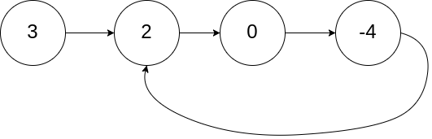

```text
输入：head = [3,2,0,-4], pos = 1
输出：返回索引为 1 的链表节点
```

解释：链表中有一个环，其尾部连接到第二个节点。

**示例 3**


```text
输入：head = [1], pos = -1
输出：返回 null
```

解释：链表中没有环。
> 题面与 [leetcode.cn 官方](https://leetcode.cn/problems/linked-list-cycle-ii/)一致，示例配图取自官方题面。

**数据范围与注意事项**：

- `链表中节点的数目范围在范围 `[0, 10^4]` 内`
- `-10^5 <= Node.val <= 10^5`
- `pos` 的值为 `-1` 或者链表中的一个有效索引
- 进阶：你是否可以使用 `O(1)` 空间解决此题？
- **易错点**：断开 next 之前先把后继存下来，否则整条链会丢。

## 题目分析

**场景是什么**：链表只能顺着指针走，这类题练的是指针操作与断链重接，对应真实开发里的内存管理、撤销链。本题就是该场景的 Medium 级练习，主线做法是「迭代指针处理」。

**主线怎么解**：主解法结构简单：读入、处理、返回。

## 解题思路

**方案对比**（共 2 个方案，由浅入深）：

| 方案 | 时间复杂度 | 空间复杂度 |
|---|---|---|
| 方案 1 · 迭代指针处理 | O(n)（单趟线性扫描） | O(1) 到 O(n)（视辅助结构） |
| 方案 2 · 迭代指针处理 | O(n)（单趟线性扫描） | O(1) 到 O(n)（视辅助结构） |

**方案间的取舍**：方案 1（迭代指针处理）；方案 2（迭代指针处理）。数据规模小、可读性优先时选靠前的方案；规模大、性能优先时选靠后的方案。

**怎么读这一篇**：

- 🐣 **新手路线**：把「题目描述」的示例 1 在纸上手推一遍 → 读方案 1（最直观的写法）与它的代码走读 → 按「运行方式」本地跑通看 PASS → 回头对比方案 2 之后的写法差在哪
- 🦅 **大佬路线**：直接锁定最优方案 1（迭代指针处理，O(n)（单趟线性扫描））→ 跳读该方案代码与走读 → 用「逐步拆解与面试追问」补齐复杂度推导与边界追问

### 动态算法图（链表反转，GIF 自动循环）


动画演示链表专题里链表反转的典型过程；每个方案在「TypeScript 解题方案」一节还配了专属动画与专属流程图。

### 主解法流程图（真实控制流）

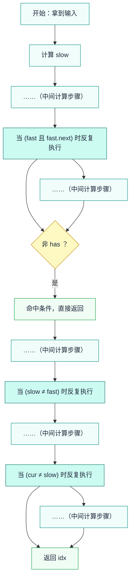

## TypeScript 解题方案（2 个方案逐个讲）

> **运行与提交**：每个方案都是自包含文件（内嵌用例自测，输出 PASS），整块复制到 `.ts` 文件后 `node 文件名` 即可运行。提交 LeetCode 时，把 `demo` 内的算法函数与辅助类型/函数整体取出、置于文件顶层即可。涉及交互/特殊接口的题以题面给定签名为准。

### 方案 1：迭代指针处理

**分析与思路**：核心做法是「迭代指针处理」。

**运行方式**：`node 本文件`，内嵌用例全部通过会输出 PASS。


**方案专属流程图**（真实控制流）：

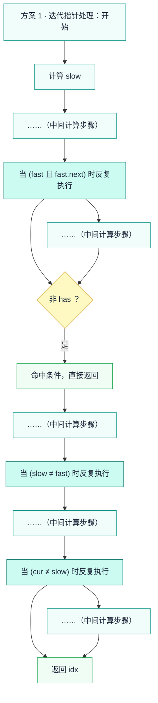

```typescript
export function demo(): void {
  // 程序入口：跑内嵌自测用例
  class ListNode {
    val: number;
    next: ListNode | null;
    constructor(v = 0, n: ListNode | null = null) {
      this.val = v;
      this.next = n;
    }
  } // 定义类型
  function hasCycleAt(head: ListNode | null): number {
    // 定义函数/方法 hasCycleAt
    let slow: ListNode | null = head,
      fast: ListNode | null = head;
    let has = false; // 把 false 存入 has
    while (fast && fast.next) {
      slow = slow!.next;
      fast = fast.next.next;
      if (slow === fast) {
        has = true;
        break;
      }
    }
    if (!has) return -1; // 若 取反 has，直接返回 减 1
    slow = head;
    while (slow !== fast) {
      slow = slow!.next;
      fast = fast!.next;
    }
    let idx = 0;
    let cur = head;
    while (cur !== slow) {
      cur = cur!.next;
      idx++;
    }
    return idx; // 返回 idx
  }
  // acyclic
  const a = new ListNode(1);
  a.next = new ListNode(2);
  a.next.next = new ListNode(3);
  if (hasCycleAt(a) !== -1) {
    console.log('FAIL acyclic');
    throw new Error('FAILED');
  }
  // cycle at index 1 (value 2)
  const b = new ListNode(3);
  b.next = new ListNode(2);
  b.next.next = new ListNode(0);
  b.next.next.next = b.next;
  if (hasCycleAt(b) !== 1) {
    console.log('FAIL cycle got ' + hasCycleAt(b));
    throw new Error('FAILED');
  }
  console.log('PASS'); // 全部用例通过，输出 PASS
}
demo(); // demo();
```

### 方案 2：迭代指针处理

**分析与思路**：核心做法是「迭代指针处理」。

**运行方式**：`node 本文件`，内嵌用例全部通过会输出 PASS。


**方案专属流程图**（真实控制流）：


```typescript
export function demo(): void {
  // 程序入口：跑内嵌自测用例
  class ListNode {
    val: number;
    next: ListNode | null;
    constructor(v = 0, n: ListNode | null = null) {
      this.val = v;
      this.next = n;
    }
  } // 定义类型
  function hasCycleAt(head: ListNode | null): number {
    // 定义函数/方法 hasCycleAt
    let slow: ListNode | null = head,
      fast: ListNode | null = head;
    let has = false; // 把 false 存入 has
    while (fast && fast.next) {
      slow = slow!.next;
      fast = fast.next.next;
      if (slow === fast) {
        has = true;
        break;
      }
    }
    if (!has) return -1; // 若 取反 has，直接返回 减 1
    slow = head;
    while (slow !== fast) {
      slow = slow!.next;
      fast = fast!.next;
    }
    let idx = 0;
    let cur = head;
    while (cur !== slow) {
      cur = cur!.next;
      idx++;
    }
    return idx; // 返回 idx
  }
  // acyclic
  const a = new ListNode(1);
  a.next = new ListNode(2);
  a.next.next = new ListNode(3);
  if (hasCycleAt(a) !== -1) {
    console.log('FAIL acyclic');
    throw new Error('FAILED');
  }
  // cycle at index 1 (value 2)
  const b = new ListNode(3);
  b.next = new ListNode(2);
  b.next.next = new ListNode(0);
  b.next.next.next = b.next;
  if (hasCycleAt(b) !== 1) {
    console.log('FAIL cycle got ' + hasCycleAt(b));
    throw new Error('FAILED');
  }
  console.log('PASS'); // 全部用例通过，输出 PASS
}
demo(); // demo();
```

## 逐步拆解与面试追问

**复杂度**：时间 O(n)（单趟线性扫描），空间 O(1) 到 O(n)（视辅助结构）

**为什么是这个量级**：每个元素被常数次访问，辅助哈希或栈的开销与 n 同阶

**面试官可能会追问**：

- 能不能一次遍历完成？
- 快慢指针能解决哪些变体？
- 断链与接回的顺序怎么保证不出错？

## 关键 API 速查（TS 主解法实际用到，附官方链接）

本题主解法只用到基础语法（变量、循环、比较），不依赖特殊库 API。

### 各语言官方文档导航

- **TypeScript / JS**：[MDN 中文参考](https://developer.mozilla.org/zh-CN/)
- **Python**：[Python 官方文档](https://docs.python.org/zh-cn/3/)
- **Go**：[Go 标准库](https://pkg.go.dev/std)
- **Java**：[JDK 17 API](https://docs.oracle.com/en/java/javase/17/docs/api/)
- **Rust**：[Rust 标准库](https://doc.rust-lang.org/std/)
- **Lua**：[Lua 5.4 手册](https://www.lua.org/manual/5.4/)
- **C**：[Cppreference C](https://zh.cppreference.com/w/c)
- **C++**：[Cppreference C++](https://zh.cppreference.com/w/cpp)
- **R**：[R 官方手册](https://stat.ethz.ch/R-manual/)
- **Zig**：[Zig 语言文档](https://ziglang.org/documentation/master/)
- **Dart**：[Dart API](https://api.dart.dev/)

## 附录：其他 10 种语言全部实现（每种语言列举其全部方案）

> TypeScript 的全部方案见「TypeScript 解题方案」一节；下面是其余 10 种语言的对应实现，每种语言的每个方案都带思路分析、代码走读与专属运行架构图。
> 每个方案都内嵌用例自测，可独立运行（老仓库 python/go 文件遵循「打印结果」约定）。
> 完整解法文件见 `dsa/<语言>/linked_list/lc_142_环形链表_ii/`。

### Python 实现（2 种方案）

Python 的全部方案如下，每个方案都内嵌用例自测，可独立运行（老仓库 python/go 文件遵循「打印结果」约定）：

#### 方案 1：迭代指针处理

**思路与代码分析**：核心是「迭代指针处理」。Python 版用切片与字典推导式简化操作，突出可读性。**走读**：方案 1 · 迭代指针处理：开始 → 更新 visited → 当 head: 时反复执行 → 命中条件，直接返回 → 调用 visited.add(head) → 更新 head → 返回 None。

**运行架构**（真实控制流）：

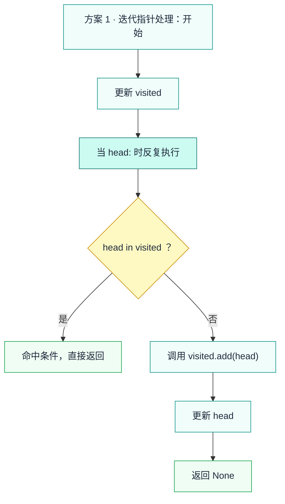

```python
# Definition for singly-linked list.
# class ListNode:
#     def __init__(self, val=0, next=None):
#         self.val = val
#         self.next = next

import sys  # 提高递归深度上限（深输入防 RecursionError）

sys.setrecursionlimit(200000)  # 树/链表类题目节点数可达 1e4 量级

def detectCycle(head):  # 定义函数 detectCycle（参数：头节点）
    visited = set()  # 把 set() 存入 已访问集合
    while head:  # 循环，直到不满足「头节点」
        if head in visited:  # 若 头节点 in 已访问集合
            return head  # 返回 头节点
        visited.add(head)  # 已访问集合 追加 头节点)
        head = head.next  # 把 头节点.下一个 存入 头节点
    return None  # 返回 None

if __name__ == "__main__":  # 若 __name__ 等于 '__main__'
    print(detectCycle(None))  # 打印输出
```

#### 方案 2：迭代指针处理

**思路与代码分析**：核心是「迭代指针处理」。Python 版用切片与字典推导式简化操作，突出可读性。**走读**：方案 2 · 迭代指针处理：开始 → 命中条件，直接返回 → 更新 slow → 当 fast: 时反复执行 → 更新 slow → 命中条件，直接返回 → 更新 fast → 若 fast == slow：更新 ptr → 更新 ptr → 当 ptr ≠ slow: 时反复执行 → 更新 ptr → 更新 slow → 返回 ptr → 返回 None。

**运行架构**（真实控制流）：

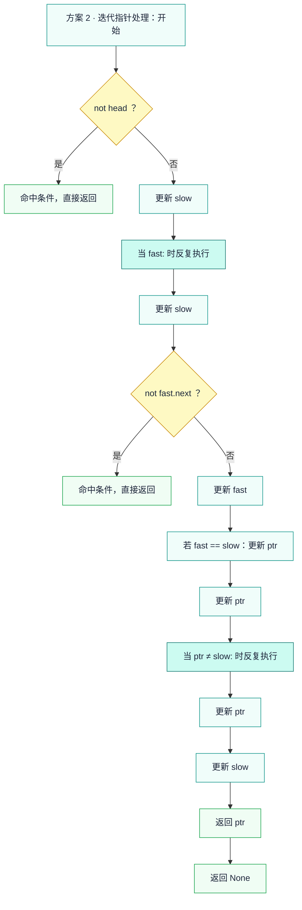

```python
# Definition for singly-linked list.
# class ListNode:
#     def __init__(self, val=0, next=None):
#         self.val = val
#         self.next = next

import sys  # 提高递归深度上限（深输入防 RecursionError）

sys.setrecursionlimit(200000)  # 树/链表类题目节点数可达 1e4 量级

def detectCycle(head):  # 定义函数 detectCycle（参数：头节点）
    if not head:  # 若 not 头节点
        return None  # 返回 None
    slow = fast = head  # 把 快指针 赋值为 头节点 存入 慢指针
    while fast:  # 循环，直到不满足「快指针」
        slow = slow.next  # 把 慢指针.下一个 存入 慢指针
        if not fast.next:  # 若 not 快指针.下一个
            return None  # 返回 None
        fast = fast.next.next  # 把 快指针.下一个.下一个 存入 快指针
        if fast == slow:  # 若 快指针 等于 慢指针
            ptr = head  # 把 头节点 存入 ptr
            while ptr != slow:  # 循环，直到不满足「ptr 不等于 慢指针」
                ptr = ptr.next  # 把 ptr.下一个 存入 ptr
                slow = slow.next  # 把 慢指针.下一个 存入 慢指针
            return ptr  # 返回 ptr
    return None  # 返回 None

if __name__ == "__main__":  # 若 __name__ 等于 '__main__'
    print(detectCycle(None))  # 打印输出
```

### Go 实现（2 种方案）

Go 的全部方案如下，每个方案都内嵌用例自测，可独立运行（老仓库 python/go 文件遵循「打印结果」约定）：

#### 方案 1：迭代指针处理

**思路与代码分析**：核心是「迭代指针处理」。Go 版用切片与多返回值惯用法，显式处理索引边界。**走读**：方案 1 · 迭代指针处理：开始 → 处理 if head == nil → 返回 nil → 更新 : → 遍历循环 → 更新 slow → 处理 if fast.Next == nil → 返回 nil → 更新 fast → 处理 if fast == slow → 更新 : → 遍历循环 → 更新 ptr → 更新 slow → 返回 ptr → 返回 nil。

**运行架构**（真实控制流）：

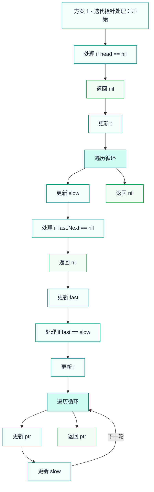

```go
package main // 引入依赖
import (
	"fmt"
	"os"
) // 引入依赖
type ListNode struct {
	Val  int
	Next *ListNode
} // 定义类型
func detectCycle(head *ListNode) *ListNode { // 定义函数/方法 detectCycle
	if head == nil {
		return nil
	} // 若 头节点 等于 nil { return nil }
	slow, fast := head, head // 把 头节点, 头节点 写入 slow, fast :
	for fast != nil {        // 把 nil { 写入 for fast !
		slow = slow.Next // 把 慢指针.Next 写入 慢指针
		if fast.Next == nil {
			return nil
		} // 若 快指针.Next 等于 nil { return nil }
		fast = fast.Next.Next // 把 快指针.Next.Next 写入 快指针
		if fast == slow {     // 若 快指针 等于 慢指针
			ptr := head // 把 头节点 写入 ptr :
			for ptr != slow {
				ptr = ptr.Next
				slow = slow.Next
			} // 把 慢指针 { ptr 赋值为 ptr.Next; 慢指针 赋值为 慢指针.Next } 写入 for ptr !
			return ptr // 返回 ptr
		}
	}
	return nil // 返回 nil
}
func buildCycle() *ListNode { // 定义函数/方法 buildCycle
	n3 := &ListNode{Val: 3}            // 把 按位与 ListNode{Val:3} 写入 n3 :
	n2 := &ListNode{Val: 2, Next: n3}  // 把 按位与 ListNode{Val:2, Next:n3} 写入 n2 :
	n0 := &ListNode{Val: 0, Next: n2}  // 把 按位与 ListNode{Val:0, Next:n2} 写入 n0 :
	n4 := &ListNode{Val: -4, Next: n2} // 把 按位与 ListNode{Val: 减 4, Next:n2} 写入 n4 :
	n3.Next = n4                       // 把 n4 写入 n3.Next
	return n0                          // 返回 n0
}
func main() { // 程序入口：跑内嵌自测用例
	ok := true // 把 true 写入 ok :
	if detectCycle(nil) != nil {
		ok = false
		fmt.Println("FAIL nil")
	}
	c := detectCycle(buildCycle()) // 把 detectCycle(buildCycle()) 写入 c :
	if c == nil || c.Val != 2 {
		ok = false
		fmt.Printf("FAIL cycle val=%v\n", c)
	}
	if !ok {
		os.Exit(1)
	} // 若 取反 ok { os.Exit(1) }
	fmt.Println("PASS") // 全部用例通过，输出 PASS
}
```

#### 方案 2：迭代指针处理

**思路与代码分析**：核心是「迭代指针处理」。Go 版用切片与多返回值惯用法，显式处理索引边界。**走读**：方案 2 · 迭代指针处理：开始 → 处理 if head == nil → 返回 nil → 更新 : → 遍历循环 → 更新 slow → 处理 if fast.Next == nil → 返回 nil → 更新 fast → 处理 if fast == slow → 更新 : → 遍历循环 → 更新 ptr → 更新 slow → 返回 ptr → 返回 nil。

**运行架构**（真实控制流）：


```go
package main // 引入依赖
import (
	"fmt"
	"os"
) // 引入依赖
type ListNode struct {
	Val  int
	Next *ListNode
} // 定义类型
func detectCycle(head *ListNode) *ListNode { // 定义函数/方法 detectCycle
	if head == nil {
		return nil
	} // 若 头节点 等于 nil { return nil }
	slow, fast := head, head // 把 头节点, 头节点 写入 slow, fast :
	for fast != nil {        // 把 nil { 写入 for fast !
		slow = slow.Next // 把 慢指针.Next 写入 慢指针
		if fast.Next == nil {
			return nil
		} // 若 快指针.Next 等于 nil { return nil }
		fast = fast.Next.Next // 把 快指针.Next.Next 写入 快指针
		if fast == slow {     // 若 快指针 等于 慢指针
			ptr := head // 把 头节点 写入 ptr :
			for ptr != slow {
				ptr = ptr.Next
				slow = slow.Next
			} // 把 慢指针 { ptr 赋值为 ptr.Next; 慢指针 赋值为 慢指针.Next } 写入 for ptr !
			return ptr // 返回 ptr
		}
	}
	return nil // 返回 nil
}
func buildCycle() *ListNode { // 定义函数/方法 buildCycle
	n3 := &ListNode{Val: 3}            // 把 按位与 ListNode{Val:3} 写入 n3 :
	n2 := &ListNode{Val: 2, Next: n3}  // 把 按位与 ListNode{Val:2, Next:n3} 写入 n2 :
	n0 := &ListNode{Val: 0, Next: n2}  // 把 按位与 ListNode{Val:0, Next:n2} 写入 n0 :
	n4 := &ListNode{Val: -4, Next: n2} // 把 按位与 ListNode{Val: 减 4, Next:n2} 写入 n4 :
	n3.Next = n4                       // 把 n4 写入 n3.Next
	return n0                          // 返回 n0
}
func main() { // 程序入口：跑内嵌自测用例
	ok := true // 把 true 写入 ok :
	if detectCycle(nil) != nil {
		ok = false
		fmt.Println("FAIL nil")
	}
	c := detectCycle(buildCycle()) // 把 detectCycle(buildCycle()) 写入 c :
	if c == nil || c.Val != 2 {
		ok = false
		fmt.Printf("FAIL cycle val=%v\n", c)
	}
	if !ok {
		os.Exit(1)
	} // 若 取反 ok { os.Exit(1) }
	fmt.Println("PASS") // 全部用例通过，输出 PASS
}
```

### Java 实现（2 种方案）

Java 的全部方案如下，每个方案都内嵌用例自测，可独立运行（老仓库 python/go 文件遵循「打印结果」约定）：

#### 方案 1：迭代指针处理

**思路与代码分析**：核心是「迭代指针处理」。Java 版用类与静态方法组织，集合操作显式明了。代码里依次做这些事：双重循环遍历。

**运行架构**（真实控制流）：

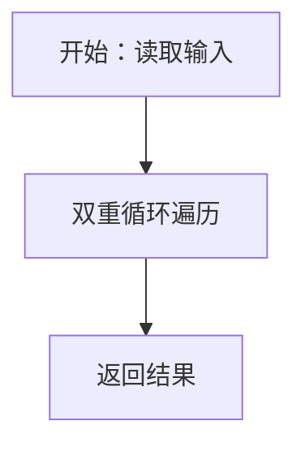

```java
package com.webfault.dsa; // 引入依赖

import java.util.*; // 引入依赖

class lc142_solution111 { // 定义类型
  static class ListNode { // static class ListNode {
    int val; // int 值;
    ListNode next; // ListNode 下一个;

    ListNode() {} // ListNode() {}

    ListNode(int v) {
      val = v;
    } // 把 值; } 写入 ListNode(int v) { val
  }

  public ListNode detectCycle(ListNode head) { // 定义函数/方法 detectCycle
    Set<ListNode> visited = new HashSet<>(); // 把 new HashSet 小于 超过 (); 写入 Set<ListNode> visited
    while (head != null) { // 循环，直到不满足「头节点 不等于 null」
      if (visited.contains(head)) return head; // 若 已访问集合 是否包含 头节点)，直接返回 头节点
      visited.add(head); // 已访问集合 追加 头节点);
      head = head.next; // 把 头节点.下一个; 写入 头节点
    }
    return null; // 返回 null
  }

  static ListNode build(int[] a) { // 定义函数/方法 build
    ListNode dummy = new ListNode(0),
        cur = dummy; // 把 new ListNode(0), 当前值 赋值为 哨兵节点; 写入 ListNode dummy
    for (int v : a) {
      cur.next = new ListNode(v);
      cur = cur.next;
    } // 把 new ListNode(值); 当前值 赋值为 当前值.下一个; } 写入 下一个
    return dummy.next; // 返回 哨兵节点.下一个
  }

  static ListNode nodeAt(ListNode h, int idx) {
    for (int i = 0; i < idx; i++) h = h.next;
    return h;
  }

  public static void main(String[] args) { // public static void main(String[] args) {
    lc142_solution111 s =
        new lc142_solution111(); // 把 new lc142_solution111(); 写入 lc142_solution111 s
    boolean ok = true; // 把 true; 写入 boolean ok
    if (s.detectCycle(build(new int[] {1, 2, 3})) != null) {
      ok = false;
      System.out.println("FAIL no-cycle");
    }
    ListNode h2 =
        build(new int[] {3, 2, 0, -4}); // 把 build(new int[]{3, 2, 0, 减 4}); 写入 ListNode h2
    nodeAt(h2, 3).next = nodeAt(h2, 1); // 把 nodeAt(h2, 1); 写入 下一个
    ListNode r2 = s.detectCycle(h2); // 把 字符串.detectCycle(h2); 写入 ListNode r2
    if (r2 == null || r2.val != 2) {
      ok = false;
      System.out.println("FAIL cycle got " + (r2 == null ? "null" : r2.val));
    }
    if (s.detectCycle(null) != null) {
      ok = false;
      System.out.println("FAIL null");
    }
    if (!ok) throw new RuntimeException("FAILED"); // 若 取反 ok) throw new RuntimeException(「FAILED」);
    System.out.println("PASS"); // 全部用例通过，输出 PASS
  }
}
```

#### 方案 2：迭代指针处理

**思路与代码分析**：核心是「迭代指针处理」。Java 版用类与静态方法组织，集合操作显式明了。代码里依次做这些事：双重循环遍历。

**运行架构**：与方案 1 的控制流相同（同算法在该语言的等价实现），图见上。

```java
package com.webfault.dsa; // 引入依赖

import java.util.*; // 引入依赖

class lc142_solution222 { // 定义类型
  static class ListNode { // static class ListNode {
    int val; // int 值;
    ListNode next; // ListNode 下一个;

    ListNode() {} // ListNode() {}

    ListNode(int v) {
      val = v;
    } // 把 值; } 写入 ListNode(int v) { val
  }

  static ListNode detectCycle(ListNode head) { // 定义函数/方法 detectCycle
    if (head == null) return null; // 若 头节点 等于 null，直接返回 null
    ListNode slow = head, fast = head; // 把 头节点, 快指针 赋值为 头节点; 写入 ListNode slow
    while (fast != null) { // 循环，直到不满足「快指针 不等于 null」
      slow = slow.next; // 把 慢指针.下一个; 写入 慢指针
      if (fast.next == null) return null; // 若 快指针.下一个 等于 null，直接返回 null
      fast = fast.next.next; // 把 快指针.下一个.下一个; 写入 快指针
      if (fast == slow) { // 若 快指针 等于 慢指针
        ListNode ptr = head; // 把 头节点; 写入 ListNode ptr
        while (ptr != slow) {
          ptr = ptr.next;
          slow = slow.next;
        } // 循环，直到不满足「ptr 不等于 慢指针) { ptr 赋值为 ptr.下一个; 慢指针 赋值为 慢指针.下一个; }」
        return ptr; // 返回 ptr
      }
    }
    return null; // 返回 null
  }

  static ListNode build(int[] a) { // 定义函数/方法 build
    ListNode dummy = new ListNode(0),
        cur = dummy; // 把 new ListNode(0), 当前值 赋值为 哨兵节点; 写入 ListNode dummy
    for (int v : a) {
      cur.next = new ListNode(v);
      cur = cur.next;
    } // 把 new ListNode(值); 当前值 赋值为 当前值.下一个; } 写入 下一个
    return dummy.next; // 返回 哨兵节点.下一个
  }

  static ListNode nodeAt(ListNode h, int idx) {
    for (int i = 0; i < idx; i++) h = h.next;
    return h;
  }

  public static void main(String[] args) { // public static void main(String[] args) {
    lc142_solution222 s =
        new lc142_solution222(); // 把 new lc142_solution222(); 写入 lc142_solution222 s
    boolean ok = true; // 把 true; 写入 boolean ok
    if (s.detectCycle(build(new int[] {1, 2, 3})) != null) {
      ok = false;
      System.out.println("FAIL no-cycle");
    }
    ListNode h2 =
        build(new int[] {3, 2, 0, -4}); // 把 build(new int[]{3, 2, 0, 减 4}); 写入 ListNode h2
    nodeAt(h2, 3).next = nodeAt(h2, 1); // 把 nodeAt(h2, 1); 写入 下一个
    ListNode r2 = s.detectCycle(h2); // 把 字符串.detectCycle(h2); 写入 ListNode r2
    if (r2 == null || r2.val != 2) {
      ok = false;
      System.out.println("FAIL cycle got " + (r2 == null ? "null" : r2.val));
    }
    if (s.detectCycle(null) != null) {
      ok = false;
      System.out.println("FAIL null");
    }
    if (!ok) throw new RuntimeException("FAILED"); // 若 取反 ok) throw new RuntimeException(「FAILED」);
    System.out.println("PASS"); // 全部用例通过，输出 PASS
  }
}
```

### Rust 实现（2 种方案）

Rust 的全部方案如下，每个方案都内嵌用例自测，可独立运行（老仓库 python/go 文件遵循「打印结果」约定）：

#### 方案 1：迭代指针处理

**思路与代码分析**：核心是「迭代指针处理」。Rust 版用所有权移动与切片借用改写同一逻辑，注意 Option 与引用边界。**走读**：方案 1 · 迭代指针处理：开始 → 计算 slow → 当 let (Some(s), Some(f)) = (slow, fast) 时反复执行 → 返回 Some(x.val)。

**运行架构**（真实控制流）：

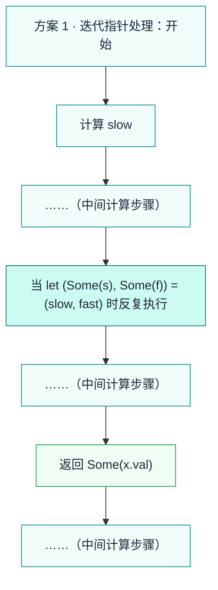

```rust
// LeetCode 142. 环形链表II — Rust 版（方案1）
#[derive(Debug)]
struct ListNode {
    val: i32,
    next: Option<Box<ListNode>>,
} // 定义类型
fn detect_cycle(mut head: Option<&ListNode>) -> Option<i32> {
    // 定义函数/方法 detect_cycle
    let mut slow = head; // 把 头节点; 写入 let mut slow
    let mut fast = head; // 把 头节点; 写入 let mut fast
    while let (Some(s), Some(f)) = (slow, fast) {
        // 定义函数/方法 let
        slow = s.next.as_deref(); // 把 字符串.下一个.as_deref(); 写入 慢指针
        let f2 = f.next.as_deref()?; // 把 f.下一个.as_deref()? 存入 f2
        fast = f2.next.as_deref(); // 把 f2.下一个.as_deref(); 写入 快指针
        if let (Some(a), Some(b)) = (slow, fast) {
            // 定义函数/方法 let
            if std::ptr::eq(a, b) {
                // 若 std::ptr::eq(数组, b
                let mut p1 = head; // 把 头节点; 写入 let mut p1
                let mut p2 = slow; // 把 慢指针; 写入 let mut p2
                loop {
                    // loop {
                    let (x, y) = (p1?, p2?); // 把 (p1?, p2?); 写入 let (x, y)
                    if std::ptr::eq(x, y) {
                        return Some(x.val);
                    } // 若 std::ptr::eq(x, y) { return Some(x.值); }
                    p1 = x.next.as_deref(); // 把 x.下一个.as_deref(); 写入 p1
                    p2 = y.next.as_deref(); // 把 y.下一个.as_deref(); 写入 p2
                }
            }
        }
    }
    None // None
}
fn main() {
    // 程序入口：跑内嵌自测用例
    assert_eq!(detect_cycle(None), None); // 断言校验
    println!("PASS"); // 全部用例通过，输出 PASS
}
```

#### 方案 2：迭代指针处理

**思路与代码分析**：核心是「迭代指针处理」。Rust 版用所有权移动与切片借用改写同一逻辑，注意 Option 与引用边界。**走读**：方案 2 · 迭代指针处理：开始 → 计算 slow → 当 let (Some(s), Some(f)) = (slow, fast) 时反复执行 → 返回 Some(x.val)。

**运行架构**（真实控制流）：


```rust
// LeetCode 142. 环形链表II — Rust 版（方案2）
#[derive(Debug)]
struct ListNode {
    val: i32,
    next: Option<Box<ListNode>>,
} // 定义类型
fn detect_cycle(mut head: Option<&ListNode>) -> Option<i32> {
    // 定义函数/方法 detect_cycle
    let mut slow = head; // 把 头节点; 写入 let mut slow
    let mut fast = head; // 把 头节点; 写入 let mut fast
    while let (Some(s), Some(f)) = (slow, fast) {
        // 定义函数/方法 let
        slow = s.next.as_deref(); // 把 字符串.下一个.as_deref(); 写入 慢指针
        let f2 = f.next.as_deref()?; // 把 f.下一个.as_deref()? 存入 f2
        fast = f2.next.as_deref(); // 把 f2.下一个.as_deref(); 写入 快指针
        if let (Some(a), Some(b)) = (slow, fast) {
            // 定义函数/方法 let
            if std::ptr::eq(a, b) {
                // 若 std::ptr::eq(数组, b
                let mut p1 = head; // 把 头节点; 写入 let mut p1
                let mut p2 = slow; // 把 慢指针; 写入 let mut p2
                loop {
                    // loop {
                    let (x, y) = (p1?, p2?); // 把 (p1?, p2?); 写入 let (x, y)
                    if std::ptr::eq(x, y) {
                        return Some(x.val);
                    } // 若 std::ptr::eq(x, y) { return Some(x.值); }
                    p1 = x.next.as_deref(); // 把 x.下一个.as_deref(); 写入 p1
                    p2 = y.next.as_deref(); // 把 y.下一个.as_deref(); 写入 p2
                }
            }
        }
    }
    None // None
}
fn main() {
    // 程序入口：跑内嵌自测用例
    assert_eq!(detect_cycle(None), None); // 断言校验
    println!("PASS"); // 全部用例通过，输出 PASS
}
```

### Lua 实现（2 种方案）

Lua 的全部方案如下，每个方案都内嵌用例自测，可独立运行（老仓库 python/go 文件遵循「打印结果」约定）：

#### 方案 1：迭代指针处理

**思路与代码分析**：核心是「迭代指针处理」。Lua 版用表与 ipairs 遍历，注意 ipairs 遇 nil 即停的语义。**走读**：方案 1 · 迭代指针处理：开始 → 更新 fast → 当 fast and fast.next do 时反复执行 → 更新 slow → 更新 fast → 处理 if slow == fast then → 更新 p2 → 当 p1 ~= p2 do 时反复执行 → 更新 p1 → 更新 p2 → 返回 p1 → 返回 nil。

**运行架构**（真实控制流）：

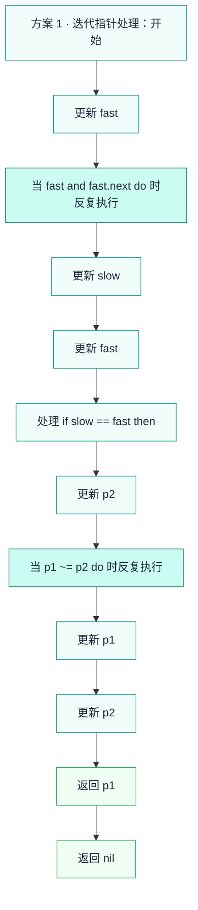

```lua
-- LeetCode 142. 环形链表II — Lua 版（方案1）
local ListNode = {} -- 把 {} 写入 local ListNode
ListNode.__index = ListNode -- 把 ListNode 写入 ListNode.__index
function ListNode.new(val, next)
	return setmetatable({ val = val, next = next }, ListNode)
end
local function detect_cycle(head) -- local function detect_cycle(头节点)
	local slow, fast = head, head -- 把 头节点, 头节点 写入 local slow, fast
	while fast and fast.next do -- while 快指针 and 快指针.下一个 do
		slow = slow.next -- 把 慢指针.下一个 存入 慢指针
		fast = fast.next.next -- 把 快指针.下一个.下一个 存入 快指针
		if slow == fast then -- 若 慢指针 等于 快指针 then
			local p1, p2 = head, slow -- 把 头节点, 慢指针 写入 local p1, p2
			while p1 ~= p2 do -- 把 p2 do 写入 while p1 ~
				p1 = p1.next -- 把 p1.下一个 存入 p1
				p2 = p2.next -- 把 p2.下一个 存入 p2
			end -- 终点
			return p1 -- 返回 p1
		end -- 终点
	end -- 终点
	return nil -- 返回 nil
end -- 终点
local function build_with_cycle(vals, pos) -- local function build_with_cycle(vals, pos)
	local head, cur, tail_at = nil, nil, nil -- 把 nil, nil, nil 写入 local head, cur, tail_at
	for i, v in ipairs(vals) do -- 遍历取 值
		local n = ListNode.new(v) -- 把 ListNode.new(值) 写入 local n
		if not head then
			head, cur = n, n
		else
			cur.next, cur = n, n
		end
		if i == pos then
			tail_at = n
		end -- 若 下标 i 等于 pos then tail_at 赋值为 元素个数 终点
	end -- 终点
	if cur and tail_at then
		cur.next = tail_at
	end -- 若 当前值 and tail_at then 当前值.下一个 赋值为 tail_at 终点
	return head -- 返回 头节点
end -- 终点
local h = build_with_cycle({ 3, 2, 0, -4 }, 2) -- 把 build_with_cycle({3, 2, 0, 减 4}, 2) 写入 local h
assert(detect_cycle(h) ~= nil and detect_cycle(h).val == 2) -- 断言校验
assert(detect_cycle(ListNode.new(1)) == nil) -- 断言校验
print("PASS") -- 全部用例通过，输出 PASS
```

#### 方案 2：迭代指针处理

**思路与代码分析**：核心是「迭代指针处理」。Lua 版用表与 ipairs 遍历，注意 ipairs 遇 nil 即停的语义。**走读**：方案 2 · 迭代指针处理：开始 → 更新 fast → 当 fast and fast.next do 时反复执行 → 更新 slow → 更新 fast → 处理 if slow == fast then → 更新 p2 → 当 p1 ~= p2 do 时反复执行 → 更新 p1 → 更新 p2 → 返回 p1 → 返回 nil。

**运行架构**（真实控制流）：


```lua
-- LeetCode 142. 环形链表II — Lua 版（方案2）
local ListNode = {} -- 把 {} 写入 local ListNode
ListNode.__index = ListNode -- 把 ListNode 写入 ListNode.__index
function ListNode.new(val, next)
	return setmetatable({ val = val, next = next }, ListNode)
end
local function detect_cycle(head) -- local function detect_cycle(头节点)
	local slow, fast = head, head -- 把 头节点, 头节点 写入 local slow, fast
	while fast and fast.next do -- while 快指针 and 快指针.下一个 do
		slow = slow.next -- 把 慢指针.下一个 存入 慢指针
		fast = fast.next.next -- 把 快指针.下一个.下一个 存入 快指针
		if slow == fast then -- 若 慢指针 等于 快指针 then
			local p1, p2 = head, slow -- 把 头节点, 慢指针 写入 local p1, p2
			while p1 ~= p2 do -- 把 p2 do 写入 while p1 ~
				p1 = p1.next -- 把 p1.下一个 存入 p1
				p2 = p2.next -- 把 p2.下一个 存入 p2
			end -- 终点
			return p1 -- 返回 p1
		end -- 终点
	end -- 终点
	return nil -- 返回 nil
end -- 终点
local function build_with_cycle(vals, pos) -- local function build_with_cycle(vals, pos)
	local head, cur, tail_at = nil, nil, nil -- 把 nil, nil, nil 写入 local head, cur, tail_at
	for i, v in ipairs(vals) do -- 遍历取 值
		local n = ListNode.new(v) -- 把 ListNode.new(值) 写入 local n
		if not head then
			head, cur = n, n
		else
			cur.next, cur = n, n
		end
		if i == pos then
			tail_at = n
		end -- 若 下标 i 等于 pos then tail_at 赋值为 元素个数 终点
	end -- 终点
	if cur and tail_at then
		cur.next = tail_at
	end -- 若 当前值 and tail_at then 当前值.下一个 赋值为 tail_at 终点
	return head -- 返回 头节点
end -- 终点
local h = build_with_cycle({ 3, 2, 0, -4 }, 2) -- 把 build_with_cycle({3, 2, 0, 减 4}, 2) 写入 local h
assert(detect_cycle(h) ~= nil and detect_cycle(h).val == 2) -- 断言校验
assert(detect_cycle(ListNode.new(1)) == nil) -- 断言校验
print("PASS") -- 全部用例通过，输出 PASS
```

### C 实现（2 种方案）

C 的全部方案如下，每个方案都内嵌用例自测，可独立运行（老仓库 python/go 文件遵循「打印结果」约定）：

#### 方案 1：迭代指针处理

**思路与代码分析**：核心是「迭代指针处理」。C 版手动管理下标与内存，循环边界全部显式写出。代码里依次做这些事：单循环线性扫描。**走读**：方案 1 · 迭代指针处理：开始 → 更新 *head → 遍历循环 → 更新 *node → 更新 node->val → 更新 node->next → 更新 cur → 若 i + 1 == pos：更新 tail_at → 更新 tail_at → 若 *cur == NULL 则： → 更新 *tail → 当 (tail 且 tail-＞next) 时反复执行 → 更新 tail → 若 tail 且 tail_at：更新 tail->next → 更新 tail->next → 返回 head。

**运行架构**（真实控制流）：

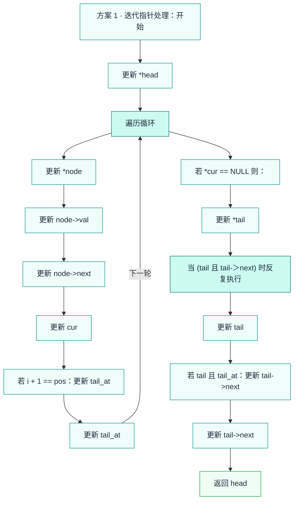

```c
/* LeetCode 142. 环形链表II — C 版（方案1） */
#include <stdio.h>  // 引入头文件
#include <stdlib.h> // 引入头文件
typedef struct LNode {
    int val;
    struct LNode *next;
} LNode; // typedef struct LNode { int 值; struct LNode 乘 下一个; } LNode;
static LNode *build_with_cycle(const int *vals, int n, int pos) {
    LNode *head = NULL, **cur = &head, *tail_at = NULL;
    for (int i = 0; i < n; i++) { // 让 下标 i 从 0 开始计数，下标 i 小于 元素个数 就继续
        LNode *node = malloc(sizeof(LNode)); // 把 malloc(sizeof(LNode)); 写入 LNode *node
        node->val = vals[i];
        node->next = NULL; // 把 vals[下标 i]; 节点 减 超过 下一个 赋值为 NULL; 写入 node->val
        *cur = node;
        cur = &node->next;
        if (i + 1 == pos)
            tail_at = node; // 若 下标 i 加 1 等于 pos) tail_at 赋值为 节点;
    }
    if (*cur == NULL) {
    }                   // 若 乘 当前值 等于 NULL) {}
    LNode *tail = head; // 把 头节点; 写入 LNode *tail
    while (tail && tail->next)
        tail = tail->next; // 循环，直到不满足「尾节点 且 尾节点 减 超过 下一个) 尾节点 赋值为 尾节点 减 超过
                           // 下一个;」
    if (tail && tail_at)
        tail->next = tail_at; // 若 尾节点 且 tail_at) 尾节点 减 超过 下一个 赋值为 tail_at;
    return head;              // 返回 头节点
}
static LNode *detect_cycle(LNode *head) { // static LNode 乘 detect_cycle(LNode 乘 头节点) {
    LNode *slow = head, *fast = head; // 把 头节点, 乘 快指针 赋值为 头节点; 写入 LNode *slow
    while (fast && fast->next) { // 循环，直到不满足「快指针 且 快指针 减 超过 下一个」
        slow = slow->next;       // 把 慢指针 减 超过 下一个; 写入 慢指针
        fast = fast->next->next; // 把 快指针 减 超过 下一个 减 超过 下一个; 写入 快指针
        if (slow == fast) {      // 若 慢指针 等于 快指针
            LNode *p1 = head, *p2 = slow; // 把 头节点, 乘 p2 赋值为 慢指针; 写入 LNode *p1
            while (p1 != p2) {
                p1 = p1->next;
                p2 = p2->next;
            }
            return p1; // 返回 p1
        }
    }
    return NULL; // 返回 NULL
}
int main(void) { // 程序入口：跑内嵌自测用例
    LNode *h = build_with_cycle((int[]){3, 2, 0, -4}, 4,
                                2); // 把 build_with_cycle((int[]){3,2,0, 减 4}, 4, 2); 写入 LNode *h
    LNode *e = detect_cycle(h);     // 把 detect_cycle(h); 写入 LNode *e
    if (!e || e->val != 2) {
        printf("FAIL 1\n");
        return 1;
    } // 若 取反 e 或 e 减 超过 值 不等于 2) { 输出「FAIL 1 」); return 1; }
    LNode *s = malloc(sizeof(LNode));
    s->val = 1;
    s->next = NULL;
    if (detect_cycle(s)) {
        printf("FAIL 2\n");
        return 1;
    }                 // 若 detect_cycle(字符串)) { 输出「FAIL 2 」); return 1; }
    printf("PASS\n"); // 全部用例通过，输出 PASS
    return 0;         // 返回 0
}
```

#### 方案 2：迭代指针处理

**思路与代码分析**：核心是「迭代指针处理」。C 版手动管理下标与内存，循环边界全部显式写出。代码里依次做这些事：单循环线性扫描。**走读**：方案 2 · 迭代指针处理：开始 → 更新 *head → 遍历循环 → 更新 *node → 更新 node->val → 更新 node->next → 更新 cur → 若 i + 1 == pos：更新 tail_at → 更新 tail_at → 若 *cur == NULL 则： → 更新 *tail → 当 (tail 且 tail-＞next) 时反复执行 → 更新 tail → 若 tail 且 tail_at：更新 tail->next → 更新 tail->next → 返回 head。

**运行架构**（真实控制流）：


```c
/* LeetCode 142. 环形链表II — C 版（方案2） */
#include <stdio.h>  // 引入头文件
#include <stdlib.h> // 引入头文件
typedef struct LNode {
    int val;
    struct LNode *next;
} LNode; // typedef struct LNode { int 值; struct LNode 乘 下一个; } LNode;
static LNode *build_with_cycle(const int *vals, int n, int pos) {
    LNode *head = NULL, **cur = &head, *tail_at = NULL;
    for (int i = 0; i < n; i++) { // 让 下标 i 从 0 开始计数，下标 i 小于 元素个数 就继续
        LNode *node = malloc(sizeof(LNode)); // 把 malloc(sizeof(LNode)); 写入 LNode *node
        node->val = vals[i];
        node->next = NULL; // 把 vals[下标 i]; 节点 减 超过 下一个 赋值为 NULL; 写入 node->val
        *cur = node;
        cur = &node->next;
        if (i + 1 == pos)
            tail_at = node; // 若 下标 i 加 1 等于 pos) tail_at 赋值为 节点;
    }
    if (*cur == NULL) {
    }                   // 若 乘 当前值 等于 NULL) {}
    LNode *tail = head; // 把 头节点; 写入 LNode *tail
    while (tail && tail->next)
        tail = tail->next; // 循环，直到不满足「尾节点 且 尾节点 减 超过 下一个) 尾节点 赋值为 尾节点 减 超过
                           // 下一个;」
    if (tail && tail_at)
        tail->next = tail_at; // 若 尾节点 且 tail_at) 尾节点 减 超过 下一个 赋值为 tail_at;
    return head;              // 返回 头节点
}
static LNode *detect_cycle(LNode *head) { // static LNode 乘 detect_cycle(LNode 乘 头节点) {
    LNode *slow = head, *fast = head; // 把 头节点, 乘 快指针 赋值为 头节点; 写入 LNode *slow
    while (fast && fast->next) { // 循环，直到不满足「快指针 且 快指针 减 超过 下一个」
        slow = slow->next;       // 把 慢指针 减 超过 下一个; 写入 慢指针
        fast = fast->next->next; // 把 快指针 减 超过 下一个 减 超过 下一个; 写入 快指针
        if (slow == fast) {      // 若 慢指针 等于 快指针
            LNode *p1 = head, *p2 = slow; // 把 头节点, 乘 p2 赋值为 慢指针; 写入 LNode *p1
            while (p1 != p2) {
                p1 = p1->next;
                p2 = p2->next;
            }
            return p1; // 返回 p1
        }
    }
    return NULL; // 返回 NULL
}
int main(void) { // 程序入口：跑内嵌自测用例
    LNode *h = build_with_cycle((int[]){3, 2, 0, -4}, 4,
                                2); // 把 build_with_cycle((int[]){3,2,0, 减 4}, 4, 2); 写入 LNode *h
    LNode *e = detect_cycle(h);     // 把 detect_cycle(h); 写入 LNode *e
    if (!e || e->val != 2) {
        printf("FAIL 1\n");
        return 1;
    } // 若 取反 e 或 e 减 超过 值 不等于 2) { 输出「FAIL 1 」); return 1; }
    LNode *s = malloc(sizeof(LNode));
    s->val = 1;
    s->next = NULL;
    if (detect_cycle(s)) {
        printf("FAIL 2\n");
        return 1;
    }                 // 若 detect_cycle(字符串)) { 输出「FAIL 2 」); return 1; }
    printf("PASS\n"); // 全部用例通过，输出 PASS
    return 0;         // 返回 0
}
```

### C++ 实现（2 种方案）

C++ 的全部方案如下，每个方案都内嵌用例自测，可独立运行（老仓库 python/go 文件遵循「打印结果」约定）：

#### 方案 1：迭代指针处理

**思路与代码分析**：核心是「迭代指针处理」。C++ 版用 STL 容器与迭代器，减少手写下标错误。**走读**：方案 1 · 迭代指针处理：开始 → 更新 *slow → 当 (fast 且 fast-＞next) 时反复执行 → 更新 slow → 更新 fast → 若 slow == fast 则： → 更新 *p1 → 当 (p1 ≠ p2) 时反复执行 → 更新 p1 → 更新 p2 → 返回 p1 → 返回 nullptr。

**运行架构**（真实控制流）：

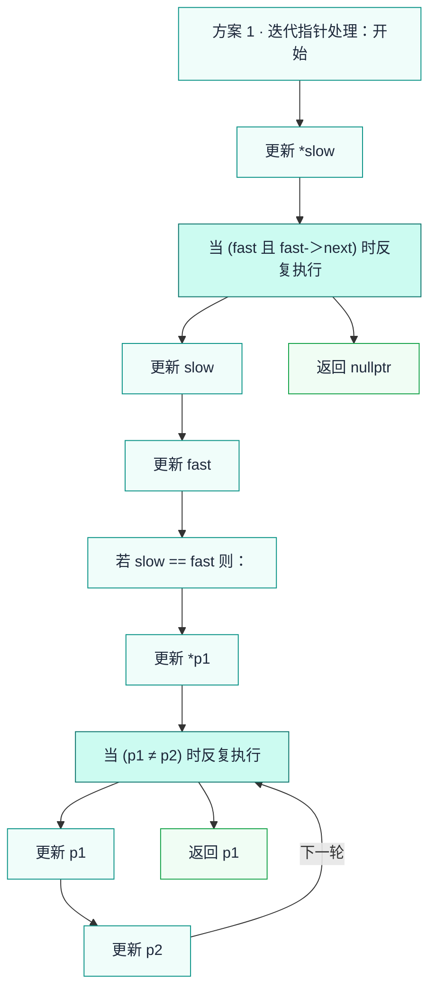

```cpp
// LeetCode 142. 环形链表II — C++ 版（方案1）
#include <cassert>                       // 引入头文件
#include <iostream>                      // 引入头文件
struct ListNode {                        // 定义类型
    int val;                             // int 值;
    ListNode *next = nullptr;            // 把 nullptr; 写入 ListNode *next
    explicit ListNode(int v) : val(v) {} // explicit ListNode(int 值) : 值(值) {}
};
static ListNode *buildWithCycle(const std::vector<int> &vals, int pos) {
    ListNode dummy(0);                         // ListNode 哨兵节点(0);
    ListNode *cur = &dummy;                    // 把 按位与 哨兵节点; 写入 ListNode *cur
    ListNode *tailAt = nullptr;                // 把 nullptr; 写入 ListNode *tailAt
    for (size_t i = 0; i < vals.size(); ++i) { // 让 下标 i 从 0 开始计数，下标 i 小于 vals.大小() 就继续
        cur->next = new ListNode(vals[i]); // 把 new ListNode(vals[下标 i]); 写入 cur->next
        cur = cur->next;                   // 把 当前值 减 超过 下一个; 写入 当前值
        if (static_cast<int>(i) + 1 == pos)
            tailAt = cur; // 若 static_cast 小于 int 超过 (下标 i) 加 1 等于 pos) tailAt 赋值为 当前值;
    }
    if (tailAt)
        cur->next = tailAt; // 若 tailAt) 当前值 减 超过 下一个 赋值为 tailAt;
    return dummy.next;      // 返回 哨兵节点.下一个
}
static ListNode *detectCycle(ListNode *head) { // static ListNode 乘 detectCycle(ListNode 乘 头节点) {
    ListNode *slow = head, *fast = head; // 把 头节点, 乘 快指针 赋值为 头节点; 写入 ListNode *slow
    while (fast && fast->next) { // 循环，直到不满足「快指针 且 快指针 减 超过 下一个」
        slow = slow->next;       // 把 慢指针 减 超过 下一个; 写入 慢指针
        fast = fast->next->next; // 把 快指针 减 超过 下一个 减 超过 下一个; 写入 快指针
        if (slow == fast) {      // 若 慢指针 等于 快指针
            ListNode *p1 = head, *p2 = slow; // 把 头节点, 乘 p2 赋值为 慢指针; 写入 ListNode *p1
            while (p1 != p2) {
                p1 = p1->next;
                p2 = p2->next;
            }
            return p1; // 返回 p1
        }
    }
    return nullptr; // 返回 nullptr
}
int main() {                                        // 程序入口：跑内嵌自测用例
    ListNode *h = buildWithCycle({3, 2, 0, -4}, 2); // 把 buildWithCycle({3, 2, 0, 减 4}, 2); 写入 ListNode *h
    ListNode *e = detectCycle(h);                   // 把 detectCycle(h); 写入 ListNode *e
    assert(e != nullptr && e->val == 2);            // 断言校验
    ListNode *s = new ListNode(1);                  // 把 new ListNode(1); 写入 ListNode *s
    assert(detectCycle(s) == nullptr);              // 断言校验
    std::cout << "PASS" << std::endl;               // 全部用例通过，输出 PASS
    return 0;                                       // 返回 0
}
```

#### 方案 2：迭代指针处理

**思路与代码分析**：核心是「迭代指针处理」。C++ 版用 STL 容器与迭代器，减少手写下标错误。**走读**：方案 2 · 迭代指针处理：开始 → 更新 *slow → 当 (fast 且 fast-＞next) 时反复执行 → 更新 slow → 更新 fast → 若 slow == fast 则： → 更新 *p1 → 当 (p1 ≠ p2) 时反复执行 → 更新 p1 → 更新 p2 → 返回 p1 → 返回 nullptr。

**运行架构**（真实控制流）：


```cpp
// LeetCode 142. 环形链表II — C++ 版（方案2）
#include <cassert>                       // 引入头文件
#include <iostream>                      // 引入头文件
struct ListNode {                        // 定义类型
    int val;                             // int 值;
    ListNode *next = nullptr;            // 把 nullptr; 写入 ListNode *next
    explicit ListNode(int v) : val(v) {} // explicit ListNode(int 值) : 值(值) {}
};
static ListNode *buildWithCycle(const std::vector<int> &vals, int pos) {
    ListNode dummy(0);                         // ListNode 哨兵节点(0);
    ListNode *cur = &dummy;                    // 把 按位与 哨兵节点; 写入 ListNode *cur
    ListNode *tailAt = nullptr;                // 把 nullptr; 写入 ListNode *tailAt
    for (size_t i = 0; i < vals.size(); ++i) { // 让 下标 i 从 0 开始计数，下标 i 小于 vals.大小() 就继续
        cur->next = new ListNode(vals[i]); // 把 new ListNode(vals[下标 i]); 写入 cur->next
        cur = cur->next;                   // 把 当前值 减 超过 下一个; 写入 当前值
        if (static_cast<int>(i) + 1 == pos)
            tailAt = cur; // 若 static_cast 小于 int 超过 (下标 i) 加 1 等于 pos) tailAt 赋值为 当前值;
    }
    if (tailAt)
        cur->next = tailAt; // 若 tailAt) 当前值 减 超过 下一个 赋值为 tailAt;
    return dummy.next;      // 返回 哨兵节点.下一个
}
static ListNode *detectCycle(ListNode *head) { // static ListNode 乘 detectCycle(ListNode 乘 头节点) {
    ListNode *slow = head, *fast = head; // 把 头节点, 乘 快指针 赋值为 头节点; 写入 ListNode *slow
    while (fast && fast->next) { // 循环，直到不满足「快指针 且 快指针 减 超过 下一个」
        slow = slow->next;       // 把 慢指针 减 超过 下一个; 写入 慢指针
        fast = fast->next->next; // 把 快指针 减 超过 下一个 减 超过 下一个; 写入 快指针
        if (slow == fast) {      // 若 慢指针 等于 快指针
            ListNode *p1 = head, *p2 = slow; // 把 头节点, 乘 p2 赋值为 慢指针; 写入 ListNode *p1
            while (p1 != p2) {
                p1 = p1->next;
                p2 = p2->next;
            }
            return p1; // 返回 p1
        }
    }
    return nullptr; // 返回 nullptr
}
int main() {                                        // 程序入口：跑内嵌自测用例
    ListNode *h = buildWithCycle({3, 2, 0, -4}, 2); // 把 buildWithCycle({3, 2, 0, 减 4}, 2); 写入 ListNode *h
    ListNode *e = detectCycle(h);                   // 把 detectCycle(h); 写入 ListNode *e
    assert(e != nullptr && e->val == 2);            // 断言校验
    ListNode *s = new ListNode(1);                  // 把 new ListNode(1); 写入 ListNode *s
    assert(detectCycle(s) == nullptr);              // 断言校验
    std::cout << "PASS" << std::endl;               // 全部用例通过，输出 PASS
    return 0;                                       // 返回 0
}
```

### R 实现（2 种方案）

R 的全部方案如下，每个方案都内嵌用例自测，可独立运行（老仓库 python/go 文件遵循「打印结果」约定）：

#### 方案 1：迭代指针处理

**思路与代码分析**：核心是「迭代指针处理」。R 版用向量化思维与 1 起始下标，注意 1:n 的降序陷阱。**走读**：方案 1 · 迭代指针处理：开始 → 更新 new.env(parent → 处理 e$val ＜- val → 处理 e$nxt ＜- nxt → 调用 class(e) ＜- ListNode → 处理 e → 返回结果。

**运行架构**（真实控制流）：


```r
# 版（方案1）
ListNode <- function(val, nxt = NULL) {
    e <- new.env(parent = emptyenv())
    e$val <- val
    e$nxt <- nxt
    class(e) <- "ListNode"
    e
}  # 定义函数 ListNode（参数：值, nxt 赋值为 NULL）
build_with_cycle <- function(vals, pos) {
    # 定义函数 build_with_cycle（参数：vals, pos）
    head <- NULL
    cur <- NULL
    tail_at <- NULL  # 把 NULL; 当前值 小于 减 NULL; tail_at 小于 减 NULL 存入 头节点
    for (i in seq_along(vals)) {
        # for (下标 i in seq_along(vals)) {
        n <- ListNode(vals[i])  # 把 ListNode(vals[下标 i]) 存入 元素个数
        if (is.null(head)) {
            head <- n
            cur <- n
        } else {
            cur$nxt <- n
            cur <- n
        }
        if (i == pos)
            tail_at <- n  # 若 下标 i 等于 pos) tail_at 小于 减 元素个数
    }
    if (!is.null(tail_at))
        cur$nxt <- tail_at  # 若 取反 is.null(tail_at)) 当前值$nxt 小于 减 tail_at
    head  # 头节点
}
detect_cycle <- function(head) {
    # 定义函数 detect_cycle（参数：头节点）
    slow <- head
    fast <- head  # 把 头节点; 快指针 小于 减 头节点 存入 慢指针
    while (!is.null(fast) && !is.null(fast$nxt)) {
        # 循环，直到不满足「取反 is.null(快指针) 且 取反 is.null(快指针$nxt」
        slow <- slow$nxt  # 把 慢指针$nxt 存入 慢指针
        fast <- fast$nxt$nxt  # 把 快指针$nxt$nxt 存入 快指针
        if (!is.null(slow) && identical(slow, fast)) {
            # 若 取反 is.null(慢指针) 且 identical(慢指针, 快指针
            p1 <- head
            p2 <- slow  # 把 头节点; p2 小于 减 慢指针 存入 p1
            while (!identical(p1, p2)) {
                p1 <- p1$nxt
                p2 <- p2$nxt
            }
            return(p1)  # 返回 p1
        }
    }
    NULL  # NULL
}
h <- build_with_cycle(c(3, 2, 0, -4), 2)  # 把 build_with_cycle(字符(3, 2, 0, 减 4), 2) 存入 h
stopifnot(!is.null(detect_cycle(h)), detect_cycle(h)$val == 2)  # 断言校验
stopifnot(is.null(detect_cycle(ListNode(1))))  # 断言校验
cat("PASS\n")  # 全部用例通过，输出 PASS
```

#### 方案 2：迭代指针处理

**思路与代码分析**：核心是「迭代指针处理」。R 版用向量化思维与 1 起始下标，注意 1:n 的降序陷阱。**走读**：方案 2 · 迭代指针处理：开始 → 更新 new.env(parent → 处理 e$val ＜- val → 处理 e$nxt ＜- nxt → 调用 class(e) ＜- ListNode → 处理 e → 返回结果。

**运行架构**（真实控制流）：

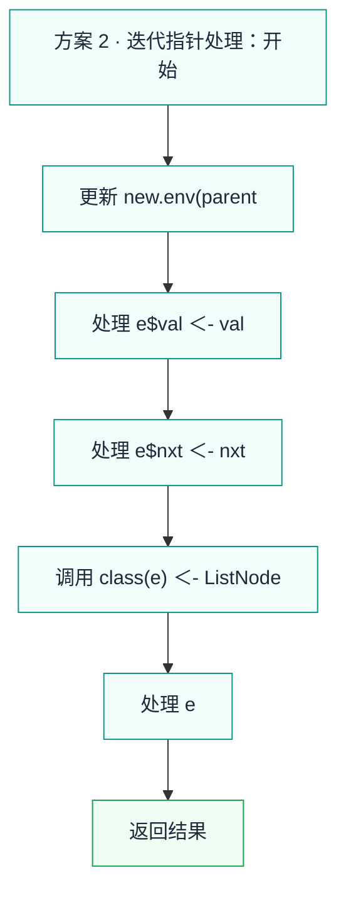

```r
# 版（方案2）
ListNode <- function(val, nxt = NULL) {
    e <- new.env(parent = emptyenv())
    e$val <- val
    e$nxt <- nxt
    class(e) <- "ListNode"
    e
}  # 定义函数 ListNode（参数：值, nxt 赋值为 NULL）
build_with_cycle <- function(vals, pos) {
    # 定义函数 build_with_cycle（参数：vals, pos）
    head <- NULL
    cur <- NULL
    tail_at <- NULL  # 把 NULL; 当前值 小于 减 NULL; tail_at 小于 减 NULL 存入 头节点
    for (i in seq_along(vals)) {
        # for (下标 i in seq_along(vals)) {
        n <- ListNode(vals[i])  # 把 ListNode(vals[下标 i]) 存入 元素个数
        if (is.null(head)) {
            head <- n
            cur <- n
        } else {
            cur$nxt <- n
            cur <- n
        }
        if (i == pos)
            tail_at <- n  # 若 下标 i 等于 pos) tail_at 小于 减 元素个数
    }
    if (!is.null(tail_at))
        cur$nxt <- tail_at  # 若 取反 is.null(tail_at)) 当前值$nxt 小于 减 tail_at
    head  # 头节点
}
detect_cycle <- function(head) {
    # 定义函数 detect_cycle（参数：头节点）
    slow <- head
    fast <- head  # 把 头节点; 快指针 小于 减 头节点 存入 慢指针
    while (!is.null(fast) && !is.null(fast$nxt)) {
        # 循环，直到不满足「取反 is.null(快指针) 且 取反 is.null(快指针$nxt」
        slow <- slow$nxt  # 把 慢指针$nxt 存入 慢指针
        fast <- fast$nxt$nxt  # 把 快指针$nxt$nxt 存入 快指针
        if (!is.null(slow) && identical(slow, fast)) {
            # 若 取反 is.null(慢指针) 且 identical(慢指针, 快指针
            p1 <- head
            p2 <- slow  # 把 头节点; p2 小于 减 慢指针 存入 p1
            while (!identical(p1, p2)) {
                p1 <- p1$nxt
                p2 <- p2$nxt
            }
            return(p1)  # 返回 p1
        }
    }
    NULL  # NULL
}
h <- build_with_cycle(c(3, 2, 0, -4), 2)  # 把 build_with_cycle(字符(3, 2, 0, 减 4), 2) 存入 h
stopifnot(!is.null(detect_cycle(h)), detect_cycle(h)$val == 2)  # 断言校验
stopifnot(is.null(detect_cycle(ListNode(1))))  # 断言校验
cat("PASS\n")  # 全部用例通过，输出 PASS
```

### Zig 实现（2 种方案）

Zig 的全部方案如下，每个方案都内嵌用例自测，可独立运行（老仓库 python/go 文件遵循「打印结果」约定）：

#### 方案 1：迭代指针处理

**思路与代码分析**：核心是「迭代指针处理」。Zig 版显式分配与清零，整型边界处理严格。**走读**：方案 1 · 迭代指针处理：开始 → 计算 slow → 计算 fast → 当 (fast ≠ null and fast.?.next ≠ null) 时反复执行 → 更新 slow → 更新 fast → 若 slow ≠ null and fast ≠ null and slow.? == fast.? 则： → 计算 p1 → 计算 p2 → 当 (p1 ≠ null and p2 ≠ null and p1.? ≠ p2.?) 时反复执行 → 更新 p1 → 更新 p2 → 返回 p1 → 返回 null。

**运行架构**（真实控制流）：


```zig
// LeetCode 142. 环形链表II — Zig 版（方案1）
const std = @import("std"); // 把 @import(「std」) 存入 std
const LNode = struct { val: i32, next: ?*LNode }; // 把 struct { 值: i32, 下一个: ? 乘 LNode } 存入 LNode
fn buildWithCycle(alloc: std.mem.Allocator, vals: []const i32, pos: usize) ?*LNode { // 定义函数/方法 buildWithCycle
    var head: ?*LNode = null; // 把 null; 写入 var head: ?*LNode
    var tail: ?*LNode = null; // 把 null; 写入 var tail: ?*LNode
    var tailAt: ?*LNode = null; // 把 null; 写入 var tailAt: ?*LNode
    for (vals, 0..) |v, i| { // for (vals, 0..) 按位或 值, 下标 i 按位或 {
        const n = alloc.create(LNode) catch unreachable; // 把 alloc.create(LNode) catch unreachable 存入 元素个数
        n.* = .{ .val = v, .next = null }; // 把 { .值 赋值为 值, .下一个 赋值为 null }; 写入 n.*
        if (tail) |t| t.next = n else head = n; // 若 尾节点) 按位或 另一字符串 按位或 另一字符串.下一个 赋值为 元素个数 else 头节点 赋值为 元素个数;
        tail = n; // 把 元素个数; 写入 尾节点
        if (i + 1 == pos) tailAt = n; // 若 下标 i 加 1 等于 pos) tailAt 赋值为 元素个数;
    }
    if (tail) |t| t.next = tailAt; // 若 尾节点) 按位或 另一字符串 按位或 另一字符串.下一个 赋值为 tailAt;
    return head; // 返回 头节点
}
fn detectCycle(head: ?*LNode) ?*LNode { // 定义函数/方法 detectCycle
    var slow = head; // 把 头节点 存入 慢指针
    var fast = head; // 把 头节点 存入 快指针
    while (fast != null and fast.?.next != null) { // 循环，直到不满足「快指针 不等于 null and 快指针.?.下一个 不等于 null」
        slow = slow.?.next; // 把 慢指针.?.下一个; 写入 慢指针
        fast = fast.?.next.?.next; // 把 快指针.?.下一个.?.下一个; 写入 快指针
        if (slow != null and fast != null and slow.? == fast.?) { // 若 慢指针 不等于 null and 快指针 不等于 null and 慢指针.? 等于 快指针.?
            var p1 = head; // 把 头节点 存入 p1
            var p2 = slow; // 把 慢指针 存入 p2
            while (p1 != null and p2 != null and p1.? != p2.?) { // 循环，直到不满足「p1 不等于 null and p2 不等于 null and p1.? 不等于 p2.?」
                p1 = p1.?.next; // 把 p1.?.下一个; 写入 p1
                p2 = p2.?.next; // 把 p2.?.下一个; 写入 p2
            }
            return p1; // 返回 p1
        }
    }
    return null; // 返回 null
}
pub fn main() !void { // 程序入口：跑内嵌自测用例
    var arena = std.heap.ArenaAllocator.init(std.heap.page_allocator); // 把 std.堆.ArenaAllocator.init(std.堆.page_allocator) 存入 arena
    defer arena.deinit(); // defer arena.deinit();
    const alloc = arena.allocator(); // 把 arena.allocator() 存入 alloc
    const h = buildWithCycle(alloc, &[_]i32{ 3, 2, 0, -4 }, 2); // 把 buildWithCycle(alloc, 按位与 [_]i32{ 3, 2, 0, 减 4 }, 2) 存入 h
    const e = detectCycle(h); // 把 detectCycle(h) 存入 e
    if (e == null or e.?.val != 2) return error.TestFailed; // 若 e 等于 null or e.?.值 不等于 2，直接返回 error.TestFailed
    const s = try alloc.create(LNode); // 把 try alloc.create(LNode) 存入 字符串
    s.* = .{ .val = 1, .next = null }; // 把 { .值 赋值为 1, .下一个 赋值为 null }; 写入 s.*
    if (detectCycle(s) != null) return error.TestFailed; // 若 detectCycle(字符串) 不等于 null，直接返回 error.TestFailed
    std.debug.print("PASS\n", .{}); // 全部用例通过，输出 PASS
}
```

#### 方案 2：迭代指针处理

**思路与代码分析**：核心是「迭代指针处理」。Zig 版显式分配与清零，整型边界处理严格。**走读**：方案 2 · 迭代指针处理：开始 → 计算 slow → 计算 fast → 当 (fast ≠ null and fast.?.next ≠ null) 时反复执行 → 更新 slow → 更新 fast → 若 slow ≠ null and fast ≠ null and slow.? == fast.? 则： → 计算 p1 → 计算 p2 → 当 (p1 ≠ null and p2 ≠ null and p1.? ≠ p2.?) 时反复执行 → 更新 p1 → 更新 p2 → 返回 p1 → 返回 null。

**运行架构**（真实控制流）：

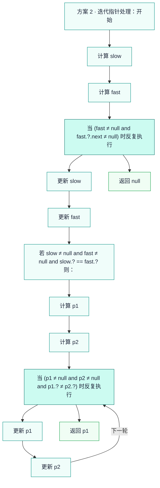

```zig
// LeetCode 142. 环形链表II — Zig 版（方案2）
const std = @import("std"); // 把 @import(「std」) 存入 std
const LNode = struct { val: i32, next: ?*LNode }; // 把 struct { 值: i32, 下一个: ? 乘 LNode } 存入 LNode
fn buildWithCycle(alloc: std.mem.Allocator, vals: []const i32, pos: usize) ?*LNode { // 定义函数/方法 buildWithCycle
    var head: ?*LNode = null; // 把 null; 写入 var head: ?*LNode
    var tail: ?*LNode = null; // 把 null; 写入 var tail: ?*LNode
    var tailAt: ?*LNode = null; // 把 null; 写入 var tailAt: ?*LNode
    for (vals, 0..) |v, i| { // for (vals, 0..) 按位或 值, 下标 i 按位或 {
        const n = alloc.create(LNode) catch unreachable; // 把 alloc.create(LNode) catch unreachable 存入 元素个数
        n.* = .{ .val = v, .next = null }; // 把 { .值 赋值为 值, .下一个 赋值为 null }; 写入 n.*
        if (tail) |t| t.next = n else head = n; // 若 尾节点) 按位或 另一字符串 按位或 另一字符串.下一个 赋值为 元素个数 else 头节点 赋值为 元素个数;
        tail = n; // 把 元素个数; 写入 尾节点
        if (i + 1 == pos) tailAt = n; // 若 下标 i 加 1 等于 pos) tailAt 赋值为 元素个数;
    }
    if (tail) |t| t.next = tailAt; // 若 尾节点) 按位或 另一字符串 按位或 另一字符串.下一个 赋值为 tailAt;
    return head; // 返回 头节点
}
fn detectCycle(head: ?*LNode) ?*LNode { // 定义函数/方法 detectCycle
    var slow = head; // 把 头节点 存入 慢指针
    var fast = head; // 把 头节点 存入 快指针
    while (fast != null and fast.?.next != null) { // 循环，直到不满足「快指针 不等于 null and 快指针.?.下一个 不等于 null」
        slow = slow.?.next; // 把 慢指针.?.下一个; 写入 慢指针
        fast = fast.?.next.?.next; // 把 快指针.?.下一个.?.下一个; 写入 快指针
        if (slow != null and fast != null and slow.? == fast.?) { // 若 慢指针 不等于 null and 快指针 不等于 null and 慢指针.? 等于 快指针.?
            var p1 = head; // 把 头节点 存入 p1
            var p2 = slow; // 把 慢指针 存入 p2
            while (p1 != null and p2 != null and p1.? != p2.?) { // 循环，直到不满足「p1 不等于 null and p2 不等于 null and p1.? 不等于 p2.?」
                p1 = p1.?.next; // 把 p1.?.下一个; 写入 p1
                p2 = p2.?.next; // 把 p2.?.下一个; 写入 p2
            }
            return p1; // 返回 p1
        }
    }
    return null; // 返回 null
}
pub fn main() !void { // 程序入口：跑内嵌自测用例
    var arena = std.heap.ArenaAllocator.init(std.heap.page_allocator); // 把 std.堆.ArenaAllocator.init(std.堆.page_allocator) 存入 arena
    defer arena.deinit(); // defer arena.deinit();
    const alloc = arena.allocator(); // 把 arena.allocator() 存入 alloc
    const h = buildWithCycle(alloc, &[_]i32{ 3, 2, 0, -4 }, 2); // 把 buildWithCycle(alloc, 按位与 [_]i32{ 3, 2, 0, 减 4 }, 2) 存入 h
    const e = detectCycle(h); // 把 detectCycle(h) 存入 e
    if (e == null or e.?.val != 2) return error.TestFailed; // 若 e 等于 null or e.?.值 不等于 2，直接返回 error.TestFailed
    const s = try alloc.create(LNode); // 把 try alloc.create(LNode) 存入 字符串
    s.* = .{ .val = 1, .next = null }; // 把 { .值 赋值为 1, .下一个 赋值为 null }; 写入 s.*
    if (detectCycle(s) != null) return error.TestFailed; // 若 detectCycle(字符串) 不等于 null，直接返回 error.TestFailed
    std.debug.print("PASS\n", .{}); // 全部用例通过，输出 PASS
}
```

### Dart 实现（2 种方案）

Dart 的全部方案如下，每个方案都内嵌用例自测，可独立运行（老仓库 python/go 文件遵循「打印结果」约定）：

#### 方案 1：迭代指针处理

**思路与代码分析**：核心是「迭代指针处理」。Dart 版用可空类型标注与集合方法，注意空安全。代码里依次做这些事：单循环线性扫描。

**运行架构**（真实控制流）：

```mermaid
graph TD
    A["开始：读取输入"]
    F0["单循环线性扫描"]
    A --> F0
    Z["返回结果"]
    F0 --> Z
```

```dart
// LeetCode 142. 环形链表II — Dart 版（方案1）
class LNode {
  // 定义类型
  final int val; // final int 值;
  LNode? next; // LNode? 下一个;
  LNode(this.val); // LNode(this.值);
}

LNode? buildWithCycle(List<int> vals, int pos) {
  // LNode? buildWithCycle(List 小于 int 超过 vals, int pos) {
  LNode? head; // LNode? 头节点;
  LNode? cur; // LNode? 当前值;
  LNode? tailAt; // LNode? tailAt;
  for (var i = 0; i < vals.length; i++) {
    // 让 下标 i 从 0 开始计数，下标 i 小于 vals.长度 就继续
    final n = LNode(vals[i]); // 把 LNode(vals[下标 i]) 存入 元素个数
    if (head == null) {
      // 若 头节点 等于 null
      head = n; // 把 元素个数 存入 头节点
    } else {
      // 否则
      cur!.next = n; // 把 元素个数; 写入 下一个
    }
    cur = n; // 把 元素个数 存入 当前值
    if (i + 1 == pos) tailAt = n; // 若 下标 i 加 1 等于 pos) tailAt 赋值为 元素个数;
  }
  if (tailAt != null)
    cur!.next = tailAt; // 若 tailAt 不等于 null) 当前值取反 .下一个 赋值为 tailAt;
  return head; // 返回 头节点
}

LNode? detectCycle(LNode? head) {
  // LNode? detectCycle(LNode? 头节点) {
  LNode? slow = head, fast = head; // 把 头节点, 快指针 赋值为 头节点; 写入 LNode? slow
  while (fast != null && fast.next != null) {
    // 循环，直到不满足「快指针 不等于 null 且 快指针.下一个 不等于 null」
    slow = slow!.next; // 把 慢指针取反 .下一个 存入 慢指针
    fast = fast.next!.next; // 把 快指针.下一个取反 .下一个 存入 快指针
    if (identical(slow, fast)) {
      // 若 identical(慢指针, 快指针
      LNode? p1 = head; // 把 头节点; 写入 LNode? p1
      LNode? p2 = slow; // 把 慢指针; 写入 LNode? p2
      while (!identical(p1, p2)) {
        // 循环，直到不满足「取反 identical(p1, p2」
        p1 = p1!.next; // 把 p1取反 .下一个 存入 p1
        p2 = p2!.next; // 把 p2取反 .下一个 存入 p2
      }
      return p1; // 返回 p1
    }
  }
  return null; // 返回 null
}

void main() {
  // 程序入口：跑内嵌自测用例
  final h = buildWithCycle([
    3,
    2,
    0,
    -4,
  ], 2); // 把 buildWithCycle([3, 2, 0, 减 4], 2) 存入 h
  final e = detectCycle(h); // 把 detectCycle(h) 存入 e
  if (e == null || e.val != 2)
    throw StateError('c1'); // 若 e 等于 null 或 e.值 不等于 2) throw StateError('c1');
  if (detectCycle(LNode(1)) != null)
    throw StateError(
      'c2',
    ); // 若 detectCycle(LNode(1)) 不等于 null) throw StateError('c2');
  print('PASS'); // 全部用例通过，输出 PASS
}
```

#### 方案 2：迭代指针处理

**思路与代码分析**：核心是「迭代指针处理」。Dart 版用可空类型标注与集合方法，注意空安全。代码里依次做这些事：单循环线性扫描。

**运行架构**：与方案 1 的控制流相同（同算法在该语言的等价实现），图见上。

```dart
// LeetCode 142. 环形链表II — Dart 版（方案2）
class LNode {
  // 定义类型
  final int val; // final int 值;
  LNode? next; // LNode? 下一个;
  LNode(this.val); // LNode(this.值);
}

LNode? buildWithCycle(List<int> vals, int pos) {
  // LNode? buildWithCycle(List 小于 int 超过 vals, int pos) {
  LNode? head; // LNode? 头节点;
  LNode? cur; // LNode? 当前值;
  LNode? tailAt; // LNode? tailAt;
  for (var i = 0; i < vals.length; i++) {
    // 让 下标 i 从 0 开始计数，下标 i 小于 vals.长度 就继续
    final n = LNode(vals[i]); // 把 LNode(vals[下标 i]) 存入 元素个数
    if (head == null) {
      // 若 头节点 等于 null
      head = n; // 把 元素个数 存入 头节点
    } else {
      // 否则
      cur!.next = n; // 把 元素个数; 写入 下一个
    }
    cur = n; // 把 元素个数 存入 当前值
    if (i + 1 == pos) tailAt = n; // 若 下标 i 加 1 等于 pos) tailAt 赋值为 元素个数;
  }
  if (tailAt != null)
    cur!.next = tailAt; // 若 tailAt 不等于 null) 当前值取反 .下一个 赋值为 tailAt;
  return head; // 返回 头节点
}

LNode? detectCycle(LNode? head) {
  // LNode? detectCycle(LNode? 头节点) {
  LNode? slow = head, fast = head; // 把 头节点, 快指针 赋值为 头节点; 写入 LNode? slow
  while (fast != null && fast.next != null) {
    // 循环，直到不满足「快指针 不等于 null 且 快指针.下一个 不等于 null」
    slow = slow!.next; // 把 慢指针取反 .下一个 存入 慢指针
    fast = fast.next!.next; // 把 快指针.下一个取反 .下一个 存入 快指针
    if (identical(slow, fast)) {
      // 若 identical(慢指针, 快指针
      LNode? p1 = head; // 把 头节点; 写入 LNode? p1
      LNode? p2 = slow; // 把 慢指针; 写入 LNode? p2
      while (!identical(p1, p2)) {
        // 循环，直到不满足「取反 identical(p1, p2」
        p1 = p1!.next; // 把 p1取反 .下一个 存入 p1
        p2 = p2!.next; // 把 p2取反 .下一个 存入 p2
      }
      return p1; // 返回 p1
    }
  }
  return null; // 返回 null
}

void main() {
  // 程序入口：跑内嵌自测用例
  final h = buildWithCycle([
    3,
    2,
    0,
    -4,
  ], 2); // 把 buildWithCycle([3, 2, 0, 减 4], 2) 存入 h
  final e = detectCycle(h); // 把 detectCycle(h) 存入 e
  if (e == null || e.val != 2)
    throw StateError('c1'); // 若 e 等于 null 或 e.值 不等于 2) throw StateError('c1');
  if (detectCycle(LNode(1)) != null)
    throw StateError(
      'c2',
    ); // 若 detectCycle(LNode(1)) 不等于 null) throw StateError('c2');
  print('PASS'); // 全部用例通过，输出 PASS
}
```

---

## 内容总结

- **环形链表 ii**（链表 · Medium）：共 2 个方案，主线思路「迭代指针处理」；时间 O(n)（单趟线性扫描）；动画演示链表反转过程，附录给出 11 种语言 × 全部方案的可运行实现。
- 来源博客：[https://blog.csdn.net/tyro_java/article/details/145094299](https://blog.csdn.net/tyro_java/article/details/145094299)
- 导航：[📋 总目录](../) ｜ [← 055 环形链表](../055_环形链表/) ｜ [057 lru 缓存 →](../057_lru_缓存/)
