# 057 · lru 缓存（第二阶段 · 链表 · Medium）

> **难度**：⭐⭐ Medium ｜ **专题**：链表
> **学习定位**：第二阶段 · 链表第 57 篇 ｜ **解法数**：2
> **内容总结**：**lru 缓存**（链表 · Medium）：共 2 个方案，主线思路「基于Map（有序字典语义）」；时间 O(n²)（两层嵌套扫描）；动画演示链表反转过程，附录给出 11 种语言 × 全部方案的可运行实现。

---

## 题目描述

请你设计并实现一个满足 LRU （最近最少使用） 缓存 约束的数据结构。

实现 `LRUCache` 类：

 `LRUCache(int capacity)` 以 正整数 作为容量 `capacity` 初始化 LRU 缓存
 `int get(int key)` 如果关键字 `key` 存在于缓存中，则返回关键字的值，否则返回 `-1` 。
 `void put(int key, int value)` 如果关键字 `key` 已经存在，则变更其数据值 `value` ；如果不存在，则向缓存中插入该组 `key-value` 。如果插入操作导致关键字数量超过 `capacity` ，则应该 逐出 最久未使用的关键字。

函数 `get` 和 `put` 必须以 `O(1)` 的平均时间复杂度运行。

示例：

输入
[「LRUCache」, 「put」, 「put」, 「get」, 「put」, 「get」, 「put」, 「get」, 「get」, 「get」]
[[2], [1, 1], [2, 2], [1], [3, 3], [2], [4, 4], [1], [3], [4]]
输出
[null, null, null, 1, null, -1, null, -1, 3, 4]

解释
LRUCache lRUCache = new LRUCache(2);
lRUCache.put(1, 1); // 缓存是 {1=1}
lRUCache.put(2, 2); // 缓存是 {1=1, 2=2}
lRUCache.get(1); // 返回 1
lRUCache.put(3, 3); // 该操作会使得关键字 2 作废，缓存是 {1=1, 3=3}
lRUCache.get(2); // 返回 -1 （未找到）
lRUCache.put(4, 4); // 该操作会使得关键字 1 作废，缓存是 {4=4, 3=3}
lRUCache.get(1); // 返回 -1 （未找到）
lRUCache.get(3); // 返回 3
lRUCache.get(4); // 返回 4

提示：

 `1 
 `0 
 `0 
 最多调用 `2  10^5` 次 `get` 和 `put`

**用例演示**（摘自主解法内嵌自测，输入到输出一目了然）：

```typescript
  const cases: Case[] = [
    {
      cap: 2,
      ops: [
        ['put', 1, 1],
        ['put', 2, 2],
        ['get', 1],
        ['put', 3, 3],
        ['get', 2],
        ['put', 4, 4],
        ['get', 1],
        ['get', 3],
        ['get', 4],
      ],
```

> 题面与 [leetcode.cn 官方](https://leetcode.cn/problems/lru-cache/)一致，示例配图取自官方题面。

**数据范围与注意事项**：

- `1 <= capacity <= 3000`
- `0 <= key <= 10000`
- `0 <= value <= 10^5`
- `最多调用 `2  10^5` 次 `get` 和 `put``
- **易错点**：断开 next 之前先把后继存下来，否则整条链会丢。

## 题目分析

**场景是什么**：链表只能顺着指针走，这类题练的是指针操作与断链重接，对应真实开发里的内存管理、撤销链。本题就是该场景的 Medium 级练习，主线做法是「基于Map（有序字典语义）」。

**主线怎么解**：把主解法从头到尾过一遍，它其实在依次做这几件事：哈希结构做计数或查重 → 双重循环遍历。

## 解题思路

**方案对比**（共 2 个方案，由浅入深）：

| 方案 | 时间复杂度 | 空间复杂度 |
|---|---|---|
| 方案 1 · 基于Map（有序字典语义） | O(n²)（两层嵌套扫描） | O(1) 到 O(n) |
| 方案 2 · 哈希表 + 双向链表 | O(n²)（两层嵌套扫描） | O(1) 到 O(n) |

**由浅入深的路径**：基于Map（有序字典语义） → 哈希表 + 双向链表；每往右一步，都在补上一步的短板。

**方案间的取舍**：方案 1（基于Map（有序字典语义））；方案 2（哈希表 + 双向链表）。数据规模小、可读性优先时选靠前的方案；规模大、性能优先时选靠后的方案。

**怎么读这一篇**：

- 🐣 **新手路线**：把「题目描述」的示例 1 在纸上手推一遍 → 读方案 1（最直观的写法）与它的代码走读 → 按「运行方式」本地跑通看 PASS → 回头对比方案 2 之后的写法差在哪
- 🦅 **大佬路线**：直接锁定最优方案 1（基于Map（有序字典语义），O(n²)（两层嵌套扫描））→ 跳读该方案代码与走读 → 用「逐步拆解与面试追问」补齐复杂度推导与边界追问

### 动态算法图（链表反转，GIF 自动循环）


动画演示链表专题里链表反转的典型过程；每个方案在「TypeScript 解题方案」一节还配了专属动画与专属流程图。

### 主解法流程图（真实控制流）

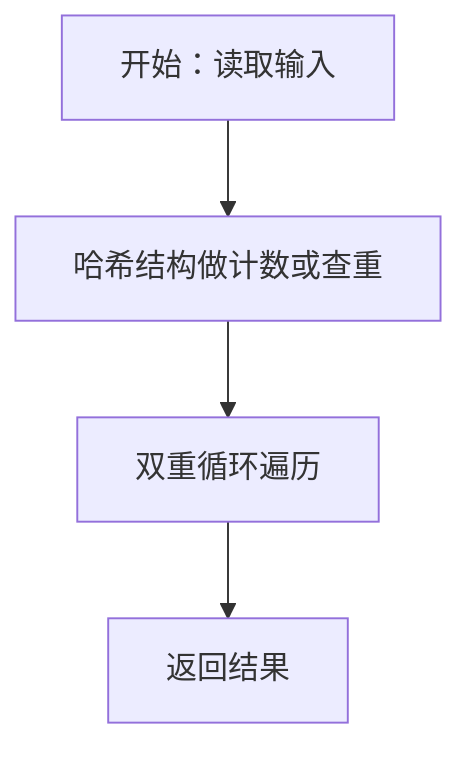

## TypeScript 解题方案（2 个方案逐个讲）

> **运行与提交**：每个方案都是自包含文件（内嵌用例自测，输出 PASS），整块复制到 `.ts` 文件后 `node 文件名` 即可运行。提交 LeetCode 时，把 `demo` 内的算法函数与辅助类型/函数整体取出、置于文件顶层即可。**提交备注**：设计题：按题面给定的 LRUCache 类接口提交（构造器 + get/put）。

### 方案 1：基于Map（有序字典语义）

**分析与思路**：核心做法是「基于Map（有序字典语义）」。代码里依次做这些事：哈希结构做计数或查重；双重循环遍历。

**运行方式**：`node 本文件`，内嵌用例全部通过会输出 PASS。

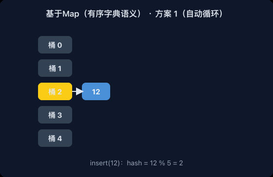

**方案专属流程图**（真实控制流）：


```typescript
/**
 ** LeetCode 146. LRU 缓存
 ** 方案：1 ) 方案1: 基于Map（有序字典语义）
 ** 来源：https://blog.csdn.net/tyro_java/article/details/145094527
 */

export function demo(): void {
  // 程序入口：跑内嵌自测用例
  // LRUCache 忠实翻译 python ref solution_1_1_____1____Map.py（利用 Map 保序：get 时 delete+set 移到末尾，淘汰时删第一个键）
  class LRUCache {
    // 定义类型
    private capacity: number; // private capacity: number;
    private cache: Map<number, number> = new Map(); // 把 new Map(); 写入 private cache: Map<number, number>

    constructor(capacity: number) {
      // constructor(capacity: number) {
      this.capacity = capacity; // 把 capacity; 写入 this.capacity
    }

    get(key: number): number {
      // get(key: number): number {
      if (!this.cache.has(key)) {
        // 若 取反 this.cache.has(key
        return -1; // 返回 减 1
      }
      // Move to end (most recently used)
      const val = this.cache.get(key) as number; // 把 this.cache 查找 key) as number 存入 值
      this.cache.delete(key); // this.cache.delete(key);
      this.cache.set(key, val); // this.cache.set(key, 值);
      return val; // 返回 值
    }

    put(key: number, value: number): void {
      // put(key: number, value: number): void {
      if (this.cache.has(key)) {
        // 若 this.cache.has(key
        this.cache.delete(key); // this.cache.delete(key);
      } else if (this.cache.size >= this.capacity) {
        // 否则，若 this.cache.大小 不低于 this.capacity
        // Remove oldest (first item)
        const oldest = this.cache.keys().next().value as number; // 把 this.cache.keys().下一个().value as number 存入 oldest
        this.cache.delete(oldest); // this.cache.delete(oldest);
      }
      this.cache.set(key, value); // this.cache.set(key, value);
    }
  }

  type Op = ['put', number, number] | ['get', number]; // 定义类型

  interface Case {
    // 定义类型
    cap: number; // cap: number;
    ops: Op[]; // ops: Op[];
    want: (number | null)[]; // want: (number 按位或 null)[];
  }

  // want 由 python ref 实跑操作序列得到
  const cases: Case[] = [
    {
      cap: 2,
      ops: [
        ['put', 1, 1],
        ['put', 2, 2],
        ['get', 1],
        ['put', 3, 3],
        ['get', 2],
        ['put', 4, 4],
        ['get', 1],
        ['get', 3],
        ['get', 4],
      ],
      want: [null, null, 1, null, -1, null, -1, 3, 4],
    },
    {
      cap: 1,
      ops: [
        ['get', 1],
        ['put', 1, 1],
        ['get', 1],
        ['put', 2, 2],
        ['get', 1],
        ['get', 2],
        ['put', 2, 22],
        ['get', 2],
      ],
      want: [-1, null, 1, null, -1, 2, null, 22],
    },
    {
      cap: 2,
      ops: [
        ['put', 1, 1],
        ['put', 1, 10],
        ['get', 1],
        ['put', 2, 2],
        ['put', 3, 3],
        ['get', 1],
        ['get', 2],
        ['get', 3],
      ],
      want: [null, null, 10, null, null, -1, 2, 3],
    },
  ];

  let fail = false; // 把 false 存入 fail
  for (const c of cases) {
    // for (const 字符 of cases) {
    const cache = new LRUCache(c.cap); // 把 new LRUCache(字符.cap) 存入 cache
    const got: (number | null)[] = []; // 把 []; 写入 const got: (number | null)[]
    for (const op of c.ops) {
      // for (const op of 字符.ops) {
      if (op[0] === 'put') {
        // 若 op[0] 全等于 「put」
        cache.put(op[1], op[2]); // cache.put(op[1], op[2]);
        got.push(null); // 把 null 压入栈/数组尾部
      } else {
        // 否则
        got.push(cache.get(op[1])); // 把 cache 查找 op[1] 压入栈/数组尾部
      }
    }
    for (let i = 0; i < got.length; i++) {
      // 让 下标 i 从 0 开始计数，下标 i 小于 got.长度 就继续
      if (got[i] !== c.want[i]) {
        // 若 got[下标 i] 不等于 字符.want[下标 i]
        fail = true; // 把 true 存入 fail
        console.log(
          `FAIL cap=${c.cap} idx=${i} got=${got[i]} want=${c.want[i]}`,
        );
      }
    }
  }
  if (fail) {
    // 若 fail
    throw new Error('FAILED'); // throw new Error(「FAILED」);
  }
  console.log('PASS'); // 全部用例通过，输出 PASS
}
demo(); // demo();
```

### 方案 2：哈希表 + 双向链表

**分析与思路**：核心做法是「哈希表 + 双向链表」。代码里依次做这些事：哈希结构做计数或查重；双重循环遍历。

**运行方式**：`node 本文件`，内嵌用例全部通过会输出 PASS。

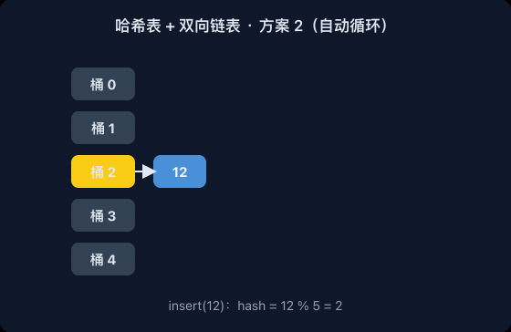

**方案专属流程图**（真实控制流）：


```typescript
/**
 ** LeetCode 146. LRU 缓存
 ** 方案：2 ) 方案2: 哈希表 + 双向链表
 ** 来源：https://blog.csdn.net/tyro_java/article/details/145094527
 */

export function demo(): void {
  // 程序入口：跑内嵌自测用例
  // DLinkedNode 忠实翻译 python ref solution_2_2_____2____________.py
  class DLinkedNode {
    // 定义类型
    key: number; // key: number;
    value: number; // value: number;
    prev: DLinkedNode | null; // 前一个: DLinkedNode 按位或 null;
    next: DLinkedNode | null; // 下一个: DLinkedNode 按位或 null;

    constructor(key = 0, value = 0) {
      // 把 0, value 赋值为 0) { 写入 constructor(key
      this.key = key; // 把 key; 写入 this.key
      this.value = value; // 把 value; 写入 this.value
      this.prev = null; // 把 null; 写入 前一个
      this.next = null; // 把 null; 写入 下一个
    }
  }

  // LRUCache 忠实翻译 python ref（dummy head/tail + addToHead/removeNode/moveToHead/removeTail）
  class LRUCache {
    // 定义类型
    private capacity: number; // private capacity: number;
    private cache: Map<number, DLinkedNode> = new Map(); // 把 new Map(); 写入 private cache: Map<number, DLinkedNode>
    private size = 0; // 把 0; 写入 private size
    private head: DLinkedNode; // private 头节点: DLinkedNode;
    private tail: DLinkedNode; // private 尾节点: DLinkedNode;

    constructor(capacity: number) {
      // constructor(capacity: number) {
      this.capacity = capacity; // 把 capacity; 写入 this.capacity
      this.head = new DLinkedNode(); // 把 new DLinkedNode(); 写入 头节点
      this.tail = new DLinkedNode(); // 把 new DLinkedNode(); 写入 尾节点
      this.head.next = this.tail; // 把 this.尾节点; 写入 下一个
      this.tail.prev = this.head; // 把 this.头节点; 写入 前一个
    }

    private addToHead(node: DLinkedNode): void {
      // private addToHead(节点: DLinkedNode): void {
      node.prev = this.head; // 把 this.头节点; 写入 前一个
      node.next = this.head.next; // 把 this.头节点.下一个; 写入 下一个
      (this.head.next as DLinkedNode).prev = node; // 把 节点; 写入 前一个
      this.head.next = node; // 把 节点; 写入 下一个
    }

    private removeNode(node: DLinkedNode): void {
      // private removeNode(节点: DLinkedNode): void {
      (node.prev as DLinkedNode).next = node.next; // 把 节点.下一个; 写入 下一个
      (node.next as DLinkedNode).prev = node.prev; // 把 节点.前一个; 写入 前一个
    }

    private moveToHead(node: DLinkedNode): void {
      // private moveToHead(节点: DLinkedNode): void {
      this.removeNode(node); // this.removeNode(节点);
      this.addToHead(node); // this.addToHead(节点);
    }

    private removeTail(): DLinkedNode {
      // private removeTail(): DLinkedNode {
      const node = this.tail.prev as DLinkedNode; // 把 this.尾节点.前一个 as DLinkedNode 存入 节点
      this.removeNode(node); // this.removeNode(节点);
      return node; // 返回 节点
    }

    get(key: number): number {
      // get(key: number): number {
      if (!this.cache.has(key)) {
        // 若 取反 this.cache.has(key
        return -1; // 返回 减 1
      }
      const node = this.cache.get(key) as DLinkedNode; // 把 this.cache 查找 key) as DLinkedNode 存入 节点
      this.moveToHead(node); // this.moveToHead(节点);
      return node.value; // 返回 节点.value
    }

    put(key: number, value: number): void {
      // put(key: number, value: number): void {
      if (!this.cache.has(key)) {
        // 若 取反 this.cache.has(key
        const newNode = new DLinkedNode(key, value); // 把 new DLinkedNode(key, value) 存入 newNode
        this.cache.set(key, newNode); // this.cache.set(key, newNode);
        this.addToHead(newNode); // this.addToHead(newNode);
        this.size += 1; // this.size累加 1
        if (this.size > this.capacity) {
          // 若 this.大小 超过 this.capacity
          const removed = this.removeTail(); // 把 this.removeTail() 存入 removed
          this.cache.delete(removed.key); // this.cache.delete(removed.key);
          this.size -= 1; // this.size累减 1
        }
      } else {
        // 否则
        const node = this.cache.get(key) as DLinkedNode; // 把 this.cache 查找 key) as DLinkedNode 存入 节点
        node.value = value; // 把 value; 写入 node.value
        this.moveToHead(node); // this.moveToHead(节点);
      }
    }
  }

  type Op = ['put', number, number] | ['get', number]; // 定义类型

  interface Case {
    // 定义类型
    cap: number; // cap: number;
    ops: Op[]; // ops: Op[];
    want: (number | null)[]; // want: (number 按位或 null)[];
  }

  // want 由 python ref 实跑操作序列得到
  const cases: Case[] = [
    {
      cap: 2,
      ops: [
        ['put', 1, 1],
        ['put', 2, 2],
        ['get', 1],
        ['put', 3, 3],
        ['get', 2],
        ['put', 4, 4],
        ['get', 1],
        ['get', 3],
        ['get', 4],
      ],
      want: [null, null, 1, null, -1, null, -1, 3, 4],
    },
    {
      cap: 1,
      ops: [
        ['get', 1],
        ['put', 1, 1],
        ['get', 1],
        ['put', 2, 2],
        ['get', 1],
        ['get', 2],
        ['put', 2, 22],
        ['get', 2],
      ],
      want: [-1, null, 1, null, -1, 2, null, 22],
    },
    {
      cap: 2,
      ops: [
        ['put', 1, 1],
        ['put', 1, 10],
        ['get', 1],
        ['put', 2, 2],
        ['put', 3, 3],
        ['get', 1],
        ['get', 2],
        ['get', 3],
      ],
      want: [null, null, 10, null, null, -1, 2, 3],
    },
  ];

  let fail = false; // 把 false 存入 fail
  for (const c of cases) {
    // for (const 字符 of cases) {
    const cache = new LRUCache(c.cap); // 把 new LRUCache(字符.cap) 存入 cache
    const got: (number | null)[] = []; // 把 []; 写入 const got: (number | null)[]
    for (const op of c.ops) {
      // for (const op of 字符.ops) {
      if (op[0] === 'put') {
        // 若 op[0] 全等于 「put」
        cache.put(op[1], op[2]); // cache.put(op[1], op[2]);
        got.push(null); // 把 null 压入栈/数组尾部
      } else {
        // 否则
        got.push(cache.get(op[1])); // 把 cache 查找 op[1] 压入栈/数组尾部
      }
    }
    for (let i = 0; i < got.length; i++) {
      // 让 下标 i 从 0 开始计数，下标 i 小于 got.长度 就继续
      if (got[i] !== c.want[i]) {
        // 若 got[下标 i] 不等于 字符.want[下标 i]
        fail = true; // 把 true 存入 fail
        console.log(
          `FAIL cap=${c.cap} idx=${i} got=${got[i]} want=${c.want[i]}`,
        );
      }
    }
  }
  if (fail) {
    // 若 fail
    throw new Error('FAILED'); // throw new Error(「FAILED」);
  }
  console.log('PASS'); // 全部用例通过，输出 PASS
}
demo(); // demo();
```

## 逐步拆解与面试追问

**复杂度**：时间 O(n²)（两层嵌套扫描），空间 O(1) 到 O(n)

**为什么是这个量级**：外层定起点、内层扫终点，n 个起点各扫 n 次

**面试官可能会追问**：

- 能不能一次遍历完成？
- 快慢指针能解决哪些变体？
- 断链与接回的顺序怎么保证不出错？

## 关键 API 速查（TS 主解法实际用到，附官方链接）

| API | 作用 | 使用要点 | 官方文档 |
|---|---|---|---|
| `Map` | 哈希表：任意类型键值对 | set(k,v) 存、get(k) 取（不存在返回 undefined）、has(k) 判存在、delete(k) 删；增删查均摊 O(1)；键顺序为插入序；键必须用引用区分（对象键按身份） | [官方文档](https://developer.mozilla.org/zh-CN/docs/Web/JavaScript/Reference/Global_Objects/Map) |
| `Array.prototype.push()` | 尾部追加 | 返回新长度；可一次多个；均摊 O(1)；会改变原数组 | [官方文档](https://developer.mozilla.org/zh-CN/docs/Web/JavaScript/Reference/Global_Objects/Array/push) |

### 各语言官方文档导航

- **TypeScript / JS**：[MDN 中文参考](https://developer.mozilla.org/zh-CN/)
- **Python**：[Python 官方文档](https://docs.python.org/zh-cn/3/)
- **Go**：[Go 标准库](https://pkg.go.dev/std)
- **Java**：[JDK 17 API](https://docs.oracle.com/en/java/javase/17/docs/api/)
- **Rust**：[Rust 标准库](https://doc.rust-lang.org/std/)
- **Lua**：[Lua 5.4 手册](https://www.lua.org/manual/5.4/)
- **C**：[Cppreference C](https://zh.cppreference.com/w/c)
- **C++**：[Cppreference C++](https://zh.cppreference.com/w/cpp)
- **R**：[R 官方手册](https://stat.ethz.ch/R-manual/)
- **Zig**：[Zig 语言文档](https://ziglang.org/documentation/master/)
- **Dart**：[Dart API](https://api.dart.dev/)

## 附录：其他 10 种语言全部实现（每种语言列举其全部方案）

> TypeScript 的全部方案见「TypeScript 解题方案」一节；下面是其余 10 种语言的对应实现，每种语言的每个方案都带思路分析、代码走读与专属运行架构图。
> 每个方案都内嵌用例自测，可独立运行（老仓库 python/go 文件遵循「打印结果」约定）。
> 完整解法文件见 `dsa/<语言>/linked_list/lc_146_lru_缓存/`。

### Python 实现（2 种方案）

Python 的全部方案如下，每个方案都内嵌用例自测，可独立运行（老仓库 python/go 文件遵循「打印结果」约定）：

#### 方案 1：基于Map（有序字典语义）

**思路与代码分析**：核心是「基于Map（有序字典语义）」。Python 版用切片与字典推导式简化操作，突出可读性。

**运行架构**（真实控制流）：

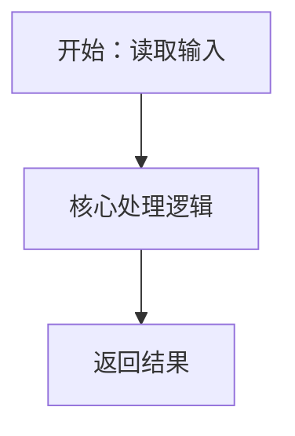

```python
class LRUCache:  # 定义类
    def __init__(self, capacity: int):  # 构造函数：初始化成员
        self.capacity = capacity  # 把 capacity 写入 self.capacity
        self.cache = {}  # 把 {} 写入 self.cache

    def get(self, key: int) -> int:  # 定义函数 get（参数：self, key: int）
        if key not in self.cache:  # 若 key not in self.cache
            return -1  # 返回 减 1
        # Move to end (most recently used)
        val = self.cache.pop(key)  # 把 self.cache 弹出 key) 存入 值
        self.cache[key] = val  # 把 值 写入 self.cache[key]
        return val  # 返回 值

    def put(self, key: int, value: int) -> None:  # 定义函数 put（参数：self, key: int, value: int）
        if key in self.cache:  # 若 key in self.cache
            self.cache.pop(key)  # self.cache 弹出 key)
        elif len(self.cache) >= self.capacity:  # 否则，若 长度(self.cache) 不低于 self.capacity
            # Remove oldest (first item)
            oldest = next(iter(self.cache))  # 把 下一个(iter(self.cache)) 存入 oldest
            del self.cache[oldest]  # del self.cache[oldest]
        self.cache[key] = value  # 把 value 写入 self.cache[key]

if __name__ == "__main__":  # 若 __name__ 等于 '__main__'
    cache = LRUCache(2)  # 把 LRUCache(2) 存入 cache
    cache.put(1, 1)  # cache.put(1, 1)
    cache.put(2, 2)  # cache.put(2, 2)
    print(cache.get(1))  # 打印输出
    cache.put(3, 3)  # cache.put(3, 3)
    print(cache.get(2))  # 打印输出
    cache.put(4, 4)  # cache.put(4, 4)
    print(cache.get(1))  # 打印输出
    print(cache.get(3))  # 打印输出
    print(cache.get(4))  # 打印输出
```

#### 方案 2：哈希表 + 双向链表

**思路与代码分析**：核心是「哈希表 + 双向链表」。Python 版用切片与字典推导式简化操作，突出可读性。

**运行架构**：与方案 1 的控制流相同（同算法在该语言的等价实现），图见上。

```python
import sys  # 提高递归深度上限（深输入防 RecursionError）

sys.setrecursionlimit(200000)  # 树/链表类题目节点数可达 1e4 量级

class DLinkedNode:  # 定义类
    def __init__(self, key=0, value=0):  # 构造函数：初始化成员
        self.key = key  # 把 key 写入 self.key
        self.value = value  # 把 value 写入 self.value
        self.prev = None  # 把 None 写入 前一个
        self.next = None  # 把 None 写入 下一个

class LRUCache:  # 定义类
    def __init__(self, capacity: int):  # 构造函数：初始化成员
        self.capacity = capacity  # 把 capacity 写入 self.capacity
        self.cache = {}  # 把 {} 写入 self.cache
        self.size = 0  # 把 0 写入 大小
        # Dummy head and tail
        self.head = DLinkedNode()  # 把 DLinkedNode() 写入 头节点
        self.tail = DLinkedNode()  # 把 DLinkedNode() 写入 尾节点
        self.head.next = self.tail  # 把 self.尾节点 写入 下一个
        self.tail.prev = self.head  # 把 self.头节点 写入 前一个

    def _add_to_head(self, node):  # 定义函数 _add_to_head（参数：self, 节点）
        node.prev = self.head  # 把 self.头节点 写入 前一个
        node.next = self.head.next  # 把 self.头节点.下一个 写入 下一个
        self.head.next.prev = node  # 把 节点 写入 前一个
        self.head.next = node  # 把 节点 写入 下一个

    def _remove_node(self, node):  # 定义函数 _remove_node（参数：self, 节点）
        node.prev.next = node.next  # 把 节点.下一个 写入 下一个
        node.next.prev = node.prev  # 把 节点.前一个 写入 前一个

    def _move_to_head(self, node):  # 定义函数 _move_to_head（参数：self, 节点）
        self._remove_node(node)  # self._remove_node(节点)
        self._add_to_head(node)  # self._add_to_head(节点)

    def _remove_tail(self):  # 定义函数 _remove_tail（参数：self）
        node = self.tail.prev  # 把 self.尾节点.前一个 存入 节点
        self._remove_node(node)  # self._remove_node(节点)
        return node  # 返回 节点

    def get(self, key: int) -> int:  # 定义函数 get（参数：self, key: int）
        if key not in self.cache:  # 若 key not in self.cache
            return -1  # 返回 减 1
        node = self.cache[key]  # 把 self.cache[key] 存入 节点
        self._move_to_head(node)  # self._move_to_head(节点)
        return node.value  # 返回 节点.value

    def put(self, key: int, value: int) -> None:  # 定义函数 put（参数：self, key: int, value: int）
        if key not in self.cache:  # 若 key not in self.cache
            new_node = DLinkedNode(key, value)  # 把 DLinkedNode(key, value) 存入 new_node
            self.cache[key] = new_node  # 把 new_node 写入 self.cache[key]
            self._add_to_head(new_node)  # self._add_to_head(new_node)
            self.size += 1  # self.size累加 1
            if self.size > self.capacity:  # 若 self.大小 超过 self.capacity
                removed = self._remove_tail()  # 把 self._remove_tail() 存入 removed
                del self.cache[removed.key]  # del self.cache[removed.key]
                self.size -= 1  # self.size累减 1
        else:  # 否则
            node = self.cache[key]  # 把 self.cache[key] 存入 节点
            node.value = value  # 把 value 写入 node.value
            self._move_to_head(node)  # self._move_to_head(节点)

if __name__ == "__main__":  # 若 __name__ 等于 '__main__'
    cache = LRUCache(2)  # 把 LRUCache(2) 存入 cache
    cache.put(1, 1)  # cache.put(1, 1)
    cache.put(2, 2)  # cache.put(2, 2)
    print(cache.get(1))  # 打印输出
    cache.put(3, 3)  # cache.put(3, 3)
    print(cache.get(2))  # 打印输出
    cache.put(4, 4)  # cache.put(4, 4)
    print(cache.get(1))  # 打印输出
    print(cache.get(3))  # 打印输出
    print(cache.get(4))  # 打印输出
```

### Go 实现（2 种方案）

Go 的全部方案如下，每个方案都内嵌用例自测，可独立运行（老仓库 python/go 文件遵循「打印结果」约定）：

#### 方案 1：基于Map（有序字典语义）

**思路与代码分析**：核心是「基于Map（有序字典语义）」。Go 版用切片与多返回值惯用法，显式处理索引边界。代码里依次做这些事：哈希结构做计数或查重。**走读**：方案 1 · 基于Map（有序字典语义）：开始 → 返回 LRUCache。

**运行架构**（真实控制流）：

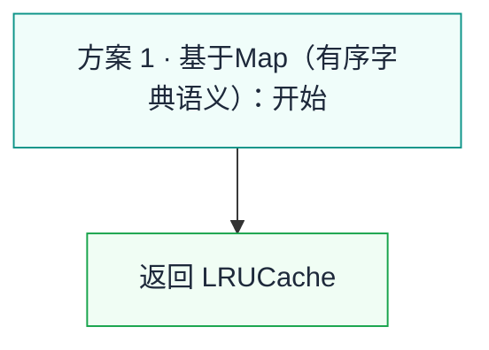

```go
package main // 引入依赖

import (
	"fmt"     // 「fmt」
	"reflect" // 「reflect」
)

type LRUCache struct { // 定义类型
	capacity int         // capacity int
	cache    map[int]int // cache 映射表[int]int
	order    []int       // order []int
}

func Constructor(capacity int) LRUCache { // 定义函数/方法 Constructor
	return LRUCache{capacity: capacity, cache: make(map[int]int)} // 返回 LRUCache{capacity: capacity, cache: make(映射表[int]int)}
}

func (this *LRUCache) removeFromOrder(key int) { // 定义函数/方法 removeFromOrder
	for i, k := range this.order { // 同时取 下标 i 与 下标 k 遍历
		if k == key { // 若 下标 k 等于 key
			this.order = append(this.order[:i], this.order[i+1:]...)
			return // return
		}
	}
}

func (this *LRUCache) Get(key int) int { // 定义函数/方法 Get
	if _, ok := this.cache[key]; !ok { // 若 _, ok : 赋值为 this.cache[key]; 取反 ok
		return -1 // 返回 减 1
	}
	this.removeFromOrder(key)            // this.removeFromOrder(key)
	this.order = append(this.order, key) // 把 append(this.order, key) 写入 this.order
	return this.cache[key]               // 返回 this.cache[key]
}

func (this *LRUCache) Put(key int, value int) { // 定义函数/方法 Put
	if _, ok := this.cache[key]; ok { // 若 _, ok : 赋值为 this.cache[key]; ok
		delete(this.cache, key)   // delete(this.cache, key)
		this.removeFromOrder(key) // this.removeFromOrder(key)
	} else if len(this.cache) >= this.capacity { // 否则，若 长度(this.cache) 不低于 this.capacity
		oldest := this.order[0]     // 把 this.order[0] 写入 oldest :
		this.order = this.order[1:] // 把 this.order[1:] 写入 this.order
		delete(this.cache, oldest)  // delete(this.cache, oldest)
	}
	this.cache[key] = value              // 把 value 写入 this.cache[key]
	this.order = append(this.order, key) // 把 append(this.order, key) 写入 this.order
}

func main() { // 程序入口：跑内嵌自测用例
	c := Constructor(2)                // 把 Constructor(2) 写入 c :
	c.Put(1, 1)                        // 字符.Put(1, 1)
	c.Put(2, 2)                        // 字符.Put(2, 2)
	g1 := c.Get(1)                     // 把 字符.Get(1) 写入 g1 :
	c.Put(3, 3)                        // 字符.Put(3, 3)
	g2 := c.Get(2)                     // 把 字符.Get(2) 写入 g2 :
	c.Put(4, 4)                        // 字符.Put(4, 4)
	g3 := c.Get(1)                     // 把 字符.Get(1) 写入 g3 :
	g4 := c.Get(3)                     // 把 字符.Get(3) 写入 g4 :
	g5 := c.Get(4)                     // 把 字符.Get(4) 写入 g5 :
	got := []int{g1, g2, g3, g4, g5}   // 把 []int{g1, g2, g3, g4, g5} 写入 got :
	want := []int{1, -1, -1, 3, 4}     // 把 []int{1, 减 1, 减 1, 3, 4} 写入 want :
	if !reflect.DeepEqual(got, want) { // 若 取反 reflect.DeepEqual(got, want
		fmt.Printf("FAIL got=%v want=%v\n", got, want) // 打印输出
		panic("FAILED")                                // panic(「FAILED」)
	}
	fmt.Println("PASS") // 全部用例通过，输出 PASS
}
```

#### 方案 2：哈希表 + 双向链表

**思路与代码分析**：核心是「哈希表 + 双向链表」。Go 版用切片与多返回值惯用法，显式处理索引边界。代码里依次做这些事：哈希结构做计数或查重。**走读**：方案 2 · 哈希表 + 双向链表：开始 → 更新 : → 处理 cache: make(map[int]*DLin → 处理 capacity: capacity, → 更新 lru.head → 更新 lru.tail → 更新 lru.head.next → 更新 lru.tail.prev → 返回 lru。

**运行架构**（真实控制流）：

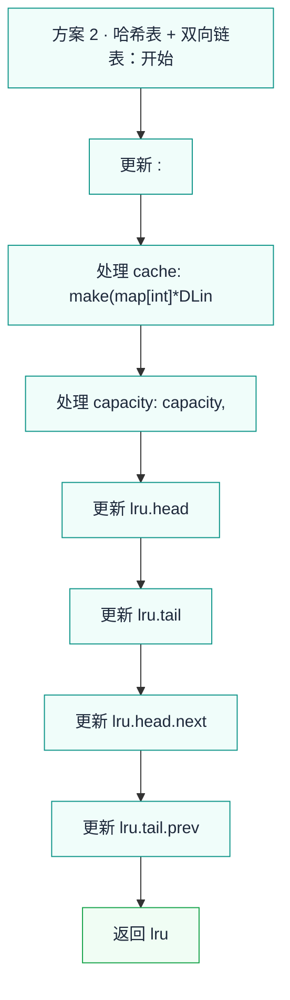

```go
package main // 引入依赖

import (
	"fmt"     // 「fmt」
	"reflect" // 「reflect」
)

type DLinkedNode struct { // 定义类型
	key   int          // key int
	value int          // value int
	prev  *DLinkedNode // 前一个 乘 DLinkedNode
	next  *DLinkedNode // 下一个 乘 DLinkedNode
}

type LRUCache struct { // 定义类型
	size     int                  // 大小 int
	capacity int                  // capacity int
	cache    map[int]*DLinkedNode // cache 映射表[int] 乘 DLinkedNode
	head     *DLinkedNode         // 头节点 乘 DLinkedNode
	tail     *DLinkedNode         // 尾节点 乘 DLinkedNode
}

func Constructor(capacity int) LRUCache { // 定义函数/方法 Constructor
	lru := LRUCache{ // 把 LRUCache{ 写入 lru :
		cache:    make(map[int]*DLinkedNode),
		capacity: capacity,
	}
	lru.head = &DLinkedNode{} // 把 按位与 DLinkedNode{} 写入 头节点
	lru.tail = &DLinkedNode{} // 把 按位与 DLinkedNode{} 写入 尾节点
	lru.head.next = lru.tail  // 把 lru.尾节点 写入 下一个
	lru.tail.prev = lru.head  // 把 lru.头节点 写入 前一个
	return lru                // 返回 lru
}

func (this *LRUCache) Get(key int) int { // 定义函数/方法 Get
	if node, ok := this.cache[key]; ok { // 若 节点, ok : 赋值为 this.cache[key]; ok
		this.moveToHead(node) // this.moveToHead(节点)
		return node.value     // 返回 节点.value
	}
	return -1 // 返回 减 1
}

func (this *LRUCache) Put(key int, value int) { // 定义函数/方法 Put
	if node, ok := this.cache[key]; ok { // 若 节点, ok : 赋值为 this.cache[key]; ok
		node.value = value    // 把 value 写入 node.value
		this.moveToHead(node) // this.moveToHead(节点)
	} else { // 否则
		node := &DLinkedNode{key: key, value: value} // 把 按位与 DLinkedNode{key: key, value: value} 写入 node :
		this.cache[key] = node                       // 把 节点 写入 this.cache[key]
		this.addToHead(node)                         // this.addToHead(节点)
		this.size++                                  // this.大小 加一
		if this.size > this.capacity {               // 若 this.大小 超过 this.capacity
			removed := this.removeTail()    // 把 this.removeTail() 写入 removed :
			delete(this.cache, removed.key) // delete(this.cache, removed.key)
			this.size--                     // this.大小 减一
		}
	}
}

func (this *LRUCache) addToHead(node *DLinkedNode) { // 定义函数/方法 addToHead
	node.prev = this.head      // 把 this.头节点 写入 前一个
	node.next = this.head.next // 把 this.头节点.下一个 写入 下一个
	this.head.next.prev = node // 把 节点 写入 前一个
	this.head.next = node      // 把 节点 写入 下一个
}

func (this *LRUCache) removeNode(node *DLinkedNode) { // 定义函数/方法 removeNode
	node.prev.next = node.next // 把 节点.下一个 写入 下一个
	node.next.prev = node.prev // 把 节点.前一个 写入 前一个
}

func (this *LRUCache) moveToHead(node *DLinkedNode) { // 定义函数/方法 moveToHead
	this.removeNode(node) // this.removeNode(节点)
	this.addToHead(node)  // this.addToHead(节点)
}

func (this *LRUCache) removeTail() *DLinkedNode { // 定义函数/方法 removeTail
	node := this.tail.prev // 把 this.尾节点.前一个 写入 node :
	this.removeNode(node)  // this.removeNode(节点)
	return node            // 返回 节点
}

func main() { // 程序入口：跑内嵌自测用例
	c := Constructor(2)                // 把 Constructor(2) 写入 c :
	c.Put(1, 1)                        // 字符.Put(1, 1)
	c.Put(2, 2)                        // 字符.Put(2, 2)
	g1 := c.Get(1)                     // 把 字符.Get(1) 写入 g1 :
	c.Put(3, 3)                        // 字符.Put(3, 3)
	g2 := c.Get(2)                     // 把 字符.Get(2) 写入 g2 :
	c.Put(4, 4)                        // 字符.Put(4, 4)
	g3 := c.Get(1)                     // 把 字符.Get(1) 写入 g3 :
	g4 := c.Get(3)                     // 把 字符.Get(3) 写入 g4 :
	g5 := c.Get(4)                     // 把 字符.Get(4) 写入 g5 :
	got := []int{g1, g2, g3, g4, g5}   // 把 []int{g1, g2, g3, g4, g5} 写入 got :
	want := []int{1, -1, -1, 3, 4}     // 把 []int{1, 减 1, 减 1, 3, 4} 写入 want :
	if !reflect.DeepEqual(got, want) { // 若 取反 reflect.DeepEqual(got, want
		fmt.Printf("FAIL got=%v want=%v\n", got, want) // 打印输出
		panic("FAILED")                                // panic(「FAILED」)
	}
	fmt.Println("PASS") // 全部用例通过，输出 PASS
}
```

### Java 实现（2 种方案）

Java 的全部方案如下，每个方案都内嵌用例自测，可独立运行（老仓库 python/go 文件遵循「打印结果」约定）：

#### 方案 1：基于Map（有序字典语义）

**思路与代码分析**：核心是「基于Map（有序字典语义）」。Java 版用类与静态方法组织，集合操作显式明了。代码里依次做这些事：哈希结构做计数或查重。**走读**：方案 1 · 基于Map（有序字典语义）：开始 → 更新 cap → 更新 m → 返回结果。

**运行架构**（真实控制流）：

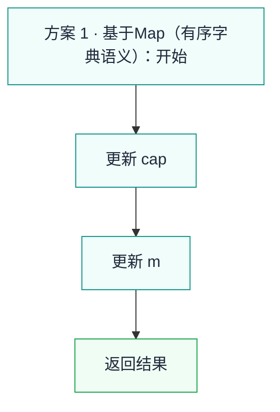

```java
package com.webfault.dsa; // 引入依赖

import java.util.LinkedHashMap; // 引入依赖
// 引入依赖

class LRUCacheSol1 { // 定义类型
  static class LRUCache { // static class LRUCache {
    int cap; // int cap;
    LinkedHashMap<Integer, Integer> m; // LinkedHashMap 小于 Integer, Integer 超过 映射表;

    LRUCache(int c) { // LRUCache(int 字符) {
      cap = c; // 把 字符; 写入 cap
      m = new LinkedHashMap<Integer, Integer>(c, 0.75f, false);
    }

    int get(int k) { // 定义函数/方法 get
      if (!m.containsKey(k)) return -1; // 若 取反 映射表.containsKey(下标 k)，直接返回 减 1
      int v = m.remove(k); // 把 映射表 弹出 下标 k) 存入 值
      m.put(k, v); // 映射表.put(下标 k, 值);
      return v; // 返回 值
    }

    void put(int k, int v) { // 定义函数/方法 put
      if (m.containsKey(k)) { // 若 映射表.containsKey(下标 k
        m.remove(k); // 映射表 弹出 下标 k);
      } else if (m.size() >= cap) { // 否则，若 映射表.大小() 不低于 cap
        int oldest = m.keySet().iterator().next(); // 把 映射表.keySet().iterator().下一个() 存入 oldest
        m.remove(oldest); // 映射表 弹出 oldest);
      }
      m.put(k, v); // 映射表.put(下标 k, 值);
    }
  }

  public static void main(String[] args) { // public static void main(String[] args) {
    LRUCache c = new LRUCache(2); // 把 new LRUCache(2); 写入 LRUCache c
    c.put(1, 1); // 字符.put(1, 1);
    c.put(2, 2); // 字符.put(2, 2);
    int g1 = c.get(1); // 把 字符 查找 1) 存入 g1
    c.put(3, 3); // 字符.put(3, 3);
    int g2 = c.get(2); // 把 字符 查找 2) 存入 g2
    c.put(4, 4); // 字符.put(4, 4);
    int g3 = c.get(1); // 把 字符 查找 1) 存入 g3
    int g4 = c.get(3); // 把 字符 查找 3) 存入 g4
    int g5 = c.get(4); // 把 字符 查找 4) 存入 g5
    int[] got = {g1, g2, g3, g4, g5}; // 把 {g1, g2, g3, g4, g5}; 写入 int[] got
    int[] want = {1, -1, -1, 3, 4}; // 把 {1, 减 1, 减 1, 3, 4}; 写入 int[] want
    boolean ok = true; // 把 true; 写入 boolean ok
    for (int i = 0; i < got.length; i++) { // 让 下标 i 从 0 开始计数，下标 i 小于 got.长度 就继续
      if (got[i] != want[i]) { // 若 got[下标 i] 不等于 want[下标 i]
        ok = false; // 把 false; 写入 ok
        System.out.println("FAIL idx " + i + " got " + got[i] + " want " + want[i]); // 打印输出
      }
    }
    if (!ok) throw new RuntimeException("FAILED"); // 若 取反 ok) throw new RuntimeException(「FAILED」);
    System.out.println("PASS"); // 全部用例通过，输出 PASS
  }
}
```

#### 方案 2：哈希表 + 双向链表

**思路与代码分析**：核心是「哈希表 + 双向链表」。Java 版用类与静态方法组织，集合操作显式明了。**走读**：方案 2 · 哈希表 + 双向链表：开始 → 更新 capacity → 更新 size → 更新 head → 更新 tail → 更新 head.next → 更新 tail.prev → 返回结果。

**运行架构**（真实控制流）：

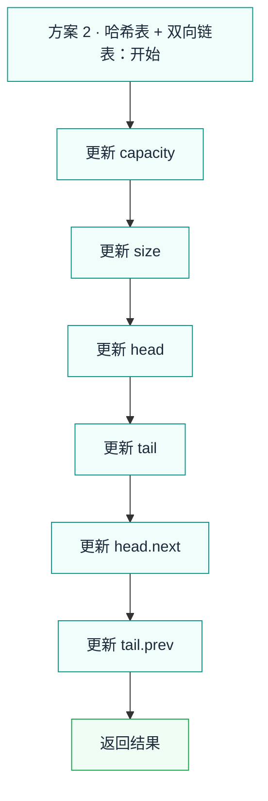

```java
package com.webfault.dsa; // 引入依赖

import java.util.HashMap; // 引入依赖

class LRUCacheSol2 { // 定义类型
  static class DLinkedNode { // static class DLinkedNode {
    int key, value; // int key, value;
    DLinkedNode prev, next; // DLinkedNode 前一个, 下一个;

    DLinkedNode() { // DLinkedNode() {
    }

    DLinkedNode(int k, int v) { // DLinkedNode(int 下标 k, int 值) {
      key = k; // 把 下标 k; 写入 key
      value = v; // 把 值; 写入 value
    }
  }

  static class LRUCache { // static class LRUCache {
    int capacity, size; // int capacity, 大小;
    DLinkedNode head, tail; // DLinkedNode 头节点, 尾节点;
    HashMap<Integer, DLinkedNode> cache = new HashMap<Integer, DLinkedNode>();

    LRUCache(int c) { // LRUCache(int 字符) {
      capacity = c; // 把 字符; 写入 capacity
      size = 0; // 把 0; 写入 大小
      head = new DLinkedNode(); // 把 new DLinkedNode(); 写入 头节点
      tail = new DLinkedNode(); // 把 new DLinkedNode(); 写入 尾节点
      head.next = tail; // 把 尾节点; 写入 下一个
      tail.prev = head; // 把 头节点; 写入 前一个
    }

    void addToHead(DLinkedNode n) { // 定义函数/方法 addToHead
      n.prev = head; // 把 头节点; 写入 前一个
      n.next = head.next; // 把 头节点.下一个; 写入 下一个
      head.next.prev = n; // 把 元素个数; 写入 前一个
      head.next = n; // 把 元素个数; 写入 下一个
    }

    void removeNode(DLinkedNode n) { // 定义函数/方法 removeNode
      n.prev.next = n.next; // 把 元素个数.下一个; 写入 下一个
      n.next.prev = n.prev; // 把 元素个数.前一个; 写入 前一个
    }

    void moveToHead(DLinkedNode n) { // 定义函数/方法 moveToHead
      removeNode(n); // removeNode(元素个数);
      addToHead(n); // addToHead(元素个数);
    }

    DLinkedNode removeTail() { // 定义函数/方法 removeTail
      DLinkedNode n = tail.prev; // 把 尾节点.前一个; 写入 DLinkedNode n
      removeNode(n); // removeNode(元素个数);
      return n; // 返回 元素个数
    }

    int get(int k) { // 定义函数/方法 get
      if (!cache.containsKey(k)) return -1; // 若 取反 cache.containsKey(下标 k)，直接返回 减 1
      DLinkedNode n = cache.get(k); // 把 cache 查找 下标 k); 写入 DLinkedNode n
      moveToHead(n); // moveToHead(元素个数);
      return n.value; // 返回 元素个数.value
    }

    void put(int k, int v) { // 定义函数/方法 put
      if (!cache.containsKey(k)) { // 若 取反 cache.containsKey(下标 k
        DLinkedNode node = new DLinkedNode(k, v); // 把 new DLinkedNode(下标 k, 值); 写入 DLinkedNode node
        cache.put(k, node); // cache.put(下标 k, 节点);
        addToHead(node); // addToHead(节点);
        size++; // 大小 加一
        if (size > capacity) { // 若 大小 超过 capacity
          DLinkedNode removed = removeTail(); // 把 removeTail(); 写入 DLinkedNode removed
          cache.remove(removed.key); // cache 弹出 removed.key);
          size--; // 大小 减一
        }
      } else { // 否则
        DLinkedNode n = cache.get(k); // 把 cache 查找 下标 k); 写入 DLinkedNode n
        n.value = v; // 把 值; 写入 n.value
        moveToHead(n); // moveToHead(元素个数);
      }
    }
  }

  public static void main(String[] args) { // public static void main(String[] args) {
    LRUCache c = new LRUCache(2); // 把 new LRUCache(2); 写入 LRUCache c
    c.put(1, 1); // 字符.put(1, 1);
    c.put(2, 2); // 字符.put(2, 2);
    int g1 = c.get(1); // 把 字符 查找 1) 存入 g1
    c.put(3, 3); // 字符.put(3, 3);
    int g2 = c.get(2); // 把 字符 查找 2) 存入 g2
    c.put(4, 4); // 字符.put(4, 4);
    int g3 = c.get(1); // 把 字符 查找 1) 存入 g3
    int g4 = c.get(3); // 把 字符 查找 3) 存入 g4
    int g5 = c.get(4); // 把 字符 查找 4) 存入 g5
    int[] got = {g1, g2, g3, g4, g5}; // 把 {g1, g2, g3, g4, g5}; 写入 int[] got
    int[] want = {1, -1, -1, 3, 4}; // 把 {1, 减 1, 减 1, 3, 4}; 写入 int[] want
    boolean ok = true; // 把 true; 写入 boolean ok
    for (int i = 0; i < got.length; i++) { // 让 下标 i 从 0 开始计数，下标 i 小于 got.长度 就继续
      if (got[i] != want[i]) { // 若 got[下标 i] 不等于 want[下标 i]
        ok = false; // 把 false; 写入 ok
        System.out.println("FAIL idx " + i + " got " + got[i] + " want " + want[i]); // 打印输出
      }
    }
    if (!ok) throw new RuntimeException("FAILED"); // 若 取反 ok) throw new RuntimeException(「FAILED」);
    System.out.println("PASS"); // 全部用例通过，输出 PASS
  }
}
```

### Rust 实现（2 种方案）

Rust 的全部方案如下，每个方案都内嵌用例自测，可独立运行（老仓库 python/go 文件遵循「打印结果」约定）：

#### 方案 1：基于Map（有序字典语义）

**思路与代码分析**：核心是「基于Map（有序字典语义）」。Rust 版用所有权移动与切片借用改写同一逻辑，注意 Option 与引用边界。**走读**：方案 1 · 基于Map（有序字典语义）：开始 → 计算 lru → 计算 out → 遍历 ops 中的每个元素 op → 处理 match op → 更新 v) → 向 out 追加记录 → 处理 out → 返回结果。

**运行架构**（真实控制流）：

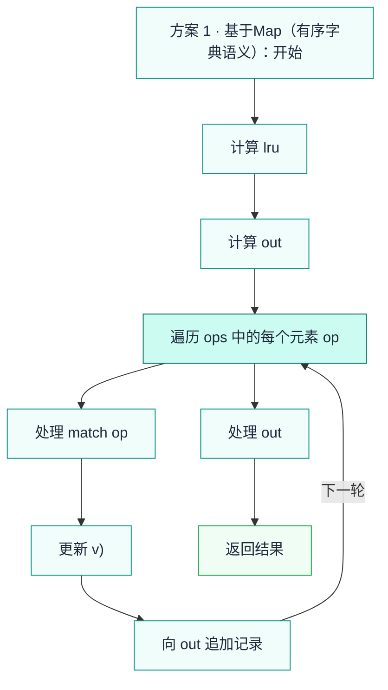

```rust
// LeetCode 146. LRU缓存 — Rust 版（方案1）
#[derive(Clone)]
enum Op {
    Put(i32, i32),
    Get(i32),
} // 定义类型
struct LruSim {
    cap: usize,
    keys: std::collections::VecDeque<i32>,
    vals: std::collections::HashMap<i32, i32>,
} // 定义类型
impl LruSim {
    // 实现块
    fn new(cap: usize) -> Self {
        LruSim {
            cap,
            keys: Default::default(),
            vals: Default::default(),
        }
    } // 定义函数/方法 new
    fn get(&mut self, k: i32) -> i32 {
        // 定义函数/方法 get
        if self.vals.contains_key(&k) {
            // 若 self.vals.contains_key( 按位与 下标 k
            self.keys.retain(|&x| x != k); // 把 下标 k); 写入 self.keys.retain(|&x| x !
            self.keys.push_back(k); // self.keys 追加 下标 k);
            *self.vals.get(&k).unwrap()
        } else {
            -1
        } // 否则
    }
    fn put(&mut self, k: i32, v: i32) {
        // 定义函数/方法 put
        if self.vals.contains_key(&k) {
            // 若 self.vals.contains_key( 按位与 下标 k
            self.keys.retain(|&x| x != k); // 把 下标 k); 写入 self.keys.retain(|&x| x !
        } else if self.keys.len() == self.cap {
            // 否则，若 self.keys.长度() 等于 self.cap
            let old = self.keys.pop_front().unwrap(); // 把 self.keys.pop_front().unwrap() 存入 old
            self.vals.remove(&old); // self.vals 弹出 按位与 old);
        }
        self.keys.push_back(k); // self.keys 追加 下标 k);
        self.vals.insert(k, v); // self.vals 插入 下标 k, 值);
    }
}
fn run_ops(ops: Vec<Op>, cap: usize) -> Vec<i32> {
    // 定义函数/方法 run_ops
    let mut lru = LruSim::new(cap); // 把 LruSim::new(cap); 写入 let mut lru
    let mut out = Vec::new(); // 把 Vec::new(); 写入 let mut out
    for op in ops {
        // 逐个取出 ops 的元素（op）
        match op {
            // 按情况匹配处理
            Op::Put(k, v) => lru.put(k, v),
            Op::Get(k) => out.push(lru.get(k)),
        }
    }
    out // out
}
fn main() {
    // 程序入口：跑内嵌自测用例
    // LC 官方示例：capacity=2, put(1,1), put(2,2), get(1)=1, put(3,3)逐出2, get(2)=-1, put(4,4)逐出1, get(1)=-1, get(3)=3, get(4)=4
    let ops = vec![
        Op::Put(1, 1),
        Op::Put(2, 2),
        Op::Get(1),
        Op::Put(3, 3),
        Op::Get(2),
        Op::Put(4, 4),
        Op::Get(1),
        Op::Get(3),
        Op::Get(4),
    ];
    assert_eq!(run_ops(ops, 2), vec![1, -1, -1, 3, 4]); // 断言校验
    println!("PASS"); // 全部用例通过，输出 PASS
}
```

#### 方案 2：哈希表 + 双向链表

**思路与代码分析**：核心是「哈希表 + 双向链表」。Rust 版用所有权移动与切片借用改写同一逻辑，注意 Option 与引用边界。**走读**：方案 2 · 哈希表 + 双向链表：开始 → 计算 lru → 计算 out → 遍历 ops 中的每个元素 op → 处理 match op → 更新 v) → 向 out 追加记录 → 处理 out → 返回结果。

**运行架构**（真实控制流）：

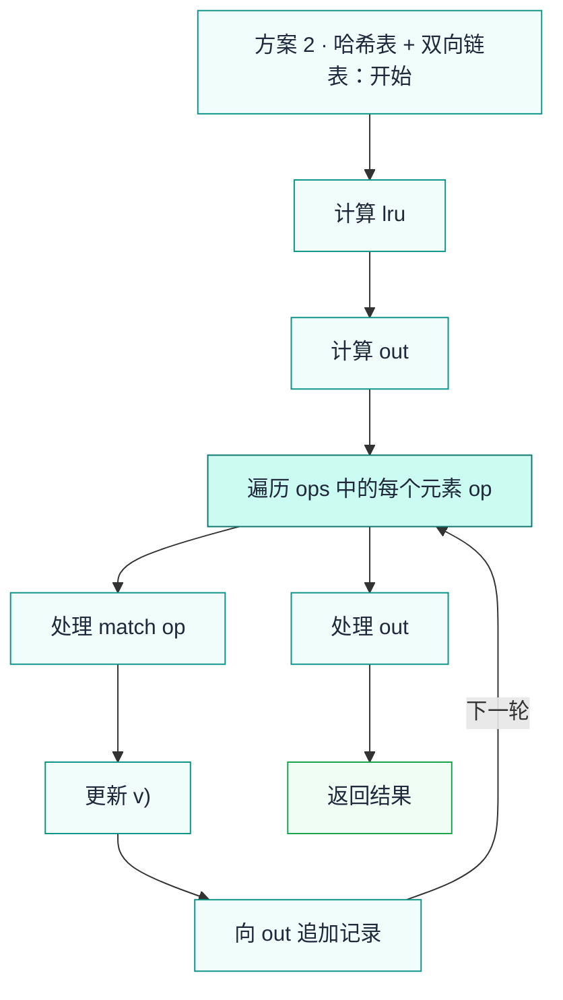

```rust
// LeetCode 146. LRU缓存 — Rust 版（方案2）
#[derive(Clone)]
enum Op {
    Put(i32, i32),
    Get(i32),
} // 定义类型
struct LruSim {
    cap: usize,
    keys: std::collections::VecDeque<i32>,
    vals: std::collections::HashMap<i32, i32>,
} // 定义类型
impl LruSim {
    // 实现块
    fn new(cap: usize) -> Self {
        LruSim {
            cap,
            keys: Default::default(),
            vals: Default::default(),
        }
    } // 定义函数/方法 new
    fn get(&mut self, k: i32) -> i32 {
        // 定义函数/方法 get
        if self.vals.contains_key(&k) {
            // 若 self.vals.contains_key( 按位与 下标 k
            self.keys.retain(|&x| x != k); // 把 下标 k); 写入 self.keys.retain(|&x| x !
            self.keys.push_back(k); // self.keys 追加 下标 k);
            *self.vals.get(&k).unwrap()
        } else {
            -1
        } // 否则
    }
    fn put(&mut self, k: i32, v: i32) {
        // 定义函数/方法 put
        if self.vals.contains_key(&k) {
            // 若 self.vals.contains_key( 按位与 下标 k
            self.keys.retain(|&x| x != k); // 把 下标 k); 写入 self.keys.retain(|&x| x !
        } else if self.keys.len() == self.cap {
            // 否则，若 self.keys.长度() 等于 self.cap
            let old = self.keys.pop_front().unwrap(); // 把 self.keys.pop_front().unwrap() 存入 old
            self.vals.remove(&old); // self.vals 弹出 按位与 old);
        }
        self.keys.push_back(k); // self.keys 追加 下标 k);
        self.vals.insert(k, v); // self.vals 插入 下标 k, 值);
    }
}
fn run_ops(ops: Vec<Op>, cap: usize) -> Vec<i32> {
    // 定义函数/方法 run_ops
    let mut lru = LruSim::new(cap); // 把 LruSim::new(cap); 写入 let mut lru
    let mut out = Vec::new(); // 把 Vec::new(); 写入 let mut out
    for op in ops {
        // 逐个取出 ops 的元素（op）
        match op {
            // 按情况匹配处理
            Op::Put(k, v) => lru.put(k, v),
            Op::Get(k) => out.push(lru.get(k)),
        }
    }
    out // out
}
fn main() {
    // 程序入口：跑内嵌自测用例
    // LC 官方示例：capacity=2, put(1,1), put(2,2), get(1)=1, put(3,3)逐出2, get(2)=-1, put(4,4)逐出1, get(1)=-1, get(3)=3, get(4)=4
    let ops = vec![
        Op::Put(1, 1),
        Op::Put(2, 2),
        Op::Get(1),
        Op::Put(3, 3),
        Op::Get(2),
        Op::Put(4, 4),
        Op::Get(1),
        Op::Get(3),
        Op::Get(4),
    ];
    assert_eq!(run_ops(ops, 2), vec![1, -1, -1, 3, 4]); // 断言校验
    println!("PASS"); // 全部用例通过，输出 PASS
}
```

### Lua 实现（2 种方案）

Lua 的全部方案如下，每个方案都内嵌用例自测，可独立运行（老仓库 python/go 文件遵循「打印结果」约定）：

#### 方案 1：基于Map（有序字典语义）

**思路与代码分析**：核心是「基于Map（有序字典语义）」。Lua 版用表与 ipairs 遍历，注意 ipairs 遇 nil 即停的语义。

**运行架构**（真实控制流）：


```lua
-- LeetCode 146. LRU缓存 — Lua 版（方案1）
local LruSim = {} -- 把 {} 写入 local LruSim
LruSim.__index = LruSim -- 把 LruSim 写入 LruSim.__index
function LruSim.new(cap)
	return setmetatable({ cap = cap, keys = {}, vals = {} }, LruSim)
end
function LruSim:get(k) -- function LruSim:get(下标 k)
	if self.vals[k] ~= nil then -- 若 self.vals[下标 k] ~ 赋值为 nil then
		for i, key in ipairs(self.keys) do -- 遍历取 key
			if key == k then
				table.remove(self.keys, i)
				break
			end -- 若 key 等于 下标 k then table 弹出 self.keys, 下标 i) break 终点
		end -- 终点
		self.keys[#self.keys + 1] = k -- 把 下标 k 写入 self.keys[#self.keys + 1]
		return self.vals[k] -- 返回 self.vals[下标 k]
	end -- 终点
	return -1 -- 返回 减 1
end -- 终点
function LruSim:put(k, v) -- function LruSim:put(下标 k, 值)
	if self.vals[k] ~= nil then -- 若 self.vals[下标 k] ~ 赋值为 nil then
		for i, key in ipairs(self.keys) do -- 遍历取 key
			if key == k then
				table.remove(self.keys, i)
				break
			end -- 若 key 等于 下标 k then table 弹出 self.keys, 下标 i) break 终点
		end -- 终点
	elseif #self.keys == self.cap then -- 把 赋值为 self.cap then 写入 elseif #self.keys
		local old = table.remove(self.keys, 1) -- 把 table 弹出 self.keys, 1) 写入 local old
		self.vals[old] = nil -- 把 nil 写入 self.vals[old]
	end -- 终点
	self.keys[#self.keys + 1] = k -- 把 下标 k 写入 self.keys[#self.keys + 1]
	self.vals[k] = v -- 把 值 写入 self.vals[k]
end -- 终点
local lru = LruSim.new(2) -- 把 LruSim.new(2) 写入 local lru
lru:put(1, 1)
lru:put(2, 2) -- lru:put(1, 1); lru:put(2, 2)
assert(lru:get(1) == 1) -- 断言校验
lru:put(3, 3) -- lru:put(3, 3)
assert(lru:get(2) == -1) -- 断言校验
lru:put(4, 4) -- lru:put(4, 4)
assert(lru:get(1) == -1) -- 断言校验
assert(lru:get(3) == 3) -- 断言校验
assert(lru:get(4) == 4) -- 断言校验
print("PASS") -- 全部用例通过，输出 PASS
```

#### 方案 2：哈希表 + 双向链表

**思路与代码分析**：核心是「哈希表 + 双向链表」。Lua 版用表与 ipairs 遍历，注意 ipairs 遇 nil 即停的语义。

**运行架构**：与方案 1 的控制流相同（同算法在该语言的等价实现），图见上。

```lua
-- LeetCode 146. LRU缓存 — Lua 版（方案2）
local LruSim = {} -- 把 {} 写入 local LruSim
LruSim.__index = LruSim -- 把 LruSim 写入 LruSim.__index
function LruSim.new(cap)
	return setmetatable({ cap = cap, keys = {}, vals = {} }, LruSim)
end
function LruSim:get(k) -- function LruSim:get(下标 k)
	if self.vals[k] ~= nil then -- 若 self.vals[下标 k] ~ 赋值为 nil then
		for i, key in ipairs(self.keys) do -- 遍历取 key
			if key == k then
				table.remove(self.keys, i)
				break
			end -- 若 key 等于 下标 k then table 弹出 self.keys, 下标 i) break 终点
		end -- 终点
		self.keys[#self.keys + 1] = k -- 把 下标 k 写入 self.keys[#self.keys + 1]
		return self.vals[k] -- 返回 self.vals[下标 k]
	end -- 终点
	return -1 -- 返回 减 1
end -- 终点
function LruSim:put(k, v) -- function LruSim:put(下标 k, 值)
	if self.vals[k] ~= nil then -- 若 self.vals[下标 k] ~ 赋值为 nil then
		for i, key in ipairs(self.keys) do -- 遍历取 key
			if key == k then
				table.remove(self.keys, i)
				break
			end -- 若 key 等于 下标 k then table 弹出 self.keys, 下标 i) break 终点
		end -- 终点
	elseif #self.keys == self.cap then -- 把 赋值为 self.cap then 写入 elseif #self.keys
		local old = table.remove(self.keys, 1) -- 把 table 弹出 self.keys, 1) 写入 local old
		self.vals[old] = nil -- 把 nil 写入 self.vals[old]
	end -- 终点
	self.keys[#self.keys + 1] = k -- 把 下标 k 写入 self.keys[#self.keys + 1]
	self.vals[k] = v -- 把 值 写入 self.vals[k]
end -- 终点
local lru = LruSim.new(2) -- 把 LruSim.new(2) 写入 local lru
lru:put(1, 1)
lru:put(2, 2) -- lru:put(1, 1); lru:put(2, 2)
assert(lru:get(1) == 1) -- 断言校验
lru:put(3, 3) -- lru:put(3, 3)
assert(lru:get(2) == -1) -- 断言校验
lru:put(4, 4) -- lru:put(4, 4)
assert(lru:get(1) == -1) -- 断言校验
assert(lru:get(3) == 3) -- 断言校验
assert(lru:get(4) == 4) -- 断言校验
print("PASS") -- 全部用例通过，输出 PASS
```

### C 实现（2 种方案）

C 的全部方案如下，每个方案都内嵌用例自测，可独立运行（老仓库 python/go 文件遵循「打印结果」约定）：

#### 方案 1：基于Map（有序字典语义）

**思路与代码分析**：核心是「基于Map（有序字典语义）」。C 版手动管理下标与内存，循环边界全部显式写出。**走读**：方案 1 · 基于Map（有序字典语义）：开始 → 更新 s->cap → 更新 s->n → 更新 s->clock_ → 返回结果。

**运行架构**（真实控制流）：

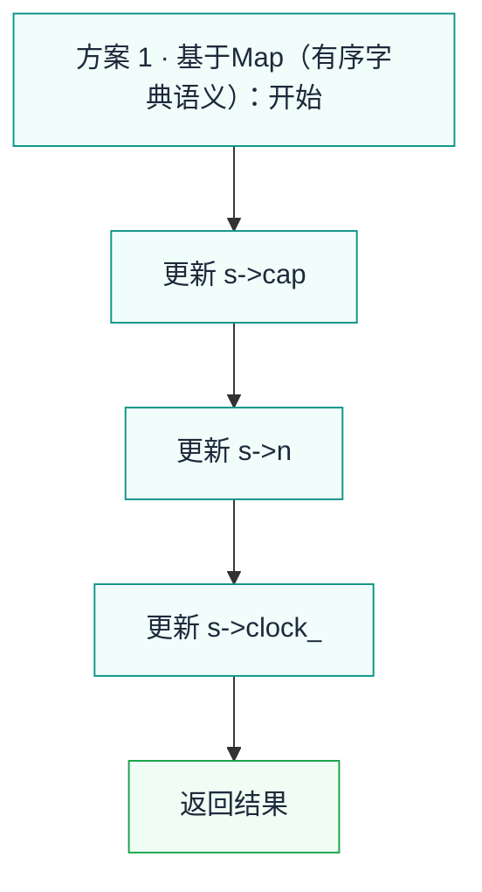

```c
/* LeetCode 146. LRU缓存 — C 版（方案1） */
#include <stdio.h> // 引入头文件
/* 简易 LRU：时间戳法（容量小，线性扫描） */
typedef struct {
    int cap, n;
    int keys[256];
    int vals[256];
    long stamp[256];
    long clock_;
} LruSim;
static void lru_init(LruSim *s, int cap) {
    s->cap = cap;
    s->n = 0;
    s->clock_ = 0;
}
static int lru_find(LruSim *s, int k) { // 定义函数/方法 lru_find
    for (int i = 0; i < s->n; i++)
        if (s->keys[i] == k)
            return i; // 让 下标 i 从 0 开始计数，下标 i 小于 字符串 减 超过 元素个数 就继续
    return -1; // 返回 减 1
}
static void lru_remove_idx(LruSim *s, int idx) { // 定义函数/方法 lru_remove_idx
    for (int i = idx; i + 1 < s->n; i++) {
        s->keys[i] = s->keys[i + 1];
        s->vals[i] = s->vals[i + 1];
        s->stamp[i] = s->stamp[i + 1];
    } // 让 下标 i 从 idx 开始计数，下标 i 加 1 小于 字符串 减 超过 元素个数 就继续
    s->n--; // 字符串 减 超过 元素个数 减一 ;
}
static int lru_get(LruSim *s, int k) { // 定义函数/方法 lru_get
    int i = lru_find(s, k);            // 把 lru_find(字符串, 下标 k) 存入 下标 i
    if (i < 0)
        return -1;             // 若 下标 i 小于 0，直接返回 减 1
    s->stamp[i] = ++s->clock_; // 把 加一 字符串 减 超过 clock_; 写入 s->stamp[i]
    return s->vals[i];         // 返回 字符串 减 超过 vals[下标 i]
}
static void lru_put(LruSim *s, int k, int v) { // 定义函数/方法 lru_put
    int i = lru_find(s, k);                    // 把 lru_find(字符串, 下标 k) 存入 下标 i
    if (i >= 0) {
        s->vals[i] = v;
        s->stamp[i] = ++s->clock_;
        return;
    }
    if (s->n == s->cap) { // 若 字符串 减 超过 元素个数 等于 字符串 减 超过 cap
        int oldest = 0;   // 把 0 存入 oldest
        for (int j = 1; j < s->n; j++)
            if (s->stamp[j] < s->stamp[oldest])
                oldest = j; // 让 下标 j 从 1 开始计数，下标 j 小于 字符串 减 超过 元素个数 就继续
        lru_remove_idx(s, oldest); // lru_remove_idx(字符串, oldest);
    }
    s->keys[s->n] = k;
    s->vals[s->n] = v;
    s->stamp[s->n] = ++s->clock_;
    s->n++;
}
int main(void) {     // 程序入口：跑内嵌自测用例
    LruSim s;        // LruSim 字符串;
    lru_init(&s, 2); // lru_init( 按位与 字符串, 2);
    lru_put(&s, 1, 1);
    lru_put(&s, 2, 2); // lru_put( 按位与 字符串, 1, 1); lru_put( 按位与 字符串, 2, 2);
    if (lru_get(&s, 1) != 1) {
        printf("FAIL 1\n");
        return 1;
    } // 若 lru_get( 按位与 字符串, 1) 不等于 1) { 输出「FAIL 1 」); return 1; }
    lru_put(&s, 3, 3); // lru_put( 按位与 字符串, 3, 3);
    if (lru_get(&s, 2) != -1) {
        printf("FAIL 2\n");
        return 1;
    } // 若 lru_get( 按位与 字符串, 2) 不等于 减 1) { 输出「FAIL 2 」); return 1; }
    lru_put(&s, 4, 4); // lru_put( 按位与 字符串, 4, 4);
    if (lru_get(&s, 1) != -1) {
        printf("FAIL 3\n");
        return 1;
    } // 若 lru_get( 按位与 字符串, 1) 不等于 减 1) { 输出「FAIL 3 」); return 1; }
    if (lru_get(&s, 3) != 3 || lru_get(&s, 4) != 4) {
        printf("FAIL 4\n");
        return 1;
    }
    printf("PASS\n"); // 全部用例通过，输出 PASS
    return 0;         // 返回 0
}
```

#### 方案 2：哈希表 + 双向链表

**思路与代码分析**：核心是「哈希表 + 双向链表」。C 版手动管理下标与内存，循环边界全部显式写出。**走读**：方案 2 · 哈希表 + 双向链表：开始 → 更新 s->cap → 更新 s->n → 更新 s->clock_ → 返回结果。

**运行架构**（真实控制流）：

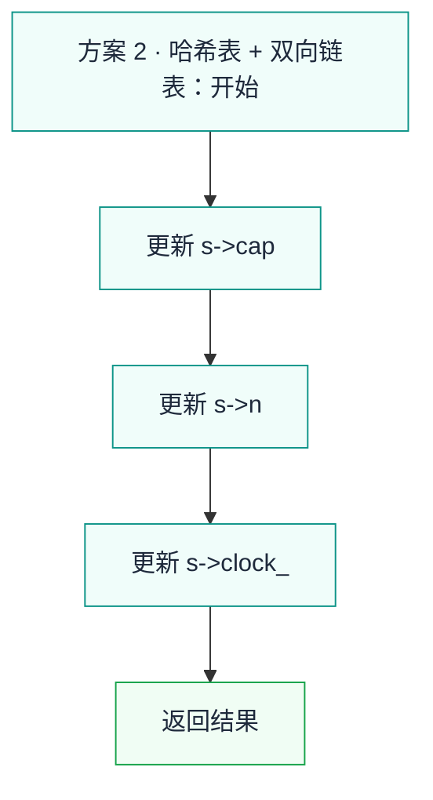

```c
/* LeetCode 146. LRU缓存 — C 版（方案2） */
#include <stdio.h> // 引入头文件
/* 简易 LRU：时间戳法（容量小，线性扫描） */
typedef struct {
    int cap, n;
    int keys[256];
    int vals[256];
    long stamp[256];
    long clock_;
} LruSim;
static void lru_init(LruSim *s, int cap) {
    s->cap = cap;
    s->n = 0;
    s->clock_ = 0;
}
static int lru_find(LruSim *s, int k) { // 定义函数/方法 lru_find
    for (int i = 0; i < s->n; i++)
        if (s->keys[i] == k)
            return i; // 让 下标 i 从 0 开始计数，下标 i 小于 字符串 减 超过 元素个数 就继续
    return -1; // 返回 减 1
}
static void lru_remove_idx(LruSim *s, int idx) { // 定义函数/方法 lru_remove_idx
    for (int i = idx; i + 1 < s->n; i++) {
        s->keys[i] = s->keys[i + 1];
        s->vals[i] = s->vals[i + 1];
        s->stamp[i] = s->stamp[i + 1];
    } // 让 下标 i 从 idx 开始计数，下标 i 加 1 小于 字符串 减 超过 元素个数 就继续
    s->n--; // 字符串 减 超过 元素个数 减一 ;
}
static int lru_get(LruSim *s, int k) { // 定义函数/方法 lru_get
    int i = lru_find(s, k);            // 把 lru_find(字符串, 下标 k) 存入 下标 i
    if (i < 0)
        return -1;             // 若 下标 i 小于 0，直接返回 减 1
    s->stamp[i] = ++s->clock_; // 把 加一 字符串 减 超过 clock_; 写入 s->stamp[i]
    return s->vals[i];         // 返回 字符串 减 超过 vals[下标 i]
}
static void lru_put(LruSim *s, int k, int v) { // 定义函数/方法 lru_put
    int i = lru_find(s, k);                    // 把 lru_find(字符串, 下标 k) 存入 下标 i
    if (i >= 0) {
        s->vals[i] = v;
        s->stamp[i] = ++s->clock_;
        return;
    }
    if (s->n == s->cap) { // 若 字符串 减 超过 元素个数 等于 字符串 减 超过 cap
        int oldest = 0;   // 把 0 存入 oldest
        for (int j = 1; j < s->n; j++)
            if (s->stamp[j] < s->stamp[oldest])
                oldest = j; // 让 下标 j 从 1 开始计数，下标 j 小于 字符串 减 超过 元素个数 就继续
        lru_remove_idx(s, oldest); // lru_remove_idx(字符串, oldest);
    }
    s->keys[s->n] = k;
    s->vals[s->n] = v;
    s->stamp[s->n] = ++s->clock_;
    s->n++;
}
int main(void) {     // 程序入口：跑内嵌自测用例
    LruSim s;        // LruSim 字符串;
    lru_init(&s, 2); // lru_init( 按位与 字符串, 2);
    lru_put(&s, 1, 1);
    lru_put(&s, 2, 2); // lru_put( 按位与 字符串, 1, 1); lru_put( 按位与 字符串, 2, 2);
    if (lru_get(&s, 1) != 1) {
        printf("FAIL 1\n");
        return 1;
    } // 若 lru_get( 按位与 字符串, 1) 不等于 1) { 输出「FAIL 1 」); return 1; }
    lru_put(&s, 3, 3); // lru_put( 按位与 字符串, 3, 3);
    if (lru_get(&s, 2) != -1) {
        printf("FAIL 2\n");
        return 1;
    } // 若 lru_get( 按位与 字符串, 2) 不等于 减 1) { 输出「FAIL 2 」); return 1; }
    lru_put(&s, 4, 4); // lru_put( 按位与 字符串, 4, 4);
    if (lru_get(&s, 1) != -1) {
        printf("FAIL 3\n");
        return 1;
    } // 若 lru_get( 按位与 字符串, 1) 不等于 减 1) { 输出「FAIL 3 」); return 1; }
    if (lru_get(&s, 3) != 3 || lru_get(&s, 4) != 4) {
        printf("FAIL 4\n");
        return 1;
    }
    printf("PASS\n"); // 全部用例通过，输出 PASS
    return 0;         // 返回 0
}
```

### C++ 实现（2 种方案）

C++ 的全部方案如下，每个方案都内嵌用例自测，可独立运行（老仓库 python/go 文件遵循「打印结果」约定）：

#### 方案 1：基于Map（有序字典语义）

**思路与代码分析**：核心是「基于Map（有序字典语义）」。C++ 版用 STL 容器与迭代器，减少手写下标错误。**走读**：方案 1 · 基于Map（有序字典语义）：开始 → 更新 it → 命中条件，直接返回 → 调用 items.splice(items.begin(), → 处理 it-＞second) → 返回 it-＞second-＞second。

**运行架构**（真实控制流）：

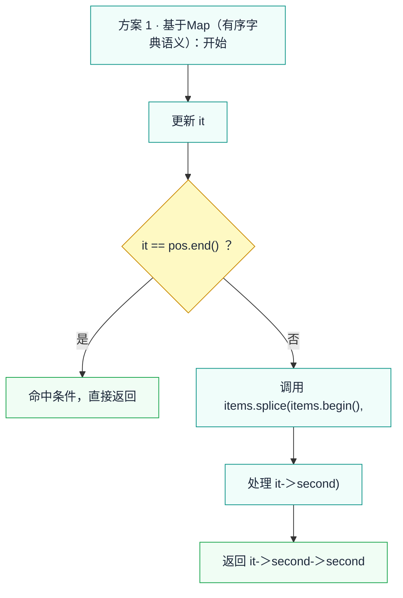

```cpp
// LeetCode 146. LRU缓存 — C++ 版（方案1）
#include <cassert>                        // 引入头文件
#include <iostream>                       // 引入头文件
#include <list>                           // 引入头文件
#include <unordered_map>                  // 引入头文件
struct LRUCache {                         // 定义类型
    int cap;                              // int cap;
    std::list<std::pair<int, int>> items; // std::列表 小于 std::pair 小于 int, int 超过 超过 items;
    std::unordered_map<int, std::list<std::pair<int, int>>::iterator> pos;
    explicit LRUCache(int capacity) : cap(capacity) {} // explicit LRUCache(int capacity) : cap(capacity) {}
    int get(int key) {                                 // 定义函数/方法 get
        auto it = pos.find(key);                       // 把 pos 查找 key) 存入 it
        if (it == pos.end())
            return -1; // 若 it 等于 pos.终点()，直接返回 减 1
        items.splice(items.begin(), items,
                     it->second);  // items.splice(items 迭代位置 , items, it 减 超过 second);
        return it->second->second; // 返回 it 减 超过 second 减 超过 second
    }
    void put(int key, int value) {      // 定义函数/方法 put
        auto it = pos.find(key);        // 把 pos 查找 key) 存入 it
        if (it != pos.end()) {          // 若 it 不等于 pos.终点(
            it->second->second = value; // 把 value; 写入 it->second->second
            items.splice(items.begin(), items,
                         it->second); // items.splice(items 迭代位置 , items, it 减 超过 second);
            return;                   // return;
        }
        if (static_cast<int>(items.size()) == cap) { // 若 static_cast 小于 int 超过 (items.大小()) 等于 cap
            pos.erase(items.back().first);           // pos 删除 items.back().first);
            items.pop_back();                        // 弹出栈顶元素
        }
        items.emplace_front(key, value); // items.emplace_front(key, value);
        pos[key] = items.begin();        // 把 items 迭代位置 ; 写入 pos[key]
    }
};
int main() {                          // 程序入口：跑内嵌自测用例
    LRUCache lru(2);                  // LRUCache lru(2);
    lru.put(1, 1);                    // lru.put(1, 1);
    lru.put(2, 2);                    // lru.put(2, 2);
    assert(lru.get(1) == 1);          // 断言校验
    lru.put(3, 3);                    // lru.put(3, 3);
    assert(lru.get(2) == -1);         // 断言校验
    lru.put(4, 4);                    // lru.put(4, 4);
    assert(lru.get(1) == -1);         // 断言校验
    assert(lru.get(3) == 3);          // 断言校验
    assert(lru.get(4) == 4);          // 断言校验
    std::cout << "PASS" << std::endl; // 全部用例通过，输出 PASS
    return 0;                         // 返回 0
}
```

#### 方案 2：哈希表 + 双向链表

**思路与代码分析**：核心是「哈希表 + 双向链表」。C++ 版用 STL 容器与迭代器，减少手写下标错误。**走读**：方案 2 · 哈希表 + 双向链表：开始 → 更新 it → 命中条件，直接返回 → 调用 items.splice(items.begin(), → 处理 it-＞second) → 返回 it-＞second-＞second。

**运行架构**（真实控制流）：

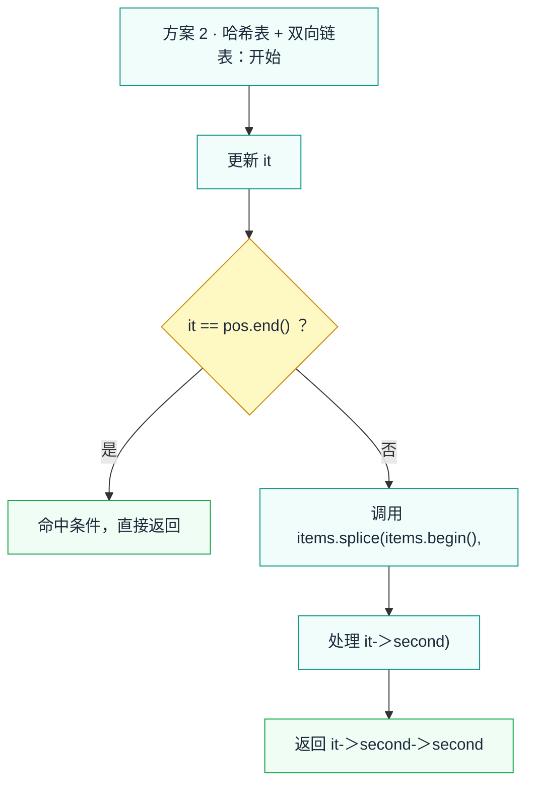

```cpp
// LeetCode 146. LRU缓存 — C++ 版（方案2）
#include <cassert>                        // 引入头文件
#include <iostream>                       // 引入头文件
#include <list>                           // 引入头文件
#include <unordered_map>                  // 引入头文件
struct LRUCache {                         // 定义类型
    int cap;                              // int cap;
    std::list<std::pair<int, int>> items; // std::列表 小于 std::pair 小于 int, int 超过 超过 items;
    std::unordered_map<int, std::list<std::pair<int, int>>::iterator> pos;
    explicit LRUCache(int capacity) : cap(capacity) {} // explicit LRUCache(int capacity) : cap(capacity) {}
    int get(int key) {                                 // 定义函数/方法 get
        auto it = pos.find(key);                       // 把 pos 查找 key) 存入 it
        if (it == pos.end())
            return -1; // 若 it 等于 pos.终点()，直接返回 减 1
        items.splice(items.begin(), items,
                     it->second);  // items.splice(items 迭代位置 , items, it 减 超过 second);
        return it->second->second; // 返回 it 减 超过 second 减 超过 second
    }
    void put(int key, int value) {      // 定义函数/方法 put
        auto it = pos.find(key);        // 把 pos 查找 key) 存入 it
        if (it != pos.end()) {          // 若 it 不等于 pos.终点(
            it->second->second = value; // 把 value; 写入 it->second->second
            items.splice(items.begin(), items,
                         it->second); // items.splice(items 迭代位置 , items, it 减 超过 second);
            return;                   // return;
        }
        if (static_cast<int>(items.size()) == cap) { // 若 static_cast 小于 int 超过 (items.大小()) 等于 cap
            pos.erase(items.back().first);           // pos 删除 items.back().first);
            items.pop_back();                        // 弹出栈顶元素
        }
        items.emplace_front(key, value); // items.emplace_front(key, value);
        pos[key] = items.begin();        // 把 items 迭代位置 ; 写入 pos[key]
    }
};
int main() {                          // 程序入口：跑内嵌自测用例
    LRUCache lru(2);                  // LRUCache lru(2);
    lru.put(1, 1);                    // lru.put(1, 1);
    lru.put(2, 2);                    // lru.put(2, 2);
    assert(lru.get(1) == 1);          // 断言校验
    lru.put(3, 3);                    // lru.put(3, 3);
    assert(lru.get(2) == -1);         // 断言校验
    lru.put(4, 4);                    // lru.put(4, 4);
    assert(lru.get(1) == -1);         // 断言校验
    assert(lru.get(3) == 3);          // 断言校验
    assert(lru.get(4) == 4);          // 断言校验
    std::cout << "PASS" << std::endl; // 全部用例通过，输出 PASS
    return 0;                         // 返回 0
}
```

### R 实现（2 种方案）

R 的全部方案如下，每个方案都内嵌用例自测，可独立运行（老仓库 python/go 文件遵循「打印结果」约定）：

#### 方案 1：基于Map（有序字典语义）

**思路与代码分析**：核心是「基于Map（有序字典语义）」。R 版用向量化思维与 1 起始下标，注意 1:n 的降序陷阱。**走读**：方案 1 · 基于Map（有序字典语义）：开始 → 更新 new.env(parent → 命中条件，直接返回。

**运行架构**（真实控制流）：

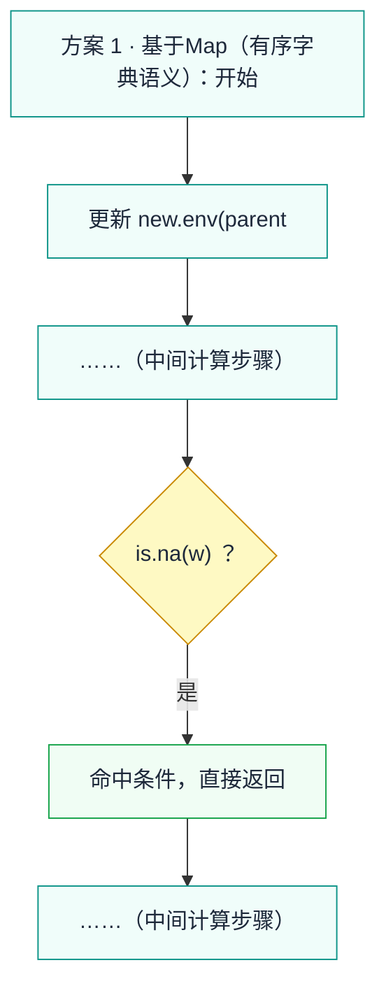

```r
# 版（方案1） 定义函数 LruSim（参数：cap）
LruSim <- function(cap) {
    e <- new.env(parent = emptyenv())  # 把 new.env(parent 赋值为 emptyenv()) 存入 e
    e$cap <- cap
    e$keys <- integer(0)
    e$vals <- list()  # 把 cap; e$keys 小于 减 integer(0); e$vals 小于 减 列表() 存入 e$cap
    e$get <- function(k) {
        # 把 function(下标 k) { 存入 e$get
        w <- match(k, e$keys)  # 把 match(下标 k, e$keys) 存入 权重
        if (is.na(w))
            return(-1L)  # 若 is.na(权重)) return( 减 1L
        e$keys <- c(e$keys[-w], e$keys[w])  # 把 字符(e$keys[ 减 权重], e$keys[权重]) 存入 e$keys
        e$vals[[as.character(k)]]  # e$vals[[as.character(下标 k)]]
    }
    e$put <- function(k, v) {
        # 把 function(下标 k, 值) { 存入 e$put
        w <- match(k, e$keys)  # 把 match(下标 k, e$keys) 存入 权重
        if (!is.na(w)) {
            # 若 取反 is.na(权重
            e$keys <- c(e$keys[-w], e$keys[w])  # 把 字符(e$keys[ 减 权重], e$keys[权重]) 存入 e$keys
        } else if (length(e$keys) == e$cap) {
            # 否则，若 长度(e$keys) 等于 e$cap
            old <- e$keys[1]  # 把 e$keys[1] 存入 old
            e$keys <- e$keys[-1]  # 把 e$keys[ 减 1] 存入 e$keys
            e$vals[[as.character(old)]] <- NULL  # 把 NULL 存入 e$vals[[as.character(old)]]
        }
        e$keys <- c(e$keys, k)  # 把 字符(e$keys, 下标 k) 存入 e$keys
        e$vals[[as.character(k)]] <- v  # 把 值 存入 e$vals[[as.character(k)]]
    }
    e
}
lru <- LruSim(2)  # 把 LruSim(2) 存入 lru
lru$put(1, 1)
lru$put(2, 2)  # lru$put(1, 1); lru$put(2, 2)
stopifnot(lru$get(1) == 1)  # 断言校验
lru$put(3, 3)  # lru$put(3, 3)
stopifnot(lru$get(2) == -1)  # 断言校验
lru$put(4, 4)  # lru$put(4, 4)
stopifnot(lru$get(1) == -1, lru$get(3) == 3, lru$get(4) == 4)  # 断言校验
cat("PASS\n")  # 全部用例通过，输出 PASS
```

#### 方案 2：哈希表 + 双向链表

**思路与代码分析**：核心是「哈希表 + 双向链表」。R 版用向量化思维与 1 起始下标，注意 1:n 的降序陷阱。**走读**：方案 2 · 哈希表 + 双向链表：开始 → 更新 new.env(parent → 命中条件，直接返回。

**运行架构**（真实控制流）：

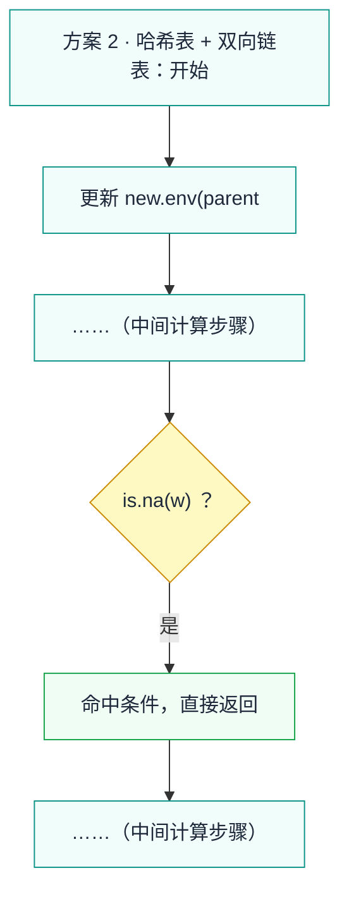

```r
# 版（方案2） 定义函数 LruSim（参数：cap）
LruSim <- function(cap) {
    e <- new.env(parent = emptyenv())  # 把 new.env(parent 赋值为 emptyenv()) 存入 e
    e$cap <- cap
    e$keys <- integer(0)
    e$vals <- list()  # 把 cap; e$keys 小于 减 integer(0); e$vals 小于 减 列表() 存入 e$cap
    e$get <- function(k) {
        # 把 function(下标 k) { 存入 e$get
        w <- match(k, e$keys)  # 把 match(下标 k, e$keys) 存入 权重
        if (is.na(w))
            return(-1L)  # 若 is.na(权重)) return( 减 1L
        e$keys <- c(e$keys[-w], e$keys[w])  # 把 字符(e$keys[ 减 权重], e$keys[权重]) 存入 e$keys
        e$vals[[as.character(k)]]  # e$vals[[as.character(下标 k)]]
    }
    e$put <- function(k, v) {
        # 把 function(下标 k, 值) { 存入 e$put
        w <- match(k, e$keys)  # 把 match(下标 k, e$keys) 存入 权重
        if (!is.na(w)) {
            # 若 取反 is.na(权重
            e$keys <- c(e$keys[-w], e$keys[w])  # 把 字符(e$keys[ 减 权重], e$keys[权重]) 存入 e$keys
        } else if (length(e$keys) == e$cap) {
            # 否则，若 长度(e$keys) 等于 e$cap
            old <- e$keys[1]  # 把 e$keys[1] 存入 old
            e$keys <- e$keys[-1]  # 把 e$keys[ 减 1] 存入 e$keys
            e$vals[[as.character(old)]] <- NULL  # 把 NULL 存入 e$vals[[as.character(old)]]
        }
        e$keys <- c(e$keys, k)  # 把 字符(e$keys, 下标 k) 存入 e$keys
        e$vals[[as.character(k)]] <- v  # 把 值 存入 e$vals[[as.character(k)]]
    }
    e
}
lru <- LruSim(2)  # 把 LruSim(2) 存入 lru
lru$put(1, 1)
lru$put(2, 2)  # lru$put(1, 1); lru$put(2, 2)
stopifnot(lru$get(1) == 1)  # 断言校验
lru$put(3, 3)  # lru$put(3, 3)
stopifnot(lru$get(2) == -1)  # 断言校验
lru$put(4, 4)  # lru$put(4, 4)
stopifnot(lru$get(1) == -1, lru$get(3) == 3, lru$get(4) == 4)  # 断言校验
cat("PASS\n")  # 全部用例通过，输出 PASS
```

### Zig 实现（2 种方案）

Zig 的全部方案如下，每个方案都内嵌用例自测，可独立运行（老仓库 python/go 文件遵循「打印结果」约定）：

#### 方案 1：基于Map（有序字典语义）

**思路与代码分析**：核心是「基于Map（有序字典语义）」。Zig 版显式分配与清零，整型边界处理严格。**走读**：方案 1 · 基于Map（有序字典语义）：开始 → 返回 .。

**运行架构**（真实控制流）：

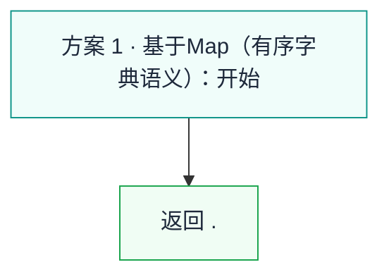

```zig
// LeetCode 146. LRU缓存 — Zig 版（方案1）
const std = @import("std"); // 把 @import(「std」) 存入 std
const LruSim = struct { // 把 struct { 存入 LruSim
    cap: usize,
    keys: [256]i32,
    vals: [256]i32,
    stamp: [256]i64,
    n: usize,
    clock_: i64,
    fn init(cap: usize) LruSim { // 定义函数/方法 init
        return .{ .cap = cap, .keys = undefined, .vals = undefined, .stamp = undefined, .n = 0, .clock_ = 0 };
    }
    fn find(self: *LruSim, k: i32) ?usize { // 定义函数/方法 find
        for (0..self.n) |i| if (self.keys[i] == k) return i; // 逐个取出 0..self.元素个数 的元素（下标 i）
        return null; // 返回 null
    }
    fn removeIdx(self: *LruSim, idx: usize) void { // 定义函数/方法 removeIdx
        var i = idx; // 把 idx 存入 下标 i
        while (i + 1 < self.n) : (i += 1) { // 循环，直到不满足「下标 i 加 1 小于 self.元素个数) : (下标 i 累加 1」
            self.keys[i] = self.keys[i + 1]; // 把 self.keys[下标 i 加 1]; 写入 self.keys[i]
            self.vals[i] = self.vals[i + 1]; // 把 self.vals[下标 i 加 1]; 写入 self.vals[i]
            self.stamp[i] = self.stamp[i + 1]; // 把 self.stamp[下标 i 加 1]; 写入 self.stamp[i]
        }
        self.n -= 1; // self.n累减 1
    }
    fn get(self: *LruSim, k: i32) i32 { // 定义函数/方法 get
        const i = self.find(k) orelse return -1; // 把 self 查找 下标 k) orelse return 减 1 存入 下标 i
        self.clock_ += 1; // self.clock_累加 1
        self.stamp[i] = self.clock_; // 把 self.clock_; 写入 self.stamp[i]
        return self.vals[i]; // 返回 self.vals[下标 i]
    }
    fn put(self: *LruSim, k: i32, v: i32) void { // 定义函数/方法 put
        if (self.find(k)) |i| { // 若 self 查找 下标 k)) 按位或 下标 i 按位或
            self.vals[i] = v; // 把 值; 写入 self.vals[i]
            self.clock_ += 1; // self.clock_累加 1
            self.stamp[i] = self.clock_; // 把 self.clock_; 写入 self.stamp[i]
            return; // return;
        }
        if (self.n == self.cap) { // 若 self.元素个数 等于 self.cap
            var oldest: usize = 0; // 把 0; 写入 var oldest: usize
            for (1..self.n) |j| { // 逐个取出 1..self.元素个数 的元素（下标 j）
                if (self.stamp[j] < self.stamp[oldest]) oldest = j; // 若 self.stamp[下标 j] 小于 self.stamp[oldest]) oldest 赋值为 下标 j;
            }
            self.removeIdx(oldest); // self.removeIdx(oldest);
        }
        self.clock_ += 1; // self.clock_累加 1
        self.keys[self.n] = k; // 把 下标 k; 写入 self.keys[self.n]
        self.vals[self.n] = v; // 把 值; 写入 self.vals[self.n]
        self.stamp[self.n] = self.clock_; // 把 self.clock_; 写入 self.stamp[self.n]
        self.n += 1; // self.n累加 1
    }
};
pub fn main() !void { // 程序入口：跑内嵌自测用例
    var lru = LruSim.init(2); // 把 LruSim.init(2) 存入 lru
    lru.put(1, 1); // lru.put(1, 1);
    lru.put(2, 2); // lru.put(2, 2);
    if (lru.get(1) != 1) return error.TestFailed; // 若 lru 查找 1) 不等于 1，直接返回 error.TestFailed
    lru.put(3, 3); // lru.put(3, 3);
    if (lru.get(2) != -1) return error.TestFailed; // 若 lru 查找 2) 不等于 减 1，直接返回 error.TestFailed
    lru.put(4, 4); // lru.put(4, 4);
    if (lru.get(1) != -1) return error.TestFailed; // 若 lru 查找 1) 不等于 减 1，直接返回 error.TestFailed
    if (lru.get(3) != 3 or lru.get(4) != 4) return error.TestFailed; // 若 lru 查找 3) 不等于 3 or lru 查找 4) 不等于 4，直接返回 error.TestFailed
    std.debug.print("PASS\n", .{}); // 全部用例通过，输出 PASS
}
```

#### 方案 2：哈希表 + 双向链表

**思路与代码分析**：核心是「哈希表 + 双向链表」。Zig 版显式分配与清零，整型边界处理严格。**走读**：方案 2 · 哈希表 + 双向链表：开始 → 返回 .。

**运行架构**（真实控制流）：

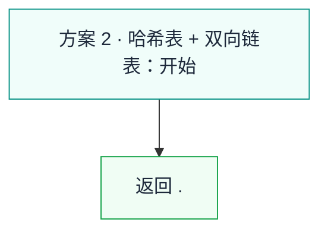

```zig
// LeetCode 146. LRU缓存 — Zig 版（方案2）
const std = @import("std"); // 把 @import(「std」) 存入 std
const LruSim = struct { // 把 struct { 存入 LruSim
    cap: usize,
    keys: [256]i32,
    vals: [256]i32,
    stamp: [256]i64,
    n: usize,
    clock_: i64,
    fn init(cap: usize) LruSim { // 定义函数/方法 init
        return .{ .cap = cap, .keys = undefined, .vals = undefined, .stamp = undefined, .n = 0, .clock_ = 0 };
    }
    fn find(self: *LruSim, k: i32) ?usize { // 定义函数/方法 find
        for (0..self.n) |i| if (self.keys[i] == k) return i; // 逐个取出 0..self.元素个数 的元素（下标 i）
        return null; // 返回 null
    }
    fn removeIdx(self: *LruSim, idx: usize) void { // 定义函数/方法 removeIdx
        var i = idx; // 把 idx 存入 下标 i
        while (i + 1 < self.n) : (i += 1) { // 循环，直到不满足「下标 i 加 1 小于 self.元素个数) : (下标 i 累加 1」
            self.keys[i] = self.keys[i + 1]; // 把 self.keys[下标 i 加 1]; 写入 self.keys[i]
            self.vals[i] = self.vals[i + 1]; // 把 self.vals[下标 i 加 1]; 写入 self.vals[i]
            self.stamp[i] = self.stamp[i + 1]; // 把 self.stamp[下标 i 加 1]; 写入 self.stamp[i]
        }
        self.n -= 1; // self.n累减 1
    }
    fn get(self: *LruSim, k: i32) i32 { // 定义函数/方法 get
        const i = self.find(k) orelse return -1; // 把 self 查找 下标 k) orelse return 减 1 存入 下标 i
        self.clock_ += 1; // self.clock_累加 1
        self.stamp[i] = self.clock_; // 把 self.clock_; 写入 self.stamp[i]
        return self.vals[i]; // 返回 self.vals[下标 i]
    }
    fn put(self: *LruSim, k: i32, v: i32) void { // 定义函数/方法 put
        if (self.find(k)) |i| { // 若 self 查找 下标 k)) 按位或 下标 i 按位或
            self.vals[i] = v; // 把 值; 写入 self.vals[i]
            self.clock_ += 1; // self.clock_累加 1
            self.stamp[i] = self.clock_; // 把 self.clock_; 写入 self.stamp[i]
            return; // return;
        }
        if (self.n == self.cap) { // 若 self.元素个数 等于 self.cap
            var oldest: usize = 0; // 把 0; 写入 var oldest: usize
            for (1..self.n) |j| { // 逐个取出 1..self.元素个数 的元素（下标 j）
                if (self.stamp[j] < self.stamp[oldest]) oldest = j; // 若 self.stamp[下标 j] 小于 self.stamp[oldest]) oldest 赋值为 下标 j;
            }
            self.removeIdx(oldest); // self.removeIdx(oldest);
        }
        self.clock_ += 1; // self.clock_累加 1
        self.keys[self.n] = k; // 把 下标 k; 写入 self.keys[self.n]
        self.vals[self.n] = v; // 把 值; 写入 self.vals[self.n]
        self.stamp[self.n] = self.clock_; // 把 self.clock_; 写入 self.stamp[self.n]
        self.n += 1; // self.n累加 1
    }
};
pub fn main() !void { // 程序入口：跑内嵌自测用例
    var lru = LruSim.init(2); // 把 LruSim.init(2) 存入 lru
    lru.put(1, 1); // lru.put(1, 1);
    lru.put(2, 2); // lru.put(2, 2);
    if (lru.get(1) != 1) return error.TestFailed; // 若 lru 查找 1) 不等于 1，直接返回 error.TestFailed
    lru.put(3, 3); // lru.put(3, 3);
    if (lru.get(2) != -1) return error.TestFailed; // 若 lru 查找 2) 不等于 减 1，直接返回 error.TestFailed
    lru.put(4, 4); // lru.put(4, 4);
    if (lru.get(1) != -1) return error.TestFailed; // 若 lru 查找 1) 不等于 减 1，直接返回 error.TestFailed
    if (lru.get(3) != 3 or lru.get(4) != 4) return error.TestFailed; // 若 lru 查找 3) 不等于 3 or lru 查找 4) 不等于 4，直接返回 error.TestFailed
    std.debug.print("PASS\n", .{}); // 全部用例通过，输出 PASS
}
```

### Dart 实现（2 种方案）

Dart 的全部方案如下，每个方案都内嵌用例自测，可独立运行（老仓库 python/go 文件遵循「打印结果」约定）：

#### 方案 1：基于Map（有序字典语义）

**思路与代码分析**：核心是「基于Map（有序字典语义）」。Dart 版用可空类型标注与集合方法，注意空安全。**走读**：方案 1 · 基于Map（有序字典语义）：开始 → 若 vals.containsKey(k) 则： → 调用 keys.remove(k) → 调用 keys.add(k) → 返回 vals[k]非 → 返回 -1。

**运行架构**（真实控制流）：

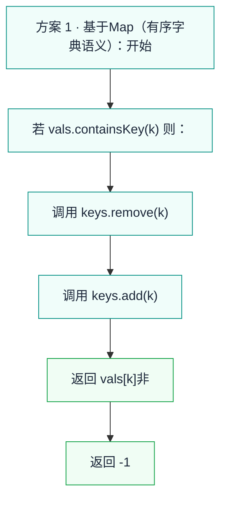

```dart
// LeetCode 146. LRU缓存 — Dart 版（方案1）
class LruSim {
  // 定义类型
  final int cap; // final int cap;
  final List<int> keys = []; // 把 []; 写入 final List<int> keys
  final Map<int, int> vals = {}; // 把 {}; 写入 final Map<int, int> vals
  LruSim(this.cap); // LruSim(this.cap);
  int get(int k) {
    // 定义函数/方法 get
    if (vals.containsKey(k)) {
      // 若 vals.containsKey(下标 k
      keys.remove(k); // keys 弹出 下标 k);
      keys.add(k); // keys 追加 下标 k);
      return vals[k]!; // 返回 vals[下标 k]取反
    }
    return -1; // 返回 减 1
  }

  void put(int k, int v) {
    // 定义函数/方法 put
    if (vals.containsKey(k)) {
      // 若 vals.containsKey(下标 k
      keys.remove(k); // keys 弹出 下标 k);
    } else if (keys.length == cap) {
      // 否则，若 keys.长度 等于 cap
      vals.remove(keys.removeAt(0)); // vals 弹出 keys.removeAt(0));
    }
    keys.add(k); // keys 追加 下标 k);
    vals[k] = v; // 把 值; 写入 vals[k]
  }
}

void main() {
  // 程序入口：跑内嵌自测用例
  final lru = LruSim(2); // 把 LruSim(2) 存入 lru
  lru.put(1, 1); // lru.put(1, 1);
  lru.put(2, 2); // lru.put(2, 2);
  if (lru.get(1) != 1)
    throw StateError('c1'); // 若 lru 查找 1) 不等于 1) throw StateError('c1');
  lru.put(3, 3); // lru.put(3, 3);
  if (lru.get(2) != -1)
    throw StateError('c2'); // 若 lru 查找 2) 不等于 减 1) throw StateError('c2');
  lru.put(4, 4); // lru.put(4, 4);
  if (lru.get(1) != -1)
    throw StateError('c3'); // 若 lru 查找 1) 不等于 减 1) throw StateError('c3');
  if (lru.get(3) != 3 || lru.get(4) != 4)
    throw StateError(
      'c4',
    ); // 若 lru 查找 3) 不等于 3 或 lru 查找 4) 不等于 4) throw StateError('c4');
  print('PASS'); // 全部用例通过，输出 PASS
}
```

#### 方案 2：哈希表 + 双向链表

**思路与代码分析**：核心是「哈希表 + 双向链表」。Dart 版用可空类型标注与集合方法，注意空安全。**走读**：方案 2 · 哈希表 + 双向链表：开始 → 若 vals.containsKey(k) 则： → 调用 keys.remove(k) → 调用 keys.add(k) → 返回 vals[k]非 → 返回 -1。

**运行架构**（真实控制流）：

```mermaid
graph TD
    N0["方案 2 · 哈希表 + 双向链表：开始"]
    N1["若 vals.containsKey(k) 则："]
    N2["调用 keys.remove(k)"]
    N3["调用 keys.add(k)"]
    N4["返回 vals[k]非"]
    N5["返回 -1"]
    N0 --> N1
    N1 --> N2
    N2 --> N3
    N3 --> N4
    N4 --> N5
    classDef n fill:#f0fdfa,stroke:#0d9488,color:#1e293b;
    classDef lp fill:#ccfbf1,stroke:#0f766e,color:#1e293b;
    classDef dc fill:#fef9c3,stroke:#ca8a04,color:#1e293b;
    classDef tm fill:#f0fdf4,stroke:#16a34a,color:#1e293b;
    class N0,N1,N2,N3 n;
    class N4,N5 tm;
```

```dart
// LeetCode 146. LRU缓存 — Dart 版（方案2）
class LruSim {
  // 定义类型
  final int cap; // final int cap;
  final List<int> keys = []; // 把 []; 写入 final List<int> keys
  final Map<int, int> vals = {}; // 把 {}; 写入 final Map<int, int> vals
  LruSim(this.cap); // LruSim(this.cap);
  int get(int k) {
    // 定义函数/方法 get
    if (vals.containsKey(k)) {
      // 若 vals.containsKey(下标 k
      keys.remove(k); // keys 弹出 下标 k);
      keys.add(k); // keys 追加 下标 k);
      return vals[k]!; // 返回 vals[下标 k]取反
    }
    return -1; // 返回 减 1
  }

  void put(int k, int v) {
    // 定义函数/方法 put
    if (vals.containsKey(k)) {
      // 若 vals.containsKey(下标 k
      keys.remove(k); // keys 弹出 下标 k);
    } else if (keys.length == cap) {
      // 否则，若 keys.长度 等于 cap
      vals.remove(keys.removeAt(0)); // vals 弹出 keys.removeAt(0));
    }
    keys.add(k); // keys 追加 下标 k);
    vals[k] = v; // 把 值; 写入 vals[k]
  }
}

void main() {
  // 程序入口：跑内嵌自测用例
  final lru = LruSim(2); // 把 LruSim(2) 存入 lru
  lru.put(1, 1); // lru.put(1, 1);
  lru.put(2, 2); // lru.put(2, 2);
  if (lru.get(1) != 1)
    throw StateError('c1'); // 若 lru 查找 1) 不等于 1) throw StateError('c1');
  lru.put(3, 3); // lru.put(3, 3);
  if (lru.get(2) != -1)
    throw StateError('c2'); // 若 lru 查找 2) 不等于 减 1) throw StateError('c2');
  lru.put(4, 4); // lru.put(4, 4);
  if (lru.get(1) != -1)
    throw StateError('c3'); // 若 lru 查找 1) 不等于 减 1) throw StateError('c3');
  if (lru.get(3) != 3 || lru.get(4) != 4)
    throw StateError(
      'c4',
    ); // 若 lru 查找 3) 不等于 3 或 lru 查找 4) 不等于 4) throw StateError('c4');
  print('PASS'); // 全部用例通过，输出 PASS
}
```

---

## 内容总结

- **lru 缓存**（链表 · Medium）：共 2 个方案，主线思路「基于Map（有序字典语义）」；时间 O(n²)（两层嵌套扫描）；动画演示链表反转过程，附录给出 11 种语言 × 全部方案的可运行实现。
- 来源博客：[https://blog.csdn.net/tyro_java/article/details/145094527](https://blog.csdn.net/tyro_java/article/details/145094527)
- 导航：[📋 总目录](../) ｜ [← 056 环形链表 ii](../056_环形链表_ii/) ｜ [058 排序链表 →](../058_排序链表/)
