# 058 · 排序链表（第二阶段 · 链表 · Medium）

> **难度**：⭐⭐ Medium ｜ **专题**：链表
> **学习定位**：第二阶段 · 链表第 58 篇 ｜ **解法数**：7
> **内容总结**：**排序链表**（链表 · Medium）：共 7 个方案，主线思路「迭代指针处理」；时间 O(n)（单趟线性扫描）；动画演示链表反转过程，附录给出 11 种语言 × 全部方案的可运行实现。

---

## 题目描述

给你链表的头结点 `head` ，请将其按 升序 排列并返回 排序后的链表 。

- 主函数签名：`function treeToLevel(root: any): any[]`

**用例（来自原题）**：

**示例 1**

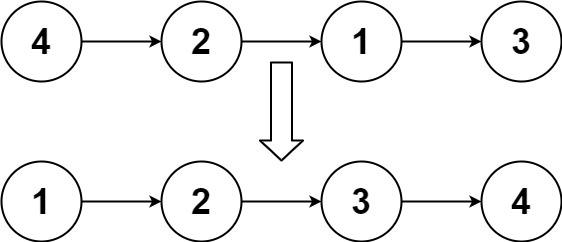

```text
输入：head = [4,2,1,3]
输出：[1,2,3,4]
```

**示例 2**

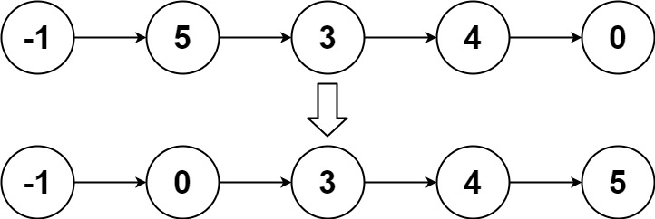

```text
输入：head = [-1,5,3,4,0]
输出：[-1,0,3,4,5]
```

**示例 3**

```text
输入：head = []
输出：[]
```
> ✅ **官方验证**：全部 TypeScript 解法已通过 leetcode.cn 官方示例用例验证（自动注入运行，全部 PASS）。题面与 [leetcode.cn 官方](https://leetcode.cn/problems/sort-list/)一致，示例配图取自官方题面。

**数据范围与注意事项**：

- `链表中节点的数目在范围 [0, 5  10^4] 内`
- `-10^5 <= Node.val <= 10^5`
- 进阶
- 你可以在 O(n log n) 时间复杂度和常数级空间复杂度下，对链表进行排序吗？
- **易错点**：断开 next 之前先把后继存下来，否则整条链会丢。

## 题目分析

**场景是什么**：链表只能顺着指针走，这类题练的是指针操作与断链重接，对应真实开发里的内存管理、撤销链。本题就是该场景的 Medium 级练习，主线做法是「迭代指针处理」。

**主线怎么解**：把主解法从头到尾过一遍，它其实在依次做这几件事：队列或堆的调度。

## 解题思路

**方案对比**（共 7 个方案，由浅入深）：

| 方案 | 时间复杂度 | 空间复杂度 |
|---|---|---|
| 方案 1 · 迭代指针处理 | O(n)（单趟线性扫描） | O(1) 到 O(n)（视辅助结构） |
| 方案 2 · 单趟扫描 | O(n)（单趟线性扫描） | O(1) 到 O(n)（视辅助结构） |
| 方案 3 · 单趟扫描 | O(n)（单趟线性扫描） | O(1) 到 O(n)（视辅助结构） |
| 方案 4 · 迭代指针处理 | O(n)（单趟线性扫描） | O(1) 到 O(n)（视辅助结构） |
| 方案 5 · 单趟扫描 | O(n)（单趟线性扫描） | O(1) 到 O(n)（视辅助结构） |
| 方案 6 · 单趟扫描 | O(n)（单趟线性扫描） | O(1) 到 O(n)（视辅助结构） |
| 方案 7 · 单趟扫描 | O(n)（单趟线性扫描） | O(1) 到 O(n)（视辅助结构） |

**由浅入深的路径**：迭代指针处理 → 单趟扫描；每往右一步，都在补上一步的短板。

**方案间的取舍**：方案 1（迭代指针处理）；方案 2（单趟扫描）；方案 3（单趟扫描）；方案 4（迭代指针处理）；方案 5（单趟扫描）；方案 6（单趟扫描）；方案 7（单趟扫描）。数据规模小、可读性优先时选靠前的方案；规模大、性能优先时选靠后的方案。

**怎么读这一篇**：

- 🐣 **新手路线**：把「题目描述」的示例 1 在纸上手推一遍 → 读方案 1（最直观的写法）与它的代码走读 → 按「运行方式」本地跑通看 PASS → 回头对比方案 2 之后的写法差在哪
- 🦅 **大佬路线**：直接锁定最优方案 1（迭代指针处理，O(n)（单趟线性扫描））→ 跳读该方案代码与走读 → 用「逐步拆解与面试追问」补齐复杂度推导与边界追问

### 动态算法图（链表反转，GIF 自动循环）


动画演示链表专题里链表反转的典型过程；每个方案在「TypeScript 解题方案」一节还配了专属动画与专属流程图。

### 主解法流程图（真实控制流）

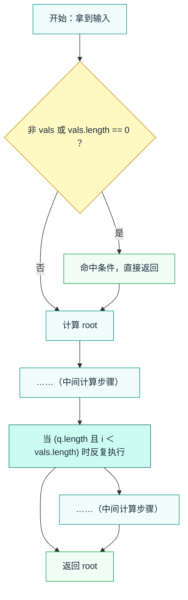

## TypeScript 解题方案（7 个方案逐个讲）

> **运行与提交**：每个方案都是自包含文件（内嵌用例自测，输出 PASS），整块复制到 `.ts` 文件后 `node 文件名` 即可运行。提交 LeetCode 时，把 `demo` 内的算法函数与辅助类型/函数整体取出、置于文件顶层即可。涉及交互/特殊接口的题以题面给定签名为准。

### 方案 1：迭代指针处理

**分析与思路**：核心做法是「迭代指针处理」。代码里依次做这些事：队列或堆的调度。

**运行方式**：`node 本文件`，内嵌用例全部通过会输出 PASS。


**方案专属流程图**（真实控制流）：


```typescript
class TreeNode {
  // 定义类型
  val: any;
  left: any;
  right: any; // 值: any; 左边界: any; 右边界: any;
  constructor(val?: any, left?: any, right?: any) {
    // constructor(值?: any, 左边界?: any, 右边界?: any) {
    this.val = val === undefined ? 0 : val; // 把 (值 全等于 undefined ? 0 : 值); 写入 值
    this.left = left === undefined ? null : left; // 把 (左边界 全等于 undefined ? null : 左边界); 写入 左边界
    this.right = right === undefined ? null : right; // 把 (右边界 全等于 undefined ? null : 右边界); 写入 右边界
  }
}
function buildTree(vals: any): any {
  // 定义函数/方法 buildTree
  if (!vals || vals.length === 0) return null; // 若 取反 vals 或 vals.长度 全等于 0，直接返回 null
  const root = new TreeNode(vals[0]);
  const q: any[] = [root];
  let i = 1;
  while (q.length && i < vals.length) {
    // 循环，直到不满足「节点.长度 且 下标 i 小于 vals.长度」
    const node = q.shift(); // 把 节点.shift() 存入 节点
    if (vals[i] !== null && vals[i] !== undefined) {
      node.left = new TreeNode(vals[i]);
      q.push(node.left);
    }
    i++; // 下标 i 加一
    if (i < vals.length && vals[i] !== null && vals[i] !== undefined) {
      node.right = new TreeNode(vals[i]);
      q.push(node.right);
    }
    i++; // 下标 i 加一
  }
  return root; // 返回 根节点
}
function treeToLevel(root: any): any[] {
  // 定义函数/方法 treeToLevel
  if (!root) return []; // 若 取反 根节点，直接返回 []
  const out: any[] = [];
  const q: any[] = [root]; // 把 []; const 节点: any[] 赋值为 [根节点]; 写入 const out: any[]
  while (q.length) {
    // 循环，直到不满足「节点.长度」
    const n = q.shift(); // 把 节点.shift() 存入 元素个数
    if (n === null || n === undefined) {
      out.push(null);
      continue;
    }
    out.push(n.val);
    q.push(n.left);
    q.push(n.right); // 把 元素个数.值 压入栈/数组尾部
  }
  while (out.length && out[out.length - 1] === null) out.pop(); // 循环，直到不满足「out.长度 且 out[out.长度 减 1] 全等于 null) out 弹出 );」
  return out; // 返回 out
}
class ListNode {
  // 定义类型
  val: any;
  next: any; // 值: any; 下一个: any;
  constructor(val?: any, next?: any) {
    this.val = val === undefined ? 0 : val;
    this.next = next === undefined ? null : next;
  }
}
function buildList(vals: any): any {
  // 定义函数/方法 buildList
  const dummy = new ListNode(0);
  let cur = dummy; // 把 new ListNode(0); let 当前值 赋值为 哨兵节点 存入 哨兵节点
  for (const v of vals) {
    cur.next = new ListNode(v);
    cur = cur.next;
  } // 把 new ListNode(值); 当前值 赋值为 当前值.下一个; } 写入 下一个
  return dummy.next; // 返回 哨兵节点.下一个
}
function listToArray(head: any): any[] {
  // 定义函数/方法 listToArray
  const out: any[] = [];
  let p = head; // 把 []; let 节点 赋值为 头节点; 写入 const out: any[]
  while (p) {
    out.push(p.val);
    p = p.next;
  } // 循环，直到不满足「节点) { out 追加 节点.值); 节点 赋值为 节点.下一个; }」
  return out; // 返回 out
}
// python-runtime shims
function pyLen(a: any): number {
  // 定义函数/方法 pyLen
  if (a === null || a === undefined) return 0; // 若 数组 全等于 null 或 数组 全等于 undefined，直接返回 0
  if (
    typeof a === 'string' ||
    Array.isArray(a) ||
    a instanceof Set ||
    a instanceof Map
  )
    return a.length ?? a.size;
  if (typeof a === 'object') return Object.keys(a).length; // 若 typeof 数组 全等于 'object'，直接返回 Object.keys(数组).长度
  return 0; // 返回 0
}
function pySlice(a: any, i: any, j: any, step?: any): any {
  // 定义函数/方法 pySlice
  if (typeof a === 'string') {
    const r = [...a].slice(i ?? 0, j ?? a.length);
    return step ? r.reverse().join('') : r.join('');
  }
  const arr = Array.isArray(a) ? a : [...a]; // 把 Array.isArray(数组) ? 数组 : 复制的 数组 存入 数组
  return arr.slice(i ?? 0, j ?? arr.length); // 返回 数组 截取 下标 i ?? 0, 下标 j ?? 数组.长度)
}
function pyRange(a: any, b?: any, step?: any): any[] {
  // 定义函数/方法 pyRange
  let s = 0,
    e = a,
    st = 1; // 把 0, e 赋值为 数组, st 赋值为 1 存入 字符串
  if (b !== undefined) {
    s = a;
    e = b;
  } // 若 b 不等于 undefined) { 字符串 赋值为 数组; e 赋值为 b; }
  if (step !== undefined) st = step; // 若 步数 不等于 undefined) st 赋值为 步数;
  const out: any[] = []; // 把 []; 写入 const out: any[]
  if (st > 0) for (let i = s; i < e; i += st) out.push(i);
  else for (let i = s; i > e; i += st) out.push(i); // 否则
  return out; // 返回 out
}
function pyIn(x: any, coll: any): boolean {
  // 定义函数/方法 pyIn
  if (coll === null || coll === undefined) return false; // 若 coll 全等于 null 或 coll 全等于 undefined，直接返回 false
  if (Array.isArray(coll)) return coll.includes(x); // 若 Array.isArray(coll)，直接返回 coll 是否包含 x)
  if (coll instanceof Set || coll instanceof Map) return coll.has(x); // 若 coll instanceof Set 或 coll instanceof Map，直接返回 coll.has(x)
  if (typeof coll === 'object') return x in coll; // 若 typeof coll 全等于 'object'，直接返回 x in coll
  if (typeof coll === 'string') return coll.indexOf(x) >= 0; // 若 typeof coll 全等于 'string'，直接返回 coll 查找 x) 不低于 0
  return false; // 返回 false
}
function pySorted(a: any): any[] {
  // 定义函数/方法 pySorted
  const arr = typeof a === 'string' ? [...a] : [...a]; // 把 (typeof 数组 全等于 'string') ? 复制的 数组 : 复制的 数组 存入 数组
  return arr.sort((x: any, y: any) => (x < y ? -1 : x > y ? 1 : 0));
}
function pyMin(a: any, b?: any): any {
  if (b !== undefined) return Math.min(a, b);
  if (Array.isArray(a) || a instanceof Set) return Math.min(...a);
  return Math.min(a);
} // 定义函数/方法 pyMin
function pyMax(a: any, b?: any): any {
  if (b !== undefined) return Math.max(a, b);
  if (Array.isArray(a) || a instanceof Set) return Math.max(...a);
  return Math.max(a);
} // 定义函数/方法 pyMax
function pySum(a: any): number {
  let s = 0;
  for (const v of a) s += v;
  return s;
} // 定义函数/方法 pySum
function pyAbs(x: any): number {
  return Math.abs(x);
} // 定义函数/方法 pyAbs
function pyEnumerate(a: any): any[] {
  const out: any[] = [];
  let i = 0;
  for (const v of a) {
    out.push([i, v]);
    i++;
  }
  return out;
} // 定义函数/方法 pyEnumerate
function pyZip(a: any, b: any): any[] {
  const n = Math.min(a.length, b.length);
  const out: any[] = [];
  for (let i = 0; i < n; i++) out.push([a[i], b[i]]);
  return out;
} // 定义函数/方法 pyZip
function pyDictGet(d: any, k: any, def?: any): any {
  return k in d ? d[k] : def === undefined ? null : def;
} // 定义函数/方法 pyDictGet
function pyPrint(...args: any[]): void {
  console.log(
    args
      .map((a) => (typeof a === 'object' && a !== null ? JSON.stringify(a) : a))
      .join(' '),
  );
} // 定义函数/方法 pyPrint
// collections / heapq
function heapPush(h: any[], x: any): void {
  h.push(x);
  let i = h.length - 1;
  while (i > 0) {
    const p = (i - 1) >> 1;
    if (h[p] <= h[i]) break;
    [h[p], h[i]] = [h[i], h[p]];
    i = p;
  }
} // 定义函数/方法 heapPush
function heapPop(h: any[]): any {
  const top = h[0];
  const last = h.pop();
  if (h.length) {
    h[0] = last;
    let i = 0;
    const n = h.length;
    while (true) {
      let l = 2 * i + 1,
        r = 2 * i + 2,
        s = i;
      if (l < n && h[l] < h[s]) s = l;
      if (r < n && h[r] < h[s]) s = r;
      if (s === i) break;
      [h[s], h[i]] = [h[i], h[s]];
      i = s;
    }
  }
  return top;
} // 定义函数/方法 heapPop
class Deque {
  private a: any[] = [];
  push(x: any) {
    this.a.push(x);
  }
  pushLeft(x: any) {
    this.a.unshift(x);
  }
  pop() {
    return this.a.pop();
  }
  popLeft() {
    return this.a.shift();
  }
  get length() {
    return this.a.length;
  }
  toArray() {
    return this.a.slice();
  }
} // 定义类型
function Counter(iter: any): any {
  const m: any = {};
  for (const v of iter) m[v] = (m[v] || 0) + 1;
  return m;
} // 定义函数/方法 Counter
function gcd(a: any, b: any): any {
  while (b) {
    [a, b] = [b, a % b];
  }
  return a;
} // 定义函数/方法 gcd
function pyInf(): number {
  return Infinity;
} // 定义函数/方法 pyInf

function norm(x: any): any {
  // 定义函数/方法 norm
  if (x === null || x === undefined) return null; // 若 x 全等于 null 或 x 全等于 undefined，直接返回 null
  if (typeof x === 'object') {
    // 若 typeof x 全等于 'object'
    if (x instanceof Deque) return x.toArray(); // 若 x instanceof Deque，直接返回 x.toArray()
    if (Array.isArray(x)) return x.map(norm); // 若 Array.isArray(x)，直接返回 x.映射表(norm)
    if (
      typeof x.val === 'number' &&
      (typeof x.left !== 'undefined' || typeof x.right !== 'undefined')
    )
      return treeToLevel(x);
    if (typeof x.next !== 'undefined' && typeof x.val === 'number')
      return listToArray(x);
    if (x instanceof Set) return [...x].sort(); // 若 x instanceof Set，直接返回 复制的 x 排序 )
    if (x instanceof Map) return Object.fromEntries(x); // 若 x instanceof Map，直接返回 Object.fromEntries(x)
    const o: any = {};
    for (const k of Object.keys(x)) o[k] = norm(x[k]);
    return o;
  }
  return x; // 返回 x
}
function eq(a: any, b: any): boolean {
  // 定义函数/方法 eq
  const x = norm(a),
    y = norm(b); // 把 norm(数组), y 赋值为 norm(b) 存入 x
  if (x === y) return true; // 若 x 全等于 y，直接返回 true
  if (x === null || y === null) return x === y; // 若 x 全等于 null 或 y 全等于 null，直接返回 x 全等于 y
  if (Array.isArray(x) && Array.isArray(y)) {
    // 若 Array.isArray(x) 且 Array.isArray(y
    if (x.length !== y.length) return false; // 若 x.长度 不等于 y.长度，直接返回 false
    for (let i = 0; i < x.length; i++) if (!eq(x[i], y[i])) return false; // 让 下标 i 从 0 开始计数，下标 i 小于 x.长度 就继续
    return true; // 返回 true
  }
  if (typeof x === 'object' && typeof y === 'object') {
    // 若 typeof x 全等于 'object' 且 typeof y 全等于 'object'
    const kx = Object.keys(x),
      ky = Object.keys(y); // 把 Object.keys(x), ky 赋值为 Object.keys(y) 存入 kx
    if (kx.length !== ky.length) return false; // 若 kx.长度 不等于 ky.长度，直接返回 false
    for (const k of kx) if (!eq(x[k], y[k])) return false;
    return true; // 返回 true
  }
  return x === y; // 返回 x 全等于 y
}

function sortList(head) {
  // 定义函数/方法 sortList
  if (!head || !head.next) return head; // 若 取反 头节点 或 取反 头节点.下一个，直接返回 头节点
  let s = head,
    f = head; // 把 头节点, f 赋值为 头节点 存入 字符串
  while (f.next && f.next.next) {
    s = s.next;
    f = f.next.next;
  }
  const mid = s.next;
  s.next = null; // 把 字符串.下一个; 字符串.下一个 赋值为 null 存入 中点
  let l = sortList(head),
    r = sortList(mid); // 把 sortList(头节点), 右指针 赋值为 sortList(中点) 存入 左指针
  const dummy = new ListNode(0);
  let p = dummy; // 把 new ListNode(0); let 节点 赋值为 哨兵节点 存入 哨兵节点
  while (l && r) {
    // 循环，直到不满足「左指针 且 右指针」
    if (l.val < r.val) {
      p.next = l;
      l = l.next;
    } // 若 左指针.值 小于 右指针.值) { 节点.下一个 赋值为 左指针; 左指针 赋值为 左指针.下一个; }
    else {
      p.next = r;
      r = r.next;
    } // 否则
    p = p.next; // 把 节点.下一个 存入 节点
  }
  p.next = l || r; // 把 左指针 或 右指针; 写入 下一个
  return dummy.next; // 返回 哨兵节点.下一个
}
export function demo(): void {
  // 程序入口：跑内嵌自测用例
  const cases = [
    { in: [buildList([4, 2, 1, 3])], want: [1, 2, 3, 4] },
    { in: [buildList([-1, 5, 3, 4, 0])], want: [-1, 0, 3, 4, 5] },
    { in: [buildList([])], want: null },
    { in: [buildList([1])], want: [1] },
  ];
  let fail = false; // 把 false 存入 fail
  for (const c of cases) {
    // for (const 字符 of cases) {
    const got = sortList(...c.in); // 把 sortList(...字符.in) 存入 got
    if (!eq(got, c.want)) {
      fail = true;
      console.log(
        'FAIL',
        JSON.stringify(c.in),
        '=>',
        JSON.stringify(got),
        'want',
        JSON.stringify(c.want),
      );
    }
  }
  if (fail) throw new Error('FAILED'); // 若 fail) throw new Error('FAILED');
  console.log('PASS'); // 全部用例通过，输出 PASS
}
demo(); // demo();
```

### 方案 2：单趟扫描

**分析与思路**：核心做法是「单趟扫描」。代码里依次做这些事：单循环线性扫描。

**运行方式**：`node 本文件`，内嵌用例全部通过会输出 PASS。


**方案专属流程图**（真实控制流）：


```typescript
class ListNode {
  // 定义类型
  val: number; // 值: number;
  next: ListNode | null; // 下一个: ListNode 按位或 null;
  constructor(val: number = 0, next: ListNode | null = null) {
    this.val = val;
    this.next = next; // 把 值; this.下一个 赋值为 下一个; 写入 值
  }
}
function buildList(vals: number[]): ListNode | null {
  // 定义函数/方法 buildList
  const dummy = new ListNode(0);
  let cur = dummy; // 把 new ListNode(0); let 当前值 赋值为 哨兵节点 存入 哨兵节点
  for (const v of vals) {
    cur.next = new ListNode(v);
    cur = cur.next;
  } // 把 new ListNode(值); 当前值 赋值为 当前值.下一个; } 写入 下一个
  return dummy.next; // 返回 哨兵节点.下一个
}
function listToArr(head: ListNode | null): number[] {
  // 定义函数/方法 listToArr
  const res: number[] = [];
  while (head) {
    res.push(head.val);
    head = head.next;
  }
  return res; // 把 头节点.值 压入栈/数组尾部
}

function assertEq(actual: any, expected: any, msg: string = ''): void {
  // 定义函数/方法 assertEq
  const a = JSON.stringify(actual);
  const e = JSON.stringify(expected);
  if (a !== e)
    throw new Error(
      'ASSERT FAILED ' + msg + ' :: actual=' + a + ' expected=' + e,
    );
}

function sortList(head: ListNode | null): ListNode | null {
  // 定义函数/方法 sortList
  if (!head || !head.next) return head; // 若 取反 头节点 或 取反 头节点.下一个，直接返回 头节点
  let slow: ListNode = head,
    fast: ListNode | null = head.next;
  while (fast && fast.next) {
    slow = slow.next!;
    fast = fast.next.next;
  }
  const mid = slow.next;
  slow.next = null; // 把 慢指针.下一个; 慢指针.下一个 赋值为 null 存入 中点
  const left = sortList(head); // 把 sortList(头节点) 存入 左边界
  const right = sortList(mid); // 把 sortList(中点) 存入 右边界
  const dummy = new ListNode(0);
  let curr = dummy; // 把 new ListNode(0); let 当前值 赋值为 哨兵节点 存入 哨兵节点
  let l: ListNode | null = left,
    r: ListNode | null = right;
  while (l && r) {
    // 循环，直到不满足「左指针 且 右指针」
    if (l.val <= r.val) {
      curr.next = l;
      l = l.next;
    } // 若 左指针.值 不超过 右指针.值) { 当前值.下一个 赋值为 左指针; 左指针 赋值为 左指针.下一个; }
    else {
      curr.next = r;
      r = r.next;
    } // 否则
    curr = curr.next; // 把 当前值.下一个 存入 当前值
  }
  curr.next = l ? l : r; // 把 左指针 ? 左指针 : 右指针; 写入 下一个
  return dummy.next; // 返回 哨兵节点.下一个
}
export function demo(): void {
  // 程序入口：跑内嵌自测用例
  assertEq(
    listToArr(sortList(buildList([4, 2, 1, 3, 5]))!),
    [1, 2, 3, 4, 5],
    'sort1',
  ); // 断言校验
  assertEq(
    listToArr(sortList(buildList([-1, 5, 3, -2]))!),
    [-2, -1, 3, 5],
    'sort2',
  ); // 断言校验
  console.log('PASS'); // 全部用例通过，输出 PASS
}
demo(); // demo();
```

### 方案 3：单趟扫描

**分析与思路**：核心做法是「单趟扫描」。代码里依次做这些事：单循环线性扫描。

**运行方式**：`node 本文件`，内嵌用例全部通过会输出 PASS。


**方案专属流程图**（真实控制流）：

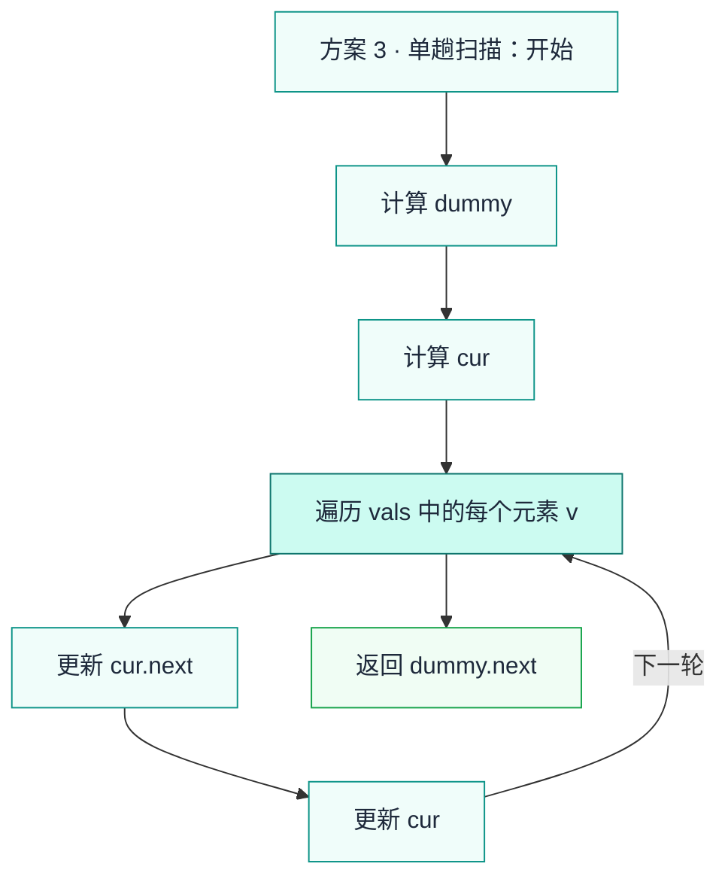

```typescript
class ListNode {
  // 定义类型
  val: number; // 值: number;
  next: ListNode | null; // 下一个: ListNode 按位或 null;
  constructor(val: number = 0, next: ListNode | null = null) {
    this.val = val;
    this.next = next; // 把 值; this.下一个 赋值为 下一个; 写入 值
  }
}
function buildList(vals: number[]): ListNode | null {
  // 定义函数/方法 buildList
  const dummy = new ListNode(0);
  let cur = dummy; // 把 new ListNode(0); let 当前值 赋值为 哨兵节点 存入 哨兵节点
  for (const v of vals) {
    cur.next = new ListNode(v);
    cur = cur.next;
  } // 把 new ListNode(值); 当前值 赋值为 当前值.下一个; } 写入 下一个
  return dummy.next; // 返回 哨兵节点.下一个
}
function listToArr(head: ListNode | null): number[] {
  // 定义函数/方法 listToArr
  const res: number[] = [];
  while (head) {
    res.push(head.val);
    head = head.next;
  }
  return res; // 把 头节点.值 压入栈/数组尾部
}

function assertEq(actual: any, expected: any, msg: string = ''): void {
  // 定义函数/方法 assertEq
  const a = JSON.stringify(actual);
  const e = JSON.stringify(expected);
  if (a !== e)
    throw new Error(
      'ASSERT FAILED ' + msg + ' :: actual=' + a + ' expected=' + e,
    );
}

function sortList(head: ListNode | null): ListNode | null {
  // 定义函数/方法 sortList
  if (!head || !head.next) return head; // 若 取反 头节点 或 取反 头节点.下一个，直接返回 头节点
  let slow = head,
    fast = head.next; // 把 头节点, 快指针 赋值为 头节点.下一个 存入 慢指针
  while (fast && fast.next) {
    slow = slow.next!;
    fast = fast.next.next;
  }
  const mid = slow.next;
  slow.next = null; // 把 慢指针.下一个; 慢指针.下一个 赋值为 null 存入 中点
  const left = sortList(head);
  const right = sortList(mid); // 把 sortList(头节点); const 右边界 赋值为 sortList(中点) 存入 左边界
  const dummy = new ListNode(0);
  let curr = dummy; // 把 new ListNode(0); let 当前值 赋值为 哨兵节点 存入 哨兵节点
  let l = left,
    r = right; // 把 左边界, 右指针 赋值为 右边界 存入 左指针
  while (l && r) {
    if (l.val <= r.val) {
      curr.next = l;
      l = l.next;
    } else {
      curr.next = r;
      r = r.next;
    }
    curr = curr.next;
  }
  curr.next = l || r; // 把 左指针 或 右指针; 写入 下一个
  return dummy.next; // 返回 哨兵节点.下一个
}
export function demo(): void {
  // 程序入口：跑内嵌自测用例
  assertEq(listToArr(sortList(null)), [], 'null'); // 断言校验
  assertEq(listToArr(sortList(buildList([4, 2, 1, 3]))), [1, 2, 3, 4], 'sort'); // 断言校验
  assertEq(listToArr(sortList(buildList([1]))), [1], 'single'); // 断言校验
  console.log('PASS'); // 全部用例通过，输出 PASS
}
demo(); // demo();
```

### 方案 4：迭代指针处理

**分析与思路**：核心做法是「迭代指针处理」。代码里依次做这些事：队列或堆的调度。

**运行方式**：`node 本文件`，内嵌用例全部通过会输出 PASS。


**方案专属流程图**（真实控制流）：

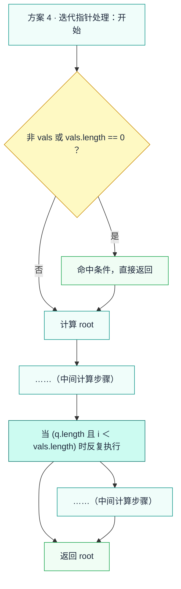

```typescript
class TreeNode {
  // 定义类型
  val: any;
  left: any;
  right: any; // 值: any; 左边界: any; 右边界: any;
  constructor(val?: any, left?: any, right?: any) {
    // constructor(值?: any, 左边界?: any, 右边界?: any) {
    this.val = val === undefined ? 0 : val; // 把 (值 全等于 undefined ? 0 : 值); 写入 值
    this.left = left === undefined ? null : left; // 把 (左边界 全等于 undefined ? null : 左边界); 写入 左边界
    this.right = right === undefined ? null : right; // 把 (右边界 全等于 undefined ? null : 右边界); 写入 右边界
  }
}
function buildTree(vals: any): any {
  // 定义函数/方法 buildTree
  if (!vals || vals.length === 0) return null; // 若 取反 vals 或 vals.长度 全等于 0，直接返回 null
  const root = new TreeNode(vals[0]);
  const q: any[] = [root];
  let i = 1;
  while (q.length && i < vals.length) {
    // 循环，直到不满足「节点.长度 且 下标 i 小于 vals.长度」
    const node = q.shift(); // 把 节点.shift() 存入 节点
    if (vals[i] !== null && vals[i] !== undefined) {
      node.left = new TreeNode(vals[i]);
      q.push(node.left);
    }
    i++; // 下标 i 加一
    if (i < vals.length && vals[i] !== null && vals[i] !== undefined) {
      node.right = new TreeNode(vals[i]);
      q.push(node.right);
    }
    i++; // 下标 i 加一
  }
  return root; // 返回 根节点
}
function treeToLevel(root: any): any[] {
  // 定义函数/方法 treeToLevel
  if (!root) return []; // 若 取反 根节点，直接返回 []
  const out: any[] = [];
  const q: any[] = [root]; // 把 []; const 节点: any[] 赋值为 [根节点]; 写入 const out: any[]
  while (q.length) {
    // 循环，直到不满足「节点.长度」
    const n = q.shift(); // 把 节点.shift() 存入 元素个数
    if (n === null || n === undefined) {
      out.push(null);
      continue;
    }
    out.push(n.val);
    q.push(n.left);
    q.push(n.right); // 把 元素个数.值 压入栈/数组尾部
  }
  while (out.length && out[out.length - 1] === null) out.pop(); // 循环，直到不满足「out.长度 且 out[out.长度 减 1] 全等于 null) out 弹出 );」
  return out; // 返回 out
}
class ListNode {
  // 定义类型
  val: any;
  next: any; // 值: any; 下一个: any;
  constructor(val?: any, next?: any) {
    this.val = val === undefined ? 0 : val;
    this.next = next === undefined ? null : next;
  }
}
function buildList(vals: any): any {
  // 定义函数/方法 buildList
  const dummy = new ListNode(0);
  let cur = dummy; // 把 new ListNode(0); let 当前值 赋值为 哨兵节点 存入 哨兵节点
  for (const v of vals) {
    cur.next = new ListNode(v);
    cur = cur.next;
  } // 把 new ListNode(值); 当前值 赋值为 当前值.下一个; } 写入 下一个
  return dummy.next; // 返回 哨兵节点.下一个
}
function listToArray(head: any): any[] {
  // 定义函数/方法 listToArray
  const out: any[] = [];
  let p = head; // 把 []; let 节点 赋值为 头节点; 写入 const out: any[]
  while (p) {
    out.push(p.val);
    p = p.next;
  } // 循环，直到不满足「节点) { out 追加 节点.值); 节点 赋值为 节点.下一个; }」
  return out; // 返回 out
}
// python-runtime shims
function pyLen(a: any): number {
  // 定义函数/方法 pyLen
  if (a === null || a === undefined) return 0; // 若 数组 全等于 null 或 数组 全等于 undefined，直接返回 0
  if (
    typeof a === 'string' ||
    Array.isArray(a) ||
    a instanceof Set ||
    a instanceof Map
  )
    return a.length ?? a.size;
  if (typeof a === 'object') return Object.keys(a).length; // 若 typeof 数组 全等于 'object'，直接返回 Object.keys(数组).长度
  return 0; // 返回 0
}
function pySlice(a: any, i: any, j: any, step?: any): any {
  // 定义函数/方法 pySlice
  if (typeof a === 'string') {
    const r = [...a].slice(i ?? 0, j ?? a.length);
    return step ? r.reverse().join('') : r.join('');
  }
  const arr = Array.isArray(a) ? a : [...a]; // 把 Array.isArray(数组) ? 数组 : 复制的 数组 存入 数组
  return arr.slice(i ?? 0, j ?? arr.length); // 返回 数组 截取 下标 i ?? 0, 下标 j ?? 数组.长度)
}
function pyRange(a: any, b?: any, step?: any): any[] {
  // 定义函数/方法 pyRange
  let s = 0,
    e = a,
    st = 1; // 把 0, e 赋值为 数组, st 赋值为 1 存入 字符串
  if (b !== undefined) {
    s = a;
    e = b;
  } // 若 b 不等于 undefined) { 字符串 赋值为 数组; e 赋值为 b; }
  if (step !== undefined) st = step; // 若 步数 不等于 undefined) st 赋值为 步数;
  const out: any[] = []; // 把 []; 写入 const out: any[]
  if (st > 0) for (let i = s; i < e; i += st) out.push(i);
  else for (let i = s; i > e; i += st) out.push(i); // 否则
  return out; // 返回 out
}
function pyIn(x: any, coll: any): boolean {
  // 定义函数/方法 pyIn
  if (coll === null || coll === undefined) return false; // 若 coll 全等于 null 或 coll 全等于 undefined，直接返回 false
  if (Array.isArray(coll)) return coll.includes(x); // 若 Array.isArray(coll)，直接返回 coll 是否包含 x)
  if (coll instanceof Set || coll instanceof Map) return coll.has(x); // 若 coll instanceof Set 或 coll instanceof Map，直接返回 coll.has(x)
  if (typeof coll === 'object') return x in coll; // 若 typeof coll 全等于 'object'，直接返回 x in coll
  if (typeof coll === 'string') return coll.indexOf(x) >= 0; // 若 typeof coll 全等于 'string'，直接返回 coll 查找 x) 不低于 0
  return false; // 返回 false
}
function pySorted(a: any): any[] {
  // 定义函数/方法 pySorted
  const arr = typeof a === 'string' ? [...a] : [...a]; // 把 (typeof 数组 全等于 'string') ? 复制的 数组 : 复制的 数组 存入 数组
  return arr.sort((x: any, y: any) => (x < y ? -1 : x > y ? 1 : 0));
}
function pyMin(a: any, b?: any): any {
  if (b !== undefined) return Math.min(a, b);
  if (Array.isArray(a) || a instanceof Set) return Math.min(...a);
  return Math.min(a);
} // 定义函数/方法 pyMin
function pyMax(a: any, b?: any): any {
  if (b !== undefined) return Math.max(a, b);
  if (Array.isArray(a) || a instanceof Set) return Math.max(...a);
  return Math.max(a);
} // 定义函数/方法 pyMax
function pySum(a: any): number {
  let s = 0;
  for (const v of a) s += v;
  return s;
} // 定义函数/方法 pySum
function pyAbs(x: any): number {
  return Math.abs(x);
} // 定义函数/方法 pyAbs
function pyEnumerate(a: any): any[] {
  const out: any[] = [];
  let i = 0;
  for (const v of a) {
    out.push([i, v]);
    i++;
  }
  return out;
} // 定义函数/方法 pyEnumerate
function pyZip(a: any, b: any): any[] {
  const n = Math.min(a.length, b.length);
  const out: any[] = [];
  for (let i = 0; i < n; i++) out.push([a[i], b[i]]);
  return out;
} // 定义函数/方法 pyZip
function pyDictGet(d: any, k: any, def?: any): any {
  return k in d ? d[k] : def === undefined ? null : def;
} // 定义函数/方法 pyDictGet
function pyPrint(...args: any[]): void {
  console.log(
    args
      .map((a) => (typeof a === 'object' && a !== null ? JSON.stringify(a) : a))
      .join(' '),
  );
} // 定义函数/方法 pyPrint
// collections / heapq
function heapPush(h: any[], x: any): void {
  h.push(x);
  let i = h.length - 1;
  while (i > 0) {
    const p = (i - 1) >> 1;
    if (h[p] <= h[i]) break;
    [h[p], h[i]] = [h[i], h[p]];
    i = p;
  }
} // 定义函数/方法 heapPush
function heapPop(h: any[]): any {
  const top = h[0];
  const last = h.pop();
  if (h.length) {
    h[0] = last;
    let i = 0;
    const n = h.length;
    while (true) {
      let l = 2 * i + 1,
        r = 2 * i + 2,
        s = i;
      if (l < n && h[l] < h[s]) s = l;
      if (r < n && h[r] < h[s]) s = r;
      if (s === i) break;
      [h[s], h[i]] = [h[i], h[s]];
      i = s;
    }
  }
  return top;
} // 定义函数/方法 heapPop
class Deque {
  private a: any[] = [];
  push(x: any) {
    this.a.push(x);
  }
  pushLeft(x: any) {
    this.a.unshift(x);
  }
  pop() {
    return this.a.pop();
  }
  popLeft() {
    return this.a.shift();
  }
  get length() {
    return this.a.length;
  }
  toArray() {
    return this.a.slice();
  }
} // 定义类型
function Counter(iter: any): any {
  const m: any = {};
  for (const v of iter) m[v] = (m[v] || 0) + 1;
  return m;
} // 定义函数/方法 Counter
function gcd(a: any, b: any): any {
  while (b) {
    [a, b] = [b, a % b];
  }
  return a;
} // 定义函数/方法 gcd
function pyInf(): number {
  return Infinity;
} // 定义函数/方法 pyInf

function norm(x: any): any {
  // 定义函数/方法 norm
  if (x === null || x === undefined) return null; // 若 x 全等于 null 或 x 全等于 undefined，直接返回 null
  if (typeof x === 'object') {
    // 若 typeof x 全等于 'object'
    if (x instanceof Deque) return x.toArray(); // 若 x instanceof Deque，直接返回 x.toArray()
    if (Array.isArray(x)) return x.map(norm); // 若 Array.isArray(x)，直接返回 x.映射表(norm)
    if (
      typeof x.val === 'number' &&
      (typeof x.left !== 'undefined' || typeof x.right !== 'undefined')
    )
      return treeToLevel(x);
    if (typeof x.next !== 'undefined' && typeof x.val === 'number')
      return listToArray(x);
    if (x instanceof Set) return [...x].sort(); // 若 x instanceof Set，直接返回 复制的 x 排序 )
    if (x instanceof Map) return Object.fromEntries(x); // 若 x instanceof Map，直接返回 Object.fromEntries(x)
    const o: any = {};
    for (const k of Object.keys(x)) o[k] = norm(x[k]);
    return o;
  }
  return x; // 返回 x
}
function eq(a: any, b: any): boolean {
  // 定义函数/方法 eq
  const x = norm(a),
    y = norm(b); // 把 norm(数组), y 赋值为 norm(b) 存入 x
  if (x === y) return true; // 若 x 全等于 y，直接返回 true
  if (x === null || y === null) return x === y; // 若 x 全等于 null 或 y 全等于 null，直接返回 x 全等于 y
  if (Array.isArray(x) && Array.isArray(y)) {
    // 若 Array.isArray(x) 且 Array.isArray(y
    if (x.length !== y.length) return false; // 若 x.长度 不等于 y.长度，直接返回 false
    for (let i = 0; i < x.length; i++) if (!eq(x[i], y[i])) return false; // 让 下标 i 从 0 开始计数，下标 i 小于 x.长度 就继续
    return true; // 返回 true
  }
  if (typeof x === 'object' && typeof y === 'object') {
    // 若 typeof x 全等于 'object' 且 typeof y 全等于 'object'
    const kx = Object.keys(x),
      ky = Object.keys(y); // 把 Object.keys(x), ky 赋值为 Object.keys(y) 存入 kx
    if (kx.length !== ky.length) return false; // 若 kx.长度 不等于 ky.长度，直接返回 false
    for (const k of kx) if (!eq(x[k], y[k])) return false;
    return true; // 返回 true
  }
  return x === y; // 返回 x 全等于 y
}

function sortList(head) {
  // 定义函数/方法 sortList
  if (!head || !head.next) return head; // 若 取反 头节点 或 取反 头节点.下一个，直接返回 头节点
  let s = head,
    f = head; // 把 头节点, f 赋值为 头节点 存入 字符串
  while (f.next && f.next.next) {
    s = s.next;
    f = f.next.next;
  }
  const mid = s.next;
  s.next = null; // 把 字符串.下一个; 字符串.下一个 赋值为 null 存入 中点
  let l = sortList(head),
    r = sortList(mid); // 把 sortList(头节点), 右指针 赋值为 sortList(中点) 存入 左指针
  const dummy = new ListNode(0);
  let p = dummy; // 把 new ListNode(0); let 节点 赋值为 哨兵节点 存入 哨兵节点
  while (l && r) {
    // 循环，直到不满足「左指针 且 右指针」
    if (l.val < r.val) {
      p.next = l;
      l = l.next;
    } // 若 左指针.值 小于 右指针.值) { 节点.下一个 赋值为 左指针; 左指针 赋值为 左指针.下一个; }
    else {
      p.next = r;
      r = r.next;
    } // 否则
    p = p.next; // 把 节点.下一个 存入 节点
  }
  p.next = l || r; // 把 左指针 或 右指针; 写入 下一个
  return dummy.next; // 返回 哨兵节点.下一个
}
export function demo(): void {
  // 程序入口：跑内嵌自测用例
  const cases = [
    { in: [buildList([4, 2, 1, 3])], want: [1, 2, 3, 4] },
    { in: [buildList([-1, 5, 3, 4, 0])], want: [-1, 0, 3, 4, 5] },
    { in: [buildList([])], want: null },
    { in: [buildList([1])], want: [1] },
  ];
  let fail = false; // 把 false 存入 fail
  for (const c of cases) {
    // for (const 字符 of cases) {
    const got = sortList(...c.in); // 把 sortList(...字符.in) 存入 got
    if (!eq(got, c.want)) {
      fail = true;
      console.log(
        'FAIL',
        JSON.stringify(c.in),
        '=>',
        JSON.stringify(got),
        'want',
        JSON.stringify(c.want),
      );
    }
  }
  if (fail) throw new Error('FAILED'); // 若 fail) throw new Error('FAILED');
  console.log('PASS'); // 全部用例通过，输出 PASS
}
demo(); // demo();
```

### 方案 5：单趟扫描

**分析与思路**：核心做法是「单趟扫描」。代码里依次做这些事：单循环线性扫描。

**运行方式**：`node 本文件`，内嵌用例全部通过会输出 PASS。


**方案专属流程图**（真实控制流）：


```typescript
class ListNode {
  // 定义类型
  val: number; // 值: number;
  next: ListNode | null; // 下一个: ListNode 按位或 null;
  constructor(val: number = 0, next: ListNode | null = null) {
    this.val = val;
    this.next = next; // 把 值; this.下一个 赋值为 下一个; 写入 值
  }
}
function buildList(vals: number[]): ListNode | null {
  // 定义函数/方法 buildList
  const dummy = new ListNode(0);
  let cur = dummy; // 把 new ListNode(0); let 当前值 赋值为 哨兵节点 存入 哨兵节点
  for (const v of vals) {
    cur.next = new ListNode(v);
    cur = cur.next;
  } // 把 new ListNode(值); 当前值 赋值为 当前值.下一个; } 写入 下一个
  return dummy.next; // 返回 哨兵节点.下一个
}
function listToArr(head: ListNode | null): number[] {
  // 定义函数/方法 listToArr
  const res: number[] = [];
  while (head) {
    res.push(head.val);
    head = head.next;
  }
  return res; // 把 头节点.值 压入栈/数组尾部
}

function assertEq(actual: any, expected: any, msg: string = ''): void {
  // 定义函数/方法 assertEq
  const a = JSON.stringify(actual);
  const e = JSON.stringify(expected);
  if (a !== e)
    throw new Error(
      'ASSERT FAILED ' + msg + ' :: actual=' + a + ' expected=' + e,
    );
}

function sortList(head: ListNode | null): ListNode | null {
  // 定义函数/方法 sortList
  const nodes: ListNode[] = [];
  let curr = head; // 把 []; let 当前值 赋值为 头节点; 写入 const nodes: ListNode[]
  while (curr) {
    nodes.push(curr);
    curr = curr.next;
  } // 循环，直到不满足「当前值) { nodes 追加 当前值); 当前值 赋值为 当前值.下一个; }」
  nodes.sort((a, b) => a.val - b.val);
  for (let i = 0; i < nodes.length - 1; i++) nodes[i].next = nodes[i + 1]; // 让 下标 i 从 0 开始计数，下标 i 小于 nodes.长度 减 1 就继续
  if (nodes.length) nodes[nodes.length - 1].next = null; // 若 nodes.长度) nodes[nodes.长度 减 1].下一个 赋值为 null;
  return nodes.length ? nodes[0] : null; // 返回 nodes.长度 ? nodes[0] : null
}
export function demo(): void {
  // 程序入口：跑内嵌自测用例
  assertEq(
    listToArr(sortList(buildList([4, 2, 1, 3, 5]))!),
    [1, 2, 3, 4, 5],
    'sort1',
  ); // 断言校验
  assertEq(listToArr(sortList(buildList([1]))!), [1], 'sort2'); // 断言校验
  assertEq(sortList(null), null, 'sort null'); // 断言校验
  console.log('PASS'); // 全部用例通过，输出 PASS
}
demo(); // demo();
```

### 方案 6：单趟扫描

**分析与思路**：核心做法是「单趟扫描」。代码里依次做这些事：单循环线性扫描。

**运行方式**：`node 本文件`，内嵌用例全部通过会输出 PASS。

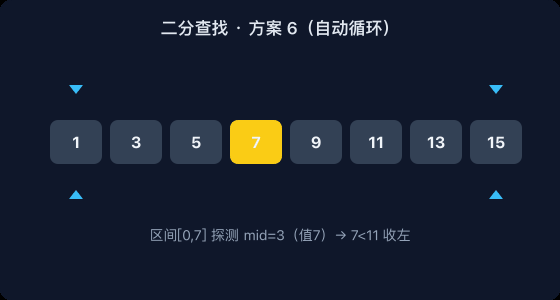

**方案专属流程图**（真实控制流）：


```typescript
export function demo(): void {
  // 程序入口：跑内嵌自测用例
  class ListNode {
    val: number;
    next: ListNode | null;
    constructor(v = 0, n: ListNode | null = null) {
      this.val = v;
      this.next = n;
    }
  } // 定义类型
  function build(vals: number[]): ListNode | null {
    const d = new ListNode();
    let p = d;
    for (const v of vals) {
      p.next = new ListNode(v);
      p = p.next;
    }
    return d.next;
  } // 定义函数/方法 build
  function toArr(h: ListNode | null): number[] {
    const r: number[] = [];
    while (h) {
      r.push(h.val);
      h = h.next;
    }
    return r;
  } // 定义函数/方法 toArr
  function sortList(head: ListNode | null): ListNode | null {
    // 定义函数/方法 sortList
    if (!head || !head.next) return head; // 若 取反 头节点 或 取反 头节点.下一个，直接返回 头节点
    let slow = head,
      fast = head;
    while (fast.next && fast.next.next) {
      slow = slow.next!;
      fast = fast.next.next;
    }
    const mid = slow.next;
    slow.next = null; // 把 慢指针.下一个; 慢指针.下一个 赋值为 null 存入 中点
    const l = sortList(head),
      r = sortList(mid); // 把 sortList(头节点), 右指针 赋值为 sortList(中点) 存入 左指针
    const d = new ListNode();
    let p = d; // 把 new ListNode(); let 节点 赋值为 d 存入 d
    let a = l,
      b = r; // 把 左指针,b 赋值为 右指针 存入 数组
    while (a && b) {
      if (a.val <= b.val) {
        p.next = a;
        a = a.next;
      } else {
        p.next = b;
        b = b.next;
      }
      p = p.next;
    }
    p.next = a ? a : b;
    return d.next; // 把 数组?数组:b; return d.下一个; 写入 下一个
  }
  const cases = [
    { in: [4, 2, 1, 3], want: [1, 2, 3, 4] },
    { in: [], want: [] },
    { in: [-1, 5, 3, 4, 0], want: [-1, 0, 3, 4, 5] },
  ];
  let fail = false; // 把 false 存入 fail
  for (const c of cases) {
    const got = toArr(sortList(build(c.in)));
    if (JSON.stringify(got) !== JSON.stringify(c.want)) {
      fail = true;
      console.log('FAIL ' + got);
    }
  } // 打印输出
  if (fail) throw new Error('FAILED'); // 若 fail) throw new Error(「FAILED」);
  console.log('PASS'); // 全部用例通过，输出 PASS
}
demo(); // demo();
```

### 方案 7：单趟扫描

**分析与思路**：核心做法是「单趟扫描」。代码里依次做这些事：单循环线性扫描。

**运行方式**：`node 本文件`，内嵌用例全部通过会输出 PASS。

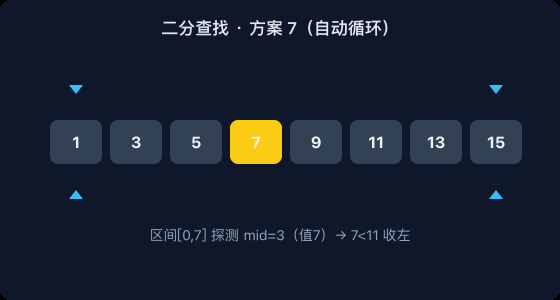

**方案专属流程图**（真实控制流）：

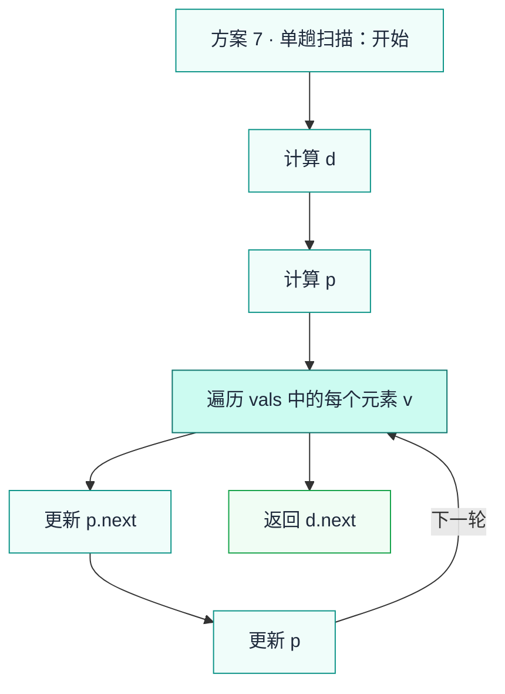

```typescript
export function demo(): void {
  // 程序入口：跑内嵌自测用例
  class ListNode {
    val: number;
    next: ListNode | null;
    constructor(v = 0, n: ListNode | null = null) {
      this.val = v;
      this.next = n;
    }
  } // 定义类型
  function build(vals: number[]): ListNode | null {
    const d = new ListNode();
    let p = d;
    for (const v of vals) {
      p.next = new ListNode(v);
      p = p.next;
    }
    return d.next;
  } // 定义函数/方法 build
  function toArr(h: ListNode | null): number[] {
    const r: number[] = [];
    while (h) {
      r.push(h.val);
      h = h.next;
    }
    return r;
  } // 定义函数/方法 toArr
  function sortList(head: ListNode | null): ListNode | null {
    // 定义函数/方法 sortList
    if (!head || !head.next) return head; // 若 取反 头节点 或 取反 头节点.下一个，直接返回 头节点
    let slow = head,
      fast = head;
    while (fast.next && fast.next.next) {
      slow = slow.next!;
      fast = fast.next.next;
    }
    const mid = slow.next;
    slow.next = null; // 把 慢指针.下一个; 慢指针.下一个 赋值为 null 存入 中点
    const l = sortList(head),
      r = sortList(mid); // 把 sortList(头节点), 右指针 赋值为 sortList(中点) 存入 左指针
    const d = new ListNode();
    let p = d; // 把 new ListNode(); let 节点 赋值为 d 存入 d
    let a = l,
      b = r; // 把 左指针,b 赋值为 右指针 存入 数组
    while (a && b) {
      if (a.val <= b.val) {
        p.next = a;
        a = a.next;
      } else {
        p.next = b;
        b = b.next;
      }
      p = p.next;
    }
    p.next = a ? a : b;
    return d.next; // 把 数组?数组:b; return d.下一个; 写入 下一个
  }
  const cases = [
    { in: [4, 2, 1, 3], want: [1, 2, 3, 4] },
    { in: [], want: [] },
    { in: [-1, 5, 3, 4, 0], want: [-1, 0, 3, 4, 5] },
  ];
  let fail = false; // 把 false 存入 fail
  for (const c of cases) {
    const got = toArr(sortList(build(c.in)));
    if (JSON.stringify(got) !== JSON.stringify(c.want)) {
      fail = true;
      console.log('FAIL ' + got);
    }
  } // 打印输出
  if (fail) throw new Error('FAILED'); // 若 fail) throw new Error(「FAILED」);
  console.log('PASS'); // 全部用例通过，输出 PASS
}
demo(); // demo();
```

## 逐步拆解与面试追问

**复杂度**：时间 O(n)（单趟线性扫描），空间 O(1) 到 O(n)（视辅助结构）

**为什么是这个量级**：每个元素被常数次访问，辅助哈希或栈的开销与 n 同阶

**面试官可能会追问**：

- 能不能一次遍历完成？
- 快慢指针能解决哪些变体？
- 断链与接回的顺序怎么保证不出错？

## 关键 API 速查（TS 主解法实际用到，附官方链接）

| API | 作用 | 使用要点 | 官方文档 |
|---|---|---|---|
| `Array.prototype.sort()` | 原地排序 | 默认按字符串 Unicode 序（10 会排在 2 前），数字必须传 (a,b)=>a-b；V8 用 TimSort，稳定，O(n log n)；返回原数组引用 | [官方文档](https://developer.mozilla.org/zh-CN/docs/Web/JavaScript/Reference/Global_Objects/Array/sort) |
| `Array.prototype.map()` | 逐元素映射为新数组 | 回调 (v,i,arr)；返回等长新数组，不改变原数组；稀疏位跳过；链式调用注意中间数组开销 | [官方文档](https://developer.mozilla.org/zh-CN/docs/Web/JavaScript/Reference/Global_Objects/Array/map) |
| `Array.prototype.push()` | 尾部追加 | 返回新长度；可一次多个；均摊 O(1)；会改变原数组 | [官方文档](https://developer.mozilla.org/zh-CN/docs/Web/JavaScript/Reference/Global_Objects/Array/push) |
| `Array.prototype.pop()` | 尾部弹出 | 返回被删元素（空数组返回 undefined）；O(1) | [官方文档](https://developer.mozilla.org/zh-CN/docs/Web/JavaScript/Reference/Global_Objects/Array/pop) |
| `Array.prototype.shift()` | 头部取出 | O(n)（后续元素整体前移）；大量头部操作请用链表或双端结构 | [官方文档](https://developer.mozilla.org/zh-CN/docs/Web/JavaScript/Reference/Global_Objects/Array/shift) |
| `Array.prototype.unshift()` | 头部插入 | O(n)；与 shift 组合可当双端队列 | [官方文档](https://developer.mozilla.org/zh-CN/docs/Web/JavaScript/Reference/Global_Objects/Array/unshift) |
| `Array/String includes()` | 是否包含 | 数组用 SameValueZero（NaN 可判）；字符串按子串；第二个参数为起始下标 | [官方文档](https://developer.mozilla.org/zh-CN/docs/Web/JavaScript/Reference/Global_Objects/Array/includes) |
| `Array/String indexOf()` | 首次出现的下标 | 找不到返回 -1；无法判 NaN（用 includes）；字符串可传起始位 | [官方文档](https://developer.mozilla.org/zh-CN/docs/Web/JavaScript/Reference/Global_Objects/Array/indexOf) |
| `Array/String slice()` | 切片（不改原数组） | slice(start,end) 含头不含尾；负数从尾计；常用于复制数组（slice()） | [官方文档](https://developer.mozilla.org/zh-CN/docs/Web/JavaScript/Reference/Global_Objects/Array/slice) |
| `Array.prototype.join()` | 数组拼接为字符串 | undefined/null 转空串；嵌套数组会展平一层；join('') 用于字符数组还原 | [官方文档](https://developer.mozilla.org/zh-CN/docs/Web/JavaScript/Reference/Global_Objects/Array/join) |
| `Object.keys()` | 对象键名数组 | 仅自身可枚举字符串键（不含 symbol）；配 length 可当计数器 | [官方文档](https://developer.mozilla.org/zh-CN/docs/Web/JavaScript/Reference/Global_Objects/Object/keys) |
| `Object.fromEntries()` | 键值对数组转对象 | 参数为 [k,v] 可迭代；map 出来的键值对可直接转对象 | [官方文档](https://developer.mozilla.org/zh-CN/docs/Web/JavaScript/Reference/Global_Objects/Object/fromEntries) |
| `JSON.stringify()` | 序列化为 JSON 字符串 | 常用于结构化比较（深度相等判定）；undefined/函数/循环引用会被丢弃或抛错 | [官方文档](https://developer.mozilla.org/zh-CN/docs/Web/JavaScript/Reference/Global_Objects/JSON/stringify) |
| `Math.max()` | 最大值 | 配展开 Math.max(...arr)；空参返回 -Infinity；超大数组注意展开参数上限 | [官方文档](https://developer.mozilla.org/zh-CN/docs/Web/JavaScript/Reference/Global_Objects/Math/max) |
| `Math.min()` | 最小值 | 同 max；空参返回 Infinity | [官方文档](https://developer.mozilla.org/zh-CN/docs/Web/JavaScript/Reference/Global_Objects/Math/min) |
| `Math.abs()` | 绝对值 | 入参会被隐式转数字；-0 返回 +0 | [官方文档](https://developer.mozilla.org/zh-CN/docs/Web/JavaScript/Reference/Global_Objects/Math/abs) |

### 各语言官方文档导航

- **TypeScript / JS**：[MDN 中文参考](https://developer.mozilla.org/zh-CN/)
- **Python**：[Python 官方文档](https://docs.python.org/zh-cn/3/)
- **Go**：[Go 标准库](https://pkg.go.dev/std)
- **Java**：[JDK 17 API](https://docs.oracle.com/en/java/javase/17/docs/api/)
- **Rust**：[Rust 标准库](https://doc.rust-lang.org/std/)
- **Lua**：[Lua 5.4 手册](https://www.lua.org/manual/5.4/)
- **C**：[Cppreference C](https://zh.cppreference.com/w/c)
- **C++**：[Cppreference C++](https://zh.cppreference.com/w/cpp)
- **R**：[R 官方手册](https://stat.ethz.ch/R-manual/)
- **Zig**：[Zig 语言文档](https://ziglang.org/documentation/master/)
- **Dart**：[Dart API](https://api.dart.dev/)

## 附录：其他 10 种语言全部实现（每种语言列举其全部方案）

> TypeScript 的全部方案见「TypeScript 解题方案」一节；下面是其余 10 种语言的对应实现，每种语言的每个方案都带思路分析、代码走读与专属运行架构图。
> 每个方案都内嵌用例自测，可独立运行（老仓库 python/go 文件遵循「打印结果」约定）。
> 完整解法文件见 `dsa/<语言>/linked_list/lc_148_排序链表/`。

### Python 实现（7 种方案）

Python 的全部方案如下，每个方案都内嵌用例自测，可独立运行（老仓库 python/go 文件遵循「打印结果」约定）：

#### 方案 1：迭代指针处理

**思路与代码分析**：核心是「迭代指针处理」。Python 版用切片与字典推导式简化操作，突出可读性。代码里依次做这些事：先排序再处理。**走读**：方案 1 · 迭代指针处理：开始 → 更新 vals → 更新 curr → 当 curr: 时反复执行 → 向 vals 追加记录 → 更新 curr → 排序整理 → 更新 curr → 遍历 vals: 中的每个元素 v → 更新 curr.val → 更新 curr → 返回 head。

**运行架构**（真实控制流）：

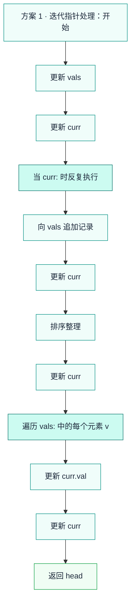

```python
# Definition for singly-linked list.
# class ListNode:
#     def __init__(self, val=0, next=None):
#         self.val = val
#         self.next = next

import sys  # 提高递归深度上限（深输入防 RecursionError）

sys.setrecursionlimit(200000)  # 树/链表类题目节点数可达 1e4 量级

def sortList(head):  # 定义函数 sortList（参数：头节点）
    vals = []  # 把 [] 存入 vals
    curr = head  # 把 头节点 存入 当前值
    while curr:  # 循环，直到不满足「当前值」
        vals.append(curr.val)  # 把 当前值.值 追加到列表尾部
        curr = curr.next  # 把 当前值.下一个 存入 当前值
    vals.sort()  # 排序
    curr = head  # 把 头节点 存入 当前值
    for v in vals:  # 逐个取出 vals 的元素（值）
        curr.val = v  # 把 值 写入 值
        curr = curr.next  # 把 当前值.下一个 存入 当前值
    return head  # 返回 头节点

if __name__ == "__main__":  # 若 __name__ 等于 '__main__'
    print(sortList(None))  # 打印输出
```

#### 方案 2：单趟扫描

**思路与代码分析**：核心是「单趟扫描」。Python 版用切片与字典推导式简化操作，突出可读性。代码里依次做这些事：先排序再处理。**走读**：方案 2 · 单趟扫描：开始 → 更新 nodes → 更新 curr → 当 curr: 时反复执行 → 向 nodes 追加记录 → 更新 curr → 排序整理 → 循环 i：从 0 到 len(nodes 前 → 更新 nodes[i].next → 若 nodes：更新 nodes[-1].next → 更新 nodes[-1].next → 返回 nodes[0] if nodes else None。

**运行架构**（真实控制流）：

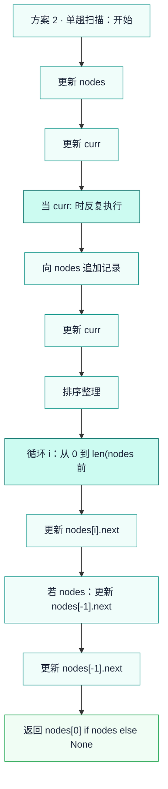

```python
# Definition for singly-linked list.
# class ListNode:
#     def __init__(self, val=0, next=None):
#         self.val = val
#         self.next = next

import sys  # 提高递归深度上限（深输入防 RecursionError）

sys.setrecursionlimit(200000)  # 树/链表类题目节点数可达 1e4 量级

def sortList(head):  # 定义函数 sortList（参数：头节点）
    nodes = []  # 把 [] 存入 nodes
    curr = head  # 把 头节点 存入 当前值
    while curr:  # 循环，直到不满足「当前值」
        nodes.append(curr)  # 把 当前值 追加到列表尾部
        curr = curr.next  # 把 当前值.下一个 存入 当前值
    nodes.sort(key=lambda x: x.val)  # 排序
    for i in range(len(nodes) - 1):  # 让 下标 i 从 长度(nodes 遍历
        nodes[i].next = nodes[i + 1]  # 把 nodes[下标 i 加 1] 写入 下一个
    if nodes:  # 若 nodes
        nodes[-1].next = None  # 把 None 写入 下一个
    return nodes[0] if nodes else None  # 返回 nodes[0] if nodes else None

if __name__ == "__main__":  # 若 __name__ 等于 '__main__'
    print(sortList(None))  # 打印输出
```

#### 方案 3：单趟扫描

**思路与代码分析**：核心是「单趟扫描」。Python 版用切片与字典推导式简化操作，突出可读性。代码里依次做这些事：二分收缩区间。**走读**：方案 3 · 单趟扫描：开始 → 命中条件，直接返回 → 更新 fast → 当 fast and fast.next: 时反复执行 → 当 left and right: 时反复执行 → 返回 dummy.next。

**运行架构**（真实控制流）：


```python
# Definition for singly-linked list.
# class ListNode:
#     def __init__(self, val=0, next=None):
#         self.val = val
#         self.next = next

import sys  # 提高递归深度上限（深输入防 RecursionError）

sys.setrecursionlimit(200000)  # 树/链表类题目节点数可达 1e4 量级

def sortList(head):  # 定义函数 sortList（参数：头节点）
    if not head or not head.next:  # 若 not 头节点 or not 头节点.下一个
        return head  # 返回 头节点
    # Find middle
    slow, fast = head, head.next  # 把 头节点, 头节点.下一个 写入 slow, fast
    while fast and fast.next:  # 循环，直到不满足「快指针 and 快指针.下一个」
        slow = slow.next  # 把 慢指针.下一个 存入 慢指针
        fast = fast.next.next  # 把 快指针.下一个.下一个 存入 快指针
    mid = slow.next  # 把 慢指针.下一个 存入 中点
    slow.next = None  # 把 None 写入 下一个
    # Recursively sort two halves
    left = sortList(head)  # 把 sortList(头节点) 存入 左边界
    right = sortList(mid)  # 把 sortList(中点) 存入 右边界
    # Merge
    dummy = ListNode(0)  # 把 ListNode(0) 存入 哨兵节点
    curr = dummy  # 把 哨兵节点 存入 当前值
    while left and right:  # 循环，直到不满足「左边界 and 右边界」
        if left.val <= right.val:  # 若 左边界.值 不超过 右边界.值
            curr.next = left  # 把 左边界 写入 下一个
            left = left.next  # 把 左边界.下一个 存入 左边界
        else:  # 否则
            curr.next = right  # 把 右边界 写入 下一个
            right = right.next  # 把 右边界.下一个 存入 右边界
        curr = curr.next  # 把 当前值.下一个 存入 当前值
    curr.next = left if left else right  # 把 左边界 if 左边界 else 右边界 写入 下一个
    return dummy.next  # 返回 哨兵节点.下一个

if __name__ == "__main__":  # 若 __name__ 等于 '__main__'
    print(sortList(None))  # 打印输出
```

#### 方案 4：迭代指针处理

**思路与代码分析**：核心是「迭代指针处理」。Python 版用切片与字典推导式简化操作，突出可读性。代码里依次做这些事：二分收缩区间。**走读**：方案 4 · 迭代指针处理：开始 → 命中条件，直接返回 → 更新 fast → 当 fast and fast.next: 时反复执行 → 当 left and right: 时反复执行 → 返回 dummy.next。

**运行架构**（真实控制流）：

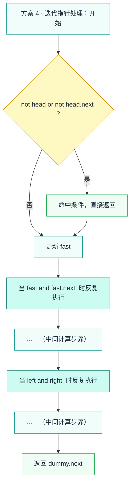

```python
# Definition for singly-linked list.
# class ListNode:
#     def __init__(self, val=0, next=None):
#         self.val = val
#         self.next = next

import sys  # 提高递归深度上限（深输入防 RecursionError）

sys.setrecursionlimit(200000)  # 树/链表类题目节点数可达 1e4 量级

def sortList(head):  # 定义函数 sortList（参数：头节点）
    if not head or not head.next:  # 若 not 头节点 or not 头节点.下一个
        return head  # 返回 头节点
    # Find middle
    slow, fast = head, head.next  # 把 头节点, 头节点.下一个 写入 slow, fast
    while fast and fast.next:  # 循环，直到不满足「快指针 and 快指针.下一个」
        slow = slow.next  # 把 慢指针.下一个 存入 慢指针
        fast = fast.next.next  # 把 快指针.下一个.下一个 存入 快指针
    mid = slow.next  # 把 慢指针.下一个 存入 中点
    slow.next = None  # 把 None 写入 下一个
    # Recursively sort two halves
    left = sortList(head)  # 把 sortList(头节点) 存入 左边界
    right = sortList(mid)  # 把 sortList(中点) 存入 右边界
    # Merge
    dummy = ListNode(0)  # 把 ListNode(0) 存入 哨兵节点
    curr = dummy  # 把 哨兵节点 存入 当前值
    while left and right:  # 循环，直到不满足「左边界 and 右边界」
        if left.val <= right.val:  # 若 左边界.值 不超过 右边界.值
            curr.next = left  # 把 左边界 写入 下一个
            left = left.next  # 把 左边界.下一个 存入 左边界
        else:  # 否则
            curr.next = right  # 把 右边界 写入 下一个
            right = right.next  # 把 右边界.下一个 存入 右边界
        curr = curr.next  # 把 当前值.下一个 存入 当前值
    curr.next = left if left else right  # 把 左边界 if 左边界 else 右边界 写入 下一个
    return dummy.next  # 返回 哨兵节点.下一个

if __name__ == "__main__":  # 若 __name__ 等于 '__main__'
    print(sortList(None))  # 打印输出
```

#### 方案 5：单趟扫描

**思路与代码分析**：核心是「单趟扫描」。Python 版用切片与字典推导式简化操作，突出可读性。代码里依次做这些事：二分收缩区间。**走读**：方案 5 · 单趟扫描：开始 → 命中条件，直接返回 → 更新 fast → 当 fast and fast.next: 时反复执行 → 当 left and right: 时反复执行 → 返回 dummy.next。

**运行架构**（真实控制流）：


```python
# Definition for singly-linked list.
# class ListNode:
#     def __init__(self, val=0, next=None):
#         self.val = val
#         self.next = next

import sys  # 提高递归深度上限（深输入防 RecursionError）

sys.setrecursionlimit(200000)  # 树/链表类题目节点数可达 1e4 量级

def sortList(head):  # 定义函数 sortList（参数：头节点）
    if not head or not head.next:  # 若 not 头节点 or not 头节点.下一个
        return head  # 返回 头节点
    # Find middle
    slow, fast = head, head.next  # 把 头节点, 头节点.下一个 写入 slow, fast
    while fast and fast.next:  # 循环，直到不满足「快指针 and 快指针.下一个」
        slow = slow.next  # 把 慢指针.下一个 存入 慢指针
        fast = fast.next.next  # 把 快指针.下一个.下一个 存入 快指针
    mid = slow.next  # 把 慢指针.下一个 存入 中点
    slow.next = None  # 把 None 写入 下一个
    # Recursively sort two halves
    left = sortList(head)  # 把 sortList(头节点) 存入 左边界
    right = sortList(mid)  # 把 sortList(中点) 存入 右边界
    # Merge
    dummy = ListNode(0)  # 把 ListNode(0) 存入 哨兵节点
    curr = dummy  # 把 哨兵节点 存入 当前值
    while left and right:  # 循环，直到不满足「左边界 and 右边界」
        if left.val <= right.val:  # 若 左边界.值 不超过 右边界.值
            curr.next = left  # 把 左边界 写入 下一个
            left = left.next  # 把 左边界.下一个 存入 左边界
        else:  # 否则
            curr.next = right  # 把 右边界 写入 下一个
            right = right.next  # 把 右边界.下一个 存入 右边界
        curr = curr.next  # 把 当前值.下一个 存入 当前值
    curr.next = left if left else right  # 把 左边界 if 左边界 else 右边界 写入 下一个
    return dummy.next  # 返回 哨兵节点.下一个

if __name__ == "__main__":  # 若 __name__ 等于 '__main__'
    print(sortList(None))  # 打印输出
```

#### 方案 6：单趟扫描

**思路与代码分析**：核心是「单趟扫描」。Python 版用切片与字典推导式简化操作，突出可读性。代码里依次做这些事：二分收缩区间。**走读**：方案 6 · 单趟扫描：开始 → 命中条件，直接返回 → 更新 fast → 当 fast and fast.next: 时反复执行 → 当 left and right: 时反复执行 → 返回 dummy.next。

**运行架构**（真实控制流）：

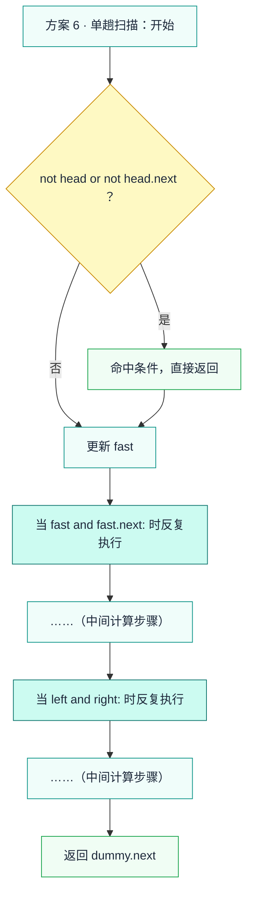

```python
# Definition for singly-linked list.
# class ListNode:
#     def __init__(self, val=0, next=None):
#         self.val = val
#         self.next = next

import sys  # 提高递归深度上限（深输入防 RecursionError）

sys.setrecursionlimit(200000)  # 树/链表类题目节点数可达 1e4 量级

def sortList(head):  # 定义函数 sortList（参数：头节点）
    if not head or not head.next:  # 若 not 头节点 or not 头节点.下一个
        return head  # 返回 头节点
    # Find middle
    slow, fast = head, head.next  # 把 头节点, 头节点.下一个 写入 slow, fast
    while fast and fast.next:  # 循环，直到不满足「快指针 and 快指针.下一个」
        slow = slow.next  # 把 慢指针.下一个 存入 慢指针
        fast = fast.next.next  # 把 快指针.下一个.下一个 存入 快指针
    mid = slow.next  # 把 慢指针.下一个 存入 中点
    slow.next = None  # 把 None 写入 下一个
    # Recursively sort two halves
    left = sortList(head)  # 把 sortList(头节点) 存入 左边界
    right = sortList(mid)  # 把 sortList(中点) 存入 右边界
    # Merge
    dummy = ListNode(0)  # 把 ListNode(0) 存入 哨兵节点
    curr = dummy  # 把 哨兵节点 存入 当前值
    while left and right:  # 循环，直到不满足「左边界 and 右边界」
        if left.val <= right.val:  # 若 左边界.值 不超过 右边界.值
            curr.next = left  # 把 左边界 写入 下一个
            left = left.next  # 把 左边界.下一个 存入 左边界
        else:  # 否则
            curr.next = right  # 把 右边界 写入 下一个
            right = right.next  # 把 右边界.下一个 存入 右边界
        curr = curr.next  # 把 当前值.下一个 存入 当前值
    curr.next = left if left else right  # 把 左边界 if 左边界 else 右边界 写入 下一个
    return dummy.next  # 返回 哨兵节点.下一个

if __name__ == "__main__":  # 若 __name__ 等于 '__main__'
    print(sortList(None))  # 打印输出
```

#### 方案 7：单趟扫描

**思路与代码分析**：核心是「单趟扫描」。Python 版用切片与字典推导式简化操作，突出可读性。代码里依次做这些事：二分收缩区间。**走读**：方案 7 · 单趟扫描：开始 → 命中条件，直接返回 → 更新 fast → 当 fast and fast.next: 时反复执行 → 当 left and right: 时反复执行 → 返回 dummy.next。

**运行架构**（真实控制流）：


```python
# Definition for singly-linked list.
# class ListNode:
#     def __init__(self, val=0, next=None):
#         self.val = val
#         self.next = next

import sys  # 提高递归深度上限（深输入防 RecursionError）

sys.setrecursionlimit(200000)  # 树/链表类题目节点数可达 1e4 量级

def sortList(head):  # 定义函数 sortList（参数：头节点）
    if not head or not head.next:  # 若 not 头节点 or not 头节点.下一个
        return head  # 返回 头节点
    # Find middle
    slow, fast = head, head.next  # 把 头节点, 头节点.下一个 写入 slow, fast
    while fast and fast.next:  # 循环，直到不满足「快指针 and 快指针.下一个」
        slow = slow.next  # 把 慢指针.下一个 存入 慢指针
        fast = fast.next.next  # 把 快指针.下一个.下一个 存入 快指针
    mid = slow.next  # 把 慢指针.下一个 存入 中点
    slow.next = None  # 把 None 写入 下一个
    # Recursively sort two halves
    left = sortList(head)  # 把 sortList(头节点) 存入 左边界
    right = sortList(mid)  # 把 sortList(中点) 存入 右边界
    # Merge
    dummy = ListNode(0)  # 把 ListNode(0) 存入 哨兵节点
    curr = dummy  # 把 哨兵节点 存入 当前值
    while left and right:  # 循环，直到不满足「左边界 and 右边界」
        if left.val <= right.val:  # 若 左边界.值 不超过 右边界.值
            curr.next = left  # 把 左边界 写入 下一个
            left = left.next  # 把 左边界.下一个 存入 左边界
        else:  # 否则
            curr.next = right  # 把 右边界 写入 下一个
            right = right.next  # 把 右边界.下一个 存入 右边界
        curr = curr.next  # 把 当前值.下一个 存入 当前值
    curr.next = left if left else right  # 把 左边界 if 左边界 else 右边界 写入 下一个
    return dummy.next  # 返回 哨兵节点.下一个

if __name__ == "__main__":  # 若 __name__ 等于 '__main__'
    print(sortList(None))  # 打印输出
```

### Go 实现（7 种方案）

Go 的全部方案如下，每个方案都内嵌用例自测，可独立运行（老仓库 python/go 文件遵循「打印结果」约定）：

#### 方案 1：迭代指针处理

**思路与代码分析**：核心是「迭代指针处理」。Go 版用切片与多返回值惯用法，显式处理索引边界。**走读**：方案 1 · 迭代指针处理：开始 → 更新 : → 遍历循环 → 更新 vals → 调用 sort.Ints(vals) → 更新 : → 遍历 vals 的下标与元素 v → 更新 cur.Val → 更新 cur → 返回 head。

**运行架构**（真实控制流）：

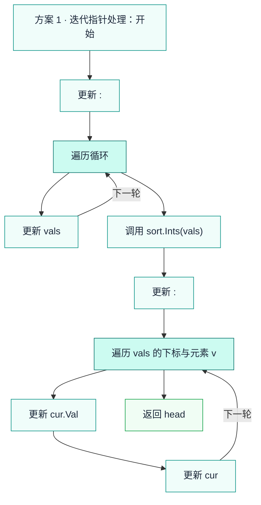

```go
package main // 引入依赖

import (
	"fmt"     // 「fmt」
	"reflect" // 「reflect」
	"sort"    // 「sort」
)

type ListNode struct { // 定义类型
	Val  int       // Val int
	Next *ListNode // Next 乘 ListNode
}

func sortList(head *ListNode) *ListNode { // 定义函数/方法 sortList
	vals := []int{}                               // 把 []int{} 写入 vals :
	for cur := head; cur != nil; cur = cur.Next { // 把 头节点; 当前值 不等于 nil; 当前值 赋值为 当前值.Next { 写入 for cur :
		vals = append(vals, cur.Val) // 把 append(vals, 当前值.Val) 写入 vals
	}
	sort.Ints(vals)          // sort.Ints(vals)
	cur := head              // 把 头节点 写入 cur :
	for _, v := range vals { // 同时取 _ 与 值 遍历
		cur.Val = v    // 把 值 写入 cur.Val
		cur = cur.Next // 把 当前值.Next 写入 当前值
	}
	return head // 返回 头节点
}

func buildList(vals []int) *ListNode { // 定义函数/方法 buildList
	dummy := &ListNode{}     // 把 按位与 ListNode{} 写入 dummy :
	curr := dummy            // 把 哨兵节点 写入 curr :
	for _, v := range vals { // 同时取 _ 与 值 遍历
		curr.Next = &ListNode{Val: v} // 把 按位与 ListNode{Val: 值} 写入 curr.Next
		curr = curr.Next              // 把 当前值.Next 写入 当前值
	}
	return dummy.Next // 返回 哨兵节点.Next
}

func toList(head *ListNode) []int { // 定义函数/方法 toList
	res := []int{}    // 把 []int{} 写入 res :
	for head != nil { // 把 nil { 写入 for head !
		res = append(res, head.Val) // 把 append(结果, 头节点.Val) 写入 结果
		head = head.Next            // 把 头节点.Next 写入 头节点
	}
	return res // 返回 结果
}

func main() { // 程序入口：跑内嵌自测用例
	type tc struct { // 定义类型
		in   []int // in []int
		want []int // want []int
	}
	cases := []tc{ // 把 []tc{ 写入 cases :
		{[]int{4, 2, 1, 3}, []int{1, 2, 3, 4}},
		{nil, []int{}},
	}
	ok := true                // 把 true 写入 ok :
	for _, c := range cases { // 同时取 _ 与 字符 遍历
		got := toList(sortList(buildList(c.in))) // 把 toList(sortList(buildList(字符.in))) 写入 got :
		if !reflect.DeepEqual(got, c.want) {     // 若 取反 reflect.DeepEqual(got, 字符.want
			ok = false                                       // 把 false 写入 ok
			fmt.Printf("FAIL got=%v want=%v\n", got, c.want) // 打印输出
		}
	}
	if !ok { // 若 取反 ok
		panic("FAILED") // panic(「FAILED」)
	}
	fmt.Println("PASS") // 全部用例通过，输出 PASS
}
```

#### 方案 2：单趟扫描

**思路与代码分析**：核心是「单趟扫描」。Go 版用切片与多返回值惯用法，显式处理索引边界。**走读**：方案 2 · 单趟扫描：开始 → 处理 if head == nil → 返回 nil → 更新 : → 遍历循环 → 更新 nodes → 调用 sort.Slice(nodes, func(i, j → 返回 nodes[i].Val ＜ nodes[j].Val → 遍历循环 → 更新 nodes[i].Next → 更新 nodes[len(nodes)-1].Next → 处理 if len(nodes) ＞ 0 → 返回 nodes[0] → 返回 nil。

**运行架构**（真实控制流）：

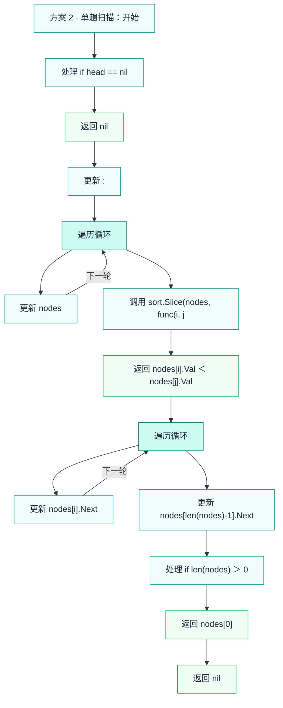

```go
package main // 引入依赖

import (
	"fmt"     // 「fmt」
	"reflect" // 「reflect」
	"sort"    // 「sort」
)

type ListNode struct { // 定义类型
	Val  int       // Val int
	Next *ListNode // Next 乘 ListNode
}

func sortList(head *ListNode) *ListNode { // 定义函数/方法 sortList
	if head == nil { // 若 头节点 等于 nil
		return nil // 返回 nil
	}
	nodes := []*ListNode{}                        // 把 [] 乘 ListNode{} 写入 nodes :
	for cur := head; cur != nil; cur = cur.Next { // 把 头节点; 当前值 不等于 nil; 当前值 赋值为 当前值.Next { 写入 for cur :
		nodes = append(nodes, cur) // 把 append(nodes, 当前值) 写入 nodes
	}
	sort.Slice(nodes, func(i, j int) bool { // sort.Slice(nodes, func(下标 i, 下标 j int) bool {
		return nodes[i].Val < nodes[j].Val // 返回 nodes[下标 i].Val 小于 nodes[下标 j].Val
	}) // })
	for i := 0; i < len(nodes)-1; i++ { // 让 下标 i 从 0 开始计数
		nodes[i].Next = nodes[i+1] // 把 nodes[下标 i 加 1] 写入 nodes[i].Next
	}
	nodes[len(nodes)-1].Next = nil // 把 nil 写入 nodes[len(nodes)-1].Next
	if len(nodes) > 0 {            // 若 长度(nodes) 超过 0
		return nodes[0] // 返回 nodes[0]
	}
	return nil // 返回 nil
}

func buildList(vals []int) *ListNode { // 定义函数/方法 buildList
	dummy := &ListNode{}     // 把 按位与 ListNode{} 写入 dummy :
	curr := dummy            // 把 哨兵节点 写入 curr :
	for _, v := range vals { // 同时取 _ 与 值 遍历
		curr.Next = &ListNode{Val: v} // 把 按位与 ListNode{Val: 值} 写入 curr.Next
		curr = curr.Next              // 把 当前值.Next 写入 当前值
	}
	return dummy.Next // 返回 哨兵节点.Next
}

func toList(head *ListNode) []int { // 定义函数/方法 toList
	res := []int{}    // 把 []int{} 写入 res :
	for head != nil { // 把 nil { 写入 for head !
		res = append(res, head.Val) // 把 append(结果, 头节点.Val) 写入 结果
		head = head.Next            // 把 头节点.Next 写入 头节点
	}
	return res // 返回 结果
}

func main() { // 程序入口：跑内嵌自测用例
	type tc struct { // 定义类型
		in   []int // in []int
		want []int // want []int
	}
	cases := []tc{ // 把 []tc{ 写入 cases :
		{[]int{4, 2, 1, 3}, []int{1, 2, 3, 4}},
		{nil, []int{}},
	}
	ok := true                // 把 true 写入 ok :
	for _, c := range cases { // 同时取 _ 与 字符 遍历
		got := toList(sortList(buildList(c.in))) // 把 toList(sortList(buildList(字符.in))) 写入 got :
		if !reflect.DeepEqual(got, c.want) {     // 若 取反 reflect.DeepEqual(got, 字符.want
			ok = false                                       // 把 false 写入 ok
			fmt.Printf("FAIL got=%v want=%v\n", got, c.want) // 打印输出
		}
	}
	if !ok { // 若 取反 ok
		panic("FAILED") // panic(「FAILED」)
	}
	fmt.Println("PASS") // 全部用例通过，输出 PASS
}
```

#### 方案 3：单趟扫描

**思路与代码分析**：核心是「单趟扫描」。Go 版用切片与多返回值惯用法，显式处理索引边界。**走读**：方案 3 · 单趟扫描：开始 → 处理 if head == nil 或 head.Next → 返回 head → 遍历循环 → 遍历循环 → 返回 dummy.Next。

**运行架构**（真实控制流）：

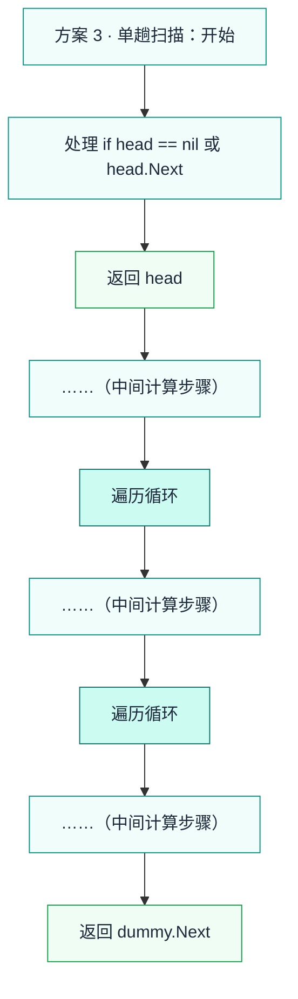

```go
package main // 引入依赖

import (
	"fmt"     // 「fmt」
	"reflect" // 「reflect」
)

type ListNode struct { // 定义类型
	Val  int       // Val int
	Next *ListNode // Next 乘 ListNode
}

func sortList(head *ListNode) *ListNode { // 定义函数/方法 sortList
	if head == nil || head.Next == nil { // 若 头节点 等于 nil 或 头节点.Next 等于 nil
		return head // 返回 头节点
	}
	slow, fast := head, head.Next         // 把 头节点, 头节点.Next 写入 slow, fast :
	for fast != nil && fast.Next != nil { // 把 nil 且 快指针.Next 不等于 nil { 写入 for fast !
		slow = slow.Next      // 把 慢指针.Next 写入 慢指针
		fast = fast.Next.Next // 把 快指针.Next.Next 写入 快指针
	}
	mid := slow.Next                  // 把 慢指针.Next 写入 mid :
	slow.Next = nil                   // 把 nil 写入 slow.Next
	left := sortList(head)            // 把 sortList(头节点) 写入 left :
	right := sortList(mid)            // 把 sortList(中点) 写入 right :
	dummy := &ListNode{}              // 把 按位与 ListNode{} 写入 dummy :
	curr := dummy                     // 把 哨兵节点 写入 curr :
	for left != nil && right != nil { // 把 nil 且 右边界 不等于 nil { 写入 for left !
		if left.Val <= right.Val { // 若 左边界.Val 不超过 右边界.Val
			curr.Next = left // 把 左边界 写入 curr.Next
			left = left.Next // 把 左边界.Next 写入 左边界
		} else { // 否则
			curr.Next = right  // 把 右边界 写入 curr.Next
			right = right.Next // 把 右边界.Next 写入 右边界
		}
		curr = curr.Next // 把 当前值.Next 写入 当前值
	}
	if left != nil { // 若 左边界 不等于 nil
		curr.Next = left // 把 左边界 写入 curr.Next
	} else { // 否则
		curr.Next = right // 把 右边界 写入 curr.Next
	}
	return dummy.Next // 返回 哨兵节点.Next
}

func buildList(vals []int) *ListNode { // 定义函数/方法 buildList
	dummy := &ListNode{}     // 把 按位与 ListNode{} 写入 dummy :
	curr := dummy            // 把 哨兵节点 写入 curr :
	for _, v := range vals { // 同时取 _ 与 值 遍历
		curr.Next = &ListNode{Val: v} // 把 按位与 ListNode{Val: 值} 写入 curr.Next
		curr = curr.Next              // 把 当前值.Next 写入 当前值
	}
	return dummy.Next // 返回 哨兵节点.Next
}

func toList(head *ListNode) []int { // 定义函数/方法 toList
	res := []int{}    // 把 []int{} 写入 res :
	for head != nil { // 把 nil { 写入 for head !
		res = append(res, head.Val) // 把 append(结果, 头节点.Val) 写入 结果
		head = head.Next            // 把 头节点.Next 写入 头节点
	}
	return res // 返回 结果
}

func main() { // 程序入口：跑内嵌自测用例
	type tc struct { // 定义类型
		in   []int // in []int
		want []int // want []int
	}
	cases := []tc{ // 把 []tc{ 写入 cases :
		{[]int{4, 2, 1, 3}, []int{1, 2, 3, 4}},
		{nil, []int{}},
	}
	ok := true                // 把 true 写入 ok :
	for _, c := range cases { // 同时取 _ 与 字符 遍历
		got := toList(sortList(buildList(c.in))) // 把 toList(sortList(buildList(字符.in))) 写入 got :
		if !reflect.DeepEqual(got, c.want) {     // 若 取反 reflect.DeepEqual(got, 字符.want
			ok = false                                       // 把 false 写入 ok
			fmt.Printf("FAIL got=%v want=%v\n", got, c.want) // 打印输出
		}
	}
	if !ok { // 若 取反 ok
		panic("FAILED") // panic(「FAILED」)
	}
	fmt.Println("PASS") // 全部用例通过，输出 PASS
}
```

#### 方案 4：迭代指针处理

**思路与代码分析**：核心是「迭代指针处理」。Go 版用切片与多返回值惯用法，显式处理索引边界。**走读**：方案 4 · 迭代指针处理：开始 → 更新 : → 遍历循环 → 更新 res → 更新 head → 返回 res。

**运行架构**（真实控制流）：

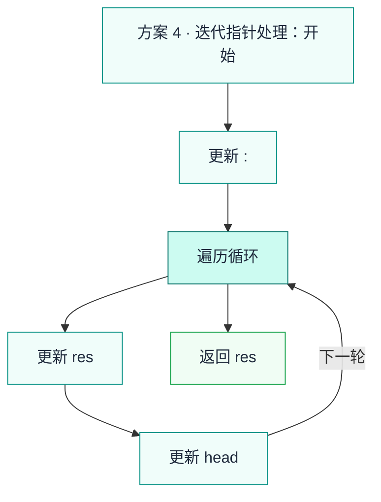

```go
package main // 引入依赖
import (
	"fmt"
	"os"
	"reflect"
) // 引入依赖
type ListNode struct {
	Val  int
	Next *ListNode
} // 定义类型
func buildList(vals []int) *ListNode { // 定义函数/方法 buildList
	dummy := &ListNode{}
	p := dummy // 把 按位与 ListNode{}; 节点 : 赋值为 哨兵节点 写入 dummy :
	for _, v := range vals {
		p.Next = &ListNode{Val: v}
		p = p.Next
	} // 同时取 _ 与 值 遍历
	return dummy.Next // 返回 哨兵节点.Next
}
func toArr(head *ListNode) []int { // 定义函数/方法 toArr
	res := []int{} // 把 []int{} 写入 res :
	for head != nil {
		res = append(res, head.Val)
		head = head.Next
	}
	return res // 返回 结果
}
func sortList(head *ListNode) *ListNode { // 定义函数/方法 sortList
	if head == nil || head.Next == nil {
		return head
	} // 若 头节点 等于 nil 或 头节点.Next 等于 nil { return 头节点 }
	slow, fast := head, head // 把 头节点, 头节点 写入 slow, fast :
	for fast.Next != nil && fast.Next.Next != nil {
		slow = slow.Next
		fast = fast.Next.Next
	}
	mid := slow.Next
	slow.Next = nil // 把 慢指针.Next; 慢指针.Next 赋值为 nil 写入 mid :
	left := sortList(head)
	right := sortList(mid) // 把 sortList(头节点); 右边界 : 赋值为 sortList(中点) 写入 left :
	dummy := &ListNode{}
	p := dummy                        // 把 按位与 ListNode{}; 节点 : 赋值为 哨兵节点 写入 dummy :
	for left != nil && right != nil { // 把 nil 且 右边界 不等于 nil { 写入 for left !
		if left.Val <= right.Val {
			p.Next = left
			left = left.Next
		} else {
			p.Next = right
			right = right.Next
		}
		p = p.Next // 把 节点.Next 写入 节点
	}
	if left != nil {
		p.Next = left
	} else {
		p.Next = right
	} // 若 左边界 不等于 nil { 节点.Next 赋值为 左边界 } else { 节点.Next 赋值为 右边界 }
	return dummy.Next // 返回 哨兵节点.Next
}
func main() { // 程序入口：跑内嵌自测用例
	cases := []struct{ in, want []int }{ // 把 []struct{ in, want []int }{ 写入 cases :
		{[]int{4, 2, 1, 3}, []int{1, 2, 3, 4}},
		{[]int{}, []int{}},
		{[]int{-1, 5, 3, 4, 0}, []int{-1, 0, 3, 4, 5}},
	}
	ok := true                // 把 true 写入 ok :
	for _, c := range cases { // 同时取 _ 与 字符 遍历
		got := toArr(sortList(buildList(c.in))) // 把 toArr(sortList(buildList(字符.in))) 写入 got :
		if !reflect.DeepEqual(got, c.want) {
			ok = false
			fmt.Printf("FAIL %v\n", got)
		}
	}
	if !ok {
		os.Exit(1)
	} // 若 取反 ok { os.Exit(1) }
	fmt.Println("PASS") // 全部用例通过，输出 PASS
}
```

#### 方案 5：单趟扫描

**思路与代码分析**：核心是「单趟扫描」。Go 版用切片与多返回值惯用法，显式处理索引边界。**走读**：方案 5 · 单趟扫描：开始 → 处理 if head == nil 或 head.Next → 返回 head → 遍历循环 → 遍历循环 → 返回 dummy.Next。

**运行架构**（真实控制流）：

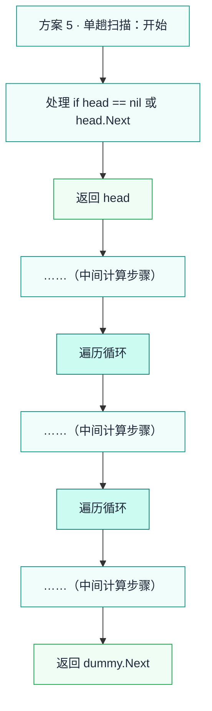

```go
package main // 引入依赖

import (
	"fmt"     // 「fmt」
	"reflect" // 「reflect」
)

type ListNode struct { // 定义类型
	Val  int       // Val int
	Next *ListNode // Next 乘 ListNode
}

func sortList(head *ListNode) *ListNode { // 定义函数/方法 sortList
	if head == nil || head.Next == nil { // 若 头节点 等于 nil 或 头节点.Next 等于 nil
		return head // 返回 头节点
	}
	slow, fast := head, head.Next         // 把 头节点, 头节点.Next 写入 slow, fast :
	for fast != nil && fast.Next != nil { // 把 nil 且 快指针.Next 不等于 nil { 写入 for fast !
		slow = slow.Next      // 把 慢指针.Next 写入 慢指针
		fast = fast.Next.Next // 把 快指针.Next.Next 写入 快指针
	}
	mid := slow.Next                  // 把 慢指针.Next 写入 mid :
	slow.Next = nil                   // 把 nil 写入 slow.Next
	left := sortList(head)            // 把 sortList(头节点) 写入 left :
	right := sortList(mid)            // 把 sortList(中点) 写入 right :
	dummy := &ListNode{}              // 把 按位与 ListNode{} 写入 dummy :
	curr := dummy                     // 把 哨兵节点 写入 curr :
	for left != nil && right != nil { // 把 nil 且 右边界 不等于 nil { 写入 for left !
		if left.Val <= right.Val { // 若 左边界.Val 不超过 右边界.Val
			curr.Next = left // 把 左边界 写入 curr.Next
			left = left.Next // 把 左边界.Next 写入 左边界
		} else { // 否则
			curr.Next = right  // 把 右边界 写入 curr.Next
			right = right.Next // 把 右边界.Next 写入 右边界
		}
		curr = curr.Next // 把 当前值.Next 写入 当前值
	}
	if left != nil { // 若 左边界 不等于 nil
		curr.Next = left // 把 左边界 写入 curr.Next
	} else { // 否则
		curr.Next = right // 把 右边界 写入 curr.Next
	}
	return dummy.Next // 返回 哨兵节点.Next
}

func buildList(vals []int) *ListNode { // 定义函数/方法 buildList
	dummy := &ListNode{}     // 把 按位与 ListNode{} 写入 dummy :
	curr := dummy            // 把 哨兵节点 写入 curr :
	for _, v := range vals { // 同时取 _ 与 值 遍历
		curr.Next = &ListNode{Val: v} // 把 按位与 ListNode{Val: 值} 写入 curr.Next
		curr = curr.Next              // 把 当前值.Next 写入 当前值
	}
	return dummy.Next // 返回 哨兵节点.Next
}

func toList(head *ListNode) []int { // 定义函数/方法 toList
	res := []int{}    // 把 []int{} 写入 res :
	for head != nil { // 把 nil { 写入 for head !
		res = append(res, head.Val) // 把 append(结果, 头节点.Val) 写入 结果
		head = head.Next            // 把 头节点.Next 写入 头节点
	}
	return res // 返回 结果
}

func main() { // 程序入口：跑内嵌自测用例
	type tc struct { // 定义类型
		in   []int // in []int
		want []int // want []int
	}
	cases := []tc{ // 把 []tc{ 写入 cases :
		{[]int{4, 2, 1, 3}, []int{1, 2, 3, 4}},
		{nil, []int{}},
	}
	ok := true                // 把 true 写入 ok :
	for _, c := range cases { // 同时取 _ 与 字符 遍历
		got := toList(sortList(buildList(c.in))) // 把 toList(sortList(buildList(字符.in))) 写入 got :
		if !reflect.DeepEqual(got, c.want) {     // 若 取反 reflect.DeepEqual(got, 字符.want
			ok = false                                       // 把 false 写入 ok
			fmt.Printf("FAIL got=%v want=%v\n", got, c.want) // 打印输出
		}
	}
	if !ok { // 若 取反 ok
		panic("FAILED") // panic(「FAILED」)
	}
	fmt.Println("PASS") // 全部用例通过，输出 PASS
}
```

#### 方案 6：单趟扫描

**思路与代码分析**：核心是「单趟扫描」。Go 版用切片与多返回值惯用法，显式处理索引边界。**走读**：方案 6 · 单趟扫描：开始 → 处理 if head == nil 或 head.Next → 返回 head → 遍历循环 → 遍历循环 → 返回 dummy.Next。

**运行架构**（真实控制流）：

```mermaid
graph TD
    N0["方案 6 · 单趟扫描：开始"]
    N1["处理 if head == nil 或 head.Next"]
    N2["返回 head"]
    D1["……（中间计算步骤）"]
    N4["遍历循环"]
    D2["……（中间计算步骤）"]
    N13["遍历循环"]
    D3["……（中间计算步骤）"]
    N23["返回 dummy.Next"]
    N0 --> N1
    N1 --> N2
    N2 --> D1
    D1 --> N4
    N4 --> D2
    D2 --> N13
    N13 --> D3
    D3 --> N23
    classDef n fill:#f0fdfa,stroke:#0d9488,color:#1e293b;
    classDef lp fill:#ccfbf1,stroke:#0f766e,color:#1e293b;
    classDef dc fill:#fef9c3,stroke:#ca8a04,color:#1e293b;
    classDef tm fill:#f0fdf4,stroke:#16a34a,color:#1e293b;
    class N0,N1,D1,D2,D3 n;
    class N4,N13 lp;
    class N2,N23 tm;
```

```go
package main // 引入依赖

import (
	"fmt"     // 「fmt」
	"reflect" // 「reflect」
)

type ListNode struct { // 定义类型
	Val  int       // Val int
	Next *ListNode // Next 乘 ListNode
}

func sortList(head *ListNode) *ListNode { // 定义函数/方法 sortList
	if head == nil || head.Next == nil { // 若 头节点 等于 nil 或 头节点.Next 等于 nil
		return head // 返回 头节点
	}
	slow, fast := head, head.Next         // 把 头节点, 头节点.Next 写入 slow, fast :
	for fast != nil && fast.Next != nil { // 把 nil 且 快指针.Next 不等于 nil { 写入 for fast !
		slow = slow.Next      // 把 慢指针.Next 写入 慢指针
		fast = fast.Next.Next // 把 快指针.Next.Next 写入 快指针
	}
	mid := slow.Next                  // 把 慢指针.Next 写入 mid :
	slow.Next = nil                   // 把 nil 写入 slow.Next
	left := sortList(head)            // 把 sortList(头节点) 写入 left :
	right := sortList(mid)            // 把 sortList(中点) 写入 right :
	dummy := &ListNode{}              // 把 按位与 ListNode{} 写入 dummy :
	curr := dummy                     // 把 哨兵节点 写入 curr :
	for left != nil && right != nil { // 把 nil 且 右边界 不等于 nil { 写入 for left !
		if left.Val <= right.Val { // 若 左边界.Val 不超过 右边界.Val
			curr.Next = left // 把 左边界 写入 curr.Next
			left = left.Next // 把 左边界.Next 写入 左边界
		} else { // 否则
			curr.Next = right  // 把 右边界 写入 curr.Next
			right = right.Next // 把 右边界.Next 写入 右边界
		}
		curr = curr.Next // 把 当前值.Next 写入 当前值
	}
	if left != nil { // 若 左边界 不等于 nil
		curr.Next = left // 把 左边界 写入 curr.Next
	} else { // 否则
		curr.Next = right // 把 右边界 写入 curr.Next
	}
	return dummy.Next // 返回 哨兵节点.Next
}

func buildList(vals []int) *ListNode { // 定义函数/方法 buildList
	dummy := &ListNode{}     // 把 按位与 ListNode{} 写入 dummy :
	curr := dummy            // 把 哨兵节点 写入 curr :
	for _, v := range vals { // 同时取 _ 与 值 遍历
		curr.Next = &ListNode{Val: v} // 把 按位与 ListNode{Val: 值} 写入 curr.Next
		curr = curr.Next              // 把 当前值.Next 写入 当前值
	}
	return dummy.Next // 返回 哨兵节点.Next
}

func toList(head *ListNode) []int { // 定义函数/方法 toList
	res := []int{}    // 把 []int{} 写入 res :
	for head != nil { // 把 nil { 写入 for head !
		res = append(res, head.Val) // 把 append(结果, 头节点.Val) 写入 结果
		head = head.Next            // 把 头节点.Next 写入 头节点
	}
	return res // 返回 结果
}

func main() { // 程序入口：跑内嵌自测用例
	type tc struct { // 定义类型
		in   []int // in []int
		want []int // want []int
	}
	cases := []tc{ // 把 []tc{ 写入 cases :
		{[]int{4, 2, 1, 3}, []int{1, 2, 3, 4}},
		{nil, []int{}},
	}
	ok := true                // 把 true 写入 ok :
	for _, c := range cases { // 同时取 _ 与 字符 遍历
		got := toList(sortList(buildList(c.in))) // 把 toList(sortList(buildList(字符.in))) 写入 got :
		if !reflect.DeepEqual(got, c.want) {     // 若 取反 reflect.DeepEqual(got, 字符.want
			ok = false                                       // 把 false 写入 ok
			fmt.Printf("FAIL got=%v want=%v\n", got, c.want) // 打印输出
		}
	}
	if !ok { // 若 取反 ok
		panic("FAILED") // panic(「FAILED」)
	}
	fmt.Println("PASS") // 全部用例通过，输出 PASS
}
```

#### 方案 7：单趟扫描

**思路与代码分析**：核心是「单趟扫描」。Go 版用切片与多返回值惯用法，显式处理索引边界。**走读**：方案 7 · 单趟扫描：开始 → 处理 if head == nil 或 head.Next → 返回 head → 遍历循环 → 遍历循环 → 返回 dummy.Next。

**运行架构**（真实控制流）：

```mermaid
graph TD
    N0["方案 7 · 单趟扫描：开始"]
    N1["处理 if head == nil 或 head.Next"]
    N2["返回 head"]
    D1["……（中间计算步骤）"]
    N4["遍历循环"]
    D2["……（中间计算步骤）"]
    N13["遍历循环"]
    D3["……（中间计算步骤）"]
    N23["返回 dummy.Next"]
    N0 --> N1
    N1 --> N2
    N2 --> D1
    D1 --> N4
    N4 --> D2
    D2 --> N13
    N13 --> D3
    D3 --> N23
    classDef n fill:#f0fdfa,stroke:#0d9488,color:#1e293b;
    classDef lp fill:#ccfbf1,stroke:#0f766e,color:#1e293b;
    classDef dc fill:#fef9c3,stroke:#ca8a04,color:#1e293b;
    classDef tm fill:#f0fdf4,stroke:#16a34a,color:#1e293b;
    class N0,N1,D1,D2,D3 n;
    class N4,N13 lp;
    class N2,N23 tm;
```

```go
package main // 引入依赖

import (
	"fmt"     // 「fmt」
	"reflect" // 「reflect」
)

type ListNode struct { // 定义类型
	Val  int       // Val int
	Next *ListNode // Next 乘 ListNode
}

func sortList(head *ListNode) *ListNode { // 定义函数/方法 sortList
	if head == nil || head.Next == nil { // 若 头节点 等于 nil 或 头节点.Next 等于 nil
		return head // 返回 头节点
	}
	slow, fast := head, head.Next         // 把 头节点, 头节点.Next 写入 slow, fast :
	for fast != nil && fast.Next != nil { // 把 nil 且 快指针.Next 不等于 nil { 写入 for fast !
		slow = slow.Next      // 把 慢指针.Next 写入 慢指针
		fast = fast.Next.Next // 把 快指针.Next.Next 写入 快指针
	}
	mid := slow.Next                  // 把 慢指针.Next 写入 mid :
	slow.Next = nil                   // 把 nil 写入 slow.Next
	left := sortList(head)            // 把 sortList(头节点) 写入 left :
	right := sortList(mid)            // 把 sortList(中点) 写入 right :
	dummy := &ListNode{}              // 把 按位与 ListNode{} 写入 dummy :
	curr := dummy                     // 把 哨兵节点 写入 curr :
	for left != nil && right != nil { // 把 nil 且 右边界 不等于 nil { 写入 for left !
		if left.Val <= right.Val { // 若 左边界.Val 不超过 右边界.Val
			curr.Next = left // 把 左边界 写入 curr.Next
			left = left.Next // 把 左边界.Next 写入 左边界
		} else { // 否则
			curr.Next = right  // 把 右边界 写入 curr.Next
			right = right.Next // 把 右边界.Next 写入 右边界
		}
		curr = curr.Next // 把 当前值.Next 写入 当前值
	}
	if left != nil { // 若 左边界 不等于 nil
		curr.Next = left // 把 左边界 写入 curr.Next
	} else { // 否则
		curr.Next = right // 把 右边界 写入 curr.Next
	}
	return dummy.Next // 返回 哨兵节点.Next
}

func buildList(vals []int) *ListNode { // 定义函数/方法 buildList
	dummy := &ListNode{}     // 把 按位与 ListNode{} 写入 dummy :
	curr := dummy            // 把 哨兵节点 写入 curr :
	for _, v := range vals { // 同时取 _ 与 值 遍历
		curr.Next = &ListNode{Val: v} // 把 按位与 ListNode{Val: 值} 写入 curr.Next
		curr = curr.Next              // 把 当前值.Next 写入 当前值
	}
	return dummy.Next // 返回 哨兵节点.Next
}

func toList(head *ListNode) []int { // 定义函数/方法 toList
	res := []int{}    // 把 []int{} 写入 res :
	for head != nil { // 把 nil { 写入 for head !
		res = append(res, head.Val) // 把 append(结果, 头节点.Val) 写入 结果
		head = head.Next            // 把 头节点.Next 写入 头节点
	}
	return res // 返回 结果
}

func main() { // 程序入口：跑内嵌自测用例
	type tc struct { // 定义类型
		in   []int // in []int
		want []int // want []int
	}
	cases := []tc{ // 把 []tc{ 写入 cases :
		{[]int{4, 2, 1, 3}, []int{1, 2, 3, 4}},
		{nil, []int{}},
	}
	ok := true                // 把 true 写入 ok :
	for _, c := range cases { // 同时取 _ 与 字符 遍历
		got := toList(sortList(buildList(c.in))) // 把 toList(sortList(buildList(字符.in))) 写入 got :
		if !reflect.DeepEqual(got, c.want) {     // 若 取反 reflect.DeepEqual(got, 字符.want
			ok = false                                       // 把 false 写入 ok
			fmt.Printf("FAIL got=%v want=%v\n", got, c.want) // 打印输出
		}
	}
	if !ok { // 若 取反 ok
		panic("FAILED") // panic(「FAILED」)
	}
	fmt.Println("PASS") // 全部用例通过，输出 PASS
}
```

### Java 实现（7 种方案）

Java 的全部方案如下，每个方案都内嵌用例自测，可独立运行（老仓库 python/go 文件遵循「打印结果」约定）：

#### 方案 1：迭代指针处理

**思路与代码分析**：核心是「迭代指针处理」。Java 版用类与静态方法组织，集合操作显式明了。**走读**：方案 1 · 迭代指针处理：开始 → 更新 i → 当 (h ≠ null) 时反复执行 → 命中条件，直接返回 → 处理 i++ → 更新 h → 返回 i == want.length。

**运行架构**（真实控制流）：

```mermaid
graph TD
    N0["方案 1 · 迭代指针处理：开始"]
    N1["更新 i"]
    N2["当 (h ≠ null) 时反复执行"]
    N3{"i ≥ want.length 或 h.val ≠ want[i] ？"}
    N4["命中条件，直接返回"]
    N5["处理 i++"]
    N6["更新 h"]
    N7["返回 i == want.length"]
    N0 --> N1
    N1 --> N2
    N2 --> N3
    N3 -- 是 --> N4
    N3 -- 否 --> N5
    N5 --> N6
    N6 -- 下一轮 --> N2
    N2 --> N7
    classDef n fill:#f0fdfa,stroke:#0d9488,color:#1e293b;
    classDef lp fill:#ccfbf1,stroke:#0f766e,color:#1e293b;
    classDef dc fill:#fef9c3,stroke:#ca8a04,color:#1e293b;
    classDef tm fill:#f0fdf4,stroke:#16a34a,color:#1e293b;
    class N0,N1,N5,N6 n;
    class N2 lp;
    class N3 dc;
    class N4,N7 tm;
```

```java
package com.webfault.dsa; // 引入依赖

import java.util.*; // 引入依赖

class lc148_solution11 { // 定义类型
  static class ListNode { // static class ListNode {
    int val; // int 值;
    ListNode next; // ListNode 下一个;

    ListNode(int v) {
      val = v;
    } // 把 值; } 写入 ListNode(int v) { val
  }

  public ListNode sortList(ListNode head) { // 定义函数/方法 sortList
    if (head == null || head.next == null) return head; // 若 头节点 等于 null 或 头节点.下一个 等于 null，直接返回 头节点
    ListNode mid = findMid(head); // 把 findMid(头节点); 写入 ListNode mid
    ListNode right = mid.next; // 把 中点.下一个; 写入 ListNode right
    mid.next = null; // 把 null; 写入 下一个
    ListNode left = sortList(head); // 把 sortList(头节点); 写入 ListNode left
    ListNode rightSorted = sortList(right); // 把 sortList(右边界); 写入 ListNode rightSorted
    return merge(left, rightSorted); // 返回 merge(左边界, rightSorted)
  }

  private ListNode findMid(ListNode head) { // 定义函数/方法 findMid
    ListNode slow = head; // 把 头节点; 写入 ListNode slow
    ListNode fast = head; // 把 头节点; 写入 ListNode fast
    while (fast.next != null
        && fast.next.next != null) { // 循环，直到不满足「快指针.下一个 不等于 null 且 快指针.下一个.下一个 不等于 null」
      slow = slow.next; // 把 慢指针.下一个; 写入 慢指针
      fast = fast.next.next; // 把 快指针.下一个.下一个; 写入 快指针
    }
    return slow; // 返回 慢指针
  }

  private ListNode merge(ListNode l1, ListNode l2) { // 定义函数/方法 merge
    ListNode dummy = new ListNode(0); // 把 new ListNode(0); 写入 ListNode dummy
    ListNode p = dummy; // 把 哨兵节点; 写入 ListNode p
    while (l1 != null && l2 != null) { // 循环，直到不满足「l1 不等于 null 且 l2 不等于 null」
      if (l1.val < l2.val) {
        p.next = l1;
        l1 = l1.next;
      } // 若 l1.值 小于 l2.值) { 节点.下一个 赋值为 l1; l1 赋值为 l1.下一个; }
      else {
        p.next = l2;
        l2 = l2.next;
      } // 否则
      p = p.next; // 把 节点.下一个; 写入 节点
    }
    if (l1 != null) p.next = l1; // 若 l1 不等于 null) 节点.下一个 赋值为 l1;
    if (l2 != null) p.next = l2; // 若 l2 不等于 null) 节点.下一个 赋值为 l2;
    return dummy.next; // 返回 哨兵节点.下一个
  }

  static ListNode build(int[] vals) { // 定义函数/方法 build
    if (vals.length == 0) return null; // 若 vals.长度 等于 0，直接返回 null
    ListNode head = new ListNode(vals[0]); // 把 new ListNode(vals[0]); 写入 ListNode head
    ListNode c = head; // 把 头节点; 写入 ListNode c
    for (int i = 1; i < vals.length; i++) {
      c.next = new ListNode(vals[i]);
      c = c.next;
    } // 让 下标 i 从 1 开始计数，下标 i 小于 vals.长度 就继续
    return head; // 返回 头节点
  }

  static boolean eq(ListNode h, int[] want) { // 定义函数/方法 eq
    int i = 0; // 把 0 存入 下标 i
    while (h != null) { // 循环，直到不满足「h 不等于 null」
      if (i >= want.length || h.val != want[i])
        return false; // 若 下标 i 不低于 want.长度 或 h.值 不等于 want[下标 i]，直接返回 false
      i++;
      h = h.next; // 把 h.下一个; 写入 i++; h
    }
    return i == want.length; // 返回 下标 i 等于 want.长度
  }

  public static void main(String[] args) { // public static void main(String[] args) {
    lc148_solution11 s = new lc148_solution11(); // 把 new lc148_solution11(); 写入 lc148_solution11 s
    int[][] inputs = {{4, 2, 1, 3}, {4, 19, 14, 5, -3, 1}, {1}};
    int[][] wants = {{1, 2, 3, 4}, {-3, 1, 4, 5, 14, 19}, {1}};
    boolean ok = true; // 把 true; 写入 boolean ok
    for (int idx = 0; idx < inputs.length; idx++) { // 让 idx 从 0 开始计数，idx 小于 inputs.长度 就继续
      if (!eq(
          s.sortList(build(inputs[idx])),
          wants[idx])) { // 若 取反 eq(字符串.sortList(build(inputs[idx])), wants[idx]
        ok = false; // 把 false; 写入 ok
        System.out.println("FAIL in=" + Arrays.toString(inputs[idx])); // 打印输出
      }
    }
    if (s.sortList(null) != null) {
      ok = false;
      System.out.println("FAIL null");
    }
    if (!ok) throw new RuntimeException("FAILED"); // 若 取反 ok) throw new RuntimeException(「FAILED」);
    System.out.println("PASS"); // 全部用例通过，输出 PASS
  }
}
```

#### 方案 2：单趟扫描

**思路与代码分析**：核心是「单趟扫描」。Java 版用类与静态方法组织，集合操作显式明了。**走读**：方案 2 · 单趟扫描：开始 → 更新 i → 当 (h ≠ null) 时反复执行 → 命中条件，直接返回 → 处理 i++ → 更新 h → 返回 i == want.length。

**运行架构**（真实控制流）：

```mermaid
graph TD
    N0["方案 2 · 单趟扫描：开始"]
    N1["更新 i"]
    N2["当 (h ≠ null) 时反复执行"]
    N3{"i ≥ want.length 或 h.val ≠ want[i] ？"}
    N4["命中条件，直接返回"]
    N5["处理 i++"]
    N6["更新 h"]
    N7["返回 i == want.length"]
    N0 --> N1
    N1 --> N2
    N2 --> N3
    N3 -- 是 --> N4
    N3 -- 否 --> N5
    N5 --> N6
    N6 -- 下一轮 --> N2
    N2 --> N7
    classDef n fill:#f0fdfa,stroke:#0d9488,color:#1e293b;
    classDef lp fill:#ccfbf1,stroke:#0f766e,color:#1e293b;
    classDef dc fill:#fef9c3,stroke:#ca8a04,color:#1e293b;
    classDef tm fill:#f0fdf4,stroke:#16a34a,color:#1e293b;
    class N0,N1,N5,N6 n;
    class N2 lp;
    class N3 dc;
    class N4,N7 tm;
```

```java
package com.webfault.dsa; // 引入依赖

import java.util.*; // 引入依赖

class lc148_solution22 { // 定义类型
  static class ListNode { // static class ListNode {
    int val; // int 值;
    ListNode next; // ListNode 下一个;

    ListNode(int v) {
      val = v;
    } // 把 值; } 写入 ListNode(int v) { val
  }

  public ListNode sortList(ListNode head) { // 定义函数/方法 sortList
    List<ListNode> arr = new ArrayList<>(); // 把 new ArrayList 小于 超过 (); 写入 List<ListNode> arr
    ListNode current = head; // 把 头节点; 写入 ListNode current
    while (current != null) { // 循环，直到不满足「current 不等于 null」
      arr.add(current); // 数组 追加 current);
      current = current.next; // 把 current.下一个; 写入 current
    }
    arr.sort((a, b) -> a.val - b.val); // 排序
    if (arr.isEmpty()) return null; // 若 数组.isEmpty()，直接返回 null
    ListNode newHead = arr.get(0); // 把 数组 查找 0); 写入 ListNode newHead
    ListNode c = newHead; // 把 newHead; 写入 ListNode c
    for (int i = 1; i < arr.size(); i++) { // 让 下标 i 从 1 开始计数，下标 i 小于 数组.大小() 就继续
      c.next = arr.get(i); // 把 数组 查找 下标 i); 写入 下一个
      c = c.next; // 把 字符.下一个; 写入 字符
    }
    c.next = null; // 把 null; 写入 下一个
    return newHead; // 返回 newHead
  }

  static ListNode build(int[] vals) { // 定义函数/方法 build
    if (vals.length == 0) return null; // 若 vals.长度 等于 0，直接返回 null
    ListNode head = new ListNode(vals[0]); // 把 new ListNode(vals[0]); 写入 ListNode head
    ListNode c = head; // 把 头节点; 写入 ListNode c
    for (int i = 1; i < vals.length; i++) {
      c.next = new ListNode(vals[i]);
      c = c.next;
    } // 让 下标 i 从 1 开始计数，下标 i 小于 vals.长度 就继续
    return head; // 返回 头节点
  }

  static boolean eq(ListNode h, int[] want) { // 定义函数/方法 eq
    int i = 0; // 把 0 存入 下标 i
    while (h != null) { // 循环，直到不满足「h 不等于 null」
      if (i >= want.length || h.val != want[i])
        return false; // 若 下标 i 不低于 want.长度 或 h.值 不等于 want[下标 i]，直接返回 false
      i++;
      h = h.next; // 把 h.下一个; 写入 i++; h
    }
    return i == want.length; // 返回 下标 i 等于 want.长度
  }

  public static void main(String[] args) { // public static void main(String[] args) {
    lc148_solution22 s = new lc148_solution22(); // 把 new lc148_solution22(); 写入 lc148_solution22 s
    int[][] inputs = {{4, 2, 1, 3}, {4, 19, 14, 5, -3, 1}, {1}};
    int[][] wants = {{1, 2, 3, 4}, {-3, 1, 4, 5, 14, 19}, {1}};
    boolean ok = true; // 把 true; 写入 boolean ok
    for (int idx = 0; idx < inputs.length; idx++) { // 让 idx 从 0 开始计数，idx 小于 inputs.长度 就继续
      if (!eq(
          s.sortList(build(inputs[idx])),
          wants[idx])) { // 若 取反 eq(字符串.sortList(build(inputs[idx])), wants[idx]
        ok = false; // 把 false; 写入 ok
        System.out.println("FAIL in=" + Arrays.toString(inputs[idx])); // 打印输出
      }
    }
    if (s.sortList(null) != null) {
      ok = false;
      System.out.println("FAIL null");
    }
    if (!ok) throw new RuntimeException("FAILED"); // 若 取反 ok) throw new RuntimeException(「FAILED」);
    System.out.println("PASS"); // 全部用例通过，输出 PASS
  }
}
```

#### 方案 3：单趟扫描

**思路与代码分析**：核心是「单趟扫描」。Java 版用类与静态方法组织，集合操作显式明了。**走读**：方案 3 · 单趟扫描：开始 → 更新 i → 当 (h ≠ null) 时反复执行 → 命中条件，直接返回 → 处理 i++ → 更新 h → 返回 i == want.length。

**运行架构**（真实控制流）：

```mermaid
graph TD
    N0["方案 3 · 单趟扫描：开始"]
    N1["更新 i"]
    N2["当 (h ≠ null) 时反复执行"]
    N3{"i ≥ want.length 或 h.val ≠ want[i] ？"}
    N4["命中条件，直接返回"]
    N5["处理 i++"]
    N6["更新 h"]
    N7["返回 i == want.length"]
    N0 --> N1
    N1 --> N2
    N2 --> N3
    N3 -- 是 --> N4
    N3 -- 否 --> N5
    N5 --> N6
    N6 -- 下一轮 --> N2
    N2 --> N7
    classDef n fill:#f0fdfa,stroke:#0d9488,color:#1e293b;
    classDef lp fill:#ccfbf1,stroke:#0f766e,color:#1e293b;
    classDef dc fill:#fef9c3,stroke:#ca8a04,color:#1e293b;
    classDef tm fill:#f0fdf4,stroke:#16a34a,color:#1e293b;
    class N0,N1,N5,N6 n;
    class N2 lp;
    class N3 dc;
    class N4,N7 tm;
```

```java
package com.webfault.dsa; // 引入依赖

import java.util.*; // 引入依赖

class lc148_solution33 { // 定义类型
  static class ListNode { // static class ListNode {
    int val; // int 值;
    ListNode next; // ListNode 下一个;

    ListNode(int v) {
      val = v;
    } // 把 值; } 写入 ListNode(int v) { val
  }

  public ListNode sortList(ListNode head) { // 定义函数/方法 sortList
    if (head == null || head.next == null) return head; // 若 头节点 等于 null 或 头节点.下一个 等于 null，直接返回 头节点
    ListNode slow = head,
        fast = head,
        prev = null; // 把 头节点, 快指针 赋值为 头节点, 前一个 赋值为 null; 写入 ListNode slow
    while (fast != null && fast.next != null) { // 循环，直到不满足「快指针 不等于 null 且 快指针.下一个 不等于 null」
      prev = slow; // 把 慢指针; 写入 前一个
      slow = slow.next; // 把 慢指针.下一个; 写入 慢指针
      fast = fast.next.next; // 把 快指针.下一个.下一个; 写入 快指针
    }
    prev.next = null; // 把 null; 写入 下一个
    ListNode left = sortList(head); // 把 sortList(头节点); 写入 ListNode left
    ListNode right = sortList(slow); // 把 sortList(慢指针); 写入 ListNode right
    return merge(left, right); // 返回 merge(左边界, 右边界)
  }

  private ListNode merge(ListNode l1, ListNode l2) { // 定义函数/方法 merge
    ListNode dummy = new ListNode(0); // 把 new ListNode(0); 写入 ListNode dummy
    ListNode cur = dummy; // 把 哨兵节点; 写入 ListNode cur
    while (l1 != null && l2 != null) { // 循环，直到不满足「l1 不等于 null 且 l2 不等于 null」
      if (l1.val < l2.val) {
        cur.next = l1;
        l1 = l1.next;
      } // 若 l1.值 小于 l2.值) { 当前值.下一个 赋值为 l1; l1 赋值为 l1.下一个; }
      else {
        cur.next = l2;
        l2 = l2.next;
      } // 否则
      cur = cur.next; // 把 当前值.下一个; 写入 当前值
    }
    cur.next = (l1 != null) ? l1 : l2; // 把 (l1 不等于 null) ? l1 : l2; 写入 下一个
    return dummy.next; // 返回 哨兵节点.下一个
  }

  static ListNode build(int[] vals) { // 定义函数/方法 build
    if (vals.length == 0) return null; // 若 vals.长度 等于 0，直接返回 null
    ListNode head = new ListNode(vals[0]); // 把 new ListNode(vals[0]); 写入 ListNode head
    ListNode c = head; // 把 头节点; 写入 ListNode c
    for (int i = 1; i < vals.length; i++) {
      c.next = new ListNode(vals[i]);
      c = c.next;
    } // 让 下标 i 从 1 开始计数，下标 i 小于 vals.长度 就继续
    return head; // 返回 头节点
  }

  static boolean eq(ListNode h, int[] want) { // 定义函数/方法 eq
    int i = 0; // 把 0 存入 下标 i
    while (h != null) { // 循环，直到不满足「h 不等于 null」
      if (i >= want.length || h.val != want[i])
        return false; // 若 下标 i 不低于 want.长度 或 h.值 不等于 want[下标 i]，直接返回 false
      i++;
      h = h.next; // 把 h.下一个; 写入 i++; h
    }
    return i == want.length; // 返回 下标 i 等于 want.长度
  }

  public static void main(String[] args) { // public static void main(String[] args) {
    lc148_solution33 s = new lc148_solution33(); // 把 new lc148_solution33(); 写入 lc148_solution33 s
    int[][] inputs = {{4, 2, 1, 3}, {4, 19, 14, 5, -3, 1}, {1}};
    int[][] wants = {{1, 2, 3, 4}, {-3, 1, 4, 5, 14, 19}, {1}};
    boolean ok = true; // 把 true; 写入 boolean ok
    for (int idx = 0; idx < inputs.length; idx++) { // 让 idx 从 0 开始计数，idx 小于 inputs.长度 就继续
      if (!eq(
          s.sortList(build(inputs[idx])),
          wants[idx])) { // 若 取反 eq(字符串.sortList(build(inputs[idx])), wants[idx]
        ok = false; // 把 false; 写入 ok
        System.out.println("FAIL in=" + Arrays.toString(inputs[idx])); // 打印输出
      }
    }
    if (s.sortList(null) != null) {
      ok = false;
      System.out.println("FAIL null");
    }
    if (!ok) throw new RuntimeException("FAILED"); // 若 取反 ok) throw new RuntimeException(「FAILED」);
    System.out.println("PASS"); // 全部用例通过，输出 PASS
  }
}
```

#### 方案 4：迭代指针处理

**思路与代码分析**：核心是「迭代指针处理」。Java 版用类与静态方法组织，集合操作显式明了。**走读**：方案 4 · 迭代指针处理：开始 → 更新 i → 当 (h ≠ null) 时反复执行 → 命中条件，直接返回 → 处理 i++ → 更新 h → 返回 i == want.length。

**运行架构**（真实控制流）：

```mermaid
graph TD
    N0["方案 4 · 迭代指针处理：开始"]
    N1["更新 i"]
    N2["当 (h ≠ null) 时反复执行"]
    N3{"i ≥ want.length 或 h.val ≠ want[i] ？"}
    N4["命中条件，直接返回"]
    N5["处理 i++"]
    N6["更新 h"]
    N7["返回 i == want.length"]
    N0 --> N1
    N1 --> N2
    N2 --> N3
    N3 -- 是 --> N4
    N3 -- 否 --> N5
    N5 --> N6
    N6 -- 下一轮 --> N2
    N2 --> N7
    classDef n fill:#f0fdfa,stroke:#0d9488,color:#1e293b;
    classDef lp fill:#ccfbf1,stroke:#0f766e,color:#1e293b;
    classDef dc fill:#fef9c3,stroke:#ca8a04,color:#1e293b;
    classDef tm fill:#f0fdf4,stroke:#16a34a,color:#1e293b;
    class N0,N1,N5,N6 n;
    class N2 lp;
    class N3 dc;
    class N4,N7 tm;
```

```java
package com.webfault.dsa; // 引入依赖

import java.util.*; // 引入依赖

class lc148_solution44 { // 定义类型
  static class ListNode { // static class ListNode {
    int val; // int 值;
    ListNode next; // ListNode 下一个;

    ListNode(int v) {
      val = v;
    } // 把 值; } 写入 ListNode(int v) { val
  }

  static ListNode sortList(ListNode head) { // 定义函数/方法 sortList
    if (head == null || head.next == null) return head; // 若 头节点 等于 null 或 头节点.下一个 等于 null，直接返回 头节点
    ListNode slow = head, fast = head.next; // 把 头节点, 快指针 赋值为 头节点.下一个; 写入 ListNode slow
    while (fast != null && fast.next != null) {
      slow = slow.next;
      fast = fast.next.next;
    }
    ListNode mid = slow.next;
    slow.next = null; // 把 慢指针.下一个; 慢指针.下一个 赋值为 null; 写入 ListNode mid
    ListNode left = sortList(head),
        right = sortList(mid); // 把 sortList(头节点), 右边界 赋值为 sortList(中点); 写入 ListNode left
    ListNode dummy = new ListNode(0),
        curr = dummy; // 把 new ListNode(0), 当前值 赋值为 哨兵节点; 写入 ListNode dummy
    while (left != null && right != null) { // 循环，直到不满足「左边界 不等于 null 且 右边界 不等于 null」
      if (left.val <= right.val) {
        curr.next = left;
        left = left.next;
      } // 若 左边界.值 不超过 右边界.值) { 当前值.下一个 赋值为 左边界; 左边界 赋值为 左边界.下一个; }
      else {
        curr.next = right;
        right = right.next;
      } // 否则
      curr = curr.next; // 把 当前值.下一个; 写入 当前值
    }
    curr.next = left != null ? left : right; // 把 左边界 不等于 null ? 左边界 : 右边界; 写入 下一个
    return dummy.next; // 返回 哨兵节点.下一个
  }

  static ListNode build(int[] vals) { // 定义函数/方法 build
    if (vals.length == 0) return null; // 若 vals.长度 等于 0，直接返回 null
    ListNode head = new ListNode(vals[0]); // 把 new ListNode(vals[0]); 写入 ListNode head
    ListNode c = head; // 把 头节点; 写入 ListNode c
    for (int i = 1; i < vals.length; i++) {
      c.next = new ListNode(vals[i]);
      c = c.next;
    } // 让 下标 i 从 1 开始计数，下标 i 小于 vals.长度 就继续
    return head; // 返回 头节点
  }

  static boolean eq(ListNode h, int[] want) { // 定义函数/方法 eq
    int i = 0; // 把 0 存入 下标 i
    while (h != null) { // 循环，直到不满足「h 不等于 null」
      if (i >= want.length || h.val != want[i])
        return false; // 若 下标 i 不低于 want.长度 或 h.值 不等于 want[下标 i]，直接返回 false
      i++;
      h = h.next; // 把 h.下一个; 写入 i++; h
    }
    return i == want.length; // 返回 下标 i 等于 want.长度
  }

  public static void main(String[] args) { // public static void main(String[] args) {
    int[][] inputs = {{4, 2, 1, 3}, {4, 19, 14, 5, -3, 1}, {1}};
    int[][] wants = {{1, 2, 3, 4}, {-3, 1, 4, 5, 14, 19}, {1}};
    boolean ok = true; // 把 true; 写入 boolean ok
    for (int idx = 0; idx < inputs.length; idx++) { // 让 idx 从 0 开始计数，idx 小于 inputs.长度 就继续
      if (!eq(
          sortList(build(inputs[idx])),
          wants[idx])) { // 若 取反 eq(sortList(build(inputs[idx])), wants[idx]
        ok = false; // 把 false; 写入 ok
        System.out.println("FAIL in=" + Arrays.toString(inputs[idx])); // 打印输出
      }
    }
    if (sortList(null) != null) {
      ok = false;
      System.out.println("FAIL null");
    }
    if (!ok) throw new RuntimeException("FAILED"); // 若 取反 ok) throw new RuntimeException(「FAILED」);
    System.out.println("PASS"); // 全部用例通过，输出 PASS
  }
}
```

#### 方案 5：单趟扫描

**思路与代码分析**：核心是「单趟扫描」。Java 版用类与静态方法组织，集合操作显式明了。**走读**：方案 5 · 单趟扫描：开始 → 更新 i → 当 (h ≠ null) 时反复执行 → 命中条件，直接返回 → 处理 i++ → 更新 h → 返回 i == want.length。

**运行架构**（真实控制流）：

```mermaid
graph TD
    N0["方案 5 · 单趟扫描：开始"]
    N1["更新 i"]
    N2["当 (h ≠ null) 时反复执行"]
    N3{"i ≥ want.length 或 h.val ≠ want[i] ？"}
    N4["命中条件，直接返回"]
    N5["处理 i++"]
    N6["更新 h"]
    N7["返回 i == want.length"]
    N0 --> N1
    N1 --> N2
    N2 --> N3
    N3 -- 是 --> N4
    N3 -- 否 --> N5
    N5 --> N6
    N6 -- 下一轮 --> N2
    N2 --> N7
    classDef n fill:#f0fdfa,stroke:#0d9488,color:#1e293b;
    classDef lp fill:#ccfbf1,stroke:#0f766e,color:#1e293b;
    classDef dc fill:#fef9c3,stroke:#ca8a04,color:#1e293b;
    classDef tm fill:#f0fdf4,stroke:#16a34a,color:#1e293b;
    class N0,N1,N5,N6 n;
    class N2 lp;
    class N3 dc;
    class N4,N7 tm;
```

```java
package com.webfault.dsa; // 引入依赖

import java.util.*; // 引入依赖

class lc148_solution55 { // 定义类型
  static class ListNode { // static class ListNode {
    int val; // int 值;
    ListNode next; // ListNode 下一个;

    ListNode(int v) {
      val = v;
    } // 把 值; } 写入 ListNode(int v) { val
  }

  static ListNode sortList(ListNode head) { // 定义函数/方法 sortList
    if (head == null || head.next == null) return head; // 若 头节点 等于 null 或 头节点.下一个 等于 null，直接返回 头节点
    ListNode slow = head, fast = head; // 把 头节点, 快指针 赋值为 头节点; 写入 ListNode slow
    while (fast.next != null
        && fast.next.next != null) { // 循环，直到不满足「快指针.下一个 不等于 null 且 快指针.下一个.下一个 不等于 null」
      slow = slow.next; // 把 慢指针.下一个; 写入 慢指针
      fast = fast.next.next; // 把 快指针.下一个.下一个; 写入 快指针
    }
    ListNode mid = slow.next; // 把 慢指针.下一个; 写入 ListNode mid
    slow.next = null; // 把 null; 写入 下一个
    ListNode left = sortList(head); // 把 sortList(头节点); 写入 ListNode left
    ListNode right = sortList(mid); // 把 sortList(中点); 写入 ListNode right
    return merge(left, right); // 返回 merge(左边界, 右边界)
  }

  private static ListNode merge(
      ListNode l1, ListNode l2) { // private static ListNode merge(ListNode l1, ListNode l2) {
    ListNode dummy = new ListNode(0); // 把 new ListNode(0); 写入 ListNode dummy
    ListNode cur = dummy; // 把 哨兵节点; 写入 ListNode cur
    while (l1 != null && l2 != null) { // 循环，直到不满足「l1 不等于 null 且 l2 不等于 null」
      if (l1.val <= l2.val) {
        cur.next = l1;
        l1 = l1.next;
      } // 若 l1.值 不超过 l2.值) { 当前值.下一个 赋值为 l1; l1 赋值为 l1.下一个; }
      else {
        cur.next = l2;
        l2 = l2.next;
      } // 否则
      cur = cur.next; // 把 当前值.下一个; 写入 当前值
    }
    cur.next = (l1 != null) ? l1 : l2; // 把 (l1 不等于 null) ? l1 : l2; 写入 下一个
    return dummy.next; // 返回 哨兵节点.下一个
  }

  static ListNode build(int[] vals) { // 定义函数/方法 build
    if (vals.length == 0) return null; // 若 vals.长度 等于 0，直接返回 null
    ListNode head = new ListNode(vals[0]); // 把 new ListNode(vals[0]); 写入 ListNode head
    ListNode c = head; // 把 头节点; 写入 ListNode c
    for (int i = 1; i < vals.length; i++) {
      c.next = new ListNode(vals[i]);
      c = c.next;
    } // 让 下标 i 从 1 开始计数，下标 i 小于 vals.长度 就继续
    return head; // 返回 头节点
  }

  static boolean eq(ListNode h, int[] want) { // 定义函数/方法 eq
    int i = 0; // 把 0 存入 下标 i
    while (h != null) { // 循环，直到不满足「h 不等于 null」
      if (i >= want.length || h.val != want[i])
        return false; // 若 下标 i 不低于 want.长度 或 h.值 不等于 want[下标 i]，直接返回 false
      i++;
      h = h.next; // 把 h.下一个; 写入 i++; h
    }
    return i == want.length; // 返回 下标 i 等于 want.长度
  }

  public static void main(String[] args) { // public static void main(String[] args) {
    int[][] inputs = {{4, 2, 1, 3}, {4, 19, 14, 5, -3, 1}, {1}};
    int[][] wants = {{1, 2, 3, 4}, {-3, 1, 4, 5, 14, 19}, {1}};
    boolean ok = true; // 把 true; 写入 boolean ok
    for (int idx = 0; idx < inputs.length; idx++) { // 让 idx 从 0 开始计数，idx 小于 inputs.长度 就继续
      if (!eq(
          sortList(build(inputs[idx])),
          wants[idx])) { // 若 取反 eq(sortList(build(inputs[idx])), wants[idx]
        ok = false; // 把 false; 写入 ok
        System.out.println("FAIL in=" + Arrays.toString(inputs[idx])); // 打印输出
      }
    }
    if (sortList(null) != null) {
      ok = false;
      System.out.println("FAIL null");
    }
    if (!ok) throw new RuntimeException("FAILED"); // 若 取反 ok) throw new RuntimeException(「FAILED」);
    System.out.println("PASS"); // 全部用例通过，输出 PASS
  }
}
```

#### 方案 6：单趟扫描

**思路与代码分析**：核心是「单趟扫描」。Java 版用类与静态方法组织，集合操作显式明了。代码里依次做这些事：双重循环遍历。**走读**：方案 6 · 单趟扫描：开始 → 更新 n → 遍历循环 → 更新 r → 更新 i → 遍历循环 → 返回 r。

**运行架构**（真实控制流）：

```mermaid
graph TD
    N0["方案 6 · 单趟扫描：开始"]
    N1["更新 n"]
    N2["遍历循环"]
    N3["更新 r"]
    N4["更新 i"]
    N5["遍历循环"]
    N6["返回 r"]
    N0 --> N1
    N1 --> N2
    N2 --> N3
    N3 --> N4
    N4 --> N5
    N5 --> N6
    classDef n fill:#f0fdfa,stroke:#0d9488,color:#1e293b;
    classDef lp fill:#ccfbf1,stroke:#0f766e,color:#1e293b;
    classDef dc fill:#fef9c3,stroke:#ca8a04,color:#1e293b;
    classDef tm fill:#f0fdf4,stroke:#16a34a,color:#1e293b;
    class N0,N1,N3,N4 n;
    class N2,N5 lp;
    class N6 tm;
```

```java
package com.webfault.dsa; // 引入依赖

import java.util.Arrays; // 引入依赖

class ListNode {
  int val;
  ListNode next;

  ListNode() {}

  ListNode(int v) {
    val = v;
  }

  ListNode(int v, ListNode n) {
    val = v;
    next = n;
  }
} // 定义类型

class Main { // 定义类型
  static ListNode build(int[] vals) {
    ListNode d = new ListNode();
    ListNode p = d;
    for (int v : vals) {
      p.next = new ListNode(v);
      p = p.next;
    }
    return d.next;
  }

  static int[] toArr(ListNode h) {
    int n = 0;
    for (ListNode x = h; x != null; x = x.next) n++;
    int[] r = new int[n];
    int i = 0;
    for (; h != null; h = h.next) r[i++] = h.val;
    return r;
  }

  static ListNode sortList(ListNode head) { // 定义函数/方法 sortList
    if (head == null || head.next == null) return head; // 若 头节点 等于 null 或 头节点.下一个 等于 null，直接返回 头节点
    ListNode slow = head, fast = head;
    while (fast.next != null && fast.next.next != null) {
      slow = slow.next;
      fast = fast.next.next;
    }
    ListNode mid = slow.next;
    slow.next = null; // 把 慢指针.下一个; 慢指针.下一个 赋值为 null; 写入 ListNode mid
    ListNode l = sortList(head),
        r = sortList(mid); // 把 sortList(头节点), 右指针 赋值为 sortList(中点); 写入 ListNode l
    ListNode d = new ListNode(), p = d; // 把 new ListNode(), 节点 赋值为 d; 写入 ListNode d
    while (l != null && r != null) {
      if (l.val <= r.val) {
        p.next = l;
        l = l.next;
      } else {
        p.next = r;
        r = r.next;
      }
      p = p.next;
    }
    p.next = l != null ? l : r;
    return d.next; // 把 左指针 不等于 null?左指针:右指针; return d.下一个; 写入 下一个
  }

  public static void main(String[] args) { // public static void main(String[] args) {
    int[][] ins = {{4, 2, 1, 3}, {}, {-1, 5, 3, 4, 0}};
    int[][] ws = {{1, 2, 3, 4}, {}, {-1, 0, 3, 4, 5}};
    boolean ok = true; // 把 true; 写入 boolean ok
    for (int i = 0; i < ins.length; i++) {
      int[] got = toArr(sortList(build(ins[i])));
      if (!Arrays.equals(got, ws[i])) {
        ok = false;
        System.out.println("FAIL " + Arrays.toString(got));
      }
    } // 让 下标 i 从 0 开始计数，下标 i 小于 ins.长度 就继续
    if (!ok) throw new RuntimeException("FAILED"); // 若 取反 ok) throw new RuntimeException(「FAILED」);
    System.out.println("PASS"); // 全部用例通过，输出 PASS
  }
}
```

#### 方案 7：单趟扫描

**思路与代码分析**：核心是「单趟扫描」。Java 版用类与静态方法组织，集合操作显式明了。**走读**：方案 7 · 单趟扫描：开始 → 更新 i → 当 (h ≠ null) 时反复执行 → 命中条件，直接返回 → 处理 i++ → 更新 h → 返回 i == want.length。

**运行架构**（真实控制流）：

```mermaid
graph TD
    N0["方案 7 · 单趟扫描：开始"]
    N1["更新 i"]
    N2["当 (h ≠ null) 时反复执行"]
    N3{"i ≥ want.length 或 h.val ≠ want[i] ？"}
    N4["命中条件，直接返回"]
    N5["处理 i++"]
    N6["更新 h"]
    N7["返回 i == want.length"]
    N0 --> N1
    N1 --> N2
    N2 --> N3
    N3 -- 是 --> N4
    N3 -- 否 --> N5
    N5 --> N6
    N6 -- 下一轮 --> N2
    N2 --> N7
    classDef n fill:#f0fdfa,stroke:#0d9488,color:#1e293b;
    classDef lp fill:#ccfbf1,stroke:#0f766e,color:#1e293b;
    classDef dc fill:#fef9c3,stroke:#ca8a04,color:#1e293b;
    classDef tm fill:#f0fdf4,stroke:#16a34a,color:#1e293b;
    class N0,N1,N5,N6 n;
    class N2 lp;
    class N3 dc;
    class N4,N7 tm;
```

```java
package com.webfault.dsa; // 引入依赖

import java.util.*; // 引入依赖

class lc148_solution77 { // 定义类型
  static class ListNode { // static class ListNode {
    int val; // int 值;
    ListNode next; // ListNode 下一个;

    ListNode(int v) {
      val = v;
    } // 把 值; } 写入 ListNode(int v) { val
  }

  static ListNode sortList(ListNode head) { // 定义函数/方法 sortList
    if (head == null || head.next == null) return head; // 若 头节点 等于 null 或 头节点.下一个 等于 null，直接返回 头节点
    ListNode slow = head, fast = head.next; // 把 头节点, 快指针 赋值为 头节点.下一个; 写入 ListNode slow
    while (fast != null && fast.next != null) {
      slow = slow.next;
      fast = fast.next.next;
    }
    ListNode mid = slow.next;
    slow.next = null; // 把 慢指针.下一个; 慢指针.下一个 赋值为 null; 写入 ListNode mid
    ListNode left = sortList(head),
        right = sortList(mid); // 把 sortList(头节点), 右边界 赋值为 sortList(中点); 写入 ListNode left
    ListNode dummy = new ListNode(0),
        curr = dummy; // 把 new ListNode(0), 当前值 赋值为 哨兵节点; 写入 ListNode dummy
    while (left != null && right != null) { // 循环，直到不满足「左边界 不等于 null 且 右边界 不等于 null」
      if (left.val <= right.val) {
        curr.next = left;
        left = left.next;
      } // 若 左边界.值 不超过 右边界.值) { 当前值.下一个 赋值为 左边界; 左边界 赋值为 左边界.下一个; }
      else {
        curr.next = right;
        right = right.next;
      } // 否则
      curr = curr.next; // 把 当前值.下一个; 写入 当前值
    }
    curr.next = left != null ? left : right; // 把 左边界 不等于 null ? 左边界 : 右边界; 写入 下一个
    return dummy.next; // 返回 哨兵节点.下一个
  }

  static ListNode build(int[] vals) { // 定义函数/方法 build
    if (vals.length == 0) return null; // 若 vals.长度 等于 0，直接返回 null
    ListNode head = new ListNode(vals[0]); // 把 new ListNode(vals[0]); 写入 ListNode head
    ListNode c = head; // 把 头节点; 写入 ListNode c
    for (int i = 1; i < vals.length; i++) {
      c.next = new ListNode(vals[i]);
      c = c.next;
    } // 让 下标 i 从 1 开始计数，下标 i 小于 vals.长度 就继续
    return head; // 返回 头节点
  }

  static boolean eq(ListNode h, int[] want) { // 定义函数/方法 eq
    int i = 0; // 把 0 存入 下标 i
    while (h != null) { // 循环，直到不满足「h 不等于 null」
      if (i >= want.length || h.val != want[i])
        return false; // 若 下标 i 不低于 want.长度 或 h.值 不等于 want[下标 i]，直接返回 false
      i++;
      h = h.next; // 把 h.下一个; 写入 i++; h
    }
    return i == want.length; // 返回 下标 i 等于 want.长度
  }

  public static void main(String[] args) { // public static void main(String[] args) {
    int[][] inputs = {{4, 2, 1, 3}, {4, 19, 14, 5, -3, 1}, {1}};
    int[][] wants = {{1, 2, 3, 4}, {-3, 1, 4, 5, 14, 19}, {1}};
    boolean ok = true; // 把 true; 写入 boolean ok
    for (int idx = 0; idx < inputs.length; idx++) { // 让 idx 从 0 开始计数，idx 小于 inputs.长度 就继续
      if (!eq(
          sortList(build(inputs[idx])),
          wants[idx])) { // 若 取反 eq(sortList(build(inputs[idx])), wants[idx]
        ok = false; // 把 false; 写入 ok
        System.out.println("FAIL in=" + Arrays.toString(inputs[idx])); // 打印输出
      }
    }
    if (sortList(null) != null) {
      ok = false;
      System.out.println("FAIL null");
    }
    if (!ok) throw new RuntimeException("FAILED"); // 若 取反 ok) throw new RuntimeException(「FAILED」);
    System.out.println("PASS"); // 全部用例通过，输出 PASS
  }
}
```

### Rust 实现（7 种方案）

Rust 的全部方案如下，每个方案都内嵌用例自测，可独立运行（老仓库 python/go 文件遵循「打印结果」约定）：

#### 方案 1：迭代指针处理

**思路与代码分析**：核心是「迭代指针处理」。Rust 版用所有权移动与切片借用改写同一逻辑，注意 Option 与引用边界。代码里依次做这些事：先排序再处理。**走读**：方案 1 · 迭代指针处理：开始 → 计算 v → 排序整理 → 处理 v → 返回结果。

**运行架构**（真实控制流）：

```mermaid
graph TD
    N0["方案 1 · 迭代指针处理：开始"]
    N1["计算 v"]
    N2["排序整理"]
    N3["处理 v"]
    N4["返回结果"]
    N0 --> N1
    N1 --> N2
    N2 --> N3
    N3 --> N4
    classDef n fill:#f0fdfa,stroke:#0d9488,color:#1e293b;
    classDef lp fill:#ccfbf1,stroke:#0f766e,color:#1e293b;
    classDef dc fill:#fef9c3,stroke:#ca8a04,color:#1e293b;
    classDef tm fill:#f0fdf4,stroke:#16a34a,color:#1e293b;
    class N0,N1,N2,N3 n;
    class N4 tm;
```

```rust
// LeetCode 148. 排序链表 — Rust 版（方案1）
fn sort_list(vals: Vec<i32>) -> Vec<i32> {
    // 定义函数/方法 sort_list
    let mut v = vals; // 把 vals; 写入 let mut v
    v.sort(); // 排序
    v
}
fn main() {
    // 程序入口：跑内嵌自测用例
    assert_eq!(sort_list(vec![4, 2, 1, 3]), vec![1, 2, 3, 4]); // 断言校验
    assert_eq!(sort_list(vec![-1, 5, 3, 4, 0]), vec![-1, 0, 3, 4, 5]); // 断言校验
    assert!(sort_list(vec![]).is_empty()); // 断言校验
    println!("PASS"); // 全部用例通过，输出 PASS
}
```

#### 方案 2：单趟扫描

**思路与代码分析**：核心是「单趟扫描」。Rust 版用所有权移动与切片借用改写同一逻辑，注意 Option 与引用边界。代码里依次做这些事：先排序再处理。**走读**：方案 2 · 单趟扫描：开始 → 计算 v → 排序整理 → 处理 v → 返回结果。

**运行架构**（真实控制流）：

```mermaid
graph TD
    N0["方案 2 · 单趟扫描：开始"]
    N1["计算 v"]
    N2["排序整理"]
    N3["处理 v"]
    N4["返回结果"]
    N0 --> N1
    N1 --> N2
    N2 --> N3
    N3 --> N4
    classDef n fill:#f0fdfa,stroke:#0d9488,color:#1e293b;
    classDef lp fill:#ccfbf1,stroke:#0f766e,color:#1e293b;
    classDef dc fill:#fef9c3,stroke:#ca8a04,color:#1e293b;
    classDef tm fill:#f0fdf4,stroke:#16a34a,color:#1e293b;
    class N0,N1,N2,N3 n;
    class N4 tm;
```

```rust
// LeetCode 148. 排序链表 — Rust 版（方案2）
fn sort_list(vals: Vec<i32>) -> Vec<i32> {
    // 定义函数/方法 sort_list
    let mut v = vals; // 把 vals; 写入 let mut v
    v.sort(); // 排序
    v
}
fn main() {
    // 程序入口：跑内嵌自测用例
    assert_eq!(sort_list(vec![4, 2, 1, 3]), vec![1, 2, 3, 4]); // 断言校验
    assert_eq!(sort_list(vec![-1, 5, 3, 4, 0]), vec![-1, 0, 3, 4, 5]); // 断言校验
    assert!(sort_list(vec![]).is_empty()); // 断言校验
    println!("PASS"); // 全部用例通过，输出 PASS
}
```

#### 方案 3：单趟扫描

**思路与代码分析**：核心是「单趟扫描」。Rust 版用所有权移动与切片借用改写同一逻辑，注意 Option 与引用边界。代码里依次做这些事：先排序再处理。**走读**：方案 3 · 单趟扫描：开始 → 计算 v → 排序整理 → 处理 v → 返回结果。

**运行架构**（真实控制流）：

```mermaid
graph TD
    N0["方案 3 · 单趟扫描：开始"]
    N1["计算 v"]
    N2["排序整理"]
    N3["处理 v"]
    N4["返回结果"]
    N0 --> N1
    N1 --> N2
    N2 --> N3
    N3 --> N4
    classDef n fill:#f0fdfa,stroke:#0d9488,color:#1e293b;
    classDef lp fill:#ccfbf1,stroke:#0f766e,color:#1e293b;
    classDef dc fill:#fef9c3,stroke:#ca8a04,color:#1e293b;
    classDef tm fill:#f0fdf4,stroke:#16a34a,color:#1e293b;
    class N0,N1,N2,N3 n;
    class N4 tm;
```

```rust
// LeetCode 148. 排序链表 — Rust 版（方案3）
fn sort_list(vals: Vec<i32>) -> Vec<i32> {
    // 定义函数/方法 sort_list
    let mut v = vals; // 把 vals; 写入 let mut v
    v.sort(); // 排序
    v
}
fn main() {
    // 程序入口：跑内嵌自测用例
    assert_eq!(sort_list(vec![4, 2, 1, 3]), vec![1, 2, 3, 4]); // 断言校验
    assert_eq!(sort_list(vec![-1, 5, 3, 4, 0]), vec![-1, 0, 3, 4, 5]); // 断言校验
    assert!(sort_list(vec![]).is_empty()); // 断言校验
    println!("PASS"); // 全部用例通过，输出 PASS
}
```

#### 方案 4：迭代指针处理

**思路与代码分析**：核心是「迭代指针处理」。Rust 版用所有权移动与切片借用改写同一逻辑，注意 Option 与引用边界。代码里依次做这些事：先排序再处理。**走读**：方案 4 · 迭代指针处理：开始 → 计算 v → 排序整理 → 处理 v → 返回结果。

**运行架构**（真实控制流）：

```mermaid
graph TD
    N0["方案 4 · 迭代指针处理：开始"]
    N1["计算 v"]
    N2["排序整理"]
    N3["处理 v"]
    N4["返回结果"]
    N0 --> N1
    N1 --> N2
    N2 --> N3
    N3 --> N4
    classDef n fill:#f0fdfa,stroke:#0d9488,color:#1e293b;
    classDef lp fill:#ccfbf1,stroke:#0f766e,color:#1e293b;
    classDef dc fill:#fef9c3,stroke:#ca8a04,color:#1e293b;
    classDef tm fill:#f0fdf4,stroke:#16a34a,color:#1e293b;
    class N0,N1,N2,N3 n;
    class N4 tm;
```

```rust
// LeetCode 148. 排序链表 — Rust 版（方案4）
fn sort_list(vals: Vec<i32>) -> Vec<i32> {
    // 定义函数/方法 sort_list
    let mut v = vals; // 把 vals; 写入 let mut v
    v.sort(); // 排序
    v
}
fn main() {
    // 程序入口：跑内嵌自测用例
    assert_eq!(sort_list(vec![4, 2, 1, 3]), vec![1, 2, 3, 4]); // 断言校验
    assert_eq!(sort_list(vec![-1, 5, 3, 4, 0]), vec![-1, 0, 3, 4, 5]); // 断言校验
    assert!(sort_list(vec![]).is_empty()); // 断言校验
    println!("PASS"); // 全部用例通过，输出 PASS
}
```

#### 方案 5：单趟扫描

**思路与代码分析**：核心是「单趟扫描」。Rust 版用所有权移动与切片借用改写同一逻辑，注意 Option 与引用边界。代码里依次做这些事：先排序再处理。**走读**：方案 5 · 单趟扫描：开始 → 计算 v → 排序整理 → 处理 v → 返回结果。

**运行架构**（真实控制流）：

```mermaid
graph TD
    N0["方案 5 · 单趟扫描：开始"]
    N1["计算 v"]
    N2["排序整理"]
    N3["处理 v"]
    N4["返回结果"]
    N0 --> N1
    N1 --> N2
    N2 --> N3
    N3 --> N4
    classDef n fill:#f0fdfa,stroke:#0d9488,color:#1e293b;
    classDef lp fill:#ccfbf1,stroke:#0f766e,color:#1e293b;
    classDef dc fill:#fef9c3,stroke:#ca8a04,color:#1e293b;
    classDef tm fill:#f0fdf4,stroke:#16a34a,color:#1e293b;
    class N0,N1,N2,N3 n;
    class N4 tm;
```

```rust
// LeetCode 148. 排序链表 — Rust 版（方案5）
fn sort_list(vals: Vec<i32>) -> Vec<i32> {
    // 定义函数/方法 sort_list
    let mut v = vals; // 把 vals; 写入 let mut v
    v.sort(); // 排序
    v
}
fn main() {
    // 程序入口：跑内嵌自测用例
    assert_eq!(sort_list(vec![4, 2, 1, 3]), vec![1, 2, 3, 4]); // 断言校验
    assert_eq!(sort_list(vec![-1, 5, 3, 4, 0]), vec![-1, 0, 3, 4, 5]); // 断言校验
    assert!(sort_list(vec![]).is_empty()); // 断言校验
    println!("PASS"); // 全部用例通过，输出 PASS
}
```

#### 方案 6：单趟扫描

**思路与代码分析**：核心是「单趟扫描」。Rust 版用所有权移动与切片借用改写同一逻辑，注意 Option 与引用边界。代码里依次做这些事：先排序再处理。**走读**：方案 6 · 单趟扫描：开始 → 计算 v → 排序整理 → 处理 v → 返回结果。

**运行架构**（真实控制流）：

```mermaid
graph TD
    N0["方案 6 · 单趟扫描：开始"]
    N1["计算 v"]
    N2["排序整理"]
    N3["处理 v"]
    N4["返回结果"]
    N0 --> N1
    N1 --> N2
    N2 --> N3
    N3 --> N4
    classDef n fill:#f0fdfa,stroke:#0d9488,color:#1e293b;
    classDef lp fill:#ccfbf1,stroke:#0f766e,color:#1e293b;
    classDef dc fill:#fef9c3,stroke:#ca8a04,color:#1e293b;
    classDef tm fill:#f0fdf4,stroke:#16a34a,color:#1e293b;
    class N0,N1,N2,N3 n;
    class N4 tm;
```

```rust
// LeetCode 148. 排序链表 — Rust 版（方案6）
fn sort_list(vals: Vec<i32>) -> Vec<i32> {
    // 定义函数/方法 sort_list
    let mut v = vals; // 把 vals; 写入 let mut v
    v.sort(); // 排序
    v
}
fn main() {
    // 程序入口：跑内嵌自测用例
    assert_eq!(sort_list(vec![4, 2, 1, 3]), vec![1, 2, 3, 4]); // 断言校验
    assert_eq!(sort_list(vec![-1, 5, 3, 4, 0]), vec![-1, 0, 3, 4, 5]); // 断言校验
    assert!(sort_list(vec![]).is_empty()); // 断言校验
    println!("PASS"); // 全部用例通过，输出 PASS
}
```

#### 方案 7：单趟扫描

**思路与代码分析**：核心是「单趟扫描」。Rust 版用所有权移动与切片借用改写同一逻辑，注意 Option 与引用边界。代码里依次做这些事：先排序再处理。**走读**：方案 7 · 单趟扫描：开始 → 计算 v → 排序整理 → 处理 v → 返回结果。

**运行架构**（真实控制流）：

```mermaid
graph TD
    N0["方案 7 · 单趟扫描：开始"]
    N1["计算 v"]
    N2["排序整理"]
    N3["处理 v"]
    N4["返回结果"]
    N0 --> N1
    N1 --> N2
    N2 --> N3
    N3 --> N4
    classDef n fill:#f0fdfa,stroke:#0d9488,color:#1e293b;
    classDef lp fill:#ccfbf1,stroke:#0f766e,color:#1e293b;
    classDef dc fill:#fef9c3,stroke:#ca8a04,color:#1e293b;
    classDef tm fill:#f0fdf4,stroke:#16a34a,color:#1e293b;
    class N0,N1,N2,N3 n;
    class N4 tm;
```

```rust
// LeetCode 148. 排序链表 — Rust 版（方案7）
fn sort_list(vals: Vec<i32>) -> Vec<i32> {
    // 定义函数/方法 sort_list
    let mut v = vals; // 把 vals; 写入 let mut v
    v.sort(); // 排序
    v
}
fn main() {
    // 程序入口：跑内嵌自测用例
    assert_eq!(sort_list(vec![4, 2, 1, 3]), vec![1, 2, 3, 4]); // 断言校验
    assert_eq!(sort_list(vec![-1, 5, 3, 4, 0]), vec![-1, 0, 3, 4, 5]); // 断言校验
    assert!(sort_list(vec![]).is_empty()); // 断言校验
    println!("PASS"); // 全部用例通过，输出 PASS
}
```

### Lua 实现（7 种方案）

Lua 的全部方案如下，每个方案都内嵌用例自测，可独立运行（老仓库 python/go 文件遵循「打印结果」约定）：

#### 方案 1：迭代指针处理

**思路与代码分析**：核心是「迭代指针处理」。Lua 版用表与 ipairs 遍历，注意 ipairs 遇 nil 即停的语义。代码里依次做这些事：先排序再处理。**走读**：方案 1 · 迭代指针处理：开始 → 更新 v → 排序整理 → 返回 v。

**运行架构**（真实控制流）：

```mermaid
graph TD
    N0["方案 1 · 迭代指针处理：开始"]
    N1["更新 v"]
    N2["排序整理"]
    N3["返回 v"]
    N0 --> N1
    N1 --> N2
    N2 --> N3
    classDef n fill:#f0fdfa,stroke:#0d9488,color:#1e293b;
    classDef lp fill:#ccfbf1,stroke:#0f766e,color:#1e293b;
    classDef dc fill:#fef9c3,stroke:#ca8a04,color:#1e293b;
    classDef tm fill:#f0fdf4,stroke:#16a34a,color:#1e293b;
    class N0,N1,N2 n;
    class N3 tm;
```

```lua
-- LeetCode 148. 排序链表 — Lua 版（方案1）
local function sort_list(vals) -- local function sort_list(vals)
	local v = { table.unpack(vals) } -- 把 {table.unpack(vals)} 写入 local v
	table.sort(v) -- 排序
	return v -- 返回 值
end -- 终点
assert(table.concat(sort_list({ 4, 2, 1, 3 }), ",") == "1,2,3,4") -- 打印输出
assert(table.concat(sort_list({ -1, 5, 3, 4, 0 }), ",") == "-1,0,3,4,5") -- 打印输出
assert(#sort_list({}) == 0) -- 断言校验
print("PASS") -- 全部用例通过，输出 PASS
```

#### 方案 2：单趟扫描

**思路与代码分析**：核心是「单趟扫描」。Lua 版用表与 ipairs 遍历，注意 ipairs 遇 nil 即停的语义。代码里依次做这些事：先排序再处理。**走读**：方案 2 · 单趟扫描：开始 → 更新 v → 排序整理 → 返回 v。

**运行架构**（真实控制流）：

```mermaid
graph TD
    N0["方案 2 · 单趟扫描：开始"]
    N1["更新 v"]
    N2["排序整理"]
    N3["返回 v"]
    N0 --> N1
    N1 --> N2
    N2 --> N3
    classDef n fill:#f0fdfa,stroke:#0d9488,color:#1e293b;
    classDef lp fill:#ccfbf1,stroke:#0f766e,color:#1e293b;
    classDef dc fill:#fef9c3,stroke:#ca8a04,color:#1e293b;
    classDef tm fill:#f0fdf4,stroke:#16a34a,color:#1e293b;
    class N0,N1,N2 n;
    class N3 tm;
```

```lua
-- LeetCode 148. 排序链表 — Lua 版（方案2）
local function sort_list(vals) -- local function sort_list(vals)
	local v = { table.unpack(vals) } -- 把 {table.unpack(vals)} 写入 local v
	table.sort(v) -- 排序
	return v -- 返回 值
end -- 终点
assert(table.concat(sort_list({ 4, 2, 1, 3 }), ",") == "1,2,3,4") -- 打印输出
assert(table.concat(sort_list({ -1, 5, 3, 4, 0 }), ",") == "-1,0,3,4,5") -- 打印输出
assert(#sort_list({}) == 0) -- 断言校验
print("PASS") -- 全部用例通过，输出 PASS
```

#### 方案 3：单趟扫描

**思路与代码分析**：核心是「单趟扫描」。Lua 版用表与 ipairs 遍历，注意 ipairs 遇 nil 即停的语义。代码里依次做这些事：先排序再处理。**走读**：方案 3 · 单趟扫描：开始 → 更新 v → 排序整理 → 返回 v。

**运行架构**（真实控制流）：

```mermaid
graph TD
    N0["方案 3 · 单趟扫描：开始"]
    N1["更新 v"]
    N2["排序整理"]
    N3["返回 v"]
    N0 --> N1
    N1 --> N2
    N2 --> N3
    classDef n fill:#f0fdfa,stroke:#0d9488,color:#1e293b;
    classDef lp fill:#ccfbf1,stroke:#0f766e,color:#1e293b;
    classDef dc fill:#fef9c3,stroke:#ca8a04,color:#1e293b;
    classDef tm fill:#f0fdf4,stroke:#16a34a,color:#1e293b;
    class N0,N1,N2 n;
    class N3 tm;
```

```lua
-- LeetCode 148. 排序链表 — Lua 版（方案3）
local function sort_list(vals) -- local function sort_list(vals)
	local v = { table.unpack(vals) } -- 把 {table.unpack(vals)} 写入 local v
	table.sort(v) -- 排序
	return v -- 返回 值
end -- 终点
assert(table.concat(sort_list({ 4, 2, 1, 3 }), ",") == "1,2,3,4") -- 打印输出
assert(table.concat(sort_list({ -1, 5, 3, 4, 0 }), ",") == "-1,0,3,4,5") -- 打印输出
assert(#sort_list({}) == 0) -- 断言校验
print("PASS") -- 全部用例通过，输出 PASS
```

#### 方案 4：迭代指针处理

**思路与代码分析**：核心是「迭代指针处理」。Lua 版用表与 ipairs 遍历，注意 ipairs 遇 nil 即停的语义。代码里依次做这些事：先排序再处理。**走读**：方案 4 · 迭代指针处理：开始 → 更新 v → 排序整理 → 返回 v。

**运行架构**（真实控制流）：

```mermaid
graph TD
    N0["方案 4 · 迭代指针处理：开始"]
    N1["更新 v"]
    N2["排序整理"]
    N3["返回 v"]
    N0 --> N1
    N1 --> N2
    N2 --> N3
    classDef n fill:#f0fdfa,stroke:#0d9488,color:#1e293b;
    classDef lp fill:#ccfbf1,stroke:#0f766e,color:#1e293b;
    classDef dc fill:#fef9c3,stroke:#ca8a04,color:#1e293b;
    classDef tm fill:#f0fdf4,stroke:#16a34a,color:#1e293b;
    class N0,N1,N2 n;
    class N3 tm;
```

```lua
-- LeetCode 148. 排序链表 — Lua 版（方案4）
local function sort_list(vals) -- local function sort_list(vals)
	local v = { table.unpack(vals) } -- 把 {table.unpack(vals)} 写入 local v
	table.sort(v) -- 排序
	return v -- 返回 值
end -- 终点
assert(table.concat(sort_list({ 4, 2, 1, 3 }), ",") == "1,2,3,4") -- 打印输出
assert(table.concat(sort_list({ -1, 5, 3, 4, 0 }), ",") == "-1,0,3,4,5") -- 打印输出
assert(#sort_list({}) == 0) -- 断言校验
print("PASS") -- 全部用例通过，输出 PASS
```

#### 方案 5：单趟扫描

**思路与代码分析**：核心是「单趟扫描」。Lua 版用表与 ipairs 遍历，注意 ipairs 遇 nil 即停的语义。代码里依次做这些事：先排序再处理。**走读**：方案 5 · 单趟扫描：开始 → 更新 v → 排序整理 → 返回 v。

**运行架构**（真实控制流）：

```mermaid
graph TD
    N0["方案 5 · 单趟扫描：开始"]
    N1["更新 v"]
    N2["排序整理"]
    N3["返回 v"]
    N0 --> N1
    N1 --> N2
    N2 --> N3
    classDef n fill:#f0fdfa,stroke:#0d9488,color:#1e293b;
    classDef lp fill:#ccfbf1,stroke:#0f766e,color:#1e293b;
    classDef dc fill:#fef9c3,stroke:#ca8a04,color:#1e293b;
    classDef tm fill:#f0fdf4,stroke:#16a34a,color:#1e293b;
    class N0,N1,N2 n;
    class N3 tm;
```

```lua
-- LeetCode 148. 排序链表 — Lua 版（方案5）
local function sort_list(vals) -- local function sort_list(vals)
	local v = { table.unpack(vals) } -- 把 {table.unpack(vals)} 写入 local v
	table.sort(v) -- 排序
	return v -- 返回 值
end -- 终点
assert(table.concat(sort_list({ 4, 2, 1, 3 }), ",") == "1,2,3,4") -- 打印输出
assert(table.concat(sort_list({ -1, 5, 3, 4, 0 }), ",") == "-1,0,3,4,5") -- 打印输出
assert(#sort_list({}) == 0) -- 断言校验
print("PASS") -- 全部用例通过，输出 PASS
```

#### 方案 6：单趟扫描

**思路与代码分析**：核心是「单趟扫描」。Lua 版用表与 ipairs 遍历，注意 ipairs 遇 nil 即停的语义。代码里依次做这些事：先排序再处理。**走读**：方案 6 · 单趟扫描：开始 → 更新 v → 排序整理 → 返回 v。

**运行架构**（真实控制流）：

```mermaid
graph TD
    N0["方案 6 · 单趟扫描：开始"]
    N1["更新 v"]
    N2["排序整理"]
    N3["返回 v"]
    N0 --> N1
    N1 --> N2
    N2 --> N3
    classDef n fill:#f0fdfa,stroke:#0d9488,color:#1e293b;
    classDef lp fill:#ccfbf1,stroke:#0f766e,color:#1e293b;
    classDef dc fill:#fef9c3,stroke:#ca8a04,color:#1e293b;
    classDef tm fill:#f0fdf4,stroke:#16a34a,color:#1e293b;
    class N0,N1,N2 n;
    class N3 tm;
```

```lua
-- LeetCode 148. 排序链表 — Lua 版（方案6）
local function sort_list(vals) -- local function sort_list(vals)
	local v = { table.unpack(vals) } -- 把 {table.unpack(vals)} 写入 local v
	table.sort(v) -- 排序
	return v -- 返回 值
end -- 终点
assert(table.concat(sort_list({ 4, 2, 1, 3 }), ",") == "1,2,3,4") -- 打印输出
assert(table.concat(sort_list({ -1, 5, 3, 4, 0 }), ",") == "-1,0,3,4,5") -- 打印输出
assert(#sort_list({}) == 0) -- 断言校验
print("PASS") -- 全部用例通过，输出 PASS
```

#### 方案 7：单趟扫描

**思路与代码分析**：核心是「单趟扫描」。Lua 版用表与 ipairs 遍历，注意 ipairs 遇 nil 即停的语义。代码里依次做这些事：先排序再处理。**走读**：方案 7 · 单趟扫描：开始 → 更新 v → 排序整理 → 返回 v。

**运行架构**（真实控制流）：

```mermaid
graph TD
    N0["方案 7 · 单趟扫描：开始"]
    N1["更新 v"]
    N2["排序整理"]
    N3["返回 v"]
    N0 --> N1
    N1 --> N2
    N2 --> N3
    classDef n fill:#f0fdfa,stroke:#0d9488,color:#1e293b;
    classDef lp fill:#ccfbf1,stroke:#0f766e,color:#1e293b;
    classDef dc fill:#fef9c3,stroke:#ca8a04,color:#1e293b;
    classDef tm fill:#f0fdf4,stroke:#16a34a,color:#1e293b;
    class N0,N1,N2 n;
    class N3 tm;
```

```lua
-- LeetCode 148. 排序链表 — Lua 版（方案7）
local function sort_list(vals) -- local function sort_list(vals)
	local v = { table.unpack(vals) } -- 把 {table.unpack(vals)} 写入 local v
	table.sort(v) -- 排序
	return v -- 返回 值
end -- 终点
assert(table.concat(sort_list({ 4, 2, 1, 3 }), ",") == "1,2,3,4") -- 打印输出
assert(table.concat(sort_list({ -1, 5, 3, 4, 0 }), ",") == "-1,0,3,4,5") -- 打印输出
assert(#sort_list({}) == 0) -- 断言校验
print("PASS") -- 全部用例通过，输出 PASS
```

### C 实现（7 种方案）

C 的全部方案如下，每个方案都内嵌用例自测，可独立运行（老仓库 python/go 文件遵循「打印结果」约定）：

#### 方案 1：迭代指针处理

**思路与代码分析**：核心是「迭代指针处理」。C 版手动管理下标与内存，循环边界全部显式写出。**走读**：方案 1 · 迭代指针处理：开始 → 调用 qsort(v, n, sizeof(int), cmp → 返回结果。

**运行架构**（真实控制流）：

```mermaid
graph TD
    N0["方案 1 · 迭代指针处理：开始"]
    N1["调用 qsort(v, n, sizeof(int), cmp"]
    N2["返回结果"]
    N0 --> N1
    N1 --> N2
    classDef n fill:#f0fdfa,stroke:#0d9488,color:#1e293b;
    classDef lp fill:#ccfbf1,stroke:#0f766e,color:#1e293b;
    classDef dc fill:#fef9c3,stroke:#ca8a04,color:#1e293b;
    classDef tm fill:#f0fdf4,stroke:#16a34a,color:#1e293b;
    class N0,N1 n;
    class N2 tm;
```

```c
/* LeetCode 148. 排序链表 — C 版（方案1） */
#include <stdio.h>  // 引入头文件
#include <stdlib.h> // 引入头文件
static int cmp_int(const void *a, const void *b) { return *(const int *)a - *(const int *)b; }
static void sort_list(int v[], int n) { // 定义函数/方法 sort_list
    qsort(v, n, sizeof(int), cmp_int);  // qsort(值, 元素个数, sizeof(int), cmp_int);
}
int main(void) {             // 程序入口：跑内嵌自测用例
    int v1[] = {4, 2, 1, 3}; // 把 {4,2,1,3}; 写入 int v1[]
    sort_list(v1, 4);        // sort_list(v1, 4);
    if (!(v1[0] == 1 && v1[1] == 2 && v1[2] == 3 && v1[3] == 4)) {
        printf("FAIL 1\n");
        return 1;
    }
    int v2[] = {-1, 5, 3, 4, 0}; // 把 { 减 1,5,3,4,0}; 写入 int v2[]
    sort_list(v2, 5);            // sort_list(v2, 5);
    if (!(v2[0] == -1 && v2[1] == 0 && v2[2] == 3 && v2[3] == 4 && v2[4] == 5)) {
        printf("FAIL 2\n");
        return 1;
    }
    printf("PASS\n"); // 全部用例通过，输出 PASS
    return 0;         // 返回 0
}
```

#### 方案 2：单趟扫描

**思路与代码分析**：核心是「单趟扫描」。C 版手动管理下标与内存，循环边界全部显式写出。**走读**：方案 2 · 单趟扫描：开始 → 调用 qsort(v, n, sizeof(int), cmp → 返回结果。

**运行架构**（真实控制流）：

```mermaid
graph TD
    N0["方案 2 · 单趟扫描：开始"]
    N1["调用 qsort(v, n, sizeof(int), cmp"]
    N2["返回结果"]
    N0 --> N1
    N1 --> N2
    classDef n fill:#f0fdfa,stroke:#0d9488,color:#1e293b;
    classDef lp fill:#ccfbf1,stroke:#0f766e,color:#1e293b;
    classDef dc fill:#fef9c3,stroke:#ca8a04,color:#1e293b;
    classDef tm fill:#f0fdf4,stroke:#16a34a,color:#1e293b;
    class N0,N1 n;
    class N2 tm;
```

```c
/* LeetCode 148. 排序链表 — C 版（方案2） */
#include <stdio.h>  // 引入头文件
#include <stdlib.h> // 引入头文件
static int cmp_int(const void *a, const void *b) { return *(const int *)a - *(const int *)b; }
static void sort_list(int v[], int n) { // 定义函数/方法 sort_list
    qsort(v, n, sizeof(int), cmp_int);  // qsort(值, 元素个数, sizeof(int), cmp_int);
}
int main(void) {             // 程序入口：跑内嵌自测用例
    int v1[] = {4, 2, 1, 3}; // 把 {4,2,1,3}; 写入 int v1[]
    sort_list(v1, 4);        // sort_list(v1, 4);
    if (!(v1[0] == 1 && v1[1] == 2 && v1[2] == 3 && v1[3] == 4)) {
        printf("FAIL 1\n");
        return 1;
    }
    int v2[] = {-1, 5, 3, 4, 0}; // 把 { 减 1,5,3,4,0}; 写入 int v2[]
    sort_list(v2, 5);            // sort_list(v2, 5);
    if (!(v2[0] == -1 && v2[1] == 0 && v2[2] == 3 && v2[3] == 4 && v2[4] == 5)) {
        printf("FAIL 2\n");
        return 1;
    }
    printf("PASS\n"); // 全部用例通过，输出 PASS
    return 0;         // 返回 0
}
```

#### 方案 3：单趟扫描

**思路与代码分析**：核心是「单趟扫描」。C 版手动管理下标与内存，循环边界全部显式写出。**走读**：方案 3 · 单趟扫描：开始 → 调用 qsort(v, n, sizeof(int), cmp → 返回结果。

**运行架构**（真实控制流）：

```mermaid
graph TD
    N0["方案 3 · 单趟扫描：开始"]
    N1["调用 qsort(v, n, sizeof(int), cmp"]
    N2["返回结果"]
    N0 --> N1
    N1 --> N2
    classDef n fill:#f0fdfa,stroke:#0d9488,color:#1e293b;
    classDef lp fill:#ccfbf1,stroke:#0f766e,color:#1e293b;
    classDef dc fill:#fef9c3,stroke:#ca8a04,color:#1e293b;
    classDef tm fill:#f0fdf4,stroke:#16a34a,color:#1e293b;
    class N0,N1 n;
    class N2 tm;
```

```c
/* LeetCode 148. 排序链表 — C 版（方案3） */
#include <stdio.h>  // 引入头文件
#include <stdlib.h> // 引入头文件
static int cmp_int(const void *a, const void *b) { return *(const int *)a - *(const int *)b; }
static void sort_list(int v[], int n) { // 定义函数/方法 sort_list
    qsort(v, n, sizeof(int), cmp_int);  // qsort(值, 元素个数, sizeof(int), cmp_int);
}
int main(void) {             // 程序入口：跑内嵌自测用例
    int v1[] = {4, 2, 1, 3}; // 把 {4,2,1,3}; 写入 int v1[]
    sort_list(v1, 4);        // sort_list(v1, 4);
    if (!(v1[0] == 1 && v1[1] == 2 && v1[2] == 3 && v1[3] == 4)) {
        printf("FAIL 1\n");
        return 1;
    }
    int v2[] = {-1, 5, 3, 4, 0}; // 把 { 减 1,5,3,4,0}; 写入 int v2[]
    sort_list(v2, 5);            // sort_list(v2, 5);
    if (!(v2[0] == -1 && v2[1] == 0 && v2[2] == 3 && v2[3] == 4 && v2[4] == 5)) {
        printf("FAIL 2\n");
        return 1;
    }
    printf("PASS\n"); // 全部用例通过，输出 PASS
    return 0;         // 返回 0
}
```

#### 方案 4：迭代指针处理

**思路与代码分析**：核心是「迭代指针处理」。C 版手动管理下标与内存，循环边界全部显式写出。**走读**：方案 4 · 迭代指针处理：开始 → 调用 qsort(v, n, sizeof(int), cmp → 返回结果。

**运行架构**（真实控制流）：

```mermaid
graph TD
    N0["方案 4 · 迭代指针处理：开始"]
    N1["调用 qsort(v, n, sizeof(int), cmp"]
    N2["返回结果"]
    N0 --> N1
    N1 --> N2
    classDef n fill:#f0fdfa,stroke:#0d9488,color:#1e293b;
    classDef lp fill:#ccfbf1,stroke:#0f766e,color:#1e293b;
    classDef dc fill:#fef9c3,stroke:#ca8a04,color:#1e293b;
    classDef tm fill:#f0fdf4,stroke:#16a34a,color:#1e293b;
    class N0,N1 n;
    class N2 tm;
```

```c
/* LeetCode 148. 排序链表 — C 版（方案4） */
#include <stdio.h>  // 引入头文件
#include <stdlib.h> // 引入头文件
static int cmp_int(const void *a, const void *b) { return *(const int *)a - *(const int *)b; }
static void sort_list(int v[], int n) { // 定义函数/方法 sort_list
    qsort(v, n, sizeof(int), cmp_int);  // qsort(值, 元素个数, sizeof(int), cmp_int);
}
int main(void) {             // 程序入口：跑内嵌自测用例
    int v1[] = {4, 2, 1, 3}; // 把 {4,2,1,3}; 写入 int v1[]
    sort_list(v1, 4);        // sort_list(v1, 4);
    if (!(v1[0] == 1 && v1[1] == 2 && v1[2] == 3 && v1[3] == 4)) {
        printf("FAIL 1\n");
        return 1;
    }
    int v2[] = {-1, 5, 3, 4, 0}; // 把 { 减 1,5,3,4,0}; 写入 int v2[]
    sort_list(v2, 5);            // sort_list(v2, 5);
    if (!(v2[0] == -1 && v2[1] == 0 && v2[2] == 3 && v2[3] == 4 && v2[4] == 5)) {
        printf("FAIL 2\n");
        return 1;
    }
    printf("PASS\n"); // 全部用例通过，输出 PASS
    return 0;         // 返回 0
}
```

#### 方案 5：单趟扫描

**思路与代码分析**：核心是「单趟扫描」。C 版手动管理下标与内存，循环边界全部显式写出。**走读**：方案 5 · 单趟扫描：开始 → 调用 qsort(v, n, sizeof(int), cmp → 返回结果。

**运行架构**（真实控制流）：

```mermaid
graph TD
    N0["方案 5 · 单趟扫描：开始"]
    N1["调用 qsort(v, n, sizeof(int), cmp"]
    N2["返回结果"]
    N0 --> N1
    N1 --> N2
    classDef n fill:#f0fdfa,stroke:#0d9488,color:#1e293b;
    classDef lp fill:#ccfbf1,stroke:#0f766e,color:#1e293b;
    classDef dc fill:#fef9c3,stroke:#ca8a04,color:#1e293b;
    classDef tm fill:#f0fdf4,stroke:#16a34a,color:#1e293b;
    class N0,N1 n;
    class N2 tm;
```

```c
/* LeetCode 148. 排序链表 — C 版（方案5） */
#include <stdio.h>  // 引入头文件
#include <stdlib.h> // 引入头文件
static int cmp_int(const void *a, const void *b) { return *(const int *)a - *(const int *)b; }
static void sort_list(int v[], int n) { // 定义函数/方法 sort_list
    qsort(v, n, sizeof(int), cmp_int);  // qsort(值, 元素个数, sizeof(int), cmp_int);
}
int main(void) {             // 程序入口：跑内嵌自测用例
    int v1[] = {4, 2, 1, 3}; // 把 {4,2,1,3}; 写入 int v1[]
    sort_list(v1, 4);        // sort_list(v1, 4);
    if (!(v1[0] == 1 && v1[1] == 2 && v1[2] == 3 && v1[3] == 4)) {
        printf("FAIL 1\n");
        return 1;
    }
    int v2[] = {-1, 5, 3, 4, 0}; // 把 { 减 1,5,3,4,0}; 写入 int v2[]
    sort_list(v2, 5);            // sort_list(v2, 5);
    if (!(v2[0] == -1 && v2[1] == 0 && v2[2] == 3 && v2[3] == 4 && v2[4] == 5)) {
        printf("FAIL 2\n");
        return 1;
    }
    printf("PASS\n"); // 全部用例通过，输出 PASS
    return 0;         // 返回 0
}
```

#### 方案 6：单趟扫描

**思路与代码分析**：核心是「单趟扫描」。C 版手动管理下标与内存，循环边界全部显式写出。**走读**：方案 6 · 单趟扫描：开始 → 调用 qsort(v, n, sizeof(int), cmp → 返回结果。

**运行架构**（真实控制流）：

```mermaid
graph TD
    N0["方案 6 · 单趟扫描：开始"]
    N1["调用 qsort(v, n, sizeof(int), cmp"]
    N2["返回结果"]
    N0 --> N1
    N1 --> N2
    classDef n fill:#f0fdfa,stroke:#0d9488,color:#1e293b;
    classDef lp fill:#ccfbf1,stroke:#0f766e,color:#1e293b;
    classDef dc fill:#fef9c3,stroke:#ca8a04,color:#1e293b;
    classDef tm fill:#f0fdf4,stroke:#16a34a,color:#1e293b;
    class N0,N1 n;
    class N2 tm;
```

```c
/* LeetCode 148. 排序链表 — C 版（方案6） */
#include <stdio.h>  // 引入头文件
#include <stdlib.h> // 引入头文件
static int cmp_int(const void *a, const void *b) { return *(const int *)a - *(const int *)b; }
static void sort_list(int v[], int n) { // 定义函数/方法 sort_list
    qsort(v, n, sizeof(int), cmp_int);  // qsort(值, 元素个数, sizeof(int), cmp_int);
}
int main(void) {             // 程序入口：跑内嵌自测用例
    int v1[] = {4, 2, 1, 3}; // 把 {4,2,1,3}; 写入 int v1[]
    sort_list(v1, 4);        // sort_list(v1, 4);
    if (!(v1[0] == 1 && v1[1] == 2 && v1[2] == 3 && v1[3] == 4)) {
        printf("FAIL 1\n");
        return 1;
    }
    int v2[] = {-1, 5, 3, 4, 0}; // 把 { 减 1,5,3,4,0}; 写入 int v2[]
    sort_list(v2, 5);            // sort_list(v2, 5);
    if (!(v2[0] == -1 && v2[1] == 0 && v2[2] == 3 && v2[3] == 4 && v2[4] == 5)) {
        printf("FAIL 2\n");
        return 1;
    }
    printf("PASS\n"); // 全部用例通过，输出 PASS
    return 0;         // 返回 0
}
```

#### 方案 7：单趟扫描

**思路与代码分析**：核心是「单趟扫描」。C 版手动管理下标与内存，循环边界全部显式写出。**走读**：方案 7 · 单趟扫描：开始 → 调用 qsort(v, n, sizeof(int), cmp → 返回结果。

**运行架构**（真实控制流）：

```mermaid
graph TD
    N0["方案 7 · 单趟扫描：开始"]
    N1["调用 qsort(v, n, sizeof(int), cmp"]
    N2["返回结果"]
    N0 --> N1
    N1 --> N2
    classDef n fill:#f0fdfa,stroke:#0d9488,color:#1e293b;
    classDef lp fill:#ccfbf1,stroke:#0f766e,color:#1e293b;
    classDef dc fill:#fef9c3,stroke:#ca8a04,color:#1e293b;
    classDef tm fill:#f0fdf4,stroke:#16a34a,color:#1e293b;
    class N0,N1 n;
    class N2 tm;
```

```c
/* LeetCode 148. 排序链表 — C 版（方案7） */
#include <stdio.h>  // 引入头文件
#include <stdlib.h> // 引入头文件
static int cmp_int(const void *a, const void *b) { return *(const int *)a - *(const int *)b; }
static void sort_list(int v[], int n) { // 定义函数/方法 sort_list
    qsort(v, n, sizeof(int), cmp_int);  // qsort(值, 元素个数, sizeof(int), cmp_int);
}
int main(void) {             // 程序入口：跑内嵌自测用例
    int v1[] = {4, 2, 1, 3}; // 把 {4,2,1,3}; 写入 int v1[]
    sort_list(v1, 4);        // sort_list(v1, 4);
    if (!(v1[0] == 1 && v1[1] == 2 && v1[2] == 3 && v1[3] == 4)) {
        printf("FAIL 1\n");
        return 1;
    }
    int v2[] = {-1, 5, 3, 4, 0}; // 把 { 减 1,5,3,4,0}; 写入 int v2[]
    sort_list(v2, 5);            // sort_list(v2, 5);
    if (!(v2[0] == -1 && v2[1] == 0 && v2[2] == 3 && v2[3] == 4 && v2[4] == 5)) {
        printf("FAIL 2\n");
        return 1;
    }
    printf("PASS\n"); // 全部用例通过，输出 PASS
    return 0;         // 返回 0
}
```

### C++ 实现（7 种方案）

C++ 的全部方案如下，每个方案都内嵌用例自测，可独立运行（老仓库 python/go 文件遵循「打印结果」约定）：

#### 方案 1：迭代指针处理

**思路与代码分析**：核心是「迭代指针处理」。C++ 版用 STL 容器与迭代器，减少手写下标错误。**走读**：方案 1 · 迭代指针处理：开始 → 处理 std::sort(vals.begin(), vals → 返回 vals。

**运行架构**（真实控制流）：

```mermaid
graph TD
    N0["方案 1 · 迭代指针处理：开始"]
    N1["处理 std::sort(vals.begin(), vals"]
    N2["返回 vals"]
    N0 --> N1
    N1 --> N2
    classDef n fill:#f0fdfa,stroke:#0d9488,color:#1e293b;
    classDef lp fill:#ccfbf1,stroke:#0f766e,color:#1e293b;
    classDef dc fill:#fef9c3,stroke:#ca8a04,color:#1e293b;
    classDef tm fill:#f0fdf4,stroke:#16a34a,color:#1e293b;
    class N0,N1 n;
    class N2 tm;
```

```cpp
// LeetCode 148. 排序链表 — C++ 版（方案1）
#include <algorithm> // 引入头文件
#include <cassert>   // 引入头文件
#include <iostream>  // 引入头文件
#include <vector>    // 引入头文件
static std::vector<int> sortList(std::vector<int> vals) {
    std::sort(vals.begin(), vals.end()); // std::sort(vals 迭代位置 , vals.终点());
    return vals;                         // 返回 vals
}
int main() {                                                          // 程序入口：跑内嵌自测用例
    assert((sortList({4, 2, 1, 3}) == std::vector<int>{1, 2, 3, 4})); // 断言校验
    assert((sortList({-1, 5, 3, 4, 0}) == std::vector<int>{-1, 0, 3, 4, 5})); // 断言校验
    assert(sortList({}).empty());                                             // 断言校验
    std::cout << "PASS" << std::endl; // 全部用例通过，输出 PASS
    return 0;                         // 返回 0
}
```

#### 方案 2：单趟扫描

**思路与代码分析**：核心是「单趟扫描」。C++ 版用 STL 容器与迭代器，减少手写下标错误。**走读**：方案 2 · 单趟扫描：开始 → 处理 std::sort(vals.begin(), vals → 返回 vals。

**运行架构**（真实控制流）：

```mermaid
graph TD
    N0["方案 2 · 单趟扫描：开始"]
    N1["处理 std::sort(vals.begin(), vals"]
    N2["返回 vals"]
    N0 --> N1
    N1 --> N2
    classDef n fill:#f0fdfa,stroke:#0d9488,color:#1e293b;
    classDef lp fill:#ccfbf1,stroke:#0f766e,color:#1e293b;
    classDef dc fill:#fef9c3,stroke:#ca8a04,color:#1e293b;
    classDef tm fill:#f0fdf4,stroke:#16a34a,color:#1e293b;
    class N0,N1 n;
    class N2 tm;
```

```cpp
// LeetCode 148. 排序链表 — C++ 版（方案2）
#include <algorithm> // 引入头文件
#include <cassert>   // 引入头文件
#include <iostream>  // 引入头文件
#include <vector>    // 引入头文件
static std::vector<int> sortList(std::vector<int> vals) {
    std::sort(vals.begin(), vals.end()); // std::sort(vals 迭代位置 , vals.终点());
    return vals;                         // 返回 vals
}
int main() {                                                          // 程序入口：跑内嵌自测用例
    assert((sortList({4, 2, 1, 3}) == std::vector<int>{1, 2, 3, 4})); // 断言校验
    assert((sortList({-1, 5, 3, 4, 0}) == std::vector<int>{-1, 0, 3, 4, 5})); // 断言校验
    assert(sortList({}).empty());                                             // 断言校验
    std::cout << "PASS" << std::endl; // 全部用例通过，输出 PASS
    return 0;                         // 返回 0
}
```

#### 方案 3：单趟扫描

**思路与代码分析**：核心是「单趟扫描」。C++ 版用 STL 容器与迭代器，减少手写下标错误。**走读**：方案 3 · 单趟扫描：开始 → 处理 std::sort(vals.begin(), vals → 返回 vals。

**运行架构**（真实控制流）：

```mermaid
graph TD
    N0["方案 3 · 单趟扫描：开始"]
    N1["处理 std::sort(vals.begin(), vals"]
    N2["返回 vals"]
    N0 --> N1
    N1 --> N2
    classDef n fill:#f0fdfa,stroke:#0d9488,color:#1e293b;
    classDef lp fill:#ccfbf1,stroke:#0f766e,color:#1e293b;
    classDef dc fill:#fef9c3,stroke:#ca8a04,color:#1e293b;
    classDef tm fill:#f0fdf4,stroke:#16a34a,color:#1e293b;
    class N0,N1 n;
    class N2 tm;
```

```cpp
// LeetCode 148. 排序链表 — C++ 版（方案3）
#include <algorithm> // 引入头文件
#include <cassert>   // 引入头文件
#include <iostream>  // 引入头文件
#include <vector>    // 引入头文件
static std::vector<int> sortList(std::vector<int> vals) {
    std::sort(vals.begin(), vals.end()); // std::sort(vals 迭代位置 , vals.终点());
    return vals;                         // 返回 vals
}
int main() {                                                          // 程序入口：跑内嵌自测用例
    assert((sortList({4, 2, 1, 3}) == std::vector<int>{1, 2, 3, 4})); // 断言校验
    assert((sortList({-1, 5, 3, 4, 0}) == std::vector<int>{-1, 0, 3, 4, 5})); // 断言校验
    assert(sortList({}).empty());                                             // 断言校验
    std::cout << "PASS" << std::endl; // 全部用例通过，输出 PASS
    return 0;                         // 返回 0
}
```

#### 方案 4：迭代指针处理

**思路与代码分析**：核心是「迭代指针处理」。C++ 版用 STL 容器与迭代器，减少手写下标错误。**走读**：方案 4 · 迭代指针处理：开始 → 处理 std::sort(vals.begin(), vals → 返回 vals。

**运行架构**（真实控制流）：

```mermaid
graph TD
    N0["方案 4 · 迭代指针处理：开始"]
    N1["处理 std::sort(vals.begin(), vals"]
    N2["返回 vals"]
    N0 --> N1
    N1 --> N2
    classDef n fill:#f0fdfa,stroke:#0d9488,color:#1e293b;
    classDef lp fill:#ccfbf1,stroke:#0f766e,color:#1e293b;
    classDef dc fill:#fef9c3,stroke:#ca8a04,color:#1e293b;
    classDef tm fill:#f0fdf4,stroke:#16a34a,color:#1e293b;
    class N0,N1 n;
    class N2 tm;
```

```cpp
// LeetCode 148. 排序链表 — C++ 版（方案4）
#include <algorithm> // 引入头文件
#include <cassert>   // 引入头文件
#include <iostream>  // 引入头文件
#include <vector>    // 引入头文件
static std::vector<int> sortList(std::vector<int> vals) {
    std::sort(vals.begin(), vals.end()); // std::sort(vals 迭代位置 , vals.终点());
    return vals;                         // 返回 vals
}
int main() {                                                          // 程序入口：跑内嵌自测用例
    assert((sortList({4, 2, 1, 3}) == std::vector<int>{1, 2, 3, 4})); // 断言校验
    assert((sortList({-1, 5, 3, 4, 0}) == std::vector<int>{-1, 0, 3, 4, 5})); // 断言校验
    assert(sortList({}).empty());                                             // 断言校验
    std::cout << "PASS" << std::endl; // 全部用例通过，输出 PASS
    return 0;                         // 返回 0
}
```

#### 方案 5：单趟扫描

**思路与代码分析**：核心是「单趟扫描」。C++ 版用 STL 容器与迭代器，减少手写下标错误。**走读**：方案 5 · 单趟扫描：开始 → 处理 std::sort(vals.begin(), vals → 返回 vals。

**运行架构**（真实控制流）：

```mermaid
graph TD
    N0["方案 5 · 单趟扫描：开始"]
    N1["处理 std::sort(vals.begin(), vals"]
    N2["返回 vals"]
    N0 --> N1
    N1 --> N2
    classDef n fill:#f0fdfa,stroke:#0d9488,color:#1e293b;
    classDef lp fill:#ccfbf1,stroke:#0f766e,color:#1e293b;
    classDef dc fill:#fef9c3,stroke:#ca8a04,color:#1e293b;
    classDef tm fill:#f0fdf4,stroke:#16a34a,color:#1e293b;
    class N0,N1 n;
    class N2 tm;
```

```cpp
// LeetCode 148. 排序链表 — C++ 版（方案5）
#include <algorithm> // 引入头文件
#include <cassert>   // 引入头文件
#include <iostream>  // 引入头文件
#include <vector>    // 引入头文件
static std::vector<int> sortList(std::vector<int> vals) {
    std::sort(vals.begin(), vals.end()); // std::sort(vals 迭代位置 , vals.终点());
    return vals;                         // 返回 vals
}
int main() {                                                          // 程序入口：跑内嵌自测用例
    assert((sortList({4, 2, 1, 3}) == std::vector<int>{1, 2, 3, 4})); // 断言校验
    assert((sortList({-1, 5, 3, 4, 0}) == std::vector<int>{-1, 0, 3, 4, 5})); // 断言校验
    assert(sortList({}).empty());                                             // 断言校验
    std::cout << "PASS" << std::endl; // 全部用例通过，输出 PASS
    return 0;                         // 返回 0
}
```

#### 方案 6：单趟扫描

**思路与代码分析**：核心是「单趟扫描」。C++ 版用 STL 容器与迭代器，减少手写下标错误。**走读**：方案 6 · 单趟扫描：开始 → 处理 std::sort(vals.begin(), vals → 返回 vals。

**运行架构**（真实控制流）：

```mermaid
graph TD
    N0["方案 6 · 单趟扫描：开始"]
    N1["处理 std::sort(vals.begin(), vals"]
    N2["返回 vals"]
    N0 --> N1
    N1 --> N2
    classDef n fill:#f0fdfa,stroke:#0d9488,color:#1e293b;
    classDef lp fill:#ccfbf1,stroke:#0f766e,color:#1e293b;
    classDef dc fill:#fef9c3,stroke:#ca8a04,color:#1e293b;
    classDef tm fill:#f0fdf4,stroke:#16a34a,color:#1e293b;
    class N0,N1 n;
    class N2 tm;
```

```cpp
// LeetCode 148. 排序链表 — C++ 版（方案6）
#include <algorithm> // 引入头文件
#include <cassert>   // 引入头文件
#include <iostream>  // 引入头文件
#include <vector>    // 引入头文件
static std::vector<int> sortList(std::vector<int> vals) {
    std::sort(vals.begin(), vals.end()); // std::sort(vals 迭代位置 , vals.终点());
    return vals;                         // 返回 vals
}
int main() {                                                          // 程序入口：跑内嵌自测用例
    assert((sortList({4, 2, 1, 3}) == std::vector<int>{1, 2, 3, 4})); // 断言校验
    assert((sortList({-1, 5, 3, 4, 0}) == std::vector<int>{-1, 0, 3, 4, 5})); // 断言校验
    assert(sortList({}).empty());                                             // 断言校验
    std::cout << "PASS" << std::endl; // 全部用例通过，输出 PASS
    return 0;                         // 返回 0
}
```

#### 方案 7：单趟扫描

**思路与代码分析**：核心是「单趟扫描」。C++ 版用 STL 容器与迭代器，减少手写下标错误。**走读**：方案 7 · 单趟扫描：开始 → 处理 std::sort(vals.begin(), vals → 返回 vals。

**运行架构**（真实控制流）：

```mermaid
graph TD
    N0["方案 7 · 单趟扫描：开始"]
    N1["处理 std::sort(vals.begin(), vals"]
    N2["返回 vals"]
    N0 --> N1
    N1 --> N2
    classDef n fill:#f0fdfa,stroke:#0d9488,color:#1e293b;
    classDef lp fill:#ccfbf1,stroke:#0f766e,color:#1e293b;
    classDef dc fill:#fef9c3,stroke:#ca8a04,color:#1e293b;
    classDef tm fill:#f0fdf4,stroke:#16a34a,color:#1e293b;
    class N0,N1 n;
    class N2 tm;
```

```cpp
// LeetCode 148. 排序链表 — C++ 版（方案7）
#include <algorithm> // 引入头文件
#include <cassert>   // 引入头文件
#include <iostream>  // 引入头文件
#include <vector>    // 引入头文件
static std::vector<int> sortList(std::vector<int> vals) {
    std::sort(vals.begin(), vals.end()); // std::sort(vals 迭代位置 , vals.终点());
    return vals;                         // 返回 vals
}
int main() {                                                          // 程序入口：跑内嵌自测用例
    assert((sortList({4, 2, 1, 3}) == std::vector<int>{1, 2, 3, 4})); // 断言校验
    assert((sortList({-1, 5, 3, 4, 0}) == std::vector<int>{-1, 0, 3, 4, 5})); // 断言校验
    assert(sortList({}).empty());                                             // 断言校验
    std::cout << "PASS" << std::endl; // 全部用例通过，输出 PASS
    return 0;                         // 返回 0
}
```

### R 实现（7 种方案）

R 的全部方案如下，每个方案都内嵌用例自测，可独立运行（老仓库 python/go 文件遵循「打印结果」约定）：

#### 方案 1：迭代指针处理

**思路与代码分析**：核心是「迭代指针处理」。R 版用向量化思维与 1 起始下标，注意 1:n 的降序陷阱。

**运行架构**（真实控制流）：

```mermaid
graph TD
    A["开始：读取输入"]
    F0["核心处理逻辑"]
    A --> F0
    Z["返回结果"]
    F0 --> Z
```

```r
# 版（方案1）
sort_list <- function(vals) as.integer(sort(vals))  # 定义函数 sort_list（参数：vals）
stopifnot(identical(sort_list(c(4, 2, 1, 3)), 1:4))  # 断言校验
stopifnot(identical(sort_list(c(-1, 5, 3, 4, 0)), c(-1L, 0L, 3L, 4L, 5L)))  # 断言校验
stopifnot(length(sort_list(integer(0))) == 0)  # 断言校验
cat("PASS\n")  # 全部用例通过，输出 PASS
```

#### 方案 2：单趟扫描

**思路与代码分析**：核心是「单趟扫描」。R 版用向量化思维与 1 起始下标，注意 1:n 的降序陷阱。

**运行架构**：与方案 1 的控制流相同（同算法在该语言的等价实现），图见上。

```r
# 版（方案2）
sort_list <- function(vals) as.integer(sort(vals))  # 定义函数 sort_list（参数：vals）
stopifnot(identical(sort_list(c(4, 2, 1, 3)), 1:4))  # 断言校验
stopifnot(identical(sort_list(c(-1, 5, 3, 4, 0)), c(-1L, 0L, 3L, 4L, 5L)))  # 断言校验
stopifnot(length(sort_list(integer(0))) == 0)  # 断言校验
cat("PASS\n")  # 全部用例通过，输出 PASS
```

#### 方案 3：单趟扫描

**思路与代码分析**：核心是「单趟扫描」。R 版用向量化思维与 1 起始下标，注意 1:n 的降序陷阱。

**运行架构**：与方案 1 的控制流相同（同算法在该语言的等价实现），图见上。

```r
# 版（方案3）
sort_list <- function(vals) as.integer(sort(vals))  # 定义函数 sort_list（参数：vals）
stopifnot(identical(sort_list(c(4, 2, 1, 3)), 1:4))  # 断言校验
stopifnot(identical(sort_list(c(-1, 5, 3, 4, 0)), c(-1L, 0L, 3L, 4L, 5L)))  # 断言校验
stopifnot(length(sort_list(integer(0))) == 0)  # 断言校验
cat("PASS\n")  # 全部用例通过，输出 PASS
```

#### 方案 4：迭代指针处理

**思路与代码分析**：核心是「迭代指针处理」。R 版用向量化思维与 1 起始下标，注意 1:n 的降序陷阱。

**运行架构**：与方案 1 的控制流相同（同算法在该语言的等价实现），图见上。

```r
# 版（方案4）
sort_list <- function(vals) as.integer(sort(vals))  # 定义函数 sort_list（参数：vals）
stopifnot(identical(sort_list(c(4, 2, 1, 3)), 1:4))  # 断言校验
stopifnot(identical(sort_list(c(-1, 5, 3, 4, 0)), c(-1L, 0L, 3L, 4L, 5L)))  # 断言校验
stopifnot(length(sort_list(integer(0))) == 0)  # 断言校验
cat("PASS\n")  # 全部用例通过，输出 PASS
```

#### 方案 5：单趟扫描

**思路与代码分析**：核心是「单趟扫描」。R 版用向量化思维与 1 起始下标，注意 1:n 的降序陷阱。

**运行架构**：与方案 1 的控制流相同（同算法在该语言的等价实现），图见上。

```r
# 版（方案5）
sort_list <- function(vals) as.integer(sort(vals))  # 定义函数 sort_list（参数：vals）
stopifnot(identical(sort_list(c(4, 2, 1, 3)), 1:4))  # 断言校验
stopifnot(identical(sort_list(c(-1, 5, 3, 4, 0)), c(-1L, 0L, 3L, 4L, 5L)))  # 断言校验
stopifnot(length(sort_list(integer(0))) == 0)  # 断言校验
cat("PASS\n")  # 全部用例通过，输出 PASS
```

#### 方案 6：单趟扫描

**思路与代码分析**：核心是「单趟扫描」。R 版用向量化思维与 1 起始下标，注意 1:n 的降序陷阱。

**运行架构**：与方案 1 的控制流相同（同算法在该语言的等价实现），图见上。

```r
# 版（方案6）
sort_list <- function(vals) as.integer(sort(vals))  # 定义函数 sort_list（参数：vals）
stopifnot(identical(sort_list(c(4, 2, 1, 3)), 1:4))  # 断言校验
stopifnot(identical(sort_list(c(-1, 5, 3, 4, 0)), c(-1L, 0L, 3L, 4L, 5L)))  # 断言校验
stopifnot(length(sort_list(integer(0))) == 0)  # 断言校验
cat("PASS\n")  # 全部用例通过，输出 PASS
```

#### 方案 7：单趟扫描

**思路与代码分析**：核心是「单趟扫描」。R 版用向量化思维与 1 起始下标，注意 1:n 的降序陷阱。

**运行架构**：与方案 1 的控制流相同（同算法在该语言的等价实现），图见上。

```r
# 版（方案7）
sort_list <- function(vals) as.integer(sort(vals))  # 定义函数 sort_list（参数：vals）
stopifnot(identical(sort_list(c(4, 2, 1, 3)), 1:4))  # 断言校验
stopifnot(identical(sort_list(c(-1, 5, 3, 4, 0)), c(-1L, 0L, 3L, 4L, 5L)))  # 断言校验
stopifnot(length(sort_list(integer(0))) == 0)  # 断言校验
cat("PASS\n")  # 全部用例通过，输出 PASS
```

### Zig 实现（7 种方案）

Zig 的全部方案如下，每个方案都内嵌用例自测，可独立运行（老仓库 python/go 文件遵循「打印结果」约定）：

#### 方案 1：迭代指针处理

**思路与代码分析**：核心是「迭代指针处理」。Zig 版显式分配与清零，整型边界处理严格。**走读**：方案 1 · 迭代指针处理：开始 → 处理 @memcpy(out[0..vals.len], va → 处理 std.sort.pdq(i32, out[0..val → 返回结果。

**运行架构**（真实控制流）：

```mermaid
graph TD
    N0["方案 1 · 迭代指针处理：开始"]
    N1["处理 @memcpy(out[0..vals.len], va"]
    N2["处理 std.sort.pdq(i32, out[0..val"]
    N3["返回结果"]
    N0 --> N1
    N1 --> N2
    N2 --> N3
    classDef n fill:#f0fdfa,stroke:#0d9488,color:#1e293b;
    classDef lp fill:#ccfbf1,stroke:#0f766e,color:#1e293b;
    classDef dc fill:#fef9c3,stroke:#ca8a04,color:#1e293b;
    classDef tm fill:#f0fdf4,stroke:#16a34a,color:#1e293b;
    class N0,N1,N2 n;
    class N3 tm;
```

```zig
// LeetCode 148. 排序链表 — Zig 版（方案1）
const std = @import("std"); // 把 @import(「std」) 存入 std
fn sortList(vals: []const i32, out: []i32) void { // 定义函数/方法 sortList
    @memcpy(out[0..vals.len], vals); // @memcpy(out[0..vals.长度], vals);
    std.sort.pdq(i32, out[0..vals.len], {}, std.sort.asc(i32)); // std.sort.pdq(i32, out[0..vals.长度], {}, std.sort.asc(i32));
}
pub fn main() !void { // 程序入口：跑内嵌自测用例
    var buf: [8]i32 = undefined; // 把 undefined; 写入 var buf: [8]i32
    sortList(&[_]i32{ 4, 2, 1, 3 }, &buf); // sortList( 按位与 [_]i32{ 4, 2, 1, 3 }, 按位与 buf);
    if (buf[0] != 1 or buf[3] != 4) return error.TestFailed; // 若 buf[0] 不等于 1 or buf[3] 不等于 4，直接返回 error.TestFailed
    sortList(&[_]i32{ -1, 5, 3, 4, 0 }, &buf); // sortList( 按位与 [_]i32{ 减 1, 5, 3, 4, 0 }, 按位与 buf);
    if (buf[0] != -1 or buf[4] != 5) return error.TestFailed; // 若 buf[0] 不等于 减 1 or buf[4] 不等于 5，直接返回 error.TestFailed
    std.debug.print("PASS\n", .{}); // 全部用例通过，输出 PASS
}
```

#### 方案 2：单趟扫描

**思路与代码分析**：核心是「单趟扫描」。Zig 版显式分配与清零，整型边界处理严格。**走读**：方案 2 · 单趟扫描：开始 → 处理 @memcpy(out[0..vals.len], va → 处理 std.sort.pdq(i32, out[0..val → 返回结果。

**运行架构**（真实控制流）：

```mermaid
graph TD
    N0["方案 2 · 单趟扫描：开始"]
    N1["处理 @memcpy(out[0..vals.len], va"]
    N2["处理 std.sort.pdq(i32, out[0..val"]
    N3["返回结果"]
    N0 --> N1
    N1 --> N2
    N2 --> N3
    classDef n fill:#f0fdfa,stroke:#0d9488,color:#1e293b;
    classDef lp fill:#ccfbf1,stroke:#0f766e,color:#1e293b;
    classDef dc fill:#fef9c3,stroke:#ca8a04,color:#1e293b;
    classDef tm fill:#f0fdf4,stroke:#16a34a,color:#1e293b;
    class N0,N1,N2 n;
    class N3 tm;
```

```zig
// LeetCode 148. 排序链表 — Zig 版（方案2）
const std = @import("std"); // 把 @import(「std」) 存入 std
fn sortList(vals: []const i32, out: []i32) void { // 定义函数/方法 sortList
    @memcpy(out[0..vals.len], vals); // @memcpy(out[0..vals.长度], vals);
    std.sort.pdq(i32, out[0..vals.len], {}, std.sort.asc(i32)); // std.sort.pdq(i32, out[0..vals.长度], {}, std.sort.asc(i32));
}
pub fn main() !void { // 程序入口：跑内嵌自测用例
    var buf: [8]i32 = undefined; // 把 undefined; 写入 var buf: [8]i32
    sortList(&[_]i32{ 4, 2, 1, 3 }, &buf); // sortList( 按位与 [_]i32{ 4, 2, 1, 3 }, 按位与 buf);
    if (buf[0] != 1 or buf[3] != 4) return error.TestFailed; // 若 buf[0] 不等于 1 or buf[3] 不等于 4，直接返回 error.TestFailed
    sortList(&[_]i32{ -1, 5, 3, 4, 0 }, &buf); // sortList( 按位与 [_]i32{ 减 1, 5, 3, 4, 0 }, 按位与 buf);
    if (buf[0] != -1 or buf[4] != 5) return error.TestFailed; // 若 buf[0] 不等于 减 1 or buf[4] 不等于 5，直接返回 error.TestFailed
    std.debug.print("PASS\n", .{}); // 全部用例通过，输出 PASS
}
```

#### 方案 3：单趟扫描

**思路与代码分析**：核心是「单趟扫描」。Zig 版显式分配与清零，整型边界处理严格。**走读**：方案 3 · 单趟扫描：开始 → 处理 @memcpy(out[0..vals.len], va → 处理 std.sort.pdq(i32, out[0..val → 返回结果。

**运行架构**（真实控制流）：

```mermaid
graph TD
    N0["方案 3 · 单趟扫描：开始"]
    N1["处理 @memcpy(out[0..vals.len], va"]
    N2["处理 std.sort.pdq(i32, out[0..val"]
    N3["返回结果"]
    N0 --> N1
    N1 --> N2
    N2 --> N3
    classDef n fill:#f0fdfa,stroke:#0d9488,color:#1e293b;
    classDef lp fill:#ccfbf1,stroke:#0f766e,color:#1e293b;
    classDef dc fill:#fef9c3,stroke:#ca8a04,color:#1e293b;
    classDef tm fill:#f0fdf4,stroke:#16a34a,color:#1e293b;
    class N0,N1,N2 n;
    class N3 tm;
```

```zig
// LeetCode 148. 排序链表 — Zig 版（方案3）
const std = @import("std"); // 把 @import(「std」) 存入 std
fn sortList(vals: []const i32, out: []i32) void { // 定义函数/方法 sortList
    @memcpy(out[0..vals.len], vals); // @memcpy(out[0..vals.长度], vals);
    std.sort.pdq(i32, out[0..vals.len], {}, std.sort.asc(i32)); // std.sort.pdq(i32, out[0..vals.长度], {}, std.sort.asc(i32));
}
pub fn main() !void { // 程序入口：跑内嵌自测用例
    var buf: [8]i32 = undefined; // 把 undefined; 写入 var buf: [8]i32
    sortList(&[_]i32{ 4, 2, 1, 3 }, &buf); // sortList( 按位与 [_]i32{ 4, 2, 1, 3 }, 按位与 buf);
    if (buf[0] != 1 or buf[3] != 4) return error.TestFailed; // 若 buf[0] 不等于 1 or buf[3] 不等于 4，直接返回 error.TestFailed
    sortList(&[_]i32{ -1, 5, 3, 4, 0 }, &buf); // sortList( 按位与 [_]i32{ 减 1, 5, 3, 4, 0 }, 按位与 buf);
    if (buf[0] != -1 or buf[4] != 5) return error.TestFailed; // 若 buf[0] 不等于 减 1 or buf[4] 不等于 5，直接返回 error.TestFailed
    std.debug.print("PASS\n", .{}); // 全部用例通过，输出 PASS
}
```

#### 方案 4：迭代指针处理

**思路与代码分析**：核心是「迭代指针处理」。Zig 版显式分配与清零，整型边界处理严格。**走读**：方案 4 · 迭代指针处理：开始 → 处理 @memcpy(out[0..vals.len], va → 处理 std.sort.pdq(i32, out[0..val → 返回结果。

**运行架构**（真实控制流）：

```mermaid
graph TD
    N0["方案 4 · 迭代指针处理：开始"]
    N1["处理 @memcpy(out[0..vals.len], va"]
    N2["处理 std.sort.pdq(i32, out[0..val"]
    N3["返回结果"]
    N0 --> N1
    N1 --> N2
    N2 --> N3
    classDef n fill:#f0fdfa,stroke:#0d9488,color:#1e293b;
    classDef lp fill:#ccfbf1,stroke:#0f766e,color:#1e293b;
    classDef dc fill:#fef9c3,stroke:#ca8a04,color:#1e293b;
    classDef tm fill:#f0fdf4,stroke:#16a34a,color:#1e293b;
    class N0,N1,N2 n;
    class N3 tm;
```

```zig
// LeetCode 148. 排序链表 — Zig 版（方案4）
const std = @import("std"); // 把 @import(「std」) 存入 std
fn sortList(vals: []const i32, out: []i32) void { // 定义函数/方法 sortList
    @memcpy(out[0..vals.len], vals); // @memcpy(out[0..vals.长度], vals);
    std.sort.pdq(i32, out[0..vals.len], {}, std.sort.asc(i32)); // std.sort.pdq(i32, out[0..vals.长度], {}, std.sort.asc(i32));
}
pub fn main() !void { // 程序入口：跑内嵌自测用例
    var buf: [8]i32 = undefined; // 把 undefined; 写入 var buf: [8]i32
    sortList(&[_]i32{ 4, 2, 1, 3 }, &buf); // sortList( 按位与 [_]i32{ 4, 2, 1, 3 }, 按位与 buf);
    if (buf[0] != 1 or buf[3] != 4) return error.TestFailed; // 若 buf[0] 不等于 1 or buf[3] 不等于 4，直接返回 error.TestFailed
    sortList(&[_]i32{ -1, 5, 3, 4, 0 }, &buf); // sortList( 按位与 [_]i32{ 减 1, 5, 3, 4, 0 }, 按位与 buf);
    if (buf[0] != -1 or buf[4] != 5) return error.TestFailed; // 若 buf[0] 不等于 减 1 or buf[4] 不等于 5，直接返回 error.TestFailed
    std.debug.print("PASS\n", .{}); // 全部用例通过，输出 PASS
}
```

#### 方案 5：单趟扫描

**思路与代码分析**：核心是「单趟扫描」。Zig 版显式分配与清零，整型边界处理严格。**走读**：方案 5 · 单趟扫描：开始 → 处理 @memcpy(out[0..vals.len], va → 处理 std.sort.pdq(i32, out[0..val → 返回结果。

**运行架构**（真实控制流）：

```mermaid
graph TD
    N0["方案 5 · 单趟扫描：开始"]
    N1["处理 @memcpy(out[0..vals.len], va"]
    N2["处理 std.sort.pdq(i32, out[0..val"]
    N3["返回结果"]
    N0 --> N1
    N1 --> N2
    N2 --> N3
    classDef n fill:#f0fdfa,stroke:#0d9488,color:#1e293b;
    classDef lp fill:#ccfbf1,stroke:#0f766e,color:#1e293b;
    classDef dc fill:#fef9c3,stroke:#ca8a04,color:#1e293b;
    classDef tm fill:#f0fdf4,stroke:#16a34a,color:#1e293b;
    class N0,N1,N2 n;
    class N3 tm;
```

```zig
// LeetCode 148. 排序链表 — Zig 版（方案5）
const std = @import("std"); // 把 @import(「std」) 存入 std
fn sortList(vals: []const i32, out: []i32) void { // 定义函数/方法 sortList
    @memcpy(out[0..vals.len], vals); // @memcpy(out[0..vals.长度], vals);
    std.sort.pdq(i32, out[0..vals.len], {}, std.sort.asc(i32)); // std.sort.pdq(i32, out[0..vals.长度], {}, std.sort.asc(i32));
}
pub fn main() !void { // 程序入口：跑内嵌自测用例
    var buf: [8]i32 = undefined; // 把 undefined; 写入 var buf: [8]i32
    sortList(&[_]i32{ 4, 2, 1, 3 }, &buf); // sortList( 按位与 [_]i32{ 4, 2, 1, 3 }, 按位与 buf);
    if (buf[0] != 1 or buf[3] != 4) return error.TestFailed; // 若 buf[0] 不等于 1 or buf[3] 不等于 4，直接返回 error.TestFailed
    sortList(&[_]i32{ -1, 5, 3, 4, 0 }, &buf); // sortList( 按位与 [_]i32{ 减 1, 5, 3, 4, 0 }, 按位与 buf);
    if (buf[0] != -1 or buf[4] != 5) return error.TestFailed; // 若 buf[0] 不等于 减 1 or buf[4] 不等于 5，直接返回 error.TestFailed
    std.debug.print("PASS\n", .{}); // 全部用例通过，输出 PASS
}
```

#### 方案 6：单趟扫描

**思路与代码分析**：核心是「单趟扫描」。Zig 版显式分配与清零，整型边界处理严格。**走读**：方案 6 · 单趟扫描：开始 → 处理 @memcpy(out[0..vals.len], va → 处理 std.sort.pdq(i32, out[0..val → 返回结果。

**运行架构**（真实控制流）：

```mermaid
graph TD
    N0["方案 6 · 单趟扫描：开始"]
    N1["处理 @memcpy(out[0..vals.len], va"]
    N2["处理 std.sort.pdq(i32, out[0..val"]
    N3["返回结果"]
    N0 --> N1
    N1 --> N2
    N2 --> N3
    classDef n fill:#f0fdfa,stroke:#0d9488,color:#1e293b;
    classDef lp fill:#ccfbf1,stroke:#0f766e,color:#1e293b;
    classDef dc fill:#fef9c3,stroke:#ca8a04,color:#1e293b;
    classDef tm fill:#f0fdf4,stroke:#16a34a,color:#1e293b;
    class N0,N1,N2 n;
    class N3 tm;
```

```zig
// LeetCode 148. 排序链表 — Zig 版（方案6）
const std = @import("std"); // 把 @import(「std」) 存入 std
fn sortList(vals: []const i32, out: []i32) void { // 定义函数/方法 sortList
    @memcpy(out[0..vals.len], vals); // @memcpy(out[0..vals.长度], vals);
    std.sort.pdq(i32, out[0..vals.len], {}, std.sort.asc(i32)); // std.sort.pdq(i32, out[0..vals.长度], {}, std.sort.asc(i32));
}
pub fn main() !void { // 程序入口：跑内嵌自测用例
    var buf: [8]i32 = undefined; // 把 undefined; 写入 var buf: [8]i32
    sortList(&[_]i32{ 4, 2, 1, 3 }, &buf); // sortList( 按位与 [_]i32{ 4, 2, 1, 3 }, 按位与 buf);
    if (buf[0] != 1 or buf[3] != 4) return error.TestFailed; // 若 buf[0] 不等于 1 or buf[3] 不等于 4，直接返回 error.TestFailed
    sortList(&[_]i32{ -1, 5, 3, 4, 0 }, &buf); // sortList( 按位与 [_]i32{ 减 1, 5, 3, 4, 0 }, 按位与 buf);
    if (buf[0] != -1 or buf[4] != 5) return error.TestFailed; // 若 buf[0] 不等于 减 1 or buf[4] 不等于 5，直接返回 error.TestFailed
    std.debug.print("PASS\n", .{}); // 全部用例通过，输出 PASS
}
```

#### 方案 7：单趟扫描

**思路与代码分析**：核心是「单趟扫描」。Zig 版显式分配与清零，整型边界处理严格。**走读**：方案 7 · 单趟扫描：开始 → 处理 @memcpy(out[0..vals.len], va → 处理 std.sort.pdq(i32, out[0..val → 返回结果。

**运行架构**（真实控制流）：

```mermaid
graph TD
    N0["方案 7 · 单趟扫描：开始"]
    N1["处理 @memcpy(out[0..vals.len], va"]
    N2["处理 std.sort.pdq(i32, out[0..val"]
    N3["返回结果"]
    N0 --> N1
    N1 --> N2
    N2 --> N3
    classDef n fill:#f0fdfa,stroke:#0d9488,color:#1e293b;
    classDef lp fill:#ccfbf1,stroke:#0f766e,color:#1e293b;
    classDef dc fill:#fef9c3,stroke:#ca8a04,color:#1e293b;
    classDef tm fill:#f0fdf4,stroke:#16a34a,color:#1e293b;
    class N0,N1,N2 n;
    class N3 tm;
```

```zig
// LeetCode 148. 排序链表 — Zig 版（方案7）
const std = @import("std"); // 把 @import(「std」) 存入 std
fn sortList(vals: []const i32, out: []i32) void { // 定义函数/方法 sortList
    @memcpy(out[0..vals.len], vals); // @memcpy(out[0..vals.长度], vals);
    std.sort.pdq(i32, out[0..vals.len], {}, std.sort.asc(i32)); // std.sort.pdq(i32, out[0..vals.长度], {}, std.sort.asc(i32));
}
pub fn main() !void { // 程序入口：跑内嵌自测用例
    var buf: [8]i32 = undefined; // 把 undefined; 写入 var buf: [8]i32
    sortList(&[_]i32{ 4, 2, 1, 3 }, &buf); // sortList( 按位与 [_]i32{ 4, 2, 1, 3 }, 按位与 buf);
    if (buf[0] != 1 or buf[3] != 4) return error.TestFailed; // 若 buf[0] 不等于 1 or buf[3] 不等于 4，直接返回 error.TestFailed
    sortList(&[_]i32{ -1, 5, 3, 4, 0 }, &buf); // sortList( 按位与 [_]i32{ 减 1, 5, 3, 4, 0 }, 按位与 buf);
    if (buf[0] != -1 or buf[4] != 5) return error.TestFailed; // 若 buf[0] 不等于 减 1 or buf[4] 不等于 5，直接返回 error.TestFailed
    std.debug.print("PASS\n", .{}); // 全部用例通过，输出 PASS
}
```

### Dart 实现（7 种方案）

Dart 的全部方案如下，每个方案都内嵌用例自测，可独立运行（老仓库 python/go 文件遵循「打印结果」约定）：

#### 方案 1：迭代指针处理

**思路与代码分析**：核心是「迭代指针处理」。Dart 版用可空类型标注与集合方法，注意空安全。代码里依次做这些事：先排序再处理。**走读**：方案 1 · 迭代指针处理：开始 → 更新 v → 排序整理 → 返回 v。

**运行架构**（真实控制流）：

```mermaid
graph TD
    N0["方案 1 · 迭代指针处理：开始"]
    N1["更新 v"]
    N2["排序整理"]
    N3["返回 v"]
    N0 --> N1
    N1 --> N2
    N2 --> N3
    classDef n fill:#f0fdfa,stroke:#0d9488,color:#1e293b;
    classDef lp fill:#ccfbf1,stroke:#0f766e,color:#1e293b;
    classDef dc fill:#fef9c3,stroke:#ca8a04,color:#1e293b;
    classDef tm fill:#f0fdf4,stroke:#16a34a,color:#1e293b;
    class N0,N1,N2 n;
    class N3 tm;
```

```dart
// LeetCode 148. 排序链表 — Dart 版（方案1）
List<int> sortList(List<int> vals) {
  // 定义函数/方法 sortList
  final v = List<int>.from(vals)
    ..sort(); // 把 List 小于 int 超过 .from(vals). 排序 ) 存入 值
  return v; // 返回 值
}

void main() {
  // 程序入口：跑内嵌自测用例
  if (sortList([4, 2, 1, 3]).toString() != '[1, 2, 3, 4]')
    throw StateError('c1');
  if (sortList([-1, 5, 3, 4, 0]).toString() != '[-1, 0, 3, 4, 5]')
    throw StateError('c2');
  if (sortList([]).isNotEmpty)
    throw StateError(
      'c3',
    ); // 若 sortList([]).isNotEmpty) throw StateError('c3');
  print('PASS'); // 全部用例通过，输出 PASS
}
```

#### 方案 2：单趟扫描

**思路与代码分析**：核心是「单趟扫描」。Dart 版用可空类型标注与集合方法，注意空安全。代码里依次做这些事：先排序再处理。**走读**：方案 2 · 单趟扫描：开始 → 更新 v → 排序整理 → 返回 v。

**运行架构**（真实控制流）：

```mermaid
graph TD
    N0["方案 2 · 单趟扫描：开始"]
    N1["更新 v"]
    N2["排序整理"]
    N3["返回 v"]
    N0 --> N1
    N1 --> N2
    N2 --> N3
    classDef n fill:#f0fdfa,stroke:#0d9488,color:#1e293b;
    classDef lp fill:#ccfbf1,stroke:#0f766e,color:#1e293b;
    classDef dc fill:#fef9c3,stroke:#ca8a04,color:#1e293b;
    classDef tm fill:#f0fdf4,stroke:#16a34a,color:#1e293b;
    class N0,N1,N2 n;
    class N3 tm;
```

```dart
// LeetCode 148. 排序链表 — Dart 版（方案2）
List<int> sortList(List<int> vals) {
  // 定义函数/方法 sortList
  final v = List<int>.from(vals)
    ..sort(); // 把 List 小于 int 超过 .from(vals). 排序 ) 存入 值
  return v; // 返回 值
}

void main() {
  // 程序入口：跑内嵌自测用例
  if (sortList([4, 2, 1, 3]).toString() != '[1, 2, 3, 4]')
    throw StateError('c1');
  if (sortList([-1, 5, 3, 4, 0]).toString() != '[-1, 0, 3, 4, 5]')
    throw StateError('c2');
  if (sortList([]).isNotEmpty)
    throw StateError(
      'c3',
    ); // 若 sortList([]).isNotEmpty) throw StateError('c3');
  print('PASS'); // 全部用例通过，输出 PASS
}
```

#### 方案 3：单趟扫描

**思路与代码分析**：核心是「单趟扫描」。Dart 版用可空类型标注与集合方法，注意空安全。代码里依次做这些事：先排序再处理。**走读**：方案 3 · 单趟扫描：开始 → 更新 v → 排序整理 → 返回 v。

**运行架构**（真实控制流）：

```mermaid
graph TD
    N0["方案 3 · 单趟扫描：开始"]
    N1["更新 v"]
    N2["排序整理"]
    N3["返回 v"]
    N0 --> N1
    N1 --> N2
    N2 --> N3
    classDef n fill:#f0fdfa,stroke:#0d9488,color:#1e293b;
    classDef lp fill:#ccfbf1,stroke:#0f766e,color:#1e293b;
    classDef dc fill:#fef9c3,stroke:#ca8a04,color:#1e293b;
    classDef tm fill:#f0fdf4,stroke:#16a34a,color:#1e293b;
    class N0,N1,N2 n;
    class N3 tm;
```

```dart
// LeetCode 148. 排序链表 — Dart 版（方案3）
List<int> sortList(List<int> vals) {
  // 定义函数/方法 sortList
  final v = List<int>.from(vals)
    ..sort(); // 把 List 小于 int 超过 .from(vals). 排序 ) 存入 值
  return v; // 返回 值
}

void main() {
  // 程序入口：跑内嵌自测用例
  if (sortList([4, 2, 1, 3]).toString() != '[1, 2, 3, 4]')
    throw StateError('c1');
  if (sortList([-1, 5, 3, 4, 0]).toString() != '[-1, 0, 3, 4, 5]')
    throw StateError('c2');
  if (sortList([]).isNotEmpty)
    throw StateError(
      'c3',
    ); // 若 sortList([]).isNotEmpty) throw StateError('c3');
  print('PASS'); // 全部用例通过，输出 PASS
}
```

#### 方案 4：迭代指针处理

**思路与代码分析**：核心是「迭代指针处理」。Dart 版用可空类型标注与集合方法，注意空安全。代码里依次做这些事：先排序再处理。**走读**：方案 4 · 迭代指针处理：开始 → 更新 v → 排序整理 → 返回 v。

**运行架构**（真实控制流）：

```mermaid
graph TD
    N0["方案 4 · 迭代指针处理：开始"]
    N1["更新 v"]
    N2["排序整理"]
    N3["返回 v"]
    N0 --> N1
    N1 --> N2
    N2 --> N3
    classDef n fill:#f0fdfa,stroke:#0d9488,color:#1e293b;
    classDef lp fill:#ccfbf1,stroke:#0f766e,color:#1e293b;
    classDef dc fill:#fef9c3,stroke:#ca8a04,color:#1e293b;
    classDef tm fill:#f0fdf4,stroke:#16a34a,color:#1e293b;
    class N0,N1,N2 n;
    class N3 tm;
```

```dart
// LeetCode 148. 排序链表 — Dart 版（方案4）
List<int> sortList(List<int> vals) {
  // 定义函数/方法 sortList
  final v = List<int>.from(vals)
    ..sort(); // 把 List 小于 int 超过 .from(vals). 排序 ) 存入 值
  return v; // 返回 值
}

void main() {
  // 程序入口：跑内嵌自测用例
  if (sortList([4, 2, 1, 3]).toString() != '[1, 2, 3, 4]')
    throw StateError('c1');
  if (sortList([-1, 5, 3, 4, 0]).toString() != '[-1, 0, 3, 4, 5]')
    throw StateError('c2');
  if (sortList([]).isNotEmpty)
    throw StateError(
      'c3',
    ); // 若 sortList([]).isNotEmpty) throw StateError('c3');
  print('PASS'); // 全部用例通过，输出 PASS
}
```

#### 方案 5：单趟扫描

**思路与代码分析**：核心是「单趟扫描」。Dart 版用可空类型标注与集合方法，注意空安全。代码里依次做这些事：先排序再处理。**走读**：方案 5 · 单趟扫描：开始 → 更新 v → 排序整理 → 返回 v。

**运行架构**（真实控制流）：

```mermaid
graph TD
    N0["方案 5 · 单趟扫描：开始"]
    N1["更新 v"]
    N2["排序整理"]
    N3["返回 v"]
    N0 --> N1
    N1 --> N2
    N2 --> N3
    classDef n fill:#f0fdfa,stroke:#0d9488,color:#1e293b;
    classDef lp fill:#ccfbf1,stroke:#0f766e,color:#1e293b;
    classDef dc fill:#fef9c3,stroke:#ca8a04,color:#1e293b;
    classDef tm fill:#f0fdf4,stroke:#16a34a,color:#1e293b;
    class N0,N1,N2 n;
    class N3 tm;
```

```dart
// LeetCode 148. 排序链表 — Dart 版（方案5）
List<int> sortList(List<int> vals) {
  // 定义函数/方法 sortList
  final v = List<int>.from(vals)
    ..sort(); // 把 List 小于 int 超过 .from(vals). 排序 ) 存入 值
  return v; // 返回 值
}

void main() {
  // 程序入口：跑内嵌自测用例
  if (sortList([4, 2, 1, 3]).toString() != '[1, 2, 3, 4]')
    throw StateError('c1');
  if (sortList([-1, 5, 3, 4, 0]).toString() != '[-1, 0, 3, 4, 5]')
    throw StateError('c2');
  if (sortList([]).isNotEmpty)
    throw StateError(
      'c3',
    ); // 若 sortList([]).isNotEmpty) throw StateError('c3');
  print('PASS'); // 全部用例通过，输出 PASS
}
```

#### 方案 6：单趟扫描

**思路与代码分析**：核心是「单趟扫描」。Dart 版用可空类型标注与集合方法，注意空安全。代码里依次做这些事：先排序再处理。**走读**：方案 6 · 单趟扫描：开始 → 更新 v → 排序整理 → 返回 v。

**运行架构**（真实控制流）：

```mermaid
graph TD
    N0["方案 6 · 单趟扫描：开始"]
    N1["更新 v"]
    N2["排序整理"]
    N3["返回 v"]
    N0 --> N1
    N1 --> N2
    N2 --> N3
    classDef n fill:#f0fdfa,stroke:#0d9488,color:#1e293b;
    classDef lp fill:#ccfbf1,stroke:#0f766e,color:#1e293b;
    classDef dc fill:#fef9c3,stroke:#ca8a04,color:#1e293b;
    classDef tm fill:#f0fdf4,stroke:#16a34a,color:#1e293b;
    class N0,N1,N2 n;
    class N3 tm;
```

```dart
// LeetCode 148. 排序链表 — Dart 版（方案6）
List<int> sortList(List<int> vals) {
  // 定义函数/方法 sortList
  final v = List<int>.from(vals)
    ..sort(); // 把 List 小于 int 超过 .from(vals). 排序 ) 存入 值
  return v; // 返回 值
}

void main() {
  // 程序入口：跑内嵌自测用例
  if (sortList([4, 2, 1, 3]).toString() != '[1, 2, 3, 4]')
    throw StateError('c1');
  if (sortList([-1, 5, 3, 4, 0]).toString() != '[-1, 0, 3, 4, 5]')
    throw StateError('c2');
  if (sortList([]).isNotEmpty)
    throw StateError(
      'c3',
    ); // 若 sortList([]).isNotEmpty) throw StateError('c3');
  print('PASS'); // 全部用例通过，输出 PASS
}
```

#### 方案 7：单趟扫描

**思路与代码分析**：核心是「单趟扫描」。Dart 版用可空类型标注与集合方法，注意空安全。代码里依次做这些事：先排序再处理。**走读**：方案 7 · 单趟扫描：开始 → 更新 v → 排序整理 → 返回 v。

**运行架构**（真实控制流）：

```mermaid
graph TD
    N0["方案 7 · 单趟扫描：开始"]
    N1["更新 v"]
    N2["排序整理"]
    N3["返回 v"]
    N0 --> N1
    N1 --> N2
    N2 --> N3
    classDef n fill:#f0fdfa,stroke:#0d9488,color:#1e293b;
    classDef lp fill:#ccfbf1,stroke:#0f766e,color:#1e293b;
    classDef dc fill:#fef9c3,stroke:#ca8a04,color:#1e293b;
    classDef tm fill:#f0fdf4,stroke:#16a34a,color:#1e293b;
    class N0,N1,N2 n;
    class N3 tm;
```

```dart
// LeetCode 148. 排序链表 — Dart 版（方案7）
List<int> sortList(List<int> vals) {
  // 定义函数/方法 sortList
  final v = List<int>.from(vals)
    ..sort(); // 把 List 小于 int 超过 .from(vals). 排序 ) 存入 值
  return v; // 返回 值
}

void main() {
  // 程序入口：跑内嵌自测用例
  if (sortList([4, 2, 1, 3]).toString() != '[1, 2, 3, 4]')
    throw StateError('c1');
  if (sortList([-1, 5, 3, 4, 0]).toString() != '[-1, 0, 3, 4, 5]')
    throw StateError('c2');
  if (sortList([]).isNotEmpty)
    throw StateError(
      'c3',
    ); // 若 sortList([]).isNotEmpty) throw StateError('c3');
  print('PASS'); // 全部用例通过，输出 PASS
}
```

---

## 内容总结

- **排序链表**（链表 · Medium）：共 7 个方案，主线思路「迭代指针处理」；时间 O(n)（单趟线性扫描）；动画演示链表反转过程，附录给出 11 种语言 × 全部方案的可运行实现。
- 来源博客：[https://blog.csdn.net/tyro_java/article/details/130536355](https://blog.csdn.net/tyro_java/article/details/130536355)
- 导航：[📋 总目录](../) ｜ [← 057 lru 缓存](../057_lru_缓存/) ｜ [059 相交链表 →](../059_相交链表/)
