# 059 · 相交链表（第二阶段 · 链表 · Medium）

> **难度**：⭐⭐ Medium ｜ **专题**：链表
> **学习定位**：第二阶段 · 链表第 59 篇 ｜ **解法数**：2
> **内容总结**：**相交链表**（链表 · Medium）：共 2 个方案，主线思路「单趟扫描」；时间 O(n)（单趟线性扫描）；动画演示链表反转过程，附录给出 11 种语言 × 全部方案的可运行实现。

---

## 题目描述

给你两个单链表的头节点 `headA` 和 `headB` ，请你找出并返回两个单链表相交的起始节点。如果两个链表不存在相交节点，返回 `null` 。

图示两个链表在节点 `c1` 开始相交：

题目数据 保证 整个链式结构中不存在环。

注意，函数返回结果后，链表必须 保持其原始结构 。

自定义评测：

评测系统 的输入如下（你设计的程序 不适用 此输入）：

 `intersectVal` - 相交的起始节点的值。如果不存在相交节点，这一值为 `0`
 `listA` - 第一个链表
 `listB` - 第二个链表
 `skipA` - 在 `listA` 中（从头节点开始）跳到交叉节点的节点数
 `skipB` - 在 `listB` 中（从头节点开始）跳到交叉节点的节点数

评测系统将根据这些输入创建链式数据结构，并将两个头节点 `headA` 和 `headB` 传递给你的程序。如果程序能够正确返回相交节点，那么你的解决方案将被 视作正确答案 。

- 主函数签名：`function listToArr(head: ListNode | null): number[]`

**用例（来自原题）**：

**示例 1**

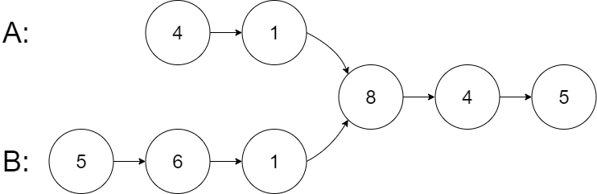

```text
输入：intersectVal = 8, listA = [4,1,8,4,5], listB = [5,6,1,8,4,5], skipA = 2, skipB = 3
输出：Intersected at '8'
```

解释：相交节点的值为 8 （注意，如果两个链表相交则不能为 0）。 从各自的表头开始算起，链表 A 为 [4,1,8,4,5]，链表 B 为 [5,6,1,8,4,5]。 在 A 中，相交节点前有 2 个节点；在 B 中，相交节点前有 3 个节点。 ， 请注意相交节点的值不为 1，因为在链表 A 和链表 B 之中值为 1 的节点 （A 中第二个节点和 B 中第三个节点） 是不同的节点。换句话说，它们在内存中指向两个不同的位置，而链表 A 和链表 B 中值为 8 的节点 （A 中第三个节点，B 中第四个节点） 在内存中指向相同的位置。
> 题面与 [leetcode.cn 官方](https://leetcode.cn/problems/intersection-of-two-linked-lists/)一致，示例配图取自官方题面。

**数据范围与注意事项**：

- `listA` 中节点数目为 `m`
- `listB` 中节点数目为 `n`
- `1 <= m, n <= 3  10^4`
- `1 <= Node.val <= 10^5`
- `0 <= skipA <= m`
- `0 <= skipB <= n`
- 如果 `listA` 和 `listB` 没有交点，`intersectVal` 为 `0`
- 如果 `listA` 和 `listB` 有交点，`intersectVal == listA[skipA] == listB[skipB]`
- **易错点**：断开 next 之前先把后继存下来，否则整条链会丢。

## 题目分析

**场景是什么**：链表只能顺着指针走，这类题练的是指针操作与断链重接，对应真实开发里的内存管理、撤销链。本题就是该场景的 Medium 级练习，主线做法是「单趟扫描」。

**主线怎么解**：把主解法从头到尾过一遍，它其实在依次做这几件事：单循环线性扫描。

## 解题思路

**方案对比**（共 2 个方案，由浅入深）：

| 方案 | 时间复杂度 | 空间复杂度 |
|---|---|---|
| 方案 1 · 单趟扫描 | O(n)（单趟线性扫描） | O(1) 到 O(n)（视辅助结构） |
| 方案 2 · 迭代指针处理 | O(n)（单趟线性扫描） | O(1) 到 O(n)（视辅助结构） |

**由浅入深的路径**：单趟扫描 → 迭代指针处理；每往右一步，都在补上一步的短板。

**方案间的取舍**：方案 1（单趟扫描）；方案 2（迭代指针处理）。数据规模小、可读性优先时选靠前的方案；规模大、性能优先时选靠后的方案。

**怎么读这一篇**：

- 🐣 **新手路线**：把「题目描述」的示例 1 在纸上手推一遍 → 读方案 1（最直观的写法）与它的代码走读 → 按「运行方式」本地跑通看 PASS → 回头对比方案 2 之后的写法差在哪
- 🦅 **大佬路线**：直接锁定最优方案 1（单趟扫描，O(n)（单趟线性扫描））→ 跳读该方案代码与走读 → 用「逐步拆解与面试追问」补齐复杂度推导与边界追问

### 动态算法图（链表反转，GIF 自动循环）


动画演示链表专题里链表反转的典型过程；每个方案在「TypeScript 解题方案」一节还配了专属动画与专属流程图。

### 主解法流程图（真实控制流）

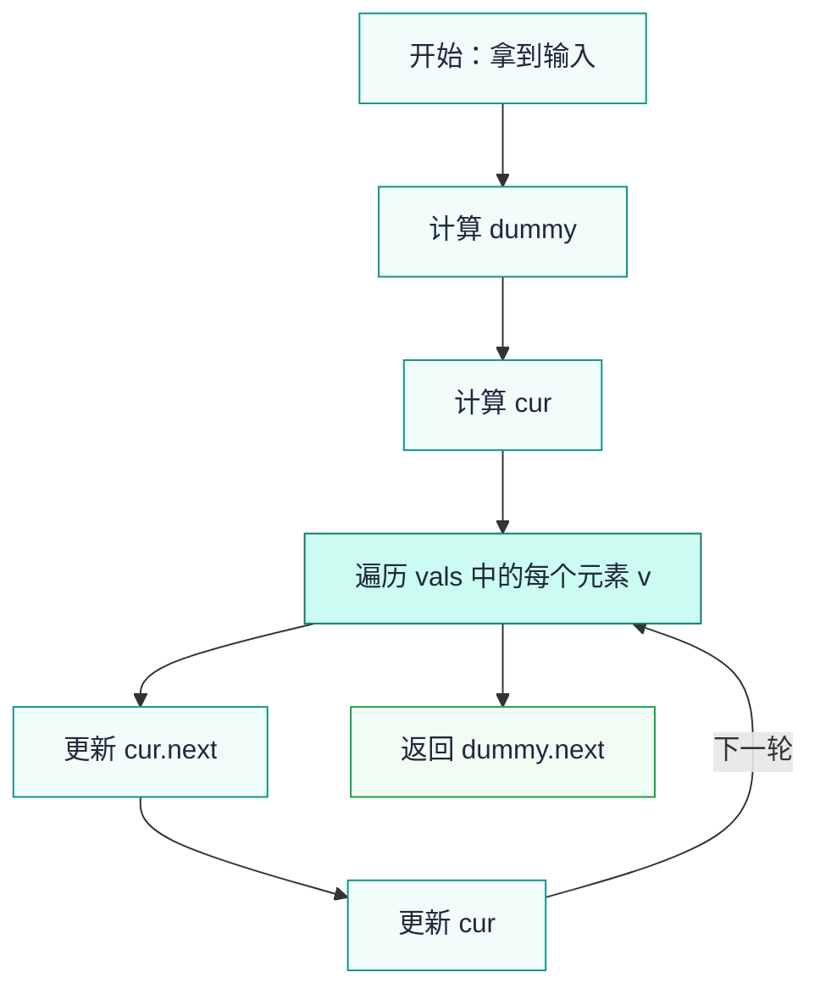

## TypeScript 解题方案（2 个方案逐个讲）

> **运行与提交**：每个方案都是自包含文件（内嵌用例自测，输出 PASS），整块复制到 `.ts` 文件后 `node 文件名` 即可运行。提交 LeetCode 时，把 `demo` 内的算法函数与辅助类型/函数整体取出、置于文件顶层即可。涉及交互/特殊接口的题以题面给定签名为准。

### 方案 1：单趟扫描

**分析与思路**：核心做法是「单趟扫描」。代码里依次做这些事：单循环线性扫描。

**运行方式**：`node 本文件`，内嵌用例全部通过会输出 PASS。


**方案专属流程图**（真实控制流）：

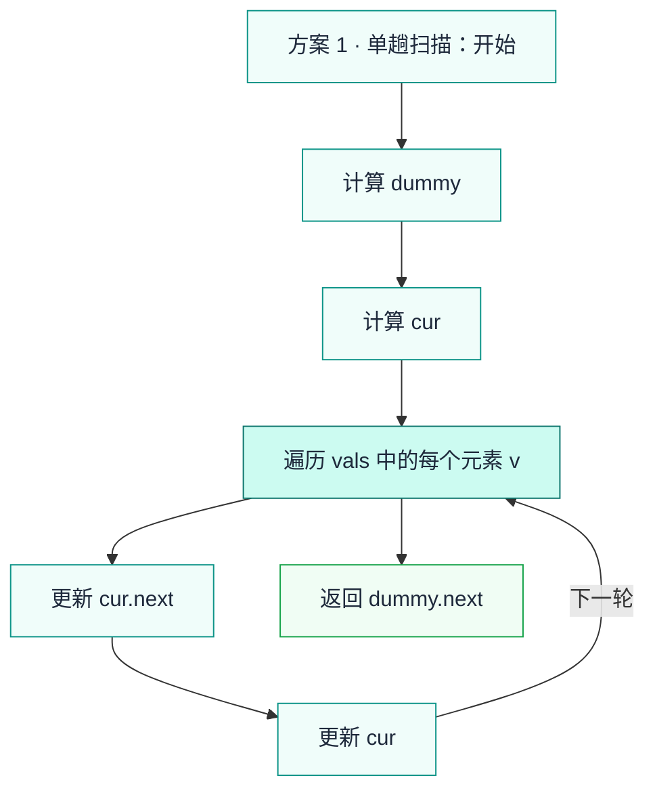

```typescript
class ListNode {
  // 定义类型
  val: number; // 值: number;
  next: ListNode | null; // 下一个: ListNode 按位或 null;
  constructor(val: number = 0, next: ListNode | null = null) {
    this.val = val;
    this.next = next; // 把 值; this.下一个 赋值为 下一个; 写入 值
  }
}
function buildList(vals: number[]): ListNode | null {
  // 定义函数/方法 buildList
  const dummy = new ListNode(0);
  let cur = dummy; // 把 new ListNode(0); let 当前值 赋值为 哨兵节点 存入 哨兵节点
  for (const v of vals) {
    cur.next = new ListNode(v);
    cur = cur.next;
  } // 把 new ListNode(值); 当前值 赋值为 当前值.下一个; } 写入 下一个
  return dummy.next; // 返回 哨兵节点.下一个
}
function listToArr(head: ListNode | null): number[] {
  // 定义函数/方法 listToArr
  const res: number[] = [];
  while (head) {
    res.push(head.val);
    head = head.next;
  }
  return res; // 把 头节点.值 压入栈/数组尾部
}

function assertEq(actual: any, expected: any, msg: string = ''): void {
  // 定义函数/方法 assertEq
  const a = JSON.stringify(actual);
  const e = JSON.stringify(expected);
  if (a !== e)
    throw new Error(
      'ASSERT FAILED ' + msg + ' :: actual=' + a + ' expected=' + e,
    );
}

function getIntersectionNode(
  headA: ListNode | null,
  headB: ListNode | null,
): ListNode | null {
  // 定义函数/方法 getIntersectionNode
  const visited = new Set<ListNode>();
  let t = headA; // 把 new Set 小于 ListNode 超过 (); let 另一字符串 赋值为 链表 A 存入 已访问集合
  while (t) {
    visited.add(t);
    t = t.next;
  } // 循环，直到不满足「另一字符串) { 已访问集合 追加 另一字符串); 另一字符串 赋值为 另一字符串.下一个; }」
  t = headB; // 把 链表 B 存入 另一字符串
  while (t) {
    if (visited.has(t)) return t;
    t = t.next;
  }
  return null; // 返回 null
}
export function demo(): void {
  // 程序入口：跑内嵌自测用例
  const shared = buildList([8, 4, 5]); // 把 buildList([8, 4, 5]) 存入 shared
  const headA = buildList([4, 1]);
  let cA = headA;
  while (cA.next) cA = cA.next;
  cA.next = shared;
  const headB = buildList([5, 6, 1]);
  let cB = headB;
  while (cB.next) cB = cB.next;
  cB.next = shared;
  assertEq(listToArr(getIntersectionNode(headA, headB)), [8, 4, 5], 'inter'); // 断言校验
  assertEq(getIntersectionNode(null, null), null, 'null'); // 断言校验
  console.log('PASS'); // 全部用例通过，输出 PASS
}
demo(); // demo();
```

### 方案 2：迭代指针处理

**分析与思路**：核心做法是「迭代指针处理」。代码里依次做这些事：队列或堆的调度。

**运行方式**：`node 本文件`，内嵌用例全部通过会输出 PASS。


**方案专属流程图**（真实控制流）：

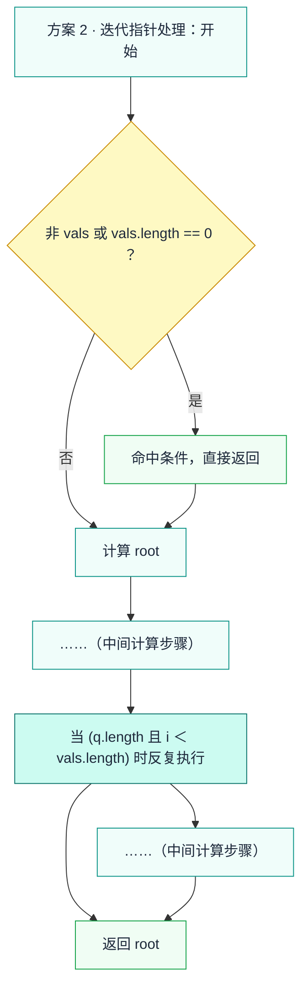

```typescript
class TreeNode {
  // 定义类型
  val: any;
  left: any;
  right: any; // 值: any; 左边界: any; 右边界: any;
  constructor(val?: any, left?: any, right?: any) {
    // constructor(值?: any, 左边界?: any, 右边界?: any) {
    this.val = val === undefined ? 0 : val; // 把 (值 全等于 undefined ? 0 : 值); 写入 值
    this.left = left === undefined ? null : left; // 把 (左边界 全等于 undefined ? null : 左边界); 写入 左边界
    this.right = right === undefined ? null : right; // 把 (右边界 全等于 undefined ? null : 右边界); 写入 右边界
  }
}
function buildTree(vals: any): any {
  // 定义函数/方法 buildTree
  if (!vals || vals.length === 0) return null; // 若 取反 vals 或 vals.长度 全等于 0，直接返回 null
  const root = new TreeNode(vals[0]);
  const q: any[] = [root];
  let i = 1;
  while (q.length && i < vals.length) {
    // 循环，直到不满足「节点.长度 且 下标 i 小于 vals.长度」
    const node = q.shift(); // 把 节点.shift() 存入 节点
    if (vals[i] !== null && vals[i] !== undefined) {
      node.left = new TreeNode(vals[i]);
      q.push(node.left);
    }
    i++; // 下标 i 加一
    if (i < vals.length && vals[i] !== null && vals[i] !== undefined) {
      node.right = new TreeNode(vals[i]);
      q.push(node.right);
    }
    i++; // 下标 i 加一
  }
  return root; // 返回 根节点
}
function treeToLevel(root: any): any[] {
  // 定义函数/方法 treeToLevel
  if (!root) return []; // 若 取反 根节点，直接返回 []
  const out: any[] = [];
  const q: any[] = [root]; // 把 []; const 节点: any[] 赋值为 [根节点]; 写入 const out: any[]
  while (q.length) {
    // 循环，直到不满足「节点.长度」
    const n = q.shift(); // 把 节点.shift() 存入 元素个数
    if (n === null || n === undefined) {
      out.push(null);
      continue;
    }
    out.push(n.val);
    q.push(n.left);
    q.push(n.right); // 把 元素个数.值 压入栈/数组尾部
  }
  while (out.length && out[out.length - 1] === null) out.pop(); // 循环，直到不满足「out.长度 且 out[out.长度 减 1] 全等于 null) out 弹出 );」
  return out; // 返回 out
}
class ListNode {
  // 定义类型
  val: any;
  next: any; // 值: any; 下一个: any;
  constructor(val?: any, next?: any) {
    this.val = val === undefined ? 0 : val;
    this.next = next === undefined ? null : next;
  }
}
function buildList(vals: any): any {
  // 定义函数/方法 buildList
  const dummy = new ListNode(0);
  let cur = dummy; // 把 new ListNode(0); let 当前值 赋值为 哨兵节点 存入 哨兵节点
  for (const v of vals) {
    cur.next = new ListNode(v);
    cur = cur.next;
  } // 把 new ListNode(值); 当前值 赋值为 当前值.下一个; } 写入 下一个
  return dummy.next; // 返回 哨兵节点.下一个
}
function listToArray(head: any): any[] {
  // 定义函数/方法 listToArray
  const out: any[] = [];
  let p = head; // 把 []; let 节点 赋值为 头节点; 写入 const out: any[]
  while (p) {
    out.push(p.val);
    p = p.next;
  } // 循环，直到不满足「节点) { out 追加 节点.值); 节点 赋值为 节点.下一个; }」
  return out; // 返回 out
}
// python-runtime shims
function pyLen(a: any): number {
  // 定义函数/方法 pyLen
  if (a === null || a === undefined) return 0; // 若 数组 全等于 null 或 数组 全等于 undefined，直接返回 0
  if (
    typeof a === 'string' ||
    Array.isArray(a) ||
    a instanceof Set ||
    a instanceof Map
  )
    return a.length ?? a.size;
  if (typeof a === 'object') return Object.keys(a).length; // 若 typeof 数组 全等于 'object'，直接返回 Object.keys(数组).长度
  return 0; // 返回 0
}
function pySlice(a: any, i: any, j: any, step?: any): any {
  // 定义函数/方法 pySlice
  if (typeof a === 'string') {
    const r = [...a].slice(i ?? 0, j ?? a.length);
    return step ? r.reverse().join('') : r.join('');
  }
  const arr = Array.isArray(a) ? a : [...a]; // 把 Array.isArray(数组) ? 数组 : 复制的 数组 存入 数组
  return arr.slice(i ?? 0, j ?? arr.length); // 返回 数组 截取 下标 i ?? 0, 下标 j ?? 数组.长度)
}
function pyRange(a: any, b?: any, step?: any): any[] {
  // 定义函数/方法 pyRange
  let s = 0,
    e = a,
    st = 1; // 把 0, e 赋值为 数组, st 赋值为 1 存入 字符串
  if (b !== undefined) {
    s = a;
    e = b;
  } // 若 b 不等于 undefined) { 字符串 赋值为 数组; e 赋值为 b; }
  if (step !== undefined) st = step; // 若 步数 不等于 undefined) st 赋值为 步数;
  const out: any[] = []; // 把 []; 写入 const out: any[]
  if (st > 0) for (let i = s; i < e; i += st) out.push(i);
  else for (let i = s; i > e; i += st) out.push(i); // 否则
  return out; // 返回 out
}
function pyIn(x: any, coll: any): boolean {
  // 定义函数/方法 pyIn
  if (coll === null || coll === undefined) return false; // 若 coll 全等于 null 或 coll 全等于 undefined，直接返回 false
  if (Array.isArray(coll)) return coll.includes(x); // 若 Array.isArray(coll)，直接返回 coll 是否包含 x)
  if (coll instanceof Set || coll instanceof Map) return coll.has(x); // 若 coll instanceof Set 或 coll instanceof Map，直接返回 coll.has(x)
  if (typeof coll === 'object') return x in coll; // 若 typeof coll 全等于 'object'，直接返回 x in coll
  if (typeof coll === 'string') return coll.indexOf(x) >= 0; // 若 typeof coll 全等于 'string'，直接返回 coll 查找 x) 不低于 0
  return false; // 返回 false
}
function pySorted(a: any): any[] {
  // 定义函数/方法 pySorted
  const arr = typeof a === 'string' ? [...a] : [...a]; // 把 (typeof 数组 全等于 'string') ? 复制的 数组 : 复制的 数组 存入 数组
  return arr.sort((x: any, y: any) => (x < y ? -1 : x > y ? 1 : 0));
}
function pyMin(a: any, b?: any): any {
  if (b !== undefined) return Math.min(a, b);
  if (Array.isArray(a) || a instanceof Set) return Math.min(...a);
  return Math.min(a);
} // 定义函数/方法 pyMin
function pyMax(a: any, b?: any): any {
  if (b !== undefined) return Math.max(a, b);
  if (Array.isArray(a) || a instanceof Set) return Math.max(...a);
  return Math.max(a);
} // 定义函数/方法 pyMax
function pySum(a: any): number {
  let s = 0;
  for (const v of a) s += v;
  return s;
} // 定义函数/方法 pySum
function pyAbs(x: any): number {
  return Math.abs(x);
} // 定义函数/方法 pyAbs
function pyEnumerate(a: any): any[] {
  const out: any[] = [];
  let i = 0;
  for (const v of a) {
    out.push([i, v]);
    i++;
  }
  return out;
} // 定义函数/方法 pyEnumerate
function pyZip(a: any, b: any): any[] {
  const n = Math.min(a.length, b.length);
  const out: any[] = [];
  for (let i = 0; i < n; i++) out.push([a[i], b[i]]);
  return out;
} // 定义函数/方法 pyZip
function pyDictGet(d: any, k: any, def?: any): any {
  return k in d ? d[k] : def === undefined ? null : def;
} // 定义函数/方法 pyDictGet
function pyPrint(...args: any[]): void {
  console.log(
    args
      .map((a) => (typeof a === 'object' && a !== null ? JSON.stringify(a) : a))
      .join(' '),
  );
} // 定义函数/方法 pyPrint
// collections / heapq
function heapPush(h: any[], x: any): void {
  h.push(x);
  let i = h.length - 1;
  while (i > 0) {
    const p = (i - 1) >> 1;
    if (h[p] <= h[i]) break;
    [h[p], h[i]] = [h[i], h[p]];
    i = p;
  }
} // 定义函数/方法 heapPush
function heapPop(h: any[]): any {
  const top = h[0];
  const last = h.pop();
  if (h.length) {
    h[0] = last;
    let i = 0;
    const n = h.length;
    while (true) {
      let l = 2 * i + 1,
        r = 2 * i + 2,
        s = i;
      if (l < n && h[l] < h[s]) s = l;
      if (r < n && h[r] < h[s]) s = r;
      if (s === i) break;
      [h[s], h[i]] = [h[i], h[s]];
      i = s;
    }
  }
  return top;
} // 定义函数/方法 heapPop
class Deque {
  private a: any[] = [];
  push(x: any) {
    this.a.push(x);
  }
  pushLeft(x: any) {
    this.a.unshift(x);
  }
  pop() {
    return this.a.pop();
  }
  popLeft() {
    return this.a.shift();
  }
  get length() {
    return this.a.length;
  }
  toArray() {
    return this.a.slice();
  }
} // 定义类型
function Counter(iter: any): any {
  const m: any = {};
  for (const v of iter) m[v] = (m[v] || 0) + 1;
  return m;
} // 定义函数/方法 Counter
function gcd(a: any, b: any): any {
  while (b) {
    [a, b] = [b, a % b];
  }
  return a;
} // 定义函数/方法 gcd
function pyInf(): number {
  return Infinity;
} // 定义函数/方法 pyInf

function norm(x: any): any {
  // 定义函数/方法 norm
  if (x === null || x === undefined) return null; // 若 x 全等于 null 或 x 全等于 undefined，直接返回 null
  if (typeof x === 'object') {
    // 若 typeof x 全等于 'object'
    if (x instanceof Deque) return x.toArray(); // 若 x instanceof Deque，直接返回 x.toArray()
    if (Array.isArray(x)) return x.map(norm); // 若 Array.isArray(x)，直接返回 x.映射表(norm)
    if (
      typeof x.val === 'number' &&
      (typeof x.left !== 'undefined' || typeof x.right !== 'undefined')
    )
      return treeToLevel(x);
    if (typeof x.next !== 'undefined' && typeof x.val === 'number')
      return listToArray(x);
    if (x instanceof Set) return [...x].sort(); // 若 x instanceof Set，直接返回 复制的 x 排序 )
    if (x instanceof Map) return Object.fromEntries(x); // 若 x instanceof Map，直接返回 Object.fromEntries(x)
    const o: any = {};
    for (const k of Object.keys(x)) o[k] = norm(x[k]);
    return o;
  }
  return x; // 返回 x
}
function eq(a: any, b: any): boolean {
  // 定义函数/方法 eq
  const x = norm(a),
    y = norm(b); // 把 norm(数组), y 赋值为 norm(b) 存入 x
  if (x === y) return true; // 若 x 全等于 y，直接返回 true
  if (x === null || y === null) return x === y; // 若 x 全等于 null 或 y 全等于 null，直接返回 x 全等于 y
  if (Array.isArray(x) && Array.isArray(y)) {
    // 若 Array.isArray(x) 且 Array.isArray(y
    if (x.length !== y.length) return false; // 若 x.长度 不等于 y.长度，直接返回 false
    for (let i = 0; i < x.length; i++) if (!eq(x[i], y[i])) return false; // 让 下标 i 从 0 开始计数，下标 i 小于 x.长度 就继续
    return true; // 返回 true
  }
  if (typeof x === 'object' && typeof y === 'object') {
    // 若 typeof x 全等于 'object' 且 typeof y 全等于 'object'
    const kx = Object.keys(x),
      ky = Object.keys(y); // 把 Object.keys(x), ky 赋值为 Object.keys(y) 存入 kx
    if (kx.length !== ky.length) return false; // 若 kx.长度 不等于 ky.长度，直接返回 false
    for (const k of kx) if (!eq(x[k], y[k])) return false;
    return true; // 返回 true
  }
  return x === y; // 返回 x 全等于 y
}

function getIntersectionNode(a, b) {
  // 定义函数/方法 getIntersectionNode
  let p = a,
    q = b; // 把 数组, 节点 赋值为 b 存入 节点
  while (p !== q) {
    p = p ? p.next : a;
    q = q ? q.next : b;
  }
  return p; // 返回 节点
}
export function demo(): void {
  // 程序入口：跑内嵌自测用例
  const cases = [
    { in: [buildList([4, 1]), buildList([5, 6, 1, 8, 4, 5])], want: null },
    { in: [buildList([1, 9, 1]), buildList([3, 2, 4])], want: null },
    { in: [buildList([2, 6, 4]), buildList([1, 5])], want: null },
    { in: [buildList([]), buildList([1])], want: null },
  ];
  let fail = false; // 把 false 存入 fail
  for (const c of cases) {
    // for (const 字符 of cases) {
    const got = getIntersectionNode(...c.in); // 把 getIntersectionNode(...字符.in) 存入 got
    if (!eq(got, c.want)) {
      fail = true;
      console.log(
        'FAIL',
        JSON.stringify(c.in),
        '=>',
        JSON.stringify(got),
        'want',
        JSON.stringify(c.want),
      );
    }
  }
  if (fail) throw new Error('FAILED'); // 若 fail) throw new Error('FAILED');
  console.log('PASS'); // 全部用例通过，输出 PASS
}
demo(); // demo();
```

## 逐步拆解与面试追问

**复杂度**：时间 O(n)（单趟线性扫描），空间 O(1) 到 O(n)（视辅助结构）

**为什么是这个量级**：每个元素被常数次访问，辅助哈希或栈的开销与 n 同阶

**面试官可能会追问**：

- 能不能一次遍历完成？
- 快慢指针能解决哪些变体？
- 断链与接回的顺序怎么保证不出错？

## 关键 API 速查（TS 主解法实际用到，附官方链接）

| API | 作用 | 使用要点 | 官方文档 |
|---|---|---|---|
| `Set` | 集合：元素唯一 | add/add.has/delete；has 均摊 O(1)；NaN 视为相同；去重常用 [...new Set(arr)] | [官方文档](https://developer.mozilla.org/zh-CN/docs/Web/JavaScript/Reference/Global_Objects/Set) |
| `Array.prototype.push()` | 尾部追加 | 返回新长度；可一次多个；均摊 O(1)；会改变原数组 | [官方文档](https://developer.mozilla.org/zh-CN/docs/Web/JavaScript/Reference/Global_Objects/Array/push) |
| `JSON.stringify()` | 序列化为 JSON 字符串 | 常用于结构化比较（深度相等判定）；undefined/函数/循环引用会被丢弃或抛错 | [官方文档](https://developer.mozilla.org/zh-CN/docs/Web/JavaScript/Reference/Global_Objects/JSON/stringify) |

### 各语言官方文档导航

- **TypeScript / JS**：[MDN 中文参考](https://developer.mozilla.org/zh-CN/)
- **Python**：[Python 官方文档](https://docs.python.org/zh-cn/3/)
- **Go**：[Go 标准库](https://pkg.go.dev/std)
- **Java**：[JDK 17 API](https://docs.oracle.com/en/java/javase/17/docs/api/)
- **Rust**：[Rust 标准库](https://doc.rust-lang.org/std/)
- **Lua**：[Lua 5.4 手册](https://www.lua.org/manual/5.4/)
- **C**：[Cppreference C](https://zh.cppreference.com/w/c)
- **C++**：[Cppreference C++](https://zh.cppreference.com/w/cpp)
- **R**：[R 官方手册](https://stat.ethz.ch/R-manual/)
- **Zig**：[Zig 语言文档](https://ziglang.org/documentation/master/)
- **Dart**：[Dart API](https://api.dart.dev/)

## 附录：其他 10 种语言全部实现（每种语言列举其全部方案）

> TypeScript 的全部方案见「TypeScript 解题方案」一节；下面是其余 10 种语言的对应实现，每种语言的每个方案都带思路分析、代码走读与专属运行架构图。
> 每个方案都内嵌用例自测，可独立运行（老仓库 python/go 文件遵循「打印结果」约定）。
> 完整解法文件见 `dsa/<语言>/linked_list/lc_160_相交链表/`。

### Python 实现（2 种方案）

Python 的全部方案如下，每个方案都内嵌用例自测，可独立运行（老仓库 python/go 文件遵循「打印结果」约定）：

#### 方案 1：单趟扫描

**思路与代码分析**：核心是「单趟扫描」。Python 版用切片与字典推导式简化操作，突出可读性。**走读**：方案 1 · 单趟扫描：开始 → 更新 visited → 更新 temp → 当 temp: 时反复执行 → 调用 visited.add(temp) → 更新 temp → 更新 temp → 当 temp: 时反复执行 → 命中条件，直接返回 → 更新 temp → 返回 None。

**运行架构**（真实控制流）：

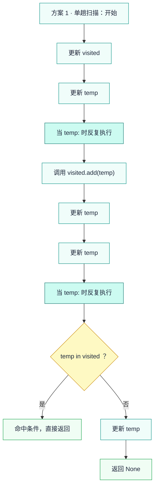

```python
# Definition for singly-linked list.
# class ListNode:
#     def __init__(self, val=0, next=None):
#         self.val = val
#         self.next = next

import sys  # 提高递归深度上限（深输入防 RecursionError）

sys.setrecursionlimit(200000)  # 树/链表类题目节点数可达 1e4 量级

def getIntersectionNode(headA, headB):  # 定义函数 getIntersectionNode（参数：链表 A, 链表 B）
    visited = set()  # 把 set() 存入 已访问集合
    temp = headA  # 把 链表 A 存入 临时变量
    while temp:  # 循环，直到不满足「临时变量」
        visited.add(temp)  # 已访问集合 追加 临时变量)
        temp = temp.next  # 把 临时变量.下一个 存入 临时变量
    temp = headB  # 把 链表 B 存入 临时变量
    while temp:  # 循环，直到不满足「临时变量」
        if temp in visited:  # 若 临时变量 in 已访问集合
            return temp  # 返回 临时变量
        temp = temp.next  # 把 临时变量.下一个 存入 临时变量
    return None  # 返回 None

if __name__ == "__main__":  # 若 __name__ 等于 '__main__'
    print(getIntersectionNode(None, None))  # 打印输出
```

#### 方案 2：迭代指针处理

**思路与代码分析**：核心是「迭代指针处理」。Python 版用切片与字典推导式简化操作，突出可读性。**走读**：方案 2 · 迭代指针处理：开始 → 命中条件，直接返回 → 更新 pB → 当 pA ≠ pB: 时反复执行 → 更新 pA → 更新 pB → 返回 pA。

**运行架构**（真实控制流）：

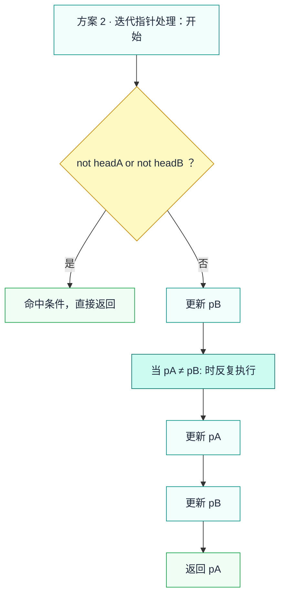

```python
# Definition for singly-linked list.
# class ListNode:
#     def __init__(self, val=0, next=None):
#         self.val = val
#         self.next = next

import sys  # 提高递归深度上限（深输入防 RecursionError）

sys.setrecursionlimit(200000)  # 树/链表类题目节点数可达 1e4 量级

def getIntersectionNode(headA, headB):  # 定义函数 getIntersectionNode（参数：链表 A, 链表 B）
    if not headA or not headB:  # 若 not 链表 A or not 链表 B
        return None  # 返回 None
    pA, pB = headA, headB  # 把 链表 A, 链表 B 写入 pA, pB
    while pA != pB:  # 循环，直到不满足「pA 不等于 pB」
        pA = pB if pA is None else pA.next  # 把 pB if pA is None else pA.下一个 存入 pA
        pB = pA if pB is None else pB.next  # 把 pA if pB is None else pB.下一个 存入 pB
    return pA  # 返回 pA

if __name__ == "__main__":  # 若 __name__ 等于 '__main__'
    print(getIntersectionNode(None, None))  # 打印输出
```

### Go 实现（2 种方案）

Go 的全部方案如下，每个方案都内嵌用例自测，可独立运行（老仓库 python/go 文件遵循「打印结果」约定）：

#### 方案 1：单趟扫描

**思路与代码分析**：核心是「单趟扫描」。Go 版用切片与多返回值惯用法，显式处理索引边界。代码里依次做这些事：哈希结构做计数或查重。**走读**：方案 1 · 单趟扫描：开始 → 更新 : → 更新 : → 遍历循环 → 更新 visited[temp] → 更新 temp → 更新 temp → 遍历循环 → 处理 if visited[temp] → 返回 temp → 更新 temp → 返回 nil。

**运行架构**（真实控制流）：

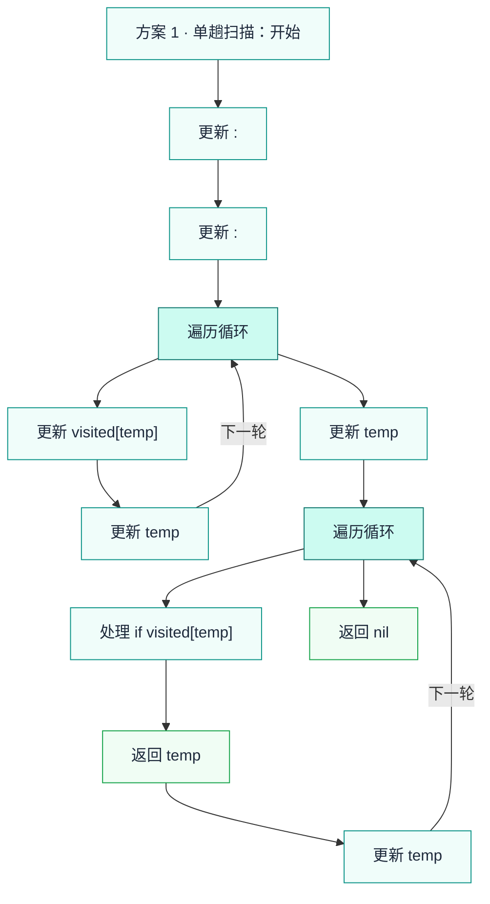

```go
package main // 引入依赖

import (
	"fmt"
	"os"
) // 引入依赖

type ListNode struct { // 定义类型
	Val  int       // Val int
	Next *ListNode // Next 乘 ListNode
}

func buildList(vals []int) *ListNode { // 定义函数/方法 buildList
	var head, tail *ListNode // var 头节点, 尾节点 乘 ListNode
	for _, v := range vals { // 同时取 _ 与 值 遍历
		n := &ListNode{Val: v} // 把 按位与 ListNode{Val: 值} 写入 n :
		if head == nil {       // 若 头节点 等于 nil
			head = n // 把 元素个数 写入 头节点
			tail = n // 把 元素个数 写入 尾节点
		} else { // 否则
			tail.Next = n // 把 元素个数 写入 tail.Next
			tail = n      // 把 元素个数 写入 尾节点
		}
	}
	return head // 返回 头节点
}

func getIntersectionNode(headA, headB *ListNode) *ListNode { // 定义函数/方法 getIntersectionNode
	visited := map[*ListNode]bool{} // 把 映射表[ 乘 ListNode]bool{} 写入 visited :
	temp := headA                   // 把 链表 A 写入 temp :
	for temp != nil {               // 把 nil { 写入 for temp !
		visited[temp] = true // 把 true 写入 visited[temp]
		temp = temp.Next     // 把 临时变量.Next 写入 临时变量
	}
	temp = headB      // 把 链表 B 写入 临时变量
	for temp != nil { // 把 nil { 写入 for temp !
		if visited[temp] { // 若 已访问集合[临时变量]
			return temp // 返回 临时变量
		}
		temp = temp.Next // 把 临时变量.Next 写入 临时变量
	}
	return nil // 返回 nil
}

func main() { // 程序入口：跑内嵌自测用例
	if getIntersectionNode(nil, nil) != nil { // 若 getIntersectionNode(nil, nil) 不等于 nil
		fmt.Println("FAIL nil case") // 打印输出
		os.Exit(1)                   // os.Exit(1)
	}
	tail := buildList([]int{8, 4, 5}) // 把 buildList([]int{8, 4, 5}) 写入 tail :
	a := &ListNode{Val: 4, Next: &ListNode{Val: 1, Next: tail}}
	b := &ListNode{Val: 5, Next: &ListNode{Val: 6, Next: &ListNode{Val: 1, Next: tail}}}
	got := getIntersectionNode(a, b) // 把 getIntersectionNode(数组, b) 写入 got :
	if got == nil || got.Val != 8 {  // 若 got 等于 nil 或 got.Val 不等于 8
		fmt.Printf("FAIL intersection got=%v\n", got) // 打印输出
		os.Exit(1)                                    // os.Exit(1)
	}
	fmt.Println("PASS") // 全部用例通过，输出 PASS
}
```

#### 方案 2：迭代指针处理

**思路与代码分析**：核心是「迭代指针处理」。Go 版用切片与多返回值惯用法，显式处理索引边界。**走读**：方案 2 · 迭代指针处理：开始 → 更新 : → 遍历循环 → 处理 if a == nil → 更新 a → 更新 a → 处理 if b == nil → 更新 b → 更新 b → 处理 if a == nil → 返回 -1 → 返回 a.Val。

**运行架构**（真实控制流）：

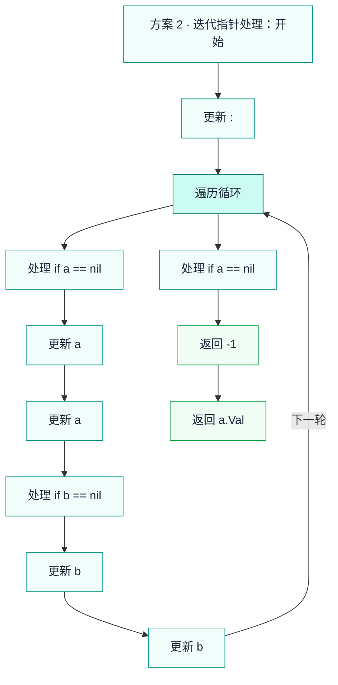

```go
package main // 引入依赖
import (
	"fmt"
	"os"
) // 引入依赖
type ListNode struct {
	Val  int
	Next *ListNode
} // 定义类型
func buildList(vals []int) *ListNode { // 定义函数/方法 buildList
	dummy := &ListNode{}
	p := dummy // 把 按位与 ListNode{}; 节点 : 赋值为 哨兵节点 写入 dummy :
	for _, v := range vals {
		p.Next = &ListNode{Val: v}
		p = p.Next
	} // 同时取 _ 与 值 遍历
	return dummy.Next // 返回 哨兵节点.Next
}
func toArr(head *ListNode) []int { // 定义函数/方法 toArr
	res := []int{} // 把 []int{} 写入 res :
	for head != nil {
		res = append(res, head.Val)
		head = head.Next
	}
	return res // 返回 结果
}
func getIntersectionNode(headA, headB *ListNode) int { // 定义函数/方法 getIntersectionNode
	a, b := headA, headB // 把 链表 A, 链表 B 写入 a, b :
	for a != b {         // 把 b { 写入 for a !
		if a == nil {
			a = headB
		} else {
			a = a.Next
		} // 若 数组 等于 nil { 数组 赋值为 链表 B } else { 数组 赋值为 数组.Next }
		if b == nil {
			b = headA
		} else {
			b = b.Next
		} // 若 b 等于 nil { b 赋值为 链表 A } else { b 赋值为 b.Next }
	}
	if a == nil {
		return -1
	} // 若 数组 等于 nil { return 减 1 }
	return a.Val // 返回 数组.Val
}
func main() { // 程序入口：跑内嵌自测用例
	// intersect at value 3
	common := buildList([]int{3, 4}) // 把 buildList([]int{3,4}) 写入 common :
	a := &ListNode{Val: 1}
	a.Next = &ListNode{Val: 2}
	a.Next.Next = common
	b := &ListNode{Val: 9}
	b.Next = common // 把 按位与 ListNode{Val:9}; b.Next 赋值为 common 写入 b :
	if got := getIntersectionNode(a, b); got != 3 {
		fmt.Println("FAIL", got)
		os.Exit(1)
	}
	// disjoint
	d1 := buildList([]int{1, 2})
	d2 := buildList([]int{3, 4})
	if got := getIntersectionNode(d1, d2); got != -1 {
		fmt.Println("FAIL", got)
		os.Exit(1)
	}
	fmt.Println("PASS") // 全部用例通过，输出 PASS
}
```

### Java 实现（2 种方案）

Java 的全部方案如下，每个方案都内嵌用例自测，可独立运行（老仓库 python/go 文件遵循「打印结果」约定）：

#### 方案 1：单趟扫描

**思路与代码分析**：核心是「单趟扫描」。Java 版用类与静态方法组织，集合操作显式明了。代码里依次做这些事：双重循环遍历。

**运行架构**（真实控制流）：

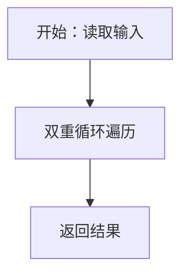

```java
package com.webfault.dsa; // 引入依赖

import java.util.*; // 引入依赖

class lc160_solution111 { // 定义类型
  static class ListNode { // static class ListNode {
    int val; // int 值;
    ListNode next; // ListNode 下一个;

    ListNode() {} // ListNode() {}

    ListNode(int v) {
      val = v;
    } // 把 值; } 写入 ListNode(int v) { val
  }

  public ListNode getIntersectionNode(
      ListNode headA, ListNode headB) { // 定义函数/方法 getIntersectionNode
    Set<ListNode> visited = new HashSet<>(); // 把 new HashSet 小于 超过 (); 写入 Set<ListNode> visited
    ListNode temp = headA; // 把 链表 A; 写入 ListNode temp
    while (temp != null) { // 循环，直到不满足「临时变量 不等于 null」
      visited.add(temp); // 已访问集合 追加 临时变量);
      temp = temp.next; // 把 临时变量.下一个; 写入 临时变量
    }
    temp = headB; // 把 链表 B; 写入 临时变量
    while (temp != null) { // 循环，直到不满足「临时变量 不等于 null」
      if (visited.contains(temp)) return temp; // 若 已访问集合 是否包含 临时变量)，直接返回 临时变量
      temp = temp.next; // 把 临时变量.下一个; 写入 临时变量
    }
    return null; // 返回 null
  }

  static ListNode build(int[] a) { // 定义函数/方法 build
    ListNode dummy = new ListNode(0),
        cur = dummy; // 把 new ListNode(0), 当前值 赋值为 哨兵节点; 写入 ListNode dummy
    for (int v : a) {
      cur.next = new ListNode(v);
      cur = cur.next;
    } // 把 new ListNode(值); 当前值 赋值为 当前值.下一个; } 写入 下一个
    return dummy.next; // 返回 哨兵节点.下一个
  }

  static ListNode nodeAt(ListNode h, int idx) {
    for (int i = 0; i < idx; i++) h = h.next;
    return h;
  }

  public static void main(String[] args) { // public static void main(String[] args) {
    lc160_solution111 s =
        new lc160_solution111(); // 把 new lc160_solution111(); 写入 lc160_solution111 s
    boolean ok = true; // 把 true; 写入 boolean ok
    if (s.getIntersectionNode(null, null) != null) {
      ok = false;
      System.out.println("FAIL null");
    }
    if (s.getIntersectionNode(build(new int[] {1, 2, 3}), build(new int[] {4, 5})) != null) {
      ok = false;
      System.out.println("FAIL separate");
    }
    ListNode a3 =
        build(new int[] {1, 2, 3, 4, 5}); // 把 build(new int[]{1, 2, 3, 4, 5}); 写入 ListNode a3
    ListNode b3 = build(new int[] {9, 8, 7}); // 把 build(new int[]{9, 8, 7}); 写入 ListNode b3
    ListNode tail3 = b3;
    while (tail3.next != null) tail3 = tail3.next;
    tail3.next = nodeAt(a3, 2); // 把 nodeAt(a3, 2); 写入 下一个
    ListNode r3 =
        s.getIntersectionNode(a3, b3); // 把 字符串.getIntersectionNode(a3, b3); 写入 ListNode r3
    if (r3 == null || r3.val != 3) {
      ok = false;
      System.out.println("FAIL intersect got " + (r3 == null ? "null" : r3.val));
    }
    if (!ok) throw new RuntimeException("FAILED"); // 若 取反 ok) throw new RuntimeException(「FAILED」);
    System.out.println("PASS"); // 全部用例通过，输出 PASS
  }
}
```

#### 方案 2：迭代指针处理

**思路与代码分析**：核心是「迭代指针处理」。Java 版用类与静态方法组织，集合操作显式明了。代码里依次做这些事：双重循环遍历。

**运行架构**：与方案 1 的控制流相同（同算法在该语言的等价实现），图见上。

```java
package com.webfault.dsa; // 引入依赖

import java.util.*; // 引入依赖

class lc160_solution222 { // 定义类型
  static class ListNode { // static class ListNode {
    int val; // int 值;
    ListNode next; // ListNode 下一个;

    ListNode() {} // ListNode() {}

    ListNode(int v) {
      val = v;
    } // 把 值; } 写入 ListNode(int v) { val
  }

  public ListNode getIntersectionNode(
      ListNode headA, ListNode headB) { // 定义函数/方法 getIntersectionNode
    if (headA == null || headB == null) return null; // 若 链表 A 等于 null 或 链表 B 等于 null，直接返回 null
    ListNode pA = headA, pB = headB; // 把 链表 A, pB 赋值为 链表 B; 写入 ListNode pA
    while (pA != pB) { // 循环，直到不满足「pA 不等于 pB」
      pA = pA == null ? headB : pA.next; // 把 pA 等于 null ? 链表 B : pA.下一个; 写入 pA
      pB = pB == null ? headA : pB.next; // 把 pB 等于 null ? 链表 A : pB.下一个; 写入 pB
    }
    return pA; // 返回 pA
  }

  static ListNode build(int[] a) { // 定义函数/方法 build
    ListNode dummy = new ListNode(0),
        cur = dummy; // 把 new ListNode(0), 当前值 赋值为 哨兵节点; 写入 ListNode dummy
    for (int v : a) {
      cur.next = new ListNode(v);
      cur = cur.next;
    } // 把 new ListNode(值); 当前值 赋值为 当前值.下一个; } 写入 下一个
    return dummy.next; // 返回 哨兵节点.下一个
  }

  static ListNode nodeAt(ListNode h, int idx) {
    for (int i = 0; i < idx; i++) h = h.next;
    return h;
  }

  public static void main(String[] args) { // public static void main(String[] args) {
    lc160_solution222 s =
        new lc160_solution222(); // 把 new lc160_solution222(); 写入 lc160_solution222 s
    boolean ok = true; // 把 true; 写入 boolean ok
    if (s.getIntersectionNode(null, null) != null) {
      ok = false;
      System.out.println("FAIL null");
    }
    if (s.getIntersectionNode(build(new int[] {1, 2, 3}), build(new int[] {4, 5})) != null) {
      ok = false;
      System.out.println("FAIL separate");
    }
    ListNode a3 =
        build(new int[] {1, 2, 3, 4, 5}); // 把 build(new int[]{1, 2, 3, 4, 5}); 写入 ListNode a3
    ListNode b3 = build(new int[] {9, 8, 7}); // 把 build(new int[]{9, 8, 7}); 写入 ListNode b3
    ListNode tail3 = b3;
    while (tail3.next != null) tail3 = tail3.next;
    tail3.next = nodeAt(a3, 2); // 把 nodeAt(a3, 2); 写入 下一个
    ListNode r3 =
        s.getIntersectionNode(a3, b3); // 把 字符串.getIntersectionNode(a3, b3); 写入 ListNode r3
    if (r3 == null || r3.val != 3) {
      ok = false;
      System.out.println("FAIL intersect got " + (r3 == null ? "null" : r3.val));
    }
    if (!ok) throw new RuntimeException("FAILED"); // 若 取反 ok) throw new RuntimeException(「FAILED」);
    System.out.println("PASS"); // 全部用例通过，输出 PASS
  }
}
```

### Rust 实现（2 种方案）

Rust 的全部方案如下，每个方案都内嵌用例自测，可独立运行（老仓库 python/go 文件遵循「打印结果」约定）：

#### 方案 1：单趟扫描

**思路与代码分析**：核心是「单趟扫描」。Rust 版用所有权移动与切片借用改写同一逻辑，注意 Option 与引用边界。

**运行架构**（真实控制流）：

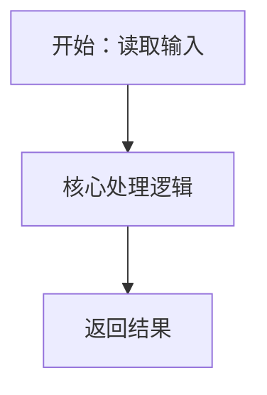

```rust
// LeetCode 160. 相交链表 — Rust 版（方案1）
#[derive(Debug)]
struct ListNode {
    val: i32,
    next: Option<Box<ListNode>>,
} // 定义类型
fn get_intersection_node<'a>(
    a: Option<&'a ListNode>,
    b: Option<&'a ListNode>,
) -> Option<&'a ListNode> {
    let (mut p1, mut p2) = (a, b); // 把 (数组, b); 写入 let (mut p1, mut p2)
    loop {
        // loop {
        match (p1, p2) {
            // 按情况匹配处理
            (None, None) => return None,
            (Some(x), Some(y)) if std::ptr::eq(x, y) => return Some(x),
            _ => {
                p1 = match p1 {
                    Some(x) => x.next.as_deref(),
                    None => b,
                };
                p2 = match p2 {
                    Some(y) => y.next.as_deref(),
                    None => a,
                };
            }
        }
    }
}
fn main() {
    // 程序入口：跑内嵌自测用例
    assert!(get_intersection_node(None, None).is_none()); // 断言校验
    println!("PASS"); // 全部用例通过，输出 PASS
}
```

#### 方案 2：迭代指针处理

**思路与代码分析**：核心是「迭代指针处理」。Rust 版用所有权移动与切片借用改写同一逻辑，注意 Option 与引用边界。

**运行架构**：与方案 1 的控制流相同（同算法在该语言的等价实现），图见上。

```rust
// LeetCode 160. 相交链表 — Rust 版（方案2）
#[derive(Debug)]
struct ListNode {
    val: i32,
    next: Option<Box<ListNode>>,
} // 定义类型
fn get_intersection_node<'a>(
    a: Option<&'a ListNode>,
    b: Option<&'a ListNode>,
) -> Option<&'a ListNode> {
    let (mut p1, mut p2) = (a, b); // 把 (数组, b); 写入 let (mut p1, mut p2)
    loop {
        // loop {
        match (p1, p2) {
            // 按情况匹配处理
            (None, None) => return None,
            (Some(x), Some(y)) if std::ptr::eq(x, y) => return Some(x),
            _ => {
                p1 = match p1 {
                    Some(x) => x.next.as_deref(),
                    None => b,
                };
                p2 = match p2 {
                    Some(y) => y.next.as_deref(),
                    None => a,
                };
            }
        }
    }
}
fn main() {
    // 程序入口：跑内嵌自测用例
    assert!(get_intersection_node(None, None).is_none()); // 断言校验
    println!("PASS"); // 全部用例通过，输出 PASS
}
```

### Lua 实现（2 种方案）

Lua 的全部方案如下，每个方案都内嵌用例自测，可独立运行（老仓库 python/go 文件遵循「打印结果」约定）：

#### 方案 1：单趟扫描

**思路与代码分析**：核心是「单趟扫描」。Lua 版用表与 ipairs 遍历，注意 ipairs 遇 nil 即停的语义。**走读**：方案 1 · 单趟扫描：开始 → 处理 if not headA or not headB th → 返回 nil → 更新 p2 → 当 p1 ~= p2 do 时反复执行 → 处理 if p1 then → 更新 p1 → 更新 p1 → 处理 if p2 then → 更新 p2 → 更新 p2 → 返回 p1。

**运行架构**（真实控制流）：

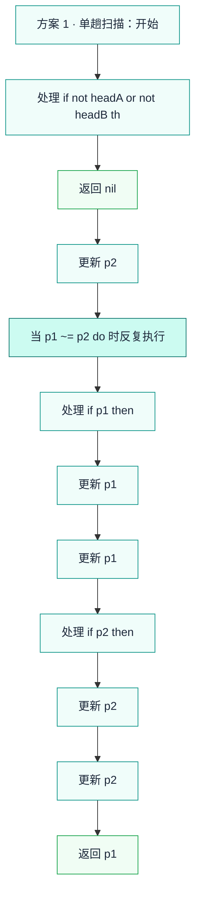

```lua
-- LeetCode 160. 相交链表 — Lua 版（方案1）
local ListNode = {} -- 把 {} 写入 local ListNode
ListNode.__index = ListNode -- 把 ListNode 写入 ListNode.__index
function ListNode.new(val, next)
	return setmetatable({ val = val, next = next }, ListNode)
end
local function get_intersection_node(headA, headB) -- local function get_intersection_node(链表 A, 链表 B)
	if not headA or not headB then
		return nil
	end -- 若 not 链表 A or not 链表 B then return nil 终点
	local p1, p2 = headA, headB -- 把 链表 A, 链表 B 写入 local p1, p2
	while p1 ~= p2 do -- 把 p2 do 写入 while p1 ~
		if p1 then
			p1 = p1.next
		else
			p1 = headB
		end -- 若 p1 then p1 赋值为 p1.下一个 else p1 赋值为 链表 B 终点
		if p2 then
			p2 = p2.next
		else
			p2 = headA
		end -- 若 p2 then p2 赋值为 p2.下一个 else p2 赋值为 链表 A 终点
	end -- 终点
	return p1 -- 返回 p1
end -- 终点
local shared = ListNode.new(8, ListNode.new(4, ListNode.new(5)))
local a = ListNode.new(4, ListNode.new(1, shared)) -- 把 ListNode.new(4, ListNode.new(1, shared)) 写入 local a
local b = ListNode.new(5, ListNode.new(6, ListNode.new(1, shared)))
assert(get_intersection_node(a, b) == shared) -- 断言校验
assert(get_intersection_node(ListNode.new(1), ListNode.new(1)) == nil) -- 断言校验
assert(get_intersection_node(nil, nil) == nil) -- 断言校验
print("PASS") -- 全部用例通过，输出 PASS
```

#### 方案 2：迭代指针处理

**思路与代码分析**：核心是「迭代指针处理」。Lua 版用表与 ipairs 遍历，注意 ipairs 遇 nil 即停的语义。**走读**：方案 2 · 迭代指针处理：开始 → 处理 if not headA or not headB th → 返回 nil → 更新 p2 → 当 p1 ~= p2 do 时反复执行 → 处理 if p1 then → 更新 p1 → 更新 p1 → 处理 if p2 then → 更新 p2 → 更新 p2 → 返回 p1。

**运行架构**（真实控制流）：

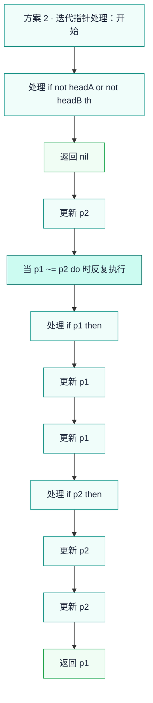

```lua
-- LeetCode 160. 相交链表 — Lua 版（方案2）
local ListNode = {} -- 把 {} 写入 local ListNode
ListNode.__index = ListNode -- 把 ListNode 写入 ListNode.__index
function ListNode.new(val, next)
	return setmetatable({ val = val, next = next }, ListNode)
end
local function get_intersection_node(headA, headB) -- local function get_intersection_node(链表 A, 链表 B)
	if not headA or not headB then
		return nil
	end -- 若 not 链表 A or not 链表 B then return nil 终点
	local p1, p2 = headA, headB -- 把 链表 A, 链表 B 写入 local p1, p2
	while p1 ~= p2 do -- 把 p2 do 写入 while p1 ~
		if p1 then
			p1 = p1.next
		else
			p1 = headB
		end -- 若 p1 then p1 赋值为 p1.下一个 else p1 赋值为 链表 B 终点
		if p2 then
			p2 = p2.next
		else
			p2 = headA
		end -- 若 p2 then p2 赋值为 p2.下一个 else p2 赋值为 链表 A 终点
	end -- 终点
	return p1 -- 返回 p1
end -- 终点
local shared = ListNode.new(8, ListNode.new(4, ListNode.new(5)))
local a = ListNode.new(4, ListNode.new(1, shared)) -- 把 ListNode.new(4, ListNode.new(1, shared)) 写入 local a
local b = ListNode.new(5, ListNode.new(6, ListNode.new(1, shared)))
assert(get_intersection_node(a, b) == shared) -- 断言校验
assert(get_intersection_node(ListNode.new(1), ListNode.new(1)) == nil) -- 断言校验
assert(get_intersection_node(nil, nil) == nil) -- 断言校验
print("PASS") -- 全部用例通过，输出 PASS
```

### C 实现（2 种方案）

C 的全部方案如下，每个方案都内嵌用例自测，可独立运行（老仓库 python/go 文件遵循「打印结果」约定）：

#### 方案 1：单趟扫描

**思路与代码分析**：核心是「单趟扫描」。C 版手动管理下标与内存，循环边界全部显式写出。**走读**：方案 1 · 单趟扫描：开始 → 更新 *n → 更新 n->val → 更新 n->next → 返回 n。

**运行架构**（真实控制流）：

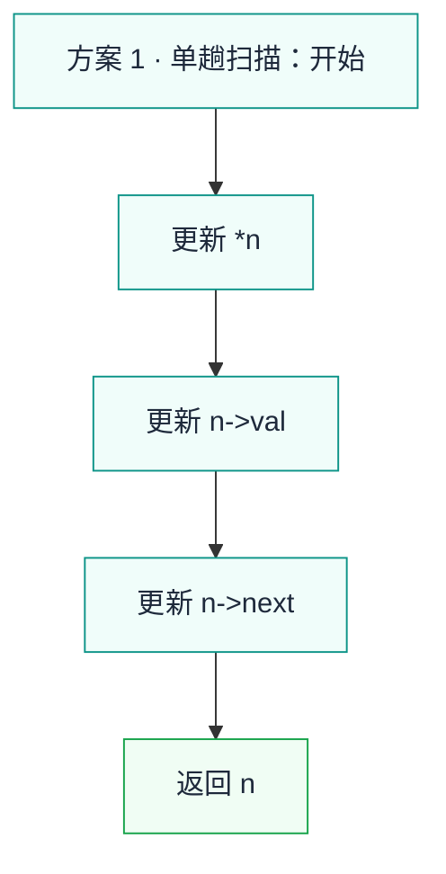

```c
/* LeetCode 160. 相交链表 — C 版（方案1） */
#include <stdio.h>  // 引入头文件
#include <stdlib.h> // 引入头文件
typedef struct LNode {
    int val;
    struct LNode *next;
} LNode; // typedef struct LNode { int 值; struct LNode 乘 下一个; } LNode;
static LNode *nnew(int v) {
    LNode *n = malloc(sizeof(LNode));
    n->val = v;
    n->next = NULL;
    return n;
}
static LNode *get_intersection_node(LNode *a, LNode *b) {
    if (!a || !b)
        return NULL;            // 若 取反 数组 或 取反 b，直接返回 NULL
    LNode *p1 = a, *p2 = b;     // 把 数组, 乘 p2 赋值为 b; 写入 LNode *p1
    while (p1 != p2) {          // 循环，直到不满足「p1 不等于 p2」
        p1 = p1 ? p1->next : b; // 把 p1 ? p1 减 超过 下一个 : b; 写入 p1
        p2 = p2 ? p2->next : a; // 把 p2 ? p2 减 超过 下一个 : 数组; 写入 p2
    }
    return p1; // 返回 p1
}
int main(void) {                  // 程序入口：跑内嵌自测用例
    LNode *shared = nnew(8);      // 把 nnew(8); 写入 LNode *shared
    shared->next = nnew(4);       // 把 nnew(4); 写入 shared->next
    shared->next->next = nnew(5); // 把 nnew(5); 写入 shared->next->next
    LNode *a = nnew(4);           // 把 nnew(4); 写入 LNode *a
    a->next = nnew(1);            // 把 nnew(1); 写入 a->next
    a->next->next = shared;       // 把 shared; 写入 a->next->next
    LNode *b = nnew(5);           // 把 nnew(5); 写入 LNode *b
    b->next = nnew(6);            // 把 nnew(6); 写入 b->next
    b->next->next = nnew(1);      // 把 nnew(1); 写入 b->next->next
    b->next->next->next = shared; // 把 shared; 写入 b->next->next->next
    if (get_intersection_node(a, b) != shared) {
        printf("FAIL 1\n");
        return 1;
    }
    if (get_intersection_node(nnew(1), nnew(1)) != NULL) {
        printf("FAIL 2\n");
        return 1;
    }
    if (get_intersection_node(NULL, NULL) != NULL) {
        printf("FAIL 3\n");
        return 1;
    }
    printf("PASS\n"); // 全部用例通过，输出 PASS
    return 0;         // 返回 0
}
```

#### 方案 2：迭代指针处理

**思路与代码分析**：核心是「迭代指针处理」。C 版手动管理下标与内存，循环边界全部显式写出。**走读**：方案 2 · 迭代指针处理：开始 → 更新 *n → 更新 n->val → 更新 n->next → 返回 n。

**运行架构**（真实控制流）：

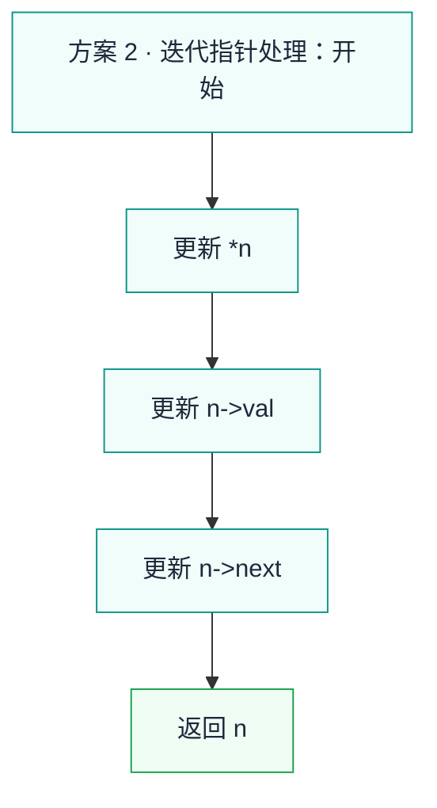

```c
/* LeetCode 160. 相交链表 — C 版（方案2） */
#include <stdio.h>  // 引入头文件
#include <stdlib.h> // 引入头文件
typedef struct LNode {
    int val;
    struct LNode *next;
} LNode; // typedef struct LNode { int 值; struct LNode 乘 下一个; } LNode;
static LNode *nnew(int v) {
    LNode *n = malloc(sizeof(LNode));
    n->val = v;
    n->next = NULL;
    return n;
}
static LNode *get_intersection_node(LNode *a, LNode *b) {
    if (!a || !b)
        return NULL;            // 若 取反 数组 或 取反 b，直接返回 NULL
    LNode *p1 = a, *p2 = b;     // 把 数组, 乘 p2 赋值为 b; 写入 LNode *p1
    while (p1 != p2) {          // 循环，直到不满足「p1 不等于 p2」
        p1 = p1 ? p1->next : b; // 把 p1 ? p1 减 超过 下一个 : b; 写入 p1
        p2 = p2 ? p2->next : a; // 把 p2 ? p2 减 超过 下一个 : 数组; 写入 p2
    }
    return p1; // 返回 p1
}
int main(void) {                  // 程序入口：跑内嵌自测用例
    LNode *shared = nnew(8);      // 把 nnew(8); 写入 LNode *shared
    shared->next = nnew(4);       // 把 nnew(4); 写入 shared->next
    shared->next->next = nnew(5); // 把 nnew(5); 写入 shared->next->next
    LNode *a = nnew(4);           // 把 nnew(4); 写入 LNode *a
    a->next = nnew(1);            // 把 nnew(1); 写入 a->next
    a->next->next = shared;       // 把 shared; 写入 a->next->next
    LNode *b = nnew(5);           // 把 nnew(5); 写入 LNode *b
    b->next = nnew(6);            // 把 nnew(6); 写入 b->next
    b->next->next = nnew(1);      // 把 nnew(1); 写入 b->next->next
    b->next->next->next = shared; // 把 shared; 写入 b->next->next->next
    if (get_intersection_node(a, b) != shared) {
        printf("FAIL 1\n");
        return 1;
    }
    if (get_intersection_node(nnew(1), nnew(1)) != NULL) {
        printf("FAIL 2\n");
        return 1;
    }
    if (get_intersection_node(NULL, NULL) != NULL) {
        printf("FAIL 3\n");
        return 1;
    }
    printf("PASS\n"); // 全部用例通过，输出 PASS
    return 0;         // 返回 0
}
```

### C++ 实现（2 种方案）

C++ 的全部方案如下，每个方案都内嵌用例自测，可独立运行（老仓库 python/go 文件遵循「打印结果」约定）：

#### 方案 1：单趟扫描

**思路与代码分析**：核心是「单趟扫描」。C++ 版用 STL 容器与迭代器，减少手写下标错误。**走读**：方案 1 · 单趟扫描：开始 → 命中条件，直接返回 → 更新 *p1 → 当 (p1 ≠ p2) 时反复执行 → 更新 p1 → 更新 p2 → 返回 p1。

**运行架构**（真实控制流）：

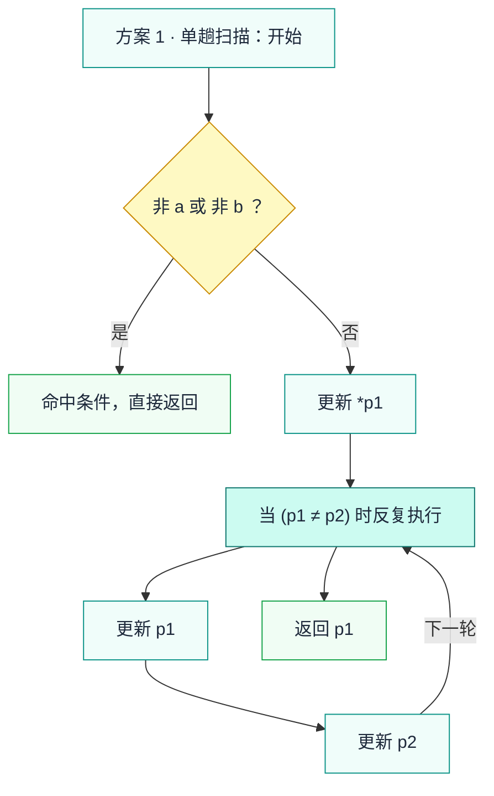

```cpp
// LeetCode 160. 相交链表 — C++ 版（方案1）
#include <cassert>                       // 引入头文件
#include <iostream>                      // 引入头文件
struct ListNode {                        // 定义类型
    int val;                             // int 值;
    ListNode *next = nullptr;            // 把 nullptr; 写入 ListNode *next
    explicit ListNode(int v) : val(v) {} // explicit ListNode(int 值) : 值(值) {}
};
static ListNode *getIntersectionNode(ListNode *a, ListNode *b) {
    if (!a || !b)
        return nullptr;         // 若 取反 数组 或 取反 b，直接返回 nullptr
    ListNode *p1 = a, *p2 = b;  // 把 数组, 乘 p2 赋值为 b; 写入 ListNode *p1
    while (p1 != p2) {          // 循环，直到不满足「p1 不等于 p2」
        p1 = p1 ? p1->next : b; // 把 p1 ? p1 减 超过 下一个 : b; 写入 p1
        p2 = p2 ? p2->next : a; // 把 p2 ? p2 减 超过 下一个 : 数组; 写入 p2
    }
    return p1; // 返回 p1
}
int main() {                                     // 程序入口：跑内嵌自测用例
    ListNode *shared = new ListNode(8);          // 把 new ListNode(8); 写入 ListNode *shared
    shared->next = new ListNode(4);              // 把 new ListNode(4); 写入 shared->next
    shared->next->next = new ListNode(5);        // 把 new ListNode(5); 写入 shared->next->next
    ListNode *a = new ListNode(4);               // 把 new ListNode(4); 写入 ListNode *a
    a->next = new ListNode(1);                   // 把 new ListNode(1); 写入 a->next
    a->next->next = shared;                      // 把 shared; 写入 a->next->next
    ListNode *b = new ListNode(5);               // 把 new ListNode(5); 写入 ListNode *b
    b->next = new ListNode(6);                   // 把 new ListNode(6); 写入 b->next
    b->next->next = new ListNode(1);             // 把 new ListNode(1); 写入 b->next->next
    b->next->next->next = shared;                // 把 shared; 写入 b->next->next->next
    assert(getIntersectionNode(a, b) == shared); // 断言校验
    assert(getIntersectionNode(new ListNode(1), new ListNode(1)) == nullptr); // 断言校验
    assert(getIntersectionNode(nullptr, nullptr) == nullptr);                 // 断言校验
    std::cout << "PASS" << std::endl; // 全部用例通过，输出 PASS
    return 0;                         // 返回 0
}
```

#### 方案 2：迭代指针处理

**思路与代码分析**：核心是「迭代指针处理」。C++ 版用 STL 容器与迭代器，减少手写下标错误。**走读**：方案 2 · 迭代指针处理：开始 → 命中条件，直接返回 → 更新 *p1 → 当 (p1 ≠ p2) 时反复执行 → 更新 p1 → 更新 p2 → 返回 p1。

**运行架构**（真实控制流）：

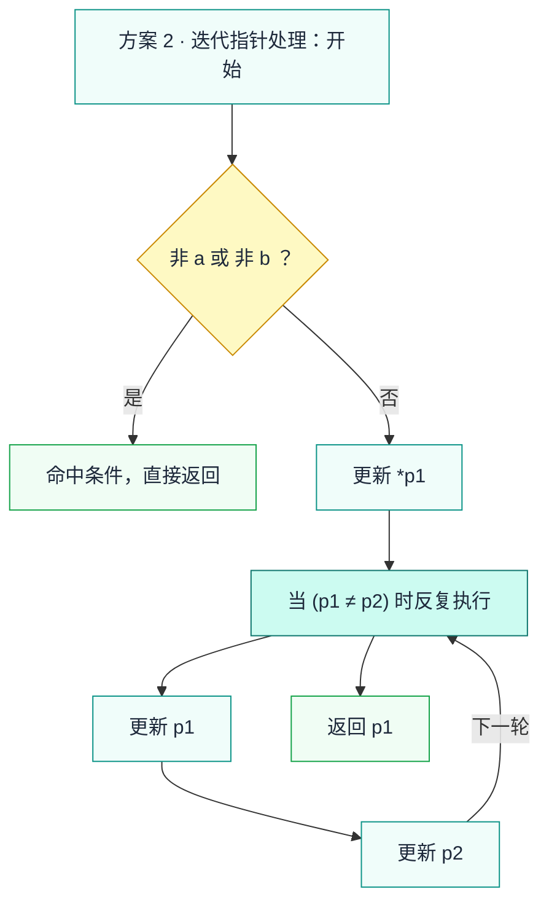

```cpp
// LeetCode 160. 相交链表 — C++ 版（方案2）
#include <cassert>                       // 引入头文件
#include <iostream>                      // 引入头文件
struct ListNode {                        // 定义类型
    int val;                             // int 值;
    ListNode *next = nullptr;            // 把 nullptr; 写入 ListNode *next
    explicit ListNode(int v) : val(v) {} // explicit ListNode(int 值) : 值(值) {}
};
static ListNode *getIntersectionNode(ListNode *a, ListNode *b) {
    if (!a || !b)
        return nullptr;         // 若 取反 数组 或 取反 b，直接返回 nullptr
    ListNode *p1 = a, *p2 = b;  // 把 数组, 乘 p2 赋值为 b; 写入 ListNode *p1
    while (p1 != p2) {          // 循环，直到不满足「p1 不等于 p2」
        p1 = p1 ? p1->next : b; // 把 p1 ? p1 减 超过 下一个 : b; 写入 p1
        p2 = p2 ? p2->next : a; // 把 p2 ? p2 减 超过 下一个 : 数组; 写入 p2
    }
    return p1; // 返回 p1
}
int main() {                                     // 程序入口：跑内嵌自测用例
    ListNode *shared = new ListNode(8);          // 把 new ListNode(8); 写入 ListNode *shared
    shared->next = new ListNode(4);              // 把 new ListNode(4); 写入 shared->next
    shared->next->next = new ListNode(5);        // 把 new ListNode(5); 写入 shared->next->next
    ListNode *a = new ListNode(4);               // 把 new ListNode(4); 写入 ListNode *a
    a->next = new ListNode(1);                   // 把 new ListNode(1); 写入 a->next
    a->next->next = shared;                      // 把 shared; 写入 a->next->next
    ListNode *b = new ListNode(5);               // 把 new ListNode(5); 写入 ListNode *b
    b->next = new ListNode(6);                   // 把 new ListNode(6); 写入 b->next
    b->next->next = new ListNode(1);             // 把 new ListNode(1); 写入 b->next->next
    b->next->next->next = shared;                // 把 shared; 写入 b->next->next->next
    assert(getIntersectionNode(a, b) == shared); // 断言校验
    assert(getIntersectionNode(new ListNode(1), new ListNode(1)) == nullptr); // 断言校验
    assert(getIntersectionNode(nullptr, nullptr) == nullptr);                 // 断言校验
    std::cout << "PASS" << std::endl; // 全部用例通过，输出 PASS
    return 0;                         // 返回 0
}
```

### R 实现（2 种方案）

R 的全部方案如下，每个方案都内嵌用例自测，可独立运行（老仓库 python/go 文件遵循「打印结果」约定）：

#### 方案 1：单趟扫描

**思路与代码分析**：核心是「单趟扫描」。R 版用向量化思维与 1 起始下标，注意 1:n 的降序陷阱。**走读**：方案 1 · 单趟扫描：开始 → 更新 new.env(parent → 处理 e$val ＜- val → 处理 e$nxt ＜- nxt → 调用 class(e) ＜- ListNode → 处理 e → 返回结果。

**运行架构**（真实控制流）：

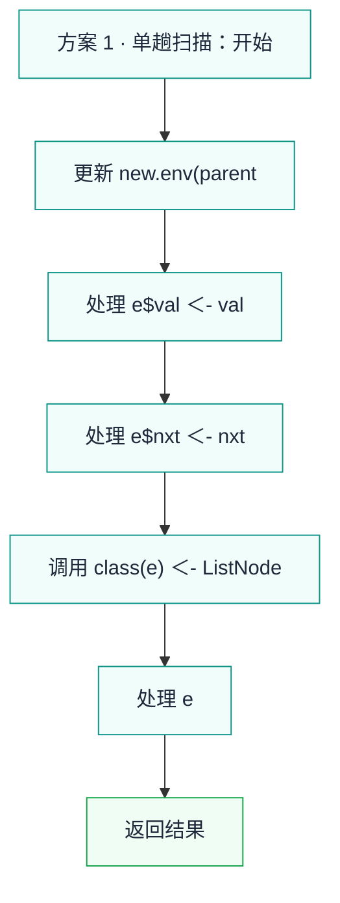

```r
# 版（方案1）
ListNode <- function(val, nxt = NULL) {
    e <- new.env(parent = emptyenv())
    e$val <- val
    e$nxt <- nxt
    class(e) <- "ListNode"
    e
}  # 定义函数 ListNode（参数：值, nxt 赋值为 NULL）
get_intersection_node <- function(headA, headB) {
    # 定义函数 get_intersection_node（参数：链表 A, 链表 B）
    if (is.null(headA) || is.null(headB))
        return(NULL)  # 若 is.null(链表 A) 或 is.null(链表 B)) return(NULL
    p1 <- headA
    p2 <- headB  # 把 链表 A; p2 小于 减 链表 B 存入 p1
    while (!identical(p1, p2)) {
        # 循环，直到不满足「取反 identical(p1, p2」
        p1 <- if (!is.null(p1))
            p1$nxt else headB  # 把 if (取反 is.null(p1)) p1$nxt else 链表 B 存入 p1
        p2 <- if (!is.null(p2))
            p2$nxt else headA  # 把 if (取反 is.null(p2)) p2$nxt else 链表 A 存入 p2
    }
    p1  # p1
}
shared <- ListNode(8, ListNode(4, ListNode(5)))  # 把 ListNode(8, ListNode(4, ListNode(5))) 存入 shared
a <- ListNode(4, ListNode(1, shared))  # 把 ListNode(4, ListNode(1, shared)) 存入 数组
b <- ListNode(5, ListNode(6, ListNode(1, shared)))  # 把 ListNode(5, ListNode(6, ListNode(1, shared))) 存入 b
stopifnot(identical(get_intersection_node(a, b), shared))  # 断言校验
stopifnot(is.null(get_intersection_node(ListNode(1), ListNode(1))))  # 断言校验
stopifnot(is.null(get_intersection_node(NULL, NULL)))  # 断言校验
cat("PASS\n")  # 全部用例通过，输出 PASS
```

#### 方案 2：迭代指针处理

**思路与代码分析**：核心是「迭代指针处理」。R 版用向量化思维与 1 起始下标，注意 1:n 的降序陷阱。**走读**：方案 2 · 迭代指针处理：开始 → 更新 new.env(parent → 处理 e$val ＜- val → 处理 e$nxt ＜- nxt → 调用 class(e) ＜- ListNode → 处理 e → 返回结果。

**运行架构**（真实控制流）：

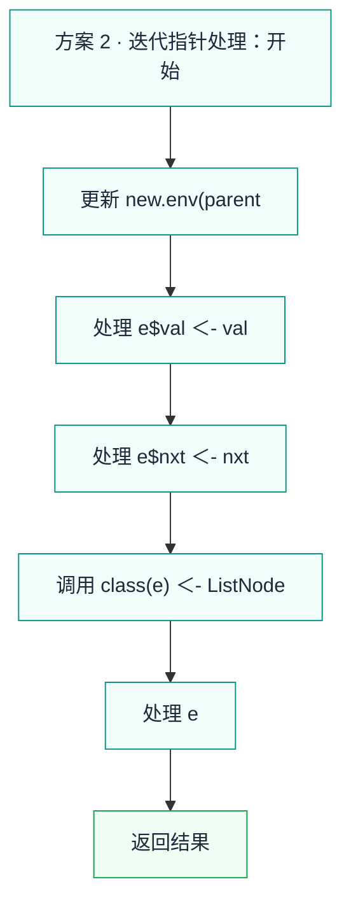

```r
# 版（方案2）
ListNode <- function(val, nxt = NULL) {
    e <- new.env(parent = emptyenv())
    e$val <- val
    e$nxt <- nxt
    class(e) <- "ListNode"
    e
}  # 定义函数 ListNode（参数：值, nxt 赋值为 NULL）
get_intersection_node <- function(headA, headB) {
    # 定义函数 get_intersection_node（参数：链表 A, 链表 B）
    if (is.null(headA) || is.null(headB))
        return(NULL)  # 若 is.null(链表 A) 或 is.null(链表 B)) return(NULL
    p1 <- headA
    p2 <- headB  # 把 链表 A; p2 小于 减 链表 B 存入 p1
    while (!identical(p1, p2)) {
        # 循环，直到不满足「取反 identical(p1, p2」
        p1 <- if (!is.null(p1))
            p1$nxt else headB  # 把 if (取反 is.null(p1)) p1$nxt else 链表 B 存入 p1
        p2 <- if (!is.null(p2))
            p2$nxt else headA  # 把 if (取反 is.null(p2)) p2$nxt else 链表 A 存入 p2
    }
    p1  # p1
}
shared <- ListNode(8, ListNode(4, ListNode(5)))  # 把 ListNode(8, ListNode(4, ListNode(5))) 存入 shared
a <- ListNode(4, ListNode(1, shared))  # 把 ListNode(4, ListNode(1, shared)) 存入 数组
b <- ListNode(5, ListNode(6, ListNode(1, shared)))  # 把 ListNode(5, ListNode(6, ListNode(1, shared))) 存入 b
stopifnot(identical(get_intersection_node(a, b), shared))  # 断言校验
stopifnot(is.null(get_intersection_node(ListNode(1), ListNode(1))))  # 断言校验
stopifnot(is.null(get_intersection_node(NULL, NULL)))  # 断言校验
cat("PASS\n")  # 全部用例通过，输出 PASS
```

### Zig 实现（2 种方案）

Zig 的全部方案如下，每个方案都内嵌用例自测，可独立运行（老仓库 python/go 文件遵循「打印结果」约定）：

#### 方案 1：单趟扫描

**思路与代码分析**：核心是「单趟扫描」。Zig 版显式分配与清零，整型边界处理严格。**走读**：方案 1 · 单趟扫描：开始 → 命中条件，直接返回 → 计算 p1 → 计算 p2 → 当 (p1 ≠ p2) 时反复执行 → 更新 p1 → 更新 p2 → 返回 p1。

**运行架构**（真实控制流）：

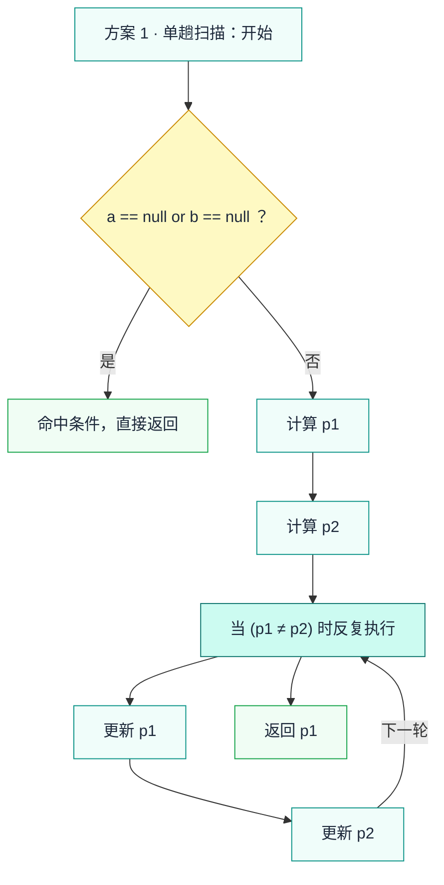

```zig
// LeetCode 160. 相交链表 — Zig 版（方案1）
const std = @import("std"); // 把 @import(「std」) 存入 std
const LNode = struct { val: i32, next: ?*LNode }; // 把 struct { 值: i32, 下一个: ? 乘 LNode } 存入 LNode
fn getIntersectionNode(a: ?*LNode, b: ?*LNode) ?*LNode { // 定义函数/方法 getIntersectionNode
    if (a == null or b == null) return null; // 若 数组 等于 null or b 等于 null，直接返回 null
    var p1 = a; // 把 数组 存入 p1
    var p2 = b; // 把 b 存入 p2
    while (p1 != p2) { // 循环，直到不满足「p1 不等于 p2」
        p1 = if (p1) |x| x.next else b; // 把 if (p1) 按位或 x 按位或 x.下一个 else b; 写入 p1
        p2 = if (p2) |y| y.next else a; // 把 if (p2) 按位或 y 按位或 y.下一个 else 数组; 写入 p2
    }
    return p1; // 返回 p1
}
pub fn main() !void { // 程序入口：跑内嵌自测用例
    var arena = std.heap.ArenaAllocator.init(std.heap.page_allocator); // 把 std.堆.ArenaAllocator.init(std.堆.page_allocator) 存入 arena
    defer arena.deinit(); // defer arena.deinit();
    const alloc = arena.allocator(); // 把 arena.allocator() 存入 alloc
    const shared = try alloc.create(LNode); // 把 try alloc.create(LNode) 存入 shared
    shared.* = .{ .val = 8, .next = null }; // 把 { .值 赋值为 8, .下一个 赋值为 null }; 写入 shared.*
    const n4 = try alloc.create(LNode); // 把 try alloc.create(LNode) 存入 n4
    n4.* = .{ .val = 4, .next = null }; // 把 { .值 赋值为 4, .下一个 赋值为 null }; 写入 n4.*
    shared.next = n4; // 把 n4; 写入 下一个
    const n5 = try alloc.create(LNode); // 把 try alloc.create(LNode) 存入 n5
    n5.* = .{ .val = 5, .next = null }; // 把 { .值 赋值为 5, .下一个 赋值为 null }; 写入 n5.*
    n4.next = n5; // 把 n5; 写入 下一个
    const a1 = try alloc.create(LNode); // 把 try alloc.create(LNode) 存入 a1
    a1.* = .{ .val = 4, .next = null }; // 把 { .值 赋值为 4, .下一个 赋值为 null }; 写入 a1.*
    const a2 = try alloc.create(LNode); // 把 try alloc.create(LNode) 存入 a2
    a2.* = .{ .val = 1, .next = shared }; // 把 { .值 赋值为 1, .下一个 赋值为 shared }; 写入 a2.*
    a1.next = a2; // 把 a2; 写入 下一个
    const b1 = try alloc.create(LNode); // 把 try alloc.create(LNode) 存入 b1
    b1.* = .{ .val = 5, .next = null }; // 把 { .值 赋值为 5, .下一个 赋值为 null }; 写入 b1.*
    const b2 = try alloc.create(LNode); // 把 try alloc.create(LNode) 存入 b2
    b2.* = .{ .val = 6, .next = null }; // 把 { .值 赋值为 6, .下一个 赋值为 null }; 写入 b2.*
    b1.next = b2; // 把 b2; 写入 下一个
    const b3 = try alloc.create(LNode); // 把 try alloc.create(LNode) 存入 b3
    b3.* = .{ .val = 1, .next = shared }; // 把 { .值 赋值为 1, .下一个 赋值为 shared }; 写入 b3.*
    b2.next = b3; // 把 b3; 写入 下一个
    if (getIntersectionNode(a1, b1) != shared) return error.TestFailed;
    const x = try alloc.create(LNode); // 把 try alloc.create(LNode) 存入 x
    x.* = .{ .val = 1, .next = null }; // 把 { .值 赋值为 1, .下一个 赋值为 null }; 写入 x.*
    const y = try alloc.create(LNode); // 把 try alloc.create(LNode) 存入 y
    y.* = .{ .val = 1, .next = null }; // 把 { .值 赋值为 1, .下一个 赋值为 null }; 写入 y.*
    if (getIntersectionNode(x, y) != null) return error.TestFailed; // 若 getIntersectionNode(x, y) 不等于 null，直接返回 error.TestFailed
    if (getIntersectionNode(null, null) != null) return error.TestFailed;
    std.debug.print("PASS\n", .{}); // 全部用例通过，输出 PASS
}
```

#### 方案 2：迭代指针处理

**思路与代码分析**：核心是「迭代指针处理」。Zig 版显式分配与清零，整型边界处理严格。**走读**：方案 2 · 迭代指针处理：开始 → 命中条件，直接返回 → 计算 p1 → 计算 p2 → 当 (p1 ≠ p2) 时反复执行 → 更新 p1 → 更新 p2 → 返回 p1。

**运行架构**（真实控制流）：

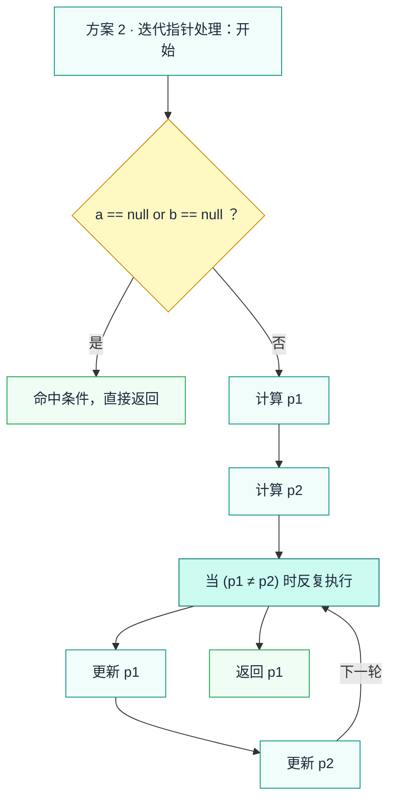

```zig
// LeetCode 160. 相交链表 — Zig 版（方案2）
const std = @import("std"); // 把 @import(「std」) 存入 std
const LNode = struct { val: i32, next: ?*LNode }; // 把 struct { 值: i32, 下一个: ? 乘 LNode } 存入 LNode
fn getIntersectionNode(a: ?*LNode, b: ?*LNode) ?*LNode { // 定义函数/方法 getIntersectionNode
    if (a == null or b == null) return null; // 若 数组 等于 null or b 等于 null，直接返回 null
    var p1 = a; // 把 数组 存入 p1
    var p2 = b; // 把 b 存入 p2
    while (p1 != p2) { // 循环，直到不满足「p1 不等于 p2」
        p1 = if (p1) |x| x.next else b; // 把 if (p1) 按位或 x 按位或 x.下一个 else b; 写入 p1
        p2 = if (p2) |y| y.next else a; // 把 if (p2) 按位或 y 按位或 y.下一个 else 数组; 写入 p2
    }
    return p1; // 返回 p1
}
pub fn main() !void { // 程序入口：跑内嵌自测用例
    var arena = std.heap.ArenaAllocator.init(std.heap.page_allocator); // 把 std.堆.ArenaAllocator.init(std.堆.page_allocator) 存入 arena
    defer arena.deinit(); // defer arena.deinit();
    const alloc = arena.allocator(); // 把 arena.allocator() 存入 alloc
    const shared = try alloc.create(LNode); // 把 try alloc.create(LNode) 存入 shared
    shared.* = .{ .val = 8, .next = null }; // 把 { .值 赋值为 8, .下一个 赋值为 null }; 写入 shared.*
    const n4 = try alloc.create(LNode); // 把 try alloc.create(LNode) 存入 n4
    n4.* = .{ .val = 4, .next = null }; // 把 { .值 赋值为 4, .下一个 赋值为 null }; 写入 n4.*
    shared.next = n4; // 把 n4; 写入 下一个
    const n5 = try alloc.create(LNode); // 把 try alloc.create(LNode) 存入 n5
    n5.* = .{ .val = 5, .next = null }; // 把 { .值 赋值为 5, .下一个 赋值为 null }; 写入 n5.*
    n4.next = n5; // 把 n5; 写入 下一个
    const a1 = try alloc.create(LNode); // 把 try alloc.create(LNode) 存入 a1
    a1.* = .{ .val = 4, .next = null }; // 把 { .值 赋值为 4, .下一个 赋值为 null }; 写入 a1.*
    const a2 = try alloc.create(LNode); // 把 try alloc.create(LNode) 存入 a2
    a2.* = .{ .val = 1, .next = shared }; // 把 { .值 赋值为 1, .下一个 赋值为 shared }; 写入 a2.*
    a1.next = a2; // 把 a2; 写入 下一个
    const b1 = try alloc.create(LNode); // 把 try alloc.create(LNode) 存入 b1
    b1.* = .{ .val = 5, .next = null }; // 把 { .值 赋值为 5, .下一个 赋值为 null }; 写入 b1.*
    const b2 = try alloc.create(LNode); // 把 try alloc.create(LNode) 存入 b2
    b2.* = .{ .val = 6, .next = null }; // 把 { .值 赋值为 6, .下一个 赋值为 null }; 写入 b2.*
    b1.next = b2; // 把 b2; 写入 下一个
    const b3 = try alloc.create(LNode); // 把 try alloc.create(LNode) 存入 b3
    b3.* = .{ .val = 1, .next = shared }; // 把 { .值 赋值为 1, .下一个 赋值为 shared }; 写入 b3.*
    b2.next = b3; // 把 b3; 写入 下一个
    if (getIntersectionNode(a1, b1) != shared) return error.TestFailed;
    const x = try alloc.create(LNode); // 把 try alloc.create(LNode) 存入 x
    x.* = .{ .val = 1, .next = null }; // 把 { .值 赋值为 1, .下一个 赋值为 null }; 写入 x.*
    const y = try alloc.create(LNode); // 把 try alloc.create(LNode) 存入 y
    y.* = .{ .val = 1, .next = null }; // 把 { .值 赋值为 1, .下一个 赋值为 null }; 写入 y.*
    if (getIntersectionNode(x, y) != null) return error.TestFailed; // 若 getIntersectionNode(x, y) 不等于 null，直接返回 error.TestFailed
    if (getIntersectionNode(null, null) != null) return error.TestFailed;
    std.debug.print("PASS\n", .{}); // 全部用例通过，输出 PASS
}
```

### Dart 实现（2 种方案）

Dart 的全部方案如下，每个方案都内嵌用例自测，可独立运行（老仓库 python/go 文件遵循「打印结果」约定）：

#### 方案 1：单趟扫描

**思路与代码分析**：核心是「单趟扫描」。Dart 版用可空类型标注与集合方法，注意空安全。

**运行架构**（真实控制流）：


```dart
// LeetCode 160. 相交链表 — Dart 版（方案1）
class LNode {
  // 定义类型
  final int val; // final int 值;
  LNode? next; // LNode? 下一个;
  LNode(this.val); // LNode(this.值);
}

LNode? getIntersectionNode(LNode? a, LNode? b) {
  // LNode? getIntersectionNode(LNode? 数组, LNode? b) {
  if (a == null || b == null) return null; // 若 数组 等于 null 或 b 等于 null，直接返回 null
  LNode? p1 = a, p2 = b; // 把 数组, p2 赋值为 b; 写入 LNode? p1
  while (!identical(p1, p2)) {
    // 循环，直到不满足「取反 identical(p1, p2」
    p1 = p1 != null ? p1.next : b; // 把 p1 不等于 null ? p1.下一个 : b 存入 p1
    p2 = p2 != null ? p2.next : a; // 把 p2 不等于 null ? p2.下一个 : 数组 存入 p2
  }
  return p1; // 返回 p1
}

void main() {
  // 程序入口：跑内嵌自测用例
  final shared = LNode(8); // 把 LNode(8) 存入 shared
  shared.next = LNode(4)
    ..next = LNode(5); // 把 LNode(4)..下一个 赋值为 LNode(5); 写入 下一个
  final a = LNode(4)
    ..next = LNode(1)
    ..next = shared; // 把 LNode(4)..下一个 赋值为 LNode(1)..下一个 赋值为 shared 存入 数组
  final b = LNode(5)
    ..next = LNode(6)
    ..next = LNode(1)
    ..next = shared;
  if (!identical(getIntersectionNode(a, b), shared)) throw StateError('c1');
  if (getIntersectionNode(LNode(1), LNode(1)) != null) throw StateError('c2');
  if (getIntersectionNode(null, null) != null) throw StateError('c3');
  print('PASS'); // 全部用例通过，输出 PASS
}
```

#### 方案 2：迭代指针处理

**思路与代码分析**：核心是「迭代指针处理」。Dart 版用可空类型标注与集合方法，注意空安全。

**运行架构**：与方案 1 的控制流相同（同算法在该语言的等价实现），图见上。

```dart
// LeetCode 160. 相交链表 — Dart 版（方案2）
class LNode {
  // 定义类型
  final int val; // final int 值;
  LNode? next; // LNode? 下一个;
  LNode(this.val); // LNode(this.值);
}

LNode? getIntersectionNode(LNode? a, LNode? b) {
  // LNode? getIntersectionNode(LNode? 数组, LNode? b) {
  if (a == null || b == null) return null; // 若 数组 等于 null 或 b 等于 null，直接返回 null
  LNode? p1 = a, p2 = b; // 把 数组, p2 赋值为 b; 写入 LNode? p1
  while (!identical(p1, p2)) {
    // 循环，直到不满足「取反 identical(p1, p2」
    p1 = p1 != null ? p1.next : b; // 把 p1 不等于 null ? p1.下一个 : b 存入 p1
    p2 = p2 != null ? p2.next : a; // 把 p2 不等于 null ? p2.下一个 : 数组 存入 p2
  }
  return p1; // 返回 p1
}

void main() {
  // 程序入口：跑内嵌自测用例
  final shared = LNode(8); // 把 LNode(8) 存入 shared
  shared.next = LNode(4)
    ..next = LNode(5); // 把 LNode(4)..下一个 赋值为 LNode(5); 写入 下一个
  final a = LNode(4)
    ..next = LNode(1)
    ..next = shared; // 把 LNode(4)..下一个 赋值为 LNode(1)..下一个 赋值为 shared 存入 数组
  final b = LNode(5)
    ..next = LNode(6)
    ..next = LNode(1)
    ..next = shared;
  if (!identical(getIntersectionNode(a, b), shared)) throw StateError('c1');
  if (getIntersectionNode(LNode(1), LNode(1)) != null) throw StateError('c2');
  if (getIntersectionNode(null, null) != null) throw StateError('c3');
  print('PASS'); // 全部用例通过，输出 PASS
}
```

---

## 内容总结

- **相交链表**（链表 · Medium）：共 2 个方案，主线思路「单趟扫描」；时间 O(n)（单趟线性扫描）；动画演示链表反转过程，附录给出 11 种语言 × 全部方案的可运行实现。
- 来源博客：[https://blog.csdn.net/tyro_java/article/details/145095015](https://blog.csdn.net/tyro_java/article/details/145095015)
- 导航：[📋 总目录](../) ｜ [← 058 排序链表](../058_排序链表/) ｜ [060 删除链表的倒数第 n 个结点 →](../060_删除链表的倒数第_n_个结点/)
