# 062 · 反转链表（第二阶段 · 链表 · Medium）

> **难度**：⭐⭐ Medium ｜ **专题**：链表
> **学习定位**：第二阶段 · 链表第 62 篇 ｜ **解法数**：6
> **内容总结**：**反转链表**（链表 · Medium）：共 6 个方案，主线思路「迭代指针处理」；时间 O(n)（单趟线性扫描）；动画演示链表反转过程，附录给出 11 种语言 × 全部方案的可运行实现。

---

## 题目描述

给你单链表的头节点 `head` ，请你反转链表，并返回反转后的链表。

- 主函数签名：`function reverseList(head: any): any`

**用例（来自原题）**：

**示例 1**

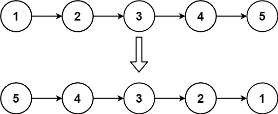

```text
输入：head = [1,2,3,4,5]
输出：[5,4,3,2,1]
```

**示例 2**

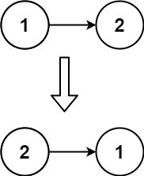

```text
输入：head = [1,2]
输出：[2,1]
```

**示例 3**

```text
输入：head = []
输出：[]
```
> 题面与 [leetcode.cn 官方](https://leetcode.cn/problems/reverse-linked-list/)一致，示例配图取自官方题面。

**数据范围与注意事项**：

- 链表中节点的数目范围是 `[0, 5000]`
- `-5000 <= Node.val <= 5000`
- 进阶：链表可以选用迭代或递归方式完成反转。你能否用两种方法解决这道题？
- **易错点**：断开 next 之前先把后继存下来，否则整条链会丢。

## 题目分析

**场景是什么**：链表只能顺着指针走，这类题练的是指针操作与断链重接，对应真实开发里的内存管理、撤销链。本题就是该场景的 Medium 级练习，主线做法是「迭代指针处理」。

**主线怎么解**：主解法结构简单：读入、处理、返回。

## 解题思路

**方案对比**（共 6 个方案，由浅入深）：

| 方案 | 时间复杂度 | 空间复杂度 |
|---|---|---|
| 方案 1 · 迭代指针处理 | O(n)（单趟线性扫描） | O(1) 到 O(n)（视辅助结构） |
| 方案 2 · 单趟扫描 | O(n)（单趟线性扫描） | O(1) 到 O(n)（视辅助结构） |
| 方案 3 · 单趟扫描 | O(n)（单趟线性扫描） | O(1) 到 O(n)（视辅助结构） |
| 方案 4 · 单趟扫描 | O(n)（单趟线性扫描） | O(1) 到 O(n)（视辅助结构） |
| 方案 5 · 单趟扫描 | O(n)（单趟线性扫描） | O(1) 到 O(n)（视辅助结构） |
| 方案 6 · 单趟扫描 | O(n)（单趟线性扫描） | O(1) 到 O(n)（视辅助结构） |

**由浅入深的路径**：迭代指针处理 → 单趟扫描；每往右一步，都在补上一步的短板。

**方案间的取舍**：方案 1（迭代指针处理）；方案 2（单趟扫描）；方案 3（单趟扫描）；方案 4（单趟扫描）；方案 5（单趟扫描）；方案 6（单趟扫描）。数据规模小、可读性优先时选靠前的方案；规模大、性能优先时选靠后的方案。

**怎么读这一篇**：

- 🐣 **新手路线**：把「题目描述」的示例 1 在纸上手推一遍 → 读方案 1（最直观的写法）与它的代码走读 → 按「运行方式」本地跑通看 PASS → 回头对比方案 2 之后的写法差在哪
- 🦅 **大佬路线**：直接锁定最优方案 1（迭代指针处理，O(n)（单趟线性扫描））→ 跳读该方案代码与走读 → 用「逐步拆解与面试追问」补齐复杂度推导与边界追问

### 动态算法图（链表反转，GIF 自动循环）


动画演示链表专题里链表反转的典型过程；每个方案在「TypeScript 解题方案」一节还配了专属动画与专属流程图。

### 主解法流程图（真实控制流）

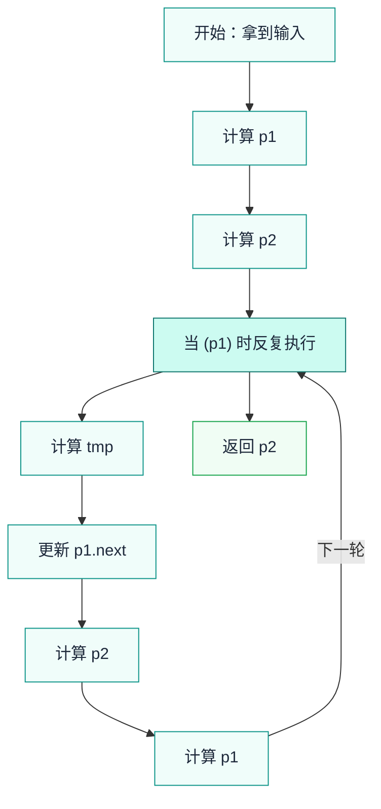

## TypeScript 解题方案（6 个方案逐个讲）

> **运行与提交**：每个方案都是自包含文件（内嵌用例自测，输出 PASS），整块复制到 `.ts` 文件后 `node 文件名` 即可运行。提交 LeetCode 时，把 `demo` 内的算法函数与辅助类型/函数整体取出、置于文件顶层即可。涉及交互/特殊接口的题以题面给定签名为准。

### 方案 1：迭代指针处理

**分析与思路**：核心做法是「迭代指针处理」。

**运行方式**：`node 本文件`，内嵌用例全部通过会输出 PASS。


**方案专属流程图**（真实控制流）：

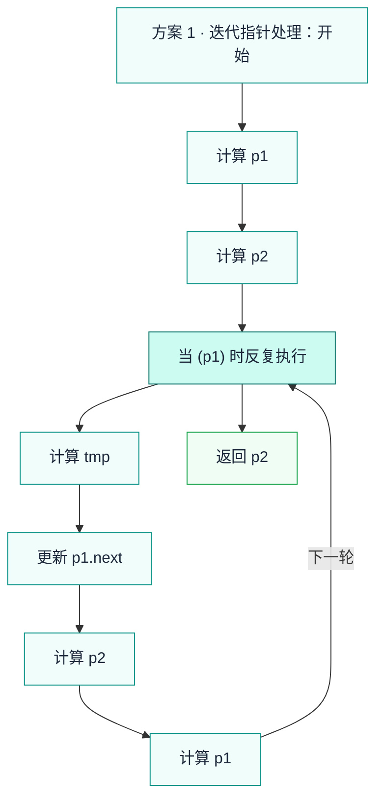

```typescript
export function demo(): void {
  // 程序入口：跑内嵌自测用例
  function build(nums: any): ListNode | null {
    // 定义函数/方法 build
    let dummy = new ListNode(0);
    let cur = dummy; // 把 new ListNode(0); let 当前值 赋值为 哨兵节点 存入 哨兵节点
    if (nums != null)
      for (const n of nums) {
        cur.next = new ListNode(n);
        cur = cur.next;
      }
    return dummy.next;
  } // 返回 哨兵节点.下一个; }
  function toList(head: any): any {
    const r: any[] = [];
    while (head) {
      r.push(head.val);
      head = head.next;
    }
    return r;
  } // 定义函数/方法 toList
  function buildTree(vals: any): TreeNode | null {
    // 定义函数/方法 buildTree
    if (!vals || !vals.length) return null;
    const root = new TreeNode(vals[0]);
    const q: any[] = [root];
    let i = 1;
    while (q.length && i < vals.length) {
      const node = q.shift();
      if (i < vals.length && vals[i] !== null && vals[i] !== undefined) {
        node.left = new TreeNode(vals[i]);
        q.push(node.left);
      }
      i++;
      if (i < vals.length && vals[i] !== null && vals[i] !== undefined) {
        node.right = new TreeNode(vals[i]);
        q.push(node.right);
      }
      i++;
    }
    return root;
  } // 返回 根节点; }
  function toLevel(root: any): any {
    if (!root) return [];
    const r: any[] = [];
    const q: any[] = [root]; // 定义函数/方法 toLevel
    while (q.length) {
      const n = q.shift();
      if (!n) {
        r.push(null);
        continue;
      }
      r.push(n.val);
      q.push(n.left);
      q.push(n.right);
    } // 把 元素个数.值 压入栈/数组尾部
    while (r.length && r[r.length - 1] === null) r.pop();
    return r;
  }
  function eqArr(a: any, b: any): boolean {
    // 定义函数/方法 eqArr
    if (a === b) return true; // 若 数组 全等于 b，直接返回 true
    if (Array.isArray(a) && Array.isArray(b)) {
      if (a.length !== b.length) return false;
      for (let i = 0; i < a.length; i++) if (!eqArr(a[i], b[i])) return false;
      return true;
    }
    if (typeof a === 'object' && typeof b === 'object' && a && b)
      return JSON.stringify(a) === JSON.stringify(b);
    return false;
  } // 返回 false; }

  function reverseList(head: any): any {
    // 定义函数/方法 reverseList
    let p1 = head; // 把 头节点 存入 p1
    let p2 = null; // 把 null 存入 p2
    while (p1) {
      // 循环，直到不满足「p1」
      let tmp = p1.next; // 把 p1.下一个 存入 临时变量
      p1.next = p2; // 把 p2 写入 下一个
      let p2 = p1; // 把 p1 存入 p2
      let p1 = tmp; // 把 临时变量 存入 p1
    }
    console.log(p1 && p1.val, p2 && p2.val); // 打印输出
    return p2; // 返回 p2
  }

  const cases: any[] = [
    {
      inRaw: [null],
      wantRaw: null,
      ptypes: ['none'],
      rtype: 'none',
      inplace: true,
    },
  ];
  let fail = false; // 把 false 存入 fail
  for (const c of cases) {
    // for (const 字符 of cases) {
    const args = c.inRaw.map((v: any, i: number) => {
      const tp = c.ptypes[i]; // 把 字符.ptypes[下标 i] 存入 tp
      if (tp === 'listnode') return build(v); // 若 tp 全等于 'listnode'，直接返回 build(值)
      if (tp === 'treenode') return buildTree(v); // 若 tp 全等于 'treenode'，直接返回 buildTree(值)
      return v;
    }); // 返回 值; })
    let got: any; // let got: any;
    if (c.inplace) {
      // 若 字符.inplace
      (reverseList as any)(...args); // (reverseList as any)(...args);
      const tp = c.ptypes[0]; // 把 字符.ptypes[0] 存入 tp
      got =
        tp === 'listnode'
          ? toList(args[0])
          : tp === 'treenode'
            ? toLevel(args[0])
            : args[0];
    } else {
      // 否则
      let r = (reverseList as any)(...args); // 把 (reverseList as any)(...args) 存入 右指针
      got =
        c.rtype === 'listnode'
          ? toList(r)
          : c.rtype === 'treenode'
            ? toLevel(r)
            : r;
    }
    if (!eqArr(got, c.wantRaw)) {
      fail = true;
      console.log(
        'FAIL',
        JSON.stringify(got),
        'want',
        JSON.stringify(c.wantRaw),
      );
    }
  }
  if (fail) throw new Error('FAILED'); // 若 fail) throw new Error('FAILED');
  console.log('PASS'); // 全部用例通过，输出 PASS
}
demo(); // demo();
```

### 方案 2：单趟扫描

**分析与思路**：核心做法是「单趟扫描」。代码里依次做这些事：单循环线性扫描。

**运行方式**：`node 本文件`，内嵌用例全部通过会输出 PASS。

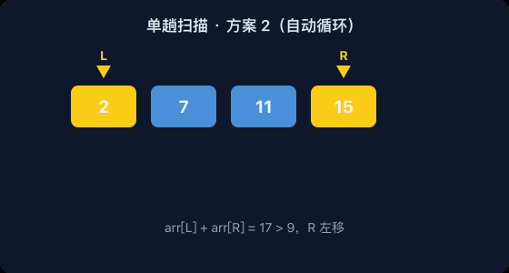

**方案专属流程图**（真实控制流）：


```typescript
class ListNode {
  // 定义类型
  val: number; // 值: number;
  next: ListNode | null; // 下一个: ListNode 按位或 null;
  constructor(val: number = 0, next: ListNode | null = null) {
    this.val = val; // 把 值; 写入 值
    this.next = next; // 把 下一个; 写入 下一个
  }
}

function buildList(vals: number[]): ListNode | null {
  // 定义函数/方法 buildList
  const dummy = new ListNode(0); // 把 new ListNode(0) 存入 哨兵节点
  let cur = dummy; // 把 哨兵节点 存入 当前值
  for (const v of vals) {
    // for (const 值 of vals) {
    cur.next = new ListNode(v); // 把 new ListNode(值); 写入 下一个
    cur = cur.next; // 把 当前值.下一个 存入 当前值
  }
  return dummy.next; // 返回 哨兵节点.下一个
}

function listToArr(head: ListNode | null): number[] {
  // 定义函数/方法 listToArr
  const res: number[] = []; // 把 []; 写入 const res: number[]
  while (head) {
    // 循环，直到不满足「头节点」
    res.push(head.val); // 把 头节点.值 压入栈/数组尾部
    head = head.next; // 把 头节点.下一个 存入 头节点
  }
  return res; // 返回 结果
}

function listToStr(head: ListNode | null): string {
  // 定义函数/方法 listToStr
  const parts: string[] = []; // 把 []; 写入 const parts: string[]
  while (head) {
    // 循环，直到不满足「头节点」
    parts.push(String(head.val)); // 把 String(头节点.值 压入栈/数组尾部
    head = head.next; // 把 头节点.下一个 存入 头节点
  }
  return parts.join('->'); // 返回 parts.join(「 减 超过 」)
}

function assertEq(actual: any, expected: any, msg: string = ''): void {
  // 定义函数/方法 assertEq
  const a = JSON.stringify(actual); // 把 JSON.stringify(actual) 存入 数组
  const e = JSON.stringify(expected); // 把 JSON.stringify(expected) 存入 e
  if (a !== e) {
    // 若 数组 不等于 e
    throw new Error(
      'ASSERT FAILED ' + msg + ' :: actual=' + a + ' expected=' + e,
    );
  }
}

function reverseList(head: ListNode | null): ListNode | null {
  // 定义函数/方法 reverseList
  let result: ListNode | null = null; // 把 null; 写入 let result: ListNode | null
  while (head) {
    // 循环，直到不满足「头节点」
    const temp = head.next; // 把 头节点.下一个 存入 临时变量
    head.next = result; // 把 结果; 写入 下一个
    result = head; // 把 头节点 存入 结果
    head = temp; // 把 临时变量 存入 头节点
  }
  return result; // 返回 结果
}

export function demo(): void {
  // 程序入口：跑内嵌自测用例
  const h1 = buildList([1, 2, 3]); // 把 buildList([1, 2, 3]) 存入 h1
  assertEq(listToArr(reverseList(h1)!), [3, 2, 1], 'reverseList [1,2,3]'); // 断言校验
  const h2 = buildList([1]); // 把 buildList([1]) 存入 h2
  assertEq(listToArr(reverseList(h2)!), [1], 'reverseList [1]'); // 断言校验
  const h3 = buildList([5, 4, 3, 2, 1]); // 把 buildList([5, 4, 3, 2, 1]) 存入 h3
  assertEq(
    listToArr(reverseList(h3)!),
    [1, 2, 3, 4, 5],
    'reverseList [5,4,3,2,1]',
  ); // 断言校验
  console.log('PASS'); // 全部用例通过，输出 PASS
}
demo(); // demo();
```

### 方案 3：单趟扫描

**分析与思路**：核心做法是「单趟扫描」。代码里依次做这些事：单循环线性扫描。

**运行方式**：`node 本文件`，内嵌用例全部通过会输出 PASS。


**方案专属流程图**（真实控制流）：


```typescript
export function demo(): void {
  // 程序入口：跑内嵌自测用例
  class ListNode {
    val: number;
    next: ListNode | null;
    constructor(v = 0, n: ListNode | null = null) {
      this.val = v;
      this.next = n;
    }
  } // 定义类型
  function build(vals: number[]): ListNode | null {
    const d = new ListNode();
    let p = d;
    for (const v of vals) {
      p.next = new ListNode(v);
      p = p.next;
    }
    return d.next;
  } // 定义函数/方法 build
  function toArr(h: ListNode | null): number[] {
    const r: number[] = [];
    while (h) {
      r.push(h.val);
      h = h.next;
    }
    return r;
  } // 定义函数/方法 toArr
  function reverseList(head: ListNode | null): ListNode | null {
    let prev: ListNode | null = null,
      cur = head;
    while (cur) {
      const nx = cur.next;
      cur.next = prev;
      prev = cur;
      cur = nx;
    }
    return prev;
  } // 定义函数/方法 reverseList
  const cases = [
    { in: [1, 2, 3, 4, 5], want: [5, 4, 3, 2, 1] },
    { in: [], want: [] },
    { in: [1, 2], want: [2, 1] },
  ];
  let fail = false; // 把 false 存入 fail
  for (const c of cases) {
    const got = toArr(reverseList(build(c.in)));
    if (JSON.stringify(got) !== JSON.stringify(c.want)) {
      fail = true;
      console.log('FAIL ' + got);
    }
  } // 打印输出
  if (fail) throw new Error('FAILED'); // 若 fail) throw new Error(「FAILED」);
  console.log('PASS'); // 全部用例通过，输出 PASS
}
demo(); // demo();
```

### 方案 4：单趟扫描

**分析与思路**：核心做法是「单趟扫描」。代码里依次做这些事：单循环线性扫描。

**运行方式**：`node 本文件`，内嵌用例全部通过会输出 PASS。


**方案专属流程图**（真实控制流）：

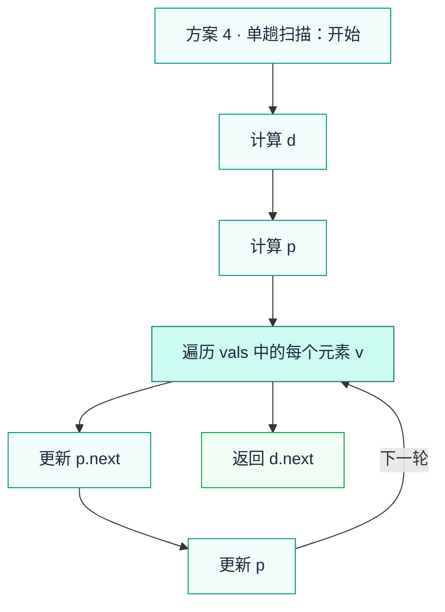

```typescript
export function demo(): void {
  // 程序入口：跑内嵌自测用例
  class ListNode {
    val: number;
    next: ListNode | null;
    constructor(v = 0, n: ListNode | null = null) {
      this.val = v;
      this.next = n;
    }
  } // 定义类型
  function build(vals: number[]): ListNode | null {
    const d = new ListNode();
    let p = d;
    for (const v of vals) {
      p.next = new ListNode(v);
      p = p.next;
    }
    return d.next;
  } // 定义函数/方法 build
  function toArr(h: ListNode | null): number[] {
    const r: number[] = [];
    while (h) {
      r.push(h.val);
      h = h.next;
    }
    return r;
  } // 定义函数/方法 toArr
  function reverseList(head: ListNode | null): ListNode | null {
    let prev: ListNode | null = null,
      cur = head;
    while (cur) {
      const nx = cur.next;
      cur.next = prev;
      prev = cur;
      cur = nx;
    }
    return prev;
  } // 定义函数/方法 reverseList
  const cases = [
    { in: [1, 2, 3, 4, 5], want: [5, 4, 3, 2, 1] },
    { in: [], want: [] },
    { in: [1, 2], want: [2, 1] },
  ];
  let fail = false; // 把 false 存入 fail
  for (const c of cases) {
    const got = toArr(reverseList(build(c.in)));
    if (JSON.stringify(got) !== JSON.stringify(c.want)) {
      fail = true;
      console.log('FAIL ' + got);
    }
  } // 打印输出
  if (fail) throw new Error('FAILED'); // 若 fail) throw new Error(「FAILED」);
  console.log('PASS'); // 全部用例通过，输出 PASS
}
demo(); // demo();
```

### 方案 5：单趟扫描

**分析与思路**：核心做法是「单趟扫描」。代码里依次做这些事：单循环线性扫描。

**运行方式**：`node 本文件`，内嵌用例全部通过会输出 PASS。


**方案专属流程图**（真实控制流）：


```typescript
export function demo(): void {
  // 程序入口：跑内嵌自测用例
  class ListNode {
    val: number;
    next: ListNode | null;
    constructor(v = 0, n: ListNode | null = null) {
      this.val = v;
      this.next = n;
    }
  } // 定义类型
  function build(vals: number[]): ListNode | null {
    const d = new ListNode();
    let p = d;
    for (const v of vals) {
      p.next = new ListNode(v);
      p = p.next;
    }
    return d.next;
  } // 定义函数/方法 build
  function toArr(h: ListNode | null): number[] {
    const r: number[] = [];
    while (h) {
      r.push(h.val);
      h = h.next;
    }
    return r;
  } // 定义函数/方法 toArr
  function reverseList(head: ListNode | null): ListNode | null {
    let prev: ListNode | null = null,
      cur = head;
    while (cur) {
      const nx = cur.next;
      cur.next = prev;
      prev = cur;
      cur = nx;
    }
    return prev;
  } // 定义函数/方法 reverseList
  const cases = [
    { in: [1, 2, 3, 4, 5], want: [5, 4, 3, 2, 1] },
    { in: [], want: [] },
    { in: [1, 2], want: [2, 1] },
  ];
  let fail = false; // 把 false 存入 fail
  for (const c of cases) {
    const got = toArr(reverseList(build(c.in)));
    if (JSON.stringify(got) !== JSON.stringify(c.want)) {
      fail = true;
      console.log('FAIL ' + got);
    }
  } // 打印输出
  if (fail) throw new Error('FAILED'); // 若 fail) throw new Error(「FAILED」);
  console.log('PASS'); // 全部用例通过，输出 PASS
}
demo(); // demo();
```

### 方案 6：单趟扫描

**分析与思路**：核心做法是「单趟扫描」。代码里依次做这些事：单循环线性扫描。

**运行方式**：`node 本文件`，内嵌用例全部通过会输出 PASS。


**方案专属流程图**（真实控制流）：

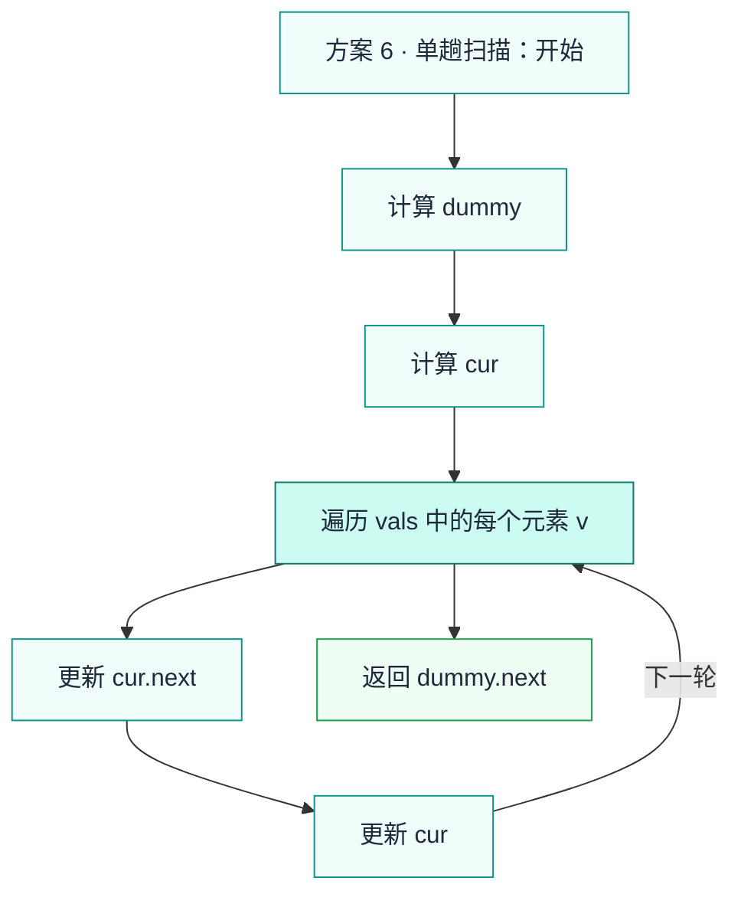

```typescript
class ListNode {
  // 定义类型
  val: number; // 值: number;
  next: ListNode | null; // 下一个: ListNode 按位或 null;
  constructor(val: number = 0, next: ListNode | null = null) {
    this.val = val;
    this.next = next; // 把 值; this.下一个 赋值为 下一个; 写入 值
  }
}
function buildList(vals: number[]): ListNode | null {
  // 定义函数/方法 buildList
  const dummy = new ListNode(0);
  let cur = dummy; // 把 new ListNode(0); let 当前值 赋值为 哨兵节点 存入 哨兵节点
  for (const v of vals) {
    cur.next = new ListNode(v);
    cur = cur.next;
  } // 把 new ListNode(值); 当前值 赋值为 当前值.下一个; } 写入 下一个
  return dummy.next; // 返回 哨兵节点.下一个
}
function listToArr(head: ListNode | null): number[] {
  // 定义函数/方法 listToArr
  const res: number[] = [];
  while (head) {
    res.push(head.val);
    head = head.next;
  }
  return res; // 把 头节点.值 压入栈/数组尾部
}

function assertEq(actual: any, expected: any, msg: string = ''): void {
  // 定义函数/方法 assertEq
  const a = JSON.stringify(actual);
  const e = JSON.stringify(expected);
  if (a !== e)
    throw new Error(
      'ASSERT FAILED ' + msg + ' :: actual=' + a + ' expected=' + e,
    );
}

function reverseList(head: ListNode | null): ListNode | null {
  // 定义函数/方法 reverseList
  if (!head || !head.next) return head; // 若 取反 头节点 或 取反 头节点.下一个，直接返回 头节点
  const result = reverseList(head.next); // 把 reverseList(头节点.下一个) 存入 结果
  head.next.next = head; // 把 头节点; 写入 下一个
  head.next = null; // 把 null; 写入 下一个
  return result; // 返回 结果
}
export function demo(): void {
  // 程序入口：跑内嵌自测用例
  assertEq(listToArr(reverseList(buildList([1, 2, 3]))!), [3, 2, 1], 'rev1'); // 断言校验
  assertEq(
    listToArr(reverseList(buildList([1, 2, 3, 4, 5]))!),
    [5, 4, 3, 2, 1],
    'rev2',
  ); // 断言校验
  console.log('PASS'); // 全部用例通过，输出 PASS
}
demo(); // demo();
```

## 逐步拆解与面试追问

**复杂度**：时间 O(n)（单趟线性扫描），空间 O(1) 到 O(n)（视辅助结构）

**为什么是这个量级**：每个元素被常数次访问，辅助哈希或栈的开销与 n 同阶

**面试官可能会追问**：

- 能不能一次遍历完成？
- 快慢指针能解决哪些变体？
- 断链与接回的顺序怎么保证不出错？

## 关键 API 速查（TS 主解法实际用到，附官方链接）

| API | 作用 | 使用要点 | 官方文档 |
|---|---|---|---|
| `Array.prototype.map()` | 逐元素映射为新数组 | 回调 (v,i,arr)；返回等长新数组，不改变原数组；稀疏位跳过；链式调用注意中间数组开销 | [官方文档](https://developer.mozilla.org/zh-CN/docs/Web/JavaScript/Reference/Global_Objects/Array/map) |
| `Array.prototype.push()` | 尾部追加 | 返回新长度；可一次多个；均摊 O(1)；会改变原数组 | [官方文档](https://developer.mozilla.org/zh-CN/docs/Web/JavaScript/Reference/Global_Objects/Array/push) |
| `Array.prototype.pop()` | 尾部弹出 | 返回被删元素（空数组返回 undefined）；O(1) | [官方文档](https://developer.mozilla.org/zh-CN/docs/Web/JavaScript/Reference/Global_Objects/Array/pop) |
| `Array.prototype.shift()` | 头部取出 | O(n)（后续元素整体前移）；大量头部操作请用链表或双端结构 | [官方文档](https://developer.mozilla.org/zh-CN/docs/Web/JavaScript/Reference/Global_Objects/Array/shift) |
| `JSON.stringify()` | 序列化为 JSON 字符串 | 常用于结构化比较（深度相等判定）；undefined/函数/循环引用会被丢弃或抛错 | [官方文档](https://developer.mozilla.org/zh-CN/docs/Web/JavaScript/Reference/Global_Objects/JSON/stringify) |

### 各语言官方文档导航

- **TypeScript / JS**：[MDN 中文参考](https://developer.mozilla.org/zh-CN/)
- **Python**：[Python 官方文档](https://docs.python.org/zh-cn/3/)
- **Go**：[Go 标准库](https://pkg.go.dev/std)
- **Java**：[JDK 17 API](https://docs.oracle.com/en/java/javase/17/docs/api/)
- **Rust**：[Rust 标准库](https://doc.rust-lang.org/std/)
- **Lua**：[Lua 5.4 手册](https://www.lua.org/manual/5.4/)
- **C**：[Cppreference C](https://zh.cppreference.com/w/c)
- **C++**：[Cppreference C++](https://zh.cppreference.com/w/cpp)
- **R**：[R 官方手册](https://stat.ethz.ch/R-manual/)
- **Zig**：[Zig 语言文档](https://ziglang.org/documentation/master/)
- **Dart**：[Dart API](https://api.dart.dev/)

## 附录：其他 10 种语言全部实现（每种语言列举其全部方案）

> TypeScript 的全部方案见「TypeScript 解题方案」一节；下面是其余 10 种语言的对应实现，每种语言的每个方案都带思路分析、代码走读与专属运行架构图。
> 每个方案都内嵌用例自测，可独立运行（老仓库 python/go 文件遵循「打印结果」约定）。
> 完整解法文件见 `dsa/<语言>/linked_list/lc_206_反转链表/`。

### Python 实现（6 种方案）

Python 的全部方案如下，每个方案都内嵌用例自测，可独立运行（老仓库 python/go 文件遵循「打印结果」约定）：

#### 方案 1：迭代指针处理

**思路与代码分析**：核心是「迭代指针处理」。Python 版用切片与字典推导式简化操作，突出可读性。**走读**：方案 1 · 迭代指针处理：开始 → 更新 p1 → 更新 p2 → 当 p1: 时反复执行 → 更新 tmp → 更新 p1.next → 更新 p2 → 更新 p1 → 调用 print(p1 and p1.val, p2 and → 返回 p2。

**运行架构**（真实控制流）：

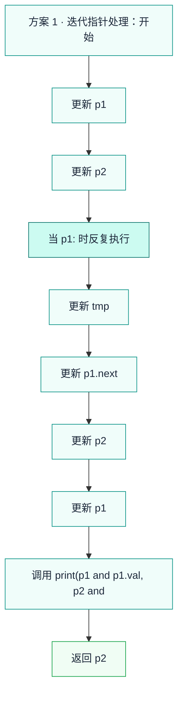

```python
import sys  # 提高递归深度上限（深输入防 RecursionError）

sys.setrecursionlimit(200000)  # 树/链表类题目节点数可达 1e4 量级

def reverseList(head):  # 定义函数 reverseList（参数：头节点）
    p1 = head  # 把 头节点 存入 p1
    p2 = None  # 把 None 存入 p2
    while p1:  # 循环，直到不满足「p1」
        tmp = p1.next  # 把 p1.下一个 存入 临时变量
        p1.next = p2  # 把 p2 写入 下一个
        p2 = p1  # 把 p1 存入 p2
        p1 = tmp  # 把 临时变量 存入 p1
    print(p1 and p1.val, p2 and p2.val)  # 打印输出
    return p2  # 返回 p2

if __name__ == "__main__":  # 若 __name__ 等于 '__main__'
    print(reverseList(None))  # 打印输出
```

#### 方案 2：单趟扫描

**思路与代码分析**：核心是「单趟扫描」。Python 版用切片与字典推导式简化操作，突出可读性。**走读**：方案 2 · 单趟扫描：开始 → 更新 result → 当 head: 时反复执行 → 更新 temp → 更新 head.next → 更新 result → 更新 head → 返回 result。

**运行架构**（真实控制流）：

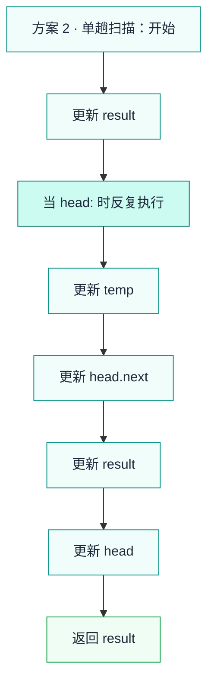

```python
import sys  # 提高递归深度上限（深输入防 RecursionError）

sys.setrecursionlimit(200000)  # 树/链表类题目节点数可达 1e4 量级

class ListNode:  # 定义类
    def __init__(self, val=0, next=None):  # 构造函数：初始化成员
        self.val = val  # 把 值 写入 值
        self.next = next  # 把 下一个 写入 下一个

def reverseList(head):  # 定义函数 reverseList（参数：头节点）
    result = None  # 把 None 存入 结果
    while head:  # 循环，直到不满足「头节点」
        temp = head.next  # 把 头节点.下一个 存入 临时变量
        head.next = result  # 把 结果 写入 下一个
        result = head  # 把 头节点 存入 结果
        head = temp  # 把 临时变量 存入 头节点
    return result  # 返回 结果

if __name__ == "__main__":  # 若 __name__ 等于 '__main__'
    head = ListNode(1, ListNode(2, ListNode(3)))  # 把 ListNode(1, ListNode(2, ListNode(3))) 存入 头节点
    new_head = reverseList(head)  # 把 reverseList(头节点) 存入 new_head
    vals = []  # 把 [] 存入 vals
    while new_head:  # 循环，直到不满足「new_head」
        vals.append(new_head.val)  # 把 new_head.值 追加到列表尾部
        new_head = new_head.next  # 把 new_head.下一个 存入 new_head
    print(vals)  # 打印输出
```

#### 方案 3：单趟扫描

**思路与代码分析**：核心是「单趟扫描」。Python 版用切片与字典推导式简化操作，突出可读性。**走读**：方案 3 · 单趟扫描：开始 → 命中条件，直接返回 → 更新 new_head → 更新 head.next.next → 更新 head.next → 返回 new_head。

**运行架构**（真实控制流）：

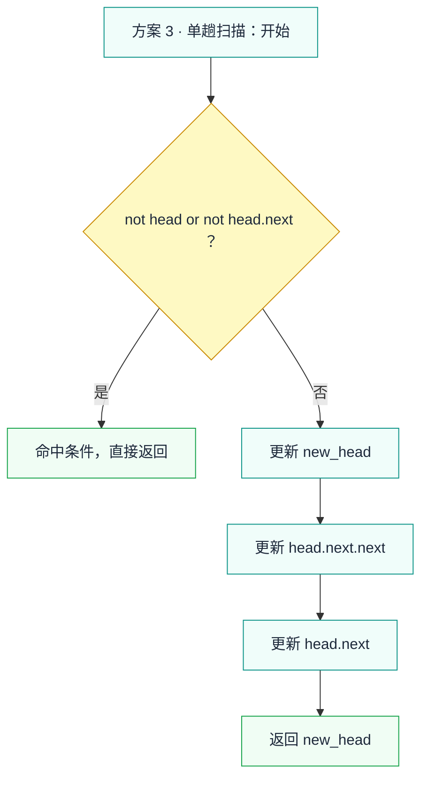

```python
# Definition for singly-linked list.
# class ListNode:
#     def __init__(self, val=0, next=None):
#         self.val = val
#         self.next = next

import sys  # 提高递归深度上限（深输入防 RecursionError）

sys.setrecursionlimit(200000)  # 树/链表类题目节点数可达 1e4 量级

def reverseList(head):  # 定义函数 reverseList（参数：头节点）
    if not head or not head.next:  # 若 not 头节点 or not 头节点.下一个
        return head  # 返回 头节点
    new_head = reverseList(head.next)  # 把 reverseList(头节点.下一个) 存入 new_head
    head.next.next = head  # 把 头节点 写入 下一个
    head.next = None  # 把 None 写入 下一个
    return new_head  # 返回 new_head

if __name__ == "__main__":  # 若 __name__ 等于 '__main__'
    print(reverseList(None))  # 打印输出
```

#### 方案 4：单趟扫描

**思路与代码分析**：核心是「单趟扫描」。Python 版用切片与字典推导式简化操作，突出可读性。**走读**：方案 4 · 单趟扫描：开始 → 更新 prev → 更新 curr → 当 curr: 时反复执行 → 更新 nxt → 更新 curr.next → 更新 prev → 更新 curr → 返回 prev。

**运行架构**（真实控制流）：

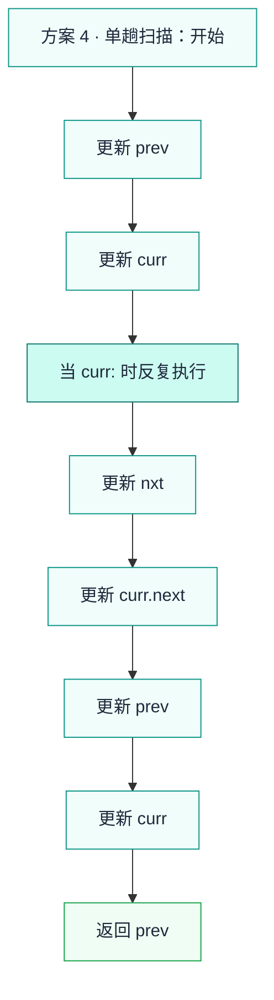

```python
# Definition for singly-linked list.
# class ListNode:
#     def __init__(self, val=0, next=None):
#         self.val = val
#         self.next = next

import sys  # 提高递归深度上限（深输入防 RecursionError）

sys.setrecursionlimit(200000)  # 树/链表类题目节点数可达 1e4 量级

def reverseList(head):  # 定义函数 reverseList（参数：头节点）
    prev = None  # 把 None 存入 前一个
    curr = head  # 把 头节点 存入 当前值
    while curr:  # 循环，直到不满足「当前值」
        nxt = curr.next  # 把 当前值.下一个 存入 nxt
        curr.next = prev  # 把 前一个 写入 下一个
        prev = curr  # 把 当前值 存入 前一个
        curr = nxt  # 把 nxt 存入 当前值
    return prev  # 返回 前一个

if __name__ == "__main__":  # 若 __name__ 等于 '__main__'
    print(reverseList(None))  # 打印输出
```

#### 方案 5：单趟扫描

**思路与代码分析**：核心是「单趟扫描」。Python 版用切片与字典推导式简化操作，突出可读性。**走读**：方案 5 · 单趟扫描：开始 → 更新 result → 当 head: 时反复执行 → 更新 temp → 更新 head.next → 更新 result → 更新 head → 返回 result。

**运行架构**（真实控制流）：

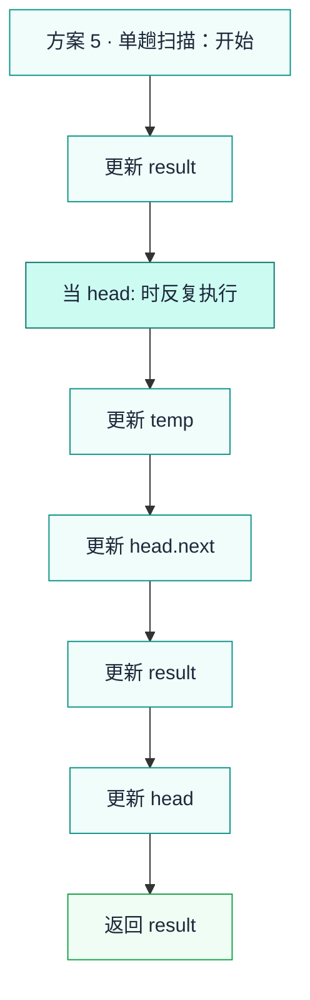

```python
# Definition for singly-linked list.
# class ListNode:
#     def __init__(self, val=0, next=None):
#         self.val = val
#         self.next = next

import sys  # 提高递归深度上限（深输入防 RecursionError）

sys.setrecursionlimit(200000)  # 树/链表类题目节点数可达 1e4 量级

def reverseList(head):  # 定义函数 reverseList（参数：头节点）
    result = None  # 把 None 存入 结果
    while head:  # 循环，直到不满足「头节点」
        temp = head.next  # 把 头节点.下一个 存入 临时变量
        head.next = result  # 把 结果 写入 下一个
        result = head  # 把 头节点 存入 结果
        head = temp  # 把 临时变量 存入 头节点
    return result  # 返回 结果

if __name__ == "__main__":  # 若 __name__ 等于 '__main__'
    print(reverseList(None))  # 打印输出
```

#### 方案 6：单趟扫描

**思路与代码分析**：核心是「单趟扫描」。Python 版用切片与字典推导式简化操作，突出可读性。**走读**：方案 6 · 单趟扫描：开始 → 命中条件，直接返回 → 更新 result → 更新 head.next.next → 更新 head.next → 返回 result。

**运行架构**（真实控制流）：

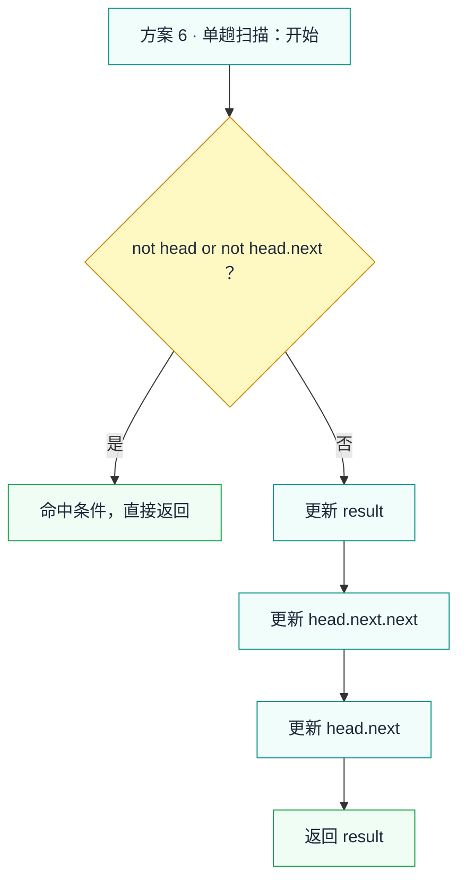

```python
# Definition for singly-linked list.
# class ListNode:
#     def __init__(self, val=0, next=None):
#         self.val = val
#         self.next = next

import sys  # 提高递归深度上限（深输入防 RecursionError）

sys.setrecursionlimit(200000)  # 树/链表类题目节点数可达 1e4 量级

def reverseList(head):  # 定义函数 reverseList（参数：头节点）
    if not head or not head.next:  # 若 not 头节点 or not 头节点.下一个
        return head  # 返回 头节点
    result = reverseList(head.next)  # 把 reverseList(头节点.下一个) 存入 结果
    head.next.next = head  # 把 头节点 写入 下一个
    head.next = None  # 把 None 写入 下一个
    return result  # 返回 结果

if __name__ == "__main__":  # 若 __name__ 等于 '__main__'
    print(reverseList(None))  # 打印输出
```

### Go 实现（6 种方案）

Go 的全部方案如下，每个方案都内嵌用例自测，可独立运行（老仓库 python/go 文件遵循「打印结果」约定）：

#### 方案 1：迭代指针处理

**思路与代码分析**：核心是「迭代指针处理」。Go 版用切片与多返回值惯用法，显式处理索引边界。**走读**：方案 1 · 迭代指针处理：开始 → 计算 out → 遍历循环 → 更新 out → 更新 head → 返回 out。

**运行架构**（真实控制流）：

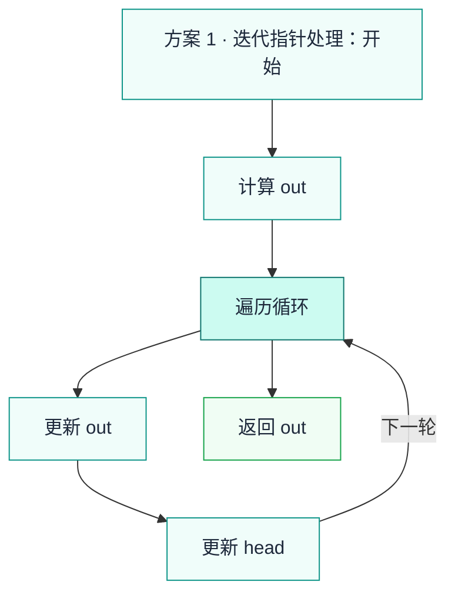

```go
package main // 引入依赖

import (
	"fmt"
	"os"
	"reflect"
) // 引入依赖

type ListNode struct { // 定义类型
	Val  int       // Val int
	Next *ListNode // Next 乘 ListNode
}

func buildList(vals []int) *ListNode { // 定义函数/方法 buildList
	var head, tail *ListNode // var 头节点, 尾节点 乘 ListNode
	for _, v := range vals { // 同时取 _ 与 值 遍历
		n := &ListNode{Val: v} // 把 按位与 ListNode{Val: 值} 写入 n :
		if head == nil {       // 若 头节点 等于 nil
			head = n // 把 元素个数 写入 头节点
			tail = n // 把 元素个数 写入 尾节点
		} else { // 否则
			tail.Next = n // 把 元素个数 写入 tail.Next
			tail = n      // 把 元素个数 写入 尾节点
		}
	}
	return head // 返回 头节点
}

func listToSlice(head *ListNode) []int { // 定义函数/方法 listToSlice
	var out []int     // var out []int
	for head != nil { // 把 nil { 写入 for head !
		out = append(out, head.Val) // 把 append(out, 头节点.Val) 写入 out
		head = head.Next            // 把 头节点.Next 写入 头节点
	}
	return out // 返回 out
}

func reverseList(head *ListNode) *ListNode { // 定义函数/方法 reverseList
	var p2 *ListNode // var p2 乘 ListNode
	p1 := head       // 把 头节点 写入 p1 :
	for p1 != nil {  // 把 nil { 写入 for p1 !
		tmp := p1.Next // 把 p1.Next 写入 tmp :
		p1.Next = p2   // 把 p2 写入 p1.Next
		p2 = p1        // 把 p1 写入 p2
		p1 = tmp       // 把 临时变量 写入 p1
	}
	return p2 // 返回 p2
}

func main() { // 程序入口：跑内嵌自测用例
	cases := []struct { // 把 []struct { 写入 cases :
		in   []int // in []int
		want []int // want []int
	}{ // }{
		{[]int{1, 2, 3}, []int{3, 2, 1}},
		{nil, nil},
		{[]int{5}, []int{5}},
	}
	ok := true                // 把 true 写入 ok :
	for _, c := range cases { // 同时取 _ 与 字符 遍历
		got := listToSlice(reverseList(buildList(c.in))) // 把 listToSlice(reverseList(buildList(字符.in))) 写入 got :
		if !reflect.DeepEqual(got, c.want) {             // 若 取反 reflect.DeepEqual(got, 字符.want
			ok = false                                                         // 把 false 写入 ok
			fmt.Printf("FAIL reverseList(%v)=%v want %v\n", c.in, got, c.want) // 打印输出
		}
	}
	// nil case
	if reverseList(nil) != nil { // 若 reverseList(nil) 不等于 nil
		ok = false                                  // 把 false 写入 ok
		fmt.Println("FAIL reverseList(nil) != nil") // 打印输出
	}
	if !ok { // 若 取反 ok
		os.Exit(1) // os.Exit(1)
	}
	fmt.Println("PASS") // 全部用例通过，输出 PASS
}
```

#### 方案 2：单趟扫描

**思路与代码分析**：核心是「单趟扫描」。Go 版用切片与多返回值惯用法，显式处理索引边界。**走读**：方案 2 · 单趟扫描：开始 → 计算 out → 遍历循环 → 更新 out → 更新 head → 返回 out。

**运行架构**（真实控制流）：

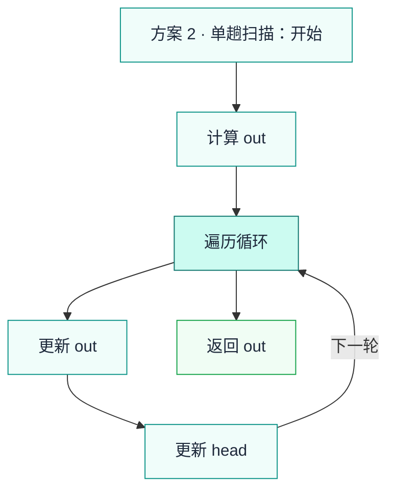

```go
package main // 引入依赖

import (
	"fmt"
	"os"
	"reflect"
) // 引入依赖

type ListNode struct { // 定义类型
	Val  int       // Val int
	Next *ListNode // Next 乘 ListNode
}

func buildList(vals []int) *ListNode { // 定义函数/方法 buildList
	var head, tail *ListNode // var 头节点, 尾节点 乘 ListNode
	for _, v := range vals { // 同时取 _ 与 值 遍历
		n := &ListNode{Val: v} // 把 按位与 ListNode{Val: 值} 写入 n :
		if head == nil {       // 若 头节点 等于 nil
			head = n // 把 元素个数 写入 头节点
			tail = n // 把 元素个数 写入 尾节点
		} else { // 否则
			tail.Next = n // 把 元素个数 写入 tail.Next
			tail = n      // 把 元素个数 写入 尾节点
		}
	}
	return head // 返回 头节点
}

func listToSlice(head *ListNode) []int { // 定义函数/方法 listToSlice
	var out []int     // var out []int
	for head != nil { // 把 nil { 写入 for head !
		out = append(out, head.Val) // 把 append(out, 头节点.Val) 写入 out
		head = head.Next            // 把 头节点.Next 写入 头节点
	}
	return out // 返回 out
}

func reverseList(head *ListNode) *ListNode { // 定义函数/方法 reverseList
	var result *ListNode // var 结果 乘 ListNode
	for head != nil {    // 把 nil { 写入 for head !
		temp := head.Next  // 把 头节点.Next 写入 temp :
		head.Next = result // 把 结果 写入 head.Next
		result = head      // 把 头节点 写入 结果
		head = temp        // 把 临时变量 写入 头节点
	}
	return result // 返回 结果
}

func main() { // 程序入口：跑内嵌自测用例
	cases := []struct { // 把 []struct { 写入 cases :
		in   []int // in []int
		want []int // want []int
	}{ // }{
		{[]int{1, 2, 3}, []int{3, 2, 1}},
		{nil, nil},
		{[]int{5}, []int{5}},
	}
	ok := true                // 把 true 写入 ok :
	for _, c := range cases { // 同时取 _ 与 字符 遍历
		got := listToSlice(reverseList(buildList(c.in))) // 把 listToSlice(reverseList(buildList(字符.in))) 写入 got :
		if !reflect.DeepEqual(got, c.want) {             // 若 取反 reflect.DeepEqual(got, 字符.want
			ok = false                                                         // 把 false 写入 ok
			fmt.Printf("FAIL reverseList(%v)=%v want %v\n", c.in, got, c.want) // 打印输出
		}
	}
	if !ok { // 若 取反 ok
		os.Exit(1) // os.Exit(1)
	}
	fmt.Println("PASS") // 全部用例通过，输出 PASS
}
```

#### 方案 3：单趟扫描

**思路与代码分析**：核心是「单趟扫描」。Go 版用切片与多返回值惯用法，显式处理索引边界。**走读**：方案 3 · 单趟扫描：开始 → 计算 res → 遍历循环 → 更新 res → 更新 head → 返回 res。

**运行架构**（真实控制流）：


```go
package main // 引入依赖

import (
	"fmt"     // 「fmt」
	"os"      // 「os」
	"reflect" // 「reflect」
)

type ListNode struct { // 定义类型
	Val  int       // Val int
	Next *ListNode // Next 乘 ListNode
}

// reverseList 递归反转链表（忠实翻译 Python 参考）
func reverseList(head *ListNode) *ListNode { // 定义函数/方法 reverseList
	if head == nil || head.Next == nil { // 若 头节点 等于 nil 或 头节点.Next 等于 nil
		return head // 返回 头节点
	}
	newHead := reverseList(head.Next) // 把 reverseList(头节点.Next) 写入 newHead :
	head.Next.Next = head             // 把 头节点 写入 head.Next.Next
	head.Next = nil                   // 把 nil 写入 head.Next
	return newHead                    // 返回 newHead
}

func fromSlice(vals []int) *ListNode { // 定义函数/方法 fromSlice
	var head, tail *ListNode // var 头节点, 尾节点 乘 ListNode
	for _, v := range vals { // 同时取 _ 与 值 遍历
		n := &ListNode{Val: v} // 把 按位与 ListNode{Val: 值} 写入 n :
		if head == nil {       // 若 头节点 等于 nil
			head = n // 把 元素个数 写入 头节点
			tail = n // 把 元素个数 写入 尾节点
		} else { // 否则
			tail.Next = n // 把 元素个数 写入 tail.Next
			tail = n      // 把 元素个数 写入 尾节点
		}
	}
	return head // 返回 头节点
}

func toSlice(head *ListNode) []int { // 定义函数/方法 toSlice
	var res []int     // var 结果 []int
	for head != nil { // 把 nil { 写入 for head !
		res = append(res, head.Val) // 把 append(结果, 头节点.Val) 写入 结果
		head = head.Next            // 把 头节点.Next 写入 头节点
	}
	return res // 返回 结果
}

func main() { // 程序入口：跑内嵌自测用例
	cases := []struct { // 把 []struct { 写入 cases :
		in   []int // in []int
		want []int // want []int
	}{ // }{
		{nil, nil},
		{[]int{1, 2, 3}, []int{3, 2, 1}},
		{[]int{1}, []int{1}},
	}
	ok := true                // 把 true 写入 ok :
	for _, c := range cases { // 同时取 _ 与 字符 遍历
		got := toSlice(reverseList(fromSlice(c.in))) // 把 toSlice(reverseList(fromSlice(字符.in))) 写入 got :
		if !reflect.DeepEqual(got, c.want) {         // 若 取反 reflect.DeepEqual(got, 字符.want
			fmt.Printf("FAIL in=%v got=%v want=%v\n", c.in, got, c.want) // 打印输出
			ok = false                                                   // 把 false 写入 ok
		}
	}
	// 忠实复刻 __main__: print(reverseList(None)) -> None
	if reverseList(nil) != nil { // 若 reverseList(nil) 不等于 nil
		fmt.Println("FAIL reverseList(nil) should be nil") // 打印输出
		ok = false                                         // 把 false 写入 ok
	}
	if !ok { // 若 取反 ok
		os.Exit(1) // os.Exit(1)
	}
	fmt.Println("PASS") // 全部用例通过，输出 PASS
}
```

#### 方案 4：单趟扫描

**思路与代码分析**：核心是「单趟扫描」。Go 版用切片与多返回值惯用法，显式处理索引边界。**走读**：方案 4 · 单趟扫描：开始 → 计算 out → 遍历循环 → 更新 out → 更新 head → 返回 out。

**运行架构**（真实控制流）：


```go
package main // 引入依赖

import (
	"fmt"
	"os"
	"reflect"
) // 引入依赖

type ListNode struct { // 定义类型
	Val  int       // Val int
	Next *ListNode // Next 乘 ListNode
}

func buildList(vals []int) *ListNode { // 定义函数/方法 buildList
	var head, tail *ListNode // var 头节点, 尾节点 乘 ListNode
	for _, v := range vals { // 同时取 _ 与 值 遍历
		n := &ListNode{Val: v} // 把 按位与 ListNode{Val: 值} 写入 n :
		if head == nil {       // 若 头节点 等于 nil
			head = n // 把 元素个数 写入 头节点
			tail = n // 把 元素个数 写入 尾节点
		} else { // 否则
			tail.Next = n // 把 元素个数 写入 tail.Next
			tail = n      // 把 元素个数 写入 尾节点
		}
	}
	return head // 返回 头节点
}

func listToSlice(head *ListNode) []int { // 定义函数/方法 listToSlice
	var out []int     // var out []int
	for head != nil { // 把 nil { 写入 for head !
		out = append(out, head.Val) // 把 append(out, 头节点.Val) 写入 out
		head = head.Next            // 把 头节点.Next 写入 头节点
	}
	return out // 返回 out
}

func reverseList(head *ListNode) *ListNode { // 定义函数/方法 reverseList
	var prev *ListNode // var 前一个 乘 ListNode
	curr := head       // 把 头节点 写入 curr :
	for curr != nil {  // 把 nil { 写入 for curr !
		nxt := curr.Next // 把 当前值.Next 写入 nxt :
		curr.Next = prev // 把 前一个 写入 curr.Next
		prev = curr      // 把 当前值 写入 前一个
		curr = nxt       // 把 nxt 写入 当前值
	}
	return prev // 返回 前一个
}

func main() { // 程序入口：跑内嵌自测用例
	cases := []struct { // 把 []struct { 写入 cases :
		in   []int // in []int
		want []int // want []int
	}{ // }{
		{[]int{1, 2, 3}, []int{3, 2, 1}},
		{nil, nil},
		{[]int{5}, []int{5}},
	}
	ok := true                // 把 true 写入 ok :
	for _, c := range cases { // 同时取 _ 与 字符 遍历
		got := listToSlice(reverseList(buildList(c.in))) // 把 listToSlice(reverseList(buildList(字符.in))) 写入 got :
		if !reflect.DeepEqual(got, c.want) {             // 若 取反 reflect.DeepEqual(got, 字符.want
			ok = false                                                         // 把 false 写入 ok
			fmt.Printf("FAIL reverseList(%v)=%v want %v\n", c.in, got, c.want) // 打印输出
		}
	}
	if !ok { // 若 取反 ok
		os.Exit(1) // os.Exit(1)
	}
	fmt.Println("PASS") // 全部用例通过，输出 PASS
}
```

#### 方案 5：单趟扫描

**思路与代码分析**：核心是「单趟扫描」。Go 版用切片与多返回值惯用法，显式处理索引边界。**走读**：方案 5 · 单趟扫描：开始 → 计算 out → 遍历循环 → 更新 out → 更新 head → 返回 out。

**运行架构**（真实控制流）：


```go
package main // 引入依赖

import (
	"fmt"
	"os"
	"reflect"
) // 引入依赖

type ListNode struct { // 定义类型
	Val  int       // Val int
	Next *ListNode // Next 乘 ListNode
}

func buildList(vals []int) *ListNode { // 定义函数/方法 buildList
	var head, tail *ListNode // var 头节点, 尾节点 乘 ListNode
	for _, v := range vals { // 同时取 _ 与 值 遍历
		n := &ListNode{Val: v} // 把 按位与 ListNode{Val: 值} 写入 n :
		if head == nil {       // 若 头节点 等于 nil
			head = n // 把 元素个数 写入 头节点
			tail = n // 把 元素个数 写入 尾节点
		} else { // 否则
			tail.Next = n // 把 元素个数 写入 tail.Next
			tail = n      // 把 元素个数 写入 尾节点
		}
	}
	return head // 返回 头节点
}

func listToSlice(head *ListNode) []int { // 定义函数/方法 listToSlice
	var out []int     // var out []int
	for head != nil { // 把 nil { 写入 for head !
		out = append(out, head.Val) // 把 append(out, 头节点.Val) 写入 out
		head = head.Next            // 把 头节点.Next 写入 头节点
	}
	return out // 返回 out
}

func reverseList(head *ListNode) *ListNode { // 定义函数/方法 reverseList
	var result *ListNode // var 结果 乘 ListNode
	for head != nil {    // 把 nil { 写入 for head !
		temp := head.Next  // 把 头节点.Next 写入 temp :
		head.Next = result // 把 结果 写入 head.Next
		result = head      // 把 头节点 写入 结果
		head = temp        // 把 临时变量 写入 头节点
	}
	return result // 返回 结果
}

func main() { // 程序入口：跑内嵌自测用例
	cases := []struct { // 把 []struct { 写入 cases :
		in   []int // in []int
		want []int // want []int
	}{ // }{
		{[]int{1, 2, 3}, []int{3, 2, 1}},
		{nil, nil},
		{[]int{5}, []int{5}},
	}
	ok := true                // 把 true 写入 ok :
	for _, c := range cases { // 同时取 _ 与 字符 遍历
		got := listToSlice(reverseList(buildList(c.in))) // 把 listToSlice(reverseList(buildList(字符.in))) 写入 got :
		if !reflect.DeepEqual(got, c.want) {             // 若 取反 reflect.DeepEqual(got, 字符.want
			ok = false                                                         // 把 false 写入 ok
			fmt.Printf("FAIL reverseList(%v)=%v want %v\n", c.in, got, c.want) // 打印输出
		}
	}
	if !ok { // 若 取反 ok
		os.Exit(1) // os.Exit(1)
	}
	fmt.Println("PASS") // 全部用例通过，输出 PASS
}
```

#### 方案 6：单趟扫描

**思路与代码分析**：核心是「单趟扫描」。Go 版用切片与多返回值惯用法，显式处理索引边界。**走读**：方案 6 · 单趟扫描：开始 → 计算 out → 遍历循环 → 更新 out → 更新 head → 返回 out。

**运行架构**（真实控制流）：


```go
package main // 引入依赖

import (
	"fmt"
	"os"
	"reflect"
) // 引入依赖

type ListNode struct { // 定义类型
	Val  int       // Val int
	Next *ListNode // Next 乘 ListNode
}

func buildList(vals []int) *ListNode { // 定义函数/方法 buildList
	var head, tail *ListNode // var 头节点, 尾节点 乘 ListNode
	for _, v := range vals { // 同时取 _ 与 值 遍历
		n := &ListNode{Val: v} // 把 按位与 ListNode{Val: 值} 写入 n :
		if head == nil {       // 若 头节点 等于 nil
			head = n // 把 元素个数 写入 头节点
			tail = n // 把 元素个数 写入 尾节点
		} else { // 否则
			tail.Next = n // 把 元素个数 写入 tail.Next
			tail = n      // 把 元素个数 写入 尾节点
		}
	}
	return head // 返回 头节点
}

func listToSlice(head *ListNode) []int { // 定义函数/方法 listToSlice
	var out []int     // var out []int
	for head != nil { // 把 nil { 写入 for head !
		out = append(out, head.Val) // 把 append(out, 头节点.Val) 写入 out
		head = head.Next            // 把 头节点.Next 写入 头节点
	}
	return out // 返回 out
}

func reverseList(head *ListNode) *ListNode { // 定义函数/方法 reverseList
	if head == nil || head.Next == nil { // 若 头节点 等于 nil 或 头节点.Next 等于 nil
		return head // 返回 头节点
	}
	result := reverseList(head.Next) // 把 reverseList(头节点.Next) 写入 result :
	head.Next.Next = head            // 把 头节点 写入 head.Next.Next
	head.Next = nil                  // 把 nil 写入 head.Next
	return result                    // 返回 结果
}

func main() { // 程序入口：跑内嵌自测用例
	cases := []struct { // 把 []struct { 写入 cases :
		in   []int // in []int
		want []int // want []int
	}{ // }{
		{[]int{1, 2, 3}, []int{3, 2, 1}},
		{nil, nil},
		{[]int{5}, []int{5}},
	}
	ok := true                // 把 true 写入 ok :
	for _, c := range cases { // 同时取 _ 与 字符 遍历
		got := listToSlice(reverseList(buildList(c.in))) // 把 listToSlice(reverseList(buildList(字符.in))) 写入 got :
		if !reflect.DeepEqual(got, c.want) {             // 若 取反 reflect.DeepEqual(got, 字符.want
			ok = false                                                         // 把 false 写入 ok
			fmt.Printf("FAIL reverseList(%v)=%v want %v\n", c.in, got, c.want) // 打印输出
		}
	}
	if !ok { // 若 取反 ok
		os.Exit(1) // os.Exit(1)
	}
	fmt.Println("PASS") // 全部用例通过，输出 PASS
}
```

### Java 实现（6 种方案）

Java 的全部方案如下，每个方案都内嵌用例自测，可独立运行（老仓库 python/go 文件遵循「打印结果」约定）：

#### 方案 1：迭代指针处理

**思路与代码分析**：核心是「迭代指针处理」。Java 版用类与静态方法组织，集合操作显式明了。代码里依次做这些事：双重循环遍历。

**运行架构**（真实控制流）：

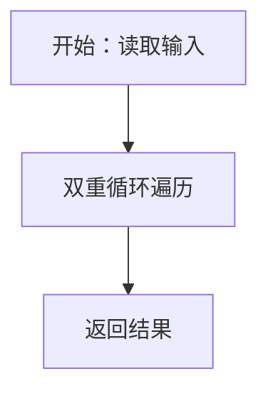

```java
package com.webfault.dsa; // 引入依赖

import java.util.*; // 引入依赖

class lc206_solution11 { // 定义类型
  static class ListNode { // static class ListNode {
    int val; // int 值;
    ListNode next; // ListNode 下一个;

    ListNode() {} // ListNode() {}

    ListNode(int v) {
      val = v;
    } // 把 值; } 写入 ListNode(int v) { val

    ListNode(int v, ListNode n) {
      val = v;
      next = n;
    } // 把 值; 下一个 赋值为 元素个数; } 写入 ListNode(int v, ListNode n) { val
  }

  public ListNode reverseList(ListNode head) { // 定义函数/方法 reverseList
    ListNode prev = null; // 把 null; 写入 ListNode prev
    ListNode curr = head; // 把 头节点; 写入 ListNode curr
    while (curr != null) { // 循环，直到不满足「当前值 不等于 null」
      ListNode next = curr.next; // 把 当前值.下一个; 写入 ListNode next
      curr.next = prev; // 把 前一个; 写入 下一个
      prev = curr; // 把 当前值; 写入 前一个
      curr = next; // 把 下一个; 写入 当前值
    }
    return prev; // 返回 前一个
  }

  static ListNode build(int[] a) { // 定义函数/方法 build
    ListNode dummy = new ListNode(0),
        cur = dummy; // 把 new ListNode(0), 当前值 赋值为 哨兵节点; 写入 ListNode dummy
    for (int v : a) {
      cur.next = new ListNode(v);
      cur = cur.next;
    } // 把 new ListNode(值); 当前值 赋值为 当前值.下一个; } 写入 下一个
    return dummy.next; // 返回 哨兵节点.下一个
  }

  static List<Integer> toList(ListNode h) { // 定义函数/方法 toList
    List<Integer> r = new ArrayList<>(); // 把 new ArrayList 小于 超过 (); 写入 List<Integer> r
    while (h != null) {
      r.add(h.val);
      h = h.next;
    } // 循环，直到不满足「h 不等于 null) { 右指针 追加 h.值); h 赋值为 h.下一个; }」
    return r; // 返回 右指针
  }

  static boolean eqList(ListNode a, ListNode b) { // 定义函数/方法 eqList
    while (a != null && b != null) { // 循环，直到不满足「数组 不等于 null 且 b 不等于 null」
      if (a.val != b.val) return false; // 若 数组.值 不等于 b.值，直接返回 false
      a = a.next;
      b = b.next; // 把 数组.下一个; b 赋值为 b.下一个; 写入 数组
    }
    return a == null && b == null; // 返回 数组 等于 null 且 b 等于 null
  }

  public static void main(String[] args) { // public static void main(String[] args) {
    lc206_solution11 s = new lc206_solution11(); // 把 new lc206_solution11(); 写入 lc206_solution11 s
    int[][][] tests = {{{1, 2, 3}, {3, 2, 1}}, {{}, {}}, {{1}, {1}}, {{1, 2}, {2, 1}}};
    boolean ok = true; // 把 true; 写入 boolean ok
    for (int[][] t : tests) { // for (int[][] 另一字符串 : tests) {
      ListNode got =
          s.reverseList(build(t[0])); // 把 字符串.reverseList(build(另一字符串[0])); 写入 ListNode got
      ListNode want = build(t[1]); // 把 build(另一字符串[1]); 写入 ListNode want
      if (!eqList(got, want)) { // 若 取反 eqList(got, want
        ok = false; // 把 false; 写入 ok
        System.out.println(
            "FAIL reverseList("
                + Arrays.toString(t[0])
                + ")="
                + toList(got)
                + " want "
                + Arrays.toString(t[1])); // 打印输出
      }
    }
    if (!ok) throw new RuntimeException("FAILED"); // 若 取反 ok) throw new RuntimeException(「FAILED」);
    System.out.println("PASS"); // 全部用例通过，输出 PASS
  }
}
```

#### 方案 2：单趟扫描

**思路与代码分析**：核心是「单趟扫描」。Java 版用类与静态方法组织，集合操作显式明了。代码里依次做这些事：双重循环遍历。

**运行架构**：与方案 1 的控制流相同（同算法在该语言的等价实现），图见上。

```java
package com.webfault.dsa; // 引入依赖

import java.util.*; // 引入依赖

class lc206_solution22 { // 定义类型
  static class ListNode { // static class ListNode {
    int val; // int 值;
    ListNode next; // ListNode 下一个;

    ListNode() {} // ListNode() {}

    ListNode(int v) {
      val = v;
    } // 把 值; } 写入 ListNode(int v) { val

    ListNode(int v, ListNode n) {
      val = v;
      next = n;
    } // 把 值; 下一个 赋值为 元素个数; } 写入 ListNode(int v, ListNode n) { val
  }

  static ListNode reverseList(ListNode head) { // 定义函数/方法 reverseList
    ListNode result = null; // 把 null; 写入 ListNode result
    while (head != null) { // 循环，直到不满足「头节点 不等于 null」
      ListNode temp = head.next; // 把 头节点.下一个; 写入 ListNode temp
      head.next = result; // 把 结果; 写入 下一个
      result = head; // 把 头节点; 写入 结果
      head = temp; // 把 临时变量; 写入 头节点
    }
    return result; // 返回 结果
  }

  static ListNode build(int[] a) { // 定义函数/方法 build
    ListNode dummy = new ListNode(0),
        cur = dummy; // 把 new ListNode(0), 当前值 赋值为 哨兵节点; 写入 ListNode dummy
    for (int v : a) {
      cur.next = new ListNode(v);
      cur = cur.next;
    } // 把 new ListNode(值); 当前值 赋值为 当前值.下一个; } 写入 下一个
    return dummy.next; // 返回 哨兵节点.下一个
  }

  static List<Integer> toList(ListNode h) { // 定义函数/方法 toList
    List<Integer> r = new ArrayList<>(); // 把 new ArrayList 小于 超过 (); 写入 List<Integer> r
    while (h != null) {
      r.add(h.val);
      h = h.next;
    } // 循环，直到不满足「h 不等于 null) { 右指针 追加 h.值); h 赋值为 h.下一个; }」
    return r; // 返回 右指针
  }

  static boolean eqList(ListNode a, ListNode b) { // 定义函数/方法 eqList
    while (a != null && b != null) { // 循环，直到不满足「数组 不等于 null 且 b 不等于 null」
      if (a.val != b.val) return false; // 若 数组.值 不等于 b.值，直接返回 false
      a = a.next;
      b = b.next; // 把 数组.下一个; b 赋值为 b.下一个; 写入 数组
    }
    return a == null && b == null; // 返回 数组 等于 null 且 b 等于 null
  }

  public static void main(String[] args) { // public static void main(String[] args) {
    lc206_solution22 s = new lc206_solution22(); // 把 new lc206_solution22(); 写入 lc206_solution22 s
    int[][][] tests = {{{1, 2, 3}, {3, 2, 1}}, {{}, {}}, {{1}, {1}}, {{1, 2}, {2, 1}}};
    boolean ok = true; // 把 true; 写入 boolean ok
    for (int[][] t : tests) { // for (int[][] 另一字符串 : tests) {
      ListNode got =
          s.reverseList(build(t[0])); // 把 字符串.reverseList(build(另一字符串[0])); 写入 ListNode got
      ListNode want = build(t[1]); // 把 build(另一字符串[1]); 写入 ListNode want
      if (!eqList(got, want)) { // 若 取反 eqList(got, want
        ok = false; // 把 false; 写入 ok
        System.out.println(
            "FAIL reverseList("
                + Arrays.toString(t[0])
                + ")="
                + toList(got)
                + " want "
                + Arrays.toString(t[1])); // 打印输出
      }
    }
    if (!ok) throw new RuntimeException("FAILED"); // 若 取反 ok) throw new RuntimeException(「FAILED」);
    System.out.println("PASS"); // 全部用例通过，输出 PASS
  }
}
```

#### 方案 3：单趟扫描

**思路与代码分析**：核心是「单趟扫描」。Java 版用类与静态方法组织，集合操作显式明了。代码里依次做这些事：双重循环遍历。

**运行架构**：与方案 1 的控制流相同（同算法在该语言的等价实现），图见上。

```java
package com.webfault.dsa; // 引入依赖

import java.util.*; // 引入依赖

class lc206_solution33 { // 定义类型
  static class ListNode { // static class ListNode {
    int val; // int 值;
    ListNode next; // ListNode 下一个;

    ListNode() {} // ListNode() {}

    ListNode(int v) {
      val = v;
    } // 把 值; } 写入 ListNode(int v) { val

    ListNode(int v, ListNode n) {
      val = v;
      next = n;
    } // 把 值; 下一个 赋值为 元素个数; } 写入 ListNode(int v, ListNode n) { val
  }

  public ListNode reverseList(ListNode head) { // 定义函数/方法 reverseList
    if (head == null || head.next == null) { // 若 头节点 等于 null 或 头节点.下一个 等于 null
      return head; // 返回 头节点
    }
    ListNode newHead = reverseList(head.next); // 把 reverseList(头节点.下一个); 写入 ListNode newHead
    head.next.next = head; // 把 头节点; 写入 下一个
    head.next = null; // 把 null; 写入 下一个
    return newHead; // 返回 newHead
  }

  static ListNode build(int[] a) { // 定义函数/方法 build
    ListNode dummy = new ListNode(0),
        cur = dummy; // 把 new ListNode(0), 当前值 赋值为 哨兵节点; 写入 ListNode dummy
    for (int v : a) {
      cur.next = new ListNode(v);
      cur = cur.next;
    } // 把 new ListNode(值); 当前值 赋值为 当前值.下一个; } 写入 下一个
    return dummy.next; // 返回 哨兵节点.下一个
  }

  static List<Integer> toList(ListNode h) { // 定义函数/方法 toList
    List<Integer> r = new ArrayList<>(); // 把 new ArrayList 小于 超过 (); 写入 List<Integer> r
    while (h != null) {
      r.add(h.val);
      h = h.next;
    } // 循环，直到不满足「h 不等于 null) { 右指针 追加 h.值); h 赋值为 h.下一个; }」
    return r; // 返回 右指针
  }

  static boolean eqList(ListNode a, ListNode b) { // 定义函数/方法 eqList
    while (a != null && b != null) { // 循环，直到不满足「数组 不等于 null 且 b 不等于 null」
      if (a.val != b.val) return false; // 若 数组.值 不等于 b.值，直接返回 false
      a = a.next;
      b = b.next; // 把 数组.下一个; b 赋值为 b.下一个; 写入 数组
    }
    return a == null && b == null; // 返回 数组 等于 null 且 b 等于 null
  }

  public static void main(String[] args) { // public static void main(String[] args) {
    lc206_solution33 s = new lc206_solution33(); // 把 new lc206_solution33(); 写入 lc206_solution33 s
    int[][][] tests = {{{1, 2, 3}, {3, 2, 1}}, {{}, {}}, {{1}, {1}}, {{1, 2}, {2, 1}}};
    boolean ok = true; // 把 true; 写入 boolean ok
    for (int[][] t : tests) { // for (int[][] 另一字符串 : tests) {
      ListNode got =
          s.reverseList(build(t[0])); // 把 字符串.reverseList(build(另一字符串[0])); 写入 ListNode got
      ListNode want = build(t[1]); // 把 build(另一字符串[1]); 写入 ListNode want
      if (!eqList(got, want)) { // 若 取反 eqList(got, want
        ok = false; // 把 false; 写入 ok
        System.out.println(
            "FAIL reverseList("
                + Arrays.toString(t[0])
                + ")="
                + toList(got)
                + " want "
                + Arrays.toString(t[1])); // 打印输出
      }
    }
    if (!ok) throw new RuntimeException("FAILED"); // 若 取反 ok) throw new RuntimeException(「FAILED」);
    System.out.println("PASS"); // 全部用例通过，输出 PASS
  }
}
```

#### 方案 4：单趟扫描

**思路与代码分析**：核心是「单趟扫描」。Java 版用类与静态方法组织，集合操作显式明了。代码里依次做这些事：双重循环遍历。

**运行架构**：与方案 1 的控制流相同（同算法在该语言的等价实现），图见上。

```java
package com.webfault.dsa; // 引入依赖

import java.util.*; // 引入依赖

class lc206_solution44 { // 定义类型
  static class ListNode { // static class ListNode {
    int val; // int 值;
    ListNode next; // ListNode 下一个;

    ListNode() {} // ListNode() {}

    ListNode(int v) {
      val = v;
    } // 把 值; } 写入 ListNode(int v) { val

    ListNode(int v, ListNode n) {
      val = v;
      next = n;
    } // 把 值; 下一个 赋值为 元素个数; } 写入 ListNode(int v, ListNode n) { val
  }

  public static ListNode reverseList(
      ListNode head) { // public static ListNode reverseList(ListNode 头节点) {
    ListNode p1 = head, p2 = null; // 把 头节点, p2 赋值为 null; 写入 ListNode p1
    while (p1 != null) { // 循环，直到不满足「p1 不等于 null」
      ListNode tmp = p1.next; // 把 p1.下一个; 写入 ListNode tmp
      p1.next = p2; // 把 p2; 写入 下一个
      p2 = p1; // 把 p1; 写入 p2
      p1 = tmp; // 把 临时变量; 写入 p1
    }
    return p2; // 返回 p2
  }

  static ListNode build(int[] a) { // 定义函数/方法 build
    ListNode dummy = new ListNode(0),
        cur = dummy; // 把 new ListNode(0), 当前值 赋值为 哨兵节点; 写入 ListNode dummy
    for (int v : a) {
      cur.next = new ListNode(v);
      cur = cur.next;
    } // 把 new ListNode(值); 当前值 赋值为 当前值.下一个; } 写入 下一个
    return dummy.next; // 返回 哨兵节点.下一个
  }

  static List<Integer> toList(ListNode h) { // 定义函数/方法 toList
    List<Integer> r = new ArrayList<>(); // 把 new ArrayList 小于 超过 (); 写入 List<Integer> r
    while (h != null) {
      r.add(h.val);
      h = h.next;
    } // 循环，直到不满足「h 不等于 null) { 右指针 追加 h.值); h 赋值为 h.下一个; }」
    return r; // 返回 右指针
  }

  static boolean eqList(ListNode a, ListNode b) { // 定义函数/方法 eqList
    while (a != null && b != null) { // 循环，直到不满足「数组 不等于 null 且 b 不等于 null」
      if (a.val != b.val) return false; // 若 数组.值 不等于 b.值，直接返回 false
      a = a.next;
      b = b.next; // 把 数组.下一个; b 赋值为 b.下一个; 写入 数组
    }
    return a == null && b == null; // 返回 数组 等于 null 且 b 等于 null
  }

  public static void main(String[] args) { // public static void main(String[] args) {
    lc206_solution44 s = new lc206_solution44(); // 把 new lc206_solution44(); 写入 lc206_solution44 s
    int[][][] tests = {{{1, 2, 3}, {3, 2, 1}}, {{}, {}}, {{1}, {1}}, {{1, 2}, {2, 1}}};
    boolean ok = true; // 把 true; 写入 boolean ok
    for (int[][] t : tests) { // for (int[][] 另一字符串 : tests) {
      ListNode got =
          s.reverseList(build(t[0])); // 把 字符串.reverseList(build(另一字符串[0])); 写入 ListNode got
      ListNode want = build(t[1]); // 把 build(另一字符串[1]); 写入 ListNode want
      if (!eqList(got, want)) { // 若 取反 eqList(got, want
        ok = false; // 把 false; 写入 ok
        System.out.println(
            "FAIL reverseList("
                + Arrays.toString(t[0])
                + ")="
                + toList(got)
                + " want "
                + Arrays.toString(t[1])); // 打印输出
      }
    }
    if (!ok) throw new RuntimeException("FAILED"); // 若 取反 ok) throw new RuntimeException(「FAILED」);
    System.out.println("PASS"); // 全部用例通过，输出 PASS
  }
}
```

#### 方案 5：单趟扫描

**思路与代码分析**：核心是「单趟扫描」。Java 版用类与静态方法组织，集合操作显式明了。代码里依次做这些事：双重循环遍历。**走读**：方案 5 · 单趟扫描：开始 → 更新 n → 遍历循环 → 更新 r → 更新 i → 遍历循环 → 返回 r。

**运行架构**（真实控制流）：

```mermaid
graph TD
    N0["方案 5 · 单趟扫描：开始"]
    N1["更新 n"]
    N2["遍历循环"]
    N3["更新 r"]
    N4["更新 i"]
    N5["遍历循环"]
    N6["返回 r"]
    N0 --> N1
    N1 --> N2
    N2 --> N3
    N3 --> N4
    N4 --> N5
    N5 --> N6
    classDef n fill:#f0fdfa,stroke:#0d9488,color:#1e293b;
    classDef lp fill:#ccfbf1,stroke:#0f766e,color:#1e293b;
    classDef dc fill:#fef9c3,stroke:#ca8a04,color:#1e293b;
    classDef tm fill:#f0fdf4,stroke:#16a34a,color:#1e293b;
    class N0,N1,N3,N4 n;
    class N2,N5 lp;
    class N6 tm;
```

```java
package com.webfault.dsa; // 引入依赖

import java.util.Arrays; // 引入依赖

class ListNode {
  int val;
  ListNode next;

  ListNode() {}

  ListNode(int v) {
    val = v;
  }

  ListNode(int v, ListNode n) {
    val = v;
    next = n;
  }
} // 定义类型

class Main { // 定义类型
  static ListNode build(int[] vals) {
    ListNode d = new ListNode();
    ListNode p = d;
    for (int v : vals) {
      p.next = new ListNode(v);
      p = p.next;
    }
    return d.next;
  }

  static int[] toArr(ListNode h) {
    int n = 0;
    for (ListNode x = h; x != null; x = x.next) n++;
    int[] r = new int[n];
    int i = 0;
    for (; h != null; h = h.next) r[i++] = h.val;
    return r;
  }

  static ListNode reverseList(ListNode head) {
    ListNode prev = null, cur = head;
    while (cur != null) {
      ListNode nx = cur.next;
      cur.next = prev;
      prev = cur;
      cur = nx;
    }
    return prev;
  }

  public static void main(String[] args) { // public static void main(String[] args) {
    int[][] ins = {{1, 2, 3, 4, 5}, {}, {1, 2}};
    int[][] ws = {{5, 4, 3, 2, 1}, {}, {2, 1}};
    boolean ok = true; // 把 true; 写入 boolean ok
    for (int i = 0; i < ins.length; i++) {
      int[] got = toArr(reverseList(build(ins[i])));
      if (!Arrays.equals(got, ws[i])) {
        ok = false;
        System.out.println("FAIL " + Arrays.toString(got));
      }
    } // 让 下标 i 从 0 开始计数，下标 i 小于 ins.长度 就继续
    if (!ok) throw new RuntimeException("FAILED"); // 若 取反 ok) throw new RuntimeException(「FAILED」);
    System.out.println("PASS"); // 全部用例通过，输出 PASS
  }
}
```

#### 方案 6：单趟扫描

**思路与代码分析**：核心是「单趟扫描」。Java 版用类与静态方法组织，集合操作显式明了。代码里依次做这些事：双重循环遍历。

**运行架构**：与方案 1 的控制流相同（同算法在该语言的等价实现），图见上。

```java
package com.webfault.dsa; // 引入依赖

import java.util.*; // 引入依赖

class lc206_solution66 { // 定义类型
  static class ListNode { // static class ListNode {
    int val; // int 值;
    ListNode next; // ListNode 下一个;

    ListNode() {} // ListNode() {}

    ListNode(int v) {
      val = v;
    } // 把 值; } 写入 ListNode(int v) { val

    ListNode(int v, ListNode n) {
      val = v;
      next = n;
    } // 把 值; 下一个 赋值为 元素个数; } 写入 ListNode(int v, ListNode n) { val
  }

  public ListNode reverseList(ListNode head) { // 定义函数/方法 reverseList
    if (head == null || head.next == null) { // 若 头节点 等于 null 或 头节点.下一个 等于 null
      return head; // 返回 头节点
    }
    ListNode result = reverseList(head.next); // 把 reverseList(头节点.下一个); 写入 ListNode result
    head.next.next = head; // 把 头节点; 写入 下一个
    head.next = null; // 把 null; 写入 下一个
    return result; // 返回 结果
  }

  static ListNode build(int[] a) { // 定义函数/方法 build
    ListNode dummy = new ListNode(0),
        cur = dummy; // 把 new ListNode(0), 当前值 赋值为 哨兵节点; 写入 ListNode dummy
    for (int v : a) {
      cur.next = new ListNode(v);
      cur = cur.next;
    } // 把 new ListNode(值); 当前值 赋值为 当前值.下一个; } 写入 下一个
    return dummy.next; // 返回 哨兵节点.下一个
  }

  static List<Integer> toList(ListNode h) { // 定义函数/方法 toList
    List<Integer> r = new ArrayList<>(); // 把 new ArrayList 小于 超过 (); 写入 List<Integer> r
    while (h != null) {
      r.add(h.val);
      h = h.next;
    } // 循环，直到不满足「h 不等于 null) { 右指针 追加 h.值); h 赋值为 h.下一个; }」
    return r; // 返回 右指针
  }

  static boolean eqList(ListNode a, ListNode b) { // 定义函数/方法 eqList
    while (a != null && b != null) { // 循环，直到不满足「数组 不等于 null 且 b 不等于 null」
      if (a.val != b.val) return false; // 若 数组.值 不等于 b.值，直接返回 false
      a = a.next;
      b = b.next; // 把 数组.下一个; b 赋值为 b.下一个; 写入 数组
    }
    return a == null && b == null; // 返回 数组 等于 null 且 b 等于 null
  }

  public static void main(String[] args) { // public static void main(String[] args) {
    lc206_solution66 s = new lc206_solution66(); // 把 new lc206_solution66(); 写入 lc206_solution66 s
    int[][][] tests = {{{1, 2, 3}, {3, 2, 1}}, {{}, {}}, {{1}, {1}}, {{1, 2}, {2, 1}}};
    boolean ok = true; // 把 true; 写入 boolean ok
    for (int[][] t : tests) { // for (int[][] 另一字符串 : tests) {
      ListNode got =
          s.reverseList(build(t[0])); // 把 字符串.reverseList(build(另一字符串[0])); 写入 ListNode got
      ListNode want = build(t[1]); // 把 build(另一字符串[1]); 写入 ListNode want
      if (!eqList(got, want)) { // 若 取反 eqList(got, want
        ok = false; // 把 false; 写入 ok
        System.out.println(
            "FAIL reverseList("
                + Arrays.toString(t[0])
                + ")="
                + toList(got)
                + " want "
                + Arrays.toString(t[1])); // 打印输出
      }
    }
    if (!ok) throw new RuntimeException("FAILED"); // 若 取反 ok) throw new RuntimeException(「FAILED」);
    System.out.println("PASS"); // 全部用例通过，输出 PASS
  }
}
```

### Rust 实现（6 种方案）

Rust 的全部方案如下，每个方案都内嵌用例自测，可独立运行（老仓库 python/go 文件遵循「打印结果」约定）：

#### 方案 1：迭代指针处理

**思路与代码分析**：核心是「迭代指针处理」。Rust 版用所有权移动与切片借用改写同一逻辑，注意 Option 与引用边界。**走读**：方案 1 · 迭代指针处理：开始 → 计算 out → 计算 cur → 当 let Some(n) = cur 时反复执行 → 向 out 追加记录 → 更新 cur → 处理 out → 返回结果。

**运行架构**（真实控制流）：

```mermaid
graph TD
    N0["方案 1 · 迭代指针处理：开始"]
    N1["计算 out"]
    N2["计算 cur"]
    N3["当 let Some(n) = cur 时反复执行"]
    N4["向 out 追加记录"]
    N5["更新 cur"]
    N6["处理 out"]
    N7["返回结果"]
    N0 --> N1
    N1 --> N2
    N2 --> N3
    N3 --> N4
    N4 --> N5
    N5 -- 下一轮 --> N3
    N3 --> N6
    N6 --> N7
    classDef n fill:#f0fdfa,stroke:#0d9488,color:#1e293b;
    classDef lp fill:#ccfbf1,stroke:#0f766e,color:#1e293b;
    classDef dc fill:#fef9c3,stroke:#ca8a04,color:#1e293b;
    classDef tm fill:#f0fdf4,stroke:#16a34a,color:#1e293b;
    class N0,N1,N2,N4,N5,N6 n;
    class N3 lp;
    class N7 tm;
```

```rust
// LeetCode 206. 反转链表 — Rust 版（方案1）
#[derive(Debug)]
struct ListNode {
    val: i32,
    next: Option<Box<ListNode>>,
} // 定义类型
fn build_list(vals: &[i32]) -> Option<Box<ListNode>> {
    // 定义函数/方法 build_list
    let mut head: Option<Box<ListNode>> = None; // 把 None; 写入 let mut head: Option<Box<ListNode>>
    for &v in vals.iter().rev() {
        head = Some(Box::new(ListNode { val: v, next: head }));
    }
    head // 头节点
}
fn to_vec(h: &Option<Box<ListNode>>) -> Vec<i32> {
    // 定义函数/方法 to_vec
    let mut out = Vec::new(); // 把 Vec::new(); 写入 let mut out
    let mut cur = h; // 把 h; 写入 let mut cur
    while let Some(n) = cur {
        out.push(n.val);
        cur = &n.next;
    } // 边取边处理，取空即停
    out // out
}
fn reverse_list(head: Option<Box<ListNode>>) -> Option<Box<ListNode>> {
    // 定义函数/方法 reverse_list
    let mut prev: Option<Box<ListNode>> = None; // 把 None; 写入 let mut prev: Option<Box<ListNode>>
    let mut cur = head; // 把 头节点; 写入 let mut cur
    while let Some(mut node) = cur {
        // 边取边处理，取空即停
        cur = node.next.take(); // 把 节点.下一个.take(); 写入 当前值
        node.next = prev; // 把 前一个; 写入 下一个
        prev = Some(node); // 把 Some(节点); 写入 前一个
    }
    prev // 前一个
}
fn main() {
    // 程序入口：跑内嵌自测用例
    let got = to_vec(&reverse_list(build_list(&[1, 2, 3, 4, 5])));
    assert_eq!(got, vec![5, 4, 3, 2, 1]); // 断言校验
    assert_eq!(to_vec(&reverse_list(build_list(&[]))), Vec::<i32>::new()); // 断言校验
    assert_eq!(to_vec(&reverse_list(build_list(&[1]))), vec![1]); // 断言校验
    println!("PASS"); // 全部用例通过，输出 PASS
}
```

#### 方案 2：单趟扫描

**思路与代码分析**：核心是「单趟扫描」。Rust 版用所有权移动与切片借用改写同一逻辑，注意 Option 与引用边界。**走读**：方案 2 · 单趟扫描：开始 → 计算 out → 计算 cur → 当 let Some(n) = cur 时反复执行 → 向 out 追加记录 → 更新 cur → 处理 out → 返回结果。

**运行架构**（真实控制流）：

```mermaid
graph TD
    N0["方案 2 · 单趟扫描：开始"]
    N1["计算 out"]
    N2["计算 cur"]
    N3["当 let Some(n) = cur 时反复执行"]
    N4["向 out 追加记录"]
    N5["更新 cur"]
    N6["处理 out"]
    N7["返回结果"]
    N0 --> N1
    N1 --> N2
    N2 --> N3
    N3 --> N4
    N4 --> N5
    N5 -- 下一轮 --> N3
    N3 --> N6
    N6 --> N7
    classDef n fill:#f0fdfa,stroke:#0d9488,color:#1e293b;
    classDef lp fill:#ccfbf1,stroke:#0f766e,color:#1e293b;
    classDef dc fill:#fef9c3,stroke:#ca8a04,color:#1e293b;
    classDef tm fill:#f0fdf4,stroke:#16a34a,color:#1e293b;
    class N0,N1,N2,N4,N5,N6 n;
    class N3 lp;
    class N7 tm;
```

```rust
// LeetCode 206. 反转链表 — Rust 版（方案2）
#[derive(Debug)]
struct ListNode {
    val: i32,
    next: Option<Box<ListNode>>,
} // 定义类型
fn build_list(vals: &[i32]) -> Option<Box<ListNode>> {
    // 定义函数/方法 build_list
    let mut head: Option<Box<ListNode>> = None; // 把 None; 写入 let mut head: Option<Box<ListNode>>
    for &v in vals.iter().rev() {
        head = Some(Box::new(ListNode { val: v, next: head }));
    }
    head // 头节点
}
fn to_vec(h: &Option<Box<ListNode>>) -> Vec<i32> {
    // 定义函数/方法 to_vec
    let mut out = Vec::new(); // 把 Vec::new(); 写入 let mut out
    let mut cur = h; // 把 h; 写入 let mut cur
    while let Some(n) = cur {
        out.push(n.val);
        cur = &n.next;
    } // 边取边处理，取空即停
    out // out
}
fn reverse_list(head: Option<Box<ListNode>>) -> Option<Box<ListNode>> {
    // 定义函数/方法 reverse_list
    let mut prev: Option<Box<ListNode>> = None; // 把 None; 写入 let mut prev: Option<Box<ListNode>>
    let mut cur = head; // 把 头节点; 写入 let mut cur
    while let Some(mut node) = cur {
        // 边取边处理，取空即停
        cur = node.next.take(); // 把 节点.下一个.take(); 写入 当前值
        node.next = prev; // 把 前一个; 写入 下一个
        prev = Some(node); // 把 Some(节点); 写入 前一个
    }
    prev // 前一个
}
fn main() {
    // 程序入口：跑内嵌自测用例
    let got = to_vec(&reverse_list(build_list(&[1, 2, 3, 4, 5])));
    assert_eq!(got, vec![5, 4, 3, 2, 1]); // 断言校验
    assert_eq!(to_vec(&reverse_list(build_list(&[]))), Vec::<i32>::new()); // 断言校验
    assert_eq!(to_vec(&reverse_list(build_list(&[1]))), vec![1]); // 断言校验
    println!("PASS"); // 全部用例通过，输出 PASS
}
```

#### 方案 3：单趟扫描

**思路与代码分析**：核心是「单趟扫描」。Rust 版用所有权移动与切片借用改写同一逻辑，注意 Option 与引用边界。**走读**：方案 3 · 单趟扫描：开始 → 计算 out → 计算 cur → 当 let Some(n) = cur 时反复执行 → 向 out 追加记录 → 更新 cur → 处理 out → 返回结果。

**运行架构**（真实控制流）：

```mermaid
graph TD
    N0["方案 3 · 单趟扫描：开始"]
    N1["计算 out"]
    N2["计算 cur"]
    N3["当 let Some(n) = cur 时反复执行"]
    N4["向 out 追加记录"]
    N5["更新 cur"]
    N6["处理 out"]
    N7["返回结果"]
    N0 --> N1
    N1 --> N2
    N2 --> N3
    N3 --> N4
    N4 --> N5
    N5 -- 下一轮 --> N3
    N3 --> N6
    N6 --> N7
    classDef n fill:#f0fdfa,stroke:#0d9488,color:#1e293b;
    classDef lp fill:#ccfbf1,stroke:#0f766e,color:#1e293b;
    classDef dc fill:#fef9c3,stroke:#ca8a04,color:#1e293b;
    classDef tm fill:#f0fdf4,stroke:#16a34a,color:#1e293b;
    class N0,N1,N2,N4,N5,N6 n;
    class N3 lp;
    class N7 tm;
```

```rust
// LeetCode 206. 反转链表 — Rust 版（方案3）
#[derive(Debug)]
struct ListNode {
    val: i32,
    next: Option<Box<ListNode>>,
} // 定义类型
fn build_list(vals: &[i32]) -> Option<Box<ListNode>> {
    // 定义函数/方法 build_list
    let mut head: Option<Box<ListNode>> = None; // 把 None; 写入 let mut head: Option<Box<ListNode>>
    for &v in vals.iter().rev() {
        head = Some(Box::new(ListNode { val: v, next: head }));
    }
    head // 头节点
}
fn to_vec(h: &Option<Box<ListNode>>) -> Vec<i32> {
    // 定义函数/方法 to_vec
    let mut out = Vec::new(); // 把 Vec::new(); 写入 let mut out
    let mut cur = h; // 把 h; 写入 let mut cur
    while let Some(n) = cur {
        out.push(n.val);
        cur = &n.next;
    } // 边取边处理，取空即停
    out // out
}
fn reverse_list(head: Option<Box<ListNode>>) -> Option<Box<ListNode>> {
    // 定义函数/方法 reverse_list
    let mut prev: Option<Box<ListNode>> = None; // 把 None; 写入 let mut prev: Option<Box<ListNode>>
    let mut cur = head; // 把 头节点; 写入 let mut cur
    while let Some(mut node) = cur {
        // 边取边处理，取空即停
        cur = node.next.take(); // 把 节点.下一个.take(); 写入 当前值
        node.next = prev; // 把 前一个; 写入 下一个
        prev = Some(node); // 把 Some(节点); 写入 前一个
    }
    prev // 前一个
}
fn main() {
    // 程序入口：跑内嵌自测用例
    let got = to_vec(&reverse_list(build_list(&[1, 2, 3, 4, 5])));
    assert_eq!(got, vec![5, 4, 3, 2, 1]); // 断言校验
    assert_eq!(to_vec(&reverse_list(build_list(&[]))), Vec::<i32>::new()); // 断言校验
    assert_eq!(to_vec(&reverse_list(build_list(&[1]))), vec![1]); // 断言校验
    println!("PASS"); // 全部用例通过，输出 PASS
}
```

#### 方案 4：单趟扫描

**思路与代码分析**：核心是「单趟扫描」。Rust 版用所有权移动与切片借用改写同一逻辑，注意 Option 与引用边界。**走读**：方案 4 · 单趟扫描：开始 → 计算 out → 计算 cur → 当 let Some(n) = cur 时反复执行 → 向 out 追加记录 → 更新 cur → 处理 out → 返回结果。

**运行架构**（真实控制流）：

```mermaid
graph TD
    N0["方案 4 · 单趟扫描：开始"]
    N1["计算 out"]
    N2["计算 cur"]
    N3["当 let Some(n) = cur 时反复执行"]
    N4["向 out 追加记录"]
    N5["更新 cur"]
    N6["处理 out"]
    N7["返回结果"]
    N0 --> N1
    N1 --> N2
    N2 --> N3
    N3 --> N4
    N4 --> N5
    N5 -- 下一轮 --> N3
    N3 --> N6
    N6 --> N7
    classDef n fill:#f0fdfa,stroke:#0d9488,color:#1e293b;
    classDef lp fill:#ccfbf1,stroke:#0f766e,color:#1e293b;
    classDef dc fill:#fef9c3,stroke:#ca8a04,color:#1e293b;
    classDef tm fill:#f0fdf4,stroke:#16a34a,color:#1e293b;
    class N0,N1,N2,N4,N5,N6 n;
    class N3 lp;
    class N7 tm;
```

```rust
// LeetCode 206. 反转链表 — Rust 版（方案4）
#[derive(Debug)]
struct ListNode {
    val: i32,
    next: Option<Box<ListNode>>,
} // 定义类型
fn build_list(vals: &[i32]) -> Option<Box<ListNode>> {
    // 定义函数/方法 build_list
    let mut head: Option<Box<ListNode>> = None; // 把 None; 写入 let mut head: Option<Box<ListNode>>
    for &v in vals.iter().rev() {
        head = Some(Box::new(ListNode { val: v, next: head }));
    }
    head // 头节点
}
fn to_vec(h: &Option<Box<ListNode>>) -> Vec<i32> {
    // 定义函数/方法 to_vec
    let mut out = Vec::new(); // 把 Vec::new(); 写入 let mut out
    let mut cur = h; // 把 h; 写入 let mut cur
    while let Some(n) = cur {
        out.push(n.val);
        cur = &n.next;
    } // 边取边处理，取空即停
    out // out
}
fn reverse_list(head: Option<Box<ListNode>>) -> Option<Box<ListNode>> {
    // 定义函数/方法 reverse_list
    let mut prev: Option<Box<ListNode>> = None; // 把 None; 写入 let mut prev: Option<Box<ListNode>>
    let mut cur = head; // 把 头节点; 写入 let mut cur
    while let Some(mut node) = cur {
        // 边取边处理，取空即停
        cur = node.next.take(); // 把 节点.下一个.take(); 写入 当前值
        node.next = prev; // 把 前一个; 写入 下一个
        prev = Some(node); // 把 Some(节点); 写入 前一个
    }
    prev // 前一个
}
fn main() {
    // 程序入口：跑内嵌自测用例
    let got = to_vec(&reverse_list(build_list(&[1, 2, 3, 4, 5])));
    assert_eq!(got, vec![5, 4, 3, 2, 1]); // 断言校验
    assert_eq!(to_vec(&reverse_list(build_list(&[]))), Vec::<i32>::new()); // 断言校验
    assert_eq!(to_vec(&reverse_list(build_list(&[1]))), vec![1]); // 断言校验
    println!("PASS"); // 全部用例通过，输出 PASS
}
```

#### 方案 5：单趟扫描

**思路与代码分析**：核心是「单趟扫描」。Rust 版用所有权移动与切片借用改写同一逻辑，注意 Option 与引用边界。**走读**：方案 5 · 单趟扫描：开始 → 计算 out → 计算 cur → 当 let Some(n) = cur 时反复执行 → 向 out 追加记录 → 更新 cur → 处理 out → 返回结果。

**运行架构**（真实控制流）：

```mermaid
graph TD
    N0["方案 5 · 单趟扫描：开始"]
    N1["计算 out"]
    N2["计算 cur"]
    N3["当 let Some(n) = cur 时反复执行"]
    N4["向 out 追加记录"]
    N5["更新 cur"]
    N6["处理 out"]
    N7["返回结果"]
    N0 --> N1
    N1 --> N2
    N2 --> N3
    N3 --> N4
    N4 --> N5
    N5 -- 下一轮 --> N3
    N3 --> N6
    N6 --> N7
    classDef n fill:#f0fdfa,stroke:#0d9488,color:#1e293b;
    classDef lp fill:#ccfbf1,stroke:#0f766e,color:#1e293b;
    classDef dc fill:#fef9c3,stroke:#ca8a04,color:#1e293b;
    classDef tm fill:#f0fdf4,stroke:#16a34a,color:#1e293b;
    class N0,N1,N2,N4,N5,N6 n;
    class N3 lp;
    class N7 tm;
```

```rust
// LeetCode 206. 反转链表 — Rust 版（方案5）
#[derive(Debug)]
struct ListNode {
    val: i32,
    next: Option<Box<ListNode>>,
} // 定义类型
fn build_list(vals: &[i32]) -> Option<Box<ListNode>> {
    // 定义函数/方法 build_list
    let mut head: Option<Box<ListNode>> = None; // 把 None; 写入 let mut head: Option<Box<ListNode>>
    for &v in vals.iter().rev() {
        head = Some(Box::new(ListNode { val: v, next: head }));
    }
    head // 头节点
}
fn to_vec(h: &Option<Box<ListNode>>) -> Vec<i32> {
    // 定义函数/方法 to_vec
    let mut out = Vec::new(); // 把 Vec::new(); 写入 let mut out
    let mut cur = h; // 把 h; 写入 let mut cur
    while let Some(n) = cur {
        out.push(n.val);
        cur = &n.next;
    } // 边取边处理，取空即停
    out // out
}
fn reverse_list(head: Option<Box<ListNode>>) -> Option<Box<ListNode>> {
    // 定义函数/方法 reverse_list
    let mut prev: Option<Box<ListNode>> = None; // 把 None; 写入 let mut prev: Option<Box<ListNode>>
    let mut cur = head; // 把 头节点; 写入 let mut cur
    while let Some(mut node) = cur {
        // 边取边处理，取空即停
        cur = node.next.take(); // 把 节点.下一个.take(); 写入 当前值
        node.next = prev; // 把 前一个; 写入 下一个
        prev = Some(node); // 把 Some(节点); 写入 前一个
    }
    prev // 前一个
}
fn main() {
    // 程序入口：跑内嵌自测用例
    let got = to_vec(&reverse_list(build_list(&[1, 2, 3, 4, 5])));
    assert_eq!(got, vec![5, 4, 3, 2, 1]); // 断言校验
    assert_eq!(to_vec(&reverse_list(build_list(&[]))), Vec::<i32>::new()); // 断言校验
    assert_eq!(to_vec(&reverse_list(build_list(&[1]))), vec![1]); // 断言校验
    println!("PASS"); // 全部用例通过，输出 PASS
}
```

#### 方案 6：单趟扫描

**思路与代码分析**：核心是「单趟扫描」。Rust 版用所有权移动与切片借用改写同一逻辑，注意 Option 与引用边界。**走读**：方案 6 · 单趟扫描：开始 → 计算 out → 计算 cur → 当 let Some(n) = cur 时反复执行 → 向 out 追加记录 → 更新 cur → 处理 out → 返回结果。

**运行架构**（真实控制流）：

```mermaid
graph TD
    N0["方案 6 · 单趟扫描：开始"]
    N1["计算 out"]
    N2["计算 cur"]
    N3["当 let Some(n) = cur 时反复执行"]
    N4["向 out 追加记录"]
    N5["更新 cur"]
    N6["处理 out"]
    N7["返回结果"]
    N0 --> N1
    N1 --> N2
    N2 --> N3
    N3 --> N4
    N4 --> N5
    N5 -- 下一轮 --> N3
    N3 --> N6
    N6 --> N7
    classDef n fill:#f0fdfa,stroke:#0d9488,color:#1e293b;
    classDef lp fill:#ccfbf1,stroke:#0f766e,color:#1e293b;
    classDef dc fill:#fef9c3,stroke:#ca8a04,color:#1e293b;
    classDef tm fill:#f0fdf4,stroke:#16a34a,color:#1e293b;
    class N0,N1,N2,N4,N5,N6 n;
    class N3 lp;
    class N7 tm;
```

```rust
// LeetCode 206. 反转链表 — Rust 版（方案6）
#[derive(Debug)]
struct ListNode {
    val: i32,
    next: Option<Box<ListNode>>,
} // 定义类型
fn build_list(vals: &[i32]) -> Option<Box<ListNode>> {
    // 定义函数/方法 build_list
    let mut head: Option<Box<ListNode>> = None; // 把 None; 写入 let mut head: Option<Box<ListNode>>
    for &v in vals.iter().rev() {
        head = Some(Box::new(ListNode { val: v, next: head }));
    }
    head // 头节点
}
fn to_vec(h: &Option<Box<ListNode>>) -> Vec<i32> {
    // 定义函数/方法 to_vec
    let mut out = Vec::new(); // 把 Vec::new(); 写入 let mut out
    let mut cur = h; // 把 h; 写入 let mut cur
    while let Some(n) = cur {
        out.push(n.val);
        cur = &n.next;
    } // 边取边处理，取空即停
    out // out
}
fn reverse_list(head: Option<Box<ListNode>>) -> Option<Box<ListNode>> {
    // 定义函数/方法 reverse_list
    let mut prev: Option<Box<ListNode>> = None; // 把 None; 写入 let mut prev: Option<Box<ListNode>>
    let mut cur = head; // 把 头节点; 写入 let mut cur
    while let Some(mut node) = cur {
        // 边取边处理，取空即停
        cur = node.next.take(); // 把 节点.下一个.take(); 写入 当前值
        node.next = prev; // 把 前一个; 写入 下一个
        prev = Some(node); // 把 Some(节点); 写入 前一个
    }
    prev // 前一个
}
fn main() {
    // 程序入口：跑内嵌自测用例
    let got = to_vec(&reverse_list(build_list(&[1, 2, 3, 4, 5])));
    assert_eq!(got, vec![5, 4, 3, 2, 1]); // 断言校验
    assert_eq!(to_vec(&reverse_list(build_list(&[]))), Vec::<i32>::new()); // 断言校验
    assert_eq!(to_vec(&reverse_list(build_list(&[1]))), vec![1]); // 断言校验
    println!("PASS"); // 全部用例通过，输出 PASS
}
```

### Lua 实现（6 种方案）

Lua 的全部方案如下，每个方案都内嵌用例自测，可独立运行（老仓库 python/go 文件遵循「打印结果」约定）：

#### 方案 1：迭代指针处理

**思路与代码分析**：核心是「迭代指针处理」。Lua 版用表与 ipairs 遍历，注意 ipairs 遇 nil 即停的语义。**走读**：方案 1 · 迭代指针处理：开始 → 更新 cur → 遍历 ipairs(vals) do 中的每个元素 v → 更新 n → 处理 if not head then → 更新 cur → 更新 cur → 返回 head。

**运行架构**（真实控制流）：

```mermaid
graph TD
    N0["方案 1 · 迭代指针处理：开始"]
    N1["更新 cur"]
    N2["遍历 ipairs(vals) do 中的每个元素 v"]
    N3["更新 n"]
    N4["处理 if not head then"]
    N5["更新 cur"]
    N6["更新 cur"]
    N7["返回 head"]
    N0 --> N1
    N1 --> N2
    N2 --> N3
    N3 --> N4
    N4 --> N5
    N5 --> N6
    N6 --> N7
    classDef n fill:#f0fdfa,stroke:#0d9488,color:#1e293b;
    classDef lp fill:#ccfbf1,stroke:#0f766e,color:#1e293b;
    classDef dc fill:#fef9c3,stroke:#ca8a04,color:#1e293b;
    classDef tm fill:#f0fdf4,stroke:#16a34a,color:#1e293b;
    class N0,N1,N3,N4,N5,N6 n;
    class N2 lp;
    class N7 tm;
```

```lua
-- LeetCode 206. 反转链表 — Lua 版（方案1）
local ListNode = {} -- 把 {} 写入 local ListNode
ListNode.__index = ListNode -- 把 ListNode 写入 ListNode.__index
function ListNode.new(val, next)
	return setmetatable({ val = val, next = next }, ListNode)
end
local function build_list(vals) -- local function build_list(vals)
	local head, cur = nil, nil -- 把 nil, nil 写入 local head, cur
	for _, v in ipairs(vals) do -- 遍历取 值
		local n = ListNode.new(v) -- 把 ListNode.new(值) 写入 local n
		if not head then
			head, cur = n, n
		else
			cur.next, cur = n, n
		end
	end -- 终点
	return head -- 返回 头节点
end -- 终点
local function to_vec(h) -- local function to_vec(h)
	local out = {} -- 把 {} 写入 local out
	while h do
		out[#out + 1] = h.val
		h = h.next
	end -- 把 h.值; h 赋值为 h.下一个 终点 写入 while h do out[#out + 1]
	return out -- 返回 out
end -- 终点
local function reverse_list(head) -- local function reverse_list(头节点)
	local prev = nil -- 把 nil 写入 local prev
	local cur = head -- 把 头节点 写入 local cur
	while cur do -- while 当前值 do
		local nxt = cur.next -- 把 当前值.下一个 写入 local nxt
		cur.next = prev -- 把 前一个 写入 下一个
		prev = cur -- 把 当前值 存入 前一个
		cur = nxt -- 把 nxt 存入 当前值
	end -- 终点
	return prev -- 返回 前一个
end -- 终点
assert(table.concat(to_vec(reverse_list(build_list({ 1, 2, 3, 4, 5 }))), ",") == "5,4,3,2,1") -- 打印输出
assert(#to_vec(reverse_list(build_list({}))) == 0) -- 断言校验
assert(table.concat(to_vec(reverse_list(build_list({ 1 }))), ",") == "1") -- 打印输出
print("PASS") -- 全部用例通过，输出 PASS
```

#### 方案 2：单趟扫描

**思路与代码分析**：核心是「单趟扫描」。Lua 版用表与 ipairs 遍历，注意 ipairs 遇 nil 即停的语义。**走读**：方案 2 · 单趟扫描：开始 → 更新 cur → 遍历 ipairs(vals) do 中的每个元素 v → 更新 n → 处理 if not head then → 更新 cur → 更新 cur → 返回 head。

**运行架构**（真实控制流）：

```mermaid
graph TD
    N0["方案 2 · 单趟扫描：开始"]
    N1["更新 cur"]
    N2["遍历 ipairs(vals) do 中的每个元素 v"]
    N3["更新 n"]
    N4["处理 if not head then"]
    N5["更新 cur"]
    N6["更新 cur"]
    N7["返回 head"]
    N0 --> N1
    N1 --> N2
    N2 --> N3
    N3 --> N4
    N4 --> N5
    N5 --> N6
    N6 --> N7
    classDef n fill:#f0fdfa,stroke:#0d9488,color:#1e293b;
    classDef lp fill:#ccfbf1,stroke:#0f766e,color:#1e293b;
    classDef dc fill:#fef9c3,stroke:#ca8a04,color:#1e293b;
    classDef tm fill:#f0fdf4,stroke:#16a34a,color:#1e293b;
    class N0,N1,N3,N4,N5,N6 n;
    class N2 lp;
    class N7 tm;
```

```lua
-- LeetCode 206. 反转链表 — Lua 版（方案2）
local ListNode = {} -- 把 {} 写入 local ListNode
ListNode.__index = ListNode -- 把 ListNode 写入 ListNode.__index
function ListNode.new(val, next)
	return setmetatable({ val = val, next = next }, ListNode)
end
local function build_list(vals) -- local function build_list(vals)
	local head, cur = nil, nil -- 把 nil, nil 写入 local head, cur
	for _, v in ipairs(vals) do -- 遍历取 值
		local n = ListNode.new(v) -- 把 ListNode.new(值) 写入 local n
		if not head then
			head, cur = n, n
		else
			cur.next, cur = n, n
		end
	end -- 终点
	return head -- 返回 头节点
end -- 终点
local function to_vec(h) -- local function to_vec(h)
	local out = {} -- 把 {} 写入 local out
	while h do
		out[#out + 1] = h.val
		h = h.next
	end -- 把 h.值; h 赋值为 h.下一个 终点 写入 while h do out[#out + 1]
	return out -- 返回 out
end -- 终点
local function reverse_list(head) -- local function reverse_list(头节点)
	local prev = nil -- 把 nil 写入 local prev
	local cur = head -- 把 头节点 写入 local cur
	while cur do -- while 当前值 do
		local nxt = cur.next -- 把 当前值.下一个 写入 local nxt
		cur.next = prev -- 把 前一个 写入 下一个
		prev = cur -- 把 当前值 存入 前一个
		cur = nxt -- 把 nxt 存入 当前值
	end -- 终点
	return prev -- 返回 前一个
end -- 终点
assert(table.concat(to_vec(reverse_list(build_list({ 1, 2, 3, 4, 5 }))), ",") == "5,4,3,2,1") -- 打印输出
assert(#to_vec(reverse_list(build_list({}))) == 0) -- 断言校验
assert(table.concat(to_vec(reverse_list(build_list({ 1 }))), ",") == "1") -- 打印输出
print("PASS") -- 全部用例通过，输出 PASS
```

#### 方案 3：单趟扫描

**思路与代码分析**：核心是「单趟扫描」。Lua 版用表与 ipairs 遍历，注意 ipairs 遇 nil 即停的语义。**走读**：方案 3 · 单趟扫描：开始 → 更新 cur → 遍历 ipairs(vals) do 中的每个元素 v → 更新 n → 处理 if not head then → 更新 cur → 更新 cur → 返回 head。

**运行架构**（真实控制流）：

```mermaid
graph TD
    N0["方案 3 · 单趟扫描：开始"]
    N1["更新 cur"]
    N2["遍历 ipairs(vals) do 中的每个元素 v"]
    N3["更新 n"]
    N4["处理 if not head then"]
    N5["更新 cur"]
    N6["更新 cur"]
    N7["返回 head"]
    N0 --> N1
    N1 --> N2
    N2 --> N3
    N3 --> N4
    N4 --> N5
    N5 --> N6
    N6 --> N7
    classDef n fill:#f0fdfa,stroke:#0d9488,color:#1e293b;
    classDef lp fill:#ccfbf1,stroke:#0f766e,color:#1e293b;
    classDef dc fill:#fef9c3,stroke:#ca8a04,color:#1e293b;
    classDef tm fill:#f0fdf4,stroke:#16a34a,color:#1e293b;
    class N0,N1,N3,N4,N5,N6 n;
    class N2 lp;
    class N7 tm;
```

```lua
-- LeetCode 206. 反转链表 — Lua 版（方案3）
local ListNode = {} -- 把 {} 写入 local ListNode
ListNode.__index = ListNode -- 把 ListNode 写入 ListNode.__index
function ListNode.new(val, next)
	return setmetatable({ val = val, next = next }, ListNode)
end
local function build_list(vals) -- local function build_list(vals)
	local head, cur = nil, nil -- 把 nil, nil 写入 local head, cur
	for _, v in ipairs(vals) do -- 遍历取 值
		local n = ListNode.new(v) -- 把 ListNode.new(值) 写入 local n
		if not head then
			head, cur = n, n
		else
			cur.next, cur = n, n
		end
	end -- 终点
	return head -- 返回 头节点
end -- 终点
local function to_vec(h) -- local function to_vec(h)
	local out = {} -- 把 {} 写入 local out
	while h do
		out[#out + 1] = h.val
		h = h.next
	end -- 把 h.值; h 赋值为 h.下一个 终点 写入 while h do out[#out + 1]
	return out -- 返回 out
end -- 终点
local function reverse_list(head) -- local function reverse_list(头节点)
	local prev = nil -- 把 nil 写入 local prev
	local cur = head -- 把 头节点 写入 local cur
	while cur do -- while 当前值 do
		local nxt = cur.next -- 把 当前值.下一个 写入 local nxt
		cur.next = prev -- 把 前一个 写入 下一个
		prev = cur -- 把 当前值 存入 前一个
		cur = nxt -- 把 nxt 存入 当前值
	end -- 终点
	return prev -- 返回 前一个
end -- 终点
assert(table.concat(to_vec(reverse_list(build_list({ 1, 2, 3, 4, 5 }))), ",") == "5,4,3,2,1") -- 打印输出
assert(#to_vec(reverse_list(build_list({}))) == 0) -- 断言校验
assert(table.concat(to_vec(reverse_list(build_list({ 1 }))), ",") == "1") -- 打印输出
print("PASS") -- 全部用例通过，输出 PASS
```

#### 方案 4：单趟扫描

**思路与代码分析**：核心是「单趟扫描」。Lua 版用表与 ipairs 遍历，注意 ipairs 遇 nil 即停的语义。**走读**：方案 4 · 单趟扫描：开始 → 更新 cur → 遍历 ipairs(vals) do 中的每个元素 v → 更新 n → 处理 if not head then → 更新 cur → 更新 cur → 返回 head。

**运行架构**（真实控制流）：

```mermaid
graph TD
    N0["方案 4 · 单趟扫描：开始"]
    N1["更新 cur"]
    N2["遍历 ipairs(vals) do 中的每个元素 v"]
    N3["更新 n"]
    N4["处理 if not head then"]
    N5["更新 cur"]
    N6["更新 cur"]
    N7["返回 head"]
    N0 --> N1
    N1 --> N2
    N2 --> N3
    N3 --> N4
    N4 --> N5
    N5 --> N6
    N6 --> N7
    classDef n fill:#f0fdfa,stroke:#0d9488,color:#1e293b;
    classDef lp fill:#ccfbf1,stroke:#0f766e,color:#1e293b;
    classDef dc fill:#fef9c3,stroke:#ca8a04,color:#1e293b;
    classDef tm fill:#f0fdf4,stroke:#16a34a,color:#1e293b;
    class N0,N1,N3,N4,N5,N6 n;
    class N2 lp;
    class N7 tm;
```

```lua
-- LeetCode 206. 反转链表 — Lua 版（方案4）
local ListNode = {} -- 把 {} 写入 local ListNode
ListNode.__index = ListNode -- 把 ListNode 写入 ListNode.__index
function ListNode.new(val, next)
	return setmetatable({ val = val, next = next }, ListNode)
end
local function build_list(vals) -- local function build_list(vals)
	local head, cur = nil, nil -- 把 nil, nil 写入 local head, cur
	for _, v in ipairs(vals) do -- 遍历取 值
		local n = ListNode.new(v) -- 把 ListNode.new(值) 写入 local n
		if not head then
			head, cur = n, n
		else
			cur.next, cur = n, n
		end
	end -- 终点
	return head -- 返回 头节点
end -- 终点
local function to_vec(h) -- local function to_vec(h)
	local out = {} -- 把 {} 写入 local out
	while h do
		out[#out + 1] = h.val
		h = h.next
	end -- 把 h.值; h 赋值为 h.下一个 终点 写入 while h do out[#out + 1]
	return out -- 返回 out
end -- 终点
local function reverse_list(head) -- local function reverse_list(头节点)
	local prev = nil -- 把 nil 写入 local prev
	local cur = head -- 把 头节点 写入 local cur
	while cur do -- while 当前值 do
		local nxt = cur.next -- 把 当前值.下一个 写入 local nxt
		cur.next = prev -- 把 前一个 写入 下一个
		prev = cur -- 把 当前值 存入 前一个
		cur = nxt -- 把 nxt 存入 当前值
	end -- 终点
	return prev -- 返回 前一个
end -- 终点
assert(table.concat(to_vec(reverse_list(build_list({ 1, 2, 3, 4, 5 }))), ",") == "5,4,3,2,1") -- 打印输出
assert(#to_vec(reverse_list(build_list({}))) == 0) -- 断言校验
assert(table.concat(to_vec(reverse_list(build_list({ 1 }))), ",") == "1") -- 打印输出
print("PASS") -- 全部用例通过，输出 PASS
```

#### 方案 5：单趟扫描

**思路与代码分析**：核心是「单趟扫描」。Lua 版用表与 ipairs 遍历，注意 ipairs 遇 nil 即停的语义。**走读**：方案 5 · 单趟扫描：开始 → 更新 cur → 遍历 ipairs(vals) do 中的每个元素 v → 更新 n → 处理 if not head then → 更新 cur → 更新 cur → 返回 head。

**运行架构**（真实控制流）：

```mermaid
graph TD
    N0["方案 5 · 单趟扫描：开始"]
    N1["更新 cur"]
    N2["遍历 ipairs(vals) do 中的每个元素 v"]
    N3["更新 n"]
    N4["处理 if not head then"]
    N5["更新 cur"]
    N6["更新 cur"]
    N7["返回 head"]
    N0 --> N1
    N1 --> N2
    N2 --> N3
    N3 --> N4
    N4 --> N5
    N5 --> N6
    N6 --> N7
    classDef n fill:#f0fdfa,stroke:#0d9488,color:#1e293b;
    classDef lp fill:#ccfbf1,stroke:#0f766e,color:#1e293b;
    classDef dc fill:#fef9c3,stroke:#ca8a04,color:#1e293b;
    classDef tm fill:#f0fdf4,stroke:#16a34a,color:#1e293b;
    class N0,N1,N3,N4,N5,N6 n;
    class N2 lp;
    class N7 tm;
```

```lua
-- LeetCode 206. 反转链表 — Lua 版（方案5）
local ListNode = {} -- 把 {} 写入 local ListNode
ListNode.__index = ListNode -- 把 ListNode 写入 ListNode.__index
function ListNode.new(val, next)
	return setmetatable({ val = val, next = next }, ListNode)
end
local function build_list(vals) -- local function build_list(vals)
	local head, cur = nil, nil -- 把 nil, nil 写入 local head, cur
	for _, v in ipairs(vals) do -- 遍历取 值
		local n = ListNode.new(v) -- 把 ListNode.new(值) 写入 local n
		if not head then
			head, cur = n, n
		else
			cur.next, cur = n, n
		end
	end -- 终点
	return head -- 返回 头节点
end -- 终点
local function to_vec(h) -- local function to_vec(h)
	local out = {} -- 把 {} 写入 local out
	while h do
		out[#out + 1] = h.val
		h = h.next
	end -- 把 h.值; h 赋值为 h.下一个 终点 写入 while h do out[#out + 1]
	return out -- 返回 out
end -- 终点
local function reverse_list(head) -- local function reverse_list(头节点)
	local prev = nil -- 把 nil 写入 local prev
	local cur = head -- 把 头节点 写入 local cur
	while cur do -- while 当前值 do
		local nxt = cur.next -- 把 当前值.下一个 写入 local nxt
		cur.next = prev -- 把 前一个 写入 下一个
		prev = cur -- 把 当前值 存入 前一个
		cur = nxt -- 把 nxt 存入 当前值
	end -- 终点
	return prev -- 返回 前一个
end -- 终点
assert(table.concat(to_vec(reverse_list(build_list({ 1, 2, 3, 4, 5 }))), ",") == "5,4,3,2,1") -- 打印输出
assert(#to_vec(reverse_list(build_list({}))) == 0) -- 断言校验
assert(table.concat(to_vec(reverse_list(build_list({ 1 }))), ",") == "1") -- 打印输出
print("PASS") -- 全部用例通过，输出 PASS
```

#### 方案 6：单趟扫描

**思路与代码分析**：核心是「单趟扫描」。Lua 版用表与 ipairs 遍历，注意 ipairs 遇 nil 即停的语义。**走读**：方案 6 · 单趟扫描：开始 → 更新 cur → 遍历 ipairs(vals) do 中的每个元素 v → 更新 n → 处理 if not head then → 更新 cur → 更新 cur → 返回 head。

**运行架构**（真实控制流）：

```mermaid
graph TD
    N0["方案 6 · 单趟扫描：开始"]
    N1["更新 cur"]
    N2["遍历 ipairs(vals) do 中的每个元素 v"]
    N3["更新 n"]
    N4["处理 if not head then"]
    N5["更新 cur"]
    N6["更新 cur"]
    N7["返回 head"]
    N0 --> N1
    N1 --> N2
    N2 --> N3
    N3 --> N4
    N4 --> N5
    N5 --> N6
    N6 --> N7
    classDef n fill:#f0fdfa,stroke:#0d9488,color:#1e293b;
    classDef lp fill:#ccfbf1,stroke:#0f766e,color:#1e293b;
    classDef dc fill:#fef9c3,stroke:#ca8a04,color:#1e293b;
    classDef tm fill:#f0fdf4,stroke:#16a34a,color:#1e293b;
    class N0,N1,N3,N4,N5,N6 n;
    class N2 lp;
    class N7 tm;
```

```lua
-- LeetCode 206. 反转链表 — Lua 版（方案6）
local ListNode = {} -- 把 {} 写入 local ListNode
ListNode.__index = ListNode -- 把 ListNode 写入 ListNode.__index
function ListNode.new(val, next)
	return setmetatable({ val = val, next = next }, ListNode)
end
local function build_list(vals) -- local function build_list(vals)
	local head, cur = nil, nil -- 把 nil, nil 写入 local head, cur
	for _, v in ipairs(vals) do -- 遍历取 值
		local n = ListNode.new(v) -- 把 ListNode.new(值) 写入 local n
		if not head then
			head, cur = n, n
		else
			cur.next, cur = n, n
		end
	end -- 终点
	return head -- 返回 头节点
end -- 终点
local function to_vec(h) -- local function to_vec(h)
	local out = {} -- 把 {} 写入 local out
	while h do
		out[#out + 1] = h.val
		h = h.next
	end -- 把 h.值; h 赋值为 h.下一个 终点 写入 while h do out[#out + 1]
	return out -- 返回 out
end -- 终点
local function reverse_list(head) -- local function reverse_list(头节点)
	local prev = nil -- 把 nil 写入 local prev
	local cur = head -- 把 头节点 写入 local cur
	while cur do -- while 当前值 do
		local nxt = cur.next -- 把 当前值.下一个 写入 local nxt
		cur.next = prev -- 把 前一个 写入 下一个
		prev = cur -- 把 当前值 存入 前一个
		cur = nxt -- 把 nxt 存入 当前值
	end -- 终点
	return prev -- 返回 前一个
end -- 终点
assert(table.concat(to_vec(reverse_list(build_list({ 1, 2, 3, 4, 5 }))), ",") == "5,4,3,2,1") -- 打印输出
assert(#to_vec(reverse_list(build_list({}))) == 0) -- 断言校验
assert(table.concat(to_vec(reverse_list(build_list({ 1 }))), ",") == "1") -- 打印输出
print("PASS") -- 全部用例通过，输出 PASS
```

### C 实现（6 种方案）

C 的全部方案如下，每个方案都内嵌用例自测，可独立运行（老仓库 python/go 文件遵循「打印结果」约定）：

#### 方案 1：迭代指针处理

**思路与代码分析**：核心是「迭代指针处理」。C 版手动管理下标与内存，循环边界全部显式写出。**走读**：方案 1 · 迭代指针处理：开始 → 更新 *prev → 当 (cur) 时反复执行 → 更新 *nxt → 更新 cur->next → 更新 prev → 更新 cur → 返回 prev。

**运行架构**（真实控制流）：

```mermaid
graph TD
    N0["方案 1 · 迭代指针处理：开始"]
    N1["更新 *prev"]
    N2["当 (cur) 时反复执行"]
    N3["更新 *nxt"]
    N4["更新 cur->next"]
    N5["更新 prev"]
    N6["更新 cur"]
    N7["返回 prev"]
    N0 --> N1
    N1 --> N2
    N2 --> N3
    N3 --> N4
    N4 --> N5
    N5 --> N6
    N6 -- 下一轮 --> N2
    N2 --> N7
    classDef n fill:#f0fdfa,stroke:#0d9488,color:#1e293b;
    classDef lp fill:#ccfbf1,stroke:#0f766e,color:#1e293b;
    classDef dc fill:#fef9c3,stroke:#ca8a04,color:#1e293b;
    classDef tm fill:#f0fdf4,stroke:#16a34a,color:#1e293b;
    class N0,N1,N3,N4,N5,N6 n;
    class N2 lp;
    class N7 tm;
```

```c
/* LeetCode 206. 反转链表 — C 版（方案1） */
#include <stdio.h>  // 引入头文件
#include <stdlib.h> // 引入头文件
typedef struct LNode {
    int val;
    struct LNode *next;
} LNode; // typedef struct LNode { int 值; struct LNode 乘 下一个; } LNode;
static LNode *build_list(const int *vals,
                         int n) { // static LNode 乘 build_list(const int 乘 vals, int 元素个数) {
    LNode *head = NULL, **cur = &head; // 把 NULL, 乘 乘 当前值 赋值为 按位与 头节点; 写入 LNode *head
    for (int i = 0; i < n; i++) { // 让 下标 i 从 0 开始计数，下标 i 小于 元素个数 就继续
        LNode *node = malloc(sizeof(LNode)); // 把 malloc(sizeof(LNode)); 写入 LNode *node
        node->val = vals[i];
        node->next = NULL; // 把 vals[下标 i]; 节点 减 超过 下一个 赋值为 NULL; 写入 node->val
        *cur = node;
        cur = &node->next;
    }
    return head; // 返回 头节点
}
static void free_list(LNode *h) {
    while (h) {
        LNode *n = h->next;
        free(h);
        h = n;
    }
}
static int list_check(LNode *h, const int *want, int wn) { // 定义函数/方法 list_check
    int i = 0;                                             // 把 0 存入 下标 i
    while (h) {
        if (i >= wn || h->val != want[i])
            return 0;
        i++;
        h = h->next;
    }
    return i == wn; // 返回 下标 i 等于 wn
}
static LNode *reverse_list(LNode *head) { // static LNode 乘 reverse_list(LNode 乘 头节点) {
    LNode *prev = NULL, *cur = head;      // 把 NULL, 乘 当前值 赋值为 头节点; 写入 LNode *prev
    while (cur) {                         // 循环，直到不满足「当前值」
        LNode *nxt = cur->next;           // 把 当前值 减 超过 下一个; 写入 LNode *nxt
        cur->next = prev;                 // 把 前一个; 写入 cur->next
        prev = cur;                       // 把 当前值; 写入 前一个
        cur = nxt;                        // 把 nxt; 写入 当前值
    }
    return prev; // 返回 前一个
}
int main(void) { // 程序入口：跑内嵌自测用例
    LNode *r = reverse_list(build_list((int[]){1, 2, 3, 4, 5}, 5));
    int w1[] = {5, 4, 3, 2, 1}; // 把 {5,4,3,2,1}; 写入 int w1[]
    if (!list_check(r, w1, 5)) {
        printf("FAIL 1\n");
        return 1;
    }             // 若 取反 list_check(右指针, w1, 5)) { 输出「FAIL 1 」); return 1; }
    free_list(r); // free_list(右指针);
    if (reverse_list(NULL) != NULL) {
        printf("FAIL 2\n");
        return 1;
    } // 若 reverse_list(NULL) 不等于 NULL) { 输出「FAIL 2 」); return 1; }
    LNode *r3 =
        reverse_list(build_list((int[]){1}, 1)); // 把 reverse_list(build_list((int[]){1}, 1)); 写入 LNode *r3
    int w3[] = {1};                              // 把 {1}; 写入 int w3[]
    if (!list_check(r3, w3, 1)) {
        printf("FAIL 3\n");
        return 1;
    }                 // 若 取反 list_check(r3, w3, 1)) { 输出「FAIL 3 」); return 1; }
    free_list(r3);    // free_list(r3);
    printf("PASS\n"); // 全部用例通过，输出 PASS
    return 0;         // 返回 0
}
```

#### 方案 2：单趟扫描

**思路与代码分析**：核心是「单趟扫描」。C 版手动管理下标与内存，循环边界全部显式写出。**走读**：方案 2 · 单趟扫描：开始 → 更新 *prev → 当 (cur) 时反复执行 → 更新 *nxt → 更新 cur->next → 更新 prev → 更新 cur → 返回 prev。

**运行架构**（真实控制流）：

```mermaid
graph TD
    N0["方案 2 · 单趟扫描：开始"]
    N1["更新 *prev"]
    N2["当 (cur) 时反复执行"]
    N3["更新 *nxt"]
    N4["更新 cur->next"]
    N5["更新 prev"]
    N6["更新 cur"]
    N7["返回 prev"]
    N0 --> N1
    N1 --> N2
    N2 --> N3
    N3 --> N4
    N4 --> N5
    N5 --> N6
    N6 -- 下一轮 --> N2
    N2 --> N7
    classDef n fill:#f0fdfa,stroke:#0d9488,color:#1e293b;
    classDef lp fill:#ccfbf1,stroke:#0f766e,color:#1e293b;
    classDef dc fill:#fef9c3,stroke:#ca8a04,color:#1e293b;
    classDef tm fill:#f0fdf4,stroke:#16a34a,color:#1e293b;
    class N0,N1,N3,N4,N5,N6 n;
    class N2 lp;
    class N7 tm;
```

```c
/* LeetCode 206. 反转链表 — C 版（方案2） */
#include <stdio.h>  // 引入头文件
#include <stdlib.h> // 引入头文件
typedef struct LNode {
    int val;
    struct LNode *next;
} LNode; // typedef struct LNode { int 值; struct LNode 乘 下一个; } LNode;
static LNode *build_list(const int *vals,
                         int n) { // static LNode 乘 build_list(const int 乘 vals, int 元素个数) {
    LNode *head = NULL, **cur = &head; // 把 NULL, 乘 乘 当前值 赋值为 按位与 头节点; 写入 LNode *head
    for (int i = 0; i < n; i++) { // 让 下标 i 从 0 开始计数，下标 i 小于 元素个数 就继续
        LNode *node = malloc(sizeof(LNode)); // 把 malloc(sizeof(LNode)); 写入 LNode *node
        node->val = vals[i];
        node->next = NULL; // 把 vals[下标 i]; 节点 减 超过 下一个 赋值为 NULL; 写入 node->val
        *cur = node;
        cur = &node->next;
    }
    return head; // 返回 头节点
}
static void free_list(LNode *h) {
    while (h) {
        LNode *n = h->next;
        free(h);
        h = n;
    }
}
static int list_check(LNode *h, const int *want, int wn) { // 定义函数/方法 list_check
    int i = 0;                                             // 把 0 存入 下标 i
    while (h) {
        if (i >= wn || h->val != want[i])
            return 0;
        i++;
        h = h->next;
    }
    return i == wn; // 返回 下标 i 等于 wn
}
static LNode *reverse_list(LNode *head) { // static LNode 乘 reverse_list(LNode 乘 头节点) {
    LNode *prev = NULL, *cur = head;      // 把 NULL, 乘 当前值 赋值为 头节点; 写入 LNode *prev
    while (cur) {                         // 循环，直到不满足「当前值」
        LNode *nxt = cur->next;           // 把 当前值 减 超过 下一个; 写入 LNode *nxt
        cur->next = prev;                 // 把 前一个; 写入 cur->next
        prev = cur;                       // 把 当前值; 写入 前一个
        cur = nxt;                        // 把 nxt; 写入 当前值
    }
    return prev; // 返回 前一个
}
int main(void) { // 程序入口：跑内嵌自测用例
    LNode *r = reverse_list(build_list((int[]){1, 2, 3, 4, 5}, 5));
    int w1[] = {5, 4, 3, 2, 1}; // 把 {5,4,3,2,1}; 写入 int w1[]
    if (!list_check(r, w1, 5)) {
        printf("FAIL 1\n");
        return 1;
    }             // 若 取反 list_check(右指针, w1, 5)) { 输出「FAIL 1 」); return 1; }
    free_list(r); // free_list(右指针);
    if (reverse_list(NULL) != NULL) {
        printf("FAIL 2\n");
        return 1;
    } // 若 reverse_list(NULL) 不等于 NULL) { 输出「FAIL 2 」); return 1; }
    LNode *r3 =
        reverse_list(build_list((int[]){1}, 1)); // 把 reverse_list(build_list((int[]){1}, 1)); 写入 LNode *r3
    int w3[] = {1};                              // 把 {1}; 写入 int w3[]
    if (!list_check(r3, w3, 1)) {
        printf("FAIL 3\n");
        return 1;
    }                 // 若 取反 list_check(r3, w3, 1)) { 输出「FAIL 3 」); return 1; }
    free_list(r3);    // free_list(r3);
    printf("PASS\n"); // 全部用例通过，输出 PASS
    return 0;         // 返回 0
}
```

#### 方案 3：单趟扫描

**思路与代码分析**：核心是「单趟扫描」。C 版手动管理下标与内存，循环边界全部显式写出。**走读**：方案 3 · 单趟扫描：开始 → 更新 *prev → 当 (cur) 时反复执行 → 更新 *nxt → 更新 cur->next → 更新 prev → 更新 cur → 返回 prev。

**运行架构**（真实控制流）：

```mermaid
graph TD
    N0["方案 3 · 单趟扫描：开始"]
    N1["更新 *prev"]
    N2["当 (cur) 时反复执行"]
    N3["更新 *nxt"]
    N4["更新 cur->next"]
    N5["更新 prev"]
    N6["更新 cur"]
    N7["返回 prev"]
    N0 --> N1
    N1 --> N2
    N2 --> N3
    N3 --> N4
    N4 --> N5
    N5 --> N6
    N6 -- 下一轮 --> N2
    N2 --> N7
    classDef n fill:#f0fdfa,stroke:#0d9488,color:#1e293b;
    classDef lp fill:#ccfbf1,stroke:#0f766e,color:#1e293b;
    classDef dc fill:#fef9c3,stroke:#ca8a04,color:#1e293b;
    classDef tm fill:#f0fdf4,stroke:#16a34a,color:#1e293b;
    class N0,N1,N3,N4,N5,N6 n;
    class N2 lp;
    class N7 tm;
```

```c
/* LeetCode 206. 反转链表 — C 版（方案3） */
#include <stdio.h>  // 引入头文件
#include <stdlib.h> // 引入头文件
typedef struct LNode {
    int val;
    struct LNode *next;
} LNode; // typedef struct LNode { int 值; struct LNode 乘 下一个; } LNode;
static LNode *build_list(const int *vals,
                         int n) { // static LNode 乘 build_list(const int 乘 vals, int 元素个数) {
    LNode *head = NULL, **cur = &head; // 把 NULL, 乘 乘 当前值 赋值为 按位与 头节点; 写入 LNode *head
    for (int i = 0; i < n; i++) { // 让 下标 i 从 0 开始计数，下标 i 小于 元素个数 就继续
        LNode *node = malloc(sizeof(LNode)); // 把 malloc(sizeof(LNode)); 写入 LNode *node
        node->val = vals[i];
        node->next = NULL; // 把 vals[下标 i]; 节点 减 超过 下一个 赋值为 NULL; 写入 node->val
        *cur = node;
        cur = &node->next;
    }
    return head; // 返回 头节点
}
static void free_list(LNode *h) {
    while (h) {
        LNode *n = h->next;
        free(h);
        h = n;
    }
}
static int list_check(LNode *h, const int *want, int wn) { // 定义函数/方法 list_check
    int i = 0;                                             // 把 0 存入 下标 i
    while (h) {
        if (i >= wn || h->val != want[i])
            return 0;
        i++;
        h = h->next;
    }
    return i == wn; // 返回 下标 i 等于 wn
}
static LNode *reverse_list(LNode *head) { // static LNode 乘 reverse_list(LNode 乘 头节点) {
    LNode *prev = NULL, *cur = head;      // 把 NULL, 乘 当前值 赋值为 头节点; 写入 LNode *prev
    while (cur) {                         // 循环，直到不满足「当前值」
        LNode *nxt = cur->next;           // 把 当前值 减 超过 下一个; 写入 LNode *nxt
        cur->next = prev;                 // 把 前一个; 写入 cur->next
        prev = cur;                       // 把 当前值; 写入 前一个
        cur = nxt;                        // 把 nxt; 写入 当前值
    }
    return prev; // 返回 前一个
}
int main(void) { // 程序入口：跑内嵌自测用例
    LNode *r = reverse_list(build_list((int[]){1, 2, 3, 4, 5}, 5));
    int w1[] = {5, 4, 3, 2, 1}; // 把 {5,4,3,2,1}; 写入 int w1[]
    if (!list_check(r, w1, 5)) {
        printf("FAIL 1\n");
        return 1;
    }             // 若 取反 list_check(右指针, w1, 5)) { 输出「FAIL 1 」); return 1; }
    free_list(r); // free_list(右指针);
    if (reverse_list(NULL) != NULL) {
        printf("FAIL 2\n");
        return 1;
    } // 若 reverse_list(NULL) 不等于 NULL) { 输出「FAIL 2 」); return 1; }
    LNode *r3 =
        reverse_list(build_list((int[]){1}, 1)); // 把 reverse_list(build_list((int[]){1}, 1)); 写入 LNode *r3
    int w3[] = {1};                              // 把 {1}; 写入 int w3[]
    if (!list_check(r3, w3, 1)) {
        printf("FAIL 3\n");
        return 1;
    }                 // 若 取反 list_check(r3, w3, 1)) { 输出「FAIL 3 」); return 1; }
    free_list(r3);    // free_list(r3);
    printf("PASS\n"); // 全部用例通过，输出 PASS
    return 0;         // 返回 0
}
```

#### 方案 4：单趟扫描

**思路与代码分析**：核心是「单趟扫描」。C 版手动管理下标与内存，循环边界全部显式写出。**走读**：方案 4 · 单趟扫描：开始 → 更新 *prev → 当 (cur) 时反复执行 → 更新 *nxt → 更新 cur->next → 更新 prev → 更新 cur → 返回 prev。

**运行架构**（真实控制流）：

```mermaid
graph TD
    N0["方案 4 · 单趟扫描：开始"]
    N1["更新 *prev"]
    N2["当 (cur) 时反复执行"]
    N3["更新 *nxt"]
    N4["更新 cur->next"]
    N5["更新 prev"]
    N6["更新 cur"]
    N7["返回 prev"]
    N0 --> N1
    N1 --> N2
    N2 --> N3
    N3 --> N4
    N4 --> N5
    N5 --> N6
    N6 -- 下一轮 --> N2
    N2 --> N7
    classDef n fill:#f0fdfa,stroke:#0d9488,color:#1e293b;
    classDef lp fill:#ccfbf1,stroke:#0f766e,color:#1e293b;
    classDef dc fill:#fef9c3,stroke:#ca8a04,color:#1e293b;
    classDef tm fill:#f0fdf4,stroke:#16a34a,color:#1e293b;
    class N0,N1,N3,N4,N5,N6 n;
    class N2 lp;
    class N7 tm;
```

```c
/* LeetCode 206. 反转链表 — C 版（方案4） */
#include <stdio.h>  // 引入头文件
#include <stdlib.h> // 引入头文件
typedef struct LNode {
    int val;
    struct LNode *next;
} LNode; // typedef struct LNode { int 值; struct LNode 乘 下一个; } LNode;
static LNode *build_list(const int *vals,
                         int n) { // static LNode 乘 build_list(const int 乘 vals, int 元素个数) {
    LNode *head = NULL, **cur = &head; // 把 NULL, 乘 乘 当前值 赋值为 按位与 头节点; 写入 LNode *head
    for (int i = 0; i < n; i++) { // 让 下标 i 从 0 开始计数，下标 i 小于 元素个数 就继续
        LNode *node = malloc(sizeof(LNode)); // 把 malloc(sizeof(LNode)); 写入 LNode *node
        node->val = vals[i];
        node->next = NULL; // 把 vals[下标 i]; 节点 减 超过 下一个 赋值为 NULL; 写入 node->val
        *cur = node;
        cur = &node->next;
    }
    return head; // 返回 头节点
}
static void free_list(LNode *h) {
    while (h) {
        LNode *n = h->next;
        free(h);
        h = n;
    }
}
static int list_check(LNode *h, const int *want, int wn) { // 定义函数/方法 list_check
    int i = 0;                                             // 把 0 存入 下标 i
    while (h) {
        if (i >= wn || h->val != want[i])
            return 0;
        i++;
        h = h->next;
    }
    return i == wn; // 返回 下标 i 等于 wn
}
static LNode *reverse_list(LNode *head) { // static LNode 乘 reverse_list(LNode 乘 头节点) {
    LNode *prev = NULL, *cur = head;      // 把 NULL, 乘 当前值 赋值为 头节点; 写入 LNode *prev
    while (cur) {                         // 循环，直到不满足「当前值」
        LNode *nxt = cur->next;           // 把 当前值 减 超过 下一个; 写入 LNode *nxt
        cur->next = prev;                 // 把 前一个; 写入 cur->next
        prev = cur;                       // 把 当前值; 写入 前一个
        cur = nxt;                        // 把 nxt; 写入 当前值
    }
    return prev; // 返回 前一个
}
int main(void) { // 程序入口：跑内嵌自测用例
    LNode *r = reverse_list(build_list((int[]){1, 2, 3, 4, 5}, 5));
    int w1[] = {5, 4, 3, 2, 1}; // 把 {5,4,3,2,1}; 写入 int w1[]
    if (!list_check(r, w1, 5)) {
        printf("FAIL 1\n");
        return 1;
    }             // 若 取反 list_check(右指针, w1, 5)) { 输出「FAIL 1 」); return 1; }
    free_list(r); // free_list(右指针);
    if (reverse_list(NULL) != NULL) {
        printf("FAIL 2\n");
        return 1;
    } // 若 reverse_list(NULL) 不等于 NULL) { 输出「FAIL 2 」); return 1; }
    LNode *r3 =
        reverse_list(build_list((int[]){1}, 1)); // 把 reverse_list(build_list((int[]){1}, 1)); 写入 LNode *r3
    int w3[] = {1};                              // 把 {1}; 写入 int w3[]
    if (!list_check(r3, w3, 1)) {
        printf("FAIL 3\n");
        return 1;
    }                 // 若 取反 list_check(r3, w3, 1)) { 输出「FAIL 3 」); return 1; }
    free_list(r3);    // free_list(r3);
    printf("PASS\n"); // 全部用例通过，输出 PASS
    return 0;         // 返回 0
}
```

#### 方案 5：单趟扫描

**思路与代码分析**：核心是「单趟扫描」。C 版手动管理下标与内存，循环边界全部显式写出。**走读**：方案 5 · 单趟扫描：开始 → 更新 *prev → 当 (cur) 时反复执行 → 更新 *nxt → 更新 cur->next → 更新 prev → 更新 cur → 返回 prev。

**运行架构**（真实控制流）：

```mermaid
graph TD
    N0["方案 5 · 单趟扫描：开始"]
    N1["更新 *prev"]
    N2["当 (cur) 时反复执行"]
    N3["更新 *nxt"]
    N4["更新 cur->next"]
    N5["更新 prev"]
    N6["更新 cur"]
    N7["返回 prev"]
    N0 --> N1
    N1 --> N2
    N2 --> N3
    N3 --> N4
    N4 --> N5
    N5 --> N6
    N6 -- 下一轮 --> N2
    N2 --> N7
    classDef n fill:#f0fdfa,stroke:#0d9488,color:#1e293b;
    classDef lp fill:#ccfbf1,stroke:#0f766e,color:#1e293b;
    classDef dc fill:#fef9c3,stroke:#ca8a04,color:#1e293b;
    classDef tm fill:#f0fdf4,stroke:#16a34a,color:#1e293b;
    class N0,N1,N3,N4,N5,N6 n;
    class N2 lp;
    class N7 tm;
```

```c
/* LeetCode 206. 反转链表 — C 版（方案5） */
#include <stdio.h>  // 引入头文件
#include <stdlib.h> // 引入头文件
typedef struct LNode {
    int val;
    struct LNode *next;
} LNode; // typedef struct LNode { int 值; struct LNode 乘 下一个; } LNode;
static LNode *build_list(const int *vals,
                         int n) { // static LNode 乘 build_list(const int 乘 vals, int 元素个数) {
    LNode *head = NULL, **cur = &head; // 把 NULL, 乘 乘 当前值 赋值为 按位与 头节点; 写入 LNode *head
    for (int i = 0; i < n; i++) { // 让 下标 i 从 0 开始计数，下标 i 小于 元素个数 就继续
        LNode *node = malloc(sizeof(LNode)); // 把 malloc(sizeof(LNode)); 写入 LNode *node
        node->val = vals[i];
        node->next = NULL; // 把 vals[下标 i]; 节点 减 超过 下一个 赋值为 NULL; 写入 node->val
        *cur = node;
        cur = &node->next;
    }
    return head; // 返回 头节点
}
static void free_list(LNode *h) {
    while (h) {
        LNode *n = h->next;
        free(h);
        h = n;
    }
}
static int list_check(LNode *h, const int *want, int wn) { // 定义函数/方法 list_check
    int i = 0;                                             // 把 0 存入 下标 i
    while (h) {
        if (i >= wn || h->val != want[i])
            return 0;
        i++;
        h = h->next;
    }
    return i == wn; // 返回 下标 i 等于 wn
}
static LNode *reverse_list(LNode *head) { // static LNode 乘 reverse_list(LNode 乘 头节点) {
    LNode *prev = NULL, *cur = head;      // 把 NULL, 乘 当前值 赋值为 头节点; 写入 LNode *prev
    while (cur) {                         // 循环，直到不满足「当前值」
        LNode *nxt = cur->next;           // 把 当前值 减 超过 下一个; 写入 LNode *nxt
        cur->next = prev;                 // 把 前一个; 写入 cur->next
        prev = cur;                       // 把 当前值; 写入 前一个
        cur = nxt;                        // 把 nxt; 写入 当前值
    }
    return prev; // 返回 前一个
}
int main(void) { // 程序入口：跑内嵌自测用例
    LNode *r = reverse_list(build_list((int[]){1, 2, 3, 4, 5}, 5));
    int w1[] = {5, 4, 3, 2, 1}; // 把 {5,4,3,2,1}; 写入 int w1[]
    if (!list_check(r, w1, 5)) {
        printf("FAIL 1\n");
        return 1;
    }             // 若 取反 list_check(右指针, w1, 5)) { 输出「FAIL 1 」); return 1; }
    free_list(r); // free_list(右指针);
    if (reverse_list(NULL) != NULL) {
        printf("FAIL 2\n");
        return 1;
    } // 若 reverse_list(NULL) 不等于 NULL) { 输出「FAIL 2 」); return 1; }
    LNode *r3 =
        reverse_list(build_list((int[]){1}, 1)); // 把 reverse_list(build_list((int[]){1}, 1)); 写入 LNode *r3
    int w3[] = {1};                              // 把 {1}; 写入 int w3[]
    if (!list_check(r3, w3, 1)) {
        printf("FAIL 3\n");
        return 1;
    }                 // 若 取反 list_check(r3, w3, 1)) { 输出「FAIL 3 」); return 1; }
    free_list(r3);    // free_list(r3);
    printf("PASS\n"); // 全部用例通过，输出 PASS
    return 0;         // 返回 0
}
```

#### 方案 6：单趟扫描

**思路与代码分析**：核心是「单趟扫描」。C 版手动管理下标与内存，循环边界全部显式写出。**走读**：方案 6 · 单趟扫描：开始 → 更新 *prev → 当 (cur) 时反复执行 → 更新 *nxt → 更新 cur->next → 更新 prev → 更新 cur → 返回 prev。

**运行架构**（真实控制流）：

```mermaid
graph TD
    N0["方案 6 · 单趟扫描：开始"]
    N1["更新 *prev"]
    N2["当 (cur) 时反复执行"]
    N3["更新 *nxt"]
    N4["更新 cur->next"]
    N5["更新 prev"]
    N6["更新 cur"]
    N7["返回 prev"]
    N0 --> N1
    N1 --> N2
    N2 --> N3
    N3 --> N4
    N4 --> N5
    N5 --> N6
    N6 -- 下一轮 --> N2
    N2 --> N7
    classDef n fill:#f0fdfa,stroke:#0d9488,color:#1e293b;
    classDef lp fill:#ccfbf1,stroke:#0f766e,color:#1e293b;
    classDef dc fill:#fef9c3,stroke:#ca8a04,color:#1e293b;
    classDef tm fill:#f0fdf4,stroke:#16a34a,color:#1e293b;
    class N0,N1,N3,N4,N5,N6 n;
    class N2 lp;
    class N7 tm;
```

```c
/* LeetCode 206. 反转链表 — C 版（方案6） */
#include <stdio.h>  // 引入头文件
#include <stdlib.h> // 引入头文件
typedef struct LNode {
    int val;
    struct LNode *next;
} LNode; // typedef struct LNode { int 值; struct LNode 乘 下一个; } LNode;
static LNode *build_list(const int *vals,
                         int n) { // static LNode 乘 build_list(const int 乘 vals, int 元素个数) {
    LNode *head = NULL, **cur = &head; // 把 NULL, 乘 乘 当前值 赋值为 按位与 头节点; 写入 LNode *head
    for (int i = 0; i < n; i++) { // 让 下标 i 从 0 开始计数，下标 i 小于 元素个数 就继续
        LNode *node = malloc(sizeof(LNode)); // 把 malloc(sizeof(LNode)); 写入 LNode *node
        node->val = vals[i];
        node->next = NULL; // 把 vals[下标 i]; 节点 减 超过 下一个 赋值为 NULL; 写入 node->val
        *cur = node;
        cur = &node->next;
    }
    return head; // 返回 头节点
}
static void free_list(LNode *h) {
    while (h) {
        LNode *n = h->next;
        free(h);
        h = n;
    }
}
static int list_check(LNode *h, const int *want, int wn) { // 定义函数/方法 list_check
    int i = 0;                                             // 把 0 存入 下标 i
    while (h) {
        if (i >= wn || h->val != want[i])
            return 0;
        i++;
        h = h->next;
    }
    return i == wn; // 返回 下标 i 等于 wn
}
static LNode *reverse_list(LNode *head) { // static LNode 乘 reverse_list(LNode 乘 头节点) {
    LNode *prev = NULL, *cur = head;      // 把 NULL, 乘 当前值 赋值为 头节点; 写入 LNode *prev
    while (cur) {                         // 循环，直到不满足「当前值」
        LNode *nxt = cur->next;           // 把 当前值 减 超过 下一个; 写入 LNode *nxt
        cur->next = prev;                 // 把 前一个; 写入 cur->next
        prev = cur;                       // 把 当前值; 写入 前一个
        cur = nxt;                        // 把 nxt; 写入 当前值
    }
    return prev; // 返回 前一个
}
int main(void) { // 程序入口：跑内嵌自测用例
    LNode *r = reverse_list(build_list((int[]){1, 2, 3, 4, 5}, 5));
    int w1[] = {5, 4, 3, 2, 1}; // 把 {5,4,3,2,1}; 写入 int w1[]
    if (!list_check(r, w1, 5)) {
        printf("FAIL 1\n");
        return 1;
    }             // 若 取反 list_check(右指针, w1, 5)) { 输出「FAIL 1 」); return 1; }
    free_list(r); // free_list(右指针);
    if (reverse_list(NULL) != NULL) {
        printf("FAIL 2\n");
        return 1;
    } // 若 reverse_list(NULL) 不等于 NULL) { 输出「FAIL 2 」); return 1; }
    LNode *r3 =
        reverse_list(build_list((int[]){1}, 1)); // 把 reverse_list(build_list((int[]){1}, 1)); 写入 LNode *r3
    int w3[] = {1};                              // 把 {1}; 写入 int w3[]
    if (!list_check(r3, w3, 1)) {
        printf("FAIL 3\n");
        return 1;
    }                 // 若 取反 list_check(r3, w3, 1)) { 输出「FAIL 3 」); return 1; }
    free_list(r3);    // free_list(r3);
    printf("PASS\n"); // 全部用例通过，输出 PASS
    return 0;         // 返回 0
}
```

### C++ 实现（6 种方案）

C++ 的全部方案如下，每个方案都内嵌用例自测，可独立运行（老仓库 python/go 文件遵循「打印结果」约定）：

#### 方案 1：迭代指针处理

**思路与代码分析**：核心是「迭代指针处理」。C++ 版用 STL 容器与迭代器，减少手写下标错误。**走读**：方案 1 · 迭代指针处理：开始 → 处理 std::vector＜int＞ out → 当 (h) 时反复执行 → 调用 out.push_back(h-＞val) → 更新 h → 返回 out。

**运行架构**（真实控制流）：

```mermaid
graph TD
    N0["方案 1 · 迭代指针处理：开始"]
    N1["处理 std::vector＜int＞ out"]
    N2["当 (h) 时反复执行"]
    N3["调用 out.push_back(h-＞val)"]
    N4["更新 h"]
    N5["返回 out"]
    N0 --> N1
    N1 --> N2
    N2 --> N3
    N3 --> N4
    N4 -- 下一轮 --> N2
    N2 --> N5
    classDef n fill:#f0fdfa,stroke:#0d9488,color:#1e293b;
    classDef lp fill:#ccfbf1,stroke:#0f766e,color:#1e293b;
    classDef dc fill:#fef9c3,stroke:#ca8a04,color:#1e293b;
    classDef tm fill:#f0fdf4,stroke:#16a34a,color:#1e293b;
    class N0,N1,N3,N4 n;
    class N2 lp;
    class N5 tm;
```

```cpp
// LeetCode 206. 反转链表 — C++ 版（方案1）
#include <cassert>                       // 引入头文件
#include <iostream>                      // 引入头文件
#include <memory>                        // 引入头文件
#include <vector>                        // 引入头文件
struct ListNode {                        // 定义类型
    int val;                             // int 值;
    std::unique_ptr<ListNode> next;      // std::unique_ptr 小于 ListNode 超过 下一个;
    explicit ListNode(int v) : val(v) {} // explicit ListNode(int 值) : 值(值) {}
};
static std::unique_ptr<ListNode> buildList(const std::vector<int> &vals) {
    ListNode dummy(0);      // ListNode 哨兵节点(0);
    ListNode *cur = &dummy; // 把 按位与 哨兵节点; 写入 ListNode *cur
    for (int v : vals) {    // for (int 值 : vals) {
        cur->next =
            std::make_unique<ListNode>(v); // 把 std::make_unique 小于 ListNode 超过 (值); 写入 cur->next
        cur = cur->next.get();             // 把 当前值 减 超过 下一个 查找 ); 写入 当前值
    }
    return std::move(dummy.next); // 返回 std::move(哨兵节点.下一个)
}
static std::vector<int> toVec(ListNode *h) { // static std::vector 小于 int 超过 toVec(ListNode 乘 h) {
    std::vector<int> out;                    // std::vector 小于 int 超过 out;
    while (h) {
        out.push_back(h->val);
        h = h->next.get();
    } // 循环，直到不满足「h) { out 追加 h 减 超过 值); h 赋值为 h 减 超过 下一个 查找 ); }」
    return out; // 返回 out
}
static std::unique_ptr<ListNode> reverseList(std::unique_ptr<ListNode> head) {
    std::unique_ptr<ListNode> prev;       // std::unique_ptr 小于 ListNode 超过 前一个;
    while (head) {                        // 循环，直到不满足「头节点」
        auto nxt = std::move(head->next); // 把 std::move(头节点 减 超过 下一个) 存入 nxt
        head->next = std::move(prev);     // 把 std::move(前一个); 写入 head->next
        prev = std::move(head);           // 把 std::move(头节点); 写入 前一个
        head = std::move(nxt);            // 把 std::move(nxt); 写入 头节点
    }
    return prev; // 返回 前一个
}
int main() { // 程序入口：跑内嵌自测用例
    assert((toVec(reverseList(buildList({1, 2, 3, 4, 5})).get()) ==
            std::vector<int>{5, 4, 3, 2, 1}));                                 // 断言校验
    assert(toVec(reverseList(nullptr).get()).empty());                         // 断言校验
    assert((toVec(reverseList(buildList({1})).get()) == std::vector<int>{1})); // 断言校验
    std::cout << "PASS" << std::endl; // 全部用例通过，输出 PASS
    return 0;                         // 返回 0
}
```

#### 方案 2：单趟扫描

**思路与代码分析**：核心是「单趟扫描」。C++ 版用 STL 容器与迭代器，减少手写下标错误。**走读**：方案 2 · 单趟扫描：开始 → 处理 std::vector＜int＞ out → 当 (h) 时反复执行 → 调用 out.push_back(h-＞val) → 更新 h → 返回 out。

**运行架构**（真实控制流）：

```mermaid
graph TD
    N0["方案 2 · 单趟扫描：开始"]
    N1["处理 std::vector＜int＞ out"]
    N2["当 (h) 时反复执行"]
    N3["调用 out.push_back(h-＞val)"]
    N4["更新 h"]
    N5["返回 out"]
    N0 --> N1
    N1 --> N2
    N2 --> N3
    N3 --> N4
    N4 -- 下一轮 --> N2
    N2 --> N5
    classDef n fill:#f0fdfa,stroke:#0d9488,color:#1e293b;
    classDef lp fill:#ccfbf1,stroke:#0f766e,color:#1e293b;
    classDef dc fill:#fef9c3,stroke:#ca8a04,color:#1e293b;
    classDef tm fill:#f0fdf4,stroke:#16a34a,color:#1e293b;
    class N0,N1,N3,N4 n;
    class N2 lp;
    class N5 tm;
```

```cpp
// LeetCode 206. 反转链表 — C++ 版（方案2）
#include <cassert>                       // 引入头文件
#include <iostream>                      // 引入头文件
#include <memory>                        // 引入头文件
#include <vector>                        // 引入头文件
struct ListNode {                        // 定义类型
    int val;                             // int 值;
    std::unique_ptr<ListNode> next;      // std::unique_ptr 小于 ListNode 超过 下一个;
    explicit ListNode(int v) : val(v) {} // explicit ListNode(int 值) : 值(值) {}
};
static std::unique_ptr<ListNode> buildList(const std::vector<int> &vals) {
    ListNode dummy(0);      // ListNode 哨兵节点(0);
    ListNode *cur = &dummy; // 把 按位与 哨兵节点; 写入 ListNode *cur
    for (int v : vals) {    // for (int 值 : vals) {
        cur->next =
            std::make_unique<ListNode>(v); // 把 std::make_unique 小于 ListNode 超过 (值); 写入 cur->next
        cur = cur->next.get();             // 把 当前值 减 超过 下一个 查找 ); 写入 当前值
    }
    return std::move(dummy.next); // 返回 std::move(哨兵节点.下一个)
}
static std::vector<int> toVec(ListNode *h) { // static std::vector 小于 int 超过 toVec(ListNode 乘 h) {
    std::vector<int> out;                    // std::vector 小于 int 超过 out;
    while (h) {
        out.push_back(h->val);
        h = h->next.get();
    } // 循环，直到不满足「h) { out 追加 h 减 超过 值); h 赋值为 h 减 超过 下一个 查找 ); }」
    return out; // 返回 out
}
static std::unique_ptr<ListNode> reverseList(std::unique_ptr<ListNode> head) {
    std::unique_ptr<ListNode> prev;       // std::unique_ptr 小于 ListNode 超过 前一个;
    while (head) {                        // 循环，直到不满足「头节点」
        auto nxt = std::move(head->next); // 把 std::move(头节点 减 超过 下一个) 存入 nxt
        head->next = std::move(prev);     // 把 std::move(前一个); 写入 head->next
        prev = std::move(head);           // 把 std::move(头节点); 写入 前一个
        head = std::move(nxt);            // 把 std::move(nxt); 写入 头节点
    }
    return prev; // 返回 前一个
}
int main() { // 程序入口：跑内嵌自测用例
    assert((toVec(reverseList(buildList({1, 2, 3, 4, 5})).get()) ==
            std::vector<int>{5, 4, 3, 2, 1}));                                 // 断言校验
    assert(toVec(reverseList(nullptr).get()).empty());                         // 断言校验
    assert((toVec(reverseList(buildList({1})).get()) == std::vector<int>{1})); // 断言校验
    std::cout << "PASS" << std::endl; // 全部用例通过，输出 PASS
    return 0;                         // 返回 0
}
```

#### 方案 3：单趟扫描

**思路与代码分析**：核心是「单趟扫描」。C++ 版用 STL 容器与迭代器，减少手写下标错误。**走读**：方案 3 · 单趟扫描：开始 → 处理 std::vector＜int＞ out → 当 (h) 时反复执行 → 调用 out.push_back(h-＞val) → 更新 h → 返回 out。

**运行架构**（真实控制流）：

```mermaid
graph TD
    N0["方案 3 · 单趟扫描：开始"]
    N1["处理 std::vector＜int＞ out"]
    N2["当 (h) 时反复执行"]
    N3["调用 out.push_back(h-＞val)"]
    N4["更新 h"]
    N5["返回 out"]
    N0 --> N1
    N1 --> N2
    N2 --> N3
    N3 --> N4
    N4 -- 下一轮 --> N2
    N2 --> N5
    classDef n fill:#f0fdfa,stroke:#0d9488,color:#1e293b;
    classDef lp fill:#ccfbf1,stroke:#0f766e,color:#1e293b;
    classDef dc fill:#fef9c3,stroke:#ca8a04,color:#1e293b;
    classDef tm fill:#f0fdf4,stroke:#16a34a,color:#1e293b;
    class N0,N1,N3,N4 n;
    class N2 lp;
    class N5 tm;
```

```cpp
// LeetCode 206. 反转链表 — C++ 版（方案3）
#include <cassert>                       // 引入头文件
#include <iostream>                      // 引入头文件
#include <memory>                        // 引入头文件
#include <vector>                        // 引入头文件
struct ListNode {                        // 定义类型
    int val;                             // int 值;
    std::unique_ptr<ListNode> next;      // std::unique_ptr 小于 ListNode 超过 下一个;
    explicit ListNode(int v) : val(v) {} // explicit ListNode(int 值) : 值(值) {}
};
static std::unique_ptr<ListNode> buildList(const std::vector<int> &vals) {
    ListNode dummy(0);      // ListNode 哨兵节点(0);
    ListNode *cur = &dummy; // 把 按位与 哨兵节点; 写入 ListNode *cur
    for (int v : vals) {    // for (int 值 : vals) {
        cur->next =
            std::make_unique<ListNode>(v); // 把 std::make_unique 小于 ListNode 超过 (值); 写入 cur->next
        cur = cur->next.get();             // 把 当前值 减 超过 下一个 查找 ); 写入 当前值
    }
    return std::move(dummy.next); // 返回 std::move(哨兵节点.下一个)
}
static std::vector<int> toVec(ListNode *h) { // static std::vector 小于 int 超过 toVec(ListNode 乘 h) {
    std::vector<int> out;                    // std::vector 小于 int 超过 out;
    while (h) {
        out.push_back(h->val);
        h = h->next.get();
    } // 循环，直到不满足「h) { out 追加 h 减 超过 值); h 赋值为 h 减 超过 下一个 查找 ); }」
    return out; // 返回 out
}
static std::unique_ptr<ListNode> reverseList(std::unique_ptr<ListNode> head) {
    std::unique_ptr<ListNode> prev;       // std::unique_ptr 小于 ListNode 超过 前一个;
    while (head) {                        // 循环，直到不满足「头节点」
        auto nxt = std::move(head->next); // 把 std::move(头节点 减 超过 下一个) 存入 nxt
        head->next = std::move(prev);     // 把 std::move(前一个); 写入 head->next
        prev = std::move(head);           // 把 std::move(头节点); 写入 前一个
        head = std::move(nxt);            // 把 std::move(nxt); 写入 头节点
    }
    return prev; // 返回 前一个
}
int main() { // 程序入口：跑内嵌自测用例
    assert((toVec(reverseList(buildList({1, 2, 3, 4, 5})).get()) ==
            std::vector<int>{5, 4, 3, 2, 1}));                                 // 断言校验
    assert(toVec(reverseList(nullptr).get()).empty());                         // 断言校验
    assert((toVec(reverseList(buildList({1})).get()) == std::vector<int>{1})); // 断言校验
    std::cout << "PASS" << std::endl; // 全部用例通过，输出 PASS
    return 0;                         // 返回 0
}
```

#### 方案 4：单趟扫描

**思路与代码分析**：核心是「单趟扫描」。C++ 版用 STL 容器与迭代器，减少手写下标错误。**走读**：方案 4 · 单趟扫描：开始 → 处理 std::vector＜int＞ out → 当 (h) 时反复执行 → 调用 out.push_back(h-＞val) → 更新 h → 返回 out。

**运行架构**（真实控制流）：

```mermaid
graph TD
    N0["方案 4 · 单趟扫描：开始"]
    N1["处理 std::vector＜int＞ out"]
    N2["当 (h) 时反复执行"]
    N3["调用 out.push_back(h-＞val)"]
    N4["更新 h"]
    N5["返回 out"]
    N0 --> N1
    N1 --> N2
    N2 --> N3
    N3 --> N4
    N4 -- 下一轮 --> N2
    N2 --> N5
    classDef n fill:#f0fdfa,stroke:#0d9488,color:#1e293b;
    classDef lp fill:#ccfbf1,stroke:#0f766e,color:#1e293b;
    classDef dc fill:#fef9c3,stroke:#ca8a04,color:#1e293b;
    classDef tm fill:#f0fdf4,stroke:#16a34a,color:#1e293b;
    class N0,N1,N3,N4 n;
    class N2 lp;
    class N5 tm;
```

```cpp
// LeetCode 206. 反转链表 — C++ 版（方案4）
#include <cassert>                       // 引入头文件
#include <iostream>                      // 引入头文件
#include <memory>                        // 引入头文件
#include <vector>                        // 引入头文件
struct ListNode {                        // 定义类型
    int val;                             // int 值;
    std::unique_ptr<ListNode> next;      // std::unique_ptr 小于 ListNode 超过 下一个;
    explicit ListNode(int v) : val(v) {} // explicit ListNode(int 值) : 值(值) {}
};
static std::unique_ptr<ListNode> buildList(const std::vector<int> &vals) {
    ListNode dummy(0);      // ListNode 哨兵节点(0);
    ListNode *cur = &dummy; // 把 按位与 哨兵节点; 写入 ListNode *cur
    for (int v : vals) {    // for (int 值 : vals) {
        cur->next =
            std::make_unique<ListNode>(v); // 把 std::make_unique 小于 ListNode 超过 (值); 写入 cur->next
        cur = cur->next.get();             // 把 当前值 减 超过 下一个 查找 ); 写入 当前值
    }
    return std::move(dummy.next); // 返回 std::move(哨兵节点.下一个)
}
static std::vector<int> toVec(ListNode *h) { // static std::vector 小于 int 超过 toVec(ListNode 乘 h) {
    std::vector<int> out;                    // std::vector 小于 int 超过 out;
    while (h) {
        out.push_back(h->val);
        h = h->next.get();
    } // 循环，直到不满足「h) { out 追加 h 减 超过 值); h 赋值为 h 减 超过 下一个 查找 ); }」
    return out; // 返回 out
}
static std::unique_ptr<ListNode> reverseList(std::unique_ptr<ListNode> head) {
    std::unique_ptr<ListNode> prev;       // std::unique_ptr 小于 ListNode 超过 前一个;
    while (head) {                        // 循环，直到不满足「头节点」
        auto nxt = std::move(head->next); // 把 std::move(头节点 减 超过 下一个) 存入 nxt
        head->next = std::move(prev);     // 把 std::move(前一个); 写入 head->next
        prev = std::move(head);           // 把 std::move(头节点); 写入 前一个
        head = std::move(nxt);            // 把 std::move(nxt); 写入 头节点
    }
    return prev; // 返回 前一个
}
int main() { // 程序入口：跑内嵌自测用例
    assert((toVec(reverseList(buildList({1, 2, 3, 4, 5})).get()) ==
            std::vector<int>{5, 4, 3, 2, 1}));                                 // 断言校验
    assert(toVec(reverseList(nullptr).get()).empty());                         // 断言校验
    assert((toVec(reverseList(buildList({1})).get()) == std::vector<int>{1})); // 断言校验
    std::cout << "PASS" << std::endl; // 全部用例通过，输出 PASS
    return 0;                         // 返回 0
}
```

#### 方案 5：单趟扫描

**思路与代码分析**：核心是「单趟扫描」。C++ 版用 STL 容器与迭代器，减少手写下标错误。**走读**：方案 5 · 单趟扫描：开始 → 处理 std::vector＜int＞ out → 当 (h) 时反复执行 → 调用 out.push_back(h-＞val) → 更新 h → 返回 out。

**运行架构**（真实控制流）：

```mermaid
graph TD
    N0["方案 5 · 单趟扫描：开始"]
    N1["处理 std::vector＜int＞ out"]
    N2["当 (h) 时反复执行"]
    N3["调用 out.push_back(h-＞val)"]
    N4["更新 h"]
    N5["返回 out"]
    N0 --> N1
    N1 --> N2
    N2 --> N3
    N3 --> N4
    N4 -- 下一轮 --> N2
    N2 --> N5
    classDef n fill:#f0fdfa,stroke:#0d9488,color:#1e293b;
    classDef lp fill:#ccfbf1,stroke:#0f766e,color:#1e293b;
    classDef dc fill:#fef9c3,stroke:#ca8a04,color:#1e293b;
    classDef tm fill:#f0fdf4,stroke:#16a34a,color:#1e293b;
    class N0,N1,N3,N4 n;
    class N2 lp;
    class N5 tm;
```

```cpp
// LeetCode 206. 反转链表 — C++ 版（方案5）
#include <cassert>                       // 引入头文件
#include <iostream>                      // 引入头文件
#include <memory>                        // 引入头文件
#include <vector>                        // 引入头文件
struct ListNode {                        // 定义类型
    int val;                             // int 值;
    std::unique_ptr<ListNode> next;      // std::unique_ptr 小于 ListNode 超过 下一个;
    explicit ListNode(int v) : val(v) {} // explicit ListNode(int 值) : 值(值) {}
};
static std::unique_ptr<ListNode> buildList(const std::vector<int> &vals) {
    ListNode dummy(0);      // ListNode 哨兵节点(0);
    ListNode *cur = &dummy; // 把 按位与 哨兵节点; 写入 ListNode *cur
    for (int v : vals) {    // for (int 值 : vals) {
        cur->next =
            std::make_unique<ListNode>(v); // 把 std::make_unique 小于 ListNode 超过 (值); 写入 cur->next
        cur = cur->next.get();             // 把 当前值 减 超过 下一个 查找 ); 写入 当前值
    }
    return std::move(dummy.next); // 返回 std::move(哨兵节点.下一个)
}
static std::vector<int> toVec(ListNode *h) { // static std::vector 小于 int 超过 toVec(ListNode 乘 h) {
    std::vector<int> out;                    // std::vector 小于 int 超过 out;
    while (h) {
        out.push_back(h->val);
        h = h->next.get();
    } // 循环，直到不满足「h) { out 追加 h 减 超过 值); h 赋值为 h 减 超过 下一个 查找 ); }」
    return out; // 返回 out
}
static std::unique_ptr<ListNode> reverseList(std::unique_ptr<ListNode> head) {
    std::unique_ptr<ListNode> prev;       // std::unique_ptr 小于 ListNode 超过 前一个;
    while (head) {                        // 循环，直到不满足「头节点」
        auto nxt = std::move(head->next); // 把 std::move(头节点 减 超过 下一个) 存入 nxt
        head->next = std::move(prev);     // 把 std::move(前一个); 写入 head->next
        prev = std::move(head);           // 把 std::move(头节点); 写入 前一个
        head = std::move(nxt);            // 把 std::move(nxt); 写入 头节点
    }
    return prev; // 返回 前一个
}
int main() { // 程序入口：跑内嵌自测用例
    assert((toVec(reverseList(buildList({1, 2, 3, 4, 5})).get()) ==
            std::vector<int>{5, 4, 3, 2, 1}));                                 // 断言校验
    assert(toVec(reverseList(nullptr).get()).empty());                         // 断言校验
    assert((toVec(reverseList(buildList({1})).get()) == std::vector<int>{1})); // 断言校验
    std::cout << "PASS" << std::endl; // 全部用例通过，输出 PASS
    return 0;                         // 返回 0
}
```

#### 方案 6：单趟扫描

**思路与代码分析**：核心是「单趟扫描」。C++ 版用 STL 容器与迭代器，减少手写下标错误。**走读**：方案 6 · 单趟扫描：开始 → 处理 std::vector＜int＞ out → 当 (h) 时反复执行 → 调用 out.push_back(h-＞val) → 更新 h → 返回 out。

**运行架构**（真实控制流）：

```mermaid
graph TD
    N0["方案 6 · 单趟扫描：开始"]
    N1["处理 std::vector＜int＞ out"]
    N2["当 (h) 时反复执行"]
    N3["调用 out.push_back(h-＞val)"]
    N4["更新 h"]
    N5["返回 out"]
    N0 --> N1
    N1 --> N2
    N2 --> N3
    N3 --> N4
    N4 -- 下一轮 --> N2
    N2 --> N5
    classDef n fill:#f0fdfa,stroke:#0d9488,color:#1e293b;
    classDef lp fill:#ccfbf1,stroke:#0f766e,color:#1e293b;
    classDef dc fill:#fef9c3,stroke:#ca8a04,color:#1e293b;
    classDef tm fill:#f0fdf4,stroke:#16a34a,color:#1e293b;
    class N0,N1,N3,N4 n;
    class N2 lp;
    class N5 tm;
```

```cpp
// LeetCode 206. 反转链表 — C++ 版（方案6）
#include <cassert>                       // 引入头文件
#include <iostream>                      // 引入头文件
#include <memory>                        // 引入头文件
#include <vector>                        // 引入头文件
struct ListNode {                        // 定义类型
    int val;                             // int 值;
    std::unique_ptr<ListNode> next;      // std::unique_ptr 小于 ListNode 超过 下一个;
    explicit ListNode(int v) : val(v) {} // explicit ListNode(int 值) : 值(值) {}
};
static std::unique_ptr<ListNode> buildList(const std::vector<int> &vals) {
    ListNode dummy(0);      // ListNode 哨兵节点(0);
    ListNode *cur = &dummy; // 把 按位与 哨兵节点; 写入 ListNode *cur
    for (int v : vals) {    // for (int 值 : vals) {
        cur->next =
            std::make_unique<ListNode>(v); // 把 std::make_unique 小于 ListNode 超过 (值); 写入 cur->next
        cur = cur->next.get();             // 把 当前值 减 超过 下一个 查找 ); 写入 当前值
    }
    return std::move(dummy.next); // 返回 std::move(哨兵节点.下一个)
}
static std::vector<int> toVec(ListNode *h) { // static std::vector 小于 int 超过 toVec(ListNode 乘 h) {
    std::vector<int> out;                    // std::vector 小于 int 超过 out;
    while (h) {
        out.push_back(h->val);
        h = h->next.get();
    } // 循环，直到不满足「h) { out 追加 h 减 超过 值); h 赋值为 h 减 超过 下一个 查找 ); }」
    return out; // 返回 out
}
static std::unique_ptr<ListNode> reverseList(std::unique_ptr<ListNode> head) {
    std::unique_ptr<ListNode> prev;       // std::unique_ptr 小于 ListNode 超过 前一个;
    while (head) {                        // 循环，直到不满足「头节点」
        auto nxt = std::move(head->next); // 把 std::move(头节点 减 超过 下一个) 存入 nxt
        head->next = std::move(prev);     // 把 std::move(前一个); 写入 head->next
        prev = std::move(head);           // 把 std::move(头节点); 写入 前一个
        head = std::move(nxt);            // 把 std::move(nxt); 写入 头节点
    }
    return prev; // 返回 前一个
}
int main() { // 程序入口：跑内嵌自测用例
    assert((toVec(reverseList(buildList({1, 2, 3, 4, 5})).get()) ==
            std::vector<int>{5, 4, 3, 2, 1}));                                 // 断言校验
    assert(toVec(reverseList(nullptr).get()).empty());                         // 断言校验
    assert((toVec(reverseList(buildList({1})).get()) == std::vector<int>{1})); // 断言校验
    std::cout << "PASS" << std::endl; // 全部用例通过，输出 PASS
    return 0;                         // 返回 0
}
```

### R 实现（6 种方案）

R 的全部方案如下，每个方案都内嵌用例自测，可独立运行（老仓库 python/go 文件遵循「打印结果」约定）：

#### 方案 1：迭代指针处理

**思路与代码分析**：核心是「迭代指针处理」。R 版用向量化思维与 1 起始下标，注意 1:n 的降序陷阱。**走读**：方案 1 · 迭代指针处理：开始 → 更新 new.env(parent → 处理 e$val ＜- val → 处理 e$nxt ＜- nxt → 调用 class(e) ＜- ListNode → 处理 e → 返回结果。

**运行架构**（真实控制流）：

```mermaid
graph TD
    N0["方案 1 · 迭代指针处理：开始"]
    N1["更新 new.env(parent"]
    N2["处理 e$val ＜- val"]
    N3["处理 e$nxt ＜- nxt"]
    N4["调用 class(e) ＜- ListNode"]
    N5["处理 e"]
    N6["返回结果"]
    N0 --> N1
    N1 --> N2
    N2 --> N3
    N3 --> N4
    N4 --> N5
    N5 --> N6
    classDef n fill:#f0fdfa,stroke:#0d9488,color:#1e293b;
    classDef lp fill:#ccfbf1,stroke:#0f766e,color:#1e293b;
    classDef dc fill:#fef9c3,stroke:#ca8a04,color:#1e293b;
    classDef tm fill:#f0fdf4,stroke:#16a34a,color:#1e293b;
    class N0,N1,N2,N3,N4,N5 n;
    class N6 tm;
```

```r
# 版（方案1）
ListNode <- function(val, nxt = NULL) {
    e <- new.env(parent = emptyenv())
    e$val <- val
    e$nxt <- nxt
    class(e) <- "ListNode"
    e
}  # 定义函数 ListNode（参数：值, nxt 赋值为 NULL）
build_list <- function(vals) {
    # 定义函数 build_list（参数：vals）
    head <- NULL
    cur <- NULL  # 把 NULL; 当前值 小于 减 NULL 存入 头节点
    for (v in vals) {
        # for (值 in vals) {
        n <- ListNode(v)  # 把 ListNode(值) 存入 元素个数
        if (is.null(head)) {
            head <- n
            cur <- n
        } else {
            cur$nxt <- n
            cur <- n
        }
    }
    head  # 头节点
}
to_vec <- function(h) {
    out <- integer(0)
    while (!is.null(h)) {
        out <- c(out, h$val)
        h <- h$nxt
    }
    out
}  # 定义函数 to_vec（参数：h）
reverse_list <- function(head) {
    # 定义函数 reverse_list（参数：头节点）
    prev <- NULL
    cur <- head  # 把 NULL; 当前值 小于 减 头节点 存入 前一个
    while (!is.null(cur)) {
        # 循环，直到不满足「取反 is.null(当前值」
        nxt <- cur$nxt  # 把 当前值$nxt 存入 nxt
        cur$nxt <- prev  # 把 前一个 存入 cur$nxt
        prev <- cur  # 把 当前值 存入 前一个
        cur <- nxt  # 把 nxt 存入 当前值
    }
    prev  # 前一个
}
stopifnot(identical(to_vec(reverse_list(build_list(1:5))), 5:1))  # 断言校验
stopifnot(length(to_vec(reverse_list(build_list(integer(0))))) == 0)  # 断言校验
stopifnot(identical(to_vec(reverse_list(build_list(1L))), 1L))  # 断言校验
cat("PASS\n")  # 全部用例通过，输出 PASS
```

#### 方案 2：单趟扫描

**思路与代码分析**：核心是「单趟扫描」。R 版用向量化思维与 1 起始下标，注意 1:n 的降序陷阱。**走读**：方案 2 · 单趟扫描：开始 → 更新 new.env(parent → 处理 e$val ＜- val → 处理 e$nxt ＜- nxt → 调用 class(e) ＜- ListNode → 处理 e → 返回结果。

**运行架构**（真实控制流）：

```mermaid
graph TD
    N0["方案 2 · 单趟扫描：开始"]
    N1["更新 new.env(parent"]
    N2["处理 e$val ＜- val"]
    N3["处理 e$nxt ＜- nxt"]
    N4["调用 class(e) ＜- ListNode"]
    N5["处理 e"]
    N6["返回结果"]
    N0 --> N1
    N1 --> N2
    N2 --> N3
    N3 --> N4
    N4 --> N5
    N5 --> N6
    classDef n fill:#f0fdfa,stroke:#0d9488,color:#1e293b;
    classDef lp fill:#ccfbf1,stroke:#0f766e,color:#1e293b;
    classDef dc fill:#fef9c3,stroke:#ca8a04,color:#1e293b;
    classDef tm fill:#f0fdf4,stroke:#16a34a,color:#1e293b;
    class N0,N1,N2,N3,N4,N5 n;
    class N6 tm;
```

```r
# 版（方案2）
ListNode <- function(val, nxt = NULL) {
    e <- new.env(parent = emptyenv())
    e$val <- val
    e$nxt <- nxt
    class(e) <- "ListNode"
    e
}  # 定义函数 ListNode（参数：值, nxt 赋值为 NULL）
build_list <- function(vals) {
    # 定义函数 build_list（参数：vals）
    head <- NULL
    cur <- NULL  # 把 NULL; 当前值 小于 减 NULL 存入 头节点
    for (v in vals) {
        # for (值 in vals) {
        n <- ListNode(v)  # 把 ListNode(值) 存入 元素个数
        if (is.null(head)) {
            head <- n
            cur <- n
        } else {
            cur$nxt <- n
            cur <- n
        }
    }
    head  # 头节点
}
to_vec <- function(h) {
    out <- integer(0)
    while (!is.null(h)) {
        out <- c(out, h$val)
        h <- h$nxt
    }
    out
}  # 定义函数 to_vec（参数：h）
reverse_list <- function(head) {
    # 定义函数 reverse_list（参数：头节点）
    prev <- NULL
    cur <- head  # 把 NULL; 当前值 小于 减 头节点 存入 前一个
    while (!is.null(cur)) {
        # 循环，直到不满足「取反 is.null(当前值」
        nxt <- cur$nxt  # 把 当前值$nxt 存入 nxt
        cur$nxt <- prev  # 把 前一个 存入 cur$nxt
        prev <- cur  # 把 当前值 存入 前一个
        cur <- nxt  # 把 nxt 存入 当前值
    }
    prev  # 前一个
}
stopifnot(identical(to_vec(reverse_list(build_list(1:5))), 5:1))  # 断言校验
stopifnot(length(to_vec(reverse_list(build_list(integer(0))))) == 0)  # 断言校验
stopifnot(identical(to_vec(reverse_list(build_list(1L))), 1L))  # 断言校验
cat("PASS\n")  # 全部用例通过，输出 PASS
```

#### 方案 3：单趟扫描

**思路与代码分析**：核心是「单趟扫描」。R 版用向量化思维与 1 起始下标，注意 1:n 的降序陷阱。**走读**：方案 3 · 单趟扫描：开始 → 更新 new.env(parent → 处理 e$val ＜- val → 处理 e$nxt ＜- nxt → 调用 class(e) ＜- ListNode → 处理 e → 返回结果。

**运行架构**（真实控制流）：

```mermaid
graph TD
    N0["方案 3 · 单趟扫描：开始"]
    N1["更新 new.env(parent"]
    N2["处理 e$val ＜- val"]
    N3["处理 e$nxt ＜- nxt"]
    N4["调用 class(e) ＜- ListNode"]
    N5["处理 e"]
    N6["返回结果"]
    N0 --> N1
    N1 --> N2
    N2 --> N3
    N3 --> N4
    N4 --> N5
    N5 --> N6
    classDef n fill:#f0fdfa,stroke:#0d9488,color:#1e293b;
    classDef lp fill:#ccfbf1,stroke:#0f766e,color:#1e293b;
    classDef dc fill:#fef9c3,stroke:#ca8a04,color:#1e293b;
    classDef tm fill:#f0fdf4,stroke:#16a34a,color:#1e293b;
    class N0,N1,N2,N3,N4,N5 n;
    class N6 tm;
```

```r
# 版（方案3）
ListNode <- function(val, nxt = NULL) {
    e <- new.env(parent = emptyenv())
    e$val <- val
    e$nxt <- nxt
    class(e) <- "ListNode"
    e
}  # 定义函数 ListNode（参数：值, nxt 赋值为 NULL）
build_list <- function(vals) {
    # 定义函数 build_list（参数：vals）
    head <- NULL
    cur <- NULL  # 把 NULL; 当前值 小于 减 NULL 存入 头节点
    for (v in vals) {
        # for (值 in vals) {
        n <- ListNode(v)  # 把 ListNode(值) 存入 元素个数
        if (is.null(head)) {
            head <- n
            cur <- n
        } else {
            cur$nxt <- n
            cur <- n
        }
    }
    head  # 头节点
}
to_vec <- function(h) {
    out <- integer(0)
    while (!is.null(h)) {
        out <- c(out, h$val)
        h <- h$nxt
    }
    out
}  # 定义函数 to_vec（参数：h）
reverse_list <- function(head) {
    # 定义函数 reverse_list（参数：头节点）
    prev <- NULL
    cur <- head  # 把 NULL; 当前值 小于 减 头节点 存入 前一个
    while (!is.null(cur)) {
        # 循环，直到不满足「取反 is.null(当前值」
        nxt <- cur$nxt  # 把 当前值$nxt 存入 nxt
        cur$nxt <- prev  # 把 前一个 存入 cur$nxt
        prev <- cur  # 把 当前值 存入 前一个
        cur <- nxt  # 把 nxt 存入 当前值
    }
    prev  # 前一个
}
stopifnot(identical(to_vec(reverse_list(build_list(1:5))), 5:1))  # 断言校验
stopifnot(length(to_vec(reverse_list(build_list(integer(0))))) == 0)  # 断言校验
stopifnot(identical(to_vec(reverse_list(build_list(1L))), 1L))  # 断言校验
cat("PASS\n")  # 全部用例通过，输出 PASS
```

#### 方案 4：单趟扫描

**思路与代码分析**：核心是「单趟扫描」。R 版用向量化思维与 1 起始下标，注意 1:n 的降序陷阱。**走读**：方案 4 · 单趟扫描：开始 → 更新 new.env(parent → 处理 e$val ＜- val → 处理 e$nxt ＜- nxt → 调用 class(e) ＜- ListNode → 处理 e → 返回结果。

**运行架构**（真实控制流）：

```mermaid
graph TD
    N0["方案 4 · 单趟扫描：开始"]
    N1["更新 new.env(parent"]
    N2["处理 e$val ＜- val"]
    N3["处理 e$nxt ＜- nxt"]
    N4["调用 class(e) ＜- ListNode"]
    N5["处理 e"]
    N6["返回结果"]
    N0 --> N1
    N1 --> N2
    N2 --> N3
    N3 --> N4
    N4 --> N5
    N5 --> N6
    classDef n fill:#f0fdfa,stroke:#0d9488,color:#1e293b;
    classDef lp fill:#ccfbf1,stroke:#0f766e,color:#1e293b;
    classDef dc fill:#fef9c3,stroke:#ca8a04,color:#1e293b;
    classDef tm fill:#f0fdf4,stroke:#16a34a,color:#1e293b;
    class N0,N1,N2,N3,N4,N5 n;
    class N6 tm;
```

```r
# 版（方案4）
ListNode <- function(val, nxt = NULL) {
    e <- new.env(parent = emptyenv())
    e$val <- val
    e$nxt <- nxt
    class(e) <- "ListNode"
    e
}  # 定义函数 ListNode（参数：值, nxt 赋值为 NULL）
build_list <- function(vals) {
    # 定义函数 build_list（参数：vals）
    head <- NULL
    cur <- NULL  # 把 NULL; 当前值 小于 减 NULL 存入 头节点
    for (v in vals) {
        # for (值 in vals) {
        n <- ListNode(v)  # 把 ListNode(值) 存入 元素个数
        if (is.null(head)) {
            head <- n
            cur <- n
        } else {
            cur$nxt <- n
            cur <- n
        }
    }
    head  # 头节点
}
to_vec <- function(h) {
    out <- integer(0)
    while (!is.null(h)) {
        out <- c(out, h$val)
        h <- h$nxt
    }
    out
}  # 定义函数 to_vec（参数：h）
reverse_list <- function(head) {
    # 定义函数 reverse_list（参数：头节点）
    prev <- NULL
    cur <- head  # 把 NULL; 当前值 小于 减 头节点 存入 前一个
    while (!is.null(cur)) {
        # 循环，直到不满足「取反 is.null(当前值」
        nxt <- cur$nxt  # 把 当前值$nxt 存入 nxt
        cur$nxt <- prev  # 把 前一个 存入 cur$nxt
        prev <- cur  # 把 当前值 存入 前一个
        cur <- nxt  # 把 nxt 存入 当前值
    }
    prev  # 前一个
}
stopifnot(identical(to_vec(reverse_list(build_list(1:5))), 5:1))  # 断言校验
stopifnot(length(to_vec(reverse_list(build_list(integer(0))))) == 0)  # 断言校验
stopifnot(identical(to_vec(reverse_list(build_list(1L))), 1L))  # 断言校验
cat("PASS\n")  # 全部用例通过，输出 PASS
```

#### 方案 5：单趟扫描

**思路与代码分析**：核心是「单趟扫描」。R 版用向量化思维与 1 起始下标，注意 1:n 的降序陷阱。**走读**：方案 5 · 单趟扫描：开始 → 更新 new.env(parent → 处理 e$val ＜- val → 处理 e$nxt ＜- nxt → 调用 class(e) ＜- ListNode → 处理 e → 返回结果。

**运行架构**（真实控制流）：

```mermaid
graph TD
    N0["方案 5 · 单趟扫描：开始"]
    N1["更新 new.env(parent"]
    N2["处理 e$val ＜- val"]
    N3["处理 e$nxt ＜- nxt"]
    N4["调用 class(e) ＜- ListNode"]
    N5["处理 e"]
    N6["返回结果"]
    N0 --> N1
    N1 --> N2
    N2 --> N3
    N3 --> N4
    N4 --> N5
    N5 --> N6
    classDef n fill:#f0fdfa,stroke:#0d9488,color:#1e293b;
    classDef lp fill:#ccfbf1,stroke:#0f766e,color:#1e293b;
    classDef dc fill:#fef9c3,stroke:#ca8a04,color:#1e293b;
    classDef tm fill:#f0fdf4,stroke:#16a34a,color:#1e293b;
    class N0,N1,N2,N3,N4,N5 n;
    class N6 tm;
```

```r
# 版（方案5）
ListNode <- function(val, nxt = NULL) {
    e <- new.env(parent = emptyenv())
    e$val <- val
    e$nxt <- nxt
    class(e) <- "ListNode"
    e
}  # 定义函数 ListNode（参数：值, nxt 赋值为 NULL）
build_list <- function(vals) {
    # 定义函数 build_list（参数：vals）
    head <- NULL
    cur <- NULL  # 把 NULL; 当前值 小于 减 NULL 存入 头节点
    for (v in vals) {
        # for (值 in vals) {
        n <- ListNode(v)  # 把 ListNode(值) 存入 元素个数
        if (is.null(head)) {
            head <- n
            cur <- n
        } else {
            cur$nxt <- n
            cur <- n
        }
    }
    head  # 头节点
}
to_vec <- function(h) {
    out <- integer(0)
    while (!is.null(h)) {
        out <- c(out, h$val)
        h <- h$nxt
    }
    out
}  # 定义函数 to_vec（参数：h）
reverse_list <- function(head) {
    # 定义函数 reverse_list（参数：头节点）
    prev <- NULL
    cur <- head  # 把 NULL; 当前值 小于 减 头节点 存入 前一个
    while (!is.null(cur)) {
        # 循环，直到不满足「取反 is.null(当前值」
        nxt <- cur$nxt  # 把 当前值$nxt 存入 nxt
        cur$nxt <- prev  # 把 前一个 存入 cur$nxt
        prev <- cur  # 把 当前值 存入 前一个
        cur <- nxt  # 把 nxt 存入 当前值
    }
    prev  # 前一个
}
stopifnot(identical(to_vec(reverse_list(build_list(1:5))), 5:1))  # 断言校验
stopifnot(length(to_vec(reverse_list(build_list(integer(0))))) == 0)  # 断言校验
stopifnot(identical(to_vec(reverse_list(build_list(1L))), 1L))  # 断言校验
cat("PASS\n")  # 全部用例通过，输出 PASS
```

#### 方案 6：单趟扫描

**思路与代码分析**：核心是「单趟扫描」。R 版用向量化思维与 1 起始下标，注意 1:n 的降序陷阱。**走读**：方案 6 · 单趟扫描：开始 → 更新 new.env(parent → 处理 e$val ＜- val → 处理 e$nxt ＜- nxt → 调用 class(e) ＜- ListNode → 处理 e → 返回结果。

**运行架构**（真实控制流）：

```mermaid
graph TD
    N0["方案 6 · 单趟扫描：开始"]
    N1["更新 new.env(parent"]
    N2["处理 e$val ＜- val"]
    N3["处理 e$nxt ＜- nxt"]
    N4["调用 class(e) ＜- ListNode"]
    N5["处理 e"]
    N6["返回结果"]
    N0 --> N1
    N1 --> N2
    N2 --> N3
    N3 --> N4
    N4 --> N5
    N5 --> N6
    classDef n fill:#f0fdfa,stroke:#0d9488,color:#1e293b;
    classDef lp fill:#ccfbf1,stroke:#0f766e,color:#1e293b;
    classDef dc fill:#fef9c3,stroke:#ca8a04,color:#1e293b;
    classDef tm fill:#f0fdf4,stroke:#16a34a,color:#1e293b;
    class N0,N1,N2,N3,N4,N5 n;
    class N6 tm;
```

```r
# 版（方案6）
ListNode <- function(val, nxt = NULL) {
    e <- new.env(parent = emptyenv())
    e$val <- val
    e$nxt <- nxt
    class(e) <- "ListNode"
    e
}  # 定义函数 ListNode（参数：值, nxt 赋值为 NULL）
build_list <- function(vals) {
    # 定义函数 build_list（参数：vals）
    head <- NULL
    cur <- NULL  # 把 NULL; 当前值 小于 减 NULL 存入 头节点
    for (v in vals) {
        # for (值 in vals) {
        n <- ListNode(v)  # 把 ListNode(值) 存入 元素个数
        if (is.null(head)) {
            head <- n
            cur <- n
        } else {
            cur$nxt <- n
            cur <- n
        }
    }
    head  # 头节点
}
to_vec <- function(h) {
    out <- integer(0)
    while (!is.null(h)) {
        out <- c(out, h$val)
        h <- h$nxt
    }
    out
}  # 定义函数 to_vec（参数：h）
reverse_list <- function(head) {
    # 定义函数 reverse_list（参数：头节点）
    prev <- NULL
    cur <- head  # 把 NULL; 当前值 小于 减 头节点 存入 前一个
    while (!is.null(cur)) {
        # 循环，直到不满足「取反 is.null(当前值」
        nxt <- cur$nxt  # 把 当前值$nxt 存入 nxt
        cur$nxt <- prev  # 把 前一个 存入 cur$nxt
        prev <- cur  # 把 当前值 存入 前一个
        cur <- nxt  # 把 nxt 存入 当前值
    }
    prev  # 前一个
}
stopifnot(identical(to_vec(reverse_list(build_list(1:5))), 5:1))  # 断言校验
stopifnot(length(to_vec(reverse_list(build_list(integer(0))))) == 0)  # 断言校验
stopifnot(identical(to_vec(reverse_list(build_list(1L))), 1L))  # 断言校验
cat("PASS\n")  # 全部用例通过，输出 PASS
```

### Zig 实现（6 种方案）

Zig 的全部方案如下，每个方案都内嵌用例自测，可独立运行（老仓库 python/go 文件遵循「打印结果」约定）：

#### 方案 1：迭代指针处理

**思路与代码分析**：核心是「迭代指针处理」。Zig 版显式分配与清零，整型边界处理严格。**走读**：方案 1 · 迭代指针处理：开始 → 计算 cur → 当 (cur) ｜n｜ 时反复执行 → 向 out 追加记录 → 更新 cur → 返回结果。

**运行架构**（真实控制流）：

```mermaid
graph TD
    N0["方案 1 · 迭代指针处理：开始"]
    N1["计算 cur"]
    N2["当 (cur) ｜n｜ 时反复执行"]
    N3["向 out 追加记录"]
    N4["更新 cur"]
    N5["返回结果"]
    N0 --> N1
    N1 --> N2
    N2 --> N3
    N3 --> N4
    N4 -- 下一轮 --> N2
    N2 --> N5
    classDef n fill:#f0fdfa,stroke:#0d9488,color:#1e293b;
    classDef lp fill:#ccfbf1,stroke:#0f766e,color:#1e293b;
    classDef dc fill:#fef9c3,stroke:#ca8a04,color:#1e293b;
    classDef tm fill:#f0fdf4,stroke:#16a34a,color:#1e293b;
    class N0,N1,N3,N4 n;
    class N2 lp;
    class N5 tm;
```

```zig
// LeetCode 206. 反转链表 — Zig 版（方案1）
const std = @import("std"); // 把 @import(「std」) 存入 std
const LNode = struct { val: i32, next: ?*LNode }; // 把 struct { 值: i32, 下一个: ? 乘 LNode } 存入 LNode
fn buildList(alloc: std.mem.Allocator, vals: []const i32) ?*LNode { // 定义函数/方法 buildList
    var head: ?*LNode = null; // 把 null; 写入 var head: ?*LNode
    var tail: ?*LNode = null; // 把 null; 写入 var tail: ?*LNode
    for (vals) |v| { // 逐个取出 vals 的元素（值）
        const n = alloc.create(LNode) catch unreachable; // 把 alloc.create(LNode) catch unreachable 存入 元素个数
        n.* = .{ .val = v, .next = null }; // 把 { .值 赋值为 值, .下一个 赋值为 null }; 写入 n.*
        if (tail) |t| t.next = n else head = n; // 若 尾节点) 按位或 另一字符串 按位或 另一字符串.下一个 赋值为 元素个数 else 头节点 赋值为 元素个数;
        tail = n; // 把 元素个数; 写入 尾节点
    }
    return head; // 返回 头节点
}
fn toVec(h: ?*LNode, out: *std.ArrayList(i32)) void { // 定义函数/方法 toVec
    var cur = h; // 把 h 存入 当前值
    while (cur) |n| {
        out.append(n.val) catch unreachable;
        cur = n.next;
    }
}
fn reverseList(head: ?*LNode) ?*LNode { // 定义函数/方法 reverseList
    var prev: ?*LNode = null; // 把 null; 写入 var prev: ?*LNode
    var cur = head; // 把 头节点 存入 当前值
    while (cur) |node| { // 循环，直到不满足「当前值) 按位或 节点 按位或」
        const nxt = node.next; // 把 节点.下一个 存入 nxt
        node.next = prev; // 把 前一个; 写入 下一个
        prev = node; // 把 节点; 写入 前一个
        cur = nxt; // 把 nxt; 写入 当前值
    }
    return prev; // 返回 前一个
}
pub fn main() !void { // 程序入口：跑内嵌自测用例
    var arena = std.heap.ArenaAllocator.init(std.heap.page_allocator); // 把 std.堆.ArenaAllocator.init(std.堆.page_allocator) 存入 arena
    defer arena.deinit(); // defer arena.deinit();
    const alloc = arena.allocator(); // 把 arena.allocator() 存入 alloc
    var out = std.ArrayList(i32).init(std.heap.page_allocator); // 把 std.ArrayList(i32).init(std.堆.page_allocator) 存入 out
    defer out.deinit(); // defer out.deinit();
    toVec(reverseList(buildList(alloc, &[_]i32{ 1, 2, 3, 4, 5 })), &out);
    const want = [_]i32{ 5, 4, 3, 2, 1 }; // 把 [_]i32{ 5, 4, 3, 2, 1 } 存入 want
    if (out.items.len != want.len) return error.TestFailed; // 若 out.items.长度 不等于 want.长度，直接返回 error.TestFailed
    for (want, 0..) |w, i| if (out.items[i] != w) return error.TestFailed;
    out.clearRetainingCapacity(); // out.clearRetainingCapacity();
    toVec(reverseList(null), &out); // toVec(reverseList(null), 按位与 out);
    if (out.items.len != 0) return error.TestFailed; // 若 out.items.长度 不等于 0，直接返回 error.TestFailed
    out.clearRetainingCapacity(); // out.clearRetainingCapacity();
    toVec(reverseList(buildList(alloc, &[_]i32{1})), &out);
    if (out.items.len != 1 or out.items[0] != 1) return error.TestFailed;
    std.debug.print("PASS\n", .{}); // 全部用例通过，输出 PASS
}
```

#### 方案 2：单趟扫描

**思路与代码分析**：核心是「单趟扫描」。Zig 版显式分配与清零，整型边界处理严格。**走读**：方案 2 · 单趟扫描：开始 → 计算 cur → 当 (cur) ｜n｜ 时反复执行 → 向 out 追加记录 → 更新 cur → 返回结果。

**运行架构**（真实控制流）：

```mermaid
graph TD
    N0["方案 2 · 单趟扫描：开始"]
    N1["计算 cur"]
    N2["当 (cur) ｜n｜ 时反复执行"]
    N3["向 out 追加记录"]
    N4["更新 cur"]
    N5["返回结果"]
    N0 --> N1
    N1 --> N2
    N2 --> N3
    N3 --> N4
    N4 -- 下一轮 --> N2
    N2 --> N5
    classDef n fill:#f0fdfa,stroke:#0d9488,color:#1e293b;
    classDef lp fill:#ccfbf1,stroke:#0f766e,color:#1e293b;
    classDef dc fill:#fef9c3,stroke:#ca8a04,color:#1e293b;
    classDef tm fill:#f0fdf4,stroke:#16a34a,color:#1e293b;
    class N0,N1,N3,N4 n;
    class N2 lp;
    class N5 tm;
```

```zig
// LeetCode 206. 反转链表 — Zig 版（方案2）
const std = @import("std"); // 把 @import(「std」) 存入 std
const LNode = struct { val: i32, next: ?*LNode }; // 把 struct { 值: i32, 下一个: ? 乘 LNode } 存入 LNode
fn buildList(alloc: std.mem.Allocator, vals: []const i32) ?*LNode { // 定义函数/方法 buildList
    var head: ?*LNode = null; // 把 null; 写入 var head: ?*LNode
    var tail: ?*LNode = null; // 把 null; 写入 var tail: ?*LNode
    for (vals) |v| { // 逐个取出 vals 的元素（值）
        const n = alloc.create(LNode) catch unreachable; // 把 alloc.create(LNode) catch unreachable 存入 元素个数
        n.* = .{ .val = v, .next = null }; // 把 { .值 赋值为 值, .下一个 赋值为 null }; 写入 n.*
        if (tail) |t| t.next = n else head = n; // 若 尾节点) 按位或 另一字符串 按位或 另一字符串.下一个 赋值为 元素个数 else 头节点 赋值为 元素个数;
        tail = n; // 把 元素个数; 写入 尾节点
    }
    return head; // 返回 头节点
}
fn toVec(h: ?*LNode, out: *std.ArrayList(i32)) void { // 定义函数/方法 toVec
    var cur = h; // 把 h 存入 当前值
    while (cur) |n| {
        out.append(n.val) catch unreachable;
        cur = n.next;
    }
}
fn reverseList(head: ?*LNode) ?*LNode { // 定义函数/方法 reverseList
    var prev: ?*LNode = null; // 把 null; 写入 var prev: ?*LNode
    var cur = head; // 把 头节点 存入 当前值
    while (cur) |node| { // 循环，直到不满足「当前值) 按位或 节点 按位或」
        const nxt = node.next; // 把 节点.下一个 存入 nxt
        node.next = prev; // 把 前一个; 写入 下一个
        prev = node; // 把 节点; 写入 前一个
        cur = nxt; // 把 nxt; 写入 当前值
    }
    return prev; // 返回 前一个
}
pub fn main() !void { // 程序入口：跑内嵌自测用例
    var arena = std.heap.ArenaAllocator.init(std.heap.page_allocator); // 把 std.堆.ArenaAllocator.init(std.堆.page_allocator) 存入 arena
    defer arena.deinit(); // defer arena.deinit();
    const alloc = arena.allocator(); // 把 arena.allocator() 存入 alloc
    var out = std.ArrayList(i32).init(std.heap.page_allocator); // 把 std.ArrayList(i32).init(std.堆.page_allocator) 存入 out
    defer out.deinit(); // defer out.deinit();
    toVec(reverseList(buildList(alloc, &[_]i32{ 1, 2, 3, 4, 5 })), &out);
    const want = [_]i32{ 5, 4, 3, 2, 1 }; // 把 [_]i32{ 5, 4, 3, 2, 1 } 存入 want
    if (out.items.len != want.len) return error.TestFailed; // 若 out.items.长度 不等于 want.长度，直接返回 error.TestFailed
    for (want, 0..) |w, i| if (out.items[i] != w) return error.TestFailed;
    out.clearRetainingCapacity(); // out.clearRetainingCapacity();
    toVec(reverseList(null), &out); // toVec(reverseList(null), 按位与 out);
    if (out.items.len != 0) return error.TestFailed; // 若 out.items.长度 不等于 0，直接返回 error.TestFailed
    out.clearRetainingCapacity(); // out.clearRetainingCapacity();
    toVec(reverseList(buildList(alloc, &[_]i32{1})), &out);
    if (out.items.len != 1 or out.items[0] != 1) return error.TestFailed;
    std.debug.print("PASS\n", .{}); // 全部用例通过，输出 PASS
}
```

#### 方案 3：单趟扫描

**思路与代码分析**：核心是「单趟扫描」。Zig 版显式分配与清零，整型边界处理严格。**走读**：方案 3 · 单趟扫描：开始 → 计算 cur → 当 (cur) ｜n｜ 时反复执行 → 向 out 追加记录 → 更新 cur → 返回结果。

**运行架构**（真实控制流）：

```mermaid
graph TD
    N0["方案 3 · 单趟扫描：开始"]
    N1["计算 cur"]
    N2["当 (cur) ｜n｜ 时反复执行"]
    N3["向 out 追加记录"]
    N4["更新 cur"]
    N5["返回结果"]
    N0 --> N1
    N1 --> N2
    N2 --> N3
    N3 --> N4
    N4 -- 下一轮 --> N2
    N2 --> N5
    classDef n fill:#f0fdfa,stroke:#0d9488,color:#1e293b;
    classDef lp fill:#ccfbf1,stroke:#0f766e,color:#1e293b;
    classDef dc fill:#fef9c3,stroke:#ca8a04,color:#1e293b;
    classDef tm fill:#f0fdf4,stroke:#16a34a,color:#1e293b;
    class N0,N1,N3,N4 n;
    class N2 lp;
    class N5 tm;
```

```zig
// LeetCode 206. 反转链表 — Zig 版（方案3）
const std = @import("std"); // 把 @import(「std」) 存入 std
const LNode = struct { val: i32, next: ?*LNode }; // 把 struct { 值: i32, 下一个: ? 乘 LNode } 存入 LNode
fn buildList(alloc: std.mem.Allocator, vals: []const i32) ?*LNode { // 定义函数/方法 buildList
    var head: ?*LNode = null; // 把 null; 写入 var head: ?*LNode
    var tail: ?*LNode = null; // 把 null; 写入 var tail: ?*LNode
    for (vals) |v| { // 逐个取出 vals 的元素（值）
        const n = alloc.create(LNode) catch unreachable; // 把 alloc.create(LNode) catch unreachable 存入 元素个数
        n.* = .{ .val = v, .next = null }; // 把 { .值 赋值为 值, .下一个 赋值为 null }; 写入 n.*
        if (tail) |t| t.next = n else head = n; // 若 尾节点) 按位或 另一字符串 按位或 另一字符串.下一个 赋值为 元素个数 else 头节点 赋值为 元素个数;
        tail = n; // 把 元素个数; 写入 尾节点
    }
    return head; // 返回 头节点
}
fn toVec(h: ?*LNode, out: *std.ArrayList(i32)) void { // 定义函数/方法 toVec
    var cur = h; // 把 h 存入 当前值
    while (cur) |n| {
        out.append(n.val) catch unreachable;
        cur = n.next;
    }
}
fn reverseList(head: ?*LNode) ?*LNode { // 定义函数/方法 reverseList
    var prev: ?*LNode = null; // 把 null; 写入 var prev: ?*LNode
    var cur = head; // 把 头节点 存入 当前值
    while (cur) |node| { // 循环，直到不满足「当前值) 按位或 节点 按位或」
        const nxt = node.next; // 把 节点.下一个 存入 nxt
        node.next = prev; // 把 前一个; 写入 下一个
        prev = node; // 把 节点; 写入 前一个
        cur = nxt; // 把 nxt; 写入 当前值
    }
    return prev; // 返回 前一个
}
pub fn main() !void { // 程序入口：跑内嵌自测用例
    var arena = std.heap.ArenaAllocator.init(std.heap.page_allocator); // 把 std.堆.ArenaAllocator.init(std.堆.page_allocator) 存入 arena
    defer arena.deinit(); // defer arena.deinit();
    const alloc = arena.allocator(); // 把 arena.allocator() 存入 alloc
    var out = std.ArrayList(i32).init(std.heap.page_allocator); // 把 std.ArrayList(i32).init(std.堆.page_allocator) 存入 out
    defer out.deinit(); // defer out.deinit();
    toVec(reverseList(buildList(alloc, &[_]i32{ 1, 2, 3, 4, 5 })), &out);
    const want = [_]i32{ 5, 4, 3, 2, 1 }; // 把 [_]i32{ 5, 4, 3, 2, 1 } 存入 want
    if (out.items.len != want.len) return error.TestFailed; // 若 out.items.长度 不等于 want.长度，直接返回 error.TestFailed
    for (want, 0..) |w, i| if (out.items[i] != w) return error.TestFailed;
    out.clearRetainingCapacity(); // out.clearRetainingCapacity();
    toVec(reverseList(null), &out); // toVec(reverseList(null), 按位与 out);
    if (out.items.len != 0) return error.TestFailed; // 若 out.items.长度 不等于 0，直接返回 error.TestFailed
    out.clearRetainingCapacity(); // out.clearRetainingCapacity();
    toVec(reverseList(buildList(alloc, &[_]i32{1})), &out);
    if (out.items.len != 1 or out.items[0] != 1) return error.TestFailed;
    std.debug.print("PASS\n", .{}); // 全部用例通过，输出 PASS
}
```

#### 方案 4：单趟扫描

**思路与代码分析**：核心是「单趟扫描」。Zig 版显式分配与清零，整型边界处理严格。**走读**：方案 4 · 单趟扫描：开始 → 计算 cur → 当 (cur) ｜n｜ 时反复执行 → 向 out 追加记录 → 更新 cur → 返回结果。

**运行架构**（真实控制流）：

```mermaid
graph TD
    N0["方案 4 · 单趟扫描：开始"]
    N1["计算 cur"]
    N2["当 (cur) ｜n｜ 时反复执行"]
    N3["向 out 追加记录"]
    N4["更新 cur"]
    N5["返回结果"]
    N0 --> N1
    N1 --> N2
    N2 --> N3
    N3 --> N4
    N4 -- 下一轮 --> N2
    N2 --> N5
    classDef n fill:#f0fdfa,stroke:#0d9488,color:#1e293b;
    classDef lp fill:#ccfbf1,stroke:#0f766e,color:#1e293b;
    classDef dc fill:#fef9c3,stroke:#ca8a04,color:#1e293b;
    classDef tm fill:#f0fdf4,stroke:#16a34a,color:#1e293b;
    class N0,N1,N3,N4 n;
    class N2 lp;
    class N5 tm;
```

```zig
// LeetCode 206. 反转链表 — Zig 版（方案4）
const std = @import("std"); // 把 @import(「std」) 存入 std
const LNode = struct { val: i32, next: ?*LNode }; // 把 struct { 值: i32, 下一个: ? 乘 LNode } 存入 LNode
fn buildList(alloc: std.mem.Allocator, vals: []const i32) ?*LNode { // 定义函数/方法 buildList
    var head: ?*LNode = null; // 把 null; 写入 var head: ?*LNode
    var tail: ?*LNode = null; // 把 null; 写入 var tail: ?*LNode
    for (vals) |v| { // 逐个取出 vals 的元素（值）
        const n = alloc.create(LNode) catch unreachable; // 把 alloc.create(LNode) catch unreachable 存入 元素个数
        n.* = .{ .val = v, .next = null }; // 把 { .值 赋值为 值, .下一个 赋值为 null }; 写入 n.*
        if (tail) |t| t.next = n else head = n; // 若 尾节点) 按位或 另一字符串 按位或 另一字符串.下一个 赋值为 元素个数 else 头节点 赋值为 元素个数;
        tail = n; // 把 元素个数; 写入 尾节点
    }
    return head; // 返回 头节点
}
fn toVec(h: ?*LNode, out: *std.ArrayList(i32)) void { // 定义函数/方法 toVec
    var cur = h; // 把 h 存入 当前值
    while (cur) |n| {
        out.append(n.val) catch unreachable;
        cur = n.next;
    }
}
fn reverseList(head: ?*LNode) ?*LNode { // 定义函数/方法 reverseList
    var prev: ?*LNode = null; // 把 null; 写入 var prev: ?*LNode
    var cur = head; // 把 头节点 存入 当前值
    while (cur) |node| { // 循环，直到不满足「当前值) 按位或 节点 按位或」
        const nxt = node.next; // 把 节点.下一个 存入 nxt
        node.next = prev; // 把 前一个; 写入 下一个
        prev = node; // 把 节点; 写入 前一个
        cur = nxt; // 把 nxt; 写入 当前值
    }
    return prev; // 返回 前一个
}
pub fn main() !void { // 程序入口：跑内嵌自测用例
    var arena = std.heap.ArenaAllocator.init(std.heap.page_allocator); // 把 std.堆.ArenaAllocator.init(std.堆.page_allocator) 存入 arena
    defer arena.deinit(); // defer arena.deinit();
    const alloc = arena.allocator(); // 把 arena.allocator() 存入 alloc
    var out = std.ArrayList(i32).init(std.heap.page_allocator); // 把 std.ArrayList(i32).init(std.堆.page_allocator) 存入 out
    defer out.deinit(); // defer out.deinit();
    toVec(reverseList(buildList(alloc, &[_]i32{ 1, 2, 3, 4, 5 })), &out);
    const want = [_]i32{ 5, 4, 3, 2, 1 }; // 把 [_]i32{ 5, 4, 3, 2, 1 } 存入 want
    if (out.items.len != want.len) return error.TestFailed; // 若 out.items.长度 不等于 want.长度，直接返回 error.TestFailed
    for (want, 0..) |w, i| if (out.items[i] != w) return error.TestFailed;
    out.clearRetainingCapacity(); // out.clearRetainingCapacity();
    toVec(reverseList(null), &out); // toVec(reverseList(null), 按位与 out);
    if (out.items.len != 0) return error.TestFailed; // 若 out.items.长度 不等于 0，直接返回 error.TestFailed
    out.clearRetainingCapacity(); // out.clearRetainingCapacity();
    toVec(reverseList(buildList(alloc, &[_]i32{1})), &out);
    if (out.items.len != 1 or out.items[0] != 1) return error.TestFailed;
    std.debug.print("PASS\n", .{}); // 全部用例通过，输出 PASS
}
```

#### 方案 5：单趟扫描

**思路与代码分析**：核心是「单趟扫描」。Zig 版显式分配与清零，整型边界处理严格。**走读**：方案 5 · 单趟扫描：开始 → 计算 cur → 当 (cur) ｜n｜ 时反复执行 → 向 out 追加记录 → 更新 cur → 返回结果。

**运行架构**（真实控制流）：

```mermaid
graph TD
    N0["方案 5 · 单趟扫描：开始"]
    N1["计算 cur"]
    N2["当 (cur) ｜n｜ 时反复执行"]
    N3["向 out 追加记录"]
    N4["更新 cur"]
    N5["返回结果"]
    N0 --> N1
    N1 --> N2
    N2 --> N3
    N3 --> N4
    N4 -- 下一轮 --> N2
    N2 --> N5
    classDef n fill:#f0fdfa,stroke:#0d9488,color:#1e293b;
    classDef lp fill:#ccfbf1,stroke:#0f766e,color:#1e293b;
    classDef dc fill:#fef9c3,stroke:#ca8a04,color:#1e293b;
    classDef tm fill:#f0fdf4,stroke:#16a34a,color:#1e293b;
    class N0,N1,N3,N4 n;
    class N2 lp;
    class N5 tm;
```

```zig
// LeetCode 206. 反转链表 — Zig 版（方案5）
const std = @import("std"); // 把 @import(「std」) 存入 std
const LNode = struct { val: i32, next: ?*LNode }; // 把 struct { 值: i32, 下一个: ? 乘 LNode } 存入 LNode
fn buildList(alloc: std.mem.Allocator, vals: []const i32) ?*LNode { // 定义函数/方法 buildList
    var head: ?*LNode = null; // 把 null; 写入 var head: ?*LNode
    var tail: ?*LNode = null; // 把 null; 写入 var tail: ?*LNode
    for (vals) |v| { // 逐个取出 vals 的元素（值）
        const n = alloc.create(LNode) catch unreachable; // 把 alloc.create(LNode) catch unreachable 存入 元素个数
        n.* = .{ .val = v, .next = null }; // 把 { .值 赋值为 值, .下一个 赋值为 null }; 写入 n.*
        if (tail) |t| t.next = n else head = n; // 若 尾节点) 按位或 另一字符串 按位或 另一字符串.下一个 赋值为 元素个数 else 头节点 赋值为 元素个数;
        tail = n; // 把 元素个数; 写入 尾节点
    }
    return head; // 返回 头节点
}
fn toVec(h: ?*LNode, out: *std.ArrayList(i32)) void { // 定义函数/方法 toVec
    var cur = h; // 把 h 存入 当前值
    while (cur) |n| {
        out.append(n.val) catch unreachable;
        cur = n.next;
    }
}
fn reverseList(head: ?*LNode) ?*LNode { // 定义函数/方法 reverseList
    var prev: ?*LNode = null; // 把 null; 写入 var prev: ?*LNode
    var cur = head; // 把 头节点 存入 当前值
    while (cur) |node| { // 循环，直到不满足「当前值) 按位或 节点 按位或」
        const nxt = node.next; // 把 节点.下一个 存入 nxt
        node.next = prev; // 把 前一个; 写入 下一个
        prev = node; // 把 节点; 写入 前一个
        cur = nxt; // 把 nxt; 写入 当前值
    }
    return prev; // 返回 前一个
}
pub fn main() !void { // 程序入口：跑内嵌自测用例
    var arena = std.heap.ArenaAllocator.init(std.heap.page_allocator); // 把 std.堆.ArenaAllocator.init(std.堆.page_allocator) 存入 arena
    defer arena.deinit(); // defer arena.deinit();
    const alloc = arena.allocator(); // 把 arena.allocator() 存入 alloc
    var out = std.ArrayList(i32).init(std.heap.page_allocator); // 把 std.ArrayList(i32).init(std.堆.page_allocator) 存入 out
    defer out.deinit(); // defer out.deinit();
    toVec(reverseList(buildList(alloc, &[_]i32{ 1, 2, 3, 4, 5 })), &out);
    const want = [_]i32{ 5, 4, 3, 2, 1 }; // 把 [_]i32{ 5, 4, 3, 2, 1 } 存入 want
    if (out.items.len != want.len) return error.TestFailed; // 若 out.items.长度 不等于 want.长度，直接返回 error.TestFailed
    for (want, 0..) |w, i| if (out.items[i] != w) return error.TestFailed;
    out.clearRetainingCapacity(); // out.clearRetainingCapacity();
    toVec(reverseList(null), &out); // toVec(reverseList(null), 按位与 out);
    if (out.items.len != 0) return error.TestFailed; // 若 out.items.长度 不等于 0，直接返回 error.TestFailed
    out.clearRetainingCapacity(); // out.clearRetainingCapacity();
    toVec(reverseList(buildList(alloc, &[_]i32{1})), &out);
    if (out.items.len != 1 or out.items[0] != 1) return error.TestFailed;
    std.debug.print("PASS\n", .{}); // 全部用例通过，输出 PASS
}
```

#### 方案 6：单趟扫描

**思路与代码分析**：核心是「单趟扫描」。Zig 版显式分配与清零，整型边界处理严格。**走读**：方案 6 · 单趟扫描：开始 → 计算 cur → 当 (cur) ｜n｜ 时反复执行 → 向 out 追加记录 → 更新 cur → 返回结果。

**运行架构**（真实控制流）：

```mermaid
graph TD
    N0["方案 6 · 单趟扫描：开始"]
    N1["计算 cur"]
    N2["当 (cur) ｜n｜ 时反复执行"]
    N3["向 out 追加记录"]
    N4["更新 cur"]
    N5["返回结果"]
    N0 --> N1
    N1 --> N2
    N2 --> N3
    N3 --> N4
    N4 -- 下一轮 --> N2
    N2 --> N5
    classDef n fill:#f0fdfa,stroke:#0d9488,color:#1e293b;
    classDef lp fill:#ccfbf1,stroke:#0f766e,color:#1e293b;
    classDef dc fill:#fef9c3,stroke:#ca8a04,color:#1e293b;
    classDef tm fill:#f0fdf4,stroke:#16a34a,color:#1e293b;
    class N0,N1,N3,N4 n;
    class N2 lp;
    class N5 tm;
```

```zig
// LeetCode 206. 反转链表 — Zig 版（方案6）
const std = @import("std"); // 把 @import(「std」) 存入 std
const LNode = struct { val: i32, next: ?*LNode }; // 把 struct { 值: i32, 下一个: ? 乘 LNode } 存入 LNode
fn buildList(alloc: std.mem.Allocator, vals: []const i32) ?*LNode { // 定义函数/方法 buildList
    var head: ?*LNode = null; // 把 null; 写入 var head: ?*LNode
    var tail: ?*LNode = null; // 把 null; 写入 var tail: ?*LNode
    for (vals) |v| { // 逐个取出 vals 的元素（值）
        const n = alloc.create(LNode) catch unreachable; // 把 alloc.create(LNode) catch unreachable 存入 元素个数
        n.* = .{ .val = v, .next = null }; // 把 { .值 赋值为 值, .下一个 赋值为 null }; 写入 n.*
        if (tail) |t| t.next = n else head = n; // 若 尾节点) 按位或 另一字符串 按位或 另一字符串.下一个 赋值为 元素个数 else 头节点 赋值为 元素个数;
        tail = n; // 把 元素个数; 写入 尾节点
    }
    return head; // 返回 头节点
}
fn toVec(h: ?*LNode, out: *std.ArrayList(i32)) void { // 定义函数/方法 toVec
    var cur = h; // 把 h 存入 当前值
    while (cur) |n| {
        out.append(n.val) catch unreachable;
        cur = n.next;
    }
}
fn reverseList(head: ?*LNode) ?*LNode { // 定义函数/方法 reverseList
    var prev: ?*LNode = null; // 把 null; 写入 var prev: ?*LNode
    var cur = head; // 把 头节点 存入 当前值
    while (cur) |node| { // 循环，直到不满足「当前值) 按位或 节点 按位或」
        const nxt = node.next; // 把 节点.下一个 存入 nxt
        node.next = prev; // 把 前一个; 写入 下一个
        prev = node; // 把 节点; 写入 前一个
        cur = nxt; // 把 nxt; 写入 当前值
    }
    return prev; // 返回 前一个
}
pub fn main() !void { // 程序入口：跑内嵌自测用例
    var arena = std.heap.ArenaAllocator.init(std.heap.page_allocator); // 把 std.堆.ArenaAllocator.init(std.堆.page_allocator) 存入 arena
    defer arena.deinit(); // defer arena.deinit();
    const alloc = arena.allocator(); // 把 arena.allocator() 存入 alloc
    var out = std.ArrayList(i32).init(std.heap.page_allocator); // 把 std.ArrayList(i32).init(std.堆.page_allocator) 存入 out
    defer out.deinit(); // defer out.deinit();
    toVec(reverseList(buildList(alloc, &[_]i32{ 1, 2, 3, 4, 5 })), &out);
    const want = [_]i32{ 5, 4, 3, 2, 1 }; // 把 [_]i32{ 5, 4, 3, 2, 1 } 存入 want
    if (out.items.len != want.len) return error.TestFailed; // 若 out.items.长度 不等于 want.长度，直接返回 error.TestFailed
    for (want, 0..) |w, i| if (out.items[i] != w) return error.TestFailed;
    out.clearRetainingCapacity(); // out.clearRetainingCapacity();
    toVec(reverseList(null), &out); // toVec(reverseList(null), 按位与 out);
    if (out.items.len != 0) return error.TestFailed; // 若 out.items.长度 不等于 0，直接返回 error.TestFailed
    out.clearRetainingCapacity(); // out.clearRetainingCapacity();
    toVec(reverseList(buildList(alloc, &[_]i32{1})), &out);
    if (out.items.len != 1 or out.items[0] != 1) return error.TestFailed;
    std.debug.print("PASS\n", .{}); // 全部用例通过，输出 PASS
}
```

### Dart 实现（6 种方案）

Dart 的全部方案如下，每个方案都内嵌用例自测，可独立运行（老仓库 python/go 文件遵循「打印结果」约定）：

#### 方案 1：迭代指针处理

**思路与代码分析**：核心是「迭代指针处理」。Dart 版用可空类型标注与集合方法，注意空安全。**走读**：方案 1 · 迭代指针处理：开始 → 更新 out → 当 (h ≠ null) 时反复执行 → 调用 out.add(h.val) → 更新 h → 返回 out。

**运行架构**（真实控制流）：

```mermaid
graph TD
    N0["方案 1 · 迭代指针处理：开始"]
    N1["更新 out"]
    N2["当 (h ≠ null) 时反复执行"]
    N3["调用 out.add(h.val)"]
    N4["更新 h"]
    N5["返回 out"]
    N0 --> N1
    N1 --> N2
    N2 --> N3
    N3 --> N4
    N4 -- 下一轮 --> N2
    N2 --> N5
    classDef n fill:#f0fdfa,stroke:#0d9488,color:#1e293b;
    classDef lp fill:#ccfbf1,stroke:#0f766e,color:#1e293b;
    classDef dc fill:#fef9c3,stroke:#ca8a04,color:#1e293b;
    classDef tm fill:#f0fdf4,stroke:#16a34a,color:#1e293b;
    class N0,N1,N3,N4 n;
    class N2 lp;
    class N5 tm;
```

```dart
// LeetCode 206. 反转链表 — Dart 版（方案1）
class LNode {
  // 定义类型
  final int val; // final int 值;
  LNode? next; // LNode? 下一个;
  LNode(this.val); // LNode(this.值);
}

LNode? buildList(List<int> vals) {
  // LNode? buildList(List 小于 int 超过 vals) {
  LNode? head; // LNode? 头节点;
  LNode? cur; // LNode? 当前值;
  for (final v in vals) {
    // for (final 值 in vals) {
    final n = LNode(v); // 把 LNode(值) 存入 元素个数
    if (head == null) {
      // 若 头节点 等于 null
      head = n; // 把 元素个数 存入 头节点
    } else {
      // 否则
      cur!.next = n; // 把 元素个数; 写入 下一个
    }
    cur = n; // 把 元素个数 存入 当前值
  }
  return head; // 返回 头节点
}

List<int> toVec(LNode? h) {
  // 定义函数/方法 toVec
  final out = <int>[]; // 把 小于 int 超过 [] 存入 out
  while (h != null) {
    // 循环，直到不满足「h 不等于 null」
    out.add(h.val); // out 追加 h.值);
    h = h.next; // 把 h.下一个 存入 h
  }
  return out; // 返回 out
}

LNode? reverseList(LNode? head) {
  // LNode? reverseList(LNode? 头节点) {
  LNode? prev; // LNode? 前一个;
  var cur = head; // 把 头节点 存入 当前值
  while (cur != null) {
    // 循环，直到不满足「当前值 不等于 null」
    final nxt = cur.next; // 把 当前值.下一个 存入 nxt
    cur.next = prev; // 把 前一个; 写入 下一个
    prev = cur; // 把 当前值 存入 前一个
    cur = nxt; // 把 nxt 存入 当前值
  }
  return prev; // 返回 前一个
}

void main() {
  // 程序入口：跑内嵌自测用例
  if (toVec(reverseList(buildList([1, 2, 3, 4, 5]))).toString() !=
      '[5, 4, 3, 2, 1]')
    throw StateError('c1');
  if (toVec(reverseList(null)).isNotEmpty) throw StateError('c2');
  if (toVec(reverseList(buildList([1]))).toString() != '[1]')
    throw StateError('c3');
  print('PASS'); // 全部用例通过，输出 PASS
}
```

#### 方案 2：单趟扫描

**思路与代码分析**：核心是「单趟扫描」。Dart 版用可空类型标注与集合方法，注意空安全。**走读**：方案 2 · 单趟扫描：开始 → 更新 out → 当 (h ≠ null) 时反复执行 → 调用 out.add(h.val) → 更新 h → 返回 out。

**运行架构**（真实控制流）：

```mermaid
graph TD
    N0["方案 2 · 单趟扫描：开始"]
    N1["更新 out"]
    N2["当 (h ≠ null) 时反复执行"]
    N3["调用 out.add(h.val)"]
    N4["更新 h"]
    N5["返回 out"]
    N0 --> N1
    N1 --> N2
    N2 --> N3
    N3 --> N4
    N4 -- 下一轮 --> N2
    N2 --> N5
    classDef n fill:#f0fdfa,stroke:#0d9488,color:#1e293b;
    classDef lp fill:#ccfbf1,stroke:#0f766e,color:#1e293b;
    classDef dc fill:#fef9c3,stroke:#ca8a04,color:#1e293b;
    classDef tm fill:#f0fdf4,stroke:#16a34a,color:#1e293b;
    class N0,N1,N3,N4 n;
    class N2 lp;
    class N5 tm;
```

```dart
// LeetCode 206. 反转链表 — Dart 版（方案2）
class LNode {
  // 定义类型
  final int val; // final int 值;
  LNode? next; // LNode? 下一个;
  LNode(this.val); // LNode(this.值);
}

LNode? buildList(List<int> vals) {
  // LNode? buildList(List 小于 int 超过 vals) {
  LNode? head; // LNode? 头节点;
  LNode? cur; // LNode? 当前值;
  for (final v in vals) {
    // for (final 值 in vals) {
    final n = LNode(v); // 把 LNode(值) 存入 元素个数
    if (head == null) {
      // 若 头节点 等于 null
      head = n; // 把 元素个数 存入 头节点
    } else {
      // 否则
      cur!.next = n; // 把 元素个数; 写入 下一个
    }
    cur = n; // 把 元素个数 存入 当前值
  }
  return head; // 返回 头节点
}

List<int> toVec(LNode? h) {
  // 定义函数/方法 toVec
  final out = <int>[]; // 把 小于 int 超过 [] 存入 out
  while (h != null) {
    // 循环，直到不满足「h 不等于 null」
    out.add(h.val); // out 追加 h.值);
    h = h.next; // 把 h.下一个 存入 h
  }
  return out; // 返回 out
}

LNode? reverseList(LNode? head) {
  // LNode? reverseList(LNode? 头节点) {
  LNode? prev; // LNode? 前一个;
  var cur = head; // 把 头节点 存入 当前值
  while (cur != null) {
    // 循环，直到不满足「当前值 不等于 null」
    final nxt = cur.next; // 把 当前值.下一个 存入 nxt
    cur.next = prev; // 把 前一个; 写入 下一个
    prev = cur; // 把 当前值 存入 前一个
    cur = nxt; // 把 nxt 存入 当前值
  }
  return prev; // 返回 前一个
}

void main() {
  // 程序入口：跑内嵌自测用例
  if (toVec(reverseList(buildList([1, 2, 3, 4, 5]))).toString() !=
      '[5, 4, 3, 2, 1]')
    throw StateError('c1');
  if (toVec(reverseList(null)).isNotEmpty) throw StateError('c2');
  if (toVec(reverseList(buildList([1]))).toString() != '[1]')
    throw StateError('c3');
  print('PASS'); // 全部用例通过，输出 PASS
}
```

#### 方案 3：单趟扫描

**思路与代码分析**：核心是「单趟扫描」。Dart 版用可空类型标注与集合方法，注意空安全。**走读**：方案 3 · 单趟扫描：开始 → 更新 out → 当 (h ≠ null) 时反复执行 → 调用 out.add(h.val) → 更新 h → 返回 out。

**运行架构**（真实控制流）：

```mermaid
graph TD
    N0["方案 3 · 单趟扫描：开始"]
    N1["更新 out"]
    N2["当 (h ≠ null) 时反复执行"]
    N3["调用 out.add(h.val)"]
    N4["更新 h"]
    N5["返回 out"]
    N0 --> N1
    N1 --> N2
    N2 --> N3
    N3 --> N4
    N4 -- 下一轮 --> N2
    N2 --> N5
    classDef n fill:#f0fdfa,stroke:#0d9488,color:#1e293b;
    classDef lp fill:#ccfbf1,stroke:#0f766e,color:#1e293b;
    classDef dc fill:#fef9c3,stroke:#ca8a04,color:#1e293b;
    classDef tm fill:#f0fdf4,stroke:#16a34a,color:#1e293b;
    class N0,N1,N3,N4 n;
    class N2 lp;
    class N5 tm;
```

```dart
// LeetCode 206. 反转链表 — Dart 版（方案3）
class LNode {
  // 定义类型
  final int val; // final int 值;
  LNode? next; // LNode? 下一个;
  LNode(this.val); // LNode(this.值);
}

LNode? buildList(List<int> vals) {
  // LNode? buildList(List 小于 int 超过 vals) {
  LNode? head; // LNode? 头节点;
  LNode? cur; // LNode? 当前值;
  for (final v in vals) {
    // for (final 值 in vals) {
    final n = LNode(v); // 把 LNode(值) 存入 元素个数
    if (head == null) {
      // 若 头节点 等于 null
      head = n; // 把 元素个数 存入 头节点
    } else {
      // 否则
      cur!.next = n; // 把 元素个数; 写入 下一个
    }
    cur = n; // 把 元素个数 存入 当前值
  }
  return head; // 返回 头节点
}

List<int> toVec(LNode? h) {
  // 定义函数/方法 toVec
  final out = <int>[]; // 把 小于 int 超过 [] 存入 out
  while (h != null) {
    // 循环，直到不满足「h 不等于 null」
    out.add(h.val); // out 追加 h.值);
    h = h.next; // 把 h.下一个 存入 h
  }
  return out; // 返回 out
}

LNode? reverseList(LNode? head) {
  // LNode? reverseList(LNode? 头节点) {
  LNode? prev; // LNode? 前一个;
  var cur = head; // 把 头节点 存入 当前值
  while (cur != null) {
    // 循环，直到不满足「当前值 不等于 null」
    final nxt = cur.next; // 把 当前值.下一个 存入 nxt
    cur.next = prev; // 把 前一个; 写入 下一个
    prev = cur; // 把 当前值 存入 前一个
    cur = nxt; // 把 nxt 存入 当前值
  }
  return prev; // 返回 前一个
}

void main() {
  // 程序入口：跑内嵌自测用例
  if (toVec(reverseList(buildList([1, 2, 3, 4, 5]))).toString() !=
      '[5, 4, 3, 2, 1]')
    throw StateError('c1');
  if (toVec(reverseList(null)).isNotEmpty) throw StateError('c2');
  if (toVec(reverseList(buildList([1]))).toString() != '[1]')
    throw StateError('c3');
  print('PASS'); // 全部用例通过，输出 PASS
}
```

#### 方案 4：单趟扫描

**思路与代码分析**：核心是「单趟扫描」。Dart 版用可空类型标注与集合方法，注意空安全。**走读**：方案 4 · 单趟扫描：开始 → 更新 out → 当 (h ≠ null) 时反复执行 → 调用 out.add(h.val) → 更新 h → 返回 out。

**运行架构**（真实控制流）：

```mermaid
graph TD
    N0["方案 4 · 单趟扫描：开始"]
    N1["更新 out"]
    N2["当 (h ≠ null) 时反复执行"]
    N3["调用 out.add(h.val)"]
    N4["更新 h"]
    N5["返回 out"]
    N0 --> N1
    N1 --> N2
    N2 --> N3
    N3 --> N4
    N4 -- 下一轮 --> N2
    N2 --> N5
    classDef n fill:#f0fdfa,stroke:#0d9488,color:#1e293b;
    classDef lp fill:#ccfbf1,stroke:#0f766e,color:#1e293b;
    classDef dc fill:#fef9c3,stroke:#ca8a04,color:#1e293b;
    classDef tm fill:#f0fdf4,stroke:#16a34a,color:#1e293b;
    class N0,N1,N3,N4 n;
    class N2 lp;
    class N5 tm;
```

```dart
// LeetCode 206. 反转链表 — Dart 版（方案4）
class LNode {
  // 定义类型
  final int val; // final int 值;
  LNode? next; // LNode? 下一个;
  LNode(this.val); // LNode(this.值);
}

LNode? buildList(List<int> vals) {
  // LNode? buildList(List 小于 int 超过 vals) {
  LNode? head; // LNode? 头节点;
  LNode? cur; // LNode? 当前值;
  for (final v in vals) {
    // for (final 值 in vals) {
    final n = LNode(v); // 把 LNode(值) 存入 元素个数
    if (head == null) {
      // 若 头节点 等于 null
      head = n; // 把 元素个数 存入 头节点
    } else {
      // 否则
      cur!.next = n; // 把 元素个数; 写入 下一个
    }
    cur = n; // 把 元素个数 存入 当前值
  }
  return head; // 返回 头节点
}

List<int> toVec(LNode? h) {
  // 定义函数/方法 toVec
  final out = <int>[]; // 把 小于 int 超过 [] 存入 out
  while (h != null) {
    // 循环，直到不满足「h 不等于 null」
    out.add(h.val); // out 追加 h.值);
    h = h.next; // 把 h.下一个 存入 h
  }
  return out; // 返回 out
}

LNode? reverseList(LNode? head) {
  // LNode? reverseList(LNode? 头节点) {
  LNode? prev; // LNode? 前一个;
  var cur = head; // 把 头节点 存入 当前值
  while (cur != null) {
    // 循环，直到不满足「当前值 不等于 null」
    final nxt = cur.next; // 把 当前值.下一个 存入 nxt
    cur.next = prev; // 把 前一个; 写入 下一个
    prev = cur; // 把 当前值 存入 前一个
    cur = nxt; // 把 nxt 存入 当前值
  }
  return prev; // 返回 前一个
}

void main() {
  // 程序入口：跑内嵌自测用例
  if (toVec(reverseList(buildList([1, 2, 3, 4, 5]))).toString() !=
      '[5, 4, 3, 2, 1]')
    throw StateError('c1');
  if (toVec(reverseList(null)).isNotEmpty) throw StateError('c2');
  if (toVec(reverseList(buildList([1]))).toString() != '[1]')
    throw StateError('c3');
  print('PASS'); // 全部用例通过，输出 PASS
}
```

#### 方案 5：单趟扫描

**思路与代码分析**：核心是「单趟扫描」。Dart 版用可空类型标注与集合方法，注意空安全。**走读**：方案 5 · 单趟扫描：开始 → 更新 out → 当 (h ≠ null) 时反复执行 → 调用 out.add(h.val) → 更新 h → 返回 out。

**运行架构**（真实控制流）：

```mermaid
graph TD
    N0["方案 5 · 单趟扫描：开始"]
    N1["更新 out"]
    N2["当 (h ≠ null) 时反复执行"]
    N3["调用 out.add(h.val)"]
    N4["更新 h"]
    N5["返回 out"]
    N0 --> N1
    N1 --> N2
    N2 --> N3
    N3 --> N4
    N4 -- 下一轮 --> N2
    N2 --> N5
    classDef n fill:#f0fdfa,stroke:#0d9488,color:#1e293b;
    classDef lp fill:#ccfbf1,stroke:#0f766e,color:#1e293b;
    classDef dc fill:#fef9c3,stroke:#ca8a04,color:#1e293b;
    classDef tm fill:#f0fdf4,stroke:#16a34a,color:#1e293b;
    class N0,N1,N3,N4 n;
    class N2 lp;
    class N5 tm;
```

```dart
// LeetCode 206. 反转链表 — Dart 版（方案5）
class LNode {
  // 定义类型
  final int val; // final int 值;
  LNode? next; // LNode? 下一个;
  LNode(this.val); // LNode(this.值);
}

LNode? buildList(List<int> vals) {
  // LNode? buildList(List 小于 int 超过 vals) {
  LNode? head; // LNode? 头节点;
  LNode? cur; // LNode? 当前值;
  for (final v in vals) {
    // for (final 值 in vals) {
    final n = LNode(v); // 把 LNode(值) 存入 元素个数
    if (head == null) {
      // 若 头节点 等于 null
      head = n; // 把 元素个数 存入 头节点
    } else {
      // 否则
      cur!.next = n; // 把 元素个数; 写入 下一个
    }
    cur = n; // 把 元素个数 存入 当前值
  }
  return head; // 返回 头节点
}

List<int> toVec(LNode? h) {
  // 定义函数/方法 toVec
  final out = <int>[]; // 把 小于 int 超过 [] 存入 out
  while (h != null) {
    // 循环，直到不满足「h 不等于 null」
    out.add(h.val); // out 追加 h.值);
    h = h.next; // 把 h.下一个 存入 h
  }
  return out; // 返回 out
}

LNode? reverseList(LNode? head) {
  // LNode? reverseList(LNode? 头节点) {
  LNode? prev; // LNode? 前一个;
  var cur = head; // 把 头节点 存入 当前值
  while (cur != null) {
    // 循环，直到不满足「当前值 不等于 null」
    final nxt = cur.next; // 把 当前值.下一个 存入 nxt
    cur.next = prev; // 把 前一个; 写入 下一个
    prev = cur; // 把 当前值 存入 前一个
    cur = nxt; // 把 nxt 存入 当前值
  }
  return prev; // 返回 前一个
}

void main() {
  // 程序入口：跑内嵌自测用例
  if (toVec(reverseList(buildList([1, 2, 3, 4, 5]))).toString() !=
      '[5, 4, 3, 2, 1]')
    throw StateError('c1');
  if (toVec(reverseList(null)).isNotEmpty) throw StateError('c2');
  if (toVec(reverseList(buildList([1]))).toString() != '[1]')
    throw StateError('c3');
  print('PASS'); // 全部用例通过，输出 PASS
}
```

#### 方案 6：单趟扫描

**思路与代码分析**：核心是「单趟扫描」。Dart 版用可空类型标注与集合方法，注意空安全。**走读**：方案 6 · 单趟扫描：开始 → 更新 out → 当 (h ≠ null) 时反复执行 → 调用 out.add(h.val) → 更新 h → 返回 out。

**运行架构**（真实控制流）：

```mermaid
graph TD
    N0["方案 6 · 单趟扫描：开始"]
    N1["更新 out"]
    N2["当 (h ≠ null) 时反复执行"]
    N3["调用 out.add(h.val)"]
    N4["更新 h"]
    N5["返回 out"]
    N0 --> N1
    N1 --> N2
    N2 --> N3
    N3 --> N4
    N4 -- 下一轮 --> N2
    N2 --> N5
    classDef n fill:#f0fdfa,stroke:#0d9488,color:#1e293b;
    classDef lp fill:#ccfbf1,stroke:#0f766e,color:#1e293b;
    classDef dc fill:#fef9c3,stroke:#ca8a04,color:#1e293b;
    classDef tm fill:#f0fdf4,stroke:#16a34a,color:#1e293b;
    class N0,N1,N3,N4 n;
    class N2 lp;
    class N5 tm;
```

```dart
// LeetCode 206. 反转链表 — Dart 版（方案6）
class LNode {
  // 定义类型
  final int val; // final int 值;
  LNode? next; // LNode? 下一个;
  LNode(this.val); // LNode(this.值);
}

LNode? buildList(List<int> vals) {
  // LNode? buildList(List 小于 int 超过 vals) {
  LNode? head; // LNode? 头节点;
  LNode? cur; // LNode? 当前值;
  for (final v in vals) {
    // for (final 值 in vals) {
    final n = LNode(v); // 把 LNode(值) 存入 元素个数
    if (head == null) {
      // 若 头节点 等于 null
      head = n; // 把 元素个数 存入 头节点
    } else {
      // 否则
      cur!.next = n; // 把 元素个数; 写入 下一个
    }
    cur = n; // 把 元素个数 存入 当前值
  }
  return head; // 返回 头节点
}

List<int> toVec(LNode? h) {
  // 定义函数/方法 toVec
  final out = <int>[]; // 把 小于 int 超过 [] 存入 out
  while (h != null) {
    // 循环，直到不满足「h 不等于 null」
    out.add(h.val); // out 追加 h.值);
    h = h.next; // 把 h.下一个 存入 h
  }
  return out; // 返回 out
}

LNode? reverseList(LNode? head) {
  // LNode? reverseList(LNode? 头节点) {
  LNode? prev; // LNode? 前一个;
  var cur = head; // 把 头节点 存入 当前值
  while (cur != null) {
    // 循环，直到不满足「当前值 不等于 null」
    final nxt = cur.next; // 把 当前值.下一个 存入 nxt
    cur.next = prev; // 把 前一个; 写入 下一个
    prev = cur; // 把 当前值 存入 前一个
    cur = nxt; // 把 nxt 存入 当前值
  }
  return prev; // 返回 前一个
}

void main() {
  // 程序入口：跑内嵌自测用例
  if (toVec(reverseList(buildList([1, 2, 3, 4, 5]))).toString() !=
      '[5, 4, 3, 2, 1]')
    throw StateError('c1');
  if (toVec(reverseList(null)).isNotEmpty) throw StateError('c2');
  if (toVec(reverseList(buildList([1]))).toString() != '[1]')
    throw StateError('c3');
  print('PASS'); // 全部用例通过，输出 PASS
}
```

---

## 内容总结

- **反转链表**（链表 · Medium）：共 6 个方案，主线思路「迭代指针处理」；时间 O(n)（单趟线性扫描）；动画演示链表反转过程，附录给出 11 种语言 × 全部方案的可运行实现。
- 来源博客：[https://blog.csdn.net/tyro_java/article/details/130510175](https://blog.csdn.net/tyro_java/article/details/130510175)
- 导航：[📋 总目录](../) ｜ [← 061 移除链表元素](../061_移除链表元素/) ｜ [063 回文链表 →](../063_回文链表/)
