# 063 · 回文链表（第二阶段 · 链表 · Medium）

> **难度**：⭐⭐ Medium ｜ **专题**：链表
> **学习定位**：第二阶段 · 链表第 63 篇 ｜ **解法数**：3
> **内容总结**：**回文链表**（链表 · Medium）：共 3 个方案，主线思路「单趟扫描」；时间 O(n)（单趟线性扫描）；动画演示链表反转过程，附录给出 11 种语言 × 全部方案的可运行实现。

---

## 题目描述

给你一个单链表的头节点 `head` ，请你判断该链表是否为回文链表。如果是，返回 `true` ；否则，返回 `false` 。

- 主函数签名：`function isPalindrome(head: ListNode | null): boolean`

**用例（来自原题）**：

**示例 1**


```text
输入：head = [1,2,2,1]
输出：true
```

**示例 2**


```text
输入：head = [1,2]
输出：false
```
> ✅ **官方验证**：全部 TypeScript 解法已通过 leetcode.cn 官方示例用例验证（自动注入运行，全部 PASS）。题面与 [leetcode.cn 官方](https://leetcode.cn/problems/palindrome-linked-list/)一致，示例配图取自官方题面。

**数据范围与注意事项**：

- `链表中节点数目在范围`[1, 10^5]` 内`
- `0 <= Node.val <= 9`
- 进阶：你能否用 `O(n)` 时间复杂度和 `O(1)` 空间复杂度解决此题？
- **易错点**：断开 next 之前先把后继存下来，否则整条链会丢。

## 题目分析

**场景是什么**：链表只能顺着指针走，这类题练的是指针操作与断链重接，对应真实开发里的内存管理、撤销链。本题就是该场景的 Medium 级练习，主线做法是「单趟扫描」。

**主线怎么解**：把主解法从头到尾过一遍，它其实在依次做这几件事：单循环线性扫描。

## 解题思路

**方案对比**（共 3 个方案，由浅入深）：

| 方案 | 时间复杂度 | 空间复杂度 |
|---|---|---|
| 方案 1 · 单趟扫描 | O(n)（单趟线性扫描） | O(1) 到 O(n)（视辅助结构） |
| 方案 2 · 单趟扫描 | O(n)（单趟线性扫描） | O(1) 到 O(n)（视辅助结构） |
| 方案 3 · 单趟扫描 | O(n)（单趟线性扫描） | O(1) 到 O(n)（视辅助结构） |

**方案间的取舍**：方案 1（单趟扫描）；方案 2（单趟扫描）；方案 3（单趟扫描）。数据规模小、可读性优先时选靠前的方案；规模大、性能优先时选靠后的方案。

**怎么读这一篇**：

- 🐣 **新手路线**：把「题目描述」的示例 1 在纸上手推一遍 → 读方案 1（最直观的写法）与它的代码走读 → 按「运行方式」本地跑通看 PASS → 回头对比方案 2 之后的写法差在哪
- 🦅 **大佬路线**：直接锁定最优方案 1（单趟扫描，O(n)（单趟线性扫描））→ 跳读该方案代码与走读 → 用「逐步拆解与面试追问」补齐复杂度推导与边界追问

### 动态算法图（链表反转，GIF 自动循环）


动画演示链表专题里链表反转的典型过程；每个方案在「TypeScript 解题方案」一节还配了专属动画与专属流程图。

### 主解法流程图（真实控制流）

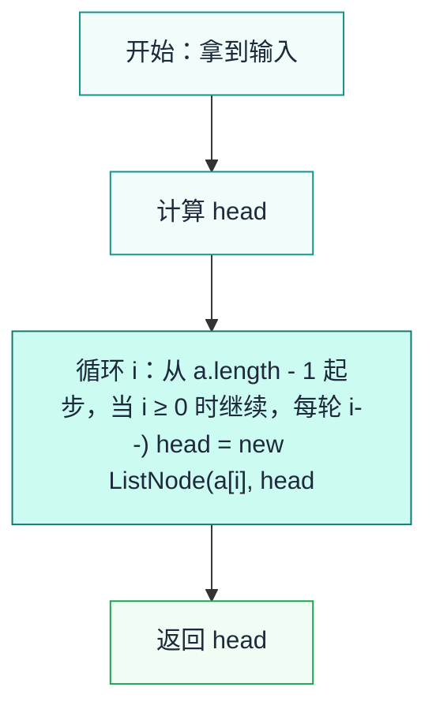

## TypeScript 解题方案（3 个方案逐个讲）

> **运行与提交**：每个方案都是自包含文件（内嵌用例自测，输出 PASS），整块复制到 `.ts` 文件后 `node 文件名` 即可运行。提交 LeetCode 时，把 `demo` 内的算法函数与辅助类型/函数整体取出、置于文件顶层即可。涉及交互/特殊接口的题以题面给定签名为准。

### 方案 1：单趟扫描

**分析与思路**：核心做法是「单趟扫描」。代码里依次做这些事：单循环线性扫描。

**运行方式**：`node 本文件`，内嵌用例全部通过会输出 PASS。


**方案专属流程图**（真实控制流）：


```typescript
export function demo(): void {
  // 程序入口：跑内嵌自测用例
  class ListNode {
    // 定义类型
    val: number; // 值: number;
    next: ListNode | null; // 下一个: ListNode 按位或 null;
    constructor(v: number, next: ListNode | null = null) {
      this.val = v;
      this.next = next;
    }
  }
  function build(a: number[]): ListNode | null {
    // 定义函数/方法 build
    let head: ListNode | null = null; // 把 null; 写入 let head: ListNode | null
    for (let i = a.length - 1; i >= 0; i--) head = new ListNode(a[i], head); // 让 下标 i 从 数组.长度 减 1 开始计数，下标 i 不低于 0 就继续
    return head; // 返回 头节点
  }
  function isPalindrome(head: ListNode | null): boolean {
    // 定义判定函数 isPalindrome
    const vals: number[] = []; // 把 []; 写入 const vals: number[]
    let p = head; // 把 头节点 存入 节点
    while (p) {
      vals.push(p.val);
      p = p.next;
    } // 循环，直到不满足「节点) { vals 追加 节点.值); 节点 赋值为 节点.下一个; }」
    let left = 0,
      right = vals.length - 1; // 把 0, 右边界 赋值为 vals.长度 减 1 存入 左边界
    while (left < right) {
      // 循环，直到不满足「左边界 小于 右边界」
      if (vals[left] !== vals[right]) return false; // 若 vals[左边界] 不等于 vals[右边界]，直接返回 false
      left++;
      right--; // 左边界 加一 ; 右边界 减一 ;
    }
    return true; // 返回 true
  }
  const cases: [number[] | null, boolean][] = [
    [null, true],
    [[1, 2, 2, 1], true],
    [[1, 2], false],
  ];
  let fail = false; // 把 false 存入 fail
  for (const c of cases) {
    // for (const 字符 of cases) {
    const inp = c[0]; // 把 字符[0] 存入 inp
    const want = c[1]; // 把 字符[1] 存入 want
    const got = isPalindrome(inp === null ? null : build(inp)); // 把 isPalindrome(inp 全等于 null ? null : build(inp)) 存入 got
    if (got !== want) {
      fail = true;
      console.log(
        'FAIL isPalindrome(' +
          JSON.stringify(inp) +
          ')=' +
          got +
          ' want ' +
          want,
      );
    }
  }
  if (fail) throw new Error('FAILED'); // 若 fail) throw new Error(「FAILED」);
  console.log('PASS'); // 全部用例通过，输出 PASS
}
demo(); // demo();
```

### 方案 2：单趟扫描

**分析与思路**：核心做法是「单趟扫描」。代码里依次做这些事：单循环线性扫描。

**运行方式**：`node 本文件`，内嵌用例全部通过会输出 PASS。


**方案专属流程图**（真实控制流）：

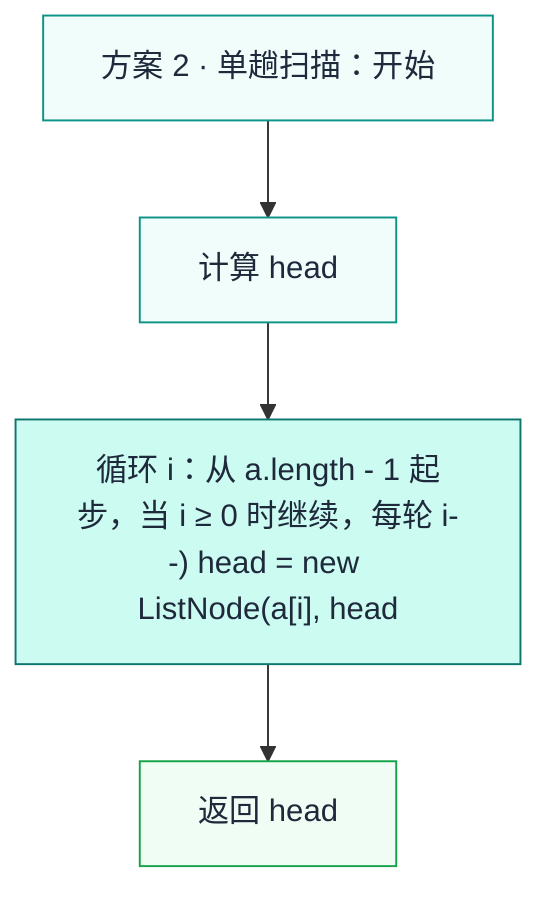

```typescript
export function demo(): void {
  // 程序入口：跑内嵌自测用例
  class ListNode {
    // 定义类型
    val: number; // 值: number;
    next: ListNode | null; // 下一个: ListNode 按位或 null;
    constructor(v: number, next: ListNode | null = null) {
      this.val = v;
      this.next = next;
    }
  }
  function build(a: number[]): ListNode | null {
    // 定义函数/方法 build
    let head: ListNode | null = null; // 把 null; 写入 let head: ListNode | null
    for (let i = a.length - 1; i >= 0; i--) head = new ListNode(a[i], head); // 让 下标 i 从 数组.长度 减 1 开始计数，下标 i 不低于 0 就继续
    return head; // 返回 头节点
  }
  function isPalindrome(head: ListNode | null): boolean {
    // 定义判定函数 isPalindrome
    const vals: number[] = []; // 把 []; 写入 const vals: number[]
    let p = head; // 把 头节点 存入 节点
    while (p) {
      vals.push(p.val);
      p = p.next;
    } // 循环，直到不满足「节点) { vals 追加 节点.值); 节点 赋值为 节点.下一个; }」
    let left = 0,
      right = vals.length - 1; // 把 0, 右边界 赋值为 vals.长度 减 1 存入 左边界
    while (left < right) {
      // 循环，直到不满足「左边界 小于 右边界」
      if (vals[left] !== vals[right]) return false; // 若 vals[左边界] 不等于 vals[右边界]，直接返回 false
      left++;
      right--; // 左边界 加一 ; 右边界 减一 ;
    }
    return true; // 返回 true
  }
  const cases: [number[] | null, boolean][] = [
    [null, true],
    [[1, 2, 2, 1], true],
    [[1, 2], false],
  ];
  let fail = false; // 把 false 存入 fail
  for (const c of cases) {
    // for (const 字符 of cases) {
    const inp = c[0]; // 把 字符[0] 存入 inp
    const want = c[1]; // 把 字符[1] 存入 want
    const got = isPalindrome(inp === null ? null : build(inp)); // 把 isPalindrome(inp 全等于 null ? null : build(inp)) 存入 got
    if (got !== want) {
      fail = true;
      console.log(
        'FAIL isPalindrome(' +
          JSON.stringify(inp) +
          ')=' +
          got +
          ' want ' +
          want,
      );
    }
  }
  if (fail) throw new Error('FAILED'); // 若 fail) throw new Error(「FAILED」);
  console.log('PASS'); // 全部用例通过，输出 PASS
}
demo(); // demo();
```

### 方案 3：单趟扫描

**分析与思路**：核心做法是「单趟扫描」。代码里依次做这些事：单循环线性扫描。

**运行方式**：`node 本文件`，内嵌用例全部通过会输出 PASS。


**方案专属流程图**（真实控制流）：


```typescript
export function demo(): void {
  // 程序入口：跑内嵌自测用例
  class ListNode {
    // 定义类型
    val: number; // 值: number;
    next: ListNode | null; // 下一个: ListNode 按位或 null;
    constructor(v: number, next: ListNode | null = null) {
      this.val = v;
      this.next = next;
    }
  }
  function build(a: number[]): ListNode | null {
    // 定义函数/方法 build
    let head: ListNode | null = null; // 把 null; 写入 let head: ListNode | null
    for (let i = a.length - 1; i >= 0; i--) head = new ListNode(a[i], head); // 让 下标 i 从 数组.长度 减 1 开始计数，下标 i 不低于 0 就继续
    return head; // 返回 头节点
  }
  function isPalindrome(head: ListNode | null): boolean {
    // 定义判定函数 isPalindrome
    const vals: number[] = []; // 把 []; 写入 const vals: number[]
    let p = head; // 把 头节点 存入 节点
    while (p) {
      vals.push(p.val);
      p = p.next;
    } // 循环，直到不满足「节点) { vals 追加 节点.值); 节点 赋值为 节点.下一个; }」
    let left = 0,
      right = vals.length - 1; // 把 0, 右边界 赋值为 vals.长度 减 1 存入 左边界
    while (left < right) {
      // 循环，直到不满足「左边界 小于 右边界」
      if (vals[left] !== vals[right]) return false; // 若 vals[左边界] 不等于 vals[右边界]，直接返回 false
      left++;
      right--; // 左边界 加一 ; 右边界 减一 ;
    }
    return true; // 返回 true
  }
  const cases: [number[] | null, boolean][] = [
    [null, true],
    [[1, 2, 2, 1], true],
    [[1, 2], false],
  ];
  let fail = false; // 把 false 存入 fail
  for (const c of cases) {
    // for (const 字符 of cases) {
    const inp = c[0]; // 把 字符[0] 存入 inp
    const want = c[1]; // 把 字符[1] 存入 want
    const got = isPalindrome(inp === null ? null : build(inp)); // 把 isPalindrome(inp 全等于 null ? null : build(inp)) 存入 got
    if (got !== want) {
      fail = true;
      console.log(
        'FAIL isPalindrome(' +
          JSON.stringify(inp) +
          ')=' +
          got +
          ' want ' +
          want,
      );
    }
  }
  if (fail) throw new Error('FAILED'); // 若 fail) throw new Error(「FAILED」);
  console.log('PASS'); // 全部用例通过，输出 PASS
}
demo(); // demo();
```

## 逐步拆解与面试追问

**复杂度**：时间 O(n)（单趟线性扫描），空间 O(1) 到 O(n)（视辅助结构）

**为什么是这个量级**：每个元素被常数次访问，辅助哈希或栈的开销与 n 同阶

**面试官可能会追问**：

- 能不能一次遍历完成？
- 快慢指针能解决哪些变体？
- 断链与接回的顺序怎么保证不出错？

## 关键 API 速查（TS 主解法实际用到，附官方链接）

| API | 作用 | 使用要点 | 官方文档 |
|---|---|---|---|
| `Array.prototype.push()` | 尾部追加 | 返回新长度；可一次多个；均摊 O(1)；会改变原数组 | [官方文档](https://developer.mozilla.org/zh-CN/docs/Web/JavaScript/Reference/Global_Objects/Array/push) |
| `JSON.stringify()` | 序列化为 JSON 字符串 | 常用于结构化比较（深度相等判定）；undefined/函数/循环引用会被丢弃或抛错 | [官方文档](https://developer.mozilla.org/zh-CN/docs/Web/JavaScript/Reference/Global_Objects/JSON/stringify) |

### 各语言官方文档导航

- **TypeScript / JS**：[MDN 中文参考](https://developer.mozilla.org/zh-CN/)
- **Python**：[Python 官方文档](https://docs.python.org/zh-cn/3/)
- **Go**：[Go 标准库](https://pkg.go.dev/std)
- **Java**：[JDK 17 API](https://docs.oracle.com/en/java/javase/17/docs/api/)
- **Rust**：[Rust 标准库](https://doc.rust-lang.org/std/)
- **Lua**：[Lua 5.4 手册](https://www.lua.org/manual/5.4/)
- **C**：[Cppreference C](https://zh.cppreference.com/w/c)
- **C++**：[Cppreference C++](https://zh.cppreference.com/w/cpp)
- **R**：[R 官方手册](https://stat.ethz.ch/R-manual/)
- **Zig**：[Zig 语言文档](https://ziglang.org/documentation/master/)
- **Dart**：[Dart API](https://api.dart.dev/)

## 附录：其他 10 种语言全部实现（每种语言列举其全部方案）

> TypeScript 的全部方案见「TypeScript 解题方案」一节；下面是其余 10 种语言的对应实现，每种语言的每个方案都带思路分析、代码走读与专属运行架构图。
> 每个方案都内嵌用例自测，可独立运行（老仓库 python/go 文件遵循「打印结果」约定）。
> 完整解法文件见 `dsa/<语言>/linked_list/lc_234_回文链表/`。

### Python 实现（3 种方案）

Python 的全部方案如下，每个方案都内嵌用例自测，可独立运行（老仓库 python/go 文件遵循「打印结果」约定）：

#### 方案 1：单趟扫描

**思路与代码分析**：核心是「单趟扫描」。Python 版用切片与字典推导式简化操作，突出可读性。**走读**：方案 1 · 单趟扫描：开始 → 更新 vals → 当 head: 时反复执行 → 向 vals 追加记录 → 更新 head → 更新 right → 当 left ＜ right: 时反复执行 → 命中条件，直接返回 → 更新 + → 更新 - → 返回 True。

**运行架构**（真实控制流）：

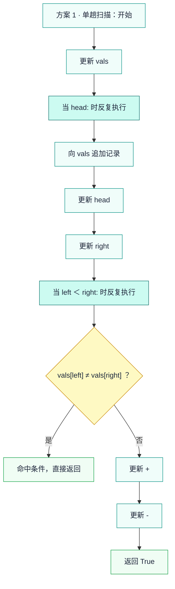

```python
# Definition for singly-linked list.
# class ListNode:
#     def __init__(self, val=0, next=None):
#         self.val = val
#         self.next = next

import sys  # 提高递归深度上限（深输入防 RecursionError）

sys.setrecursionlimit(200000)  # 树/链表类题目节点数可达 1e4 量级

def isPalindrome(head):  # 定义函数 isPalindrome（参数：头节点）
    vals = []  # 把 [] 存入 vals
    while head:  # 循环，直到不满足「头节点」
        vals.append(head.val)  # 把 头节点.值 追加到列表尾部
        head = head.next  # 把 头节点.下一个 存入 头节点
    left, right = 0, len(vals) - 1  # 把 0, 长度(vals) 减 1 写入 left, right
    while left < right:  # 循环，直到不满足「左边界 小于 右边界」
        if vals[left] != vals[right]:  # 若 vals[左边界] 不等于 vals[右边界]
            return False  # 返回 False
        left += 1  # 左边界累加 1
        right -= 1  # 右边界累减 1
    return True  # 返回 True

if __name__ == "__main__":  # 若 __name__ 等于 '__main__'
    print(isPalindrome(None))  # 打印输出
```

#### 方案 2：单趟扫描

**思路与代码分析**：核心是「单趟扫描」。Python 版用切片与字典推导式简化操作，突出可读性。**走读**：方案 2 · 单趟扫描：开始 → 更新 front_pointer → 处理 nonlocal front_pointer → 若 node：处理 if not recursively_check(nod → 命中条件，直接返回 → 命中条件，直接返回 → 更新 front_pointer → 返回 True → 返回 recursively_check(head)。

**运行架构**（真实控制流）：

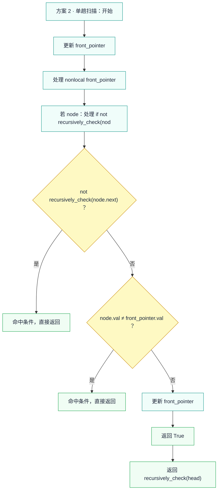

```python
# Definition for singly-linked list.
# class ListNode:
#     def __init__(self, val=0, next=None):
#         self.val = val
#         self.next = next

import sys  # 提高递归深度上限（深输入防 RecursionError）

sys.setrecursionlimit(200000)  # 树/链表类题目节点数可达 1e4 量级

def isPalindrome(head):  # 定义函数 isPalindrome（参数：头节点）
    front_pointer = head  # 把 头节点 存入 front_pointer

    def recursively_check(node):  # 定义函数 recursively_check（参数：节点）
        nonlocal front_pointer  # nonlocal front_pointer
        if node:  # 若 节点
            if not recursively_check(node.next):  # 若 not recursively_check(节点.下一个
                return False  # 返回 False
            if node.val != front_pointer.val:  # 若 节点.值 不等于 front_pointer.值
                return False  # 返回 False
            front_pointer = front_pointer.next  # 把 front_pointer.下一个 存入 front_pointer
        return True  # 返回 True

    return recursively_check(head)  # 返回 recursively_check(头节点)

if __name__ == "__main__":  # 若 __name__ 等于 '__main__'
    print(isPalindrome(None))  # 打印输出
```

#### 方案 3：单趟扫描

**思路与代码分析**：核心是「单趟扫描」。Python 版用切片与字典推导式简化操作，突出可读性。**走读**：方案 3 · 单趟扫描：开始 → 更新 prev → 当 curr: 时反复执行 → 返回 prev → 当 fast.next and fast.next.next: 时反复执行 → 返回 slow → 命中条件，直接返回 → 当 p2 and result: 时反复执行 → 返回 result。

**运行架构**（真实控制流）：

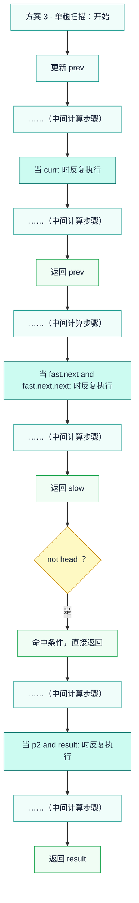

```python
# Definition for singly-linked list.
# class ListNode:
#     def __init__(self, val=0, next=None):
#         self.val = val
#         self.next = next

import sys  # 提高递归深度上限（深输入防 RecursionError）

sys.setrecursionlimit(200000)  # 树/链表类题目节点数可达 1e4 量级

def isPalindrome(head):  # 定义函数 isPalindrome（参数：头节点）
    def reverse_list(node):  # 定义函数 reverse_list（参数：节点）
        prev = None  # 把 None 存入 前一个
        curr = node  # 把 节点 存入 当前值
        while curr:  # 循环，直到不满足「当前值」
            nxt = curr.next  # 把 当前值.下一个 存入 nxt
            curr.next = prev  # 把 前一个 写入 下一个
            prev = curr  # 把 当前值 存入 前一个
            curr = nxt  # 把 nxt 存入 当前值
        return prev  # 返回 前一个

    def end_of_first_half(node):  # 定义函数 end_of_first_half（参数：节点）
        fast = slow = node  # 把 慢指针 赋值为 节点 存入 快指针
        while fast.next and fast.next.next:  # 循环，直到不满足「快指针.下一个 and 快指针.下一个.下一个」
            fast = fast.next.next  # 把 快指针.下一个.下一个 存入 快指针
            slow = slow.next  # 把 慢指针.下一个 存入 慢指针
        return slow  # 返回 慢指针

    if not head:  # 若 not 头节点
        return True  # 返回 True
    first_half_end = end_of_first_half(head)  # 把 end_of_first_half(头节点) 存入 first_half_end
    second_half_start = reverse_list(
        first_half_end.next
    )  # 把 reverse_list(first_half_end.下一个) 存入 second_half_start

    p1, p2 = head, second_half_start  # 把 头节点, second_half_start 写入 p1, p2
    result = True  # 把 True 存入 结果
    while p2 and result:  # 循环，直到不满足「p2 and 结果」
        if p1.val != p2.val:  # 若 p1.值 不等于 p2.值
            result = False  # 把 False 存入 结果
        p1 = p1.next  # 把 p1.下一个 存入 p1
        p2 = p2.next  # 把 p2.下一个 存入 p2

    first_half_end.next = reverse_list(second_half_start)  # 把 reverse_list(second_half_start) 写入 下一个
    return result  # 返回 结果

if __name__ == "__main__":  # 若 __name__ 等于 '__main__'
    print(isPalindrome(None))  # 打印输出
```

### Go 实现（3 种方案）

Go 的全部方案如下，每个方案都内嵌用例自测，可独立运行（老仓库 python/go 文件遵循「打印结果」约定）：

#### 方案 1：单趟扫描

**思路与代码分析**：核心是「单趟扫描」。Go 版用切片与多返回值惯用法，显式处理索引边界。**走读**：方案 1 · 单趟扫描：开始 → 更新 : → 遍历循环 → 更新 vals → 更新 head → 更新 : → 遍历循环 → 处理 if vals[left] ≠ vals[right] → 返回 false → 处理 left++ → 处理 right-- → 返回 true。

**运行架构**（真实控制流）：

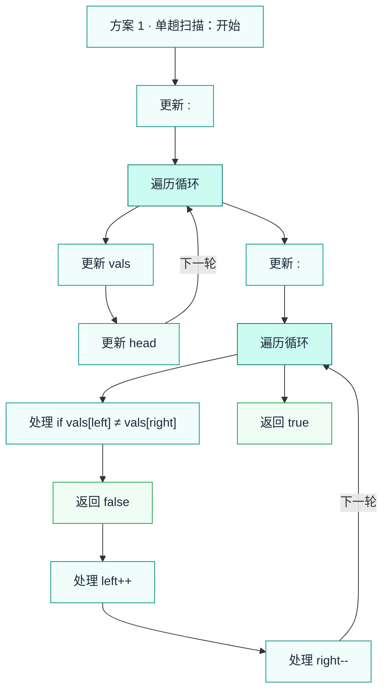

```go
package main // 引入依赖

import (
	"fmt"
	"os"
) // 引入依赖

type ListNode struct { // 定义类型
	Val  int       // Val int
	Next *ListNode // Next 乘 ListNode
}

func buildList(vals []int) *ListNode { // 定义函数/方法 buildList
	dummy := &ListNode{}     // 把 按位与 ListNode{} 写入 dummy :
	curr := dummy            // 把 哨兵节点 写入 curr :
	for _, v := range vals { // 同时取 _ 与 值 遍历
		curr.Next = &ListNode{Val: v} // 把 按位与 ListNode{Val: 值} 写入 curr.Next
		curr = curr.Next              // 把 当前值.Next 写入 当前值
	}
	return dummy.Next // 返回 哨兵节点.Next
}

func isPalindrome(head *ListNode) bool { // 定义判定函数 isPalindrome
	vals := []int{}   // 把 []int{} 写入 vals :
	for head != nil { // 把 nil { 写入 for head !
		vals = append(vals, head.Val) // 把 append(vals, 头节点.Val) 写入 vals
		head = head.Next              // 把 头节点.Next 写入 头节点
	}
	left, right := 0, len(vals)-1 // 把 0, 长度(vals) 减 1 写入 left, right :
	for left < right {            // for 左边界 小于 右边界 {
		if vals[left] != vals[right] { // 若 vals[左边界] 不等于 vals[右边界]
			return false // 返回 false
		}
		left++  // 左边界 加一
		right-- // 右边界 减一
	}
	return true // 返回 true
}

func main() { // 程序入口：跑内嵌自测用例
	cases := []struct { // 把 []struct { 写入 cases :
		in   []int // in []int
		want bool  // want bool
	}{ // }{
		{[]int{1, 2, 2, 1}, true},
		{nil, true},
		{[]int{1, 2}, false},
	}
	ok := true                // 把 true 写入 ok :
	for _, c := range cases { // 同时取 _ 与 字符 遍历
		if got := isPalindrome(buildList(c.in)); got != c.want { // 若 got : 赋值为 isPalindrome(buildList(字符.in)); got 不等于 字符.want
			ok = false                                                          // 把 false 写入 ok
			fmt.Printf("FAIL isPalindrome(%v)=%v want %v\n", c.in, got, c.want) // 打印输出
		}
	}
	if !ok { // 若 取反 ok
		os.Exit(1) // os.Exit(1)
	}
	fmt.Println("PASS") // 全部用例通过，输出 PASS
}
```

#### 方案 2：单趟扫描

**思路与代码分析**：核心是「单趟扫描」。Go 版用切片与多返回值惯用法，显式处理索引边界。**走读**：方案 2 · 单趟扫描：开始 → 计算 front → 计算 recursivelyCheck → 更新 recursivelyCheck → 处理 if node ≠ nil → 处理 if 非 recursivelyCheck(node.Ne → 返回 false → 处理 if node.Val ≠ front.Val → 返回 false → 更新 front → 返回 true → 更新 front → 返回 recursivelyCheck(head)。

**运行架构**（真实控制流）：

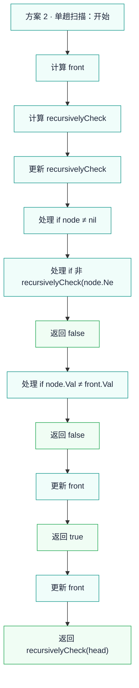

```go
package main // 引入依赖

import (
	"fmt"
	"os"
) // 引入依赖

type ListNode struct { // 定义类型
	Val  int       // Val int
	Next *ListNode // Next 乘 ListNode
}

func buildList(vals []int) *ListNode { // 定义函数/方法 buildList
	dummy := &ListNode{}     // 把 按位与 ListNode{} 写入 dummy :
	curr := dummy            // 把 哨兵节点 写入 curr :
	for _, v := range vals { // 同时取 _ 与 值 遍历
		curr.Next = &ListNode{Val: v} // 把 按位与 ListNode{Val: 值} 写入 curr.Next
		curr = curr.Next              // 把 当前值.Next 写入 当前值
	}
	return dummy.Next // 返回 哨兵节点.Next
}

func isPalindrome(head *ListNode) bool { // 定义判定函数 isPalindrome
	var front *ListNode                            // var front 乘 ListNode
	var recursivelyCheck func(node *ListNode) bool // var recursivelyCheck func(节点 乘 ListNode) bool
	recursivelyCheck = func(node *ListNode) bool { // 把 func(节点 乘 ListNode) bool { 写入 recursivelyCheck
		if node != nil { // 若 节点 不等于 nil
			if !recursivelyCheck(node.Next) { // 若 取反 recursivelyCheck(节点.Next
				return false // 返回 false
			}
			if node.Val != front.Val { // 若 节点.Val 不等于 front.Val
				return false // 返回 false
			}
			front = front.Next // 把 front.Next 写入 front
		}
		return true // 返回 true
	}
	front = head                  // 把 头节点 写入 front
	return recursivelyCheck(head) // 定义函数/方法 recursivelyCheck
}

func main() { // 程序入口：跑内嵌自测用例
	cases := []struct { // 把 []struct { 写入 cases :
		in   []int // in []int
		want bool  // want bool
	}{ // }{
		{[]int{1, 2, 2, 1}, true},
		{nil, true},
		{[]int{1, 2}, false},
	}
	ok := true                // 把 true 写入 ok :
	for _, c := range cases { // 同时取 _ 与 字符 遍历
		if got := isPalindrome(buildList(c.in)); got != c.want { // 若 got : 赋值为 isPalindrome(buildList(字符.in)); got 不等于 字符.want
			ok = false                                                          // 把 false 写入 ok
			fmt.Printf("FAIL isPalindrome(%v)=%v want %v\n", c.in, got, c.want) // 打印输出
		}
	}
	if !ok { // 若 取反 ok
		os.Exit(1) // os.Exit(1)
	}
	fmt.Println("PASS") // 全部用例通过，输出 PASS
}
```

#### 方案 3：单趟扫描

**思路与代码分析**：核心是「单趟扫描」。Go 版用切片与多返回值惯用法，显式处理索引边界。**走读**：方案 3 · 单趟扫描：开始 → 处理 if head == nil → 返回 true → 更新 : → 更新 : → 更新 : → 更新 : → 遍历循环 → 处理 if p1.Val ≠ p2.Val → 更新 result → 更新 p1 → 更新 p2 → 更新 firstHalfEnd.Next → 返回 result。

**运行架构**（真实控制流）：

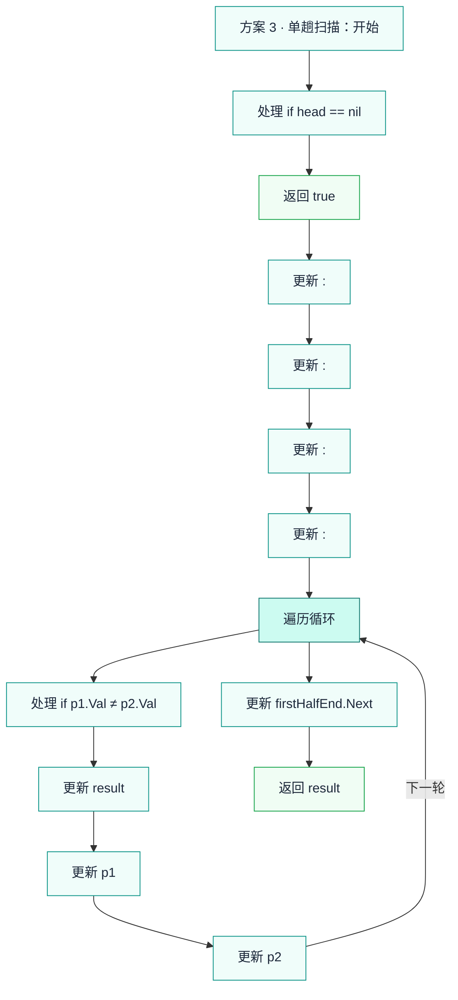

```go
package main // 引入依赖

import (
	"fmt"
	"os"
) // 引入依赖

type ListNode struct { // 定义类型
	Val  int       // Val int
	Next *ListNode // Next 乘 ListNode
}

func buildList(vals []int) *ListNode { // 定义函数/方法 buildList
	dummy := &ListNode{}     // 把 按位与 ListNode{} 写入 dummy :
	curr := dummy            // 把 哨兵节点 写入 curr :
	for _, v := range vals { // 同时取 _ 与 值 遍历
		curr.Next = &ListNode{Val: v} // 把 按位与 ListNode{Val: 值} 写入 curr.Next
		curr = curr.Next              // 把 当前值.Next 写入 当前值
	}
	return dummy.Next // 返回 哨兵节点.Next
}

func reverseList(node *ListNode) *ListNode { // 定义函数/方法 reverseList
	var prev *ListNode // var 前一个 乘 ListNode
	curr := node       // 把 节点 写入 curr :
	for curr != nil {  // 把 nil { 写入 for curr !
		nxt := curr.Next // 把 当前值.Next 写入 nxt :
		curr.Next = prev // 把 前一个 写入 curr.Next
		prev = curr      // 把 当前值 写入 前一个
		curr = nxt       // 把 nxt 写入 当前值
	}
	return prev // 返回 前一个
}

func endOfFirstHalf(node *ListNode) *ListNode { // 定义函数/方法 endOfFirstHalf
	fast := node                                    // 把 节点 写入 fast :
	slow := node                                    // 把 节点 写入 slow :
	for fast.Next != nil && fast.Next.Next != nil { // 把 nil 且 快指针.Next.Next 不等于 nil { 写入 for fast.Next !
		fast = fast.Next.Next // 把 快指针.Next.Next 写入 快指针
		slow = slow.Next      // 把 慢指针.Next 写入 慢指针
	}
	return slow // 返回 慢指针
}

func isPalindrome(head *ListNode) bool { // 定义判定函数 isPalindrome
	if head == nil { // 若 头节点 等于 nil
		return true // 返回 true
	}
	firstHalfEnd := endOfFirstHalf(head)              // 把 endOfFirstHalf(头节点) 写入 firstHalfEnd :
	secondHalfStart := reverseList(firstHalfEnd.Next) // 把 reverseList(firstHalfEnd.Next) 写入 secondHalfStart :
	p1, p2 := head, secondHalfStart                   // 把 头节点, secondHalfStart 写入 p1, p2 :
	result := true                                    // 把 true 写入 result :
	for p2 != nil && result {                         // 把 nil 且 结果 { 写入 for p2 !
		if p1.Val != p2.Val { // 若 p1.Val 不等于 p2.Val
			result = false // 把 false 写入 结果
		}
		p1 = p1.Next // 把 p1.Next 写入 p1
		p2 = p2.Next // 把 p2.Next 写入 p2
	}
	firstHalfEnd.Next = reverseList(secondHalfStart) // 把 reverseList(secondHalfStart) 写入 firstHalfEnd.Next
	return result                                    // 返回 结果
}

func main() { // 程序入口：跑内嵌自测用例
	cases := []struct { // 把 []struct { 写入 cases :
		in   []int // in []int
		want bool  // want bool
	}{ // }{
		{[]int{1, 2, 2, 1}, true},
		{nil, true},
		{[]int{1, 2}, false},
	}
	ok := true                // 把 true 写入 ok :
	for _, c := range cases { // 同时取 _ 与 字符 遍历
		if got := isPalindrome(buildList(c.in)); got != c.want { // 若 got : 赋值为 isPalindrome(buildList(字符.in)); got 不等于 字符.want
			ok = false                                                          // 把 false 写入 ok
			fmt.Printf("FAIL isPalindrome(%v)=%v want %v\n", c.in, got, c.want) // 打印输出
		}
	}
	if !ok { // 若 取反 ok
		os.Exit(1) // os.Exit(1)
	}
	fmt.Println("PASS") // 全部用例通过，输出 PASS
}
```

### Java 实现（3 种方案）

Java 的全部方案如下，每个方案都内嵌用例自测，可独立运行（老仓库 python/go 文件遵循「打印结果」约定）：

#### 方案 1：单趟扫描

**思路与代码分析**：核心是「单趟扫描」。Java 版用类与静态方法组织，集合操作显式明了。**走读**：方案 1 · 单趟扫描：开始 → 更新 val → 返回结果。

**运行架构**（真实控制流）：

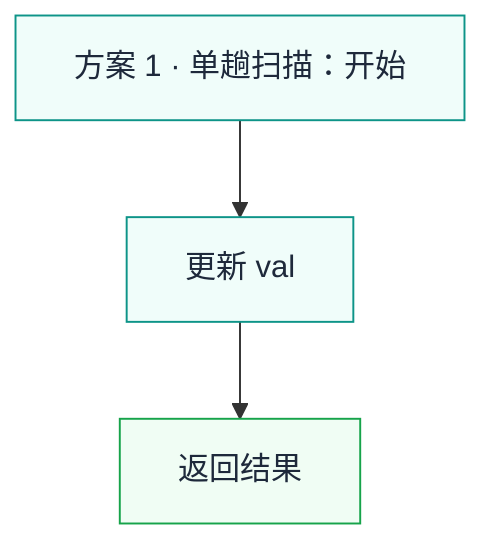

```java
package com.webfault.dsa; // 引入依赖

class lc234 { // 定义类型
  static class ListNode {
    int val;
    ListNode next;

    ListNode(int v) {
      val = v;
    }
  }

  boolean isPalindrome(ListNode head) { // 定义判定函数 isPalindrome
    java.util.ArrayList<Integer> vals = new java.util.ArrayList<Integer>();
    while (head != null) {
      vals.add(head.val);
      head = head.next;
    } // 循环，直到不满足「头节点 不等于 null) { vals 追加 头节点.值); 头节点 赋值为 头节点.下一个; }」
    int l = 0, r = vals.size() - 1; // 把 0, 右指针 赋值为 vals.大小() 减 1 存入 左指针
    while (l < r) { // 循环，直到不满足「左指针 小于 右指针」
      if (!vals.get(l).equals(vals.get(r)))
        return false; // 若 取反 vals 查找 左指针).equals(vals 查找 右指针))，直接返回 false
      l++;
      r--; // 左指针 加一 ; 右指针 减一 ;
    }
    return true; // 返回 true
  }

  static ListNode build(int[] a) { // 定义函数/方法 build
    ListNode dummy = new ListNode(0);
    ListNode cur = dummy; // 把 new ListNode(0); ListNode 当前值 赋值为 哨兵节点; 写入 ListNode dummy
    for (int v : a) {
      cur.next = new ListNode(v);
      cur = cur.next;
    } // 把 new ListNode(值); 当前值 赋值为 当前值.下一个; } 写入 下一个
    return dummy.next; // 返回 哨兵节点.下一个
  }

  public static void main(String[] args) { // public static void main(String[] args) {
    lc234 s = new lc234(); // 把 new lc234(); 写入 lc234 s
    int[][] cases = {
      {}, {1, 2, 1}, {1, 2}, {1, 2, 2, 1}
    }; // 把 {{}, {1, 2, 1}, {1, 2}, {1, 2, 2, 1}}; 写入 int[][] cases
    boolean[] wants = {true, true, false, true}; // 把 {true, true, false, true}; 写入 boolean[] wants
    boolean ok = true; // 把 true; 写入 boolean ok
    for (int i = 0; i < wants.length; i++) { // 让 下标 i 从 0 开始计数，下标 i 小于 wants.长度 就继续
      boolean got =
          s.isPalindrome(build(cases[i])); // 把 字符串.isPalindrome(build(cases[下标 i])); 写入 boolean got
      if (got != wants[i]) {
        ok = false;
        System.out.println("FAIL case " + i + " got " + got + " want " + wants[i]);
      }
    }
    if (!ok) throw new RuntimeException("FAILED"); // 若 取反 ok) throw new RuntimeException(「FAILED」);
    System.out.println("PASS"); // 全部用例通过，输出 PASS
  }
}
```

#### 方案 2：单趟扫描

**思路与代码分析**：核心是「单趟扫描」。Java 版用类与静态方法组织，集合操作显式明了。代码里依次做这些事：双重循环遍历。

**运行架构**（真实控制流）：

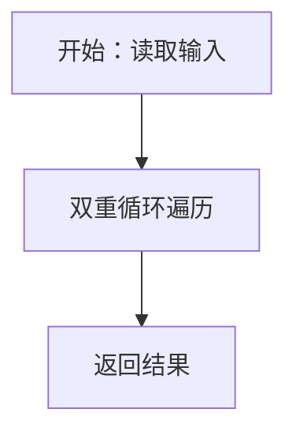

```java
package com.webfault.dsa; // 引入依赖

import java.util.*; // 引入依赖

class ListNode {
  int val;
  ListNode next;

  ListNode() {}

  ListNode(int v) {
    val = v;
  }

  ListNode(int v, ListNode n) {
    val = v;
    next = n;
  }
} // 定义类型

class Main { // 定义类型
  static boolean isPalindrome(ListNode head) { // 定义判定函数 isPalindrome
    List<Integer> vals = new ArrayList<>();
    for (ListNode x = head; x != null; x = x.next) vals.add(x.val);
    int i = 0, j = vals.size() - 1;
    while (i < j) {
      if (!vals.get(i).equals(vals.get(j))) return false;
      i++;
      j--;
    }
    return true;
  }

  public static void main(String[] args) { // public static void main(String[] args) {
    int[][][] ins = {{{1, 2, 2, 1}}, {{1, 2}}, {{}}, {{1}}};
    boolean[] ws = {true, false, true, true};
    boolean ok = true; // 把 true; 写入 boolean ok
    for (int i = 0; i < ins.length; i++) {
      ListNode d = new ListNode();
      ListNode p = d;
      for (int v : ins[i][0]) {
        p.next = new ListNode(v);
        p = p.next;
      }
      boolean got = isPalindrome(d.next);
      if (got != ws[i]) {
        ok = false;
        System.out.println("FAIL " + got);
      }
    } // 让 下标 i 从 0 开始计数，下标 i 小于 ins.长度 就继续
    if (!ok) throw new RuntimeException("FAILED"); // 若 取反 ok) throw new RuntimeException(「FAILED」);
    System.out.println("PASS"); // 全部用例通过，输出 PASS
  }
}
```

#### 方案 3：单趟扫描

**思路与代码分析**：核心是「单趟扫描」。Java 版用类与静态方法组织，集合操作显式明了。**走读**：方案 3 · 单趟扫描：开始 → 更新 val → 返回结果。

**运行架构**（真实控制流）：

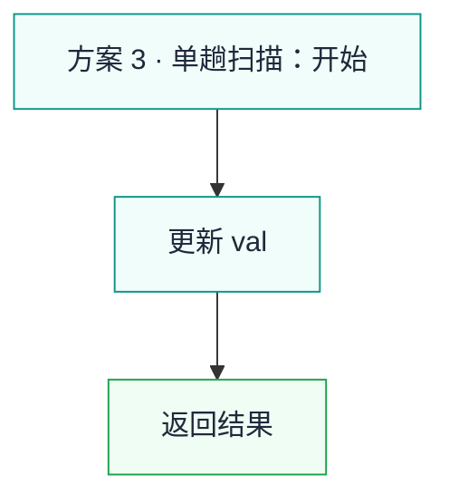

```java
package com.webfault.dsa; // 引入依赖

class lc234 { // 定义类型
  static class ListNode {
    int val;
    ListNode next;

    ListNode(int v) {
      val = v;
    }
  }

  boolean isPalindrome(ListNode head) { // 定义判定函数 isPalindrome
    java.util.ArrayList<Integer> vals = new java.util.ArrayList<Integer>();
    while (head != null) {
      vals.add(head.val);
      head = head.next;
    } // 循环，直到不满足「头节点 不等于 null) { vals 追加 头节点.值); 头节点 赋值为 头节点.下一个; }」
    int l = 0, r = vals.size() - 1; // 把 0, 右指针 赋值为 vals.大小() 减 1 存入 左指针
    while (l < r) { // 循环，直到不满足「左指针 小于 右指针」
      if (!vals.get(l).equals(vals.get(r)))
        return false; // 若 取反 vals 查找 左指针).equals(vals 查找 右指针))，直接返回 false
      l++;
      r--; // 左指针 加一 ; 右指针 减一 ;
    }
    return true; // 返回 true
  }

  static ListNode build(int[] a) { // 定义函数/方法 build
    ListNode dummy = new ListNode(0);
    ListNode cur = dummy; // 把 new ListNode(0); ListNode 当前值 赋值为 哨兵节点; 写入 ListNode dummy
    for (int v : a) {
      cur.next = new ListNode(v);
      cur = cur.next;
    } // 把 new ListNode(值); 当前值 赋值为 当前值.下一个; } 写入 下一个
    return dummy.next; // 返回 哨兵节点.下一个
  }

  public static void main(String[] args) { // public static void main(String[] args) {
    lc234 s = new lc234(); // 把 new lc234(); 写入 lc234 s
    int[][] cases = {
      {}, {1, 2, 1}, {1, 2}, {1, 2, 2, 1}
    }; // 把 {{}, {1, 2, 1}, {1, 2}, {1, 2, 2, 1}}; 写入 int[][] cases
    boolean[] wants = {true, true, false, true}; // 把 {true, true, false, true}; 写入 boolean[] wants
    boolean ok = true; // 把 true; 写入 boolean ok
    for (int i = 0; i < wants.length; i++) { // 让 下标 i 从 0 开始计数，下标 i 小于 wants.长度 就继续
      boolean got =
          s.isPalindrome(build(cases[i])); // 把 字符串.isPalindrome(build(cases[下标 i])); 写入 boolean got
      if (got != wants[i]) {
        ok = false;
        System.out.println("FAIL case " + i + " got " + got + " want " + wants[i]);
      }
    }
    if (!ok) throw new RuntimeException("FAILED"); // 若 取反 ok) throw new RuntimeException(「FAILED」);
    System.out.println("PASS"); // 全部用例通过，输出 PASS
  }
}
```

### Rust 实现（3 种方案）

Rust 的全部方案如下，每个方案都内嵌用例自测，可独立运行（老仓库 python/go 文件遵循「打印结果」约定）：

#### 方案 1：单趟扫描

**思路与代码分析**：核心是「单趟扫描」。Rust 版用所有权移动与切片借用改写同一逻辑，注意 Option 与引用边界。**走读**：方案 1 · 单趟扫描：开始 → 计算 let (mut i, mut j) = (0u → 处理 if j == 0 → 返回 true → 更新 - → 当 i ＜ j 时反复执行 → 处理 if vals[i] ≠ vals[j] → 返回 false → 更新 + → 处理 if j == 0 → 跳出循环（break） → 更新 - → 处理 true。

**运行架构**（真实控制流）：


```rust
// LeetCode 234. 回文链表 — Rust 版（方案1）
fn is_palindrome_list(vals: Vec<i32>) -> bool {
    // 定义判定函数 is_palindrome_list
    let (mut i, mut j) = (0usize, vals.len()); // 把 (0usize, vals.长度()); 写入 let (mut i, mut j)
    if j == 0 {
        return true;
    } // 若 下标 j 等于 0 { return true; }
    j -= 1; // 下标 j累减 1
    while i < j {
        // while 下标 i 小于 下标 j {
        if vals[i] != vals[j] {
            return false;
        } // 若 vals[下标 i] 不等于 vals[下标 j] { return false; }
        i += 1; // 下标 i累加 1
        if j == 0 {
            break;
        } // 若 下标 j 等于 0 { break; }
        j -= 1; // 下标 j累减 1
    }
    true // true
}
fn main() {
    // 程序入口：跑内嵌自测用例
    assert!(is_palindrome_list(vec![])); // 断言校验
    assert!(is_palindrome_list(vec![1, 2, 2, 1])); // 断言校验
    assert!(!is_palindrome_list(vec![1, 2])); // 断言校验
    println!("PASS"); // 全部用例通过，输出 PASS
}
```

#### 方案 2：单趟扫描

**思路与代码分析**：核心是「单趟扫描」。Rust 版用所有权移动与切片借用改写同一逻辑，注意 Option 与引用边界。**走读**：方案 2 · 单趟扫描：开始 → 计算 let (mut i, mut j) = (0u → 处理 if j == 0 → 返回 true → 更新 - → 当 i ＜ j 时反复执行 → 处理 if vals[i] ≠ vals[j] → 返回 false → 更新 + → 处理 if j == 0 → 跳出循环（break） → 更新 - → 处理 true。

**运行架构**（真实控制流）：


```rust
// LeetCode 234. 回文链表 — Rust 版（方案2）
fn is_palindrome_list(vals: Vec<i32>) -> bool {
    // 定义判定函数 is_palindrome_list
    let (mut i, mut j) = (0usize, vals.len()); // 把 (0usize, vals.长度()); 写入 let (mut i, mut j)
    if j == 0 {
        return true;
    } // 若 下标 j 等于 0 { return true; }
    j -= 1; // 下标 j累减 1
    while i < j {
        // while 下标 i 小于 下标 j {
        if vals[i] != vals[j] {
            return false;
        } // 若 vals[下标 i] 不等于 vals[下标 j] { return false; }
        i += 1; // 下标 i累加 1
        if j == 0 {
            break;
        } // 若 下标 j 等于 0 { break; }
        j -= 1; // 下标 j累减 1
    }
    true // true
}
fn main() {
    // 程序入口：跑内嵌自测用例
    assert!(is_palindrome_list(vec![])); // 断言校验
    assert!(is_palindrome_list(vec![1, 2, 2, 1])); // 断言校验
    assert!(!is_palindrome_list(vec![1, 2])); // 断言校验
    println!("PASS"); // 全部用例通过，输出 PASS
}
```

#### 方案 3：单趟扫描

**思路与代码分析**：核心是「单趟扫描」。Rust 版用所有权移动与切片借用改写同一逻辑，注意 Option 与引用边界。**走读**：方案 3 · 单趟扫描：开始 → 计算 let (mut i, mut j) = (0u → 处理 if j == 0 → 返回 true → 更新 - → 当 i ＜ j 时反复执行 → 处理 if vals[i] ≠ vals[j] → 返回 false → 更新 + → 处理 if j == 0 → 跳出循环（break） → 更新 - → 处理 true。

**运行架构**（真实控制流）：

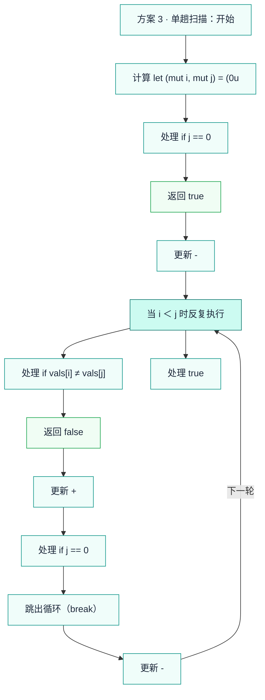

```rust
// LeetCode 234. 回文链表 — Rust 版（方案3）
fn is_palindrome_list(vals: Vec<i32>) -> bool {
    // 定义判定函数 is_palindrome_list
    let (mut i, mut j) = (0usize, vals.len()); // 把 (0usize, vals.长度()); 写入 let (mut i, mut j)
    if j == 0 {
        return true;
    } // 若 下标 j 等于 0 { return true; }
    j -= 1; // 下标 j累减 1
    while i < j {
        // while 下标 i 小于 下标 j {
        if vals[i] != vals[j] {
            return false;
        } // 若 vals[下标 i] 不等于 vals[下标 j] { return false; }
        i += 1; // 下标 i累加 1
        if j == 0 {
            break;
        } // 若 下标 j 等于 0 { break; }
        j -= 1; // 下标 j累减 1
    }
    true // true
}
fn main() {
    // 程序入口：跑内嵌自测用例
    assert!(is_palindrome_list(vec![])); // 断言校验
    assert!(is_palindrome_list(vec![1, 2, 2, 1])); // 断言校验
    assert!(!is_palindrome_list(vec![1, 2])); // 断言校验
    println!("PASS"); // 全部用例通过，输出 PASS
}
```

### Lua 实现（3 种方案）

Lua 的全部方案如下，每个方案都内嵌用例自测，可独立运行（老仓库 python/go 文件遵循「打印结果」约定）：

#### 方案 1：单趟扫描

**思路与代码分析**：核心是「单趟扫描」。Lua 版用表与 ipairs 遍历，注意 ipairs 遇 nil 即停的语义。**走读**：方案 1 · 单趟扫描：开始 → 更新 j → 当 i ＜ j do 时反复执行 → 处理 if vals[i] ~= vals[j] then → 返回 false → 更新 i → 更新 j → 返回 true。

**运行架构**（真实控制流）：

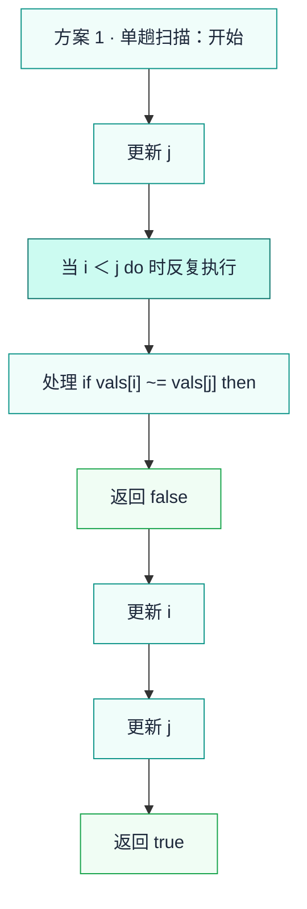

```lua
-- LeetCode 234. 回文链表 — Lua 版（方案1）
local function is_palindrome_list(vals) -- local function is_palindrome_list(vals)
	local i, j = 1, #vals -- 把 1, #vals 写入 local i, j
	while i < j do -- while 下标 i 小于 下标 j do
		if vals[i] ~= vals[j] then
			return false
		end -- 若 vals[下标 i] ~ 赋值为 vals[下标 j] then return false 终点
		i = i + 1 -- 把 下标 i 加 1 存入 下标 i
		j = j - 1 -- 把 下标 j 减 1 存入 下标 j
	end -- 终点
	return true -- 返回 true
end -- 终点
assert(is_palindrome_list({}) == true) -- 断言校验
assert(is_palindrome_list({ 1, 2, 2, 1 }) == true) -- 断言校验
assert(is_palindrome_list({ 1, 2 }) == false) -- 断言校验
print("PASS") -- 全部用例通过，输出 PASS
```

#### 方案 2：单趟扫描

**思路与代码分析**：核心是「单趟扫描」。Lua 版用表与 ipairs 遍历，注意 ipairs 遇 nil 即停的语义。**走读**：方案 2 · 单趟扫描：开始 → 更新 j → 当 i ＜ j do 时反复执行 → 处理 if vals[i] ~= vals[j] then → 返回 false → 更新 i → 更新 j → 返回 true。

**运行架构**（真实控制流）：

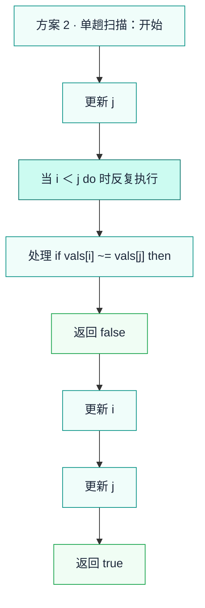

```lua
-- LeetCode 234. 回文链表 — Lua 版（方案2）
local function is_palindrome_list(vals) -- local function is_palindrome_list(vals)
	local i, j = 1, #vals -- 把 1, #vals 写入 local i, j
	while i < j do -- while 下标 i 小于 下标 j do
		if vals[i] ~= vals[j] then
			return false
		end -- 若 vals[下标 i] ~ 赋值为 vals[下标 j] then return false 终点
		i = i + 1 -- 把 下标 i 加 1 存入 下标 i
		j = j - 1 -- 把 下标 j 减 1 存入 下标 j
	end -- 终点
	return true -- 返回 true
end -- 终点
assert(is_palindrome_list({}) == true) -- 断言校验
assert(is_palindrome_list({ 1, 2, 2, 1 }) == true) -- 断言校验
assert(is_palindrome_list({ 1, 2 }) == false) -- 断言校验
print("PASS") -- 全部用例通过，输出 PASS
```

#### 方案 3：单趟扫描

**思路与代码分析**：核心是「单趟扫描」。Lua 版用表与 ipairs 遍历，注意 ipairs 遇 nil 即停的语义。**走读**：方案 3 · 单趟扫描：开始 → 更新 j → 当 i ＜ j do 时反复执行 → 处理 if vals[i] ~= vals[j] then → 返回 false → 更新 i → 更新 j → 返回 true。

**运行架构**（真实控制流）：


```lua
-- LeetCode 234. 回文链表 — Lua 版（方案3）
local function is_palindrome_list(vals) -- local function is_palindrome_list(vals)
	local i, j = 1, #vals -- 把 1, #vals 写入 local i, j
	while i < j do -- while 下标 i 小于 下标 j do
		if vals[i] ~= vals[j] then
			return false
		end -- 若 vals[下标 i] ~ 赋值为 vals[下标 j] then return false 终点
		i = i + 1 -- 把 下标 i 加 1 存入 下标 i
		j = j - 1 -- 把 下标 j 减 1 存入 下标 j
	end -- 终点
	return true -- 返回 true
end -- 终点
assert(is_palindrome_list({}) == true) -- 断言校验
assert(is_palindrome_list({ 1, 2, 2, 1 }) == true) -- 断言校验
assert(is_palindrome_list({ 1, 2 }) == false) -- 断言校验
print("PASS") -- 全部用例通过，输出 PASS
```

### C 实现（3 种方案）

C 的全部方案如下，每个方案都内嵌用例自测，可独立运行（老仓库 python/go 文件遵循「打印结果」约定）：

#### 方案 1：单趟扫描

**思路与代码分析**：核心是「单趟扫描」。C 版手动管理下标与内存，循环边界全部显式写出。**走读**：方案 1 · 单趟扫描：开始 → 更新 i → 当 (i ＜ j) 时反复执行 → 命中条件，直接返回 → 处理 i++ → 处理 j-- → 返回 1。

**运行架构**（真实控制流）：

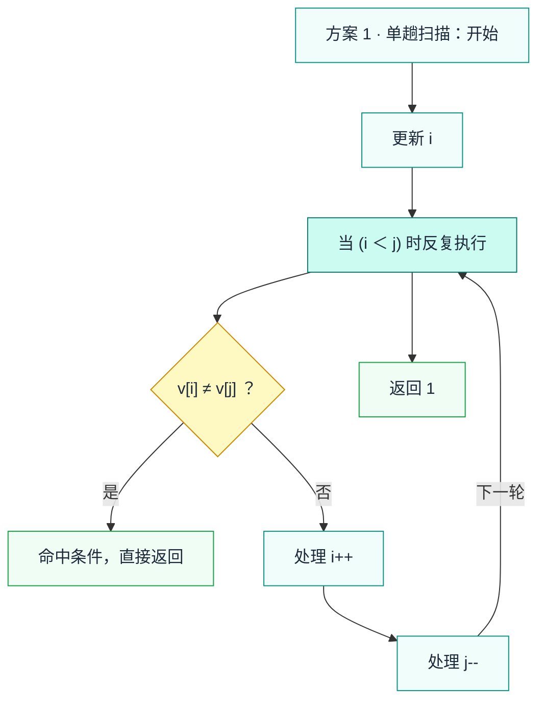

```c
/* LeetCode 234. 回文链表 — C 版（方案1） */
#include <stdio.h>                                   // 引入头文件
static int is_palindrome_list(const int *v, int n) { // 定义判定函数 is_palindrome_list
    int i = 0, j = n - 1; // 把 0, 下标 j 赋值为 元素个数 减 1 存入 下标 i
    while (i < j) {       // 循环，直到不满足「下标 i 小于 下标 j」
        if (v[i] != v[j])
            return 0; // 若 值[下标 i] 不等于 值[下标 j]，直接返回 0
        i++;
        j--; // 下标 i 加一 ; 下标 j 减一 ;
    }
    return 1; // 返回 1
}
int main(void) {                            // 程序入口：跑内嵌自测用例
    int v1[] = {1, 2, 2, 1}, v2[] = {1, 2}; // 把 {1,2,2,1}, v2[] 赋值为 {1,2}; 写入 int v1[]
    if (!is_palindrome_list(NULL, 0)) {
        printf("FAIL 0\n");
        return 1;
    }
    if (!is_palindrome_list(v1, 4)) {
        printf("FAIL 1\n");
        return 1;
    } // 若 取反 is_palindrome_list(v1, 4)) { 输出「FAIL 1 」); return 1; }
    if (is_palindrome_list(v2, 2)) {
        printf("FAIL 2\n");
        return 1;
    }                 // 若 is_palindrome_list(v2, 2)) { 输出「FAIL 2 」); return 1; }
    printf("PASS\n"); // 全部用例通过，输出 PASS
    return 0;         // 返回 0
}
```

#### 方案 2：单趟扫描

**思路与代码分析**：核心是「单趟扫描」。C 版手动管理下标与内存，循环边界全部显式写出。**走读**：方案 2 · 单趟扫描：开始 → 更新 i → 当 (i ＜ j) 时反复执行 → 命中条件，直接返回 → 处理 i++ → 处理 j-- → 返回 1。

**运行架构**（真实控制流）：

```mermaid
graph TD
    N0["方案 2 · 单趟扫描：开始"]
    N1["更新 i"]
    N2["当 (i ＜ j) 时反复执行"]
    N3{"v[i] ≠ v[j] ？"}
    N4["命中条件，直接返回"]
    N5["处理 i++"]
    N6["处理 j--"]
    N7["返回 1"]
    N0 --> N1
    N1 --> N2
    N2 --> N3
    N3 -- 是 --> N4
    N3 -- 否 --> N5
    N5 --> N6
    N6 -- 下一轮 --> N2
    N2 --> N7
    classDef n fill:#f0fdfa,stroke:#0d9488,color:#1e293b;
    classDef lp fill:#ccfbf1,stroke:#0f766e,color:#1e293b;
    classDef dc fill:#fef9c3,stroke:#ca8a04,color:#1e293b;
    classDef tm fill:#f0fdf4,stroke:#16a34a,color:#1e293b;
    class N0,N1,N5,N6 n;
    class N2 lp;
    class N3 dc;
    class N4,N7 tm;
```

```c
/* LeetCode 234. 回文链表 — C 版（方案2） */
#include <stdio.h>                                   // 引入头文件
static int is_palindrome_list(const int *v, int n) { // 定义判定函数 is_palindrome_list
    int i = 0, j = n - 1; // 把 0, 下标 j 赋值为 元素个数 减 1 存入 下标 i
    while (i < j) {       // 循环，直到不满足「下标 i 小于 下标 j」
        if (v[i] != v[j])
            return 0; // 若 值[下标 i] 不等于 值[下标 j]，直接返回 0
        i++;
        j--; // 下标 i 加一 ; 下标 j 减一 ;
    }
    return 1; // 返回 1
}
int main(void) {                            // 程序入口：跑内嵌自测用例
    int v1[] = {1, 2, 2, 1}, v2[] = {1, 2}; // 把 {1,2,2,1}, v2[] 赋值为 {1,2}; 写入 int v1[]
    if (!is_palindrome_list(NULL, 0)) {
        printf("FAIL 0\n");
        return 1;
    }
    if (!is_palindrome_list(v1, 4)) {
        printf("FAIL 1\n");
        return 1;
    } // 若 取反 is_palindrome_list(v1, 4)) { 输出「FAIL 1 」); return 1; }
    if (is_palindrome_list(v2, 2)) {
        printf("FAIL 2\n");
        return 1;
    }                 // 若 is_palindrome_list(v2, 2)) { 输出「FAIL 2 」); return 1; }
    printf("PASS\n"); // 全部用例通过，输出 PASS
    return 0;         // 返回 0
}
```

#### 方案 3：单趟扫描

**思路与代码分析**：核心是「单趟扫描」。C 版手动管理下标与内存，循环边界全部显式写出。**走读**：方案 3 · 单趟扫描：开始 → 更新 i → 当 (i ＜ j) 时反复执行 → 命中条件，直接返回 → 处理 i++ → 处理 j-- → 返回 1。

**运行架构**（真实控制流）：

```mermaid
graph TD
    N0["方案 3 · 单趟扫描：开始"]
    N1["更新 i"]
    N2["当 (i ＜ j) 时反复执行"]
    N3{"v[i] ≠ v[j] ？"}
    N4["命中条件，直接返回"]
    N5["处理 i++"]
    N6["处理 j--"]
    N7["返回 1"]
    N0 --> N1
    N1 --> N2
    N2 --> N3
    N3 -- 是 --> N4
    N3 -- 否 --> N5
    N5 --> N6
    N6 -- 下一轮 --> N2
    N2 --> N7
    classDef n fill:#f0fdfa,stroke:#0d9488,color:#1e293b;
    classDef lp fill:#ccfbf1,stroke:#0f766e,color:#1e293b;
    classDef dc fill:#fef9c3,stroke:#ca8a04,color:#1e293b;
    classDef tm fill:#f0fdf4,stroke:#16a34a,color:#1e293b;
    class N0,N1,N5,N6 n;
    class N2 lp;
    class N3 dc;
    class N4,N7 tm;
```

```c
/* LeetCode 234. 回文链表 — C 版（方案3） */
#include <stdio.h>                                   // 引入头文件
static int is_palindrome_list(const int *v, int n) { // 定义判定函数 is_palindrome_list
    int i = 0, j = n - 1; // 把 0, 下标 j 赋值为 元素个数 减 1 存入 下标 i
    while (i < j) {       // 循环，直到不满足「下标 i 小于 下标 j」
        if (v[i] != v[j])
            return 0; // 若 值[下标 i] 不等于 值[下标 j]，直接返回 0
        i++;
        j--; // 下标 i 加一 ; 下标 j 减一 ;
    }
    return 1; // 返回 1
}
int main(void) {                            // 程序入口：跑内嵌自测用例
    int v1[] = {1, 2, 2, 1}, v2[] = {1, 2}; // 把 {1,2,2,1}, v2[] 赋值为 {1,2}; 写入 int v1[]
    if (!is_palindrome_list(NULL, 0)) {
        printf("FAIL 0\n");
        return 1;
    }
    if (!is_palindrome_list(v1, 4)) {
        printf("FAIL 1\n");
        return 1;
    } // 若 取反 is_palindrome_list(v1, 4)) { 输出「FAIL 1 」); return 1; }
    if (is_palindrome_list(v2, 2)) {
        printf("FAIL 2\n");
        return 1;
    }                 // 若 is_palindrome_list(v2, 2)) { 输出「FAIL 2 」); return 1; }
    printf("PASS\n"); // 全部用例通过，输出 PASS
    return 0;         // 返回 0
}
```

### C++ 实现（3 种方案）

C++ 的全部方案如下，每个方案都内嵌用例自测，可独立运行（老仓库 python/go 文件遵循「打印结果」约定）：

#### 方案 1：单趟扫描

**思路与代码分析**：核心是「单趟扫描」。C++ 版用 STL 容器与迭代器，减少手写下标错误。**走读**：方案 1 · 单趟扫描：开始 → 更新 i → 命中条件，直接返回 → 处理 --j → 当 (i ＜ j) 时反复执行 → 命中条件，直接返回 → 处理 ++i → 处理 --j → 返回 true。

**运行架构**（真实控制流）：

```mermaid
graph TD
    N0["方案 1 · 单趟扫描：开始"]
    N1["更新 i"]
    N2{"j == 0 ？"}
    N3["命中条件，直接返回"]
    N4["处理 --j"]
    N5["当 (i ＜ j) 时反复执行"]
    N6{"v[i] ≠ v[j] ？"}
    N7["命中条件，直接返回"]
    N8["处理 ++i"]
    N9["处理 --j"]
    N10["返回 true"]
    N0 --> N1
    N1 --> N2
    N2 -- 是 --> N3
    N2 -- 否 --> N4
    N4 --> N5
    N5 --> N6
    N6 -- 是 --> N7
    N6 -- 否 --> N8
    N8 --> N9
    N9 -- 下一轮 --> N5
    N5 --> N10
    classDef n fill:#f0fdfa,stroke:#0d9488,color:#1e293b;
    classDef lp fill:#ccfbf1,stroke:#0f766e,color:#1e293b;
    classDef dc fill:#fef9c3,stroke:#ca8a04,color:#1e293b;
    classDef tm fill:#f0fdf4,stroke:#16a34a,color:#1e293b;
    class N0,N1,N4,N8,N9 n;
    class N5 lp;
    class N2,N6 dc;
    class N3,N7,N10 tm;
```

```cpp
// LeetCode 234. 回文链表 — C++ 版（方案1）
#include <cassert>                                        // 引入头文件
#include <iostream>                                       // 引入头文件
#include <vector>                                         // 引入头文件
static bool isPalindromeList(const std::vector<int> &v) { // 定义判定函数 isPalindromeList
    size_t i = 0, j = v.size(); // 把 0, 下标 j 赋值为 值.大小(); 写入 size_t i
    if (j == 0)
        return true; // 若 下标 j 等于 0，直接返回 true
    --j;             // 减一 下标 j;
    while (i < j) {  // 循环，直到不满足「下标 i 小于 下标 j」
        if (v[i] != v[j])
            return false; // 若 值[下标 i] 不等于 值[下标 j]，直接返回 false
        ++i;
        --j; // 加一 下标 i; 减一 下标 j;
    }
    return true; // 返回 true
}
int main() {                                // 程序入口：跑内嵌自测用例
    assert(isPalindromeList({}));           // 断言校验
    assert(isPalindromeList({1, 2, 2, 1})); // 断言校验
    assert(!isPalindromeList({1, 2}));      // 断言校验
    std::cout << "PASS" << std::endl;       // 全部用例通过，输出 PASS
    return 0;                               // 返回 0
}
```

#### 方案 2：单趟扫描

**思路与代码分析**：核心是「单趟扫描」。C++ 版用 STL 容器与迭代器，减少手写下标错误。**走读**：方案 2 · 单趟扫描：开始 → 更新 i → 命中条件，直接返回 → 处理 --j → 当 (i ＜ j) 时反复执行 → 命中条件，直接返回 → 处理 ++i → 处理 --j → 返回 true。

**运行架构**（真实控制流）：

```mermaid
graph TD
    N0["方案 2 · 单趟扫描：开始"]
    N1["更新 i"]
    N2{"j == 0 ？"}
    N3["命中条件，直接返回"]
    N4["处理 --j"]
    N5["当 (i ＜ j) 时反复执行"]
    N6{"v[i] ≠ v[j] ？"}
    N7["命中条件，直接返回"]
    N8["处理 ++i"]
    N9["处理 --j"]
    N10["返回 true"]
    N0 --> N1
    N1 --> N2
    N2 -- 是 --> N3
    N2 -- 否 --> N4
    N4 --> N5
    N5 --> N6
    N6 -- 是 --> N7
    N6 -- 否 --> N8
    N8 --> N9
    N9 -- 下一轮 --> N5
    N5 --> N10
    classDef n fill:#f0fdfa,stroke:#0d9488,color:#1e293b;
    classDef lp fill:#ccfbf1,stroke:#0f766e,color:#1e293b;
    classDef dc fill:#fef9c3,stroke:#ca8a04,color:#1e293b;
    classDef tm fill:#f0fdf4,stroke:#16a34a,color:#1e293b;
    class N0,N1,N4,N8,N9 n;
    class N5 lp;
    class N2,N6 dc;
    class N3,N7,N10 tm;
```

```cpp
// LeetCode 234. 回文链表 — C++ 版（方案2）
#include <cassert>                                        // 引入头文件
#include <iostream>                                       // 引入头文件
#include <vector>                                         // 引入头文件
static bool isPalindromeList(const std::vector<int> &v) { // 定义判定函数 isPalindromeList
    size_t i = 0, j = v.size(); // 把 0, 下标 j 赋值为 值.大小(); 写入 size_t i
    if (j == 0)
        return true; // 若 下标 j 等于 0，直接返回 true
    --j;             // 减一 下标 j;
    while (i < j) {  // 循环，直到不满足「下标 i 小于 下标 j」
        if (v[i] != v[j])
            return false; // 若 值[下标 i] 不等于 值[下标 j]，直接返回 false
        ++i;
        --j; // 加一 下标 i; 减一 下标 j;
    }
    return true; // 返回 true
}
int main() {                                // 程序入口：跑内嵌自测用例
    assert(isPalindromeList({}));           // 断言校验
    assert(isPalindromeList({1, 2, 2, 1})); // 断言校验
    assert(!isPalindromeList({1, 2}));      // 断言校验
    std::cout << "PASS" << std::endl;       // 全部用例通过，输出 PASS
    return 0;                               // 返回 0
}
```

#### 方案 3：单趟扫描

**思路与代码分析**：核心是「单趟扫描」。C++ 版用 STL 容器与迭代器，减少手写下标错误。**走读**：方案 3 · 单趟扫描：开始 → 更新 i → 命中条件，直接返回 → 处理 --j → 当 (i ＜ j) 时反复执行 → 命中条件，直接返回 → 处理 ++i → 处理 --j → 返回 true。

**运行架构**（真实控制流）：

```mermaid
graph TD
    N0["方案 3 · 单趟扫描：开始"]
    N1["更新 i"]
    N2{"j == 0 ？"}
    N3["命中条件，直接返回"]
    N4["处理 --j"]
    N5["当 (i ＜ j) 时反复执行"]
    N6{"v[i] ≠ v[j] ？"}
    N7["命中条件，直接返回"]
    N8["处理 ++i"]
    N9["处理 --j"]
    N10["返回 true"]
    N0 --> N1
    N1 --> N2
    N2 -- 是 --> N3
    N2 -- 否 --> N4
    N4 --> N5
    N5 --> N6
    N6 -- 是 --> N7
    N6 -- 否 --> N8
    N8 --> N9
    N9 -- 下一轮 --> N5
    N5 --> N10
    classDef n fill:#f0fdfa,stroke:#0d9488,color:#1e293b;
    classDef lp fill:#ccfbf1,stroke:#0f766e,color:#1e293b;
    classDef dc fill:#fef9c3,stroke:#ca8a04,color:#1e293b;
    classDef tm fill:#f0fdf4,stroke:#16a34a,color:#1e293b;
    class N0,N1,N4,N8,N9 n;
    class N5 lp;
    class N2,N6 dc;
    class N3,N7,N10 tm;
```

```cpp
// LeetCode 234. 回文链表 — C++ 版（方案3）
#include <cassert>                                        // 引入头文件
#include <iostream>                                       // 引入头文件
#include <vector>                                         // 引入头文件
static bool isPalindromeList(const std::vector<int> &v) { // 定义判定函数 isPalindromeList
    size_t i = 0, j = v.size(); // 把 0, 下标 j 赋值为 值.大小(); 写入 size_t i
    if (j == 0)
        return true; // 若 下标 j 等于 0，直接返回 true
    --j;             // 减一 下标 j;
    while (i < j) {  // 循环，直到不满足「下标 i 小于 下标 j」
        if (v[i] != v[j])
            return false; // 若 值[下标 i] 不等于 值[下标 j]，直接返回 false
        ++i;
        --j; // 加一 下标 i; 减一 下标 j;
    }
    return true; // 返回 true
}
int main() {                                // 程序入口：跑内嵌自测用例
    assert(isPalindromeList({}));           // 断言校验
    assert(isPalindromeList({1, 2, 2, 1})); // 断言校验
    assert(!isPalindromeList({1, 2}));      // 断言校验
    std::cout << "PASS" << std::endl;       // 全部用例通过，输出 PASS
    return 0;                               // 返回 0
}
```

### R 实现（3 种方案）

R 的全部方案如下，每个方案都内嵌用例自测，可独立运行（老仓库 python/go 文件遵循「打印结果」约定）：

#### 方案 1：单趟扫描

**思路与代码分析**：核心是「单趟扫描」。R 版用向量化思维与 1 起始下标，注意 1:n 的降序陷阱。**走读**：方案 1 · 单趟扫描：开始 → 命中条件，直接返回 → 调用 identical(vals, rev(vals))。

**运行架构**（真实控制流）：

```mermaid
graph TD
    N0["方案 1 · 单趟扫描：开始"]
    N1{"length(vals) == 0 ？"}
    N2["命中条件，直接返回"]
    N3["调用 identical(vals, rev(vals))"]
    N0 --> N1
    N1 -- 是 --> N2
    N1 -- 否 --> N3
    classDef n fill:#f0fdfa,stroke:#0d9488,color:#1e293b;
    classDef lp fill:#ccfbf1,stroke:#0f766e,color:#1e293b;
    classDef dc fill:#fef9c3,stroke:#ca8a04,color:#1e293b;
    classDef tm fill:#f0fdf4,stroke:#16a34a,color:#1e293b;
    class N0,N3 n;
    class N1 dc;
    class N2 tm;
```

```r
# 版（方案1） 定义函数 is_palindrome_list（参数：vals）
is_palindrome_list <- function(vals) {
    if (length(vals) == 0)
        return(TRUE)  # 若 长度(vals) 等于 0) return(TRUE
    identical(vals, rev(vals))  # identical(vals, rev(vals))
}
stopifnot(is_palindrome_list(integer(0)))  # 断言校验
stopifnot(is_palindrome_list(c(1, 2, 2, 1)))  # 断言校验
stopifnot(!is_palindrome_list(c(1, 2)))  # 断言校验
cat("PASS\n")  # 全部用例通过，输出 PASS
```

#### 方案 2：单趟扫描

**思路与代码分析**：核心是「单趟扫描」。R 版用向量化思维与 1 起始下标，注意 1:n 的降序陷阱。**走读**：方案 2 · 单趟扫描：开始 → 命中条件，直接返回 → 调用 identical(vals, rev(vals))。

**运行架构**（真实控制流）：

```mermaid
graph TD
    N0["方案 2 · 单趟扫描：开始"]
    N1{"length(vals) == 0 ？"}
    N2["命中条件，直接返回"]
    N3["调用 identical(vals, rev(vals))"]
    N0 --> N1
    N1 -- 是 --> N2
    N1 -- 否 --> N3
    classDef n fill:#f0fdfa,stroke:#0d9488,color:#1e293b;
    classDef lp fill:#ccfbf1,stroke:#0f766e,color:#1e293b;
    classDef dc fill:#fef9c3,stroke:#ca8a04,color:#1e293b;
    classDef tm fill:#f0fdf4,stroke:#16a34a,color:#1e293b;
    class N0,N3 n;
    class N1 dc;
    class N2 tm;
```

```r
# 版（方案2） 定义函数 is_palindrome_list（参数：vals）
is_palindrome_list <- function(vals) {
    if (length(vals) == 0)
        return(TRUE)  # 若 长度(vals) 等于 0) return(TRUE
    identical(vals, rev(vals))  # identical(vals, rev(vals))
}
stopifnot(is_palindrome_list(integer(0)))  # 断言校验
stopifnot(is_palindrome_list(c(1, 2, 2, 1)))  # 断言校验
stopifnot(!is_palindrome_list(c(1, 2)))  # 断言校验
cat("PASS\n")  # 全部用例通过，输出 PASS
```

#### 方案 3：单趟扫描

**思路与代码分析**：核心是「单趟扫描」。R 版用向量化思维与 1 起始下标，注意 1:n 的降序陷阱。**走读**：方案 3 · 单趟扫描：开始 → 命中条件，直接返回 → 调用 identical(vals, rev(vals))。

**运行架构**（真实控制流）：

```mermaid
graph TD
    N0["方案 3 · 单趟扫描：开始"]
    N1{"length(vals) == 0 ？"}
    N2["命中条件，直接返回"]
    N3["调用 identical(vals, rev(vals))"]
    N0 --> N1
    N1 -- 是 --> N2
    N1 -- 否 --> N3
    classDef n fill:#f0fdfa,stroke:#0d9488,color:#1e293b;
    classDef lp fill:#ccfbf1,stroke:#0f766e,color:#1e293b;
    classDef dc fill:#fef9c3,stroke:#ca8a04,color:#1e293b;
    classDef tm fill:#f0fdf4,stroke:#16a34a,color:#1e293b;
    class N0,N3 n;
    class N1 dc;
    class N2 tm;
```

```r
# 版（方案3） 定义函数 is_palindrome_list（参数：vals）
is_palindrome_list <- function(vals) {
    if (length(vals) == 0)
        return(TRUE)  # 若 长度(vals) 等于 0) return(TRUE
    identical(vals, rev(vals))  # identical(vals, rev(vals))
}
stopifnot(is_palindrome_list(integer(0)))  # 断言校验
stopifnot(is_palindrome_list(c(1, 2, 2, 1)))  # 断言校验
stopifnot(!is_palindrome_list(c(1, 2)))  # 断言校验
cat("PASS\n")  # 全部用例通过，输出 PASS
```

### Zig 实现（3 种方案）

Zig 的全部方案如下，每个方案都内嵌用例自测，可独立运行（老仓库 python/go 文件遵循「打印结果」约定）：

#### 方案 1：单趟扫描

**思路与代码分析**：核心是「单趟扫描」。Zig 版显式分配与清零，整型边界处理严格。**走读**：方案 1 · 单趟扫描：开始 → 命中条件，直接返回 → 计算 i → 计算 j → 当 (i ＜ j) 时反复执行 → 命中条件，直接返回 → 更新 + → 更新 - → 返回 true。

**运行架构**（真实控制流）：

```mermaid
graph TD
    N0["方案 1 · 单趟扫描：开始"]
    N1{"v.len == 0 ？"}
    N2["命中条件，直接返回"]
    N3["计算 i"]
    N4["计算 j"]
    N5["当 (i ＜ j) 时反复执行"]
    N6{"v[i] ≠ v[j] ？"}
    N7["命中条件，直接返回"]
    N8["更新 +"]
    N9["更新 -"]
    N10["返回 true"]
    N0 --> N1
    N1 -- 是 --> N2
    N1 -- 否 --> N3
    N3 --> N4
    N4 --> N5
    N5 --> N6
    N6 -- 是 --> N7
    N6 -- 否 --> N8
    N8 --> N9
    N9 -- 下一轮 --> N5
    N5 --> N10
    classDef n fill:#f0fdfa,stroke:#0d9488,color:#1e293b;
    classDef lp fill:#ccfbf1,stroke:#0f766e,color:#1e293b;
    classDef dc fill:#fef9c3,stroke:#ca8a04,color:#1e293b;
    classDef tm fill:#f0fdf4,stroke:#16a34a,color:#1e293b;
    class N0,N3,N4,N8,N9 n;
    class N5 lp;
    class N1,N6 dc;
    class N2,N7,N10 tm;
```

```zig
// LeetCode 234. 回文链表 — Zig 版（方案1）
const std = @import("std"); // 把 @import(「std」) 存入 std
fn isPalindromeList(v: []const i32) bool { // 定义判定函数 isPalindromeList
    if (v.len == 0) return true; // 若 值.长度 等于 0，直接返回 true
    var i: usize = 0; // 把 0; 写入 var i: usize
    var j: usize = v.len - 1; // 把 值.长度 减 1; 写入 var j: usize
    while (i < j) { // 循环，直到不满足「下标 i 小于 下标 j」
        if (v[i] != v[j]) return false; // 若 值[下标 i] 不等于 值[下标 j]，直接返回 false
        i += 1; // 下标 i累加 1
        j -= 1; // 下标 j累减 1
    }
    return true; // 返回 true
}
pub fn main() !void { // 程序入口：跑内嵌自测用例
    if (!isPalindromeList(&[_]i32{})) return error.TestFailed; // 若 取反 isPalindromeList( 按位与 [_]i32{})，直接返回 error.TestFailed
    if (!isPalindromeList(&[_]i32{ 1, 2, 2, 1 })) return error.TestFailed;
    if (isPalindromeList(&[_]i32{ 1, 2 })) return error.TestFailed;
    std.debug.print("PASS\n", .{}); // 全部用例通过，输出 PASS
}
```

#### 方案 2：单趟扫描

**思路与代码分析**：核心是「单趟扫描」。Zig 版显式分配与清零，整型边界处理严格。**走读**：方案 2 · 单趟扫描：开始 → 命中条件，直接返回 → 计算 i → 计算 j → 当 (i ＜ j) 时反复执行 → 命中条件，直接返回 → 更新 + → 更新 - → 返回 true。

**运行架构**（真实控制流）：

```mermaid
graph TD
    N0["方案 2 · 单趟扫描：开始"]
    N1{"v.len == 0 ？"}
    N2["命中条件，直接返回"]
    N3["计算 i"]
    N4["计算 j"]
    N5["当 (i ＜ j) 时反复执行"]
    N6{"v[i] ≠ v[j] ？"}
    N7["命中条件，直接返回"]
    N8["更新 +"]
    N9["更新 -"]
    N10["返回 true"]
    N0 --> N1
    N1 -- 是 --> N2
    N1 -- 否 --> N3
    N3 --> N4
    N4 --> N5
    N5 --> N6
    N6 -- 是 --> N7
    N6 -- 否 --> N8
    N8 --> N9
    N9 -- 下一轮 --> N5
    N5 --> N10
    classDef n fill:#f0fdfa,stroke:#0d9488,color:#1e293b;
    classDef lp fill:#ccfbf1,stroke:#0f766e,color:#1e293b;
    classDef dc fill:#fef9c3,stroke:#ca8a04,color:#1e293b;
    classDef tm fill:#f0fdf4,stroke:#16a34a,color:#1e293b;
    class N0,N3,N4,N8,N9 n;
    class N5 lp;
    class N1,N6 dc;
    class N2,N7,N10 tm;
```

```zig
// LeetCode 234. 回文链表 — Zig 版（方案2）
const std = @import("std"); // 把 @import(「std」) 存入 std
fn isPalindromeList(v: []const i32) bool { // 定义判定函数 isPalindromeList
    if (v.len == 0) return true; // 若 值.长度 等于 0，直接返回 true
    var i: usize = 0; // 把 0; 写入 var i: usize
    var j: usize = v.len - 1; // 把 值.长度 减 1; 写入 var j: usize
    while (i < j) { // 循环，直到不满足「下标 i 小于 下标 j」
        if (v[i] != v[j]) return false; // 若 值[下标 i] 不等于 值[下标 j]，直接返回 false
        i += 1; // 下标 i累加 1
        j -= 1; // 下标 j累减 1
    }
    return true; // 返回 true
}
pub fn main() !void { // 程序入口：跑内嵌自测用例
    if (!isPalindromeList(&[_]i32{})) return error.TestFailed; // 若 取反 isPalindromeList( 按位与 [_]i32{})，直接返回 error.TestFailed
    if (!isPalindromeList(&[_]i32{ 1, 2, 2, 1 })) return error.TestFailed;
    if (isPalindromeList(&[_]i32{ 1, 2 })) return error.TestFailed;
    std.debug.print("PASS\n", .{}); // 全部用例通过，输出 PASS
}
```

#### 方案 3：单趟扫描

**思路与代码分析**：核心是「单趟扫描」。Zig 版显式分配与清零，整型边界处理严格。**走读**：方案 3 · 单趟扫描：开始 → 命中条件，直接返回 → 计算 i → 计算 j → 当 (i ＜ j) 时反复执行 → 命中条件，直接返回 → 更新 + → 更新 - → 返回 true。

**运行架构**（真实控制流）：

```mermaid
graph TD
    N0["方案 3 · 单趟扫描：开始"]
    N1{"v.len == 0 ？"}
    N2["命中条件，直接返回"]
    N3["计算 i"]
    N4["计算 j"]
    N5["当 (i ＜ j) 时反复执行"]
    N6{"v[i] ≠ v[j] ？"}
    N7["命中条件，直接返回"]
    N8["更新 +"]
    N9["更新 -"]
    N10["返回 true"]
    N0 --> N1
    N1 -- 是 --> N2
    N1 -- 否 --> N3
    N3 --> N4
    N4 --> N5
    N5 --> N6
    N6 -- 是 --> N7
    N6 -- 否 --> N8
    N8 --> N9
    N9 -- 下一轮 --> N5
    N5 --> N10
    classDef n fill:#f0fdfa,stroke:#0d9488,color:#1e293b;
    classDef lp fill:#ccfbf1,stroke:#0f766e,color:#1e293b;
    classDef dc fill:#fef9c3,stroke:#ca8a04,color:#1e293b;
    classDef tm fill:#f0fdf4,stroke:#16a34a,color:#1e293b;
    class N0,N3,N4,N8,N9 n;
    class N5 lp;
    class N1,N6 dc;
    class N2,N7,N10 tm;
```

```zig
// LeetCode 234. 回文链表 — Zig 版（方案3）
const std = @import("std"); // 把 @import(「std」) 存入 std
fn isPalindromeList(v: []const i32) bool { // 定义判定函数 isPalindromeList
    if (v.len == 0) return true; // 若 值.长度 等于 0，直接返回 true
    var i: usize = 0; // 把 0; 写入 var i: usize
    var j: usize = v.len - 1; // 把 值.长度 减 1; 写入 var j: usize
    while (i < j) { // 循环，直到不满足「下标 i 小于 下标 j」
        if (v[i] != v[j]) return false; // 若 值[下标 i] 不等于 值[下标 j]，直接返回 false
        i += 1; // 下标 i累加 1
        j -= 1; // 下标 j累减 1
    }
    return true; // 返回 true
}
pub fn main() !void { // 程序入口：跑内嵌自测用例
    if (!isPalindromeList(&[_]i32{})) return error.TestFailed; // 若 取反 isPalindromeList( 按位与 [_]i32{})，直接返回 error.TestFailed
    if (!isPalindromeList(&[_]i32{ 1, 2, 2, 1 })) return error.TestFailed;
    if (isPalindromeList(&[_]i32{ 1, 2 })) return error.TestFailed;
    std.debug.print("PASS\n", .{}); // 全部用例通过，输出 PASS
}
```

### Dart 实现（3 种方案）

Dart 的全部方案如下，每个方案都内嵌用例自测，可独立运行（老仓库 python/go 文件遵循「打印结果」约定）：

#### 方案 1：单趟扫描

**思路与代码分析**：核心是「单趟扫描」。Dart 版用可空类型标注与集合方法，注意空安全。**走读**：方案 1 · 单趟扫描：开始 → 计算 i → 当 (i ＜ j) 时反复执行 → 命中条件，直接返回 → 处理 i++ → 处理 j-- → 返回 true。

**运行架构**（真实控制流）：

```mermaid
graph TD
    N0["方案 1 · 单趟扫描：开始"]
    N1["计算 i"]
    N2["当 (i ＜ j) 时反复执行"]
    N3{"v[i] ≠ v[j] ？"}
    N4["命中条件，直接返回"]
    N5["处理 i++"]
    N6["处理 j--"]
    N7["返回 true"]
    N0 --> N1
    N1 --> N2
    N2 --> N3
    N3 -- 是 --> N4
    N3 -- 否 --> N5
    N5 --> N6
    N6 -- 下一轮 --> N2
    N2 --> N7
    classDef n fill:#f0fdfa,stroke:#0d9488,color:#1e293b;
    classDef lp fill:#ccfbf1,stroke:#0f766e,color:#1e293b;
    classDef dc fill:#fef9c3,stroke:#ca8a04,color:#1e293b;
    classDef tm fill:#f0fdf4,stroke:#16a34a,color:#1e293b;
    class N0,N1,N5,N6 n;
    class N2 lp;
    class N3 dc;
    class N4,N7 tm;
```

```dart
// LeetCode 234. 回文链表 — Dart 版（方案1）
bool isPalindromeList(List<int> v) {
  // 定义判定函数 isPalindromeList
  var i = 0, j = v.length - 1; // 把 0, 下标 j 赋值为 值.长度 减 1 存入 下标 i
  while (i < j) {
    // 循环，直到不满足「下标 i 小于 下标 j」
    if (v[i] != v[j]) return false; // 若 值[下标 i] 不等于 值[下标 j]，直接返回 false
    i++; // 下标 i 加一
    j--; // 下标 j 减一
  }
  return true; // 返回 true
}

void main() {
  // 程序入口：跑内嵌自测用例
  if (!isPalindromeList([]))
    throw StateError(
      'c0',
    ); // 若 取反 isPalindromeList([])) throw StateError('c0');
  if (!isPalindromeList([1, 2, 2, 1]))
    throw StateError(
      'c1',
    ); // 若 取反 isPalindromeList([1, 2, 2, 1])) throw StateError('c1');
  if (isPalindromeList([1, 2]))
    throw StateError(
      'c2',
    ); // 若 isPalindromeList([1, 2])) throw StateError('c2');
  print('PASS'); // 全部用例通过，输出 PASS
}
```

#### 方案 2：单趟扫描

**思路与代码分析**：核心是「单趟扫描」。Dart 版用可空类型标注与集合方法，注意空安全。**走读**：方案 2 · 单趟扫描：开始 → 计算 i → 当 (i ＜ j) 时反复执行 → 命中条件，直接返回 → 处理 i++ → 处理 j-- → 返回 true。

**运行架构**（真实控制流）：

```mermaid
graph TD
    N0["方案 2 · 单趟扫描：开始"]
    N1["计算 i"]
    N2["当 (i ＜ j) 时反复执行"]
    N3{"v[i] ≠ v[j] ？"}
    N4["命中条件，直接返回"]
    N5["处理 i++"]
    N6["处理 j--"]
    N7["返回 true"]
    N0 --> N1
    N1 --> N2
    N2 --> N3
    N3 -- 是 --> N4
    N3 -- 否 --> N5
    N5 --> N6
    N6 -- 下一轮 --> N2
    N2 --> N7
    classDef n fill:#f0fdfa,stroke:#0d9488,color:#1e293b;
    classDef lp fill:#ccfbf1,stroke:#0f766e,color:#1e293b;
    classDef dc fill:#fef9c3,stroke:#ca8a04,color:#1e293b;
    classDef tm fill:#f0fdf4,stroke:#16a34a,color:#1e293b;
    class N0,N1,N5,N6 n;
    class N2 lp;
    class N3 dc;
    class N4,N7 tm;
```

```dart
// LeetCode 234. 回文链表 — Dart 版（方案2）
bool isPalindromeList(List<int> v) {
  // 定义判定函数 isPalindromeList
  var i = 0, j = v.length - 1; // 把 0, 下标 j 赋值为 值.长度 减 1 存入 下标 i
  while (i < j) {
    // 循环，直到不满足「下标 i 小于 下标 j」
    if (v[i] != v[j]) return false; // 若 值[下标 i] 不等于 值[下标 j]，直接返回 false
    i++; // 下标 i 加一
    j--; // 下标 j 减一
  }
  return true; // 返回 true
}

void main() {
  // 程序入口：跑内嵌自测用例
  if (!isPalindromeList([]))
    throw StateError(
      'c0',
    ); // 若 取反 isPalindromeList([])) throw StateError('c0');
  if (!isPalindromeList([1, 2, 2, 1]))
    throw StateError(
      'c1',
    ); // 若 取反 isPalindromeList([1, 2, 2, 1])) throw StateError('c1');
  if (isPalindromeList([1, 2]))
    throw StateError(
      'c2',
    ); // 若 isPalindromeList([1, 2])) throw StateError('c2');
  print('PASS'); // 全部用例通过，输出 PASS
}
```

#### 方案 3：单趟扫描

**思路与代码分析**：核心是「单趟扫描」。Dart 版用可空类型标注与集合方法，注意空安全。**走读**：方案 3 · 单趟扫描：开始 → 计算 i → 当 (i ＜ j) 时反复执行 → 命中条件，直接返回 → 处理 i++ → 处理 j-- → 返回 true。

**运行架构**（真实控制流）：

```mermaid
graph TD
    N0["方案 3 · 单趟扫描：开始"]
    N1["计算 i"]
    N2["当 (i ＜ j) 时反复执行"]
    N3{"v[i] ≠ v[j] ？"}
    N4["命中条件，直接返回"]
    N5["处理 i++"]
    N6["处理 j--"]
    N7["返回 true"]
    N0 --> N1
    N1 --> N2
    N2 --> N3
    N3 -- 是 --> N4
    N3 -- 否 --> N5
    N5 --> N6
    N6 -- 下一轮 --> N2
    N2 --> N7
    classDef n fill:#f0fdfa,stroke:#0d9488,color:#1e293b;
    classDef lp fill:#ccfbf1,stroke:#0f766e,color:#1e293b;
    classDef dc fill:#fef9c3,stroke:#ca8a04,color:#1e293b;
    classDef tm fill:#f0fdf4,stroke:#16a34a,color:#1e293b;
    class N0,N1,N5,N6 n;
    class N2 lp;
    class N3 dc;
    class N4,N7 tm;
```

```dart
// LeetCode 234. 回文链表 — Dart 版（方案3）
bool isPalindromeList(List<int> v) {
  // 定义判定函数 isPalindromeList
  var i = 0, j = v.length - 1; // 把 0, 下标 j 赋值为 值.长度 减 1 存入 下标 i
  while (i < j) {
    // 循环，直到不满足「下标 i 小于 下标 j」
    if (v[i] != v[j]) return false; // 若 值[下标 i] 不等于 值[下标 j]，直接返回 false
    i++; // 下标 i 加一
    j--; // 下标 j 减一
  }
  return true; // 返回 true
}

void main() {
  // 程序入口：跑内嵌自测用例
  if (!isPalindromeList([]))
    throw StateError(
      'c0',
    ); // 若 取反 isPalindromeList([])) throw StateError('c0');
  if (!isPalindromeList([1, 2, 2, 1]))
    throw StateError(
      'c1',
    ); // 若 取反 isPalindromeList([1, 2, 2, 1])) throw StateError('c1');
  if (isPalindromeList([1, 2]))
    throw StateError(
      'c2',
    ); // 若 isPalindromeList([1, 2])) throw StateError('c2');
  print('PASS'); // 全部用例通过，输出 PASS
}
```

---

## 内容总结

- **回文链表**（链表 · Medium）：共 3 个方案，主线思路「单趟扫描」；时间 O(n)（单趟线性扫描）；动画演示链表反转过程，附录给出 11 种语言 × 全部方案的可运行实现。
- 来源博客：[https://blog.csdn.net/tyro_java/article/details/145096059](https://blog.csdn.net/tyro_java/article/details/145096059)
- 导航：[📋 总目录](../) ｜ [← 062 反转链表](../062_反转链表/) ｜ [064 两数相加 →](../064_两数相加/)
