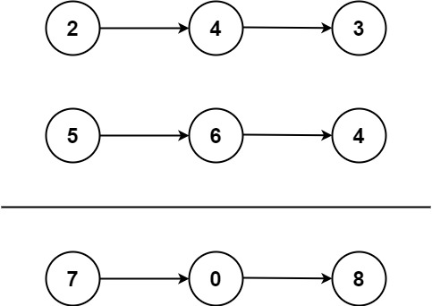
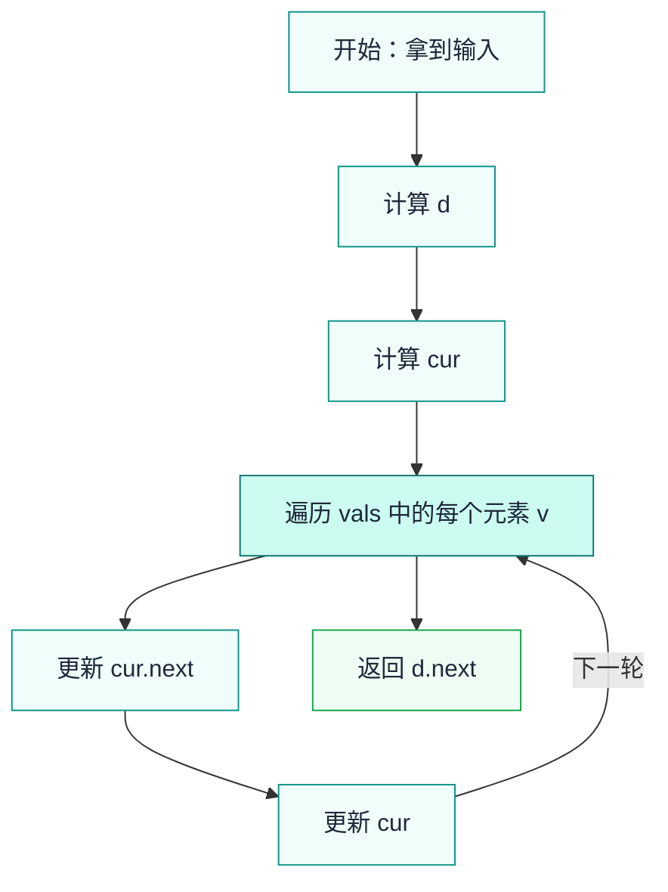
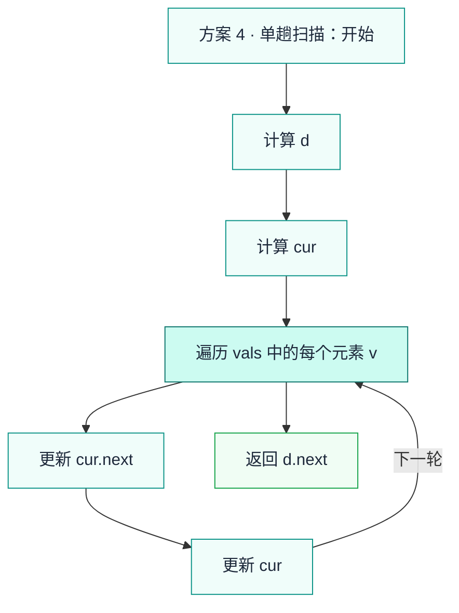
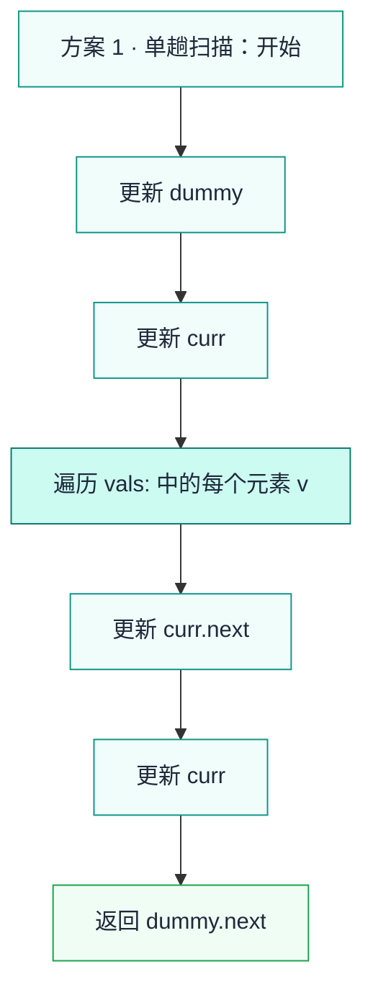
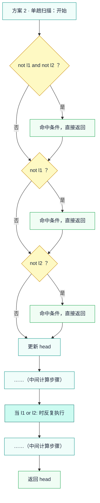
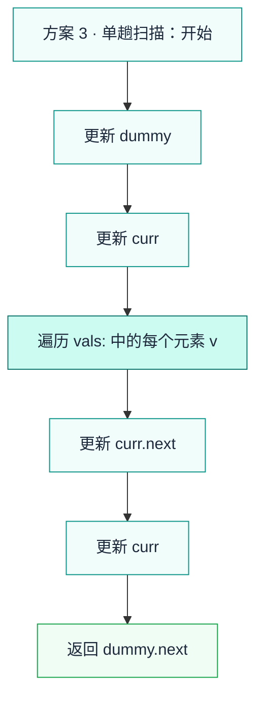
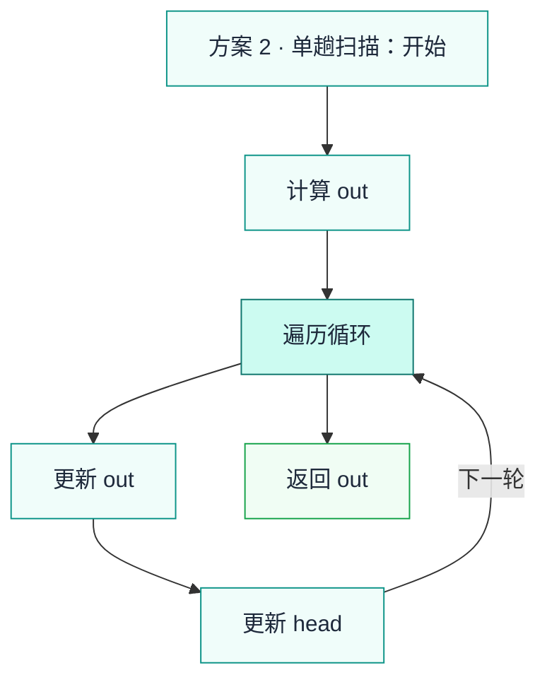
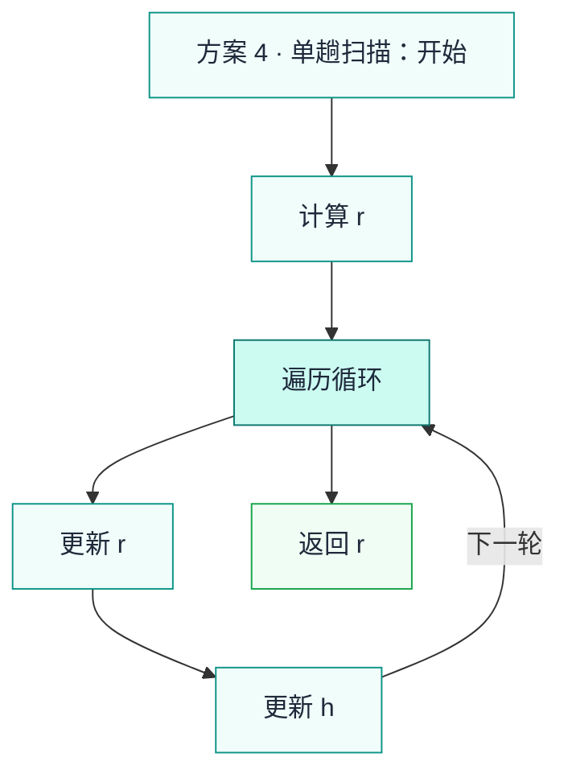
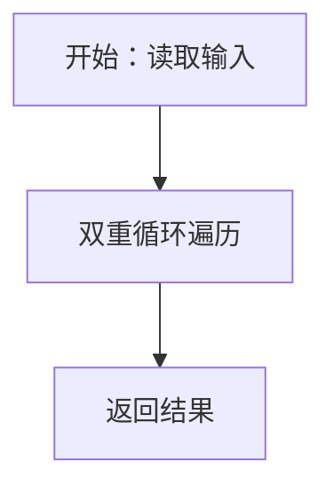

# 064 · 两数相加（第二阶段 · 链表 · Medium）

> **难度**：⭐⭐ Medium ｜ **专题**：链表
> **学习定位**：第二阶段 · 链表第 64 篇 ｜ **解法数**：6
> **内容总结**：**两数相加**（链表 · Medium）：共 6 个方案，主线思路「单趟扫描」；时间 O(n)（单趟线性扫描）；动画演示链表反转过程，附录给出 11 种语言 × 全部方案的可运行实现。

---

## 题目描述

给你两个 非空 的链表，表示两个非负的整数。它们每位数字都是按照 逆序 的方式存储的，并且每个节点只能存储 一位 数字。

请你将两个数相加，并以相同形式返回一个表示和的链表。

你可以假设除了数字 0 之外，这两个数都不会以 0 开头。

- 主函数签名：`function toStr(head: ListNode | null): string`

**用例（来自原题）**：

**示例 1**



```text
输入：l1 = [2,4,3], l2 = [5,6,4]
输出：[7,0,8]
```

解释：342 + 465 = 807.

**示例 2**

```text
输入：l1 = [0], l2 = [0]
输出：[0]
```

**示例 3**

```text
输入：l1 = [9,9,9,9,9,9,9], l2 = [9,9,9,9]
输出：[8,9,9,9,0,0,0,1]
```
> 题面与 [leetcode.cn 官方](https://leetcode.cn/problems/add-two-numbers/)一致，示例配图取自官方题面。

**数据范围与注意事项**：

- 每个链表中的节点数在范围 `[1, 100]` 内
- `0 <= Node.val <= 9`
- 题目数据保证列表表示的数字不含前导零
- **易错点**：断开 next 之前先把后继存下来，否则整条链会丢。

## 题目分析

**场景是什么**：链表只能顺着指针走，这类题练的是指针操作与断链重接，对应真实开发里的内存管理、撤销链。本题就是该场景的 Medium 级练习，主线做法是「单趟扫描」。

**主线怎么解**：把主解法从头到尾过一遍，它其实在依次做这几件事：单循环线性扫描。

## 解题思路

**方案对比**（共 6 个方案，由浅入深）：

| 方案 | 时间复杂度 | 空间复杂度 |
|---|---|---|
| 方案 1 · 单趟扫描 | O(n)（单趟线性扫描） | O(1) 到 O(n)（视辅助结构） |
| 方案 2 · 单趟扫描 | O(n)（单趟线性扫描） | O(1) 到 O(n)（视辅助结构） |
| 方案 3 · 单趟扫描 | O(n)（单趟线性扫描） | O(1) 到 O(n)（视辅助结构） |
| 方案 4 · 单趟扫描 | O(n)（单趟线性扫描） | O(1) 到 O(n)（视辅助结构） |
| 方案 5 · 单趟扫描 | O(n)（单趟线性扫描） | O(1) 到 O(n)（视辅助结构） |
| 方案 6 · 单趟扫描 | O(n)（单趟线性扫描） | O(1) 到 O(n)（视辅助结构） |

**方案间的取舍**：方案 1（单趟扫描）；方案 2（单趟扫描）；方案 3（单趟扫描）；方案 4（单趟扫描）；方案 5（单趟扫描）；方案 6（单趟扫描）。数据规模小、可读性优先时选靠前的方案；规模大、性能优先时选靠后的方案。

**怎么读这一篇**：

- 🐣 **新手路线**：把「题目描述」的示例 1 在纸上手推一遍 → 读方案 1（最直观的写法）与它的代码走读 → 按「运行方式」本地跑通看 PASS → 回头对比方案 2 之后的写法差在哪
- 🦅 **大佬路线**：直接锁定最优方案 1（单趟扫描，O(n)（单趟线性扫描））→ 跳读该方案代码与走读 → 用「逐步拆解与面试追问」补齐复杂度推导与边界追问

### 动态算法图（链表反转，GIF 自动循环）


动画演示链表专题里链表反转的典型过程；每个方案在「TypeScript 解题方案」一节还配了专属动画与专属流程图。

### 主解法流程图（真实控制流）



## TypeScript 解题方案（6 个方案逐个讲）

> **运行与提交**：每个方案都是自包含文件（内嵌用例自测，输出 PASS），整块复制到 `.ts` 文件后 `node 文件名` 即可运行。提交 LeetCode 时，把 `demo` 内的算法函数与辅助类型/函数整体取出、置于文件顶层即可。涉及交互/特殊接口的题以题面给定签名为准。

### 方案 1：单趟扫描

**分析与思路**：核心做法是「单趟扫描」。代码里依次做这些事：单循环线性扫描。

**运行方式**：`node 本文件`，内嵌用例全部通过会输出 PASS。


**方案专属流程图**（真实控制流）：


```typescript
export function demo(): void {
  // 程序入口：跑内嵌自测用例
  class ListNode {
    val: number;
    next: ListNode | null;
    constructor(v: number, n: ListNode | null = null) {
      this.val = v;
      this.next = n;
    }
  } // 定义类型
  function build(vals: number[]): ListNode | null {
    // 定义函数/方法 build
    const d = new ListNode(0);
    let cur = d; // 把 new ListNode(0); let 当前值 赋值为 d 存入 d
    for (const v of vals) {
      cur.next = new ListNode(v);
      cur = cur.next;
    } // 把 new ListNode(值); 当前值 赋值为 当前值.下一个; } 写入 下一个
    return d.next; // 返回 d.下一个
  }
  function toStr(head: ListNode | null): string {
    // 定义函数/方法 toStr
    const parts: string[] = []; // 把 []; 写入 const parts:string[]
    while (head) {
      parts.push(String(head.val));
      head = head.next;
    } // 循环，直到不满足「头节点){ parts 追加 String(头节点.值)); 头节点 赋值为 头节点.下一个; }」
    return parts.join('->'); // 返回 parts.join(「 减 超过 」)
  }
  function addTwoNumbers(
    l1: ListNode | null,
    l2: ListNode | null,
  ): ListNode | null {
    // 定义函数/方法 addTwoNumbers
    const d = new ListNode(0);
    let cur = d;
    let carry = 0; // 把 new ListNode(0); let 当前值 赋值为 d; let carry 赋值为 0 存入 d
    while (l1 || l2) {
      // 循环，直到不满足「l1 或 l2」
      const v1 = l1 ? l1.val : 0,
        v2 = l2 ? l2.val : 0; // 把 l1?l1.值:0, v2 赋值为 l2?l2.值:0 存入 v1
      const total = v1 + v2 + carry;
      carry = Math.floor(total / 10); // 把 v1 加 v2 加 carry; carry 赋值为 向下取整(总和 除以 10) 存入 总和
      cur.next = new ListNode(total % 10);
      cur = cur.next; // 把 new ListNode(总和 对…取模 10); 当前值 赋值为 当前值.下一个; 写入 下一个
      if (l1) l1 = l1.next;
      if (l2) l2 = l2.next; // 若 l1) l1 赋值为 l1.下一个; if(l2) l2 赋值为 l2.下一个;
    }
    if (carry) cur.next = new ListNode(carry); // 若 carry) 当前值.下一个 赋值为 new ListNode(carry);
    return d.next; // 返回 d.下一个
  }
  let fail = false; // 把 false 存入 fail
  if (toStr(addTwoNumbers(build([2, 4, 3]), build([5, 6, 4]))) !== '7->0->8') {
    fail = true;
    console.log('FAIL1');
  }
  if (toStr(addTwoNumbers(build([0]), build([0]))) !== '0') {
    fail = true;
    console.log('FAIL2');
  }
  if (fail) throw new Error('FAILED'); // 若 fail) throw new Error(「FAILED」);
  console.log('PASS'); // 全部用例通过，输出 PASS
}
demo(); // demo();
```

### 方案 2：单趟扫描

**分析与思路**：核心做法是「单趟扫描」。代码里依次做这些事：单循环线性扫描。

**运行方式**：`node 本文件`，内嵌用例全部通过会输出 PASS。


**方案专属流程图**（真实控制流）：


```typescript
export function demo(): void {
  // 程序入口：跑内嵌自测用例
  class ListNode {
    val: number;
    next: ListNode | null;
    constructor(v: number, n: ListNode | null = null) {
      this.val = v;
      this.next = n;
    }
  } // 定义类型
  function build(vals: number[]): ListNode | null {
    // 定义函数/方法 build
    const d = new ListNode(0);
    let cur = d; // 把 new ListNode(0); let 当前值 赋值为 d 存入 d
    for (const v of vals) {
      cur.next = new ListNode(v);
      cur = cur.next;
    } // 把 new ListNode(值); 当前值 赋值为 当前值.下一个; } 写入 下一个
    return d.next; // 返回 d.下一个
  }
  function toStr(head: ListNode | null): string {
    // 定义函数/方法 toStr
    const parts: string[] = []; // 把 []; 写入 const parts:string[]
    while (head) {
      parts.push(String(head.val));
      head = head.next;
    } // 循环，直到不满足「头节点){ parts 追加 String(头节点.值)); 头节点 赋值为 头节点.下一个; }」
    return parts.join('->'); // 返回 parts.join(「 减 超过 」)
  }
  function addTwoNumbers(
    l1: ListNode | null,
    l2: ListNode | null,
  ): ListNode | null {
    // 定义函数/方法 addTwoNumbers
    const d = new ListNode(0);
    let cur = d;
    let carry = 0; // 把 new ListNode(0); let 当前值 赋值为 d; let carry 赋值为 0 存入 d
    while (l1 || l2) {
      // 循环，直到不满足「l1 或 l2」
      const v1 = l1 ? l1.val : 0,
        v2 = l2 ? l2.val : 0; // 把 l1?l1.值:0, v2 赋值为 l2?l2.值:0 存入 v1
      const total = v1 + v2 + carry;
      carry = Math.floor(total / 10); // 把 v1 加 v2 加 carry; carry 赋值为 向下取整(总和 除以 10) 存入 总和
      cur.next = new ListNode(total % 10);
      cur = cur.next; // 把 new ListNode(总和 对…取模 10); 当前值 赋值为 当前值.下一个; 写入 下一个
      if (l1) l1 = l1.next;
      if (l2) l2 = l2.next; // 若 l1) l1 赋值为 l1.下一个; if(l2) l2 赋值为 l2.下一个;
    }
    if (carry) cur.next = new ListNode(carry); // 若 carry) 当前值.下一个 赋值为 new ListNode(carry);
    return d.next; // 返回 d.下一个
  }
  let fail = false; // 把 false 存入 fail
  if (toStr(addTwoNumbers(build([2, 4, 3]), build([5, 6, 4]))) !== '7->0->8') {
    fail = true;
    console.log('FAIL1');
  }
  if (toStr(addTwoNumbers(build([0]), build([0]))) !== '0') {
    fail = true;
    console.log('FAIL2');
  }
  if (fail) throw new Error('FAILED'); // 若 fail) throw new Error(「FAILED」);
  console.log('PASS'); // 全部用例通过，输出 PASS
}
demo(); // demo();
```

### 方案 3：单趟扫描

**分析与思路**：核心做法是「单趟扫描」。代码里依次做这些事：单循环线性扫描。

**运行方式**：`node 本文件`，内嵌用例全部通过会输出 PASS。


**方案专属流程图**（真实控制流）：


```typescript
export function demo(): void {
  // 程序入口：跑内嵌自测用例
  class ListNode {
    val: number;
    next: ListNode | null;
    constructor(v: number, n: ListNode | null = null) {
      this.val = v;
      this.next = n;
    }
  } // 定义类型
  function build(vals: number[]): ListNode | null {
    // 定义函数/方法 build
    const d = new ListNode(0);
    let cur = d; // 把 new ListNode(0); let 当前值 赋值为 d 存入 d
    for (const v of vals) {
      cur.next = new ListNode(v);
      cur = cur.next;
    } // 把 new ListNode(值); 当前值 赋值为 当前值.下一个; } 写入 下一个
    return d.next; // 返回 d.下一个
  }
  function toStr(head: ListNode | null): string {
    // 定义函数/方法 toStr
    const parts: string[] = []; // 把 []; 写入 const parts:string[]
    while (head) {
      parts.push(String(head.val));
      head = head.next;
    } // 循环，直到不满足「头节点){ parts 追加 String(头节点.值)); 头节点 赋值为 头节点.下一个; }」
    return parts.join('->'); // 返回 parts.join(「 减 超过 」)
  }
  function addTwoNumbers(
    l1: ListNode | null,
    l2: ListNode | null,
  ): ListNode | null {
    // 定义函数/方法 addTwoNumbers
    const d = new ListNode(0);
    let cur = d;
    let carry = 0; // 把 new ListNode(0); let 当前值 赋值为 d; let carry 赋值为 0 存入 d
    while (l1 || l2) {
      // 循环，直到不满足「l1 或 l2」
      const v1 = l1 ? l1.val : 0,
        v2 = l2 ? l2.val : 0; // 把 l1?l1.值:0, v2 赋值为 l2?l2.值:0 存入 v1
      const total = v1 + v2 + carry;
      carry = Math.floor(total / 10); // 把 v1 加 v2 加 carry; carry 赋值为 向下取整(总和 除以 10) 存入 总和
      cur.next = new ListNode(total % 10);
      cur = cur.next; // 把 new ListNode(总和 对…取模 10); 当前值 赋值为 当前值.下一个; 写入 下一个
      if (l1) l1 = l1.next;
      if (l2) l2 = l2.next; // 若 l1) l1 赋值为 l1.下一个; if(l2) l2 赋值为 l2.下一个;
    }
    if (carry) cur.next = new ListNode(carry); // 若 carry) 当前值.下一个 赋值为 new ListNode(carry);
    return d.next; // 返回 d.下一个
  }
  let fail = false; // 把 false 存入 fail
  if (toStr(addTwoNumbers(build([2, 4, 3]), build([5, 6, 4]))) !== '7->0->8') {
    fail = true;
    console.log('FAIL1');
  }
  if (toStr(addTwoNumbers(build([0]), build([0]))) !== '0') {
    fail = true;
    console.log('FAIL2');
  }
  if (fail) throw new Error('FAILED'); // 若 fail) throw new Error(「FAILED」);
  console.log('PASS'); // 全部用例通过，输出 PASS
}
demo(); // demo();
```

### 方案 4：单趟扫描

**分析与思路**：核心做法是「单趟扫描」。代码里依次做这些事：单循环线性扫描。

**运行方式**：`node 本文件`，内嵌用例全部通过会输出 PASS。


**方案专属流程图**（真实控制流）：



```typescript
export function demo(): void {
  // 程序入口：跑内嵌自测用例
  class ListNode {
    val: number;
    next: ListNode | null;
    constructor(v: number, n: ListNode | null = null) {
      this.val = v;
      this.next = n;
    }
  } // 定义类型
  function build(vals: number[]): ListNode | null {
    // 定义函数/方法 build
    const d = new ListNode(0);
    let cur = d; // 把 new ListNode(0); let 当前值 赋值为 d 存入 d
    for (const v of vals) {
      cur.next = new ListNode(v);
      cur = cur.next;
    } // 把 new ListNode(值); 当前值 赋值为 当前值.下一个; } 写入 下一个
    return d.next; // 返回 d.下一个
  }
  function toStr(head: ListNode | null): string {
    // 定义函数/方法 toStr
    const parts: string[] = []; // 把 []; 写入 const parts:string[]
    while (head) {
      parts.push(String(head.val));
      head = head.next;
    } // 循环，直到不满足「头节点){ parts 追加 String(头节点.值)); 头节点 赋值为 头节点.下一个; }」
    return parts.join('->'); // 返回 parts.join(「 减 超过 」)
  }
  function addTwoNumbers(
    l1: ListNode | null,
    l2: ListNode | null,
  ): ListNode | null {
    // 定义函数/方法 addTwoNumbers
    const d = new ListNode(0);
    let cur = d;
    let carry = 0; // 把 new ListNode(0); let 当前值 赋值为 d; let carry 赋值为 0 存入 d
    while (l1 || l2) {
      // 循环，直到不满足「l1 或 l2」
      const v1 = l1 ? l1.val : 0,
        v2 = l2 ? l2.val : 0; // 把 l1?l1.值:0, v2 赋值为 l2?l2.值:0 存入 v1
      const total = v1 + v2 + carry;
      carry = Math.floor(total / 10); // 把 v1 加 v2 加 carry; carry 赋值为 向下取整(总和 除以 10) 存入 总和
      cur.next = new ListNode(total % 10);
      cur = cur.next; // 把 new ListNode(总和 对…取模 10); 当前值 赋值为 当前值.下一个; 写入 下一个
      if (l1) l1 = l1.next;
      if (l2) l2 = l2.next; // 若 l1) l1 赋值为 l1.下一个; if(l2) l2 赋值为 l2.下一个;
    }
    if (carry) cur.next = new ListNode(carry); // 若 carry) 当前值.下一个 赋值为 new ListNode(carry);
    return d.next; // 返回 d.下一个
  }
  let fail = false; // 把 false 存入 fail
  if (toStr(addTwoNumbers(build([2, 4, 3]), build([5, 6, 4]))) !== '7->0->8') {
    fail = true;
    console.log('FAIL1');
  }
  if (toStr(addTwoNumbers(build([0]), build([0]))) !== '0') {
    fail = true;
    console.log('FAIL2');
  }
  if (fail) throw new Error('FAILED'); // 若 fail) throw new Error(「FAILED」);
  console.log('PASS'); // 全部用例通过，输出 PASS
}
demo(); // demo();
```

### 方案 5：单趟扫描

**分析与思路**：核心做法是「单趟扫描」。代码里依次做这些事：单循环线性扫描。

**运行方式**：`node 本文件`，内嵌用例全部通过会输出 PASS。


**方案专属流程图**（真实控制流）：


```typescript
export function demo(): void {
  // 程序入口：跑内嵌自测用例
  class ListNode {
    val: number;
    next: ListNode | null;
    constructor(v: number, n: ListNode | null = null) {
      this.val = v;
      this.next = n;
    }
  } // 定义类型
  function build(vals: number[]): ListNode | null {
    // 定义函数/方法 build
    const d = new ListNode(0);
    let cur = d; // 把 new ListNode(0); let 当前值 赋值为 d 存入 d
    for (const v of vals) {
      cur.next = new ListNode(v);
      cur = cur.next;
    } // 把 new ListNode(值); 当前值 赋值为 当前值.下一个; } 写入 下一个
    return d.next; // 返回 d.下一个
  }
  function toStr(head: ListNode | null): string {
    // 定义函数/方法 toStr
    const parts: string[] = []; // 把 []; 写入 const parts:string[]
    while (head) {
      parts.push(String(head.val));
      head = head.next;
    } // 循环，直到不满足「头节点){ parts 追加 String(头节点.值)); 头节点 赋值为 头节点.下一个; }」
    return parts.join('->'); // 返回 parts.join(「 减 超过 」)
  }
  function addTwoNumbers(
    l1: ListNode | null,
    l2: ListNode | null,
  ): ListNode | null {
    // 定义函数/方法 addTwoNumbers
    const d = new ListNode(0);
    let cur = d;
    let carry = 0; // 把 new ListNode(0); let 当前值 赋值为 d; let carry 赋值为 0 存入 d
    while (l1 || l2) {
      // 循环，直到不满足「l1 或 l2」
      const v1 = l1 ? l1.val : 0,
        v2 = l2 ? l2.val : 0; // 把 l1?l1.值:0, v2 赋值为 l2?l2.值:0 存入 v1
      const total = v1 + v2 + carry;
      carry = Math.floor(total / 10); // 把 v1 加 v2 加 carry; carry 赋值为 向下取整(总和 除以 10) 存入 总和
      cur.next = new ListNode(total % 10);
      cur = cur.next; // 把 new ListNode(总和 对…取模 10); 当前值 赋值为 当前值.下一个; 写入 下一个
      if (l1) l1 = l1.next;
      if (l2) l2 = l2.next; // 若 l1) l1 赋值为 l1.下一个; if(l2) l2 赋值为 l2.下一个;
    }
    if (carry) cur.next = new ListNode(carry); // 若 carry) 当前值.下一个 赋值为 new ListNode(carry);
    return d.next; // 返回 d.下一个
  }
  let fail = false; // 把 false 存入 fail
  if (toStr(addTwoNumbers(build([2, 4, 3]), build([5, 6, 4]))) !== '7->0->8') {
    fail = true;
    console.log('FAIL1');
  }
  if (toStr(addTwoNumbers(build([0]), build([0]))) !== '0') {
    fail = true;
    console.log('FAIL2');
  }
  if (fail) throw new Error('FAILED'); // 若 fail) throw new Error(「FAILED」);
  console.log('PASS'); // 全部用例通过，输出 PASS
}
demo(); // demo();
```

### 方案 6：单趟扫描

**分析与思路**：核心做法是「单趟扫描」。代码里依次做这些事：单循环线性扫描。

**运行方式**：`node 本文件`，内嵌用例全部通过会输出 PASS。


**方案专属流程图**（真实控制流）：


```typescript
export function demo(): void {
  // 程序入口：跑内嵌自测用例
  class ListNode {
    val: number;
    next: ListNode | null;
    constructor(v: number, n: ListNode | null = null) {
      this.val = v;
      this.next = n;
    }
  } // 定义类型
  function build(vals: number[]): ListNode | null {
    // 定义函数/方法 build
    const d = new ListNode(0);
    let cur = d; // 把 new ListNode(0); let 当前值 赋值为 d 存入 d
    for (const v of vals) {
      cur.next = new ListNode(v);
      cur = cur.next;
    } // 把 new ListNode(值); 当前值 赋值为 当前值.下一个; } 写入 下一个
    return d.next; // 返回 d.下一个
  }
  function toStr(head: ListNode | null): string {
    // 定义函数/方法 toStr
    const parts: string[] = []; // 把 []; 写入 const parts:string[]
    while (head) {
      parts.push(String(head.val));
      head = head.next;
    } // 循环，直到不满足「头节点){ parts 追加 String(头节点.值)); 头节点 赋值为 头节点.下一个; }」
    return parts.join('->'); // 返回 parts.join(「 减 超过 」)
  }
  function addTwoNumbers(
    l1: ListNode | null,
    l2: ListNode | null,
  ): ListNode | null {
    // 定义函数/方法 addTwoNumbers
    const d = new ListNode(0);
    let cur = d;
    let carry = 0; // 把 new ListNode(0); let 当前值 赋值为 d; let carry 赋值为 0 存入 d
    while (l1 || l2) {
      // 循环，直到不满足「l1 或 l2」
      const v1 = l1 ? l1.val : 0,
        v2 = l2 ? l2.val : 0; // 把 l1?l1.值:0, v2 赋值为 l2?l2.值:0 存入 v1
      const total = v1 + v2 + carry;
      carry = Math.floor(total / 10); // 把 v1 加 v2 加 carry; carry 赋值为 向下取整(总和 除以 10) 存入 总和
      cur.next = new ListNode(total % 10);
      cur = cur.next; // 把 new ListNode(总和 对…取模 10); 当前值 赋值为 当前值.下一个; 写入 下一个
      if (l1) l1 = l1.next;
      if (l2) l2 = l2.next; // 若 l1) l1 赋值为 l1.下一个; if(l2) l2 赋值为 l2.下一个;
    }
    if (carry) cur.next = new ListNode(carry); // 若 carry) 当前值.下一个 赋值为 new ListNode(carry);
    return d.next; // 返回 d.下一个
  }
  let fail = false; // 把 false 存入 fail
  if (toStr(addTwoNumbers(build([2, 4, 3]), build([5, 6, 4]))) !== '7->0->8') {
    fail = true;
    console.log('FAIL1');
  }
  if (toStr(addTwoNumbers(build([0]), build([0]))) !== '0') {
    fail = true;
    console.log('FAIL2');
  }
  if (fail) throw new Error('FAILED'); // 若 fail) throw new Error(「FAILED」);
  console.log('PASS'); // 全部用例通过，输出 PASS
}
demo(); // demo();
```

## 逐步拆解与面试追问

**复杂度**：时间 O(n)（单趟线性扫描），空间 O(1) 到 O(n)（视辅助结构）

**为什么是这个量级**：每个元素被常数次访问，辅助哈希或栈的开销与 n 同阶

**面试官可能会追问**：

- 能不能一次遍历完成？
- 快慢指针能解决哪些变体？
- 断链与接回的顺序怎么保证不出错？

## 关键 API 速查（TS 主解法实际用到，附官方链接）

| API | 作用 | 使用要点 | 官方文档 |
|---|---|---|---|
| `Array.prototype.push()` | 尾部追加 | 返回新长度；可一次多个；均摊 O(1)；会改变原数组 | [官方文档](https://developer.mozilla.org/zh-CN/docs/Web/JavaScript/Reference/Global_Objects/Array/push) |
| `Array.prototype.join()` | 数组拼接为字符串 | undefined/null 转空串；嵌套数组会展平一层；join('') 用于字符数组还原 | [官方文档](https://developer.mozilla.org/zh-CN/docs/Web/JavaScript/Reference/Global_Objects/Array/join) |
| `Math.floor()` | 向下取整 | 负数向负无穷（-1.5 → -2）；大数用位运算前注意 2^31 界 | [官方文档](https://developer.mozilla.org/zh-CN/docs/Web/JavaScript/Reference/Global_Objects/Math/floor) |

### 各语言官方文档导航

- **TypeScript / JS**：[MDN 中文参考](https://developer.mozilla.org/zh-CN/)
- **Python**：[Python 官方文档](https://docs.python.org/zh-cn/3/)
- **Go**：[Go 标准库](https://pkg.go.dev/std)
- **Java**：[JDK 17 API](https://docs.oracle.com/en/java/javase/17/docs/api/)
- **Rust**：[Rust 标准库](https://doc.rust-lang.org/std/)
- **Lua**：[Lua 5.4 手册](https://www.lua.org/manual/5.4/)
- **C**：[Cppreference C](https://zh.cppreference.com/w/c)
- **C++**：[Cppreference C++](https://zh.cppreference.com/w/cpp)
- **R**：[R 官方手册](https://stat.ethz.ch/R-manual/)
- **Zig**：[Zig 语言文档](https://ziglang.org/documentation/master/)
- **Dart**：[Dart API](https://api.dart.dev/)

## 附录：其他 10 种语言全部实现（每种语言列举其全部方案）

> TypeScript 的全部方案见「TypeScript 解题方案」一节；下面是其余 10 种语言的对应实现，每种语言的每个方案都带思路分析、代码走读与专属运行架构图。
> 每个方案都内嵌用例自测，可独立运行（老仓库 python/go 文件遵循「打印结果」约定）。
> 完整解法文件见 `dsa/<语言>/linked_list/lc_2_两数相加/`。

### Python 实现（6 种方案）

Python 的全部方案如下，每个方案都内嵌用例自测，可独立运行（老仓库 python/go 文件遵循「打印结果」约定）：

#### 方案 1：单趟扫描

**思路与代码分析**：核心是「单趟扫描」。Python 版用切片与字典推导式简化操作，突出可读性。**走读**：方案 1 · 单趟扫描：开始 → 更新 dummy → 更新 curr → 遍历 vals: 中的每个元素 v → 更新 curr.next → 更新 curr → 返回 dummy.next。

**运行架构**（真实控制流）：



```python
# Definition for singly-linked list.
import sys  # 提高递归深度上限（深输入防 RecursionError）

sys.setrecursionlimit(200000)  # 树/链表类题目节点数可达 1e4 量级

class ListNode:  # 定义类
    def __init__(self, val=0, next=None):  # 构造函数：初始化成员
        self.val = val  # 把 值 写入 值
        self.next = next  # 把 下一个 写入 下一个

def build_list(vals):  # 定义函数 build_list（参数：vals）
    dummy = ListNode(0)  # 把 ListNode(0) 存入 哨兵节点
    curr = dummy  # 把 哨兵节点 存入 当前值
    for v in vals:  # 逐个取出 vals 的元素（值）
        curr.next = ListNode(v)  # 把 ListNode(值) 写入 下一个
        curr = curr.next  # 把 当前值.下一个 存入 当前值
    return dummy.next  # 返回 哨兵节点.下一个

def print_list(head):  # 定义函数 print_list（参数：头节点）
    res = []  # 把 [] 存入 结果
    while head:  # 循环，直到不满足「头节点」
        res.append(str(head.val))  # 把 str(头节点.值 追加到列表尾部
        head = head.next  # 把 头节点.下一个 存入 头节点
    return "->".join(res)  # 返回 ' 减 超过 '.join(结果)

def addTwoNumbers(l1, l2):  # 定义函数 addTwoNumbers（参数：l1, l2）
    dummy = ListNode(0)  # 把 ListNode(0) 存入 哨兵节点
    curr = dummy  # 把 哨兵节点 存入 当前值
    carry = 0  # 把 0 存入 carry
    while l1 or l2:  # 循环，直到不满足「l1 or l2」
        v1 = l1.val if l1 else 0  # 把 l1.值 if l1 else 0 存入 v1
        v2 = l2.val if l2 else 0  # 把 l2.值 if l2 else 0 存入 v2
        total = v1 + v2 + carry  # 把 v1 加 v2 加 carry 存入 总和
        carry = total // 10  # 把 总和 除以 除以 10 存入 carry
        curr.next = ListNode(total % 10)  # 把 ListNode(总和 对…取模 10) 写入 下一个
        curr = curr.next  # 把 当前值.下一个 存入 当前值
        l1 = l1.next if l1 else None  # 把 l1.下一个 if l1 else None 存入 l1
        l2 = l2.next if l2 else None  # 把 l2.下一个 if l2 else None 存入 l2
    if carry:  # 若 carry
        curr.next = ListNode(carry)  # 把 ListNode(carry) 写入 下一个
    return dummy.next  # 返回 哨兵节点.下一个

if __name__ == "__main__":  # 若 __name__ 等于 '__main__'
    l1 = build_list([2, 4, 3])  # 把 build_list([2, 4, 3]) 存入 l1
    l2 = build_list([5, 6, 4])  # 把 build_list([5, 6, 4]) 存入 l2
    result = addTwoNumbers(l1, l2)  # 把 addTwoNumbers(l1, l2) 存入 结果
    print(print_list(result))  # 打印输出
```

#### 方案 2：单趟扫描

**思路与代码分析**：核心是「单趟扫描」。Python 版用切片与字典推导式简化操作，突出可读性。**走读**：方案 2 · 单趟扫描：开始 → 命中条件，直接返回 → 命中条件，直接返回 → 命中条件，直接返回 → 更新 head → 当 l1 or l2: 时反复执行 → 返回 head。

**运行架构**（真实控制流）：



```python
# Definition for singly-linked list.
# class ListNode:
#     def __init__(self, val=0, next=None):
#         self.val = val
#         self.next = next

import sys  # 提高递归深度上限（深输入防 RecursionError）

sys.setrecursionlimit(200000)  # 树/链表类题目节点数可达 1e4 量级

def addTwoNumbers(l1, l2):  # 定义函数 addTwoNumbers（参数：l1, l2）
    if not l1 and not l2:  # 若 not l1 and not l2
        return None  # 返回 None
    if not l1:  # 若 not l1
        return l2  # 返回 l2
    if not l2:  # 若 not l2
        return l1  # 返回 l1
    head = tail = None  # 把 尾节点 赋值为 None 存入 头节点
    carry = 0  # 把 0 存入 carry
    while l1 or l2:  # 循环，直到不满足「l1 or l2」
        v1 = l1.val if l1 else 0  # 把 l1.值 if l1 else 0 存入 v1
        v2 = l2.val if l2 else 0  # 把 l2.值 if l2 else 0 存入 v2
        total = v1 + v2 + carry  # 把 v1 加 v2 加 carry 存入 总和
        node = ListNode(total % 10)  # 把 ListNode(总和 对…取模 10) 存入 节点
        carry = total // 10  # 把 总和 除以 除以 10 存入 carry
        if not head:  # 若 not 头节点
            head = tail = node  # 把 尾节点 赋值为 节点 存入 头节点
        else:  # 否则
            tail.next = node  # 把 节点 写入 下一个
            tail = node  # 把 节点 存入 尾节点
        l1 = l1.next if l1 else None  # 把 l1.下一个 if l1 else None 存入 l1
        l2 = l2.next if l2 else None  # 把 l2.下一个 if l2 else None 存入 l2
    if carry:  # 若 carry
        tail.next = ListNode(carry)  # 把 ListNode(carry) 写入 下一个
    return head  # 返回 头节点

if __name__ == "__main__":  # 若 __name__ 等于 '__main__'
    print(addTwoNumbers(None, None))  # 打印输出
```

#### 方案 3：单趟扫描

**思路与代码分析**：核心是「单趟扫描」。Python 版用切片与字典推导式简化操作，突出可读性。**走读**：方案 3 · 单趟扫描：开始 → 更新 dummy → 更新 curr → 遍历 vals: 中的每个元素 v → 更新 curr.next → 更新 curr → 返回 dummy.next。

**运行架构**（真实控制流）：



```python
# Definition for singly-linked list.
import sys  # 提高递归深度上限（深输入防 RecursionError）

sys.setrecursionlimit(200000)  # 树/链表类题目节点数可达 1e4 量级

class ListNode:  # 定义类
    def __init__(self, val=0, next=None):  # 构造函数：初始化成员
        self.val = val  # 把 值 写入 值
        self.next = next  # 把 下一个 写入 下一个

def build_list(vals):  # 定义函数 build_list（参数：vals）
    dummy = ListNode(0)  # 把 ListNode(0) 存入 哨兵节点
    curr = dummy  # 把 哨兵节点 存入 当前值
    for v in vals:  # 逐个取出 vals 的元素（值）
        curr.next = ListNode(v)  # 把 ListNode(值) 写入 下一个
        curr = curr.next  # 把 当前值.下一个 存入 当前值
    return dummy.next  # 返回 哨兵节点.下一个

def print_list(head):  # 定义函数 print_list（参数：头节点）
    res = []  # 把 [] 存入 结果
    while head:  # 循环，直到不满足「头节点」
        res.append(str(head.val))  # 把 str(头节点.值 追加到列表尾部
        head = head.next  # 把 头节点.下一个 存入 头节点
    return "->".join(res)  # 返回 ' 减 超过 '.join(结果)

def addTwoNumbers(l1, l2):  # 定义函数 addTwoNumbers（参数：l1, l2）
    dummy = ListNode(0)  # 把 ListNode(0) 存入 哨兵节点
    curr = dummy  # 把 哨兵节点 存入 当前值
    carry = 0  # 把 0 存入 carry
    while l1 or l2 or carry:  # 循环，直到不满足「l1 or l2 or carry」
        v1 = l1.val if l1 else 0  # 把 l1.值 if l1 else 0 存入 v1
        v2 = l2.val if l2 else 0  # 把 l2.值 if l2 else 0 存入 v2
        total = v1 + v2 + carry  # 把 v1 加 v2 加 carry 存入 总和
        carry = total // 10  # 把 总和 除以 除以 10 存入 carry
        curr.next = ListNode(total % 10)  # 把 ListNode(总和 对…取模 10) 写入 下一个
        curr = curr.next  # 把 当前值.下一个 存入 当前值
        l1 = l1.next if l1 else None  # 把 l1.下一个 if l1 else None 存入 l1
        l2 = l2.next if l2 else None  # 把 l2.下一个 if l2 else None 存入 l2
    return dummy.next  # 返回 哨兵节点.下一个

if __name__ == "__main__":  # 若 __name__ 等于 '__main__'
    l1 = build_list([2, 4, 3])  # 把 build_list([2, 4, 3]) 存入 l1
    l2 = build_list([5, 6, 4])  # 把 build_list([5, 6, 4]) 存入 l2
    result = addTwoNumbers(l1, l2)  # 把 addTwoNumbers(l1, l2) 存入 结果
    print(print_list(result))  # 打印输出
```

#### 方案 4：单趟扫描

**思路与代码分析**：核心是「单趟扫描」。Python 版用切片与字典推导式简化操作，突出可读性。**走读**：方案 4 · 单趟扫描：开始 → 更新 dummy → 更新 curr → 遍历 vals: 中的每个元素 v → 更新 curr.next → 更新 curr → 返回 dummy.next。

**运行架构**（真实控制流）：


```python
# Definition for singly-linked list.
import sys  # 提高递归深度上限（深输入防 RecursionError）

sys.setrecursionlimit(200000)  # 树/链表类题目节点数可达 1e4 量级

class ListNode:  # 定义类
    def __init__(self, val=0, next=None):  # 构造函数：初始化成员
        self.val = val  # 把 值 写入 值
        self.next = next  # 把 下一个 写入 下一个

def build_list(vals):  # 定义函数 build_list（参数：vals）
    dummy = ListNode(0)  # 把 ListNode(0) 存入 哨兵节点
    curr = dummy  # 把 哨兵节点 存入 当前值
    for v in vals:  # 逐个取出 vals 的元素（值）
        curr.next = ListNode(v)  # 把 ListNode(值) 写入 下一个
        curr = curr.next  # 把 当前值.下一个 存入 当前值
    return dummy.next  # 返回 哨兵节点.下一个

def print_list(head):  # 定义函数 print_list（参数：头节点）
    res = []  # 把 [] 存入 结果
    while head:  # 循环，直到不满足「头节点」
        res.append(str(head.val))  # 把 str(头节点.值 追加到列表尾部
        head = head.next  # 把 头节点.下一个 存入 头节点
    return "->".join(res)  # 返回 ' 减 超过 '.join(结果)

def addTwoNumbers(l1, l2):  # 定义函数 addTwoNumbers（参数：l1, l2）
    dummy = ListNode(0)  # 把 ListNode(0) 存入 哨兵节点
    curr = dummy  # 把 哨兵节点 存入 当前值
    carry = 0  # 把 0 存入 carry
    while l1 or l2 or carry:  # 循环，直到不满足「l1 or l2 or carry」
        v1 = l1.val if l1 else 0  # 把 l1.值 if l1 else 0 存入 v1
        v2 = l2.val if l2 else 0  # 把 l2.值 if l2 else 0 存入 v2
        total = v1 + v2 + carry  # 把 v1 加 v2 加 carry 存入 总和
        carry = total // 10  # 把 总和 除以 除以 10 存入 carry
        curr.next = ListNode(total % 10)  # 把 ListNode(总和 对…取模 10) 写入 下一个
        curr = curr.next  # 把 当前值.下一个 存入 当前值
        l1 = l1.next if l1 else None  # 把 l1.下一个 if l1 else None 存入 l1
        l2 = l2.next if l2 else None  # 把 l2.下一个 if l2 else None 存入 l2
    return dummy.next  # 返回 哨兵节点.下一个

if __name__ == "__main__":  # 若 __name__ 等于 '__main__'
    l1 = build_list([2, 4, 3])  # 把 build_list([2, 4, 3]) 存入 l1
    l2 = build_list([5, 6, 4])  # 把 build_list([5, 6, 4]) 存入 l2
    result = addTwoNumbers(l1, l2)  # 把 addTwoNumbers(l1, l2) 存入 结果
    print(print_list(result))  # 打印输出
```

#### 方案 5：单趟扫描

**思路与代码分析**：核心是「单趟扫描」。Python 版用切片与字典推导式简化操作，突出可读性。**走读**：方案 5 · 单趟扫描：开始 → 更新 dummy → 更新 curr → 遍历 vals: 中的每个元素 v → 更新 curr.next → 更新 curr → 返回 dummy.next。

**运行架构**（真实控制流）：


```python
# Definition for singly-linked list.
import sys  # 提高递归深度上限（深输入防 RecursionError）

sys.setrecursionlimit(200000)  # 树/链表类题目节点数可达 1e4 量级

class ListNode:  # 定义类
    def __init__(self, val=0, next=None):  # 构造函数：初始化成员
        self.val = val  # 把 值 写入 值
        self.next = next  # 把 下一个 写入 下一个

def build_list(vals):  # 定义函数 build_list（参数：vals）
    dummy = ListNode(0)  # 把 ListNode(0) 存入 哨兵节点
    curr = dummy  # 把 哨兵节点 存入 当前值
    for v in vals:  # 逐个取出 vals 的元素（值）
        curr.next = ListNode(v)  # 把 ListNode(值) 写入 下一个
        curr = curr.next  # 把 当前值.下一个 存入 当前值
    return dummy.next  # 返回 哨兵节点.下一个

def print_list(head):  # 定义函数 print_list（参数：头节点）
    res = []  # 把 [] 存入 结果
    while head:  # 循环，直到不满足「头节点」
        res.append(str(head.val))  # 把 str(头节点.值 追加到列表尾部
        head = head.next  # 把 头节点.下一个 存入 头节点
    return "->".join(res)  # 返回 ' 减 超过 '.join(结果)

def addTwoNumbers(l1, l2):  # 定义函数 addTwoNumbers（参数：l1, l2）
    dummy = ListNode(0)  # 把 ListNode(0) 存入 哨兵节点
    curr = dummy  # 把 哨兵节点 存入 当前值
    carry = 0  # 把 0 存入 carry
    while l1 or l2 or carry:  # 循环，直到不满足「l1 or l2 or carry」
        v1 = l1.val if l1 else 0  # 把 l1.值 if l1 else 0 存入 v1
        v2 = l2.val if l2 else 0  # 把 l2.值 if l2 else 0 存入 v2
        total = v1 + v2 + carry  # 把 v1 加 v2 加 carry 存入 总和
        carry = total // 10  # 把 总和 除以 除以 10 存入 carry
        curr.next = ListNode(total % 10)  # 把 ListNode(总和 对…取模 10) 写入 下一个
        curr = curr.next  # 把 当前值.下一个 存入 当前值
        l1 = l1.next if l1 else None  # 把 l1.下一个 if l1 else None 存入 l1
        l2 = l2.next if l2 else None  # 把 l2.下一个 if l2 else None 存入 l2
    return dummy.next  # 返回 哨兵节点.下一个

if __name__ == "__main__":  # 若 __name__ 等于 '__main__'
    l1 = build_list([2, 4, 3])  # 把 build_list([2, 4, 3]) 存入 l1
    l2 = build_list([5, 6, 4])  # 把 build_list([5, 6, 4]) 存入 l2
    result = addTwoNumbers(l1, l2)  # 把 addTwoNumbers(l1, l2) 存入 结果
    print(print_list(result))  # 打印输出
```

#### 方案 6：单趟扫描

**思路与代码分析**：核心是「单趟扫描」。Python 版用切片与字典推导式简化操作，突出可读性。**走读**：方案 6 · 单趟扫描：开始 → 更新 dummy → 更新 curr → 遍历 vals: 中的每个元素 v → 更新 curr.next → 更新 curr → 返回 dummy.next。

**运行架构**（真实控制流）：


```python
# Definition for singly-linked list.
import sys  # 提高递归深度上限（深输入防 RecursionError）

sys.setrecursionlimit(200000)  # 树/链表类题目节点数可达 1e4 量级

class ListNode:  # 定义类
    def __init__(self, val=0, next=None):  # 构造函数：初始化成员
        self.val = val  # 把 值 写入 值
        self.next = next  # 把 下一个 写入 下一个

def build_list(vals):  # 定义函数 build_list（参数：vals）
    dummy = ListNode(0)  # 把 ListNode(0) 存入 哨兵节点
    curr = dummy  # 把 哨兵节点 存入 当前值
    for v in vals:  # 逐个取出 vals 的元素（值）
        curr.next = ListNode(v)  # 把 ListNode(值) 写入 下一个
        curr = curr.next  # 把 当前值.下一个 存入 当前值
    return dummy.next  # 返回 哨兵节点.下一个

def print_list(head):  # 定义函数 print_list（参数：头节点）
    res = []  # 把 [] 存入 结果
    while head:  # 循环，直到不满足「头节点」
        res.append(str(head.val))  # 把 str(头节点.值 追加到列表尾部
        head = head.next  # 把 头节点.下一个 存入 头节点
    return "->".join(res)  # 返回 ' 减 超过 '.join(结果)

def addTwoNumbers(l1, l2):  # 定义函数 addTwoNumbers（参数：l1, l2）
    dummy = ListNode(0)  # 把 ListNode(0) 存入 哨兵节点
    curr = dummy  # 把 哨兵节点 存入 当前值
    carry = 0  # 把 0 存入 carry
    while l1 or l2 or carry:  # 循环，直到不满足「l1 or l2 or carry」
        v1 = l1.val if l1 else 0  # 把 l1.值 if l1 else 0 存入 v1
        v2 = l2.val if l2 else 0  # 把 l2.值 if l2 else 0 存入 v2
        total = v1 + v2 + carry  # 把 v1 加 v2 加 carry 存入 总和
        carry = total // 10  # 把 总和 除以 除以 10 存入 carry
        curr.next = ListNode(total % 10)  # 把 ListNode(总和 对…取模 10) 写入 下一个
        curr = curr.next  # 把 当前值.下一个 存入 当前值
        l1 = l1.next if l1 else None  # 把 l1.下一个 if l1 else None 存入 l1
        l2 = l2.next if l2 else None  # 把 l2.下一个 if l2 else None 存入 l2
    return dummy.next  # 返回 哨兵节点.下一个

if __name__ == "__main__":  # 若 __name__ 等于 '__main__'
    l1 = build_list([2, 4, 3])  # 把 build_list([2, 4, 3]) 存入 l1
    l2 = build_list([5, 6, 4])  # 把 build_list([5, 6, 4]) 存入 l2
    result = addTwoNumbers(l1, l2)  # 把 addTwoNumbers(l1, l2) 存入 结果
    print(print_list(result))  # 打印输出
```

### Go 实现（6 种方案）

Go 的全部方案如下，每个方案都内嵌用例自测，可独立运行（老仓库 python/go 文件遵循「打印结果」约定）：

#### 方案 1：单趟扫描

**思路与代码分析**：核心是「单趟扫描」。Go 版用切片与多返回值惯用法，显式处理索引边界。**走读**：方案 1 · 单趟扫描：开始 → 计算 out → 遍历循环 → 更新 out → 更新 head → 返回 out。

**运行架构**（真实控制流）：


```go
package main // 引入依赖

import (
	"fmt"
	"os"
	"reflect"
) // 引入依赖

type ListNode struct { // 定义类型
	Val  int       // Val int
	Next *ListNode // Next 乘 ListNode
}

func buildList(vals []int) *ListNode { // 定义函数/方法 buildList
	dummy := &ListNode{}     // 把 按位与 ListNode{} 写入 dummy :
	curr := dummy            // 把 哨兵节点 写入 curr :
	for _, v := range vals { // 同时取 _ 与 值 遍历
		curr.Next = &ListNode{Val: v} // 把 按位与 ListNode{Val: 值} 写入 curr.Next
		curr = curr.Next              // 把 当前值.Next 写入 当前值
	}
	return dummy.Next // 返回 哨兵节点.Next
}

func listToSlice(head *ListNode) []int { // 定义函数/方法 listToSlice
	var out []int     // var out []int
	for head != nil { // 把 nil { 写入 for head !
		out = append(out, head.Val) // 把 append(out, 头节点.Val) 写入 out
		head = head.Next            // 把 头节点.Next 写入 头节点
	}
	return out // 返回 out
}

func addTwoNumbers(l1, l2 *ListNode) *ListNode { // 定义函数/方法 addTwoNumbers
	dummy := &ListNode{}         // 把 按位与 ListNode{} 写入 dummy :
	curr := dummy                // 把 哨兵节点 写入 curr :
	carry := 0                   // 把 0 写入 carry :
	for l1 != nil || l2 != nil { // 把 nil 或 l2 不等于 nil { 写入 for l1 !
		v1, v2 := 0, 0 // 把 0, 0 写入 v1, v2 :
		if l1 != nil { // 若 l1 不等于 nil
			v1 = l1.Val // 把 l1.Val 写入 v1
		}
		if l2 != nil { // 若 l2 不等于 nil
			v2 = l2.Val // 把 l2.Val 写入 v2
		}
		total := v1 + v2 + carry               // 把 v1 加 v2 加 carry 写入 total :
		carry = total / 10                     // 把 总和 除以 10 写入 carry
		curr.Next = &ListNode{Val: total % 10} // 把 按位与 ListNode{Val: 总和 对…取模 10} 写入 curr.Next
		curr = curr.Next                       // 把 当前值.Next 写入 当前值
		if l1 != nil {                         // 若 l1 不等于 nil
			l1 = l1.Next // 把 l1.Next 写入 l1
		}
		if l2 != nil { // 若 l2 不等于 nil
			l2 = l2.Next // 把 l2.Next 写入 l2
		}
	}
	if carry != 0 { // 若 carry 不等于 0
		curr.Next = &ListNode{Val: carry} // 把 按位与 ListNode{Val: carry} 写入 curr.Next
	}
	return dummy.Next // 返回 哨兵节点.Next
}

func main() { // 程序入口：跑内嵌自测用例
	cases := []struct { // 把 []struct { 写入 cases :
		a, b []int // 数组, b []int
		want []int // want []int
	}{ // }{
		{[]int{2, 4, 3}, []int{5, 6, 4}, []int{7, 0, 8}},
		{[]int{5}, []int{5}, []int{0, 1}},
		{[]int{9, 9}, []int{1}, []int{0, 0, 1}},
	}
	ok := true                // 把 true 写入 ok :
	for _, c := range cases { // 同时取 _ 与 字符 遍历
		got := listToSlice(addTwoNumbers(buildList(c.a), buildList(c.b)))
		if !reflect.DeepEqual(got, c.want) { // 若 取反 reflect.DeepEqual(got, 字符.want
			ok = false                                                                  // 把 false 写入 ok
			fmt.Printf("FAIL addTwoNumbers(%v,%v)=%v want %v\n", c.a, c.b, got, c.want) // 打印输出
		}
	}
	if !ok { // 若 取反 ok
		os.Exit(1) // os.Exit(1)
	}
	fmt.Println("PASS") // 全部用例通过，输出 PASS
}
```

#### 方案 2：单趟扫描

**思路与代码分析**：核心是「单趟扫描」。Go 版用切片与多返回值惯用法，显式处理索引边界。**走读**：方案 2 · 单趟扫描：开始 → 计算 out → 遍历循环 → 更新 out → 更新 head → 返回 out。

**运行架构**（真实控制流）：



```go
package main // 引入依赖

import (
	"fmt"
	"os"
	"reflect"
) // 引入依赖

type ListNode struct { // 定义类型
	Val  int       // Val int
	Next *ListNode // Next 乘 ListNode
}

func buildList(vals []int) *ListNode { // 定义函数/方法 buildList
	dummy := &ListNode{}     // 把 按位与 ListNode{} 写入 dummy :
	curr := dummy            // 把 哨兵节点 写入 curr :
	for _, v := range vals { // 同时取 _ 与 值 遍历
		curr.Next = &ListNode{Val: v} // 把 按位与 ListNode{Val: 值} 写入 curr.Next
		curr = curr.Next              // 把 当前值.Next 写入 当前值
	}
	return dummy.Next // 返回 哨兵节点.Next
}

func listToSlice(head *ListNode) []int { // 定义函数/方法 listToSlice
	var out []int     // var out []int
	for head != nil { // 把 nil { 写入 for head !
		out = append(out, head.Val) // 把 append(out, 头节点.Val) 写入 out
		head = head.Next            // 把 头节点.Next 写入 头节点
	}
	return out // 返回 out
}

func addTwoNumbers(l1, l2 *ListNode) *ListNode { // 定义函数/方法 addTwoNumbers
	if l1 == nil && l2 == nil { // 若 l1 等于 nil 且 l2 等于 nil
		return nil // 返回 nil
	}
	if l1 == nil { // 若 l1 等于 nil
		return l2 // 返回 l2
	}
	if l2 == nil { // 若 l2 等于 nil
		return l1 // 返回 l1
	}
	var head, tail *ListNode     // var 头节点, 尾节点 乘 ListNode
	carry := 0                   // 把 0 写入 carry :
	for l1 != nil || l2 != nil { // 把 nil 或 l2 不等于 nil { 写入 for l1 !
		v1, v2 := 0, 0 // 把 0, 0 写入 v1, v2 :
		if l1 != nil { // 若 l1 不等于 nil
			v1 = l1.Val // 把 l1.Val 写入 v1
		}
		if l2 != nil { // 若 l2 不等于 nil
			v2 = l2.Val // 把 l2.Val 写入 v2
		}
		total := v1 + v2 + carry           // 把 v1 加 v2 加 carry 写入 total :
		node := &ListNode{Val: total % 10} // 把 按位与 ListNode{Val: 总和 对…取模 10} 写入 node :
		carry = total / 10                 // 把 总和 除以 10 写入 carry
		if head == nil {                   // 若 头节点 等于 nil
			head = node // 把 节点 写入 头节点
			tail = node // 把 节点 写入 尾节点
		} else { // 否则
			tail.Next = node // 把 节点 写入 tail.Next
			tail = node      // 把 节点 写入 尾节点
		}
		if l1 != nil { // 若 l1 不等于 nil
			l1 = l1.Next // 把 l1.Next 写入 l1
		}
		if l2 != nil { // 若 l2 不等于 nil
			l2 = l2.Next // 把 l2.Next 写入 l2
		}
	}
	if carry != 0 { // 若 carry 不等于 0
		tail.Next = &ListNode{Val: carry} // 把 按位与 ListNode{Val: carry} 写入 tail.Next
	}
	return head // 返回 头节点
}

func main() { // 程序入口：跑内嵌自测用例
	cases := []struct { // 把 []struct { 写入 cases :
		a, b []int // 数组, b []int
		want []int // want []int
	}{ // }{
		{[]int{2, 4, 3}, []int{5, 6, 4}, []int{7, 0, 8}},
		{[]int{5}, []int{5}, []int{0, 1}},
		{[]int{9, 9}, []int{1}, []int{0, 0, 1}},
		{nil, nil, nil},
	}
	ok := true                // 把 true 写入 ok :
	for _, c := range cases { // 同时取 _ 与 字符 遍历
		got := listToSlice(addTwoNumbers(buildList(c.a), buildList(c.b)))
		if !reflect.DeepEqual(got, c.want) { // 若 取反 reflect.DeepEqual(got, 字符.want
			ok = false                                                                  // 把 false 写入 ok
			fmt.Printf("FAIL addTwoNumbers(%v,%v)=%v want %v\n", c.a, c.b, got, c.want) // 打印输出
		}
	}
	if !ok { // 若 取反 ok
		os.Exit(1) // os.Exit(1)
	}
	fmt.Println("PASS") // 全部用例通过，输出 PASS
}
```

#### 方案 3：单趟扫描

**思路与代码分析**：核心是「单趟扫描」。Go 版用切片与多返回值惯用法，显式处理索引边界。**走读**：方案 3 · 单趟扫描：开始 → 计算 out → 遍历循环 → 更新 out → 更新 head → 返回 out。

**运行架构**（真实控制流）：


```go
package main // 引入依赖

import (
	"fmt"
	"os"
	"reflect"
) // 引入依赖

type ListNode struct { // 定义类型
	Val  int       // Val int
	Next *ListNode // Next 乘 ListNode
}

func buildList(vals []int) *ListNode { // 定义函数/方法 buildList
	dummy := &ListNode{}     // 把 按位与 ListNode{} 写入 dummy :
	curr := dummy            // 把 哨兵节点 写入 curr :
	for _, v := range vals { // 同时取 _ 与 值 遍历
		curr.Next = &ListNode{Val: v} // 把 按位与 ListNode{Val: 值} 写入 curr.Next
		curr = curr.Next              // 把 当前值.Next 写入 当前值
	}
	return dummy.Next // 返回 哨兵节点.Next
}

func listToSlice(head *ListNode) []int { // 定义函数/方法 listToSlice
	var out []int     // var out []int
	for head != nil { // 把 nil { 写入 for head !
		out = append(out, head.Val) // 把 append(out, 头节点.Val) 写入 out
		head = head.Next            // 把 头节点.Next 写入 头节点
	}
	return out // 返回 out
}

func addTwoNumbers(l1, l2 *ListNode) *ListNode { // 定义函数/方法 addTwoNumbers
	dummy := &ListNode{}                       // 把 按位与 ListNode{} 写入 dummy :
	curr := dummy                              // 把 哨兵节点 写入 curr :
	carry := 0                                 // 把 0 写入 carry :
	for l1 != nil || l2 != nil || carry != 0 { // 把 nil 或 l2 不等于 nil 或 carry 不等于 0 { 写入 for l1 !
		v1, v2 := 0, 0 // 把 0, 0 写入 v1, v2 :
		if l1 != nil { // 若 l1 不等于 nil
			v1 = l1.Val // 把 l1.Val 写入 v1
		}
		if l2 != nil { // 若 l2 不等于 nil
			v2 = l2.Val // 把 l2.Val 写入 v2
		}
		total := v1 + v2 + carry               // 把 v1 加 v2 加 carry 写入 total :
		carry = total / 10                     // 把 总和 除以 10 写入 carry
		curr.Next = &ListNode{Val: total % 10} // 把 按位与 ListNode{Val: 总和 对…取模 10} 写入 curr.Next
		curr = curr.Next                       // 把 当前值.Next 写入 当前值
		if l1 != nil {                         // 若 l1 不等于 nil
			l1 = l1.Next // 把 l1.Next 写入 l1
		}
		if l2 != nil { // 若 l2 不等于 nil
			l2 = l2.Next // 把 l2.Next 写入 l2
		}
	}
	return dummy.Next // 返回 哨兵节点.Next
}

func main() { // 程序入口：跑内嵌自测用例
	cases := []struct { // 把 []struct { 写入 cases :
		a, b []int // 数组, b []int
		want []int // want []int
	}{ // }{
		{[]int{2, 4, 3}, []int{5, 6, 4}, []int{7, 0, 8}},
		{[]int{5}, []int{5}, []int{0, 1}},
		{[]int{9, 9}, []int{1}, []int{0, 0, 1}},
	}
	ok := true                // 把 true 写入 ok :
	for _, c := range cases { // 同时取 _ 与 字符 遍历
		got := listToSlice(addTwoNumbers(buildList(c.a), buildList(c.b)))
		if !reflect.DeepEqual(got, c.want) { // 若 取反 reflect.DeepEqual(got, 字符.want
			ok = false                                                                  // 把 false 写入 ok
			fmt.Printf("FAIL addTwoNumbers(%v,%v)=%v want %v\n", c.a, c.b, got, c.want) // 打印输出
		}
	}
	if !ok { // 若 取反 ok
		os.Exit(1) // os.Exit(1)
	}
	fmt.Println("PASS") // 全部用例通过，输出 PASS
}
```

#### 方案 4：单趟扫描

**思路与代码分析**：核心是「单趟扫描」。Go 版用切片与多返回值惯用法，显式处理索引边界。**走读**：方案 4 · 单趟扫描：开始 → 计算 r → 遍历循环 → 更新 r → 更新 h → 返回 r。

**运行架构**（真实控制流）：



```go
package main // 引入依赖

import (
	"fmt"
	"os"
) // 引入依赖

type ListNode struct {
	Val  int
	Next *ListNode
} // 定义类型

func buildList(vals []int) *ListNode { // 定义函数/方法 buildList
	dummy := &ListNode{}     // 把 按位与 ListNode{} 写入 dummy :
	cur := dummy             // 把 哨兵节点 写入 cur :
	for _, v := range vals { // 同时取 _ 与 值 遍历
		cur.Next = &ListNode{Val: v} // 把 按位与 ListNode{Val: 值} 写入 cur.Next
		cur = cur.Next               // 把 当前值.Next 写入 当前值
	}
	return dummy.Next // 返回 哨兵节点.Next
}

func listToSlice(h *ListNode) []int { // 定义函数/方法 listToSlice
	var r []int    // var 右指针 []int
	for h != nil { // 把 nil { 写入 for h !
		r = append(r, h.Val) // 把 append(右指针, h.Val) 写入 右指针
		h = h.Next           // 把 h.Next 写入 h
	}
	return r // 返回 右指针
}

func addTwoNumbers(l1, l2 *ListNode) *ListNode { // 定义函数/方法 addTwoNumbers
	dummy := &ListNode{}                      // 把 按位与 ListNode{} 写入 dummy :
	cur := dummy                              // 把 哨兵节点 写入 cur :
	carry := 0                                // 把 0 写入 carry :
	for l1 != nil || l2 != nil || carry > 0 { // 把 nil 或 l2 不等于 nil 或 carry 超过 0 { 写入 for l1 !
		v1, v2 := 0, 0 // 把 0, 0 写入 v1, v2 :
		if l1 != nil { // 若 l1 不等于 nil
			v1 = l1.Val  // 把 l1.Val 写入 v1
			l1 = l1.Next // 把 l1.Next 写入 l1
		}
		if l2 != nil { // 若 l2 不等于 nil
			v2 = l2.Val  // 把 l2.Val 写入 v2
			l2 = l2.Next // 把 l2.Next 写入 l2
		}
		total := v1 + v2 + carry              // 把 v1 加 v2 加 carry 写入 total :
		carry = total / 10                    // 把 总和 除以 10 写入 carry
		cur.Next = &ListNode{Val: total % 10} // 把 按位与 ListNode{Val: 总和 对…取模 10} 写入 cur.Next
		cur = cur.Next                        // 把 当前值.Next 写入 当前值
	}
	return dummy.Next // 返回 哨兵节点.Next
}

func main() { // 程序入口：跑内嵌自测用例
	cases := []struct { // 把 []struct { 写入 cases :
		l1   []int // l1 []int
		l2   []int // l2 []int
		want []int // want []int
	}{ // }{
		{[]int{2, 4, 3}, []int{5, 6, 4}, []int{7, 0, 8}},
		{[]int{0}, []int{0}, []int{0}},
		{[]int{9, 9}, []int{1}, []int{0, 0, 1}},
	}
	ok := true                // 把 true 写入 ok :
	for _, c := range cases { // 同时取 _ 与 字符 遍历
		got := listToSlice(addTwoNumbers(buildList(c.l1), buildList(c.l2)))
		if fmt.Sprint(got) != fmt.Sprint(c.want) { // 若 fmt.Sprint(got) 不等于 fmt.Sprint(字符.want
			ok = false                                                                    // 把 false 写入 ok
			fmt.Printf("FAIL addTwoNumbers(%v,%v)=%v want %v\n", c.l1, c.l2, got, c.want) // 打印输出
		}
	}
	if !ok { // 若 取反 ok
		os.Exit(1) // os.Exit(1)
	}
	fmt.Println("PASS") // 全部用例通过，输出 PASS
}
```

#### 方案 5：单趟扫描

**思路与代码分析**：核心是「单趟扫描」。Go 版用切片与多返回值惯用法，显式处理索引边界。**走读**：方案 5 · 单趟扫描：开始 → 更新 : → 遍历循环 → 更新 res → 更新 head → 返回 res。

**运行架构**（真实控制流）：


```go
package main // 引入依赖
import (
	"fmt"
	"os"
	"reflect"
) // 引入依赖
type ListNode struct {
	Val  int
	Next *ListNode
} // 定义类型
func buildList(vals []int) *ListNode { // 定义函数/方法 buildList
	dummy := &ListNode{}
	p := dummy // 把 按位与 ListNode{}; 节点 : 赋值为 哨兵节点 写入 dummy :
	for _, v := range vals {
		p.Next = &ListNode{Val: v}
		p = p.Next
	} // 同时取 _ 与 值 遍历
	return dummy.Next // 返回 哨兵节点.Next
}
func toArr(head *ListNode) []int { // 定义函数/方法 toArr
	res := []int{} // 把 []int{} 写入 res :
	for head != nil {
		res = append(res, head.Val)
		head = head.Next
	}
	return res // 返回 结果
}
func addTwoNumbers(l1, l2 *ListNode) *ListNode { // 定义函数/方法 addTwoNumbers
	dummy := &ListNode{}
	p := dummy
	carry := 0                                 // 把 按位与 ListNode{}; 节点 : 赋值为 哨兵节点; carry : 赋值为 0 写入 dummy :
	for l1 != nil || l2 != nil || carry != 0 { // 把 nil 或 l2 不等于 nil 或 carry 不等于 0 { 写入 for l1 !
		s := carry // 把 carry 写入 s :
		if l1 != nil {
			s += l1.Val
			l1 = l1.Next
		} // 若 l1 不等于 nil { 字符串 累加 l1.Val; l1 赋值为 l1.Next }
		if l2 != nil {
			s += l2.Val
			l2 = l2.Next
		} // 若 l2 不等于 nil { 字符串 累加 l2.Val; l2 赋值为 l2.Next }
		carry = s / 10 // 把 字符串 除以 10 写入 carry
		p.Next = &ListNode{Val: s % 10}
		p = p.Next // 把 按位与 ListNode{Val: 字符串 对…取模 10}; 节点 赋值为 节点.Next 写入 p.Next
	}
	return dummy.Next // 返回 哨兵节点.Next
}
func main() { // 程序入口：跑内嵌自测用例
	cases := []struct{ a, b, want []int }{ // 把 []struct{ 数组, b, want []int }{ 写入 cases :
		{[]int{2, 4, 3}, []int{5, 6, 4}, []int{7, 0, 8}},
		{[]int{0}, []int{0}, []int{0}},
		{[]int{9, 9, 9, 9}, []int{9, 9, 9}, []int{8, 9, 9, 0, 1}},
	}
	ok := true                // 把 true 写入 ok :
	for _, c := range cases { // 同时取 _ 与 字符 遍历
		got := toArr(addTwoNumbers(buildList(c.a), buildList(c.b)))
		if !reflect.DeepEqual(got, c.want) {
			ok = false
			fmt.Printf("FAIL %v\n", got)
		}
	}
	if !ok {
		os.Exit(1)
	} // 若 取反 ok { os.Exit(1) }
	fmt.Println("PASS") // 全部用例通过，输出 PASS
}
```

#### 方案 6：单趟扫描

**思路与代码分析**：核心是「单趟扫描」。Go 版用切片与多返回值惯用法，显式处理索引边界。**走读**：方案 6 · 单趟扫描：开始 → 计算 out → 遍历循环 → 更新 out → 更新 head → 返回 out。

**运行架构**（真实控制流）：


```go
package main // 引入依赖

import (
	"fmt"
	"os"
	"reflect"
) // 引入依赖

type ListNode struct { // 定义类型
	Val  int       // Val int
	Next *ListNode // Next 乘 ListNode
}

func buildList(vals []int) *ListNode { // 定义函数/方法 buildList
	dummy := &ListNode{}     // 把 按位与 ListNode{} 写入 dummy :
	curr := dummy            // 把 哨兵节点 写入 curr :
	for _, v := range vals { // 同时取 _ 与 值 遍历
		curr.Next = &ListNode{Val: v} // 把 按位与 ListNode{Val: 值} 写入 curr.Next
		curr = curr.Next              // 把 当前值.Next 写入 当前值
	}
	return dummy.Next // 返回 哨兵节点.Next
}

func listToSlice(head *ListNode) []int { // 定义函数/方法 listToSlice
	var out []int     // var out []int
	for head != nil { // 把 nil { 写入 for head !
		out = append(out, head.Val) // 把 append(out, 头节点.Val) 写入 out
		head = head.Next            // 把 头节点.Next 写入 头节点
	}
	return out // 返回 out
}

func addTwoNumbers(l1, l2 *ListNode) *ListNode { // 定义函数/方法 addTwoNumbers
	dummy := &ListNode{}                       // 把 按位与 ListNode{} 写入 dummy :
	curr := dummy                              // 把 哨兵节点 写入 curr :
	carry := 0                                 // 把 0 写入 carry :
	for l1 != nil || l2 != nil || carry != 0 { // 把 nil 或 l2 不等于 nil 或 carry 不等于 0 { 写入 for l1 !
		v1, v2 := 0, 0 // 把 0, 0 写入 v1, v2 :
		if l1 != nil { // 若 l1 不等于 nil
			v1 = l1.Val // 把 l1.Val 写入 v1
		}
		if l2 != nil { // 若 l2 不等于 nil
			v2 = l2.Val // 把 l2.Val 写入 v2
		}
		total := v1 + v2 + carry               // 把 v1 加 v2 加 carry 写入 total :
		carry = total / 10                     // 把 总和 除以 10 写入 carry
		curr.Next = &ListNode{Val: total % 10} // 把 按位与 ListNode{Val: 总和 对…取模 10} 写入 curr.Next
		curr = curr.Next                       // 把 当前值.Next 写入 当前值
		if l1 != nil {                         // 若 l1 不等于 nil
			l1 = l1.Next // 把 l1.Next 写入 l1
		}
		if l2 != nil { // 若 l2 不等于 nil
			l2 = l2.Next // 把 l2.Next 写入 l2
		}
	}
	return dummy.Next // 返回 哨兵节点.Next
}

func main() { // 程序入口：跑内嵌自测用例
	cases := []struct { // 把 []struct { 写入 cases :
		a, b []int // 数组, b []int
		want []int // want []int
	}{ // }{
		{[]int{2, 4, 3}, []int{5, 6, 4}, []int{7, 0, 8}},
		{[]int{5}, []int{5}, []int{0, 1}},
		{[]int{9, 9}, []int{1}, []int{0, 0, 1}},
	}
	ok := true                // 把 true 写入 ok :
	for _, c := range cases { // 同时取 _ 与 字符 遍历
		got := listToSlice(addTwoNumbers(buildList(c.a), buildList(c.b)))
		if !reflect.DeepEqual(got, c.want) { // 若 取反 reflect.DeepEqual(got, 字符.want
			ok = false                                                                  // 把 false 写入 ok
			fmt.Printf("FAIL addTwoNumbers(%v,%v)=%v want %v\n", c.a, c.b, got, c.want) // 打印输出
		}
	}
	if !ok { // 若 取反 ok
		os.Exit(1) // os.Exit(1)
	}
	fmt.Println("PASS") // 全部用例通过，输出 PASS
}
```

### Java 实现（6 种方案）

Java 的全部方案如下，每个方案都内嵌用例自测，可独立运行（老仓库 python/go 文件遵循「打印结果」约定）：

#### 方案 1：单趟扫描

**思路与代码分析**：核心是「单趟扫描」。Java 版用类与静态方法组织，集合操作显式明了。代码里依次做这些事：双重循环遍历。

**运行架构**（真实控制流）：



```java
package com.webfault.dsa; // 引入依赖

import java.util.*; // 引入依赖

class lc2_solution11 { // 定义类型
  static class ListNode { // static class ListNode {
    int val; // int 值;
    ListNode next; // ListNode 下一个;

    ListNode() {} // ListNode() {}

    ListNode(int v) {
      val = v;
    } // 把 值; } 写入 ListNode(int v) { val
  }

  public ListNode addTwoNumbers(ListNode l1, ListNode l2) { // 定义函数/方法 addTwoNumbers
    ListNode dummy = new ListNode(0); // 把 new ListNode(0); 写入 ListNode dummy
    ListNode cur = dummy; // 把 哨兵节点; 写入 ListNode cur
    int carry = 0; // 把 0 存入 carry
    while (l1 != null
        || l2 != null
        || carry > 0) { // 循环，直到不满足「l1 不等于 null 或 l2 不等于 null 或 carry 超过 0」
      int v1 = (l1 != null) ? l1.val : 0; // 把 (l1 不等于 null) ? l1.值 : 0 存入 v1
      int v2 = (l2 != null) ? l2.val : 0; // 把 (l2 不等于 null) ? l2.值 : 0 存入 v2
      int sum = v1 + v2 + carry; // 把 v1 加 v2 加 carry 存入 累计和
      carry = sum / 10; // 把 累计和 除以 10; 写入 carry
      cur.next = new ListNode(sum % 10); // 把 new ListNode(累计和 对…取模 10); 写入 下一个
      cur = cur.next; // 把 当前值.下一个; 写入 当前值
      if (l1 != null) l1 = l1.next; // 若 l1 不等于 null) l1 赋值为 l1.下一个;
      if (l2 != null) l2 = l2.next; // 若 l2 不等于 null) l2 赋值为 l2.下一个;
    }
    return dummy.next; // 返回 哨兵节点.下一个
  }

  static ListNode build(int[] vals) { // 定义函数/方法 build
    ListNode dummy = new ListNode(0),
        cur = dummy; // 把 new ListNode(0), 当前值 赋值为 哨兵节点; 写入 ListNode dummy
    for (int v : vals) {
      cur.next = new ListNode(v);
      cur = cur.next;
    } // 把 new ListNode(值); 当前值 赋值为 当前值.下一个; } 写入 下一个
    return dummy.next; // 返回 哨兵节点.下一个
  }

  static List<Integer> toList(ListNode h) { // 定义函数/方法 toList
    List<Integer> r = new ArrayList<>(); // 把 new ArrayList 小于 超过 (); 写入 List<Integer> r
    while (h != null) {
      r.add(h.val);
      h = h.next;
    } // 循环，直到不满足「h 不等于 null) { 右指针 追加 h.值); h 赋值为 h.下一个; }」
    return r; // 返回 右指针
  }

  static boolean eqList(ListNode a, ListNode b) { // 定义函数/方法 eqList
    while (a != null && b != null) {
      if (a.val != b.val) return false;
      a = a.next;
      b = b.next;
    }
    return a == null && b == null; // 返回 数组 等于 null 且 b 等于 null
  }

  public static void main(String[] args) { // public static void main(String[] args) {
    lc2_solution11 s = new lc2_solution11(); // 把 new lc2_solution11(); 写入 lc2_solution11 s
    Object[] t1 = new Object[] {new int[] {2, 4, 3}, new int[] {5, 6, 4}, new int[] {7, 0, 8}};
    Object[] t2 = new Object[] {new int[] {0}, new int[] {0}, new int[] {0}};
    Object[] t3 = new Object[] {new int[] {9, 9}, new int[] {1}, new int[] {0, 0, 1}};
    Object[][] tests = {t1, t2, t3}; // 把 {t1, t2, t3}; 写入 Object[][] tests
    boolean ok = true; // 把 true; 写入 boolean ok
    for (Object[] t : tests) { // for (Object[] 另一字符串 : tests) {
      ListNode got = s.addTwoNumbers(build((int[]) t[0]), build((int[]) t[1]));
      if (!eqList(got, build((int[]) t[2]))) { // 若 取反 eqList(got, build((int[]) 另一字符串[2]
        ok = false; // 把 false; 写入 ok
        System.out.println(
            "FAIL addTwoNumbers("
                + Arrays.toString((int[]) t[0])
                + ","
                + Arrays.toString((int[]) t[1])
                + ")="
                + toList(got)
                + " want "
                + Arrays.toString((int[]) t[2])); // 打印输出
      }
    }
    if (!ok) throw new RuntimeException("FAILED"); // 若 取反 ok) throw new RuntimeException(「FAILED」);
    System.out.println("PASS"); // 全部用例通过，输出 PASS
  }
}
```

#### 方案 2：单趟扫描

**思路与代码分析**：核心是「单趟扫描」。Java 版用类与静态方法组织，集合操作显式明了。代码里依次做这些事：双重循环遍历。

**运行架构**：与方案 1 的控制流相同（同算法在该语言的等价实现），图见上。

```java
package com.webfault.dsa; // 引入依赖

import java.util.*; // 引入依赖

class lc2_solution22 { // 定义类型
  static class ListNode { // static class ListNode {
    int val; // int 值;
    ListNode next; // ListNode 下一个;

    ListNode() {} // ListNode() {}

    ListNode(int v) {
      val = v;
    } // 把 值; } 写入 ListNode(int v) { val
  }

  public ListNode addTwoNumbers(ListNode l1, ListNode l2) { // 定义函数/方法 addTwoNumbers
    if (l1 == null && l2 == null) { // 若 l1 等于 null 且 l2 等于 null
      return null; // 返回 null
    } else if (l1 == null) { // 否则，若 l1 等于 null
      return l2; // 返回 l2
    } else if (l2 == null) { // 否则，若 l2 等于 null
      return l1; // 返回 l1
    }
    ListNode head = null, tail = null; // 把 null, 尾节点 赋值为 null; 写入 ListNode head
    int carry = 0; // 把 0 存入 carry
    while (l1 != null || l2 != null) { // 循环，直到不满足「l1 不等于 null 或 l2 不等于 null」
      int val1 = l1 != null ? l1.val : 0; // 把 l1 不等于 null ? l1.值 : 0 存入 val1
      int val2 = l2 != null ? l2.val : 0; // 把 l2 不等于 null ? l2.值 : 0 存入 val2
      int sum = val1 + val2 + carry; // 把 val1 加 val2 加 carry 存入 累计和
      if (head == null) { // 若 头节点 等于 null
        head = tail = new ListNode(sum % 10); // 把 尾节点 赋值为 new ListNode(累计和 对…取模 10); 写入 头节点
      } else { // 否则
        tail.next = new ListNode(sum % 10); // 把 new ListNode(累计和 对…取模 10); 写入 下一个
        tail = tail.next; // 把 尾节点.下一个; 写入 尾节点
      }
      carry = sum / 10; // 把 累计和 除以 10; 写入 carry
      if (l1 != null) l1 = l1.next; // 若 l1 不等于 null) l1 赋值为 l1.下一个;
      if (l2 != null) l2 = l2.next; // 若 l2 不等于 null) l2 赋值为 l2.下一个;
    }
    if (carry > 0) { // 若 carry 超过 0
      tail.next = new ListNode(carry); // 把 new ListNode(carry); 写入 下一个
    }
    return head; // 返回 头节点
  }

  static ListNode build(int[] vals) { // 定义函数/方法 build
    ListNode dummy = new ListNode(0),
        cur = dummy; // 把 new ListNode(0), 当前值 赋值为 哨兵节点; 写入 ListNode dummy
    for (int v : vals) {
      cur.next = new ListNode(v);
      cur = cur.next;
    } // 把 new ListNode(值); 当前值 赋值为 当前值.下一个; } 写入 下一个
    return dummy.next; // 返回 哨兵节点.下一个
  }

  static List<Integer> toList(ListNode h) { // 定义函数/方法 toList
    List<Integer> r = new ArrayList<>(); // 把 new ArrayList 小于 超过 (); 写入 List<Integer> r
    while (h != null) {
      r.add(h.val);
      h = h.next;
    } // 循环，直到不满足「h 不等于 null) { 右指针 追加 h.值); h 赋值为 h.下一个; }」
    return r; // 返回 右指针
  }

  static boolean eqList(ListNode a, ListNode b) { // 定义函数/方法 eqList
    while (a != null && b != null) {
      if (a.val != b.val) return false;
      a = a.next;
      b = b.next;
    }
    return a == null && b == null; // 返回 数组 等于 null 且 b 等于 null
  }

  public static void main(String[] args) { // public static void main(String[] args) {
    lc2_solution22 s = new lc2_solution22(); // 把 new lc2_solution22(); 写入 lc2_solution22 s
    Object[] t1 = new Object[] {new int[] {2, 4, 3}, new int[] {5, 6, 4}, new int[] {7, 0, 8}};
    Object[] t2 = new Object[] {new int[] {0}, new int[] {0}, new int[] {0}};
    Object[] t3 = new Object[] {new int[] {9, 9}, new int[] {1}, new int[] {0, 0, 1}};
    Object[][] tests = {t1, t2, t3}; // 把 {t1, t2, t3}; 写入 Object[][] tests
    boolean ok = true; // 把 true; 写入 boolean ok
    for (Object[] t : tests) { // for (Object[] 另一字符串 : tests) {
      ListNode got = s.addTwoNumbers(build((int[]) t[0]), build((int[]) t[1]));
      if (!eqList(got, build((int[]) t[2]))) { // 若 取反 eqList(got, build((int[]) 另一字符串[2]
        ok = false; // 把 false; 写入 ok
        System.out.println(
            "FAIL addTwoNumbers("
                + Arrays.toString((int[]) t[0])
                + ","
                + Arrays.toString((int[]) t[1])
                + ")="
                + toList(got)
                + " want "
                + Arrays.toString((int[]) t[2])); // 打印输出
      }
    }
    if (!ok) throw new RuntimeException("FAILED"); // 若 取反 ok) throw new RuntimeException(「FAILED」);
    System.out.println("PASS"); // 全部用例通过，输出 PASS
  }
}
```

#### 方案 3：单趟扫描

**思路与代码分析**：核心是「单趟扫描」。Java 版用类与静态方法组织，集合操作显式明了。代码里依次做这些事：双重循环遍历。**走读**：方案 3 · 单趟扫描：开始 → 更新 n → 遍历循环 → 更新 r → 更新 i → 遍历循环 → 返回 r。

**运行架构**（真实控制流）：

```mermaid
graph TD
    N0["方案 3 · 单趟扫描：开始"]
    N1["更新 n"]
    N2["遍历循环"]
    N3["更新 r"]
    N4["更新 i"]
    N5["遍历循环"]
    N6["返回 r"]
    N0 --> N1
    N1 --> N2
    N2 --> N3
    N3 --> N4
    N4 --> N5
    N5 --> N6
    classDef n fill:#f0fdfa,stroke:#0d9488,color:#1e293b;
    classDef lp fill:#ccfbf1,stroke:#0f766e,color:#1e293b;
    classDef dc fill:#fef9c3,stroke:#ca8a04,color:#1e293b;
    classDef tm fill:#f0fdf4,stroke:#16a34a,color:#1e293b;
    class N0,N1,N3,N4 n;
    class N2,N5 lp;
    class N6 tm;
```

```java
package com.webfault.dsa; // 引入依赖

import java.util.Arrays; // 引入依赖

class ListNode {
  int val;
  ListNode next;

  ListNode() {}

  ListNode(int v) {
    val = v;
  }

  ListNode(int v, ListNode n) {
    val = v;
    next = n;
  }
} // 定义类型

class Main { // 定义类型
  static ListNode build(int[] vals) {
    ListNode d = new ListNode();
    ListNode p = d;
    for (int v : vals) {
      p.next = new ListNode(v);
      p = p.next;
    }
    return d.next;
  }

  static int[] toArr(ListNode h) {
    int n = 0;
    for (ListNode x = h; x != null; x = x.next) n++;
    int[] r = new int[n];
    int i = 0;
    for (; h != null; h = h.next) r[i++] = h.val;
    return r;
  }

  static ListNode addTwoNumbers(ListNode l1, ListNode l2) { // 定义函数/方法 addTwoNumbers
    ListNode d = new ListNode();
    ListNode p = d;
    int carry = 0;
    while (l1 != null || l2 != null || carry != 0) {
      int s = carry;
      if (l1 != null) {
        s += l1.val;
        l1 = l1.next;
      }
      if (l2 != null) {
        s += l2.val;
        l2 = l2.next;
      }
      carry = s / 10;
      p.next = new ListNode(s % 10);
      p = p.next;
    }
    return d.next; // 返回 d.下一个
  }

  public static void main(String[] args) { // public static void main(String[] args) {
    int[][] a = {{2, 4, 3}, {0}, {9, 9, 9, 9}};
    int[][] b = {{5, 6, 4}, {0}, {9, 9, 9}};
    int[][] w = {{7, 0, 8}, {0}, {8, 9, 9, 0, 1}};
    boolean ok = true; // 把 true; 写入 boolean ok
    for (int i = 0; i < a.length; i++) {
      int[] got = toArr(addTwoNumbers(build(a[i]), build(b[i])));
      if (!Arrays.equals(got, w[i])) {
        ok = false;
        System.out.println("FAIL " + Arrays.toString(got));
      }
    } // 让 下标 i 从 0 开始计数，下标 i 小于 数组.长度 就继续
    if (!ok) throw new RuntimeException("FAILED"); // 若 取反 ok) throw new RuntimeException(「FAILED」);
    System.out.println("PASS"); // 全部用例通过，输出 PASS
  }
}
```

#### 方案 4：单趟扫描

**思路与代码分析**：核心是「单趟扫描」。Java 版用类与静态方法组织，集合操作显式明了。代码里依次做这些事：双重循环遍历。

**运行架构**：与方案 1 的控制流相同（同算法在该语言的等价实现），图见上。

```java
package com.webfault.dsa; // 引入依赖

import java.util.*; // 引入依赖

class lc2_solution44 { // 定义类型
  static class ListNode { // static class ListNode {
    int val; // int 值;
    ListNode next; // ListNode 下一个;

    ListNode() {} // ListNode() {}

    ListNode(int v) {
      val = v;
    } // 把 值; } 写入 ListNode(int v) { val
  }

  public ListNode addTwoNumbers(ListNode l1, ListNode l2) { // 定义函数/方法 addTwoNumbers
    ListNode dummy = new ListNode(0); // 把 new ListNode(0); 写入 ListNode dummy
    ListNode curr = dummy; // 把 哨兵节点; 写入 ListNode curr
    int carry = 0; // 把 0 存入 carry
    while (l1 != null
        || l2 != null
        || carry != 0) { // 循环，直到不满足「l1 不等于 null 或 l2 不等于 null 或 carry 不等于 0」
      int v1 = (l1 != null) ? l1.val : 0; // 把 (l1 不等于 null) ? l1.值 : 0 存入 v1
      int v2 = (l2 != null) ? l2.val : 0; // 把 (l2 不等于 null) ? l2.值 : 0 存入 v2
      int total = v1 + v2 + carry; // 把 v1 加 v2 加 carry 存入 总和
      carry = total / 10; // 把 总和 除以 10; 写入 carry
      curr.next = new ListNode(total % 10); // 把 new ListNode(总和 对…取模 10); 写入 下一个
      curr = curr.next; // 把 当前值.下一个; 写入 当前值
      if (l1 != null) l1 = l1.next; // 若 l1 不等于 null) l1 赋值为 l1.下一个;
      if (l2 != null) l2 = l2.next; // 若 l2 不等于 null) l2 赋值为 l2.下一个;
    }
    return dummy.next; // 返回 哨兵节点.下一个
  }

  static ListNode build(int[] vals) { // 定义函数/方法 build
    ListNode dummy = new ListNode(0),
        cur = dummy; // 把 new ListNode(0), 当前值 赋值为 哨兵节点; 写入 ListNode dummy
    for (int v : vals) {
      cur.next = new ListNode(v);
      cur = cur.next;
    } // 把 new ListNode(值); 当前值 赋值为 当前值.下一个; } 写入 下一个
    return dummy.next; // 返回 哨兵节点.下一个
  }

  static List<Integer> toList(ListNode h) { // 定义函数/方法 toList
    List<Integer> r = new ArrayList<>(); // 把 new ArrayList 小于 超过 (); 写入 List<Integer> r
    while (h != null) {
      r.add(h.val);
      h = h.next;
    } // 循环，直到不满足「h 不等于 null) { 右指针 追加 h.值); h 赋值为 h.下一个; }」
    return r; // 返回 右指针
  }

  static boolean eqList(ListNode a, ListNode b) { // 定义函数/方法 eqList
    while (a != null && b != null) {
      if (a.val != b.val) return false;
      a = a.next;
      b = b.next;
    }
    return a == null && b == null; // 返回 数组 等于 null 且 b 等于 null
  }

  public static void main(String[] args) { // public static void main(String[] args) {
    lc2_solution44 s = new lc2_solution44(); // 把 new lc2_solution44(); 写入 lc2_solution44 s
    Object[] t1 = new Object[] {new int[] {2, 4, 3}, new int[] {5, 6, 4}, new int[] {7, 0, 8}};
    Object[] t2 = new Object[] {new int[] {0}, new int[] {0}, new int[] {0}};
    Object[] t3 = new Object[] {new int[] {9, 9}, new int[] {1}, new int[] {0, 0, 1}};
    Object[][] tests = {t1, t2, t3}; // 把 {t1, t2, t3}; 写入 Object[][] tests
    boolean ok = true; // 把 true; 写入 boolean ok
    for (Object[] t : tests) { // for (Object[] 另一字符串 : tests) {
      ListNode got = s.addTwoNumbers(build((int[]) t[0]), build((int[]) t[1]));
      if (!eqList(got, build((int[]) t[2]))) { // 若 取反 eqList(got, build((int[]) 另一字符串[2]
        ok = false; // 把 false; 写入 ok
        System.out.println(
            "FAIL addTwoNumbers("
                + Arrays.toString((int[]) t[0])
                + ","
                + Arrays.toString((int[]) t[1])
                + ")="
                + toList(got)
                + " want "
                + Arrays.toString((int[]) t[2])); // 打印输出
      }
    }
    if (!ok) throw new RuntimeException("FAILED"); // 若 取反 ok) throw new RuntimeException(「FAILED」);
    System.out.println("PASS"); // 全部用例通过，输出 PASS
  }
}
```

#### 方案 5：单趟扫描

**思路与代码分析**：核心是「单趟扫描」。Java 版用类与静态方法组织，集合操作显式明了。代码里依次做这些事：双重循环遍历。

**运行架构**：与方案 1 的控制流相同（同算法在该语言的等价实现），图见上。

```java
package com.webfault.dsa; // 引入依赖

import java.util.*; // 引入依赖

class lc2_solution55 { // 定义类型
  static class ListNode { // static class ListNode {
    int val; // int 值;
    ListNode next; // ListNode 下一个;

    ListNode() {} // ListNode() {}

    ListNode(int v) {
      val = v;
    } // 把 值; } 写入 ListNode(int v) { val
  }

  public ListNode addTwoNumbers(ListNode l1, ListNode l2) { // 定义函数/方法 addTwoNumbers
    ListNode dummy = new ListNode(0); // 把 new ListNode(0); 写入 ListNode dummy
    ListNode curr = dummy; // 把 哨兵节点; 写入 ListNode curr
    int carry = 0; // 把 0 存入 carry
    while (l1 != null
        || l2 != null
        || carry != 0) { // 循环，直到不满足「l1 不等于 null 或 l2 不等于 null 或 carry 不等于 0」
      int v1 = (l1 != null) ? l1.val : 0; // 把 (l1 不等于 null) ? l1.值 : 0 存入 v1
      int v2 = (l2 != null) ? l2.val : 0; // 把 (l2 不等于 null) ? l2.值 : 0 存入 v2
      int total = v1 + v2 + carry; // 把 v1 加 v2 加 carry 存入 总和
      carry = total / 10; // 把 总和 除以 10; 写入 carry
      curr.next = new ListNode(total % 10); // 把 new ListNode(总和 对…取模 10); 写入 下一个
      curr = curr.next; // 把 当前值.下一个; 写入 当前值
      if (l1 != null) l1 = l1.next; // 若 l1 不等于 null) l1 赋值为 l1.下一个;
      if (l2 != null) l2 = l2.next; // 若 l2 不等于 null) l2 赋值为 l2.下一个;
    }
    return dummy.next; // 返回 哨兵节点.下一个
  }

  static ListNode build(int[] vals) { // 定义函数/方法 build
    ListNode dummy = new ListNode(0),
        cur = dummy; // 把 new ListNode(0), 当前值 赋值为 哨兵节点; 写入 ListNode dummy
    for (int v : vals) {
      cur.next = new ListNode(v);
      cur = cur.next;
    } // 把 new ListNode(值); 当前值 赋值为 当前值.下一个; } 写入 下一个
    return dummy.next; // 返回 哨兵节点.下一个
  }

  static List<Integer> toList(ListNode h) { // 定义函数/方法 toList
    List<Integer> r = new ArrayList<>(); // 把 new ArrayList 小于 超过 (); 写入 List<Integer> r
    while (h != null) {
      r.add(h.val);
      h = h.next;
    } // 循环，直到不满足「h 不等于 null) { 右指针 追加 h.值); h 赋值为 h.下一个; }」
    return r; // 返回 右指针
  }

  static boolean eqList(ListNode a, ListNode b) { // 定义函数/方法 eqList
    while (a != null && b != null) {
      if (a.val != b.val) return false;
      a = a.next;
      b = b.next;
    }
    return a == null && b == null; // 返回 数组 等于 null 且 b 等于 null
  }

  public static void main(String[] args) { // public static void main(String[] args) {
    lc2_solution55 s = new lc2_solution55(); // 把 new lc2_solution55(); 写入 lc2_solution55 s
    Object[] t1 = new Object[] {new int[] {2, 4, 3}, new int[] {5, 6, 4}, new int[] {7, 0, 8}};
    Object[] t2 = new Object[] {new int[] {0}, new int[] {0}, new int[] {0}};
    Object[] t3 = new Object[] {new int[] {9, 9}, new int[] {1}, new int[] {0, 0, 1}};
    Object[][] tests = {t1, t2, t3}; // 把 {t1, t2, t3}; 写入 Object[][] tests
    boolean ok = true; // 把 true; 写入 boolean ok
    for (Object[] t : tests) { // for (Object[] 另一字符串 : tests) {
      ListNode got = s.addTwoNumbers(build((int[]) t[0]), build((int[]) t[1]));
      if (!eqList(got, build((int[]) t[2]))) { // 若 取反 eqList(got, build((int[]) 另一字符串[2]
        ok = false; // 把 false; 写入 ok
        System.out.println(
            "FAIL addTwoNumbers("
                + Arrays.toString((int[]) t[0])
                + ","
                + Arrays.toString((int[]) t[1])
                + ")="
                + toList(got)
                + " want "
                + Arrays.toString((int[]) t[2])); // 打印输出
      }
    }
    if (!ok) throw new RuntimeException("FAILED"); // 若 取反 ok) throw new RuntimeException(「FAILED」);
    System.out.println("PASS"); // 全部用例通过，输出 PASS
  }
}
```

#### 方案 6：单趟扫描

**思路与代码分析**：核心是「单趟扫描」。Java 版用类与静态方法组织，集合操作显式明了。代码里依次做这些事：双重循环遍历。

**运行架构**：与方案 1 的控制流相同（同算法在该语言的等价实现），图见上。

```java
package com.webfault.dsa; // 引入依赖

import java.util.*; // 引入依赖

class lc2_solution66 { // 定义类型
  static class ListNode {
    int val;
    ListNode next;

    ListNode() {}

    ListNode(int v) {
      val = v;
    }
  }

  static ListNode build(int[] vals) { // 定义函数/方法 build
    ListNode dummy = new ListNode(0),
        cur = dummy; // 把 new ListNode(0), 当前值 赋值为 哨兵节点; 写入 ListNode dummy
    for (int v : vals) {
      cur.next = new ListNode(v);
      cur = cur.next;
    } // 把 new ListNode(值); 当前值 赋值为 当前值.下一个; } 写入 下一个
    return dummy.next; // 返回 哨兵节点.下一个
  }

  static List<Integer> toList(ListNode head) { // 定义函数/方法 toList
    List<Integer> res = new ArrayList<>(); // 把 new ArrayList 小于 超过 (); 写入 List<Integer> res
    while (head != null) {
      res.add(head.val);
      head = head.next;
    } // 循环，直到不满足「头节点 不等于 null) { 结果 追加 头节点.值); 头节点 赋值为 头节点.下一个; }」
    return res; // 返回 结果
  }

  static boolean eqList(ListNode a, ListNode b) { // 定义函数/方法 eqList
    while (a != null && b != null) {
      if (a.val != b.val) return false;
      a = a.next;
      b = b.next;
    }
    return a == null && b == null; // 返回 数组 等于 null 且 b 等于 null
  }

  public static ListNode addTwoNumbers(ListNode l1, ListNode l2) {
    ListNode dummy = new ListNode(0),
        curr = dummy; // 把 new ListNode(0), 当前值 赋值为 哨兵节点; 写入 ListNode dummy
    int carry = 0; // 把 0 存入 carry
    while (l1 != null || l2 != null) { // 循环，直到不满足「l1 不等于 null 或 l2 不等于 null」
      int v1 = (l1 != null) ? l1.val : 0; // 把 (l1 不等于 null) ? l1.值 : 0 存入 v1
      int v2 = (l2 != null) ? l2.val : 0; // 把 (l2 不等于 null) ? l2.值 : 0 存入 v2
      int total = v1 + v2 + carry; // 把 v1 加 v2 加 carry 存入 总和
      carry = total / 10; // 把 总和 除以 10; 写入 carry
      curr.next = new ListNode(total % 10); // 把 new ListNode(总和 对…取模 10); 写入 下一个
      curr = curr.next; // 把 当前值.下一个; 写入 当前值
      if (l1 != null) l1 = l1.next; // 若 l1 不等于 null) l1 赋值为 l1.下一个;
      if (l2 != null) l2 = l2.next; // 若 l2 不等于 null) l2 赋值为 l2.下一个;
    }
    if (carry != 0)
      curr.next = new ListNode(carry); // 若 carry 不等于 0) 当前值.下一个 赋值为 new ListNode(carry);
    return dummy.next; // 返回 哨兵节点.下一个
  }

  public static void main(String[] args) { // public static void main(String[] args) {
    lc2_solution66 s = new lc2_solution66(); // 把 new lc2_solution66(); 写入 lc2_solution66 s
    Object[] t1 = new Object[] {new int[] {2, 4, 3}, new int[] {5, 6, 4}, new int[] {7, 0, 8}};
    Object[] t2 = new Object[] {new int[] {0}, new int[] {0}, new int[] {0}};
    Object[] t3 = new Object[] {new int[] {9, 9}, new int[] {1}, new int[] {0, 0, 1}};
    Object[][] tests = {t1, t2, t3}; // 把 {t1, t2, t3}; 写入 Object[][] tests
    boolean ok = true; // 把 true; 写入 boolean ok
    for (Object[] t : tests) { // for (Object[] 另一字符串 : tests) {
      ListNode got = s.addTwoNumbers(build((int[]) t[0]), build((int[]) t[1]));
      if (!eqList(got, build((int[]) t[2]))) { // 若 取反 eqList(got, build((int[]) 另一字符串[2]
        ok = false; // 把 false; 写入 ok
        System.out.println(
            "FAIL addTwoNumbers("
                + Arrays.toString((int[]) t[0])
                + ","
                + Arrays.toString((int[]) t[1])
                + ")="
                + toList(got)
                + " want "
                + Arrays.toString((int[]) t[2])); // 打印输出
      }
    }
    if (!ok) throw new RuntimeException("FAILED"); // 若 取反 ok) throw new RuntimeException(「FAILED」);
    System.out.println("PASS"); // 全部用例通过，输出 PASS
  }
}
```

### Rust 实现（6 种方案）

Rust 的全部方案如下，每个方案都内嵌用例自测，可独立运行（老仓库 python/go 文件遵循「打印结果」约定）：

#### 方案 1：单趟扫描

**思路与代码分析**：核心是「单趟扫描」。Rust 版用所有权移动与切片借用改写同一逻辑，注意 Option 与引用边界。**走读**：方案 1 · 单趟扫描：开始 → 计算 let (mut i, mut j, mut c → 当 i ＜ a.len() 或 j ＜ b.len() 或 carry ＞ 0 时反复执行 → 返回结果。

**运行架构**（真实控制流）：

```mermaid
graph TD
    N0["方案 1 · 单趟扫描：开始"]
    N1["计算 let (mut i, mut j, mut c"]
    D1["……（中间计算步骤）"]
    N3["当 i ＜ a.len() 或 j ＜ b.len() 或 carry ＞ 0 时反复执行"]
    D2["……（中间计算步骤）"]
    N16["返回结果"]
    N0 --> N1
    N1 --> D1
    D1 --> N3
    N3 --> D2
    D2 --> N16
    classDef n fill:#f0fdfa,stroke:#0d9488,color:#1e293b;
    classDef lp fill:#ccfbf1,stroke:#0f766e,color:#1e293b;
    classDef dc fill:#fef9c3,stroke:#ca8a04,color:#1e293b;
    classDef tm fill:#f0fdf4,stroke:#16a34a,color:#1e293b;
    class N0,N1,D1,D2 n;
    class N3 lp;
    class N16 tm;
```

```rust
// LeetCode 2. 两数相加 — Rust 版（方案1）
fn add_two_numbers(a: Vec<i32>, b: Vec<i32>) -> Vec<i32> {
    // 定义函数/方法 add_two_numbers
    let (mut i, mut j, mut carry) = (0usize, 0usize, 0i32); // 把 (0usize, 0usize, 0i32); 写入 let (mut i, mut j, mut carry)
    let mut out = Vec::new(); // 把 Vec::new(); 写入 let mut out
    while i < a.len() || j < b.len() || carry > 0 {
        // while 下标 i 小于 数组.长度() 或 下标 j 小于 b.长度() 或 carry 超过 0 {
        let mut total = carry; // 把 carry; 写入 let mut total
        if i < a.len() {
            total += a[i];
            i += 1;
        } // 若 下标 i 小于 数组.长度() { 总和 累加 数组[下标 i]; 下标 i 累加 1; }
        if j < b.len() {
            total += b[j];
            j += 1;
        } // 若 下标 j 小于 b.长度() { 总和 累加 b[下标 j]; 下标 j 累加 1; }
        out.push(total % 10); // 把 总和 对…取模 10 压入栈/数组尾部
        carry = total / 10; // 把 总和 除以 10; 写入 carry
    }
    if out.is_empty() {
        out.push(0);
    } // 若 out 是否为空 { out 追加 0); }
    out // out
}
fn main() {
    // 程序入口：跑内嵌自测用例
    assert_eq!(add_two_numbers(vec![2, 4, 3], vec![5, 6, 4]), vec![7, 0, 8]); // 断言校验
    assert_eq!(add_two_numbers(vec![0], vec![0]), vec![0]); // 断言校验
    assert_eq!(
        add_two_numbers(vec![9, 9, 9, 9, 9, 9, 9], vec![9, 9, 9, 9]),
        vec![8, 9, 9, 9, 0, 0, 0, 1]
    ); // 断言校验
    println!("PASS"); // 全部用例通过，输出 PASS
}
```

#### 方案 2：单趟扫描

**思路与代码分析**：核心是「单趟扫描」。Rust 版用所有权移动与切片借用改写同一逻辑，注意 Option 与引用边界。**走读**：方案 2 · 单趟扫描：开始 → 计算 let (mut i, mut j, mut c → 当 i ＜ a.len() 或 j ＜ b.len() 或 carry ＞ 0 时反复执行 → 返回结果。

**运行架构**（真实控制流）：

```mermaid
graph TD
    N0["方案 2 · 单趟扫描：开始"]
    N1["计算 let (mut i, mut j, mut c"]
    D1["……（中间计算步骤）"]
    N3["当 i ＜ a.len() 或 j ＜ b.len() 或 carry ＞ 0 时反复执行"]
    D2["……（中间计算步骤）"]
    N16["返回结果"]
    N0 --> N1
    N1 --> D1
    D1 --> N3
    N3 --> D2
    D2 --> N16
    classDef n fill:#f0fdfa,stroke:#0d9488,color:#1e293b;
    classDef lp fill:#ccfbf1,stroke:#0f766e,color:#1e293b;
    classDef dc fill:#fef9c3,stroke:#ca8a04,color:#1e293b;
    classDef tm fill:#f0fdf4,stroke:#16a34a,color:#1e293b;
    class N0,N1,D1,D2 n;
    class N3 lp;
    class N16 tm;
```

```rust
// LeetCode 2. 两数相加 — Rust 版（方案2）
fn add_two_numbers(a: Vec<i32>, b: Vec<i32>) -> Vec<i32> {
    // 定义函数/方法 add_two_numbers
    let (mut i, mut j, mut carry) = (0usize, 0usize, 0i32); // 把 (0usize, 0usize, 0i32); 写入 let (mut i, mut j, mut carry)
    let mut out = Vec::new(); // 把 Vec::new(); 写入 let mut out
    while i < a.len() || j < b.len() || carry > 0 {
        // while 下标 i 小于 数组.长度() 或 下标 j 小于 b.长度() 或 carry 超过 0 {
        let mut total = carry; // 把 carry; 写入 let mut total
        if i < a.len() {
            total += a[i];
            i += 1;
        } // 若 下标 i 小于 数组.长度() { 总和 累加 数组[下标 i]; 下标 i 累加 1; }
        if j < b.len() {
            total += b[j];
            j += 1;
        } // 若 下标 j 小于 b.长度() { 总和 累加 b[下标 j]; 下标 j 累加 1; }
        out.push(total % 10); // 把 总和 对…取模 10 压入栈/数组尾部
        carry = total / 10; // 把 总和 除以 10; 写入 carry
    }
    if out.is_empty() {
        out.push(0);
    } // 若 out 是否为空 { out 追加 0); }
    out // out
}
fn main() {
    // 程序入口：跑内嵌自测用例
    assert_eq!(add_two_numbers(vec![2, 4, 3], vec![5, 6, 4]), vec![7, 0, 8]); // 断言校验
    assert_eq!(add_two_numbers(vec![0], vec![0]), vec![0]); // 断言校验
    assert_eq!(
        add_two_numbers(vec![9, 9, 9, 9, 9, 9, 9], vec![9, 9, 9, 9]),
        vec![8, 9, 9, 9, 0, 0, 0, 1]
    ); // 断言校验
    println!("PASS"); // 全部用例通过，输出 PASS
}
```

#### 方案 3：单趟扫描

**思路与代码分析**：核心是「单趟扫描」。Rust 版用所有权移动与切片借用改写同一逻辑，注意 Option 与引用边界。**走读**：方案 3 · 单趟扫描：开始 → 计算 let (mut i, mut j, mut c → 当 i ＜ a.len() 或 j ＜ b.len() 或 carry ＞ 0 时反复执行 → 返回结果。

**运行架构**（真实控制流）：

```mermaid
graph TD
    N0["方案 3 · 单趟扫描：开始"]
    N1["计算 let (mut i, mut j, mut c"]
    D1["……（中间计算步骤）"]
    N3["当 i ＜ a.len() 或 j ＜ b.len() 或 carry ＞ 0 时反复执行"]
    D2["……（中间计算步骤）"]
    N16["返回结果"]
    N0 --> N1
    N1 --> D1
    D1 --> N3
    N3 --> D2
    D2 --> N16
    classDef n fill:#f0fdfa,stroke:#0d9488,color:#1e293b;
    classDef lp fill:#ccfbf1,stroke:#0f766e,color:#1e293b;
    classDef dc fill:#fef9c3,stroke:#ca8a04,color:#1e293b;
    classDef tm fill:#f0fdf4,stroke:#16a34a,color:#1e293b;
    class N0,N1,D1,D2 n;
    class N3 lp;
    class N16 tm;
```

```rust
// LeetCode 2. 两数相加 — Rust 版（方案3）
fn add_two_numbers(a: Vec<i32>, b: Vec<i32>) -> Vec<i32> {
    // 定义函数/方法 add_two_numbers
    let (mut i, mut j, mut carry) = (0usize, 0usize, 0i32); // 把 (0usize, 0usize, 0i32); 写入 let (mut i, mut j, mut carry)
    let mut out = Vec::new(); // 把 Vec::new(); 写入 let mut out
    while i < a.len() || j < b.len() || carry > 0 {
        // while 下标 i 小于 数组.长度() 或 下标 j 小于 b.长度() 或 carry 超过 0 {
        let mut total = carry; // 把 carry; 写入 let mut total
        if i < a.len() {
            total += a[i];
            i += 1;
        } // 若 下标 i 小于 数组.长度() { 总和 累加 数组[下标 i]; 下标 i 累加 1; }
        if j < b.len() {
            total += b[j];
            j += 1;
        } // 若 下标 j 小于 b.长度() { 总和 累加 b[下标 j]; 下标 j 累加 1; }
        out.push(total % 10); // 把 总和 对…取模 10 压入栈/数组尾部
        carry = total / 10; // 把 总和 除以 10; 写入 carry
    }
    if out.is_empty() {
        out.push(0);
    } // 若 out 是否为空 { out 追加 0); }
    out // out
}
fn main() {
    // 程序入口：跑内嵌自测用例
    assert_eq!(add_two_numbers(vec![2, 4, 3], vec![5, 6, 4]), vec![7, 0, 8]); // 断言校验
    assert_eq!(add_two_numbers(vec![0], vec![0]), vec![0]); // 断言校验
    assert_eq!(
        add_two_numbers(vec![9, 9, 9, 9, 9, 9, 9], vec![9, 9, 9, 9]),
        vec![8, 9, 9, 9, 0, 0, 0, 1]
    ); // 断言校验
    println!("PASS"); // 全部用例通过，输出 PASS
}
```

#### 方案 4：单趟扫描

**思路与代码分析**：核心是「单趟扫描」。Rust 版用所有权移动与切片借用改写同一逻辑，注意 Option 与引用边界。**走读**：方案 4 · 单趟扫描：开始 → 计算 let (mut i, mut j, mut c → 当 i ＜ a.len() 或 j ＜ b.len() 或 carry ＞ 0 时反复执行 → 返回结果。

**运行架构**（真实控制流）：

```mermaid
graph TD
    N0["方案 4 · 单趟扫描：开始"]
    N1["计算 let (mut i, mut j, mut c"]
    D1["……（中间计算步骤）"]
    N3["当 i ＜ a.len() 或 j ＜ b.len() 或 carry ＞ 0 时反复执行"]
    D2["……（中间计算步骤）"]
    N16["返回结果"]
    N0 --> N1
    N1 --> D1
    D1 --> N3
    N3 --> D2
    D2 --> N16
    classDef n fill:#f0fdfa,stroke:#0d9488,color:#1e293b;
    classDef lp fill:#ccfbf1,stroke:#0f766e,color:#1e293b;
    classDef dc fill:#fef9c3,stroke:#ca8a04,color:#1e293b;
    classDef tm fill:#f0fdf4,stroke:#16a34a,color:#1e293b;
    class N0,N1,D1,D2 n;
    class N3 lp;
    class N16 tm;
```

```rust
// LeetCode 2. 两数相加 — Rust 版（方案4）
fn add_two_numbers(a: Vec<i32>, b: Vec<i32>) -> Vec<i32> {
    // 定义函数/方法 add_two_numbers
    let (mut i, mut j, mut carry) = (0usize, 0usize, 0i32); // 把 (0usize, 0usize, 0i32); 写入 let (mut i, mut j, mut carry)
    let mut out = Vec::new(); // 把 Vec::new(); 写入 let mut out
    while i < a.len() || j < b.len() || carry > 0 {
        // while 下标 i 小于 数组.长度() 或 下标 j 小于 b.长度() 或 carry 超过 0 {
        let mut total = carry; // 把 carry; 写入 let mut total
        if i < a.len() {
            total += a[i];
            i += 1;
        } // 若 下标 i 小于 数组.长度() { 总和 累加 数组[下标 i]; 下标 i 累加 1; }
        if j < b.len() {
            total += b[j];
            j += 1;
        } // 若 下标 j 小于 b.长度() { 总和 累加 b[下标 j]; 下标 j 累加 1; }
        out.push(total % 10); // 把 总和 对…取模 10 压入栈/数组尾部
        carry = total / 10; // 把 总和 除以 10; 写入 carry
    }
    if out.is_empty() {
        out.push(0);
    } // 若 out 是否为空 { out 追加 0); }
    out // out
}
fn main() {
    // 程序入口：跑内嵌自测用例
    assert_eq!(add_two_numbers(vec![2, 4, 3], vec![5, 6, 4]), vec![7, 0, 8]); // 断言校验
    assert_eq!(add_two_numbers(vec![0], vec![0]), vec![0]); // 断言校验
    assert_eq!(
        add_two_numbers(vec![9, 9, 9, 9, 9, 9, 9], vec![9, 9, 9, 9]),
        vec![8, 9, 9, 9, 0, 0, 0, 1]
    ); // 断言校验
    println!("PASS"); // 全部用例通过，输出 PASS
}
```

#### 方案 5：单趟扫描

**思路与代码分析**：核心是「单趟扫描」。Rust 版用所有权移动与切片借用改写同一逻辑，注意 Option 与引用边界。**走读**：方案 5 · 单趟扫描：开始 → 计算 let (mut i, mut j, mut c → 当 i ＜ a.len() 或 j ＜ b.len() 或 carry ＞ 0 时反复执行 → 返回结果。

**运行架构**（真实控制流）：

```mermaid
graph TD
    N0["方案 5 · 单趟扫描：开始"]
    N1["计算 let (mut i, mut j, mut c"]
    D1["……（中间计算步骤）"]
    N3["当 i ＜ a.len() 或 j ＜ b.len() 或 carry ＞ 0 时反复执行"]
    D2["……（中间计算步骤）"]
    N16["返回结果"]
    N0 --> N1
    N1 --> D1
    D1 --> N3
    N3 --> D2
    D2 --> N16
    classDef n fill:#f0fdfa,stroke:#0d9488,color:#1e293b;
    classDef lp fill:#ccfbf1,stroke:#0f766e,color:#1e293b;
    classDef dc fill:#fef9c3,stroke:#ca8a04,color:#1e293b;
    classDef tm fill:#f0fdf4,stroke:#16a34a,color:#1e293b;
    class N0,N1,D1,D2 n;
    class N3 lp;
    class N16 tm;
```

```rust
// LeetCode 2. 两数相加 — Rust 版（方案5）
fn add_two_numbers(a: Vec<i32>, b: Vec<i32>) -> Vec<i32> {
    // 定义函数/方法 add_two_numbers
    let (mut i, mut j, mut carry) = (0usize, 0usize, 0i32); // 把 (0usize, 0usize, 0i32); 写入 let (mut i, mut j, mut carry)
    let mut out = Vec::new(); // 把 Vec::new(); 写入 let mut out
    while i < a.len() || j < b.len() || carry > 0 {
        // while 下标 i 小于 数组.长度() 或 下标 j 小于 b.长度() 或 carry 超过 0 {
        let mut total = carry; // 把 carry; 写入 let mut total
        if i < a.len() {
            total += a[i];
            i += 1;
        } // 若 下标 i 小于 数组.长度() { 总和 累加 数组[下标 i]; 下标 i 累加 1; }
        if j < b.len() {
            total += b[j];
            j += 1;
        } // 若 下标 j 小于 b.长度() { 总和 累加 b[下标 j]; 下标 j 累加 1; }
        out.push(total % 10); // 把 总和 对…取模 10 压入栈/数组尾部
        carry = total / 10; // 把 总和 除以 10; 写入 carry
    }
    if out.is_empty() {
        out.push(0);
    } // 若 out 是否为空 { out 追加 0); }
    out // out
}
fn main() {
    // 程序入口：跑内嵌自测用例
    assert_eq!(add_two_numbers(vec![2, 4, 3], vec![5, 6, 4]), vec![7, 0, 8]); // 断言校验
    assert_eq!(add_two_numbers(vec![0], vec![0]), vec![0]); // 断言校验
    assert_eq!(
        add_two_numbers(vec![9, 9, 9, 9, 9, 9, 9], vec![9, 9, 9, 9]),
        vec![8, 9, 9, 9, 0, 0, 0, 1]
    ); // 断言校验
    println!("PASS"); // 全部用例通过，输出 PASS
}
```

#### 方案 6：单趟扫描

**思路与代码分析**：核心是「单趟扫描」。Rust 版用所有权移动与切片借用改写同一逻辑，注意 Option 与引用边界。**走读**：方案 6 · 单趟扫描：开始 → 计算 let (mut i, mut j, mut c → 当 i ＜ a.len() 或 j ＜ b.len() 或 carry ＞ 0 时反复执行 → 返回结果。

**运行架构**（真实控制流）：

```mermaid
graph TD
    N0["方案 6 · 单趟扫描：开始"]
    N1["计算 let (mut i, mut j, mut c"]
    D1["……（中间计算步骤）"]
    N3["当 i ＜ a.len() 或 j ＜ b.len() 或 carry ＞ 0 时反复执行"]
    D2["……（中间计算步骤）"]
    N16["返回结果"]
    N0 --> N1
    N1 --> D1
    D1 --> N3
    N3 --> D2
    D2 --> N16
    classDef n fill:#f0fdfa,stroke:#0d9488,color:#1e293b;
    classDef lp fill:#ccfbf1,stroke:#0f766e,color:#1e293b;
    classDef dc fill:#fef9c3,stroke:#ca8a04,color:#1e293b;
    classDef tm fill:#f0fdf4,stroke:#16a34a,color:#1e293b;
    class N0,N1,D1,D2 n;
    class N3 lp;
    class N16 tm;
```

```rust
// LeetCode 2. 两数相加 — Rust 版（方案6）
fn add_two_numbers(a: Vec<i32>, b: Vec<i32>) -> Vec<i32> {
    // 定义函数/方法 add_two_numbers
    let (mut i, mut j, mut carry) = (0usize, 0usize, 0i32); // 把 (0usize, 0usize, 0i32); 写入 let (mut i, mut j, mut carry)
    let mut out = Vec::new(); // 把 Vec::new(); 写入 let mut out
    while i < a.len() || j < b.len() || carry > 0 {
        // while 下标 i 小于 数组.长度() 或 下标 j 小于 b.长度() 或 carry 超过 0 {
        let mut total = carry; // 把 carry; 写入 let mut total
        if i < a.len() {
            total += a[i];
            i += 1;
        } // 若 下标 i 小于 数组.长度() { 总和 累加 数组[下标 i]; 下标 i 累加 1; }
        if j < b.len() {
            total += b[j];
            j += 1;
        } // 若 下标 j 小于 b.长度() { 总和 累加 b[下标 j]; 下标 j 累加 1; }
        out.push(total % 10); // 把 总和 对…取模 10 压入栈/数组尾部
        carry = total / 10; // 把 总和 除以 10; 写入 carry
    }
    if out.is_empty() {
        out.push(0);
    } // 若 out 是否为空 { out 追加 0); }
    out // out
}
fn main() {
    // 程序入口：跑内嵌自测用例
    assert_eq!(add_two_numbers(vec![2, 4, 3], vec![5, 6, 4]), vec![7, 0, 8]); // 断言校验
    assert_eq!(add_two_numbers(vec![0], vec![0]), vec![0]); // 断言校验
    assert_eq!(
        add_two_numbers(vec![9, 9, 9, 9, 9, 9, 9], vec![9, 9, 9, 9]),
        vec![8, 9, 9, 9, 0, 0, 0, 1]
    ); // 断言校验
    println!("PASS"); // 全部用例通过，输出 PASS
}
```

### Lua 实现（6 种方案）

Lua 的全部方案如下，每个方案都内嵌用例自测，可独立运行（老仓库 python/go 文件遵循「打印结果」约定）：

#### 方案 1：单趟扫描

**思路与代码分析**：核心是「单趟扫描」。Lua 版用表与 ipairs 遍历，注意 ipairs 遇 nil 即停的语义。**走读**：方案 1 · 单趟扫描：开始 → 更新 carry → 更新 out → 当 i ≤ #a or j ≤ #b or carry ＞ 0 do 时反复执行 → 更新 total → 处理 if i ≤ #a then → 更新 total → 更新 i → 处理 if j ≤ #b then → 更新 total → 更新 j → 更新 1] → 更新 carry → 处理 if #out == 0 then → 更新 out[1] → 返回 out。

**运行架构**（真实控制流）：

```mermaid
graph TD
    N0["方案 1 · 单趟扫描：开始"]
    N1["更新 carry"]
    N2["更新 out"]
    N3["当 i ≤ #a or j ≤ #b or carry ＞ 0 do 时反复执行"]
    N4["更新 total"]
    N5["处理 if i ≤ #a then"]
    N6["更新 total"]
    N7["更新 i"]
    N8["处理 if j ≤ #b then"]
    N9["更新 total"]
    N10["更新 j"]
    N11["更新 1]"]
    N12["更新 carry"]
    N13["处理 if #out == 0 then"]
    N14["更新 out[1]"]
    N15["返回 out"]
    N0 --> N1
    N1 --> N2
    N2 --> N3
    N3 --> N4
    N4 --> N5
    N5 --> N6
    N6 --> N7
    N7 --> N8
    N8 --> N9
    N9 --> N10
    N10 --> N11
    N11 --> N12
    N12 --> N13
    N13 --> N14
    N14 --> N15
    classDef n fill:#f0fdfa,stroke:#0d9488,color:#1e293b;
    classDef lp fill:#ccfbf1,stroke:#0f766e,color:#1e293b;
    classDef dc fill:#fef9c3,stroke:#ca8a04,color:#1e293b;
    classDef tm fill:#f0fdf4,stroke:#16a34a,color:#1e293b;
    class N0,N1,N2,N4,N5,N6,N7,N8,N9,N10,N11,N12,N13,N14 n;
    class N3 lp;
    class N15 tm;
```

```lua
-- LeetCode 2. 两数相加 — Lua 版（方案1）
local function add_two_numbers(a, b) -- local function add_two_numbers(数组, b)
	local i, j, carry = 1, 1, 0 -- 把 1, 1, 0 写入 local i, j, carry
	local out = {} -- 把 {} 写入 local out
	while i <= #a or j <= #b or carry > 0 do -- 把 #数组 or 下标 j 不超过 #b or carry 超过 0 do 写入 while i <
		local total = carry -- 把 carry 写入 local total
		if i <= #a then
			total = total + a[i]
			i = i + 1
		end
		if j <= #b then
			total = total + b[j]
			j = j + 1
		end -- 若 下标 j 不超过 #b then 总和 赋值为 总和 加 b[下标 j]; 下标 j 赋值为 下标 j 加 1 终点
		out[#out + 1] = total % 10 -- 把 总和 对…取模 10 写入 out[#out + 1]
		carry = math.floor(total / 10) -- 把 math.floor(总和 除以 10) 存入 carry
	end -- 终点
	if #out == 0 then
		out[1] = 0
	end -- 若 #out 等于 0 then out[1] 赋值为 0 终点
	return out -- 返回 out
end -- 终点
assert(table.concat(add_two_numbers({ 2, 4, 3 }, { 5, 6, 4 }), ",") == "7,0,8") -- 打印输出
assert(table.concat(add_two_numbers({ 0 }, { 0 }), ",") == "0") -- 打印输出
assert(table.concat(add_two_numbers({ 9, 9, 9, 9, 9, 9, 9 }, { 9, 9, 9, 9 }), ",") == "8,9,9,9,0,0,0,1") -- 打印输出
print("PASS") -- 全部用例通过，输出 PASS
```

#### 方案 2：单趟扫描

**思路与代码分析**：核心是「单趟扫描」。Lua 版用表与 ipairs 遍历，注意 ipairs 遇 nil 即停的语义。**走读**：方案 2 · 单趟扫描：开始 → 更新 carry → 更新 out → 当 i ≤ #a or j ≤ #b or carry ＞ 0 do 时反复执行 → 更新 total → 处理 if i ≤ #a then → 更新 total → 更新 i → 处理 if j ≤ #b then → 更新 total → 更新 j → 更新 1] → 更新 carry → 处理 if #out == 0 then → 更新 out[1] → 返回 out。

**运行架构**（真实控制流）：

```mermaid
graph TD
    N0["方案 2 · 单趟扫描：开始"]
    N1["更新 carry"]
    N2["更新 out"]
    N3["当 i ≤ #a or j ≤ #b or carry ＞ 0 do 时反复执行"]
    N4["更新 total"]
    N5["处理 if i ≤ #a then"]
    N6["更新 total"]
    N7["更新 i"]
    N8["处理 if j ≤ #b then"]
    N9["更新 total"]
    N10["更新 j"]
    N11["更新 1]"]
    N12["更新 carry"]
    N13["处理 if #out == 0 then"]
    N14["更新 out[1]"]
    N15["返回 out"]
    N0 --> N1
    N1 --> N2
    N2 --> N3
    N3 --> N4
    N4 --> N5
    N5 --> N6
    N6 --> N7
    N7 --> N8
    N8 --> N9
    N9 --> N10
    N10 --> N11
    N11 --> N12
    N12 --> N13
    N13 --> N14
    N14 --> N15
    classDef n fill:#f0fdfa,stroke:#0d9488,color:#1e293b;
    classDef lp fill:#ccfbf1,stroke:#0f766e,color:#1e293b;
    classDef dc fill:#fef9c3,stroke:#ca8a04,color:#1e293b;
    classDef tm fill:#f0fdf4,stroke:#16a34a,color:#1e293b;
    class N0,N1,N2,N4,N5,N6,N7,N8,N9,N10,N11,N12,N13,N14 n;
    class N3 lp;
    class N15 tm;
```

```lua
-- LeetCode 2. 两数相加 — Lua 版（方案2）
local function add_two_numbers(a, b) -- local function add_two_numbers(数组, b)
	local i, j, carry = 1, 1, 0 -- 把 1, 1, 0 写入 local i, j, carry
	local out = {} -- 把 {} 写入 local out
	while i <= #a or j <= #b or carry > 0 do -- 把 #数组 or 下标 j 不超过 #b or carry 超过 0 do 写入 while i <
		local total = carry -- 把 carry 写入 local total
		if i <= #a then
			total = total + a[i]
			i = i + 1
		end
		if j <= #b then
			total = total + b[j]
			j = j + 1
		end -- 若 下标 j 不超过 #b then 总和 赋值为 总和 加 b[下标 j]; 下标 j 赋值为 下标 j 加 1 终点
		out[#out + 1] = total % 10 -- 把 总和 对…取模 10 写入 out[#out + 1]
		carry = math.floor(total / 10) -- 把 math.floor(总和 除以 10) 存入 carry
	end -- 终点
	if #out == 0 then
		out[1] = 0
	end -- 若 #out 等于 0 then out[1] 赋值为 0 终点
	return out -- 返回 out
end -- 终点
assert(table.concat(add_two_numbers({ 2, 4, 3 }, { 5, 6, 4 }), ",") == "7,0,8") -- 打印输出
assert(table.concat(add_two_numbers({ 0 }, { 0 }), ",") == "0") -- 打印输出
assert(table.concat(add_two_numbers({ 9, 9, 9, 9, 9, 9, 9 }, { 9, 9, 9, 9 }), ",") == "8,9,9,9,0,0,0,1") -- 打印输出
print("PASS") -- 全部用例通过，输出 PASS
```

#### 方案 3：单趟扫描

**思路与代码分析**：核心是「单趟扫描」。Lua 版用表与 ipairs 遍历，注意 ipairs 遇 nil 即停的语义。**走读**：方案 3 · 单趟扫描：开始 → 更新 carry → 更新 out → 当 i ≤ #a or j ≤ #b or carry ＞ 0 do 时反复执行 → 更新 total → 处理 if i ≤ #a then → 更新 total → 更新 i → 处理 if j ≤ #b then → 更新 total → 更新 j → 更新 1] → 更新 carry → 处理 if #out == 0 then → 更新 out[1] → 返回 out。

**运行架构**（真实控制流）：

```mermaid
graph TD
    N0["方案 3 · 单趟扫描：开始"]
    N1["更新 carry"]
    N2["更新 out"]
    N3["当 i ≤ #a or j ≤ #b or carry ＞ 0 do 时反复执行"]
    N4["更新 total"]
    N5["处理 if i ≤ #a then"]
    N6["更新 total"]
    N7["更新 i"]
    N8["处理 if j ≤ #b then"]
    N9["更新 total"]
    N10["更新 j"]
    N11["更新 1]"]
    N12["更新 carry"]
    N13["处理 if #out == 0 then"]
    N14["更新 out[1]"]
    N15["返回 out"]
    N0 --> N1
    N1 --> N2
    N2 --> N3
    N3 --> N4
    N4 --> N5
    N5 --> N6
    N6 --> N7
    N7 --> N8
    N8 --> N9
    N9 --> N10
    N10 --> N11
    N11 --> N12
    N12 --> N13
    N13 --> N14
    N14 --> N15
    classDef n fill:#f0fdfa,stroke:#0d9488,color:#1e293b;
    classDef lp fill:#ccfbf1,stroke:#0f766e,color:#1e293b;
    classDef dc fill:#fef9c3,stroke:#ca8a04,color:#1e293b;
    classDef tm fill:#f0fdf4,stroke:#16a34a,color:#1e293b;
    class N0,N1,N2,N4,N5,N6,N7,N8,N9,N10,N11,N12,N13,N14 n;
    class N3 lp;
    class N15 tm;
```

```lua
-- LeetCode 2. 两数相加 — Lua 版（方案3）
local function add_two_numbers(a, b) -- local function add_two_numbers(数组, b)
	local i, j, carry = 1, 1, 0 -- 把 1, 1, 0 写入 local i, j, carry
	local out = {} -- 把 {} 写入 local out
	while i <= #a or j <= #b or carry > 0 do -- 把 #数组 or 下标 j 不超过 #b or carry 超过 0 do 写入 while i <
		local total = carry -- 把 carry 写入 local total
		if i <= #a then
			total = total + a[i]
			i = i + 1
		end
		if j <= #b then
			total = total + b[j]
			j = j + 1
		end -- 若 下标 j 不超过 #b then 总和 赋值为 总和 加 b[下标 j]; 下标 j 赋值为 下标 j 加 1 终点
		out[#out + 1] = total % 10 -- 把 总和 对…取模 10 写入 out[#out + 1]
		carry = math.floor(total / 10) -- 把 math.floor(总和 除以 10) 存入 carry
	end -- 终点
	if #out == 0 then
		out[1] = 0
	end -- 若 #out 等于 0 then out[1] 赋值为 0 终点
	return out -- 返回 out
end -- 终点
assert(table.concat(add_two_numbers({ 2, 4, 3 }, { 5, 6, 4 }), ",") == "7,0,8") -- 打印输出
assert(table.concat(add_two_numbers({ 0 }, { 0 }), ",") == "0") -- 打印输出
assert(table.concat(add_two_numbers({ 9, 9, 9, 9, 9, 9, 9 }, { 9, 9, 9, 9 }), ",") == "8,9,9,9,0,0,0,1") -- 打印输出
print("PASS") -- 全部用例通过，输出 PASS
```

#### 方案 4：单趟扫描

**思路与代码分析**：核心是「单趟扫描」。Lua 版用表与 ipairs 遍历，注意 ipairs 遇 nil 即停的语义。**走读**：方案 4 · 单趟扫描：开始 → 更新 carry → 更新 out → 当 i ≤ #a or j ≤ #b or carry ＞ 0 do 时反复执行 → 更新 total → 处理 if i ≤ #a then → 更新 total → 更新 i → 处理 if j ≤ #b then → 更新 total → 更新 j → 更新 1] → 更新 carry → 处理 if #out == 0 then → 更新 out[1] → 返回 out。

**运行架构**（真实控制流）：

```mermaid
graph TD
    N0["方案 4 · 单趟扫描：开始"]
    N1["更新 carry"]
    N2["更新 out"]
    N3["当 i ≤ #a or j ≤ #b or carry ＞ 0 do 时反复执行"]
    N4["更新 total"]
    N5["处理 if i ≤ #a then"]
    N6["更新 total"]
    N7["更新 i"]
    N8["处理 if j ≤ #b then"]
    N9["更新 total"]
    N10["更新 j"]
    N11["更新 1]"]
    N12["更新 carry"]
    N13["处理 if #out == 0 then"]
    N14["更新 out[1]"]
    N15["返回 out"]
    N0 --> N1
    N1 --> N2
    N2 --> N3
    N3 --> N4
    N4 --> N5
    N5 --> N6
    N6 --> N7
    N7 --> N8
    N8 --> N9
    N9 --> N10
    N10 --> N11
    N11 --> N12
    N12 --> N13
    N13 --> N14
    N14 --> N15
    classDef n fill:#f0fdfa,stroke:#0d9488,color:#1e293b;
    classDef lp fill:#ccfbf1,stroke:#0f766e,color:#1e293b;
    classDef dc fill:#fef9c3,stroke:#ca8a04,color:#1e293b;
    classDef tm fill:#f0fdf4,stroke:#16a34a,color:#1e293b;
    class N0,N1,N2,N4,N5,N6,N7,N8,N9,N10,N11,N12,N13,N14 n;
    class N3 lp;
    class N15 tm;
```

```lua
-- LeetCode 2. 两数相加 — Lua 版（方案4）
local function add_two_numbers(a, b) -- local function add_two_numbers(数组, b)
	local i, j, carry = 1, 1, 0 -- 把 1, 1, 0 写入 local i, j, carry
	local out = {} -- 把 {} 写入 local out
	while i <= #a or j <= #b or carry > 0 do -- 把 #数组 or 下标 j 不超过 #b or carry 超过 0 do 写入 while i <
		local total = carry -- 把 carry 写入 local total
		if i <= #a then
			total = total + a[i]
			i = i + 1
		end
		if j <= #b then
			total = total + b[j]
			j = j + 1
		end -- 若 下标 j 不超过 #b then 总和 赋值为 总和 加 b[下标 j]; 下标 j 赋值为 下标 j 加 1 终点
		out[#out + 1] = total % 10 -- 把 总和 对…取模 10 写入 out[#out + 1]
		carry = math.floor(total / 10) -- 把 math.floor(总和 除以 10) 存入 carry
	end -- 终点
	if #out == 0 then
		out[1] = 0
	end -- 若 #out 等于 0 then out[1] 赋值为 0 终点
	return out -- 返回 out
end -- 终点
assert(table.concat(add_two_numbers({ 2, 4, 3 }, { 5, 6, 4 }), ",") == "7,0,8") -- 打印输出
assert(table.concat(add_two_numbers({ 0 }, { 0 }), ",") == "0") -- 打印输出
assert(table.concat(add_two_numbers({ 9, 9, 9, 9, 9, 9, 9 }, { 9, 9, 9, 9 }), ",") == "8,9,9,9,0,0,0,1") -- 打印输出
print("PASS") -- 全部用例通过，输出 PASS
```

#### 方案 5：单趟扫描

**思路与代码分析**：核心是「单趟扫描」。Lua 版用表与 ipairs 遍历，注意 ipairs 遇 nil 即停的语义。**走读**：方案 5 · 单趟扫描：开始 → 更新 carry → 更新 out → 当 i ≤ #a or j ≤ #b or carry ＞ 0 do 时反复执行 → 更新 total → 处理 if i ≤ #a then → 更新 total → 更新 i → 处理 if j ≤ #b then → 更新 total → 更新 j → 更新 1] → 更新 carry → 处理 if #out == 0 then → 更新 out[1] → 返回 out。

**运行架构**（真实控制流）：

```mermaid
graph TD
    N0["方案 5 · 单趟扫描：开始"]
    N1["更新 carry"]
    N2["更新 out"]
    N3["当 i ≤ #a or j ≤ #b or carry ＞ 0 do 时反复执行"]
    N4["更新 total"]
    N5["处理 if i ≤ #a then"]
    N6["更新 total"]
    N7["更新 i"]
    N8["处理 if j ≤ #b then"]
    N9["更新 total"]
    N10["更新 j"]
    N11["更新 1]"]
    N12["更新 carry"]
    N13["处理 if #out == 0 then"]
    N14["更新 out[1]"]
    N15["返回 out"]
    N0 --> N1
    N1 --> N2
    N2 --> N3
    N3 --> N4
    N4 --> N5
    N5 --> N6
    N6 --> N7
    N7 --> N8
    N8 --> N9
    N9 --> N10
    N10 --> N11
    N11 --> N12
    N12 --> N13
    N13 --> N14
    N14 --> N15
    classDef n fill:#f0fdfa,stroke:#0d9488,color:#1e293b;
    classDef lp fill:#ccfbf1,stroke:#0f766e,color:#1e293b;
    classDef dc fill:#fef9c3,stroke:#ca8a04,color:#1e293b;
    classDef tm fill:#f0fdf4,stroke:#16a34a,color:#1e293b;
    class N0,N1,N2,N4,N5,N6,N7,N8,N9,N10,N11,N12,N13,N14 n;
    class N3 lp;
    class N15 tm;
```

```lua
-- LeetCode 2. 两数相加 — Lua 版（方案5）
local function add_two_numbers(a, b) -- local function add_two_numbers(数组, b)
	local i, j, carry = 1, 1, 0 -- 把 1, 1, 0 写入 local i, j, carry
	local out = {} -- 把 {} 写入 local out
	while i <= #a or j <= #b or carry > 0 do -- 把 #数组 or 下标 j 不超过 #b or carry 超过 0 do 写入 while i <
		local total = carry -- 把 carry 写入 local total
		if i <= #a then
			total = total + a[i]
			i = i + 1
		end
		if j <= #b then
			total = total + b[j]
			j = j + 1
		end -- 若 下标 j 不超过 #b then 总和 赋值为 总和 加 b[下标 j]; 下标 j 赋值为 下标 j 加 1 终点
		out[#out + 1] = total % 10 -- 把 总和 对…取模 10 写入 out[#out + 1]
		carry = math.floor(total / 10) -- 把 math.floor(总和 除以 10) 存入 carry
	end -- 终点
	if #out == 0 then
		out[1] = 0
	end -- 若 #out 等于 0 then out[1] 赋值为 0 终点
	return out -- 返回 out
end -- 终点
assert(table.concat(add_two_numbers({ 2, 4, 3 }, { 5, 6, 4 }), ",") == "7,0,8") -- 打印输出
assert(table.concat(add_two_numbers({ 0 }, { 0 }), ",") == "0") -- 打印输出
assert(table.concat(add_two_numbers({ 9, 9, 9, 9, 9, 9, 9 }, { 9, 9, 9, 9 }), ",") == "8,9,9,9,0,0,0,1") -- 打印输出
print("PASS") -- 全部用例通过，输出 PASS
```

#### 方案 6：单趟扫描

**思路与代码分析**：核心是「单趟扫描」。Lua 版用表与 ipairs 遍历，注意 ipairs 遇 nil 即停的语义。**走读**：方案 6 · 单趟扫描：开始 → 更新 carry → 更新 out → 当 i ≤ #a or j ≤ #b or carry ＞ 0 do 时反复执行 → 更新 total → 处理 if i ≤ #a then → 更新 total → 更新 i → 处理 if j ≤ #b then → 更新 total → 更新 j → 更新 1] → 更新 carry → 处理 if #out == 0 then → 更新 out[1] → 返回 out。

**运行架构**（真实控制流）：

```mermaid
graph TD
    N0["方案 6 · 单趟扫描：开始"]
    N1["更新 carry"]
    N2["更新 out"]
    N3["当 i ≤ #a or j ≤ #b or carry ＞ 0 do 时反复执行"]
    N4["更新 total"]
    N5["处理 if i ≤ #a then"]
    N6["更新 total"]
    N7["更新 i"]
    N8["处理 if j ≤ #b then"]
    N9["更新 total"]
    N10["更新 j"]
    N11["更新 1]"]
    N12["更新 carry"]
    N13["处理 if #out == 0 then"]
    N14["更新 out[1]"]
    N15["返回 out"]
    N0 --> N1
    N1 --> N2
    N2 --> N3
    N3 --> N4
    N4 --> N5
    N5 --> N6
    N6 --> N7
    N7 --> N8
    N8 --> N9
    N9 --> N10
    N10 --> N11
    N11 --> N12
    N12 --> N13
    N13 --> N14
    N14 --> N15
    classDef n fill:#f0fdfa,stroke:#0d9488,color:#1e293b;
    classDef lp fill:#ccfbf1,stroke:#0f766e,color:#1e293b;
    classDef dc fill:#fef9c3,stroke:#ca8a04,color:#1e293b;
    classDef tm fill:#f0fdf4,stroke:#16a34a,color:#1e293b;
    class N0,N1,N2,N4,N5,N6,N7,N8,N9,N10,N11,N12,N13,N14 n;
    class N3 lp;
    class N15 tm;
```

```lua
-- LeetCode 2. 两数相加 — Lua 版（方案6）
local function add_two_numbers(a, b) -- local function add_two_numbers(数组, b)
	local i, j, carry = 1, 1, 0 -- 把 1, 1, 0 写入 local i, j, carry
	local out = {} -- 把 {} 写入 local out
	while i <= #a or j <= #b or carry > 0 do -- 把 #数组 or 下标 j 不超过 #b or carry 超过 0 do 写入 while i <
		local total = carry -- 把 carry 写入 local total
		if i <= #a then
			total = total + a[i]
			i = i + 1
		end
		if j <= #b then
			total = total + b[j]
			j = j + 1
		end -- 若 下标 j 不超过 #b then 总和 赋值为 总和 加 b[下标 j]; 下标 j 赋值为 下标 j 加 1 终点
		out[#out + 1] = total % 10 -- 把 总和 对…取模 10 写入 out[#out + 1]
		carry = math.floor(total / 10) -- 把 math.floor(总和 除以 10) 存入 carry
	end -- 终点
	if #out == 0 then
		out[1] = 0
	end -- 若 #out 等于 0 then out[1] 赋值为 0 终点
	return out -- 返回 out
end -- 终点
assert(table.concat(add_two_numbers({ 2, 4, 3 }, { 5, 6, 4 }), ",") == "7,0,8") -- 打印输出
assert(table.concat(add_two_numbers({ 0 }, { 0 }), ",") == "0") -- 打印输出
assert(table.concat(add_two_numbers({ 9, 9, 9, 9, 9, 9, 9 }, { 9, 9, 9, 9 }), ",") == "8,9,9,9,0,0,0,1") -- 打印输出
print("PASS") -- 全部用例通过，输出 PASS
```

### C 实现（6 种方案）

C 的全部方案如下，每个方案都内嵌用例自测，可独立运行（老仓库 python/go 文件遵循「打印结果」约定）：

#### 方案 1：单趟扫描

**思路与代码分析**：核心是「单趟扫描」。C 版手动管理下标与内存，循环边界全部显式写出。**走读**：方案 1 · 单趟扫描：开始 → 更新 i → 更新 n → 当 (i ＜ na 或 j ＜ nb 或 carry) 时反复执行 → 更新 total → 若 i ＜ na 则： → 更新 + → 若 j ＜ nb 则： → 更新 + → 更新 out[n++] → 更新 carry → 若 n == 0：更新 out[n++] → 更新 out[n++] → 返回 n。

**运行架构**（真实控制流）：

```mermaid
graph TD
    N0["方案 1 · 单趟扫描：开始"]
    N1["更新 i"]
    N2["更新 n"]
    N3["当 (i ＜ na 或 j ＜ nb 或 carry) 时反复执行"]
    N4["更新 total"]
    N5["若 i ＜ na 则："]
    N6["更新 +"]
    N7["若 j ＜ nb 则："]
    N8["更新 +"]
    N9["更新 out[n++]"]
    N10["更新 carry"]
    N11["若 n == 0：更新 out[n++]"]
    N12["更新 out[n++]"]
    N13["返回 n"]
    N0 --> N1
    N1 --> N2
    N2 --> N3
    N3 --> N4
    N4 --> N5
    N5 --> N6
    N6 --> N7
    N7 --> N8
    N8 --> N9
    N9 --> N10
    N10 -- 下一轮 --> N3
    N3 --> N11
    N11 --> N12
    N12 --> N13
    classDef n fill:#f0fdfa,stroke:#0d9488,color:#1e293b;
    classDef lp fill:#ccfbf1,stroke:#0f766e,color:#1e293b;
    classDef dc fill:#fef9c3,stroke:#ca8a04,color:#1e293b;
    classDef tm fill:#f0fdf4,stroke:#16a34a,color:#1e293b;
    class N0,N1,N2,N4,N5,N6,N7,N8,N9,N10,N11,N12 n;
    class N3 lp;
    class N13 tm;
```

```c
/* LeetCode 2. 两数相加 — C 版（方案1） */
#include <stdio.h> // 引入头文件
static int add_two_numbers(const int *a, int na, const int *b, int nb,
                           int out[]) { // 定义函数/方法 add_two_numbers
    int i = 0, j = 0, carry = 0,
        n = 0; // 把 0, 下标 j 赋值为 0, carry 赋值为 0, 元素个数 赋值为 0 存入 下标 i
    while (i < na || j < nb || carry) { // 循环，直到不满足「下标 i 小于 na 或 下标 j 小于 nb 或 carry」
        int total = carry; // 把 carry 存入 总和
        if (i < na) {
            total += a[i++];
        } // 若 下标 i 小于 na) { 总和 累加 数组[下标 i 加一 ]; }
        if (j < nb) {
            total += b[j++];
        }                      // 若 下标 j 小于 nb) { 总和 累加 b[下标 j 加一 ]; }
        out[n++] = total % 10; // 把 总和 对…取模 10; 写入 out[n++]
        carry = total / 10;    // 把 总和 除以 10; 写入 carry
    }
    if (n == 0)
        out[n++] = 0; // 若 元素个数 等于 0) out[元素个数 加一 ] 赋值为 0;
    return n;         // 返回 元素个数
}
int main(void) {    // 程序入口：跑内嵌自测用例
    int out[64], n; // int out[64], 元素个数;
    int w1[] = {7, 0, 8}, w2[] = {0}, w3[] = {8, 9, 9, 9, 0, 0, 0, 1};
    n = add_two_numbers((int[]){2, 4, 3}, 3, (int[]){5, 6, 4}, 3, out);
    if (n != 3) {
        printf("FAIL n1\n");
        return 1;
    } // 若 元素个数 不等于 3) { 输出「FAIL n1 」); return 1; }
    for (int i = 0; i < 3; i++)
        if (out[i] != w1[i]) {
            printf("FAIL 1\n");
            return 1;
        } // 让 下标 i 从 0 开始计数，下标 i 小于 3 就继续
    n = add_two_numbers((int[]){0}, 1, (int[]){0}, 1, out);
    if (n != 1 || out[0] != 0) {
        printf("FAIL 2\n");
        return 1;
    } // 若 元素个数 不等于 1 或 out[0] 不等于 0) { 输出「FAIL 2 」); return 1; }
    n = add_two_numbers((int[]){9, 9, 9, 9, 9, 9, 9}, 7, (int[]){9, 9, 9, 9}, 4, out);
    if (n != 8) {
        printf("FAIL n3\n");
        return 1;
    } // 若 元素个数 不等于 8) { 输出「FAIL n3 」); return 1; }
    for (int i = 0; i < 8; i++)
        if (out[i] != w3[i]) {
            printf("FAIL 3\n");
            return 1;
        }             // 让 下标 i 从 0 开始计数，下标 i 小于 8 就继续
    printf("PASS\n"); // 全部用例通过，输出 PASS
    return 0;         // 返回 0
}
```

#### 方案 2：单趟扫描

**思路与代码分析**：核心是「单趟扫描」。C 版手动管理下标与内存，循环边界全部显式写出。**走读**：方案 2 · 单趟扫描：开始 → 更新 i → 更新 n → 当 (i ＜ na 或 j ＜ nb 或 carry) 时反复执行 → 更新 total → 若 i ＜ na 则： → 更新 + → 若 j ＜ nb 则： → 更新 + → 更新 out[n++] → 更新 carry → 若 n == 0：更新 out[n++] → 更新 out[n++] → 返回 n。

**运行架构**（真实控制流）：

```mermaid
graph TD
    N0["方案 2 · 单趟扫描：开始"]
    N1["更新 i"]
    N2["更新 n"]
    N3["当 (i ＜ na 或 j ＜ nb 或 carry) 时反复执行"]
    N4["更新 total"]
    N5["若 i ＜ na 则："]
    N6["更新 +"]
    N7["若 j ＜ nb 则："]
    N8["更新 +"]
    N9["更新 out[n++]"]
    N10["更新 carry"]
    N11["若 n == 0：更新 out[n++]"]
    N12["更新 out[n++]"]
    N13["返回 n"]
    N0 --> N1
    N1 --> N2
    N2 --> N3
    N3 --> N4
    N4 --> N5
    N5 --> N6
    N6 --> N7
    N7 --> N8
    N8 --> N9
    N9 --> N10
    N10 -- 下一轮 --> N3
    N3 --> N11
    N11 --> N12
    N12 --> N13
    classDef n fill:#f0fdfa,stroke:#0d9488,color:#1e293b;
    classDef lp fill:#ccfbf1,stroke:#0f766e,color:#1e293b;
    classDef dc fill:#fef9c3,stroke:#ca8a04,color:#1e293b;
    classDef tm fill:#f0fdf4,stroke:#16a34a,color:#1e293b;
    class N0,N1,N2,N4,N5,N6,N7,N8,N9,N10,N11,N12 n;
    class N3 lp;
    class N13 tm;
```

```c
/* LeetCode 2. 两数相加 — C 版（方案2） */
#include <stdio.h> // 引入头文件
static int add_two_numbers(const int *a, int na, const int *b, int nb,
                           int out[]) { // 定义函数/方法 add_two_numbers
    int i = 0, j = 0, carry = 0,
        n = 0; // 把 0, 下标 j 赋值为 0, carry 赋值为 0, 元素个数 赋值为 0 存入 下标 i
    while (i < na || j < nb || carry) { // 循环，直到不满足「下标 i 小于 na 或 下标 j 小于 nb 或 carry」
        int total = carry; // 把 carry 存入 总和
        if (i < na) {
            total += a[i++];
        } // 若 下标 i 小于 na) { 总和 累加 数组[下标 i 加一 ]; }
        if (j < nb) {
            total += b[j++];
        }                      // 若 下标 j 小于 nb) { 总和 累加 b[下标 j 加一 ]; }
        out[n++] = total % 10; // 把 总和 对…取模 10; 写入 out[n++]
        carry = total / 10;    // 把 总和 除以 10; 写入 carry
    }
    if (n == 0)
        out[n++] = 0; // 若 元素个数 等于 0) out[元素个数 加一 ] 赋值为 0;
    return n;         // 返回 元素个数
}
int main(void) {    // 程序入口：跑内嵌自测用例
    int out[64], n; // int out[64], 元素个数;
    int w1[] = {7, 0, 8}, w2[] = {0}, w3[] = {8, 9, 9, 9, 0, 0, 0, 1};
    n = add_two_numbers((int[]){2, 4, 3}, 3, (int[]){5, 6, 4}, 3, out);
    if (n != 3) {
        printf("FAIL n1\n");
        return 1;
    } // 若 元素个数 不等于 3) { 输出「FAIL n1 」); return 1; }
    for (int i = 0; i < 3; i++)
        if (out[i] != w1[i]) {
            printf("FAIL 1\n");
            return 1;
        } // 让 下标 i 从 0 开始计数，下标 i 小于 3 就继续
    n = add_two_numbers((int[]){0}, 1, (int[]){0}, 1, out);
    if (n != 1 || out[0] != 0) {
        printf("FAIL 2\n");
        return 1;
    } // 若 元素个数 不等于 1 或 out[0] 不等于 0) { 输出「FAIL 2 」); return 1; }
    n = add_two_numbers((int[]){9, 9, 9, 9, 9, 9, 9}, 7, (int[]){9, 9, 9, 9}, 4, out);
    if (n != 8) {
        printf("FAIL n3\n");
        return 1;
    } // 若 元素个数 不等于 8) { 输出「FAIL n3 」); return 1; }
    for (int i = 0; i < 8; i++)
        if (out[i] != w3[i]) {
            printf("FAIL 3\n");
            return 1;
        }             // 让 下标 i 从 0 开始计数，下标 i 小于 8 就继续
    printf("PASS\n"); // 全部用例通过，输出 PASS
    return 0;         // 返回 0
}
```

#### 方案 3：单趟扫描

**思路与代码分析**：核心是「单趟扫描」。C 版手动管理下标与内存，循环边界全部显式写出。**走读**：方案 3 · 单趟扫描：开始 → 更新 i → 更新 n → 当 (i ＜ na 或 j ＜ nb 或 carry) 时反复执行 → 更新 total → 若 i ＜ na 则： → 更新 + → 若 j ＜ nb 则： → 更新 + → 更新 out[n++] → 更新 carry → 若 n == 0：更新 out[n++] → 更新 out[n++] → 返回 n。

**运行架构**（真实控制流）：

```mermaid
graph TD
    N0["方案 3 · 单趟扫描：开始"]
    N1["更新 i"]
    N2["更新 n"]
    N3["当 (i ＜ na 或 j ＜ nb 或 carry) 时反复执行"]
    N4["更新 total"]
    N5["若 i ＜ na 则："]
    N6["更新 +"]
    N7["若 j ＜ nb 则："]
    N8["更新 +"]
    N9["更新 out[n++]"]
    N10["更新 carry"]
    N11["若 n == 0：更新 out[n++]"]
    N12["更新 out[n++]"]
    N13["返回 n"]
    N0 --> N1
    N1 --> N2
    N2 --> N3
    N3 --> N4
    N4 --> N5
    N5 --> N6
    N6 --> N7
    N7 --> N8
    N8 --> N9
    N9 --> N10
    N10 -- 下一轮 --> N3
    N3 --> N11
    N11 --> N12
    N12 --> N13
    classDef n fill:#f0fdfa,stroke:#0d9488,color:#1e293b;
    classDef lp fill:#ccfbf1,stroke:#0f766e,color:#1e293b;
    classDef dc fill:#fef9c3,stroke:#ca8a04,color:#1e293b;
    classDef tm fill:#f0fdf4,stroke:#16a34a,color:#1e293b;
    class N0,N1,N2,N4,N5,N6,N7,N8,N9,N10,N11,N12 n;
    class N3 lp;
    class N13 tm;
```

```c
/* LeetCode 2. 两数相加 — C 版（方案3） */
#include <stdio.h> // 引入头文件
static int add_two_numbers(const int *a, int na, const int *b, int nb,
                           int out[]) { // 定义函数/方法 add_two_numbers
    int i = 0, j = 0, carry = 0,
        n = 0; // 把 0, 下标 j 赋值为 0, carry 赋值为 0, 元素个数 赋值为 0 存入 下标 i
    while (i < na || j < nb || carry) { // 循环，直到不满足「下标 i 小于 na 或 下标 j 小于 nb 或 carry」
        int total = carry; // 把 carry 存入 总和
        if (i < na) {
            total += a[i++];
        } // 若 下标 i 小于 na) { 总和 累加 数组[下标 i 加一 ]; }
        if (j < nb) {
            total += b[j++];
        }                      // 若 下标 j 小于 nb) { 总和 累加 b[下标 j 加一 ]; }
        out[n++] = total % 10; // 把 总和 对…取模 10; 写入 out[n++]
        carry = total / 10;    // 把 总和 除以 10; 写入 carry
    }
    if (n == 0)
        out[n++] = 0; // 若 元素个数 等于 0) out[元素个数 加一 ] 赋值为 0;
    return n;         // 返回 元素个数
}
int main(void) {    // 程序入口：跑内嵌自测用例
    int out[64], n; // int out[64], 元素个数;
    int w1[] = {7, 0, 8}, w2[] = {0}, w3[] = {8, 9, 9, 9, 0, 0, 0, 1};
    n = add_two_numbers((int[]){2, 4, 3}, 3, (int[]){5, 6, 4}, 3, out);
    if (n != 3) {
        printf("FAIL n1\n");
        return 1;
    } // 若 元素个数 不等于 3) { 输出「FAIL n1 」); return 1; }
    for (int i = 0; i < 3; i++)
        if (out[i] != w1[i]) {
            printf("FAIL 1\n");
            return 1;
        } // 让 下标 i 从 0 开始计数，下标 i 小于 3 就继续
    n = add_two_numbers((int[]){0}, 1, (int[]){0}, 1, out);
    if (n != 1 || out[0] != 0) {
        printf("FAIL 2\n");
        return 1;
    } // 若 元素个数 不等于 1 或 out[0] 不等于 0) { 输出「FAIL 2 」); return 1; }
    n = add_two_numbers((int[]){9, 9, 9, 9, 9, 9, 9}, 7, (int[]){9, 9, 9, 9}, 4, out);
    if (n != 8) {
        printf("FAIL n3\n");
        return 1;
    } // 若 元素个数 不等于 8) { 输出「FAIL n3 」); return 1; }
    for (int i = 0; i < 8; i++)
        if (out[i] != w3[i]) {
            printf("FAIL 3\n");
            return 1;
        }             // 让 下标 i 从 0 开始计数，下标 i 小于 8 就继续
    printf("PASS\n"); // 全部用例通过，输出 PASS
    return 0;         // 返回 0
}
```

#### 方案 4：单趟扫描

**思路与代码分析**：核心是「单趟扫描」。C 版手动管理下标与内存，循环边界全部显式写出。**走读**：方案 4 · 单趟扫描：开始 → 更新 i → 更新 n → 当 (i ＜ na 或 j ＜ nb 或 carry) 时反复执行 → 更新 total → 若 i ＜ na 则： → 更新 + → 若 j ＜ nb 则： → 更新 + → 更新 out[n++] → 更新 carry → 若 n == 0：更新 out[n++] → 更新 out[n++] → 返回 n。

**运行架构**（真实控制流）：

```mermaid
graph TD
    N0["方案 4 · 单趟扫描：开始"]
    N1["更新 i"]
    N2["更新 n"]
    N3["当 (i ＜ na 或 j ＜ nb 或 carry) 时反复执行"]
    N4["更新 total"]
    N5["若 i ＜ na 则："]
    N6["更新 +"]
    N7["若 j ＜ nb 则："]
    N8["更新 +"]
    N9["更新 out[n++]"]
    N10["更新 carry"]
    N11["若 n == 0：更新 out[n++]"]
    N12["更新 out[n++]"]
    N13["返回 n"]
    N0 --> N1
    N1 --> N2
    N2 --> N3
    N3 --> N4
    N4 --> N5
    N5 --> N6
    N6 --> N7
    N7 --> N8
    N8 --> N9
    N9 --> N10
    N10 -- 下一轮 --> N3
    N3 --> N11
    N11 --> N12
    N12 --> N13
    classDef n fill:#f0fdfa,stroke:#0d9488,color:#1e293b;
    classDef lp fill:#ccfbf1,stroke:#0f766e,color:#1e293b;
    classDef dc fill:#fef9c3,stroke:#ca8a04,color:#1e293b;
    classDef tm fill:#f0fdf4,stroke:#16a34a,color:#1e293b;
    class N0,N1,N2,N4,N5,N6,N7,N8,N9,N10,N11,N12 n;
    class N3 lp;
    class N13 tm;
```

```c
/* LeetCode 2. 两数相加 — C 版（方案4） */
#include <stdio.h> // 引入头文件
static int add_two_numbers(const int *a, int na, const int *b, int nb,
                           int out[]) { // 定义函数/方法 add_two_numbers
    int i = 0, j = 0, carry = 0,
        n = 0; // 把 0, 下标 j 赋值为 0, carry 赋值为 0, 元素个数 赋值为 0 存入 下标 i
    while (i < na || j < nb || carry) { // 循环，直到不满足「下标 i 小于 na 或 下标 j 小于 nb 或 carry」
        int total = carry; // 把 carry 存入 总和
        if (i < na) {
            total += a[i++];
        } // 若 下标 i 小于 na) { 总和 累加 数组[下标 i 加一 ]; }
        if (j < nb) {
            total += b[j++];
        }                      // 若 下标 j 小于 nb) { 总和 累加 b[下标 j 加一 ]; }
        out[n++] = total % 10; // 把 总和 对…取模 10; 写入 out[n++]
        carry = total / 10;    // 把 总和 除以 10; 写入 carry
    }
    if (n == 0)
        out[n++] = 0; // 若 元素个数 等于 0) out[元素个数 加一 ] 赋值为 0;
    return n;         // 返回 元素个数
}
int main(void) {    // 程序入口：跑内嵌自测用例
    int out[64], n; // int out[64], 元素个数;
    int w1[] = {7, 0, 8}, w2[] = {0}, w3[] = {8, 9, 9, 9, 0, 0, 0, 1};
    n = add_two_numbers((int[]){2, 4, 3}, 3, (int[]){5, 6, 4}, 3, out);
    if (n != 3) {
        printf("FAIL n1\n");
        return 1;
    } // 若 元素个数 不等于 3) { 输出「FAIL n1 」); return 1; }
    for (int i = 0; i < 3; i++)
        if (out[i] != w1[i]) {
            printf("FAIL 1\n");
            return 1;
        } // 让 下标 i 从 0 开始计数，下标 i 小于 3 就继续
    n = add_two_numbers((int[]){0}, 1, (int[]){0}, 1, out);
    if (n != 1 || out[0] != 0) {
        printf("FAIL 2\n");
        return 1;
    } // 若 元素个数 不等于 1 或 out[0] 不等于 0) { 输出「FAIL 2 」); return 1; }
    n = add_two_numbers((int[]){9, 9, 9, 9, 9, 9, 9}, 7, (int[]){9, 9, 9, 9}, 4, out);
    if (n != 8) {
        printf("FAIL n3\n");
        return 1;
    } // 若 元素个数 不等于 8) { 输出「FAIL n3 」); return 1; }
    for (int i = 0; i < 8; i++)
        if (out[i] != w3[i]) {
            printf("FAIL 3\n");
            return 1;
        }             // 让 下标 i 从 0 开始计数，下标 i 小于 8 就继续
    printf("PASS\n"); // 全部用例通过，输出 PASS
    return 0;         // 返回 0
}
```

#### 方案 5：单趟扫描

**思路与代码分析**：核心是「单趟扫描」。C 版手动管理下标与内存，循环边界全部显式写出。**走读**：方案 5 · 单趟扫描：开始 → 更新 i → 更新 n → 当 (i ＜ na 或 j ＜ nb 或 carry) 时反复执行 → 更新 total → 若 i ＜ na 则： → 更新 + → 若 j ＜ nb 则： → 更新 + → 更新 out[n++] → 更新 carry → 若 n == 0：更新 out[n++] → 更新 out[n++] → 返回 n。

**运行架构**（真实控制流）：

```mermaid
graph TD
    N0["方案 5 · 单趟扫描：开始"]
    N1["更新 i"]
    N2["更新 n"]
    N3["当 (i ＜ na 或 j ＜ nb 或 carry) 时反复执行"]
    N4["更新 total"]
    N5["若 i ＜ na 则："]
    N6["更新 +"]
    N7["若 j ＜ nb 则："]
    N8["更新 +"]
    N9["更新 out[n++]"]
    N10["更新 carry"]
    N11["若 n == 0：更新 out[n++]"]
    N12["更新 out[n++]"]
    N13["返回 n"]
    N0 --> N1
    N1 --> N2
    N2 --> N3
    N3 --> N4
    N4 --> N5
    N5 --> N6
    N6 --> N7
    N7 --> N8
    N8 --> N9
    N9 --> N10
    N10 -- 下一轮 --> N3
    N3 --> N11
    N11 --> N12
    N12 --> N13
    classDef n fill:#f0fdfa,stroke:#0d9488,color:#1e293b;
    classDef lp fill:#ccfbf1,stroke:#0f766e,color:#1e293b;
    classDef dc fill:#fef9c3,stroke:#ca8a04,color:#1e293b;
    classDef tm fill:#f0fdf4,stroke:#16a34a,color:#1e293b;
    class N0,N1,N2,N4,N5,N6,N7,N8,N9,N10,N11,N12 n;
    class N3 lp;
    class N13 tm;
```

```c
/* LeetCode 2. 两数相加 — C 版（方案5） */
#include <stdio.h> // 引入头文件
static int add_two_numbers(const int *a, int na, const int *b, int nb,
                           int out[]) { // 定义函数/方法 add_two_numbers
    int i = 0, j = 0, carry = 0,
        n = 0; // 把 0, 下标 j 赋值为 0, carry 赋值为 0, 元素个数 赋值为 0 存入 下标 i
    while (i < na || j < nb || carry) { // 循环，直到不满足「下标 i 小于 na 或 下标 j 小于 nb 或 carry」
        int total = carry; // 把 carry 存入 总和
        if (i < na) {
            total += a[i++];
        } // 若 下标 i 小于 na) { 总和 累加 数组[下标 i 加一 ]; }
        if (j < nb) {
            total += b[j++];
        }                      // 若 下标 j 小于 nb) { 总和 累加 b[下标 j 加一 ]; }
        out[n++] = total % 10; // 把 总和 对…取模 10; 写入 out[n++]
        carry = total / 10;    // 把 总和 除以 10; 写入 carry
    }
    if (n == 0)
        out[n++] = 0; // 若 元素个数 等于 0) out[元素个数 加一 ] 赋值为 0;
    return n;         // 返回 元素个数
}
int main(void) {    // 程序入口：跑内嵌自测用例
    int out[64], n; // int out[64], 元素个数;
    int w1[] = {7, 0, 8}, w2[] = {0}, w3[] = {8, 9, 9, 9, 0, 0, 0, 1};
    n = add_two_numbers((int[]){2, 4, 3}, 3, (int[]){5, 6, 4}, 3, out);
    if (n != 3) {
        printf("FAIL n1\n");
        return 1;
    } // 若 元素个数 不等于 3) { 输出「FAIL n1 」); return 1; }
    for (int i = 0; i < 3; i++)
        if (out[i] != w1[i]) {
            printf("FAIL 1\n");
            return 1;
        } // 让 下标 i 从 0 开始计数，下标 i 小于 3 就继续
    n = add_two_numbers((int[]){0}, 1, (int[]){0}, 1, out);
    if (n != 1 || out[0] != 0) {
        printf("FAIL 2\n");
        return 1;
    } // 若 元素个数 不等于 1 或 out[0] 不等于 0) { 输出「FAIL 2 」); return 1; }
    n = add_two_numbers((int[]){9, 9, 9, 9, 9, 9, 9}, 7, (int[]){9, 9, 9, 9}, 4, out);
    if (n != 8) {
        printf("FAIL n3\n");
        return 1;
    } // 若 元素个数 不等于 8) { 输出「FAIL n3 」); return 1; }
    for (int i = 0; i < 8; i++)
        if (out[i] != w3[i]) {
            printf("FAIL 3\n");
            return 1;
        }             // 让 下标 i 从 0 开始计数，下标 i 小于 8 就继续
    printf("PASS\n"); // 全部用例通过，输出 PASS
    return 0;         // 返回 0
}
```

#### 方案 6：单趟扫描

**思路与代码分析**：核心是「单趟扫描」。C 版手动管理下标与内存，循环边界全部显式写出。**走读**：方案 6 · 单趟扫描：开始 → 更新 i → 更新 n → 当 (i ＜ na 或 j ＜ nb 或 carry) 时反复执行 → 更新 total → 若 i ＜ na 则： → 更新 + → 若 j ＜ nb 则： → 更新 + → 更新 out[n++] → 更新 carry → 若 n == 0：更新 out[n++] → 更新 out[n++] → 返回 n。

**运行架构**（真实控制流）：

```mermaid
graph TD
    N0["方案 6 · 单趟扫描：开始"]
    N1["更新 i"]
    N2["更新 n"]
    N3["当 (i ＜ na 或 j ＜ nb 或 carry) 时反复执行"]
    N4["更新 total"]
    N5["若 i ＜ na 则："]
    N6["更新 +"]
    N7["若 j ＜ nb 则："]
    N8["更新 +"]
    N9["更新 out[n++]"]
    N10["更新 carry"]
    N11["若 n == 0：更新 out[n++]"]
    N12["更新 out[n++]"]
    N13["返回 n"]
    N0 --> N1
    N1 --> N2
    N2 --> N3
    N3 --> N4
    N4 --> N5
    N5 --> N6
    N6 --> N7
    N7 --> N8
    N8 --> N9
    N9 --> N10
    N10 -- 下一轮 --> N3
    N3 --> N11
    N11 --> N12
    N12 --> N13
    classDef n fill:#f0fdfa,stroke:#0d9488,color:#1e293b;
    classDef lp fill:#ccfbf1,stroke:#0f766e,color:#1e293b;
    classDef dc fill:#fef9c3,stroke:#ca8a04,color:#1e293b;
    classDef tm fill:#f0fdf4,stroke:#16a34a,color:#1e293b;
    class N0,N1,N2,N4,N5,N6,N7,N8,N9,N10,N11,N12 n;
    class N3 lp;
    class N13 tm;
```

```c
/* LeetCode 2. 两数相加 — C 版（方案6） */
#include <stdio.h> // 引入头文件
static int add_two_numbers(const int *a, int na, const int *b, int nb,
                           int out[]) { // 定义函数/方法 add_two_numbers
    int i = 0, j = 0, carry = 0,
        n = 0; // 把 0, 下标 j 赋值为 0, carry 赋值为 0, 元素个数 赋值为 0 存入 下标 i
    while (i < na || j < nb || carry) { // 循环，直到不满足「下标 i 小于 na 或 下标 j 小于 nb 或 carry」
        int total = carry; // 把 carry 存入 总和
        if (i < na) {
            total += a[i++];
        } // 若 下标 i 小于 na) { 总和 累加 数组[下标 i 加一 ]; }
        if (j < nb) {
            total += b[j++];
        }                      // 若 下标 j 小于 nb) { 总和 累加 b[下标 j 加一 ]; }
        out[n++] = total % 10; // 把 总和 对…取模 10; 写入 out[n++]
        carry = total / 10;    // 把 总和 除以 10; 写入 carry
    }
    if (n == 0)
        out[n++] = 0; // 若 元素个数 等于 0) out[元素个数 加一 ] 赋值为 0;
    return n;         // 返回 元素个数
}
int main(void) {    // 程序入口：跑内嵌自测用例
    int out[64], n; // int out[64], 元素个数;
    int w1[] = {7, 0, 8}, w2[] = {0}, w3[] = {8, 9, 9, 9, 0, 0, 0, 1};
    n = add_two_numbers((int[]){2, 4, 3}, 3, (int[]){5, 6, 4}, 3, out);
    if (n != 3) {
        printf("FAIL n1\n");
        return 1;
    } // 若 元素个数 不等于 3) { 输出「FAIL n1 」); return 1; }
    for (int i = 0; i < 3; i++)
        if (out[i] != w1[i]) {
            printf("FAIL 1\n");
            return 1;
        } // 让 下标 i 从 0 开始计数，下标 i 小于 3 就继续
    n = add_two_numbers((int[]){0}, 1, (int[]){0}, 1, out);
    if (n != 1 || out[0] != 0) {
        printf("FAIL 2\n");
        return 1;
    } // 若 元素个数 不等于 1 或 out[0] 不等于 0) { 输出「FAIL 2 」); return 1; }
    n = add_two_numbers((int[]){9, 9, 9, 9, 9, 9, 9}, 7, (int[]){9, 9, 9, 9}, 4, out);
    if (n != 8) {
        printf("FAIL n3\n");
        return 1;
    } // 若 元素个数 不等于 8) { 输出「FAIL n3 」); return 1; }
    for (int i = 0; i < 8; i++)
        if (out[i] != w3[i]) {
            printf("FAIL 3\n");
            return 1;
        }             // 让 下标 i 从 0 开始计数，下标 i 小于 8 就继续
    printf("PASS\n"); // 全部用例通过，输出 PASS
    return 0;         // 返回 0
}
```

### C++ 实现（6 种方案）

C++ 的全部方案如下，每个方案都内嵌用例自测，可独立运行（老仓库 python/go 文件遵循「打印结果」约定）：

#### 方案 1：单趟扫描

**思路与代码分析**：核心是「单趟扫描」。C++ 版用 STL 容器与迭代器，减少手写下标错误。**走读**：方案 1 · 单趟扫描：开始 → 更新 i → 更新 carry → 处理 std::vector＜int＞ out → 当 (i ＜ a.size() 或 j ＜ b.size() 或 时反复执行 → 处理 carry) → 更新 total → 若 i ＜ a.size()：更新 + → 更新 + → 若 j ＜ b.size()：更新 + → 更新 + → 调用 out.push_back(total % 10) → 更新 carry → 若 out.empty()：调用 out.push_back(0) → 调用 out.push_back(0) → 返回 out。

**运行架构**（真实控制流）：

```mermaid
graph TD
    N0["方案 1 · 单趟扫描：开始"]
    N1["更新 i"]
    N2["更新 carry"]
    N3["处理 std::vector＜int＞ out"]
    N4["当 (i ＜ a.size() 或 j ＜ b.size() 或 时反复执行"]
    N5["处理 carry)"]
    N6["更新 total"]
    N7["若 i ＜ a.size()：更新 +"]
    N8["更新 +"]
    N9["若 j ＜ b.size()：更新 +"]
    N10["更新 +"]
    N11["调用 out.push_back(total % 10)"]
    N12["更新 carry"]
    N13["若 out.empty()：调用 out.push_back(0)"]
    N14["调用 out.push_back(0)"]
    N15["返回 out"]
    N0 --> N1
    N1 --> N2
    N2 --> N3
    N3 --> N4
    N4 --> N5
    N5 --> N6
    N6 --> N7
    N7 --> N8
    N8 --> N9
    N9 --> N10
    N10 --> N11
    N11 --> N12
    N12 --> N13
    N13 --> N14
    N14 --> N15
    classDef n fill:#f0fdfa,stroke:#0d9488,color:#1e293b;
    classDef lp fill:#ccfbf1,stroke:#0f766e,color:#1e293b;
    classDef dc fill:#fef9c3,stroke:#ca8a04,color:#1e293b;
    classDef tm fill:#f0fdf4,stroke:#16a34a,color:#1e293b;
    class N0,N1,N2,N3,N5,N6,N7,N8,N9,N10,N11,N12,N13,N14 n;
    class N4 lp;
    class N15 tm;
```

```cpp
// LeetCode 2. 两数相加 — C++ 版（方案1）
#include <cassert>  // 引入头文件
#include <iostream> // 引入头文件
#include <vector>   // 引入头文件
static std::vector<int> addTwoNumbers(const std::vector<int> &a, const std::vector<int> &b) {
    size_t i = 0, j = 0;  // 把 0, 下标 j 赋值为 0; 写入 size_t i
    int carry = 0;        // 把 0 存入 carry
    std::vector<int> out; // std::vector 小于 int 超过 out;
    while (i < a.size() || j < b.size() ||
           carry) { // 循环，直到不满足「下标 i 小于 数组.大小() 或 下标 j 小于 b.大小() 或 carry」
        int total = carry; // 把 carry 存入 总和
        if (i < a.size())
            total += a[i++]; // 若 下标 i 小于 数组.大小()) 总和 累加 数组[下标 i 加一 ];
        if (j < b.size())
            total += b[j++];       // 若 下标 j 小于 b.大小()) 总和 累加 b[下标 j 加一 ];
        out.push_back(total % 10); // out 追加 总和 对…取模 10);
        carry = total / 10;        // 把 总和 除以 10; 写入 carry
    }
    if (out.empty())
        out.push_back(0); // 若 out 是否为空) out 追加 0);
    return out;           // 返回 out
}
int main() { // 程序入口：跑内嵌自测用例
    assert((addTwoNumbers({2, 4, 3}, {5, 6, 4}) == std::vector<int>{7, 0, 8})); // 断言校验
    assert((addTwoNumbers({0}, {0}) == std::vector<int>{0}));                   // 断言校验
    assert((addTwoNumbers({9, 9, 9, 9, 9, 9, 9}, {9, 9, 9, 9}) ==
            std::vector<int>{8, 9, 9, 9, 0, 0, 0, 1})); // 断言校验
    std::cout << "PASS" << std::endl;                   // 全部用例通过，输出 PASS
    return 0;                                           // 返回 0
}
```

#### 方案 2：单趟扫描

**思路与代码分析**：核心是「单趟扫描」。C++ 版用 STL 容器与迭代器，减少手写下标错误。**走读**：方案 2 · 单趟扫描：开始 → 更新 i → 更新 carry → 处理 std::vector＜int＞ out → 当 (i ＜ a.size() 或 j ＜ b.size() 或 时反复执行 → 处理 carry) → 更新 total → 若 i ＜ a.size()：更新 + → 更新 + → 若 j ＜ b.size()：更新 + → 更新 + → 调用 out.push_back(total % 10) → 更新 carry → 若 out.empty()：调用 out.push_back(0) → 调用 out.push_back(0) → 返回 out。

**运行架构**（真实控制流）：

```mermaid
graph TD
    N0["方案 2 · 单趟扫描：开始"]
    N1["更新 i"]
    N2["更新 carry"]
    N3["处理 std::vector＜int＞ out"]
    N4["当 (i ＜ a.size() 或 j ＜ b.size() 或 时反复执行"]
    N5["处理 carry)"]
    N6["更新 total"]
    N7["若 i ＜ a.size()：更新 +"]
    N8["更新 +"]
    N9["若 j ＜ b.size()：更新 +"]
    N10["更新 +"]
    N11["调用 out.push_back(total % 10)"]
    N12["更新 carry"]
    N13["若 out.empty()：调用 out.push_back(0)"]
    N14["调用 out.push_back(0)"]
    N15["返回 out"]
    N0 --> N1
    N1 --> N2
    N2 --> N3
    N3 --> N4
    N4 --> N5
    N5 --> N6
    N6 --> N7
    N7 --> N8
    N8 --> N9
    N9 --> N10
    N10 --> N11
    N11 --> N12
    N12 --> N13
    N13 --> N14
    N14 --> N15
    classDef n fill:#f0fdfa,stroke:#0d9488,color:#1e293b;
    classDef lp fill:#ccfbf1,stroke:#0f766e,color:#1e293b;
    classDef dc fill:#fef9c3,stroke:#ca8a04,color:#1e293b;
    classDef tm fill:#f0fdf4,stroke:#16a34a,color:#1e293b;
    class N0,N1,N2,N3,N5,N6,N7,N8,N9,N10,N11,N12,N13,N14 n;
    class N4 lp;
    class N15 tm;
```

```cpp
// LeetCode 2. 两数相加 — C++ 版（方案2）
#include <cassert>  // 引入头文件
#include <iostream> // 引入头文件
#include <vector>   // 引入头文件
static std::vector<int> addTwoNumbers(const std::vector<int> &a, const std::vector<int> &b) {
    size_t i = 0, j = 0;  // 把 0, 下标 j 赋值为 0; 写入 size_t i
    int carry = 0;        // 把 0 存入 carry
    std::vector<int> out; // std::vector 小于 int 超过 out;
    while (i < a.size() || j < b.size() ||
           carry) { // 循环，直到不满足「下标 i 小于 数组.大小() 或 下标 j 小于 b.大小() 或 carry」
        int total = carry; // 把 carry 存入 总和
        if (i < a.size())
            total += a[i++]; // 若 下标 i 小于 数组.大小()) 总和 累加 数组[下标 i 加一 ];
        if (j < b.size())
            total += b[j++];       // 若 下标 j 小于 b.大小()) 总和 累加 b[下标 j 加一 ];
        out.push_back(total % 10); // out 追加 总和 对…取模 10);
        carry = total / 10;        // 把 总和 除以 10; 写入 carry
    }
    if (out.empty())
        out.push_back(0); // 若 out 是否为空) out 追加 0);
    return out;           // 返回 out
}
int main() { // 程序入口：跑内嵌自测用例
    assert((addTwoNumbers({2, 4, 3}, {5, 6, 4}) == std::vector<int>{7, 0, 8})); // 断言校验
    assert((addTwoNumbers({0}, {0}) == std::vector<int>{0}));                   // 断言校验
    assert((addTwoNumbers({9, 9, 9, 9, 9, 9, 9}, {9, 9, 9, 9}) ==
            std::vector<int>{8, 9, 9, 9, 0, 0, 0, 1})); // 断言校验
    std::cout << "PASS" << std::endl;                   // 全部用例通过，输出 PASS
    return 0;                                           // 返回 0
}
```

#### 方案 3：单趟扫描

**思路与代码分析**：核心是「单趟扫描」。C++ 版用 STL 容器与迭代器，减少手写下标错误。**走读**：方案 3 · 单趟扫描：开始 → 更新 i → 更新 carry → 处理 std::vector＜int＞ out → 当 (i ＜ a.size() 或 j ＜ b.size() 或 时反复执行 → 处理 carry) → 更新 total → 若 i ＜ a.size()：更新 + → 更新 + → 若 j ＜ b.size()：更新 + → 更新 + → 调用 out.push_back(total % 10) → 更新 carry → 若 out.empty()：调用 out.push_back(0) → 调用 out.push_back(0) → 返回 out。

**运行架构**（真实控制流）：

```mermaid
graph TD
    N0["方案 3 · 单趟扫描：开始"]
    N1["更新 i"]
    N2["更新 carry"]
    N3["处理 std::vector＜int＞ out"]
    N4["当 (i ＜ a.size() 或 j ＜ b.size() 或 时反复执行"]
    N5["处理 carry)"]
    N6["更新 total"]
    N7["若 i ＜ a.size()：更新 +"]
    N8["更新 +"]
    N9["若 j ＜ b.size()：更新 +"]
    N10["更新 +"]
    N11["调用 out.push_back(total % 10)"]
    N12["更新 carry"]
    N13["若 out.empty()：调用 out.push_back(0)"]
    N14["调用 out.push_back(0)"]
    N15["返回 out"]
    N0 --> N1
    N1 --> N2
    N2 --> N3
    N3 --> N4
    N4 --> N5
    N5 --> N6
    N6 --> N7
    N7 --> N8
    N8 --> N9
    N9 --> N10
    N10 --> N11
    N11 --> N12
    N12 --> N13
    N13 --> N14
    N14 --> N15
    classDef n fill:#f0fdfa,stroke:#0d9488,color:#1e293b;
    classDef lp fill:#ccfbf1,stroke:#0f766e,color:#1e293b;
    classDef dc fill:#fef9c3,stroke:#ca8a04,color:#1e293b;
    classDef tm fill:#f0fdf4,stroke:#16a34a,color:#1e293b;
    class N0,N1,N2,N3,N5,N6,N7,N8,N9,N10,N11,N12,N13,N14 n;
    class N4 lp;
    class N15 tm;
```

```cpp
// LeetCode 2. 两数相加 — C++ 版（方案3）
#include <cassert>  // 引入头文件
#include <iostream> // 引入头文件
#include <vector>   // 引入头文件
static std::vector<int> addTwoNumbers(const std::vector<int> &a, const std::vector<int> &b) {
    size_t i = 0, j = 0;  // 把 0, 下标 j 赋值为 0; 写入 size_t i
    int carry = 0;        // 把 0 存入 carry
    std::vector<int> out; // std::vector 小于 int 超过 out;
    while (i < a.size() || j < b.size() ||
           carry) { // 循环，直到不满足「下标 i 小于 数组.大小() 或 下标 j 小于 b.大小() 或 carry」
        int total = carry; // 把 carry 存入 总和
        if (i < a.size())
            total += a[i++]; // 若 下标 i 小于 数组.大小()) 总和 累加 数组[下标 i 加一 ];
        if (j < b.size())
            total += b[j++];       // 若 下标 j 小于 b.大小()) 总和 累加 b[下标 j 加一 ];
        out.push_back(total % 10); // out 追加 总和 对…取模 10);
        carry = total / 10;        // 把 总和 除以 10; 写入 carry
    }
    if (out.empty())
        out.push_back(0); // 若 out 是否为空) out 追加 0);
    return out;           // 返回 out
}
int main() { // 程序入口：跑内嵌自测用例
    assert((addTwoNumbers({2, 4, 3}, {5, 6, 4}) == std::vector<int>{7, 0, 8})); // 断言校验
    assert((addTwoNumbers({0}, {0}) == std::vector<int>{0}));                   // 断言校验
    assert((addTwoNumbers({9, 9, 9, 9, 9, 9, 9}, {9, 9, 9, 9}) ==
            std::vector<int>{8, 9, 9, 9, 0, 0, 0, 1})); // 断言校验
    std::cout << "PASS" << std::endl;                   // 全部用例通过，输出 PASS
    return 0;                                           // 返回 0
}
```

#### 方案 4：单趟扫描

**思路与代码分析**：核心是「单趟扫描」。C++ 版用 STL 容器与迭代器，减少手写下标错误。**走读**：方案 4 · 单趟扫描：开始 → 更新 i → 更新 carry → 处理 std::vector＜int＞ out → 当 (i ＜ a.size() 或 j ＜ b.size() 或 时反复执行 → 处理 carry) → 更新 total → 若 i ＜ a.size()：更新 + → 更新 + → 若 j ＜ b.size()：更新 + → 更新 + → 调用 out.push_back(total % 10) → 更新 carry → 若 out.empty()：调用 out.push_back(0) → 调用 out.push_back(0) → 返回 out。

**运行架构**（真实控制流）：

```mermaid
graph TD
    N0["方案 4 · 单趟扫描：开始"]
    N1["更新 i"]
    N2["更新 carry"]
    N3["处理 std::vector＜int＞ out"]
    N4["当 (i ＜ a.size() 或 j ＜ b.size() 或 时反复执行"]
    N5["处理 carry)"]
    N6["更新 total"]
    N7["若 i ＜ a.size()：更新 +"]
    N8["更新 +"]
    N9["若 j ＜ b.size()：更新 +"]
    N10["更新 +"]
    N11["调用 out.push_back(total % 10)"]
    N12["更新 carry"]
    N13["若 out.empty()：调用 out.push_back(0)"]
    N14["调用 out.push_back(0)"]
    N15["返回 out"]
    N0 --> N1
    N1 --> N2
    N2 --> N3
    N3 --> N4
    N4 --> N5
    N5 --> N6
    N6 --> N7
    N7 --> N8
    N8 --> N9
    N9 --> N10
    N10 --> N11
    N11 --> N12
    N12 --> N13
    N13 --> N14
    N14 --> N15
    classDef n fill:#f0fdfa,stroke:#0d9488,color:#1e293b;
    classDef lp fill:#ccfbf1,stroke:#0f766e,color:#1e293b;
    classDef dc fill:#fef9c3,stroke:#ca8a04,color:#1e293b;
    classDef tm fill:#f0fdf4,stroke:#16a34a,color:#1e293b;
    class N0,N1,N2,N3,N5,N6,N7,N8,N9,N10,N11,N12,N13,N14 n;
    class N4 lp;
    class N15 tm;
```

```cpp
// LeetCode 2. 两数相加 — C++ 版（方案4）
#include <cassert>  // 引入头文件
#include <iostream> // 引入头文件
#include <vector>   // 引入头文件
static std::vector<int> addTwoNumbers(const std::vector<int> &a, const std::vector<int> &b) {
    size_t i = 0, j = 0;  // 把 0, 下标 j 赋值为 0; 写入 size_t i
    int carry = 0;        // 把 0 存入 carry
    std::vector<int> out; // std::vector 小于 int 超过 out;
    while (i < a.size() || j < b.size() ||
           carry) { // 循环，直到不满足「下标 i 小于 数组.大小() 或 下标 j 小于 b.大小() 或 carry」
        int total = carry; // 把 carry 存入 总和
        if (i < a.size())
            total += a[i++]; // 若 下标 i 小于 数组.大小()) 总和 累加 数组[下标 i 加一 ];
        if (j < b.size())
            total += b[j++];       // 若 下标 j 小于 b.大小()) 总和 累加 b[下标 j 加一 ];
        out.push_back(total % 10); // out 追加 总和 对…取模 10);
        carry = total / 10;        // 把 总和 除以 10; 写入 carry
    }
    if (out.empty())
        out.push_back(0); // 若 out 是否为空) out 追加 0);
    return out;           // 返回 out
}
int main() { // 程序入口：跑内嵌自测用例
    assert((addTwoNumbers({2, 4, 3}, {5, 6, 4}) == std::vector<int>{7, 0, 8})); // 断言校验
    assert((addTwoNumbers({0}, {0}) == std::vector<int>{0}));                   // 断言校验
    assert((addTwoNumbers({9, 9, 9, 9, 9, 9, 9}, {9, 9, 9, 9}) ==
            std::vector<int>{8, 9, 9, 9, 0, 0, 0, 1})); // 断言校验
    std::cout << "PASS" << std::endl;                   // 全部用例通过，输出 PASS
    return 0;                                           // 返回 0
}
```

#### 方案 5：单趟扫描

**思路与代码分析**：核心是「单趟扫描」。C++ 版用 STL 容器与迭代器，减少手写下标错误。**走读**：方案 5 · 单趟扫描：开始 → 更新 i → 更新 carry → 处理 std::vector＜int＞ out → 当 (i ＜ a.size() 或 j ＜ b.size() 或 时反复执行 → 处理 carry) → 更新 total → 若 i ＜ a.size()：更新 + → 更新 + → 若 j ＜ b.size()：更新 + → 更新 + → 调用 out.push_back(total % 10) → 更新 carry → 若 out.empty()：调用 out.push_back(0) → 调用 out.push_back(0) → 返回 out。

**运行架构**（真实控制流）：

```mermaid
graph TD
    N0["方案 5 · 单趟扫描：开始"]
    N1["更新 i"]
    N2["更新 carry"]
    N3["处理 std::vector＜int＞ out"]
    N4["当 (i ＜ a.size() 或 j ＜ b.size() 或 时反复执行"]
    N5["处理 carry)"]
    N6["更新 total"]
    N7["若 i ＜ a.size()：更新 +"]
    N8["更新 +"]
    N9["若 j ＜ b.size()：更新 +"]
    N10["更新 +"]
    N11["调用 out.push_back(total % 10)"]
    N12["更新 carry"]
    N13["若 out.empty()：调用 out.push_back(0)"]
    N14["调用 out.push_back(0)"]
    N15["返回 out"]
    N0 --> N1
    N1 --> N2
    N2 --> N3
    N3 --> N4
    N4 --> N5
    N5 --> N6
    N6 --> N7
    N7 --> N8
    N8 --> N9
    N9 --> N10
    N10 --> N11
    N11 --> N12
    N12 --> N13
    N13 --> N14
    N14 --> N15
    classDef n fill:#f0fdfa,stroke:#0d9488,color:#1e293b;
    classDef lp fill:#ccfbf1,stroke:#0f766e,color:#1e293b;
    classDef dc fill:#fef9c3,stroke:#ca8a04,color:#1e293b;
    classDef tm fill:#f0fdf4,stroke:#16a34a,color:#1e293b;
    class N0,N1,N2,N3,N5,N6,N7,N8,N9,N10,N11,N12,N13,N14 n;
    class N4 lp;
    class N15 tm;
```

```cpp
// LeetCode 2. 两数相加 — C++ 版（方案5）
#include <cassert>  // 引入头文件
#include <iostream> // 引入头文件
#include <vector>   // 引入头文件
static std::vector<int> addTwoNumbers(const std::vector<int> &a, const std::vector<int> &b) {
    size_t i = 0, j = 0;  // 把 0, 下标 j 赋值为 0; 写入 size_t i
    int carry = 0;        // 把 0 存入 carry
    std::vector<int> out; // std::vector 小于 int 超过 out;
    while (i < a.size() || j < b.size() ||
           carry) { // 循环，直到不满足「下标 i 小于 数组.大小() 或 下标 j 小于 b.大小() 或 carry」
        int total = carry; // 把 carry 存入 总和
        if (i < a.size())
            total += a[i++]; // 若 下标 i 小于 数组.大小()) 总和 累加 数组[下标 i 加一 ];
        if (j < b.size())
            total += b[j++];       // 若 下标 j 小于 b.大小()) 总和 累加 b[下标 j 加一 ];
        out.push_back(total % 10); // out 追加 总和 对…取模 10);
        carry = total / 10;        // 把 总和 除以 10; 写入 carry
    }
    if (out.empty())
        out.push_back(0); // 若 out 是否为空) out 追加 0);
    return out;           // 返回 out
}
int main() { // 程序入口：跑内嵌自测用例
    assert((addTwoNumbers({2, 4, 3}, {5, 6, 4}) == std::vector<int>{7, 0, 8})); // 断言校验
    assert((addTwoNumbers({0}, {0}) == std::vector<int>{0}));                   // 断言校验
    assert((addTwoNumbers({9, 9, 9, 9, 9, 9, 9}, {9, 9, 9, 9}) ==
            std::vector<int>{8, 9, 9, 9, 0, 0, 0, 1})); // 断言校验
    std::cout << "PASS" << std::endl;                   // 全部用例通过，输出 PASS
    return 0;                                           // 返回 0
}
```

#### 方案 6：单趟扫描

**思路与代码分析**：核心是「单趟扫描」。C++ 版用 STL 容器与迭代器，减少手写下标错误。**走读**：方案 6 · 单趟扫描：开始 → 更新 i → 更新 carry → 处理 std::vector＜int＞ out → 当 (i ＜ a.size() 或 j ＜ b.size() 或 时反复执行 → 处理 carry) → 更新 total → 若 i ＜ a.size()：更新 + → 更新 + → 若 j ＜ b.size()：更新 + → 更新 + → 调用 out.push_back(total % 10) → 更新 carry → 若 out.empty()：调用 out.push_back(0) → 调用 out.push_back(0) → 返回 out。

**运行架构**（真实控制流）：

```mermaid
graph TD
    N0["方案 6 · 单趟扫描：开始"]
    N1["更新 i"]
    N2["更新 carry"]
    N3["处理 std::vector＜int＞ out"]
    N4["当 (i ＜ a.size() 或 j ＜ b.size() 或 时反复执行"]
    N5["处理 carry)"]
    N6["更新 total"]
    N7["若 i ＜ a.size()：更新 +"]
    N8["更新 +"]
    N9["若 j ＜ b.size()：更新 +"]
    N10["更新 +"]
    N11["调用 out.push_back(total % 10)"]
    N12["更新 carry"]
    N13["若 out.empty()：调用 out.push_back(0)"]
    N14["调用 out.push_back(0)"]
    N15["返回 out"]
    N0 --> N1
    N1 --> N2
    N2 --> N3
    N3 --> N4
    N4 --> N5
    N5 --> N6
    N6 --> N7
    N7 --> N8
    N8 --> N9
    N9 --> N10
    N10 --> N11
    N11 --> N12
    N12 --> N13
    N13 --> N14
    N14 --> N15
    classDef n fill:#f0fdfa,stroke:#0d9488,color:#1e293b;
    classDef lp fill:#ccfbf1,stroke:#0f766e,color:#1e293b;
    classDef dc fill:#fef9c3,stroke:#ca8a04,color:#1e293b;
    classDef tm fill:#f0fdf4,stroke:#16a34a,color:#1e293b;
    class N0,N1,N2,N3,N5,N6,N7,N8,N9,N10,N11,N12,N13,N14 n;
    class N4 lp;
    class N15 tm;
```

```cpp
// LeetCode 2. 两数相加 — C++ 版（方案6）
#include <cassert>  // 引入头文件
#include <iostream> // 引入头文件
#include <vector>   // 引入头文件
static std::vector<int> addTwoNumbers(const std::vector<int> &a, const std::vector<int> &b) {
    size_t i = 0, j = 0;  // 把 0, 下标 j 赋值为 0; 写入 size_t i
    int carry = 0;        // 把 0 存入 carry
    std::vector<int> out; // std::vector 小于 int 超过 out;
    while (i < a.size() || j < b.size() ||
           carry) { // 循环，直到不满足「下标 i 小于 数组.大小() 或 下标 j 小于 b.大小() 或 carry」
        int total = carry; // 把 carry 存入 总和
        if (i < a.size())
            total += a[i++]; // 若 下标 i 小于 数组.大小()) 总和 累加 数组[下标 i 加一 ];
        if (j < b.size())
            total += b[j++];       // 若 下标 j 小于 b.大小()) 总和 累加 b[下标 j 加一 ];
        out.push_back(total % 10); // out 追加 总和 对…取模 10);
        carry = total / 10;        // 把 总和 除以 10; 写入 carry
    }
    if (out.empty())
        out.push_back(0); // 若 out 是否为空) out 追加 0);
    return out;           // 返回 out
}
int main() { // 程序入口：跑内嵌自测用例
    assert((addTwoNumbers({2, 4, 3}, {5, 6, 4}) == std::vector<int>{7, 0, 8})); // 断言校验
    assert((addTwoNumbers({0}, {0}) == std::vector<int>{0}));                   // 断言校验
    assert((addTwoNumbers({9, 9, 9, 9, 9, 9, 9}, {9, 9, 9, 9}) ==
            std::vector<int>{8, 9, 9, 9, 0, 0, 0, 1})); // 断言校验
    std::cout << "PASS" << std::endl;                   // 全部用例通过，输出 PASS
    return 0;                                           // 返回 0
}
```

### R 实现（6 种方案）

R 的全部方案如下，每个方案都内嵌用例自测，可独立运行（老仓库 python/go 文件遵循「打印结果」约定）：

#### 方案 1：单趟扫描

**思路与代码分析**：核心是「单趟扫描」。R 版用向量化思维与 1 起始下标，注意 1:n 的降序陷阱。**走读**：方案 1 · 单趟扫描：开始 → 处理 i ＜- 1L → 当 (i ≤ length(a) 或 j ≤ length(b) 或 carry ＞ 0) 时反复执行 → 返回结果。

**运行架构**（真实控制流）：

```mermaid
graph TD
    N0["方案 1 · 单趟扫描：开始"]
    N1["处理 i ＜- 1L"]
    D1["……（中间计算步骤）"]
    N5["当 (i ≤ length(a) 或 j ≤ length(b) 或 carry ＞ 0) 时反复执行"]
    D2["……（中间计算步骤）"]
    N18["返回结果"]
    N0 --> N1
    N1 --> D1
    D1 --> N5
    N5 --> D2
    D2 --> N18
    classDef n fill:#f0fdfa,stroke:#0d9488,color:#1e293b;
    classDef lp fill:#ccfbf1,stroke:#0f766e,color:#1e293b;
    classDef dc fill:#fef9c3,stroke:#ca8a04,color:#1e293b;
    classDef tm fill:#f0fdf4,stroke:#16a34a,color:#1e293b;
    class N0,N1,D1,D2 n;
    class N5 lp;
    class N18 tm;
```

```r
# 版（方案1） 定义函数 add_two_numbers（参数：数组, b）
add_two_numbers <- function(a, b) {
    i <- 1L
    j <- 1L
    carry <- 0L  # 把 1L; 下标 j 小于 减 1L; carry 小于 减 0L 存入 下标 i
    out <- integer(0)  # 把 integer(0) 存入 out
    while (i <= length(a) || j <= length(b) || carry > 0) {
        # 循环，直到不满足「下标 i 不超过 长度(数组) 或 下标 j 不超过 长度(b) 或 carry 超过 0」
        total <- carry  # 把 carry 存入 总和
        if (i <= length(a)) {
            total <- total + a[i]
            i <- i + 1L
        }
        if (j <= length(b)) {
            total <- total + b[j]
            j <- j + 1L
        }
        out <- c(out, total%%10)  # 把 字符(out, 总和 对…取模 对…取模 10) 存入 out
        carry <- total%/%10  # 把 总和 对…取模 除以 对…取模 10 存入 carry
    }
    if (length(out) == 0)
        out <- 0L  # 若 长度(out) 等于 0) out 小于 减 0L
    out  # out
}
stopifnot(identical(add_two_numbers(c(2, 4, 3), c(5, 6, 4)), c(7, 0, 8)))  # 断言校验
stopifnot(identical(add_two_numbers(0, 0), 0))  # 断言校验
stopifnot(identical(add_two_numbers(c(9, 9, 9, 9, 9, 9, 9), c(9, 9, 9, 9)), c(8, 9, 9, 9, 0, 0, 0, 1)))  # 断言校验
cat("PASS\n")  # 全部用例通过，输出 PASS
```

#### 方案 2：单趟扫描

**思路与代码分析**：核心是「单趟扫描」。R 版用向量化思维与 1 起始下标，注意 1:n 的降序陷阱。**走读**：方案 2 · 单趟扫描：开始 → 处理 i ＜- 1L → 当 (i ≤ length(a) 或 j ≤ length(b) 或 carry ＞ 0) 时反复执行 → 返回结果。

**运行架构**（真实控制流）：

```mermaid
graph TD
    N0["方案 2 · 单趟扫描：开始"]
    N1["处理 i ＜- 1L"]
    D1["……（中间计算步骤）"]
    N5["当 (i ≤ length(a) 或 j ≤ length(b) 或 carry ＞ 0) 时反复执行"]
    D2["……（中间计算步骤）"]
    N18["返回结果"]
    N0 --> N1
    N1 --> D1
    D1 --> N5
    N5 --> D2
    D2 --> N18
    classDef n fill:#f0fdfa,stroke:#0d9488,color:#1e293b;
    classDef lp fill:#ccfbf1,stroke:#0f766e,color:#1e293b;
    classDef dc fill:#fef9c3,stroke:#ca8a04,color:#1e293b;
    classDef tm fill:#f0fdf4,stroke:#16a34a,color:#1e293b;
    class N0,N1,D1,D2 n;
    class N5 lp;
    class N18 tm;
```

```r
# 版（方案2） 定义函数 add_two_numbers（参数：数组, b）
add_two_numbers <- function(a, b) {
    i <- 1L
    j <- 1L
    carry <- 0L  # 把 1L; 下标 j 小于 减 1L; carry 小于 减 0L 存入 下标 i
    out <- integer(0)  # 把 integer(0) 存入 out
    while (i <= length(a) || j <= length(b) || carry > 0) {
        # 循环，直到不满足「下标 i 不超过 长度(数组) 或 下标 j 不超过 长度(b) 或 carry 超过 0」
        total <- carry  # 把 carry 存入 总和
        if (i <= length(a)) {
            total <- total + a[i]
            i <- i + 1L
        }
        if (j <= length(b)) {
            total <- total + b[j]
            j <- j + 1L
        }
        out <- c(out, total%%10)  # 把 字符(out, 总和 对…取模 对…取模 10) 存入 out
        carry <- total%/%10  # 把 总和 对…取模 除以 对…取模 10 存入 carry
    }
    if (length(out) == 0)
        out <- 0L  # 若 长度(out) 等于 0) out 小于 减 0L
    out  # out
}
stopifnot(identical(add_two_numbers(c(2, 4, 3), c(5, 6, 4)), c(7, 0, 8)))  # 断言校验
stopifnot(identical(add_two_numbers(0, 0), 0))  # 断言校验
stopifnot(identical(add_two_numbers(c(9, 9, 9, 9, 9, 9, 9), c(9, 9, 9, 9)), c(8, 9, 9, 9, 0, 0, 0, 1)))  # 断言校验
cat("PASS\n")  # 全部用例通过，输出 PASS
```

#### 方案 3：单趟扫描

**思路与代码分析**：核心是「单趟扫描」。R 版用向量化思维与 1 起始下标，注意 1:n 的降序陷阱。**走读**：方案 3 · 单趟扫描：开始 → 处理 i ＜- 1L → 当 (i ≤ length(a) 或 j ≤ length(b) 或 carry ＞ 0) 时反复执行 → 返回结果。

**运行架构**（真实控制流）：

```mermaid
graph TD
    N0["方案 3 · 单趟扫描：开始"]
    N1["处理 i ＜- 1L"]
    D1["……（中间计算步骤）"]
    N5["当 (i ≤ length(a) 或 j ≤ length(b) 或 carry ＞ 0) 时反复执行"]
    D2["……（中间计算步骤）"]
    N18["返回结果"]
    N0 --> N1
    N1 --> D1
    D1 --> N5
    N5 --> D2
    D2 --> N18
    classDef n fill:#f0fdfa,stroke:#0d9488,color:#1e293b;
    classDef lp fill:#ccfbf1,stroke:#0f766e,color:#1e293b;
    classDef dc fill:#fef9c3,stroke:#ca8a04,color:#1e293b;
    classDef tm fill:#f0fdf4,stroke:#16a34a,color:#1e293b;
    class N0,N1,D1,D2 n;
    class N5 lp;
    class N18 tm;
```

```r
# 版（方案3） 定义函数 add_two_numbers（参数：数组, b）
add_two_numbers <- function(a, b) {
    i <- 1L
    j <- 1L
    carry <- 0L  # 把 1L; 下标 j 小于 减 1L; carry 小于 减 0L 存入 下标 i
    out <- integer(0)  # 把 integer(0) 存入 out
    while (i <= length(a) || j <= length(b) || carry > 0) {
        # 循环，直到不满足「下标 i 不超过 长度(数组) 或 下标 j 不超过 长度(b) 或 carry 超过 0」
        total <- carry  # 把 carry 存入 总和
        if (i <= length(a)) {
            total <- total + a[i]
            i <- i + 1L
        }
        if (j <= length(b)) {
            total <- total + b[j]
            j <- j + 1L
        }
        out <- c(out, total%%10)  # 把 字符(out, 总和 对…取模 对…取模 10) 存入 out
        carry <- total%/%10  # 把 总和 对…取模 除以 对…取模 10 存入 carry
    }
    if (length(out) == 0)
        out <- 0L  # 若 长度(out) 等于 0) out 小于 减 0L
    out  # out
}
stopifnot(identical(add_two_numbers(c(2, 4, 3), c(5, 6, 4)), c(7, 0, 8)))  # 断言校验
stopifnot(identical(add_two_numbers(0, 0), 0))  # 断言校验
stopifnot(identical(add_two_numbers(c(9, 9, 9, 9, 9, 9, 9), c(9, 9, 9, 9)), c(8, 9, 9, 9, 0, 0, 0, 1)))  # 断言校验
cat("PASS\n")  # 全部用例通过，输出 PASS
```

#### 方案 4：单趟扫描

**思路与代码分析**：核心是「单趟扫描」。R 版用向量化思维与 1 起始下标，注意 1:n 的降序陷阱。**走读**：方案 4 · 单趟扫描：开始 → 处理 i ＜- 1L → 当 (i ≤ length(a) 或 j ≤ length(b) 或 carry ＞ 0) 时反复执行 → 返回结果。

**运行架构**（真实控制流）：

```mermaid
graph TD
    N0["方案 4 · 单趟扫描：开始"]
    N1["处理 i ＜- 1L"]
    D1["……（中间计算步骤）"]
    N5["当 (i ≤ length(a) 或 j ≤ length(b) 或 carry ＞ 0) 时反复执行"]
    D2["……（中间计算步骤）"]
    N18["返回结果"]
    N0 --> N1
    N1 --> D1
    D1 --> N5
    N5 --> D2
    D2 --> N18
    classDef n fill:#f0fdfa,stroke:#0d9488,color:#1e293b;
    classDef lp fill:#ccfbf1,stroke:#0f766e,color:#1e293b;
    classDef dc fill:#fef9c3,stroke:#ca8a04,color:#1e293b;
    classDef tm fill:#f0fdf4,stroke:#16a34a,color:#1e293b;
    class N0,N1,D1,D2 n;
    class N5 lp;
    class N18 tm;
```

```r
# 版（方案4） 定义函数 add_two_numbers（参数：数组, b）
add_two_numbers <- function(a, b) {
    i <- 1L
    j <- 1L
    carry <- 0L  # 把 1L; 下标 j 小于 减 1L; carry 小于 减 0L 存入 下标 i
    out <- integer(0)  # 把 integer(0) 存入 out
    while (i <= length(a) || j <= length(b) || carry > 0) {
        # 循环，直到不满足「下标 i 不超过 长度(数组) 或 下标 j 不超过 长度(b) 或 carry 超过 0」
        total <- carry  # 把 carry 存入 总和
        if (i <= length(a)) {
            total <- total + a[i]
            i <- i + 1L
        }
        if (j <= length(b)) {
            total <- total + b[j]
            j <- j + 1L
        }
        out <- c(out, total%%10)  # 把 字符(out, 总和 对…取模 对…取模 10) 存入 out
        carry <- total%/%10  # 把 总和 对…取模 除以 对…取模 10 存入 carry
    }
    if (length(out) == 0)
        out <- 0L  # 若 长度(out) 等于 0) out 小于 减 0L
    out  # out
}
stopifnot(identical(add_two_numbers(c(2, 4, 3), c(5, 6, 4)), c(7, 0, 8)))  # 断言校验
stopifnot(identical(add_two_numbers(0, 0), 0))  # 断言校验
stopifnot(identical(add_two_numbers(c(9, 9, 9, 9, 9, 9, 9), c(9, 9, 9, 9)), c(8, 9, 9, 9, 0, 0, 0, 1)))  # 断言校验
cat("PASS\n")  # 全部用例通过，输出 PASS
```

#### 方案 5：单趟扫描

**思路与代码分析**：核心是「单趟扫描」。R 版用向量化思维与 1 起始下标，注意 1:n 的降序陷阱。**走读**：方案 5 · 单趟扫描：开始 → 处理 i ＜- 1L → 当 (i ≤ length(a) 或 j ≤ length(b) 或 carry ＞ 0) 时反复执行 → 返回结果。

**运行架构**（真实控制流）：

```mermaid
graph TD
    N0["方案 5 · 单趟扫描：开始"]
    N1["处理 i ＜- 1L"]
    D1["……（中间计算步骤）"]
    N5["当 (i ≤ length(a) 或 j ≤ length(b) 或 carry ＞ 0) 时反复执行"]
    D2["……（中间计算步骤）"]
    N18["返回结果"]
    N0 --> N1
    N1 --> D1
    D1 --> N5
    N5 --> D2
    D2 --> N18
    classDef n fill:#f0fdfa,stroke:#0d9488,color:#1e293b;
    classDef lp fill:#ccfbf1,stroke:#0f766e,color:#1e293b;
    classDef dc fill:#fef9c3,stroke:#ca8a04,color:#1e293b;
    classDef tm fill:#f0fdf4,stroke:#16a34a,color:#1e293b;
    class N0,N1,D1,D2 n;
    class N5 lp;
    class N18 tm;
```

```r
# 版（方案5） 定义函数 add_two_numbers（参数：数组, b）
add_two_numbers <- function(a, b) {
    i <- 1L
    j <- 1L
    carry <- 0L  # 把 1L; 下标 j 小于 减 1L; carry 小于 减 0L 存入 下标 i
    out <- integer(0)  # 把 integer(0) 存入 out
    while (i <= length(a) || j <= length(b) || carry > 0) {
        # 循环，直到不满足「下标 i 不超过 长度(数组) 或 下标 j 不超过 长度(b) 或 carry 超过 0」
        total <- carry  # 把 carry 存入 总和
        if (i <= length(a)) {
            total <- total + a[i]
            i <- i + 1L
        }
        if (j <= length(b)) {
            total <- total + b[j]
            j <- j + 1L
        }
        out <- c(out, total%%10)  # 把 字符(out, 总和 对…取模 对…取模 10) 存入 out
        carry <- total%/%10  # 把 总和 对…取模 除以 对…取模 10 存入 carry
    }
    if (length(out) == 0)
        out <- 0L  # 若 长度(out) 等于 0) out 小于 减 0L
    out  # out
}
stopifnot(identical(add_two_numbers(c(2, 4, 3), c(5, 6, 4)), c(7, 0, 8)))  # 断言校验
stopifnot(identical(add_two_numbers(0, 0), 0))  # 断言校验
stopifnot(identical(add_two_numbers(c(9, 9, 9, 9, 9, 9, 9), c(9, 9, 9, 9)), c(8, 9, 9, 9, 0, 0, 0, 1)))  # 断言校验
cat("PASS\n")  # 全部用例通过，输出 PASS
```

#### 方案 6：单趟扫描

**思路与代码分析**：核心是「单趟扫描」。R 版用向量化思维与 1 起始下标，注意 1:n 的降序陷阱。**走读**：方案 6 · 单趟扫描：开始 → 处理 i ＜- 1L → 当 (i ≤ length(a) 或 j ≤ length(b) 或 carry ＞ 0) 时反复执行 → 返回结果。

**运行架构**（真实控制流）：

```mermaid
graph TD
    N0["方案 6 · 单趟扫描：开始"]
    N1["处理 i ＜- 1L"]
    D1["……（中间计算步骤）"]
    N5["当 (i ≤ length(a) 或 j ≤ length(b) 或 carry ＞ 0) 时反复执行"]
    D2["……（中间计算步骤）"]
    N18["返回结果"]
    N0 --> N1
    N1 --> D1
    D1 --> N5
    N5 --> D2
    D2 --> N18
    classDef n fill:#f0fdfa,stroke:#0d9488,color:#1e293b;
    classDef lp fill:#ccfbf1,stroke:#0f766e,color:#1e293b;
    classDef dc fill:#fef9c3,stroke:#ca8a04,color:#1e293b;
    classDef tm fill:#f0fdf4,stroke:#16a34a,color:#1e293b;
    class N0,N1,D1,D2 n;
    class N5 lp;
    class N18 tm;
```

```r
# 版（方案6） 定义函数 add_two_numbers（参数：数组, b）
add_two_numbers <- function(a, b) {
    i <- 1L
    j <- 1L
    carry <- 0L  # 把 1L; 下标 j 小于 减 1L; carry 小于 减 0L 存入 下标 i
    out <- integer(0)  # 把 integer(0) 存入 out
    while (i <= length(a) || j <= length(b) || carry > 0) {
        # 循环，直到不满足「下标 i 不超过 长度(数组) 或 下标 j 不超过 长度(b) 或 carry 超过 0」
        total <- carry  # 把 carry 存入 总和
        if (i <= length(a)) {
            total <- total + a[i]
            i <- i + 1L
        }
        if (j <= length(b)) {
            total <- total + b[j]
            j <- j + 1L
        }
        out <- c(out, total%%10)  # 把 字符(out, 总和 对…取模 对…取模 10) 存入 out
        carry <- total%/%10  # 把 总和 对…取模 除以 对…取模 10 存入 carry
    }
    if (length(out) == 0)
        out <- 0L  # 若 长度(out) 等于 0) out 小于 减 0L
    out  # out
}
stopifnot(identical(add_two_numbers(c(2, 4, 3), c(5, 6, 4)), c(7, 0, 8)))  # 断言校验
stopifnot(identical(add_two_numbers(0, 0), 0))  # 断言校验
stopifnot(identical(add_two_numbers(c(9, 9, 9, 9, 9, 9, 9), c(9, 9, 9, 9)), c(8, 9, 9, 9, 0, 0, 0, 1)))  # 断言校验
cat("PASS\n")  # 全部用例通过，输出 PASS
```

### Zig 实现（6 种方案）

Zig 的全部方案如下，每个方案都内嵌用例自测，可独立运行（老仓库 python/go 文件遵循「打印结果」约定）：

#### 方案 1：单趟扫描

**思路与代码分析**：核心是「单趟扫描」。Zig 版显式分配与清零，整型边界处理严格。**走读**：方案 1 · 单趟扫描：开始 → 计算 i → 计算 j → 计算 carry → 当 (i ＜ a.len or j ＜ b.len or carry ＞ 0) 时反复执行 → 计算 total → 若 i ＜ a.len 则： → 更新 + → 更新 + → 若 j ＜ b.len 则： → 更新 + → 更新 + → 向 out 追加记录 → 更新 carry → 若 out.items.len == 0) out.append(0：处理 catch unreachable → 返回结果。

**运行架构**（真实控制流）：

```mermaid
graph TD
    N0["方案 1 · 单趟扫描：开始"]
    N1["计算 i"]
    N2["计算 j"]
    N3["计算 carry"]
    N4["当 (i ＜ a.len or j ＜ b.len or carry ＞ 0) 时反复执行"]
    N5["计算 total"]
    N6["若 i ＜ a.len 则："]
    N7["更新 +"]
    N8["更新 +"]
    N9["若 j ＜ b.len 则："]
    N10["更新 +"]
    N11["更新 +"]
    N12["向 out 追加记录"]
    N13["更新 carry"]
    N14["若 out.items.len == 0) out.append(0：处理 catch unreachable"]
    N15["返回结果"]
    N0 --> N1
    N1 --> N2
    N2 --> N3
    N3 --> N4
    N4 --> N5
    N5 --> N6
    N6 --> N7
    N7 --> N8
    N8 --> N9
    N9 --> N10
    N10 --> N11
    N11 --> N12
    N12 --> N13
    N13 -- 下一轮 --> N4
    N4 --> N14
    N14 --> N15
    classDef n fill:#f0fdfa,stroke:#0d9488,color:#1e293b;
    classDef lp fill:#ccfbf1,stroke:#0f766e,color:#1e293b;
    classDef dc fill:#fef9c3,stroke:#ca8a04,color:#1e293b;
    classDef tm fill:#f0fdf4,stroke:#16a34a,color:#1e293b;
    class N0,N1,N2,N3,N5,N6,N7,N8,N9,N10,N11,N12,N13,N14 n;
    class N4 lp;
    class N15 tm;
```

```zig
// LeetCode 2. 两数相加 — Zig 版（方案1）
const std = @import("std"); // 把 @import(「std」) 存入 std
fn addTwoNumbers(a: []const i32, b: []const i32, out: *std.ArrayList(i32)) void { // 定义函数/方法 addTwoNumbers
    var i: usize = 0; // 把 0; 写入 var i: usize
    var j: usize = 0; // 把 0; 写入 var j: usize
    var carry: i32 = 0; // 把 0; 写入 var carry: i32
    while (i < a.len or j < b.len or carry > 0) { // 循环，直到不满足「下标 i 小于 数组.长度 or 下标 j 小于 b.长度 or carry 超过 0」
        var total: i32 = carry; // 把 carry; 写入 var total: i32
        if (i < a.len) {
            total += a[i];
            i += 1;
        } // 若 下标 i 小于 数组.长度) { 总和 累加 数组[下标 i]; 下标 i 累加 1; }
        if (j < b.len) {
            total += b[j];
            j += 1;
        } // 若 下标 j 小于 b.长度) { 总和 累加 b[下标 j]; 下标 j 累加 1; }
        out.append(@mod(total, 10)) catch unreachable; // 把 @mod(总和, 10 追加到列表尾部
        carry = @divTrunc(total, 10); // 把 @divTrunc(总和, 10); 写入 carry
    }
    if (out.items.len == 0) out.append(0) catch unreachable; // 若 out.items.长度 等于 0) out 追加 0) catch unreachable;
}
pub fn main() !void { // 程序入口：跑内嵌自测用例
    var out = std.ArrayList(i32).init(std.heap.page_allocator); // 把 std.ArrayList(i32).init(std.堆.page_allocator) 存入 out
    defer out.deinit(); // defer out.deinit();
    addTwoNumbers(&[_]i32{ 2, 4, 3 }, &[_]i32{ 5, 6, 4 }, &out);
    if (out.items.len != 3 or out.items[0] != 7 or out.items[2] != 8) return error.TestFailed;
    out.clearRetainingCapacity(); // out.clearRetainingCapacity();
    addTwoNumbers(&[_]i32{0}, &[_]i32{0}, &out); // addTwoNumbers( 按位与 [_]i32{0}, 按位与 [_]i32{0}, 按位与 out);
    if (out.items.len != 1 or out.items[0] != 0) return error.TestFailed;
    out.clearRetainingCapacity(); // out.clearRetainingCapacity();
    addTwoNumbers(&[_]i32{ 9, 9, 9, 9, 9, 9, 9 }, &[_]i32{ 9, 9, 9, 9 }, &out);
    if (out.items.len != 8 or out.items[7] != 1) return error.TestFailed;
    std.debug.print("PASS\n", .{}); // 全部用例通过，输出 PASS
}
```

#### 方案 2：单趟扫描

**思路与代码分析**：核心是「单趟扫描」。Zig 版显式分配与清零，整型边界处理严格。**走读**：方案 2 · 单趟扫描：开始 → 计算 i → 计算 j → 计算 carry → 当 (i ＜ a.len or j ＜ b.len or carry ＞ 0) 时反复执行 → 计算 total → 若 i ＜ a.len 则： → 更新 + → 更新 + → 若 j ＜ b.len 则： → 更新 + → 更新 + → 向 out 追加记录 → 更新 carry → 若 out.items.len == 0) out.append(0：处理 catch unreachable → 返回结果。

**运行架构**（真实控制流）：

```mermaid
graph TD
    N0["方案 2 · 单趟扫描：开始"]
    N1["计算 i"]
    N2["计算 j"]
    N3["计算 carry"]
    N4["当 (i ＜ a.len or j ＜ b.len or carry ＞ 0) 时反复执行"]
    N5["计算 total"]
    N6["若 i ＜ a.len 则："]
    N7["更新 +"]
    N8["更新 +"]
    N9["若 j ＜ b.len 则："]
    N10["更新 +"]
    N11["更新 +"]
    N12["向 out 追加记录"]
    N13["更新 carry"]
    N14["若 out.items.len == 0) out.append(0：处理 catch unreachable"]
    N15["返回结果"]
    N0 --> N1
    N1 --> N2
    N2 --> N3
    N3 --> N4
    N4 --> N5
    N5 --> N6
    N6 --> N7
    N7 --> N8
    N8 --> N9
    N9 --> N10
    N10 --> N11
    N11 --> N12
    N12 --> N13
    N13 -- 下一轮 --> N4
    N4 --> N14
    N14 --> N15
    classDef n fill:#f0fdfa,stroke:#0d9488,color:#1e293b;
    classDef lp fill:#ccfbf1,stroke:#0f766e,color:#1e293b;
    classDef dc fill:#fef9c3,stroke:#ca8a04,color:#1e293b;
    classDef tm fill:#f0fdf4,stroke:#16a34a,color:#1e293b;
    class N0,N1,N2,N3,N5,N6,N7,N8,N9,N10,N11,N12,N13,N14 n;
    class N4 lp;
    class N15 tm;
```

```zig
// LeetCode 2. 两数相加 — Zig 版（方案2）
const std = @import("std"); // 把 @import(「std」) 存入 std
fn addTwoNumbers(a: []const i32, b: []const i32, out: *std.ArrayList(i32)) void { // 定义函数/方法 addTwoNumbers
    var i: usize = 0; // 把 0; 写入 var i: usize
    var j: usize = 0; // 把 0; 写入 var j: usize
    var carry: i32 = 0; // 把 0; 写入 var carry: i32
    while (i < a.len or j < b.len or carry > 0) { // 循环，直到不满足「下标 i 小于 数组.长度 or 下标 j 小于 b.长度 or carry 超过 0」
        var total: i32 = carry; // 把 carry; 写入 var total: i32
        if (i < a.len) {
            total += a[i];
            i += 1;
        } // 若 下标 i 小于 数组.长度) { 总和 累加 数组[下标 i]; 下标 i 累加 1; }
        if (j < b.len) {
            total += b[j];
            j += 1;
        } // 若 下标 j 小于 b.长度) { 总和 累加 b[下标 j]; 下标 j 累加 1; }
        out.append(@mod(total, 10)) catch unreachable; // 把 @mod(总和, 10 追加到列表尾部
        carry = @divTrunc(total, 10); // 把 @divTrunc(总和, 10); 写入 carry
    }
    if (out.items.len == 0) out.append(0) catch unreachable; // 若 out.items.长度 等于 0) out 追加 0) catch unreachable;
}
pub fn main() !void { // 程序入口：跑内嵌自测用例
    var out = std.ArrayList(i32).init(std.heap.page_allocator); // 把 std.ArrayList(i32).init(std.堆.page_allocator) 存入 out
    defer out.deinit(); // defer out.deinit();
    addTwoNumbers(&[_]i32{ 2, 4, 3 }, &[_]i32{ 5, 6, 4 }, &out);
    if (out.items.len != 3 or out.items[0] != 7 or out.items[2] != 8) return error.TestFailed;
    out.clearRetainingCapacity(); // out.clearRetainingCapacity();
    addTwoNumbers(&[_]i32{0}, &[_]i32{0}, &out); // addTwoNumbers( 按位与 [_]i32{0}, 按位与 [_]i32{0}, 按位与 out);
    if (out.items.len != 1 or out.items[0] != 0) return error.TestFailed;
    out.clearRetainingCapacity(); // out.clearRetainingCapacity();
    addTwoNumbers(&[_]i32{ 9, 9, 9, 9, 9, 9, 9 }, &[_]i32{ 9, 9, 9, 9 }, &out);
    if (out.items.len != 8 or out.items[7] != 1) return error.TestFailed;
    std.debug.print("PASS\n", .{}); // 全部用例通过，输出 PASS
}
```

#### 方案 3：单趟扫描

**思路与代码分析**：核心是「单趟扫描」。Zig 版显式分配与清零，整型边界处理严格。**走读**：方案 3 · 单趟扫描：开始 → 计算 i → 计算 j → 计算 carry → 当 (i ＜ a.len or j ＜ b.len or carry ＞ 0) 时反复执行 → 计算 total → 若 i ＜ a.len 则： → 更新 + → 更新 + → 若 j ＜ b.len 则： → 更新 + → 更新 + → 向 out 追加记录 → 更新 carry → 若 out.items.len == 0) out.append(0：处理 catch unreachable → 返回结果。

**运行架构**（真实控制流）：

```mermaid
graph TD
    N0["方案 3 · 单趟扫描：开始"]
    N1["计算 i"]
    N2["计算 j"]
    N3["计算 carry"]
    N4["当 (i ＜ a.len or j ＜ b.len or carry ＞ 0) 时反复执行"]
    N5["计算 total"]
    N6["若 i ＜ a.len 则："]
    N7["更新 +"]
    N8["更新 +"]
    N9["若 j ＜ b.len 则："]
    N10["更新 +"]
    N11["更新 +"]
    N12["向 out 追加记录"]
    N13["更新 carry"]
    N14["若 out.items.len == 0) out.append(0：处理 catch unreachable"]
    N15["返回结果"]
    N0 --> N1
    N1 --> N2
    N2 --> N3
    N3 --> N4
    N4 --> N5
    N5 --> N6
    N6 --> N7
    N7 --> N8
    N8 --> N9
    N9 --> N10
    N10 --> N11
    N11 --> N12
    N12 --> N13
    N13 -- 下一轮 --> N4
    N4 --> N14
    N14 --> N15
    classDef n fill:#f0fdfa,stroke:#0d9488,color:#1e293b;
    classDef lp fill:#ccfbf1,stroke:#0f766e,color:#1e293b;
    classDef dc fill:#fef9c3,stroke:#ca8a04,color:#1e293b;
    classDef tm fill:#f0fdf4,stroke:#16a34a,color:#1e293b;
    class N0,N1,N2,N3,N5,N6,N7,N8,N9,N10,N11,N12,N13,N14 n;
    class N4 lp;
    class N15 tm;
```

```zig
// LeetCode 2. 两数相加 — Zig 版（方案3）
const std = @import("std"); // 把 @import(「std」) 存入 std
fn addTwoNumbers(a: []const i32, b: []const i32, out: *std.ArrayList(i32)) void { // 定义函数/方法 addTwoNumbers
    var i: usize = 0; // 把 0; 写入 var i: usize
    var j: usize = 0; // 把 0; 写入 var j: usize
    var carry: i32 = 0; // 把 0; 写入 var carry: i32
    while (i < a.len or j < b.len or carry > 0) { // 循环，直到不满足「下标 i 小于 数组.长度 or 下标 j 小于 b.长度 or carry 超过 0」
        var total: i32 = carry; // 把 carry; 写入 var total: i32
        if (i < a.len) {
            total += a[i];
            i += 1;
        } // 若 下标 i 小于 数组.长度) { 总和 累加 数组[下标 i]; 下标 i 累加 1; }
        if (j < b.len) {
            total += b[j];
            j += 1;
        } // 若 下标 j 小于 b.长度) { 总和 累加 b[下标 j]; 下标 j 累加 1; }
        out.append(@mod(total, 10)) catch unreachable; // 把 @mod(总和, 10 追加到列表尾部
        carry = @divTrunc(total, 10); // 把 @divTrunc(总和, 10); 写入 carry
    }
    if (out.items.len == 0) out.append(0) catch unreachable; // 若 out.items.长度 等于 0) out 追加 0) catch unreachable;
}
pub fn main() !void { // 程序入口：跑内嵌自测用例
    var out = std.ArrayList(i32).init(std.heap.page_allocator); // 把 std.ArrayList(i32).init(std.堆.page_allocator) 存入 out
    defer out.deinit(); // defer out.deinit();
    addTwoNumbers(&[_]i32{ 2, 4, 3 }, &[_]i32{ 5, 6, 4 }, &out);
    if (out.items.len != 3 or out.items[0] != 7 or out.items[2] != 8) return error.TestFailed;
    out.clearRetainingCapacity(); // out.clearRetainingCapacity();
    addTwoNumbers(&[_]i32{0}, &[_]i32{0}, &out); // addTwoNumbers( 按位与 [_]i32{0}, 按位与 [_]i32{0}, 按位与 out);
    if (out.items.len != 1 or out.items[0] != 0) return error.TestFailed;
    out.clearRetainingCapacity(); // out.clearRetainingCapacity();
    addTwoNumbers(&[_]i32{ 9, 9, 9, 9, 9, 9, 9 }, &[_]i32{ 9, 9, 9, 9 }, &out);
    if (out.items.len != 8 or out.items[7] != 1) return error.TestFailed;
    std.debug.print("PASS\n", .{}); // 全部用例通过，输出 PASS
}
```

#### 方案 4：单趟扫描

**思路与代码分析**：核心是「单趟扫描」。Zig 版显式分配与清零，整型边界处理严格。**走读**：方案 4 · 单趟扫描：开始 → 计算 i → 计算 j → 计算 carry → 当 (i ＜ a.len or j ＜ b.len or carry ＞ 0) 时反复执行 → 计算 total → 若 i ＜ a.len 则： → 更新 + → 更新 + → 若 j ＜ b.len 则： → 更新 + → 更新 + → 向 out 追加记录 → 更新 carry → 若 out.items.len == 0) out.append(0：处理 catch unreachable → 返回结果。

**运行架构**（真实控制流）：

```mermaid
graph TD
    N0["方案 4 · 单趟扫描：开始"]
    N1["计算 i"]
    N2["计算 j"]
    N3["计算 carry"]
    N4["当 (i ＜ a.len or j ＜ b.len or carry ＞ 0) 时反复执行"]
    N5["计算 total"]
    N6["若 i ＜ a.len 则："]
    N7["更新 +"]
    N8["更新 +"]
    N9["若 j ＜ b.len 则："]
    N10["更新 +"]
    N11["更新 +"]
    N12["向 out 追加记录"]
    N13["更新 carry"]
    N14["若 out.items.len == 0) out.append(0：处理 catch unreachable"]
    N15["返回结果"]
    N0 --> N1
    N1 --> N2
    N2 --> N3
    N3 --> N4
    N4 --> N5
    N5 --> N6
    N6 --> N7
    N7 --> N8
    N8 --> N9
    N9 --> N10
    N10 --> N11
    N11 --> N12
    N12 --> N13
    N13 -- 下一轮 --> N4
    N4 --> N14
    N14 --> N15
    classDef n fill:#f0fdfa,stroke:#0d9488,color:#1e293b;
    classDef lp fill:#ccfbf1,stroke:#0f766e,color:#1e293b;
    classDef dc fill:#fef9c3,stroke:#ca8a04,color:#1e293b;
    classDef tm fill:#f0fdf4,stroke:#16a34a,color:#1e293b;
    class N0,N1,N2,N3,N5,N6,N7,N8,N9,N10,N11,N12,N13,N14 n;
    class N4 lp;
    class N15 tm;
```

```zig
// LeetCode 2. 两数相加 — Zig 版（方案4）
const std = @import("std"); // 把 @import(「std」) 存入 std
fn addTwoNumbers(a: []const i32, b: []const i32, out: *std.ArrayList(i32)) void { // 定义函数/方法 addTwoNumbers
    var i: usize = 0; // 把 0; 写入 var i: usize
    var j: usize = 0; // 把 0; 写入 var j: usize
    var carry: i32 = 0; // 把 0; 写入 var carry: i32
    while (i < a.len or j < b.len or carry > 0) { // 循环，直到不满足「下标 i 小于 数组.长度 or 下标 j 小于 b.长度 or carry 超过 0」
        var total: i32 = carry; // 把 carry; 写入 var total: i32
        if (i < a.len) {
            total += a[i];
            i += 1;
        } // 若 下标 i 小于 数组.长度) { 总和 累加 数组[下标 i]; 下标 i 累加 1; }
        if (j < b.len) {
            total += b[j];
            j += 1;
        } // 若 下标 j 小于 b.长度) { 总和 累加 b[下标 j]; 下标 j 累加 1; }
        out.append(@mod(total, 10)) catch unreachable; // 把 @mod(总和, 10 追加到列表尾部
        carry = @divTrunc(total, 10); // 把 @divTrunc(总和, 10); 写入 carry
    }
    if (out.items.len == 0) out.append(0) catch unreachable; // 若 out.items.长度 等于 0) out 追加 0) catch unreachable;
}
pub fn main() !void { // 程序入口：跑内嵌自测用例
    var out = std.ArrayList(i32).init(std.heap.page_allocator); // 把 std.ArrayList(i32).init(std.堆.page_allocator) 存入 out
    defer out.deinit(); // defer out.deinit();
    addTwoNumbers(&[_]i32{ 2, 4, 3 }, &[_]i32{ 5, 6, 4 }, &out);
    if (out.items.len != 3 or out.items[0] != 7 or out.items[2] != 8) return error.TestFailed;
    out.clearRetainingCapacity(); // out.clearRetainingCapacity();
    addTwoNumbers(&[_]i32{0}, &[_]i32{0}, &out); // addTwoNumbers( 按位与 [_]i32{0}, 按位与 [_]i32{0}, 按位与 out);
    if (out.items.len != 1 or out.items[0] != 0) return error.TestFailed;
    out.clearRetainingCapacity(); // out.clearRetainingCapacity();
    addTwoNumbers(&[_]i32{ 9, 9, 9, 9, 9, 9, 9 }, &[_]i32{ 9, 9, 9, 9 }, &out);
    if (out.items.len != 8 or out.items[7] != 1) return error.TestFailed;
    std.debug.print("PASS\n", .{}); // 全部用例通过，输出 PASS
}
```

#### 方案 5：单趟扫描

**思路与代码分析**：核心是「单趟扫描」。Zig 版显式分配与清零，整型边界处理严格。**走读**：方案 5 · 单趟扫描：开始 → 计算 i → 计算 j → 计算 carry → 当 (i ＜ a.len or j ＜ b.len or carry ＞ 0) 时反复执行 → 计算 total → 若 i ＜ a.len 则： → 更新 + → 更新 + → 若 j ＜ b.len 则： → 更新 + → 更新 + → 向 out 追加记录 → 更新 carry → 若 out.items.len == 0) out.append(0：处理 catch unreachable → 返回结果。

**运行架构**（真实控制流）：

```mermaid
graph TD
    N0["方案 5 · 单趟扫描：开始"]
    N1["计算 i"]
    N2["计算 j"]
    N3["计算 carry"]
    N4["当 (i ＜ a.len or j ＜ b.len or carry ＞ 0) 时反复执行"]
    N5["计算 total"]
    N6["若 i ＜ a.len 则："]
    N7["更新 +"]
    N8["更新 +"]
    N9["若 j ＜ b.len 则："]
    N10["更新 +"]
    N11["更新 +"]
    N12["向 out 追加记录"]
    N13["更新 carry"]
    N14["若 out.items.len == 0) out.append(0：处理 catch unreachable"]
    N15["返回结果"]
    N0 --> N1
    N1 --> N2
    N2 --> N3
    N3 --> N4
    N4 --> N5
    N5 --> N6
    N6 --> N7
    N7 --> N8
    N8 --> N9
    N9 --> N10
    N10 --> N11
    N11 --> N12
    N12 --> N13
    N13 -- 下一轮 --> N4
    N4 --> N14
    N14 --> N15
    classDef n fill:#f0fdfa,stroke:#0d9488,color:#1e293b;
    classDef lp fill:#ccfbf1,stroke:#0f766e,color:#1e293b;
    classDef dc fill:#fef9c3,stroke:#ca8a04,color:#1e293b;
    classDef tm fill:#f0fdf4,stroke:#16a34a,color:#1e293b;
    class N0,N1,N2,N3,N5,N6,N7,N8,N9,N10,N11,N12,N13,N14 n;
    class N4 lp;
    class N15 tm;
```

```zig
// LeetCode 2. 两数相加 — Zig 版（方案5）
const std = @import("std"); // 把 @import(「std」) 存入 std
fn addTwoNumbers(a: []const i32, b: []const i32, out: *std.ArrayList(i32)) void { // 定义函数/方法 addTwoNumbers
    var i: usize = 0; // 把 0; 写入 var i: usize
    var j: usize = 0; // 把 0; 写入 var j: usize
    var carry: i32 = 0; // 把 0; 写入 var carry: i32
    while (i < a.len or j < b.len or carry > 0) { // 循环，直到不满足「下标 i 小于 数组.长度 or 下标 j 小于 b.长度 or carry 超过 0」
        var total: i32 = carry; // 把 carry; 写入 var total: i32
        if (i < a.len) {
            total += a[i];
            i += 1;
        } // 若 下标 i 小于 数组.长度) { 总和 累加 数组[下标 i]; 下标 i 累加 1; }
        if (j < b.len) {
            total += b[j];
            j += 1;
        } // 若 下标 j 小于 b.长度) { 总和 累加 b[下标 j]; 下标 j 累加 1; }
        out.append(@mod(total, 10)) catch unreachable; // 把 @mod(总和, 10 追加到列表尾部
        carry = @divTrunc(total, 10); // 把 @divTrunc(总和, 10); 写入 carry
    }
    if (out.items.len == 0) out.append(0) catch unreachable; // 若 out.items.长度 等于 0) out 追加 0) catch unreachable;
}
pub fn main() !void { // 程序入口：跑内嵌自测用例
    var out = std.ArrayList(i32).init(std.heap.page_allocator); // 把 std.ArrayList(i32).init(std.堆.page_allocator) 存入 out
    defer out.deinit(); // defer out.deinit();
    addTwoNumbers(&[_]i32{ 2, 4, 3 }, &[_]i32{ 5, 6, 4 }, &out);
    if (out.items.len != 3 or out.items[0] != 7 or out.items[2] != 8) return error.TestFailed;
    out.clearRetainingCapacity(); // out.clearRetainingCapacity();
    addTwoNumbers(&[_]i32{0}, &[_]i32{0}, &out); // addTwoNumbers( 按位与 [_]i32{0}, 按位与 [_]i32{0}, 按位与 out);
    if (out.items.len != 1 or out.items[0] != 0) return error.TestFailed;
    out.clearRetainingCapacity(); // out.clearRetainingCapacity();
    addTwoNumbers(&[_]i32{ 9, 9, 9, 9, 9, 9, 9 }, &[_]i32{ 9, 9, 9, 9 }, &out);
    if (out.items.len != 8 or out.items[7] != 1) return error.TestFailed;
    std.debug.print("PASS\n", .{}); // 全部用例通过，输出 PASS
}
```

#### 方案 6：单趟扫描

**思路与代码分析**：核心是「单趟扫描」。Zig 版显式分配与清零，整型边界处理严格。**走读**：方案 6 · 单趟扫描：开始 → 计算 i → 计算 j → 计算 carry → 当 (i ＜ a.len or j ＜ b.len or carry ＞ 0) 时反复执行 → 计算 total → 若 i ＜ a.len 则： → 更新 + → 更新 + → 若 j ＜ b.len 则： → 更新 + → 更新 + → 向 out 追加记录 → 更新 carry → 若 out.items.len == 0) out.append(0：处理 catch unreachable → 返回结果。

**运行架构**（真实控制流）：

```mermaid
graph TD
    N0["方案 6 · 单趟扫描：开始"]
    N1["计算 i"]
    N2["计算 j"]
    N3["计算 carry"]
    N4["当 (i ＜ a.len or j ＜ b.len or carry ＞ 0) 时反复执行"]
    N5["计算 total"]
    N6["若 i ＜ a.len 则："]
    N7["更新 +"]
    N8["更新 +"]
    N9["若 j ＜ b.len 则："]
    N10["更新 +"]
    N11["更新 +"]
    N12["向 out 追加记录"]
    N13["更新 carry"]
    N14["若 out.items.len == 0) out.append(0：处理 catch unreachable"]
    N15["返回结果"]
    N0 --> N1
    N1 --> N2
    N2 --> N3
    N3 --> N4
    N4 --> N5
    N5 --> N6
    N6 --> N7
    N7 --> N8
    N8 --> N9
    N9 --> N10
    N10 --> N11
    N11 --> N12
    N12 --> N13
    N13 -- 下一轮 --> N4
    N4 --> N14
    N14 --> N15
    classDef n fill:#f0fdfa,stroke:#0d9488,color:#1e293b;
    classDef lp fill:#ccfbf1,stroke:#0f766e,color:#1e293b;
    classDef dc fill:#fef9c3,stroke:#ca8a04,color:#1e293b;
    classDef tm fill:#f0fdf4,stroke:#16a34a,color:#1e293b;
    class N0,N1,N2,N3,N5,N6,N7,N8,N9,N10,N11,N12,N13,N14 n;
    class N4 lp;
    class N15 tm;
```

```zig
// LeetCode 2. 两数相加 — Zig 版（方案6）
const std = @import("std"); // 把 @import(「std」) 存入 std
fn addTwoNumbers(a: []const i32, b: []const i32, out: *std.ArrayList(i32)) void { // 定义函数/方法 addTwoNumbers
    var i: usize = 0; // 把 0; 写入 var i: usize
    var j: usize = 0; // 把 0; 写入 var j: usize
    var carry: i32 = 0; // 把 0; 写入 var carry: i32
    while (i < a.len or j < b.len or carry > 0) { // 循环，直到不满足「下标 i 小于 数组.长度 or 下标 j 小于 b.长度 or carry 超过 0」
        var total: i32 = carry; // 把 carry; 写入 var total: i32
        if (i < a.len) {
            total += a[i];
            i += 1;
        } // 若 下标 i 小于 数组.长度) { 总和 累加 数组[下标 i]; 下标 i 累加 1; }
        if (j < b.len) {
            total += b[j];
            j += 1;
        } // 若 下标 j 小于 b.长度) { 总和 累加 b[下标 j]; 下标 j 累加 1; }
        out.append(@mod(total, 10)) catch unreachable; // 把 @mod(总和, 10 追加到列表尾部
        carry = @divTrunc(total, 10); // 把 @divTrunc(总和, 10); 写入 carry
    }
    if (out.items.len == 0) out.append(0) catch unreachable; // 若 out.items.长度 等于 0) out 追加 0) catch unreachable;
}
pub fn main() !void { // 程序入口：跑内嵌自测用例
    var out = std.ArrayList(i32).init(std.heap.page_allocator); // 把 std.ArrayList(i32).init(std.堆.page_allocator) 存入 out
    defer out.deinit(); // defer out.deinit();
    addTwoNumbers(&[_]i32{ 2, 4, 3 }, &[_]i32{ 5, 6, 4 }, &out);
    if (out.items.len != 3 or out.items[0] != 7 or out.items[2] != 8) return error.TestFailed;
    out.clearRetainingCapacity(); // out.clearRetainingCapacity();
    addTwoNumbers(&[_]i32{0}, &[_]i32{0}, &out); // addTwoNumbers( 按位与 [_]i32{0}, 按位与 [_]i32{0}, 按位与 out);
    if (out.items.len != 1 or out.items[0] != 0) return error.TestFailed;
    out.clearRetainingCapacity(); // out.clearRetainingCapacity();
    addTwoNumbers(&[_]i32{ 9, 9, 9, 9, 9, 9, 9 }, &[_]i32{ 9, 9, 9, 9 }, &out);
    if (out.items.len != 8 or out.items[7] != 1) return error.TestFailed;
    std.debug.print("PASS\n", .{}); // 全部用例通过，输出 PASS
}
```

### Dart 实现（6 种方案）

Dart 的全部方案如下，每个方案都内嵌用例自测，可独立运行（老仓库 python/go 文件遵循「打印结果」约定）：

#### 方案 1：单趟扫描

**思路与代码分析**：核心是「单趟扫描」。Dart 版用可空类型标注与集合方法，注意空安全。**走读**：方案 1 · 单趟扫描：开始 → 计算 i → 更新 out → 当 (i ＜ a.length 或 j ＜ b.length 或 carry ＞ 0) 时反复执行 → 计算 total → 若 i ＜ a.length 则： → 更新 + → 若 j ＜ b.length 则： → 更新 + → 调用 out.add(total % 10) → 更新 carry → 命中条件，直接返回。

**运行架构**（真实控制流）：

```mermaid
graph TD
    N0["方案 1 · 单趟扫描：开始"]
    N1["计算 i"]
    N2["更新 out"]
    N3["当 (i ＜ a.length 或 j ＜ b.length 或 carry ＞ 0) 时反复执行"]
    N4["计算 total"]
    N5["若 i ＜ a.length 则："]
    N6["更新 +"]
    N7["若 j ＜ b.length 则："]
    N8["更新 +"]
    N9["调用 out.add(total % 10)"]
    N10["更新 carry"]
    N11{"out.isEmpty) out.add(0 ？"}
    N12["命中条件，直接返回"]
    N0 --> N1
    N1 --> N2
    N2 --> N3
    N3 --> N4
    N4 --> N5
    N5 --> N6
    N6 --> N7
    N7 --> N8
    N8 --> N9
    N9 --> N10
    N10 -- 下一轮 --> N3
    N3 --> N11
    N11 -- 是 --> N12
    classDef n fill:#f0fdfa,stroke:#0d9488,color:#1e293b;
    classDef lp fill:#ccfbf1,stroke:#0f766e,color:#1e293b;
    classDef dc fill:#fef9c3,stroke:#ca8a04,color:#1e293b;
    classDef tm fill:#f0fdf4,stroke:#16a34a,color:#1e293b;
    class N0,N1,N2,N4,N5,N6,N7,N8,N9,N10 n;
    class N3 lp;
    class N11 dc;
    class N12 tm;
```

```dart
// LeetCode 2. 两数相加 — Dart 版（方案1）
List<int> addTwoNumbers(List<int> a, List<int> b) {
  // 定义函数/方法 addTwoNumbers
  var i = 0, j = 0, carry = 0; // 把 0, 下标 j 赋值为 0, carry 赋值为 0 存入 下标 i
  final out = <int>[]; // 把 小于 int 超过 [] 存入 out
  while (i < a.length || j < b.length || carry > 0) {
    // 循环，直到不满足「下标 i 小于 数组.长度 或 下标 j 小于 b.长度 或 carry 超过 0」
    var total = carry; // 把 carry 存入 总和
    if (i < a.length) {
      // 若 下标 i 小于 数组.长度
      total += a[i++]; // 总和累加 数组[下标 i 加一 ]
    }
    if (j < b.length) {
      // 若 下标 j 小于 b.长度
      total += b[j++]; // 总和累加 b[下标 j 加一 ]
    }
    out.add(total % 10); // out 追加 总和 对…取模 10);
    carry = total ~/ 10; // 把 总和 ~ 除以 10 存入 carry
  }
  if (out.isEmpty) out.add(0); // 若 out.isEmpty) out 追加 0);
  return out; // 返回 out
}

void main() {
  // 程序入口：跑内嵌自测用例
  if (addTwoNumbers([2, 4, 3], [5, 6, 4]).toString() != '[7, 0, 8]')
    throw StateError('c1');
  if (addTwoNumbers([0], [0]).toString() != '[0]') throw StateError('c2');
  if (addTwoNumbers([9, 9, 9, 9, 9, 9, 9], [9, 9, 9, 9]).toString() !=
      '[8, 9, 9, 9, 0, 0, 0, 1]')
    throw StateError('c3');
  print('PASS'); // 全部用例通过，输出 PASS
}
```

#### 方案 2：单趟扫描

**思路与代码分析**：核心是「单趟扫描」。Dart 版用可空类型标注与集合方法，注意空安全。**走读**：方案 2 · 单趟扫描：开始 → 计算 i → 更新 out → 当 (i ＜ a.length 或 j ＜ b.length 或 carry ＞ 0) 时反复执行 → 计算 total → 若 i ＜ a.length 则： → 更新 + → 若 j ＜ b.length 则： → 更新 + → 调用 out.add(total % 10) → 更新 carry → 命中条件，直接返回。

**运行架构**（真实控制流）：

```mermaid
graph TD
    N0["方案 2 · 单趟扫描：开始"]
    N1["计算 i"]
    N2["更新 out"]
    N3["当 (i ＜ a.length 或 j ＜ b.length 或 carry ＞ 0) 时反复执行"]
    N4["计算 total"]
    N5["若 i ＜ a.length 则："]
    N6["更新 +"]
    N7["若 j ＜ b.length 则："]
    N8["更新 +"]
    N9["调用 out.add(total % 10)"]
    N10["更新 carry"]
    N11{"out.isEmpty) out.add(0 ？"}
    N12["命中条件，直接返回"]
    N0 --> N1
    N1 --> N2
    N2 --> N3
    N3 --> N4
    N4 --> N5
    N5 --> N6
    N6 --> N7
    N7 --> N8
    N8 --> N9
    N9 --> N10
    N10 -- 下一轮 --> N3
    N3 --> N11
    N11 -- 是 --> N12
    classDef n fill:#f0fdfa,stroke:#0d9488,color:#1e293b;
    classDef lp fill:#ccfbf1,stroke:#0f766e,color:#1e293b;
    classDef dc fill:#fef9c3,stroke:#ca8a04,color:#1e293b;
    classDef tm fill:#f0fdf4,stroke:#16a34a,color:#1e293b;
    class N0,N1,N2,N4,N5,N6,N7,N8,N9,N10 n;
    class N3 lp;
    class N11 dc;
    class N12 tm;
```

```dart
// LeetCode 2. 两数相加 — Dart 版（方案2）
List<int> addTwoNumbers(List<int> a, List<int> b) {
  // 定义函数/方法 addTwoNumbers
  var i = 0, j = 0, carry = 0; // 把 0, 下标 j 赋值为 0, carry 赋值为 0 存入 下标 i
  final out = <int>[]; // 把 小于 int 超过 [] 存入 out
  while (i < a.length || j < b.length || carry > 0) {
    // 循环，直到不满足「下标 i 小于 数组.长度 或 下标 j 小于 b.长度 或 carry 超过 0」
    var total = carry; // 把 carry 存入 总和
    if (i < a.length) {
      // 若 下标 i 小于 数组.长度
      total += a[i++]; // 总和累加 数组[下标 i 加一 ]
    }
    if (j < b.length) {
      // 若 下标 j 小于 b.长度
      total += b[j++]; // 总和累加 b[下标 j 加一 ]
    }
    out.add(total % 10); // out 追加 总和 对…取模 10);
    carry = total ~/ 10; // 把 总和 ~ 除以 10 存入 carry
  }
  if (out.isEmpty) out.add(0); // 若 out.isEmpty) out 追加 0);
  return out; // 返回 out
}

void main() {
  // 程序入口：跑内嵌自测用例
  if (addTwoNumbers([2, 4, 3], [5, 6, 4]).toString() != '[7, 0, 8]')
    throw StateError('c1');
  if (addTwoNumbers([0], [0]).toString() != '[0]') throw StateError('c2');
  if (addTwoNumbers([9, 9, 9, 9, 9, 9, 9], [9, 9, 9, 9]).toString() !=
      '[8, 9, 9, 9, 0, 0, 0, 1]')
    throw StateError('c3');
  print('PASS'); // 全部用例通过，输出 PASS
}
```

#### 方案 3：单趟扫描

**思路与代码分析**：核心是「单趟扫描」。Dart 版用可空类型标注与集合方法，注意空安全。**走读**：方案 3 · 单趟扫描：开始 → 计算 i → 更新 out → 当 (i ＜ a.length 或 j ＜ b.length 或 carry ＞ 0) 时反复执行 → 计算 total → 若 i ＜ a.length 则： → 更新 + → 若 j ＜ b.length 则： → 更新 + → 调用 out.add(total % 10) → 更新 carry → 命中条件，直接返回。

**运行架构**（真实控制流）：

```mermaid
graph TD
    N0["方案 3 · 单趟扫描：开始"]
    N1["计算 i"]
    N2["更新 out"]
    N3["当 (i ＜ a.length 或 j ＜ b.length 或 carry ＞ 0) 时反复执行"]
    N4["计算 total"]
    N5["若 i ＜ a.length 则："]
    N6["更新 +"]
    N7["若 j ＜ b.length 则："]
    N8["更新 +"]
    N9["调用 out.add(total % 10)"]
    N10["更新 carry"]
    N11{"out.isEmpty) out.add(0 ？"}
    N12["命中条件，直接返回"]
    N0 --> N1
    N1 --> N2
    N2 --> N3
    N3 --> N4
    N4 --> N5
    N5 --> N6
    N6 --> N7
    N7 --> N8
    N8 --> N9
    N9 --> N10
    N10 -- 下一轮 --> N3
    N3 --> N11
    N11 -- 是 --> N12
    classDef n fill:#f0fdfa,stroke:#0d9488,color:#1e293b;
    classDef lp fill:#ccfbf1,stroke:#0f766e,color:#1e293b;
    classDef dc fill:#fef9c3,stroke:#ca8a04,color:#1e293b;
    classDef tm fill:#f0fdf4,stroke:#16a34a,color:#1e293b;
    class N0,N1,N2,N4,N5,N6,N7,N8,N9,N10 n;
    class N3 lp;
    class N11 dc;
    class N12 tm;
```

```dart
// LeetCode 2. 两数相加 — Dart 版（方案3）
List<int> addTwoNumbers(List<int> a, List<int> b) {
  // 定义函数/方法 addTwoNumbers
  var i = 0, j = 0, carry = 0; // 把 0, 下标 j 赋值为 0, carry 赋值为 0 存入 下标 i
  final out = <int>[]; // 把 小于 int 超过 [] 存入 out
  while (i < a.length || j < b.length || carry > 0) {
    // 循环，直到不满足「下标 i 小于 数组.长度 或 下标 j 小于 b.长度 或 carry 超过 0」
    var total = carry; // 把 carry 存入 总和
    if (i < a.length) {
      // 若 下标 i 小于 数组.长度
      total += a[i++]; // 总和累加 数组[下标 i 加一 ]
    }
    if (j < b.length) {
      // 若 下标 j 小于 b.长度
      total += b[j++]; // 总和累加 b[下标 j 加一 ]
    }
    out.add(total % 10); // out 追加 总和 对…取模 10);
    carry = total ~/ 10; // 把 总和 ~ 除以 10 存入 carry
  }
  if (out.isEmpty) out.add(0); // 若 out.isEmpty) out 追加 0);
  return out; // 返回 out
}

void main() {
  // 程序入口：跑内嵌自测用例
  if (addTwoNumbers([2, 4, 3], [5, 6, 4]).toString() != '[7, 0, 8]')
    throw StateError('c1');
  if (addTwoNumbers([0], [0]).toString() != '[0]') throw StateError('c2');
  if (addTwoNumbers([9, 9, 9, 9, 9, 9, 9], [9, 9, 9, 9]).toString() !=
      '[8, 9, 9, 9, 0, 0, 0, 1]')
    throw StateError('c3');
  print('PASS'); // 全部用例通过，输出 PASS
}
```

#### 方案 4：单趟扫描

**思路与代码分析**：核心是「单趟扫描」。Dart 版用可空类型标注与集合方法，注意空安全。**走读**：方案 4 · 单趟扫描：开始 → 计算 i → 更新 out → 当 (i ＜ a.length 或 j ＜ b.length 或 carry ＞ 0) 时反复执行 → 计算 total → 若 i ＜ a.length 则： → 更新 + → 若 j ＜ b.length 则： → 更新 + → 调用 out.add(total % 10) → 更新 carry → 命中条件，直接返回。

**运行架构**（真实控制流）：

```mermaid
graph TD
    N0["方案 4 · 单趟扫描：开始"]
    N1["计算 i"]
    N2["更新 out"]
    N3["当 (i ＜ a.length 或 j ＜ b.length 或 carry ＞ 0) 时反复执行"]
    N4["计算 total"]
    N5["若 i ＜ a.length 则："]
    N6["更新 +"]
    N7["若 j ＜ b.length 则："]
    N8["更新 +"]
    N9["调用 out.add(total % 10)"]
    N10["更新 carry"]
    N11{"out.isEmpty) out.add(0 ？"}
    N12["命中条件，直接返回"]
    N0 --> N1
    N1 --> N2
    N2 --> N3
    N3 --> N4
    N4 --> N5
    N5 --> N6
    N6 --> N7
    N7 --> N8
    N8 --> N9
    N9 --> N10
    N10 -- 下一轮 --> N3
    N3 --> N11
    N11 -- 是 --> N12
    classDef n fill:#f0fdfa,stroke:#0d9488,color:#1e293b;
    classDef lp fill:#ccfbf1,stroke:#0f766e,color:#1e293b;
    classDef dc fill:#fef9c3,stroke:#ca8a04,color:#1e293b;
    classDef tm fill:#f0fdf4,stroke:#16a34a,color:#1e293b;
    class N0,N1,N2,N4,N5,N6,N7,N8,N9,N10 n;
    class N3 lp;
    class N11 dc;
    class N12 tm;
```

```dart
// LeetCode 2. 两数相加 — Dart 版（方案4）
List<int> addTwoNumbers(List<int> a, List<int> b) {
  // 定义函数/方法 addTwoNumbers
  var i = 0, j = 0, carry = 0; // 把 0, 下标 j 赋值为 0, carry 赋值为 0 存入 下标 i
  final out = <int>[]; // 把 小于 int 超过 [] 存入 out
  while (i < a.length || j < b.length || carry > 0) {
    // 循环，直到不满足「下标 i 小于 数组.长度 或 下标 j 小于 b.长度 或 carry 超过 0」
    var total = carry; // 把 carry 存入 总和
    if (i < a.length) {
      // 若 下标 i 小于 数组.长度
      total += a[i++]; // 总和累加 数组[下标 i 加一 ]
    }
    if (j < b.length) {
      // 若 下标 j 小于 b.长度
      total += b[j++]; // 总和累加 b[下标 j 加一 ]
    }
    out.add(total % 10); // out 追加 总和 对…取模 10);
    carry = total ~/ 10; // 把 总和 ~ 除以 10 存入 carry
  }
  if (out.isEmpty) out.add(0); // 若 out.isEmpty) out 追加 0);
  return out; // 返回 out
}

void main() {
  // 程序入口：跑内嵌自测用例
  if (addTwoNumbers([2, 4, 3], [5, 6, 4]).toString() != '[7, 0, 8]')
    throw StateError('c1');
  if (addTwoNumbers([0], [0]).toString() != '[0]') throw StateError('c2');
  if (addTwoNumbers([9, 9, 9, 9, 9, 9, 9], [9, 9, 9, 9]).toString() !=
      '[8, 9, 9, 9, 0, 0, 0, 1]')
    throw StateError('c3');
  print('PASS'); // 全部用例通过，输出 PASS
}
```

#### 方案 5：单趟扫描

**思路与代码分析**：核心是「单趟扫描」。Dart 版用可空类型标注与集合方法，注意空安全。**走读**：方案 5 · 单趟扫描：开始 → 计算 i → 更新 out → 当 (i ＜ a.length 或 j ＜ b.length 或 carry ＞ 0) 时反复执行 → 计算 total → 若 i ＜ a.length 则： → 更新 + → 若 j ＜ b.length 则： → 更新 + → 调用 out.add(total % 10) → 更新 carry → 命中条件，直接返回。

**运行架构**（真实控制流）：

```mermaid
graph TD
    N0["方案 5 · 单趟扫描：开始"]
    N1["计算 i"]
    N2["更新 out"]
    N3["当 (i ＜ a.length 或 j ＜ b.length 或 carry ＞ 0) 时反复执行"]
    N4["计算 total"]
    N5["若 i ＜ a.length 则："]
    N6["更新 +"]
    N7["若 j ＜ b.length 则："]
    N8["更新 +"]
    N9["调用 out.add(total % 10)"]
    N10["更新 carry"]
    N11{"out.isEmpty) out.add(0 ？"}
    N12["命中条件，直接返回"]
    N0 --> N1
    N1 --> N2
    N2 --> N3
    N3 --> N4
    N4 --> N5
    N5 --> N6
    N6 --> N7
    N7 --> N8
    N8 --> N9
    N9 --> N10
    N10 -- 下一轮 --> N3
    N3 --> N11
    N11 -- 是 --> N12
    classDef n fill:#f0fdfa,stroke:#0d9488,color:#1e293b;
    classDef lp fill:#ccfbf1,stroke:#0f766e,color:#1e293b;
    classDef dc fill:#fef9c3,stroke:#ca8a04,color:#1e293b;
    classDef tm fill:#f0fdf4,stroke:#16a34a,color:#1e293b;
    class N0,N1,N2,N4,N5,N6,N7,N8,N9,N10 n;
    class N3 lp;
    class N11 dc;
    class N12 tm;
```

```dart
// LeetCode 2. 两数相加 — Dart 版（方案5）
List<int> addTwoNumbers(List<int> a, List<int> b) {
  // 定义函数/方法 addTwoNumbers
  var i = 0, j = 0, carry = 0; // 把 0, 下标 j 赋值为 0, carry 赋值为 0 存入 下标 i
  final out = <int>[]; // 把 小于 int 超过 [] 存入 out
  while (i < a.length || j < b.length || carry > 0) {
    // 循环，直到不满足「下标 i 小于 数组.长度 或 下标 j 小于 b.长度 或 carry 超过 0」
    var total = carry; // 把 carry 存入 总和
    if (i < a.length) {
      // 若 下标 i 小于 数组.长度
      total += a[i++]; // 总和累加 数组[下标 i 加一 ]
    }
    if (j < b.length) {
      // 若 下标 j 小于 b.长度
      total += b[j++]; // 总和累加 b[下标 j 加一 ]
    }
    out.add(total % 10); // out 追加 总和 对…取模 10);
    carry = total ~/ 10; // 把 总和 ~ 除以 10 存入 carry
  }
  if (out.isEmpty) out.add(0); // 若 out.isEmpty) out 追加 0);
  return out; // 返回 out
}

void main() {
  // 程序入口：跑内嵌自测用例
  if (addTwoNumbers([2, 4, 3], [5, 6, 4]).toString() != '[7, 0, 8]')
    throw StateError('c1');
  if (addTwoNumbers([0], [0]).toString() != '[0]') throw StateError('c2');
  if (addTwoNumbers([9, 9, 9, 9, 9, 9, 9], [9, 9, 9, 9]).toString() !=
      '[8, 9, 9, 9, 0, 0, 0, 1]')
    throw StateError('c3');
  print('PASS'); // 全部用例通过，输出 PASS
}
```

#### 方案 6：单趟扫描

**思路与代码分析**：核心是「单趟扫描」。Dart 版用可空类型标注与集合方法，注意空安全。**走读**：方案 6 · 单趟扫描：开始 → 计算 i → 更新 out → 当 (i ＜ a.length 或 j ＜ b.length 或 carry ＞ 0) 时反复执行 → 计算 total → 若 i ＜ a.length 则： → 更新 + → 若 j ＜ b.length 则： → 更新 + → 调用 out.add(total % 10) → 更新 carry → 命中条件，直接返回。

**运行架构**（真实控制流）：

```mermaid
graph TD
    N0["方案 6 · 单趟扫描：开始"]
    N1["计算 i"]
    N2["更新 out"]
    N3["当 (i ＜ a.length 或 j ＜ b.length 或 carry ＞ 0) 时反复执行"]
    N4["计算 total"]
    N5["若 i ＜ a.length 则："]
    N6["更新 +"]
    N7["若 j ＜ b.length 则："]
    N8["更新 +"]
    N9["调用 out.add(total % 10)"]
    N10["更新 carry"]
    N11{"out.isEmpty) out.add(0 ？"}
    N12["命中条件，直接返回"]
    N0 --> N1
    N1 --> N2
    N2 --> N3
    N3 --> N4
    N4 --> N5
    N5 --> N6
    N6 --> N7
    N7 --> N8
    N8 --> N9
    N9 --> N10
    N10 -- 下一轮 --> N3
    N3 --> N11
    N11 -- 是 --> N12
    classDef n fill:#f0fdfa,stroke:#0d9488,color:#1e293b;
    classDef lp fill:#ccfbf1,stroke:#0f766e,color:#1e293b;
    classDef dc fill:#fef9c3,stroke:#ca8a04,color:#1e293b;
    classDef tm fill:#f0fdf4,stroke:#16a34a,color:#1e293b;
    class N0,N1,N2,N4,N5,N6,N7,N8,N9,N10 n;
    class N3 lp;
    class N11 dc;
    class N12 tm;
```

```dart
// LeetCode 2. 两数相加 — Dart 版（方案6）
List<int> addTwoNumbers(List<int> a, List<int> b) {
  // 定义函数/方法 addTwoNumbers
  var i = 0, j = 0, carry = 0; // 把 0, 下标 j 赋值为 0, carry 赋值为 0 存入 下标 i
  final out = <int>[]; // 把 小于 int 超过 [] 存入 out
  while (i < a.length || j < b.length || carry > 0) {
    // 循环，直到不满足「下标 i 小于 数组.长度 或 下标 j 小于 b.长度 或 carry 超过 0」
    var total = carry; // 把 carry 存入 总和
    if (i < a.length) {
      // 若 下标 i 小于 数组.长度
      total += a[i++]; // 总和累加 数组[下标 i 加一 ]
    }
    if (j < b.length) {
      // 若 下标 j 小于 b.长度
      total += b[j++]; // 总和累加 b[下标 j 加一 ]
    }
    out.add(total % 10); // out 追加 总和 对…取模 10);
    carry = total ~/ 10; // 把 总和 ~ 除以 10 存入 carry
  }
  if (out.isEmpty) out.add(0); // 若 out.isEmpty) out 追加 0);
  return out; // 返回 out
}

void main() {
  // 程序入口：跑内嵌自测用例
  if (addTwoNumbers([2, 4, 3], [5, 6, 4]).toString() != '[7, 0, 8]')
    throw StateError('c1');
  if (addTwoNumbers([0], [0]).toString() != '[0]') throw StateError('c2');
  if (addTwoNumbers([9, 9, 9, 9, 9, 9, 9], [9, 9, 9, 9]).toString() !=
      '[8, 9, 9, 9, 0, 0, 0, 1]')
    throw StateError('c3');
  print('PASS'); // 全部用例通过，输出 PASS
}
```

---

## 内容总结

- **两数相加**（链表 · Medium）：共 6 个方案，主线思路「单趟扫描」；时间 O(n)（单趟线性扫描）；动画演示链表反转过程，附录给出 11 种语言 × 全部方案的可运行实现。
- 来源博客：[https://blog.csdn.net/tyro_java/article/details/130513247](https://blog.csdn.net/tyro_java/article/details/130513247)
- 导航：[📋 总目录](../) ｜ [← 063 回文链表](../063_回文链表/) ｜ [065 lfu 缓存 →](../065_lfu_缓存/)
