# 065 · lfu 缓存（第二阶段 · 链表 · Medium）

> **难度**：⭐⭐ Medium ｜ **专题**：链表
> **学习定位**：第二阶段 · 链表第 65 篇 ｜ **解法数**：1
> **内容总结**：**lfu 缓存**（链表 · Medium）：共 1 个方案，主线思路「迭代指针处理」；时间 O(n)（单趟线性扫描）；动画演示链表反转过程，附录给出 11 种语言 × 全部方案的可运行实现。

---

## 题目描述

请你为 最不经常使用（LFU）缓存算法设计并实现数据结构。

实现 `LFUCache` 类：

 `LFUCache(int capacity)` - 用数据结构的容量 `capacity` 初始化对象
 `int get(int key)` - 如果键 `key` 存在于缓存中，则获取键的值，否则返回 `-1` 。
 `void put(int key, int value)` - 如果键 `key` 已存在，则变更其值；如果键不存在，请插入键值对。当缓存达到其容量 `capacity` 时，则应该在插入新项之前，移除最不经常使用的项。在此问题中，当存在平局（即两个或更多个键具有相同使用频率）时，应该去除 最久未使用 的键。

为了确定最不常使用的键，可以为缓存中的每个键维护一个 使用计数器 。使用计数最小的键是最久未使用的键。

当一个键首次插入到缓存中时，它的使用计数器被设置为 `1` （由于 put 操作）。对缓存中的键执行 `get` 或 `put` 操作，使用计数器的值将会递增。

函数 `get` 和 `put` 必须以 `O(1)` 的平均时间复杂度运行。

示例：

输入：
[「LFUCache」, 「put」, 「put」, 「get」, 「put」, 「get」, 「get」, 「put」, 「get」, 「get」, 「get」]
[[2], [1, 1], [2, 2], [1], [3, 3], [2], [3], [4, 4], [1], [3], [4]]
输出：
[null, null, null, 1, null, -1, 3, null, -1, 3, 4]

解释：
// cnt(x) = 键 x 的使用计数
// cache=[] 将显示最后一次使用的顺序（最左边的元素是最近的）
LFUCache lfu = new LFUCache(2);
lfu.put(1, 1); // cache=[1,_], cnt(1)=1
lfu.put(2, 2); // cache=[2,1], cnt(2)=1, cnt(1)=1
lfu.get(1); // 返回 1
 // cache=[1,2], cnt(2)=1, cnt(1)=2
lfu.put(3, 3); // 去除键 2 ，因为 cnt(2)=1 ，使用计数最小
 // cache=[3,1], cnt(3)=1, cnt(1)=2
lfu.get(2); // 返回 -1（未找到）
lfu.get(3); // 返回 3
 // cache=[3,1], cnt(3)=2, cnt(1)=2
lfu.put(4, 4); // 去除键 1 ，1 和 3 的 cnt 相同，但 1 最久未使用
 // cache=[4,3], cnt(4)=1, cnt(3)=2
lfu.get(1); // 返回 -1（未找到）
lfu.get(3); // 返回 3
 // cache=[3,4], cnt(4)=1, cnt(3)=3
lfu.get(4); // 返回 4
 // cache=[3,4], cnt(4)=2, cnt(3)=3

提示：

 `1 
 `0 
 `0 
 最多调用 `2  10^5` 次 `get` 和 `put` 方法

- 主函数签名：`function treeToLevel(root: any): any[]`

**用例演示**（摘自主解法内嵌自测，输入到输出一目了然）：

```typescript
  const cases = [{ got: c.get(1), want: 1 }]; // 把 [{ got: 字符 查找 1), want: 1 }] 存入 cases
  c.put(3, 3); // 字符.put(3, 3);
  cases.push({ got: c.get(2), want: -1 }); // 把 { got: 字符 查找 2 压入栈/数组尾部
  cases.push({ got: c.get(3), want: 3 }); // 把 { got: 字符 查找 3 压入栈/数组尾部
  c.put(4, 4); // 字符.put(4, 4);
  cases.push({ got: c.get(1), want: -1 }); // 把 { got: 字符 查找 1 压入栈/数组尾部
  cases.push({ got: c.get(3), want: 3 }); // 把 { got: 字符 查找 3 压入栈/数组尾部
  cases.push({ got: c.get(4), want: 4 }); // 把 { got: 字符 查找 4 压入栈/数组尾部
  let fail = false; // 把 false 存入 fail
  for (const cse of cases)
    if (!eq(cse.got, cse.want)) {
      fail = true;
      console.log('FAIL', cse);
    } // 打印输出
```

> 题面与 [leetcode.cn 官方](https://leetcode.cn/problems/lfu-cache/)一致，示例配图取自官方题面。

**数据范围与注意事项**：

- `1 <= capacity <= 10^4`
- `0 <= key <= 10^5`
- `0 <= value <= 10^9`
- `最多调用 `2  10^5` 次 `get` 和 `put` 方法`
- **易错点**：断开 next 之前先把后继存下来，否则整条链会丢。

## 题目分析

**场景是什么**：链表只能顺着指针走，这类题练的是指针操作与断链重接，对应真实开发里的内存管理、撤销链。本题就是该场景的 Medium 级练习，主线做法是「迭代指针处理」。

**主线怎么解**：把主解法从头到尾过一遍，它其实在依次做这几件事：队列或堆的调度。

## 解题思路

**方案对比**（共 1 个方案，由浅入深）：

| 方案 | 时间复杂度 | 空间复杂度 |
|---|---|---|
| 方案 1 · 迭代指针处理 | O(n)（单趟线性扫描） | O(1) 到 O(n)（视辅助结构） |

**怎么读这一篇**：

- 🐣 **新手路线**：把「题目描述」的示例 1 在纸上手推一遍 → 读方案 1（最直观的写法）与它的代码走读 → 按「运行方式」本地跑通看 PASS → 回头对比方案 2 之后的写法差在哪
- 🦅 **大佬路线**：直接锁定最优方案 1（迭代指针处理，O(n)（单趟线性扫描））→ 跳读该方案代码与走读 → 用「逐步拆解与面试追问」补齐复杂度推导与边界追问

### 动态算法图（链表反转，GIF 自动循环）


动画演示链表专题里链表反转的典型过程；每个方案在「TypeScript 解题方案」一节还配了专属动画与专属流程图。

### 主解法流程图（真实控制流）

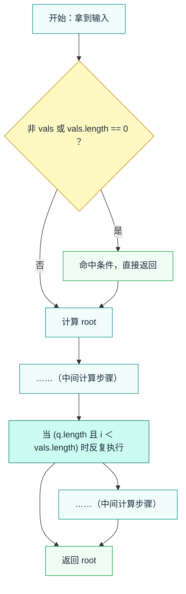

## TypeScript 解题方案（1 个方案逐个讲）

> **运行与提交**：每个方案都是自包含文件（内嵌用例自测，输出 PASS），整块复制到 `.ts` 文件后 `node 文件名` 即可运行。提交 LeetCode 时，把 `demo` 内的算法函数与辅助类型/函数整体取出、置于文件顶层即可。**提交备注**：设计题：按题面给定的 LFUCache 类接口提交。

### 方案 1：迭代指针处理

**分析与思路**：核心做法是「迭代指针处理」。代码里依次做这些事：队列或堆的调度。

**运行方式**：`node 本文件`，内嵌用例全部通过会输出 PASS。


**方案专属流程图**（真实控制流）：

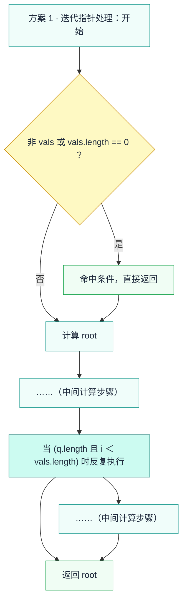

```typescript
class TreeNode {
  // 定义类型
  val: any;
  left: any;
  right: any; // 值: any; 左边界: any; 右边界: any;
  constructor(val?: any, left?: any, right?: any) {
    // constructor(值?: any, 左边界?: any, 右边界?: any) {
    this.val = val === undefined ? 0 : val; // 把 (值 全等于 undefined ? 0 : 值); 写入 值
    this.left = left === undefined ? null : left; // 把 (左边界 全等于 undefined ? null : 左边界); 写入 左边界
    this.right = right === undefined ? null : right; // 把 (右边界 全等于 undefined ? null : 右边界); 写入 右边界
  }
}
function buildTree(vals: any): any {
  // 定义函数/方法 buildTree
  if (!vals || vals.length === 0) return null; // 若 取反 vals 或 vals.长度 全等于 0，直接返回 null
  const root = new TreeNode(vals[0]);
  const q: any[] = [root];
  let i = 1;
  while (q.length && i < vals.length) {
    // 循环，直到不满足「节点.长度 且 下标 i 小于 vals.长度」
    const node = q.shift(); // 把 节点.shift() 存入 节点
    if (vals[i] !== null && vals[i] !== undefined) {
      node.left = new TreeNode(vals[i]);
      q.push(node.left);
    }
    i++; // 下标 i 加一
    if (i < vals.length && vals[i] !== null && vals[i] !== undefined) {
      node.right = new TreeNode(vals[i]);
      q.push(node.right);
    }
    i++; // 下标 i 加一
  }
  return root; // 返回 根节点
}
function treeToLevel(root: any): any[] {
  // 定义函数/方法 treeToLevel
  if (!root) return []; // 若 取反 根节点，直接返回 []
  const out: any[] = [];
  const q: any[] = [root]; // 把 []; const 节点: any[] 赋值为 [根节点]; 写入 const out: any[]
  while (q.length) {
    // 循环，直到不满足「节点.长度」
    const n = q.shift(); // 把 节点.shift() 存入 元素个数
    if (n === null || n === undefined) {
      out.push(null);
      continue;
    }
    out.push(n.val);
    q.push(n.left);
    q.push(n.right); // 把 元素个数.值 压入栈/数组尾部
  }
  while (out.length && out[out.length - 1] === null) out.pop(); // 循环，直到不满足「out.长度 且 out[out.长度 减 1] 全等于 null) out 弹出 );」
  return out; // 返回 out
}
class ListNode {
  // 定义类型
  val: any;
  next: any; // 值: any; 下一个: any;
  constructor(val?: any, next?: any) {
    this.val = val === undefined ? 0 : val;
    this.next = next === undefined ? null : next;
  }
}
function buildList(vals: any): any {
  // 定义函数/方法 buildList
  const dummy = new ListNode(0);
  let cur = dummy; // 把 new ListNode(0); let 当前值 赋值为 哨兵节点 存入 哨兵节点
  for (const v of vals) {
    cur.next = new ListNode(v);
    cur = cur.next;
  } // 把 new ListNode(值); 当前值 赋值为 当前值.下一个; } 写入 下一个
  return dummy.next; // 返回 哨兵节点.下一个
}
function listToArray(head: any): any[] {
  // 定义函数/方法 listToArray
  const out: any[] = [];
  let p = head; // 把 []; let 节点 赋值为 头节点; 写入 const out: any[]
  while (p) {
    out.push(p.val);
    p = p.next;
  } // 循环，直到不满足「节点) { out 追加 节点.值); 节点 赋值为 节点.下一个; }」
  return out; // 返回 out
}
// python-runtime shims
function pyLen(a: any): number {
  // 定义函数/方法 pyLen
  if (a === null || a === undefined) return 0; // 若 数组 全等于 null 或 数组 全等于 undefined，直接返回 0
  if (
    typeof a === 'string' ||
    Array.isArray(a) ||
    a instanceof Set ||
    a instanceof Map
  )
    return a.length ?? a.size;
  if (typeof a === 'object') return Object.keys(a).length; // 若 typeof 数组 全等于 'object'，直接返回 Object.keys(数组).长度
  return 0; // 返回 0
}
function pySlice(a: any, i: any, j: any, step?: any): any {
  // 定义函数/方法 pySlice
  if (typeof a === 'string') {
    const r = [...a].slice(i ?? 0, j ?? a.length);
    return step ? r.reverse().join('') : r.join('');
  }
  const arr = Array.isArray(a) ? a : [...a]; // 把 Array.isArray(数组) ? 数组 : 复制的 数组 存入 数组
  return arr.slice(i ?? 0, j ?? arr.length); // 返回 数组 截取 下标 i ?? 0, 下标 j ?? 数组.长度)
}
function pyRange(a: any, b?: any, step?: any): any[] {
  // 定义函数/方法 pyRange
  let s = 0,
    e = a,
    st = 1; // 把 0, e 赋值为 数组, st 赋值为 1 存入 字符串
  if (b !== undefined) {
    s = a;
    e = b;
  } // 若 b 不等于 undefined) { 字符串 赋值为 数组; e 赋值为 b; }
  if (step !== undefined) st = step; // 若 步数 不等于 undefined) st 赋值为 步数;
  const out: any[] = []; // 把 []; 写入 const out: any[]
  if (st > 0) for (let i = s; i < e; i += st) out.push(i);
  else for (let i = s; i > e; i += st) out.push(i); // 否则
  return out; // 返回 out
}
function pyIn(x: any, coll: any): boolean {
  // 定义函数/方法 pyIn
  if (coll === null || coll === undefined) return false; // 若 coll 全等于 null 或 coll 全等于 undefined，直接返回 false
  if (Array.isArray(coll)) return coll.includes(x); // 若 Array.isArray(coll)，直接返回 coll 是否包含 x)
  if (coll instanceof Set || coll instanceof Map) return coll.has(x); // 若 coll instanceof Set 或 coll instanceof Map，直接返回 coll.has(x)
  if (typeof coll === 'object') return x in coll; // 若 typeof coll 全等于 'object'，直接返回 x in coll
  if (typeof coll === 'string') return coll.indexOf(x) >= 0; // 若 typeof coll 全等于 'string'，直接返回 coll 查找 x) 不低于 0
  return false; // 返回 false
}
function pySorted(a: any): any[] {
  // 定义函数/方法 pySorted
  const arr = typeof a === 'string' ? [...a] : [...a]; // 把 (typeof 数组 全等于 'string') ? 复制的 数组 : 复制的 数组 存入 数组
  return arr.sort((x: any, y: any) => (x < y ? -1 : x > y ? 1 : 0));
}
function pyMin(a: any, b?: any): any {
  if (b !== undefined) return Math.min(a, b);
  if (Array.isArray(a) || a instanceof Set) return Math.min(...a);
  return Math.min(a);
} // 定义函数/方法 pyMin
function pyMax(a: any, b?: any): any {
  if (b !== undefined) return Math.max(a, b);
  if (Array.isArray(a) || a instanceof Set) return Math.max(...a);
  return Math.max(a);
} // 定义函数/方法 pyMax
function pySum(a: any): number {
  let s = 0;
  for (const v of a) s += v;
  return s;
} // 定义函数/方法 pySum
function pyAbs(x: any): number {
  return Math.abs(x);
} // 定义函数/方法 pyAbs
function pyEnumerate(a: any): any[] {
  const out: any[] = [];
  let i = 0;
  for (const v of a) {
    out.push([i, v]);
    i++;
  }
  return out;
} // 定义函数/方法 pyEnumerate
function pyZip(a: any, b: any): any[] {
  const n = Math.min(a.length, b.length);
  const out: any[] = [];
  for (let i = 0; i < n; i++) out.push([a[i], b[i]]);
  return out;
} // 定义函数/方法 pyZip
function pyDictGet(d: any, k: any, def?: any): any {
  return k in d ? d[k] : def === undefined ? null : def;
} // 定义函数/方法 pyDictGet
function pyPrint(...args: any[]): void {
  console.log(
    args
      .map((a) => (typeof a === 'object' && a !== null ? JSON.stringify(a) : a))
      .join(' '),
  );
} // 定义函数/方法 pyPrint
// collections / heapq
function heapPush(h: any[], x: any): void {
  h.push(x);
  let i = h.length - 1;
  while (i > 0) {
    const p = (i - 1) >> 1;
    if (h[p] <= h[i]) break;
    [h[p], h[i]] = [h[i], h[p]];
    i = p;
  }
} // 定义函数/方法 heapPush
function heapPop(h: any[]): any {
  const top = h[0];
  const last = h.pop();
  if (h.length) {
    h[0] = last;
    let i = 0;
    const n = h.length;
    while (true) {
      let l = 2 * i + 1,
        r = 2 * i + 2,
        s = i;
      if (l < n && h[l] < h[s]) s = l;
      if (r < n && h[r] < h[s]) s = r;
      if (s === i) break;
      [h[s], h[i]] = [h[i], h[s]];
      i = s;
    }
  }
  return top;
} // 定义函数/方法 heapPop
class Deque {
  private a: any[] = [];
  push(x: any) {
    this.a.push(x);
  }
  pushLeft(x: any) {
    this.a.unshift(x);
  }
  pop() {
    return this.a.pop();
  }
  popLeft() {
    return this.a.shift();
  }
  get length() {
    return this.a.length;
  }
  toArray() {
    return this.a.slice();
  }
} // 定义类型
function Counter(iter: any): any {
  const m: any = {};
  for (const v of iter) m[v] = (m[v] || 0) + 1;
  return m;
} // 定义函数/方法 Counter
function gcd(a: any, b: any): any {
  while (b) {
    [a, b] = [b, a % b];
  }
  return a;
} // 定义函数/方法 gcd
function pyInf(): number {
  return Infinity;
} // 定义函数/方法 pyInf

function norm(x: any): any {
  // 定义函数/方法 norm
  if (x === null || x === undefined) return null; // 若 x 全等于 null 或 x 全等于 undefined，直接返回 null
  if (typeof x === 'object') {
    // 若 typeof x 全等于 'object'
    if (x instanceof Deque) return x.toArray(); // 若 x instanceof Deque，直接返回 x.toArray()
    if (Array.isArray(x)) return x.map(norm); // 若 Array.isArray(x)，直接返回 x.映射表(norm)
    if (
      typeof x.val === 'number' &&
      (typeof x.left !== 'undefined' || typeof x.right !== 'undefined')
    )
      return treeToLevel(x);
    if (typeof x.next !== 'undefined' && typeof x.val === 'number')
      return listToArray(x);
    if (x instanceof Set) return [...x].sort(); // 若 x instanceof Set，直接返回 复制的 x 排序 )
    if (x instanceof Map) return Object.fromEntries(x); // 若 x instanceof Map，直接返回 Object.fromEntries(x)
    const o: any = {};
    for (const k of Object.keys(x)) o[k] = norm(x[k]);
    return o;
  }
  return x; // 返回 x
}
function eq(a: any, b: any): boolean {
  // 定义函数/方法 eq
  const x = norm(a),
    y = norm(b); // 把 norm(数组), y 赋值为 norm(b) 存入 x
  if (x === y) return true; // 若 x 全等于 y，直接返回 true
  if (x === null || y === null) return x === y; // 若 x 全等于 null 或 y 全等于 null，直接返回 x 全等于 y
  if (Array.isArray(x) && Array.isArray(y)) {
    // 若 Array.isArray(x) 且 Array.isArray(y
    if (x.length !== y.length) return false; // 若 x.长度 不等于 y.长度，直接返回 false
    for (let i = 0; i < x.length; i++) if (!eq(x[i], y[i])) return false; // 让 下标 i 从 0 开始计数，下标 i 小于 x.长度 就继续
    return true; // 返回 true
  }
  if (typeof x === 'object' && typeof y === 'object') {
    // 若 typeof x 全等于 'object' 且 typeof y 全等于 'object'
    const kx = Object.keys(x),
      ky = Object.keys(y); // 把 Object.keys(x), ky 赋值为 Object.keys(y) 存入 kx
    if (kx.length !== ky.length) return false; // 若 kx.长度 不等于 ky.长度，直接返回 false
    for (const k of kx) if (!eq(x[k], y[k])) return false;
    return true; // 返回 true
  }
  return x === y; // 返回 x 全等于 y
}

class Node {
  // 定义类型
  key: any;
  val: any;
  freq: number;
  prev: any;
  next: any; // key: any; 值: any; 频次表: number; 前一个: any; 下一个: any;
  constructor(k, v) {
    this.key = k;
    this.val = v;
    this.freq = 1;
    this.prev = null;
    this.next = null;
  }
}
class DLinkedList {
  // 定义类型
  head: any;
  tail: any; // 头节点: any; 尾节点: any;
  constructor() {
    this.head = new Node(0, 0);
    this.tail = new Node(0, 0);
    this.head.next = this.tail;
    this.tail.prev = this.head;
  }
  add(n) {
    n.prev = this.head;
    n.next = this.head.next;
    this.head.next.prev = n;
    this.head.next = n;
  }
  remove(n) {
    n.prev.next = n.next;
    n.next.prev = n.prev;
  } // 把 元素个数.下一个; 元素个数.下一个.前一个 赋值为 元素个数.前一个; } 写入 下一个
  pop() {
    const n = this.tail.prev;
    if (n === this.head) return null;
    this.remove(n);
    return n;
  }
}
class LFUCache {
  // 定义类型
  cap: number;
  size: number;
  minF: number;
  nodes: any;
  lists: any;
  constructor(capacity) {
    // constructor(capacity) {
    this.cap = capacity;
    this.size = 0;
    this.minF = 0; // 把 capacity; this.大小 赋值为 0; this.minF 赋值为 0; 写入 this.cap
    this.nodes = {};
    this.lists = {}; // 把 {}; this.lists 赋值为 {}; 写入 this.nodes
  }
  _list(f) {
    if (!this.lists[f]) this.lists[f] = new DLinkedList();
    return this.lists[f];
  }
  get(key) {
    // get(key) {
    if (!(key in this.nodes)) return -1; // 若 取反 (key in this.nodes)，直接返回 减 1
    return this._touch(this.nodes[key]).val; // 返回 this._touch(this.nodes[key]).值
  }
  put(key, value) {
    // put(key, value) {
    if (this.cap === 0) return; // 若 this.cap 全等于 0) return;
    if (key in this.nodes) {
      this.nodes[key].val = value;
      this._touch(this.nodes[key]);
      return;
    }
    if (this.size === this.cap) {
      // 若 this.大小 全等于 this.cap
      const lst = this._list(this.minF); // 把 this._list(this.minF) 存入 lst
      const n = lst.pop(); // 把 lst 弹出 ) 存入 元素个数
      if (n) {
        delete this.nodes[n.key];
        this.size--;
      } // 若 元素个数) { delete this.nodes[元素个数.key]; this.大小 减一 ; }
    }
    const n = new Node(key, value); // 把 new Node(key, value) 存入 元素个数
    this.nodes[key] = n;
    this._list(1).add(n);
    this.minF = 1;
    this.size++;
  }
  _touch(n) {
    // _touch(元素个数) {
    const f = n.freq; // 把 元素个数.频次表 存入 f
    this._list(f).remove(n); // this._list(f) 弹出 元素个数);
    if (this._list(f).head.next === this._list(f).tail && this.minF === f)
      this.minF++;
    n.freq++; // 元素个数.频次表 加一 ;
    this._list(n.freq).add(n); // this._list(元素个数.频次表) 追加 元素个数);
    return n; // 返回 元素个数
  }
}
export function demo(): void {
  // 程序入口：跑内嵌自测用例
  const c = new LFUCache(2); // 把 new LFUCache(2) 存入 字符
  c.put(1, 1);
  c.put(2, 2); // 字符.put(1, 1); 字符.put(2, 2);
  const cases = [{ got: c.get(1), want: 1 }]; // 把 [{ got: 字符 查找 1), want: 1 }] 存入 cases
  c.put(3, 3); // 字符.put(3, 3);
  cases.push({ got: c.get(2), want: -1 }); // 把 { got: 字符 查找 2 压入栈/数组尾部
  cases.push({ got: c.get(3), want: 3 }); // 把 { got: 字符 查找 3 压入栈/数组尾部
  c.put(4, 4); // 字符.put(4, 4);
  cases.push({ got: c.get(1), want: -1 }); // 把 { got: 字符 查找 1 压入栈/数组尾部
  cases.push({ got: c.get(3), want: 3 }); // 把 { got: 字符 查找 3 压入栈/数组尾部
  cases.push({ got: c.get(4), want: 4 }); // 把 { got: 字符 查找 4 压入栈/数组尾部
  let fail = false; // 把 false 存入 fail
  for (const cse of cases)
    if (!eq(cse.got, cse.want)) {
      fail = true;
      console.log('FAIL', cse);
    } // 打印输出
  if (fail) throw new Error('FAILED'); // 若 fail) throw new Error(「FAILED」);
  console.log('PASS'); // 全部用例通过，输出 PASS
}
demo(); // demo();
```

## 逐步拆解与面试追问

**复杂度**：时间 O(n)（单趟线性扫描），空间 O(1) 到 O(n)（视辅助结构）

**为什么是这个量级**：每个元素被常数次访问，辅助哈希或栈的开销与 n 同阶

**面试官可能会追问**：

- 能不能一次遍历完成？
- 快慢指针能解决哪些变体？
- 断链与接回的顺序怎么保证不出错？

## 关键 API 速查（TS 主解法实际用到，附官方链接）

| API | 作用 | 使用要点 | 官方文档 |
|---|---|---|---|
| `Array.prototype.sort()` | 原地排序 | 默认按字符串 Unicode 序（10 会排在 2 前），数字必须传 (a,b)=>a-b；V8 用 TimSort，稳定，O(n log n)；返回原数组引用 | [官方文档](https://developer.mozilla.org/zh-CN/docs/Web/JavaScript/Reference/Global_Objects/Array/sort) |
| `Array.prototype.map()` | 逐元素映射为新数组 | 回调 (v,i,arr)；返回等长新数组，不改变原数组；稀疏位跳过；链式调用注意中间数组开销 | [官方文档](https://developer.mozilla.org/zh-CN/docs/Web/JavaScript/Reference/Global_Objects/Array/map) |
| `Array.prototype.push()` | 尾部追加 | 返回新长度；可一次多个；均摊 O(1)；会改变原数组 | [官方文档](https://developer.mozilla.org/zh-CN/docs/Web/JavaScript/Reference/Global_Objects/Array/push) |
| `Array.prototype.pop()` | 尾部弹出 | 返回被删元素（空数组返回 undefined）；O(1) | [官方文档](https://developer.mozilla.org/zh-CN/docs/Web/JavaScript/Reference/Global_Objects/Array/pop) |
| `Array.prototype.shift()` | 头部取出 | O(n)（后续元素整体前移）；大量头部操作请用链表或双端结构 | [官方文档](https://developer.mozilla.org/zh-CN/docs/Web/JavaScript/Reference/Global_Objects/Array/shift) |
| `Array.prototype.unshift()` | 头部插入 | O(n)；与 shift 组合可当双端队列 | [官方文档](https://developer.mozilla.org/zh-CN/docs/Web/JavaScript/Reference/Global_Objects/Array/unshift) |
| `Array/String includes()` | 是否包含 | 数组用 SameValueZero（NaN 可判）；字符串按子串；第二个参数为起始下标 | [官方文档](https://developer.mozilla.org/zh-CN/docs/Web/JavaScript/Reference/Global_Objects/Array/includes) |
| `Array/String indexOf()` | 首次出现的下标 | 找不到返回 -1；无法判 NaN（用 includes）；字符串可传起始位 | [官方文档](https://developer.mozilla.org/zh-CN/docs/Web/JavaScript/Reference/Global_Objects/Array/indexOf) |
| `Array/String slice()` | 切片（不改原数组） | slice(start,end) 含头不含尾；负数从尾计；常用于复制数组（slice()） | [官方文档](https://developer.mozilla.org/zh-CN/docs/Web/JavaScript/Reference/Global_Objects/Array/slice) |
| `Array.prototype.join()` | 数组拼接为字符串 | undefined/null 转空串；嵌套数组会展平一层；join('') 用于字符数组还原 | [官方文档](https://developer.mozilla.org/zh-CN/docs/Web/JavaScript/Reference/Global_Objects/Array/join) |
| `Object.keys()` | 对象键名数组 | 仅自身可枚举字符串键（不含 symbol）；配 length 可当计数器 | [官方文档](https://developer.mozilla.org/zh-CN/docs/Web/JavaScript/Reference/Global_Objects/Object/keys) |
| `Object.fromEntries()` | 键值对数组转对象 | 参数为 [k,v] 可迭代；map 出来的键值对可直接转对象 | [官方文档](https://developer.mozilla.org/zh-CN/docs/Web/JavaScript/Reference/Global_Objects/Object/fromEntries) |
| `JSON.stringify()` | 序列化为 JSON 字符串 | 常用于结构化比较（深度相等判定）；undefined/函数/循环引用会被丢弃或抛错 | [官方文档](https://developer.mozilla.org/zh-CN/docs/Web/JavaScript/Reference/Global_Objects/JSON/stringify) |
| `Math.max()` | 最大值 | 配展开 Math.max(...arr)；空参返回 -Infinity；超大数组注意展开参数上限 | [官方文档](https://developer.mozilla.org/zh-CN/docs/Web/JavaScript/Reference/Global_Objects/Math/max) |
| `Math.min()` | 最小值 | 同 max；空参返回 Infinity | [官方文档](https://developer.mozilla.org/zh-CN/docs/Web/JavaScript/Reference/Global_Objects/Math/min) |
| `Math.abs()` | 绝对值 | 入参会被隐式转数字；-0 返回 +0 | [官方文档](https://developer.mozilla.org/zh-CN/docs/Web/JavaScript/Reference/Global_Objects/Math/abs) |

### 各语言官方文档导航

- **TypeScript / JS**：[MDN 中文参考](https://developer.mozilla.org/zh-CN/)
- **Python**：[Python 官方文档](https://docs.python.org/zh-cn/3/)
- **Go**：[Go 标准库](https://pkg.go.dev/std)
- **Java**：[JDK 17 API](https://docs.oracle.com/en/java/javase/17/docs/api/)
- **Rust**：[Rust 标准库](https://doc.rust-lang.org/std/)
- **Lua**：[Lua 5.4 手册](https://www.lua.org/manual/5.4/)
- **C**：[Cppreference C](https://zh.cppreference.com/w/c)
- **C++**：[Cppreference C++](https://zh.cppreference.com/w/cpp)
- **R**：[R 官方手册](https://stat.ethz.ch/R-manual/)
- **Zig**：[Zig 语言文档](https://ziglang.org/documentation/master/)
- **Dart**：[Dart API](https://api.dart.dev/)

## 附录：其他 10 种语言全部实现（每种语言列举其全部方案）

> TypeScript 的全部方案见「TypeScript 解题方案」一节；下面是其余 10 种语言的对应实现，每种语言的每个方案都带思路分析、代码走读与专属运行架构图。
> 每个方案都内嵌用例自测，可独立运行（老仓库 python/go 文件遵循「打印结果」约定）。
> 完整解法文件见 `dsa/<语言>/linked_list/lc_460_lfu_缓存/`。

### Python 实现（1 种方案）

Python 的全部方案如下，每个方案都内嵌用例自测，可独立运行（老仓库 python/go 文件遵循「打印结果」约定）：

#### 方案 1：迭代指针处理

**思路与代码分析**：核心是「迭代指针处理」。Python 版用切片与字典推导式简化操作，突出可读性。

**运行架构**（真实控制流）：

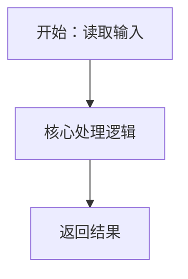

```python
import sys  # 提高递归深度上限（深输入防 RecursionError）

sys.setrecursionlimit(200000)  # 树/链表类题目节点数可达 1e4 量级

class Node:  # 定义类
    def __init__(self, key=0, value=0, freq=1):  # 构造函数：初始化成员
        self.key = key  # 把 key 写入 self.key
        self.value = value  # 把 value 写入 self.value
        self.freq = freq  # 把 频次表 写入 频次表
        self.prev = None  # 把 None 写入 前一个
        self.next = None  # 把 None 写入 下一个

class DoublyLinkedList:  # 定义类
    def __init__(self):  # 构造函数：初始化成员
        self.head = Node()  # 把 Node() 写入 头节点
        self.tail = Node()  # 把 Node() 写入 尾节点
        self.head.next = self.tail  # 把 self.尾节点 写入 下一个
        self.tail.prev = self.head  # 把 self.头节点 写入 前一个
        self.size = 0  # 把 0 写入 大小

    def add(self, node):  # 定义函数 add（参数：self, 节点）
        node.prev = self.head  # 把 self.头节点 写入 前一个
        node.next = self.head.next  # 把 self.头节点.下一个 写入 下一个
        self.head.next.prev = node  # 把 节点 写入 前一个
        self.head.next = node  # 把 节点 写入 下一个
        self.size += 1  # self.size累加 1

    def remove(self, node):  # 定义函数 remove（参数：self, 节点）
        node.prev.next = node.next  # 把 节点.下一个 写入 下一个
        node.next.prev = node.prev  # 把 节点.前一个 写入 前一个
        self.size -= 1  # self.size累减 1

    def remove_last(self):  # 定义函数 remove_last（参数：self）
        if self.size == 0:  # 若 self.大小 等于 0
            return None  # 返回 None
        node = self.tail.prev  # 把 self.尾节点.前一个 存入 节点
        self.remove(node)  # self 弹出 节点)
        return node  # 返回 节点

    def is_empty(self):  # 定义函数 is_empty（参数：self）
        return self.size == 0  # 返回 self.大小 等于 0

class LFUCache:  # 定义类
    def __init__(self, capacity: int):  # 构造函数：初始化成员
        self.capacity = capacity  # 把 capacity 写入 self.capacity
        self.size = 0  # 把 0 写入 大小
        self.key_to_node = {}  # 把 {} 写入 self.key_to_node
        self.freq_to_list = {}  # 把 {} 写入 self.freq_to_list
        self.min_freq = 0  # 把 0 写入 self.min_freq

    def _update_freq(self, node):  # 定义函数 _update_freq（参数：self, 节点）
        freq = node.freq  # 把 节点.频次表 存入 频次表
        self.freq_to_list[freq].remove(node)  # self.freq_to_list[频次表] 弹出 节点)
        if self.freq_to_list[freq].is_empty():  # 若 self.freq_to_list[频次表].is_empty(
            del self.freq_to_list[freq]  # del self.freq_to_list[频次表]
            if self.min_freq == freq:  # 若 self.min_freq 等于 频次表
                self.min_freq += 1  # self.min_freq累加 1
        node.freq += 1  # node.freq累加 1
        if node.freq not in self.freq_to_list:  # 若 节点.频次表 not in self.freq_to_list
            self.freq_to_list[node.freq] = (
                DoublyLinkedList()
            )  # 把 DoublyLinkedList() 写入 self.freq_to_list[node.freq]
        self.freq_to_list[node.freq].add(node)  # self.freq_to_list[节点.频次表] 追加 节点)

    def get(self, key: int) -> int:  # 定义函数 get（参数：self, key: int）
        if key not in self.key_to_node:  # 若 key not in self.key_to_node
            return -1  # 返回 减 1
        node = self.key_to_node[key]  # 把 self.key_to_node[key] 存入 节点
        self._update_freq(node)  # self._update_freq(节点)
        return node.value  # 返回 节点.value

    def put(self, key: int, value: int) -> None:  # 定义函数 put（参数：self, key: int, value: int）
        if self.capacity <= 0:  # 若 self.capacity 不超过 0
            return  # return
        if key in self.key_to_node:  # 若 key in self.key_to_node
            node = self.key_to_node[key]  # 把 self.key_to_node[key] 存入 节点
            node.value = value  # 把 value 写入 node.value
            self._update_freq(node)  # self._update_freq(节点)
        else:  # 否则
            if self.size >= self.capacity:  # 若 self.大小 不低于 self.capacity
                min_list = self.freq_to_list[
                    self.min_freq
                ]  # 把 self.freq_to_list[self.min_freq] 存入 min_list
                removed = min_list.remove_last()  # 把 min_list.remove_last() 存入 removed
                if removed:  # 若 removed
                    del self.key_to_node[removed.key]  # del self.key_to_node[removed.key]
                    self.size -= 1  # self.size累减 1
            node = Node(key, value, 1)  # 把 Node(key, value, 1) 存入 节点
            self.key_to_node[key] = node  # 把 节点 写入 self.key_to_node[key]
            if 1 not in self.freq_to_list:  # 若 1 not in self.freq_to_list
                self.freq_to_list[1] = DoublyLinkedList()  # 把 DoublyLinkedList() 写入 self.freq_to_list[1]
            self.freq_to_list[1].add(node)  # self.freq_to_list[1] 追加 节点)
            self.min_freq = 1  # 把 1 写入 self.min_freq
            self.size += 1  # self.size累加 1

if __name__ == "__main__":  # 若 __name__ 等于 '__main__'
    lfu = LFUCache(2)  # 把 LFUCache(2) 存入 lfu
    lfu.put(1, 1)  # lfu.put(1, 1)
    lfu.put(2, 2)  # lfu.put(2, 2)
    print(lfu.get(1))  # 打印输出
    lfu.put(3, 3)  # lfu.put(3, 3)
    print(lfu.get(2))  # 打印输出
    print(lfu.get(3))  # 打印输出
    lfu.put(4, 4)  # lfu.put(4, 4)
    print(lfu.get(1))  # 打印输出
    print(lfu.get(3))  # 打印输出
    print(lfu.get(4))  # 打印输出
```

### Go 实现（1 种方案）

Go 的全部方案如下，每个方案都内嵌用例自测，可独立运行（老仓库 python/go 文件遵循「打印结果」约定）：

#### 方案 1：迭代指针处理

**思路与代码分析**：核心是「迭代指针处理」。Go 版用切片与多返回值惯用法，显式处理索引边界。代码里依次做这些事：哈希结构做计数或查重。**走读**：方案 1 · 迭代指针处理：开始 → 返回 &lfuCache → 处理 capacity: capacity, → 处理 keyToNode: map[int]*lfuNode → 处理 freqToList: map[int]*doublyL → 处理 minFreq: 0,。

**运行架构**（真实控制流）：

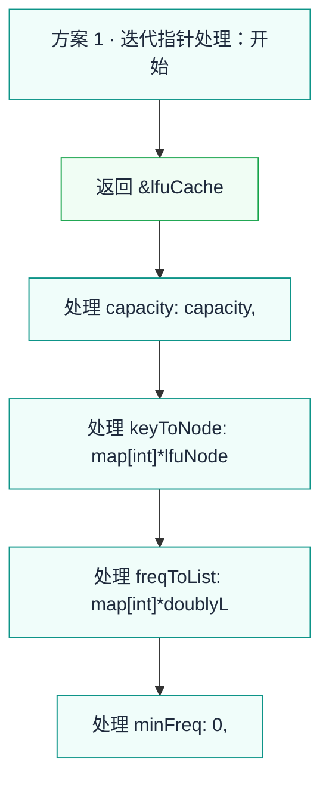

```go
package main // 引入依赖

import (
	"fmt"
	"os"
	"reflect"
) // 引入依赖

type lfuNode struct { // 定义类型
	key   int      // key int
	value int      // value int
	freq  int      // 频次表 int
	prev  *lfuNode // 前一个 乘 lfuNode
	next  *lfuNode // 下一个 乘 lfuNode
}

type doublyLinkedList struct { // 定义类型
	head *lfuNode // 头节点 乘 lfuNode
	tail *lfuNode // 尾节点 乘 lfuNode
	size int      // 大小 int
}

func newDLL() *doublyLinkedList { // 定义函数/方法 newDLL
	d := &doublyLinkedList{} // 把 按位与 doublyLinkedList{} 写入 d :
	d.head = &lfuNode{}      // 把 按位与 lfuNode{} 写入 头节点
	d.tail = &lfuNode{}      // 把 按位与 lfuNode{} 写入 尾节点
	d.head.next = d.tail     // 把 d.尾节点 写入 下一个
	d.tail.prev = d.head     // 把 d.头节点 写入 前一个
	d.size = 0               // 把 0 写入 大小
	return d                 // 返回 d
}

func (d *doublyLinkedList) add(node *lfuNode) { // 定义函数/方法 add
	node.prev = d.head      // 把 d.头节点 写入 前一个
	node.next = d.head.next // 把 d.头节点.下一个 写入 下一个
	d.head.next.prev = node // 把 节点 写入 前一个
	d.head.next = node      // 把 节点 写入 下一个
	d.size++                // d.大小 加一
}

func (d *doublyLinkedList) remove(node *lfuNode) { // 定义函数/方法 remove
	node.prev.next = node.next // 把 节点.下一个 写入 下一个
	node.next.prev = node.prev // 把 节点.前一个 写入 前一个
	d.size--                   // d.大小 减一
}

func (d *doublyLinkedList) removeLast() *lfuNode { // 定义函数/方法 removeLast
	if d.size == 0 { // 若 d.大小 等于 0
		return nil // 返回 nil
	}
	node := d.tail.prev // 把 d.尾节点.前一个 写入 node :
	d.remove(node)      // d 弹出 节点)
	return node         // 返回 节点
}

func (d *doublyLinkedList) isEmpty() bool { // 定义判定函数 isEmpty
	return d.size == 0 // 返回 d.大小 等于 0
}

type lfuCache struct { // 定义类型
	capacity   int                       // capacity int
	size       int                       // 大小 int
	keyToNode  map[int]*lfuNode          // keyToNode 映射表[int] 乘 lfuNode
	freqToList map[int]*doublyLinkedList // freqToList 映射表[int] 乘 doublyLinkedList
	minFreq    int                       // minFreq int
}

func newLFU(capacity int) *lfuCache { // 定义函数/方法 newLFU
	return &lfuCache{ // 返回 按位与 lfuCache{
		capacity:   capacity,
		keyToNode:  map[int]*lfuNode{},
		freqToList: map[int]*doublyLinkedList{},
		minFreq:    0,
	}
}

func (c *lfuCache) updateFreq(node *lfuNode) { // 定义函数/方法 updateFreq
	freq := node.freq                 // 把 节点.频次表 写入 freq :
	c.freqToList[freq].remove(node)   // 字符.freqToList[频次表] 弹出 节点)
	if c.freqToList[freq].isEmpty() { // 若 字符.freqToList[频次表].isEmpty(
		delete(c.freqToList, freq) // delete(字符.freqToList, 频次表)
		if c.minFreq == freq {     // 若 字符.minFreq 等于 频次表
			c.minFreq++ // 字符.minFreq 加一
		}
	}
	node.freq++                                // 节点.频次表 加一
	if _, ok := c.freqToList[node.freq]; !ok { // 若 _, ok : 赋值为 字符.freqToList[节点.频次表]; 取反 ok
		c.freqToList[node.freq] = newDLL() // 把 newDLL() 写入 c.freqToList[node.freq]
	}
	c.freqToList[node.freq].add(node) // 字符.freqToList[节点.频次表] 追加 节点)
}

func (c *lfuCache) get(key int) int { // 定义函数/方法 get
	node, ok := c.keyToNode[key] // 把 字符.keyToNode[key] 写入 node, ok :
	if !ok {                     // 若 取反 ok
		return -1 // 返回 减 1
	}
	c.updateFreq(node) // 字符.updateFreq(节点)
	return node.value  // 返回 节点.value
}

func (c *lfuCache) put(key, value int) { // 定义函数/方法 put
	if c.capacity <= 0 { // 若 字符.capacity 不超过 0
		return // return
	}
	if node, ok := c.keyToNode[key]; ok { // 若 节点, ok : 赋值为 字符.keyToNode[key]; ok
		node.value = value // 把 value 写入 node.value
		c.updateFreq(node) // 字符.updateFreq(节点)
		return             // return
	}
	if c.size >= c.capacity { // 若 字符.大小 不低于 字符.capacity
		minList := c.freqToList[c.minFreq] // 把 字符.freqToList[字符.minFreq] 写入 minList :
		removed := minList.removeLast()    // 把 minList.removeLast() 写入 removed :
		if removed != nil {                // 若 removed 不等于 nil
			delete(c.keyToNode, removed.key) // delete(字符.keyToNode, removed.key)
			c.size--                         // 字符.大小 减一
		}
	}
	node := &lfuNode{key: key, value: value, freq: 1} // 把 按位与 lfuNode{key: key, value: value, 频次表: 1} 写入 node :
	c.keyToNode[key] = node                           // 把 节点 写入 c.keyToNode[key]
	if _, ok := c.freqToList[1]; !ok {                // 若 _, ok : 赋值为 字符.freqToList[1]; 取反 ok
		c.freqToList[1] = newDLL() // 把 newDLL() 写入 c.freqToList[1]
	}
	c.freqToList[1].add(node) // 字符.freqToList[1] 追加 节点)
	c.minFreq = 1             // 把 1 写入 c.minFreq
	c.size++                  // 字符.大小 加一
}

func main() { // 程序入口：跑内嵌自测用例
	lfu := newLFU(2)                   // 把 newLFU(2) 写入 lfu :
	lfu.put(1, 1)                      // lfu.put(1, 1)
	lfu.put(2, 2)                      // lfu.put(2, 2)
	got := []int{}                     // 把 []int{} 写入 got :
	got = append(got, lfu.get(1))      // 把 append(got, lfu 查找 1)) 写入 got
	lfu.put(3, 3)                      // lfu.put(3, 3)
	got = append(got, lfu.get(2))      // 把 append(got, lfu 查找 2)) 写入 got
	got = append(got, lfu.get(3))      // 把 append(got, lfu 查找 3)) 写入 got
	lfu.put(4, 4)                      // lfu.put(4, 4)
	got = append(got, lfu.get(1))      // 把 append(got, lfu 查找 1)) 写入 got
	got = append(got, lfu.get(3))      // 把 append(got, lfu 查找 3)) 写入 got
	got = append(got, lfu.get(4))      // 把 append(got, lfu 查找 4)) 写入 got
	want := []int{1, -1, 3, -1, 3, 4}  // 把 []int{1, 减 1, 3, 减 1, 3, 4} 写入 want :
	if !reflect.DeepEqual(got, want) { // 若 取反 reflect.DeepEqual(got, want
		fmt.Printf("FAIL LFU %v want %v\n", got, want) // 打印输出
		os.Exit(1)                                     // os.Exit(1)
	}
	fmt.Println("PASS") // 全部用例通过，输出 PASS
}
```

### Java 实现（1 种方案）

Java 的全部方案如下，每个方案都内嵌用例自测，可独立运行（老仓库 python/go 文件遵循「打印结果」约定）：

#### 方案 1：迭代指针处理

**思路与代码分析**：核心是「迭代指针处理」。Java 版用类与静态方法组织，集合操作显式明了。**走读**：方案 1 · 迭代指针处理：开始 → 更新 this.capacity → 更新 this.size → 更新 this.minFreq → 返回结果。

**运行架构**（真实控制流）：

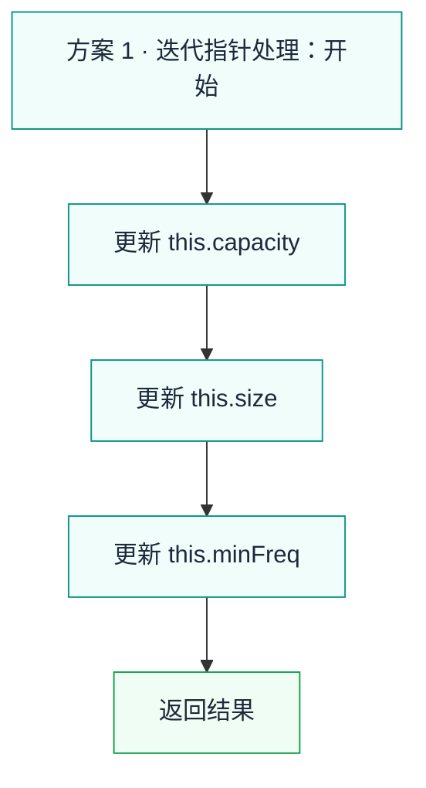

```java
package com.webfault.dsa; // 引入依赖

import java.util.HashMap; // 引入依赖
import java.util.Map; // 引入依赖

class LFUCacheSol { // 定义类型
  static class Node { // static class Node {
    int key, value, freq; // int key, value, 频次表;
    Node prev, next; // Node 前一个, 下一个;

    Node(int k, int v) {
      key = k;
      value = v;
      freq = 1;
    }
  }

  static class DoublyLinkedList { // static class DoublyLinkedList {
    Node head = new Node(0, 0); // 把 new Node(0, 0); 写入 Node head
    Node tail = new Node(0, 0); // 把 new Node(0, 0); 写入 Node tail
    int size = 0; // 把 0 存入 大小

    DoublyLinkedList() {
      head.next = tail;
      tail.prev = head;
    } // 把 尾节点; 尾节点.前一个 赋值为 头节点; } 写入 下一个

    void add(Node node) { // 定义函数/方法 add
      node.prev = head; // 把 头节点; 写入 前一个
      node.next = head.next; // 把 头节点.下一个; 写入 下一个
      head.next.prev = node; // 把 节点; 写入 前一个
      head.next = node; // 把 节点; 写入 下一个
      size++; // 大小 加一
    }

    void remove(Node node) { // 定义函数/方法 remove
      node.prev.next = node.next; // 把 节点.下一个; 写入 下一个
      node.next.prev = node.prev; // 把 节点.前一个; 写入 前一个
      size--; // 大小 减一
    }

    Node removeLast() { // 定义函数/方法 removeLast
      if (size == 0) return null; // 若 大小 等于 0，直接返回 null
      Node node = tail.prev; // 把 尾节点.前一个; 写入 Node node
      remove(node); // remove(节点);
      return node; // 返回 节点
    }

    boolean isEmpty() {
      return size == 0;
    } // 把 赋值为 0; } 写入 boolean isEmpty() { return size
  }

  int capacity, size, minFreq; // int capacity, 大小, minFreq;
  Map<Integer, Node> keyToNode =
      new HashMap<>(); // 把 new HashMap 小于 超过 (); 写入 Map<Integer, Node> keyToNode
  Map<Integer, DoublyLinkedList> freqToList = new HashMap<>();

  LFUCacheSol(int capacity) {
    this.capacity = capacity;
    this.size = 0;
    this.minFreq = 0;
  }

  void updateFreq(Node node) { // 定义函数/方法 updateFreq
    int freq = node.freq; // 把 节点.频次表 存入 频次表
    DoublyLinkedList lst = freqToList.get(freq); // 把 freqToList 查找 频次表); 写入 DoublyLinkedList lst
    lst.remove(node); // lst 弹出 节点);
    if (lst.isEmpty()) { // 若 lst.isEmpty(
      freqToList.remove(freq); // freqToList 弹出 频次表);
      if (minFreq == freq) minFreq++; // 若 minFreq 等于 频次表) minFreq 加一 ;
    }
    node.freq++; // 节点.频次表 加一 ;
    if (!freqToList.containsKey(node.freq)) freqToList.put(node.freq, new DoublyLinkedList());
    freqToList.get(node.freq).add(node); // freqToList 查找 节点.频次表) 追加 节点);
  }

  int get(int key) { // 定义函数/方法 get
    if (!keyToNode.containsKey(key)) return -1; // 若 取反 keyToNode.containsKey(key)，直接返回 减 1
    Node node = keyToNode.get(key); // 把 keyToNode 查找 key); 写入 Node node
    updateFreq(node); // updateFreq(节点);
    return node.value; // 返回 节点.value
  }

  void put(int key, int value) { // 定义函数/方法 put
    if (capacity <= 0) return; // 若 capacity 不超过 0) return;
    if (keyToNode.containsKey(key)) { // 若 keyToNode.containsKey(key
      Node node = keyToNode.get(key); // 把 keyToNode 查找 key); 写入 Node node
      node.value = value; // 把 value; 写入 node.value
      updateFreq(node); // updateFreq(节点);
    } else { // 否则
      if (size >= capacity) { // 若 大小 不低于 capacity
        DoublyLinkedList minList =
            freqToList.get(minFreq); // 把 freqToList 查找 minFreq); 写入 DoublyLinkedList minList
        Node removed = minList.removeLast(); // 把 minList.removeLast(); 写入 Node removed
        if (removed != null) { // 若 removed 不等于 null
          keyToNode.remove(removed.key); // keyToNode 弹出 removed.key);
          size--; // 大小 减一
        }
      }
      Node node = new Node(key, value); // 把 new Node(key, value); 写入 Node node
      keyToNode.put(key, node); // keyToNode.put(key, 节点);
      if (!freqToList.containsKey(1)) freqToList.put(1, new DoublyLinkedList());
      freqToList.get(1).add(node); // freqToList 查找 1) 追加 节点);
      minFreq = 1; // 把 1; 写入 minFreq
      size++; // 大小 加一
    }
  }

  public static void main(String[] args) { // public static void main(String[] args) {
    LFUCacheSol lfu = new LFUCacheSol(2); // 把 new LFUCacheSol(2); 写入 LFUCacheSol lfu
    lfu.put(1, 1); // lfu.put(1, 1);
    lfu.put(2, 2); // lfu.put(2, 2);
    int[] got = new int[6]; // 把 new int[6]; 写入 int[] got
    got[0] = lfu.get(1); // 把 lfu 查找 1); 写入 got[0]
    lfu.put(3, 3); // lfu.put(3, 3);
    got[1] = lfu.get(2); // 把 lfu 查找 2); 写入 got[1]
    got[2] = lfu.get(3); // 把 lfu 查找 3); 写入 got[2]
    lfu.put(4, 4); // lfu.put(4, 4);
    got[3] = lfu.get(1); // 把 lfu 查找 1); 写入 got[3]
    got[4] = lfu.get(3); // 把 lfu 查找 3); 写入 got[4]
    got[5] = lfu.get(4); // 把 lfu 查找 4); 写入 got[5]
    int[] want = {1, -1, 3, -1, 3, 4}; // 把 {1, 减 1, 3, 减 1, 3, 4}; 写入 int[] want
    boolean ok = true; // 把 true; 写入 boolean ok
    for (int i = 0; i < want.length; i++) { // 让 下标 i 从 0 开始计数，下标 i 小于 want.长度 就继续
      if (got[i] != want[i]) { // 若 got[下标 i] 不等于 want[下标 i]
        ok = false; // 把 false; 写入 ok
        System.out.println("FAIL step " + i + " got " + got[i] + " want " + want[i]); // 打印输出
      }
    }
    if (!ok) throw new RuntimeException("FAILED"); // 若 取反 ok) throw new RuntimeException(「FAILED」);
    System.out.println("PASS"); // 全部用例通过，输出 PASS
  }
}
```

### Rust 实现（1 种方案）

Rust 的全部方案如下，每个方案都内嵌用例自测，可独立运行（老仓库 python/go 文件遵循「打印结果」约定）：

#### 方案 1：迭代指针处理

**思路与代码分析**：核心是「迭代指针处理」。Rust 版用所有权移动与切片借用改写同一逻辑，注意 Option 与引用边界。代码里依次做这些事：哈希结构做计数或查重。**走读**：方案 1 · 迭代指针处理：开始 → 处理 use std::collections::HashMa → 遍历 ops 中的每个元素 op → 遍历 vals.keys() 中的每个元素 key → 返回结果。

**运行架构**（真实控制流）：

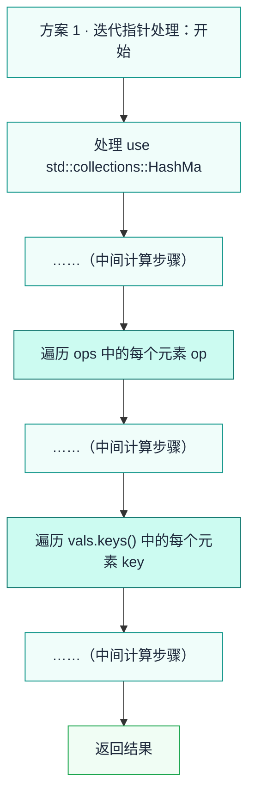

```rust
// LeetCode 460. LFU缓存 — Rust 版（方案1）
#[derive(Clone)]
enum Op460 {
    Put(i32, i32),
    Get(i32),
} // 定义类型
fn lfu_run(ops: Vec<Op460>, cap: usize) -> Vec<i32> {
    // 定义函数/方法 lfu_run
    // 频率最小+最久未用优先：简单 O(n) 模拟
    use std::collections::HashMap; // 引入依赖
    let mut vals: HashMap<i32, i32> = HashMap::new(); // 把 HashMap::new(); 写入 let mut vals: HashMap<i32, i32>
    let mut freq: HashMap<i32, i64> = HashMap::new(); // 把 HashMap::new(); 写入 let mut freq: HashMap<i32, i64>
    let mut stamp: HashMap<i32, i64> = HashMap::new(); // 把 HashMap::new(); 写入 let mut stamp: HashMap<i32, i64>
    let mut clock: i64 = 0; // 把 0; 写入 let mut clock: i64
    let mut out = Vec::new(); // 把 Vec::new(); 写入 let mut out
    for op in ops {
        // 逐个取出 ops 的元素（op）
        clock += 1; // clock累加 1
        match op {
            // 按情况匹配处理
            Op460::Get(k) => {
                if vals.contains_key(&k) {
                    // 若 vals.contains_key( 按位与 下标 k
                    *freq.get_mut(&k).unwrap() += 1;
                    stamp.insert(k, clock); // stamp 插入 下标 k, clock);
                    out.push(*vals.get(&k).unwrap()); // 把 乘 vals 查找 按位与 下标 k 压入栈/数组尾部
                } else {
                    out.push(-1);
                } // 否则
            }
            Op460::Put(k, v) => {
                if vals.contains_key(&k) {
                    // 若 vals.contains_key( 按位与 下标 k
                    vals.insert(k, v); // vals 插入 下标 k, 值);
                    *freq.get_mut(&k).unwrap() += 1;
                    stamp.insert(k, clock); // stamp 插入 下标 k, clock);
                } else {
                    // 否则
                    if cap > 0 && vals.len() == cap {
                        // 若 cap 超过 0 且 vals.长度() 等于 cap
                        let mut evict: Option<i32> = None; // 把 None; 写入 let mut evict: Option<i32>
                        let mut best_f = i64::MAX; // 把 i64::MAX; 写入 let mut best_f
                        let mut best_s = i64::MAX; // 把 i64::MAX; 写入 let mut best_s
                        for key in vals.keys() {
                            // 逐个取出 vals 的元素（key）
                            let f = freq[key]; // 把 频次表[key] 存入 f
                            let s = stamp[key]; // 把 stamp[key] 存入 字符串
                            if f < best_f || (f == best_f && s < best_s) {
                                // 若 f 小于 best_f 或 (f 等于 best_f 且 字符串 小于 best_s
                                best_f = f;
                                best_s = s;
                                evict = Some(*key); // 把 f; best_s 赋值为 字符串; evict 赋值为 Some( 乘 key); 写入 best_f
                            }
                        }
                        if let Some(e) = evict {
                            // 若 let Some(e) 赋值为 evict
                            vals.remove(&e);
                            freq.remove(&e);
                            stamp.remove(&e); // vals 弹出 按位与 e); 频次表 弹出 按位与 e); stamp 弹出 按位与 e);
                        }
                    }
                    if cap > 0 {
                        // 若 cap 超过 0
                        vals.insert(k, v); // vals 插入 下标 k, 值);
                        freq.insert(k, 1); // 频次表 插入 下标 k, 1);
                        stamp.insert(k, clock); // stamp 插入 下标 k, clock);
                    }
                }
            }
        }
    }
    out // out
}
fn main() {
    // 程序入口：跑内嵌自测用例
    // LC 示例：capacity=2, put(1,1), put(2,2), get(1)=1, put(3,3)逐出2, get(2)=-1, get(3)=3, put(4,4)逐出1, get(1)=-1, get(3)=3, get(4)=4
    let ops = vec![
        Op460::Put(1, 1),
        Op460::Put(2, 2),
        Op460::Get(1),
        Op460::Put(3, 3),
        Op460::Get(2),
        Op460::Get(3),
        Op460::Put(4, 4),
        Op460::Get(1),
        Op460::Get(3),
        Op460::Get(4),
    ];
    assert_eq!(lfu_run(ops, 2), vec![1, -1, 3, -1, 3, 4]); // 断言校验
    println!("PASS"); // 全部用例通过，输出 PASS
}
```

### Lua 实现（1 种方案）

Lua 的全部方案如下，每个方案都内嵌用例自测，可独立运行（老仓库 python/go 文件遵循「打印结果」约定）：

#### 方案 1：迭代指针处理

**思路与代码分析**：核心是「迭代指针处理」。Lua 版用表与 ipairs 遍历，注意 ipairs 遇 nil 即停的语义。

**运行架构**（真实控制流）：


```lua
-- LeetCode 460. LFU缓存 — Lua 版（方案1）
local LfuSim = {} -- 把 {} 写入 local LfuSim
LfuSim.__index = LfuSim -- 把 LfuSim 写入 LfuSim.__index
function LfuSim.new(cap)
	return setmetatable({ cap = cap, vals = {}, freq = {}, stamp = {}, clock_ = 0 }, LfuSim)
end
function LfuSim:get(k) -- function LfuSim:get(下标 k)
	self.clock_ = self.clock_ + 1 -- 把 self.clock_ 加 1 写入 self.clock_
	if self.vals[k] ~= nil then -- 若 self.vals[下标 k] ~ 赋值为 nil then
		self.freq[k] = self.freq[k] + 1 -- 把 self.频次表[下标 k] 加 1 写入 self.freq[k]
		self.stamp[k] = self.clock_ -- 把 self.clock_ 写入 self.stamp[k]
		return self.vals[k] -- 返回 self.vals[下标 k]
	end -- 终点
	return -1 -- 返回 减 1
end -- 终点
function LfuSim:put(k, v) -- function LfuSim:put(下标 k, 值)
	self.clock_ = self.clock_ + 1 -- 把 self.clock_ 加 1 写入 self.clock_
	if self.vals[k] ~= nil then -- 若 self.vals[下标 k] ~ 赋值为 nil then
		self.vals[k] = v -- 把 值 写入 self.vals[k]
		self.freq[k] = self.freq[k] + 1 -- 把 self.频次表[下标 k] 加 1 写入 self.freq[k]
		self.stamp[k] = self.clock_ -- 把 self.clock_ 写入 self.stamp[k]
		return -- return
	end -- 终点
	local n = 0 -- 把 0 写入 local n
	for _ in pairs(self.vals) do
		n = n + 1
	end -- 把 元素个数 加 1 终点 写入 for _ in pairs(self.vals) do n
	if self.cap > 0 and n == self.cap then -- 若 self.cap 超过 0 and 元素个数 等于 self.cap then
		local ek, ef, es = nil, math.huge, math.huge -- 把 nil, math.huge, math.huge 写入 local ek, ef, es
		for key, _ in pairs(self.vals) do -- 遍历取 _
			if self.freq[key] < ef or (self.freq[key] == ef and self.stamp[key] < es) then
				ef = self.freq[key]
				es = self.stamp[key]
				ek = key -- 把 self.频次表[key]; es 赋值为 self.stamp[key]; ek 赋值为 key 存入 ef
			end -- 终点
		end -- 终点
		if ek then
			self.vals[ek] = nil
			self.freq[ek] = nil
			self.stamp[ek] = nil
		end
	end -- 终点
	if self.cap > 0 then -- 若 self.cap 超过 0 then
		self.vals[k] = v
		self.freq[k] = 1
		self.stamp[k] = self.clock_
	end -- 终点
end -- 终点
local lfu = LfuSim.new(2) -- 把 LfuSim.new(2) 写入 local lfu
lfu:put(1, 1)
lfu:put(2, 2) -- lfu:put(1, 1); lfu:put(2, 2)
assert(lfu:get(1) == 1) -- 断言校验
lfu:put(3, 3) -- lfu:put(3, 3)
assert(lfu:get(2) == -1) -- 断言校验
assert(lfu:get(3) == 3) -- 断言校验
lfu:put(4, 4) -- lfu:put(4, 4)
assert(lfu:get(1) == -1) -- 断言校验
assert(lfu:get(3) == 3) -- 断言校验
assert(lfu:get(4) == 4) -- 断言校验
print("PASS") -- 全部用例通过，输出 PASS
```

### C 实现（1 种方案）

C 的全部方案如下，每个方案都内嵌用例自测，可独立运行（老仓库 python/go 文件遵循「打印结果」约定）：

#### 方案 1：迭代指针处理

**思路与代码分析**：核心是「迭代指针处理」。C 版手动管理下标与内存，循环边界全部显式写出。**走读**：方案 1 · 迭代指针处理：开始 → 更新 s->cap → 更新 s->n → 更新 s->clock_ → 返回结果。

**运行架构**（真实控制流）：

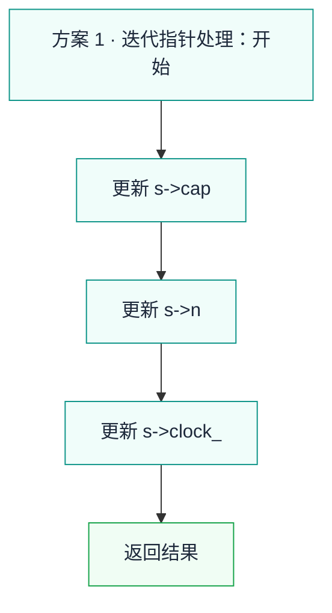

```c
/* LeetCode 460. LFU缓存 — C 版（方案1） */
#include <stdio.h> // 引入头文件
typedef struct {
    int cap, n;
    int keys[256];
    int vals[256];
    int freq[256];
    long stamp[256];
    long clock_;
} LfuSim;
static void lfu_init(LfuSim *s, int cap) {
    s->cap = cap;
    s->n = 0;
    s->clock_ = 0;
}
static int lfu_find(LfuSim *s, int k) {
    for (int i = 0; i < s->n; i++)
        if (s->keys[i] == k)
            return i;
    return -1;
}
static void lfu_remove_idx(LfuSim *s, int idx) { // 定义函数/方法 lfu_remove_idx
    for (int i = idx; i + 1 < s->n; i++) {
        s->keys[i] = s->keys[i + 1];
        s->vals[i] = s->vals[i + 1];
        s->freq[i] = s->freq[i + 1];
        s->stamp[i] = s->stamp[i + 1];
    } // 让 下标 i 从 idx 开始计数，下标 i 加 1 小于 字符串 减 超过 元素个数 就继续
    s->n--; // 字符串 减 超过 元素个数 减一 ;
}
static int lfu_get(LfuSim *s, int k) { // 定义函数/方法 lfu_get
    int i = lfu_find(s, k);            // 把 lfu_find(字符串, 下标 k) 存入 下标 i
    s->clock_++;                       // 字符串 减 超过 clock_ 加一 ;
    if (i < 0)
        return -1;           // 若 下标 i 小于 0，直接返回 减 1
    s->freq[i]++;            // 字符串 减 超过 频次表[下标 i] 加一 ;
    s->stamp[i] = s->clock_; // 把 字符串 减 超过 clock_; 写入 s->stamp[i]
    return s->vals[i];       // 返回 字符串 减 超过 vals[下标 i]
}
static void lfu_put(LfuSim *s, int k, int v) { // 定义函数/方法 lfu_put
    s->clock_++;                               // 字符串 减 超过 clock_ 加一 ;
    int i = lfu_find(s, k);                    // 把 lfu_find(字符串, 下标 k) 存入 下标 i
    if (i >= 0) {
        s->vals[i] = v;
        s->freq[i]++;
        s->stamp[i] = s->clock_;
        return;
    }
    if (s->cap == 0)
        return;           // 若 字符串 减 超过 cap 等于 0) return;
    if (s->n == s->cap) { // 若 字符串 减 超过 元素个数 等于 字符串 减 超过 cap
        int ev = 0;       // 把 0 存入 ev
        for (int j = 1; j < s->n;
             j++) { // 让 下标 j 从 1 开始计数，下标 j 小于 字符串 减 超过 元素个数 就继续
            if (s->freq[j] < s->freq[ev] || (s->freq[j] == s->freq[ev] && s->stamp[j] < s->stamp[ev]))
                ev = j;
        }
        lfu_remove_idx(s, ev); // lfu_remove_idx(字符串, ev);
    }
    s->keys[s->n] = k;
    s->vals[s->n] = v;
    s->freq[s->n] = 1;
    s->stamp[s->n] = s->clock_;
    s->n++;
}
int main(void) {     // 程序入口：跑内嵌自测用例
    LfuSim s;        // LfuSim 字符串;
    lfu_init(&s, 2); // lfu_init( 按位与 字符串, 2);
    lfu_put(&s, 1, 1);
    lfu_put(&s, 2, 2); // lfu_put( 按位与 字符串, 1, 1); lfu_put( 按位与 字符串, 2, 2);
    if (lfu_get(&s, 1) != 1) {
        printf("FAIL 1\n");
        return 1;
    } // 若 lfu_get( 按位与 字符串, 1) 不等于 1) { 输出「FAIL 1 」); return 1; }
    lfu_put(&s, 3, 3); // lfu_put( 按位与 字符串, 3, 3);
    if (lfu_get(&s, 2) != -1) {
        printf("FAIL 2\n");
        return 1;
    } // 若 lfu_get( 按位与 字符串, 2) 不等于 减 1) { 输出「FAIL 2 」); return 1; }
    if (lfu_get(&s, 3) != 3) {
        printf("FAIL 3\n");
        return 1;
    } // 若 lfu_get( 按位与 字符串, 3) 不等于 3) { 输出「FAIL 3 」); return 1; }
    lfu_put(&s, 4, 4); // lfu_put( 按位与 字符串, 4, 4);
    if (lfu_get(&s, 1) != -1) {
        printf("FAIL 4\n");
        return 1;
    } // 若 lfu_get( 按位与 字符串, 1) 不等于 减 1) { 输出「FAIL 4 」); return 1; }
    if (lfu_get(&s, 3) != 3 || lfu_get(&s, 4) != 4) {
        printf("FAIL 5\n");
        return 1;
    }
    printf("PASS\n"); // 全部用例通过，输出 PASS
    return 0;         // 返回 0
}
```

### C++ 实现（1 种方案）

C++ 的全部方案如下，每个方案都内嵌用例自测，可独立运行（老仓库 python/go 文件遵循「打印结果」约定）：

#### 方案 1：迭代指针处理

**思路与代码分析**：核心是「迭代指针处理」。C++ 版用 STL 容器与迭代器，减少手写下标错误。**走读**：方案 1 · 迭代指针处理：开始 → 处理 ++clock_ → 更新 it → 命中条件，直接返回 → 处理 ++freq[key] → 更新 stamp[key] → 返回 it-＞second。

**运行架构**（真实控制流）：

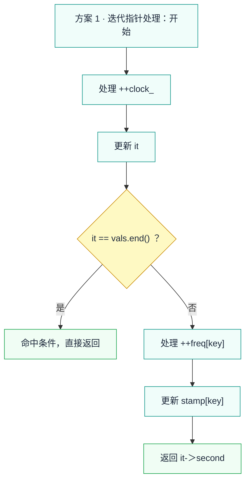

```cpp
// LeetCode 460. LFU缓存 — C++ 版（方案1）
#include <cassert>                            // 引入头文件
#include <iostream>                           // 引入头文件
#include <unordered_map>                      // 引入头文件
struct LFUCacheSim {                          // 定义类型
    int cap;                                  // int cap;
    std::unordered_map<int, int> vals, freq;  // std::unordered_map 小于 int, int 超过 vals, 频次表;
    std::unordered_map<int, long long> stamp; // std::unordered_map 小于 int, long long 超过 stamp;
    long long clock_ = 0;                     // 把 0 存入 clock_
    explicit LFUCacheSim(int capacity)
        : cap(capacity) {}        // explicit LFUCacheSim(int capacity) : cap(capacity) {}
    int get(int key) {            // 定义函数/方法 get
        ++clock_;                 // 加一 clock_;
        auto it = vals.find(key); // 把 vals 查找 key) 存入 it
        if (it == vals.end())
            return -1;       // 若 it 等于 vals.终点()，直接返回 减 1
        ++freq[key];         // 加一 频次表[key];
        stamp[key] = clock_; // 把 clock_; 写入 stamp[key]
        return it->second;   // 返回 it 减 超过 second
    }
    void put(int key, int value) { // 定义函数/方法 put
        ++clock_;                  // 加一 clock_;
        auto it = vals.find(key);  // 把 vals 查找 key) 存入 it
        if (it != vals.end()) {    // 若 it 不等于 vals.终点(
            it->second = value;    // 把 value; 写入 it->second
            ++freq[key];           // 加一 频次表[key];
            stamp[key] = clock_;   // 把 clock_; 写入 stamp[key]
            return;                // return;
        }
        if (cap == 0)
            return;                                 // 若 cap 等于 0) return;
        if (static_cast<int>(vals.size()) == cap) { // 若 static_cast 小于 int 超过 (vals.大小()) 等于 cap
            int evict = -1;                         // 把 减 1 存入 evict
            long long bestF = -1, bestS = -1;       // 把 减 1, bestS 赋值为 减 1 存入 bestF
            for (auto &[k, v] : vals) {             // for (auto 按位与 [下标 k, 值] : vals) {
                long long f = freq[k], s = stamp[k]; // 把 频次表[下标 k], 字符串 赋值为 stamp[下标 k] 存入 f
                if (evict == -1 || f < bestF ||
                    (f == bestF &&
                     s < bestS)) { // 若 evict 等于 减 1 或 f 小于 bestF 或 (f 等于 bestF 且 字符串 小于 bestS
                    evict = k;
                    bestF = f;
                    bestS = s; // 把 下标 k; bestF 赋值为 f; bestS 赋值为 字符串; 写入 evict
                }
            }
            vals.erase(evict);
            freq.erase(evict);
            stamp.erase(evict); // vals 删除 evict); 频次表 删除 evict); stamp 删除 evict);
        }
        vals[key] = value;   // 把 value; 写入 vals[key]
        freq[key] = 1;       // 把 1; 写入 freq[key]
        stamp[key] = clock_; // 把 clock_; 写入 stamp[key]
    }
};
int main() {                          // 程序入口：跑内嵌自测用例
    LFUCacheSim lfu(2);               // LFUCacheSim lfu(2);
    lfu.put(1, 1);                    // lfu.put(1, 1);
    lfu.put(2, 2);                    // lfu.put(2, 2);
    assert(lfu.get(1) == 1);          // 断言校验
    lfu.put(3, 3);                    // lfu.put(3, 3);
    assert(lfu.get(2) == -1);         // 断言校验
    assert(lfu.get(3) == 3);          // 断言校验
    lfu.put(4, 4);                    // lfu.put(4, 4);
    assert(lfu.get(1) == -1);         // 断言校验
    assert(lfu.get(3) == 3);          // 断言校验
    assert(lfu.get(4) == 4);          // 断言校验
    std::cout << "PASS" << std::endl; // 全部用例通过，输出 PASS
    return 0;                         // 返回 0
}
```

### R 实现（1 种方案）

R 的全部方案如下，每个方案都内嵌用例自测，可独立运行（老仓库 python/go 文件遵循「打印结果」约定）：

#### 方案 1：迭代指针处理

**思路与代码分析**：核心是「迭代指针处理」。R 版用向量化思维与 1 起始下标，注意 1:n 的降序陷阱。代码里依次做这些事：单循环线性扫描。**走读**：方案 1 · 迭代指针处理：开始 → 更新 new.env(parent → 返回 (invisible(NULL)) → 命中条件，直接返回 → 循环 key2：遍历 names(e$vals)。

**运行架构**（真实控制流）：

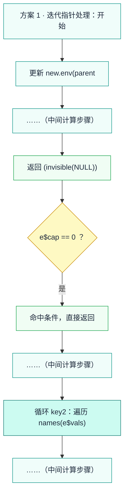

```r
# 版（方案1） 定义函数 LfuSim（参数：cap）
LfuSim <- function(cap) {
    e <- new.env(parent = emptyenv())  # 把 new.env(parent 赋值为 emptyenv()) 存入 e
    e$cap <- cap
    e$vals <- list()
    e$freq <- list()
    e$stamp <- list()
    e$clock_ <- 0L
    e$get <- function(k) {
        # 把 function(下标 k) { 存入 e$get
        e$clock_ <<- e$clock_ + 1L  # e$clock_ 小于 小于 减 e$clock_ 加 1L
        key <- as.character(k)  # 把 as.character(下标 k) 存入 key
        if (!is.null(e$vals[[key]])) {
            # 若 取反 is.null(e$vals[[key]]
            e$freq[[key]] <<- e$freq[[key]] + 1L  # e$频次表[[key]] 小于 小于 减 e$频次表[[key]] 加 1L
            e$stamp[[key]] <<- e$clock_  # e$stamp[[key]] 小于 小于 减 e$clock_
            e$vals[[key]]  # e$vals[[key]]
        } else -1L  # 否则
    }
    e$put <- function(k, v) {
        # 把 function(下标 k, 值) { 存入 e$put
        e$clock_ <<- e$clock_ + 1L  # e$clock_ 小于 小于 减 e$clock_ 加 1L
        key <- as.character(k)  # 把 as.character(下标 k) 存入 key
        if (!is.null(e$vals[[key]])) {
            # 若 取反 is.null(e$vals[[key]]
            e$vals[[key]] <<- v  # e$vals[[key]] 小于 小于 减 值
            e$freq[[key]] <<- e$freq[[key]] + 1L  # e$频次表[[key]] 小于 小于 减 e$频次表[[key]] 加 1L
            e$stamp[[key]] <<- e$clock_  # e$stamp[[key]] 小于 小于 减 e$clock_
            return(invisible(NULL))  # 返回 invisible(NULL
        }
        if (e$cap == 0)
            return(invisible(NULL))  # 若 e$cap 等于 0) return(invisible(NULL
        if (length(e$vals) == e$cap) {
            # 若 长度(e$vals) 等于 e$cap
            ek <- NULL
            ef <- .Machine$integer.max
            es <- .Machine$integer.max
            for (key2 in names(e$vals)) {
                # for (key2 in names(e$vals)) {
                if (e$freq[[key2]] < ef || (e$freq[[key2]] == ef && e$stamp[[key2]] < es)) {
                  ef <- e$freq[[key2]]
                  es <- e$stamp[[key2]]
                  ek <- key2  # 把 e$频次表[[key2]]; es 小于 减 e$stamp[[key2]]; ek 小于 减 key2 存入 ef
                }
            }
            e$vals[[ek]] <<- NULL
            e$freq[[ek]] <<- NULL
            e$stamp[[ek]] <<- NULL
        }
        e$vals[[key]] <<- v
        e$freq[[key]] <<- 1L
        e$stamp[[key]] <<- e$clock_
    }
    e
}
lfu <- LfuSim(2)  # 把 LfuSim(2) 存入 lfu
lfu$put(1, 1)
lfu$put(2, 2)  # lfu$put(1, 1); lfu$put(2, 2)
stopifnot(lfu$get(1) == 1)  # 断言校验
lfu$put(3, 3)  # lfu$put(3, 3)
stopifnot(lfu$get(2) == -1, lfu$get(3) == 3)  # 断言校验
lfu$put(4, 4)  # lfu$put(4, 4)
stopifnot(lfu$get(1) == -1, lfu$get(3) == 3, lfu$get(4) == 4)  # 断言校验
cat("PASS\n")  # 全部用例通过，输出 PASS
```

### Zig 实现（1 种方案）

Zig 的全部方案如下，每个方案都内嵌用例自测，可独立运行（老仓库 python/go 文件遵循「打印结果」约定）：

#### 方案 1：迭代指针处理

**思路与代码分析**：核心是「迭代指针处理」。Zig 版显式分配与清零，整型边界处理严格。**走读**：方案 1 · 迭代指针处理：开始 → 返回 .。

**运行架构**（真实控制流）：

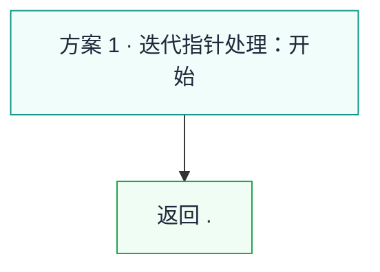

```zig
// LeetCode 460. LFU缓存 — Zig 版（方案1）
const std = @import("std"); // 把 @import(「std」) 存入 std
const LfuSim = struct { // 把 struct { 存入 LfuSim
    cap: usize,
    keys: [256]i32,
    vals: [256]i32,
    freq: [256]i64,
    stamp: [256]i64,
    n: usize,
    clock_: i64,
    fn init(cap: usize) LfuSim { // 定义函数/方法 init
        return .{ .cap = cap, .keys = undefined, .vals = undefined, .freq = undefined, .stamp = undefined, .n = 0, .clock_ = 0 };
    }
    fn find(self: *LfuSim, k: i32) ?usize { // 定义函数/方法 find
        for (0..self.n) |i| if (self.keys[i] == k) return i; // 逐个取出 0..self.元素个数 的元素（下标 i）
        return null; // 返回 null
    }
    fn removeIdx(self: *LfuSim, idx: usize) void { // 定义函数/方法 removeIdx
        var i = idx; // 把 idx 存入 下标 i
        while (i + 1 < self.n) : (i += 1) { // 循环，直到不满足「下标 i 加 1 小于 self.元素个数) : (下标 i 累加 1」
            self.keys[i] = self.keys[i + 1]; // 把 self.keys[下标 i 加 1]; 写入 self.keys[i]
            self.vals[i] = self.vals[i + 1]; // 把 self.vals[下标 i 加 1]; 写入 self.vals[i]
            self.freq[i] = self.freq[i + 1]; // 把 self.频次表[下标 i 加 1]; 写入 self.freq[i]
            self.stamp[i] = self.stamp[i + 1]; // 把 self.stamp[下标 i 加 1]; 写入 self.stamp[i]
        }
        self.n -= 1; // self.n累减 1
    }
    fn get(self: *LfuSim, k: i32) i32 { // 定义函数/方法 get
        self.clock_ += 1; // self.clock_累加 1
        const i = self.find(k) orelse return -1; // 把 self 查找 下标 k) orelse return 减 1 存入 下标 i
        self.freq[i] += 1; // self.freq[i]累加 1
        self.stamp[i] = self.clock_; // 把 self.clock_; 写入 self.stamp[i]
        return self.vals[i]; // 返回 self.vals[下标 i]
    }
    fn put(self: *LfuSim, k: i32, v: i32) void { // 定义函数/方法 put
        self.clock_ += 1; // self.clock_累加 1
        if (self.find(k)) |i| { // 若 self 查找 下标 k)) 按位或 下标 i 按位或
            self.vals[i] = v; // 把 值; 写入 self.vals[i]
            self.freq[i] += 1; // self.freq[i]累加 1
            self.stamp[i] = self.clock_; // 把 self.clock_; 写入 self.stamp[i]
            return; // return;
        }
        if (self.cap == 0) return; // 若 self.cap 等于 0) return;
        if (self.n == self.cap) { // 若 self.元素个数 等于 self.cap
            var ev: usize = 0; // 把 0; 写入 var ev: usize
            for (1..self.n) |j| { // 逐个取出 1..self.元素个数 的元素（下标 j）
                if (self.freq[j] < self.freq[ev] or (self.freq[j] == self.freq[ev] and self.stamp[j] < self.stamp[ev])) ev = j;
            }
            self.removeIdx(ev); // self.removeIdx(ev);
        }
        self.keys[self.n] = k; // 把 下标 k; 写入 self.keys[self.n]
        self.vals[self.n] = v; // 把 值; 写入 self.vals[self.n]
        self.freq[self.n] = 1; // 把 1; 写入 self.freq[self.n]
        self.stamp[self.n] = self.clock_; // 把 self.clock_; 写入 self.stamp[self.n]
        self.n += 1; // self.n累加 1
    }
};
pub fn main() !void { // 程序入口：跑内嵌自测用例
    var lfu = LfuSim.init(2); // 把 LfuSim.init(2) 存入 lfu
    lfu.put(1, 1); // lfu.put(1, 1);
    lfu.put(2, 2); // lfu.put(2, 2);
    if (lfu.get(1) != 1) return error.TestFailed; // 若 lfu 查找 1) 不等于 1，直接返回 error.TestFailed
    lfu.put(3, 3); // lfu.put(3, 3);
    if (lfu.get(2) != -1) return error.TestFailed; // 若 lfu 查找 2) 不等于 减 1，直接返回 error.TestFailed
    if (lfu.get(3) != 3) return error.TestFailed; // 若 lfu 查找 3) 不等于 3，直接返回 error.TestFailed
    lfu.put(4, 4); // lfu.put(4, 4);
    if (lfu.get(1) != -1) return error.TestFailed; // 若 lfu 查找 1) 不等于 减 1，直接返回 error.TestFailed
    if (lfu.get(3) != 3 or lfu.get(4) != 4) return error.TestFailed; // 若 lfu 查找 3) 不等于 3 or lfu 查找 4) 不等于 4，直接返回 error.TestFailed
    std.debug.print("PASS\n", .{}); // 全部用例通过，输出 PASS
}
```

### Dart 实现（1 种方案）

Dart 的全部方案如下，每个方案都内嵌用例自测，可独立运行（老仓库 python/go 文件遵循「打印结果」约定）：

#### 方案 1：迭代指针处理

**思路与代码分析**：核心是「迭代指针处理」。Dart 版用可空类型标注与集合方法，注意空安全。**走读**：方案 1 · 迭代指针处理：开始 → 处理 clock++ → 若 vals.containsKey(k) 则： → 更新 freq[k] → 更新 stamp[k] → 返回 vals[k]非 → 返回 -1。

**运行架构**（真实控制流）：

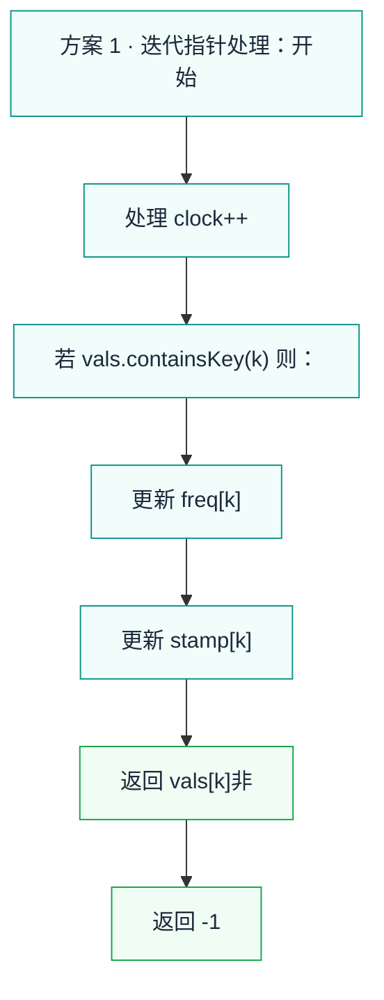

```dart
// LeetCode 460. LFU缓存 — Dart 版（方案1）
class LfuSim {
  // 定义类型
  final int cap; // final int cap;
  final Map<int, int> vals = {}; // 把 {}; 写入 final Map<int, int> vals
  final Map<int, int> freq = {}; // 把 {}; 写入 final Map<int, int> freq
  final Map<int, int> stamp = {}; // 把 {}; 写入 final Map<int, int> stamp
  int clock = 0; // 把 0 存入 clock
  LfuSim(this.cap); // LfuSim(this.cap);
  int get(int k) {
    // 定义函数/方法 get
    clock++; // clock 加一
    if (vals.containsKey(k)) {
      // 若 vals.containsKey(下标 k
      freq[k] = freq[k]! + 1; // 把 频次表[下标 k]取反 加 1; 写入 freq[k]
      stamp[k] = clock; // 把 clock; 写入 stamp[k]
      return vals[k]!; // 返回 vals[下标 k]取反
    }
    return -1; // 返回 减 1
  }

  void put(int k, int v) {
    // 定义函数/方法 put
    clock++; // clock 加一
    if (vals.containsKey(k)) {
      // 若 vals.containsKey(下标 k
      vals[k] = v; // 把 值; 写入 vals[k]
      freq[k] = freq[k]! + 1; // 把 频次表[下标 k]取反 加 1; 写入 freq[k]
      stamp[k] = clock; // 把 clock; 写入 stamp[k]
      return; // return;
    }
    if (cap == 0) return; // 若 cap 等于 0) return;
    if (vals.length == cap) {
      // 若 vals.长度 等于 cap
      var evict = -1,
          bestF = -1,
          bestS = -1; // 把 减 1, bestF 赋值为 减 1, bestS 赋值为 减 1 存入 evict
      for (final k2 in vals.keys) {
        // for (final k2 in vals.keys) {
        final f = freq[k2]!,
            s = stamp[k2]!; // 把 频次表[k2]取反 , 字符串 赋值为 stamp[k2]取反 存入 f
        if (evict == -1 || f < bestF || (f == bestF && s < bestS)) {
          // 若 evict 等于 减 1 或 f 小于 bestF 或 (f 等于 bestF 且 字符串 小于 bestS
          evict = k2; // 把 k2 存入 evict
          bestF = f; // 把 f 存入 bestF
          bestS = s; // 把 字符串 存入 bestS
        }
      }
      vals.remove(evict); // vals 弹出 evict);
      freq.remove(evict); // 频次表 弹出 evict);
      stamp.remove(evict); // stamp 弹出 evict);
    }
    vals[k] = v; // 把 值; 写入 vals[k]
    freq[k] = 1; // 把 1; 写入 freq[k]
    stamp[k] = clock; // 把 clock; 写入 stamp[k]
  }
}

void main() {
  // 程序入口：跑内嵌自测用例
  final lfu = LfuSim(2); // 把 LfuSim(2) 存入 lfu
  lfu.put(1, 1); // lfu.put(1, 1);
  lfu.put(2, 2); // lfu.put(2, 2);
  if (lfu.get(1) != 1)
    throw StateError('c1'); // 若 lfu 查找 1) 不等于 1) throw StateError('c1');
  lfu.put(3, 3); // lfu.put(3, 3);
  if (lfu.get(2) != -1)
    throw StateError('c2'); // 若 lfu 查找 2) 不等于 减 1) throw StateError('c2');
  if (lfu.get(3) != 3)
    throw StateError('c3'); // 若 lfu 查找 3) 不等于 3) throw StateError('c3');
  lfu.put(4, 4); // lfu.put(4, 4);
  if (lfu.get(1) != -1)
    throw StateError('c4'); // 若 lfu 查找 1) 不等于 减 1) throw StateError('c4');
  if (lfu.get(3) != 3 || lfu.get(4) != 4)
    throw StateError(
      'c5',
    ); // 若 lfu 查找 3) 不等于 3 或 lfu 查找 4) 不等于 4) throw StateError('c5');
  print('PASS'); // 全部用例通过，输出 PASS
}
```

---

## 内容总结

- **lfu 缓存**（链表 · Medium）：共 1 个方案，主线思路「迭代指针处理」；时间 O(n)（单趟线性扫描）；动画演示链表反转过程，附录给出 11 种语言 × 全部方案的可运行实现。
- 来源博客：[https://blog.csdn.net/tyro_java/article/details/145346697](https://blog.csdn.net/tyro_java/article/details/145346697)
- 导航：[📋 总目录](../) ｜ [← 064 两数相加](../064_两数相加/) ｜ [066 设计链表 →](../066_设计链表/)
