# 066 · 设计链表（第二阶段 · 链表 · Medium）

> **难度**：⭐⭐ Medium ｜ **专题**：链表
> **学习定位**：第二阶段 · 链表第 66 篇 ｜ **解法数**：1
> **内容总结**：**设计链表**（链表 · Medium）：共 1 个方案，主线思路「直接实现」；时间 O(n) 量级；动画演示链表反转过程，附录给出 11 种语言 × 全部方案的可运行实现。

---

## 题目描述

你可以选择使用单链表或者双链表，设计并实现自己的链表。

单链表中的节点应该具备两个属性：`val` 和 `next` 。`val` 是当前节点的值，`next` 是指向下一个节点的指针/引用。

如果是双向链表，则还需要属性 `prev` 以指示链表中的上一个节点。假设链表中的所有节点下标从 0 开始。

实现 `MyLinkedList` 类：

 `MyLinkedList()` 初始化 `MyLinkedList` 对象。
 `int get(int index)` 获取链表中下标为 `index` 的节点的值。如果下标无效，则返回 `-1` 。
 `void addAtHead(int val)` 将一个值为 `val` 的节点插入到链表中第一个元素之前。在插入完成后，新节点会成为链表的第一个节点。
 `void addAtTail(int val)` 将一个值为 `val` 的节点追加到链表中作为链表的最后一个元素。
 `void addAtIndex(int index, int val)` 将一个值为 `val` 的节点插入到链表中下标为 `index` 的节点之前。如果 `index` 等于链表的长度，那么该节点会被追加到链表的末尾。如果 `index` 比长度更大，该节点将 不会插入 到链表中。
 `void deleteAtIndex(int index)` 如果下标有效，则删除链表中下标为 `index` 的节点。

示例：

输入
[「MyLinkedList」, 「addAtHead」, 「addAtTail」, 「addAtIndex」, 「get」, 「deleteAtIndex」, 「get」]
[[], [1], [3], [1, 2], [1], [1], [1]]
输出
[null, null, null, null, 2, null, 3]

解释
MyLinkedList myLinkedList = new MyLinkedList();
myLinkedList.addAtHead(1);
myLinkedList.addAtTail(3);
myLinkedList.addAtIndex(1, 2); // 链表变为 1->2->3
myLinkedList.get(1); // 返回 2
myLinkedList.deleteAtIndex(1); // 现在，链表变为 1->3
myLinkedList.get(1); // 返回 3

提示：

 `0 
 请不要使用内置的 LinkedList 库。
 调用 `get`、`addAtHead`、`addAtTail`、`addAtIndex` 和 `deleteAtIndex` 的次数不超过 `2000` 。

- 主函数签名：`function assertEq(actual: any, expected: any, msg: string = ''): void`

> 题面与 [leetcode.cn 官方](https://leetcode.cn/problems/design-linked-list/)一致，示例配图取自官方题面。

**数据范围与注意事项**：

- `0 <= index, val <= 1000`
- 请不要使用内置的 LinkedList 库。
- 调用 `get`、`addAtHead`、`addAtTail`、`addAtIndex` 和 `deleteAtIndex` 的次数不超过 `2000` 。
- **易错点**：断开 next 之前先把后继存下来，否则整条链会丢。

## 题目分析

**场景是什么**：链表只能顺着指针走，这类题练的是指针操作与断链重接，对应真实开发里的内存管理、撤销链。本题就是该场景的 Medium 级练习，主线做法是「直接实现」。

**主线怎么解**：主解法结构简单：读入、处理、返回。

## 解题思路

**方案对比**（共 1 个方案，由浅入深）：

| 方案 | 时间复杂度 | 空间复杂度 |
|---|---|---|
| 方案 1 · 直接实现 | O(n) 量级 | O(n) |

**怎么读这一篇**：

- 🐣 **新手路线**：把「题目描述」的示例 1 在纸上手推一遍 → 读方案 1（最直观的写法）与它的代码走读 → 按「运行方式」本地跑通看 PASS → 回头对比方案 2 之后的写法差在哪
- 🦅 **大佬路线**：直接锁定最优方案 1（直接实现，O(n) 量级）→ 跳读该方案代码与走读 → 用「逐步拆解与面试追问」补齐复杂度推导与边界追问

### 动态算法图（链表反转，GIF 自动循环）


动画演示链表专题里链表反转的典型过程；每个方案在「TypeScript 解题方案」一节还配了专属动画与专属流程图。

### 主解法流程图（真实控制流）

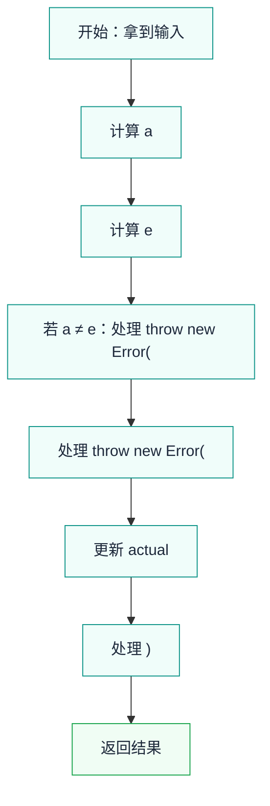

## TypeScript 解题方案（1 个方案逐个讲）

> **运行与提交**：每个方案都是自包含文件（内嵌用例自测，输出 PASS），整块复制到 `.ts` 文件后 `node 文件名` 即可运行。提交 LeetCode 时，把 `demo` 内的算法函数与辅助类型/函数整体取出、置于文件顶层即可。涉及交互/特殊接口的题以题面给定签名为准。

### 方案 1：直接实现

**分析与思路**：核心做法是「直接实现」。

**运行方式**：`node 本文件`，内嵌用例全部通过会输出 PASS。

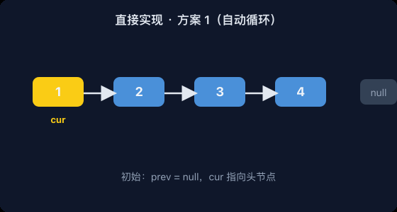

**方案专属流程图**（真实控制流）：

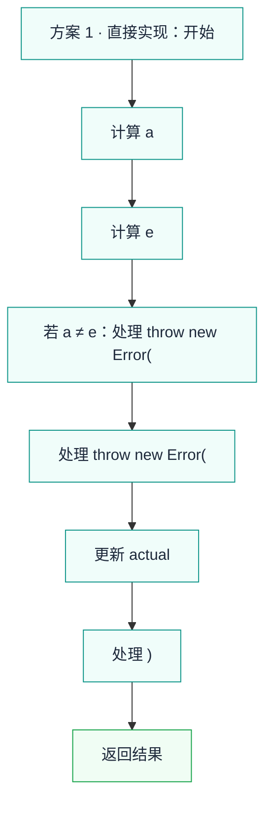

```typescript
function assertEq(actual: any, expected: any, msg: string = ''): void {
  // 定义函数/方法 assertEq
  const a = JSON.stringify(actual);
  const e = JSON.stringify(expected);
  if (a !== e)
    throw new Error(
      'ASSERT FAILED ' + msg + ' :: actual=' + a + ' expected=' + e,
    );
}

class DNode {
  val: number;
  prev: DNode | null;
  next: DNode | null;
  constructor(val: number) {
    this.val = val;
    this.prev = null;
    this.next = null;
  }
} // 定义类型
class MyLinkedList {
  // 定义类型
  head: DNode | null;
  tail: DNode | null;
  size: number; // 头节点: DNode 按位或 null; 尾节点: DNode 按位或 null; 大小: number;
  constructor() {
    this.head = null;
    this.tail = null;
    this.size = 0;
  } // 把 null; this.尾节点 赋值为 null; this.大小 赋值为 0; } 写入 头节点
  get(index: number): number {
    if (index < 0 || index >= this.size) return -1;
    let curr = this.head;
    for (let i = 0; i < index; i++) curr = curr!.next;
    return curr!.val;
  }
  addAtHead(val: number): void {
    const n = new DNode(val);
    n.next = this.head;
    if (this.head) this.head.prev = n;
    else this.tail = n;
    this.head = n;
    this.size++;
  }
  addAtTail(val: number): void {
    const n = new DNode(val);
    if (this.tail) {
      this.tail.next = n;
      n.prev = this.tail;
    } else this.head = n;
    this.tail = n;
    this.size++;
  }
  addAtIndex(index: number, val: number): void {
    // addAtIndex(index: number, 值: number): void {
    if (index < 0 || index > this.size) return; // 若 index 小于 0 或 index 超过 this.大小) return;
    if (index === 0)
      this.addAtHead(val); // 若 index 全等于 0) this.addAtHead(值);
    else if (index === this.size)
      this.addAtTail(val); // 否则，若 index 全等于 this.大小) this.addAtTail(值);
    else {
      let curr = this.head;
      for (let i = 0; i < index; i++) curr = curr!.next;
      const n = new DNode(val);
      n.prev = curr!.prev;
      n.next = curr;
      curr!.prev!.next = n;
      curr!.prev = n;
      this.size++;
    } // 否则
  }
  deleteAtIndex(index: number): void {
    // deleteAtIndex(index: number): void {
    if (index < 0 || index >= this.size) return; // 若 index 小于 0 或 index 不低于 this.大小) return;
    if (index === 0) {
      this.head = this.head!.next;
      if (this.head) this.head.prev = null;
      else this.tail = null;
    } else if (index === this.size - 1) {
      this.tail = this.tail!.prev;
      if (this.tail) this.tail.next = null;
      else this.head = null;
    } else {
      let curr = this.head;
      for (let i = 0; i < index; i++) curr = curr!.next;
      curr!.prev!.next = curr.next;
      curr!.next!.prev = curr.prev;
    } // 否则
    this.size--; // this.大小 减一 ;
  }
}
export function demo(): void {
  // 程序入口：跑内嵌自测用例
  const obj = new MyLinkedList(); // 把 new MyLinkedList() 存入 obj
  obj.addAtHead(1);
  obj.addAtTail(3);
  obj.addAtIndex(1, 2); // obj.addAtHead(1); obj.addAtTail(3); obj.addAtIndex(1, 2);
  assertEq(obj.get(1), 2, 'g1'); // 断言校验
  assertEq(obj.get(0), 1, 'g0'); // 断言校验
  assertEq(obj.get(2), 3, 'g2'); // 断言校验
  obj.deleteAtIndex(1); // obj.deleteAtIndex(1);
  assertEq(obj.get(1), 3, 'g1b'); // 断言校验
  console.log('PASS'); // 全部用例通过，输出 PASS
}
demo(); // demo();
```

## 逐步拆解与面试追问

**复杂度**：时间 O(n) 量级，空间 O(n)

**为什么是这个量级**：整体只对数据做有限趟处理

**面试官可能会追问**：

- 能不能一次遍历完成？
- 快慢指针能解决哪些变体？
- 断链与接回的顺序怎么保证不出错？

## 关键 API 速查（TS 主解法实际用到，附官方链接）

| API | 作用 | 使用要点 | 官方文档 |
|---|---|---|---|
| `JSON.stringify()` | 序列化为 JSON 字符串 | 常用于结构化比较（深度相等判定）；undefined/函数/循环引用会被丢弃或抛错 | [官方文档](https://developer.mozilla.org/zh-CN/docs/Web/JavaScript/Reference/Global_Objects/JSON/stringify) |

### 各语言官方文档导航

- **TypeScript / JS**：[MDN 中文参考](https://developer.mozilla.org/zh-CN/)
- **Python**：[Python 官方文档](https://docs.python.org/zh-cn/3/)
- **Go**：[Go 标准库](https://pkg.go.dev/std)
- **Java**：[JDK 17 API](https://docs.oracle.com/en/java/javase/17/docs/api/)
- **Rust**：[Rust 标准库](https://doc.rust-lang.org/std/)
- **Lua**：[Lua 5.4 手册](https://www.lua.org/manual/5.4/)
- **C**：[Cppreference C](https://zh.cppreference.com/w/c)
- **C++**：[Cppreference C++](https://zh.cppreference.com/w/cpp)
- **R**：[R 官方手册](https://stat.ethz.ch/R-manual/)
- **Zig**：[Zig 语言文档](https://ziglang.org/documentation/master/)
- **Dart**：[Dart API](https://api.dart.dev/)

## 附录：其他 10 种语言全部实现（每种语言列举其全部方案）

> TypeScript 的全部方案见「TypeScript 解题方案」一节；下面是其余 10 种语言的对应实现，每种语言的每个方案都带思路分析、代码走读与专属运行架构图。
> 每个方案都内嵌用例自测，可独立运行（老仓库 python/go 文件遵循「打印结果」约定）。
> 完整解法文件见 `dsa/<语言>/linked_list/lc_707_设计链表/`。

### Python 实现（1 种方案）

Python 的全部方案如下，每个方案都内嵌用例自测，可独立运行（老仓库 python/go 文件遵循「打印结果」约定）：

#### 方案 1：直接实现

**思路与代码分析**：核心是「直接实现」。Python 版用切片与字典推导式简化操作，突出可读性。

**运行架构**（真实控制流）：

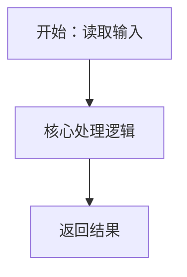

```python
import sys  # 提高递归深度上限（深输入防 RecursionError）

sys.setrecursionlimit(200000)  # 树/链表类题目节点数可达 1e4 量级

class Node:  # 定义类
    def __init__(self, val=0):  # 构造函数：初始化成员
        self.val = val  # 把 值 写入 值
        self.prev = None  # 把 None 写入 前一个
        self.next = None  # 把 None 写入 下一个

class MyLinkedList:  # 定义类
    def __init__(self):  # 构造函数：初始化成员
        self.head = None  # 把 None 写入 头节点
        self.tail = None  # 把 None 写入 尾节点
        self.size = 0  # 把 0 写入 大小

    def get(self, index: int) -> int:  # 定义函数 get（参数：self, index: int）
        if index < 0 or index >= self.size:  # 若 index 小于 0 or index 不低于 self.大小
            return -1  # 返回 减 1
        curr = self.head  # 把 self.头节点 存入 当前值
        for _ in range(index):  # 让 _ 从 index 遍历
            curr = curr.next  # 把 当前值.下一个 存入 当前值
        return curr.val  # 返回 当前值.值

    def addAtHead(self, val: int) -> None:  # 定义函数 addAtHead（参数：self, 值: int）
        new_node = Node(val)  # 把 Node(值) 存入 new_node
        new_node.next = self.head  # 把 self.头节点 写入 下一个
        if self.head:  # 若 self.头节点
            self.head.prev = new_node  # 把 new_node 写入 前一个
        else:  # 否则
            self.tail = new_node  # 把 new_node 写入 尾节点
        self.head = new_node  # 把 new_node 写入 头节点
        self.size += 1  # self.size累加 1

    def addAtTail(self, val: int) -> None:  # 定义函数 addAtTail（参数：self, 值: int）
        new_node = Node(val)  # 把 Node(值) 存入 new_node
        if self.tail:  # 若 self.尾节点
            self.tail.next = new_node  # 把 new_node 写入 下一个
            new_node.prev = self.tail  # 把 self.尾节点 写入 前一个
        else:  # 否则
            self.head = new_node  # 把 new_node 写入 头节点
        self.tail = new_node  # 把 new_node 写入 尾节点
        self.size += 1  # self.size累加 1

    def addAtIndex(
        self, index: int, val: int
    ) -> None:  # 定义函数 addAtIndex（参数：self, index: int, 值: int）
        if index < 0 or index > self.size:  # 若 index 小于 0 or index 超过 self.大小
            return  # return
        if index == 0:  # 若 index 等于 0
            self.addAtHead(val)  # self.addAtHead(值)
        elif index == self.size:  # 否则，若 index 等于 self.大小
            self.addAtTail(val)  # self.addAtTail(值)
        else:  # 否则
            curr = self.head  # 把 self.头节点 存入 当前值
            for _ in range(index):  # 让 _ 从 index 遍历
                curr = curr.next  # 把 当前值.下一个 存入 当前值
            new_node = Node(val)  # 把 Node(值) 存入 new_node
            new_node.prev = curr.prev  # 把 当前值.前一个 写入 前一个
            new_node.next = curr  # 把 当前值 写入 下一个
            curr.prev.next = new_node  # 把 new_node 写入 下一个
            curr.prev = new_node  # 把 new_node 写入 前一个
            self.size += 1  # self.size累加 1

    def deleteAtIndex(self, index: int) -> None:  # 定义函数 deleteAtIndex（参数：self, index: int）
        if index < 0 or index >= self.size:  # 若 index 小于 0 or index 不低于 self.大小
            return  # return
        if index == 0:  # 若 index 等于 0
            self.head = self.head.next  # 把 self.头节点.下一个 写入 头节点
            if self.head:  # 若 self.头节点
                self.head.prev = None  # 把 None 写入 前一个
            else:  # 否则
                self.tail = None  # 把 None 写入 尾节点
        elif index == self.size - 1:  # 否则，若 index 等于 self.大小 减 1
            self.tail = self.tail.prev  # 把 self.尾节点.前一个 写入 尾节点
            if self.tail:  # 若 self.尾节点
                self.tail.next = None  # 把 None 写入 下一个
            else:  # 否则
                self.head = None  # 把 None 写入 头节点
        else:  # 否则
            curr = self.head  # 把 self.头节点 存入 当前值
            for _ in range(index):  # 让 _ 从 index 遍历
                curr = curr.next  # 把 当前值.下一个 存入 当前值
            curr.prev.next = curr.next  # 把 当前值.下一个 写入 下一个
            curr.next.prev = curr.prev  # 把 当前值.前一个 写入 前一个
        self.size -= 1  # self.size累减 1

if __name__ == "__main__":  # 若 __name__ 等于 '__main__'
    obj = MyLinkedList()  # 把 MyLinkedList() 存入 obj
    obj.addAtHead(1)  # obj.addAtHead(1)
    obj.addAtTail(3)  # obj.addAtTail(3)
    obj.addAtIndex(1, 2)  # obj.addAtIndex(1, 2)
    print(obj.get(1))  # 2
    print(obj.get(0))  # 1
    print(obj.get(2))  # 3
    obj.deleteAtIndex(1)  # obj.deleteAtIndex(1)
    print(obj.get(1))  # 3
```

### Go 实现（1 种方案）

Go 的全部方案如下，每个方案都内嵌用例自测，可独立运行（老仓库 python/go 文件遵循「打印结果」约定）：

#### 方案 1：直接实现

**思路与代码分析**：核心是「直接实现」。Go 版用切片与多返回值惯用法，显式处理索引边界。**走读**：方案 1 · 直接实现：开始 → 返回 &MyLinkedList。

**运行架构**（真实控制流）：

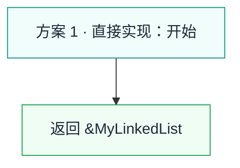

```go
package main // 引入依赖

import (
	"fmt"
	"os"
	"reflect"
) // 引入依赖

type dllNode struct { // 定义类型
	val  int      // 值 int
	prev *dllNode // 前一个 乘 dllNode
	next *dllNode // 下一个 乘 dllNode
}

type MyLinkedList struct { // 定义类型
	head *dllNode // 头节点 乘 dllNode
	tail *dllNode // 尾节点 乘 dllNode
	size int      // 大小 int
}

func NewMyLinkedList() *MyLinkedList { // 定义函数/方法 NewMyLinkedList
	return &MyLinkedList{} // 返回 按位与 MyLinkedList{}
}

func (l *MyLinkedList) get(index int) int { // 定义函数/方法 get
	if index < 0 || index >= l.size { // 若 index 小于 0 或 index 不低于 左指针.大小
		return -1 // 返回 减 1
	}
	curr := l.head               // 把 左指针.头节点 写入 curr :
	for i := 0; i < index; i++ { // 让 下标 i 从 0 开始计数
		curr = curr.next // 把 当前值.下一个 写入 当前值
	}
	return curr.val // 返回 当前值.值
}

func (l *MyLinkedList) addAtHead(val int) { // 定义函数/方法 addAtHead
	newNode := &dllNode{val: val} // 把 按位与 dllNode{值: 值} 写入 newNode :
	newNode.next = l.head         // 把 左指针.头节点 写入 下一个
	if l.head != nil {            // 若 左指针.头节点 不等于 nil
		l.head.prev = newNode // 把 newNode 写入 前一个
	} else { // 否则
		l.tail = newNode // 把 newNode 写入 尾节点
	}
	l.head = newNode // 把 newNode 写入 头节点
	l.size++         // 左指针.大小 加一
}

func (l *MyLinkedList) addAtTail(val int) { // 定义函数/方法 addAtTail
	newNode := &dllNode{val: val} // 把 按位与 dllNode{值: 值} 写入 newNode :
	if l.tail != nil {            // 若 左指针.尾节点 不等于 nil
		l.tail.next = newNode // 把 newNode 写入 下一个
		newNode.prev = l.tail // 把 左指针.尾节点 写入 前一个
	} else { // 否则
		l.head = newNode // 把 newNode 写入 头节点
	}
	l.tail = newNode // 把 newNode 写入 尾节点
	l.size++         // 左指针.大小 加一
}

func (l *MyLinkedList) addAtIndex(index, val int) { // 定义函数/方法 addAtIndex
	if index < 0 || index > l.size { // 若 index 小于 0 或 index 超过 左指针.大小
		return // return
	}
	if index == 0 { // 若 index 等于 0
		l.addAtHead(val) // 左指针.addAtHead(值)
	} else if index == l.size { // 否则，若 index 等于 左指针.大小
		l.addAtTail(val) // 左指针.addAtTail(值)
	} else { // 否则
		curr := l.head               // 把 左指针.头节点 写入 curr :
		for i := 0; i < index; i++ { // 让 下标 i 从 0 开始计数
			curr = curr.next // 把 当前值.下一个 写入 当前值
		}
		newNode := &dllNode{val: val} // 把 按位与 dllNode{值: 值} 写入 newNode :
		newNode.prev = curr.prev      // 把 当前值.前一个 写入 前一个
		newNode.next = curr           // 把 当前值 写入 下一个
		curr.prev.next = newNode      // 把 newNode 写入 下一个
		curr.prev = newNode           // 把 newNode 写入 前一个
		l.size++                      // 左指针.大小 加一
	}
}

func (l *MyLinkedList) deleteAtIndex(index int) { // 定义函数/方法 deleteAtIndex
	if index < 0 || index >= l.size { // 若 index 小于 0 或 index 不低于 左指针.大小
		return // return
	}
	var curr *dllNode // var 当前值 乘 dllNode
	if index == 0 {   // 若 index 等于 0
		curr = l.head        // 把 左指针.头节点 写入 当前值
		l.head = l.head.next // 把 左指针.头节点.下一个 写入 头节点
		if l.head != nil {   // 若 左指针.头节点 不等于 nil
			l.head.prev = nil // 把 nil 写入 前一个
		} else { // 否则
			l.tail = nil // 把 nil 写入 尾节点
		}
	} else if index == l.size-1 { // 否则，若 index 等于 左指针.大小 减 1
		curr = l.tail        // 把 左指针.尾节点 写入 当前值
		l.tail = l.tail.prev // 把 左指针.尾节点.前一个 写入 尾节点
		if l.tail != nil {   // 若 左指针.尾节点 不等于 nil
			l.tail.next = nil // 把 nil 写入 下一个
		} else { // 否则
			l.head = nil // 把 nil 写入 头节点
		}
	} else { // 否则
		curr = l.head                // 把 左指针.头节点 写入 当前值
		for i := 0; i < index; i++ { // 让 下标 i 从 0 开始计数
			curr = curr.next // 把 当前值.下一个 写入 当前值
		}
		curr.prev.next = curr.next // 把 当前值.下一个 写入 下一个
		curr.next.prev = curr.prev // 把 当前值.前一个 写入 前一个
	}
	l.size-- // 左指针.大小 减一
}

func main() { // 程序入口：跑内嵌自测用例
	obj := NewMyLinkedList()                         // 把 NewMyLinkedList() 写入 obj :
	obj.addAtHead(1)                                 // obj.addAtHead(1)
	obj.addAtTail(3)                                 // obj.addAtTail(3)
	obj.addAtIndex(1, 2)                             // obj.addAtIndex(1, 2)
	got := []int{obj.get(1), obj.get(0), obj.get(2)} // 把 []int{obj 查找 1), obj 查找 0), obj 查找 2)} 写入 got :
	obj.deleteAtIndex(1)                             // obj.deleteAtIndex(1)
	got = append(got, obj.get(1))                    // 把 append(got, obj 查找 1)) 写入 got
	want := []int{2, 1, 3, 3}                        // 把 []int{2, 1, 3, 3} 写入 want :
	if !reflect.DeepEqual(got, want) {               // 若 取反 reflect.DeepEqual(got, want
		fmt.Printf("FAIL MyLinkedList %v want %v\n", got, want) // 打印输出
		os.Exit(1)                                              // os.Exit(1)
	}
	fmt.Println("PASS") // 全部用例通过，输出 PASS
}
```

### Java 实现（1 种方案）

Java 的全部方案如下，每个方案都内嵌用例自测，可独立运行（老仓库 python/go 文件遵循「打印结果」约定）：

#### 方案 1：直接实现

**思路与代码分析**：核心是「直接实现」。Java 版用类与静态方法组织，集合操作显式明了。**走读**：方案 1 · 直接实现：开始 → 更新 val → 返回结果。

**运行架构**（真实控制流）：

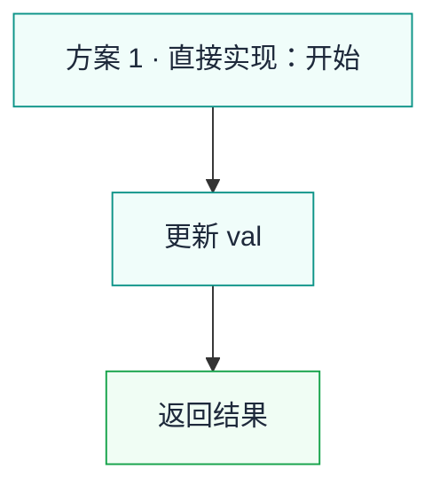

```java
package com.webfault.dsa; // 引入依赖

import java.util.ArrayList; // 引入依赖
import java.util.List; // 引入依赖
import java.util.Objects; // 引入依赖

class lc707_solution1 { // 定义类型
  static class Node { // static class Node {
    int val; // int 值;
    Node prev, next; // Node 前一个, 下一个;

    Node(int v) { // Node(int 值) {
      val = v; // 把 值; 写入 值
    }
  }

  // MyLinkedList 忠实翻译 python ref solution_1_主解法.py（双向链表，head/tail/size）
  static class MyLinkedList { // static class MyLinkedList {
    Node head, tail; // Node 头节点, 尾节点;
    int size = 0; // 把 0 存入 大小

    int get(int index) { // 定义函数/方法 get
      if (index < 0 || index >= size) { // 若 index 小于 0 或 index 不低于 大小
        return -1; // 返回 减 1
      }
      Node curr = head; // 把 头节点; 写入 Node curr
      for (int i = 0; i < index; i++) { // 让 下标 i 从 0 开始计数，下标 i 小于 index 就继续
        curr = curr.next; // 把 当前值.下一个; 写入 当前值
      }
      return curr.val; // 返回 当前值.值
    }

    void addAtHead(int val) { // 定义函数/方法 addAtHead
      Node n = new Node(val); // 把 new Node(值); 写入 Node n
      n.next = head; // 把 头节点; 写入 下一个
      if (head != null) { // 若 头节点 不等于 null
        head.prev = n; // 把 元素个数; 写入 前一个
      } else { // 否则
        tail = n; // 把 元素个数; 写入 尾节点
      }
      head = n; // 把 元素个数; 写入 头节点
      size++; // 大小 加一
    }

    void addAtTail(int val) { // 定义函数/方法 addAtTail
      Node n = new Node(val); // 把 new Node(值); 写入 Node n
      if (tail != null) { // 若 尾节点 不等于 null
        tail.next = n; // 把 元素个数; 写入 下一个
        n.prev = tail; // 把 尾节点; 写入 前一个
      } else { // 否则
        head = n; // 把 元素个数; 写入 头节点
      }
      tail = n; // 把 元素个数; 写入 尾节点
      size++; // 大小 加一
    }

    void addAtIndex(int index, int val) { // 定义函数/方法 addAtIndex
      if (index < 0 || index > size) { // 若 index 小于 0 或 index 超过 大小
        return; // return;
      }
      if (index == 0) { // 若 index 等于 0
        addAtHead(val); // addAtHead(值);
        return; // return;
      }
      if (index == size) { // 若 index 等于 大小
        addAtTail(val); // addAtTail(值);
        return; // return;
      }
      Node curr = head; // 把 头节点; 写入 Node curr
      for (int i = 0; i < index; i++) { // 让 下标 i 从 0 开始计数，下标 i 小于 index 就继续
        curr = curr.next; // 把 当前值.下一个; 写入 当前值
      }
      Node n = new Node(val); // 把 new Node(值); 写入 Node n
      n.prev = curr.prev; // 把 当前值.前一个; 写入 前一个
      n.next = curr; // 把 当前值; 写入 下一个
      curr.prev.next = n; // 把 元素个数; 写入 下一个
      curr.prev = n; // 把 元素个数; 写入 前一个
      size++; // 大小 加一
    }

    void deleteAtIndex(int index) { // 定义函数/方法 deleteAtIndex
      if (index < 0 || index >= size) { // 若 index 小于 0 或 index 不低于 大小
        return; // return;
      }
      if (index == 0) { // 若 index 等于 0
        head = head.next; // 把 头节点.下一个; 写入 头节点
        if (head != null) { // 若 头节点 不等于 null
          head.prev = null; // 把 null; 写入 前一个
        } else { // 否则
          tail = null; // 把 null; 写入 尾节点
        }
      } else if (index == size - 1) { // 否则，若 index 等于 大小 减 1
        tail = tail.prev; // 把 尾节点.前一个; 写入 尾节点
        if (tail != null) { // 若 尾节点 不等于 null
          tail.next = null; // 把 null; 写入 下一个
        } else { // 否则
          head = null; // 把 null; 写入 头节点
        }
      } else { // 否则
        Node curr = head; // 把 头节点; 写入 Node curr
        for (int i = 0; i < index; i++) { // 让 下标 i 从 0 开始计数，下标 i 小于 index 就继续
          curr = curr.next; // 把 当前值.下一个; 写入 当前值
        }
        curr.prev.next = curr.next; // 把 当前值.下一个; 写入 下一个
        curr.next.prev = curr.prev; // 把 当前值.前一个; 写入 前一个
      }
      size--; // 大小 减一
    }
  }

  public static void main(String[] args) { // public static void main(String[] args) {
    // 操作编码: AH=addAtHead, AT=addAtTail, AI=addAtIndex, DI=deleteAtIndex, G=get
    // want 由 python ref solution_1_主解法.py 实跑操作序列得到
    String[][][] caseOps = { // 把 { 写入 String[][][] caseOps
      {
        {"AH", "1"},
        {"AT", "3"},
        {"AI", "1", "2"},
        {"G", "1"},
        {"G", "0"},
        {"G", "2"},
        {"DI", "1"},
        {"G", "1"}
      },
      {
        {"G", "0"},
        {"AH", "1"},
        {"G", "0"},
        {"AT", "2"},
        {"AI", "2", "3"},
        {"G", "2"},
        {"DI", "0"},
        {"G", "0"},
        {"DI", "1"},
        {"G", "1"},
        {"DI", "1"},
        {"G", "0"}
      },
      {
        {"AI", "1", "5"},
        {"G", "0"},
        {"AT", "1"},
        {"AH", "0"},
        {"AI", "2", "2"},
        {"AI", "0", "-1"},
        {"G", "3"},
        {"DI", "3"},
        {"G", "3"},
        {"AI", "-1", "9"},
        {"G", "0"}
      },
    };
    Integer[][] wants = { // 把 { 写入 Integer[][] wants
      {null, null, null, 2, 1, 3, null, 3},
      {-1, null, 1, null, null, 3, null, 2, null, -1, null, 2},
      {null, -1, null, null, null, null, 2, null, -1, null, -1},
    };
    boolean ok = true; // 把 true; 写入 boolean ok
    for (int ci = 0; ci < caseOps.length; ci++) { // 让 ci 从 0 开始计数，ci 小于 caseOps.长度 就继续
      MyLinkedList obj = new MyLinkedList(); // 把 new MyLinkedList(); 写入 MyLinkedList obj
      List<Integer> got = new ArrayList<>(); // 把 new ArrayList 小于 超过 (); 写入 List<Integer> got
      for (String[] op : caseOps[ci]) { // for (String[] op : caseOps[ci]) {
        switch (op[0]) { // switch (op[0]) {
          case "AH": // case 「AH」:
            obj.addAtHead(Integer.parseInt(op[1])); // obj.addAtHead(Integer.转整数(op[1]));
            got.add(null); // got 追加 null);
            break; // 跳出循环
          case "AT": // case 「AT」:
            obj.addAtTail(Integer.parseInt(op[1])); // obj.addAtTail(Integer.转整数(op[1]));
            got.add(null); // got 追加 null);
            break; // 跳出循环
          case "AI": // case 「AI」:
            obj.addAtIndex(
                Integer.parseInt(op[1]),
                Integer.parseInt(op[2])); // obj.addAtIndex(Integer.转整数(op[1]), Integer.转整数(op[2]));
            got.add(null); // got 追加 null);
            break; // 跳出循环
          case "DI": // case 「DI」:
            obj.deleteAtIndex(Integer.parseInt(op[1])); // obj.deleteAtIndex(Integer.转整数(op[1]));
            got.add(null); // got 追加 null);
            break; // 跳出循环
          case "G": // case 「G」:
            got.add(obj.get(Integer.parseInt(op[1]))); // got 追加 obj 查找 Integer.转整数(op[1])));
            break; // 跳出循环
          default: // default:
            break; // 跳出循环
        }
      }
      for (int i = 0; i < wants[ci].length; i++) { // 让 下标 i 从 0 开始计数，下标 i 小于 wants[ci].长度 就继续
        if (!Objects.equals(
            got.get(i), wants[ci][i])) { // 若 取反 Objects.equals(got 查找 下标 i), wants[ci][下标 i]
          ok = false; // 把 false; 写入 ok
          System.out.println(
              "FAIL case"
                  + ci
                  + " step"
                  + i
                  + " got "
                  + got.get(i)
                  + " want "
                  + wants[ci][i]); // 打印输出
        }
      }
    }
    if (!ok) { // 若 取反 ok
      throw new RuntimeException("FAILED"); // throw new RuntimeException(「FAILED」);
    }
    System.out.println("PASS"); // 全部用例通过，输出 PASS
  }
}
```

### Rust 实现（1 种方案）

Rust 的全部方案如下，每个方案都内嵌用例自测，可独立运行（老仓库 python/go 文件遵循「打印结果」约定）：

#### 方案 1：直接实现

**思路与代码分析**：核心是「直接实现」。Rust 版用所有权移动与切片借用改写同一逻辑，注意 Option 与引用边界。**走读**：方案 1 · 直接实现：开始 → 计算 v → 遍历 ops 中的每个元素 op → 返回结果。

**运行架构**（真实控制流）：

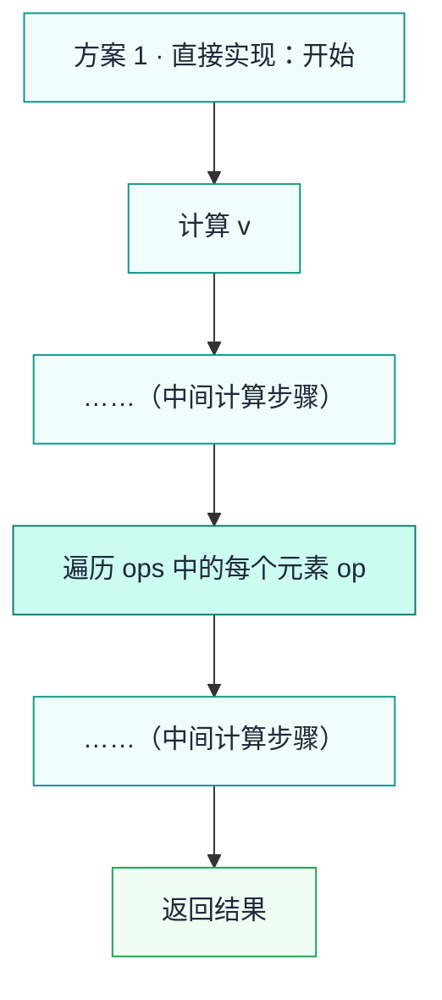

```rust
// LeetCode 707. 设计链表 — Rust 版（方案1）
#[derive(Clone)]
enum Op707 {
    AddAtHead(i32),
    AddAtTail(i32),
    AddAtIndex(i32, i32),
    Get(i32),
    DeleteAtIndex(i32),
} // 定义类型
fn my_linked_list_run(ops: Vec<Op707>) -> Vec<i32> {
    // 定义函数/方法 my_linked_list_run
    let mut v: Vec<i32> = Vec::new(); // 把 Vec::new(); 写入 let mut v: Vec<i32>
    let mut out = Vec::new(); // 把 Vec::new(); 写入 let mut out
    for op in ops {
        // 逐个取出 ops 的元素（op）
        match op {
            // 按情况匹配处理
            Op707::AddAtHead(x) => v.insert(0, x),
            Op707::AddAtTail(x) => v.push(x),
            Op707::AddAtIndex(i, x) => {
                let idx = i.max(0) as usize; // 把 下标 i.取较大值 0) as usize 存入 idx
                if idx <= v.len() {
                    v.insert(idx, x);
                } // 若 idx 不超过 值.长度() { 值 插入 idx, x); }
            }
            Op707::Get(i) => {
                if i >= 0 && (i as usize) < v.len() {
                    out.push(v[i as usize]);
                } else {
                    out.push(-1);
                }
            }
            Op707::DeleteAtIndex(i) => {
                if i >= 0 && (i as usize) < v.len() {
                    v.remove(i as usize);
                }
            }
        }
    }
    out // out
}
fn main() {
    // 程序入口：跑内嵌自测用例
    // LC 官方：addAtHead(1), addAtTail(3), addAtIndex(1,2)→[1,2,3], get(1)=2, deleteAtIndex(1)→[1,3], get(1)=3
    let ops = vec![
        Op707::AddAtHead(1),
        Op707::AddAtTail(3),
        Op707::AddAtIndex(1, 2),
        Op707::Get(1),
        Op707::DeleteAtIndex(1),
        Op707::Get(1),
    ];
    assert_eq!(my_linked_list_run(ops), vec![2, 3]); // 断言校验
    println!("PASS"); // 全部用例通过，输出 PASS
}
```

### Lua 实现（1 种方案）

Lua 的全部方案如下，每个方案都内嵌用例自测，可独立运行（老仓库 python/go 文件遵循「打印结果」约定）：

#### 方案 1：直接实现

**思路与代码分析**：核心是「直接实现」。Lua 版用表与 ipairs 遍历，注意 ipairs 遇 nil 即停的语义。

**运行架构**（真实控制流）：


```lua
-- LeetCode 707. 设计链表 — Lua 版（方案1）
local MyList = {} -- 把 {} 写入 local MyList
MyList.__index = MyList -- 把 MyList 写入 MyList.__index
function MyList.new()
	return setmetatable({ items = {} }, MyList)
end
function MyList:addAtHead(x)
	table.insert(self.items, 1, x)
end -- function MyList:addAtHead(x) table 插入 self.items, 1, x) 终点
function MyList:addAtTail(x)
	self.items[#self.items + 1] = x
end
function MyList:addAtIndex(i, x) -- function MyList:addAtIndex(下标 i, x)
	if i < 0 then
		i = 0
	end -- 若 下标 i 小于 0 then 下标 i 赋值为 0 终点
	if i <= #self.items then
		table.insert(self.items, i + 1, x)
	end
end -- 终点
function MyList:get(i) -- function MyList:get(下标 i)
	if i >= 0 and i < #self.items then
		return self.items[i + 1]
	end
	return -1 -- 返回 减 1
end -- 终点
function MyList:deleteAtIndex(i) -- function MyList:deleteAtIndex(下标 i)
	if i >= 0 and i < #self.items then
		table.remove(self.items, i + 1)
	end
end -- 终点
local l = MyList.new() -- 把 MyList.new() 写入 local l
l:addAtHead(1) -- 左指针:addAtHead(1)
l:addAtTail(3) -- 左指针:addAtTail(3)
l:addAtIndex(1, 2) -- 左指针:addAtIndex(1, 2)
assert(l:get(1) == 2) -- 断言校验
l:deleteAtIndex(1) -- 左指针:deleteAtIndex(1)
assert(l:get(1) == 3) -- 断言校验
print("PASS") -- 全部用例通过，输出 PASS
```

### C 实现（1 种方案）

C 的全部方案如下，每个方案都内嵌用例自测，可独立运行（老仓库 python/go 文件遵循「打印结果」约定）：

#### 方案 1：直接实现

**思路与代码分析**：核心是「直接实现」。C 版手动管理下标与内存，循环边界全部显式写出。**走读**：方案 1 · 直接实现：开始 → 更新 l->n → 返回结果。

**运行架构**（真实控制流）：

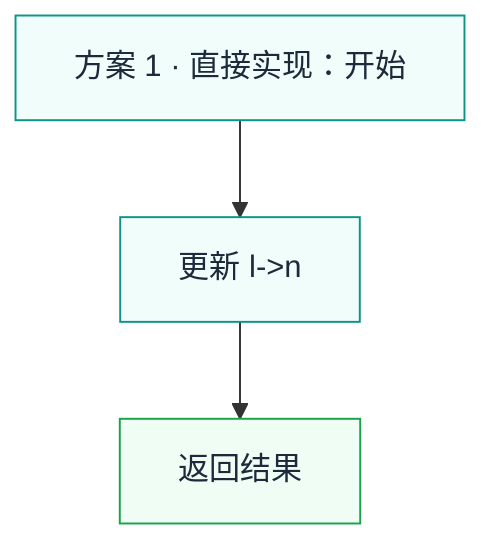

```c
/* LeetCode 707. 设计链表 — C 版（方案1） */
#include <stdio.h> // 引入头文件
typedef struct {
    int items[4096];
    int n;
} MyList;                                    // typedef struct { int items[4096]; int 元素个数; } MyList;
static void ml_init(MyList *l) { l->n = 0; } // 把 0; } 写入 static void ml_init(MyList *l) { l->n
static void ml_add_head(MyList *l, int x) {  // 定义函数/方法 ml_add_head
    for (int i = l->n; i > 0; i--)
        l->items[i] = l->items[i - 1]; // 让 下标 i 从 左指针 减 超过 元素个数 开始计数，下标 i 超过 0 就继续
    l->items[0] = x; // 把 x; 写入 l->items[0]
    l->n++;          // 左指针 减 超过 元素个数 加一 ;
}
static void ml_add_tail(MyList *l, int x) { l->items[l->n++] = x; }
static void ml_add_at(MyList *l, int idx, int x) { // 定义函数/方法 ml_add_at
    if (idx < 0)
        idx = 0; // 若 idx 小于 0) idx 赋值为 0;
    if (idx > l->n)
        return; // 若 idx 超过 左指针 减 超过 元素个数) return;
    for (int i = l->n; i > idx; i--)
        l->items[i] =
            l->items[i - 1]; // 让 下标 i 从 左指针 减 超过 元素个数 开始计数，下标 i 超过 idx 就继续
    l->items[idx] = x; // 把 x; 写入 l->items[idx]
    l->n++;            // 左指针 减 超过 元素个数 加一 ;
}
static int ml_get(MyList *l, int idx) { // 定义函数/方法 ml_get
    if (idx < 0 || idx >= l->n)
        return -1; // 若 idx 小于 0 或 idx 不低于 左指针 减 超过 元素个数，直接返回 减 1
    return l->items[idx]; // 返回 左指针 减 超过 items[idx]
}
static void ml_del(MyList *l, int idx) { // 定义函数/方法 ml_del
    if (idx < 0 || idx >= l->n)
        return; // 若 idx 小于 0 或 idx 不低于 左指针 减 超过 元素个数) return;
    for (int i = idx; i + 1 < l->n; i++)
        l->items[i] =
            l->items[i + 1]; // 让 下标 i 从 idx 开始计数，下标 i 加 1 小于 左指针 减 超过 元素个数 就继续
    l->n--; // 左指针 减 超过 元素个数 减一 ;
}
int main(void) {         // 程序入口：跑内嵌自测用例
    MyList l;            // MyList 左指针;
    ml_init(&l);         // ml_init( 按位与 左指针);
    ml_add_head(&l, 1);  // ml_add_head( 按位与 左指针, 1);
    ml_add_tail(&l, 3);  // ml_add_tail( 按位与 左指针, 3);
    ml_add_at(&l, 1, 2); // ml_add_at( 按位与 左指针, 1, 2);
    if (ml_get(&l, 1) != 2) {
        printf("FAIL 1\n");
        return 1;
    }              // 若 ml_get( 按位与 左指针, 1) 不等于 2) { 输出「FAIL 1 」); return 1; }
    ml_del(&l, 1); // ml_del( 按位与 左指针, 1);
    if (ml_get(&l, 1) != 3) {
        printf("FAIL 2\n");
        return 1;
    }                 // 若 ml_get( 按位与 左指针, 1) 不等于 3) { 输出「FAIL 2 」); return 1; }
    printf("PASS\n"); // 全部用例通过，输出 PASS
    return 0;         // 返回 0
}
```

### C++ 实现（1 种方案）

C++ 的全部方案如下，每个方案都内嵌用例自测，可独立运行（老仓库 python/go 文件遵循「打印结果」约定）：

#### 方案 1：直接实现

**思路与代码分析**：核心是「直接实现」。C++ 版用 STL 容器与迭代器，减少手写下标错误。**走读**：方案 1 · 直接实现：开始 → 调用 items.insert(items.begin(), → 返回结果。

**运行架构**（真实控制流）：

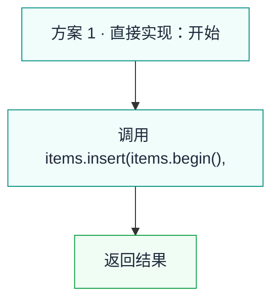

```cpp
// LeetCode 707. 设计链表 — C++ 版（方案1）
#include <cassert>          // 引入头文件
#include <iostream>         // 引入头文件
#include <vector>           // 引入头文件
struct MyLinkedList {       // 定义类型
    std::vector<int> items; // std::vector 小于 int 超过 items;
    void addAtHead(int x) {
        items.insert(items.begin(), x);
    } // void addAtHead(int x) { items 插入 items 迭代位置 , x); }
    void addAtTail(int x) { items.push_back(x); } // void addAtTail(int x) { items 追加 x); }
    void addAtIndex(int idx, int x) {             // 定义函数/方法 addAtIndex
        if (idx < 0)
            idx = 0; // 若 idx 小于 0) idx 赋值为 0;
        if (idx > static_cast<int>(items.size()))
            return; // 若 idx 超过 static_cast 小于 int 超过 (items.大小())) return;
        items.insert(items.begin() + idx, x); // items 插入 items 迭代位置 加 idx, x);
    }
    int get(int idx) { // 定义函数/方法 get
        if (idx < 0 || idx >= static_cast<int>(items.size()))
            return -1;
        return items[idx]; // 返回 items[idx]
    }
    void deleteAtIndex(int idx) { // 定义函数/方法 deleteAtIndex
        if (idx < 0 || idx >= static_cast<int>(items.size()))
            return;
        items.erase(items.begin() + idx); // items 删除 items 迭代位置 加 idx);
    }
};
int main() {                          // 程序入口：跑内嵌自测用例
    MyLinkedList l;                   // MyLinkedList 左指针;
    l.addAtHead(1);                   // 左指针.addAtHead(1);
    l.addAtTail(3);                   // 左指针.addAtTail(3);
    l.addAtIndex(1, 2);               // 左指针.addAtIndex(1, 2);
    assert(l.get(1) == 2);            // 断言校验
    l.deleteAtIndex(1);               // 左指针.deleteAtIndex(1);
    assert(l.get(1) == 3);            // 断言校验
    std::cout << "PASS" << std::endl; // 全部用例通过，输出 PASS
    return 0;                         // 返回 0
}
```

### R 实现（1 种方案）

R 的全部方案如下，每个方案都内嵌用例自测，可独立运行（老仓库 python/go 文件遵循「打印结果」约定）：

#### 方案 1：直接实现

**思路与代码分析**：核心是「直接实现」。R 版用向量化思维与 1 起始下标，注意 1:n 的降序陷阱。**走读**：方案 1 · 直接实现：开始 → 更新 new.env(parent → 命中条件，直接返回 → 命中条件，直接返回 → 命中条件，直接返回。

**运行架构**（真实控制流）：

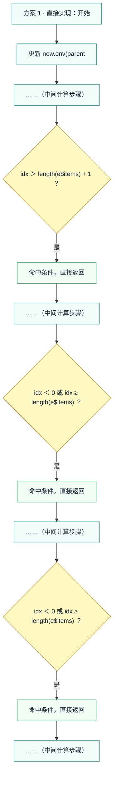

```r
# 版（方案1） 定义函数 MyList（参数：无）
MyList <- function() {
    e <- new.env(parent = emptyenv())  # 把 new.env(parent 赋值为 emptyenv()) 存入 e
    e$items <- integer(0)  # 把 integer(0) 存入 e$items
    e$addAtHead <- function(x) e$items <<- c(x, e$items)  # 把 function(x) e$items 小于 小于 减 字符(x, e$items) 存入 e$addAtHead
    e$addAtTail <- function(x) e$items <<- c(e$items, x)  # 把 function(x) e$items 小于 小于 减 字符(e$items, x) 存入 e$addAtTail
    e$addAtIndex <- function(idx, x) {
        # 把 function(idx, x) { 存入 e$addAtIndex
        if (idx < 0)
            idx <- 1  # 若 idx 小于 0) idx 小于 减 1
        if (idx > length(e$items) + 1)
            return(invisible(NULL))  # 若 idx 超过 长度(e$items) 加 1) return(invisible(NULL
        e$items <<- append(e$items, x, after = idx)  # 把 idx) 写入 e$items <<- append(e$items, x, after
    }
    e$get <- function(idx) {
        # 把 function(idx) { 存入 e$get
        if (idx < 0 || idx >= length(e$items))
            return(-1L)  # 若 idx 小于 0 或 idx 不低于 长度(e$items)) return( 减 1L
        e$items[idx + 1]  # e$items[idx 加 1]
    }
    e$deleteAtIndex <- function(idx) {
        # 把 function(idx) { 存入 e$deleteAtIndex
        if (idx < 0 || idx >= length(e$items))
            return(invisible(NULL))  # 若 idx 小于 0 或 idx 不低于 长度(e$items)) return(invisible(NULL
        e$items <<- e$items[-(idx + 1)]  # e$items 小于 小于 减 e$items[ 减 (idx 加 1)]
    }
    e
}
l <- MyList()  # 把 MyList() 存入 左指针
l$addAtHead(1)  # 左指针$addAtHead(1)
l$addAtTail(3)  # 左指针$addAtTail(3)
l$addAtIndex(1, 2)  # 左指针$addAtIndex(1, 2)
stopifnot(l$get(1) == 2)  # 断言校验
l$deleteAtIndex(1)  # 左指针$deleteAtIndex(1)
stopifnot(l$get(1) == 3)  # 断言校验
cat("PASS\n")  # 全部用例通过，输出 PASS
```

### Zig 实现（1 种方案）

Zig 的全部方案如下，每个方案都内嵌用例自测，可独立运行（老仓库 python/go 文件遵循「打印结果」约定）：

#### 方案 1：直接实现

**思路与代码分析**：核心是「直接实现」。Zig 版显式分配与清零，整型边界处理严格。**走读**：方案 1 · 直接实现：开始 → 返回 .。

**运行架构**（真实控制流）：

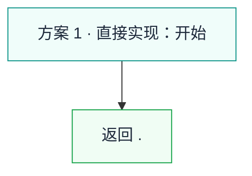

```zig
// LeetCode 707. 设计链表 — Zig 版（方案1）
const std = @import("std"); // 把 @import(「std」) 存入 std
const MyList = struct { // 把 struct { 存入 MyList
    items: [4096]i32,
    n: usize,
    fn init() MyList { // 定义函数/方法 init
        return .{ .items = undefined, .n = 0 }; // 返回 { .items 赋值为 undefined, .元素个数 赋值为 0 }
    }
    fn addAtHead(self: *MyList, x: i32) void { // 定义函数/方法 addAtHead
        var i: usize = self.n; // 把 self.元素个数; 写入 var i: usize
        while (i > 0) : (i -= 1) self.items[i] = self.items[i - 1];
        self.items[0] = x; // 把 x; 写入 self.items[0]
        self.n += 1; // self.n累加 1
    }
    fn addAtTail(self: *MyList, x: i32) void { // 定义函数/方法 addAtTail
        self.items[self.n] = x; // 把 x; 写入 self.items[self.n]
        self.n += 1; // self.n累加 1
    }
    fn addAtIndex(self: *MyList, idx: i32, x: i32) void { // 定义函数/方法 addAtIndex
        var idxv = idx; // 把 idx 存入 idxv
        if (idxv < 0) idxv = 0; // 若 idxv 小于 0) idxv 赋值为 0;
        const u: usize = @intCast(idxv); // 把 @intCast(idxv); 写入 const u: usize
        if (u > self.n) return; // 若 节点 u 超过 self.元素个数) return;
        var i: usize = self.n; // 把 self.元素个数; 写入 var i: usize
        while (i > u) : (i -= 1) self.items[i] = self.items[i - 1];
        self.items[u] = x; // 把 x; 写入 self.items[u]
        self.n += 1; // self.n累加 1
    }
    fn get(self: *MyList, idx: i32) i32 { // 定义函数/方法 get
        if (idx < 0 or idx >= @as(i32, @intCast(self.n))) return -1; // 若 idx 小于 0 or idx 不低于 @as(i32, @intCast(self.元素个数))，直接返回 减 1
        return self.items[@intCast(idx)]; // 返回 self.items[@intCast(idx)]
    }
    fn deleteAtIndex(self: *MyList, idx: i32) void { // 定义函数/方法 deleteAtIndex
        if (idx < 0 or idx >= @as(i32, @intCast(self.n))) return; // 若 idx 小于 0 or idx 不低于 @as(i32, @intCast(self.元素个数))) return;
        var i: usize = @intCast(idx); // 把 @intCast(idx); 写入 var i: usize
        while (i + 1 < self.n) : (i += 1) self.items[i] = self.items[i + 1];
        self.n -= 1; // self.n累减 1
    }
};
pub fn main() !void { // 程序入口：跑内嵌自测用例
    var l = MyList.init(); // 把 MyList.init() 存入 左指针
    l.addAtHead(1); // 左指针.addAtHead(1);
    l.addAtTail(3); // 左指针.addAtTail(3);
    l.addAtIndex(1, 2); // 左指针.addAtIndex(1, 2);
    if (l.get(1) != 2) return error.TestFailed; // 若 左指针 查找 1) 不等于 2，直接返回 error.TestFailed
    l.deleteAtIndex(1); // 左指针.deleteAtIndex(1);
    if (l.get(1) != 3) return error.TestFailed; // 若 左指针 查找 1) 不等于 3，直接返回 error.TestFailed
    std.debug.print("PASS\n", .{}); // 全部用例通过，输出 PASS
}
```

### Dart 实现（1 种方案）

Dart 的全部方案如下，每个方案都内嵌用例自测，可独立运行（老仓库 python/go 文件遵循「打印结果」约定）：

#### 方案 1：直接实现

**思路与代码分析**：核心是「直接实现」。Dart 版用可空类型标注与集合方法，注意空安全。**走读**：方案 1 · 直接实现：开始 → 命中条件，直接返回 → 调用 items.insert(idx, x)。

**运行架构**（真实控制流）：

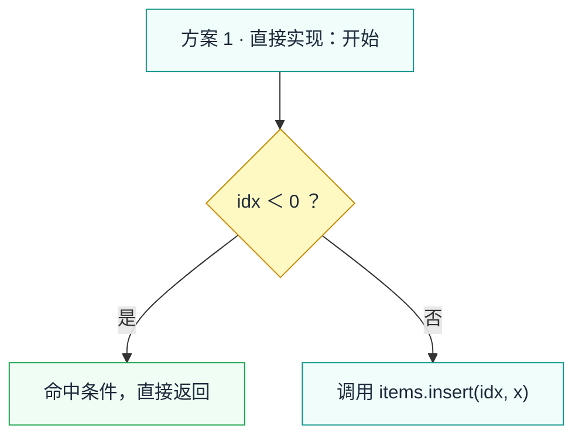

```dart
// LeetCode 707. 设计链表 — Dart 版（方案1）
class MyList {
  // 定义类型
  final List<int> items = []; // 把 []; 写入 final List<int> items
  void addAtHead(int x) => items.insert(0, x);
  void addAtTail(int x) => items.add(x);
  void addAtIndex(int idx, int x) {
    // 定义函数/方法 addAtIndex
    if (idx < 0) idx = 0; // 若 idx 小于 0) idx 赋值为 0;
    if (idx > items.length) return; // 若 idx 超过 items.长度) return;
    items.insert(idx, x); // items 插入 idx, x);
  }

  int get(int idx) {
    // 定义函数/方法 get
    if (idx < 0 || idx >= items.length)
      return -1; // 若 idx 小于 0 或 idx 不低于 items.长度，直接返回 减 1
    return items[idx]; // 返回 items[idx]
  }

  void deleteAtIndex(int idx) {
    // 定义函数/方法 deleteAtIndex
    if (idx < 0 || idx >= items.length)
      return; // 若 idx 小于 0 或 idx 不低于 items.长度) return;
    items.removeAt(idx); // items.removeAt(idx);
  }
}

void main() {
  // 程序入口：跑内嵌自测用例
  final l = MyList(); // 把 MyList() 存入 左指针
  l.addAtHead(1); // 左指针.addAtHead(1);
  l.addAtTail(3); // 左指针.addAtTail(3);
  l.addAtIndex(1, 2); // 左指针.addAtIndex(1, 2);
  if (l.get(1) != 2)
    throw StateError('c1'); // 若 左指针 查找 1) 不等于 2) throw StateError('c1');
  l.deleteAtIndex(1); // 左指针.deleteAtIndex(1);
  if (l.get(1) != 3)
    throw StateError('c2'); // 若 左指针 查找 1) 不等于 3) throw StateError('c2');
  print('PASS'); // 全部用例通过，输出 PASS
}
```

---

## 内容总结

- **设计链表**（链表 · Medium）：共 1 个方案，主线思路「直接实现」；时间 O(n) 量级；动画演示链表反转过程，附录给出 11 种语言 × 全部方案的可运行实现。
- 来源博客：[https://blog.csdn.net/tyro_java/article/details/145347892](https://blog.csdn.net/tyro_java/article/details/145347892)
- 导航：[📋 总目录](../) ｜ [← 065 lfu 缓存](../065_lfu_缓存/) ｜ [067 删除排序链表中的重复元素 →](../067_删除排序链表中的重复元素/)
