# 068 · 链表的中间结点（第二阶段 · 链表 · Medium）

> **难度**：⭐⭐ Medium ｜ **专题**：链表
> **学习定位**：第二阶段 · 链表第 68 篇 ｜ **解法数**：3
> **内容总结**：**链表的中间结点**（链表 · Medium）：共 3 个方案，主线思路「迭代指针处理」；时间 O(n)（单趟线性扫描）；动画演示链表反转过程，附录给出 11 种语言 × 全部方案的可运行实现。

---

## 题目描述

给你单链表的头结点 `head` ，请你找出并返回链表的中间结点。

如果有两个中间结点，则返回第二个中间结点。

- 主函数签名：`function treeToLevel(root: any): any[]`

**用例（来自原题）**：

**示例 1**


```text
输入：head = [1,2,3,4,5]
输出：[3,4,5]
```

解释：链表只有一个中间结点，值为 3 。

**示例 2**


```text
输入：head = [1,2,3,4,5,6]
输出：[4,5,6]
```

解释：该链表有两个中间结点，值分别为 3 和 4 ，返回第二个结点。
> 题面与 [leetcode.cn 官方](https://leetcode.cn/problems/middle-of-the-linked-list/)一致，示例配图取自官方题面。

**数据范围与注意事项**：

- 链表的结点数范围是 `[1, 100]`
- `1 <= Node.val <= 100`
- **易错点**：断开 next 之前先把后继存下来，否则整条链会丢。

## 题目分析

**场景是什么**：链表只能顺着指针走，这类题练的是指针操作与断链重接，对应真实开发里的内存管理、撤销链。本题就是该场景的 Medium 级练习，主线做法是「迭代指针处理」。

**主线怎么解**：把主解法从头到尾过一遍，它其实在依次做这几件事：队列或堆的调度。

## 解题思路

**方案对比**（共 3 个方案，由浅入深）：

| 方案 | 时间复杂度 | 空间复杂度 |
|---|---|---|
| 方案 1 · 迭代指针处理 | O(n)（单趟线性扫描） | O(1) 到 O(n)（视辅助结构） |
| 方案 2 · 单趟扫描 | O(n)（单趟线性扫描） | O(1) 到 O(n)（视辅助结构） |
| 方案 3 · 单趟扫描 | O(n)（单趟线性扫描） | O(1) 到 O(n)（视辅助结构） |

**由浅入深的路径**：迭代指针处理 → 单趟扫描；每往右一步，都在补上一步的短板。

**方案间的取舍**：方案 1（迭代指针处理）；方案 2（单趟扫描）；方案 3（单趟扫描）。数据规模小、可读性优先时选靠前的方案；规模大、性能优先时选靠后的方案。

**怎么读这一篇**：

- 🐣 **新手路线**：把「题目描述」的示例 1 在纸上手推一遍 → 读方案 1（最直观的写法）与它的代码走读 → 按「运行方式」本地跑通看 PASS → 回头对比方案 2 之后的写法差在哪
- 🦅 **大佬路线**：直接锁定最优方案 1（迭代指针处理，O(n)（单趟线性扫描））→ 跳读该方案代码与走读 → 用「逐步拆解与面试追问」补齐复杂度推导与边界追问

### 动态算法图（链表反转，GIF 自动循环）


动画演示链表专题里链表反转的典型过程；每个方案在「TypeScript 解题方案」一节还配了专属动画与专属流程图。

### 主解法流程图（真实控制流）

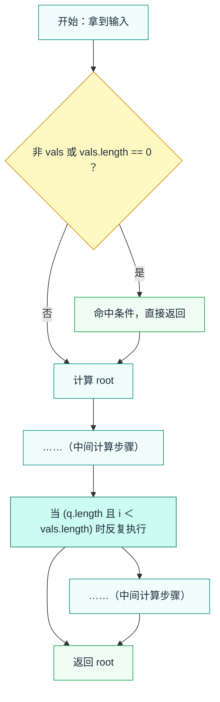

## TypeScript 解题方案（3 个方案逐个讲）

> **运行与提交**：每个方案都是自包含文件（内嵌用例自测，输出 PASS），整块复制到 `.ts` 文件后 `node 文件名` 即可运行。提交 LeetCode 时，把 `demo` 内的算法函数与辅助类型/函数整体取出、置于文件顶层即可。涉及交互/特殊接口的题以题面给定签名为准。

### 方案 1：迭代指针处理

**分析与思路**：核心做法是「迭代指针处理」。代码里依次做这些事：队列或堆的调度。

**运行方式**：`node 本文件`，内嵌用例全部通过会输出 PASS。


**方案专属流程图**（真实控制流）：

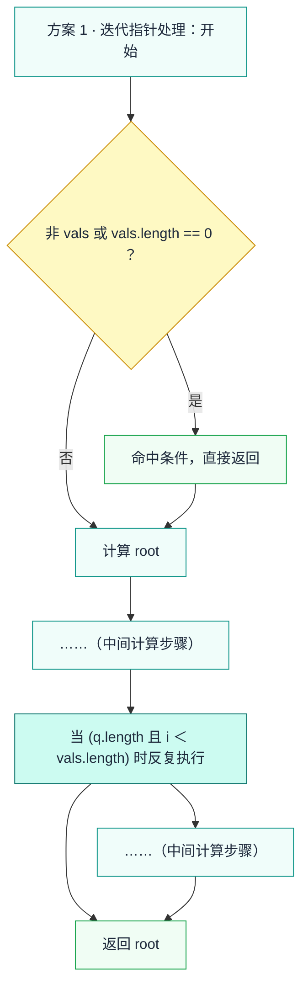

```typescript
class TreeNode {
  // 定义类型
  val: any;
  left: any;
  right: any; // 值: any; 左边界: any; 右边界: any;
  constructor(val?: any, left?: any, right?: any) {
    // constructor(值?: any, 左边界?: any, 右边界?: any) {
    this.val = val === undefined ? 0 : val; // 把 (值 全等于 undefined ? 0 : 值); 写入 值
    this.left = left === undefined ? null : left; // 把 (左边界 全等于 undefined ? null : 左边界); 写入 左边界
    this.right = right === undefined ? null : right; // 把 (右边界 全等于 undefined ? null : 右边界); 写入 右边界
  }
}
function buildTree(vals: any): any {
  // 定义函数/方法 buildTree
  if (!vals || vals.length === 0) return null; // 若 取反 vals 或 vals.长度 全等于 0，直接返回 null
  const root = new TreeNode(vals[0]);
  const q: any[] = [root];
  let i = 1;
  while (q.length && i < vals.length) {
    // 循环，直到不满足「节点.长度 且 下标 i 小于 vals.长度」
    const node = q.shift(); // 把 节点.shift() 存入 节点
    if (vals[i] !== null && vals[i] !== undefined) {
      node.left = new TreeNode(vals[i]);
      q.push(node.left);
    }
    i++; // 下标 i 加一
    if (i < vals.length && vals[i] !== null && vals[i] !== undefined) {
      node.right = new TreeNode(vals[i]);
      q.push(node.right);
    }
    i++; // 下标 i 加一
  }
  return root; // 返回 根节点
}
function treeToLevel(root: any): any[] {
  // 定义函数/方法 treeToLevel
  if (!root) return []; // 若 取反 根节点，直接返回 []
  const out: any[] = [];
  const q: any[] = [root]; // 把 []; const 节点: any[] 赋值为 [根节点]; 写入 const out: any[]
  while (q.length) {
    // 循环，直到不满足「节点.长度」
    const n = q.shift(); // 把 节点.shift() 存入 元素个数
    if (n === null || n === undefined) {
      out.push(null);
      continue;
    }
    out.push(n.val);
    q.push(n.left);
    q.push(n.right); // 把 元素个数.值 压入栈/数组尾部
  }
  while (out.length && out[out.length - 1] === null) out.pop(); // 循环，直到不满足「out.长度 且 out[out.长度 减 1] 全等于 null) out 弹出 );」
  return out; // 返回 out
}
class ListNode {
  // 定义类型
  val: any;
  next: any; // 值: any; 下一个: any;
  constructor(val?: any, next?: any) {
    this.val = val === undefined ? 0 : val;
    this.next = next === undefined ? null : next;
  }
}
function buildList(vals: any): any {
  // 定义函数/方法 buildList
  const dummy = new ListNode(0);
  let cur = dummy; // 把 new ListNode(0); let 当前值 赋值为 哨兵节点 存入 哨兵节点
  for (const v of vals) {
    cur.next = new ListNode(v);
    cur = cur.next;
  } // 把 new ListNode(值); 当前值 赋值为 当前值.下一个; } 写入 下一个
  return dummy.next; // 返回 哨兵节点.下一个
}
function listToArray(head: any): any[] {
  // 定义函数/方法 listToArray
  const out: any[] = [];
  let p = head; // 把 []; let 节点 赋值为 头节点; 写入 const out: any[]
  while (p) {
    out.push(p.val);
    p = p.next;
  } // 循环，直到不满足「节点) { out 追加 节点.值); 节点 赋值为 节点.下一个; }」
  return out; // 返回 out
}
// python-runtime shims
function pyLen(a: any): number {
  // 定义函数/方法 pyLen
  if (a === null || a === undefined) return 0; // 若 数组 全等于 null 或 数组 全等于 undefined，直接返回 0
  if (
    typeof a === 'string' ||
    Array.isArray(a) ||
    a instanceof Set ||
    a instanceof Map
  )
    return a.length ?? a.size;
  if (typeof a === 'object') return Object.keys(a).length; // 若 typeof 数组 全等于 'object'，直接返回 Object.keys(数组).长度
  return 0; // 返回 0
}
function pySlice(a: any, i: any, j: any, step?: any): any {
  // 定义函数/方法 pySlice
  if (typeof a === 'string') {
    const r = [...a].slice(i ?? 0, j ?? a.length);
    return step ? r.reverse().join('') : r.join('');
  }
  const arr = Array.isArray(a) ? a : [...a]; // 把 Array.isArray(数组) ? 数组 : 复制的 数组 存入 数组
  return arr.slice(i ?? 0, j ?? arr.length); // 返回 数组 截取 下标 i ?? 0, 下标 j ?? 数组.长度)
}
function pyRange(a: any, b?: any, step?: any): any[] {
  // 定义函数/方法 pyRange
  let s = 0,
    e = a,
    st = 1; // 把 0, e 赋值为 数组, st 赋值为 1 存入 字符串
  if (b !== undefined) {
    s = a;
    e = b;
  } // 若 b 不等于 undefined) { 字符串 赋值为 数组; e 赋值为 b; }
  if (step !== undefined) st = step; // 若 步数 不等于 undefined) st 赋值为 步数;
  const out: any[] = []; // 把 []; 写入 const out: any[]
  if (st > 0) for (let i = s; i < e; i += st) out.push(i);
  else for (let i = s; i > e; i += st) out.push(i); // 否则
  return out; // 返回 out
}
function pyIn(x: any, coll: any): boolean {
  // 定义函数/方法 pyIn
  if (coll === null || coll === undefined) return false; // 若 coll 全等于 null 或 coll 全等于 undefined，直接返回 false
  if (Array.isArray(coll)) return coll.includes(x); // 若 Array.isArray(coll)，直接返回 coll 是否包含 x)
  if (coll instanceof Set || coll instanceof Map) return coll.has(x); // 若 coll instanceof Set 或 coll instanceof Map，直接返回 coll.has(x)
  if (typeof coll === 'object') return x in coll; // 若 typeof coll 全等于 'object'，直接返回 x in coll
  if (typeof coll === 'string') return coll.indexOf(x) >= 0; // 若 typeof coll 全等于 'string'，直接返回 coll 查找 x) 不低于 0
  return false; // 返回 false
}
function pySorted(a: any): any[] {
  // 定义函数/方法 pySorted
  const arr = typeof a === 'string' ? [...a] : [...a]; // 把 (typeof 数组 全等于 'string') ? 复制的 数组 : 复制的 数组 存入 数组
  return arr.sort((x: any, y: any) => (x < y ? -1 : x > y ? 1 : 0));
}
function pyMin(a: any, b?: any): any {
  if (b !== undefined) return Math.min(a, b);
  if (Array.isArray(a) || a instanceof Set) return Math.min(...a);
  return Math.min(a);
} // 定义函数/方法 pyMin
function pyMax(a: any, b?: any): any {
  if (b !== undefined) return Math.max(a, b);
  if (Array.isArray(a) || a instanceof Set) return Math.max(...a);
  return Math.max(a);
} // 定义函数/方法 pyMax
function pySum(a: any): number {
  let s = 0;
  for (const v of a) s += v;
  return s;
} // 定义函数/方法 pySum
function pyAbs(x: any): number {
  return Math.abs(x);
} // 定义函数/方法 pyAbs
function pyEnumerate(a: any): any[] {
  const out: any[] = [];
  let i = 0;
  for (const v of a) {
    out.push([i, v]);
    i++;
  }
  return out;
} // 定义函数/方法 pyEnumerate
function pyZip(a: any, b: any): any[] {
  const n = Math.min(a.length, b.length);
  const out: any[] = [];
  for (let i = 0; i < n; i++) out.push([a[i], b[i]]);
  return out;
} // 定义函数/方法 pyZip
function pyDictGet(d: any, k: any, def?: any): any {
  return k in d ? d[k] : def === undefined ? null : def;
} // 定义函数/方法 pyDictGet
function pyPrint(...args: any[]): void {
  console.log(
    args
      .map((a) => (typeof a === 'object' && a !== null ? JSON.stringify(a) : a))
      .join(' '),
  );
} // 定义函数/方法 pyPrint
// collections / heapq
function heapPush(h: any[], x: any): void {
  h.push(x);
  let i = h.length - 1;
  while (i > 0) {
    const p = (i - 1) >> 1;
    if (h[p] <= h[i]) break;
    [h[p], h[i]] = [h[i], h[p]];
    i = p;
  }
} // 定义函数/方法 heapPush
function heapPop(h: any[]): any {
  const top = h[0];
  const last = h.pop();
  if (h.length) {
    h[0] = last;
    let i = 0;
    const n = h.length;
    while (true) {
      let l = 2 * i + 1,
        r = 2 * i + 2,
        s = i;
      if (l < n && h[l] < h[s]) s = l;
      if (r < n && h[r] < h[s]) s = r;
      if (s === i) break;
      [h[s], h[i]] = [h[i], h[s]];
      i = s;
    }
  }
  return top;
} // 定义函数/方法 heapPop
class Deque {
  private a: any[] = [];
  push(x: any) {
    this.a.push(x);
  }
  pushLeft(x: any) {
    this.a.unshift(x);
  }
  pop() {
    return this.a.pop();
  }
  popLeft() {
    return this.a.shift();
  }
  get length() {
    return this.a.length;
  }
  toArray() {
    return this.a.slice();
  }
} // 定义类型
function Counter(iter: any): any {
  const m: any = {};
  for (const v of iter) m[v] = (m[v] || 0) + 1;
  return m;
} // 定义函数/方法 Counter
function gcd(a: any, b: any): any {
  while (b) {
    [a, b] = [b, a % b];
  }
  return a;
} // 定义函数/方法 gcd
function pyInf(): number {
  return Infinity;
} // 定义函数/方法 pyInf

function norm(x: any): any {
  // 定义函数/方法 norm
  if (x === null || x === undefined) return null; // 若 x 全等于 null 或 x 全等于 undefined，直接返回 null
  if (typeof x === 'object') {
    // 若 typeof x 全等于 'object'
    if (x instanceof Deque) return x.toArray(); // 若 x instanceof Deque，直接返回 x.toArray()
    if (Array.isArray(x)) return x.map(norm); // 若 Array.isArray(x)，直接返回 x.映射表(norm)
    if (
      typeof x.val === 'number' &&
      (typeof x.left !== 'undefined' || typeof x.right !== 'undefined')
    )
      return treeToLevel(x);
    if (typeof x.next !== 'undefined' && typeof x.val === 'number')
      return listToArray(x);
    if (x instanceof Set) return [...x].sort(); // 若 x instanceof Set，直接返回 复制的 x 排序 )
    if (x instanceof Map) return Object.fromEntries(x); // 若 x instanceof Map，直接返回 Object.fromEntries(x)
    const o: any = {};
    for (const k of Object.keys(x)) o[k] = norm(x[k]);
    return o;
  }
  return x; // 返回 x
}
function eq(a: any, b: any): boolean {
  // 定义函数/方法 eq
  const x = norm(a),
    y = norm(b); // 把 norm(数组), y 赋值为 norm(b) 存入 x
  if (x === y) return true; // 若 x 全等于 y，直接返回 true
  if (x === null || y === null) return x === y; // 若 x 全等于 null 或 y 全等于 null，直接返回 x 全等于 y
  if (Array.isArray(x) && Array.isArray(y)) {
    // 若 Array.isArray(x) 且 Array.isArray(y
    if (x.length !== y.length) return false; // 若 x.长度 不等于 y.长度，直接返回 false
    for (let i = 0; i < x.length; i++) if (!eq(x[i], y[i])) return false; // 让 下标 i 从 0 开始计数，下标 i 小于 x.长度 就继续
    return true; // 返回 true
  }
  if (typeof x === 'object' && typeof y === 'object') {
    // 若 typeof x 全等于 'object' 且 typeof y 全等于 'object'
    const kx = Object.keys(x),
      ky = Object.keys(y); // 把 Object.keys(x), ky 赋值为 Object.keys(y) 存入 kx
    if (kx.length !== ky.length) return false; // 若 kx.长度 不等于 ky.长度，直接返回 false
    for (const k of kx) if (!eq(x[k], y[k])) return false;
    return true; // 返回 true
  }
  return x === y; // 返回 x 全等于 y
}

function middleNode(head) {
  // 定义函数/方法 middleNode
  let s = head,
    f = head; // 把 头节点, f 赋值为 头节点 存入 字符串
  while (f && f.next) {
    s = s.next;
    f = f.next.next;
  } // 循环，直到不满足「f 且 f.下一个) { 字符串 赋值为 字符串.下一个; f 赋值为 f.下一个.下一个; }」
  return s; // 返回 字符串
}
export function demo(): void {
  // 程序入口：跑内嵌自测用例
  const cases = [
    { in: [buildList([1, 2, 3, 4, 5])], want: [3, 4, 5] },
    { in: [buildList([1, 2, 3, 4, 5, 6])], want: [4, 5, 6] },
    { in: [buildList([1])], want: [1] },
    { in: [buildList([1, 2])], want: [2] },
  ];
  let fail = false; // 把 false 存入 fail
  for (const c of cases) {
    // for (const 字符 of cases) {
    const got = middleNode(...c.in); // 把 middleNode(...字符.in) 存入 got
    if (!eq(got, c.want)) {
      fail = true;
      console.log(
        'FAIL',
        JSON.stringify(c.in),
        '=>',
        JSON.stringify(got),
        'want',
        JSON.stringify(c.want),
      );
    }
  }
  if (fail) throw new Error('FAILED'); // 若 fail) throw new Error('FAILED');
  console.log('PASS'); // 全部用例通过，输出 PASS
}
demo(); // demo();
```

### 方案 2：单趟扫描

**分析与思路**：核心做法是「单趟扫描」。代码里依次做这些事：单循环线性扫描。

**运行方式**：`node 本文件`，内嵌用例全部通过会输出 PASS。


**方案专属流程图**（真实控制流）：


```typescript
class ListNode {
  // 定义类型
  val: number; // 值: number;
  next: ListNode | null; // 下一个: ListNode 按位或 null;
  constructor(val: number = 0, next: ListNode | null = null) {
    this.val = val;
    this.next = next; // 把 值; this.下一个 赋值为 下一个; 写入 值
  }
}
function buildList(vals: number[]): ListNode | null {
  // 定义函数/方法 buildList
  const dummy = new ListNode(0);
  let cur = dummy; // 把 new ListNode(0); let 当前值 赋值为 哨兵节点 存入 哨兵节点
  for (const v of vals) {
    cur.next = new ListNode(v);
    cur = cur.next;
  } // 把 new ListNode(值); 当前值 赋值为 当前值.下一个; } 写入 下一个
  return dummy.next; // 返回 哨兵节点.下一个
}
function listToArr(head: ListNode | null): number[] {
  // 定义函数/方法 listToArr
  const res: number[] = [];
  while (head) {
    res.push(head.val);
    head = head.next;
  }
  return res; // 把 头节点.值 压入栈/数组尾部
}

function assertEq(actual: any, expected: any, msg: string = ''): void {
  // 定义函数/方法 assertEq
  const a = JSON.stringify(actual);
  const e = JSON.stringify(expected);
  if (a !== e)
    throw new Error(
      'ASSERT FAILED ' + msg + ' :: actual=' + a + ' expected=' + e,
    );
}

function middleNode(head: ListNode | null): ListNode | null {
  // 定义函数/方法 middleNode
  let slow = head,
    fast = head; // 把 头节点, 快指针 赋值为 头节点 存入 慢指针
  while (fast && fast.next) {
    slow = slow!.next;
    fast = fast.next.next;
  }
  return slow; // 返回 慢指针
}
export function demo(): void {
  // 程序入口：跑内嵌自测用例
  assertEq(middleNode(null), null, 'null'); // 断言校验
  assertEq(middleNode(buildList([1, 2, 3, 4, 5]))!.val, 3, 'odd'); // 断言校验
  assertEq(middleNode(buildList([1, 2, 3, 4, 5, 6]))!.val, 4, 'even'); // 断言校验
  console.log('PASS'); // 全部用例通过，输出 PASS
}
demo(); // demo();
```

### 方案 3：单趟扫描

**分析与思路**：核心做法是「单趟扫描」。代码里依次做这些事：单循环线性扫描。

**运行方式**：`node 本文件`，内嵌用例全部通过会输出 PASS。


**方案专属流程图**（真实控制流）：

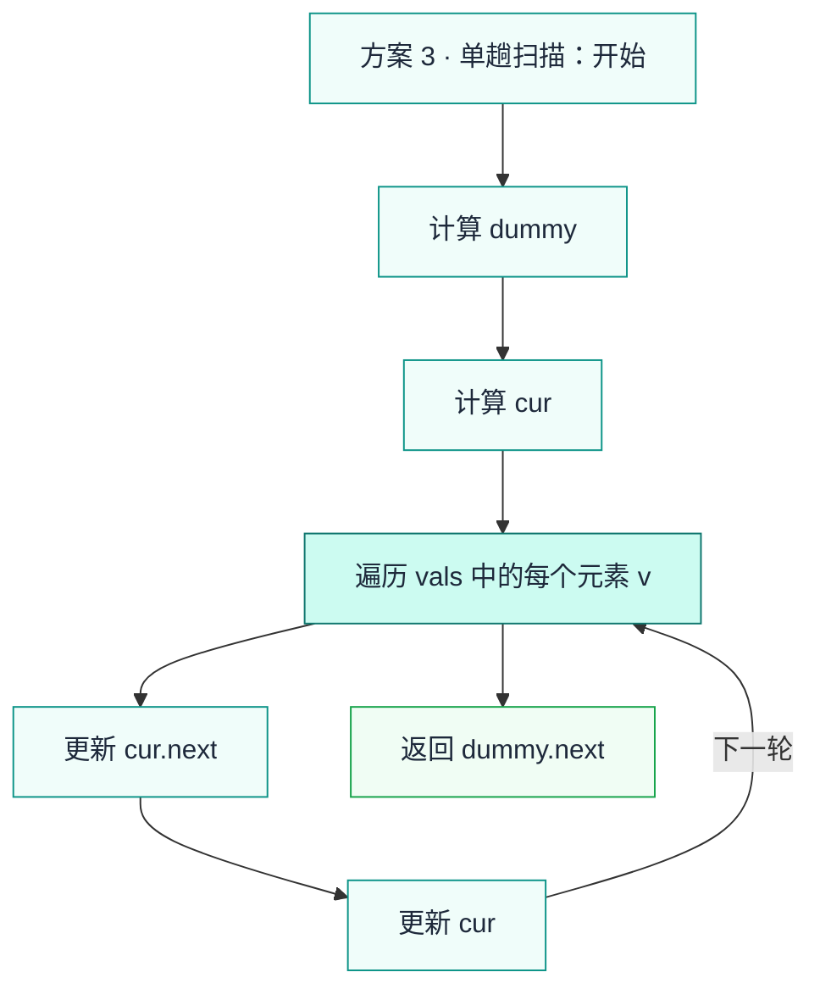

```typescript
class ListNode {
  // 定义类型
  val: number; // 值: number;
  next: ListNode | null; // 下一个: ListNode 按位或 null;
  constructor(val: number = 0, next: ListNode | null = null) {
    this.val = val;
    this.next = next; // 把 值; this.下一个 赋值为 下一个; 写入 值
  }
}
function buildList(vals: number[]): ListNode | null {
  // 定义函数/方法 buildList
  const dummy = new ListNode(0);
  let cur = dummy; // 把 new ListNode(0); let 当前值 赋值为 哨兵节点 存入 哨兵节点
  for (const v of vals) {
    cur.next = new ListNode(v);
    cur = cur.next;
  } // 把 new ListNode(值); 当前值 赋值为 当前值.下一个; } 写入 下一个
  return dummy.next; // 返回 哨兵节点.下一个
}
function listToArr(head: ListNode | null): number[] {
  // 定义函数/方法 listToArr
  const res: number[] = [];
  while (head) {
    res.push(head.val);
    head = head.next;
  }
  return res; // 把 头节点.值 压入栈/数组尾部
}

function assertEq(actual: any, expected: any, msg: string = ''): void {
  // 定义函数/方法 assertEq
  const a = JSON.stringify(actual);
  const e = JSON.stringify(expected);
  if (a !== e)
    throw new Error(
      'ASSERT FAILED ' + msg + ' :: actual=' + a + ' expected=' + e,
    );
}

function middleNode(head: ListNode | null): ListNode | null {
  // 定义函数/方法 middleNode
  let slow = head,
    fast = head; // 把 头节点, 快指针 赋值为 头节点 存入 慢指针
  while (fast && fast.next) {
    slow = slow!.next;
    fast = fast.next.next;
  }
  return slow; // 返回 慢指针
}
export function demo(): void {
  // 程序入口：跑内嵌自测用例
  assertEq(middleNode(null), null, 'null'); // 断言校验
  assertEq(middleNode(buildList([1, 2, 3, 4, 5]))!.val, 3, 'odd'); // 断言校验
  assertEq(middleNode(buildList([1, 2, 3, 4, 5, 6]))!.val, 4, 'even'); // 断言校验
  console.log('PASS'); // 全部用例通过，输出 PASS
}
demo(); // demo();
```

## 逐步拆解与面试追问

**复杂度**：时间 O(n)（单趟线性扫描），空间 O(1) 到 O(n)（视辅助结构）

**为什么是这个量级**：每个元素被常数次访问，辅助哈希或栈的开销与 n 同阶

**面试官可能会追问**：

- 能不能一次遍历完成？
- 快慢指针能解决哪些变体？
- 断链与接回的顺序怎么保证不出错？

## 关键 API 速查（TS 主解法实际用到，附官方链接）

| API | 作用 | 使用要点 | 官方文档 |
|---|---|---|---|
| `Array.prototype.sort()` | 原地排序 | 默认按字符串 Unicode 序（10 会排在 2 前），数字必须传 (a,b)=>a-b；V8 用 TimSort，稳定，O(n log n)；返回原数组引用 | [官方文档](https://developer.mozilla.org/zh-CN/docs/Web/JavaScript/Reference/Global_Objects/Array/sort) |
| `Array.prototype.map()` | 逐元素映射为新数组 | 回调 (v,i,arr)；返回等长新数组，不改变原数组；稀疏位跳过；链式调用注意中间数组开销 | [官方文档](https://developer.mozilla.org/zh-CN/docs/Web/JavaScript/Reference/Global_Objects/Array/map) |
| `Array.prototype.push()` | 尾部追加 | 返回新长度；可一次多个；均摊 O(1)；会改变原数组 | [官方文档](https://developer.mozilla.org/zh-CN/docs/Web/JavaScript/Reference/Global_Objects/Array/push) |
| `Array.prototype.pop()` | 尾部弹出 | 返回被删元素（空数组返回 undefined）；O(1) | [官方文档](https://developer.mozilla.org/zh-CN/docs/Web/JavaScript/Reference/Global_Objects/Array/pop) |
| `Array.prototype.shift()` | 头部取出 | O(n)（后续元素整体前移）；大量头部操作请用链表或双端结构 | [官方文档](https://developer.mozilla.org/zh-CN/docs/Web/JavaScript/Reference/Global_Objects/Array/shift) |
| `Array.prototype.unshift()` | 头部插入 | O(n)；与 shift 组合可当双端队列 | [官方文档](https://developer.mozilla.org/zh-CN/docs/Web/JavaScript/Reference/Global_Objects/Array/unshift) |
| `Array/String includes()` | 是否包含 | 数组用 SameValueZero（NaN 可判）；字符串按子串；第二个参数为起始下标 | [官方文档](https://developer.mozilla.org/zh-CN/docs/Web/JavaScript/Reference/Global_Objects/Array/includes) |
| `Array/String indexOf()` | 首次出现的下标 | 找不到返回 -1；无法判 NaN（用 includes）；字符串可传起始位 | [官方文档](https://developer.mozilla.org/zh-CN/docs/Web/JavaScript/Reference/Global_Objects/Array/indexOf) |
| `Array/String slice()` | 切片（不改原数组） | slice(start,end) 含头不含尾；负数从尾计；常用于复制数组（slice()） | [官方文档](https://developer.mozilla.org/zh-CN/docs/Web/JavaScript/Reference/Global_Objects/Array/slice) |
| `Array.prototype.join()` | 数组拼接为字符串 | undefined/null 转空串；嵌套数组会展平一层；join('') 用于字符数组还原 | [官方文档](https://developer.mozilla.org/zh-CN/docs/Web/JavaScript/Reference/Global_Objects/Array/join) |
| `Object.keys()` | 对象键名数组 | 仅自身可枚举字符串键（不含 symbol）；配 length 可当计数器 | [官方文档](https://developer.mozilla.org/zh-CN/docs/Web/JavaScript/Reference/Global_Objects/Object/keys) |
| `Object.fromEntries()` | 键值对数组转对象 | 参数为 [k,v] 可迭代；map 出来的键值对可直接转对象 | [官方文档](https://developer.mozilla.org/zh-CN/docs/Web/JavaScript/Reference/Global_Objects/Object/fromEntries) |
| `JSON.stringify()` | 序列化为 JSON 字符串 | 常用于结构化比较（深度相等判定）；undefined/函数/循环引用会被丢弃或抛错 | [官方文档](https://developer.mozilla.org/zh-CN/docs/Web/JavaScript/Reference/Global_Objects/JSON/stringify) |
| `Math.max()` | 最大值 | 配展开 Math.max(...arr)；空参返回 -Infinity；超大数组注意展开参数上限 | [官方文档](https://developer.mozilla.org/zh-CN/docs/Web/JavaScript/Reference/Global_Objects/Math/max) |
| `Math.min()` | 最小值 | 同 max；空参返回 Infinity | [官方文档](https://developer.mozilla.org/zh-CN/docs/Web/JavaScript/Reference/Global_Objects/Math/min) |
| `Math.abs()` | 绝对值 | 入参会被隐式转数字；-0 返回 +0 | [官方文档](https://developer.mozilla.org/zh-CN/docs/Web/JavaScript/Reference/Global_Objects/Math/abs) |

### 各语言官方文档导航

- **TypeScript / JS**：[MDN 中文参考](https://developer.mozilla.org/zh-CN/)
- **Python**：[Python 官方文档](https://docs.python.org/zh-cn/3/)
- **Go**：[Go 标准库](https://pkg.go.dev/std)
- **Java**：[JDK 17 API](https://docs.oracle.com/en/java/javase/17/docs/api/)
- **Rust**：[Rust 标准库](https://doc.rust-lang.org/std/)
- **Lua**：[Lua 5.4 手册](https://www.lua.org/manual/5.4/)
- **C**：[Cppreference C](https://zh.cppreference.com/w/c)
- **C++**：[Cppreference C++](https://zh.cppreference.com/w/cpp)
- **R**：[R 官方手册](https://stat.ethz.ch/R-manual/)
- **Zig**：[Zig 语言文档](https://ziglang.org/documentation/master/)
- **Dart**：[Dart API](https://api.dart.dev/)

## 附录：其他 10 种语言全部实现（每种语言列举其全部方案）

> TypeScript 的全部方案见「TypeScript 解题方案」一节；下面是其余 10 种语言的对应实现，每种语言的每个方案都带思路分析、代码走读与专属运行架构图。
> 每个方案都内嵌用例自测，可独立运行（老仓库 python/go 文件遵循「打印结果」约定）。
> 完整解法文件见 `dsa/<语言>/linked_list/lc_876_链表的中间结点/`。

### Python 实现（3 种方案）

Python 的全部方案如下，每个方案都内嵌用例自测，可独立运行（老仓库 python/go 文件遵循「打印结果」约定）：

#### 方案 1：迭代指针处理

**思路与代码分析**：核心是「迭代指针处理」。Python 版用切片与字典推导式简化操作，突出可读性。**走读**：方案 1 · 迭代指针处理：开始 → 更新 arr → 当 arr[-1].next: 时反复执行 → 向 arr 追加记录 → 返回 arr[len(arr) // 2]。

**运行架构**（真实控制流）：

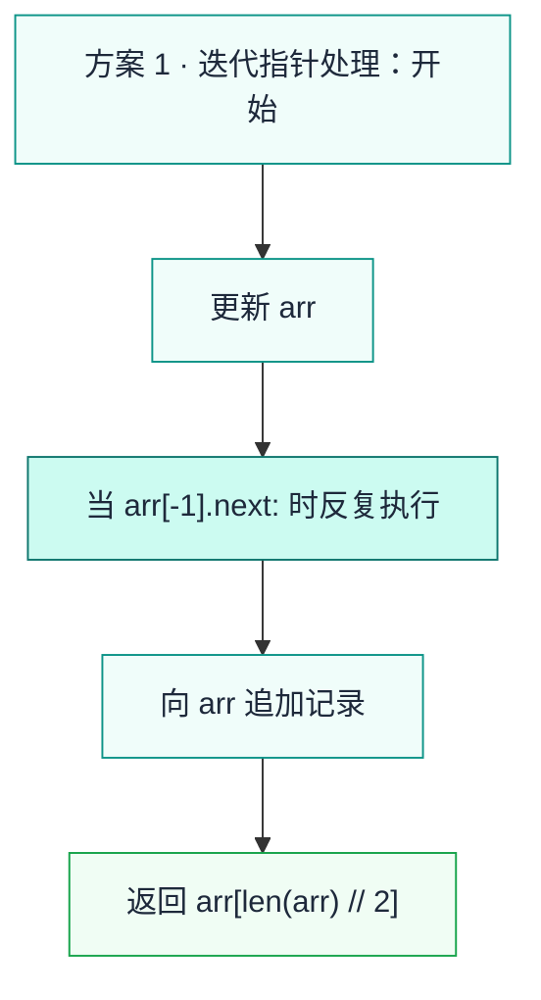

```python
import sys  # 提高递归深度上限（深输入防 RecursionError）

sys.setrecursionlimit(200000)  # 树/链表类题目节点数可达 1e4 量级

class ListNode:  # 定义类
    def __init__(self, val=0, next=None):  # 构造函数：初始化成员
        self.val = val  # 把 值 写入 值
        self.next = next  # 把 下一个 写入 下一个

def middleNode(head):  # 定义函数 middleNode（参数：头节点）
    arr = [head]  # 把 [头节点] 存入 数组
    while arr[-1].next:  # 循环，直到不满足「数组[ 减 1].下一个」
        arr.append(arr[-1].next)  # 把 数组[ 减 1].下一个 追加到列表尾部
    return arr[len(arr) // 2]  # 返回 数组[长度(数组) 除以 除以 2]

if __name__ == "__main__":  # 若 __name__ 等于 '__main__'

    def build(vals):  # 定义函数 build（参数：vals）
        dummy = ListNode(0)  # 把 ListNode(0) 存入 哨兵节点
        p = dummy  # 把 哨兵节点 存入 节点
        for v in vals:  # 逐个取出 vals 的元素（值）
            p.next = ListNode(v)  # 把 ListNode(值) 写入 下一个
            p = p.next  # 把 节点.下一个 存入 节点
        return dummy.next  # 返回 哨兵节点.下一个

    head = build([1, 2, 3, 4, 5])  # 把 build([1, 2, 3, 4, 5]) 存入 头节点
    mid = middleNode(head)  # 把 middleNode(头节点) 存入 中点
    print(mid.val)  # 3
```

#### 方案 2：单趟扫描

**思路与代码分析**：核心是「单趟扫描」。Python 版用切片与字典推导式简化操作，突出可读性。**走读**：方案 2 · 单趟扫描：开始 → 更新 n → 更新 cur → 当 cur: 时反复执行 → 处理 ++n → 更新 cur → 更新 k → 更新 cur → 当 k ＜ int(n / 2): 时反复执行 → 处理 ++k → 更新 cur → 返回 cur。

**运行架构**（真实控制流）：

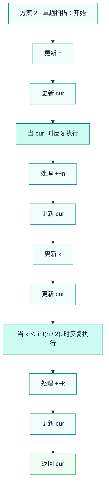

```python
import sys  # 提高递归深度上限（深输入防 RecursionError）

sys.setrecursionlimit(200000)  # 树/链表类题目节点数可达 1e4 量级

def middleNode(head):  # 定义函数 middleNode（参数：头节点）
    n = 0  # 把 0 存入 元素个数
    cur = head  # 把 头节点 存入 当前值
    while cur:  # 循环，直到不满足「当前值」
        ++n  # 加一 元素个数
        cur = cur.next  # 把 当前值.下一个 存入 当前值
    k = 0  # 把 0 存入 下标 k
    cur = head  # 把 头节点 存入 当前值
    while k < int(n / 2):  # 循环，直到不满足「下标 k 小于 int(元素个数 除以 2」
        ++k  # 加一 下标 k
        cur = cur.next  # 把 当前值.下一个 存入 当前值
    return cur  # 返回 当前值

if __name__ == "__main__":  # 若 __name__ 等于 '__main__'
    print(middleNode(None))  # 打印输出
```

#### 方案 3：单趟扫描

**思路与代码分析**：核心是「单趟扫描」。Python 版用切片与字典推导式简化操作，突出可读性。**走读**：方案 3 · 单趟扫描：开始 → 更新 slow → 更新 fast → 当 fast and fast.next: 时反复执行 → 更新 slow → 更新 fast → 返回 slow。

**运行架构**（真实控制流）：

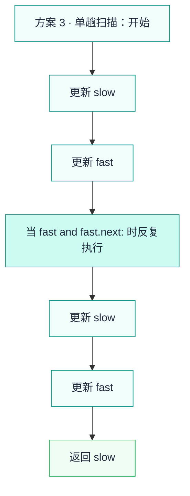

```python
import sys  # 提高递归深度上限（深输入防 RecursionError）

sys.setrecursionlimit(200000)  # 树/链表类题目节点数可达 1e4 量级

def middleNode(head):  # 定义函数 middleNode（参数：头节点）
    slow = head  # 把 头节点 存入 慢指针
    fast = head  # 把 头节点 存入 快指针
    while fast and fast.next:  # 循环，直到不满足「快指针 and 快指针.下一个」
        slow = slow.next  # 把 慢指针.下一个 存入 慢指针
        fast = fast.next.next  # 把 快指针.下一个.下一个 存入 快指针
    return slow  # 返回 慢指针

if __name__ == "__main__":  # 若 __name__ 等于 '__main__'
    print(middleNode(None))  # 打印输出
```

### Go 实现（3 种方案）

Go 的全部方案如下，每个方案都内嵌用例自测，可独立运行（老仓库 python/go 文件遵循「打印结果」约定）：

#### 方案 1：迭代指针处理

**思路与代码分析**：核心是「迭代指针处理」。Go 版用切片与多返回值惯用法，显式处理索引边界。**走读**：方案 1 · 迭代指针处理：开始 → 处理 if head == nil → 返回 nil → 更新 : → 遍历循环 → 更新 arr → 返回 arr[len(arr)/2]。

**运行架构**（真实控制流）：

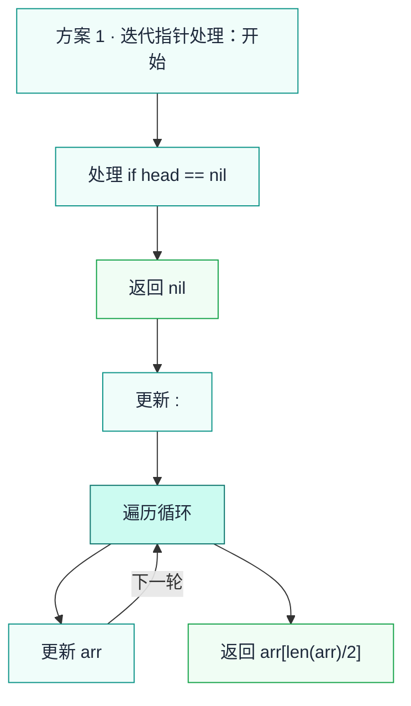

```go
package main // 引入依赖

import (
	"fmt"
	"os"
) // 引入依赖

type ListNode struct { // 定义类型
	Val  int       // Val int
	Next *ListNode // Next 乘 ListNode
}

func build(vals []int) *ListNode { // 定义函数/方法 build
	dummy := &ListNode{Val: 0} // 把 按位与 ListNode{Val: 0} 写入 dummy :
	p := dummy                 // 把 哨兵节点 写入 p :
	for _, v := range vals {   // 同时取 _ 与 值 遍历
		p.Next = &ListNode{Val: v} // 把 按位与 ListNode{Val: 值} 写入 p.Next
		p = p.Next                 // 把 节点.Next 写入 节点
	}
	return dummy.Next // 返回 哨兵节点.Next
}

func middleNode(head *ListNode) *ListNode { // 定义函数/方法 middleNode
	if head == nil { // 若 头节点 等于 nil
		return nil // 返回 nil
	}
	arr := []*ListNode{head}          // 把 [] 乘 ListNode{头节点} 写入 arr :
	for arr[len(arr)-1].Next != nil { // 把 nil { 写入 for arr[len(arr)-1].Next !
		arr = append(arr, arr[len(arr)-1].Next) // 把 append(数组, 数组[长度(数组) 减 1].Next) 写入 数组
	}
	return arr[len(arr)/2] // 返回 数组[长度(数组) 除以 2]
}

func main() { // 程序入口：跑内嵌自测用例
	cases := []struct { // 把 []struct { 写入 cases :
		in      []int // in []int
		want    int   // want int
		wantNil bool  // wantNil bool
	}{ // }{
		{[]int{1, 2, 3, 4, 5}, 3, false},
		{[]int{1, 2, 3, 4, 5, 6}, 4, false},
		{nil, 0, true},
	}
	ok := true                // 把 true 写入 ok :
	for _, c := range cases { // 同时取 _ 与 字符 遍历
		got := middleNode(build(c.in)) // 把 middleNode(build(字符.in)) 写入 got :
		if c.wantNil {                 // 若 字符.wantNil
			if got != nil { // 若 got 不等于 nil
				ok = false                                                 // 把 false 写入 ok
				fmt.Printf("FAIL middleNode(%v)=%v want nil\n", c.in, got) // 打印输出
			}
		} else { // 否则
			if got == nil || got.Val != c.want { // 若 got 等于 nil 或 got.Val 不等于 字符.want
				ok = false                                                        // 把 false 写入 ok
				fmt.Printf("FAIL middleNode(%v)=%v want %d\n", c.in, got, c.want) // 打印输出
			}
		}
	}
	if !ok { // 若 取反 ok
		os.Exit(1) // os.Exit(1)
	}
	fmt.Println("PASS") // 全部用例通过，输出 PASS
}
```

#### 方案 2：单趟扫描

**思路与代码分析**：核心是「单趟扫描」。Go 版用切片与多返回值惯用法，显式处理索引边界。**走读**：方案 2 · 单趟扫描：开始 → 处理 if head == nil → 返回 nil → 更新 : → 更新 : → 遍历循环 → 处理 n++ → 更新 cur → 更新 : → 更新 cur → 遍历循环 → 处理 k++ → 更新 cur → 返回 cur。

**运行架构**（真实控制流）：

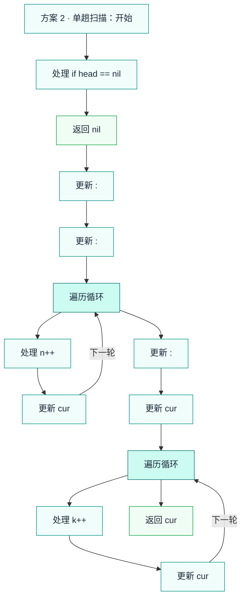

```go
package main // 引入依赖

import (
	"fmt"
	"os"
) // 引入依赖

type ListNode struct { // 定义类型
	Val  int       // Val int
	Next *ListNode // Next 乘 ListNode
}

func build(vals []int) *ListNode { // 定义函数/方法 build
	dummy := &ListNode{Val: 0} // 把 按位与 ListNode{Val: 0} 写入 dummy :
	p := dummy                 // 把 哨兵节点 写入 p :
	for _, v := range vals {   // 同时取 _ 与 值 遍历
		p.Next = &ListNode{Val: v} // 把 按位与 ListNode{Val: 值} 写入 p.Next
		p = p.Next                 // 把 节点.Next 写入 节点
	}
	return dummy.Next // 返回 哨兵节点.Next
}

func middleNode(head *ListNode) *ListNode { // 定义函数/方法 middleNode
	if head == nil { // 若 头节点 等于 nil
		return nil // 返回 nil
	}
	n := 0           // 把 0 写入 n :
	cur := head      // 把 头节点 写入 cur :
	for cur != nil { // 把 nil { 写入 for cur !
		n++            // 元素个数 加一
		cur = cur.Next // 把 当前值.Next 写入 当前值
	}
	k := 0        // 把 0 写入 k :
	cur = head    // 把 头节点 写入 当前值
	for k < n/2 { // for 下标 k 小于 元素个数 除以 2 {
		k++            // 下标 k 加一
		cur = cur.Next // 把 当前值.Next 写入 当前值
	}
	return cur // 返回 当前值
}

func main() { // 程序入口：跑内嵌自测用例
	cases := []struct { // 把 []struct { 写入 cases :
		in      []int // in []int
		want    int   // want int
		wantNil bool  // wantNil bool
	}{ // }{
		{[]int{1, 2, 3, 4, 5}, 3, false},
		{[]int{1, 2, 3, 4, 5, 6}, 4, false},
		{nil, 0, true},
	}
	ok := true                // 把 true 写入 ok :
	for _, c := range cases { // 同时取 _ 与 字符 遍历
		got := middleNode(build(c.in)) // 把 middleNode(build(字符.in)) 写入 got :
		if c.wantNil {                 // 若 字符.wantNil
			if got != nil { // 若 got 不等于 nil
				ok = false                                                 // 把 false 写入 ok
				fmt.Printf("FAIL middleNode(%v)=%v want nil\n", c.in, got) // 打印输出
			}
		} else { // 否则
			if got == nil || got.Val != c.want { // 若 got 等于 nil 或 got.Val 不等于 字符.want
				ok = false                                                        // 把 false 写入 ok
				fmt.Printf("FAIL middleNode(%v)=%v want %d\n", c.in, got, c.want) // 打印输出
			}
		}
	}
	if !ok { // 若 取反 ok
		os.Exit(1) // os.Exit(1)
	}
	fmt.Println("PASS") // 全部用例通过，输出 PASS
}
```

#### 方案 3：单趟扫描

**思路与代码分析**：核心是「单趟扫描」。Go 版用切片与多返回值惯用法，显式处理索引边界。**走读**：方案 3 · 单趟扫描：开始 → 处理 if head == nil → 返回 nil → 更新 : → 更新 : → 遍历循环 → 更新 slow → 更新 fast → 返回 slow。

**运行架构**（真实控制流）：

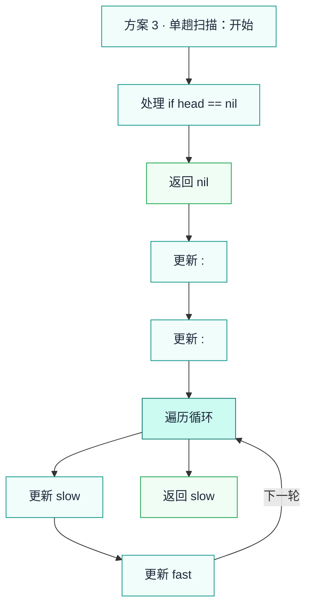

```go
package main // 引入依赖

import (
	"fmt"
	"os"
) // 引入依赖

type ListNode struct { // 定义类型
	Val  int       // Val int
	Next *ListNode // Next 乘 ListNode
}

func build(vals []int) *ListNode { // 定义函数/方法 build
	dummy := &ListNode{Val: 0} // 把 按位与 ListNode{Val: 0} 写入 dummy :
	p := dummy                 // 把 哨兵节点 写入 p :
	for _, v := range vals {   // 同时取 _ 与 值 遍历
		p.Next = &ListNode{Val: v} // 把 按位与 ListNode{Val: 值} 写入 p.Next
		p = p.Next                 // 把 节点.Next 写入 节点
	}
	return dummy.Next // 返回 哨兵节点.Next
}

func middleNode(head *ListNode) *ListNode { // 定义函数/方法 middleNode
	if head == nil { // 若 头节点 等于 nil
		return nil // 返回 nil
	}
	slow := head                          // 把 头节点 写入 slow :
	fast := head                          // 把 头节点 写入 fast :
	for fast != nil && fast.Next != nil { // 把 nil 且 快指针.Next 不等于 nil { 写入 for fast !
		slow = slow.Next      // 把 慢指针.Next 写入 慢指针
		fast = fast.Next.Next // 把 快指针.Next.Next 写入 快指针
	}
	return slow // 返回 慢指针
}

func main() { // 程序入口：跑内嵌自测用例
	cases := []struct { // 把 []struct { 写入 cases :
		in      []int // in []int
		want    int   // want int
		wantNil bool  // wantNil bool
	}{ // }{
		{[]int{1, 2, 3, 4, 5}, 3, false},
		{[]int{1, 2, 3, 4, 5, 6}, 4, false},
		{nil, 0, true},
	}
	ok := true                // 把 true 写入 ok :
	for _, c := range cases { // 同时取 _ 与 字符 遍历
		got := middleNode(build(c.in)) // 把 middleNode(build(字符.in)) 写入 got :
		if c.wantNil {                 // 若 字符.wantNil
			if got != nil { // 若 got 不等于 nil
				ok = false                                                 // 把 false 写入 ok
				fmt.Printf("FAIL middleNode(%v)=%v want nil\n", c.in, got) // 打印输出
			}
		} else { // 否则
			if got == nil || got.Val != c.want { // 若 got 等于 nil 或 got.Val 不等于 字符.want
				ok = false                                                        // 把 false 写入 ok
				fmt.Printf("FAIL middleNode(%v)=%v want %d\n", c.in, got, c.want) // 打印输出
			}
		}
	}
	if !ok { // 若 取反 ok
		os.Exit(1) // os.Exit(1)
	}
	fmt.Println("PASS") // 全部用例通过，输出 PASS
}
```

### Java 实现（3 种方案）

Java 的全部方案如下，每个方案都内嵌用例自测，可独立运行（老仓库 python/go 文件遵循「打印结果」约定）：

#### 方案 1：迭代指针处理

**思路与代码分析**：核心是「迭代指针处理」。Java 版用类与静态方法组织，集合操作显式明了。代码里依次做这些事：双重循环遍历。

**运行架构**（真实控制流）：

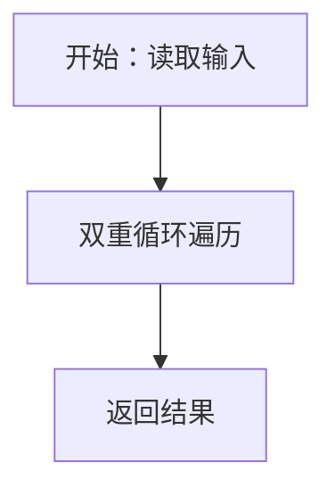

```java
package com.webfault.dsa; // 引入依赖

import java.util.*; // 引入依赖

class lc876_solution111 { // 定义类型
  static class ListNode { // static class ListNode {
    int val; // int 值;
    ListNode next; // ListNode 下一个;

    ListNode() {} // ListNode() {}

    ListNode(int v) {
      val = v;
    } // 把 值; } 写入 ListNode(int v) { val
  }

  public ListNode middleNode(ListNode head) { // 定义函数/方法 middleNode
    ListNode slow = head; // 把 头节点; 写入 ListNode slow
    ListNode fast = head; // 把 头节点; 写入 ListNode fast
    while (fast != null && fast.next != null) { // 循环，直到不满足「快指针 不等于 null 且 快指针.下一个 不等于 null」
      slow = slow.next; // 把 慢指针.下一个; 写入 慢指针
      fast = fast.next.next; // 把 快指针.下一个.下一个; 写入 快指针
    }
    return slow; // 返回 慢指针
  }

  static ListNode build(int[] a) { // 定义函数/方法 build
    ListNode dummy = new ListNode(0),
        cur = dummy; // 把 new ListNode(0), 当前值 赋值为 哨兵节点; 写入 ListNode dummy
    for (int v : a) {
      cur.next = new ListNode(v);
      cur = cur.next;
    } // 把 new ListNode(值); 当前值 赋值为 当前值.下一个; } 写入 下一个
    return dummy.next; // 返回 哨兵节点.下一个
  }

  public static void main(String[] args) { // public static void main(String[] args) {
    lc876_solution111 s =
        new lc876_solution111(); // 把 new lc876_solution111(); 写入 lc876_solution111 s
    Object[] t1 =
        new Object[] {
          new int[] {1, 2, 3, 4, 5}, 3
        }; // 把 new Object[]{new int[]{1, 2, 3, 4, 5}, 3}; 写入 Object[] t1
    Object[] t2 =
        new Object[] {
          new int[] {1, 2, 3, 4}, 3
        }; // 把 new Object[]{new int[]{1, 2, 3, 4}, 3}; 写入 Object[] t2
    Object[] t3 =
        new Object[] {new int[] {1}, 1}; // 把 new Object[]{new int[]{1}, 1}; 写入 Object[] t3
    Object[][] tests = {t1, t2, t3}; // 把 {t1, t2, t3}; 写入 Object[][] tests
    boolean ok = true; // 把 true; 写入 boolean ok
    for (Object[] t : tests) { // for (Object[] 另一字符串 : tests) {
      int[] inp = (int[]) t[0]; // 把 (int[]) 另一字符串[0]; 写入 int[] inp
      int want = (int) t[1]; // 把 (int) 另一字符串[1] 存入 want
      ListNode got = s.middleNode(build(inp)); // 把 字符串.middleNode(build(inp)); 写入 ListNode got
      if (got == null || got.val != want) { // 若 got 等于 null 或 got.值 不等于 want
        ok = false; // 把 false; 写入 ok
        System.out.println(
            "FAIL middleNode("
                + Arrays.toString(inp)
                + ")="
                + (got == null ? "null" : got.val)
                + " want "
                + want); // 打印输出
      }
    }
    ListNode nullGot = s.middleNode(null); // 把 字符串.middleNode(null); 写入 ListNode nullGot
    if (nullGot != null) {
      ok = false;
      System.out.println("FAIL middleNode(null)");
    }
    if (!ok) throw new RuntimeException("FAILED"); // 若 取反 ok) throw new RuntimeException(「FAILED」);
    System.out.println("PASS"); // 全部用例通过，输出 PASS
  }
}
```

#### 方案 2：单趟扫描

**思路与代码分析**：核心是「单趟扫描」。Java 版用类与静态方法组织，集合操作显式明了。代码里依次做这些事：双重循环遍历。

**运行架构**：与方案 1 的控制流相同（同算法在该语言的等价实现），图见上。

```java
package com.webfault.dsa; // 引入依赖

import java.util.*; // 引入依赖

class lc876_solution222 { // 定义类型
  static class ListNode { // static class ListNode {
    int val; // int 值;
    ListNode next; // ListNode 下一个;

    ListNode() {} // ListNode() {}

    ListNode(int v) {
      val = v;
    } // 把 值; } 写入 ListNode(int v) { val
  }

  static ListNode middleNode(ListNode head) { // 定义函数/方法 middleNode
    int n = 0; // 把 0 存入 元素个数
    ListNode cur = head; // 把 头节点; 写入 ListNode cur
    while (cur != null) {
      n++;
      cur = cur.next;
    } // 循环，直到不满足「当前值 不等于 null) { 元素个数 加一 ; 当前值 赋值为 当前值.下一个; }」
    int k = 0; // 把 0 存入 下标 k
    cur = head; // 把 头节点; 写入 当前值
    while (k < n / 2) {
      k++;
      cur = cur.next;
    } // 循环，直到不满足「下标 k 小于 元素个数 除以 2) { 下标 k 加一 ; 当前值 赋值为 当前值.下一个; }」
    return cur; // 返回 当前值
  }

  static ListNode build(int[] a) { // 定义函数/方法 build
    ListNode dummy = new ListNode(0),
        cur = dummy; // 把 new ListNode(0), 当前值 赋值为 哨兵节点; 写入 ListNode dummy
    for (int v : a) {
      cur.next = new ListNode(v);
      cur = cur.next;
    } // 把 new ListNode(值); 当前值 赋值为 当前值.下一个; } 写入 下一个
    return dummy.next; // 返回 哨兵节点.下一个
  }

  public static void main(String[] args) { // public static void main(String[] args) {
    lc876_solution222 s =
        new lc876_solution222(); // 把 new lc876_solution222(); 写入 lc876_solution222 s
    Object[] t1 =
        new Object[] {
          new int[] {1, 2, 3, 4, 5}, 3
        }; // 把 new Object[]{new int[]{1, 2, 3, 4, 5}, 3}; 写入 Object[] t1
    Object[] t2 =
        new Object[] {
          new int[] {1, 2, 3, 4}, 3
        }; // 把 new Object[]{new int[]{1, 2, 3, 4}, 3}; 写入 Object[] t2
    Object[] t3 =
        new Object[] {new int[] {1}, 1}; // 把 new Object[]{new int[]{1}, 1}; 写入 Object[] t3
    Object[][] tests = {t1, t2, t3}; // 把 {t1, t2, t3}; 写入 Object[][] tests
    boolean ok = true; // 把 true; 写入 boolean ok
    for (Object[] t : tests) { // for (Object[] 另一字符串 : tests) {
      int[] inp = (int[]) t[0]; // 把 (int[]) 另一字符串[0]; 写入 int[] inp
      int want = (int) t[1]; // 把 (int) 另一字符串[1] 存入 want
      ListNode got = s.middleNode(build(inp)); // 把 字符串.middleNode(build(inp)); 写入 ListNode got
      if (got == null || got.val != want) { // 若 got 等于 null 或 got.值 不等于 want
        ok = false; // 把 false; 写入 ok
        System.out.println(
            "FAIL middleNode("
                + Arrays.toString(inp)
                + ")="
                + (got == null ? "null" : got.val)
                + " want "
                + want); // 打印输出
      }
    }
    if (s.middleNode(null) != null) {
      ok = false;
      System.out.println("FAIL middleNode(null)");
    }
    if (!ok) throw new RuntimeException("FAILED"); // 若 取反 ok) throw new RuntimeException(「FAILED」);
    System.out.println("PASS"); // 全部用例通过，输出 PASS
  }
}
```

#### 方案 3：单趟扫描

**思路与代码分析**：核心是「单趟扫描」。Java 版用类与静态方法组织，集合操作显式明了。代码里依次做这些事：双重循环遍历。

**运行架构**：与方案 1 的控制流相同（同算法在该语言的等价实现），图见上。

```java
package com.webfault.dsa; // 引入依赖

import java.util.*; // 引入依赖

class lc876_solution333 { // 定义类型
  static class ListNode { // static class ListNode {
    int val; // int 值;
    ListNode next; // ListNode 下一个;

    ListNode() {} // ListNode() {}

    ListNode(int v) {
      val = v;
    } // 把 值; } 写入 ListNode(int v) { val
  }

  public ListNode middleNode(ListNode head) { // 定义函数/方法 middleNode
    List<ListNode> nodes = new ArrayList<>(); // 把 new ArrayList 小于 超过 (); 写入 List<ListNode> nodes
    ListNode curr = head; // 把 头节点; 写入 ListNode curr
    while (curr != null) { // 循环，直到不满足「当前值 不等于 null」
      nodes.add(curr); // nodes 追加 当前值);
      curr = curr.next; // 把 当前值.下一个; 写入 当前值
    }
    int n = nodes.size(); // 把 nodes.大小() 存入 元素个数
    return nodes.get((n - 1) / 2); // 返回 nodes 查找 (元素个数 减 1) 除以 2)
  }

  static ListNode build(int[] a) { // 定义函数/方法 build
    ListNode dummy = new ListNode(0),
        cur = dummy; // 把 new ListNode(0), 当前值 赋值为 哨兵节点; 写入 ListNode dummy
    for (int v : a) {
      cur.next = new ListNode(v);
      cur = cur.next;
    } // 把 new ListNode(值); 当前值 赋值为 当前值.下一个; } 写入 下一个
    return dummy.next; // 返回 哨兵节点.下一个
  }

  public static void main(String[] args) { // public static void main(String[] args) {
    lc876_solution333 s =
        new lc876_solution333(); // 把 new lc876_solution333(); 写入 lc876_solution333 s
    Object[] t1 =
        new Object[] {
          new int[] {1, 2, 3, 4, 5}, 3
        }; // 把 new Object[]{new int[]{1, 2, 3, 4, 5}, 3}; 写入 Object[] t1
    Object[] t2 =
        new Object[] {
          new int[] {1, 2, 3, 4}, 2
        }; // 把 new Object[]{new int[]{1, 2, 3, 4}, 2}; 写入 Object[] t2
    Object[] t3 =
        new Object[] {new int[] {1}, 1}; // 把 new Object[]{new int[]{1}, 1}; 写入 Object[] t3
    Object[][] tests = {t1, t2, t3}; // 把 {t1, t2, t3}; 写入 Object[][] tests
    boolean ok = true; // 把 true; 写入 boolean ok
    for (Object[] t : tests) { // for (Object[] 另一字符串 : tests) {
      int[] inp = (int[]) t[0]; // 把 (int[]) 另一字符串[0]; 写入 int[] inp
      int want = (int) t[1]; // 把 (int) 另一字符串[1] 存入 want
      ListNode got = s.middleNode(build(inp)); // 把 字符串.middleNode(build(inp)); 写入 ListNode got
      if (got == null || got.val != want) { // 若 got 等于 null 或 got.值 不等于 want
        ok = false; // 把 false; 写入 ok
        System.out.println(
            "FAIL middleNode("
                + Arrays.toString(inp)
                + ")="
                + (got == null ? "null" : got.val)
                + " want "
                + want); // 打印输出
      }
    }
    if (!ok) throw new RuntimeException("FAILED"); // 若 取反 ok) throw new RuntimeException(「FAILED」);
    System.out.println("PASS"); // 全部用例通过，输出 PASS
  }
}
```

### Rust 实现（3 种方案）

Rust 的全部方案如下，每个方案都内嵌用例自测，可独立运行（老仓库 python/go 文件遵循「打印结果」约定）：

#### 方案 1：迭代指针处理

**思路与代码分析**：核心是「迭代指针处理」。Rust 版用所有权移动与切片借用改写同一逻辑，注意 Option 与引用边界。**走读**：方案 1 · 迭代指针处理：开始 → 计算 out → 计算 cur → 当 let Some(n) = cur 时反复执行 → 向 out 追加记录 → 更新 cur → 处理 out → 返回结果。

**运行架构**（真实控制流）：

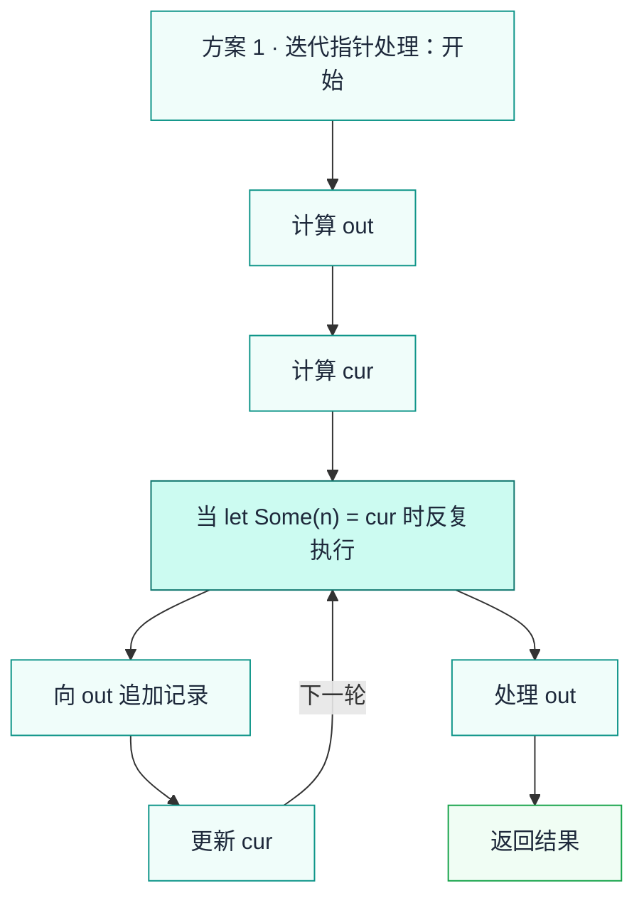

```rust
// LeetCode 876. 链表的中间结点 — Rust 版（方案1）
#[derive(Debug)]
struct ListNode {
    val: i32,
    next: Option<Box<ListNode>>,
} // 定义类型
fn build_list(vals: &[i32]) -> Option<Box<ListNode>> {
    // 定义函数/方法 build_list
    let mut head: Option<Box<ListNode>> = None; // 把 None; 写入 let mut head: Option<Box<ListNode>>
    for &v in vals.iter().rev() {
        head = Some(Box::new(ListNode { val: v, next: head }));
    }
    head // 头节点
}
fn to_vec(h: &Option<Box<ListNode>>) -> Vec<i32> {
    // 定义函数/方法 to_vec
    let mut out = Vec::new(); // 把 Vec::new(); 写入 let mut out
    let mut cur = h; // 把 h; 写入 let mut cur
    while let Some(n) = cur {
        out.push(n.val);
        cur = &n.next;
    } // 边取边处理，取空即停
    out // out
}
fn middle_node(head: Option<Box<ListNode>>) -> Option<Box<ListNode>> {
    // 定义函数/方法 middle_node
    // 快慢指针找中间：返回后半段起点（转移所有权：重建后半段）
    let mut vals = Vec::new(); // 把 Vec::new(); 写入 let mut vals
    let mut cur = &head; // 把 按位与 头节点; 写入 let mut cur
    while let Some(n) = cur {
        vals.push(n.val);
        cur = &n.next;
    } // 边取边处理，取空即停
    let mid = vals.len() / 2; // 把 vals.长度() 除以 2 存入 中点
    let mut out: Option<Box<ListNode>> = None; // 把 None; 写入 let mut out: Option<Box<ListNode>>
    for &v in vals[mid..].iter().rev() {
        out = Some(Box::new(ListNode { val: v, next: out }));
    }
    out // out
}
fn main() {
    // 程序入口：跑内嵌自测用例
    assert_eq!(
        to_vec(&middle_node(build_list(&[1, 2, 3, 4, 5]))),
        vec![3, 4, 5]
    ); // 断言校验
    assert_eq!(
        to_vec(&middle_node(build_list(&[1, 2, 3, 4, 5, 6]))),
        vec![4, 5, 6]
    ); // 断言校验
    assert_eq!(to_vec(&middle_node(build_list(&[1]))), vec![1]); // 断言校验
    println!("PASS"); // 全部用例通过，输出 PASS
}
```

#### 方案 2：单趟扫描

**思路与代码分析**：核心是「单趟扫描」。Rust 版用所有权移动与切片借用改写同一逻辑，注意 Option 与引用边界。**走读**：方案 2 · 单趟扫描：开始 → 计算 out → 计算 cur → 当 let Some(n) = cur 时反复执行 → 向 out 追加记录 → 更新 cur → 处理 out → 返回结果。

**运行架构**（真实控制流）：

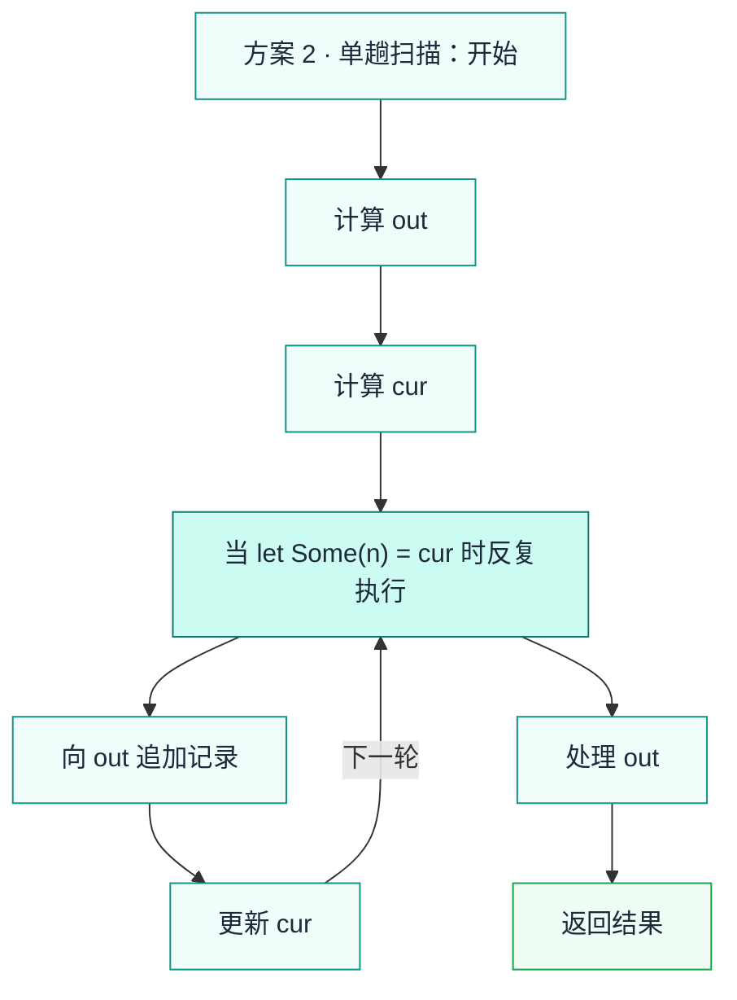

```rust
// LeetCode 876. 链表的中间结点 — Rust 版（方案2）
#[derive(Debug)]
struct ListNode {
    val: i32,
    next: Option<Box<ListNode>>,
} // 定义类型
fn build_list(vals: &[i32]) -> Option<Box<ListNode>> {
    // 定义函数/方法 build_list
    let mut head: Option<Box<ListNode>> = None; // 把 None; 写入 let mut head: Option<Box<ListNode>>
    for &v in vals.iter().rev() {
        head = Some(Box::new(ListNode { val: v, next: head }));
    }
    head // 头节点
}
fn to_vec(h: &Option<Box<ListNode>>) -> Vec<i32> {
    // 定义函数/方法 to_vec
    let mut out = Vec::new(); // 把 Vec::new(); 写入 let mut out
    let mut cur = h; // 把 h; 写入 let mut cur
    while let Some(n) = cur {
        out.push(n.val);
        cur = &n.next;
    } // 边取边处理，取空即停
    out // out
}
fn middle_node(head: Option<Box<ListNode>>) -> Option<Box<ListNode>> {
    // 定义函数/方法 middle_node
    // 快慢指针找中间：返回后半段起点（转移所有权：重建后半段）
    let mut vals = Vec::new(); // 把 Vec::new(); 写入 let mut vals
    let mut cur = &head; // 把 按位与 头节点; 写入 let mut cur
    while let Some(n) = cur {
        vals.push(n.val);
        cur = &n.next;
    } // 边取边处理，取空即停
    let mid = vals.len() / 2; // 把 vals.长度() 除以 2 存入 中点
    let mut out: Option<Box<ListNode>> = None; // 把 None; 写入 let mut out: Option<Box<ListNode>>
    for &v in vals[mid..].iter().rev() {
        out = Some(Box::new(ListNode { val: v, next: out }));
    }
    out // out
}
fn main() {
    // 程序入口：跑内嵌自测用例
    assert_eq!(
        to_vec(&middle_node(build_list(&[1, 2, 3, 4, 5]))),
        vec![3, 4, 5]
    ); // 断言校验
    assert_eq!(
        to_vec(&middle_node(build_list(&[1, 2, 3, 4, 5, 6]))),
        vec![4, 5, 6]
    ); // 断言校验
    assert_eq!(to_vec(&middle_node(build_list(&[1]))), vec![1]); // 断言校验
    println!("PASS"); // 全部用例通过，输出 PASS
}
```

#### 方案 3：单趟扫描

**思路与代码分析**：核心是「单趟扫描」。Rust 版用所有权移动与切片借用改写同一逻辑，注意 Option 与引用边界。**走读**：方案 3 · 单趟扫描：开始 → 计算 out → 计算 cur → 当 let Some(n) = cur 时反复执行 → 向 out 追加记录 → 更新 cur → 处理 out → 返回结果。

**运行架构**（真实控制流）：


```rust
// LeetCode 876. 链表的中间结点 — Rust 版（方案3）
#[derive(Debug)]
struct ListNode {
    val: i32,
    next: Option<Box<ListNode>>,
} // 定义类型
fn build_list(vals: &[i32]) -> Option<Box<ListNode>> {
    // 定义函数/方法 build_list
    let mut head: Option<Box<ListNode>> = None; // 把 None; 写入 let mut head: Option<Box<ListNode>>
    for &v in vals.iter().rev() {
        head = Some(Box::new(ListNode { val: v, next: head }));
    }
    head // 头节点
}
fn to_vec(h: &Option<Box<ListNode>>) -> Vec<i32> {
    // 定义函数/方法 to_vec
    let mut out = Vec::new(); // 把 Vec::new(); 写入 let mut out
    let mut cur = h; // 把 h; 写入 let mut cur
    while let Some(n) = cur {
        out.push(n.val);
        cur = &n.next;
    } // 边取边处理，取空即停
    out // out
}
fn middle_node(head: Option<Box<ListNode>>) -> Option<Box<ListNode>> {
    // 定义函数/方法 middle_node
    // 快慢指针找中间：返回后半段起点（转移所有权：重建后半段）
    let mut vals = Vec::new(); // 把 Vec::new(); 写入 let mut vals
    let mut cur = &head; // 把 按位与 头节点; 写入 let mut cur
    while let Some(n) = cur {
        vals.push(n.val);
        cur = &n.next;
    } // 边取边处理，取空即停
    let mid = vals.len() / 2; // 把 vals.长度() 除以 2 存入 中点
    let mut out: Option<Box<ListNode>> = None; // 把 None; 写入 let mut out: Option<Box<ListNode>>
    for &v in vals[mid..].iter().rev() {
        out = Some(Box::new(ListNode { val: v, next: out }));
    }
    out // out
}
fn main() {
    // 程序入口：跑内嵌自测用例
    assert_eq!(
        to_vec(&middle_node(build_list(&[1, 2, 3, 4, 5]))),
        vec![3, 4, 5]
    ); // 断言校验
    assert_eq!(
        to_vec(&middle_node(build_list(&[1, 2, 3, 4, 5, 6]))),
        vec![4, 5, 6]
    ); // 断言校验
    assert_eq!(to_vec(&middle_node(build_list(&[1]))), vec![1]); // 断言校验
    println!("PASS"); // 全部用例通过，输出 PASS
}
```

### Lua 实现（3 种方案）

Lua 的全部方案如下，每个方案都内嵌用例自测，可独立运行（老仓库 python/go 文件遵循「打印结果」约定）：

#### 方案 1：迭代指针处理

**思路与代码分析**：核心是「迭代指针处理」。Lua 版用表与 ipairs 遍历，注意 ipairs 遇 nil 即停的语义。**走读**：方案 1 · 迭代指针处理：开始 → 更新 cur → 遍历 ipairs(vals) do 中的每个元素 v → 更新 n → 处理 if not head then → 更新 cur → 更新 cur → 返回 head。

**运行架构**（真实控制流）：

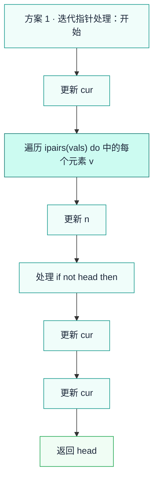

```lua
-- LeetCode 876. 链表的中间结点 — Lua 版（方案1）
local ListNode = {} -- 把 {} 写入 local ListNode
ListNode.__index = ListNode -- 把 ListNode 写入 ListNode.__index
function ListNode.new(val, next)
	return setmetatable({ val = val, next = next }, ListNode)
end
local function build_list(vals) -- local function build_list(vals)
	local head, cur = nil, nil -- 把 nil, nil 写入 local head, cur
	for _, v in ipairs(vals) do -- 遍历取 值
		local n = ListNode.new(v) -- 把 ListNode.new(值) 写入 local n
		if not head then
			head, cur = n, n
		else
			cur.next, cur = n, n
		end
	end -- 终点
	return head -- 返回 头节点
end -- 终点
local function to_vec(h) -- local function to_vec(h)
	local out = {} -- 把 {} 写入 local out
	while h do
		out[#out + 1] = h.val
		h = h.next
	end -- 把 h.值; h 赋值为 h.下一个 终点 写入 while h do out[#out + 1]
	return out -- 返回 out
end -- 终点
local function middle_node(head) -- local function middle_node(头节点)
	local slow, fast = head, head -- 把 头节点, 头节点 写入 local slow, fast
	while fast and fast.next do -- while 快指针 and 快指针.下一个 do
		slow = slow.next -- 把 慢指针.下一个 存入 慢指针
		fast = fast.next.next -- 把 快指针.下一个.下一个 存入 快指针
	end -- 终点
	return slow -- 返回 慢指针
end -- 终点
assert(table.concat(to_vec(middle_node(build_list({ 1, 2, 3, 4, 5 }))), ",") == "3,4,5") -- 打印输出
assert(table.concat(to_vec(middle_node(build_list({ 1, 2, 3, 4, 5, 6 }))), ",") == "4,5,6") -- 打印输出
assert(table.concat(to_vec(middle_node(build_list({ 1 }))), ",") == "1") -- 打印输出
print("PASS") -- 全部用例通过，输出 PASS
```

#### 方案 2：单趟扫描

**思路与代码分析**：核心是「单趟扫描」。Lua 版用表与 ipairs 遍历，注意 ipairs 遇 nil 即停的语义。**走读**：方案 2 · 单趟扫描：开始 → 更新 cur → 遍历 ipairs(vals) do 中的每个元素 v → 更新 n → 处理 if not head then → 更新 cur → 更新 cur → 返回 head。

**运行架构**（真实控制流）：

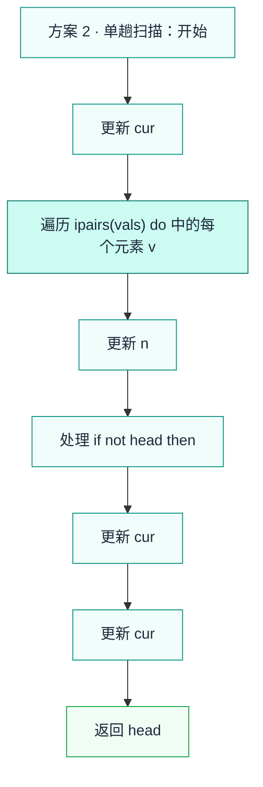

```lua
-- LeetCode 876. 链表的中间结点 — Lua 版（方案2）
local ListNode = {} -- 把 {} 写入 local ListNode
ListNode.__index = ListNode -- 把 ListNode 写入 ListNode.__index
function ListNode.new(val, next)
	return setmetatable({ val = val, next = next }, ListNode)
end
local function build_list(vals) -- local function build_list(vals)
	local head, cur = nil, nil -- 把 nil, nil 写入 local head, cur
	for _, v in ipairs(vals) do -- 遍历取 值
		local n = ListNode.new(v) -- 把 ListNode.new(值) 写入 local n
		if not head then
			head, cur = n, n
		else
			cur.next, cur = n, n
		end
	end -- 终点
	return head -- 返回 头节点
end -- 终点
local function to_vec(h) -- local function to_vec(h)
	local out = {} -- 把 {} 写入 local out
	while h do
		out[#out + 1] = h.val
		h = h.next
	end -- 把 h.值; h 赋值为 h.下一个 终点 写入 while h do out[#out + 1]
	return out -- 返回 out
end -- 终点
local function middle_node(head) -- local function middle_node(头节点)
	local slow, fast = head, head -- 把 头节点, 头节点 写入 local slow, fast
	while fast and fast.next do -- while 快指针 and 快指针.下一个 do
		slow = slow.next -- 把 慢指针.下一个 存入 慢指针
		fast = fast.next.next -- 把 快指针.下一个.下一个 存入 快指针
	end -- 终点
	return slow -- 返回 慢指针
end -- 终点
assert(table.concat(to_vec(middle_node(build_list({ 1, 2, 3, 4, 5 }))), ",") == "3,4,5") -- 打印输出
assert(table.concat(to_vec(middle_node(build_list({ 1, 2, 3, 4, 5, 6 }))), ",") == "4,5,6") -- 打印输出
assert(table.concat(to_vec(middle_node(build_list({ 1 }))), ",") == "1") -- 打印输出
print("PASS") -- 全部用例通过，输出 PASS
```

#### 方案 3：单趟扫描

**思路与代码分析**：核心是「单趟扫描」。Lua 版用表与 ipairs 遍历，注意 ipairs 遇 nil 即停的语义。**走读**：方案 3 · 单趟扫描：开始 → 更新 cur → 遍历 ipairs(vals) do 中的每个元素 v → 更新 n → 处理 if not head then → 更新 cur → 更新 cur → 返回 head。

**运行架构**（真实控制流）：


```lua
-- LeetCode 876. 链表的中间结点 — Lua 版（方案3）
local ListNode = {} -- 把 {} 写入 local ListNode
ListNode.__index = ListNode -- 把 ListNode 写入 ListNode.__index
function ListNode.new(val, next)
	return setmetatable({ val = val, next = next }, ListNode)
end
local function build_list(vals) -- local function build_list(vals)
	local head, cur = nil, nil -- 把 nil, nil 写入 local head, cur
	for _, v in ipairs(vals) do -- 遍历取 值
		local n = ListNode.new(v) -- 把 ListNode.new(值) 写入 local n
		if not head then
			head, cur = n, n
		else
			cur.next, cur = n, n
		end
	end -- 终点
	return head -- 返回 头节点
end -- 终点
local function to_vec(h) -- local function to_vec(h)
	local out = {} -- 把 {} 写入 local out
	while h do
		out[#out + 1] = h.val
		h = h.next
	end -- 把 h.值; h 赋值为 h.下一个 终点 写入 while h do out[#out + 1]
	return out -- 返回 out
end -- 终点
local function middle_node(head) -- local function middle_node(头节点)
	local slow, fast = head, head -- 把 头节点, 头节点 写入 local slow, fast
	while fast and fast.next do -- while 快指针 and 快指针.下一个 do
		slow = slow.next -- 把 慢指针.下一个 存入 慢指针
		fast = fast.next.next -- 把 快指针.下一个.下一个 存入 快指针
	end -- 终点
	return slow -- 返回 慢指针
end -- 终点
assert(table.concat(to_vec(middle_node(build_list({ 1, 2, 3, 4, 5 }))), ",") == "3,4,5") -- 打印输出
assert(table.concat(to_vec(middle_node(build_list({ 1, 2, 3, 4, 5, 6 }))), ",") == "4,5,6") -- 打印输出
assert(table.concat(to_vec(middle_node(build_list({ 1 }))), ",") == "1") -- 打印输出
print("PASS") -- 全部用例通过，输出 PASS
```

### C 实现（3 种方案）

C 的全部方案如下，每个方案都内嵌用例自测，可独立运行（老仓库 python/go 文件遵循「打印结果」约定）：

#### 方案 1：迭代指针处理

**思路与代码分析**：核心是「迭代指针处理」。C 版手动管理下标与内存，循环边界全部显式写出。**走读**：方案 1 · 迭代指针处理：开始 → 更新 *slow → 当 (fast 且 fast-＞next) 时反复执行 → 更新 slow → 更新 fast → 返回 slow。

**运行架构**（真实控制流）：

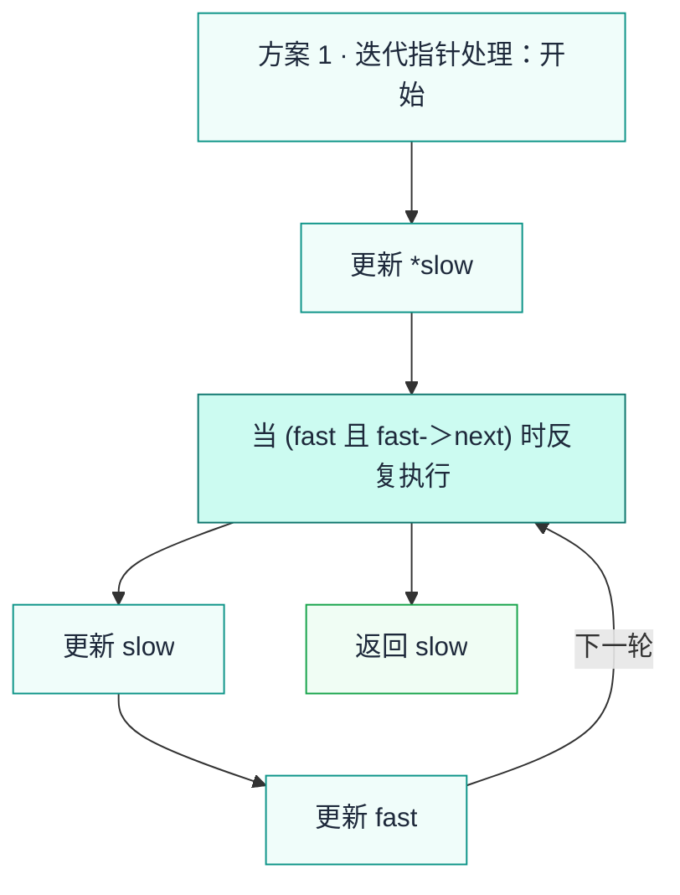

```c
/* LeetCode 876. 链表的中间结点 — C 版（方案1） */
#include <stdio.h>  // 引入头文件
#include <stdlib.h> // 引入头文件
typedef struct LNode {
    int val;
    struct LNode *next;
} LNode; // typedef struct LNode { int 值; struct LNode 乘 下一个; } LNode;
static LNode *build_list(const int *vals,
                         int n) { // static LNode 乘 build_list(const int 乘 vals, int 元素个数) {
    LNode *head = NULL, **cur = &head; // 把 NULL, 乘 乘 当前值 赋值为 按位与 头节点; 写入 LNode *head
    for (int i = 0; i < n; i++) { // 让 下标 i 从 0 开始计数，下标 i 小于 元素个数 就继续
        LNode *node = malloc(sizeof(LNode)); // 把 malloc(sizeof(LNode)); 写入 LNode *node
        node->val = vals[i];
        node->next = NULL; // 把 vals[下标 i]; 节点 减 超过 下一个 赋值为 NULL; 写入 node->val
        *cur = node;
        cur = &node->next;
    }
    return head; // 返回 头节点
}
static void free_list(LNode *h) {
    while (h) {
        LNode *n = h->next;
        free(h);
        h = n;
    }
}
static int list_check(LNode *h, const int *want, int wn) { // 定义函数/方法 list_check
    int i = 0;                                             // 把 0 存入 下标 i
    while (h) {
        if (i >= wn || h->val != want[i])
            return 0;
        i++;
        h = h->next;
    }
    return i == wn; // 返回 下标 i 等于 wn
}
static LNode *middle_node(LNode *head) { // static LNode 乘 middle_node(LNode 乘 头节点) {
    LNode *slow = head, *fast = head; // 把 头节点, 乘 快指针 赋值为 头节点; 写入 LNode *slow
    while (fast && fast->next) { // 循环，直到不满足「快指针 且 快指针 减 超过 下一个」
        slow = slow->next;       // 把 慢指针 减 超过 下一个; 写入 慢指针
        fast = fast->next->next; // 把 快指针 减 超过 下一个 减 超过 下一个; 写入 快指针
    }
    return slow; // 返回 慢指针
}
int main(void) { // 程序入口：跑内嵌自测用例
    int w1[] = {3, 4, 5}, w2[] = {4, 5, 6},
        w3[] = {1}; // 把 {3,4,5}, w2[] 赋值为 {4,5,6}, w3[] 赋值为 {1}; 写入 int w1[]
    LNode *m = middle_node(build_list((int[]){1, 2, 3, 4, 5}, 5));
    if (!list_check(m, w1, 3)) {
        printf("FAIL 1\n");
        return 1;
    }             // 若 取反 list_check(映射表, w1, 3)) { 输出「FAIL 1 」); return 1; }
    free_list(m); // free_list(映射表);
    LNode *m2 = middle_node(build_list((int[]){1, 2, 3, 4, 5, 6}, 6));
    if (!list_check(m2, w2, 3)) {
        printf("FAIL 2\n");
        return 1;
    }              // 若 取反 list_check(m2, w2, 3)) { 输出「FAIL 2 」); return 1; }
    free_list(m2); // free_list(m2);
    LNode *m3 =
        middle_node(build_list((int[]){1}, 1)); // 把 middle_node(build_list((int[]){1}, 1)); 写入 LNode *m3
    if (!list_check(m3, w3, 1)) {
        printf("FAIL 3\n");
        return 1;
    }                 // 若 取反 list_check(m3, w3, 1)) { 输出「FAIL 3 」); return 1; }
    free_list(m3);    // free_list(m3);
    printf("PASS\n"); // 全部用例通过，输出 PASS
    return 0;         // 返回 0
}
```

#### 方案 2：单趟扫描

**思路与代码分析**：核心是「单趟扫描」。C 版手动管理下标与内存，循环边界全部显式写出。**走读**：方案 2 · 单趟扫描：开始 → 更新 *slow → 当 (fast 且 fast-＞next) 时反复执行 → 更新 slow → 更新 fast → 返回 slow。

**运行架构**（真实控制流）：

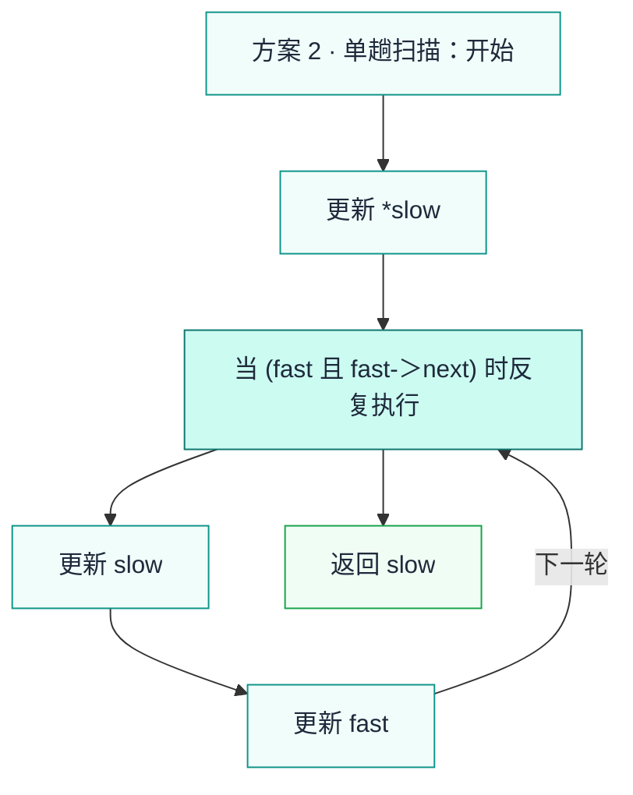

```c
/* LeetCode 876. 链表的中间结点 — C 版（方案2） */
#include <stdio.h>  // 引入头文件
#include <stdlib.h> // 引入头文件
typedef struct LNode {
    int val;
    struct LNode *next;
} LNode; // typedef struct LNode { int 值; struct LNode 乘 下一个; } LNode;
static LNode *build_list(const int *vals,
                         int n) { // static LNode 乘 build_list(const int 乘 vals, int 元素个数) {
    LNode *head = NULL, **cur = &head; // 把 NULL, 乘 乘 当前值 赋值为 按位与 头节点; 写入 LNode *head
    for (int i = 0; i < n; i++) { // 让 下标 i 从 0 开始计数，下标 i 小于 元素个数 就继续
        LNode *node = malloc(sizeof(LNode)); // 把 malloc(sizeof(LNode)); 写入 LNode *node
        node->val = vals[i];
        node->next = NULL; // 把 vals[下标 i]; 节点 减 超过 下一个 赋值为 NULL; 写入 node->val
        *cur = node;
        cur = &node->next;
    }
    return head; // 返回 头节点
}
static void free_list(LNode *h) {
    while (h) {
        LNode *n = h->next;
        free(h);
        h = n;
    }
}
static int list_check(LNode *h, const int *want, int wn) { // 定义函数/方法 list_check
    int i = 0;                                             // 把 0 存入 下标 i
    while (h) {
        if (i >= wn || h->val != want[i])
            return 0;
        i++;
        h = h->next;
    }
    return i == wn; // 返回 下标 i 等于 wn
}
static LNode *middle_node(LNode *head) { // static LNode 乘 middle_node(LNode 乘 头节点) {
    LNode *slow = head, *fast = head; // 把 头节点, 乘 快指针 赋值为 头节点; 写入 LNode *slow
    while (fast && fast->next) { // 循环，直到不满足「快指针 且 快指针 减 超过 下一个」
        slow = slow->next;       // 把 慢指针 减 超过 下一个; 写入 慢指针
        fast = fast->next->next; // 把 快指针 减 超过 下一个 减 超过 下一个; 写入 快指针
    }
    return slow; // 返回 慢指针
}
int main(void) { // 程序入口：跑内嵌自测用例
    int w1[] = {3, 4, 5}, w2[] = {4, 5, 6},
        w3[] = {1}; // 把 {3,4,5}, w2[] 赋值为 {4,5,6}, w3[] 赋值为 {1}; 写入 int w1[]
    LNode *m = middle_node(build_list((int[]){1, 2, 3, 4, 5}, 5));
    if (!list_check(m, w1, 3)) {
        printf("FAIL 1\n");
        return 1;
    }             // 若 取反 list_check(映射表, w1, 3)) { 输出「FAIL 1 」); return 1; }
    free_list(m); // free_list(映射表);
    LNode *m2 = middle_node(build_list((int[]){1, 2, 3, 4, 5, 6}, 6));
    if (!list_check(m2, w2, 3)) {
        printf("FAIL 2\n");
        return 1;
    }              // 若 取反 list_check(m2, w2, 3)) { 输出「FAIL 2 」); return 1; }
    free_list(m2); // free_list(m2);
    LNode *m3 =
        middle_node(build_list((int[]){1}, 1)); // 把 middle_node(build_list((int[]){1}, 1)); 写入 LNode *m3
    if (!list_check(m3, w3, 1)) {
        printf("FAIL 3\n");
        return 1;
    }                 // 若 取反 list_check(m3, w3, 1)) { 输出「FAIL 3 」); return 1; }
    free_list(m3);    // free_list(m3);
    printf("PASS\n"); // 全部用例通过，输出 PASS
    return 0;         // 返回 0
}
```

#### 方案 3：单趟扫描

**思路与代码分析**：核心是「单趟扫描」。C 版手动管理下标与内存，循环边界全部显式写出。**走读**：方案 3 · 单趟扫描：开始 → 更新 *slow → 当 (fast 且 fast-＞next) 时反复执行 → 更新 slow → 更新 fast → 返回 slow。

**运行架构**（真实控制流）：

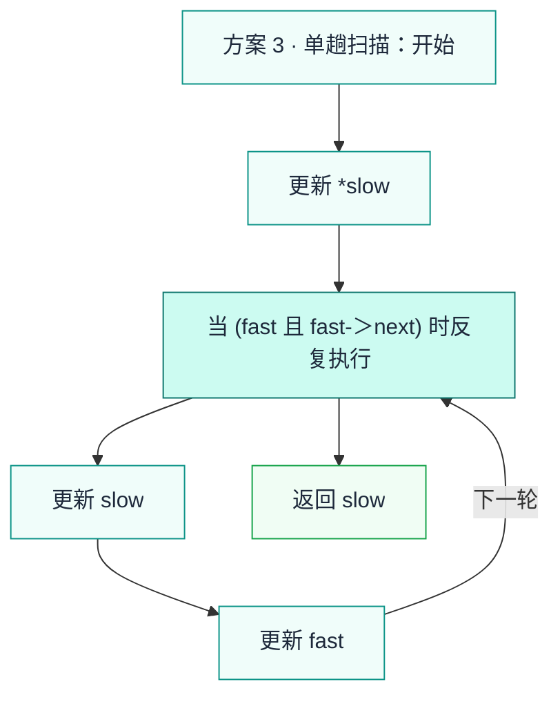

```c
/* LeetCode 876. 链表的中间结点 — C 版（方案3） */
#include <stdio.h>  // 引入头文件
#include <stdlib.h> // 引入头文件
typedef struct LNode {
    int val;
    struct LNode *next;
} LNode; // typedef struct LNode { int 值; struct LNode 乘 下一个; } LNode;
static LNode *build_list(const int *vals,
                         int n) { // static LNode 乘 build_list(const int 乘 vals, int 元素个数) {
    LNode *head = NULL, **cur = &head; // 把 NULL, 乘 乘 当前值 赋值为 按位与 头节点; 写入 LNode *head
    for (int i = 0; i < n; i++) { // 让 下标 i 从 0 开始计数，下标 i 小于 元素个数 就继续
        LNode *node = malloc(sizeof(LNode)); // 把 malloc(sizeof(LNode)); 写入 LNode *node
        node->val = vals[i];
        node->next = NULL; // 把 vals[下标 i]; 节点 减 超过 下一个 赋值为 NULL; 写入 node->val
        *cur = node;
        cur = &node->next;
    }
    return head; // 返回 头节点
}
static void free_list(LNode *h) {
    while (h) {
        LNode *n = h->next;
        free(h);
        h = n;
    }
}
static int list_check(LNode *h, const int *want, int wn) { // 定义函数/方法 list_check
    int i = 0;                                             // 把 0 存入 下标 i
    while (h) {
        if (i >= wn || h->val != want[i])
            return 0;
        i++;
        h = h->next;
    }
    return i == wn; // 返回 下标 i 等于 wn
}
static LNode *middle_node(LNode *head) { // static LNode 乘 middle_node(LNode 乘 头节点) {
    LNode *slow = head, *fast = head; // 把 头节点, 乘 快指针 赋值为 头节点; 写入 LNode *slow
    while (fast && fast->next) { // 循环，直到不满足「快指针 且 快指针 减 超过 下一个」
        slow = slow->next;       // 把 慢指针 减 超过 下一个; 写入 慢指针
        fast = fast->next->next; // 把 快指针 减 超过 下一个 减 超过 下一个; 写入 快指针
    }
    return slow; // 返回 慢指针
}
int main(void) { // 程序入口：跑内嵌自测用例
    int w1[] = {3, 4, 5}, w2[] = {4, 5, 6},
        w3[] = {1}; // 把 {3,4,5}, w2[] 赋值为 {4,5,6}, w3[] 赋值为 {1}; 写入 int w1[]
    LNode *m = middle_node(build_list((int[]){1, 2, 3, 4, 5}, 5));
    if (!list_check(m, w1, 3)) {
        printf("FAIL 1\n");
        return 1;
    }             // 若 取反 list_check(映射表, w1, 3)) { 输出「FAIL 1 」); return 1; }
    free_list(m); // free_list(映射表);
    LNode *m2 = middle_node(build_list((int[]){1, 2, 3, 4, 5, 6}, 6));
    if (!list_check(m2, w2, 3)) {
        printf("FAIL 2\n");
        return 1;
    }              // 若 取反 list_check(m2, w2, 3)) { 输出「FAIL 2 」); return 1; }
    free_list(m2); // free_list(m2);
    LNode *m3 =
        middle_node(build_list((int[]){1}, 1)); // 把 middle_node(build_list((int[]){1}, 1)); 写入 LNode *m3
    if (!list_check(m3, w3, 1)) {
        printf("FAIL 3\n");
        return 1;
    }                 // 若 取反 list_check(m3, w3, 1)) { 输出「FAIL 3 」); return 1; }
    free_list(m3);    // free_list(m3);
    printf("PASS\n"); // 全部用例通过，输出 PASS
    return 0;         // 返回 0
}
```

### C++ 实现（3 种方案）

C++ 的全部方案如下，每个方案都内嵌用例自测，可独立运行（老仓库 python/go 文件遵循「打印结果」约定）：

#### 方案 1：迭代指针处理

**思路与代码分析**：核心是「迭代指针处理」。C++ 版用 STL 容器与迭代器，减少手写下标错误。**走读**：方案 1 · 迭代指针处理：开始 → 处理 std::vector＜int＞ out → 当 (h) 时反复执行 → 调用 out.push_back(h-＞val) → 更新 h → 返回 out。

**运行架构**（真实控制流）：

```mermaid
graph TD
    N0["方案 1 · 迭代指针处理：开始"]
    N1["处理 std::vector＜int＞ out"]
    N2["当 (h) 时反复执行"]
    N3["调用 out.push_back(h-＞val)"]
    N4["更新 h"]
    N5["返回 out"]
    N0 --> N1
    N1 --> N2
    N2 --> N3
    N3 --> N4
    N4 -- 下一轮 --> N2
    N2 --> N5
    classDef n fill:#f0fdfa,stroke:#0d9488,color:#1e293b;
    classDef lp fill:#ccfbf1,stroke:#0f766e,color:#1e293b;
    classDef dc fill:#fef9c3,stroke:#ca8a04,color:#1e293b;
    classDef tm fill:#f0fdf4,stroke:#16a34a,color:#1e293b;
    class N0,N1,N3,N4 n;
    class N2 lp;
    class N5 tm;
```

```cpp
// LeetCode 876. 链表的中间结点 — C++ 版（方案1）
#include <cassert>                       // 引入头文件
#include <iostream>                      // 引入头文件
#include <memory>                        // 引入头文件
#include <vector>                        // 引入头文件
struct ListNode {                        // 定义类型
    int val;                             // int 值;
    ListNode *next = nullptr;            // 把 nullptr; 写入 ListNode *next
    explicit ListNode(int v) : val(v) {} // explicit ListNode(int 值) : 值(值) {}
};
static ListNode *buildList(const std::vector<int> &vals) {
    ListNode dummy(0);               // ListNode 哨兵节点(0);
    ListNode *cur = &dummy;          // 把 按位与 哨兵节点; 写入 ListNode *cur
    for (int v : vals) {             // for (int 值 : vals) {
        cur->next = new ListNode(v); // 把 new ListNode(值); 写入 cur->next
        cur = cur->next;             // 把 当前值 减 超过 下一个; 写入 当前值
    }
    return dummy.next; // 返回 哨兵节点.下一个
}
static void freeList(ListNode *h) {
    while (h) {
        ListNode *n = h->next;
        delete h;
        h = n;
    }
}
static std::vector<int> toVec(ListNode *h) { // static std::vector 小于 int 超过 toVec(ListNode 乘 h) {
    std::vector<int> out;                    // std::vector 小于 int 超过 out;
    while (h) {
        out.push_back(h->val);
        h = h->next;
    } // 循环，直到不满足「h) { out 追加 h 减 超过 值); h 赋值为 h 减 超过 下一个; }」
    return out; // 返回 out
}
static ListNode *middleNode(ListNode *head) { // static ListNode 乘 middleNode(ListNode 乘 头节点) {
    ListNode *slow = head, *fast = head; // 把 头节点, 乘 快指针 赋值为 头节点; 写入 ListNode *slow
    while (fast && fast->next) { // 循环，直到不满足「快指针 且 快指针 减 超过 下一个」
        slow = slow->next;       // 把 慢指针 减 超过 下一个; 写入 慢指针
        fast = fast->next->next; // 把 快指针 减 超过 下一个 减 超过 下一个; 写入 快指针
    }
    return slow; // 返回 慢指针
}
int main() { // 程序入口：跑内嵌自测用例
    ListNode *m =
        middleNode(buildList({1, 2, 3, 4, 5})); // 把 middleNode(buildList({1, 2, 3, 4, 5})); 写入 ListNode *m
    assert((toVec(m) == std::vector<int>{3, 4, 5})); // 断言校验
    freeList(m);                                     // freeList(映射表);
    ListNode *m2 = middleNode(
        buildList({1, 2, 3, 4, 5, 6})); // 把 middleNode(buildList({1, 2, 3, 4, 5, 6})); 写入 ListNode *m2
    assert((toVec(m2) == std::vector<int>{4, 5, 6})); // 断言校验
    freeList(m2);                                     // freeList(m2);
    ListNode *m3 = middleNode(buildList({1}));        // 把 middleNode(buildList({1})); 写入 ListNode *m3
    assert((toVec(m3) == std::vector<int>{1}));       // 断言校验
    freeList(m3);                                     // freeList(m3);
    std::cout << "PASS" << std::endl;                 // 全部用例通过，输出 PASS
    return 0;                                         // 返回 0
}
```

#### 方案 2：单趟扫描

**思路与代码分析**：核心是「单趟扫描」。C++ 版用 STL 容器与迭代器，减少手写下标错误。**走读**：方案 2 · 单趟扫描：开始 → 处理 std::vector＜int＞ out → 当 (h) 时反复执行 → 调用 out.push_back(h-＞val) → 更新 h → 返回 out。

**运行架构**（真实控制流）：

```mermaid
graph TD
    N0["方案 2 · 单趟扫描：开始"]
    N1["处理 std::vector＜int＞ out"]
    N2["当 (h) 时反复执行"]
    N3["调用 out.push_back(h-＞val)"]
    N4["更新 h"]
    N5["返回 out"]
    N0 --> N1
    N1 --> N2
    N2 --> N3
    N3 --> N4
    N4 -- 下一轮 --> N2
    N2 --> N5
    classDef n fill:#f0fdfa,stroke:#0d9488,color:#1e293b;
    classDef lp fill:#ccfbf1,stroke:#0f766e,color:#1e293b;
    classDef dc fill:#fef9c3,stroke:#ca8a04,color:#1e293b;
    classDef tm fill:#f0fdf4,stroke:#16a34a,color:#1e293b;
    class N0,N1,N3,N4 n;
    class N2 lp;
    class N5 tm;
```

```cpp
// LeetCode 876. 链表的中间结点 — C++ 版（方案2）
#include <cassert>                       // 引入头文件
#include <iostream>                      // 引入头文件
#include <memory>                        // 引入头文件
#include <vector>                        // 引入头文件
struct ListNode {                        // 定义类型
    int val;                             // int 值;
    ListNode *next = nullptr;            // 把 nullptr; 写入 ListNode *next
    explicit ListNode(int v) : val(v) {} // explicit ListNode(int 值) : 值(值) {}
};
static ListNode *buildList(const std::vector<int> &vals) {
    ListNode dummy(0);               // ListNode 哨兵节点(0);
    ListNode *cur = &dummy;          // 把 按位与 哨兵节点; 写入 ListNode *cur
    for (int v : vals) {             // for (int 值 : vals) {
        cur->next = new ListNode(v); // 把 new ListNode(值); 写入 cur->next
        cur = cur->next;             // 把 当前值 减 超过 下一个; 写入 当前值
    }
    return dummy.next; // 返回 哨兵节点.下一个
}
static void freeList(ListNode *h) {
    while (h) {
        ListNode *n = h->next;
        delete h;
        h = n;
    }
}
static std::vector<int> toVec(ListNode *h) { // static std::vector 小于 int 超过 toVec(ListNode 乘 h) {
    std::vector<int> out;                    // std::vector 小于 int 超过 out;
    while (h) {
        out.push_back(h->val);
        h = h->next;
    } // 循环，直到不满足「h) { out 追加 h 减 超过 值); h 赋值为 h 减 超过 下一个; }」
    return out; // 返回 out
}
static ListNode *middleNode(ListNode *head) { // static ListNode 乘 middleNode(ListNode 乘 头节点) {
    ListNode *slow = head, *fast = head; // 把 头节点, 乘 快指针 赋值为 头节点; 写入 ListNode *slow
    while (fast && fast->next) { // 循环，直到不满足「快指针 且 快指针 减 超过 下一个」
        slow = slow->next;       // 把 慢指针 减 超过 下一个; 写入 慢指针
        fast = fast->next->next; // 把 快指针 减 超过 下一个 减 超过 下一个; 写入 快指针
    }
    return slow; // 返回 慢指针
}
int main() { // 程序入口：跑内嵌自测用例
    ListNode *m =
        middleNode(buildList({1, 2, 3, 4, 5})); // 把 middleNode(buildList({1, 2, 3, 4, 5})); 写入 ListNode *m
    assert((toVec(m) == std::vector<int>{3, 4, 5})); // 断言校验
    freeList(m);                                     // freeList(映射表);
    ListNode *m2 = middleNode(
        buildList({1, 2, 3, 4, 5, 6})); // 把 middleNode(buildList({1, 2, 3, 4, 5, 6})); 写入 ListNode *m2
    assert((toVec(m2) == std::vector<int>{4, 5, 6})); // 断言校验
    freeList(m2);                                     // freeList(m2);
    ListNode *m3 = middleNode(buildList({1}));        // 把 middleNode(buildList({1})); 写入 ListNode *m3
    assert((toVec(m3) == std::vector<int>{1}));       // 断言校验
    freeList(m3);                                     // freeList(m3);
    std::cout << "PASS" << std::endl;                 // 全部用例通过，输出 PASS
    return 0;                                         // 返回 0
}
```

#### 方案 3：单趟扫描

**思路与代码分析**：核心是「单趟扫描」。C++ 版用 STL 容器与迭代器，减少手写下标错误。**走读**：方案 3 · 单趟扫描：开始 → 处理 std::vector＜int＞ out → 当 (h) 时反复执行 → 调用 out.push_back(h-＞val) → 更新 h → 返回 out。

**运行架构**（真实控制流）：

```mermaid
graph TD
    N0["方案 3 · 单趟扫描：开始"]
    N1["处理 std::vector＜int＞ out"]
    N2["当 (h) 时反复执行"]
    N3["调用 out.push_back(h-＞val)"]
    N4["更新 h"]
    N5["返回 out"]
    N0 --> N1
    N1 --> N2
    N2 --> N3
    N3 --> N4
    N4 -- 下一轮 --> N2
    N2 --> N5
    classDef n fill:#f0fdfa,stroke:#0d9488,color:#1e293b;
    classDef lp fill:#ccfbf1,stroke:#0f766e,color:#1e293b;
    classDef dc fill:#fef9c3,stroke:#ca8a04,color:#1e293b;
    classDef tm fill:#f0fdf4,stroke:#16a34a,color:#1e293b;
    class N0,N1,N3,N4 n;
    class N2 lp;
    class N5 tm;
```

```cpp
// LeetCode 876. 链表的中间结点 — C++ 版（方案3）
#include <cassert>                       // 引入头文件
#include <iostream>                      // 引入头文件
#include <memory>                        // 引入头文件
#include <vector>                        // 引入头文件
struct ListNode {                        // 定义类型
    int val;                             // int 值;
    ListNode *next = nullptr;            // 把 nullptr; 写入 ListNode *next
    explicit ListNode(int v) : val(v) {} // explicit ListNode(int 值) : 值(值) {}
};
static ListNode *buildList(const std::vector<int> &vals) {
    ListNode dummy(0);               // ListNode 哨兵节点(0);
    ListNode *cur = &dummy;          // 把 按位与 哨兵节点; 写入 ListNode *cur
    for (int v : vals) {             // for (int 值 : vals) {
        cur->next = new ListNode(v); // 把 new ListNode(值); 写入 cur->next
        cur = cur->next;             // 把 当前值 减 超过 下一个; 写入 当前值
    }
    return dummy.next; // 返回 哨兵节点.下一个
}
static void freeList(ListNode *h) {
    while (h) {
        ListNode *n = h->next;
        delete h;
        h = n;
    }
}
static std::vector<int> toVec(ListNode *h) { // static std::vector 小于 int 超过 toVec(ListNode 乘 h) {
    std::vector<int> out;                    // std::vector 小于 int 超过 out;
    while (h) {
        out.push_back(h->val);
        h = h->next;
    } // 循环，直到不满足「h) { out 追加 h 减 超过 值); h 赋值为 h 减 超过 下一个; }」
    return out; // 返回 out
}
static ListNode *middleNode(ListNode *head) { // static ListNode 乘 middleNode(ListNode 乘 头节点) {
    ListNode *slow = head, *fast = head; // 把 头节点, 乘 快指针 赋值为 头节点; 写入 ListNode *slow
    while (fast && fast->next) { // 循环，直到不满足「快指针 且 快指针 减 超过 下一个」
        slow = slow->next;       // 把 慢指针 减 超过 下一个; 写入 慢指针
        fast = fast->next->next; // 把 快指针 减 超过 下一个 减 超过 下一个; 写入 快指针
    }
    return slow; // 返回 慢指针
}
int main() { // 程序入口：跑内嵌自测用例
    ListNode *m =
        middleNode(buildList({1, 2, 3, 4, 5})); // 把 middleNode(buildList({1, 2, 3, 4, 5})); 写入 ListNode *m
    assert((toVec(m) == std::vector<int>{3, 4, 5})); // 断言校验
    freeList(m);                                     // freeList(映射表);
    ListNode *m2 = middleNode(
        buildList({1, 2, 3, 4, 5, 6})); // 把 middleNode(buildList({1, 2, 3, 4, 5, 6})); 写入 ListNode *m2
    assert((toVec(m2) == std::vector<int>{4, 5, 6})); // 断言校验
    freeList(m2);                                     // freeList(m2);
    ListNode *m3 = middleNode(buildList({1}));        // 把 middleNode(buildList({1})); 写入 ListNode *m3
    assert((toVec(m3) == std::vector<int>{1}));       // 断言校验
    freeList(m3);                                     // freeList(m3);
    std::cout << "PASS" << std::endl;                 // 全部用例通过，输出 PASS
    return 0;                                         // 返回 0
}
```

### R 实现（3 种方案）

R 的全部方案如下，每个方案都内嵌用例自测，可独立运行（老仓库 python/go 文件遵循「打印结果」约定）：

#### 方案 1：迭代指针处理

**思路与代码分析**：核心是「迭代指针处理」。R 版用向量化思维与 1 起始下标，注意 1:n 的降序陷阱。**走读**：方案 1 · 迭代指针处理：开始 → 更新 new.env(parent → 处理 e$val ＜- val → 处理 e$nxt ＜- nxt → 调用 class(e) ＜- ListNode → 处理 e → 返回结果。

**运行架构**（真实控制流）：

```mermaid
graph TD
    N0["方案 1 · 迭代指针处理：开始"]
    N1["更新 new.env(parent"]
    N2["处理 e$val ＜- val"]
    N3["处理 e$nxt ＜- nxt"]
    N4["调用 class(e) ＜- ListNode"]
    N5["处理 e"]
    N6["返回结果"]
    N0 --> N1
    N1 --> N2
    N2 --> N3
    N3 --> N4
    N4 --> N5
    N5 --> N6
    classDef n fill:#f0fdfa,stroke:#0d9488,color:#1e293b;
    classDef lp fill:#ccfbf1,stroke:#0f766e,color:#1e293b;
    classDef dc fill:#fef9c3,stroke:#ca8a04,color:#1e293b;
    classDef tm fill:#f0fdf4,stroke:#16a34a,color:#1e293b;
    class N0,N1,N2,N3,N4,N5 n;
    class N6 tm;
```

```r
# 版（方案1）
ListNode <- function(val, nxt = NULL) {
    e <- new.env(parent = emptyenv())
    e$val <- val
    e$nxt <- nxt
    class(e) <- "ListNode"
    e
}  # 定义函数 ListNode（参数：值, nxt 赋值为 NULL）
build_list <- function(vals) {
    # 定义函数 build_list（参数：vals）
    head <- NULL
    cur <- NULL  # 把 NULL; 当前值 小于 减 NULL 存入 头节点
    for (v in vals) {
        # for (值 in vals) {
        n <- ListNode(v)  # 把 ListNode(值) 存入 元素个数
        if (is.null(head)) {
            head <- n
            cur <- n
        } else {
            cur$nxt <- n
            cur <- n
        }
    }
    head  # 头节点
}
to_vec <- function(h) {
    out <- integer(0)
    while (!is.null(h)) {
        out <- c(out, h$val)
        h <- h$nxt
    }
    out
}  # 定义函数 to_vec（参数：h）
middle_node <- function(head) {
    # 定义函数 middle_node（参数：头节点）
    slow <- head
    fast <- head  # 把 头节点; 快指针 小于 减 头节点 存入 慢指针
    while (!is.null(fast) && !is.null(fast$nxt)) {
        # 循环，直到不满足「取反 is.null(快指针) 且 取反 is.null(快指针$nxt」
        slow <- slow$nxt  # 把 慢指针$nxt 存入 慢指针
        fast <- fast$nxt$nxt  # 把 快指针$nxt$nxt 存入 快指针
    }
    slow  # 慢指针
}
stopifnot(identical(to_vec(middle_node(build_list(1:5))), 3:5))  # 断言校验
stopifnot(identical(to_vec(middle_node(build_list(1:6))), 4:6))  # 断言校验
stopifnot(identical(to_vec(middle_node(build_list(1L))), 1L))  # 断言校验
cat("PASS\n")  # 全部用例通过，输出 PASS
```

#### 方案 2：单趟扫描

**思路与代码分析**：核心是「单趟扫描」。R 版用向量化思维与 1 起始下标，注意 1:n 的降序陷阱。**走读**：方案 2 · 单趟扫描：开始 → 更新 new.env(parent → 处理 e$val ＜- val → 处理 e$nxt ＜- nxt → 调用 class(e) ＜- ListNode → 处理 e → 返回结果。

**运行架构**（真实控制流）：

```mermaid
graph TD
    N0["方案 2 · 单趟扫描：开始"]
    N1["更新 new.env(parent"]
    N2["处理 e$val ＜- val"]
    N3["处理 e$nxt ＜- nxt"]
    N4["调用 class(e) ＜- ListNode"]
    N5["处理 e"]
    N6["返回结果"]
    N0 --> N1
    N1 --> N2
    N2 --> N3
    N3 --> N4
    N4 --> N5
    N5 --> N6
    classDef n fill:#f0fdfa,stroke:#0d9488,color:#1e293b;
    classDef lp fill:#ccfbf1,stroke:#0f766e,color:#1e293b;
    classDef dc fill:#fef9c3,stroke:#ca8a04,color:#1e293b;
    classDef tm fill:#f0fdf4,stroke:#16a34a,color:#1e293b;
    class N0,N1,N2,N3,N4,N5 n;
    class N6 tm;
```

```r
# 版（方案2）
ListNode <- function(val, nxt = NULL) {
    e <- new.env(parent = emptyenv())
    e$val <- val
    e$nxt <- nxt
    class(e) <- "ListNode"
    e
}  # 定义函数 ListNode（参数：值, nxt 赋值为 NULL）
build_list <- function(vals) {
    # 定义函数 build_list（参数：vals）
    head <- NULL
    cur <- NULL  # 把 NULL; 当前值 小于 减 NULL 存入 头节点
    for (v in vals) {
        # for (值 in vals) {
        n <- ListNode(v)  # 把 ListNode(值) 存入 元素个数
        if (is.null(head)) {
            head <- n
            cur <- n
        } else {
            cur$nxt <- n
            cur <- n
        }
    }
    head  # 头节点
}
to_vec <- function(h) {
    out <- integer(0)
    while (!is.null(h)) {
        out <- c(out, h$val)
        h <- h$nxt
    }
    out
}  # 定义函数 to_vec（参数：h）
middle_node <- function(head) {
    # 定义函数 middle_node（参数：头节点）
    slow <- head
    fast <- head  # 把 头节点; 快指针 小于 减 头节点 存入 慢指针
    while (!is.null(fast) && !is.null(fast$nxt)) {
        # 循环，直到不满足「取反 is.null(快指针) 且 取反 is.null(快指针$nxt」
        slow <- slow$nxt  # 把 慢指针$nxt 存入 慢指针
        fast <- fast$nxt$nxt  # 把 快指针$nxt$nxt 存入 快指针
    }
    slow  # 慢指针
}
stopifnot(identical(to_vec(middle_node(build_list(1:5))), 3:5))  # 断言校验
stopifnot(identical(to_vec(middle_node(build_list(1:6))), 4:6))  # 断言校验
stopifnot(identical(to_vec(middle_node(build_list(1L))), 1L))  # 断言校验
cat("PASS\n")  # 全部用例通过，输出 PASS
```

#### 方案 3：单趟扫描

**思路与代码分析**：核心是「单趟扫描」。R 版用向量化思维与 1 起始下标，注意 1:n 的降序陷阱。**走读**：方案 3 · 单趟扫描：开始 → 更新 new.env(parent → 处理 e$val ＜- val → 处理 e$nxt ＜- nxt → 调用 class(e) ＜- ListNode → 处理 e → 返回结果。

**运行架构**（真实控制流）：

```mermaid
graph TD
    N0["方案 3 · 单趟扫描：开始"]
    N1["更新 new.env(parent"]
    N2["处理 e$val ＜- val"]
    N3["处理 e$nxt ＜- nxt"]
    N4["调用 class(e) ＜- ListNode"]
    N5["处理 e"]
    N6["返回结果"]
    N0 --> N1
    N1 --> N2
    N2 --> N3
    N3 --> N4
    N4 --> N5
    N5 --> N6
    classDef n fill:#f0fdfa,stroke:#0d9488,color:#1e293b;
    classDef lp fill:#ccfbf1,stroke:#0f766e,color:#1e293b;
    classDef dc fill:#fef9c3,stroke:#ca8a04,color:#1e293b;
    classDef tm fill:#f0fdf4,stroke:#16a34a,color:#1e293b;
    class N0,N1,N2,N3,N4,N5 n;
    class N6 tm;
```

```r
# 版（方案3）
ListNode <- function(val, nxt = NULL) {
    e <- new.env(parent = emptyenv())
    e$val <- val
    e$nxt <- nxt
    class(e) <- "ListNode"
    e
}  # 定义函数 ListNode（参数：值, nxt 赋值为 NULL）
build_list <- function(vals) {
    # 定义函数 build_list（参数：vals）
    head <- NULL
    cur <- NULL  # 把 NULL; 当前值 小于 减 NULL 存入 头节点
    for (v in vals) {
        # for (值 in vals) {
        n <- ListNode(v)  # 把 ListNode(值) 存入 元素个数
        if (is.null(head)) {
            head <- n
            cur <- n
        } else {
            cur$nxt <- n
            cur <- n
        }
    }
    head  # 头节点
}
to_vec <- function(h) {
    out <- integer(0)
    while (!is.null(h)) {
        out <- c(out, h$val)
        h <- h$nxt
    }
    out
}  # 定义函数 to_vec（参数：h）
middle_node <- function(head) {
    # 定义函数 middle_node（参数：头节点）
    slow <- head
    fast <- head  # 把 头节点; 快指针 小于 减 头节点 存入 慢指针
    while (!is.null(fast) && !is.null(fast$nxt)) {
        # 循环，直到不满足「取反 is.null(快指针) 且 取反 is.null(快指针$nxt」
        slow <- slow$nxt  # 把 慢指针$nxt 存入 慢指针
        fast <- fast$nxt$nxt  # 把 快指针$nxt$nxt 存入 快指针
    }
    slow  # 慢指针
}
stopifnot(identical(to_vec(middle_node(build_list(1:5))), 3:5))  # 断言校验
stopifnot(identical(to_vec(middle_node(build_list(1:6))), 4:6))  # 断言校验
stopifnot(identical(to_vec(middle_node(build_list(1L))), 1L))  # 断言校验
cat("PASS\n")  # 全部用例通过，输出 PASS
```

### Zig 实现（3 种方案）

Zig 的全部方案如下，每个方案都内嵌用例自测，可独立运行（老仓库 python/go 文件遵循「打印结果」约定）：

#### 方案 1：迭代指针处理

**思路与代码分析**：核心是「迭代指针处理」。Zig 版显式分配与清零，整型边界处理严格。**走读**：方案 1 · 迭代指针处理：开始 → 计算 cur → 当 (cur) ｜n｜ 时反复执行 → 向 out 追加记录 → 更新 cur → 返回结果。

**运行架构**（真实控制流）：

```mermaid
graph TD
    N0["方案 1 · 迭代指针处理：开始"]
    N1["计算 cur"]
    N2["当 (cur) ｜n｜ 时反复执行"]
    N3["向 out 追加记录"]
    N4["更新 cur"]
    N5["返回结果"]
    N0 --> N1
    N1 --> N2
    N2 --> N3
    N3 --> N4
    N4 -- 下一轮 --> N2
    N2 --> N5
    classDef n fill:#f0fdfa,stroke:#0d9488,color:#1e293b;
    classDef lp fill:#ccfbf1,stroke:#0f766e,color:#1e293b;
    classDef dc fill:#fef9c3,stroke:#ca8a04,color:#1e293b;
    classDef tm fill:#f0fdf4,stroke:#16a34a,color:#1e293b;
    class N0,N1,N3,N4 n;
    class N2 lp;
    class N5 tm;
```

```zig
// LeetCode 876. 链表的中间结点 — Zig 版（方案1）
const std = @import("std"); // 把 @import(「std」) 存入 std
const LNode = struct { val: i32, next: ?*LNode }; // 把 struct { 值: i32, 下一个: ? 乘 LNode } 存入 LNode
fn buildList(alloc: std.mem.Allocator, vals: []const i32) ?*LNode { // 定义函数/方法 buildList
    var head: ?*LNode = null; // 把 null; 写入 var head: ?*LNode
    var tail: ?*LNode = null; // 把 null; 写入 var tail: ?*LNode
    for (vals) |v| { // 逐个取出 vals 的元素（值）
        const n = alloc.create(LNode) catch unreachable; // 把 alloc.create(LNode) catch unreachable 存入 元素个数
        n.* = .{ .val = v, .next = null }; // 把 { .值 赋值为 值, .下一个 赋值为 null }; 写入 n.*
        if (tail) |t| t.next = n else head = n; // 若 尾节点) 按位或 另一字符串 按位或 另一字符串.下一个 赋值为 元素个数 else 头节点 赋值为 元素个数;
        tail = n; // 把 元素个数; 写入 尾节点
    }
    return head; // 返回 头节点
}
fn toVec(h: ?*LNode, out: *std.ArrayList(i32)) void { // 定义函数/方法 toVec
    var cur = h; // 把 h 存入 当前值
    while (cur) |n| {
        out.append(n.val) catch unreachable;
        cur = n.next;
    }
}
fn middleNode(head: ?*LNode) ?*LNode { // 定义函数/方法 middleNode
    var slow = head; // 把 头节点 存入 慢指针
    var fast = head; // 把 头节点 存入 快指针
    while (fast != null and fast.?.next != null) { // 循环，直到不满足「快指针 不等于 null and 快指针.?.下一个 不等于 null」
        slow = slow.?.next; // 把 慢指针.?.下一个; 写入 慢指针
        fast = fast.?.next.?.next; // 把 快指针.?.下一个.?.下一个; 写入 快指针
    }
    return slow; // 返回 慢指针
}
pub fn main() !void { // 程序入口：跑内嵌自测用例
    var arena = std.heap.ArenaAllocator.init(std.heap.page_allocator); // 把 std.堆.ArenaAllocator.init(std.堆.page_allocator) 存入 arena
    defer arena.deinit(); // defer arena.deinit();
    const alloc = arena.allocator(); // 把 arena.allocator() 存入 alloc
    var out = std.ArrayList(i32).init(std.heap.page_allocator); // 把 std.ArrayList(i32).init(std.堆.page_allocator) 存入 out
    defer out.deinit(); // defer out.deinit();
    toVec(middleNode(buildList(alloc, &[_]i32{ 1, 2, 3, 4, 5 })), &out);
    if (out.items.len != 3 or out.items[0] != 3) return error.TestFailed;
    out.clearRetainingCapacity(); // out.clearRetainingCapacity();
    toVec(middleNode(buildList(alloc, &[_]i32{ 1, 2, 3, 4, 5, 6 })), &out);
    if (out.items.len != 3 or out.items[0] != 4) return error.TestFailed;
    out.clearRetainingCapacity(); // out.clearRetainingCapacity();
    toVec(middleNode(buildList(alloc, &[_]i32{1})), &out); // toVec(middleNode(buildList(alloc, 按位与 [_]i32{1})), 按位与 out);
    if (out.items.len != 1 or out.items[0] != 1) return error.TestFailed;
    std.debug.print("PASS\n", .{}); // 全部用例通过，输出 PASS
}
```

#### 方案 2：单趟扫描

**思路与代码分析**：核心是「单趟扫描」。Zig 版显式分配与清零，整型边界处理严格。**走读**：方案 2 · 单趟扫描：开始 → 计算 cur → 当 (cur) ｜n｜ 时反复执行 → 向 out 追加记录 → 更新 cur → 返回结果。

**运行架构**（真实控制流）：

```mermaid
graph TD
    N0["方案 2 · 单趟扫描：开始"]
    N1["计算 cur"]
    N2["当 (cur) ｜n｜ 时反复执行"]
    N3["向 out 追加记录"]
    N4["更新 cur"]
    N5["返回结果"]
    N0 --> N1
    N1 --> N2
    N2 --> N3
    N3 --> N4
    N4 -- 下一轮 --> N2
    N2 --> N5
    classDef n fill:#f0fdfa,stroke:#0d9488,color:#1e293b;
    classDef lp fill:#ccfbf1,stroke:#0f766e,color:#1e293b;
    classDef dc fill:#fef9c3,stroke:#ca8a04,color:#1e293b;
    classDef tm fill:#f0fdf4,stroke:#16a34a,color:#1e293b;
    class N0,N1,N3,N4 n;
    class N2 lp;
    class N5 tm;
```

```zig
// LeetCode 876. 链表的中间结点 — Zig 版（方案2）
const std = @import("std"); // 把 @import(「std」) 存入 std
const LNode = struct { val: i32, next: ?*LNode }; // 把 struct { 值: i32, 下一个: ? 乘 LNode } 存入 LNode
fn buildList(alloc: std.mem.Allocator, vals: []const i32) ?*LNode { // 定义函数/方法 buildList
    var head: ?*LNode = null; // 把 null; 写入 var head: ?*LNode
    var tail: ?*LNode = null; // 把 null; 写入 var tail: ?*LNode
    for (vals) |v| { // 逐个取出 vals 的元素（值）
        const n = alloc.create(LNode) catch unreachable; // 把 alloc.create(LNode) catch unreachable 存入 元素个数
        n.* = .{ .val = v, .next = null }; // 把 { .值 赋值为 值, .下一个 赋值为 null }; 写入 n.*
        if (tail) |t| t.next = n else head = n; // 若 尾节点) 按位或 另一字符串 按位或 另一字符串.下一个 赋值为 元素个数 else 头节点 赋值为 元素个数;
        tail = n; // 把 元素个数; 写入 尾节点
    }
    return head; // 返回 头节点
}
fn toVec(h: ?*LNode, out: *std.ArrayList(i32)) void { // 定义函数/方法 toVec
    var cur = h; // 把 h 存入 当前值
    while (cur) |n| {
        out.append(n.val) catch unreachable;
        cur = n.next;
    }
}
fn middleNode(head: ?*LNode) ?*LNode { // 定义函数/方法 middleNode
    var slow = head; // 把 头节点 存入 慢指针
    var fast = head; // 把 头节点 存入 快指针
    while (fast != null and fast.?.next != null) { // 循环，直到不满足「快指针 不等于 null and 快指针.?.下一个 不等于 null」
        slow = slow.?.next; // 把 慢指针.?.下一个; 写入 慢指针
        fast = fast.?.next.?.next; // 把 快指针.?.下一个.?.下一个; 写入 快指针
    }
    return slow; // 返回 慢指针
}
pub fn main() !void { // 程序入口：跑内嵌自测用例
    var arena = std.heap.ArenaAllocator.init(std.heap.page_allocator); // 把 std.堆.ArenaAllocator.init(std.堆.page_allocator) 存入 arena
    defer arena.deinit(); // defer arena.deinit();
    const alloc = arena.allocator(); // 把 arena.allocator() 存入 alloc
    var out = std.ArrayList(i32).init(std.heap.page_allocator); // 把 std.ArrayList(i32).init(std.堆.page_allocator) 存入 out
    defer out.deinit(); // defer out.deinit();
    toVec(middleNode(buildList(alloc, &[_]i32{ 1, 2, 3, 4, 5 })), &out);
    if (out.items.len != 3 or out.items[0] != 3) return error.TestFailed;
    out.clearRetainingCapacity(); // out.clearRetainingCapacity();
    toVec(middleNode(buildList(alloc, &[_]i32{ 1, 2, 3, 4, 5, 6 })), &out);
    if (out.items.len != 3 or out.items[0] != 4) return error.TestFailed;
    out.clearRetainingCapacity(); // out.clearRetainingCapacity();
    toVec(middleNode(buildList(alloc, &[_]i32{1})), &out); // toVec(middleNode(buildList(alloc, 按位与 [_]i32{1})), 按位与 out);
    if (out.items.len != 1 or out.items[0] != 1) return error.TestFailed;
    std.debug.print("PASS\n", .{}); // 全部用例通过，输出 PASS
}
```

#### 方案 3：单趟扫描

**思路与代码分析**：核心是「单趟扫描」。Zig 版显式分配与清零，整型边界处理严格。**走读**：方案 3 · 单趟扫描：开始 → 计算 cur → 当 (cur) ｜n｜ 时反复执行 → 向 out 追加记录 → 更新 cur → 返回结果。

**运行架构**（真实控制流）：

```mermaid
graph TD
    N0["方案 3 · 单趟扫描：开始"]
    N1["计算 cur"]
    N2["当 (cur) ｜n｜ 时反复执行"]
    N3["向 out 追加记录"]
    N4["更新 cur"]
    N5["返回结果"]
    N0 --> N1
    N1 --> N2
    N2 --> N3
    N3 --> N4
    N4 -- 下一轮 --> N2
    N2 --> N5
    classDef n fill:#f0fdfa,stroke:#0d9488,color:#1e293b;
    classDef lp fill:#ccfbf1,stroke:#0f766e,color:#1e293b;
    classDef dc fill:#fef9c3,stroke:#ca8a04,color:#1e293b;
    classDef tm fill:#f0fdf4,stroke:#16a34a,color:#1e293b;
    class N0,N1,N3,N4 n;
    class N2 lp;
    class N5 tm;
```

```zig
// LeetCode 876. 链表的中间结点 — Zig 版（方案3）
const std = @import("std"); // 把 @import(「std」) 存入 std
const LNode = struct { val: i32, next: ?*LNode }; // 把 struct { 值: i32, 下一个: ? 乘 LNode } 存入 LNode
fn buildList(alloc: std.mem.Allocator, vals: []const i32) ?*LNode { // 定义函数/方法 buildList
    var head: ?*LNode = null; // 把 null; 写入 var head: ?*LNode
    var tail: ?*LNode = null; // 把 null; 写入 var tail: ?*LNode
    for (vals) |v| { // 逐个取出 vals 的元素（值）
        const n = alloc.create(LNode) catch unreachable; // 把 alloc.create(LNode) catch unreachable 存入 元素个数
        n.* = .{ .val = v, .next = null }; // 把 { .值 赋值为 值, .下一个 赋值为 null }; 写入 n.*
        if (tail) |t| t.next = n else head = n; // 若 尾节点) 按位或 另一字符串 按位或 另一字符串.下一个 赋值为 元素个数 else 头节点 赋值为 元素个数;
        tail = n; // 把 元素个数; 写入 尾节点
    }
    return head; // 返回 头节点
}
fn toVec(h: ?*LNode, out: *std.ArrayList(i32)) void { // 定义函数/方法 toVec
    var cur = h; // 把 h 存入 当前值
    while (cur) |n| {
        out.append(n.val) catch unreachable;
        cur = n.next;
    }
}
fn middleNode(head: ?*LNode) ?*LNode { // 定义函数/方法 middleNode
    var slow = head; // 把 头节点 存入 慢指针
    var fast = head; // 把 头节点 存入 快指针
    while (fast != null and fast.?.next != null) { // 循环，直到不满足「快指针 不等于 null and 快指针.?.下一个 不等于 null」
        slow = slow.?.next; // 把 慢指针.?.下一个; 写入 慢指针
        fast = fast.?.next.?.next; // 把 快指针.?.下一个.?.下一个; 写入 快指针
    }
    return slow; // 返回 慢指针
}
pub fn main() !void { // 程序入口：跑内嵌自测用例
    var arena = std.heap.ArenaAllocator.init(std.heap.page_allocator); // 把 std.堆.ArenaAllocator.init(std.堆.page_allocator) 存入 arena
    defer arena.deinit(); // defer arena.deinit();
    const alloc = arena.allocator(); // 把 arena.allocator() 存入 alloc
    var out = std.ArrayList(i32).init(std.heap.page_allocator); // 把 std.ArrayList(i32).init(std.堆.page_allocator) 存入 out
    defer out.deinit(); // defer out.deinit();
    toVec(middleNode(buildList(alloc, &[_]i32{ 1, 2, 3, 4, 5 })), &out);
    if (out.items.len != 3 or out.items[0] != 3) return error.TestFailed;
    out.clearRetainingCapacity(); // out.clearRetainingCapacity();
    toVec(middleNode(buildList(alloc, &[_]i32{ 1, 2, 3, 4, 5, 6 })), &out);
    if (out.items.len != 3 or out.items[0] != 4) return error.TestFailed;
    out.clearRetainingCapacity(); // out.clearRetainingCapacity();
    toVec(middleNode(buildList(alloc, &[_]i32{1})), &out); // toVec(middleNode(buildList(alloc, 按位与 [_]i32{1})), 按位与 out);
    if (out.items.len != 1 or out.items[0] != 1) return error.TestFailed;
    std.debug.print("PASS\n", .{}); // 全部用例通过，输出 PASS
}
```

### Dart 实现（3 种方案）

Dart 的全部方案如下，每个方案都内嵌用例自测，可独立运行（老仓库 python/go 文件遵循「打印结果」约定）：

#### 方案 1：迭代指针处理

**思路与代码分析**：核心是「迭代指针处理」。Dart 版用可空类型标注与集合方法，注意空安全。**走读**：方案 1 · 迭代指针处理：开始 → 更新 out → 当 (h ≠ null) 时反复执行 → 调用 out.add(h.val) → 更新 h → 返回 out。

**运行架构**（真实控制流）：

```mermaid
graph TD
    N0["方案 1 · 迭代指针处理：开始"]
    N1["更新 out"]
    N2["当 (h ≠ null) 时反复执行"]
    N3["调用 out.add(h.val)"]
    N4["更新 h"]
    N5["返回 out"]
    N0 --> N1
    N1 --> N2
    N2 --> N3
    N3 --> N4
    N4 -- 下一轮 --> N2
    N2 --> N5
    classDef n fill:#f0fdfa,stroke:#0d9488,color:#1e293b;
    classDef lp fill:#ccfbf1,stroke:#0f766e,color:#1e293b;
    classDef dc fill:#fef9c3,stroke:#ca8a04,color:#1e293b;
    classDef tm fill:#f0fdf4,stroke:#16a34a,color:#1e293b;
    class N0,N1,N3,N4 n;
    class N2 lp;
    class N5 tm;
```

```dart
// LeetCode 876. 链表的中间结点 — Dart 版（方案1）
class LNode {
  // 定义类型
  final int val; // final int 值;
  LNode? next; // LNode? 下一个;
  LNode(this.val); // LNode(this.值);
}

LNode? buildList(List<int> vals) {
  // LNode? buildList(List 小于 int 超过 vals) {
  LNode? head; // LNode? 头节点;
  LNode? cur; // LNode? 当前值;
  for (final v in vals) {
    // for (final 值 in vals) {
    final n = LNode(v); // 把 LNode(值) 存入 元素个数
    if (head == null) {
      // 若 头节点 等于 null
      head = n; // 把 元素个数 存入 头节点
    } else {
      // 否则
      cur!.next = n; // 把 元素个数; 写入 下一个
    }
    cur = n; // 把 元素个数 存入 当前值
  }
  return head; // 返回 头节点
}

List<int> toVec(LNode? h) {
  // 定义函数/方法 toVec
  final out = <int>[]; // 把 小于 int 超过 [] 存入 out
  while (h != null) {
    // 循环，直到不满足「h 不等于 null」
    out.add(h.val); // out 追加 h.值);
    h = h.next; // 把 h.下一个 存入 h
  }
  return out; // 返回 out
}

LNode? middleNode(LNode? head) {
  // LNode? middleNode(LNode? 头节点) {
  LNode? slow = head, fast = head; // 把 头节点, 快指针 赋值为 头节点; 写入 LNode? slow
  while (fast != null && fast.next != null) {
    // 循环，直到不满足「快指针 不等于 null 且 快指针.下一个 不等于 null」
    slow = slow!.next; // 把 慢指针取反 .下一个 存入 慢指针
    fast = fast.next!.next; // 把 快指针.下一个取反 .下一个 存入 快指针
  }
  return slow; // 返回 慢指针
}

void main() {
  // 程序入口：跑内嵌自测用例
  if (toVec(middleNode(buildList([1, 2, 3, 4, 5]))).toString() != '[3, 4, 5]')
    throw StateError('c1');
  if (toVec(middleNode(buildList([1, 2, 3, 4, 5, 6]))).toString() !=
      '[4, 5, 6]')
    throw StateError('c2');
  if (toVec(middleNode(buildList([1]))).toString() != '[1]')
    throw StateError('c3');
  print('PASS'); // 全部用例通过，输出 PASS
}
```

#### 方案 2：单趟扫描

**思路与代码分析**：核心是「单趟扫描」。Dart 版用可空类型标注与集合方法，注意空安全。**走读**：方案 2 · 单趟扫描：开始 → 更新 out → 当 (h ≠ null) 时反复执行 → 调用 out.add(h.val) → 更新 h → 返回 out。

**运行架构**（真实控制流）：

```mermaid
graph TD
    N0["方案 2 · 单趟扫描：开始"]
    N1["更新 out"]
    N2["当 (h ≠ null) 时反复执行"]
    N3["调用 out.add(h.val)"]
    N4["更新 h"]
    N5["返回 out"]
    N0 --> N1
    N1 --> N2
    N2 --> N3
    N3 --> N4
    N4 -- 下一轮 --> N2
    N2 --> N5
    classDef n fill:#f0fdfa,stroke:#0d9488,color:#1e293b;
    classDef lp fill:#ccfbf1,stroke:#0f766e,color:#1e293b;
    classDef dc fill:#fef9c3,stroke:#ca8a04,color:#1e293b;
    classDef tm fill:#f0fdf4,stroke:#16a34a,color:#1e293b;
    class N0,N1,N3,N4 n;
    class N2 lp;
    class N5 tm;
```

```dart
// LeetCode 876. 链表的中间结点 — Dart 版（方案2）
class LNode {
  // 定义类型
  final int val; // final int 值;
  LNode? next; // LNode? 下一个;
  LNode(this.val); // LNode(this.值);
}

LNode? buildList(List<int> vals) {
  // LNode? buildList(List 小于 int 超过 vals) {
  LNode? head; // LNode? 头节点;
  LNode? cur; // LNode? 当前值;
  for (final v in vals) {
    // for (final 值 in vals) {
    final n = LNode(v); // 把 LNode(值) 存入 元素个数
    if (head == null) {
      // 若 头节点 等于 null
      head = n; // 把 元素个数 存入 头节点
    } else {
      // 否则
      cur!.next = n; // 把 元素个数; 写入 下一个
    }
    cur = n; // 把 元素个数 存入 当前值
  }
  return head; // 返回 头节点
}

List<int> toVec(LNode? h) {
  // 定义函数/方法 toVec
  final out = <int>[]; // 把 小于 int 超过 [] 存入 out
  while (h != null) {
    // 循环，直到不满足「h 不等于 null」
    out.add(h.val); // out 追加 h.值);
    h = h.next; // 把 h.下一个 存入 h
  }
  return out; // 返回 out
}

LNode? middleNode(LNode? head) {
  // LNode? middleNode(LNode? 头节点) {
  LNode? slow = head, fast = head; // 把 头节点, 快指针 赋值为 头节点; 写入 LNode? slow
  while (fast != null && fast.next != null) {
    // 循环，直到不满足「快指针 不等于 null 且 快指针.下一个 不等于 null」
    slow = slow!.next; // 把 慢指针取反 .下一个 存入 慢指针
    fast = fast.next!.next; // 把 快指针.下一个取反 .下一个 存入 快指针
  }
  return slow; // 返回 慢指针
}

void main() {
  // 程序入口：跑内嵌自测用例
  if (toVec(middleNode(buildList([1, 2, 3, 4, 5]))).toString() != '[3, 4, 5]')
    throw StateError('c1');
  if (toVec(middleNode(buildList([1, 2, 3, 4, 5, 6]))).toString() !=
      '[4, 5, 6]')
    throw StateError('c2');
  if (toVec(middleNode(buildList([1]))).toString() != '[1]')
    throw StateError('c3');
  print('PASS'); // 全部用例通过，输出 PASS
}
```

#### 方案 3：单趟扫描

**思路与代码分析**：核心是「单趟扫描」。Dart 版用可空类型标注与集合方法，注意空安全。**走读**：方案 3 · 单趟扫描：开始 → 更新 out → 当 (h ≠ null) 时反复执行 → 调用 out.add(h.val) → 更新 h → 返回 out。

**运行架构**（真实控制流）：

```mermaid
graph TD
    N0["方案 3 · 单趟扫描：开始"]
    N1["更新 out"]
    N2["当 (h ≠ null) 时反复执行"]
    N3["调用 out.add(h.val)"]
    N4["更新 h"]
    N5["返回 out"]
    N0 --> N1
    N1 --> N2
    N2 --> N3
    N3 --> N4
    N4 -- 下一轮 --> N2
    N2 --> N5
    classDef n fill:#f0fdfa,stroke:#0d9488,color:#1e293b;
    classDef lp fill:#ccfbf1,stroke:#0f766e,color:#1e293b;
    classDef dc fill:#fef9c3,stroke:#ca8a04,color:#1e293b;
    classDef tm fill:#f0fdf4,stroke:#16a34a,color:#1e293b;
    class N0,N1,N3,N4 n;
    class N2 lp;
    class N5 tm;
```

```dart
// LeetCode 876. 链表的中间结点 — Dart 版（方案3）
class LNode {
  // 定义类型
  final int val; // final int 值;
  LNode? next; // LNode? 下一个;
  LNode(this.val); // LNode(this.值);
}

LNode? buildList(List<int> vals) {
  // LNode? buildList(List 小于 int 超过 vals) {
  LNode? head; // LNode? 头节点;
  LNode? cur; // LNode? 当前值;
  for (final v in vals) {
    // for (final 值 in vals) {
    final n = LNode(v); // 把 LNode(值) 存入 元素个数
    if (head == null) {
      // 若 头节点 等于 null
      head = n; // 把 元素个数 存入 头节点
    } else {
      // 否则
      cur!.next = n; // 把 元素个数; 写入 下一个
    }
    cur = n; // 把 元素个数 存入 当前值
  }
  return head; // 返回 头节点
}

List<int> toVec(LNode? h) {
  // 定义函数/方法 toVec
  final out = <int>[]; // 把 小于 int 超过 [] 存入 out
  while (h != null) {
    // 循环，直到不满足「h 不等于 null」
    out.add(h.val); // out 追加 h.值);
    h = h.next; // 把 h.下一个 存入 h
  }
  return out; // 返回 out
}

LNode? middleNode(LNode? head) {
  // LNode? middleNode(LNode? 头节点) {
  LNode? slow = head, fast = head; // 把 头节点, 快指针 赋值为 头节点; 写入 LNode? slow
  while (fast != null && fast.next != null) {
    // 循环，直到不满足「快指针 不等于 null 且 快指针.下一个 不等于 null」
    slow = slow!.next; // 把 慢指针取反 .下一个 存入 慢指针
    fast = fast.next!.next; // 把 快指针.下一个取反 .下一个 存入 快指针
  }
  return slow; // 返回 慢指针
}

void main() {
  // 程序入口：跑内嵌自测用例
  if (toVec(middleNode(buildList([1, 2, 3, 4, 5]))).toString() != '[3, 4, 5]')
    throw StateError('c1');
  if (toVec(middleNode(buildList([1, 2, 3, 4, 5, 6]))).toString() !=
      '[4, 5, 6]')
    throw StateError('c2');
  if (toVec(middleNode(buildList([1]))).toString() != '[1]')
    throw StateError('c3');
  print('PASS'); // 全部用例通过，输出 PASS
}
```

---

## 内容总结

- **链表的中间结点**（链表 · Medium）：共 3 个方案，主线思路「迭代指针处理」；时间 O(n)（单趟线性扫描）；动画演示链表反转过程，附录给出 11 种语言 × 全部方案的可运行实现。
- 来源博客：[https://blog.csdn.net/tyro_java/article/details/145096505](https://blog.csdn.net/tyro_java/article/details/145096505)
- 导航：[📋 总目录](../) ｜ [← 067 删除排序链表中的重复元素](../067_删除排序链表中的重复元素/) ｜ [069 反转链表 ii →](../069_反转链表_ii/)
