# 069 · 反转链表 ii（第二阶段 · 链表 · Medium）

> **难度**：⭐⭐ Medium ｜ **专题**：链表
> **学习定位**：第二阶段 · 链表第 69 篇 ｜ **解法数**：3
> **内容总结**：**反转链表 ii**（链表 · Medium）：共 3 个方案，主线思路「单趟扫描」；时间 O(n)（单趟线性扫描）；动画演示链表反转过程，附录给出 11 种语言 × 全部方案的可运行实现。

---

## 题目描述

给你单链表的头指针 `head` 和两个整数 `left` 和 `right` ，其中 `left <= right` 。请你反转从位置 `left` 到位置 `right` 的链表节点，返回 反转后的链表 。

- 主函数签名：`function listToArr(head: ListNode | null): number[]`

**用例（来自原题）**：

**示例 1**

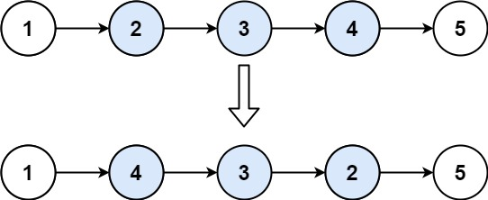

```text
输入：head = [1,2,3,4,5], left = 2, right = 4
输出：[1,4,3,2,5]
```

**示例 2**

```text
输入：head = [5], left = 1, right = 1
输出：[5]
```
> 题面与 [leetcode.cn 官方](https://leetcode.cn/problems/reverse-linked-list-ii/)一致，示例配图取自官方题面。

**数据范围与注意事项**：

- 链表中节点数目为 `n`
- `1 <= n <= 500`
- `-500 <= Node.val <= 500`
- `1 <= left <= right <= n`
- 进阶：你可以使用一趟扫描完成反转吗？
- **易错点**：断开 next 之前先把后继存下来，否则整条链会丢。

## 题目分析

**场景是什么**：链表只能顺着指针走，这类题练的是指针操作与断链重接，对应真实开发里的内存管理、撤销链。本题就是该场景的 Medium 级练习，主线做法是「单趟扫描」。

**主线怎么解**：把主解法从头到尾过一遍，它其实在依次做这几件事：单循环线性扫描。

## 解题思路

**方案对比**（共 3 个方案，由浅入深）：

| 方案 | 时间复杂度 | 空间复杂度 |
|---|---|---|
| 方案 1 · 单趟扫描 | O(n)（单趟线性扫描） | O(1) 到 O(n)（视辅助结构） |
| 方案 2 · 方案2（一次遍历，头插法） | O(n)（单趟线性扫描） | O(1) 到 O(n)（视辅助结构） |
| 方案 3 · 单趟扫描 | O(n)（单趟线性扫描） | O(1) 到 O(n)（视辅助结构） |

**由浅入深的路径**：单趟扫描 → 方案2（一次遍历，头插法）；每往右一步，都在补上一步的短板。

**方案间的取舍**：方案 1（单趟扫描）；方案 2（方案2（一次遍历，头插法））；方案 3（单趟扫描）。数据规模小、可读性优先时选靠前的方案；规模大、性能优先时选靠后的方案。

**怎么读这一篇**：

- 🐣 **新手路线**：把「题目描述」的示例 1 在纸上手推一遍 → 读方案 1（最直观的写法）与它的代码走读 → 按「运行方式」本地跑通看 PASS → 回头对比方案 2 之后的写法差在哪
- 🦅 **大佬路线**：直接锁定最优方案 1（单趟扫描，O(n)（单趟线性扫描））→ 跳读该方案代码与走读 → 用「逐步拆解与面试追问」补齐复杂度推导与边界追问

### 动态算法图（链表反转，GIF 自动循环）


动画演示链表专题里链表反转的典型过程；每个方案在「TypeScript 解题方案」一节还配了专属动画与专属流程图。

### 主解法流程图（真实控制流）

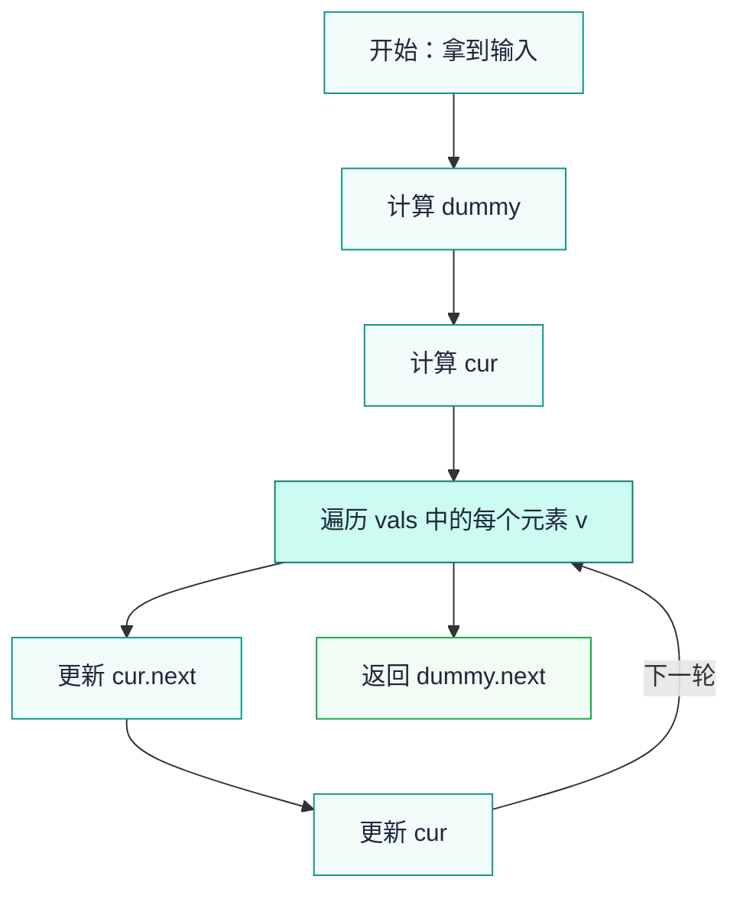

## TypeScript 解题方案（3 个方案逐个讲）

> **运行与提交**：每个方案都是自包含文件（内嵌用例自测，输出 PASS），整块复制到 `.ts` 文件后 `node 文件名` 即可运行。提交 LeetCode 时，把 `demo` 内的算法函数与辅助类型/函数整体取出、置于文件顶层即可。涉及交互/特殊接口的题以题面给定签名为准。

### 方案 1：单趟扫描

**分析与思路**：核心做法是「单趟扫描」。代码里依次做这些事：单循环线性扫描。

**运行方式**：`node 本文件`，内嵌用例全部通过会输出 PASS。


**方案专属流程图**（真实控制流）：

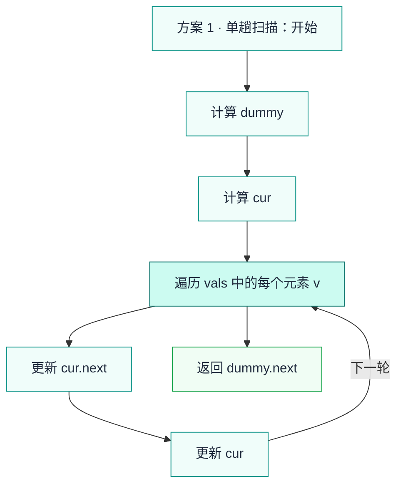

```typescript
class ListNode {
  // 定义类型
  val: number; // 值: number;
  next: ListNode | null; // 下一个: ListNode 按位或 null;
  constructor(val: number = 0, next: ListNode | null = null) {
    this.val = val;
    this.next = next; // 把 值; this.下一个 赋值为 下一个; 写入 值
  }
}
function buildList(vals: number[]): ListNode | null {
  // 定义函数/方法 buildList
  const dummy = new ListNode(0);
  let cur = dummy; // 把 new ListNode(0); let 当前值 赋值为 哨兵节点 存入 哨兵节点
  for (const v of vals) {
    cur.next = new ListNode(v);
    cur = cur.next;
  } // 把 new ListNode(值); 当前值 赋值为 当前值.下一个; } 写入 下一个
  return dummy.next; // 返回 哨兵节点.下一个
}
function listToArr(head: ListNode | null): number[] {
  // 定义函数/方法 listToArr
  const res: number[] = [];
  while (head) {
    res.push(head.val);
    head = head.next;
  }
  return res; // 把 头节点.值 压入栈/数组尾部
}

function assertEq(actual: any, expected: any, msg: string = ''): void {
  // 定义函数/方法 assertEq
  const a = JSON.stringify(actual);
  const e = JSON.stringify(expected);
  if (a !== e)
    throw new Error(
      'ASSERT FAILED ' + msg + ' :: actual=' + a + ' expected=' + e,
    );
}

function reverseLinkedList(head: ListNode | null): ListNode | null {
  // 定义函数/方法 reverseLinkedList
  let prev: ListNode | null = null;
  let curr = head; // 把 null; let 当前值 赋值为 头节点; 写入 let prev: ListNode | null
  while (curr) {
    const nxt = curr.next;
    curr.next = prev;
    prev = curr;
    curr = nxt;
  }
  return prev; // 返回 前一个
}
function reverseBetween(
  head: ListNode | null,
  left: number,
  right: number,
): ListNode | null {
  // 定义函数/方法 reverseBetween
  const dummy = new ListNode(-1);
  dummy.next = head; // 把 new ListNode( 减 1); 哨兵节点.下一个 赋值为 头节点 存入 哨兵节点
  let pre: ListNode = dummy; // 把 哨兵节点; 写入 let pre: ListNode
  for (let k = 0; k < left - 1; k++) pre = pre.next!; // 让 下标 k 从 0 开始计数，下标 k 小于 左边界 减 1 就继续
  const left_node = pre.next!; // 把 前缀和.下一个取反 存入 left_node
  let right_node: ListNode = pre; // 把 前缀和; 写入 let right_node: ListNode
  for (let k = 0; k < right - left; k++) right_node = right_node.next!; // 让 下标 k 从 0 开始计数，下标 k 小于 右边界 减 左边界 就继续
  const curr = right_node.next; // 把 right_node.下一个 存入 当前值
  pre.next = null; // 把 null; 写入 下一个
  right_node.next = null; // 把 null; 写入 下一个
  reverseLinkedList(left_node); // reverseLinkedList(left_node);
  pre.next = right_node; // 把 right_node; 写入 下一个
  left_node.next = curr; // 把 当前值; 写入 下一个
  return dummy.next; // 返回 哨兵节点.下一个
}
export function demo(): void {
  // 程序入口：跑内嵌自测用例
  assertEq(
    listToArr(reverseBetween(buildList([1, 2, 3, 4, 5]), 2, 4)!),
    [1, 3, 2, 4, 5],
    'rev1',
  ); // 断言校验
  assertEq(
    listToArr(reverseBetween(buildList([1, 2, 3, 4, 5]), 1, 4)!),
    [3, 2, 1, 4, 5],
    'rev2',
  ); // 断言校验
  assertEq(
    listToArr(reverseBetween(buildList([1, 2, 3, 4, 5]), 3, 4)!),
    [1, 2, 3, 4, 5],
    'rev3',
  ); // 断言校验
  console.log('PASS'); // 全部用例通过，输出 PASS
}
demo(); // demo();
```

### 方案 2：方案2（一次遍历，头插法）

**分析与思路**：核心做法是「方案2（一次遍历，头插法）」。代码里依次做这些事：单循环线性扫描。

**运行方式**：`node 本文件`，内嵌用例全部通过会输出 PASS。

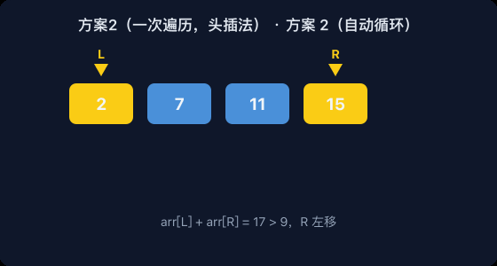

**方案专属流程图**（真实控制流）：

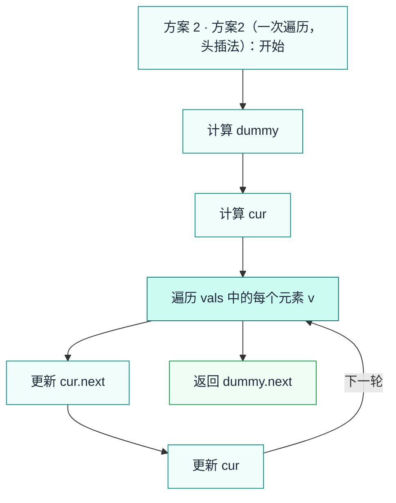

```typescript
/**
 ** LeetCode 92. 反转链表 II
 ** 方案：方案2（一次遍历，头插法）
 ** 来源：python 参考忠实移植
 */

class ListNode {
  // 定义类型
  val: number; // 值: number;
  next: ListNode | null; // 下一个: ListNode 按位或 null;
  constructor(val?: number, next?: ListNode | null) {
    // constructor(值?: number, 下一个?: ListNode 按位或 null) {
    this.val = val === undefined ? 0 : val; // 把 值 全等于 undefined ? 0 : 值; 写入 值
    this.next = next === undefined ? null : next; // 把 下一个 全等于 undefined ? null : 下一个; 写入 下一个
  }
}

function buildList(vals: number[]): ListNode | null {
  // 定义函数/方法 buildList
  const dummy = new ListNode(0); // 把 new ListNode(0) 存入 哨兵节点
  let cur = dummy; // 把 哨兵节点 存入 当前值
  for (const v of vals) {
    // for (const 值 of vals) {
    cur.next = new ListNode(v); // 把 new ListNode(值); 写入 下一个
    cur = cur.next; // 把 当前值.下一个 存入 当前值
  }
  return dummy.next; // 返回 哨兵节点.下一个
}

function listToArr(head: ListNode | null): number[] {
  // 定义函数/方法 listToArr
  const arr: number[] = []; // 把 []; 写入 const arr: number[]
  while (head) {
    // 循环，直到不满足「头节点」
    arr.push(head.val); // 把 头节点.值 压入栈/数组尾部
    head = head.next; // 把 头节点.下一个 存入 头节点
  }
  return arr; // 返回 数组
}

function reverseBetween(
  head: ListNode | null,
  left: number,
  right: number,
): ListNode | null {
  // 定义函数/方法 reverseBetween
  const dummy = new ListNode(-1); // 把 new ListNode( 减 1) 存入 哨兵节点
  dummy.next = head; // 把 头节点; 写入 下一个
  let pre = dummy; // 把 哨兵节点 存入 前缀和
  for (let i = 0; i < left - 1; i++) pre = pre.next!; // 让 下标 i 从 0 开始计数，下标 i 小于 左边界 减 1 就继续
  let cur = pre.next!; // 把 前缀和.下一个取反 存入 当前值
  for (let i = 0; i < right - left; i++) {
    // 让 下标 i 从 0 开始计数，下标 i 小于 右边界 减 左边界 就继续
    const nxt = cur.next!; // 把 当前值.下一个取反 存入 nxt
    cur.next = nxt.next; // 把 nxt.下一个; 写入 下一个
    nxt.next = pre.next; // 把 前缀和.下一个; 写入 下一个
    pre.next = nxt; // 把 nxt; 写入 下一个
  }
  return dummy.next; // 返回 哨兵节点.下一个
}

export function demo(): void {
  // 程序入口：跑内嵌自测用例
  function eqArr(a: number[], b: number[]): boolean {
    // 定义函数/方法 eqArr
    if (a.length !== b.length) return false; // 若 数组.长度 不等于 b.长度，直接返回 false
    for (let i = 0; i < a.length; i++) if (a[i] !== b[i]) return false; // 让 下标 i 从 0 开始计数，下标 i 小于 数组.长度 就继续
    return true; // 返回 true
  }
  const cases: { in: [number[], number, number]; want: number[] }[] = [
    { in: [[1, 2, 3, 4, 5], 2, 4], want: [1, 4, 3, 2, 5] },
    { in: [[1, 2, 3], 1, 3], want: [3, 2, 1] },
    { in: [[5], 1, 1], want: [5] },
  ];
  let fail = false; // 把 false 存入 fail
  for (const c of cases) {
    // for (const 字符 of cases) {
    const got = listToArr(reverseBetween(buildList(c.in[0]), c.in[1], c.in[2]));
    if (!eqArr(got, c.want)) {
      // 若 取反 eqArr(got, 字符.want
      fail = true; // 把 true 存入 fail
      console.log(
        'FAIL',
        JSON.stringify(c.in),
        'want',
        JSON.stringify(c.want),
        'got',
        JSON.stringify(got),
      ); // 打印输出
    }
  }
  if (fail) throw new Error('FAILED'); // 若 fail) throw new Error(「FAILED」);
  console.log('PASS'); // 全部用例通过，输出 PASS
}
demo(); // demo();
```

### 方案 3：单趟扫描

**分析与思路**：核心做法是「单趟扫描」。代码里依次做这些事：单循环线性扫描。

**运行方式**：`node 本文件`，内嵌用例全部通过会输出 PASS。


**方案专属流程图**（真实控制流）：

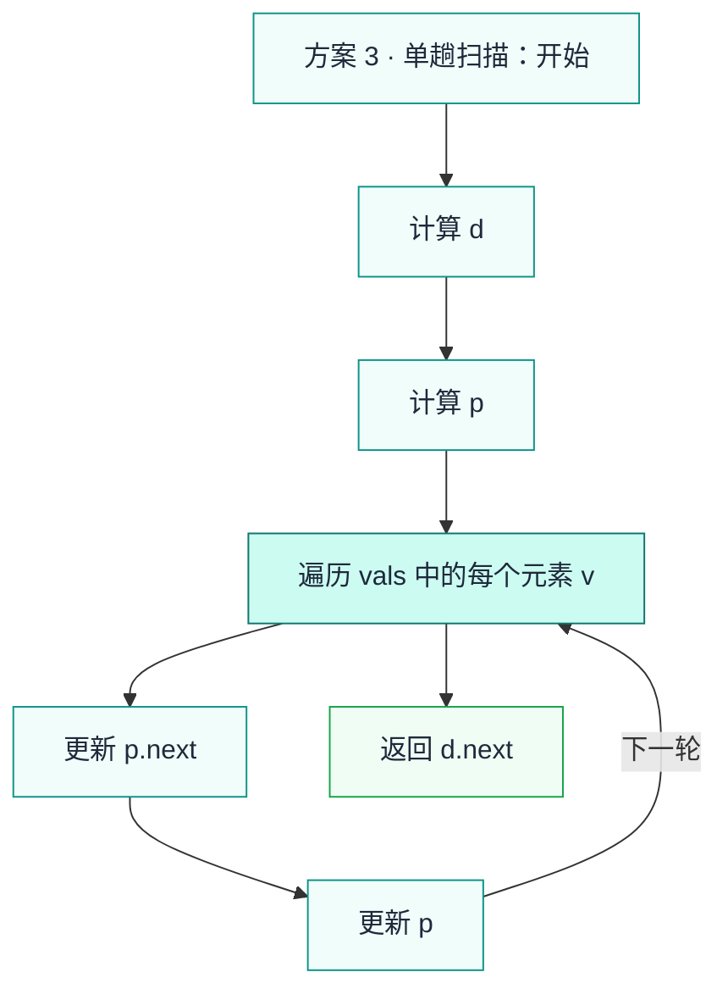

```typescript
export function demo(): void {
  // 程序入口：跑内嵌自测用例
  class ListNode {
    val: number;
    next: ListNode | null;
    constructor(v = 0, n: ListNode | null = null) {
      this.val = v;
      this.next = n;
    }
  } // 定义类型
  function build(vals: number[]): ListNode | null {
    const d = new ListNode();
    let p = d;
    for (const v of vals) {
      p.next = new ListNode(v);
      p = p.next;
    }
    return d.next;
  } // 定义函数/方法 build
  function toArr(h: ListNode | null): number[] {
    const r: number[] = [];
    while (h) {
      r.push(h.val);
      h = h.next;
    }
    return r;
  } // 定义函数/方法 toArr
  function reverseBetween(
    head: ListNode | null,
    left: number,
    right: number,
  ): ListNode | null {
    // 定义函数/方法 reverseBetween
    const dummy = new ListNode(0);
    dummy.next = head;
    let pre = dummy;
    for (let i = 1; i < left; i++) pre = pre.next!; // 让 下标 i 从 1 开始计数，下标 i 小于 左边界 就继续
    let start = pre.next!,
      then = start.next!; // 把 前缀和.下一个取反 , then 赋值为 起点.下一个取反 存入 起点
    for (let i = left; i < right; i++) {
      start.next = then.next;
      then.next = pre.next;
      pre.next = then;
      then = start.next!;
    } // 让 下标 i 从 左边界 开始计数，下标 i 小于 右边界 就继续
    return dummy.next; // 返回 哨兵节点.下一个
  }
  const cases = [
    { in: [1, 2, 3, 4, 5], l: 2, r: 4, want: [1, 4, 3, 2, 5] },
    { in: [5], l: 1, r: 1, want: [5] },
    { in: [1, 2, 3, 4, 5], l: 1, r: 5, want: [5, 4, 3, 2, 1] },
  ];
  let fail = false; // 把 false 存入 fail
  for (const c of cases) {
    const got = toArr(reverseBetween(build(c.in), c.l, c.r));
    if (JSON.stringify(got) !== JSON.stringify(c.want)) {
      fail = true;
      console.log('FAIL ' + got);
    }
  } // 打印输出
  if (fail) throw new Error('FAILED'); // 若 fail) throw new Error(「FAILED」);
  console.log('PASS'); // 全部用例通过，输出 PASS
}
demo(); // demo();
```

## 逐步拆解与面试追问

**复杂度**：时间 O(n)（单趟线性扫描），空间 O(1) 到 O(n)（视辅助结构）

**为什么是这个量级**：每个元素被常数次访问，辅助哈希或栈的开销与 n 同阶

**面试官可能会追问**：

- 能不能一次遍历完成？
- 快慢指针能解决哪些变体？
- 断链与接回的顺序怎么保证不出错？

## 关键 API 速查（TS 主解法实际用到，附官方链接）

| API | 作用 | 使用要点 | 官方文档 |
|---|---|---|---|
| `Array.prototype.push()` | 尾部追加 | 返回新长度；可一次多个；均摊 O(1)；会改变原数组 | [官方文档](https://developer.mozilla.org/zh-CN/docs/Web/JavaScript/Reference/Global_Objects/Array/push) |
| `JSON.stringify()` | 序列化为 JSON 字符串 | 常用于结构化比较（深度相等判定）；undefined/函数/循环引用会被丢弃或抛错 | [官方文档](https://developer.mozilla.org/zh-CN/docs/Web/JavaScript/Reference/Global_Objects/JSON/stringify) |

### 各语言官方文档导航

- **TypeScript / JS**：[MDN 中文参考](https://developer.mozilla.org/zh-CN/)
- **Python**：[Python 官方文档](https://docs.python.org/zh-cn/3/)
- **Go**：[Go 标准库](https://pkg.go.dev/std)
- **Java**：[JDK 17 API](https://docs.oracle.com/en/java/javase/17/docs/api/)
- **Rust**：[Rust 标准库](https://doc.rust-lang.org/std/)
- **Lua**：[Lua 5.4 手册](https://www.lua.org/manual/5.4/)
- **C**：[Cppreference C](https://zh.cppreference.com/w/c)
- **C++**：[Cppreference C++](https://zh.cppreference.com/w/cpp)
- **R**：[R 官方手册](https://stat.ethz.ch/R-manual/)
- **Zig**：[Zig 语言文档](https://ziglang.org/documentation/master/)
- **Dart**：[Dart API](https://api.dart.dev/)

## 附录：其他 10 种语言全部实现（每种语言列举其全部方案）

> TypeScript 的全部方案见「TypeScript 解题方案」一节；下面是其余 10 种语言的对应实现，每种语言的每个方案都带思路分析、代码走读与专属运行架构图。
> 每个方案都内嵌用例自测，可独立运行（老仓库 python/go 文件遵循「打印结果」约定）。
> 完整解法文件见 `dsa/<语言>/linked_list/lc_92_反转链表_ii/`。

### Python 实现（3 种方案）

Python 的全部方案如下，每个方案都内嵌用例自测，可独立运行（老仓库 python/go 文件遵循「打印结果」约定）：

#### 方案 1：单趟扫描

**思路与代码分析**：核心是「单趟扫描」。Python 版用切片与字典推导式简化操作，突出可读性。**走读**：方案 1 · 单趟扫描：开始 → 更新 prev → 更新 curr → 当 curr: 时反复执行 → 更新 nxt → 更新 curr.next → 更新 prev → 更新 curr → 返回 prev。

**运行架构**（真实控制流）：

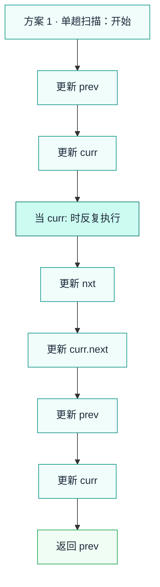

```python
# Definition for singly-linked list.
# class ListNode:
#     def __init__(self, val=0, next=None):
#         self.val = val
#         self.next = next

import sys  # 提高递归深度上限（深输入防 RecursionError）

sys.setrecursionlimit(200000)  # 树/链表类题目节点数可达 1e4 量级

def reverseLinkedList(head):  # 定义函数 reverseLinkedList（参数：头节点）
    prev = None  # 把 None 存入 前一个
    curr = head  # 把 头节点 存入 当前值
    while curr:  # 循环，直到不满足「当前值」
        nxt = curr.next  # 把 当前值.下一个 存入 nxt
        curr.next = prev  # 把 前一个 写入 下一个
        prev = curr  # 把 当前值 存入 前一个
        curr = nxt  # 把 nxt 存入 当前值
    return prev  # 返回 前一个

def reverseBetween(head, left, right):  # 定义函数 reverseBetween（参数：头节点, 左边界, 右边界）
    dummy = ListNode(-1)  # 把 ListNode( 减 1) 存入 哨兵节点
    dummy.next = head  # 把 头节点 写入 下一个
    pre = dummy  # 把 哨兵节点 存入 前缀和
    for _ in range(left - 1):  # 让 _ 从 左边界 减 1 遍历
        pre = pre.next  # 把 前缀和.下一个 存入 前缀和
    left_node = pre.next  # 把 前缀和.下一个 存入 left_node
    right_node = pre  # 把 前缀和 存入 right_node
    for _ in range(right - left):  # 让 _ 从 右边界 减 左边界 遍历
        right_node = right_node.next  # 把 right_node.下一个 存入 right_node
    curr = right_node.next  # 把 right_node.下一个 存入 当前值
    pre.next = None  # 把 None 写入 下一个
    right_node.next = None  # 把 None 写入 下一个
    reverseLinkedList(left_node)  # reverseLinkedList(left_node)
    pre.next = right_node  # 把 right_node 写入 下一个
    left_node.next = curr  # 把 当前值 写入 下一个
    return dummy.next  # 返回 哨兵节点.下一个

if __name__ == "__main__":  # 若 __name__ 等于 '__main__'
    print(reverseLinkedList(None))  # 打印输出
```

#### 方案 2：方案2（一次遍历，头插法）

**思路与代码分析**：核心是「方案2（一次遍历，头插法）」。Python 版用切片与字典推导式简化操作，突出可读性。**走读**：方案 2 · 方案2（一次遍历，头插法）：开始 → 更新 dummy → 更新 cur → 遍历 vals: 中的每个元素 v → 更新 cur.next → 更新 cur → 返回 dummy.next。

**运行架构**（真实控制流）：

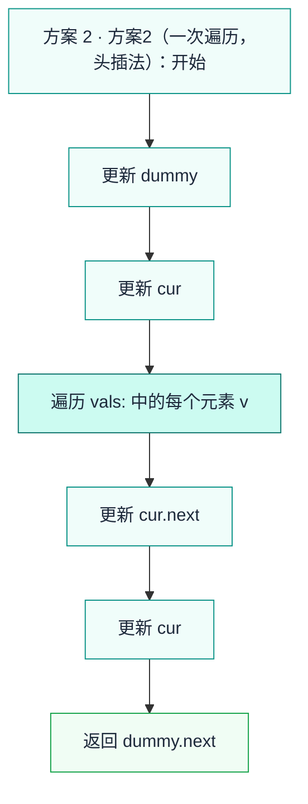

```python
import sys  # 提高递归深度上限（深输入防 RecursionError）

sys.setrecursionlimit(200000)  # 树/链表类题目节点数可达 1e4 量级

class ListNode:  # 定义类
    def __init__(self, val=0, next=None):  # 构造函数：初始化成员
        self.val = val  # 把 值 写入 值
        self.next = next  # 把 下一个 写入 下一个

def build_list(vals):  # 定义函数 build_list（参数：vals）
    dummy = ListNode(0)  # 把 ListNode(0) 存入 哨兵节点
    cur = dummy  # 把 哨兵节点 存入 当前值
    for v in vals:  # 逐个取出 vals 的元素（值）
        cur.next = ListNode(v)  # 把 ListNode(值) 写入 下一个
        cur = cur.next  # 把 当前值.下一个 存入 当前值
    return dummy.next  # 返回 哨兵节点.下一个

def list_to_arr(head):  # 定义函数 list_to_arr（参数：头节点）
    arr = []  # 把 [] 存入 数组
    while head:  # 循环，直到不满足「头节点」
        arr.append(head.val)  # 把 头节点.值 追加到列表尾部
        head = head.next  # 把 头节点.下一个 存入 头节点
    return arr  # 返回 数组

def reverseBetween(head, left, right):  # 定义函数 reverseBetween（参数：头节点, 左边界, 右边界）
    dummy = ListNode(-1)  # 把 ListNode( 减 1) 存入 哨兵节点
    dummy.next = head  # 把 头节点 写入 下一个
    pre = dummy  # 把 哨兵节点 存入 前缀和
    for _ in range(left - 1):  # 让 _ 从 左边界 减 1 遍历
        pre = pre.next  # 把 前缀和.下一个 存入 前缀和
    cur = pre.next  # 把 前缀和.下一个 存入 当前值
    for _ in range(right - left):  # 让 _ 从 右边界 减 左边界 遍历
        nxt = cur.next  # 把 当前值.下一个 存入 nxt
        cur.next = nxt.next  # 把 nxt.下一个 写入 下一个
        nxt.next = pre.next  # 把 前缀和.下一个 写入 下一个
        pre.next = nxt  # 把 nxt 写入 下一个
    return dummy.next  # 返回 哨兵节点.下一个

if __name__ == "__main__":  # 若 __name__ 等于 '__main__'
    head = build_list([1, 2, 3, 4, 5])  # 把 build_list([1, 2, 3, 4, 5]) 存入 头节点
    head = reverseBetween(head, 2, 4)  # 把 reverseBetween(头节点, 2, 4) 存入 头节点
    print(list_to_arr(head))  # 打印输出
```

#### 方案 3：单趟扫描

**思路与代码分析**：核心是「单趟扫描」。Python 版用切片与字典推导式简化操作，突出可读性。**走读**：方案 3 · 单趟扫描：开始 → 更新 dummy → 更新 cur → 遍历 vals: 中的每个元素 v → 更新 cur.next → 更新 cur → 返回 dummy.next。

**运行架构**（真实控制流）：

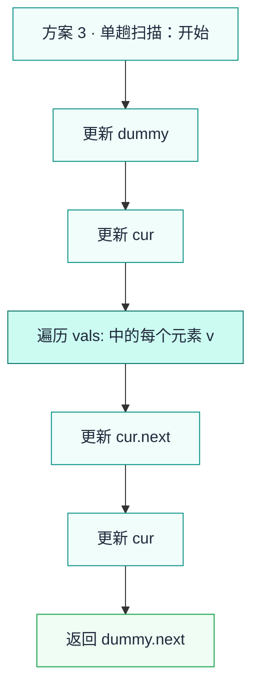

```python
import sys  # 提高递归深度上限（深输入防 RecursionError）

sys.setrecursionlimit(200000)  # 树/链表类题目节点数可达 1e4 量级

class ListNode:  # 定义类
    def __init__(self, val=0, next=None):  # 构造函数：初始化成员
        self.val = val  # 把 值 写入 值
        self.next = next  # 把 下一个 写入 下一个

def build_list(vals):  # 定义函数 build_list（参数：vals）
    dummy = ListNode(0)  # 把 ListNode(0) 存入 哨兵节点
    cur = dummy  # 把 哨兵节点 存入 当前值
    for v in vals:  # 逐个取出 vals 的元素（值）
        cur.next = ListNode(v)  # 把 ListNode(值) 写入 下一个
        cur = cur.next  # 把 当前值.下一个 存入 当前值
    return dummy.next  # 返回 哨兵节点.下一个

def list_to_arr(head):  # 定义函数 list_to_arr（参数：头节点）
    arr = []  # 把 [] 存入 数组
    while head:  # 循环，直到不满足「头节点」
        arr.append(head.val)  # 把 头节点.值 追加到列表尾部
        head = head.next  # 把 头节点.下一个 存入 头节点
    return arr  # 返回 数组

def reverseBetween(head, left, right):  # 定义函数 reverseBetween（参数：头节点, 左边界, 右边界）
    dummy = ListNode(-1)  # 把 ListNode( 减 1) 存入 哨兵节点
    dummy.next = head  # 把 头节点 写入 下一个
    tmp = dummy  # 把 哨兵节点 存入 临时变量
    for _ in range(left - 1):  # 让 _ 从 左边界 减 1 遍历
        tmp = tmp.next  # 把 临时变量.下一个 存入 临时变量
    prev = tmp.next  # 把 临时变量.下一个 存入 前一个
    cur = prev.next  # 把 前一个.下一个 存入 当前值
    for _ in range(right - left):  # 让 _ 从 右边界 减 左边界 遍历
        nxt = cur.next  # 把 当前值.下一个 存入 nxt
        cur.next = prev  # 把 前一个 写入 下一个
        prev = cur  # 把 当前值 存入 前一个
        cur = nxt  # 把 nxt 存入 当前值
    tmp.next.next = cur  # 把 当前值 写入 下一个
    tmp.next = prev  # 把 前一个 写入 下一个
    return dummy.next  # 返回 哨兵节点.下一个

if __name__ == "__main__":  # 若 __name__ 等于 '__main__'
    head = build_list([1, 2, 3, 4, 5])  # 把 build_list([1, 2, 3, 4, 5]) 存入 头节点
    head = reverseBetween(head, 2, 4)  # 把 reverseBetween(头节点, 2, 4) 存入 头节点
    print(list_to_arr(head))  # 打印输出
```

### Go 实现（3 种方案）

Go 的全部方案如下，每个方案都内嵌用例自测，可独立运行（老仓库 python/go 文件遵循「打印结果」约定）：

#### 方案 1：单趟扫描

**思路与代码分析**：核心是「单趟扫描」。Go 版用切片与多返回值惯用法，显式处理索引边界。**走读**：方案 1 · 单趟扫描：开始 → 计算 out → 遍历循环 → 更新 out → 更新 head → 返回 out。

**运行架构**（真实控制流）：

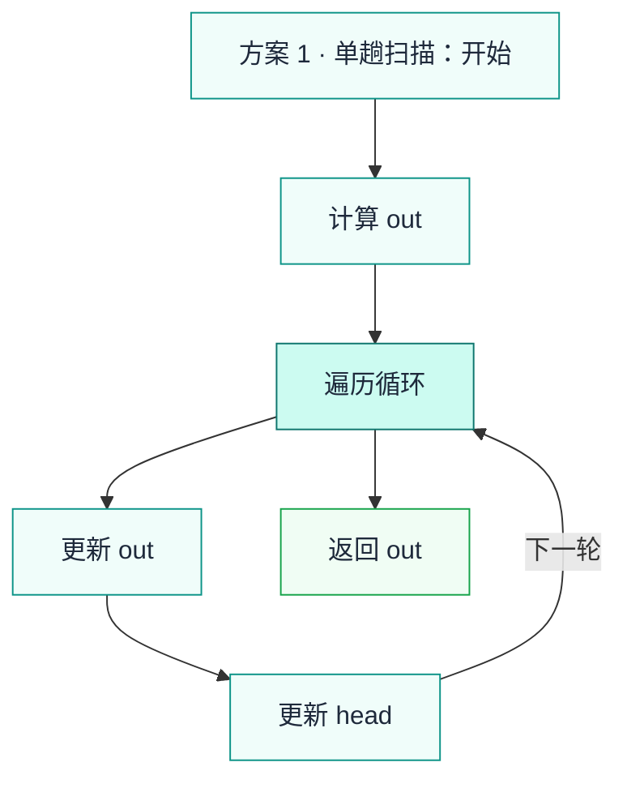

```go
package main // 引入依赖

import (
	"fmt"     // 「fmt」
	"os"      // 「os」
	"reflect" // 「reflect」
)

type ListNode struct { // 定义类型
	Val  int       // Val int
	Next *ListNode // Next 乘 ListNode
}

func buildList(vals []int) *ListNode { // 定义函数/方法 buildList
	dummy := &ListNode{}     // 把 按位与 ListNode{} 写入 dummy :
	curr := dummy            // 把 哨兵节点 写入 curr :
	for _, v := range vals { // 同时取 _ 与 值 遍历
		curr.Next = &ListNode{Val: v} // 把 按位与 ListNode{Val: 值} 写入 curr.Next
		curr = curr.Next              // 把 当前值.Next 写入 当前值
	}
	return dummy.Next // 返回 哨兵节点.Next
}

func listToSlice(head *ListNode) []int { // 定义函数/方法 listToSlice
	var out []int     // var out []int
	for head != nil { // 把 nil { 写入 for head !
		out = append(out, head.Val) // 把 append(out, 头节点.Val) 写入 out
		head = head.Next            // 把 头节点.Next 写入 头节点
	}
	return out // 返回 out
}

func reverseLinkedList(head *ListNode) *ListNode { // 定义函数/方法 reverseLinkedList
	var prev *ListNode // var 前一个 乘 ListNode
	curr := head       // 把 头节点 写入 curr :
	for curr != nil {  // 把 nil { 写入 for curr !
		nxt := curr.Next // 把 当前值.Next 写入 nxt :
		curr.Next = prev // 把 前一个 写入 curr.Next
		prev = curr      // 把 当前值 写入 前一个
		curr = nxt       // 把 nxt 写入 当前值
	}
	return prev // 返回 前一个
}

// reverseBetween 忠实翻译 Python 参考（反转 [left, right] 区间）
func reverseBetween(head *ListNode, left, right int) *ListNode { // 定义函数/方法 reverseBetween
	if left >= right { // 若 左边界 不低于 右边界
		return head // 返回 头节点
	}
	dummy := &ListNode{Val: -1}   // 把 按位与 ListNode{Val: 减 1} 写入 dummy :
	dummy.Next = head             // 把 头节点 写入 dummy.Next
	pre := dummy                  // 把 哨兵节点 写入 pre :
	for i := 0; i < left-1; i++ { // 让 下标 i 从 0 开始计数
		pre = pre.Next // 把 前缀和.Next 写入 前缀和
	}
	leftNode := pre.Next              // 把 前缀和.Next 写入 leftNode :
	rightNode := pre                  // 把 前缀和 写入 rightNode :
	for i := 0; i < right-left; i++ { // 让 下标 i 从 0 开始计数
		rightNode = rightNode.Next // 把 rightNode.Next 写入 rightNode
	}
	curr := rightNode.Next      // 把 rightNode.Next 写入 curr :
	pre.Next = nil              // 把 nil 写入 pre.Next
	rightNode.Next = nil        // 把 nil 写入 rightNode.Next
	reverseLinkedList(leftNode) // reverseLinkedList(leftNode)
	pre.Next = rightNode        // 把 rightNode 写入 pre.Next
	leftNode.Next = curr        // 把 当前值 写入 leftNode.Next
	return dummy.Next           // 返回 哨兵节点.Next
}

func main() { // 程序入口：跑内嵌自测用例
	cases := []struct { // 把 []struct { 写入 cases :
		in   []int // in []int
		l, r int   // 左指针, 右指针 int
		want []int // want []int
	}{ // }{
		{[]int{1, 2, 3, 4, 5}, 2, 4, []int{1, 3, 2, 4, 5}},
		{[]int{1, 2, 3, 4, 5}, 1, 3, []int{2, 1, 3, 4, 5}},
	}
	ok := true                // 把 true 写入 ok :
	for _, c := range cases { // 同时取 _ 与 字符 遍历
		got := listToSlice(reverseBetween(buildList(c.in), c.l, c.r))
		if !reflect.DeepEqual(got, c.want) { // 若 取反 reflect.DeepEqual(got, 字符.want
			ok = false                                                                            // 把 false 写入 ok
			fmt.Printf("FAIL reverseBetween(%v,%d,%d)=%v want %v\n", c.in, c.l, c.r, got, c.want) // 打印输出
		}
	}
	if !ok { // 若 取反 ok
		os.Exit(1) // os.Exit(1)
	}
	fmt.Println("PASS") // 全部用例通过，输出 PASS
}
```

#### 方案 2：方案2（一次遍历，头插法）

**思路与代码分析**：核心是「方案2（一次遍历，头插法）」。Go 版用切片与多返回值惯用法，显式处理索引边界。**走读**：方案 2 · 方案2（一次遍历，头插法）：开始 → 计算 out → 遍历循环 → 更新 out → 更新 head → 返回 out。

**运行架构**（真实控制流）：

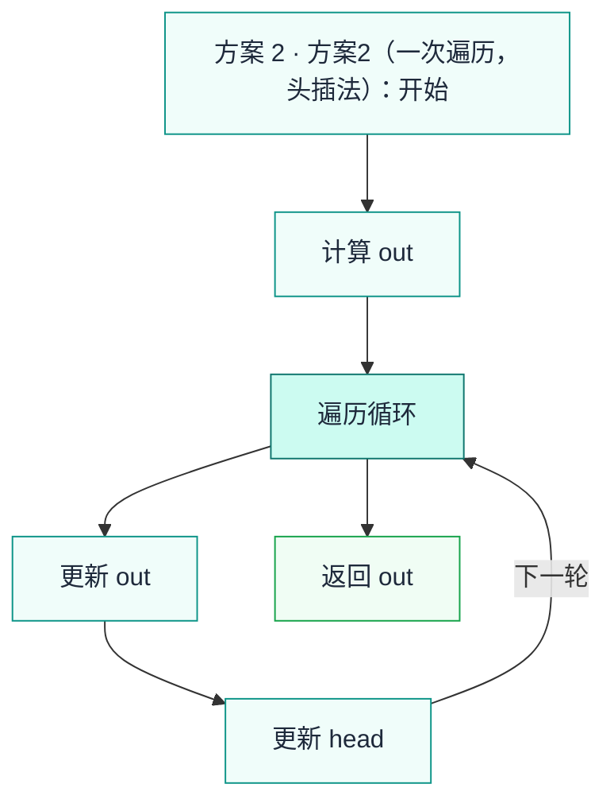

```go
package main // 引入依赖

import (
	"fmt"
	"os"
	"reflect"
) // 引入依赖

type ListNode struct { // 定义类型
	Val  int       // Val int
	Next *ListNode // Next 乘 ListNode
}

func buildList(vals []int) *ListNode { // 定义函数/方法 buildList
	dummy := &ListNode{}     // 把 按位与 ListNode{} 写入 dummy :
	curr := dummy            // 把 哨兵节点 写入 curr :
	for _, v := range vals { // 同时取 _ 与 值 遍历
		curr.Next = &ListNode{Val: v} // 把 按位与 ListNode{Val: 值} 写入 curr.Next
		curr = curr.Next              // 把 当前值.Next 写入 当前值
	}
	return dummy.Next // 返回 哨兵节点.Next
}

func listToSlice(head *ListNode) []int { // 定义函数/方法 listToSlice
	var out []int     // var out []int
	for head != nil { // 把 nil { 写入 for head !
		out = append(out, head.Val) // 把 append(out, 头节点.Val) 写入 out
		head = head.Next            // 把 头节点.Next 写入 头节点
	}
	return out // 返回 out
}

func reverseBetween(head *ListNode, left, right int) *ListNode { // 定义函数/方法 reverseBetween
	dummy := &ListNode{Val: -1}   // 把 按位与 ListNode{Val: 减 1} 写入 dummy :
	dummy.Next = head             // 把 头节点 写入 dummy.Next
	pre := dummy                  // 把 哨兵节点 写入 pre :
	for i := 0; i < left-1; i++ { // 让 下标 i 从 0 开始计数
		pre = pre.Next // 把 前缀和.Next 写入 前缀和
	}
	cur := pre.Next                   // 把 前缀和.Next 写入 cur :
	for i := 0; i < right-left; i++ { // 让 下标 i 从 0 开始计数
		nxt := cur.Next     // 把 当前值.Next 写入 nxt :
		cur.Next = nxt.Next // 把 nxt.Next 写入 cur.Next
		nxt.Next = pre.Next // 把 前缀和.Next 写入 nxt.Next
		pre.Next = nxt      // 把 nxt 写入 pre.Next
	}
	return dummy.Next // 返回 哨兵节点.Next
}

func main() { // 程序入口：跑内嵌自测用例
	cases := []struct { // 把 []struct { 写入 cases :
		in   []int // in []int
		l, r int   // 左指针, 右指针 int
		want []int // want []int
	}{ // }{
		{[]int{1, 2, 3, 4, 5}, 2, 4, []int{1, 4, 3, 2, 5}},
		{[]int{5}, 1, 1, []int{5}},
		{[]int{1, 2, 3, 4, 5}, 1, 5, []int{5, 4, 3, 2, 1}},
	}
	ok := true                // 把 true 写入 ok :
	for _, c := range cases { // 同时取 _ 与 字符 遍历
		got := listToSlice(reverseBetween(buildList(c.in), c.l, c.r))
		if !reflect.DeepEqual(got, c.want) { // 若 取反 reflect.DeepEqual(got, 字符.want
			ok = false                                                                            // 把 false 写入 ok
			fmt.Printf("FAIL reverseBetween(%v,%d,%d)=%v want %v\n", c.in, c.l, c.r, got, c.want) // 打印输出
		}
	}
	if !ok { // 若 取反 ok
		os.Exit(1) // os.Exit(1)
	}
	fmt.Println("PASS") // 全部用例通过，输出 PASS
}
```

#### 方案 3：单趟扫描

**思路与代码分析**：核心是「单趟扫描」。Go 版用切片与多返回值惯用法，显式处理索引边界。**走读**：方案 3 · 单趟扫描：开始 → 更新 : → 遍历循环 → 更新 res → 更新 head → 返回 res。

**运行架构**（真实控制流）：


```go
package main // 引入依赖
import (
	"fmt"
	"os"
	"reflect"
) // 引入依赖
type ListNode struct {
	Val  int
	Next *ListNode
} // 定义类型
func buildList(vals []int) *ListNode { // 定义函数/方法 buildList
	dummy := &ListNode{}
	p := dummy // 把 按位与 ListNode{}; 节点 : 赋值为 哨兵节点 写入 dummy :
	for _, v := range vals {
		p.Next = &ListNode{Val: v}
		p = p.Next
	} // 同时取 _ 与 值 遍历
	return dummy.Next // 返回 哨兵节点.Next
}
func toArr(head *ListNode) []int { // 定义函数/方法 toArr
	res := []int{} // 把 []int{} 写入 res :
	for head != nil {
		res = append(res, head.Val)
		head = head.Next
	}
	return res // 返回 结果
}
func reverseBetween(head *ListNode, left, right int) *ListNode { // 定义函数/方法 reverseBetween
	dummy := &ListNode{Next: head} // 把 按位与 ListNode{Next: 头节点} 写入 dummy :
	pre := dummy                   // 把 哨兵节点 写入 pre :
	for i := 1; i < left; i++ {
		pre = pre.Next
	} // 让 下标 i 从 1 开始计数
	start := pre.Next               // 把 前缀和.Next 写入 start :
	then := start.Next              // 把 起点.Next 写入 then :
	for i := left; i < right; i++ { // 把 左边界; 下标 i 小于 右边界; 下标 i 加一 { 写入 for i :
		start.Next = then.Next // 把 then.Next 写入 start.Next
		then.Next = pre.Next   // 把 前缀和.Next 写入 then.Next
		pre.Next = then        // 把 then 写入 pre.Next
		then = start.Next      // 把 起点.Next 写入 then
	}
	return dummy.Next // 返回 哨兵节点.Next
}
func main() { // 程序入口：跑内嵌自测用例
	cases := []struct {
		in   []int
		l, r int
		want []int
	}{ // 把 []struct{ in []int; 左指针, 右指针 int; want []int }{ 写入 cases :
		{[]int{1, 2, 3, 4, 5}, 2, 4, []int{1, 4, 3, 2, 5}},
		{[]int{5}, 1, 1, []int{5}},
		{[]int{1, 2, 3, 4, 5}, 1, 5, []int{5, 4, 3, 2, 1}},
	}
	ok := true                // 把 true 写入 ok :
	for _, c := range cases { // 同时取 _ 与 字符 遍历
		got := toArr(reverseBetween(buildList(c.in), c.l, c.r))
		if !reflect.DeepEqual(got, c.want) {
			ok = false
			fmt.Printf("FAIL %v\n", got)
		}
	}
	if !ok {
		os.Exit(1)
	} // 若 取反 ok { os.Exit(1) }
	fmt.Println("PASS") // 全部用例通过，输出 PASS
}
```

### Java 实现（3 种方案）

Java 的全部方案如下，每个方案都内嵌用例自测，可独立运行（老仓库 python/go 文件遵循「打印结果」约定）：

#### 方案 1：单趟扫描

**思路与代码分析**：核心是「单趟扫描」。Java 版用类与静态方法组织，集合操作显式明了。代码里依次做这些事：双重循环遍历。

**运行架构**（真实控制流）：

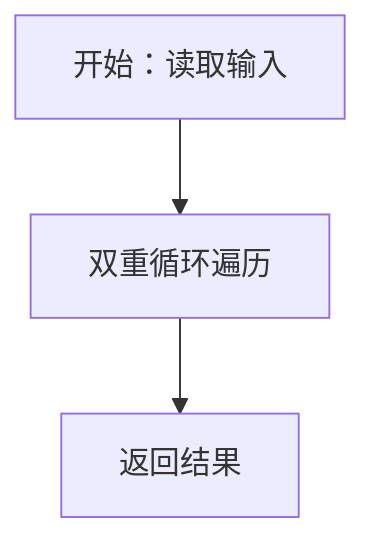

```java
package com.webfault.dsa; // 引入依赖

import java.util.*; // 引入依赖

class lc92_solution111 { // 定义类型
  static class ListNode { // static class ListNode {
    int val; // int 值;
    ListNode next; // ListNode 下一个;

    ListNode() {} // ListNode() {}

    ListNode(int v) {
      val = v;
    } // 把 值; } 写入 ListNode(int v) { val
  }

  public ListNode reverseBetween(ListNode head, int left, int right) { // 定义函数/方法 reverseBetween
    ListNode dummyNode = new ListNode(-1); // 把 new ListNode( 减 1); 写入 ListNode dummyNode
    dummyNode.next = head; // 把 头节点; 写入 下一个
    ListNode pre = dummyNode; // 把 dummyNode; 写入 ListNode pre
    for (int i = 0; i < left - 1; i++) { // 让 下标 i 从 0 开始计数，下标 i 小于 左边界 减 1 就继续
      pre = pre.next; // 把 前缀和.下一个; 写入 前缀和
    }
    ListNode rightNode = pre; // 把 前缀和; 写入 ListNode rightNode
    for (int i = 0; i < right - left + 1; i++) { // 让 下标 i 从 0 开始计数，下标 i 小于 右边界 减 左边界 加 1 就继续
      rightNode = rightNode.next; // 把 rightNode.下一个; 写入 rightNode
    }
    ListNode leftNode = pre.next; // 把 前缀和.下一个; 写入 ListNode leftNode
    ListNode curr = rightNode.next; // 把 rightNode.下一个; 写入 ListNode curr
    pre.next = null; // 把 null; 写入 下一个
    rightNode.next = null; // 把 null; 写入 下一个
    reverseList(leftNode); // reverseList(leftNode);
    pre.next = rightNode; // 把 rightNode; 写入 下一个
    leftNode.next = curr; // 把 当前值; 写入 下一个
    return dummyNode.next; // 返回 dummyNode.下一个
  }

  private void reverseList(ListNode leftNode) { // 定义函数/方法 reverseList
    ListNode prev = null; // 把 null; 写入 ListNode prev
    ListNode curr = leftNode; // 把 leftNode; 写入 ListNode curr
    while (curr != null) { // 循环，直到不满足「当前值 不等于 null」
      ListNode next = curr.next; // 把 当前值.下一个; 写入 ListNode next
      curr.next = prev; // 把 前一个; 写入 下一个
      prev = curr; // 把 当前值; 写入 前一个
      curr = next; // 把 下一个; 写入 当前值
    }
  }

  static ListNode build(int[] a) { // 定义函数/方法 build
    ListNode dummy = new ListNode(0),
        cur = dummy; // 把 new ListNode(0), 当前值 赋值为 哨兵节点; 写入 ListNode dummy
    for (int v : a) {
      cur.next = new ListNode(v);
      cur = cur.next;
    } // 把 new ListNode(值); 当前值 赋值为 当前值.下一个; } 写入 下一个
    return dummy.next; // 返回 哨兵节点.下一个
  }

  static List<Integer> toList(ListNode h) { // 定义函数/方法 toList
    List<Integer> r = new ArrayList<>(); // 把 new ArrayList 小于 超过 (); 写入 List<Integer> r
    while (h != null) {
      r.add(h.val);
      h = h.next;
    } // 循环，直到不满足「h 不等于 null) { 右指针 追加 h.值); h 赋值为 h.下一个; }」
    return r; // 返回 右指针
  }

  static boolean eqList(ListNode a, ListNode b) { // 定义函数/方法 eqList
    while (a != null && b != null) {
      if (a.val != b.val) return false;
      a = a.next;
      b = b.next;
    }
    return a == null && b == null; // 返回 数组 等于 null 且 b 等于 null
  }

  public static void main(String[] args) { // public static void main(String[] args) {
    lc92_solution111 s = new lc92_solution111(); // 把 new lc92_solution111(); 写入 lc92_solution111 s
    Object[] t1 = new Object[] {new int[] {1, 2, 3, 4, 5}, 2, 4, new int[] {1, 4, 3, 2, 5}};
    Object[] t2 = new Object[] {new int[] {1, 2, 3}, 1, 3, new int[] {3, 2, 1}};
    Object[] t3 = new Object[] {new int[] {1, 2, 3}, 1, 1, new int[] {1, 2, 3}};
    Object[][] tests = {t1, t2, t3}; // 把 {t1, t2, t3}; 写入 Object[][] tests
    boolean ok = true; // 把 true; 写入 boolean ok
    for (Object[] t : tests) { // for (Object[] 另一字符串 : tests) {
      int[] inp = (int[]) t[0]; // 把 (int[]) 另一字符串[0]; 写入 int[] inp
      int l = (int) t[1]; // 把 (int) 另一字符串[1] 存入 左指针
      int r = (int) t[2]; // 把 (int) 另一字符串[2] 存入 右指针
      int[] want = (int[]) t[3]; // 把 (int[]) 另一字符串[3]; 写入 int[] want
      ListNode got =
          s.reverseBetween(
              build(inp), l, r); // 把 字符串.reverseBetween(build(inp), 左指针, 右指针); 写入 ListNode got
      if (!eqList(got, build(want))) { // 若 取反 eqList(got, build(want
        ok = false; // 把 false; 写入 ok
        System.out.println(
            "FAIL reverseBetween("
                + Arrays.toString(inp)
                + ","
                + l
                + ","
                + r
                + ")="
                + toList(got)
                + " want "
                + Arrays.toString(want)); // 打印输出
      }
    }
    if (!ok) throw new RuntimeException("FAILED"); // 若 取反 ok) throw new RuntimeException(「FAILED」);
    System.out.println("PASS"); // 全部用例通过，输出 PASS
  }
}
```

#### 方案 2：方案2（一次遍历，头插法）

**思路与代码分析**：核心是「方案2（一次遍历，头插法）」。Java 版用类与静态方法组织，集合操作显式明了。代码里依次做这些事：双重循环遍历。**走读**：方案 2 · 方案2（一次遍历，头插法）：开始 → 更新 n → 遍历循环 → 更新 r → 更新 i → 遍历循环 → 返回 r。

**运行架构**（真实控制流）：

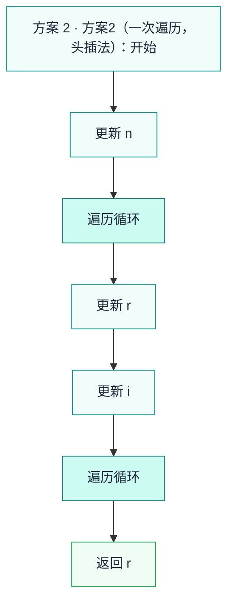

```java
package com.webfault.dsa; // 引入依赖

import java.util.Arrays; // 引入依赖

class ListNode {
  int val;
  ListNode next;

  ListNode() {}

  ListNode(int v) {
    val = v;
  }

  ListNode(int v, ListNode n) {
    val = v;
    next = n;
  }
} // 定义类型

class Main { // 定义类型
  static ListNode build(int[] vals) {
    ListNode d = new ListNode();
    ListNode p = d;
    for (int v : vals) {
      p.next = new ListNode(v);
      p = p.next;
    }
    return d.next;
  }

  static int[] toArr(ListNode h) {
    int n = 0;
    for (ListNode x = h; x != null; x = x.next) n++;
    int[] r = new int[n];
    int i = 0;
    for (; h != null; h = h.next) r[i++] = h.val;
    return r;
  }

  static ListNode reverseBetween(ListNode head, int left, int right) { // 定义函数/方法 reverseBetween
    ListNode dummy = new ListNode(0);
    dummy.next = head;
    ListNode pre = dummy;
    for (int i = 1; i < left; i++) pre = pre.next; // 让 下标 i 从 1 开始计数，下标 i 小于 左边界 就继续
    ListNode start = pre.next, then = start.next; // 把 前缀和.下一个, then 赋值为 起点.下一个; 写入 ListNode start
    for (int i = left; i < right; i++) {
      start.next = then.next;
      then.next = pre.next;
      pre.next = then;
      then = start.next;
    } // 让 下标 i 从 左边界 开始计数，下标 i 小于 右边界 就继续
    return dummy.next; // 返回 哨兵节点.下一个
  }

  public static void main(String[] args) { // public static void main(String[] args) {
    int[][] ins = {{1, 2, 3, 4, 5}, {5}, {1, 2, 3, 4, 5}};
    int[] ls = {2, 1, 1};
    int[] rs = {4, 1, 5};
    int[][] ws = {{1, 4, 3, 2, 5}, {5}, {5, 4, 3, 2, 1}};
    boolean ok = true; // 把 true; 写入 boolean ok
    for (int i = 0; i < ins.length; i++) {
      int[] got = toArr(reverseBetween(build(ins[i]), ls[i], rs[i]));
      if (!Arrays.equals(got, ws[i])) {
        ok = false;
        System.out.println("FAIL " + Arrays.toString(got));
      }
    } // 让 下标 i 从 0 开始计数，下标 i 小于 ins.长度 就继续
    if (!ok) throw new RuntimeException("FAILED"); // 若 取反 ok) throw new RuntimeException(「FAILED」);
    System.out.println("PASS"); // 全部用例通过，输出 PASS
  }
}
```

#### 方案 3：单趟扫描

**思路与代码分析**：核心是「单趟扫描」。Java 版用类与静态方法组织，集合操作显式明了。代码里依次做这些事：双重循环遍历。

**运行架构**：与方案 1 的控制流相同（同算法在该语言的等价实现），图见上。

```java
package com.webfault.dsa; // 引入依赖

import java.util.*; // 引入依赖

class lc92_solution333 { // 定义类型
  static class ListNode { // static class ListNode {
    int val; // int 值;
    ListNode next; // ListNode 下一个;

    ListNode() {} // ListNode() {}

    ListNode(int v) {
      val = v;
    } // 把 值; } 写入 ListNode(int v) { val
  }

  public ListNode reverseBetween(ListNode head, int left, int right) { // 定义函数/方法 reverseBetween
    ListNode dummy = new ListNode(0); // 把 new ListNode(0); 写入 ListNode dummy
    dummy.next = head; // 把 头节点; 写入 下一个
    ListNode pre = dummy; // 把 哨兵节点; 写入 ListNode pre
    for (int i = 0; i < left - 1; i++) { // 让 下标 i 从 0 开始计数，下标 i 小于 左边界 减 1 就继续
      pre = pre.next; // 把 前缀和.下一个; 写入 前缀和
    }
    ListNode cur = pre.next; // 把 前缀和.下一个; 写入 ListNode cur
    for (int i = 0; i < right - left; i++) { // 让 下标 i 从 0 开始计数，下标 i 小于 右边界 减 左边界 就继续
      ListNode next = cur.next; // 把 当前值.下一个; 写入 ListNode next
      cur.next = next.next; // 把 下一个.下一个; 写入 下一个
      next.next = pre.next; // 把 前缀和.下一个; 写入 下一个
      pre.next = next; // 把 下一个; 写入 下一个
    }
    return dummy.next; // 返回 哨兵节点.下一个
  }

  static ListNode build(int[] a) { // 定义函数/方法 build
    ListNode dummy = new ListNode(0),
        cur = dummy; // 把 new ListNode(0), 当前值 赋值为 哨兵节点; 写入 ListNode dummy
    for (int v : a) {
      cur.next = new ListNode(v);
      cur = cur.next;
    } // 把 new ListNode(值); 当前值 赋值为 当前值.下一个; } 写入 下一个
    return dummy.next; // 返回 哨兵节点.下一个
  }

  static List<Integer> toList(ListNode h) { // 定义函数/方法 toList
    List<Integer> r = new ArrayList<>(); // 把 new ArrayList 小于 超过 (); 写入 List<Integer> r
    while (h != null) {
      r.add(h.val);
      h = h.next;
    } // 循环，直到不满足「h 不等于 null) { 右指针 追加 h.值); h 赋值为 h.下一个; }」
    return r; // 返回 右指针
  }

  static boolean eqList(ListNode a, ListNode b) { // 定义函数/方法 eqList
    while (a != null && b != null) {
      if (a.val != b.val) return false;
      a = a.next;
      b = b.next;
    }
    return a == null && b == null; // 返回 数组 等于 null 且 b 等于 null
  }

  public static void main(String[] args) { // public static void main(String[] args) {
    lc92_solution333 s = new lc92_solution333(); // 把 new lc92_solution333(); 写入 lc92_solution333 s
    Object[] t1 = new Object[] {new int[] {1, 2, 3, 4, 5}, 2, 4, new int[] {1, 4, 3, 2, 5}};
    Object[] t2 = new Object[] {new int[] {1, 2, 3}, 1, 3, new int[] {3, 2, 1}};
    Object[] t3 = new Object[] {new int[] {1, 2, 3}, 1, 1, new int[] {1, 2, 3}};
    Object[][] tests = {t1, t2, t3}; // 把 {t1, t2, t3}; 写入 Object[][] tests
    boolean ok = true; // 把 true; 写入 boolean ok
    for (Object[] t : tests) { // for (Object[] 另一字符串 : tests) {
      int[] inp = (int[]) t[0]; // 把 (int[]) 另一字符串[0]; 写入 int[] inp
      int l = (int) t[1]; // 把 (int) 另一字符串[1] 存入 左指针
      int r = (int) t[2]; // 把 (int) 另一字符串[2] 存入 右指针
      int[] want = (int[]) t[3]; // 把 (int[]) 另一字符串[3]; 写入 int[] want
      ListNode got =
          s.reverseBetween(
              build(inp), l, r); // 把 字符串.reverseBetween(build(inp), 左指针, 右指针); 写入 ListNode got
      if (!eqList(got, build(want))) { // 若 取反 eqList(got, build(want
        ok = false; // 把 false; 写入 ok
        System.out.println(
            "FAIL reverseBetween("
                + Arrays.toString(inp)
                + ","
                + l
                + ","
                + r
                + ")="
                + toList(got)
                + " want "
                + Arrays.toString(want)); // 打印输出
      }
    }
    if (!ok) throw new RuntimeException("FAILED"); // 若 取反 ok) throw new RuntimeException(「FAILED」);
    System.out.println("PASS"); // 全部用例通过，输出 PASS
  }
}
```

### Rust 实现（3 种方案）

Rust 的全部方案如下，每个方案都内嵌用例自测，可独立运行（老仓库 python/go 文件遵循「打印结果」约定）：

#### 方案 1：单趟扫描

**思路与代码分析**：核心是「单趟扫描」。Rust 版用所有权移动与切片借用改写同一逻辑，注意 Option 与引用边界。**走读**：方案 1 · 单趟扫描：开始 → 计算 v → 计算 let (l, r) = ((left - 1) → 计算 seg → 更新 v[l.. → 处理 v → 返回结果。

**运行架构**（真实控制流）：

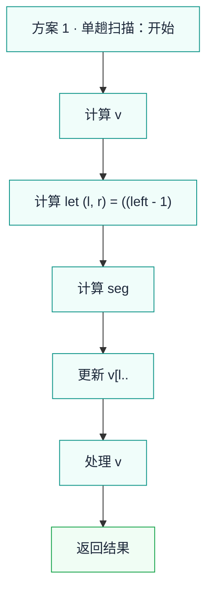

```rust
// LeetCode 92. 反转链表II — Rust 版（方案1）
fn reverse_between(vals: Vec<i32>, left: i32, right: i32) -> Vec<i32> {
    // 定义函数/方法 reverse_between
    let mut v = vals; // 把 vals; 写入 let mut v
    let (l, r) = ((left - 1) as usize, (right - 1) as usize); // 把 ((左边界 减 1) as usize, (右边界 减 1) as usize); 写入 let (l, r)
    let seg: Vec<i32> = v[l..=r].iter().rev().cloned().collect();
    v[l..=r].copy_from_slice(&seg); // 把 右指针].copy_from_slice( 按位与 seg); 写入 v[l
    v
}
fn main() {
    // 程序入口：跑内嵌自测用例
    assert_eq!(
        reverse_between(vec![1, 2, 3, 4, 5], 2, 4),
        vec![1, 4, 3, 2, 5]
    ); // 断言校验
    assert_eq!(
        reverse_between(vec![1, 2, 3, 4, 5], 1, 4),
        vec![4, 3, 2, 1, 5]
    ); // 断言校验
    assert_eq!(reverse_between(vec![5], 1, 1), vec![5]); // 断言校验
    println!("PASS"); // 全部用例通过，输出 PASS
}
```

#### 方案 2：方案2（一次遍历，头插法）

**思路与代码分析**：核心是「方案2（一次遍历，头插法）」。Rust 版用所有权移动与切片借用改写同一逻辑，注意 Option 与引用边界。**走读**：方案 2 · 方案2（一次遍历，头插法）：开始 → 计算 v → 计算 let (l, r) = ((left - 1) → 计算 seg → 更新 v[l.. → 处理 v → 返回结果。

**运行架构**（真实控制流）：

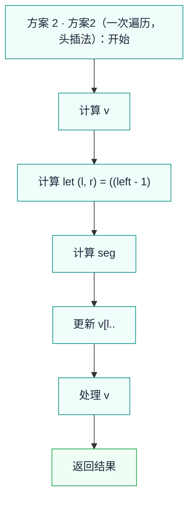

```rust
// LeetCode 92. 反转链表II — Rust 版（方案2）
fn reverse_between(vals: Vec<i32>, left: i32, right: i32) -> Vec<i32> {
    // 定义函数/方法 reverse_between
    let mut v = vals; // 把 vals; 写入 let mut v
    let (l, r) = ((left - 1) as usize, (right - 1) as usize); // 把 ((左边界 减 1) as usize, (右边界 减 1) as usize); 写入 let (l, r)
    let seg: Vec<i32> = v[l..=r].iter().rev().cloned().collect();
    v[l..=r].copy_from_slice(&seg); // 把 右指针].copy_from_slice( 按位与 seg); 写入 v[l
    v
}
fn main() {
    // 程序入口：跑内嵌自测用例
    assert_eq!(
        reverse_between(vec![1, 2, 3, 4, 5], 2, 4),
        vec![1, 4, 3, 2, 5]
    ); // 断言校验
    assert_eq!(
        reverse_between(vec![1, 2, 3, 4, 5], 1, 4),
        vec![4, 3, 2, 1, 5]
    ); // 断言校验
    assert_eq!(reverse_between(vec![5], 1, 1), vec![5]); // 断言校验
    println!("PASS"); // 全部用例通过，输出 PASS
}
```

#### 方案 3：单趟扫描

**思路与代码分析**：核心是「单趟扫描」。Rust 版用所有权移动与切片借用改写同一逻辑，注意 Option 与引用边界。**走读**：方案 3 · 单趟扫描：开始 → 计算 v → 计算 let (l, r) = ((left - 1) → 计算 seg → 更新 v[l.. → 处理 v → 返回结果。

**运行架构**（真实控制流）：

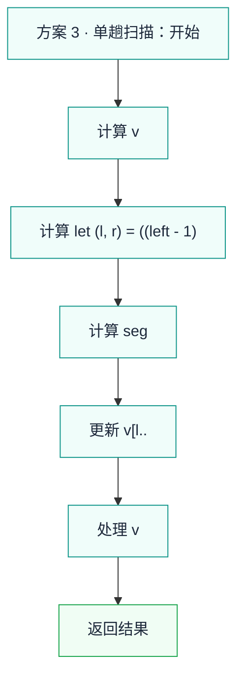

```rust
// LeetCode 92. 反转链表II — Rust 版（方案3）
fn reverse_between(vals: Vec<i32>, left: i32, right: i32) -> Vec<i32> {
    // 定义函数/方法 reverse_between
    let mut v = vals; // 把 vals; 写入 let mut v
    let (l, r) = ((left - 1) as usize, (right - 1) as usize); // 把 ((左边界 减 1) as usize, (右边界 减 1) as usize); 写入 let (l, r)
    let seg: Vec<i32> = v[l..=r].iter().rev().cloned().collect();
    v[l..=r].copy_from_slice(&seg); // 把 右指针].copy_from_slice( 按位与 seg); 写入 v[l
    v
}
fn main() {
    // 程序入口：跑内嵌自测用例
    assert_eq!(
        reverse_between(vec![1, 2, 3, 4, 5], 2, 4),
        vec![1, 4, 3, 2, 5]
    ); // 断言校验
    assert_eq!(
        reverse_between(vec![1, 2, 3, 4, 5], 1, 4),
        vec![4, 3, 2, 1, 5]
    ); // 断言校验
    assert_eq!(reverse_between(vec![5], 1, 1), vec![5]); // 断言校验
    println!("PASS"); // 全部用例通过，输出 PASS
}
```

### Lua 实现（3 种方案）

Lua 的全部方案如下，每个方案都内嵌用例自测，可独立运行（老仓库 python/go 文件遵循「打印结果」约定）：

#### 方案 1：单趟扫描

**思路与代码分析**：核心是「单趟扫描」。Lua 版用表与 ipairs 遍历，注意 ipairs 遇 nil 即停的语义。**走读**：方案 1 · 单趟扫描：开始 → 更新 v → 更新 seg → 循环 i：从 right 到 left, -1 do → 更新 1] → 循环 i：从 1 到 #seg do → 更新 1] → 返回 v。

**运行架构**（真实控制流）：

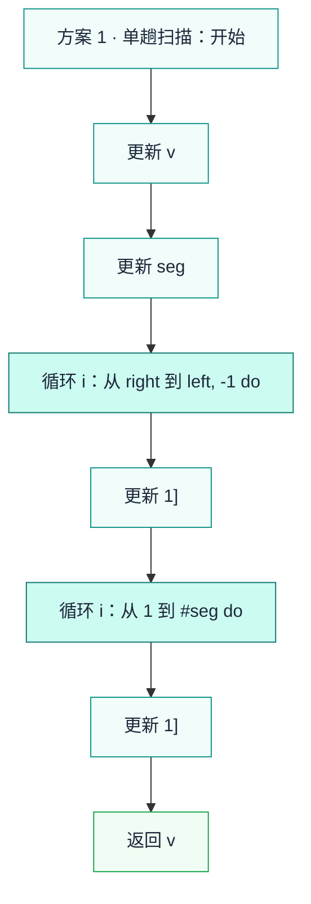

```lua
-- LeetCode 92. 反转链表II — Lua 版（方案1）
local function reverse_between(vals, left, right) -- local function reverse_between(vals, 左边界, 右边界)
	local v = { table.unpack(vals) } -- 把 {table.unpack(vals)} 写入 local v
	local seg = {} -- 把 {} 写入 local seg
	for i = right, left, -1 do
		seg[#seg + 1] = v[i]
	end -- 把 右边界, 左边界, 减 1 do seg[#seg 加 1] 赋值为 值[下标 i] 终点 写入 for i
	for i = 1, #seg do
		v[left + i - 1] = seg[i]
	end -- 把 1, #seg do 值[左边界 加 下标 i 减 1] 赋值为 seg[下标 i] 终点 写入 for i
	return v -- 返回 值
end -- 终点
assert(table.concat(reverse_between({ 1, 2, 3, 4, 5 }, 2, 4), ",") == "1,4,3,2,5") -- 打印输出
assert(table.concat(reverse_between({ 1, 2, 3, 4, 5 }, 1, 4), ",") == "4,3,2,1,5") -- 打印输出
assert(table.concat(reverse_between({ 5 }, 1, 1), ",") == "5") -- 打印输出
print("PASS") -- 全部用例通过，输出 PASS
```

#### 方案 2：方案2（一次遍历，头插法）

**思路与代码分析**：核心是「方案2（一次遍历，头插法）」。Lua 版用表与 ipairs 遍历，注意 ipairs 遇 nil 即停的语义。**走读**：方案 2 · 方案2（一次遍历，头插法）：开始 → 更新 v → 更新 seg → 循环 i：从 right 到 left, -1 do → 更新 1] → 循环 i：从 1 到 #seg do → 更新 1] → 返回 v。

**运行架构**（真实控制流）：

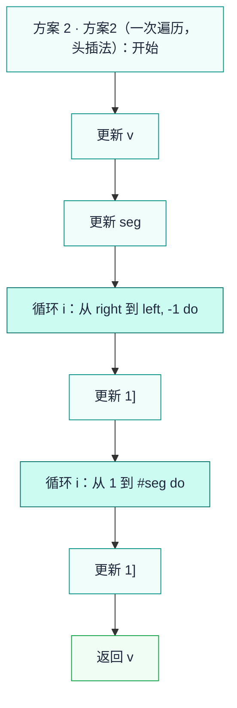

```lua
-- LeetCode 92. 反转链表II — Lua 版（方案2）
local function reverse_between(vals, left, right) -- local function reverse_between(vals, 左边界, 右边界)
	local v = { table.unpack(vals) } -- 把 {table.unpack(vals)} 写入 local v
	local seg = {} -- 把 {} 写入 local seg
	for i = right, left, -1 do
		seg[#seg + 1] = v[i]
	end -- 把 右边界, 左边界, 减 1 do seg[#seg 加 1] 赋值为 值[下标 i] 终点 写入 for i
	for i = 1, #seg do
		v[left + i - 1] = seg[i]
	end -- 把 1, #seg do 值[左边界 加 下标 i 减 1] 赋值为 seg[下标 i] 终点 写入 for i
	return v -- 返回 值
end -- 终点
assert(table.concat(reverse_between({ 1, 2, 3, 4, 5 }, 2, 4), ",") == "1,4,3,2,5") -- 打印输出
assert(table.concat(reverse_between({ 1, 2, 3, 4, 5 }, 1, 4), ",") == "4,3,2,1,5") -- 打印输出
assert(table.concat(reverse_between({ 5 }, 1, 1), ",") == "5") -- 打印输出
print("PASS") -- 全部用例通过，输出 PASS
```

#### 方案 3：单趟扫描

**思路与代码分析**：核心是「单趟扫描」。Lua 版用表与 ipairs 遍历，注意 ipairs 遇 nil 即停的语义。**走读**：方案 3 · 单趟扫描：开始 → 更新 v → 更新 seg → 循环 i：从 right 到 left, -1 do → 更新 1] → 循环 i：从 1 到 #seg do → 更新 1] → 返回 v。

**运行架构**（真实控制流）：

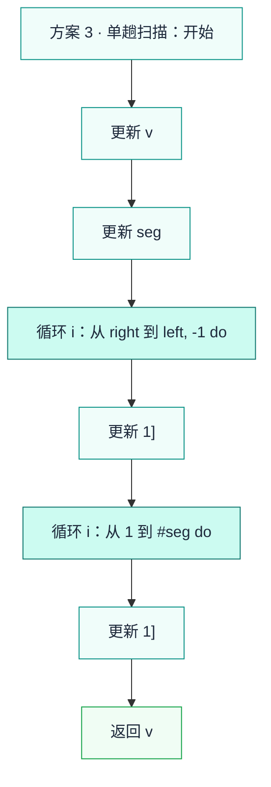

```lua
-- LeetCode 92. 反转链表II — Lua 版（方案3）
local function reverse_between(vals, left, right) -- local function reverse_between(vals, 左边界, 右边界)
	local v = { table.unpack(vals) } -- 把 {table.unpack(vals)} 写入 local v
	local seg = {} -- 把 {} 写入 local seg
	for i = right, left, -1 do
		seg[#seg + 1] = v[i]
	end -- 把 右边界, 左边界, 减 1 do seg[#seg 加 1] 赋值为 值[下标 i] 终点 写入 for i
	for i = 1, #seg do
		v[left + i - 1] = seg[i]
	end -- 把 1, #seg do 值[左边界 加 下标 i 减 1] 赋值为 seg[下标 i] 终点 写入 for i
	return v -- 返回 值
end -- 终点
assert(table.concat(reverse_between({ 1, 2, 3, 4, 5 }, 2, 4), ",") == "1,4,3,2,5") -- 打印输出
assert(table.concat(reverse_between({ 1, 2, 3, 4, 5 }, 1, 4), ",") == "4,3,2,1,5") -- 打印输出
assert(table.concat(reverse_between({ 5 }, 1, 1), ",") == "5") -- 打印输出
print("PASS") -- 全部用例通过，输出 PASS
```

### C 实现（3 种方案）

C 的全部方案如下，每个方案都内嵌用例自测，可独立运行（老仓库 python/go 文件遵循「打印结果」约定）：

#### 方案 1：单趟扫描

**思路与代码分析**：核心是「单趟扫描」。C 版手动管理下标与内存，循环边界全部显式写出。**走读**：方案 1 · 单趟扫描：开始 → 更新 l → 当 (l ＜ r) 时反复执行 → 更新 t → 更新 v[l] → 更新 v[r] → 处理 l++ → 处理 r-- → 返回结果。

**运行架构**（真实控制流）：

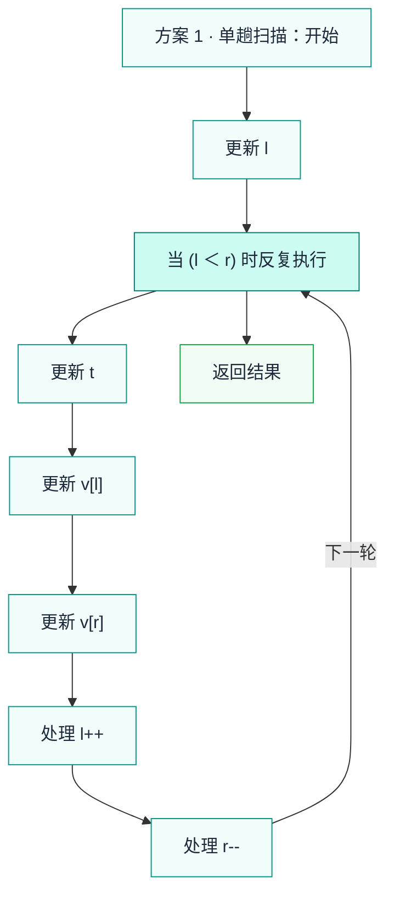

```c
/* LeetCode 92. 反转链表II — C 版（方案1） */
#include <stdio.h>                                                 // 引入头文件
static void reverse_between(int v[], int n, int left, int right) { // 定义函数/方法 reverse_between
    int l = left - 1, r = right - 1; // 把 左边界 减 1, 右指针 赋值为 右边界 减 1 存入 左指针
    while (l < r) {                  // 循环，直到不满足「左指针 小于 右指针」
        int t = v[l];
        v[l] = v[r];
        v[r] = t; // 把 值[左指针]; 值[左指针] 赋值为 值[右指针]; 值[右指针] 赋值为 另一字符串 存入 另一字符串
        l++;
        r--; // 左指针 加一 ; 右指针 减一 ;
    }
}
int main(void) {                  // 程序入口：跑内嵌自测用例
    int v1[] = {1, 2, 3, 4, 5};   // 把 {1,2,3,4,5}; 写入 int v1[]
    reverse_between(v1, 5, 2, 4); // reverse_between(v1, 5, 2, 4);
    if (!(v1[0] == 1 && v1[1] == 4 && v1[2] == 3 && v1[3] == 2 && v1[4] == 5)) {
        printf("FAIL 1\n");
        return 1;
    }
    int v2[] = {1, 2, 3, 4, 5};   // 把 {1,2,3,4,5}; 写入 int v2[]
    reverse_between(v2, 5, 1, 4); // reverse_between(v2, 5, 1, 4);
    if (!(v2[0] == 4 && v2[1] == 3 && v2[2] == 2 && v2[3] == 1 && v2[4] == 5)) {
        printf("FAIL 2\n");
        return 1;
    }
    int v3[] = {5};               // 把 {5}; 写入 int v3[]
    reverse_between(v3, 1, 1, 1); // reverse_between(v3, 1, 1, 1);
    if (v3[0] != 5) {
        printf("FAIL 3\n");
        return 1;
    }                 // 若 v3[0] 不等于 5) { 输出「FAIL 3 」); return 1; }
    printf("PASS\n"); // 全部用例通过，输出 PASS
    return 0;         // 返回 0
}
```

#### 方案 2：方案2（一次遍历，头插法）

**思路与代码分析**：核心是「方案2（一次遍历，头插法）」。C 版手动管理下标与内存，循环边界全部显式写出。**走读**：方案 2 · 方案2（一次遍历，头插法）：开始 → 更新 l → 当 (l ＜ r) 时反复执行 → 更新 t → 更新 v[l] → 更新 v[r] → 处理 l++ → 处理 r-- → 返回结果。

**运行架构**（真实控制流）：

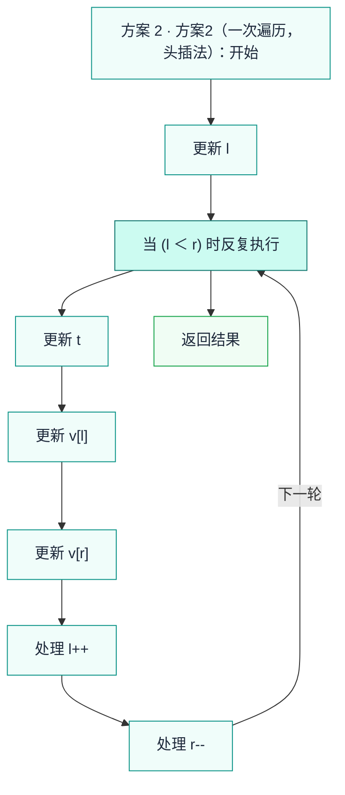

```c
/* LeetCode 92. 反转链表II — C 版（方案2） */
#include <stdio.h>                                                 // 引入头文件
static void reverse_between(int v[], int n, int left, int right) { // 定义函数/方法 reverse_between
    int l = left - 1, r = right - 1; // 把 左边界 减 1, 右指针 赋值为 右边界 减 1 存入 左指针
    while (l < r) {                  // 循环，直到不满足「左指针 小于 右指针」
        int t = v[l];
        v[l] = v[r];
        v[r] = t; // 把 值[左指针]; 值[左指针] 赋值为 值[右指针]; 值[右指针] 赋值为 另一字符串 存入 另一字符串
        l++;
        r--; // 左指针 加一 ; 右指针 减一 ;
    }
}
int main(void) {                  // 程序入口：跑内嵌自测用例
    int v1[] = {1, 2, 3, 4, 5};   // 把 {1,2,3,4,5}; 写入 int v1[]
    reverse_between(v1, 5, 2, 4); // reverse_between(v1, 5, 2, 4);
    if (!(v1[0] == 1 && v1[1] == 4 && v1[2] == 3 && v1[3] == 2 && v1[4] == 5)) {
        printf("FAIL 1\n");
        return 1;
    }
    int v2[] = {1, 2, 3, 4, 5};   // 把 {1,2,3,4,5}; 写入 int v2[]
    reverse_between(v2, 5, 1, 4); // reverse_between(v2, 5, 1, 4);
    if (!(v2[0] == 4 && v2[1] == 3 && v2[2] == 2 && v2[3] == 1 && v2[4] == 5)) {
        printf("FAIL 2\n");
        return 1;
    }
    int v3[] = {5};               // 把 {5}; 写入 int v3[]
    reverse_between(v3, 1, 1, 1); // reverse_between(v3, 1, 1, 1);
    if (v3[0] != 5) {
        printf("FAIL 3\n");
        return 1;
    }                 // 若 v3[0] 不等于 5) { 输出「FAIL 3 」); return 1; }
    printf("PASS\n"); // 全部用例通过，输出 PASS
    return 0;         // 返回 0
}
```

#### 方案 3：单趟扫描

**思路与代码分析**：核心是「单趟扫描」。C 版手动管理下标与内存，循环边界全部显式写出。**走读**：方案 3 · 单趟扫描：开始 → 更新 l → 当 (l ＜ r) 时反复执行 → 更新 t → 更新 v[l] → 更新 v[r] → 处理 l++ → 处理 r-- → 返回结果。

**运行架构**（真实控制流）：

```mermaid
graph TD
    N0["方案 3 · 单趟扫描：开始"]
    N1["更新 l"]
    N2["当 (l ＜ r) 时反复执行"]
    N3["更新 t"]
    N4["更新 v[l]"]
    N5["更新 v[r]"]
    N6["处理 l++"]
    N7["处理 r--"]
    N8["返回结果"]
    N0 --> N1
    N1 --> N2
    N2 --> N3
    N3 --> N4
    N4 --> N5
    N5 --> N6
    N6 --> N7
    N7 -- 下一轮 --> N2
    N2 --> N8
    classDef n fill:#f0fdfa,stroke:#0d9488,color:#1e293b;
    classDef lp fill:#ccfbf1,stroke:#0f766e,color:#1e293b;
    classDef dc fill:#fef9c3,stroke:#ca8a04,color:#1e293b;
    classDef tm fill:#f0fdf4,stroke:#16a34a,color:#1e293b;
    class N0,N1,N3,N4,N5,N6,N7 n;
    class N2 lp;
    class N8 tm;
```

```c
/* LeetCode 92. 反转链表II — C 版（方案3） */
#include <stdio.h>                                                 // 引入头文件
static void reverse_between(int v[], int n, int left, int right) { // 定义函数/方法 reverse_between
    int l = left - 1, r = right - 1; // 把 左边界 减 1, 右指针 赋值为 右边界 减 1 存入 左指针
    while (l < r) {                  // 循环，直到不满足「左指针 小于 右指针」
        int t = v[l];
        v[l] = v[r];
        v[r] = t; // 把 值[左指针]; 值[左指针] 赋值为 值[右指针]; 值[右指针] 赋值为 另一字符串 存入 另一字符串
        l++;
        r--; // 左指针 加一 ; 右指针 减一 ;
    }
}
int main(void) {                  // 程序入口：跑内嵌自测用例
    int v1[] = {1, 2, 3, 4, 5};   // 把 {1,2,3,4,5}; 写入 int v1[]
    reverse_between(v1, 5, 2, 4); // reverse_between(v1, 5, 2, 4);
    if (!(v1[0] == 1 && v1[1] == 4 && v1[2] == 3 && v1[3] == 2 && v1[4] == 5)) {
        printf("FAIL 1\n");
        return 1;
    }
    int v2[] = {1, 2, 3, 4, 5};   // 把 {1,2,3,4,5}; 写入 int v2[]
    reverse_between(v2, 5, 1, 4); // reverse_between(v2, 5, 1, 4);
    if (!(v2[0] == 4 && v2[1] == 3 && v2[2] == 2 && v2[3] == 1 && v2[4] == 5)) {
        printf("FAIL 2\n");
        return 1;
    }
    int v3[] = {5};               // 把 {5}; 写入 int v3[]
    reverse_between(v3, 1, 1, 1); // reverse_between(v3, 1, 1, 1);
    if (v3[0] != 5) {
        printf("FAIL 3\n");
        return 1;
    }                 // 若 v3[0] 不等于 5) { 输出「FAIL 3 」); return 1; }
    printf("PASS\n"); // 全部用例通过，输出 PASS
    return 0;         // 返回 0
}
```

### C++ 实现（3 种方案）

C++ 的全部方案如下，每个方案都内嵌用例自测，可独立运行（老仓库 python/go 文件遵循「打印结果」约定）：

#### 方案 1：单趟扫描

**思路与代码分析**：核心是「单趟扫描」。C++ 版用 STL 容器与迭代器，减少手写下标错误。**走读**：方案 1 · 单趟扫描：开始 → 处理 std::reverse(vals.begin() + → 调用 vals.begin() + → 处理 right) → 返回 vals。

**运行架构**（真实控制流）：

```mermaid
graph TD
    N0["方案 1 · 单趟扫描：开始"]
    N1["处理 std::reverse(vals.begin() +"]
    N2["调用 vals.begin() +"]
    N3["处理 right)"]
    N4["返回 vals"]
    N0 --> N1
    N1 --> N2
    N2 --> N3
    N3 --> N4
    classDef n fill:#f0fdfa,stroke:#0d9488,color:#1e293b;
    classDef lp fill:#ccfbf1,stroke:#0f766e,color:#1e293b;
    classDef dc fill:#fef9c3,stroke:#ca8a04,color:#1e293b;
    classDef tm fill:#f0fdf4,stroke:#16a34a,color:#1e293b;
    class N0,N1,N2,N3 n;
    class N4 tm;
```

```cpp
// LeetCode 92. 反转链表II — C++ 版（方案1）
#include <algorithm> // 引入头文件
#include <cassert>   // 引入头文件
#include <iostream>  // 引入头文件
#include <vector>    // 引入头文件
static std::vector<int> reverseBetween(std::vector<int> vals, int left, int right) {
    std::reverse(vals.begin() + (left - 1),
                 vals.begin() +
                     right); // std::reverse(vals 迭代位置 加 (左边界 减 1), vals 迭代位置 加 右边界);
    return vals;             // 返回 vals
}
int main() { // 程序入口：跑内嵌自测用例
    assert((reverseBetween({1, 2, 3, 4, 5}, 2, 4) == std::vector<int>{1, 4, 3, 2, 5})); // 断言校验
    assert((reverseBetween({1, 2, 3, 4, 5}, 1, 4) == std::vector<int>{4, 3, 2, 1, 5})); // 断言校验
    assert((reverseBetween({5}, 1, 1) == std::vector<int>{5}));                         // 断言校验
    std::cout << "PASS" << std::endl; // 全部用例通过，输出 PASS
    return 0;                         // 返回 0
}
```

#### 方案 2：方案2（一次遍历，头插法）

**思路与代码分析**：核心是「方案2（一次遍历，头插法）」。C++ 版用 STL 容器与迭代器，减少手写下标错误。**走读**：方案 2 · 方案2（一次遍历，头插法）：开始 → 处理 std::reverse(vals.begin() + → 调用 vals.begin() + → 处理 right) → 返回 vals。

**运行架构**（真实控制流）：

```mermaid
graph TD
    N0["方案 2 · 方案2（一次遍历，头插法）：开始"]
    N1["处理 std::reverse(vals.begin() +"]
    N2["调用 vals.begin() +"]
    N3["处理 right)"]
    N4["返回 vals"]
    N0 --> N1
    N1 --> N2
    N2 --> N3
    N3 --> N4
    classDef n fill:#f0fdfa,stroke:#0d9488,color:#1e293b;
    classDef lp fill:#ccfbf1,stroke:#0f766e,color:#1e293b;
    classDef dc fill:#fef9c3,stroke:#ca8a04,color:#1e293b;
    classDef tm fill:#f0fdf4,stroke:#16a34a,color:#1e293b;
    class N0,N1,N2,N3 n;
    class N4 tm;
```

```cpp
// LeetCode 92. 反转链表II — C++ 版（方案2）
#include <algorithm> // 引入头文件
#include <cassert>   // 引入头文件
#include <iostream>  // 引入头文件
#include <vector>    // 引入头文件
static std::vector<int> reverseBetween(std::vector<int> vals, int left, int right) {
    std::reverse(vals.begin() + (left - 1),
                 vals.begin() +
                     right); // std::reverse(vals 迭代位置 加 (左边界 减 1), vals 迭代位置 加 右边界);
    return vals;             // 返回 vals
}
int main() { // 程序入口：跑内嵌自测用例
    assert((reverseBetween({1, 2, 3, 4, 5}, 2, 4) == std::vector<int>{1, 4, 3, 2, 5})); // 断言校验
    assert((reverseBetween({1, 2, 3, 4, 5}, 1, 4) == std::vector<int>{4, 3, 2, 1, 5})); // 断言校验
    assert((reverseBetween({5}, 1, 1) == std::vector<int>{5}));                         // 断言校验
    std::cout << "PASS" << std::endl; // 全部用例通过，输出 PASS
    return 0;                         // 返回 0
}
```

#### 方案 3：单趟扫描

**思路与代码分析**：核心是「单趟扫描」。C++ 版用 STL 容器与迭代器，减少手写下标错误。**走读**：方案 3 · 单趟扫描：开始 → 处理 std::reverse(vals.begin() + → 调用 vals.begin() + → 处理 right) → 返回 vals。

**运行架构**（真实控制流）：

```mermaid
graph TD
    N0["方案 3 · 单趟扫描：开始"]
    N1["处理 std::reverse(vals.begin() +"]
    N2["调用 vals.begin() +"]
    N3["处理 right)"]
    N4["返回 vals"]
    N0 --> N1
    N1 --> N2
    N2 --> N3
    N3 --> N4
    classDef n fill:#f0fdfa,stroke:#0d9488,color:#1e293b;
    classDef lp fill:#ccfbf1,stroke:#0f766e,color:#1e293b;
    classDef dc fill:#fef9c3,stroke:#ca8a04,color:#1e293b;
    classDef tm fill:#f0fdf4,stroke:#16a34a,color:#1e293b;
    class N0,N1,N2,N3 n;
    class N4 tm;
```

```cpp
// LeetCode 92. 反转链表II — C++ 版（方案3）
#include <algorithm> // 引入头文件
#include <cassert>   // 引入头文件
#include <iostream>  // 引入头文件
#include <vector>    // 引入头文件
static std::vector<int> reverseBetween(std::vector<int> vals, int left, int right) {
    std::reverse(vals.begin() + (left - 1),
                 vals.begin() +
                     right); // std::reverse(vals 迭代位置 加 (左边界 减 1), vals 迭代位置 加 右边界);
    return vals;             // 返回 vals
}
int main() { // 程序入口：跑内嵌自测用例
    assert((reverseBetween({1, 2, 3, 4, 5}, 2, 4) == std::vector<int>{1, 4, 3, 2, 5})); // 断言校验
    assert((reverseBetween({1, 2, 3, 4, 5}, 1, 4) == std::vector<int>{4, 3, 2, 1, 5})); // 断言校验
    assert((reverseBetween({5}, 1, 1) == std::vector<int>{5}));                         // 断言校验
    std::cout << "PASS" << std::endl; // 全部用例通过，输出 PASS
    return 0;                         // 返回 0
}
```

### R 实现（3 种方案）

R 的全部方案如下，每个方案都内嵌用例自测，可独立运行（老仓库 python/go 文件遵循「打印结果」约定）：

#### 方案 1：单趟扫描

**思路与代码分析**：核心是「单趟扫描」。R 版用向量化思维与 1 起始下标，注意 1:n 的降序陷阱。**走读**：方案 1 · 单趟扫描：开始 → 处理 v ＜- vals → 处理 v[left:right] ＜- rev(v[left: → 处理 v → 返回结果。

**运行架构**（真实控制流）：

```mermaid
graph TD
    N0["方案 1 · 单趟扫描：开始"]
    N1["处理 v ＜- vals"]
    N2["处理 v[left:right] ＜- rev(v[left:"]
    N3["处理 v"]
    N4["返回结果"]
    N0 --> N1
    N1 --> N2
    N2 --> N3
    N3 --> N4
    classDef n fill:#f0fdfa,stroke:#0d9488,color:#1e293b;
    classDef lp fill:#ccfbf1,stroke:#0f766e,color:#1e293b;
    classDef dc fill:#fef9c3,stroke:#ca8a04,color:#1e293b;
    classDef tm fill:#f0fdf4,stroke:#16a34a,color:#1e293b;
    class N0,N1,N2,N3 n;
    class N4 tm;
```

```r
# 版（方案1） 定义函数 reverse_between（参数：vals, 左边界, 右边界）
reverse_between <- function(vals, left, right) {
    v <- vals  # 把 vals 存入 值
    v[left:right] <- rev(v[left:right])  # 把 rev(值[左边界:右边界]) 存入 v[left:right]
    v
}
stopifnot(identical(reverse_between(1:5, 2, 4), c(1L, 4L, 3L, 2L, 5L)))  # 断言校验
stopifnot(identical(reverse_between(1:5, 1, 4), c(4L, 3L, 2L, 1L, 5L)))  # 断言校验
stopifnot(identical(reverse_between(5, 1, 1), 5))  # 断言校验
cat("PASS\n")  # 全部用例通过，输出 PASS
```

#### 方案 2：方案2（一次遍历，头插法）

**思路与代码分析**：核心是「方案2（一次遍历，头插法）」。R 版用向量化思维与 1 起始下标，注意 1:n 的降序陷阱。**走读**：方案 2 · 方案2（一次遍历，头插法）：开始 → 处理 v ＜- vals → 处理 v[left:right] ＜- rev(v[left: → 处理 v → 返回结果。

**运行架构**（真实控制流）：

```mermaid
graph TD
    N0["方案 2 · 方案2（一次遍历，头插法）：开始"]
    N1["处理 v ＜- vals"]
    N2["处理 v[left:right] ＜- rev(v[left:"]
    N3["处理 v"]
    N4["返回结果"]
    N0 --> N1
    N1 --> N2
    N2 --> N3
    N3 --> N4
    classDef n fill:#f0fdfa,stroke:#0d9488,color:#1e293b;
    classDef lp fill:#ccfbf1,stroke:#0f766e,color:#1e293b;
    classDef dc fill:#fef9c3,stroke:#ca8a04,color:#1e293b;
    classDef tm fill:#f0fdf4,stroke:#16a34a,color:#1e293b;
    class N0,N1,N2,N3 n;
    class N4 tm;
```

```r
# 版（方案2） 定义函数 reverse_between（参数：vals, 左边界, 右边界）
reverse_between <- function(vals, left, right) {
    v <- vals  # 把 vals 存入 值
    v[left:right] <- rev(v[left:right])  # 把 rev(值[左边界:右边界]) 存入 v[left:right]
    v
}
stopifnot(identical(reverse_between(1:5, 2, 4), c(1L, 4L, 3L, 2L, 5L)))  # 断言校验
stopifnot(identical(reverse_between(1:5, 1, 4), c(4L, 3L, 2L, 1L, 5L)))  # 断言校验
stopifnot(identical(reverse_between(5, 1, 1), 5))  # 断言校验
cat("PASS\n")  # 全部用例通过，输出 PASS
```

#### 方案 3：单趟扫描

**思路与代码分析**：核心是「单趟扫描」。R 版用向量化思维与 1 起始下标，注意 1:n 的降序陷阱。**走读**：方案 3 · 单趟扫描：开始 → 处理 v ＜- vals → 处理 v[left:right] ＜- rev(v[left: → 处理 v → 返回结果。

**运行架构**（真实控制流）：

```mermaid
graph TD
    N0["方案 3 · 单趟扫描：开始"]
    N1["处理 v ＜- vals"]
    N2["处理 v[left:right] ＜- rev(v[left:"]
    N3["处理 v"]
    N4["返回结果"]
    N0 --> N1
    N1 --> N2
    N2 --> N3
    N3 --> N4
    classDef n fill:#f0fdfa,stroke:#0d9488,color:#1e293b;
    classDef lp fill:#ccfbf1,stroke:#0f766e,color:#1e293b;
    classDef dc fill:#fef9c3,stroke:#ca8a04,color:#1e293b;
    classDef tm fill:#f0fdf4,stroke:#16a34a,color:#1e293b;
    class N0,N1,N2,N3 n;
    class N4 tm;
```

```r
# 版（方案3） 定义函数 reverse_between（参数：vals, 左边界, 右边界）
reverse_between <- function(vals, left, right) {
    v <- vals  # 把 vals 存入 值
    v[left:right] <- rev(v[left:right])  # 把 rev(值[左边界:右边界]) 存入 v[left:right]
    v
}
stopifnot(identical(reverse_between(1:5, 2, 4), c(1L, 4L, 3L, 2L, 5L)))  # 断言校验
stopifnot(identical(reverse_between(1:5, 1, 4), c(4L, 3L, 2L, 1L, 5L)))  # 断言校验
stopifnot(identical(reverse_between(5, 1, 1), 5))  # 断言校验
cat("PASS\n")  # 全部用例通过，输出 PASS
```

### Zig 实现（3 种方案）

Zig 的全部方案如下，每个方案都内嵌用例自测，可独立运行（老仓库 python/go 文件遵循「打印结果」约定）：

#### 方案 1：单趟扫描

**思路与代码分析**：核心是「单趟扫描」。Zig 版显式分配与清零，整型边界处理严格。**走读**：方案 1 · 单趟扫描：开始 → 处理 @memcpy(out[0..vals.len], va → 计算 l → 计算 r → 当 (l ＜ r) 时反复执行 → 计算 t → 更新 out[l] → 更新 out[r] → 更新 + → 更新 - → 返回结果。

**运行架构**（真实控制流）：

```mermaid
graph TD
    N0["方案 1 · 单趟扫描：开始"]
    N1["处理 @memcpy(out[0..vals.len], va"]
    N2["计算 l"]
    N3["计算 r"]
    N4["当 (l ＜ r) 时反复执行"]
    N5["计算 t"]
    N6["更新 out[l]"]
    N7["更新 out[r]"]
    N8["更新 +"]
    N9["更新 -"]
    N10["返回结果"]
    N0 --> N1
    N1 --> N2
    N2 --> N3
    N3 --> N4
    N4 --> N5
    N5 --> N6
    N6 --> N7
    N7 --> N8
    N8 --> N9
    N9 -- 下一轮 --> N4
    N4 --> N10
    classDef n fill:#f0fdfa,stroke:#0d9488,color:#1e293b;
    classDef lp fill:#ccfbf1,stroke:#0f766e,color:#1e293b;
    classDef dc fill:#fef9c3,stroke:#ca8a04,color:#1e293b;
    classDef tm fill:#f0fdf4,stroke:#16a34a,color:#1e293b;
    class N0,N1,N2,N3,N5,N6,N7,N8,N9 n;
    class N4 lp;
    class N10 tm;
```

```zig
// LeetCode 92. 反转链表II — Zig 版（方案1）
const std = @import("std"); // 把 @import(「std」) 存入 std
fn reverseBetween(vals: []const i32, left: i32, right: i32, out: []i32) void { // 定义函数/方法 reverseBetween
    @memcpy(out[0..vals.len], vals); // @memcpy(out[0..vals.长度], vals);
    var l: usize = @intCast(left - 1); // 把 @intCast(左边界 减 1); 写入 var l: usize
    var r: usize = @intCast(right - 1); // 把 @intCast(右边界 减 1); 写入 var r: usize
    while (l < r) { // 循环，直到不满足「左指针 小于 右指针」
        const t = out[l]; // 把 out[左指针] 存入 另一字符串
        out[l] = out[r]; // 把 out[右指针]; 写入 out[l]
        out[r] = t; // 把 另一字符串; 写入 out[r]
        l += 1; // 左指针累加 1
        r -= 1; // 右指针累减 1
    }
}
pub fn main() !void { // 程序入口：跑内嵌自测用例
    var buf: [8]i32 = undefined; // 把 undefined; 写入 var buf: [8]i32
    reverseBetween(&[_]i32{ 1, 2, 3, 4, 5 }, 2, 4, &buf); // reverseBetween( 按位与 [_]i32{ 1, 2, 3, 4, 5 }, 2, 4, 按位与 buf);
    if (buf[1] != 4 or buf[3] != 2) return error.TestFailed; // 若 buf[1] 不等于 4 or buf[3] 不等于 2，直接返回 error.TestFailed
    reverseBetween(&[_]i32{ 1, 2, 3, 4, 5 }, 1, 4, &buf); // reverseBetween( 按位与 [_]i32{ 1, 2, 3, 4, 5 }, 1, 4, 按位与 buf);
    if (buf[0] != 4 or buf[3] != 1 or buf[4] != 5) return error.TestFailed;
    reverseBetween(&[_]i32{5}, 1, 1, &buf); // reverseBetween( 按位与 [_]i32{5}, 1, 1, 按位与 buf);
    if (buf[0] != 5) return error.TestFailed; // 若 buf[0] 不等于 5，直接返回 error.TestFailed
    std.debug.print("PASS\n", .{}); // 全部用例通过，输出 PASS
}
```

#### 方案 2：方案2（一次遍历，头插法）

**思路与代码分析**：核心是「方案2（一次遍历，头插法）」。Zig 版显式分配与清零，整型边界处理严格。**走读**：方案 2 · 方案2（一次遍历，头插法）：开始 → 处理 @memcpy(out[0..vals.len], va → 计算 l → 计算 r → 当 (l ＜ r) 时反复执行 → 计算 t → 更新 out[l] → 更新 out[r] → 更新 + → 更新 - → 返回结果。

**运行架构**（真实控制流）：

```mermaid
graph TD
    N0["方案 2 · 方案2（一次遍历，头插法）：开始"]
    N1["处理 @memcpy(out[0..vals.len], va"]
    N2["计算 l"]
    N3["计算 r"]
    N4["当 (l ＜ r) 时反复执行"]
    N5["计算 t"]
    N6["更新 out[l]"]
    N7["更新 out[r]"]
    N8["更新 +"]
    N9["更新 -"]
    N10["返回结果"]
    N0 --> N1
    N1 --> N2
    N2 --> N3
    N3 --> N4
    N4 --> N5
    N5 --> N6
    N6 --> N7
    N7 --> N8
    N8 --> N9
    N9 -- 下一轮 --> N4
    N4 --> N10
    classDef n fill:#f0fdfa,stroke:#0d9488,color:#1e293b;
    classDef lp fill:#ccfbf1,stroke:#0f766e,color:#1e293b;
    classDef dc fill:#fef9c3,stroke:#ca8a04,color:#1e293b;
    classDef tm fill:#f0fdf4,stroke:#16a34a,color:#1e293b;
    class N0,N1,N2,N3,N5,N6,N7,N8,N9 n;
    class N4 lp;
    class N10 tm;
```

```zig
// LeetCode 92. 反转链表II — Zig 版（方案2）
const std = @import("std"); // 把 @import(「std」) 存入 std
fn reverseBetween(vals: []const i32, left: i32, right: i32, out: []i32) void { // 定义函数/方法 reverseBetween
    @memcpy(out[0..vals.len], vals); // @memcpy(out[0..vals.长度], vals);
    var l: usize = @intCast(left - 1); // 把 @intCast(左边界 减 1); 写入 var l: usize
    var r: usize = @intCast(right - 1); // 把 @intCast(右边界 减 1); 写入 var r: usize
    while (l < r) { // 循环，直到不满足「左指针 小于 右指针」
        const t = out[l]; // 把 out[左指针] 存入 另一字符串
        out[l] = out[r]; // 把 out[右指针]; 写入 out[l]
        out[r] = t; // 把 另一字符串; 写入 out[r]
        l += 1; // 左指针累加 1
        r -= 1; // 右指针累减 1
    }
}
pub fn main() !void { // 程序入口：跑内嵌自测用例
    var buf: [8]i32 = undefined; // 把 undefined; 写入 var buf: [8]i32
    reverseBetween(&[_]i32{ 1, 2, 3, 4, 5 }, 2, 4, &buf); // reverseBetween( 按位与 [_]i32{ 1, 2, 3, 4, 5 }, 2, 4, 按位与 buf);
    if (buf[1] != 4 or buf[3] != 2) return error.TestFailed; // 若 buf[1] 不等于 4 or buf[3] 不等于 2，直接返回 error.TestFailed
    reverseBetween(&[_]i32{ 1, 2, 3, 4, 5 }, 1, 4, &buf); // reverseBetween( 按位与 [_]i32{ 1, 2, 3, 4, 5 }, 1, 4, 按位与 buf);
    if (buf[0] != 4 or buf[3] != 1 or buf[4] != 5) return error.TestFailed;
    reverseBetween(&[_]i32{5}, 1, 1, &buf); // reverseBetween( 按位与 [_]i32{5}, 1, 1, 按位与 buf);
    if (buf[0] != 5) return error.TestFailed; // 若 buf[0] 不等于 5，直接返回 error.TestFailed
    std.debug.print("PASS\n", .{}); // 全部用例通过，输出 PASS
}
```

#### 方案 3：单趟扫描

**思路与代码分析**：核心是「单趟扫描」。Zig 版显式分配与清零，整型边界处理严格。**走读**：方案 3 · 单趟扫描：开始 → 处理 @memcpy(out[0..vals.len], va → 计算 l → 计算 r → 当 (l ＜ r) 时反复执行 → 计算 t → 更新 out[l] → 更新 out[r] → 更新 + → 更新 - → 返回结果。

**运行架构**（真实控制流）：

```mermaid
graph TD
    N0["方案 3 · 单趟扫描：开始"]
    N1["处理 @memcpy(out[0..vals.len], va"]
    N2["计算 l"]
    N3["计算 r"]
    N4["当 (l ＜ r) 时反复执行"]
    N5["计算 t"]
    N6["更新 out[l]"]
    N7["更新 out[r]"]
    N8["更新 +"]
    N9["更新 -"]
    N10["返回结果"]
    N0 --> N1
    N1 --> N2
    N2 --> N3
    N3 --> N4
    N4 --> N5
    N5 --> N6
    N6 --> N7
    N7 --> N8
    N8 --> N9
    N9 -- 下一轮 --> N4
    N4 --> N10
    classDef n fill:#f0fdfa,stroke:#0d9488,color:#1e293b;
    classDef lp fill:#ccfbf1,stroke:#0f766e,color:#1e293b;
    classDef dc fill:#fef9c3,stroke:#ca8a04,color:#1e293b;
    classDef tm fill:#f0fdf4,stroke:#16a34a,color:#1e293b;
    class N0,N1,N2,N3,N5,N6,N7,N8,N9 n;
    class N4 lp;
    class N10 tm;
```

```zig
// LeetCode 92. 反转链表II — Zig 版（方案3）
const std = @import("std"); // 把 @import(「std」) 存入 std
fn reverseBetween(vals: []const i32, left: i32, right: i32, out: []i32) void { // 定义函数/方法 reverseBetween
    @memcpy(out[0..vals.len], vals); // @memcpy(out[0..vals.长度], vals);
    var l: usize = @intCast(left - 1); // 把 @intCast(左边界 减 1); 写入 var l: usize
    var r: usize = @intCast(right - 1); // 把 @intCast(右边界 减 1); 写入 var r: usize
    while (l < r) { // 循环，直到不满足「左指针 小于 右指针」
        const t = out[l]; // 把 out[左指针] 存入 另一字符串
        out[l] = out[r]; // 把 out[右指针]; 写入 out[l]
        out[r] = t; // 把 另一字符串; 写入 out[r]
        l += 1; // 左指针累加 1
        r -= 1; // 右指针累减 1
    }
}
pub fn main() !void { // 程序入口：跑内嵌自测用例
    var buf: [8]i32 = undefined; // 把 undefined; 写入 var buf: [8]i32
    reverseBetween(&[_]i32{ 1, 2, 3, 4, 5 }, 2, 4, &buf); // reverseBetween( 按位与 [_]i32{ 1, 2, 3, 4, 5 }, 2, 4, 按位与 buf);
    if (buf[1] != 4 or buf[3] != 2) return error.TestFailed; // 若 buf[1] 不等于 4 or buf[3] 不等于 2，直接返回 error.TestFailed
    reverseBetween(&[_]i32{ 1, 2, 3, 4, 5 }, 1, 4, &buf); // reverseBetween( 按位与 [_]i32{ 1, 2, 3, 4, 5 }, 1, 4, 按位与 buf);
    if (buf[0] != 4 or buf[3] != 1 or buf[4] != 5) return error.TestFailed;
    reverseBetween(&[_]i32{5}, 1, 1, &buf); // reverseBetween( 按位与 [_]i32{5}, 1, 1, 按位与 buf);
    if (buf[0] != 5) return error.TestFailed; // 若 buf[0] 不等于 5，直接返回 error.TestFailed
    std.debug.print("PASS\n", .{}); // 全部用例通过，输出 PASS
}
```

### Dart 实现（3 种方案）

Dart 的全部方案如下，每个方案都内嵌用例自测，可独立运行（老仓库 python/go 文件遵循「打印结果」约定）：

#### 方案 1：单趟扫描

**思路与代码分析**：核心是「单趟扫描」。Dart 版用可空类型标注与集合方法，注意空安全。**走读**：方案 1 · 单趟扫描：开始 → 更新 v → 计算 l → 当 (l ＜ r) 时反复执行 → 更新 t → 更新 v[l] → 更新 v[r] → 处理 l++ → 处理 r-- → 返回 v。

**运行架构**（真实控制流）：

```mermaid
graph TD
    N0["方案 1 · 单趟扫描：开始"]
    N1["更新 v"]
    N2["计算 l"]
    N3["当 (l ＜ r) 时反复执行"]
    N4["更新 t"]
    N5["更新 v[l]"]
    N6["更新 v[r]"]
    N7["处理 l++"]
    N8["处理 r--"]
    N9["返回 v"]
    N0 --> N1
    N1 --> N2
    N2 --> N3
    N3 --> N4
    N4 --> N5
    N5 --> N6
    N6 --> N7
    N7 --> N8
    N8 -- 下一轮 --> N3
    N3 --> N9
    classDef n fill:#f0fdfa,stroke:#0d9488,color:#1e293b;
    classDef lp fill:#ccfbf1,stroke:#0f766e,color:#1e293b;
    classDef dc fill:#fef9c3,stroke:#ca8a04,color:#1e293b;
    classDef tm fill:#f0fdf4,stroke:#16a34a,color:#1e293b;
    class N0,N1,N2,N4,N5,N6,N7,N8 n;
    class N3 lp;
    class N9 tm;
```

```dart
// LeetCode 92. 反转链表II — Dart 版（方案1）
List<int> reverseBetween(List<int> vals, int left, int right) {
  // 定义函数/方法 reverseBetween
  final v = List<int>.from(vals); // 把 List 小于 int 超过 .from(vals) 存入 值
  var l = left - 1, r = right - 1; // 把 左边界 减 1, 右指针 赋值为 右边界 减 1 存入 左指针
  while (l < r) {
    // 循环，直到不满足「左指针 小于 右指针」
    final t = v[l]; // 把 值[左指针] 存入 另一字符串
    v[l] = v[r]; // 把 值[右指针]; 写入 v[l]
    v[r] = t; // 把 另一字符串; 写入 v[r]
    l++; // 左指针 加一
    r--; // 右指针 减一
  }
  return v; // 返回 值
}

void main() {
  // 程序入口：跑内嵌自测用例
  if (reverseBetween([1, 2, 3, 4, 5], 2, 4).toString() != '[1, 4, 3, 2, 5]')
    throw StateError('c1');
  if (reverseBetween([1, 2, 3, 4, 5], 1, 4).toString() != '[4, 3, 2, 1, 5]')
    throw StateError('c2');
  if (reverseBetween([5], 1, 1).toString() != '[5]') throw StateError('c3');
  print('PASS'); // 全部用例通过，输出 PASS
}
```

#### 方案 2：方案2（一次遍历，头插法）

**思路与代码分析**：核心是「方案2（一次遍历，头插法）」。Dart 版用可空类型标注与集合方法，注意空安全。**走读**：方案 2 · 方案2（一次遍历，头插法）：开始 → 更新 v → 计算 l → 当 (l ＜ r) 时反复执行 → 更新 t → 更新 v[l] → 更新 v[r] → 处理 l++ → 处理 r-- → 返回 v。

**运行架构**（真实控制流）：

```mermaid
graph TD
    N0["方案 2 · 方案2（一次遍历，头插法）：开始"]
    N1["更新 v"]
    N2["计算 l"]
    N3["当 (l ＜ r) 时反复执行"]
    N4["更新 t"]
    N5["更新 v[l]"]
    N6["更新 v[r]"]
    N7["处理 l++"]
    N8["处理 r--"]
    N9["返回 v"]
    N0 --> N1
    N1 --> N2
    N2 --> N3
    N3 --> N4
    N4 --> N5
    N5 --> N6
    N6 --> N7
    N7 --> N8
    N8 -- 下一轮 --> N3
    N3 --> N9
    classDef n fill:#f0fdfa,stroke:#0d9488,color:#1e293b;
    classDef lp fill:#ccfbf1,stroke:#0f766e,color:#1e293b;
    classDef dc fill:#fef9c3,stroke:#ca8a04,color:#1e293b;
    classDef tm fill:#f0fdf4,stroke:#16a34a,color:#1e293b;
    class N0,N1,N2,N4,N5,N6,N7,N8 n;
    class N3 lp;
    class N9 tm;
```

```dart
// LeetCode 92. 反转链表II — Dart 版（方案2）
List<int> reverseBetween(List<int> vals, int left, int right) {
  // 定义函数/方法 reverseBetween
  final v = List<int>.from(vals); // 把 List 小于 int 超过 .from(vals) 存入 值
  var l = left - 1, r = right - 1; // 把 左边界 减 1, 右指针 赋值为 右边界 减 1 存入 左指针
  while (l < r) {
    // 循环，直到不满足「左指针 小于 右指针」
    final t = v[l]; // 把 值[左指针] 存入 另一字符串
    v[l] = v[r]; // 把 值[右指针]; 写入 v[l]
    v[r] = t; // 把 另一字符串; 写入 v[r]
    l++; // 左指针 加一
    r--; // 右指针 减一
  }
  return v; // 返回 值
}

void main() {
  // 程序入口：跑内嵌自测用例
  if (reverseBetween([1, 2, 3, 4, 5], 2, 4).toString() != '[1, 4, 3, 2, 5]')
    throw StateError('c1');
  if (reverseBetween([1, 2, 3, 4, 5], 1, 4).toString() != '[4, 3, 2, 1, 5]')
    throw StateError('c2');
  if (reverseBetween([5], 1, 1).toString() != '[5]') throw StateError('c3');
  print('PASS'); // 全部用例通过，输出 PASS
}
```

#### 方案 3：单趟扫描

**思路与代码分析**：核心是「单趟扫描」。Dart 版用可空类型标注与集合方法，注意空安全。**走读**：方案 3 · 单趟扫描：开始 → 更新 v → 计算 l → 当 (l ＜ r) 时反复执行 → 更新 t → 更新 v[l] → 更新 v[r] → 处理 l++ → 处理 r-- → 返回 v。

**运行架构**（真实控制流）：

```mermaid
graph TD
    N0["方案 3 · 单趟扫描：开始"]
    N1["更新 v"]
    N2["计算 l"]
    N3["当 (l ＜ r) 时反复执行"]
    N4["更新 t"]
    N5["更新 v[l]"]
    N6["更新 v[r]"]
    N7["处理 l++"]
    N8["处理 r--"]
    N9["返回 v"]
    N0 --> N1
    N1 --> N2
    N2 --> N3
    N3 --> N4
    N4 --> N5
    N5 --> N6
    N6 --> N7
    N7 --> N8
    N8 -- 下一轮 --> N3
    N3 --> N9
    classDef n fill:#f0fdfa,stroke:#0d9488,color:#1e293b;
    classDef lp fill:#ccfbf1,stroke:#0f766e,color:#1e293b;
    classDef dc fill:#fef9c3,stroke:#ca8a04,color:#1e293b;
    classDef tm fill:#f0fdf4,stroke:#16a34a,color:#1e293b;
    class N0,N1,N2,N4,N5,N6,N7,N8 n;
    class N3 lp;
    class N9 tm;
```

```dart
// LeetCode 92. 反转链表II — Dart 版（方案3）
List<int> reverseBetween(List<int> vals, int left, int right) {
  // 定义函数/方法 reverseBetween
  final v = List<int>.from(vals); // 把 List 小于 int 超过 .from(vals) 存入 值
  var l = left - 1, r = right - 1; // 把 左边界 减 1, 右指针 赋值为 右边界 减 1 存入 左指针
  while (l < r) {
    // 循环，直到不满足「左指针 小于 右指针」
    final t = v[l]; // 把 值[左指针] 存入 另一字符串
    v[l] = v[r]; // 把 值[右指针]; 写入 v[l]
    v[r] = t; // 把 另一字符串; 写入 v[r]
    l++; // 左指针 加一
    r--; // 右指针 减一
  }
  return v; // 返回 值
}

void main() {
  // 程序入口：跑内嵌自测用例
  if (reverseBetween([1, 2, 3, 4, 5], 2, 4).toString() != '[1, 4, 3, 2, 5]')
    throw StateError('c1');
  if (reverseBetween([1, 2, 3, 4, 5], 1, 4).toString() != '[4, 3, 2, 1, 5]')
    throw StateError('c2');
  if (reverseBetween([5], 1, 1).toString() != '[5]') throw StateError('c3');
  print('PASS'); // 全部用例通过，输出 PASS
}
```

---

## 内容总结

- **反转链表 ii**（链表 · Medium）：共 3 个方案，主线思路「单趟扫描」；时间 O(n)（单趟线性扫描）；动画演示链表反转过程，附录给出 11 种语言 × 全部方案的可运行实现。
- 来源博客：[https://blog.csdn.net/tyro_java/article/details/145094075](https://blog.csdn.net/tyro_java/article/details/145094075)
- 导航：[📋 总目录](../) ｜ [← 068 链表的中间结点](../068_链表的中间结点/) ｜ [070 验证回文串 →](../070_验证回文串/)
