# 070 · 验证回文串（第三阶段 · 字符串 · Medium）

> **难度**：⭐⭐ Medium ｜ **专题**：字符串
> **学习定位**：第三阶段 · 字符串第 70 篇 ｜ **解法数**：3
> **内容总结**：**验证回文串**（字符串 · Medium）：共 3 个方案，主线思路「筛选 + 判断」；时间 O(n) 量级；动画演示滑动窗口过程，附录给出 11 种语言 × 全部方案的可运行实现。

---

## 题目描述

如果在将所有大写字符转换为小写字符、并移除所有非字母和非数字字符之后，短语正着读和反着读都一样。则可以认为该短语是一个 回文串 。

字母和数字都属于字母数字字符。

给你一个字符串 `s`，如果它是 回文串 ，返回 `true` ；否则，返回 `false` 。

- 主函数签名：`function isAlphanumeric(c: string): boolean`

**用例（来自原题）**：

**示例 1**

```text
输入: s = "A man, a plan, a canal: Panama"
输出：true
```

解释：「amanaplanacanalpanama」 是回文串。

**示例 2**

```text
输入：s = "race a car"
输出：false
```

解释：「raceacar」 不是回文串。

**示例 3**

```text
输入：s = " "
输出：true
```

解释：在移除非字母数字字符之后，s 是一个空字符串 「」 。 由于空字符串正着反着读都一样，所以是回文串。
> ✅ **官方验证**：全部 TypeScript 解法已通过 leetcode.cn 官方示例用例验证（自动注入运行，全部 PASS）。题面与 [leetcode.cn 官方](https://leetcode.cn/problems/valid-palindrome/)一致，示例配图取自官方题面。

**数据范围与注意事项**：

- `1 <= s.length <= 2  10^5`
- `s` 仅由可打印的 ASCII 字符组成
- **易错点**：空串、全空白、单字符三类边界，以及大小写是否敏感。

## 题目分析

**场景是什么**：字符串是字符数组，这类题练的是扫描、切分与匹配，对应真实开发里的文本清洗、协议解析。本题就是该场景的 Medium 级练习，主线做法是「筛选 + 判断」。

**主线怎么解**：主解法结构简单：读入、处理、返回。

## 解题思路

**方案对比**（共 3 个方案，由浅入深）：

| 方案 | 时间复杂度 | 空间复杂度 |
|---|---|---|
| 方案 1 · 筛选 + 判断 | O(n) 量级 | O(n) |
| 方案 2 · 双指针 | O(n²)（两层嵌套扫描） | O(1) 到 O(n) |
| 方案 3 · 在原字符串上直接判断 | O(n)（单趟线性扫描） | O(1) 到 O(n)（视辅助结构） |

**由浅入深的路径**：筛选 + 判断 → 双指针 → 在原字符串上直接判断；每往右一步，都在补上一步的短板。

**方案间的取舍**：方案 1（筛选 + 判断）；方案 2（双指针）；方案 3（在原字符串上直接判断）。数据规模小、可读性优先时选靠前的方案；规模大、性能优先时选靠后的方案。

**怎么读这一篇**：

- 🐣 **新手路线**：把「题目描述」的示例 1 在纸上手推一遍 → 读方案 1（最直观的写法）与它的代码走读 → 按「运行方式」本地跑通看 PASS → 回头对比方案 2 之后的写法差在哪
- 🦅 **大佬路线**：直接锁定最优方案 1（筛选 + 判断，O(n) 量级）→ 跳读该方案代码与走读 → 用「逐步拆解与面试追问」补齐复杂度推导与边界追问

### 动态算法图（滑动窗口，GIF 自动循环）


动画演示字符串专题里滑动窗口的典型过程；每个方案在「TypeScript 解题方案」一节还配了专属动画与专属流程图。

### 主解法流程图（真实控制流）

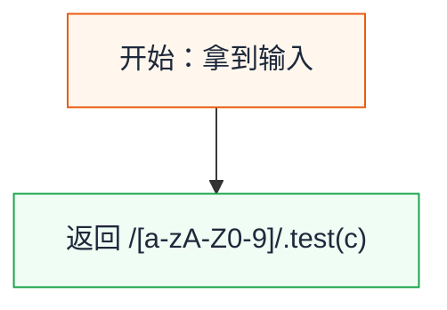

## TypeScript 解题方案（3 个方案逐个讲）

> **运行与提交**：每个方案都是自包含文件（内嵌用例自测，输出 PASS），整块复制到 `.ts` 文件后 `node 文件名` 即可运行。提交 LeetCode 时，把 `demo` 内的算法函数与辅助类型/函数整体取出、置于文件顶层即可。涉及交互/特殊接口的题以题面给定签名为准。

### 方案 1：筛选 + 判断

**分析与思路**：核心做法是「筛选 + 判断」。

**运行方式**：`node 本文件`，内嵌用例全部通过会输出 PASS。


**方案专属流程图**（真实控制流）：

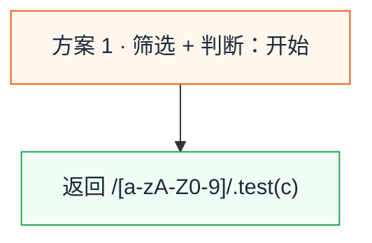

```typescript
/**
 ** LeetCode 125. 验证回文串
 ** 方案：1 ) 方案1: 筛选 + 判断
 ** 来源：https://blog.csdn.net/tyro_java/article/details/145114949
 */

// 忠实翻译 Python 参考实现：t = [c.lower() for c in s if c.isalnum()]; t == t[::-1]
function isAlphanumeric(c: string): boolean {
  // 定义判定函数 isAlphanumeric
  return /[a-zA-Z0-9]/.test(c); // 返回 除以 [数组 减 zA 减 Z0 减 9] 除以 .test(字符)
}
function isPalindrome(s: string): boolean {
  // 定义判定函数 isPalindrome
  let filtered = ''; // 把 「」 存入 filtered
  for (const ch of s) {
    // for (const 字符 of 字符串) {
    if (isAlphanumeric(ch)) {
      // 若 isAlphanumeric(字符
      filtered += ch.toLowerCase(); // filtered累加 字符.toLowerCase()
    }
  }
  let left = 0,
    right = filtered.length - 1; // 把 0, 右边界 赋值为 filtered.长度 减 1 存入 左边界
  while (left < right) {
    // 循环，直到不满足「左边界 小于 右边界」
    if (filtered[left] !== filtered[right]) return false; // 若 filtered[左边界] 不等于 filtered[右边界]，直接返回 false
    left++; // 左边界 加一
    right--; // 右边界 减一
  }
  return true; // 返回 true
}

export function demo(): void {
  // 程序入口：跑内嵌自测用例
  // 用例来自 _tools/correctness_check.py PROBLEMS["lc_125_验证回文串"]
  const cases: [string, boolean][] = [
    ['A man, a plan, a canal: Panama', true],
    ['race a car', false],
    [' ', true],
  ];
  for (const [input, want] of cases) {
    // for (const [input, want] of cases) {
    const got = isPalindrome(input); // 把 isPalindrome(input) 存入 got
    if (got !== want) {
      // 若 got 不等于 want
      throw new Error(
        `FAIL isPalindrome(${JSON.stringify(input)}) = ${got}, want ${want}`,
      );
    }
  }
  console.log('PASS'); // 全部用例通过，输出 PASS
}

demo(); // demo();
```

### 方案 2：双指针

**分析与思路**：核心做法是「双指针」。

**运行方式**：`node 本文件`，内嵌用例全部通过会输出 PASS。

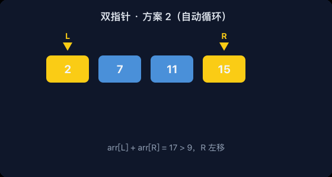

**方案专属流程图**（真实控制流）：

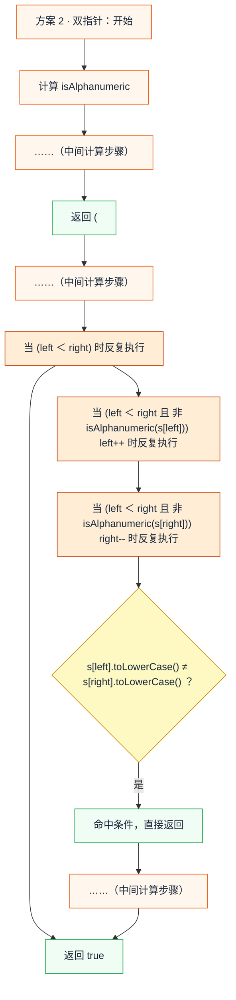

```typescript
/**
 ** LeetCode 125. 验证回文串
 ** 方案：2 ) 方案2: 双指针
 ** 来源：https://blog.csdn.net/tyro_java/article/details/145114949
 */

// 忠实翻译 Python 参考实现：t = [c.lower() for c in s if c.isalnum()]; t == t[::-1]
function isPalindrome(s: string): boolean {
  // 定义判定函数 isPalindrome
  const isAlphanumeric = (ch: string): boolean => {
    const code = ch.charCodeAt(0); // 把 字符.charCodeAt(0) 存入 code
    return (
      (code >= 48 && code <= 57) ||
      (code >= 65 && code <= 90) ||
      (code >= 97 && code <= 122)
    );
  };
  let left = 0; // 把 0 存入 左边界
  let right = s.length - 1; // 把 字符串.长度 减 1 存入 右边界
  while (left < right) {
    // 循环，直到不满足「左边界 小于 右边界」
    while (left < right && !isAlphanumeric(s[left])) left++; // 循环，直到不满足「左边界 小于 右边界 且 取反 isAlphanumeric(字符串[左边界])) 左边界 加一 ;」
    while (left < right && !isAlphanumeric(s[right])) right--; // 循环，直到不满足「左边界 小于 右边界 且 取反 isAlphanumeric(字符串[右边界])) 右边界 减一 ;」
    if (s[left].toLowerCase() !== s[right].toLowerCase()) return false;
    left++; // 左边界 加一
    right--; // 右边界 减一
  }
  return true; // 返回 true
}

export function demo(): void {
  // 程序入口：跑内嵌自测用例
  // 用例来自 _tools/correctness_check.py PROBLEMS["lc_125_验证回文串"]
  const cases: [string, boolean][] = [
    ['A man, a plan, a canal: Panama', true],
    ['race a car', false],
    [' ', true],
  ];
  for (const [input, want] of cases) {
    // for (const [input, want] of cases) {
    const got = isPalindrome(input); // 把 isPalindrome(input) 存入 got
    if (got !== want) {
      // 若 got 不等于 want
      throw new Error(
        `FAIL isPalindrome(${JSON.stringify(input)}) = ${got}, want ${want}`,
      );
    }
  }
  console.log('PASS'); // 全部用例通过，输出 PASS
}

demo(); // demo();
```

### 方案 3：在原字符串上直接判断

**分析与思路**：核心做法是「在原字符串上直接判断」。

**运行方式**：`node 本文件`，内嵌用例全部通过会输出 PASS。


**方案专属流程图**（真实控制流）：

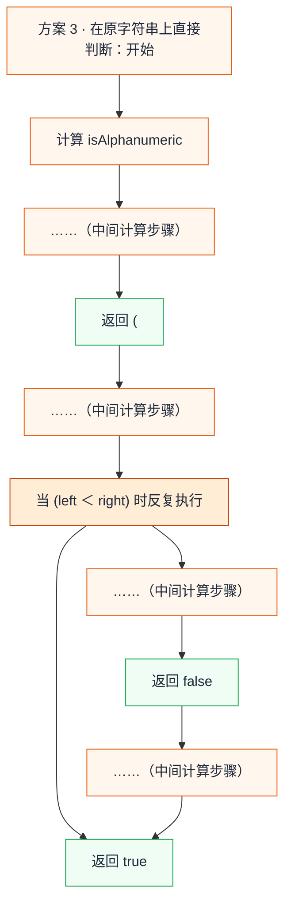

```typescript
/**
 ** LeetCode 125. 验证回文串
 ** 方案：3 ）方案3：在原字符串上直接判断
 ** 来源：https://blog.csdn.net/tyro_java/article/details/145114949
 */

// 忠实翻译 Python 参考实现：t = [c.lower() for c in s if c.isalnum()]; t == t[::-1]
function isPalindrome(s: string): boolean {
  // 定义判定函数 isPalindrome
  const isAlphanumeric = (ch: string): boolean => {
    const code = ch.charCodeAt(0); // 把 字符.charCodeAt(0) 存入 code
    return (
      (code >= 48 && code <= 57) ||
      (code >= 65 && code <= 90) ||
      (code >= 97 && code <= 122)
    );
  };
  let left = 0; // 把 0 存入 左边界
  let right = s.length - 1; // 把 字符串.长度 减 1 存入 右边界
  while (left < right) {
    // 循环，直到不满足「左边界 小于 右边界」
    if (!isAlphanumeric(s[left])) {
      // 若 取反 isAlphanumeric(字符串[左边界]
      left++; // 左边界 加一
    } else if (!isAlphanumeric(s[right])) {
      // 否则，若 取反 isAlphanumeric(字符串[右边界]
      right--; // 右边界 减一
    } else if (s[left].toLowerCase() !== s[right].toLowerCase()) {
      // 否则，若 字符串[左边界].toLowerCase() 不等于 字符串[右边界].toLowerCase(
      return false; // 返回 false
    } else {
      // 否则
      left++; // 左边界 加一
      right--; // 右边界 减一
    }
  }
  return true; // 返回 true
}

export function demo(): void {
  // 程序入口：跑内嵌自测用例
  // 用例来自 _tools/correctness_check.py PROBLEMS["lc_125_验证回文串"]
  const cases: [string, boolean][] = [
    ['A man, a plan, a canal: Panama', true],
    ['race a car', false],
    [' ', true],
  ];
  for (const [input, want] of cases) {
    // for (const [input, want] of cases) {
    const got = isPalindrome(input); // 把 isPalindrome(input) 存入 got
    if (got !== want) {
      // 若 got 不等于 want
      throw new Error(
        `FAIL isPalindrome(${JSON.stringify(input)}) = ${got}, want ${want}`,
      );
    }
  }
  console.log('PASS'); // 全部用例通过，输出 PASS
}

demo(); // demo();
```

## 逐步拆解与面试追问

**复杂度**：时间 O(n) 量级，空间 O(n)

**为什么是这个量级**：整体只对数据做有限趟处理

**面试官可能会追问**：

- 字符集有多大，能否用定长数组计数？
- 要不要考虑 Unicode 多字节字符？
- 空串与单字符的边界？

## 关键 API 速查（TS 主解法实际用到，附官方链接）

| API | 作用 | 使用要点 | 官方文档 |
|---|---|---|---|
| `JSON.stringify()` | 序列化为 JSON 字符串 | 常用于结构化比较（深度相等判定）；undefined/函数/循环引用会被丢弃或抛错 | [官方文档](https://developer.mozilla.org/zh-CN/docs/Web/JavaScript/Reference/Global_Objects/JSON/stringify) |

### 各语言官方文档导航

- **TypeScript / JS**：[MDN 中文参考](https://developer.mozilla.org/zh-CN/)
- **Python**：[Python 官方文档](https://docs.python.org/zh-cn/3/)
- **Go**：[Go 标准库](https://pkg.go.dev/std)
- **Java**：[JDK 17 API](https://docs.oracle.com/en/java/javase/17/docs/api/)
- **Rust**：[Rust 标准库](https://doc.rust-lang.org/std/)
- **Lua**：[Lua 5.4 手册](https://www.lua.org/manual/5.4/)
- **C**：[Cppreference C](https://zh.cppreference.com/w/c)
- **C++**：[Cppreference C++](https://zh.cppreference.com/w/cpp)
- **R**：[R 官方手册](https://stat.ethz.ch/R-manual/)
- **Zig**：[Zig 语言文档](https://ziglang.org/documentation/master/)
- **Dart**：[Dart API](https://api.dart.dev/)

## 附录：其他 10 种语言全部实现（每种语言列举其全部方案）

> TypeScript 的全部方案见「TypeScript 解题方案」一节；下面是其余 10 种语言的对应实现，每种语言的每个方案都带思路分析、代码走读与专属运行架构图。
> 每个方案都内嵌用例自测，可独立运行（老仓库 python/go 文件遵循「打印结果」约定）。
> 完整解法文件见 `dsa/<语言>/string/lc_125_验证回文串/`。

### Python 实现（3 种方案）

Python 的全部方案如下，每个方案都内嵌用例自测，可独立运行（老仓库 python/go 文件遵循「打印结果」约定）：

#### 方案 1：筛选 + 判断

**思路与代码分析**：核心是「筛选 + 判断」。Python 版用切片与字典推导式简化操作，突出可读性。**走读**：方案 1 · 筛选 + 判断：开始 → 更新 right → 当 left ＜ right: 时反复执行 → 当 ( 时反复执行 → 处理 left ＜ right and not s[left] → 处理 ): → 更新 + → 当 ( 时反复执行 → 处理 left ＜ right and not s[right → 处理 ): → 更新 - → 命中条件，直接返回 → 更新 + → 更新 - → 返回 True。

**运行架构**（真实控制流）：

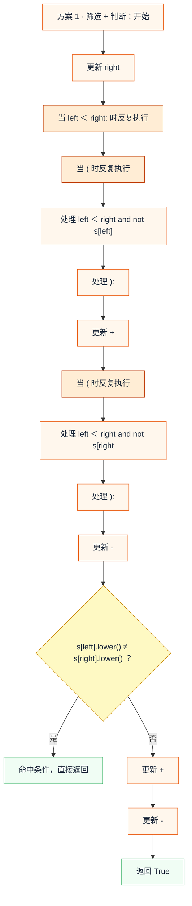

```python
import sys  # 提高递归深度上限（深输入防 RecursionError）

sys.setrecursionlimit(200000)  # 树/链表类题目节点数可达 1e4 量级

def isPalindrome(s):  # 定义函数 isPalindrome（参数：字符串）
    left, right = 0, len(s) - 1  # 把 0, 长度(字符串) 减 1 写入 left, right
    while left < right:  # 循环，直到不满足「左边界 小于 右边界」
        while (
            left < right and not s[left].isalnum()
        ):  # 循环，直到不满足「左边界 小于 右边界 and not 字符串[左边界].isalnum(」
            left += 1  # 左边界累加 1
        while (
            left < right and not s[right].isalnum()
        ):  # 循环，直到不满足「左边界 小于 右边界 and not 字符串[右边界].isalnum(」
            right -= 1  # 右边界累减 1
        if s[left].lower() != s[right].lower():  # 若 字符串[左边界].lower() 不等于 字符串[右边界].lower(
            return False  # 返回 False
        left += 1  # 左边界累加 1
        right -= 1  # 右边界累减 1
    return True  # 返回 True

if __name__ == "__main__":  # 若 __name__ 等于 '__main__'
    print(isPalindrome("abc"))  # 打印输出
```

#### 方案 2：双指针

**思路与代码分析**：核心是「双指针」。Python 版用切片与字典推导式简化操作，突出可读性。**走读**：方案 2 · 双指针：开始 → 更新 right → 当 left ＜ right: 时反复执行 → 当 ( 时反复执行 → 处理 left ＜ right and not s[left] → 处理 ): → 更新 + → 当 ( 时反复执行 → 处理 left ＜ right and not s[right → 处理 ): → 更新 - → 命中条件，直接返回 → 更新 + → 更新 - → 返回 True。

**运行架构**（真实控制流）：

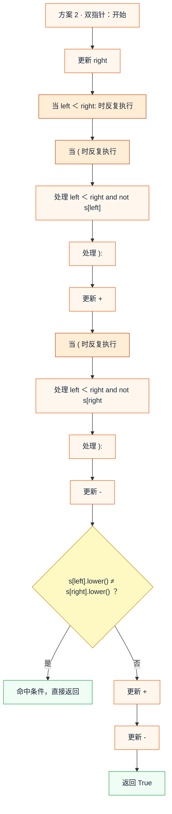

```python
import sys  # 提高递归深度上限（深输入防 RecursionError）

sys.setrecursionlimit(200000)  # 树/链表类题目节点数可达 1e4 量级

def isPalindrome(s):  # 定义函数 isPalindrome（参数：字符串）
    left, right = 0, len(s) - 1  # 把 0, 长度(字符串) 减 1 写入 left, right
    while left < right:  # 循环，直到不满足「左边界 小于 右边界」
        while (
            left < right and not s[left].isalnum()
        ):  # 循环，直到不满足「左边界 小于 右边界 and not 字符串[左边界].isalnum(」
            left += 1  # 左边界累加 1
        while (
            left < right and not s[right].isalnum()
        ):  # 循环，直到不满足「左边界 小于 右边界 and not 字符串[右边界].isalnum(」
            right -= 1  # 右边界累减 1
        if s[left].lower() != s[right].lower():  # 若 字符串[左边界].lower() 不等于 字符串[右边界].lower(
            return False  # 返回 False
        left += 1  # 左边界累加 1
        right -= 1  # 右边界累减 1
    return True  # 返回 True

if __name__ == "__main__":  # 若 __name__ 等于 '__main__'
    print(isPalindrome("abc"))  # 打印输出
```

#### 方案 3：在原字符串上直接判断

**思路与代码分析**：核心是「在原字符串上直接判断」。Python 版用切片与字典推导式简化操作，突出可读性。**走读**：方案 3 · 在原字符串上直接判断：开始 → 更新 right → 当 left ＜ right: 时反复执行 → 当 ( 时反复执行 → 处理 left ＜ right and not s[left] → 处理 ): → 更新 + → 当 ( 时反复执行 → 处理 left ＜ right and not s[right → 处理 ): → 更新 - → 命中条件，直接返回 → 更新 + → 更新 - → 返回 True。

**运行架构**（真实控制流）：

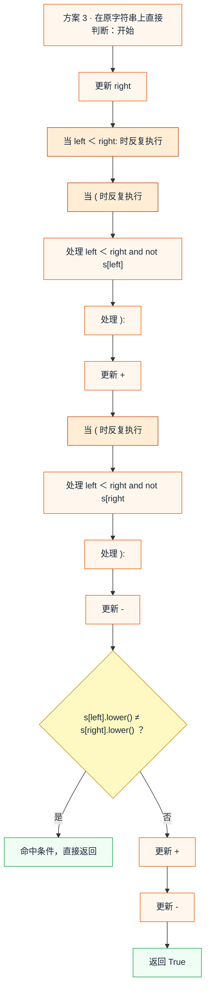

```python
import sys  # 提高递归深度上限（深输入防 RecursionError）

sys.setrecursionlimit(200000)  # 树/链表类题目节点数可达 1e4 量级

def isPalindrome(s):  # 定义函数 isPalindrome（参数：字符串）
    left, right = 0, len(s) - 1  # 把 0, 长度(字符串) 减 1 写入 left, right
    while left < right:  # 循环，直到不满足「左边界 小于 右边界」
        while (
            left < right and not s[left].isalnum()
        ):  # 循环，直到不满足「左边界 小于 右边界 and not 字符串[左边界].isalnum(」
            left += 1  # 左边界累加 1
        while (
            left < right and not s[right].isalnum()
        ):  # 循环，直到不满足「左边界 小于 右边界 and not 字符串[右边界].isalnum(」
            right -= 1  # 右边界累减 1
        if s[left].lower() != s[right].lower():  # 若 字符串[左边界].lower() 不等于 字符串[右边界].lower(
            return False  # 返回 False
        left += 1  # 左边界累加 1
        right -= 1  # 右边界累减 1
    return True  # 返回 True

if __name__ == "__main__":  # 若 __name__ 等于 '__main__'
    print(isPalindrome("abc"))  # 打印输出
```

### Go 实现（3 种方案）

Go 的全部方案如下，每个方案都内嵌用例自测，可独立运行（老仓库 python/go 文件遵循「打印结果」约定）：

#### 方案 1：筛选 + 判断

**思路与代码分析**：核心是「筛选 + 判断」。Go 版用切片与多返回值惯用法，显式处理索引边界。**走读**：方案 1 · 筛选 + 判断：开始 → 更新 : → 遍历 s 的下标与元素 r → 处理 if isAlnum(r) → 更新 filtered → 遍历循环 → 处理 if filtered[i] ≠ filtered[j → 返回 false → 返回 true。

**运行架构**（真实控制流）：

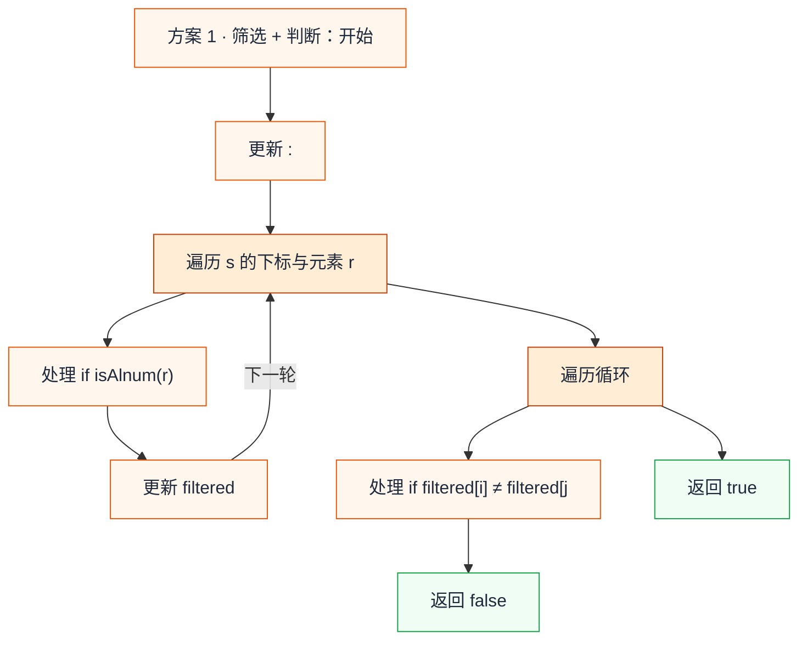

```go
package main // 引入依赖

import (
	"fmt" // 「fmt」
	"os"  // 「os」
)

// isPalindrome 验证回文串（筛选 + 双指针）。
// 忠实翻译 Python 参考实现：t = [c.lower() for c in s if c.isalnum()]; t == t[::-1]
func isPalindrome(s string) bool { // 定义判定函数 isPalindrome
	filtered := make([]rune, 0, len(s)) // 把 make([]rune, 0, 长度(字符串)) 写入 filtered :
	for _, r := range s {               // 同时取 _ 与 右指针 遍历
		if isAlnum(r) { // 定义判定函数 isAlnum
			filtered = append(filtered, toLower(r)) // 把 append(filtered, toLower(右指针)) 写入 filtered
		}
	}
	for i, j := 0, len(filtered)-1; i < j; i, j = i+1, j-1 {
		if filtered[i] != filtered[j] { // 若 filtered[下标 i] 不等于 filtered[下标 j]
			return false // 返回 false
		}
	}
	return true // 返回 true
}

func isAlnum(r rune) bool { // 定义判定函数 isAlnum
	return (r >= 'a' && r <= 'z') || (r >= 'A' && r <= 'Z') || (r >= '0' && r <= '9')
}

func toLower(r rune) rune { // 定义函数/方法 toLower
	if r >= 'A' && r <= 'Z' { // 若 右指针 不低于 'A' 且 右指针 不超过 'Z'
		return r + ('a' - 'A') // 返回 右指针 加 ('数组' 减 'A')
	}
	return r // 返回 右指针
}

func main() { // 程序入口：跑内嵌自测用例
	// 用例来自 _tools/correctness_check.py PROBLEMS["lc_125_验证回文串"]
	cases := []struct { // 把 []struct { 写入 cases :
		s    string // 字符串 string
		want bool   // want bool
	}{ // }{
		{"A man, a plan, a canal: Panama", true},
		{"race a car", false},
		{" ", true},
	}
	allOK := true             // 把 true 写入 allOK :
	for _, c := range cases { // 同时取 _ 与 字符 遍历
		got := isPalindrome(c.s) // 把 isPalindrome(字符.字符串) 写入 got :
		if got != c.want {       // 若 got 不等于 字符.want
			allOK = false                                                         // 把 false 写入 allOK
			fmt.Printf("FAIL isPalindrome(%q) = %v, want %v\n", c.s, got, c.want) // 打印输出
		}
	}
	if !allOK { // 若 取反 allOK
		os.Exit(1) // os.Exit(1)
	}
	fmt.Println("PASS") // 全部用例通过，输出 PASS
}
```

#### 方案 2：双指针

**思路与代码分析**：核心是「双指针」。Go 版用切片与多返回值惯用法，显式处理索引边界。**走读**：方案 2 · 双指针：开始 → 更新 : → 更新 : → 遍历循环 → 遍历循环 → 处理 left++ → 遍历循环 → 处理 right-- → 处理 if toLower(rs[left]) ≠ toLo → 返回 false → 处理 left++ → 处理 right-- → 返回 true。

**运行架构**（真实控制流）：

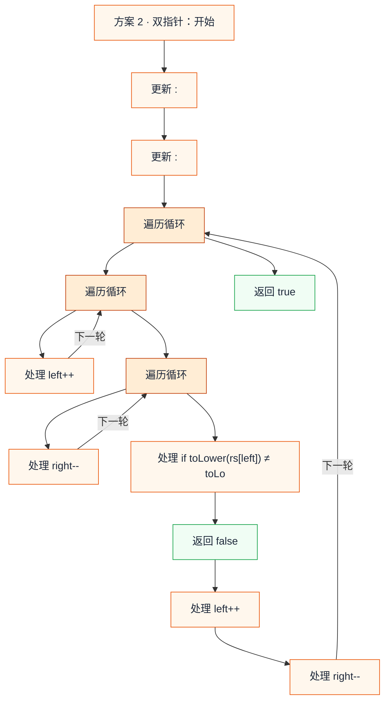

```go
package main // 引入依赖

import (
	"fmt" // 「fmt」
	"os"  // 「os」
)

// isPalindrome 验证回文串（原地双指针，跳过非字母数字）。
// 忠实翻译 Python 参考实现：t = [c.lower() for c in s if c.isalnum()]; t == t[::-1]
func isPalindrome(s string) bool { // 定义判定函数 isPalindrome
	rs := []rune(s)             // 把 []rune(字符串) 写入 rs :
	left, right := 0, len(rs)-1 // 把 0, 长度(rs) 减 1 写入 left, right :
	for left < right {          // for 左边界 小于 右边界 {
		for left < right && !isAlnum(rs[left]) { // for 左边界 小于 右边界 且 取反 isAlnum(rs[左边界]) {
			left++ // 左边界 加一
		}
		for left < right && !isAlnum(rs[right]) { // for 左边界 小于 右边界 且 取反 isAlnum(rs[右边界]) {
			right-- // 右边界 减一
		}
		if toLower(rs[left]) != toLower(rs[right]) { // 定义函数/方法 toLower
			return false // 返回 false
		}
		left++  // 左边界 加一
		right-- // 右边界 减一
	}
	return true // 返回 true
}

func isAlnum(r rune) bool { // 定义判定函数 isAlnum
	return (r >= 'a' && r <= 'z') || (r >= 'A' && r <= 'Z') || (r >= '0' && r <= '9')
}

func toLower(r rune) rune { // 定义函数/方法 toLower
	if r >= 'A' && r <= 'Z' { // 若 右指针 不低于 'A' 且 右指针 不超过 'Z'
		return r + ('a' - 'A') // 返回 右指针 加 ('数组' 减 'A')
	}
	return r // 返回 右指针
}

func main() { // 程序入口：跑内嵌自测用例
	// 用例来自 _tools/correctness_check.py PROBLEMS["lc_125_验证回文串"]
	cases := []struct { // 把 []struct { 写入 cases :
		s    string // 字符串 string
		want bool   // want bool
	}{ // }{
		{"A man, a plan, a canal: Panama", true},
		{"race a car", false},
		{" ", true},
	}
	allOK := true             // 把 true 写入 allOK :
	for _, c := range cases { // 同时取 _ 与 字符 遍历
		got := isPalindrome(c.s) // 把 isPalindrome(字符.字符串) 写入 got :
		if got != c.want {       // 若 got 不等于 字符.want
			allOK = false                                                         // 把 false 写入 allOK
			fmt.Printf("FAIL isPalindrome(%q) = %v, want %v\n", c.s, got, c.want) // 打印输出
		}
	}
	if !allOK { // 若 取反 allOK
		os.Exit(1) // os.Exit(1)
	}
	fmt.Println("PASS") // 全部用例通过，输出 PASS
}
```

#### 方案 3：在原字符串上直接判断

**思路与代码分析**：核心是「在原字符串上直接判断」。Go 版用切片与多返回值惯用法，显式处理索引边界。**走读**：方案 3 · 在原字符串上直接判断：开始 → 更新 : → 遍历 s 的下标与元素 r → 处理 if unicode.IsLetter(r) 或 un → 更新 filtered → 遍历循环 → 处理 if filtered[i] ≠ filtered[j → 返回 false → 返回 true。

**运行架构**（真实控制流）：

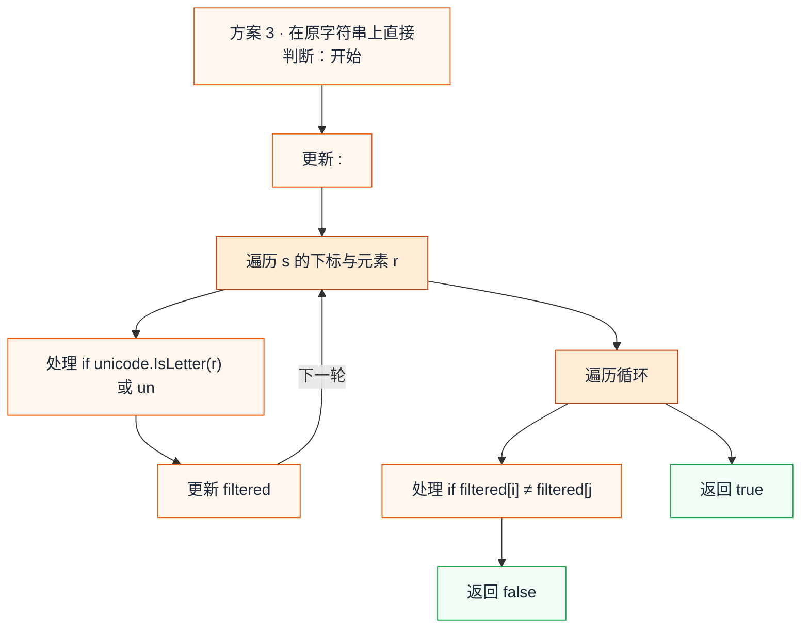

```go
package main // 引入依赖

import (
	"fmt"     // 「fmt」
	"os"      // 「os」
	"unicode" // 「unicode」
)

// isPalindrome 验证回文串（使用 unicode 工具函数筛选）。
// 忠实翻译 Python 参考实现：t = [c.lower() for c in s if c.isalnum()]; t == t[::-1]
func isPalindrome(s string) bool { // 定义判定函数 isPalindrome
	filtered := make([]rune, 0, len(s)) // 把 make([]rune, 0, 长度(字符串)) 写入 filtered :
	for _, r := range s {               // 同时取 _ 与 右指针 遍历
		if unicode.IsLetter(r) || unicode.IsDigit(r) { // 若 unicode.IsLetter(右指针) 或 unicode.IsDigit(右指针
			filtered = append(filtered, unicode.ToLower(r)) // 把 append(filtered, unicode.ToLower(右指针)) 写入 filtered
		}
	}
	for i, j := 0, len(filtered)-1; i < j; i, j = i+1, j-1 {
		if filtered[i] != filtered[j] { // 若 filtered[下标 i] 不等于 filtered[下标 j]
			return false // 返回 false
		}
	}
	return true // 返回 true
}

func main() { // 程序入口：跑内嵌自测用例
	// 用例来自 _tools/correctness_check.py PROBLEMS["lc_125_验证回文串"]
	cases := []struct { // 把 []struct { 写入 cases :
		s    string // 字符串 string
		want bool   // want bool
	}{ // }{
		{"A man, a plan, a canal: Panama", true},
		{"race a car", false},
		{" ", true},
	}
	allOK := true             // 把 true 写入 allOK :
	for _, c := range cases { // 同时取 _ 与 字符 遍历
		got := isPalindrome(c.s) // 把 isPalindrome(字符.字符串) 写入 got :
		if got != c.want {       // 若 got 不等于 字符.want
			allOK = false                                                         // 把 false 写入 allOK
			fmt.Printf("FAIL isPalindrome(%q) = %v, want %v\n", c.s, got, c.want) // 打印输出
		}
	}
	if !allOK { // 若 取反 allOK
		os.Exit(1) // os.Exit(1)
	}
	fmt.Println("PASS") // 全部用例通过，输出 PASS
}
```

### Java 实现（3 种方案）

Java 的全部方案如下，每个方案都内嵌用例自测，可独立运行（老仓库 python/go 文件遵循「打印结果」约定）：

#### 方案 1：筛选 + 判断

**思路与代码分析**：核心是「筛选 + 判断」。Java 版用类与静态方法组织，集合操作显式明了。**走读**：方案 1 · 筛选 + 判断：开始 → 更新 filtered → 更新 left → 当 (left ＜ right) 时反复执行 → 若 filtered.charAt(left：更新 ! → 更新 ! → 返回 false → 处理 left++ → 处理 right-- → 返回 true。

**运行架构**（真实控制流）：

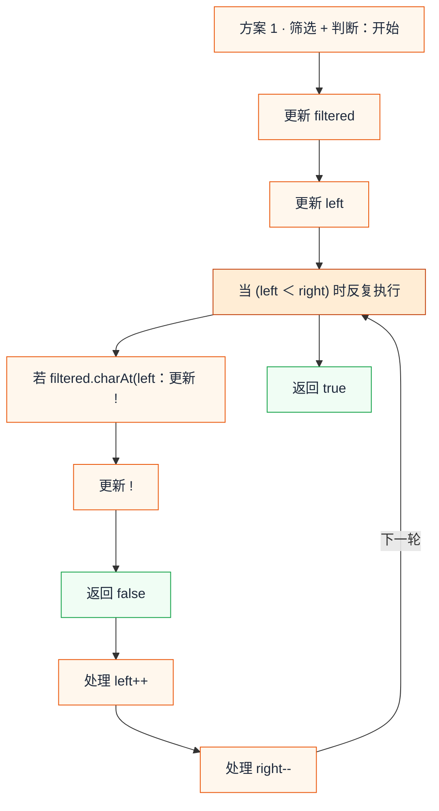

```java
package com.webfault.dsa; // 引入依赖

// LeetCode 125. 验证回文串（筛选 + 判断）
// 忠实翻译 Python 参考实现：t = [c.lower() for c in s if c.isalnum()]; t == t[::-1]
class lc125_solution111 { // 定义类型
  boolean isPalindrome(String s) { // 定义判定函数 isPalindrome
    String filtered = s.replaceAll("[^a-zA-Z0-9]", "").toLowerCase();
    int left = 0, right = filtered.length() - 1; // 把 0, 右边界 赋值为 filtered.长度() 减 1 存入 左边界
    while (left < right) { // 循环，直到不满足「左边界 小于 右边界」
      if (filtered.charAt(left)
          != filtered.charAt(right)) { // 若 filtered 取字符 左边界) 不等于 filtered 取字符 右边界
        return false; // 返回 false
      }
      left++; // 左边界 加一
      right--; // 右边界 减一
    }
    return true; // 返回 true
  }

  public static void main(String[] args) { // public static void main(String[] args) {
    // 用例来自 _tools/correctness_check.py PROBLEMS["lc_125_验证回文串"]
    Object[][] cases = { // 把 { 写入 Object[][] cases
      {"A man, a plan, a canal: Panama", true},
      {"race a car", false},
      {" ", true},
    };
    lc125_solution111 s =
        new lc125_solution111(); // 把 new lc125_solution111(); 写入 lc125_solution111 s
    boolean allOK = true; // 把 true; 写入 boolean allOK
    for (Object[] c : cases) { // for (Object[] 字符 : cases) {
      boolean got =
          s.isPalindrome((String) c[0]); // 把 字符串.isPalindrome((String) 字符[0]); 写入 boolean got
      boolean want = (Boolean) c[1]; // 把 (Boolean) 字符[1]; 写入 boolean want
      if (got != want) { // 若 got 不等于 want
        allOK = false; // 把 false; 写入 allOK
        System.out.println("FAIL isPalindrome(" + c[0] + ") = " + got + ", want " + want); // 打印输出
      }
    }
    if (!allOK) { // 若 取反 allOK
      throw new RuntimeException(
          "some cases FAILED"); // throw new RuntimeException(「some cases FAILED」);
    }
    System.out.println("PASS"); // 全部用例通过，输出 PASS
  }
}
```

#### 方案 2：双指针

**思路与代码分析**：核心是「双指针」。Java 版用类与静态方法组织，集合操作显式明了。**走读**：方案 2 · 双指针：开始 → 更新 left → 当 (left ＜ right) 时反复执行 → 当 (left ＜ right 且 非 Character.isLetterOrDigit(s.charAt(left))) 时反复执行 → 处理 left++ → 当 (left ＜ right 且 非 Character.isLetterOrDigit(s.charAt(right))) 时反复执行 → 处理 right-- → 命中条件，直接返回 → 处理 left++ → 处理 right-- → 返回 true。

**运行架构**（真实控制流）：

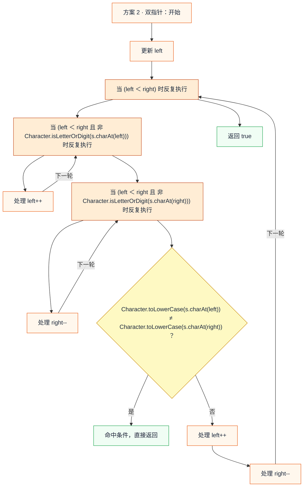

```java
package com.webfault.dsa; // 引入依赖

// LeetCode 125. 验证回文串（双指针）
// 忠实翻译 Python 参考实现：t = [c.lower() for c in s if c.isalnum()]; t == t[::-1]
class lc125_solution222 { // 定义类型
  boolean isPalindrome(String s) { // 定义判定函数 isPalindrome
    int left = 0, right = s.length() - 1; // 把 0, 右边界 赋值为 字符串.长度() 减 1 存入 左边界
    while (left < right) { // 循环，直到不满足「左边界 小于 右边界」
      while (left < right && !Character.isLetterOrDigit(s.charAt(left))) {
        left++; // 左边界 加一
      }
      while (left < right && !Character.isLetterOrDigit(s.charAt(right))) {
        right--; // 右边界 减一
      }
      if (Character.toLowerCase(s.charAt(left)) != Character.toLowerCase(s.charAt(right))) {
        return false; // 返回 false
      }
      left++; // 左边界 加一
      right--; // 右边界 减一
    }
    return true; // 返回 true
  }

  public static void main(String[] args) { // public static void main(String[] args) {
    // 用例来自 _tools/correctness_check.py PROBLEMS["lc_125_验证回文串"]
    Object[][] cases = { // 把 { 写入 Object[][] cases
      {"A man, a plan, a canal: Panama", true},
      {"race a car", false},
      {" ", true},
    };
    lc125_solution222 s =
        new lc125_solution222(); // 把 new lc125_solution222(); 写入 lc125_solution222 s
    boolean allOK = true; // 把 true; 写入 boolean allOK
    for (Object[] c : cases) { // for (Object[] 字符 : cases) {
      boolean got =
          s.isPalindrome((String) c[0]); // 把 字符串.isPalindrome((String) 字符[0]); 写入 boolean got
      boolean want = (Boolean) c[1]; // 把 (Boolean) 字符[1]; 写入 boolean want
      if (got != want) { // 若 got 不等于 want
        allOK = false; // 把 false; 写入 allOK
        System.out.println("FAIL isPalindrome(" + c[0] + ") = " + got + ", want " + want); // 打印输出
      }
    }
    if (!allOK) { // 若 取反 allOK
      throw new RuntimeException(
          "some cases FAILED"); // throw new RuntimeException(「some cases FAILED」);
    }
    System.out.println("PASS"); // 全部用例通过，输出 PASS
  }
}
```

#### 方案 3：在原字符串上直接判断

**思路与代码分析**：核心是「在原字符串上直接判断」。Java 版用类与静态方法组织，集合操作显式明了。**走读**：方案 3 · 在原字符串上直接判断：开始 → 更新 left → 更新 right → 当 (left ＜ right) 时反复执行 → 处理 if (非 Character.isLetterOrDig → 调用 s.charAt(left))) → 处理 left++ → 调用 s.charAt(right))) → 处理 right-- → 返回 false → 处理 left++ → 处理 right-- → 返回 true。

**运行架构**（真实控制流）：

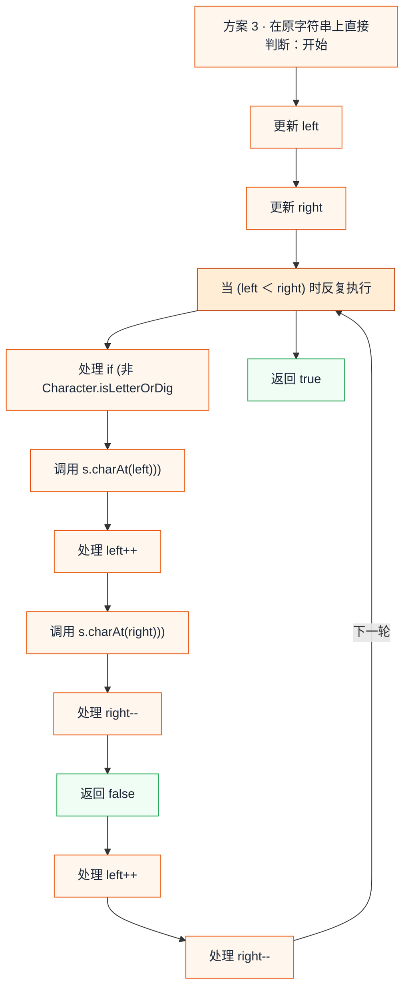

```java
package com.webfault.dsa; // 引入依赖

// LeetCode 125. 验证回文串（原字符串上直接判断）
// 忠实翻译 Python 参考实现：t = [c.lower() for c in s if c.isalnum()]; t == t[::-1]
class lc125_solution333 { // 定义类型
  boolean isPalindrome(String s) { // 定义判定函数 isPalindrome
    int left = 0; // 把 0 存入 左边界
    int right = s.length() - 1; // 把 字符串.长度() 减 1 存入 右边界
    while (left < right) { // 循环，直到不满足「左边界 小于 右边界」
      if (!Character.isLetterOrDigit(
          s.charAt(left))) { // 若 取反 Character.isLetterOrDigit(字符串 取字符 左边界
        left++; // 左边界 加一
      } else if (!Character.isLetterOrDigit(
          s.charAt(right))) { // 否则，若 取反 Character.isLetterOrDigit(字符串 取字符 右边界
        right--; // 右边界 减一
      } else if (Character.toLowerCase(s.charAt(left)) != Character.toLowerCase(s.charAt(right))) {
        return false; // 返回 false
      } else { // 否则
        left++; // 左边界 加一
        right--; // 右边界 减一
      }
    }
    return true; // 返回 true
  }

  public static void main(String[] args) { // public static void main(String[] args) {
    // 用例来自 _tools/correctness_check.py PROBLEMS["lc_125_验证回文串"]
    Object[][] cases = { // 把 { 写入 Object[][] cases
      {"A man, a plan, a canal: Panama", true},
      {"race a car", false},
      {" ", true},
    };
    lc125_solution333 s =
        new lc125_solution333(); // 把 new lc125_solution333(); 写入 lc125_solution333 s
    boolean allOK = true; // 把 true; 写入 boolean allOK
    for (Object[] c : cases) { // for (Object[] 字符 : cases) {
      boolean got =
          s.isPalindrome((String) c[0]); // 把 字符串.isPalindrome((String) 字符[0]); 写入 boolean got
      boolean want = (Boolean) c[1]; // 把 (Boolean) 字符[1]; 写入 boolean want
      if (got != want) { // 若 got 不等于 want
        allOK = false; // 把 false; 写入 allOK
        System.out.println("FAIL isPalindrome(" + c[0] + ") = " + got + ", want " + want); // 打印输出
      }
    }
    if (!allOK) { // 若 取反 allOK
      throw new RuntimeException(
          "some cases FAILED"); // throw new RuntimeException(「some cases FAILED」);
    }
    System.out.println("PASS"); // 全部用例通过，输出 PASS
  }
}
```

### Rust 实现（3 种方案）

Rust 的全部方案如下，每个方案都内嵌用例自测，可独立运行（老仓库 python/go 文件遵循「打印结果」约定）：

#### 方案 1：筛选 + 判断

**思路与代码分析**：核心是「筛选 + 判断」。Rust 版用所有权移动与切片借用改写同一逻辑，注意 Option 与引用边界。**走读**：方案 1 · 筛选 + 判断：开始 → 计算 f → 返回 true → 当 i ＜ j 时反复执行 → 返回 false。

**运行架构**（真实控制流）：

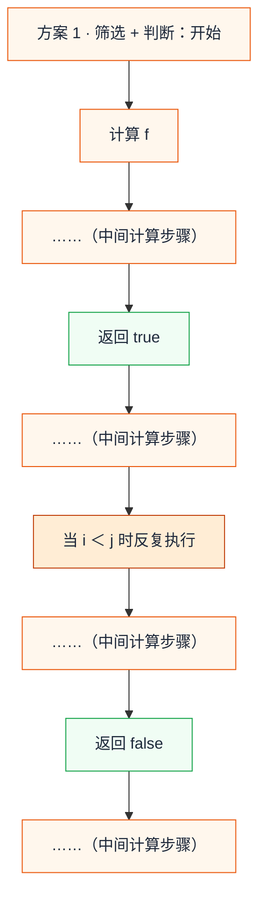

```rust
// LeetCode 125. 验证回文串 — Rust 版（方案1）
fn is_palindrome(s: String) -> bool {
    // 定义判定函数 is_palindrome
    let f: Vec<char> = s
        .chars()
        .filter(|c| c.is_ascii_alphanumeric())
        .map(|c| c.to_ascii_lowercase())
        .collect();
    let (mut i, mut j) = (0usize, f.len()); // 把 (0usize, f.长度()); 写入 let (mut i, mut j)
    if j == 0 {
        return true;
    } // 若 下标 j 等于 0 { return true; }
    j -= 1; // 下标 j累减 1
    while i < j {
        // while 下标 i 小于 下标 j {
        if f[i] != f[j] {
            return false;
        } // 若 f[下标 i] 不等于 f[下标 j] { return false; }
        i += 1; // 下标 i累加 1
        if j == 0 {
            break;
        } // 若 下标 j 等于 0 { break; }
        j -= 1; // 下标 j累减 1
    }
    true // true
}
fn main() {
    // 程序入口：跑内嵌自测用例
    assert!(is_palindrome("A man, a plan, a canal: Panama".to_string())); // 断言校验
    assert!(!is_palindrome("race a car".to_string())); // 断言校验
    assert!(is_palindrome(" ".to_string())); // 断言校验
    println!("PASS"); // 全部用例通过，输出 PASS
}
```

#### 方案 2：双指针

**思路与代码分析**：核心是「双指针」。Rust 版用所有权移动与切片借用改写同一逻辑，注意 Option 与引用边界。**走读**：方案 2 · 双指针：开始 → 计算 f → 返回 true → 当 i ＜ j 时反复执行 → 返回 false。

**运行架构**（真实控制流）：

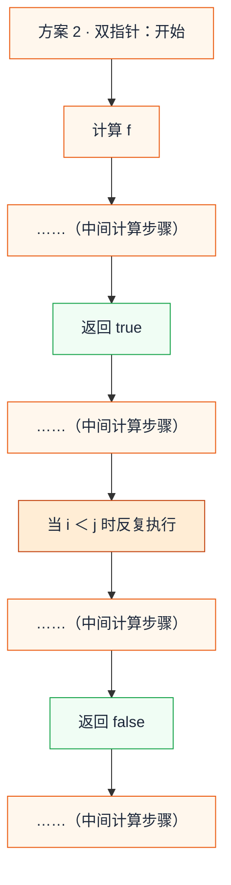

```rust
// LeetCode 125. 验证回文串 — Rust 版（方案2）
fn is_palindrome(s: String) -> bool {
    // 定义判定函数 is_palindrome
    let f: Vec<char> = s
        .chars()
        .filter(|c| c.is_ascii_alphanumeric())
        .map(|c| c.to_ascii_lowercase())
        .collect();
    let (mut i, mut j) = (0usize, f.len()); // 把 (0usize, f.长度()); 写入 let (mut i, mut j)
    if j == 0 {
        return true;
    } // 若 下标 j 等于 0 { return true; }
    j -= 1; // 下标 j累减 1
    while i < j {
        // while 下标 i 小于 下标 j {
        if f[i] != f[j] {
            return false;
        } // 若 f[下标 i] 不等于 f[下标 j] { return false; }
        i += 1; // 下标 i累加 1
        if j == 0 {
            break;
        } // 若 下标 j 等于 0 { break; }
        j -= 1; // 下标 j累减 1
    }
    true // true
}
fn main() {
    // 程序入口：跑内嵌自测用例
    assert!(is_palindrome("A man, a plan, a canal: Panama".to_string())); // 断言校验
    assert!(!is_palindrome("race a car".to_string())); // 断言校验
    assert!(is_palindrome(" ".to_string())); // 断言校验
    println!("PASS"); // 全部用例通过，输出 PASS
}
```

#### 方案 3：在原字符串上直接判断

**思路与代码分析**：核心是「在原字符串上直接判断」。Rust 版用所有权移动与切片借用改写同一逻辑，注意 Option 与引用边界。**走读**：方案 3 · 在原字符串上直接判断：开始 → 计算 f → 返回 true → 当 i ＜ j 时反复执行 → 返回 false。

**运行架构**（真实控制流）：

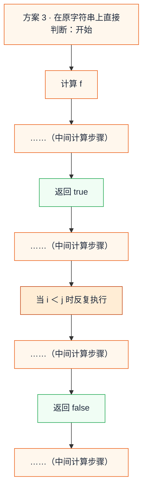

```rust
// LeetCode 125. 验证回文串 — Rust 版（方案3）
fn is_palindrome(s: String) -> bool {
    // 定义判定函数 is_palindrome
    let f: Vec<char> = s
        .chars()
        .filter(|c| c.is_ascii_alphanumeric())
        .map(|c| c.to_ascii_lowercase())
        .collect();
    let (mut i, mut j) = (0usize, f.len()); // 把 (0usize, f.长度()); 写入 let (mut i, mut j)
    if j == 0 {
        return true;
    } // 若 下标 j 等于 0 { return true; }
    j -= 1; // 下标 j累减 1
    while i < j {
        // while 下标 i 小于 下标 j {
        if f[i] != f[j] {
            return false;
        } // 若 f[下标 i] 不等于 f[下标 j] { return false; }
        i += 1; // 下标 i累加 1
        if j == 0 {
            break;
        } // 若 下标 j 等于 0 { break; }
        j -= 1; // 下标 j累减 1
    }
    true // true
}
fn main() {
    // 程序入口：跑内嵌自测用例
    assert!(is_palindrome("A man, a plan, a canal: Panama".to_string())); // 断言校验
    assert!(!is_palindrome("race a car".to_string())); // 断言校验
    assert!(is_palindrome(" ".to_string())); // 断言校验
    println!("PASS"); // 全部用例通过，输出 PASS
}
```

### Lua 实现（3 种方案）

Lua 的全部方案如下，每个方案都内嵌用例自测，可独立运行（老仓库 python/go 文件遵循「打印结果」约定）：

#### 方案 1：筛选 + 判断

**思路与代码分析**：核心是「筛选 + 判断」。Lua 版用表与 ipairs 遍历，注意 ipairs 遇 nil 即停的语义。**走读**：方案 1 · 筛选 + 判断：开始 → 更新 f → 遍历 s:gmatch('[%a%d]') do 中的每个元素 c → 更新 1] → 更新 j → 当 i ＜ j do 时反复执行 → 处理 if f[i] ~= f[j] then → 返回 false → 更新 i → 更新 j → 返回 true。

**运行架构**（真实控制流）：

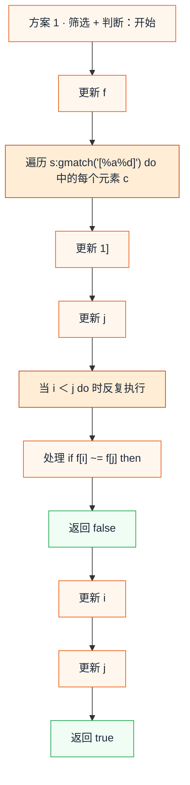

```lua
-- LeetCode 125. 验证回文串 — Lua 版（方案1）
local function is_palindrome(s) -- local function is_palindrome(字符串)
	local f = {} -- 把 {} 写入 local f
	for c in s:gmatch("[%a%d]") do -- for 字符 in 字符串:gmatch(「[ 对…取模 数组 对…取模 d]」) do
		f[#f + 1] = c:lower() -- 把 字符:lower() 写入 f[#f + 1]
	end -- 终点
	local i, j = 1, #f -- 把 1, #f 写入 local i, j
	while i < j do -- while 下标 i 小于 下标 j do
		if f[i] ~= f[j] then
			return false
		end -- 若 f[下标 i] ~ 赋值为 f[下标 j] then return false 终点
		i = i + 1 -- 把 下标 i 加 1 存入 下标 i
		j = j - 1 -- 把 下标 j 减 1 存入 下标 j
	end -- 终点
	return true -- 返回 true
end -- 终点
assert(is_palindrome("A man, a plan, a canal: Panama") == true) -- 断言校验
assert(is_palindrome("race a car") == false) -- 断言校验
assert(is_palindrome(" ") == true) -- 断言校验
print("PASS") -- 全部用例通过，输出 PASS
```

#### 方案 2：双指针

**思路与代码分析**：核心是「双指针」。Lua 版用表与 ipairs 遍历，注意 ipairs 遇 nil 即停的语义。**走读**：方案 2 · 双指针：开始 → 更新 f → 遍历 s:gmatch('[%a%d]') do 中的每个元素 c → 更新 1] → 更新 j → 当 i ＜ j do 时反复执行 → 处理 if f[i] ~= f[j] then → 返回 false → 更新 i → 更新 j → 返回 true。

**运行架构**（真实控制流）：

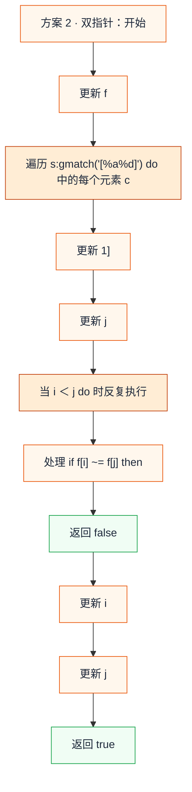

```lua
-- LeetCode 125. 验证回文串 — Lua 版（方案2）
local function is_palindrome(s) -- local function is_palindrome(字符串)
	local f = {} -- 把 {} 写入 local f
	for c in s:gmatch("[%a%d]") do -- for 字符 in 字符串:gmatch(「[ 对…取模 数组 对…取模 d]」) do
		f[#f + 1] = c:lower() -- 把 字符:lower() 写入 f[#f + 1]
	end -- 终点
	local i, j = 1, #f -- 把 1, #f 写入 local i, j
	while i < j do -- while 下标 i 小于 下标 j do
		if f[i] ~= f[j] then
			return false
		end -- 若 f[下标 i] ~ 赋值为 f[下标 j] then return false 终点
		i = i + 1 -- 把 下标 i 加 1 存入 下标 i
		j = j - 1 -- 把 下标 j 减 1 存入 下标 j
	end -- 终点
	return true -- 返回 true
end -- 终点
assert(is_palindrome("A man, a plan, a canal: Panama") == true) -- 断言校验
assert(is_palindrome("race a car") == false) -- 断言校验
assert(is_palindrome(" ") == true) -- 断言校验
print("PASS") -- 全部用例通过，输出 PASS
```

#### 方案 3：在原字符串上直接判断

**思路与代码分析**：核心是「在原字符串上直接判断」。Lua 版用表与 ipairs 遍历，注意 ipairs 遇 nil 即停的语义。**走读**：方案 3 · 在原字符串上直接判断：开始 → 更新 f → 遍历 s:gmatch('[%a%d]') do 中的每个元素 c → 更新 1] → 更新 j → 当 i ＜ j do 时反复执行 → 处理 if f[i] ~= f[j] then → 返回 false → 更新 i → 更新 j → 返回 true。

**运行架构**（真实控制流）：

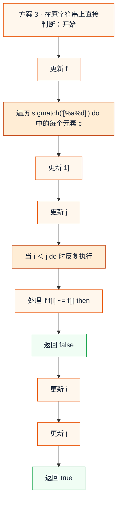

```lua
-- LeetCode 125. 验证回文串 — Lua 版（方案3）
local function is_palindrome(s) -- local function is_palindrome(字符串)
	local f = {} -- 把 {} 写入 local f
	for c in s:gmatch("[%a%d]") do -- for 字符 in 字符串:gmatch(「[ 对…取模 数组 对…取模 d]」) do
		f[#f + 1] = c:lower() -- 把 字符:lower() 写入 f[#f + 1]
	end -- 终点
	local i, j = 1, #f -- 把 1, #f 写入 local i, j
	while i < j do -- while 下标 i 小于 下标 j do
		if f[i] ~= f[j] then
			return false
		end -- 若 f[下标 i] ~ 赋值为 f[下标 j] then return false 终点
		i = i + 1 -- 把 下标 i 加 1 存入 下标 i
		j = j - 1 -- 把 下标 j 减 1 存入 下标 j
	end -- 终点
	return true -- 返回 true
end -- 终点
assert(is_palindrome("A man, a plan, a canal: Panama") == true) -- 断言校验
assert(is_palindrome("race a car") == false) -- 断言校验
assert(is_palindrome(" ") == true) -- 断言校验
print("PASS") -- 全部用例通过，输出 PASS
```

### C 实现（3 种方案）

C 的全部方案如下，每个方案都内嵌用例自测，可独立运行（老仓库 python/go 文件遵循「打印结果」约定）：

#### 方案 1：筛选 + 判断

**思路与代码分析**：核心是「筛选 + 判断」。C 版手动管理下标与内存，循环边界全部显式写出。代码里依次做这些事：单循环线性扫描。**走读**：方案 1 · 筛选 + 判断：开始 → 处理 char f[8192] → 更新 n → 遍历循环 → 若 isalnum((unsigned char)*p)：更新 f[n++] → 更新 f[n++] → 更新 i → 当 (i ＜ j) 时反复执行 → 命中条件，直接返回 → 处理 i++ → 处理 j-- → 返回 1。

**运行架构**（真实控制流）：

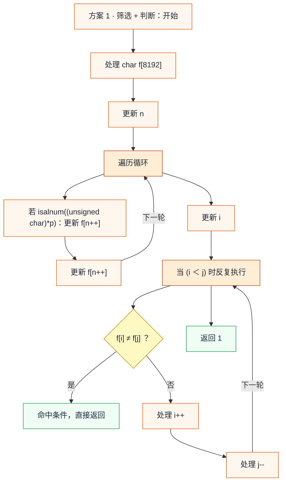

```c
/* LeetCode 125. 验证回文串 — C 版（方案1） */
#include <ctype.h>                        // 引入头文件
#include <stdio.h>                        // 引入头文件
#include <string.h>                       // 引入头文件
static int is_palindrome(const char *s) { // 定义判定函数 is_palindrome
    char f[8192];                         // char f[8192];
    int n = 0;                            // 把 0 存入 元素个数
    for (const char *p = s; *p; p++) { // 把 字符串; 乘 节点; 节点 加一 ) { 写入 for (const char *p
        if (isalnum((unsigned char)*p))
            f[n++] = tolower((unsigned char)*p);
    }
    int i = 0, j = n - 1; // 把 0, 下标 j 赋值为 元素个数 减 1 存入 下标 i
    while (i < j) {       // 循环，直到不满足「下标 i 小于 下标 j」
        if (f[i] != f[j])
            return 0; // 若 f[下标 i] 不等于 f[下标 j]，直接返回 0
        i++;
        j--; // 下标 i 加一 ; 下标 j 减一 ;
    }
    return 1; // 返回 1
}
int main(void) { // 程序入口：跑内嵌自测用例
    if (!is_palindrome("A man, a plan, a canal: Panama")) {
        printf("FAIL 1\n");
        return 1;
    }
    if (is_palindrome("race a car")) {
        printf("FAIL 2\n");
        return 1;
    }
    if (!is_palindrome(" ")) {
        printf("FAIL 3\n");
        return 1;
    }                 // 若 取反 is_palindrome(「 」)) { 输出「 」); return 1; }
    printf("PASS\n"); // 全部用例通过，输出 PASS
    return 0;         // 返回 0
}
```

#### 方案 2：双指针

**思路与代码分析**：核心是「双指针」。C 版手动管理下标与内存，循环边界全部显式写出。代码里依次做这些事：单循环线性扫描。**走读**：方案 2 · 双指针：开始 → 处理 char f[8192] → 更新 n → 遍历循环 → 若 isalnum((unsigned char)*p)：更新 f[n++] → 更新 f[n++] → 更新 i → 当 (i ＜ j) 时反复执行 → 命中条件，直接返回 → 处理 i++ → 处理 j-- → 返回 1。

**运行架构**（真实控制流）：

```mermaid
graph TD
    N0["方案 2 · 双指针：开始"]
    N1["处理 char f[8192]"]
    N2["更新 n"]
    N3["遍历循环"]
    N4["若 isalnum((unsigned char)*p)：更新 f[n++]"]
    N5["更新 f[n++]"]
    N6["更新 i"]
    N7["当 (i ＜ j) 时反复执行"]
    N8{"f[i] ≠ f[j] ？"}
    N9["命中条件，直接返回"]
    N10["处理 i++"]
    N11["处理 j--"]
    N12["返回 1"]
    N0 --> N1
    N1 --> N2
    N2 --> N3
    N3 --> N4
    N4 --> N5
    N5 -- 下一轮 --> N3
    N3 --> N6
    N6 --> N7
    N7 --> N8
    N8 -- 是 --> N9
    N8 -- 否 --> N10
    N10 --> N11
    N11 -- 下一轮 --> N7
    N7 --> N12
    classDef n fill:#fff7ed,stroke:#ea580c,color:#1e293b;
    classDef lp fill:#ffedd5,stroke:#c2410c,color:#1e293b;
    classDef dc fill:#fef9c3,stroke:#ca8a04,color:#1e293b;
    classDef tm fill:#f0fdf4,stroke:#16a34a,color:#1e293b;
    class N0,N1,N2,N4,N5,N6,N10,N11 n;
    class N3,N7 lp;
    class N8 dc;
    class N9,N12 tm;
```

```c
/* LeetCode 125. 验证回文串 — C 版（方案2） */
#include <ctype.h>                        // 引入头文件
#include <stdio.h>                        // 引入头文件
#include <string.h>                       // 引入头文件
static int is_palindrome(const char *s) { // 定义判定函数 is_palindrome
    char f[8192];                         // char f[8192];
    int n = 0;                            // 把 0 存入 元素个数
    for (const char *p = s; *p; p++) { // 把 字符串; 乘 节点; 节点 加一 ) { 写入 for (const char *p
        if (isalnum((unsigned char)*p))
            f[n++] = tolower((unsigned char)*p);
    }
    int i = 0, j = n - 1; // 把 0, 下标 j 赋值为 元素个数 减 1 存入 下标 i
    while (i < j) {       // 循环，直到不满足「下标 i 小于 下标 j」
        if (f[i] != f[j])
            return 0; // 若 f[下标 i] 不等于 f[下标 j]，直接返回 0
        i++;
        j--; // 下标 i 加一 ; 下标 j 减一 ;
    }
    return 1; // 返回 1
}
int main(void) { // 程序入口：跑内嵌自测用例
    if (!is_palindrome("A man, a plan, a canal: Panama")) {
        printf("FAIL 1\n");
        return 1;
    }
    if (is_palindrome("race a car")) {
        printf("FAIL 2\n");
        return 1;
    }
    if (!is_palindrome(" ")) {
        printf("FAIL 3\n");
        return 1;
    }                 // 若 取反 is_palindrome(「 」)) { 输出「 」); return 1; }
    printf("PASS\n"); // 全部用例通过，输出 PASS
    return 0;         // 返回 0
}
```

#### 方案 3：在原字符串上直接判断

**思路与代码分析**：核心是「在原字符串上直接判断」。C 版手动管理下标与内存，循环边界全部显式写出。代码里依次做这些事：单循环线性扫描。**走读**：方案 3 · 在原字符串上直接判断：开始 → 处理 char f[8192] → 更新 n → 遍历循环 → 若 isalnum((unsigned char)*p)：更新 f[n++] → 更新 f[n++] → 更新 i → 当 (i ＜ j) 时反复执行 → 命中条件，直接返回 → 处理 i++ → 处理 j-- → 返回 1。

**运行架构**（真实控制流）：

```mermaid
graph TD
    N0["方案 3 · 在原字符串上直接判断：开始"]
    N1["处理 char f[8192]"]
    N2["更新 n"]
    N3["遍历循环"]
    N4["若 isalnum((unsigned char)*p)：更新 f[n++]"]
    N5["更新 f[n++]"]
    N6["更新 i"]
    N7["当 (i ＜ j) 时反复执行"]
    N8{"f[i] ≠ f[j] ？"}
    N9["命中条件，直接返回"]
    N10["处理 i++"]
    N11["处理 j--"]
    N12["返回 1"]
    N0 --> N1
    N1 --> N2
    N2 --> N3
    N3 --> N4
    N4 --> N5
    N5 -- 下一轮 --> N3
    N3 --> N6
    N6 --> N7
    N7 --> N8
    N8 -- 是 --> N9
    N8 -- 否 --> N10
    N10 --> N11
    N11 -- 下一轮 --> N7
    N7 --> N12
    classDef n fill:#fff7ed,stroke:#ea580c,color:#1e293b;
    classDef lp fill:#ffedd5,stroke:#c2410c,color:#1e293b;
    classDef dc fill:#fef9c3,stroke:#ca8a04,color:#1e293b;
    classDef tm fill:#f0fdf4,stroke:#16a34a,color:#1e293b;
    class N0,N1,N2,N4,N5,N6,N10,N11 n;
    class N3,N7 lp;
    class N8 dc;
    class N9,N12 tm;
```

```c
/* LeetCode 125. 验证回文串 — C 版（方案3） */
#include <ctype.h>                        // 引入头文件
#include <stdio.h>                        // 引入头文件
#include <string.h>                       // 引入头文件
static int is_palindrome(const char *s) { // 定义判定函数 is_palindrome
    char f[8192];                         // char f[8192];
    int n = 0;                            // 把 0 存入 元素个数
    for (const char *p = s; *p; p++) { // 把 字符串; 乘 节点; 节点 加一 ) { 写入 for (const char *p
        if (isalnum((unsigned char)*p))
            f[n++] = tolower((unsigned char)*p);
    }
    int i = 0, j = n - 1; // 把 0, 下标 j 赋值为 元素个数 减 1 存入 下标 i
    while (i < j) {       // 循环，直到不满足「下标 i 小于 下标 j」
        if (f[i] != f[j])
            return 0; // 若 f[下标 i] 不等于 f[下标 j]，直接返回 0
        i++;
        j--; // 下标 i 加一 ; 下标 j 减一 ;
    }
    return 1; // 返回 1
}
int main(void) { // 程序入口：跑内嵌自测用例
    if (!is_palindrome("A man, a plan, a canal: Panama")) {
        printf("FAIL 1\n");
        return 1;
    }
    if (is_palindrome("race a car")) {
        printf("FAIL 2\n");
        return 1;
    }
    if (!is_palindrome(" ")) {
        printf("FAIL 3\n");
        return 1;
    }                 // 若 取反 is_palindrome(「 」)) { 输出「 」); return 1; }
    printf("PASS\n"); // 全部用例通过，输出 PASS
    return 0;         // 返回 0
}
```

### C++ 实现（3 种方案）

C++ 的全部方案如下，每个方案都内嵌用例自测，可独立运行（老仓库 python/go 文件遵循「打印结果」约定）：

#### 方案 1：筛选 + 判断

**思路与代码分析**：核心是「筛选 + 判断」。C++ 版用 STL 容器与迭代器，减少手写下标错误。代码里依次做这些事：单循环线性扫描。**走读**：方案 1 · 筛选 + 判断：开始 → 处理 std::string f → 遍历循环 → 若 std::isalnum(static_cast＜unsigned char＞(c))：调用 f.push_back(static_cast＜char → 调用 f.push_back(static_cast＜char → 更新 i → 命中条件，直接返回 → 处理 --j → 当 (i ＜ j) 时反复执行 → 命中条件，直接返回 → 处理 ++i → 处理 --j → 返回 true。

**运行架构**（真实控制流）：

```mermaid
graph TD
    N0["方案 1 · 筛选 + 判断：开始"]
    N1["处理 std::string f"]
    N2["遍历循环"]
    N3["若 std::isalnum(static_cast＜unsigned char＞(c))：调用 f.push_back(static_cast＜char"]
    N4["调用 f.push_back(static_cast＜char"]
    N5["更新 i"]
    N6{"j == 0 ？"}
    N7["命中条件，直接返回"]
    N8["处理 --j"]
    N9["当 (i ＜ j) 时反复执行"]
    N10{"f[i] ≠ f[j] ？"}
    N11["命中条件，直接返回"]
    N12["处理 ++i"]
    N13["处理 --j"]
    N14["返回 true"]
    N0 --> N1
    N1 --> N2
    N2 --> N3
    N3 --> N4
    N4 -- 下一轮 --> N2
    N2 --> N5
    N5 --> N6
    N6 -- 是 --> N7
    N6 -- 否 --> N8
    N8 --> N9
    N9 --> N10
    N10 -- 是 --> N11
    N10 -- 否 --> N12
    N12 --> N13
    N13 -- 下一轮 --> N9
    N9 --> N14
    classDef n fill:#fff7ed,stroke:#ea580c,color:#1e293b;
    classDef lp fill:#ffedd5,stroke:#c2410c,color:#1e293b;
    classDef dc fill:#fef9c3,stroke:#ca8a04,color:#1e293b;
    classDef tm fill:#f0fdf4,stroke:#16a34a,color:#1e293b;
    class N0,N1,N3,N4,N5,N8,N12,N13 n;
    class N2,N9 lp;
    class N6,N10 dc;
    class N7,N11,N14 tm;
```

```cpp
// LeetCode 125. 验证回文串 — C++ 版（方案1）
#include <cassert>                               // 引入头文件
#include <cctype>                                // 引入头文件
#include <iostream>                              // 引入头文件
#include <string>                                // 引入头文件
static bool isPalindrome(const std::string &s) { // 定义判定函数 isPalindrome
    std::string f;                               // std::string f;
    for (char c : s) {                           // for (char 字符 : 字符串) {
        if (std::isalnum(static_cast<unsigned char>(c)))
            f.push_back(static_cast<char>(std::tolower(static_cast<unsigned char>(c))));
    }
    size_t i = 0, j = f.size(); // 把 0, 下标 j 赋值为 f.大小(); 写入 size_t i
    if (j == 0)
        return true; // 若 下标 j 等于 0，直接返回 true
    --j;             // 减一 下标 j;
    while (i < j) {  // 循环，直到不满足「下标 i 小于 下标 j」
        if (f[i] != f[j])
            return false; // 若 f[下标 i] 不等于 f[下标 j]，直接返回 false
        ++i;
        --j; // 加一 下标 i; 减一 下标 j;
    }
    return true; // 返回 true
}
int main() {                                                // 程序入口：跑内嵌自测用例
    assert(isPalindrome("A man, a plan, a canal: Panama")); // 断言校验
    assert(!isPalindrome("race a car"));                    // 断言校验
    assert(isPalindrome(" "));                              // 断言校验
    std::cout << "PASS" << std::endl;                       // 全部用例通过，输出 PASS
    return 0;                                               // 返回 0
}
```

#### 方案 2：双指针

**思路与代码分析**：核心是「双指针」。C++ 版用 STL 容器与迭代器，减少手写下标错误。代码里依次做这些事：单循环线性扫描。**走读**：方案 2 · 双指针：开始 → 处理 std::string f → 遍历循环 → 若 std::isalnum(static_cast＜unsigned char＞(c))：调用 f.push_back(static_cast＜char → 调用 f.push_back(static_cast＜char → 更新 i → 命中条件，直接返回 → 处理 --j → 当 (i ＜ j) 时反复执行 → 命中条件，直接返回 → 处理 ++i → 处理 --j → 返回 true。

**运行架构**（真实控制流）：

```mermaid
graph TD
    N0["方案 2 · 双指针：开始"]
    N1["处理 std::string f"]
    N2["遍历循环"]
    N3["若 std::isalnum(static_cast＜unsigned char＞(c))：调用 f.push_back(static_cast＜char"]
    N4["调用 f.push_back(static_cast＜char"]
    N5["更新 i"]
    N6{"j == 0 ？"}
    N7["命中条件，直接返回"]
    N8["处理 --j"]
    N9["当 (i ＜ j) 时反复执行"]
    N10{"f[i] ≠ f[j] ？"}
    N11["命中条件，直接返回"]
    N12["处理 ++i"]
    N13["处理 --j"]
    N14["返回 true"]
    N0 --> N1
    N1 --> N2
    N2 --> N3
    N3 --> N4
    N4 -- 下一轮 --> N2
    N2 --> N5
    N5 --> N6
    N6 -- 是 --> N7
    N6 -- 否 --> N8
    N8 --> N9
    N9 --> N10
    N10 -- 是 --> N11
    N10 -- 否 --> N12
    N12 --> N13
    N13 -- 下一轮 --> N9
    N9 --> N14
    classDef n fill:#fff7ed,stroke:#ea580c,color:#1e293b;
    classDef lp fill:#ffedd5,stroke:#c2410c,color:#1e293b;
    classDef dc fill:#fef9c3,stroke:#ca8a04,color:#1e293b;
    classDef tm fill:#f0fdf4,stroke:#16a34a,color:#1e293b;
    class N0,N1,N3,N4,N5,N8,N12,N13 n;
    class N2,N9 lp;
    class N6,N10 dc;
    class N7,N11,N14 tm;
```

```cpp
// LeetCode 125. 验证回文串 — C++ 版（方案2）
#include <cassert>                               // 引入头文件
#include <cctype>                                // 引入头文件
#include <iostream>                              // 引入头文件
#include <string>                                // 引入头文件
static bool isPalindrome(const std::string &s) { // 定义判定函数 isPalindrome
    std::string f;                               // std::string f;
    for (char c : s) {                           // for (char 字符 : 字符串) {
        if (std::isalnum(static_cast<unsigned char>(c)))
            f.push_back(static_cast<char>(std::tolower(static_cast<unsigned char>(c))));
    }
    size_t i = 0, j = f.size(); // 把 0, 下标 j 赋值为 f.大小(); 写入 size_t i
    if (j == 0)
        return true; // 若 下标 j 等于 0，直接返回 true
    --j;             // 减一 下标 j;
    while (i < j) {  // 循环，直到不满足「下标 i 小于 下标 j」
        if (f[i] != f[j])
            return false; // 若 f[下标 i] 不等于 f[下标 j]，直接返回 false
        ++i;
        --j; // 加一 下标 i; 减一 下标 j;
    }
    return true; // 返回 true
}
int main() {                                                // 程序入口：跑内嵌自测用例
    assert(isPalindrome("A man, a plan, a canal: Panama")); // 断言校验
    assert(!isPalindrome("race a car"));                    // 断言校验
    assert(isPalindrome(" "));                              // 断言校验
    std::cout << "PASS" << std::endl;                       // 全部用例通过，输出 PASS
    return 0;                                               // 返回 0
}
```

#### 方案 3：在原字符串上直接判断

**思路与代码分析**：核心是「在原字符串上直接判断」。C++ 版用 STL 容器与迭代器，减少手写下标错误。代码里依次做这些事：单循环线性扫描。**走读**：方案 3 · 在原字符串上直接判断：开始 → 处理 std::string f → 遍历循环 → 若 std::isalnum(static_cast＜unsigned char＞(c))：调用 f.push_back(static_cast＜char → 调用 f.push_back(static_cast＜char → 更新 i → 命中条件，直接返回 → 处理 --j → 当 (i ＜ j) 时反复执行 → 命中条件，直接返回 → 处理 ++i → 处理 --j → 返回 true。

**运行架构**（真实控制流）：

```mermaid
graph TD
    N0["方案 3 · 在原字符串上直接判断：开始"]
    N1["处理 std::string f"]
    N2["遍历循环"]
    N3["若 std::isalnum(static_cast＜unsigned char＞(c))：调用 f.push_back(static_cast＜char"]
    N4["调用 f.push_back(static_cast＜char"]
    N5["更新 i"]
    N6{"j == 0 ？"}
    N7["命中条件，直接返回"]
    N8["处理 --j"]
    N9["当 (i ＜ j) 时反复执行"]
    N10{"f[i] ≠ f[j] ？"}
    N11["命中条件，直接返回"]
    N12["处理 ++i"]
    N13["处理 --j"]
    N14["返回 true"]
    N0 --> N1
    N1 --> N2
    N2 --> N3
    N3 --> N4
    N4 -- 下一轮 --> N2
    N2 --> N5
    N5 --> N6
    N6 -- 是 --> N7
    N6 -- 否 --> N8
    N8 --> N9
    N9 --> N10
    N10 -- 是 --> N11
    N10 -- 否 --> N12
    N12 --> N13
    N13 -- 下一轮 --> N9
    N9 --> N14
    classDef n fill:#fff7ed,stroke:#ea580c,color:#1e293b;
    classDef lp fill:#ffedd5,stroke:#c2410c,color:#1e293b;
    classDef dc fill:#fef9c3,stroke:#ca8a04,color:#1e293b;
    classDef tm fill:#f0fdf4,stroke:#16a34a,color:#1e293b;
    class N0,N1,N3,N4,N5,N8,N12,N13 n;
    class N2,N9 lp;
    class N6,N10 dc;
    class N7,N11,N14 tm;
```

```cpp
// LeetCode 125. 验证回文串 — C++ 版（方案3）
#include <cassert>                               // 引入头文件
#include <cctype>                                // 引入头文件
#include <iostream>                              // 引入头文件
#include <string>                                // 引入头文件
static bool isPalindrome(const std::string &s) { // 定义判定函数 isPalindrome
    std::string f;                               // std::string f;
    for (char c : s) {                           // for (char 字符 : 字符串) {
        if (std::isalnum(static_cast<unsigned char>(c)))
            f.push_back(static_cast<char>(std::tolower(static_cast<unsigned char>(c))));
    }
    size_t i = 0, j = f.size(); // 把 0, 下标 j 赋值为 f.大小(); 写入 size_t i
    if (j == 0)
        return true; // 若 下标 j 等于 0，直接返回 true
    --j;             // 减一 下标 j;
    while (i < j) {  // 循环，直到不满足「下标 i 小于 下标 j」
        if (f[i] != f[j])
            return false; // 若 f[下标 i] 不等于 f[下标 j]，直接返回 false
        ++i;
        --j; // 加一 下标 i; 减一 下标 j;
    }
    return true; // 返回 true
}
int main() {                                                // 程序入口：跑内嵌自测用例
    assert(isPalindrome("A man, a plan, a canal: Panama")); // 断言校验
    assert(!isPalindrome("race a car"));                    // 断言校验
    assert(isPalindrome(" "));                              // 断言校验
    std::cout << "PASS" << std::endl;                       // 全部用例通过，输出 PASS
    return 0;                                               // 返回 0
}
```

### R 实现（3 种方案）

R 的全部方案如下，每个方案都内嵌用例自测，可独立运行（老仓库 python/go 文件遵循「打印结果」约定）：

#### 方案 1：筛选 + 判断

**思路与代码分析**：核心是「筛选 + 判断」。R 版用向量化思维与 1 起始下标，注意 1:n 的降序陷阱。**走读**：方案 1 · 筛选 + 判断：开始 → 处理 f ＜- tolower(gsub([^[:alnum → 处理 chars ＜- strsplit(f, )[[1] → 调用 identical(chars, rev(chars)) → 返回结果。

**运行架构**（真实控制流）：

```mermaid
graph TD
    N0["方案 1 · 筛选 + 判断：开始"]
    N1["处理 f ＜- tolower(gsub([^[:alnum"]
    N2["处理 chars ＜- strsplit(f, )[[1]"]
    N3["调用 identical(chars, rev(chars))"]
    N4["返回结果"]
    N0 --> N1
    N1 --> N2
    N2 --> N3
    N3 --> N4
    classDef n fill:#fff7ed,stroke:#ea580c,color:#1e293b;
    classDef lp fill:#ffedd5,stroke:#c2410c,color:#1e293b;
    classDef dc fill:#fef9c3,stroke:#ca8a04,color:#1e293b;
    classDef tm fill:#f0fdf4,stroke:#16a34a,color:#1e293b;
    class N0,N1,N2,N3 n;
    class N4 tm;
```

```r
# 版（方案1） 定义函数 is_palindrome（参数：字符串）
is_palindrome <- function(s) {
    f <- tolower(gsub("[^[:alnum:]]", "", s))
    chars <- strsplit(f, "")[[1]]  # 把 strsplit(f, 「」)[[1]] 存入 chars
    identical(chars, rev(chars))  # identical(chars, rev(chars))
}
stopifnot(is_palindrome("A man, a plan, a canal: Panama"))  # 断言校验
stopifnot(!is_palindrome("race a car"))  # 断言校验
stopifnot(is_palindrome(" "))  # 断言校验
cat("PASS\n")  # 全部用例通过，输出 PASS
```

#### 方案 2：双指针

**思路与代码分析**：核心是「双指针」。R 版用向量化思维与 1 起始下标，注意 1:n 的降序陷阱。**走读**：方案 2 · 双指针：开始 → 处理 f ＜- tolower(gsub([^[:alnum → 处理 chars ＜- strsplit(f, )[[1] → 调用 identical(chars, rev(chars)) → 返回结果。

**运行架构**（真实控制流）：

```mermaid
graph TD
    N0["方案 2 · 双指针：开始"]
    N1["处理 f ＜- tolower(gsub([^[:alnum"]
    N2["处理 chars ＜- strsplit(f, )[[1]"]
    N3["调用 identical(chars, rev(chars))"]
    N4["返回结果"]
    N0 --> N1
    N1 --> N2
    N2 --> N3
    N3 --> N4
    classDef n fill:#fff7ed,stroke:#ea580c,color:#1e293b;
    classDef lp fill:#ffedd5,stroke:#c2410c,color:#1e293b;
    classDef dc fill:#fef9c3,stroke:#ca8a04,color:#1e293b;
    classDef tm fill:#f0fdf4,stroke:#16a34a,color:#1e293b;
    class N0,N1,N2,N3 n;
    class N4 tm;
```

```r
# 版（方案2） 定义函数 is_palindrome（参数：字符串）
is_palindrome <- function(s) {
    f <- tolower(gsub("[^[:alnum:]]", "", s))
    chars <- strsplit(f, "")[[1]]  # 把 strsplit(f, 「」)[[1]] 存入 chars
    identical(chars, rev(chars))  # identical(chars, rev(chars))
}
stopifnot(is_palindrome("A man, a plan, a canal: Panama"))  # 断言校验
stopifnot(!is_palindrome("race a car"))  # 断言校验
stopifnot(is_palindrome(" "))  # 断言校验
cat("PASS\n")  # 全部用例通过，输出 PASS
```

#### 方案 3：在原字符串上直接判断

**思路与代码分析**：核心是「在原字符串上直接判断」。R 版用向量化思维与 1 起始下标，注意 1:n 的降序陷阱。**走读**：方案 3 · 在原字符串上直接判断：开始 → 处理 f ＜- tolower(gsub([^[:alnum → 处理 chars ＜- strsplit(f, )[[1] → 调用 identical(chars, rev(chars)) → 返回结果。

**运行架构**（真实控制流）：

```mermaid
graph TD
    N0["方案 3 · 在原字符串上直接判断：开始"]
    N1["处理 f ＜- tolower(gsub([^[:alnum"]
    N2["处理 chars ＜- strsplit(f, )[[1]"]
    N3["调用 identical(chars, rev(chars))"]
    N4["返回结果"]
    N0 --> N1
    N1 --> N2
    N2 --> N3
    N3 --> N4
    classDef n fill:#fff7ed,stroke:#ea580c,color:#1e293b;
    classDef lp fill:#ffedd5,stroke:#c2410c,color:#1e293b;
    classDef dc fill:#fef9c3,stroke:#ca8a04,color:#1e293b;
    classDef tm fill:#f0fdf4,stroke:#16a34a,color:#1e293b;
    class N0,N1,N2,N3 n;
    class N4 tm;
```

```r
# 版（方案3） 定义函数 is_palindrome（参数：字符串）
is_palindrome <- function(s) {
    f <- tolower(gsub("[^[:alnum:]]", "", s))
    chars <- strsplit(f, "")[[1]]  # 把 strsplit(f, 「」)[[1]] 存入 chars
    identical(chars, rev(chars))  # identical(chars, rev(chars))
}
stopifnot(is_palindrome("A man, a plan, a canal: Panama"))  # 断言校验
stopifnot(!is_palindrome("race a car"))  # 断言校验
stopifnot(is_palindrome(" "))  # 断言校验
cat("PASS\n")  # 全部用例通过，输出 PASS
```

### Zig 实现（3 种方案）

Zig 的全部方案如下，每个方案都内嵌用例自测，可独立运行（老仓库 python/go 文件遵循「打印结果」约定）：

#### 方案 1：筛选 + 判断

**思路与代码分析**：核心是「筛选 + 判断」。Zig 版显式分配与清零，整型边界处理严格。代码里依次做这些事：单循环线性扫描。**走读**：方案 1 · 筛选 + 判断：开始 → 计算 fbuf → 遍历集合元素 → 命中条件，直接返回 → 当 (i ＜ j) 时反复执行 → 命中条件，直接返回 → 返回 true。

**运行架构**（真实控制流）：

```mermaid
graph TD
    N0["方案 1 · 筛选 + 判断：开始"]
    N1["计算 fbuf"]
    D1["……（中间计算步骤）"]
    N3["遍历集合元素"]
    D2["……（中间计算步骤）"]
    N7{"n == 0 ？"}
    N8["命中条件，直接返回"]
    D3["……（中间计算步骤）"]
    N11["当 (i ＜ j) 时反复执行"]
    N12{"fbuf[i] ≠ fbuf[j] ？"}
    N13["命中条件，直接返回"]
    D4["……（中间计算步骤）"]
    N16["返回 true"]
    N0 --> N1
    N3 --> N7
    N7 -- 是 --> N8
    N11 --> N12
    N12 -- 是 --> N13
    N11 --> N16
    N1 --> D1
    D1 --> N3
    N3 --> D2
    D2 --> N7
    N8 --> D3
    D3 --> N11
    N13 --> D4
    D4 --> N16
    classDef n fill:#fff7ed,stroke:#ea580c,color:#1e293b;
    classDef lp fill:#ffedd5,stroke:#c2410c,color:#1e293b;
    classDef dc fill:#fef9c3,stroke:#ca8a04,color:#1e293b;
    classDef tm fill:#f0fdf4,stroke:#16a34a,color:#1e293b;
    class N0,N1,D1,D2,D3,D4 n;
    class N3,N11 lp;
    class N7,N12 dc;
    class N8,N13,N16 tm;
```

```zig
// LeetCode 125. 验证回文串 — Zig 版（方案1）
const std = @import("std"); // 把 @import(「std」) 存入 std
fn isPalindrome(s: []const u8) bool { // 定义判定函数 isPalindrome
    var fbuf: [8192]u8 = undefined; // 把 undefined; 写入 var fbuf: [8192]u8
    var n: usize = 0; // 把 0; 写入 var n: usize
    for (s) |c| { // 逐个取出 字符串 的元素（字符）
        if (std.ascii.isAlphanumeric(c)) { // 若 std.ascii.isAlphanumeric(字符
            fbuf[n] = std.ascii.toLower(c); // 把 std.ascii.toLower(字符); 写入 fbuf[n]
            n += 1; // 元素个数累加 1
        }
    }
    if (n == 0) return true; // 若 元素个数 等于 0，直接返回 true
    var i: usize = 0; // 把 0; 写入 var i: usize
    var j: usize = n - 1; // 把 元素个数 减 1; 写入 var j: usize
    while (i < j) { // 循环，直到不满足「下标 i 小于 下标 j」
        if (fbuf[i] != fbuf[j]) return false; // 若 fbuf[下标 i] 不等于 fbuf[下标 j]，直接返回 false
        i += 1; // 下标 i累加 1
        j -= 1; // 下标 j累减 1
    }
    return true; // 返回 true
}
pub fn main() !void { // 程序入口：跑内嵌自测用例
    if (!isPalindrome("A man, a plan, a canal: Panama")) return error.TestFailed;
    if (isPalindrome("race a car")) return error.TestFailed; // 若 isPalindrome(「race 数组 car」)，直接返回 error.TestFailed
    if (!isPalindrome(" ")) return error.TestFailed; // 若 取反 isPalindrome(「 」)，直接返回 error.TestFailed
    std.debug.print("PASS\n", .{}); // 全部用例通过，输出 PASS
}
```

#### 方案 2：双指针

**思路与代码分析**：核心是「双指针」。Zig 版显式分配与清零，整型边界处理严格。代码里依次做这些事：单循环线性扫描。**走读**：方案 2 · 双指针：开始 → 计算 fbuf → 遍历集合元素 → 命中条件，直接返回 → 当 (i ＜ j) 时反复执行 → 命中条件，直接返回 → 返回 true。

**运行架构**（真实控制流）：

```mermaid
graph TD
    N0["方案 2 · 双指针：开始"]
    N1["计算 fbuf"]
    D1["……（中间计算步骤）"]
    N3["遍历集合元素"]
    D2["……（中间计算步骤）"]
    N7{"n == 0 ？"}
    N8["命中条件，直接返回"]
    D3["……（中间计算步骤）"]
    N11["当 (i ＜ j) 时反复执行"]
    N12{"fbuf[i] ≠ fbuf[j] ？"}
    N13["命中条件，直接返回"]
    D4["……（中间计算步骤）"]
    N16["返回 true"]
    N0 --> N1
    N3 --> N7
    N7 -- 是 --> N8
    N11 --> N12
    N12 -- 是 --> N13
    N11 --> N16
    N1 --> D1
    D1 --> N3
    N3 --> D2
    D2 --> N7
    N8 --> D3
    D3 --> N11
    N13 --> D4
    D4 --> N16
    classDef n fill:#fff7ed,stroke:#ea580c,color:#1e293b;
    classDef lp fill:#ffedd5,stroke:#c2410c,color:#1e293b;
    classDef dc fill:#fef9c3,stroke:#ca8a04,color:#1e293b;
    classDef tm fill:#f0fdf4,stroke:#16a34a,color:#1e293b;
    class N0,N1,D1,D2,D3,D4 n;
    class N3,N11 lp;
    class N7,N12 dc;
    class N8,N13,N16 tm;
```

```zig
// LeetCode 125. 验证回文串 — Zig 版（方案2）
const std = @import("std"); // 把 @import(「std」) 存入 std
fn isPalindrome(s: []const u8) bool { // 定义判定函数 isPalindrome
    var fbuf: [8192]u8 = undefined; // 把 undefined; 写入 var fbuf: [8192]u8
    var n: usize = 0; // 把 0; 写入 var n: usize
    for (s) |c| { // 逐个取出 字符串 的元素（字符）
        if (std.ascii.isAlphanumeric(c)) { // 若 std.ascii.isAlphanumeric(字符
            fbuf[n] = std.ascii.toLower(c); // 把 std.ascii.toLower(字符); 写入 fbuf[n]
            n += 1; // 元素个数累加 1
        }
    }
    if (n == 0) return true; // 若 元素个数 等于 0，直接返回 true
    var i: usize = 0; // 把 0; 写入 var i: usize
    var j: usize = n - 1; // 把 元素个数 减 1; 写入 var j: usize
    while (i < j) { // 循环，直到不满足「下标 i 小于 下标 j」
        if (fbuf[i] != fbuf[j]) return false; // 若 fbuf[下标 i] 不等于 fbuf[下标 j]，直接返回 false
        i += 1; // 下标 i累加 1
        j -= 1; // 下标 j累减 1
    }
    return true; // 返回 true
}
pub fn main() !void { // 程序入口：跑内嵌自测用例
    if (!isPalindrome("A man, a plan, a canal: Panama")) return error.TestFailed;
    if (isPalindrome("race a car")) return error.TestFailed; // 若 isPalindrome(「race 数组 car」)，直接返回 error.TestFailed
    if (!isPalindrome(" ")) return error.TestFailed; // 若 取反 isPalindrome(「 」)，直接返回 error.TestFailed
    std.debug.print("PASS\n", .{}); // 全部用例通过，输出 PASS
}
```

#### 方案 3：在原字符串上直接判断

**思路与代码分析**：核心是「在原字符串上直接判断」。Zig 版显式分配与清零，整型边界处理严格。代码里依次做这些事：单循环线性扫描。**走读**：方案 3 · 在原字符串上直接判断：开始 → 计算 fbuf → 遍历集合元素 → 命中条件，直接返回 → 当 (i ＜ j) 时反复执行 → 命中条件，直接返回 → 返回 true。

**运行架构**（真实控制流）：

```mermaid
graph TD
    N0["方案 3 · 在原字符串上直接判断：开始"]
    N1["计算 fbuf"]
    D1["……（中间计算步骤）"]
    N3["遍历集合元素"]
    D2["……（中间计算步骤）"]
    N7{"n == 0 ？"}
    N8["命中条件，直接返回"]
    D3["……（中间计算步骤）"]
    N11["当 (i ＜ j) 时反复执行"]
    N12{"fbuf[i] ≠ fbuf[j] ？"}
    N13["命中条件，直接返回"]
    D4["……（中间计算步骤）"]
    N16["返回 true"]
    N0 --> N1
    N3 --> N7
    N7 -- 是 --> N8
    N11 --> N12
    N12 -- 是 --> N13
    N11 --> N16
    N1 --> D1
    D1 --> N3
    N3 --> D2
    D2 --> N7
    N8 --> D3
    D3 --> N11
    N13 --> D4
    D4 --> N16
    classDef n fill:#fff7ed,stroke:#ea580c,color:#1e293b;
    classDef lp fill:#ffedd5,stroke:#c2410c,color:#1e293b;
    classDef dc fill:#fef9c3,stroke:#ca8a04,color:#1e293b;
    classDef tm fill:#f0fdf4,stroke:#16a34a,color:#1e293b;
    class N0,N1,D1,D2,D3,D4 n;
    class N3,N11 lp;
    class N7,N12 dc;
    class N8,N13,N16 tm;
```

```zig
// LeetCode 125. 验证回文串 — Zig 版（方案3）
const std = @import("std"); // 把 @import(「std」) 存入 std
fn isPalindrome(s: []const u8) bool { // 定义判定函数 isPalindrome
    var fbuf: [8192]u8 = undefined; // 把 undefined; 写入 var fbuf: [8192]u8
    var n: usize = 0; // 把 0; 写入 var n: usize
    for (s) |c| { // 逐个取出 字符串 的元素（字符）
        if (std.ascii.isAlphanumeric(c)) { // 若 std.ascii.isAlphanumeric(字符
            fbuf[n] = std.ascii.toLower(c); // 把 std.ascii.toLower(字符); 写入 fbuf[n]
            n += 1; // 元素个数累加 1
        }
    }
    if (n == 0) return true; // 若 元素个数 等于 0，直接返回 true
    var i: usize = 0; // 把 0; 写入 var i: usize
    var j: usize = n - 1; // 把 元素个数 减 1; 写入 var j: usize
    while (i < j) { // 循环，直到不满足「下标 i 小于 下标 j」
        if (fbuf[i] != fbuf[j]) return false; // 若 fbuf[下标 i] 不等于 fbuf[下标 j]，直接返回 false
        i += 1; // 下标 i累加 1
        j -= 1; // 下标 j累减 1
    }
    return true; // 返回 true
}
pub fn main() !void { // 程序入口：跑内嵌自测用例
    if (!isPalindrome("A man, a plan, a canal: Panama")) return error.TestFailed;
    if (isPalindrome("race a car")) return error.TestFailed; // 若 isPalindrome(「race 数组 car」)，直接返回 error.TestFailed
    if (!isPalindrome(" ")) return error.TestFailed; // 若 取反 isPalindrome(「 」)，直接返回 error.TestFailed
    std.debug.print("PASS\n", .{}); // 全部用例通过，输出 PASS
}
```

### Dart 实现（3 种方案）

Dart 的全部方案如下，每个方案都内嵌用例自测，可独立运行（老仓库 python/go 文件遵循「打印结果」约定）：

#### 方案 1：筛选 + 判断

**思路与代码分析**：核心是「筛选 + 判断」。Dart 版用可空类型标注与集合方法，注意空安全。**走读**：方案 1 · 筛选 + 判断：开始 → 更新 f → 计算 i → 当 (i ＜ j) 时反复执行 → 命中条件，直接返回 → 处理 i++ → 处理 j-- → 返回 true。

**运行架构**（真实控制流）：

```mermaid
graph TD
    N0["方案 1 · 筛选 + 判断：开始"]
    N1["更新 f"]
    N2["计算 i"]
    N3["当 (i ＜ j) 时反复执行"]
    N4{"f[i] ≠ f[j] ？"}
    N5["命中条件，直接返回"]
    N6["处理 i++"]
    N7["处理 j--"]
    N8["返回 true"]
    N0 --> N1
    N1 --> N2
    N2 --> N3
    N3 --> N4
    N4 -- 是 --> N5
    N4 -- 否 --> N6
    N6 --> N7
    N7 -- 下一轮 --> N3
    N3 --> N8
    classDef n fill:#fff7ed,stroke:#ea580c,color:#1e293b;
    classDef lp fill:#ffedd5,stroke:#c2410c,color:#1e293b;
    classDef dc fill:#fef9c3,stroke:#ca8a04,color:#1e293b;
    classDef tm fill:#f0fdf4,stroke:#16a34a,color:#1e293b;
    class N0,N1,N2,N6,N7 n;
    class N3 lp;
    class N4 dc;
    class N5,N8 tm;
```

```dart
// LeetCode 125. 验证回文串 — Dart 版（方案1）
bool isPalindrome(String s) {
  // 定义判定函数 isPalindrome
  final f = s.replaceAll(RegExp('[^a-zA-Z0-9]'), '').toLowerCase();
  var i = 0, j = f.length - 1; // 把 0, 下标 j 赋值为 f.长度 减 1 存入 下标 i
  while (i < j) {
    // 循环，直到不满足「下标 i 小于 下标 j」
    if (f[i] != f[j]) return false; // 若 f[下标 i] 不等于 f[下标 j]，直接返回 false
    i++; // 下标 i 加一
    j--; // 下标 j 减一
  }
  return true; // 返回 true
}

void main() {
  // 程序入口：跑内嵌自测用例
  if (!isPalindrome('A man, a plan, a canal: Panama')) throw StateError('c1');
  if (isPalindrome('race a car'))
    throw StateError(
      'c2',
    ); // 若 isPalindrome('race 数组 car')) throw StateError('c2');
  if (!isPalindrome(' '))
    throw StateError('c3'); // 若 取反 isPalindrome(' ')) throw StateError('c3');
  print('PASS'); // 全部用例通过，输出 PASS
}
```

#### 方案 2：双指针

**思路与代码分析**：核心是「双指针」。Dart 版用可空类型标注与集合方法，注意空安全。**走读**：方案 2 · 双指针：开始 → 更新 f → 计算 i → 当 (i ＜ j) 时反复执行 → 命中条件，直接返回 → 处理 i++ → 处理 j-- → 返回 true。

**运行架构**（真实控制流）：

```mermaid
graph TD
    N0["方案 2 · 双指针：开始"]
    N1["更新 f"]
    N2["计算 i"]
    N3["当 (i ＜ j) 时反复执行"]
    N4{"f[i] ≠ f[j] ？"}
    N5["命中条件，直接返回"]
    N6["处理 i++"]
    N7["处理 j--"]
    N8["返回 true"]
    N0 --> N1
    N1 --> N2
    N2 --> N3
    N3 --> N4
    N4 -- 是 --> N5
    N4 -- 否 --> N6
    N6 --> N7
    N7 -- 下一轮 --> N3
    N3 --> N8
    classDef n fill:#fff7ed,stroke:#ea580c,color:#1e293b;
    classDef lp fill:#ffedd5,stroke:#c2410c,color:#1e293b;
    classDef dc fill:#fef9c3,stroke:#ca8a04,color:#1e293b;
    classDef tm fill:#f0fdf4,stroke:#16a34a,color:#1e293b;
    class N0,N1,N2,N6,N7 n;
    class N3 lp;
    class N4 dc;
    class N5,N8 tm;
```

```dart
// LeetCode 125. 验证回文串 — Dart 版（方案2）
bool isPalindrome(String s) {
  // 定义判定函数 isPalindrome
  final f = s.replaceAll(RegExp('[^a-zA-Z0-9]'), '').toLowerCase();
  var i = 0, j = f.length - 1; // 把 0, 下标 j 赋值为 f.长度 减 1 存入 下标 i
  while (i < j) {
    // 循环，直到不满足「下标 i 小于 下标 j」
    if (f[i] != f[j]) return false; // 若 f[下标 i] 不等于 f[下标 j]，直接返回 false
    i++; // 下标 i 加一
    j--; // 下标 j 减一
  }
  return true; // 返回 true
}

void main() {
  // 程序入口：跑内嵌自测用例
  if (!isPalindrome('A man, a plan, a canal: Panama')) throw StateError('c1');
  if (isPalindrome('race a car'))
    throw StateError(
      'c2',
    ); // 若 isPalindrome('race 数组 car')) throw StateError('c2');
  if (!isPalindrome(' '))
    throw StateError('c3'); // 若 取反 isPalindrome(' ')) throw StateError('c3');
  print('PASS'); // 全部用例通过，输出 PASS
}
```

#### 方案 3：在原字符串上直接判断

**思路与代码分析**：核心是「在原字符串上直接判断」。Dart 版用可空类型标注与集合方法，注意空安全。**走读**：方案 3 · 在原字符串上直接判断：开始 → 更新 f → 计算 i → 当 (i ＜ j) 时反复执行 → 命中条件，直接返回 → 处理 i++ → 处理 j-- → 返回 true。

**运行架构**（真实控制流）：

```mermaid
graph TD
    N0["方案 3 · 在原字符串上直接判断：开始"]
    N1["更新 f"]
    N2["计算 i"]
    N3["当 (i ＜ j) 时反复执行"]
    N4{"f[i] ≠ f[j] ？"}
    N5["命中条件，直接返回"]
    N6["处理 i++"]
    N7["处理 j--"]
    N8["返回 true"]
    N0 --> N1
    N1 --> N2
    N2 --> N3
    N3 --> N4
    N4 -- 是 --> N5
    N4 -- 否 --> N6
    N6 --> N7
    N7 -- 下一轮 --> N3
    N3 --> N8
    classDef n fill:#fff7ed,stroke:#ea580c,color:#1e293b;
    classDef lp fill:#ffedd5,stroke:#c2410c,color:#1e293b;
    classDef dc fill:#fef9c3,stroke:#ca8a04,color:#1e293b;
    classDef tm fill:#f0fdf4,stroke:#16a34a,color:#1e293b;
    class N0,N1,N2,N6,N7 n;
    class N3 lp;
    class N4 dc;
    class N5,N8 tm;
```

```dart
// LeetCode 125. 验证回文串 — Dart 版（方案3）
bool isPalindrome(String s) {
  // 定义判定函数 isPalindrome
  final f = s.replaceAll(RegExp('[^a-zA-Z0-9]'), '').toLowerCase();
  var i = 0, j = f.length - 1; // 把 0, 下标 j 赋值为 f.长度 减 1 存入 下标 i
  while (i < j) {
    // 循环，直到不满足「下标 i 小于 下标 j」
    if (f[i] != f[j]) return false; // 若 f[下标 i] 不等于 f[下标 j]，直接返回 false
    i++; // 下标 i 加一
    j--; // 下标 j 减一
  }
  return true; // 返回 true
}

void main() {
  // 程序入口：跑内嵌自测用例
  if (!isPalindrome('A man, a plan, a canal: Panama')) throw StateError('c1');
  if (isPalindrome('race a car'))
    throw StateError(
      'c2',
    ); // 若 isPalindrome('race 数组 car')) throw StateError('c2');
  if (!isPalindrome(' '))
    throw StateError('c3'); // 若 取反 isPalindrome(' ')) throw StateError('c3');
  print('PASS'); // 全部用例通过，输出 PASS
}
```

---

## 内容总结

- **验证回文串**（字符串 · Medium）：共 3 个方案，主线思路「筛选 + 判断」；时间 O(n) 量级；动画演示滑动窗口过程，附录给出 11 种语言 × 全部方案的可运行实现。
- 来源博客：[https://blog.csdn.net/tyro_java/article/details/145114949](https://blog.csdn.net/tyro_java/article/details/145114949)
- 导航：[📋 总目录](../) ｜ [← 069 反转链表 ii](../069_反转链表_ii/) ｜ [071 比较版本号 →](../071_比较版本号/)
