# 071 · 比较版本号（第三阶段 · 字符串 · Medium）

> **难度**：⭐⭐ Medium ｜ **专题**：字符串
> **学习定位**：第三阶段 · 字符串第 71 篇 ｜ **解法数**：2
> **内容总结**：**比较版本号**（字符串 · Medium）：共 2 个方案，主线思路「按点拆分逐段比较」；时间 O(n)（单趟线性扫描）；动画演示滑动窗口过程，附录给出 11 种语言 × 全部方案的可运行实现。

---

## 题目描述

给你两个 版本号字符串 `version1` 和 `version2` ，请你比较它们。版本号由被点 `'.'` 分开的修订号组成。修订号的值 是它 转换为整数 并忽略前导零。

比较版本号时，请按 从左到右的顺序 依次比较它们的修订号。如果其中一个版本字符串的修订号较少，则将缺失的修订号视为 `0`。

返回规则如下：

 如果 `version1 
 如果 `version1 > version2` 返回 `1`，
 除此之外返回 `0`。

**用例（来自原题）**：

**示例 1**

**示例 2**

解释：忽略前导零，「01」 和 「001」 都代表相同的整数 「1」

**示例 3**

解释：version1 有更少的修订号，每个缺失的修订号按 「0」 处理
> 题面与 [leetcode.cn 官方](https://leetcode.cn/problems/compare-version-numbers/)一致，示例配图取自官方题面。

**数据范围与注意事项**：

- `1 <= version1.length, version2.length <= 500`
- `version1` 和 `version2` 仅包含数字和 `'.'`
- `version1` 和 `version2` 都是 有效版本号
- `version1` 和 `version2` 的所有修订号都可以存储在 32 位整数 中
- **易错点**：空串、全空白、单字符三类边界，以及大小写是否敏感。

## 题目分析

**场景是什么**：字符串是字符数组，这类题练的是扫描、切分与匹配，对应真实开发里的文本清洗、协议解析。本题就是该场景的 Medium 级练习，主线做法是「按点拆分逐段比较」。

**主线怎么解**：把主解法从头到尾过一遍，它其实在依次做这几件事：单循环线性扫描。

## 解题思路

**方案对比**（共 2 个方案，由浅入深）：

| 方案 | 时间复杂度 | 空间复杂度 |
|---|---|---|
| 方案 1 · 按点拆分逐段比较 | O(n)（单趟线性扫描） | O(1) 到 O(n)（视辅助结构） |
| 方案 2 · 单趟扫描 | O(n)（单趟线性扫描） | O(1) 到 O(n)（视辅助结构） |

**由浅入深的路径**：按点拆分逐段比较 → 单趟扫描；每往右一步，都在补上一步的短板。

**方案间的取舍**：方案 1（按点拆分逐段比较）；方案 2（单趟扫描）。数据规模小、可读性优先时选靠前的方案；规模大、性能优先时选靠后的方案。

**怎么读这一篇**：

- 🐣 **新手路线**：把「题目描述」的示例 1 在纸上手推一遍 → 读方案 1（最直观的写法）与它的代码走读 → 按「运行方式」本地跑通看 PASS → 回头对比方案 2 之后的写法差在哪
- 🦅 **大佬路线**：直接锁定最优方案 1（按点拆分逐段比较，O(n)（单趟线性扫描））→ 跳读该方案代码与走读 → 用「逐步拆解与面试追问」补齐复杂度推导与边界追问

### 动态算法图（滑动窗口，GIF 自动循环）


动画演示字符串专题里滑动窗口的典型过程；每个方案在「TypeScript 解题方案」一节还配了专属动画与专属流程图。

### 主解法流程图（真实控制流）

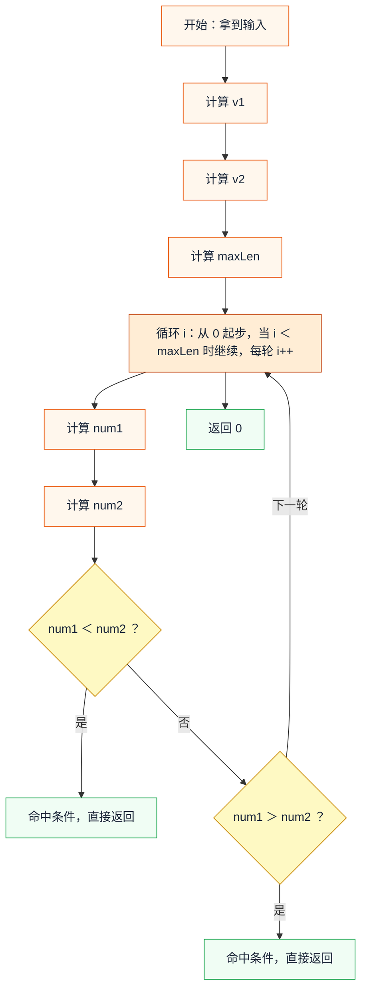

## TypeScript 解题方案（2 个方案逐个讲）

> **运行与提交**：每个方案都是自包含文件（内嵌用例自测，输出 PASS），整块复制到 `.ts` 文件后 `node 文件名` 即可运行。提交 LeetCode 时，把 `demo` 内的算法函数与辅助类型/函数整体取出、置于文件顶层即可。涉及交互/特殊接口的题以题面给定签名为准。

### 方案 1：按点拆分逐段比较

**分析与思路**：核心做法是「按点拆分逐段比较」。代码里依次做这些事：单循环线性扫描。

**运行方式**：`node 本文件`，内嵌用例全部通过会输出 PASS。

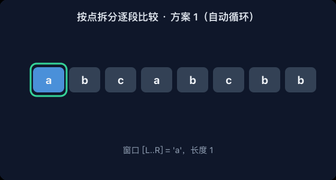

**方案专属流程图**（真实控制流）：

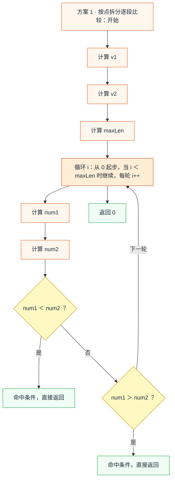

```typescript
/**
 ** LeetCode 165. 比较版本号
 ** 方案：1 ) 方案1：按点拆分逐段比较
 ** 来源：https://blog.csdn.net/tyro_java/article/details/145385760
 */

export function compareVersion(version1: string, version2: string): number {
  // 定义函数/方法 compareVersion
  const v1 = version1.split('.'); // 把 version1.split('.') 存入 v1
  const v2 = version2.split('.'); // 把 version2.split('.') 存入 v2
  const maxLen = Math.max(v1.length, v2.length); // 把 Math.取较大值 v1.长度, v2.长度) 存入 maxLen
  for (let i = 0; i < maxLen; i++) {
    // 让 下标 i 从 0 开始计数，下标 i 小于 maxLen 就继续
    const num1 = i < v1.length ? parseInt(v1[i], 10) : 0; // 把 下标 i 小于 v1.长度 ? 转整数(v1[下标 i]) : 0 存入 num1
    const num2 = i < v2.length ? parseInt(v2[i], 10) : 0; // 把 下标 i 小于 v2.长度 ? 转整数(v2[下标 i]) : 0 存入 num2
    if (num1 < num2) return -1; // 若 num1 小于 num2，直接返回 减 1
    if (num1 > num2) return 1; // 若 num1 超过 num2，直接返回 1
  }
  return 0; // 返回 0
}

export function demo(): void {
  // 程序入口：跑内嵌自测用例
  if (compareVersion('1.01', '1.001') !== 0) throw new Error('FAILED 1');
  if (compareVersion('1.0', '1.0.0') !== 0) throw new Error('FAILED 2');
  if (compareVersion('0.1', '1.1') !== -1) throw new Error('FAILED 3');
  if (compareVersion('1.2', '1.1') !== 1) throw new Error('FAILED 4');
  console.log('PASS'); // 全部用例通过，输出 PASS
}

demo(); // demo();
```

### 方案 2：单趟扫描

**分析与思路**：核心做法是「单趟扫描」。代码里依次做这些事：单循环线性扫描。

**运行方式**：`node 本文件`，内嵌用例全部通过会输出 PASS。


**方案专属流程图**（真实控制流）：

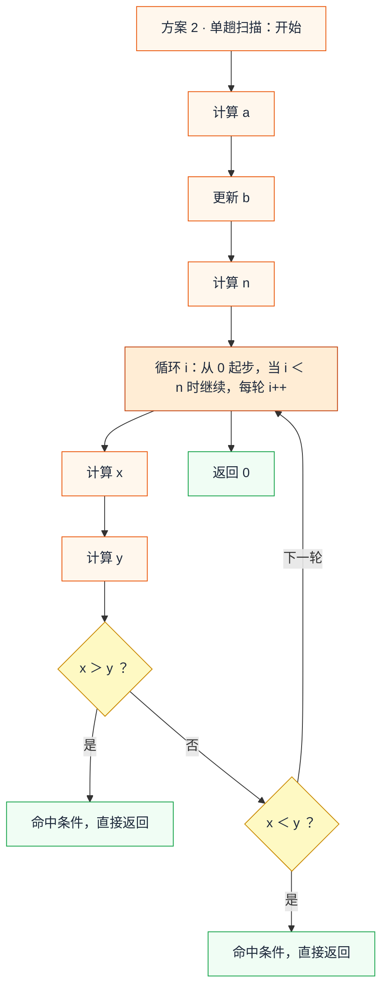

```typescript
export function demo(): void {
  // 程序入口：跑内嵌自测用例
  function compareVersion(v1: string, v2: string): number {
    // 定义函数/方法 compareVersion
    const a = v1.split('.'),
      b = v2.split('.'); // 把 v1.split(「.」), b 赋值为 v2.split(「.」) 存入 数组
    const n = Math.max(a.length, b.length); // 把 Math.取较大值 数组.长度, b.长度) 存入 元素个数
    for (let i = 0; i < n; i++) {
      // 让 下标 i 从 0 开始计数，下标 i 小于 元素个数 就继续
      const x = i < a.length ? parseInt(a[i], 10) : 0; // 把 下标 i 小于 数组.长度 ? 转整数(数组[下标 i]) : 0 存入 x
      const y = i < b.length ? parseInt(b[i], 10) : 0; // 把 下标 i 小于 b.长度 ? 转整数(b[下标 i]) : 0 存入 y
      if (x > y) return 1; // 若 x 超过 y，直接返回 1
      if (x < y) return -1; // 若 x 小于 y，直接返回 减 1
    }
    return 0; // 返回 0
  }
  const cases = [
    { a: '1.01', b: '1.001', want: 0 },
    { a: '1.0', b: '1.0.0', want: 0 },
    { a: '0.1', b: '1.1', want: -1 },
    { a: '1.0.1', b: '1', want: 1 },
  ];
  let fail = false; // 把 false 存入 fail
  for (const c of cases) {
    // for (const 字符 of cases) {
    const got = compareVersion(c.a, c.b); // 把 compareVersion(字符.数组, 字符.b) 存入 got
    if (got !== c.want) {
      fail = true;
      console.log('FAIL ' + got + ' want ' + c.want);
    }
  }
  if (fail) throw new Error('FAILED'); // 若 fail) throw new Error(「FAILED」);
  console.log('PASS'); // 全部用例通过，输出 PASS
}
demo(); // demo();
```

## 逐步拆解与面试追问

**复杂度**：时间 O(n)（单趟线性扫描），空间 O(1) 到 O(n)（视辅助结构）

**为什么是这个量级**：每个元素被常数次访问，辅助哈希或栈的开销与 n 同阶

**面试官可能会追问**：

- 字符集有多大，能否用定长数组计数？
- 要不要考虑 Unicode 多字节字符？
- 空串与单字符的边界？

## 关键 API 速查（TS 主解法实际用到，附官方链接）

| API | 作用 | 使用要点 | 官方文档 |
|---|---|---|---|
| `String.prototype.split()` | 字符串切分为数组 | split('') 按字符拆；split(/正则/) 支持模式；空串调用会拆出空串数组 | [官方文档](https://developer.mozilla.org/zh-CN/docs/Web/JavaScript/Reference/Global_Objects/String/split) |
| `Math.max()` | 最大值 | 配展开 Math.max(...arr)；空参返回 -Infinity；超大数组注意展开参数上限 | [官方文档](https://developer.mozilla.org/zh-CN/docs/Web/JavaScript/Reference/Global_Objects/Math/max) |

### 各语言官方文档导航

- **TypeScript / JS**：[MDN 中文参考](https://developer.mozilla.org/zh-CN/)
- **Python**：[Python 官方文档](https://docs.python.org/zh-cn/3/)
- **Go**：[Go 标准库](https://pkg.go.dev/std)
- **Java**：[JDK 17 API](https://docs.oracle.com/en/java/javase/17/docs/api/)
- **Rust**：[Rust 标准库](https://doc.rust-lang.org/std/)
- **Lua**：[Lua 5.4 手册](https://www.lua.org/manual/5.4/)
- **C**：[Cppreference C](https://zh.cppreference.com/w/c)
- **C++**：[Cppreference C++](https://zh.cppreference.com/w/cpp)
- **R**：[R 官方手册](https://stat.ethz.ch/R-manual/)
- **Zig**：[Zig 语言文档](https://ziglang.org/documentation/master/)
- **Dart**：[Dart API](https://api.dart.dev/)

## 附录：其他 10 种语言全部实现（每种语言列举其全部方案）

> TypeScript 的全部方案见「TypeScript 解题方案」一节；下面是其余 10 种语言的对应实现，每种语言的每个方案都带思路分析、代码走读与专属运行架构图。
> 每个方案都内嵌用例自测，可独立运行（老仓库 python/go 文件遵循「打印结果」约定）。
> 完整解法文件见 `dsa/<语言>/string/lc_165_比较版本号/`。

### Python 实现（2 种方案）

Python 的全部方案如下，每个方案都内嵌用例自测，可独立运行（老仓库 python/go 文件遵循「打印结果」约定）：

#### 方案 1：按点拆分逐段比较

**思路与代码分析**：核心是「按点拆分逐段比较」。Python 版用切片与字典推导式简化操作，突出可读性。**走读**：方案 1 · 按点拆分逐段比较：开始 → 更新 v1 → 更新 v2 → 更新 len2 → 更新 max_len → 循环 i：从 0 到 max_len 前 → 更新 num1 → 更新 num2 → 命中条件，直接返回 → 处理 elif num1 ＞ num2: → 返回 1 → 返回 0。

**运行架构**（真实控制流）：

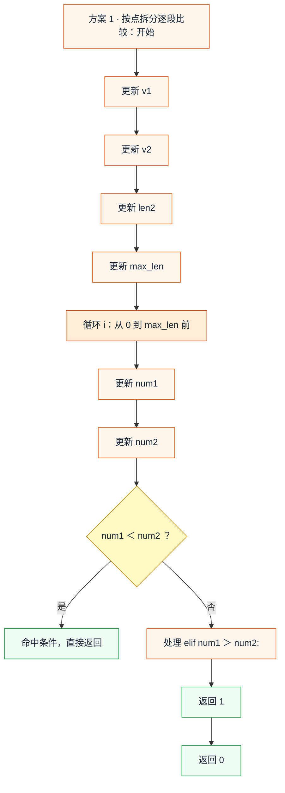

```python
import sys  # 提高递归深度上限（深输入防 RecursionError）

sys.setrecursionlimit(200000)  # 树/链表类题目节点数可达 1e4 量级

def compareVersion(version1, version2):  # 定义函数 compareVersion（参数：version1, version2）
    v1 = version1.split(".")  # 把 version1.split('.') 存入 v1
    v2 = version2.split(".")  # 把 version2.split('.') 存入 v2
    len1, len2 = len(v1), len(v2)  # 把 长度(v1), 长度(v2) 写入 len1, len2
    max_len = max(len1, len2)  # 把 取较大值 len1, len2) 存入 max_len
    for i in range(max_len):  # 让 下标 i 从 max_len 遍历
        num1 = int(v1[i]) if i < len1 else 0  # 把 int(v1[下标 i]) if 下标 i 小于 len1 else 0 存入 num1
        num2 = int(v2[i]) if i < len2 else 0  # 把 int(v2[下标 i]) if 下标 i 小于 len2 else 0 存入 num2
        if num1 < num2:  # 若 num1 小于 num2
            return -1  # 返回 减 1
        elif num1 > num2:  # 否则，若 num1 超过 num2
            return 1  # 返回 1
    return 0  # 返回 0

if __name__ == "__main__":  # 若 __name__ 等于 '__main__'
    print(compareVersion("1.01", "1.001"))  # 0
    print(compareVersion("1.0", "1.0.0"))  # 0
    print(compareVersion("0.1", "1.1"))  # -1
```

#### 方案 2：单趟扫描

**思路与代码分析**：核心是「单趟扫描」。Python 版用切片与字典推导式简化操作，突出可读性。**走读**：方案 2 · 单趟扫描：开始 → 更新 v1 → 更新 v2 → 更新 len2 → 更新 max_len → 循环 i：从 0 到 max_len 前 → 更新 num1 → 更新 num2 → 命中条件，直接返回 → 处理 elif num1 ＞ num2: → 返回 1 → 返回 0。

**运行架构**（真实控制流）：


```python
import sys  # 提高递归深度上限（深输入防 RecursionError）

sys.setrecursionlimit(200000)  # 树/链表类题目节点数可达 1e4 量级

def compareVersion(version1, version2):  # 定义函数 compareVersion（参数：version1, version2）
    v1 = version1.split(".")  # 把 version1.split('.') 存入 v1
    v2 = version2.split(".")  # 把 version2.split('.') 存入 v2
    len1, len2 = len(v1), len(v2)  # 把 长度(v1), 长度(v2) 写入 len1, len2
    max_len = max(len1, len2)  # 把 取较大值 len1, len2) 存入 max_len
    for i in range(max_len):  # 让 下标 i 从 max_len 遍历
        num1 = int(v1[i]) if i < len1 else 0  # 把 int(v1[下标 i]) if 下标 i 小于 len1 else 0 存入 num1
        num2 = int(v2[i]) if i < len2 else 0  # 把 int(v2[下标 i]) if 下标 i 小于 len2 else 0 存入 num2
        if num1 < num2:  # 若 num1 小于 num2
            return -1  # 返回 减 1
        elif num1 > num2:  # 否则，若 num1 超过 num2
            return 1  # 返回 1
    return 0  # 返回 0

if __name__ == "__main__":  # 若 __name__ 等于 '__main__'
    print(compareVersion("1.01", "1.001"))  # 0
    print(compareVersion("1.0", "1.0.0"))  # 0
    print(compareVersion("0.1", "1.1"))  # -1
```

### Go 实现（2 种方案）

Go 的全部方案如下，每个方案都内嵌用例自测，可独立运行（老仓库 python/go 文件遵循「打印结果」约定）：

#### 方案 1：按点拆分逐段比较

**思路与代码分析**：核心是「按点拆分逐段比较」。Go 版用切片与多返回值惯用法，显式处理索引边界。**走读**：方案 1 · 按点拆分逐段比较：开始 → 更新 : → 遍历循环 → 返回 1 → 返回 -1 → 返回 0。

**运行架构**（真实控制流）：

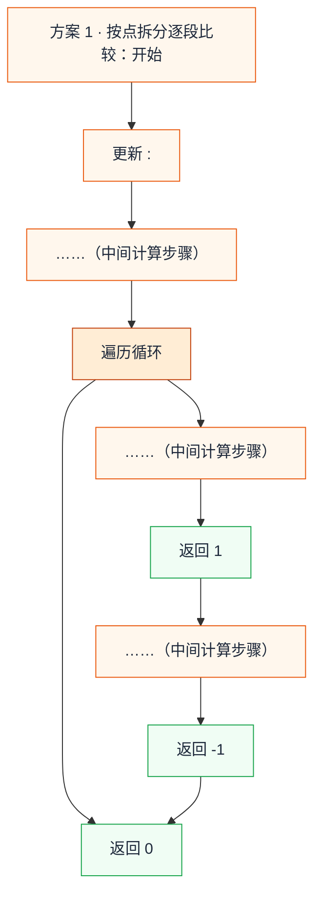

```go
package main // 引入依赖
import (
	"fmt"
	"os"
	"strconv"
	"strings"
) // 引入依赖
func compareVersion(v1, v2 string) int { // 定义函数/方法 compareVersion
	a := strings.Split(v1, ".") // 把 strings.Split(v1, 「.」) 写入 a :
	b := strings.Split(v2, ".") // 把 strings.Split(v2, 「.」) 写入 b :
	n := len(a)
	if len(b) > n {
		n = len(b)
	} // 把 长度(数组); if 长度(b) 超过 元素个数 { 元素个数 赋值为 长度(b) } 写入 n :
	for i := 0; i < n; i++ { // 让 下标 i 从 0 开始计数
		x, y := 0, 0 // 把 0, 0 写入 x, y :
		if i < len(a) {
			x, _ = strconv.Atoi(a[i])
		} // 若 下标 i 小于 长度(数组) { x, _ 赋值为 strconv.Atoi(数组[下标 i]) }
		if i < len(b) {
			y, _ = strconv.Atoi(b[i])
		} // 若 下标 i 小于 长度(b) { y, _ 赋值为 strconv.Atoi(b[下标 i]) }
		if x > y {
			return 1
		} // 若 x 超过 y { return 1 }
		if x < y {
			return -1
		} // 若 x 小于 y { return 减 1 }
	}
	return 0 // 返回 0
}
func main() { // 程序入口：跑内嵌自测用例
	cases := []struct {
		a, b string
		want int
	}{ // 把 []struct{ 数组, b string; want int }{ 写入 cases :
		{"1.01", "1.001", 0}, {"1.0", "1.0.0", 0}, {"0.1", "1.1", -1}, {"1.0.1", "1", 1},
	}
	ok := true                // 把 true 写入 ok :
	for _, c := range cases { // 同时取 _ 与 字符 遍历
		if got := compareVersion(c.a, c.b); got != c.want {
			ok = false
			fmt.Printf("FAIL=%v want %v\n", got, c.want)
		}
	}
	if !ok {
		os.Exit(1)
	} // 若 取反 ok { os.Exit(1) }
	fmt.Println("PASS") // 全部用例通过，输出 PASS
}
```

#### 方案 2：单趟扫描

**思路与代码分析**：核心是「单趟扫描」。Go 版用切片与多返回值惯用法，显式处理索引边界。**走读**：方案 2 · 单趟扫描：开始 → 更新 : → 遍历循环 → 返回 1 → 返回 -1 → 返回 0。

**运行架构**（真实控制流）：

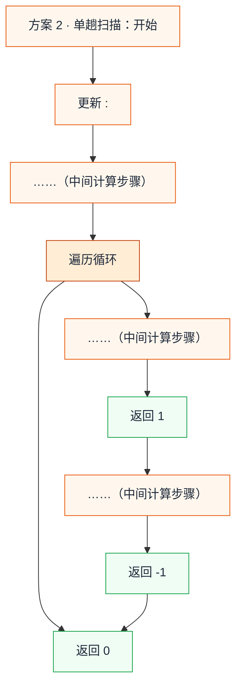

```go
package main // 引入依赖
import (
	"fmt"
	"os"
	"strconv"
	"strings"
) // 引入依赖
func compareVersion(v1, v2 string) int { // 定义函数/方法 compareVersion
	a := strings.Split(v1, ".") // 把 strings.Split(v1, 「.」) 写入 a :
	b := strings.Split(v2, ".") // 把 strings.Split(v2, 「.」) 写入 b :
	n := len(a)
	if len(b) > n {
		n = len(b)
	} // 把 长度(数组); if 长度(b) 超过 元素个数 { 元素个数 赋值为 长度(b) } 写入 n :
	for i := 0; i < n; i++ { // 让 下标 i 从 0 开始计数
		x, y := 0, 0 // 把 0, 0 写入 x, y :
		if i < len(a) {
			x, _ = strconv.Atoi(a[i])
		} // 若 下标 i 小于 长度(数组) { x, _ 赋值为 strconv.Atoi(数组[下标 i]) }
		if i < len(b) {
			y, _ = strconv.Atoi(b[i])
		} // 若 下标 i 小于 长度(b) { y, _ 赋值为 strconv.Atoi(b[下标 i]) }
		if x > y {
			return 1
		} // 若 x 超过 y { return 1 }
		if x < y {
			return -1
		} // 若 x 小于 y { return 减 1 }
	}
	return 0 // 返回 0
}
func main() { // 程序入口：跑内嵌自测用例
	cases := []struct {
		a, b string
		want int
	}{ // 把 []struct{ 数组, b string; want int }{ 写入 cases :
		{"1.01", "1.001", 0}, {"1.0", "1.0.0", 0}, {"0.1", "1.1", -1}, {"1.0.1", "1", 1},
	}
	ok := true                // 把 true 写入 ok :
	for _, c := range cases { // 同时取 _ 与 字符 遍历
		if got := compareVersion(c.a, c.b); got != c.want {
			ok = false
			fmt.Printf("FAIL=%v want %v\n", got, c.want)
		}
	}
	if !ok {
		os.Exit(1)
	} // 若 取反 ok { os.Exit(1) }
	fmt.Println("PASS") // 全部用例通过，输出 PASS
}
```

### Java 实现（2 种方案）

Java 的全部方案如下，每个方案都内嵌用例自测，可独立运行（老仓库 python/go 文件遵循「打印结果」约定）：

#### 方案 1：按点拆分逐段比较

**思路与代码分析**：核心是「按点拆分逐段比较」。Java 版用类与静态方法组织，集合操作显式明了。代码里依次做这些事：单循环线性扫描。**走读**：方案 1 · 按点拆分逐段比较：开始 → 更新 v1 → 遍历循环 → 命中条件，直接返回 → 返回 0。

**运行架构**（真实控制流）：

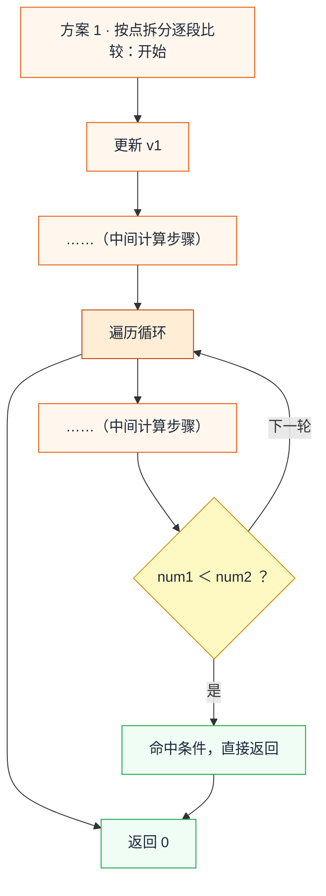

```java
package com.webfault.dsa; // 引入依赖

class Solution { // 定义类型
  public int compareVersion(String version1, String version2) { // 定义函数/方法 compareVersion
    String[] v1 = version1.split("\\."); // 把 version1.split(「\.」); 写入 String[] v1
    String[] v2 = version2.split("\\."); // 把 version2.split(「\.」); 写入 String[] v2
    int len1 = v1.length, len2 = v2.length; // 把 v1.长度, len2 赋值为 v2.长度 存入 len1
    int maxLen = Math.max(len1, len2); // 把 Math.取较大值 len1, len2) 存入 maxLen
    for (int i = 0; i < maxLen; i++) { // 让 下标 i 从 0 开始计数，下标 i 小于 maxLen 就继续
      int num1 =
          i < len1
              ? Integer.parseInt(v1[i])
              : 0; // 把 下标 i 小于 len1 ? Integer.转整数(v1[下标 i]) : 0 存入 num1
      int num2 =
          i < len2
              ? Integer.parseInt(v2[i])
              : 0; // 把 下标 i 小于 len2 ? Integer.转整数(v2[下标 i]) : 0 存入 num2
      if (num1 < num2) return -1; // 若 num1 小于 num2，直接返回 减 1
      else if (num1 > num2) return 1; // 否则，若 num1 超过 num2) return 1;
    }
    return 0; // 返回 0
  }

  public static void main(String[] args) { // public static void main(String[] args) {
    Solution s = new Solution(); // 把 new Solution(); 写入 Solution s
    String[][] ins = {{"1.01", "1.001"}, {"1.0", "1.0.0"}, {"0.1", "1.1"}};
    int[] wants = {0, 0, -1}; // 把 {0,0, 减 1}; 写入 int[] wants
    boolean ok = true; // 把 true; 写入 boolean ok
    for (int i = 0; i < ins.length; i++) { // 让 下标 i 从 0 开始计数，下标 i 小于 ins.长度 就继续
      int got =
          s.compareVersion(
              ins[i][0], ins[i][1]); // 把 字符串.compareVersion(ins[下标 i][0], ins[下标 i][1]) 存入 got
      if (got != wants[i]) {
        ok = false;
        System.out.println("FAIL " + ins[i][0] + "," + ins[i][1] + "=" + got + " want " + wants[i]);
      }
    }
    if (!ok) throw new RuntimeException("FAILED"); // 若 取反 ok) throw new RuntimeException(「FAILED」);
    System.out.println("PASS"); // 全部用例通过，输出 PASS
  }
}
```

#### 方案 2：单趟扫描

**思路与代码分析**：核心是「单趟扫描」。Java 版用类与静态方法组织，集合操作显式明了。代码里依次做这些事：单循环线性扫描。**走读**：方案 2 · 单趟扫描：开始 → 更新 v1 → 遍历循环 → 命中条件，直接返回 → 返回 0。

**运行架构**（真实控制流）：

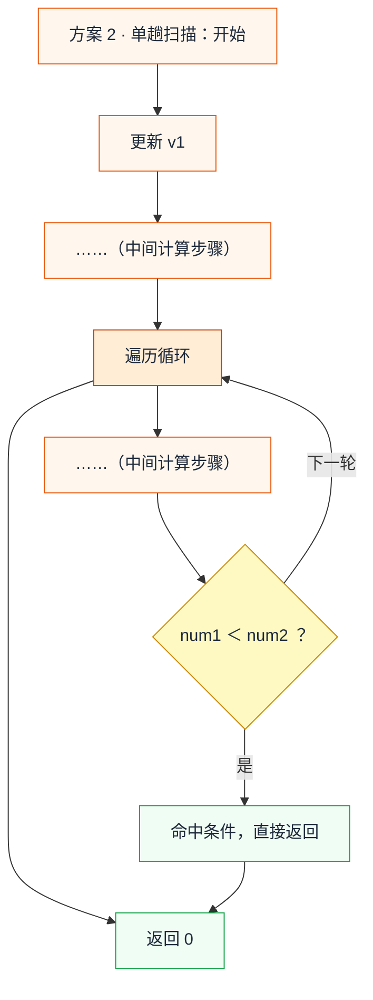

```java
package com.webfault.dsa; // 引入依赖

class Solution { // 定义类型
  public int compareVersion(String version1, String version2) { // 定义函数/方法 compareVersion
    String[] v1 = version1.split("\\."); // 把 version1.split(「\.」); 写入 String[] v1
    String[] v2 = version2.split("\\."); // 把 version2.split(「\.」); 写入 String[] v2
    int len1 = v1.length, len2 = v2.length; // 把 v1.长度, len2 赋值为 v2.长度 存入 len1
    int maxLen = Math.max(len1, len2); // 把 Math.取较大值 len1, len2) 存入 maxLen
    for (int i = 0; i < maxLen; i++) { // 让 下标 i 从 0 开始计数，下标 i 小于 maxLen 就继续
      int num1 =
          i < len1
              ? Integer.parseInt(v1[i])
              : 0; // 把 下标 i 小于 len1 ? Integer.转整数(v1[下标 i]) : 0 存入 num1
      int num2 =
          i < len2
              ? Integer.parseInt(v2[i])
              : 0; // 把 下标 i 小于 len2 ? Integer.转整数(v2[下标 i]) : 0 存入 num2
      if (num1 < num2) return -1; // 若 num1 小于 num2，直接返回 减 1
      else if (num1 > num2) return 1; // 否则，若 num1 超过 num2) return 1;
    }
    return 0; // 返回 0
  }

  public static void main(String[] args) { // public static void main(String[] args) {
    Solution s = new Solution(); // 把 new Solution(); 写入 Solution s
    String[][] ins = {{"1.01", "1.001"}, {"1.0", "1.0.0"}, {"0.1", "1.1"}};
    int[] wants = {0, 0, -1}; // 把 {0,0, 减 1}; 写入 int[] wants
    boolean ok = true; // 把 true; 写入 boolean ok
    for (int i = 0; i < ins.length; i++) { // 让 下标 i 从 0 开始计数，下标 i 小于 ins.长度 就继续
      int got =
          s.compareVersion(
              ins[i][0], ins[i][1]); // 把 字符串.compareVersion(ins[下标 i][0], ins[下标 i][1]) 存入 got
      if (got != wants[i]) {
        ok = false;
        System.out.println("FAIL " + ins[i][0] + "," + ins[i][1] + "=" + got + " want " + wants[i]);
      }
    }
    if (!ok) throw new RuntimeException("FAILED"); // 若 取反 ok) throw new RuntimeException(「FAILED」);
    System.out.println("PASS"); // 全部用例通过，输出 PASS
  }
}
```

### Rust 实现（2 种方案）

Rust 的全部方案如下，每个方案都内嵌用例自测，可独立运行（老仓库 python/go 文件遵循「打印结果」约定）：

#### 方案 1：按点拆分逐段比较

**思路与代码分析**：核心是「按点拆分逐段比较」。Rust 版用所有权移动与切片借用改写同一逻辑，注意 Option 与引用边界。**走读**：方案 1 · 按点拆分逐段比较：开始 → 计算 p1 → 遍历 0..n 中的每个元素 i → 返回 -1 → 返回 1。

**运行架构**（真实控制流）：

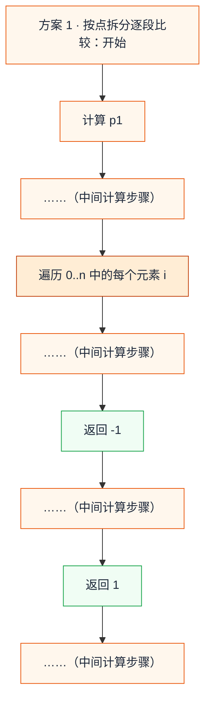

```rust
// LeetCode 165. 比较版本号 — Rust 版（方案1）
fn compare_version(v1: String, v2: String) -> i32 {
    // 定义函数/方法 compare_version
    let p1: Vec<i64> = v1
        .split('.')
        .map(|x| x.parse::<i64>().unwrap_or(0))
        .collect();
    let p2: Vec<i64> = v2
        .split('.')
        .map(|x| x.parse::<i64>().unwrap_or(0))
        .collect();
    let n = p1.len().max(p2.len()); // 把 p1.长度().取较大值 p2.长度()) 存入 元素个数
    for i in 0..n {
        // 逐个取出 0 的元素（下标 i）
        let a = if i < p1.len() { p1[i] } else { 0 }; // 把 if 下标 i 小于 p1.长度() { p1[下标 i] } else { 0 } 存入 数组
        let b = if i < p2.len() { p2[i] } else { 0 }; // 把 if 下标 i 小于 p2.长度() { p2[下标 i] } else { 0 } 存入 b
        if a < b {
            return -1;
        } // 若 数组 小于 b { return 减 1; }
        if a > b {
            return 1;
        } // 若 数组 超过 b { return 1; }
    }
    0
}
fn main() {
    // 程序入口：跑内嵌自测用例
    assert_eq!(compare_version("1.01".into(), "1.001".into()), 0); // 断言校验
    assert_eq!(compare_version("1.0".into(), "1.0.0".into()), 0); // 断言校验
    assert_eq!(compare_version("0.1".into(), "1.1".into()), -1); // 断言校验
    println!("PASS"); // 全部用例通过，输出 PASS
}
```

#### 方案 2：单趟扫描

**思路与代码分析**：核心是「单趟扫描」。Rust 版用所有权移动与切片借用改写同一逻辑，注意 Option 与引用边界。**走读**：方案 2 · 单趟扫描：开始 → 计算 p1 → 遍历 0..n 中的每个元素 i → 返回 -1 → 返回 1。

**运行架构**（真实控制流）：

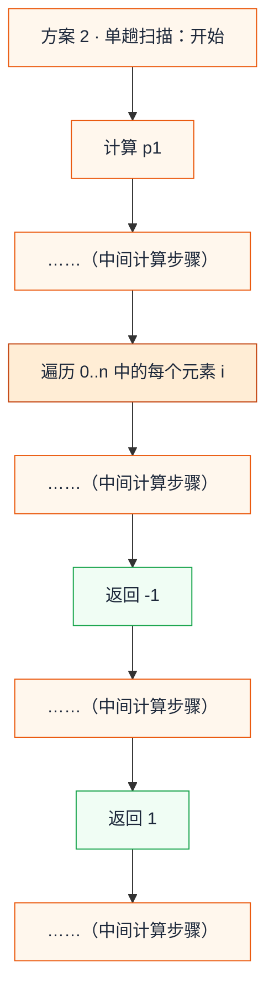

```rust
// LeetCode 165. 比较版本号 — Rust 版（方案2）
fn compare_version(v1: String, v2: String) -> i32 {
    // 定义函数/方法 compare_version
    let p1: Vec<i64> = v1
        .split('.')
        .map(|x| x.parse::<i64>().unwrap_or(0))
        .collect();
    let p2: Vec<i64> = v2
        .split('.')
        .map(|x| x.parse::<i64>().unwrap_or(0))
        .collect();
    let n = p1.len().max(p2.len()); // 把 p1.长度().取较大值 p2.长度()) 存入 元素个数
    for i in 0..n {
        // 逐个取出 0 的元素（下标 i）
        let a = if i < p1.len() { p1[i] } else { 0 }; // 把 if 下标 i 小于 p1.长度() { p1[下标 i] } else { 0 } 存入 数组
        let b = if i < p2.len() { p2[i] } else { 0 }; // 把 if 下标 i 小于 p2.长度() { p2[下标 i] } else { 0 } 存入 b
        if a < b {
            return -1;
        } // 若 数组 小于 b { return 减 1; }
        if a > b {
            return 1;
        } // 若 数组 超过 b { return 1; }
    }
    0
}
fn main() {
    // 程序入口：跑内嵌自测用例
    assert_eq!(compare_version("1.01".into(), "1.001".into()), 0); // 断言校验
    assert_eq!(compare_version("1.0".into(), "1.0.0".into()), 0); // 断言校验
    assert_eq!(compare_version("0.1".into(), "1.1".into()), -1); // 断言校验
    println!("PASS"); // 全部用例通过，输出 PASS
}
```

### Lua 实现（2 种方案）

Lua 的全部方案如下，每个方案都内嵌用例自测，可独立运行（老仓库 python/go 文件遵循「打印结果」约定）：

#### 方案 1：按点拆分逐段比较

**思路与代码分析**：核心是「按点拆分逐段比较」。Lua 版用表与 ipairs 遍历，注意 ipairs 遇 nil 即停的语义。**走读**：方案 1 · 按点拆分逐段比较：开始 → 更新 p2 → 处理 v1:gsub(([^.]+), function( → 更新 1] → 处理 v2:gsub(([^.]+), function( → 更新 1] → 更新 n → 循环 i：从 1 到 n do → 更新 a → 更新 b → 处理 if a ＜ b then → 返回 -1 → 处理 if a ＞ b then → 返回 1 → 返回 0。

**运行架构**（真实控制流）：

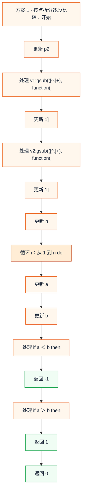

```lua
-- LeetCode 165. 比较版本号 — Lua 版（方案1）
local function compare_version(v1, v2) -- local function compare_version(v1, v2)
	local p1, p2 = {}, {} -- 把 {}, {} 写入 local p1, p2
	v1:gsub("([^.]+)", function(x)
		p1[#p1 + 1] = tonumber(x)
	end)
	v2:gsub("([^.]+)", function(x)
		p2[#p2 + 1] = tonumber(x)
	end)
	local n = math.max(#p1, #p2) -- 把 math.取较大值 #p1, #p2) 写入 local n
	for i = 1, n do -- 让 下标 i 从 1 走到 元素个数（Lua 1 基）
		local a = p1[i] or 0 -- 把 p1[下标 i] or 0 写入 local a
		local b = p2[i] or 0 -- 把 p2[下标 i] or 0 写入 local b
		if a < b then
			return -1
		end -- 若 数组 小于 b then return 减 1 终点
		if a > b then
			return 1
		end -- 若 数组 超过 b then return 1 终点
	end -- 终点
	return 0 -- 返回 0
end -- 终点
assert(compare_version("1.01", "1.001") == 0) -- 断言校验
assert(compare_version("1.0", "1.0.0") == 0) -- 断言校验
assert(compare_version("0.1", "1.1") == -1) -- 断言校验
print("PASS") -- 全部用例通过，输出 PASS
```

#### 方案 2：单趟扫描

**思路与代码分析**：核心是「单趟扫描」。Lua 版用表与 ipairs 遍历，注意 ipairs 遇 nil 即停的语义。**走读**：方案 2 · 单趟扫描：开始 → 更新 p2 → 处理 v1:gsub(([^.]+), function( → 更新 1] → 处理 v2:gsub(([^.]+), function( → 更新 1] → 更新 n → 循环 i：从 1 到 n do → 更新 a → 更新 b → 处理 if a ＜ b then → 返回 -1 → 处理 if a ＞ b then → 返回 1 → 返回 0。

**运行架构**（真实控制流）：

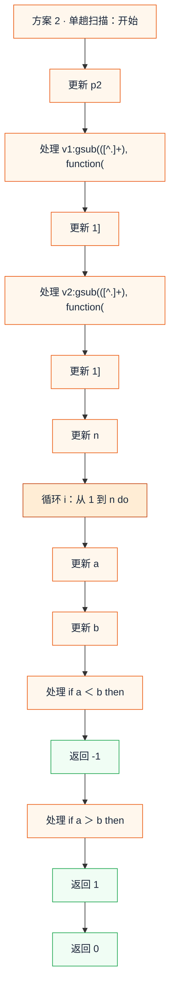

```lua
-- LeetCode 165. 比较版本号 — Lua 版（方案2）
local function compare_version(v1, v2) -- local function compare_version(v1, v2)
	local p1, p2 = {}, {} -- 把 {}, {} 写入 local p1, p2
	v1:gsub("([^.]+)", function(x)
		p1[#p1 + 1] = tonumber(x)
	end)
	v2:gsub("([^.]+)", function(x)
		p2[#p2 + 1] = tonumber(x)
	end)
	local n = math.max(#p1, #p2) -- 把 math.取较大值 #p1, #p2) 写入 local n
	for i = 1, n do -- 让 下标 i 从 1 走到 元素个数（Lua 1 基）
		local a = p1[i] or 0 -- 把 p1[下标 i] or 0 写入 local a
		local b = p2[i] or 0 -- 把 p2[下标 i] or 0 写入 local b
		if a < b then
			return -1
		end -- 若 数组 小于 b then return 减 1 终点
		if a > b then
			return 1
		end -- 若 数组 超过 b then return 1 终点
	end -- 终点
	return 0 -- 返回 0
end -- 终点
assert(compare_version("1.01", "1.001") == 0) -- 断言校验
assert(compare_version("1.0", "1.0.0") == 0) -- 断言校验
assert(compare_version("0.1", "1.1") == -1) -- 断言校验
print("PASS") -- 全部用例通过，输出 PASS
```

### C 实现（2 种方案）

C 的全部方案如下，每个方案都内嵌用例自测，可独立运行（老仓库 python/go 文件遵循「打印结果」约定）：

#### 方案 1：按点拆分逐段比较

**思路与代码分析**：核心是「按点拆分逐段比较」。C 版手动管理下标与内存，循环边界全部显式写出。**走读**：方案 1 · 按点拆分逐段比较：开始 → 计算 char → 当 (*p1 或 *p2) 时反复执行 → 命中条件，直接返回 → 命中条件，直接返回 → 返回 0。

**运行架构**（真实控制流）：

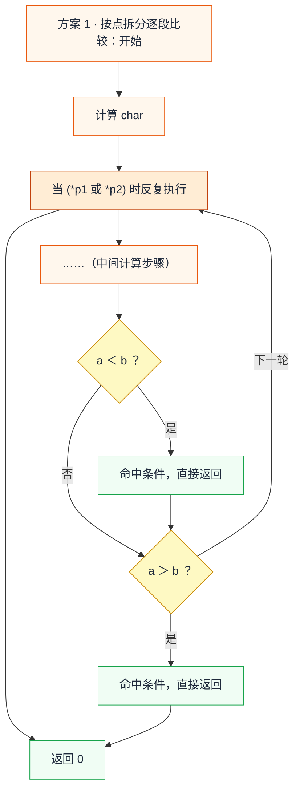

```c
/* LeetCode 165. 比较版本号 — C 版（方案1） */
#include <stdio.h>                              // 引入头文件
#include <stdlib.h>                             // 引入头文件
#include <string.h>                             // 引入头文件
static long parse_seg(const char *s, int len) { // 定义函数/方法 parse_seg
    char buf[32];                               // char buf[32];
    if (len >= 32)
        len = 31;         // 若 长度 不低于 32) 长度 赋值为 31;
    strncpy(buf, s, len); // strncpy(buf, 字符串, 长度);
    buf[len] = '\0';      // 把 '\0'; 写入 buf[len]
    return atol(buf);     // 返回 atol(buf)
}
static int compare_version(const char *v1, const char *v2) { // 定义函数/方法 compare_version
    const char *p1 = v1, *p2 = v2;            // 把 v1, 乘 p2 赋值为 v2; 写入 const char *p1
    while (*p1 || *p2) {                      // 循环，直到不满足「乘 p1 或 乘 p2」
        long a = 0, b = 0;                    // 把 0, b 赋值为 0; 写入 long a
        if (*p1) {                            // 若 乘 p1
            const char *d1 = strchr(p1, '.'); // 把 strchr(p1, '.'); 写入 const char *d1
            int len =
                d1 ? (int)(d1 - p1) : (int)strlen(p1); // 把 d1 ? (int)(d1 减 p1) : (int)strlen(p1) 存入 长度
            a = parse_seg(p1, len);                    // 把 parse_seg(p1, 长度); 写入 数组
            p1 = d1 ? d1 + 1 : p1 + strlen(p1);        // 把 d1 ? d1 加 1 : p1 加 strlen(p1); 写入 p1
        }
        if (*p2) {                            // 若 乘 p2
            const char *d2 = strchr(p2, '.'); // 把 strchr(p2, '.'); 写入 const char *d2
            int len =
                d2 ? (int)(d2 - p2) : (int)strlen(p2); // 把 d2 ? (int)(d2 减 p2) : (int)strlen(p2) 存入 长度
            b = parse_seg(p2, len);                    // 把 parse_seg(p2, 长度); 写入 b
            p2 = d2 ? d2 + 1 : p2 + strlen(p2);        // 把 d2 ? d2 加 1 : p2 加 strlen(p2); 写入 p2
        }
        if (a < b)
            return -1; // 若 数组 小于 b，直接返回 减 1
        if (a > b)
            return 1; // 若 数组 超过 b，直接返回 1
    }
    return 0; // 返回 0
}
int main(void) { // 程序入口：跑内嵌自测用例
    if (compare_version("1.01", "1.001") != 0) {
        printf("FAIL 1\n");
        return 1;
    }
    if (compare_version("1.0", "1.0.0") != 0) {
        printf("FAIL 2\n");
        return 1;
    }
    if (compare_version("0.1", "1.1") != -1) {
        printf("FAIL 3\n");
        return 1;
    }
    printf("PASS\n"); // 全部用例通过，输出 PASS
    return 0;         // 返回 0
}
```

#### 方案 2：单趟扫描

**思路与代码分析**：核心是「单趟扫描」。C 版手动管理下标与内存，循环边界全部显式写出。**走读**：方案 2 · 单趟扫描：开始 → 计算 char → 当 (*p1 或 *p2) 时反复执行 → 命中条件，直接返回 → 命中条件，直接返回 → 返回 0。

**运行架构**（真实控制流）：

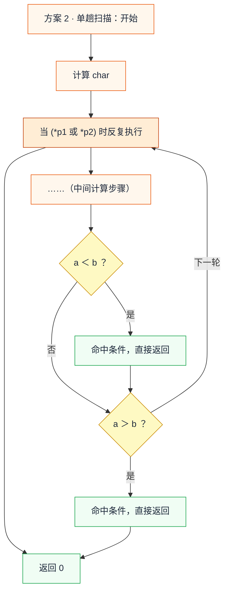

```c
/* LeetCode 165. 比较版本号 — C 版（方案2） */
#include <stdio.h>                              // 引入头文件
#include <stdlib.h>                             // 引入头文件
#include <string.h>                             // 引入头文件
static long parse_seg(const char *s, int len) { // 定义函数/方法 parse_seg
    char buf[32];                               // char buf[32];
    if (len >= 32)
        len = 31;         // 若 长度 不低于 32) 长度 赋值为 31;
    strncpy(buf, s, len); // strncpy(buf, 字符串, 长度);
    buf[len] = '\0';      // 把 '\0'; 写入 buf[len]
    return atol(buf);     // 返回 atol(buf)
}
static int compare_version(const char *v1, const char *v2) { // 定义函数/方法 compare_version
    const char *p1 = v1, *p2 = v2;            // 把 v1, 乘 p2 赋值为 v2; 写入 const char *p1
    while (*p1 || *p2) {                      // 循环，直到不满足「乘 p1 或 乘 p2」
        long a = 0, b = 0;                    // 把 0, b 赋值为 0; 写入 long a
        if (*p1) {                            // 若 乘 p1
            const char *d1 = strchr(p1, '.'); // 把 strchr(p1, '.'); 写入 const char *d1
            int len =
                d1 ? (int)(d1 - p1) : (int)strlen(p1); // 把 d1 ? (int)(d1 减 p1) : (int)strlen(p1) 存入 长度
            a = parse_seg(p1, len);                    // 把 parse_seg(p1, 长度); 写入 数组
            p1 = d1 ? d1 + 1 : p1 + strlen(p1);        // 把 d1 ? d1 加 1 : p1 加 strlen(p1); 写入 p1
        }
        if (*p2) {                            // 若 乘 p2
            const char *d2 = strchr(p2, '.'); // 把 strchr(p2, '.'); 写入 const char *d2
            int len =
                d2 ? (int)(d2 - p2) : (int)strlen(p2); // 把 d2 ? (int)(d2 减 p2) : (int)strlen(p2) 存入 长度
            b = parse_seg(p2, len);                    // 把 parse_seg(p2, 长度); 写入 b
            p2 = d2 ? d2 + 1 : p2 + strlen(p2);        // 把 d2 ? d2 加 1 : p2 加 strlen(p2); 写入 p2
        }
        if (a < b)
            return -1; // 若 数组 小于 b，直接返回 减 1
        if (a > b)
            return 1; // 若 数组 超过 b，直接返回 1
    }
    return 0; // 返回 0
}
int main(void) { // 程序入口：跑内嵌自测用例
    if (compare_version("1.01", "1.001") != 0) {
        printf("FAIL 1\n");
        return 1;
    }
    if (compare_version("1.0", "1.0.0") != 0) {
        printf("FAIL 2\n");
        return 1;
    }
    if (compare_version("0.1", "1.1") != -1) {
        printf("FAIL 3\n");
        return 1;
    }
    printf("PASS\n"); // 全部用例通过，输出 PASS
    return 0;         // 返回 0
}
```

### C++ 实现（2 种方案）

C++ 的全部方案如下，每个方案都内嵌用例自测，可独立运行（老仓库 python/go 文件遵循「打印结果」约定）：

#### 方案 1：按点拆分逐段比较

**思路与代码分析**：核心是「按点拆分逐段比较」。C++ 版用 STL 容器与迭代器，减少手写下标错误。代码里依次做这些事：双重循环遍历。**走读**：方案 1 · 按点拆分逐段比较：开始 → 处理 std::vector＜long long＞ p1, p → 遍历循环 → 遍历循环 → 遍历循环 → 命中条件，直接返回 → 命中条件，直接返回 → 返回 0。

**运行架构**（真实控制流）：

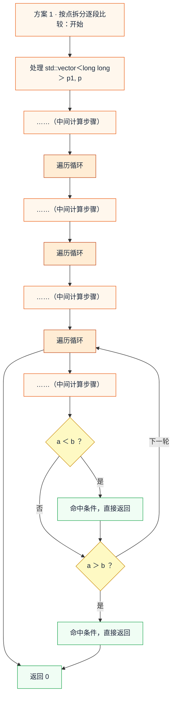

```cpp
// LeetCode 165. 比较版本号 — C++ 版（方案1）
#include <cassert>  // 引入头文件
#include <cstdlib>  // 引入头文件
#include <iostream> // 引入头文件
#include <string>   // 引入头文件
#include <vector>   // 引入头文件
static int compareVersion(const std::string &version1,
                          const std::string &version2) { // 定义函数/方法 compareVersion
    std::vector<long long> p1, p2;                       // std::vector 小于 long long 超过 p1, p2;
    size_t start = 0;                                    // 把 0; 写入 size_t start
    for (size_t i = 0; i <= version1.size();
         ++i) { // 让 下标 i 从 0 开始计数，下标 i 不超过 version1.大小() 就继续
        if (i == version1.size() ||
            version1[i] == '.') { // 若 下标 i 等于 version1.大小() 或 version1[下标 i] 等于 '.'
            p1.push_back(std::atoll(
                version1.substr(start, i - start)
                    .c_str())); // p1 追加 std::atoll(version1 截取 起点, 下标 i 减 起点).c_str()));
            start = i + 1;      // 把 下标 i 加 1; 写入 起点
        }
    }
    start = 0; // 把 0; 写入 起点
    for (size_t i = 0; i <= version2.size();
         ++i) { // 让 下标 i 从 0 开始计数，下标 i 不超过 version2.大小() 就继续
        if (i == version2.size() ||
            version2[i] == '.') { // 若 下标 i 等于 version2.大小() 或 version2[下标 i] 等于 '.'
            p2.push_back(std::atoll(
                version2.substr(start, i - start)
                    .c_str())); // p2 追加 std::atoll(version2 截取 起点, 下标 i 减 起点).c_str()));
            start = i + 1;      // 把 下标 i 加 1; 写入 起点
        }
    }
    size_t n = std::max(p1.size(), p2.size()); // 把 std::取较大值 p1.大小(), p2.大小()); 写入 size_t n
    for (size_t i = 0; i < n; ++i) { // 让 下标 i 从 0 开始计数，下标 i 小于 元素个数 就继续
        long long a = i < p1.size() ? p1[i] : 0; // 把 下标 i 小于 p1.大小() ? p1[下标 i] : 0 存入 数组
        long long b = i < p2.size() ? p2[i] : 0; // 把 下标 i 小于 p2.大小() ? p2[下标 i] : 0 存入 b
        if (a < b)
            return -1; // 若 数组 小于 b，直接返回 减 1
        if (a > b)
            return 1; // 若 数组 超过 b，直接返回 1
    }
    return 0; // 返回 0
}
int main() {                                      // 程序入口：跑内嵌自测用例
    assert(compareVersion("1.01", "1.001") == 0); // 断言校验
    assert(compareVersion("1.0", "1.0.0") == 0);  // 断言校验
    assert(compareVersion("0.1", "1.1") == -1);   // 断言校验
    std::cout << "PASS" << std::endl;             // 全部用例通过，输出 PASS
    return 0;                                     // 返回 0
}
```

#### 方案 2：单趟扫描

**思路与代码分析**：核心是「单趟扫描」。C++ 版用 STL 容器与迭代器，减少手写下标错误。代码里依次做这些事：双重循环遍历。**走读**：方案 2 · 单趟扫描：开始 → 处理 std::vector＜long long＞ p1, p → 遍历循环 → 遍历循环 → 遍历循环 → 命中条件，直接返回 → 命中条件，直接返回 → 返回 0。

**运行架构**（真实控制流）：

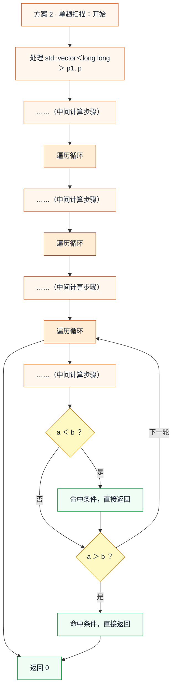

```cpp
// LeetCode 165. 比较版本号 — C++ 版（方案2）
#include <cassert>  // 引入头文件
#include <cstdlib>  // 引入头文件
#include <iostream> // 引入头文件
#include <string>   // 引入头文件
#include <vector>   // 引入头文件
static int compareVersion(const std::string &version1,
                          const std::string &version2) { // 定义函数/方法 compareVersion
    std::vector<long long> p1, p2;                       // std::vector 小于 long long 超过 p1, p2;
    size_t start = 0;                                    // 把 0; 写入 size_t start
    for (size_t i = 0; i <= version1.size();
         ++i) { // 让 下标 i 从 0 开始计数，下标 i 不超过 version1.大小() 就继续
        if (i == version1.size() ||
            version1[i] == '.') { // 若 下标 i 等于 version1.大小() 或 version1[下标 i] 等于 '.'
            p1.push_back(std::atoll(
                version1.substr(start, i - start)
                    .c_str())); // p1 追加 std::atoll(version1 截取 起点, 下标 i 减 起点).c_str()));
            start = i + 1;      // 把 下标 i 加 1; 写入 起点
        }
    }
    start = 0; // 把 0; 写入 起点
    for (size_t i = 0; i <= version2.size();
         ++i) { // 让 下标 i 从 0 开始计数，下标 i 不超过 version2.大小() 就继续
        if (i == version2.size() ||
            version2[i] == '.') { // 若 下标 i 等于 version2.大小() 或 version2[下标 i] 等于 '.'
            p2.push_back(std::atoll(
                version2.substr(start, i - start)
                    .c_str())); // p2 追加 std::atoll(version2 截取 起点, 下标 i 减 起点).c_str()));
            start = i + 1;      // 把 下标 i 加 1; 写入 起点
        }
    }
    size_t n = std::max(p1.size(), p2.size()); // 把 std::取较大值 p1.大小(), p2.大小()); 写入 size_t n
    for (size_t i = 0; i < n; ++i) { // 让 下标 i 从 0 开始计数，下标 i 小于 元素个数 就继续
        long long a = i < p1.size() ? p1[i] : 0; // 把 下标 i 小于 p1.大小() ? p1[下标 i] : 0 存入 数组
        long long b = i < p2.size() ? p2[i] : 0; // 把 下标 i 小于 p2.大小() ? p2[下标 i] : 0 存入 b
        if (a < b)
            return -1; // 若 数组 小于 b，直接返回 减 1
        if (a > b)
            return 1; // 若 数组 超过 b，直接返回 1
    }
    return 0; // 返回 0
}
int main() {                                      // 程序入口：跑内嵌自测用例
    assert(compareVersion("1.01", "1.001") == 0); // 断言校验
    assert(compareVersion("1.0", "1.0.0") == 0);  // 断言校验
    assert(compareVersion("0.1", "1.1") == -1);   // 断言校验
    std::cout << "PASS" << std::endl;             // 全部用例通过，输出 PASS
    return 0;                                     // 返回 0
}
```

### R 实现（2 种方案）

R 的全部方案如下，每个方案都内嵌用例自测，可独立运行（老仓库 python/go 文件遵循「打印结果」约定）：

#### 方案 1：按点拆分逐段比较

**思路与代码分析**：核心是「按点拆分逐段比较」。R 版用向量化思维与 1 起始下标，注意 1:n 的降序陷阱。代码里依次做这些事：单循环线性扫描。**走读**：方案 1 · 按点拆分逐段比较：开始 → 处理 p1 ＜- as.numeric(strsplit(v1 → 处理 p2 ＜- as.numeric(strsplit(v2 → 处理 n ＜- max(length(p1), length( → 循环 i：遍历 seq_len(n) → 更新 < → 处理 p1[i] else 0 → 更新 < → 处理 p2[i] else 0 → 命中条件，直接返回 → 命中条件，直接返回 → 处理 0。

**运行架构**（真实控制流）：

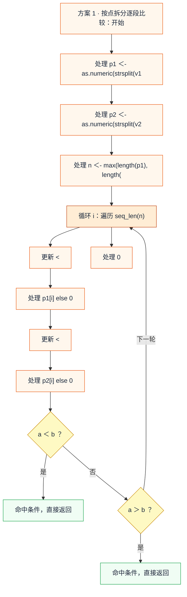

```r
# 版（方案1） 定义函数 compare_version（参数：v1, v2）
compare_version <- function(v1, v2) {
    p1 <- as.numeric(strsplit(v1, "\\.")[[1]])  # 把 as.numeric(strsplit(v1, 「\.」)[[1]]) 存入 p1
    p2 <- as.numeric(strsplit(v2, "\\.")[[1]])  # 把 as.numeric(strsplit(v2, 「\.」)[[1]]) 存入 p2
    n <- max(length(p1), length(p2))  # 把 取较大值 长度(p1), 长度(p2)) 存入 元素个数
    for (i in seq_len(n)) {
        # for (下标 i in seq_len(元素个数)) {
        a <- if (i <= length(p1))
            p1[i] else 0  # 把 if (下标 i 不超过 长度(p1)) p1[下标 i] else 0 存入 数组
        b <- if (i <= length(p2))
            p2[i] else 0  # 把 if (下标 i 不超过 长度(p2)) p2[下标 i] else 0 存入 b
        if (a < b)
            return(-1)  # 若 数组 小于 b) return( 减 1
        if (a > b)
            return(1)  # 若 数组 超过 b) return(1
    }
    0
}
stopifnot(compare_version("1.01", "1.001") == 0)  # 断言校验
stopifnot(compare_version("1.0", "1.0.0") == 0)  # 断言校验
stopifnot(compare_version("0.1", "1.1") == -1)  # 断言校验
cat("PASS\n")  # 全部用例通过，输出 PASS
```

#### 方案 2：单趟扫描

**思路与代码分析**：核心是「单趟扫描」。R 版用向量化思维与 1 起始下标，注意 1:n 的降序陷阱。代码里依次做这些事：单循环线性扫描。**走读**：方案 2 · 单趟扫描：开始 → 处理 p1 ＜- as.numeric(strsplit(v1 → 处理 p2 ＜- as.numeric(strsplit(v2 → 处理 n ＜- max(length(p1), length( → 循环 i：遍历 seq_len(n) → 更新 < → 处理 p1[i] else 0 → 更新 < → 处理 p2[i] else 0 → 命中条件，直接返回 → 命中条件，直接返回 → 处理 0。

**运行架构**（真实控制流）：

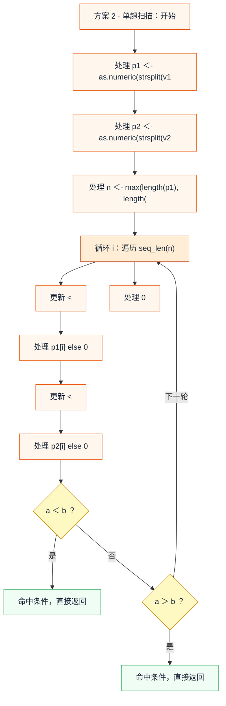

```r
# 版（方案2） 定义函数 compare_version（参数：v1, v2）
compare_version <- function(v1, v2) {
    p1 <- as.numeric(strsplit(v1, "\\.")[[1]])  # 把 as.numeric(strsplit(v1, 「\.」)[[1]]) 存入 p1
    p2 <- as.numeric(strsplit(v2, "\\.")[[1]])  # 把 as.numeric(strsplit(v2, 「\.」)[[1]]) 存入 p2
    n <- max(length(p1), length(p2))  # 把 取较大值 长度(p1), 长度(p2)) 存入 元素个数
    for (i in seq_len(n)) {
        # for (下标 i in seq_len(元素个数)) {
        a <- if (i <= length(p1))
            p1[i] else 0  # 把 if (下标 i 不超过 长度(p1)) p1[下标 i] else 0 存入 数组
        b <- if (i <= length(p2))
            p2[i] else 0  # 把 if (下标 i 不超过 长度(p2)) p2[下标 i] else 0 存入 b
        if (a < b)
            return(-1)  # 若 数组 小于 b) return( 减 1
        if (a > b)
            return(1)  # 若 数组 超过 b) return(1
    }
    0
}
stopifnot(compare_version("1.01", "1.001") == 0)  # 断言校验
stopifnot(compare_version("1.0", "1.0.0") == 0)  # 断言校验
stopifnot(compare_version("0.1", "1.1") == -1)  # 断言校验
cat("PASS\n")  # 全部用例通过，输出 PASS
```

### Zig 实现（2 种方案）

Zig 的全部方案如下，每个方案都内嵌用例自测，可独立运行（老仓库 python/go 文件遵循「打印结果」约定）：

#### 方案 1：按点拆分逐段比较

**思路与代码分析**：核心是「按点拆分逐段比较」。Zig 版显式分配与清零，整型边界处理严格。**走读**：方案 1 · 按点拆分逐段比较：开始 → 计算 it1 → 计算 it2 → 当 (true) 时反复执行 → 计算 s1 → 计算 s2 → 若 s1 == null and s2 == null：处理 break → 计算 a → 计算 b → 命中条件，直接返回 → 命中条件，直接返回 → 返回 0。

**运行架构**（真实控制流）：

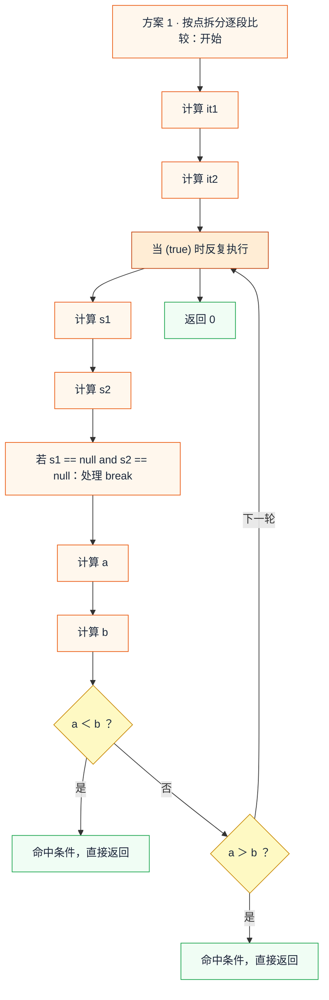

```zig
// LeetCode 165. 比较版本号 — Zig 版（方案1）
const std = @import("std"); // 把 @import(「std」) 存入 std
fn segVal(s: []const u8) i64 { // 定义函数/方法 segVal
    if (s.len == 0) return 0; // 若 字符串.长度 等于 0，直接返回 0
    return std.fmt.parseInt(i64, s, 10) catch 0; // 返回 std.fmt.转整数(i64, 字符串, 10) catch 0
}
fn compareVersion(v1: []const u8, v2: []const u8) i32 { // 定义函数/方法 compareVersion
    var it1 = std.mem.splitScalar(u8, v1, '.'); // 把 std.mem.splitScalar(u8, v1, '.') 存入 it1
    var it2 = std.mem.splitScalar(u8, v2, '.'); // 把 std.mem.splitScalar(u8, v2, '.') 存入 it2
    while (true) { // 循环，直到不满足「true」
        const s1 = it1.next(); // 把 it1.下一个() 存入 s1
        const s2 = it2.next(); // 把 it2.下一个() 存入 s2
        if (s1 == null and s2 == null) break; // 若 s1 等于 null and s2 等于 null) break;
        const a = if (s1) |x| segVal(x) else 0; // 把 if (s1) 按位或 x 按位或 segVal(x) else 0 存入 数组
        const b = if (s2) |x| segVal(x) else 0; // 把 if (s2) 按位或 x 按位或 segVal(x) else 0 存入 b
        if (a < b) return -1; // 若 数组 小于 b，直接返回 减 1
        if (a > b) return 1; // 若 数组 超过 b，直接返回 1
    }
    return 0; // 返回 0
}
pub fn main() !void { // 程序入口：跑内嵌自测用例
    if (compareVersion("1.01", "1.001") != 0) return error.TestFailed; // 若 compareVersion(「1.01」, 「1.01」) 不等于 0，直接返回 error.TestFailed
    if (compareVersion("1.0", "1.0.0") != 0) return error.TestFailed; // 若 compareVersion(「1.0」, 「1.0」) 不等于 0，直接返回 error.TestFailed
    if (compareVersion("0.1", "1.1") != -1) return error.TestFailed; // 若 compareVersion(「0.1」, 「0.1」) 不等于 减 1，直接返回 error.TestFailed
    std.debug.print("PASS\n", .{}); // 全部用例通过，输出 PASS
}
```

#### 方案 2：单趟扫描

**思路与代码分析**：核心是「单趟扫描」。Zig 版显式分配与清零，整型边界处理严格。**走读**：方案 2 · 单趟扫描：开始 → 计算 it1 → 计算 it2 → 当 (true) 时反复执行 → 计算 s1 → 计算 s2 → 若 s1 == null and s2 == null：处理 break → 计算 a → 计算 b → 命中条件，直接返回 → 命中条件，直接返回 → 返回 0。

**运行架构**（真实控制流）：

```mermaid
graph TD
    N0["方案 2 · 单趟扫描：开始"]
    N1["计算 it1"]
    N2["计算 it2"]
    N3["当 (true) 时反复执行"]
    N4["计算 s1"]
    N5["计算 s2"]
    N6["若 s1 == null and s2 == null：处理 break"]
    N7["计算 a"]
    N8["计算 b"]
    N9{"a ＜ b ？"}
    N10["命中条件，直接返回"]
    N11{"a ＞ b ？"}
    N12["命中条件，直接返回"]
    N13["返回 0"]
    N0 --> N1
    N1 --> N2
    N2 --> N3
    N3 --> N4
    N4 --> N5
    N5 --> N6
    N6 --> N7
    N7 --> N8
    N8 --> N9
    N9 -- 是 --> N10
    N9 -- 否 --> N11
    N11 -- 是 --> N12
    N11 -- 下一轮 --> N3
    N3 --> N13
    classDef n fill:#fff7ed,stroke:#ea580c,color:#1e293b;
    classDef lp fill:#ffedd5,stroke:#c2410c,color:#1e293b;
    classDef dc fill:#fef9c3,stroke:#ca8a04,color:#1e293b;
    classDef tm fill:#f0fdf4,stroke:#16a34a,color:#1e293b;
    class N0,N1,N2,N4,N5,N6,N7,N8 n;
    class N3 lp;
    class N9,N11 dc;
    class N10,N12,N13 tm;
```

```zig
// LeetCode 165. 比较版本号 — Zig 版（方案2）
const std = @import("std"); // 把 @import(「std」) 存入 std
fn segVal(s: []const u8) i64 { // 定义函数/方法 segVal
    if (s.len == 0) return 0; // 若 字符串.长度 等于 0，直接返回 0
    return std.fmt.parseInt(i64, s, 10) catch 0; // 返回 std.fmt.转整数(i64, 字符串, 10) catch 0
}
fn compareVersion(v1: []const u8, v2: []const u8) i32 { // 定义函数/方法 compareVersion
    var it1 = std.mem.splitScalar(u8, v1, '.'); // 把 std.mem.splitScalar(u8, v1, '.') 存入 it1
    var it2 = std.mem.splitScalar(u8, v2, '.'); // 把 std.mem.splitScalar(u8, v2, '.') 存入 it2
    while (true) { // 循环，直到不满足「true」
        const s1 = it1.next(); // 把 it1.下一个() 存入 s1
        const s2 = it2.next(); // 把 it2.下一个() 存入 s2
        if (s1 == null and s2 == null) break; // 若 s1 等于 null and s2 等于 null) break;
        const a = if (s1) |x| segVal(x) else 0; // 把 if (s1) 按位或 x 按位或 segVal(x) else 0 存入 数组
        const b = if (s2) |x| segVal(x) else 0; // 把 if (s2) 按位或 x 按位或 segVal(x) else 0 存入 b
        if (a < b) return -1; // 若 数组 小于 b，直接返回 减 1
        if (a > b) return 1; // 若 数组 超过 b，直接返回 1
    }
    return 0; // 返回 0
}
pub fn main() !void { // 程序入口：跑内嵌自测用例
    if (compareVersion("1.01", "1.001") != 0) return error.TestFailed; // 若 compareVersion(「1.01」, 「1.01」) 不等于 0，直接返回 error.TestFailed
    if (compareVersion("1.0", "1.0.0") != 0) return error.TestFailed; // 若 compareVersion(「1.0」, 「1.0」) 不等于 0，直接返回 error.TestFailed
    if (compareVersion("0.1", "1.1") != -1) return error.TestFailed; // 若 compareVersion(「0.1」, 「0.1」) 不等于 减 1，直接返回 error.TestFailed
    std.debug.print("PASS\n", .{}); // 全部用例通过，输出 PASS
}
```

### Dart 实现（2 种方案）

Dart 的全部方案如下，每个方案都内嵌用例自测，可独立运行（老仓库 python/go 文件遵循「打印结果」约定）：

#### 方案 1：按点拆分逐段比较

**思路与代码分析**：核心是「按点拆分逐段比较」。Dart 版用可空类型标注与集合方法，注意空安全。代码里依次做这些事：单循环线性扫描。**走读**：方案 1 · 按点拆分逐段比较：开始 → 更新 p1 → 遍历循环 → 命中条件，直接返回 → 命中条件，直接返回 → 返回 0。

**运行架构**（真实控制流）：

```mermaid
graph TD
    N0["方案 1 · 按点拆分逐段比较：开始"]
    N1["更新 p1"]
    D1["……（中间计算步骤）"]
    N12["遍历循环"]
    D2["……（中间计算步骤）"]
    N15{"a ＜ b ？"}
    N16["命中条件，直接返回"]
    N17{"a ＞ b ？"}
    N18["命中条件，直接返回"]
    N19["返回 0"]
    N0 --> N1
    N15 -- 是 --> N16
    N15 -- 否 --> N17
    N17 -- 是 --> N18
    N17 -- 下一轮 --> N12
    N12 --> N19
    N1 --> D1
    D1 --> N12
    N12 --> D2
    D2 --> N15
    N16 --> N17
    N18 --> N19
    classDef n fill:#fff7ed,stroke:#ea580c,color:#1e293b;
    classDef lp fill:#ffedd5,stroke:#c2410c,color:#1e293b;
    classDef dc fill:#fef9c3,stroke:#ca8a04,color:#1e293b;
    classDef tm fill:#f0fdf4,stroke:#16a34a,color:#1e293b;
    class N0,N1,D1,D2 n;
    class N12 lp;
    class N15,N17 dc;
    class N16,N18,N19 tm;
```

```dart
// LeetCode 165. 比较版本号 — Dart 版（方案1）
int compareVersion(String v1, String v2) {
  // 定义函数/方法 compareVersion
  final p1 = v1
      .split('.')
      .map(int.parse)
      .toList(); // 把 v1.split('.').映射表(int.parse).toList() 存入 p1
  final p2 = v2
      .split('.')
      .map(int.parse)
      .toList(); // 把 v2.split('.').映射表(int.parse).toList() 存入 p2
  final n = p1.length > p2.length
      ? p1.length
      : p2.length; // 把 p1.长度 超过 p2.长度 ? p1.长度 : p2.长度 存入 元素个数
  for (var i = 0; i < n; i++) {
    // 让 下标 i 从 0 开始计数，下标 i 小于 元素个数 就继续
    final a = i < p1.length ? p1[i] : 0; // 把 下标 i 小于 p1.长度 ? p1[下标 i] : 0 存入 数组
    final b = i < p2.length ? p2[i] : 0; // 把 下标 i 小于 p2.长度 ? p2[下标 i] : 0 存入 b
    if (a < b) return -1; // 若 数组 小于 b，直接返回 减 1
    if (a > b) return 1; // 若 数组 超过 b，直接返回 1
  }
  return 0; // 返回 0
}

void main() {
  // 程序入口：跑内嵌自测用例
  if (compareVersion('1.01', '1.001') != 0) throw StateError('c1');
  if (compareVersion('1.0', '1.0.0') != 0) throw StateError('c2');
  if (compareVersion('0.1', '1.1') != -1) throw StateError('c3');
  print('PASS'); // 全部用例通过，输出 PASS
}
```

#### 方案 2：单趟扫描

**思路与代码分析**：核心是「单趟扫描」。Dart 版用可空类型标注与集合方法，注意空安全。代码里依次做这些事：单循环线性扫描。**走读**：方案 2 · 单趟扫描：开始 → 更新 p1 → 遍历循环 → 命中条件，直接返回 → 命中条件，直接返回 → 返回 0。

**运行架构**（真实控制流）：

```mermaid
graph TD
    N0["方案 2 · 单趟扫描：开始"]
    N1["更新 p1"]
    D1["……（中间计算步骤）"]
    N12["遍历循环"]
    D2["……（中间计算步骤）"]
    N15{"a ＜ b ？"}
    N16["命中条件，直接返回"]
    N17{"a ＞ b ？"}
    N18["命中条件，直接返回"]
    N19["返回 0"]
    N0 --> N1
    N15 -- 是 --> N16
    N15 -- 否 --> N17
    N17 -- 是 --> N18
    N17 -- 下一轮 --> N12
    N12 --> N19
    N1 --> D1
    D1 --> N12
    N12 --> D2
    D2 --> N15
    N16 --> N17
    N18 --> N19
    classDef n fill:#fff7ed,stroke:#ea580c,color:#1e293b;
    classDef lp fill:#ffedd5,stroke:#c2410c,color:#1e293b;
    classDef dc fill:#fef9c3,stroke:#ca8a04,color:#1e293b;
    classDef tm fill:#f0fdf4,stroke:#16a34a,color:#1e293b;
    class N0,N1,D1,D2 n;
    class N12 lp;
    class N15,N17 dc;
    class N16,N18,N19 tm;
```

```dart
// LeetCode 165. 比较版本号 — Dart 版（方案2）
int compareVersion(String v1, String v2) {
  // 定义函数/方法 compareVersion
  final p1 = v1
      .split('.')
      .map(int.parse)
      .toList(); // 把 v1.split('.').映射表(int.parse).toList() 存入 p1
  final p2 = v2
      .split('.')
      .map(int.parse)
      .toList(); // 把 v2.split('.').映射表(int.parse).toList() 存入 p2
  final n = p1.length > p2.length
      ? p1.length
      : p2.length; // 把 p1.长度 超过 p2.长度 ? p1.长度 : p2.长度 存入 元素个数
  for (var i = 0; i < n; i++) {
    // 让 下标 i 从 0 开始计数，下标 i 小于 元素个数 就继续
    final a = i < p1.length ? p1[i] : 0; // 把 下标 i 小于 p1.长度 ? p1[下标 i] : 0 存入 数组
    final b = i < p2.length ? p2[i] : 0; // 把 下标 i 小于 p2.长度 ? p2[下标 i] : 0 存入 b
    if (a < b) return -1; // 若 数组 小于 b，直接返回 减 1
    if (a > b) return 1; // 若 数组 超过 b，直接返回 1
  }
  return 0; // 返回 0
}

void main() {
  // 程序入口：跑内嵌自测用例
  if (compareVersion('1.01', '1.001') != 0) throw StateError('c1');
  if (compareVersion('1.0', '1.0.0') != 0) throw StateError('c2');
  if (compareVersion('0.1', '1.1') != -1) throw StateError('c3');
  print('PASS'); // 全部用例通过，输出 PASS
}
```

---

## 内容总结

- **比较版本号**（字符串 · Medium）：共 2 个方案，主线思路「按点拆分逐段比较」；时间 O(n)（单趟线性扫描）；动画演示滑动窗口过程，附录给出 11 种语言 × 全部方案的可运行实现。
- 来源博客：[https://blog.csdn.net/tyro_java/article/details/145385760](https://blog.csdn.net/tyro_java/article/details/145385760)
- 导航：[📋 总目录](../) ｜ [← 070 验证回文串](../070_验证回文串/) ｜ [072 检查句子中的数字是否递增 →](../072_检查句子中的数字是否递增/)
