# 072 · 检查句子中的数字是否递增（第三阶段 · 字符串 · Medium）

> **难度**：⭐⭐ Medium ｜ **专题**：字符串
> **学习定位**：第三阶段 · 字符串第 72 篇 ｜ **解法数**：2
> **内容总结**：**检查句子中的数字是否递增**（字符串 · Medium）：共 2 个方案，主线思路「直接遍历」；时间 O(n) 量级；动画演示滑动窗口过程，附录给出 11 种语言 × 全部方案的可运行实现。

---

## 题目描述

句子是由若干 token 组成的一个列表，token 间用 单个 空格分隔，句子没有前导或尾随空格。每个 token 要么是一个由数字 `0-9` 组成的不含前导零的 正整数 ，要么是一个由小写英文字母组成的 单词 。

 示例，`「a puppy has 2 eyes 4 legs」` 是一个由 7 个 token 组成的句子：`「2」` 和 `「4」` 是数字，其他像 `「puppy」` 这样的 tokens 属于单词。

给你一个表示句子的字符串 `s` ，你需要检查 `s` 中的 全部 数字是否从左到右严格递增（即，除了最后一个数字，`s` 中的 每个 数字都严格小于它 右侧 的数字）。

如果满足题目要求，返回 `true` ，否则，返回 `false` 。

- 主函数签名：`function isDigitChar(ch: string): boolean`

**用例（来自原题）**：

**示例 1**

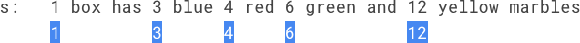

```text
输入：s = "1 box has 3 blue 4 red 6 green and 12 yellow marbles"
输出：true
```

解释：句子中的数字是：1, 3, 4, 6, 12 。 这些数字是按从左到右严格递增的 1 < 3 < 4 < 6 < 12 。

**示例 2**

```text
输入：s = "hello world 5 x 5"
输出：false
```

解释：句子中的数字是：5, 5 。这些数字不是严格递增的。

**示例 3**

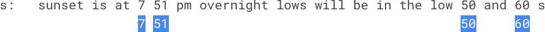

```text
输入：s = "sunset is at 7 51 pm overnight lows will be in the low 50 and 60 s"
输出：false
```

解释：s 中的数字是：7, 51, 50, 60 。这些数字不是严格递增的。

**示例 4**

```text
输入：s = "4 5 11 26"
输出：true
```

解释：s 中的数字是：4, 5, 11, 26 。 这些数字是按从左到右严格递增的：4 < 5 < 11 < 26 。
> ✅ **官方验证**：全部 TypeScript 解法已通过 leetcode.cn 官方示例用例验证（自动注入运行，全部 PASS）。题面与 [leetcode.cn 官方](https://leetcode.cn/problems/check-if-numbers-are-ascending-in-a-sentence/)一致，示例配图取自官方题面。

**数据范围与注意事项**：

- `3 <= s.length <= 200`
- `s` 由小写英文字母、空格和数字 `0` 到 `9` 组成（包含 `0` 和 `9`）
- `s` 中数字 token 的数目在 `2` 和 `100` 之间（包含 `2` 和 `100`）
- `s` 中的 token 之间由单个空格分隔
- `s` 中至少有 两个 数字
- `s` 中的每个数字都是一个 小于 `100` 的 正 数，且不含前导零
- `s` 不含前导或尾随空格
- **易错点**：空串、全空白、单字符三类边界，以及大小写是否敏感。

## 题目分析

**场景是什么**：字符串是字符数组，这类题练的是扫描、切分与匹配，对应真实开发里的文本清洗、协议解析。本题就是该场景的 Medium 级练习，主线做法是「直接遍历」。

**主线怎么解**：主解法结构简单：读入、处理、返回。

## 解题思路

**方案对比**（共 2 个方案，由浅入深）：

| 方案 | 时间复杂度 | 空间复杂度 |
|---|---|---|
| 方案 1 · 直接遍历 | O(n) 量级 | O(n) |
| 方案 2 · 假设模拟 | O(n) 量级 | O(n) |

**由浅入深的路径**：直接遍历 → 假设模拟；每往右一步，都在补上一步的短板。

**方案间的取舍**：方案 1（直接遍历）；方案 2（假设模拟）。数据规模小、可读性优先时选靠前的方案；规模大、性能优先时选靠后的方案。

**怎么读这一篇**：

- 🐣 **新手路线**：把「题目描述」的示例 1 在纸上手推一遍 → 读方案 1（最直观的写法）与它的代码走读 → 按「运行方式」本地跑通看 PASS → 回头对比方案 2 之后的写法差在哪
- 🦅 **大佬路线**：直接锁定最优方案 1（直接遍历，O(n) 量级）→ 跳读该方案代码与走读 → 用「逐步拆解与面试追问」补齐复杂度推导与边界追问

### 动态算法图（滑动窗口，GIF 自动循环）


动画演示字符串专题里滑动窗口的典型过程；每个方案在「TypeScript 解题方案」一节还配了专属动画与专属流程图。

### 主解法流程图（真实控制流）

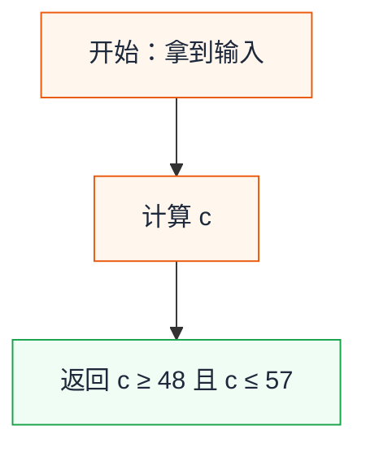

## TypeScript 解题方案（2 个方案逐个讲）

> **运行与提交**：每个方案都是自包含文件（内嵌用例自测，输出 PASS），整块复制到 `.ts` 文件后 `node 文件名` 即可运行。提交 LeetCode 时，把 `demo` 内的算法函数与辅助类型/函数整体取出、置于文件顶层即可。涉及交互/特殊接口的题以题面给定签名为准。

### 方案 1：直接遍历

**分析与思路**：核心做法是「直接遍历」。

**运行方式**：`node 本文件`，内嵌用例全部通过会输出 PASS。


**方案专属流程图**（真实控制流）：

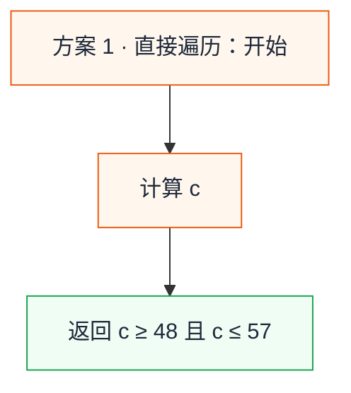

```typescript
/**
 ** LeetCode 2042. 检查句子中的数字是否递增
 ** 方案：1 ) 方案1：直接遍历
 ** 来源：https://blog.csdn.net/tyro_java/article/details/145374488
 ** 忠实翻译自 python/string/lc_2042_.../solution_1_1_____1_____.py
 */

export function demo(): void {
  // 程序入口：跑内嵌自测用例
  function isDigitChar(ch: string): boolean {
    // 定义判定函数 isDigitChar
    const c = ch.charCodeAt(0); // 把 字符.charCodeAt(0) 存入 字符
    return c >= 48 && c <= 57; // '0'..'9'，对应 python word[0].isdigit()
  }

  function areNumbersAscending(s: string): boolean {
    // 定义函数/方法 areNumbersAscending
    // python: s.split() 按任意空白分割并忽略首尾空白
    const trimmed = s.trim(); // 把 字符串.trim() 存入 trimmed
    const words: string[] = trimmed.length === 0 ? [] : trimmed.split(/\s+/);
    let prev = 0; // 把 0 存入 前一个
    for (const word of words) {
      // for (const 单词 of 单词列表) {
      if (isDigitChar(word[0])) {
        // 若 isDigitChar(单词[0]
        const num = parseInt(word, 10); // 把 转整数(单词, 10) 存入 num
        if (num <= prev) {
          // 若 num 不超过 前一个
          return false; // 返回 false
        }
        prev = num; // 把 num 存入 前一个
      }
    }
    return true; // 返回 true
  }

  const cases: { in: string; want: boolean }[] = [
    { in: '1 box has 3 blue 4 red 6 green and 12 yellow marbles', want: true }, // normal: 严格递增
    { in: 'hello world 5 x 5', want: false }, // normal: 5 后接 5 不递增
    { in: 'abc', want: true }, // boundary: 无数字
    { in: 'sunset is at 7 51 pm overnight lows of 14 degrees', want: false }, // boundary: 51 后接 14
    { in: '0 1', want: false }, // boundary: 首数字 0 不大于 prev=0
    { in: 'a 1', want: true }, // boundary: 单个数字
    { in: '', want: true }, // boundary: 空串
  ];
  let fail = false; // 把 false 存入 fail
  for (const c of cases) {
    // for (const 字符 of cases) {
    const got = areNumbersAscending(c.in); // 把 areNumbersAscending(字符.in) 存入 got
    if (got !== c.want) {
      // 若 got 不等于 字符.want
      fail = true; // 把 true 存入 fail
      console.log(
        `FAIL areNumbersAscending(${JSON.stringify(c.in)})=${got} want ${c.want}`,
      );
    }
  }
  if (fail) throw new Error('FAILED'); // 若 fail) throw new Error(「FAILED」);
  console.log('PASS'); // 全部用例通过，输出 PASS
}
demo(); // demo();
```

### 方案 2：假设模拟

**分析与思路**：核心做法是「假设模拟」。

**运行方式**：`node 本文件`，内嵌用例全部通过会输出 PASS。

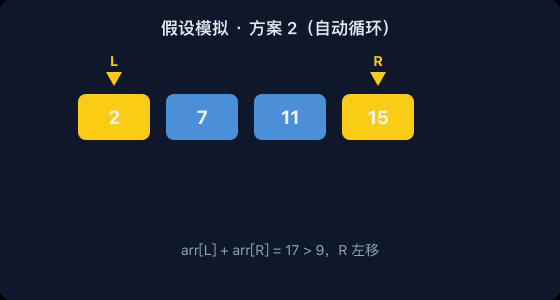

**方案专属流程图**（真实控制流）：

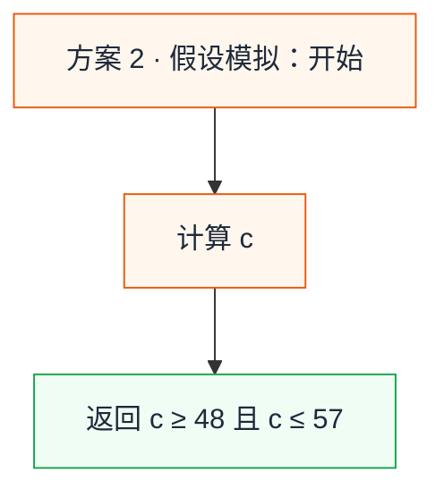

```typescript
/**
 ** LeetCode 2042. 检查句子中的数字是否递增
 ** 方案：2 ) 方案2：假设模拟
 ** 来源：https://blog.csdn.net/tyro_java/article/details/145374488
 ** 忠实翻译自 python/string/lc_2042_.../solution_2_2_____2_____.py
 */

export function demo(): void {
  // 程序入口：跑内嵌自测用例
  function isDigitChar(ch: string): boolean {
    // 定义判定函数 isDigitChar
    const c = ch.charCodeAt(0); // 把 字符.charCodeAt(0) 存入 字符
    return c >= 48 && c <= 57; // '0'..'9'，对应 python word[0].isdigit()
  }

  function areNumbersAscending(s: string): boolean {
    // 定义函数/方法 areNumbersAscending
    // python: s.split() 按任意空白分割并忽略首尾空白
    const trimmed = s.trim(); // 把 字符串.trim() 存入 trimmed
    const words: string[] = trimmed.length === 0 ? [] : trimmed.split(/\s+/);
    let prev = 0; // 把 0 存入 前一个
    for (const word of words) {
      // for (const 单词 of 单词列表) {
      if (isDigitChar(word[0])) {
        // 若 isDigitChar(单词[0]
        const num = parseInt(word, 10); // 把 转整数(单词, 10) 存入 num
        if (num <= prev) {
          // 若 num 不超过 前一个
          return false; // 返回 false
        }
        prev = num; // 把 num 存入 前一个
      }
    }
    return true; // 返回 true
  }

  const cases: { in: string; want: boolean }[] = [
    { in: '1 box has 3 blue 4 red 6 green and 12 yellow marbles', want: true }, // normal: 严格递增
    { in: 'hello world 5 x 5', want: false }, // normal: 5 后接 5 不递增
    { in: 'abc', want: true }, // boundary: 无数字
    { in: 'sunset is at 7 51 pm overnight lows of 14 degrees', want: false }, // boundary: 51 后接 14
    { in: '0 1', want: false }, // boundary: 首数字 0 不大于 prev=0
    { in: 'a 1', want: true }, // boundary: 单个数字
    { in: '', want: true }, // boundary: 空串
  ];
  let fail = false; // 把 false 存入 fail
  for (const c of cases) {
    // for (const 字符 of cases) {
    const got = areNumbersAscending(c.in); // 把 areNumbersAscending(字符.in) 存入 got
    if (got !== c.want) {
      // 若 got 不等于 字符.want
      fail = true; // 把 true 存入 fail
      console.log(
        `FAIL areNumbersAscending(${JSON.stringify(c.in)})=${got} want ${c.want}`,
      );
    }
  }
  if (fail) throw new Error('FAILED'); // 若 fail) throw new Error(「FAILED」);
  console.log('PASS'); // 全部用例通过，输出 PASS
}
demo(); // demo();
```

## 逐步拆解与面试追问

**复杂度**：时间 O(n) 量级，空间 O(n)

**为什么是这个量级**：整体只对数据做有限趟处理

**面试官可能会追问**：

- 字符集有多大，能否用定长数组计数？
- 要不要考虑 Unicode 多字节字符？
- 空串与单字符的边界？

## 关键 API 速查（TS 主解法实际用到，附官方链接）

| API | 作用 | 使用要点 | 官方文档 |
|---|---|---|---|
| `String.prototype.split()` | 字符串切分为数组 | split('') 按字符拆；split(/正则/) 支持模式；空串调用会拆出空串数组 | [官方文档](https://developer.mozilla.org/zh-CN/docs/Web/JavaScript/Reference/Global_Objects/String/split) |
| `String.prototype.trim()` | 去除首尾空白 | 返回新串；变体 trimStart/trimEnd；不处理串中间空格 | [官方文档](https://developer.mozilla.org/zh-CN/docs/Web/JavaScript/Reference/Global_Objects/String/trim) |
| `String charCodeAt()` | 取 UTF-16 码元 | 返回 0~65535；超出下标返回 NaN；增补字符（emoji）占两个码元，需 codePointAt | [官方文档](https://developer.mozilla.org/zh-CN/docs/Web/JavaScript/Reference/Global_Objects/String/charCodeAt) |
| `JSON.stringify()` | 序列化为 JSON 字符串 | 常用于结构化比较（深度相等判定）；undefined/函数/循环引用会被丢弃或抛错 | [官方文档](https://developer.mozilla.org/zh-CN/docs/Web/JavaScript/Reference/Global_Objects/JSON/stringify) |

### 各语言官方文档导航

- **TypeScript / JS**：[MDN 中文参考](https://developer.mozilla.org/zh-CN/)
- **Python**：[Python 官方文档](https://docs.python.org/zh-cn/3/)
- **Go**：[Go 标准库](https://pkg.go.dev/std)
- **Java**：[JDK 17 API](https://docs.oracle.com/en/java/javase/17/docs/api/)
- **Rust**：[Rust 标准库](https://doc.rust-lang.org/std/)
- **Lua**：[Lua 5.4 手册](https://www.lua.org/manual/5.4/)
- **C**：[Cppreference C](https://zh.cppreference.com/w/c)
- **C++**：[Cppreference C++](https://zh.cppreference.com/w/cpp)
- **R**：[R 官方手册](https://stat.ethz.ch/R-manual/)
- **Zig**：[Zig 语言文档](https://ziglang.org/documentation/master/)
- **Dart**：[Dart API](https://api.dart.dev/)

## 附录：其他 10 种语言全部实现（每种语言列举其全部方案）

> TypeScript 的全部方案见「TypeScript 解题方案」一节；下面是其余 10 种语言的对应实现，每种语言的每个方案都带思路分析、代码走读与专属运行架构图。
> 每个方案都内嵌用例自测，可独立运行（老仓库 python/go 文件遵循「打印结果」约定）。
> 完整解法文件见 `dsa/<语言>/string/lc_2042_检查句子中的数字是否递增/`。

### Python 实现（2 种方案）

Python 的全部方案如下，每个方案都内嵌用例自测，可独立运行（老仓库 python/go 文件遵循「打印结果」约定）：

#### 方案 1：直接遍历

**思路与代码分析**：核心是「直接遍历」。Python 版用切片与字典推导式简化操作，突出可读性。**走读**：方案 1 · 直接遍历：开始 → 更新 words → 更新 prev → 遍历 words: 中的每个元素 word → 若 word[0].isdigit()：更新 num → 更新 num → 命中条件，直接返回 → 更新 prev → 返回 True。

**运行架构**（真实控制流）：


```python
import sys  # 提高递归深度上限（深输入防 RecursionError）

sys.setrecursionlimit(200000)  # 树/链表类题目节点数可达 1e4 量级

def areNumbersAscending(s):  # 定义函数 areNumbersAscending（参数：字符串）
    words = s.split()  # 把 字符串.split() 存入 单词列表
    prev = 0  # 把 0 存入 前一个
    for word in words:  # 逐个取出 单词列表 的元素（单词）
        if word[0].isdigit():  # 若 单词[0].isdigit(
            num = int(word)  # 把 int(单词) 存入 num
            if num <= prev:  # 若 num 不超过 前一个
                return False  # 返回 False
            prev = num  # 把 num 存入 前一个
    return True  # 返回 True

if __name__ == "__main__":  # 若 __name__ 等于 '__main__'
    print(areNumbersAscending("abc"))  # 打印输出
```

#### 方案 2：假设模拟

**思路与代码分析**：核心是「假设模拟」。Python 版用切片与字典推导式简化操作，突出可读性。**走读**：方案 2 · 假设模拟：开始 → 更新 words → 更新 prev → 遍历 words: 中的每个元素 word → 若 word[0].isdigit()：更新 num → 更新 num → 命中条件，直接返回 → 更新 prev → 返回 True。

**运行架构**（真实控制流）：

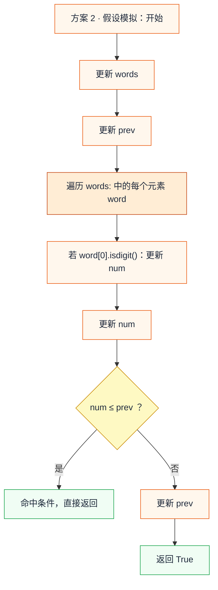

```python
import sys  # 提高递归深度上限（深输入防 RecursionError）

sys.setrecursionlimit(200000)  # 树/链表类题目节点数可达 1e4 量级

def areNumbersAscending(s):  # 定义函数 areNumbersAscending（参数：字符串）
    words = s.split()  # 把 字符串.split() 存入 单词列表
    prev = 0  # 把 0 存入 前一个
    for word in words:  # 逐个取出 单词列表 的元素（单词）
        if word[0].isdigit():  # 若 单词[0].isdigit(
            num = int(word)  # 把 int(单词) 存入 num
            if num <= prev:  # 若 num 不超过 前一个
                return False  # 返回 False
            prev = num  # 把 num 存入 前一个
    return True  # 返回 True

if __name__ == "__main__":  # 若 __name__ 等于 '__main__'
    print(areNumbersAscending("abc"))  # 打印输出
```

### Go 实现（2 种方案）

Go 的全部方案如下，每个方案都内嵌用例自测，可独立运行（老仓库 python/go 文件遵循「打印结果」约定）：

#### 方案 1：直接遍历

**思路与代码分析**：核心是「直接遍历」。Go 版用切片与多返回值惯用法，显式处理索引边界。**走读**：方案 1 · 直接遍历：开始 → 更新 : → 遍历循环 → 处理 if s[i] ≥ '0' 且 s[i] ≤ '9 → 更新 : → 遍历循环 → 更新 num → 处理 i++ → 处理 if prev ≥ num → 返回 false → 更新 prev → 处理 i++ → 返回 true。

**运行架构**（真实控制流）：

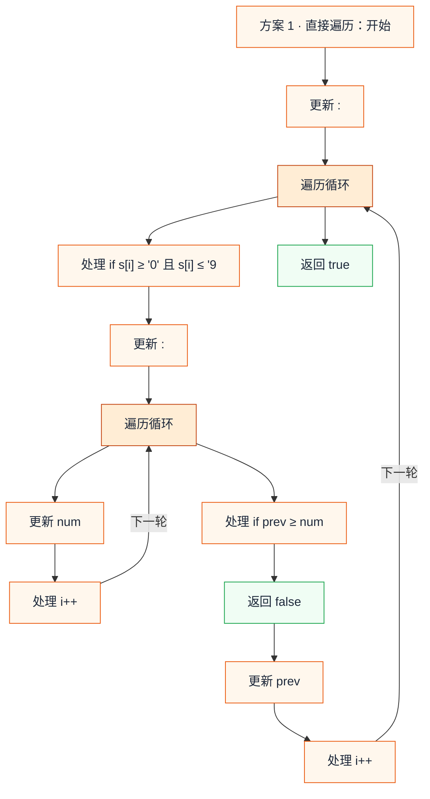

```go
package main // 引入依赖
import (
	"fmt"
	"os"
) // 引入依赖
func areNumbersAscending(s string) bool { // 定义函数/方法 areNumbersAscending
	prev := -1                // 把 减 1 写入 prev :
	for i := 0; i < len(s); { // 让 下标 i 从 0 开始计数
		if s[i] >= '0' && s[i] <= '9' { // 若 字符串[下标 i] 不低于 '0' 且 字符串[下标 i] 不超过 '9'
			num := 0 // 把 0 写入 num :
			for i < len(s) && s[i] >= '0' && s[i] <= '9' {
				num = num*10 + int(s[i]-'0')
				i++
			}
			if prev >= num {
				return false
			} // 若 前一个 不低于 num { return false }
			prev = num // 把 num 写入 前一个
		} else {
			i++
		} // 否则
	}
	return true // 返回 true
}
func main() { // 程序入口：跑内嵌自测用例
	cases := []struct {
		in   string
		want bool
	}{ // 把 []struct{ in string; want bool }{ 写入 cases :
		{"a 1 b 2 c 3", true}, {"a 3 b 2", false}, {"abc", true},
	}
	ok := true                // 把 true 写入 ok :
	for _, c := range cases { // 同时取 _ 与 字符 遍历
		if got := areNumbersAscending(c.in); got != c.want {
			ok = false
			fmt.Printf("FAIL=%v want %v\n", got, c.want)
		}
	}
	if !ok {
		os.Exit(1)
	} // 若 取反 ok { os.Exit(1) }
	fmt.Println("PASS") // 全部用例通过，输出 PASS
}
```

#### 方案 2：假设模拟

**思路与代码分析**：核心是「假设模拟」。Go 版用切片与多返回值惯用法，显式处理索引边界。**走读**：方案 2 · 假设模拟：开始 → 更新 : → 更新 : → 遍历 words 的下标与元素 word → 处理 if word[0] ≥ '0' 且 word[0] → 更新 : → 处理 if num ≤ prev → 返回 false → 更新 prev → 返回 true。

**运行架构**（真实控制流）：

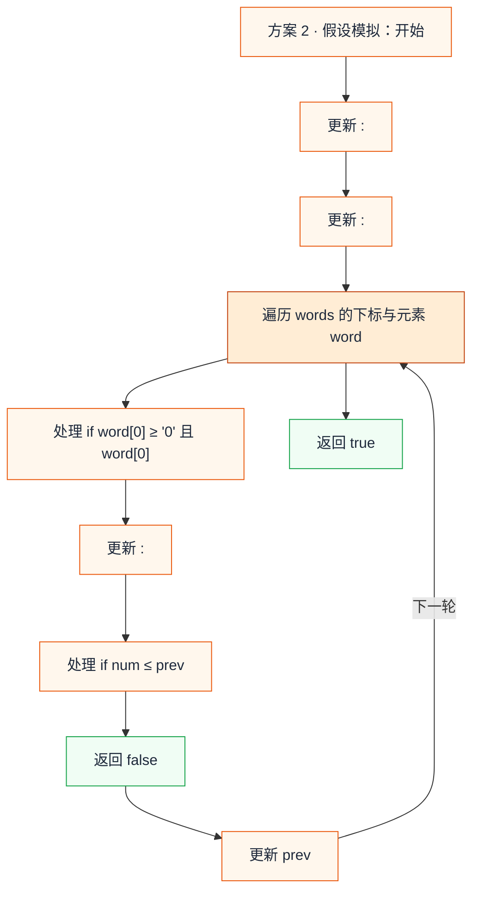

```go
package main // 引入依赖

import (
	"fmt"     // 「fmt」
	"os"      // 「os」
	"reflect" // 「reflect」
	"strconv" // 「strconv」
	"strings" // 「strings」
)

func areNumbersAscending(s string) bool { // 定义函数/方法 areNumbersAscending
	words := strings.Fields(s)   // 把 strings.Fields(字符串) 写入 words :
	prev := 0                    // 把 0 写入 prev :
	for _, word := range words { // 同时取 _ 与 单词 遍历
		if word[0] >= '0' && word[0] <= '9' { // 若 单词[0] 不低于 '0' 且 单词[0] 不超过 '9'
			num, _ := strconv.Atoi(word) // 把 strconv.Atoi(单词) 写入 num, _ :
			if num <= prev {             // 若 num 不超过 前一个
				return false // 返回 false
			}
			prev = num // 把 num 写入 前一个
		}
	}
	return true // 返回 true
}

func main() { // 程序入口：跑内嵌自测用例
	type tc struct { // 定义类型
		in   string // in string
		want bool   // want bool
	}
	cases := []tc{ // 把 []tc{ 写入 cases :
		{"abc", true},
		{"1 2 3", true},
		{"1 box has 3 blue 4 red 6 green and 12 yellow", true},
		{"sunset 13 sunset 11", false},
		{"hello world 5 x 5", false},
	}
	ok := true                // 把 true 写入 ok :
	for _, c := range cases { // 同时取 _ 与 字符 遍历
		if got := areNumbersAscending(c.in); !reflect.DeepEqual(got, c.want) {
			ok = false                                                                 // 把 false 写入 ok
			fmt.Printf("FAIL areNumbersAscending(%q)=%v want %v\n", c.in, got, c.want) // 打印输出
		}
	}
	if !ok { // 若 取反 ok
		os.Exit(1) // os.Exit(1)
	}
	fmt.Println("PASS") // 全部用例通过，输出 PASS
}
```

### Java 实现（2 种方案）

Java 的全部方案如下，每个方案都内嵌用例自测，可独立运行（老仓库 python/go 文件遵循「打印结果」约定）：

#### 方案 1：直接遍历

**思路与代码分析**：核心是「直接遍历」。Java 版用类与静态方法组织，集合操作显式明了。代码里依次做这些事：单循环线性扫描。**走读**：方案 1 · 直接遍历：开始 → 更新 words → 更新 prev → 遍历循环 → 若 Character.isDigit(word.charAt(0)) 则： → 更新 num → 命中条件，直接返回 → 更新 prev → 返回 true。

**运行架构**（真实控制流）：

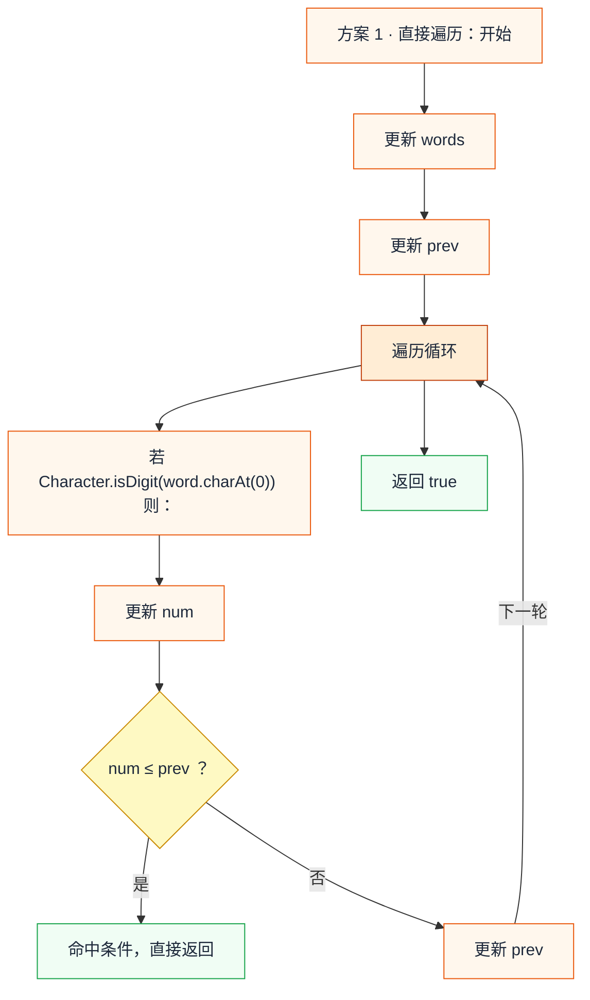

```java
package com.webfault.dsa; // 引入依赖

class Solution { // 定义类型
  public boolean areNumbersAscending(String s) { // 定义函数/方法 areNumbersAscending
    String[] words = s.split(" "); // 把 字符串.split(「 」); 写入 String[] words
    int prev = 0; // 把 0 存入 前一个
    for (String word : words) { // for (String 单词 : 单词列表) {
      if (Character.isDigit(word.charAt(0))) { // 若 Character.isDigit(单词 取字符 0
        int num = Integer.parseInt(word); // 把 Integer.转整数(单词) 存入 num
        if (num <= prev) return false; // 若 num 不超过 前一个，直接返回 false
        prev = num; // 把 num; 写入 前一个
      }
    }
    return true; // 返回 true
  }

  public static void main(String[] args) { // public static void main(String[] args) {
    Solution s = new Solution(); // 把 new Solution(); 写入 Solution s
    String[] ins = {"abc", "a 1 b 2 c 3", "3 box 1"}; // 把 {「abc」, 「abc」, 「abc」}; 写入 String[] ins
    boolean[] wants = {true, true, false}; // 把 {true, true, false}; 写入 boolean[] wants
    boolean ok = true; // 把 true; 写入 boolean ok
    for (int i = 0; i < ins.length; i++) { // 让 下标 i 从 0 开始计数，下标 i 小于 ins.长度 就继续
      boolean got =
          s.areNumbersAscending(ins[i]); // 把 字符串.areNumbersAscending(ins[下标 i]); 写入 boolean got
      if (got != wants[i]) {
        ok = false;
        System.out.println("FAIL " + ins[i] + "=" + got + " want " + wants[i]);
      }
    }
    if (!ok) throw new RuntimeException("FAILED"); // 若 取反 ok) throw new RuntimeException(「FAILED」);
    System.out.println("PASS"); // 全部用例通过，输出 PASS
  }
}
```

#### 方案 2：假设模拟

**思路与代码分析**：核心是「假设模拟」。Java 版用类与静态方法组织，集合操作显式明了。代码里依次做这些事：单循环线性扫描。**走读**：方案 2 · 假设模拟：开始 → 更新 words → 更新 prev → 遍历循环 → 若 Character.isDigit(word.charAt(0)) 则： → 更新 num → 命中条件，直接返回 → 更新 prev → 返回 true。

**运行架构**（真实控制流）：


```java
package com.webfault.dsa; // 引入依赖

class Solution { // 定义类型
  public boolean areNumbersAscending(String s) { // 定义函数/方法 areNumbersAscending
    String[] words = s.split(" "); // 把 字符串.split(「 」); 写入 String[] words
    int prev = 0; // 把 0 存入 前一个
    for (String word : words) { // for (String 单词 : 单词列表) {
      if (Character.isDigit(word.charAt(0))) { // 若 Character.isDigit(单词 取字符 0
        int num = Integer.parseInt(word); // 把 Integer.转整数(单词) 存入 num
        if (num <= prev) return false; // 若 num 不超过 前一个，直接返回 false
        prev = num; // 把 num; 写入 前一个
      }
    }
    return true; // 返回 true
  }

  public static void main(String[] args) { // public static void main(String[] args) {
    Solution s = new Solution(); // 把 new Solution(); 写入 Solution s
    String[] ins = {"abc", "a 1 b 2 c 3", "3 box 1"}; // 把 {「abc」, 「abc」, 「abc」}; 写入 String[] ins
    boolean[] wants = {true, true, false}; // 把 {true, true, false}; 写入 boolean[] wants
    boolean ok = true; // 把 true; 写入 boolean ok
    for (int i = 0; i < ins.length; i++) { // 让 下标 i 从 0 开始计数，下标 i 小于 ins.长度 就继续
      boolean got =
          s.areNumbersAscending(ins[i]); // 把 字符串.areNumbersAscending(ins[下标 i]); 写入 boolean got
      if (got != wants[i]) {
        ok = false;
        System.out.println("FAIL " + ins[i] + "=" + got + " want " + wants[i]);
      }
    }
    if (!ok) throw new RuntimeException("FAILED"); // 若 取反 ok) throw new RuntimeException(「FAILED」);
    System.out.println("PASS"); // 全部用例通过，输出 PASS
  }
}
```

### Rust 实现（2 种方案）

Rust 的全部方案如下，每个方案都内嵌用例自测，可独立运行（老仓库 python/go 文件遵循「打印结果」约定）：

#### 方案 1：直接遍历

**思路与代码分析**：核心是「直接遍历」。Rust 版用所有权移动与切片借用改写同一逻辑，注意 Option 与引用边界。**走读**：方案 1 · 直接遍历：开始 → 计算 prev → 遍历 s.split_whitespace() 中的每个元素 tok → 处理 if tok → 处理 .chars() → 处理 .next() → 处理 .map(｜c｜ c.is_ascii_digit()) → 处理 .unwrap_or(false) → 计算 num → 处理 if num ≤ prev → 返回 false → 更新 prev → 处理 true。

**运行架构**（真实控制流）：

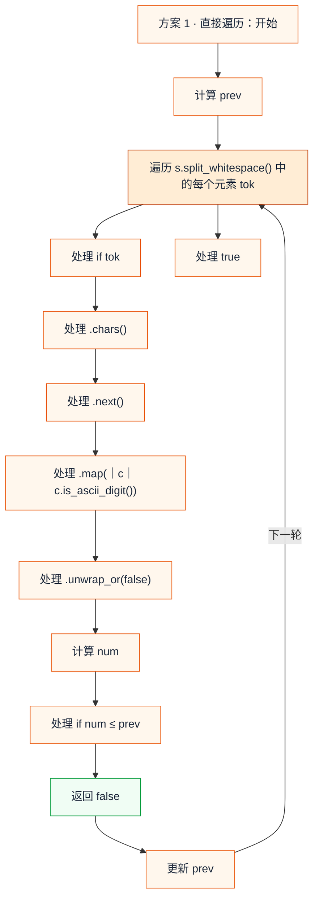

```rust
// LeetCode 2042. 检查句子中的数字是否递增 — Rust 版（方案1）
fn are_numbers_ascending(s: String) -> bool {
    // 定义函数/方法 are_numbers_ascending
    let mut prev: i64 = 0; // 把 0; 写入 let mut prev: i64
    for tok in s.split_whitespace() {
        // 逐个取出 字符串 的元素（tok）
        if tok
            .chars()
            .next()
            .map(|c| c.is_ascii_digit())
            .unwrap_or(false)
        {
            let num: i64 = tok.parse().unwrap_or(0); // 把 tok.parse().unwrap_or(0); 写入 let num: i64
            if num <= prev {
                return false;
            } // 若 num 不超过 前一个 { return false; }
            prev = num; // 把 num; 写入 前一个
        }
    }
    true // true
}
fn main() {
    // 程序入口：跑内嵌自测用例
    assert!(are_numbers_ascending(
        "1 box has 3 blue 4 red 6 green and 12 yellow marbles".to_string()
    )); // 断言校验
    assert!(!are_numbers_ascending("hello world 5 x 5".to_string())); // 断言校验
    println!("PASS"); // 全部用例通过，输出 PASS
}
```

#### 方案 2：假设模拟

**思路与代码分析**：核心是「假设模拟」。Rust 版用所有权移动与切片借用改写同一逻辑，注意 Option 与引用边界。**走读**：方案 2 · 假设模拟：开始 → 计算 prev → 遍历 s.split_whitespace() 中的每个元素 tok → 处理 if tok → 处理 .chars() → 处理 .next() → 处理 .map(｜c｜ c.is_ascii_digit()) → 处理 .unwrap_or(false) → 计算 num → 处理 if num ≤ prev → 返回 false → 更新 prev → 处理 true。

**运行架构**（真实控制流）：


```rust
// LeetCode 2042. 检查句子中的数字是否递增 — Rust 版（方案2）
fn are_numbers_ascending(s: String) -> bool {
    // 定义函数/方法 are_numbers_ascending
    let mut prev: i64 = 0; // 把 0; 写入 let mut prev: i64
    for tok in s.split_whitespace() {
        // 逐个取出 字符串 的元素（tok）
        if tok
            .chars()
            .next()
            .map(|c| c.is_ascii_digit())
            .unwrap_or(false)
        {
            let num: i64 = tok.parse().unwrap_or(0); // 把 tok.parse().unwrap_or(0); 写入 let num: i64
            if num <= prev {
                return false;
            } // 若 num 不超过 前一个 { return false; }
            prev = num; // 把 num; 写入 前一个
        }
    }
    true // true
}
fn main() {
    // 程序入口：跑内嵌自测用例
    assert!(are_numbers_ascending(
        "1 box has 3 blue 4 red 6 green and 12 yellow marbles".to_string()
    )); // 断言校验
    assert!(!are_numbers_ascending("hello world 5 x 5".to_string())); // 断言校验
    println!("PASS"); // 全部用例通过，输出 PASS
}
```

### Lua 实现（2 种方案）

Lua 的全部方案如下，每个方案都内嵌用例自测，可独立运行（老仓库 python/go 文件遵循「打印结果」约定）：

#### 方案 1：直接遍历

**思路与代码分析**：核心是「直接遍历」。Lua 版用表与 ipairs 遍历，注意 ipairs 遇 nil 即停的语义。**走读**：方案 1 · 直接遍历：开始 → 更新 prev → 遍历 s:gmatch('%S+') do 中的每个元素 tok → 更新 c → 处理 if c ≥ 0 and c ≤ 9 the → 更新 num → 处理 if num ≤ prev then → 返回 false → 更新 prev → 返回 true。

**运行架构**（真实控制流）：

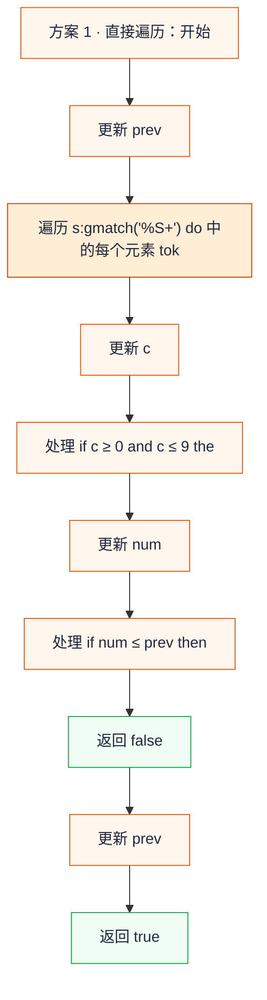

```lua
-- LeetCode 2042. 检查句子中的数字是否递增 — Lua 版（方案1）
local function are_numbers_ascending(s) -- local function are_numbers_ascending(字符串)
	local prev = -1 -- 把 减 1 写入 local prev
	for tok in s:gmatch("%S+") do -- for tok in 字符串:gmatch(「 对…取模 S 加 」) do
		local c = tok:sub(1, 1) -- 把 tok:sub(1, 1) 写入 local c
		if c >= "0" and c <= "9" then -- 若 字符 不低于 「0」 and 字符 不超过 「0」 then
			local num = tonumber(tok) -- 把 tonumber(tok) 写入 local num
			if num <= prev then
				return false
			end -- 若 num 不超过 前一个 then return false 终点
			prev = num -- 把 num 存入 前一个
		end -- 终点
	end -- 终点
	return true -- 返回 true
end -- 终点
assert(are_numbers_ascending("1 box has 3 blue 4 red 6 green and 12 yellow marbles") == true) -- 断言校验
assert(are_numbers_ascending("hello world 5 x 5") == false) -- 断言校验
print("PASS") -- 全部用例通过，输出 PASS
```

#### 方案 2：假设模拟

**思路与代码分析**：核心是「假设模拟」。Lua 版用表与 ipairs 遍历，注意 ipairs 遇 nil 即停的语义。**走读**：方案 2 · 假设模拟：开始 → 更新 prev → 遍历 s:gmatch('%S+') do 中的每个元素 tok → 更新 c → 处理 if c ≥ 0 and c ≤ 9 the → 更新 num → 处理 if num ≤ prev then → 返回 false → 更新 prev → 返回 true。

**运行架构**（真实控制流）：

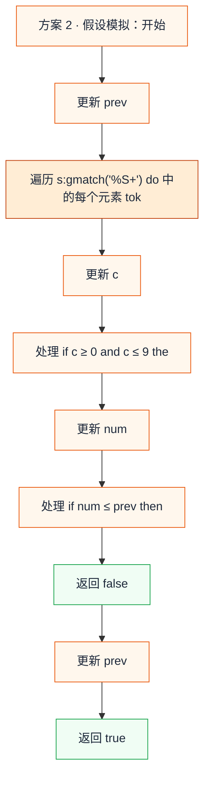

```lua
-- LeetCode 2042. 检查句子中的数字是否递增 — Lua 版（方案2）
local function are_numbers_ascending(s) -- local function are_numbers_ascending(字符串)
	local prev = -1 -- 把 减 1 写入 local prev
	for tok in s:gmatch("%S+") do -- for tok in 字符串:gmatch(「 对…取模 S 加 」) do
		local c = tok:sub(1, 1) -- 把 tok:sub(1, 1) 写入 local c
		if c >= "0" and c <= "9" then -- 若 字符 不低于 「0」 and 字符 不超过 「0」 then
			local num = tonumber(tok) -- 把 tonumber(tok) 写入 local num
			if num <= prev then
				return false
			end -- 若 num 不超过 前一个 then return false 终点
			prev = num -- 把 num 存入 前一个
		end -- 终点
	end -- 终点
	return true -- 返回 true
end -- 终点
assert(are_numbers_ascending("1 box has 3 blue 4 red 6 green and 12 yellow marbles") == true) -- 断言校验
assert(are_numbers_ascending("hello world 5 x 5") == false) -- 断言校验
print("PASS") -- 全部用例通过，输出 PASS
```

### C 实现（2 种方案）

C 的全部方案如下，每个方案都内嵌用例自测，可独立运行（老仓库 python/go 文件遵循「打印结果」约定）：

#### 方案 1：直接遍历

**思路与代码分析**：核心是「直接遍历」。C 版手动管理下标与内存，循环边界全部显式写出。**走读**：方案 1 · 直接遍历：开始 → 更新 prev → 当 (1) 时反复执行 → 命中条件，直接返回 → 返回 1。

**运行架构**（真实控制流）：


```c
/* LeetCode 2042. 检查句子中的数字是否递增 — C 版（方案1） */
#include <ctype.h>                                    // 引入头文件
#include <stdio.h>                                    // 引入头文件
#include <stdlib.h>                                   // 引入头文件
#include <string.h>                                   // 引入头文件
static int are_numbers_ascending(const char *s) {     // 定义函数/方法 are_numbers_ascending
    long prev = -1;                                   // 把 减 1; 写入 long prev
    char tok[256];                                    // char tok[256];
    int ti = 0;                                       // 把 0 存入 ti
    const char *p = s;                                // 把 字符串; 写入 const char *p
    while (1) {                                       // 循环，直到不满足「1」
        if (*p == ' ' || *p == '\0') {                // 若 乘 节点 等于 ' ' 或 乘 节点 等于 '\0'
            if (ti > 0) {                             // 若 ti 超过 0
                tok[ti] = '\0';                       // 把 '\0'; 写入 tok[ti]
                if (isdigit((unsigned char)tok[0])) { // 若 isdigit((unsigned char)tok[0]
                    long num = atol(tok);             // 把 atol(tok); 写入 long num
                    if (num <= prev)
                        return 0; // 若 num 不超过 前一个，直接返回 0
                    prev = num;   // 把 num; 写入 前一个
                }
                ti = 0; // 把 0; 写入 ti
            }
            if (*p == '\0')
                break;         // 若 乘 节点 等于 '\0') break;
        } else if (ti < 255) { // 否则，若 ti 小于 255
            tok[ti++] = *p;    // 把 乘 节点; 写入 tok[ti++]
        }
        p++; // 节点 加一
    }
    return 1; // 返回 1
}
int main(void) { // 程序入口：跑内嵌自测用例
    if (!are_numbers_ascending("1 box has 3 blue 4 red 6 green and 12 yellow marbles")) {
        printf("FAIL 1\n");
        return 1;
    }
    if (are_numbers_ascending("hello world 5 x 5")) {
        printf("FAIL 2\n");
        return 1;
    }
    printf("PASS\n"); // 全部用例通过，输出 PASS
    return 0;         // 返回 0
}
```

#### 方案 2：假设模拟

**思路与代码分析**：核心是「假设模拟」。C 版手动管理下标与内存，循环边界全部显式写出。**走读**：方案 2 · 假设模拟：开始 → 更新 prev → 当 (1) 时反复执行 → 命中条件，直接返回 → 返回 1。

**运行架构**（真实控制流）：

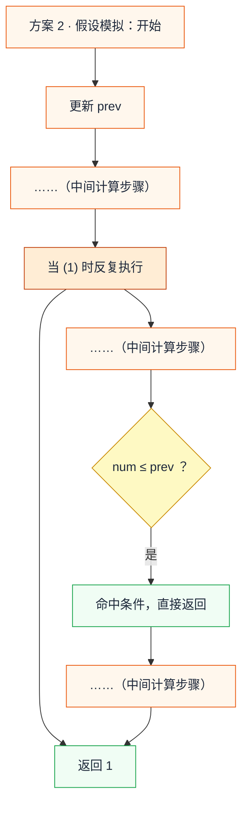

```c
/* LeetCode 2042. 检查句子中的数字是否递增 — C 版（方案2） */
#include <ctype.h>                                    // 引入头文件
#include <stdio.h>                                    // 引入头文件
#include <stdlib.h>                                   // 引入头文件
#include <string.h>                                   // 引入头文件
static int are_numbers_ascending(const char *s) {     // 定义函数/方法 are_numbers_ascending
    long prev = -1;                                   // 把 减 1; 写入 long prev
    char tok[256];                                    // char tok[256];
    int ti = 0;                                       // 把 0 存入 ti
    const char *p = s;                                // 把 字符串; 写入 const char *p
    while (1) {                                       // 循环，直到不满足「1」
        if (*p == ' ' || *p == '\0') {                // 若 乘 节点 等于 ' ' 或 乘 节点 等于 '\0'
            if (ti > 0) {                             // 若 ti 超过 0
                tok[ti] = '\0';                       // 把 '\0'; 写入 tok[ti]
                if (isdigit((unsigned char)tok[0])) { // 若 isdigit((unsigned char)tok[0]
                    long num = atol(tok);             // 把 atol(tok); 写入 long num
                    if (num <= prev)
                        return 0; // 若 num 不超过 前一个，直接返回 0
                    prev = num;   // 把 num; 写入 前一个
                }
                ti = 0; // 把 0; 写入 ti
            }
            if (*p == '\0')
                break;         // 若 乘 节点 等于 '\0') break;
        } else if (ti < 255) { // 否则，若 ti 小于 255
            tok[ti++] = *p;    // 把 乘 节点; 写入 tok[ti++]
        }
        p++; // 节点 加一
    }
    return 1; // 返回 1
}
int main(void) { // 程序入口：跑内嵌自测用例
    if (!are_numbers_ascending("1 box has 3 blue 4 red 6 green and 12 yellow marbles")) {
        printf("FAIL 1\n");
        return 1;
    }
    if (are_numbers_ascending("hello world 5 x 5")) {
        printf("FAIL 2\n");
        return 1;
    }
    printf("PASS\n"); // 全部用例通过，输出 PASS
    return 0;         // 返回 0
}
```

### C++ 实现（2 种方案）

C++ 的全部方案如下，每个方案都内嵌用例自测，可独立运行（老仓库 python/go 文件遵循「打印结果」约定）：

#### 方案 1：直接遍历

**思路与代码分析**：核心是「直接遍历」。C++ 版用 STL 容器与迭代器，减少手写下标错误。**走读**：方案 1 · 直接遍历：开始 → 更新 prev → 处理 std::istringstream iss(s) → 处理 std::string tok → 当 (iss ＞＞ tok) 时反复执行 → 处理 if (std::isdigit(static_cast → 处理 tok[0]))) → 更新 num → 命中条件，直接返回 → 更新 prev → 返回 true。

**运行架构**（真实控制流）：

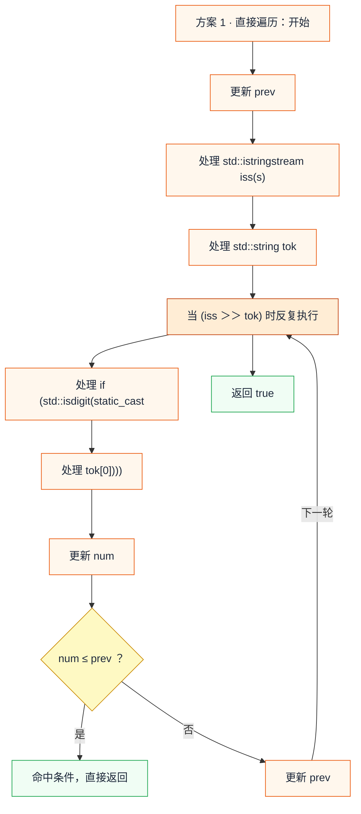

```cpp
// LeetCode 2042. 检查句子中的数字是否递增 — C++ 版（方案1）
#include <cassert>                                      // 引入头文件
#include <cctype>                                       // 引入头文件
#include <iostream>                                     // 引入头文件
#include <sstream>                                      // 引入头文件
#include <string>                                       // 引入头文件
static bool areNumbersAscending(const std::string &s) { // 定义函数/方法 areNumbersAscending
    long long prev = -1;                                // 把 减 1 存入 前一个
    std::istringstream iss(s);                          // std::istringstream iss(字符串);
    std::string tok;                                    // std::string tok;
    while (iss >> tok) {                                // 循环，直到不满足「iss 超过 超过 tok」
        if (std::isdigit(static_cast<unsigned char>(
                tok[0]))) { // 若 std::isdigit(static_cast 小于 unsigned char 超过 (tok[0]
            long long num = std::stoll(tok); // 把 std::stoll(tok) 存入 num
            if (num <= prev)
                return false; // 若 num 不超过 前一个，直接返回 false
            prev = num;       // 把 num; 写入 前一个
        }
    }
    return true; // 返回 true
}
int main() { // 程序入口：跑内嵌自测用例
    assert(areNumbersAscending("1 box has 3 blue 4 red 6 green and 12 yellow marbles")); // 断言校验
    assert(!areNumbersAscending("hello world 5 x 5"));                                   // 断言校验
    std::cout << "PASS" << std::endl; // 全部用例通过，输出 PASS
    return 0;                         // 返回 0
}
```

#### 方案 2：假设模拟

**思路与代码分析**：核心是「假设模拟」。C++ 版用 STL 容器与迭代器，减少手写下标错误。**走读**：方案 2 · 假设模拟：开始 → 更新 prev → 处理 std::istringstream iss(s) → 处理 std::string tok → 当 (iss ＞＞ tok) 时反复执行 → 处理 if (std::isdigit(static_cast → 处理 tok[0]))) → 更新 num → 命中条件，直接返回 → 更新 prev → 返回 true。

**运行架构**（真实控制流）：


```cpp
// LeetCode 2042. 检查句子中的数字是否递增 — C++ 版（方案2）
#include <cassert>                                      // 引入头文件
#include <cctype>                                       // 引入头文件
#include <iostream>                                     // 引入头文件
#include <sstream>                                      // 引入头文件
#include <string>                                       // 引入头文件
static bool areNumbersAscending(const std::string &s) { // 定义函数/方法 areNumbersAscending
    long long prev = -1;                                // 把 减 1 存入 前一个
    std::istringstream iss(s);                          // std::istringstream iss(字符串);
    std::string tok;                                    // std::string tok;
    while (iss >> tok) {                                // 循环，直到不满足「iss 超过 超过 tok」
        if (std::isdigit(static_cast<unsigned char>(
                tok[0]))) { // 若 std::isdigit(static_cast 小于 unsigned char 超过 (tok[0]
            long long num = std::stoll(tok); // 把 std::stoll(tok) 存入 num
            if (num <= prev)
                return false; // 若 num 不超过 前一个，直接返回 false
            prev = num;       // 把 num; 写入 前一个
        }
    }
    return true; // 返回 true
}
int main() { // 程序入口：跑内嵌自测用例
    assert(areNumbersAscending("1 box has 3 blue 4 red 6 green and 12 yellow marbles")); // 断言校验
    assert(!areNumbersAscending("hello world 5 x 5"));                                   // 断言校验
    std::cout << "PASS" << std::endl; // 全部用例通过，输出 PASS
    return 0;                         // 返回 0
}
```

### R 实现（2 种方案）

R 的全部方案如下，每个方案都内嵌用例自测，可独立运行（老仓库 python/go 文件遵循「打印结果」约定）：

#### 方案 1：直接遍历

**思路与代码分析**：核心是「直接遍历」。R 版用向量化思维与 1 起始下标，注意 1:n 的降序陷阱。代码里依次做这些事：单循环线性扫描。**走读**：方案 1 · 直接遍历：开始 → 处理 prev ＜- -1 → 循环 tok：遍历 strsplit(trimws(s), ' ')[[1]] → 若 nchar(tok) ＞ 0 且 grepl(^[0-9], tok) 则： → 处理 num ＜- as.numeric(tok) → 命中条件，直接返回 → 处理 prev ＜- num → 处理 TRUE。

**运行架构**（真实控制流）：

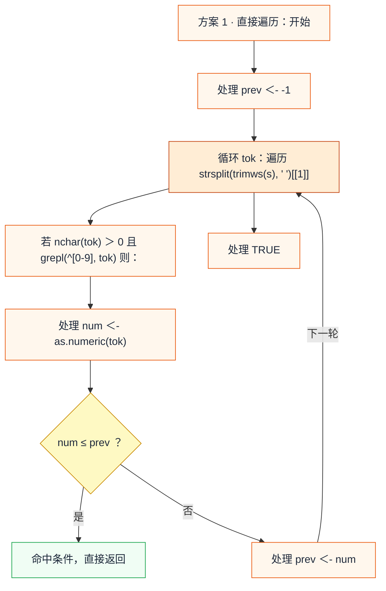

```r
# 检查句子中的数字是否递增 — R 版（方案1） 定义函数 are_numbers_ascending（参数：字符串）
are_numbers_ascending <- function(s) {
    prev <- -1  # 把 减 1 存入 前一个
    for (tok in strsplit(trimws(s), " ")[[1]]) {
        # for (tok in strsplit(trimws(字符串), 「 」)[[1]]) { 若 nchar(tok) 超过 0 且 grepl(「 按位异或 [0 减
        # 9]」, tok
        if (nchar(tok) > 0 && grepl("^[0-9]", tok)) {
            num <- as.numeric(tok)  # 把 as.numeric(tok) 存入 num
            if (num <= prev)
                return(FALSE)  # 若 num 不超过 前一个) return(FALSE
            prev <- num  # 把 num 存入 前一个
        }
    }
    TRUE  # TRUE
}
stopifnot(are_numbers_ascending("1 box has 3 blue 4 red 6 green and 12 yellow marbles"))  # 断言校验
stopifnot(!are_numbers_ascending("hello world 5 x 5"))  # 断言校验
cat("PASS\n")  # 全部用例通过，输出 PASS
```

#### 方案 2：假设模拟

**思路与代码分析**：核心是「假设模拟」。R 版用向量化思维与 1 起始下标，注意 1:n 的降序陷阱。代码里依次做这些事：单循环线性扫描。**走读**：方案 2 · 假设模拟：开始 → 处理 prev ＜- -1 → 循环 tok：遍历 strsplit(trimws(s), ' ')[[1]] → 若 nchar(tok) ＞ 0 且 grepl(^[0-9], tok) 则： → 处理 num ＜- as.numeric(tok) → 命中条件，直接返回 → 处理 prev ＜- num → 处理 TRUE。

**运行架构**（真实控制流）：


```r
# 检查句子中的数字是否递增 — R 版（方案2） 定义函数 are_numbers_ascending（参数：字符串）
are_numbers_ascending <- function(s) {
    prev <- -1  # 把 减 1 存入 前一个
    for (tok in strsplit(trimws(s), " ")[[1]]) {
        # for (tok in strsplit(trimws(字符串), 「 」)[[1]]) { 若 nchar(tok) 超过 0 且 grepl(「 按位异或 [0 减
        # 9]」, tok
        if (nchar(tok) > 0 && grepl("^[0-9]", tok)) {
            num <- as.numeric(tok)  # 把 as.numeric(tok) 存入 num
            if (num <= prev)
                return(FALSE)  # 若 num 不超过 前一个) return(FALSE
            prev <- num  # 把 num 存入 前一个
        }
    }
    TRUE  # TRUE
}
stopifnot(are_numbers_ascending("1 box has 3 blue 4 red 6 green and 12 yellow marbles"))  # 断言校验
stopifnot(!are_numbers_ascending("hello world 5 x 5"))  # 断言校验
cat("PASS\n")  # 全部用例通过，输出 PASS
```

### Zig 实现（2 种方案）

Zig 的全部方案如下，每个方案都内嵌用例自测，可独立运行（老仓库 python/go 文件遵循「打印结果」约定）：

#### 方案 1：直接遍历

**思路与代码分析**：核心是「直接遍历」。Zig 版显式分配与清零，整型边界处理严格。**走读**：方案 1 · 直接遍历：开始 → 计算 it → 计算 prev → 当 (it.next()) ｜tok｜ 时反复执行 → 若 tok.len ＞ 0 and std.ascii.isDigit(tok[0]) 则： → 计算 num → 命中条件，直接返回 → 更新 prev → 返回 true。

**运行架构**（真实控制流）：

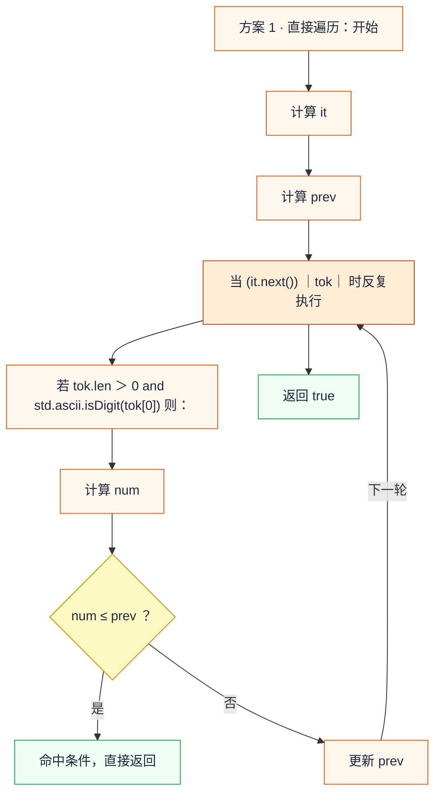

```zig
// LeetCode 2042. 检查句子中的数字是否递增 — Zig 版（方案1）
const std = @import("std"); // 把 @import(「std」) 存入 std
fn areNumbersAscending(s: []const u8) bool { // 定义函数/方法 areNumbersAscending
    var it = std.mem.tokenizeScalar(u8, s, ' '); // 把 std.mem.tokenizeScalar(u8, 字符串, ' ') 存入 it
    var prev: i64 = -1; // 把 减 1; 写入 var prev: i64
    while (it.next()) |tok| { // 循环，直到不满足「it.下一个()) 按位或 tok 按位或」
        if (tok.len > 0 and std.ascii.isDigit(tok[0])) { // 若 tok.长度 超过 0 and std.ascii.isDigit(tok[0]
            const num = std.fmt.parseInt(i64, tok, 10) catch 0; // 把 std.fmt.转整数(i64, tok, 10) catch 0 存入 num
            if (num <= prev) return false; // 若 num 不超过 前一个，直接返回 false
            prev = num; // 把 num; 写入 前一个
        }
    }
    return true; // 返回 true
}
pub fn main() !void { // 程序入口：跑内嵌自测用例
    if (!areNumbersAscending("1 box has 3 blue 4 red 6 green and 12 yellow marbles")) return error.TestFailed;
    if (areNumbersAscending("hello world 5 x 5")) return error.TestFailed;
    std.debug.print("PASS\n", .{}); // 全部用例通过，输出 PASS
}
```

#### 方案 2：假设模拟

**思路与代码分析**：核心是「假设模拟」。Zig 版显式分配与清零，整型边界处理严格。**走读**：方案 2 · 假设模拟：开始 → 计算 it → 计算 prev → 当 (it.next()) ｜tok｜ 时反复执行 → 若 tok.len ＞ 0 and std.ascii.isDigit(tok[0]) 则： → 计算 num → 命中条件，直接返回 → 更新 prev → 返回 true。

**运行架构**（真实控制流）：

```mermaid
graph TD
    N0["方案 2 · 假设模拟：开始"]
    N1["计算 it"]
    N2["计算 prev"]
    N3["当 (it.next()) ｜tok｜ 时反复执行"]
    N4["若 tok.len ＞ 0 and std.ascii.isDigit(tok[0]) 则："]
    N5["计算 num"]
    N6{"num ≤ prev ？"}
    N7["命中条件，直接返回"]
    N8["更新 prev"]
    N9["返回 true"]
    N0 --> N1
    N1 --> N2
    N2 --> N3
    N3 --> N4
    N4 --> N5
    N5 --> N6
    N6 -- 是 --> N7
    N6 -- 否 --> N8
    N8 -- 下一轮 --> N3
    N3 --> N9
    classDef n fill:#fff7ed,stroke:#ea580c,color:#1e293b;
    classDef lp fill:#ffedd5,stroke:#c2410c,color:#1e293b;
    classDef dc fill:#fef9c3,stroke:#ca8a04,color:#1e293b;
    classDef tm fill:#f0fdf4,stroke:#16a34a,color:#1e293b;
    class N0,N1,N2,N4,N5,N8 n;
    class N3 lp;
    class N6 dc;
    class N7,N9 tm;
```

```zig
// LeetCode 2042. 检查句子中的数字是否递增 — Zig 版（方案2）
const std = @import("std"); // 把 @import(「std」) 存入 std
fn areNumbersAscending(s: []const u8) bool { // 定义函数/方法 areNumbersAscending
    var it = std.mem.tokenizeScalar(u8, s, ' '); // 把 std.mem.tokenizeScalar(u8, 字符串, ' ') 存入 it
    var prev: i64 = -1; // 把 减 1; 写入 var prev: i64
    while (it.next()) |tok| { // 循环，直到不满足「it.下一个()) 按位或 tok 按位或」
        if (tok.len > 0 and std.ascii.isDigit(tok[0])) { // 若 tok.长度 超过 0 and std.ascii.isDigit(tok[0]
            const num = std.fmt.parseInt(i64, tok, 10) catch 0; // 把 std.fmt.转整数(i64, tok, 10) catch 0 存入 num
            if (num <= prev) return false; // 若 num 不超过 前一个，直接返回 false
            prev = num; // 把 num; 写入 前一个
        }
    }
    return true; // 返回 true
}
pub fn main() !void { // 程序入口：跑内嵌自测用例
    if (!areNumbersAscending("1 box has 3 blue 4 red 6 green and 12 yellow marbles")) return error.TestFailed;
    if (areNumbersAscending("hello world 5 x 5")) return error.TestFailed;
    std.debug.print("PASS\n", .{}); // 全部用例通过，输出 PASS
}
```

### Dart 实现（2 种方案）

Dart 的全部方案如下，每个方案都内嵌用例自测，可独立运行（老仓库 python/go 文件遵循「打印结果」约定）：

#### 方案 1：直接遍历

**思路与代码分析**：核心是「直接遍历」。Dart 版用可空类型标注与集合方法，注意空安全。代码里依次做这些事：单循环线性扫描。**走读**：方案 1 · 直接遍历：开始 → 计算 prev → 遍历循环 → 处理 if (tok.isNotEmpty 且 → 更新 > → 更新 < → 更新 num → 命中条件，直接返回 → 更新 prev → 返回 true。

**运行架构**（真实控制流）：

```mermaid
graph TD
    N0["方案 1 · 直接遍历：开始"]
    N1["计算 prev"]
    N2["遍历循环"]
    N3["处理 if (tok.isNotEmpty 且"]
    N4["更新 >"]
    N5["更新 <"]
    N6["更新 num"]
    N7{"num ≤ prev ？"}
    N8["命中条件，直接返回"]
    N9["更新 prev"]
    N10["返回 true"]
    N0 --> N1
    N1 --> N2
    N2 --> N3
    N3 --> N4
    N4 --> N5
    N5 --> N6
    N6 --> N7
    N7 -- 是 --> N8
    N7 -- 否 --> N9
    N9 -- 下一轮 --> N2
    N2 --> N10
    classDef n fill:#fff7ed,stroke:#ea580c,color:#1e293b;
    classDef lp fill:#ffedd5,stroke:#c2410c,color:#1e293b;
    classDef dc fill:#fef9c3,stroke:#ca8a04,color:#1e293b;
    classDef tm fill:#f0fdf4,stroke:#16a34a,color:#1e293b;
    class N0,N1,N3,N4,N5,N6,N9 n;
    class N2 lp;
    class N7 dc;
    class N8,N10 tm;
```

```dart
// LeetCode 2042. 检查句子中的数字是否递增 — Dart 版（方案1）
bool areNumbersAscending(String s) {
  // 定义函数/方法 areNumbersAscending
  var prev = -1; // 把 减 1 存入 前一个
  for (final tok in s.split(' ')) {
    // for (final tok in 字符串.split(' ')) {
    if (tok.isNotEmpty &&
        tok[0].codeUnitAt(0) >= 0x30 &&
        tok[0].codeUnitAt(0) <= 0x39) {
      final num = int.parse(tok); // 把 int.parse(tok) 存入 num
      if (num <= prev) return false; // 若 num 不超过 前一个，直接返回 false
      prev = num; // 把 num 存入 前一个
    }
  }
  return true; // 返回 true
}

void main() {
  // 程序入口：跑内嵌自测用例
  if (!areNumbersAscending(
    '1 box has 3 blue 4 red 6 green and 12 yellow marbles',
  ))
    throw StateError('c1');
  if (areNumbersAscending('hello world 5 x 5')) throw StateError('c2');
  print('PASS'); // 全部用例通过，输出 PASS
}
```

#### 方案 2：假设模拟

**思路与代码分析**：核心是「假设模拟」。Dart 版用可空类型标注与集合方法，注意空安全。代码里依次做这些事：单循环线性扫描。**走读**：方案 2 · 假设模拟：开始 → 计算 prev → 遍历循环 → 处理 if (tok.isNotEmpty 且 → 更新 > → 更新 < → 更新 num → 命中条件，直接返回 → 更新 prev → 返回 true。

**运行架构**（真实控制流）：

```mermaid
graph TD
    N0["方案 2 · 假设模拟：开始"]
    N1["计算 prev"]
    N2["遍历循环"]
    N3["处理 if (tok.isNotEmpty 且"]
    N4["更新 >"]
    N5["更新 <"]
    N6["更新 num"]
    N7{"num ≤ prev ？"}
    N8["命中条件，直接返回"]
    N9["更新 prev"]
    N10["返回 true"]
    N0 --> N1
    N1 --> N2
    N2 --> N3
    N3 --> N4
    N4 --> N5
    N5 --> N6
    N6 --> N7
    N7 -- 是 --> N8
    N7 -- 否 --> N9
    N9 -- 下一轮 --> N2
    N2 --> N10
    classDef n fill:#fff7ed,stroke:#ea580c,color:#1e293b;
    classDef lp fill:#ffedd5,stroke:#c2410c,color:#1e293b;
    classDef dc fill:#fef9c3,stroke:#ca8a04,color:#1e293b;
    classDef tm fill:#f0fdf4,stroke:#16a34a,color:#1e293b;
    class N0,N1,N3,N4,N5,N6,N9 n;
    class N2 lp;
    class N7 dc;
    class N8,N10 tm;
```

```dart
// LeetCode 2042. 检查句子中的数字是否递增 — Dart 版（方案2）
bool areNumbersAscending(String s) {
  // 定义函数/方法 areNumbersAscending
  var prev = -1; // 把 减 1 存入 前一个
  for (final tok in s.split(' ')) {
    // for (final tok in 字符串.split(' ')) {
    if (tok.isNotEmpty &&
        tok[0].codeUnitAt(0) >= 0x30 &&
        tok[0].codeUnitAt(0) <= 0x39) {
      final num = int.parse(tok); // 把 int.parse(tok) 存入 num
      if (num <= prev) return false; // 若 num 不超过 前一个，直接返回 false
      prev = num; // 把 num 存入 前一个
    }
  }
  return true; // 返回 true
}

void main() {
  // 程序入口：跑内嵌自测用例
  if (!areNumbersAscending(
    '1 box has 3 blue 4 red 6 green and 12 yellow marbles',
  ))
    throw StateError('c1');
  if (areNumbersAscending('hello world 5 x 5')) throw StateError('c2');
  print('PASS'); // 全部用例通过，输出 PASS
}
```

---

## 内容总结

- **检查句子中的数字是否递增**（字符串 · Medium）：共 2 个方案，主线思路「直接遍历」；时间 O(n) 量级；动画演示滑动窗口过程，附录给出 11 种语言 × 全部方案的可运行实现。
- 来源博客：[https://blog.csdn.net/tyro_java/article/details/145374488](https://blog.csdn.net/tyro_java/article/details/145374488)
- 导航：[📋 总目录](../) ｜ [← 071 比较版本号](../071_比较版本号/) ｜ [073 有效的括号 →](../073_有效的括号/)
