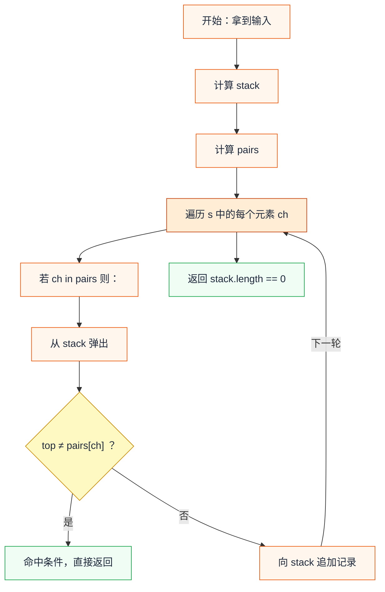
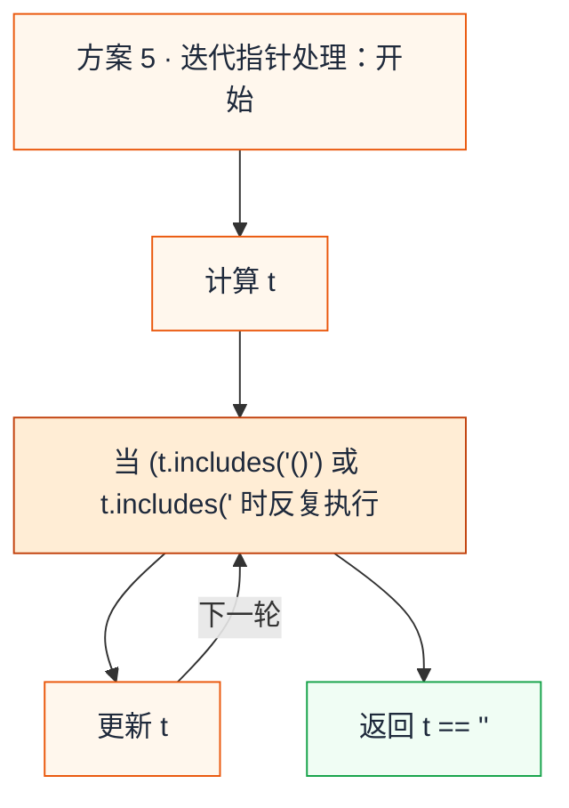
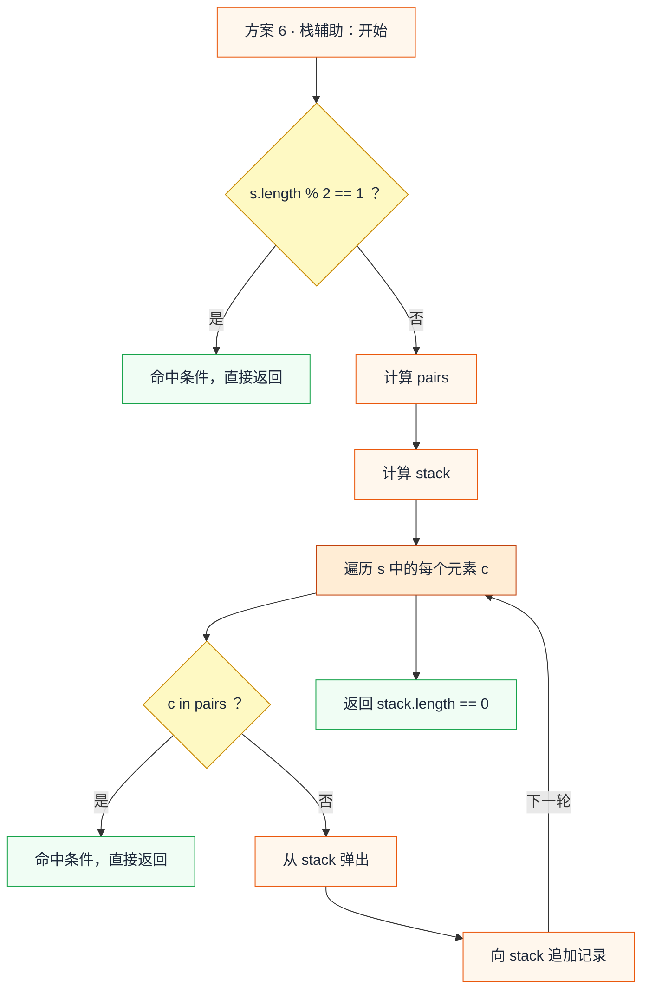
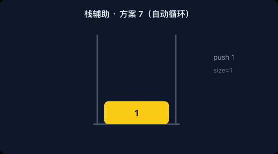
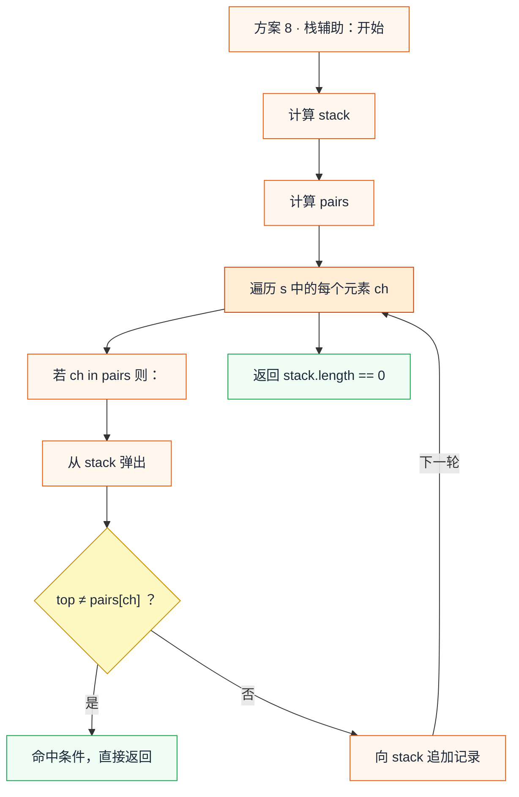
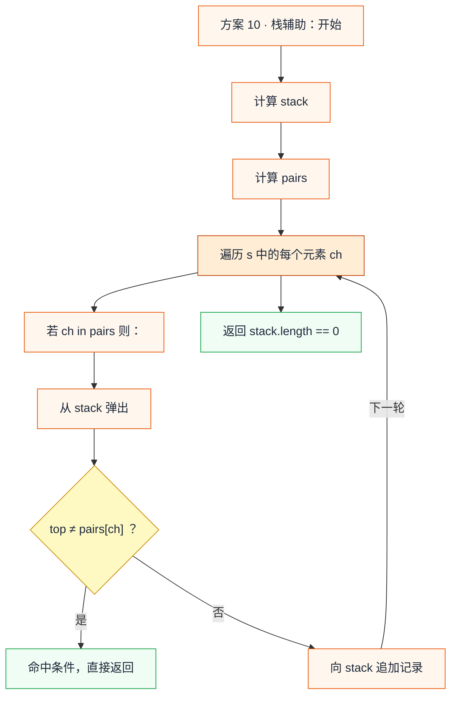
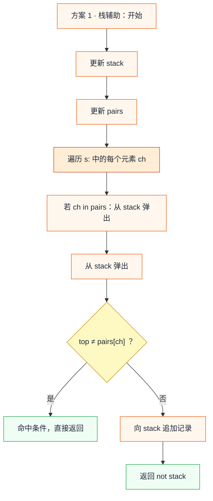
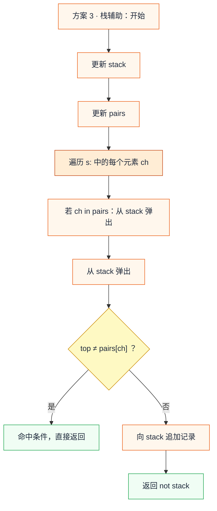
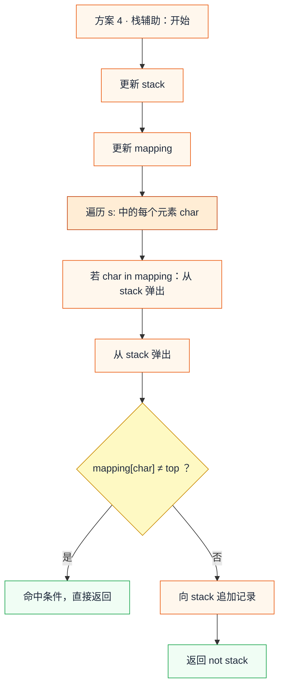

# 073 · 有效的括号（第三阶段 · 字符串 · Medium）

> **难度**：⭐⭐ Medium ｜ **专题**：字符串
> **学习定位**：第三阶段 · 字符串第 73 篇 ｜ **解法数**：15
> **内容总结**：**有效的括号**（字符串 · Medium）：共 15 个方案，主线思路「栈辅助」；时间 O(n)（单趟线性扫描）；动画演示滑动窗口过程，附录给出 11 种语言 × 全部方案的可运行实现。

---

## 题目描述

给定一个只包括 `'('`，`')'`，`'{'`，`'}'`，`'['`，`']'` 的字符串 `s` ，判断字符串是否有效。

有效字符串需满足：

 左括号必须用相同类型的右括号闭合。
 左括号必须以正确的顺序闭合。
 每个右括号都有一个对应的相同类型的左括号。

- 主函数签名：`function isValid(s: string): boolean`

**用例（来自原题）**：

**示例 1**

**示例 2**

**示例 3**

**示例 4**
> 题面与 [leetcode.cn 官方](https://leetcode.cn/problems/valid-parentheses/)一致，示例配图取自官方题面。

**数据范围与注意事项**：

- `1 <= s.length <= 10^4`
- `s` 仅由括号 `'()[]{}'` 组成
- **易错点**：空串、全空白、单字符三类边界，以及大小写是否敏感。

## 题目分析

**场景是什么**：字符串是字符数组，这类题练的是扫描、切分与匹配，对应真实开发里的文本清洗、协议解析。本题就是该场景的 Medium 级练习，主线做法是「栈辅助」。

**主线怎么解**：把主解法从头到尾过一遍，它其实在依次做这几件事：单循环线性扫描 → 栈的后进先出操作。

## 解题思路

**方案对比**（共 15 个方案，由浅入深）：

| 方案 | 时间复杂度 | 空间复杂度 |
|---|---|---|
| 方案 1 · 栈辅助 | O(n)（单趟线性扫描） | O(1) 到 O(n)（视辅助结构） |
| 方案 2 · 栈辅助 | O(n)（单趟线性扫描） | O(1) 到 O(n)（视辅助结构） |
| 方案 3 · 栈辅助 | O(n)（单趟线性扫描） | O(1) 到 O(n)（视辅助结构） |
| 方案 4 · 栈辅助 | O(n)（单趟线性扫描） | O(1) 到 O(n)（视辅助结构） |
| 方案 5 · 迭代指针处理 | O(n)（单趟线性扫描） | O(1) 到 O(n)（视辅助结构） |
| 方案 6 · 栈辅助 | O(n)（单趟线性扫描） | O(1) 到 O(n)（视辅助结构） |
| 方案 7 · 栈辅助 | O(n)（单趟线性扫描） | O(1) 到 O(n)（视辅助结构） |
| 方案 8 · 栈辅助 | O(n)（单趟线性扫描） | O(1) 到 O(n)（视辅助结构） |
| 方案 9 · 栈辅助 | O(n)（单趟线性扫描） | O(1) 到 O(n)（视辅助结构） |
| 方案 10 · 栈辅助 | O(n)（单趟线性扫描） | O(1) 到 O(n)（视辅助结构） |
| 方案 11 · 栈辅助 | O(n)（单趟线性扫描） | O(1) 到 O(n)（视辅助结构） |
| 方案 12 · 栈辅助 | O(n)（单趟线性扫描） | O(1) 到 O(n)（视辅助结构） |
| 方案 13 · 栈辅助 | O(n)（单趟线性扫描） | O(1) 到 O(n)（视辅助结构） |
| 方案 14 · 栈辅助 | O(n)（单趟线性扫描） | O(1) 到 O(n)（视辅助结构） |
| 方案 15 · 栈辅助 | O(n)（单趟线性扫描） | O(1) 到 O(n)（视辅助结构） |

**由浅入深的路径**：栈辅助 → 迭代指针处理；每往右一步，都在补上一步的短板。

**方案间的取舍**：方案 1（栈辅助）；方案 2（栈辅助）；方案 3（栈辅助）；方案 4（栈辅助）；方案 5（迭代指针处理）；方案 6（栈辅助）；方案 7（栈辅助）；方案 8（栈辅助）；方案 9（栈辅助）；方案 10（栈辅助）；方案 11（栈辅助）；方案 12（栈辅助）；方案 13（栈辅助）；方案 14（栈辅助）；方案 15（栈辅助）。数据规模小、可读性优先时选靠前的方案；规模大、性能优先时选靠后的方案。

**怎么读这一篇**：

- 🐣 **新手路线**：把「题目描述」的示例 1 在纸上手推一遍 → 读方案 1（最直观的写法）与它的代码走读 → 按「运行方式」本地跑通看 PASS → 回头对比方案 2 之后的写法差在哪
- 🦅 **大佬路线**：直接锁定最优方案 1（栈辅助，O(n)（单趟线性扫描））→ 跳读该方案代码与走读 → 用「逐步拆解与面试追问」补齐复杂度推导与边界追问

### 动态算法图（滑动窗口，GIF 自动循环）


动画演示字符串专题里滑动窗口的典型过程；每个方案在「TypeScript 解题方案」一节还配了专属动画与专属流程图。

### 主解法流程图（真实控制流）



## TypeScript 解题方案（15 个方案逐个讲）

> **运行与提交**：每个方案都是自包含文件（内嵌用例自测，输出 PASS），整块复制到 `.ts` 文件后 `node 文件名` 即可运行。提交 LeetCode 时，把 `demo` 内的算法函数与辅助类型/函数整体取出、置于文件顶层即可。涉及交互/特殊接口的题以题面给定签名为准。

### 方案 1：栈辅助

**分析与思路**：核心做法是「栈辅助」。代码里依次做这些事：单循环线性扫描；栈的后进先出操作。

**运行方式**：`node 本文件`，内嵌用例全部通过会输出 PASS。


**方案专属流程图**（真实控制流）：


```typescript
// Faithful translation of python reference. Self-check via demo().
function isValid(s: string): boolean {
  // 定义判定函数 isValid
  const stack: string[] = []; // 把 []; 写入 const stack: string[]
  const pairs: { [k: string]: string } = { ')': '(', ']': '[', '}': '{' };
  for (const ch of s) {
    // for (const 字符 of 字符串) {
    if (ch in pairs) {
      // 若 字符 in pairs
      const top = stack.length ? stack.pop()! : '#'; // 把 栈.长度 ? 栈 弹出 )取反 : '#' 存入 top
      if (top !== pairs[ch]) return false; // 若 top 不等于 pairs[字符]，直接返回 false
    } else {
      // 否则
      stack.push(ch); // 把 字符 压入栈/数组尾部
    }
  }
  return stack.length === 0; // 返回 栈.长度 全等于 0
}
export function demo(): void {
  // 程序入口：跑内嵌自测用例
  const tests = ['(', '()', '()[]{}', '(]', '([)]', 'abc']; // 把 ['(', '()', '()[]{}', '(]', '([)]', 'abc'] 存入 tests
  const want = [false, true, true, false, false, false]; // 把 [false, true, true, false, false, false] 存入 want
  for (let i = 0; i < tests.length; i++) {
    // 让 下标 i 从 0 开始计数，下标 i 小于 tests.长度 就继续
    const got = isValid(tests[i]); // 把 isValid(tests[下标 i]) 存入 got
    if (got !== want[i])
      throw new Error('FAIL test ' + i + ' got ' + got + ' want ' + want[i]);
  }
  console.log('PASS'); // 全部用例通过，输出 PASS
}
demo(); // demo();
```

### 方案 2：栈辅助

**分析与思路**：核心做法是「栈辅助」。代码里依次做这些事：单循环线性扫描；栈的后进先出操作。

**运行方式**：`node 本文件`，内嵌用例全部通过会输出 PASS。


**方案专属流程图**（真实控制流）：


```typescript
// Faithful translation of python reference. Self-check via demo().
function isValid(s: string): boolean {
  // 定义判定函数 isValid
  const stack: string[] = []; // 把 []; 写入 const stack: string[]
  const pairs: { [k: string]: string } = { ')': '(', ']': '[', '}': '{' };
  for (const ch of s) {
    // for (const 字符 of 字符串) {
    if (ch in pairs) {
      // 若 字符 in pairs
      const top = stack.length ? stack.pop()! : '#'; // 把 栈.长度 ? 栈 弹出 )取反 : '#' 存入 top
      if (top !== pairs[ch]) return false; // 若 top 不等于 pairs[字符]，直接返回 false
    } else {
      // 否则
      stack.push(ch); // 把 字符 压入栈/数组尾部
    }
  }
  return stack.length === 0; // 返回 栈.长度 全等于 0
}
export function demo(): void {
  // 程序入口：跑内嵌自测用例
  const tests = ['(', '()', '()[]{}', '(]', '([)]', 'abc']; // 把 ['(', '()', '()[]{}', '(]', '([)]', 'abc'] 存入 tests
  const want = [false, true, true, false, false, false]; // 把 [false, true, true, false, false, false] 存入 want
  for (let i = 0; i < tests.length; i++) {
    // 让 下标 i 从 0 开始计数，下标 i 小于 tests.长度 就继续
    const got = isValid(tests[i]); // 把 isValid(tests[下标 i]) 存入 got
    if (got !== want[i])
      throw new Error('FAIL test ' + i + ' got ' + got + ' want ' + want[i]);
  }
  console.log('PASS'); // 全部用例通过，输出 PASS
}
demo(); // demo();
```

### 方案 3：栈辅助

**分析与思路**：核心做法是「栈辅助」。代码里依次做这些事：单循环线性扫描；栈的后进先出操作。

**运行方式**：`node 本文件`，内嵌用例全部通过会输出 PASS。


**方案专属流程图**（真实控制流）：


```typescript
// Faithful translation of python reference. Self-check via demo().
function isValid(s: string): boolean {
  // 定义判定函数 isValid
  const stack: string[] = []; // 把 []; 写入 const stack: string[]
  const pairs: { [k: string]: string } = { ')': '(', ']': '[', '}': '{' };
  for (const ch of s) {
    // for (const 字符 of 字符串) {
    if (ch in pairs) {
      // 若 字符 in pairs
      const top = stack.length ? stack.pop()! : '#'; // 把 栈.长度 ? 栈 弹出 )取反 : '#' 存入 top
      if (top !== pairs[ch]) return false; // 若 top 不等于 pairs[字符]，直接返回 false
    } else {
      // 否则
      stack.push(ch); // 把 字符 压入栈/数组尾部
    }
  }
  return stack.length === 0; // 返回 栈.长度 全等于 0
}
export function demo(): void {
  // 程序入口：跑内嵌自测用例
  const tests = ['(', '()', '()[]{}', '(]', '([)]', 'abc']; // 把 ['(', '()', '()[]{}', '(]', '([)]', 'abc'] 存入 tests
  const want = [false, true, true, false, false, false]; // 把 [false, true, true, false, false, false] 存入 want
  for (let i = 0; i < tests.length; i++) {
    // 让 下标 i 从 0 开始计数，下标 i 小于 tests.长度 就继续
    const got = isValid(tests[i]); // 把 isValid(tests[下标 i]) 存入 got
    if (got !== want[i])
      throw new Error('FAIL test ' + i + ' got ' + got + ' want ' + want[i]);
  }
  console.log('PASS'); // 全部用例通过，输出 PASS
}
demo(); // demo();
```

### 方案 4：栈辅助

**分析与思路**：核心做法是「栈辅助」。代码里依次做这些事：单循环线性扫描；栈的后进先出操作。

**运行方式**：`node 本文件`，内嵌用例全部通过会输出 PASS。


**方案专属流程图**（真实控制流）：


```typescript
// Faithful translation of python reference. Self-check via demo().
function isValid(s: string): boolean {
  // 定义判定函数 isValid
  const stack: string[] = []; // 把 []; 写入 const stack: string[]
  const pairs: { [k: string]: string } = { ')': '(', ']': '[', '}': '{' };
  for (const ch of s) {
    // for (const 字符 of 字符串) {
    if (ch in pairs) {
      // 若 字符 in pairs
      const top = stack.length ? stack.pop()! : '#'; // 把 栈.长度 ? 栈 弹出 )取反 : '#' 存入 top
      if (top !== pairs[ch]) return false; // 若 top 不等于 pairs[字符]，直接返回 false
    } else {
      // 否则
      stack.push(ch); // 把 字符 压入栈/数组尾部
    }
  }
  return stack.length === 0; // 返回 栈.长度 全等于 0
}
export function demo(): void {
  // 程序入口：跑内嵌自测用例
  const tests = ['(', '()', '()[]{}', '(]', '([)]', 'abc']; // 把 ['(', '()', '()[]{}', '(]', '([)]', 'abc'] 存入 tests
  const want = [false, true, true, false, false, false]; // 把 [false, true, true, false, false, false] 存入 want
  for (let i = 0; i < tests.length; i++) {
    // 让 下标 i 从 0 开始计数，下标 i 小于 tests.长度 就继续
    const got = isValid(tests[i]); // 把 isValid(tests[下标 i]) 存入 got
    if (got !== want[i])
      throw new Error('FAIL test ' + i + ' got ' + got + ' want ' + want[i]);
  }
  console.log('PASS'); // 全部用例通过，输出 PASS
}
demo(); // demo();
```

### 方案 5：迭代指针处理

**分析与思路**：核心做法是「迭代指针处理」。

**运行方式**：`node 本文件`，内嵌用例全部通过会输出 PASS。


**方案专属流程图**（真实控制流）：



```typescript
// Faithful translation of python reference. Self-check via demo().
function isValid2(s: string): boolean {
  // 定义判定函数 isValid2
  let t = s; // 把 字符串 存入 另一字符串
  while (t.includes('()') || t.includes('{}') || t.includes('[]')) {
    t = t.replace('()', '').replace('{}', '').replace('[]', '');
  }
  return t === ''; // 返回 另一字符串 全等于 ''
}
export function demo(): void {
  // 程序入口：跑内嵌自测用例
  const tests = ['(', '()', '()[]{}', '(]', '([)]', 'abc']; // 把 ['(', '()', '()[]{}', '(]', '([)]', 'abc'] 存入 tests
  const want = [false, true, true, false, false, false]; // 把 [false, true, true, false, false, false] 存入 want
  for (let i = 0; i < tests.length; i++) {
    // 让 下标 i 从 0 开始计数，下标 i 小于 tests.长度 就继续
    const got = isValid2(tests[i]); // 把 isValid2(tests[下标 i]) 存入 got
    if (got !== want[i])
      throw new Error('FAIL test ' + i + ' got ' + got + ' want ' + want[i]);
  }
  console.log('PASS'); // 全部用例通过，输出 PASS
}
demo(); // demo();
```

### 方案 6：栈辅助

**分析与思路**：核心做法是「栈辅助」。代码里依次做这些事：单循环线性扫描；栈的后进先出操作。

**运行方式**：`node 本文件`，内嵌用例全部通过会输出 PASS。


**方案专属流程图**（真实控制流）：



```typescript
// Faithful translation of python reference. Self-check via demo().
function isValid3(s: string): boolean {
  // 定义判定函数 isValid3
  if (s.length % 2 === 1) return false; // 若 字符串.长度 对…取模 2 全等于 1，直接返回 false
  const pairs: { [k: string]: string } = { ')': '(', '}': '{', ']': '[' };
  const stack: string[] = []; // 把 []; 写入 const stack: string[]
  for (const c of s) {
    // for (const 字符 of 字符串) {
    if (c in pairs) {
      // 若 字符 in pairs
      if (!stack.length || stack[stack.length - 1] !== pairs[c]) return false; // 若 取反 栈.长度 或 栈[栈.长度 减 1] 不等于 pairs[字符]，直接返回 false
      stack.pop(); // 弹出栈顶元素
    } else {
      // 否则
      stack.push(c); // 把 字符 压入栈/数组尾部
    }
  }
  return stack.length === 0; // 返回 栈.长度 全等于 0
}
export function demo(): void {
  // 程序入口：跑内嵌自测用例
  const tests = ['(', '()', '()[]{}', '(]', '([)]', 'abc']; // 把 ['(', '()', '()[]{}', '(]', '([)]', 'abc'] 存入 tests
  const want = [false, true, true, false, false, false]; // 把 [false, true, true, false, false, false] 存入 want
  for (let i = 0; i < tests.length; i++) {
    // 让 下标 i 从 0 开始计数，下标 i 小于 tests.长度 就继续
    const got = isValid3(tests[i]); // 把 isValid3(tests[下标 i]) 存入 got
    if (got !== want[i])
      throw new Error('FAIL test ' + i + ' got ' + got + ' want ' + want[i]);
  }
  console.log('PASS'); // 全部用例通过，输出 PASS
}
demo(); // demo();
```

### 方案 7：栈辅助

**分析与思路**：核心做法是「栈辅助」。代码里依次做这些事：单循环线性扫描；栈的后进先出操作。

**运行方式**：`node 本文件`，内嵌用例全部通过会输出 PASS。



**方案专属流程图**（真实控制流）：


```typescript
// Faithful translation of python reference. Self-check via demo().
function isValid(s: string): boolean {
  // 定义判定函数 isValid
  const stack: string[] = []; // 把 []; 写入 const stack: string[]
  const pairs: { [k: string]: string } = { ')': '(', ']': '[', '}': '{' };
  for (const ch of s) {
    // for (const 字符 of 字符串) {
    if (ch in pairs) {
      // 若 字符 in pairs
      const top = stack.length ? stack.pop()! : '#'; // 把 栈.长度 ? 栈 弹出 )取反 : '#' 存入 top
      if (top !== pairs[ch]) return false; // 若 top 不等于 pairs[字符]，直接返回 false
    } else {
      // 否则
      stack.push(ch); // 把 字符 压入栈/数组尾部
    }
  }
  return stack.length === 0; // 返回 栈.长度 全等于 0
}
export function demo(): void {
  // 程序入口：跑内嵌自测用例
  const tests = ['(', '()', '()[]{}', '(]', '([)]', 'abc']; // 把 ['(', '()', '()[]{}', '(]', '([)]', 'abc'] 存入 tests
  const want = [false, true, true, false, false, false]; // 把 [false, true, true, false, false, false] 存入 want
  for (let i = 0; i < tests.length; i++) {
    // 让 下标 i 从 0 开始计数，下标 i 小于 tests.长度 就继续
    const got = isValid(tests[i]); // 把 isValid(tests[下标 i]) 存入 got
    if (got !== want[i])
      throw new Error('FAIL test ' + i + ' got ' + got + ' want ' + want[i]);
  }
  console.log('PASS'); // 全部用例通过，输出 PASS
}
demo(); // demo();
```

### 方案 8：栈辅助

**分析与思路**：核心做法是「栈辅助」。代码里依次做这些事：单循环线性扫描；栈的后进先出操作。

**运行方式**：`node 本文件`，内嵌用例全部通过会输出 PASS。


**方案专属流程图**（真实控制流）：



```typescript
// Faithful translation of python reference. Self-check via demo().
function isValid(s: string): boolean {
  // 定义判定函数 isValid
  const stack: string[] = []; // 把 []; 写入 const stack: string[]
  const pairs: { [k: string]: string } = { ')': '(', ']': '[', '}': '{' };
  for (const ch of s) {
    // for (const 字符 of 字符串) {
    if (ch in pairs) {
      // 若 字符 in pairs
      const top = stack.length ? stack.pop()! : '#'; // 把 栈.长度 ? 栈 弹出 )取反 : '#' 存入 top
      if (top !== pairs[ch]) return false; // 若 top 不等于 pairs[字符]，直接返回 false
    } else {
      // 否则
      stack.push(ch); // 把 字符 压入栈/数组尾部
    }
  }
  return stack.length === 0; // 返回 栈.长度 全等于 0
}
export function demo(): void {
  // 程序入口：跑内嵌自测用例
  const tests = ['(', '()', '()[]{}', '(]', '([)]', 'abc']; // 把 ['(', '()', '()[]{}', '(]', '([)]', 'abc'] 存入 tests
  const want = [false, true, true, false, false, false]; // 把 [false, true, true, false, false, false] 存入 want
  for (let i = 0; i < tests.length; i++) {
    // 让 下标 i 从 0 开始计数，下标 i 小于 tests.长度 就继续
    const got = isValid(tests[i]); // 把 isValid(tests[下标 i]) 存入 got
    if (got !== want[i])
      throw new Error('FAIL test ' + i + ' got ' + got + ' want ' + want[i]);
  }
  console.log('PASS'); // 全部用例通过，输出 PASS
}
demo(); // demo();
```

### 方案 9：栈辅助

**分析与思路**：核心做法是「栈辅助」。代码里依次做这些事：单循环线性扫描；栈的后进先出操作。

**运行方式**：`node 本文件`，内嵌用例全部通过会输出 PASS。


**方案专属流程图**（真实控制流）：


```typescript
// Faithful translation of python reference. Self-check via demo().
function isValid(s: string): boolean {
  // 定义判定函数 isValid
  const stack: string[] = []; // 把 []; 写入 const stack: string[]
  const pairs: { [k: string]: string } = { ')': '(', ']': '[', '}': '{' };
  for (const ch of s) {
    // for (const 字符 of 字符串) {
    if (ch in pairs) {
      // 若 字符 in pairs
      const top = stack.length ? stack.pop()! : '#'; // 把 栈.长度 ? 栈 弹出 )取反 : '#' 存入 top
      if (top !== pairs[ch]) return false; // 若 top 不等于 pairs[字符]，直接返回 false
    } else {
      // 否则
      stack.push(ch); // 把 字符 压入栈/数组尾部
    }
  }
  return stack.length === 0; // 返回 栈.长度 全等于 0
}
export function demo(): void {
  // 程序入口：跑内嵌自测用例
  const tests = ['(', '()', '()[]{}', '(]', '([)]', 'abc']; // 把 ['(', '()', '()[]{}', '(]', '([)]', 'abc'] 存入 tests
  const want = [false, true, true, false, false, false]; // 把 [false, true, true, false, false, false] 存入 want
  for (let i = 0; i < tests.length; i++) {
    // 让 下标 i 从 0 开始计数，下标 i 小于 tests.长度 就继续
    const got = isValid(tests[i]); // 把 isValid(tests[下标 i]) 存入 got
    if (got !== want[i])
      throw new Error('FAIL test ' + i + ' got ' + got + ' want ' + want[i]);
  }
  console.log('PASS'); // 全部用例通过，输出 PASS
}
demo(); // demo();
```

### 方案 10：栈辅助

**分析与思路**：核心做法是「栈辅助」。代码里依次做这些事：单循环线性扫描；栈的后进先出操作。

**运行方式**：`node 本文件`，内嵌用例全部通过会输出 PASS。


**方案专属流程图**（真实控制流）：



```typescript
// Faithful translation of python reference. Self-check via demo().
function isValid(s: string): boolean {
  // 定义判定函数 isValid
  const stack: string[] = []; // 把 []; 写入 const stack: string[]
  const pairs: { [k: string]: string } = { ')': '(', ']': '[', '}': '{' };
  for (const ch of s) {
    // for (const 字符 of 字符串) {
    if (ch in pairs) {
      // 若 字符 in pairs
      const top = stack.length ? stack.pop()! : '#'; // 把 栈.长度 ? 栈 弹出 )取反 : '#' 存入 top
      if (top !== pairs[ch]) return false; // 若 top 不等于 pairs[字符]，直接返回 false
    } else {
      // 否则
      stack.push(ch); // 把 字符 压入栈/数组尾部
    }
  }
  return stack.length === 0; // 返回 栈.长度 全等于 0
}
export function demo(): void {
  // 程序入口：跑内嵌自测用例
  const tests = ['(', '()', '()[]{}', '(]', '([)]', 'abc']; // 把 ['(', '()', '()[]{}', '(]', '([)]', 'abc'] 存入 tests
  const want = [false, true, true, false, false, false]; // 把 [false, true, true, false, false, false] 存入 want
  for (let i = 0; i < tests.length; i++) {
    // 让 下标 i 从 0 开始计数，下标 i 小于 tests.长度 就继续
    const got = isValid(tests[i]); // 把 isValid(tests[下标 i]) 存入 got
    if (got !== want[i])
      throw new Error('FAIL test ' + i + ' got ' + got + ' want ' + want[i]);
  }
  console.log('PASS'); // 全部用例通过，输出 PASS
}
demo(); // demo();
```

### 方案 11：栈辅助

**分析与思路**：核心做法是「栈辅助」。代码里依次做这些事：单循环线性扫描；栈的后进先出操作。

**运行方式**：`node 本文件`，内嵌用例全部通过会输出 PASS。


**方案专属流程图**（真实控制流）：


```typescript
// Faithful translation of python reference. Self-check via demo().
function isValid(s: string): boolean {
  // 定义判定函数 isValid
  const stack: string[] = []; // 把 []; 写入 const stack: string[]
  const pairs: { [k: string]: string } = { ')': '(', ']': '[', '}': '{' };
  for (const ch of s) {
    // for (const 字符 of 字符串) {
    if (ch in pairs) {
      // 若 字符 in pairs
      const top = stack.length ? stack.pop()! : '#'; // 把 栈.长度 ? 栈 弹出 )取反 : '#' 存入 top
      if (top !== pairs[ch]) return false; // 若 top 不等于 pairs[字符]，直接返回 false
    } else {
      // 否则
      stack.push(ch); // 把 字符 压入栈/数组尾部
    }
  }
  return stack.length === 0; // 返回 栈.长度 全等于 0
}
export function demo(): void {
  // 程序入口：跑内嵌自测用例
  const tests = ['(', '()', '()[]{}', '(]', '([)]', 'abc']; // 把 ['(', '()', '()[]{}', '(]', '([)]', 'abc'] 存入 tests
  const want = [false, true, true, false, false, false]; // 把 [false, true, true, false, false, false] 存入 want
  for (let i = 0; i < tests.length; i++) {
    // 让 下标 i 从 0 开始计数，下标 i 小于 tests.长度 就继续
    const got = isValid(tests[i]); // 把 isValid(tests[下标 i]) 存入 got
    if (got !== want[i])
      throw new Error('FAIL test ' + i + ' got ' + got + ' want ' + want[i]);
  }
  console.log('PASS'); // 全部用例通过，输出 PASS
}
demo(); // demo();
```

### 方案 12：栈辅助

**分析与思路**：核心做法是「栈辅助」。代码里依次做这些事：单循环线性扫描；栈的后进先出操作。

**运行方式**：`node 本文件`，内嵌用例全部通过会输出 PASS。


**方案专属流程图**（真实控制流）：


```typescript
// Faithful translation of python reference. Self-check via demo().
function isValid(s: string): boolean {
  // 定义判定函数 isValid
  const stack: string[] = []; // 把 []; 写入 const stack: string[]
  const pairs: { [k: string]: string } = { ')': '(', ']': '[', '}': '{' };
  for (const ch of s) {
    // for (const 字符 of 字符串) {
    if (ch in pairs) {
      // 若 字符 in pairs
      const top = stack.length ? stack.pop()! : '#'; // 把 栈.长度 ? 栈 弹出 )取反 : '#' 存入 top
      if (top !== pairs[ch]) return false; // 若 top 不等于 pairs[字符]，直接返回 false
    } else {
      // 否则
      stack.push(ch); // 把 字符 压入栈/数组尾部
    }
  }
  return stack.length === 0; // 返回 栈.长度 全等于 0
}
export function demo(): void {
  // 程序入口：跑内嵌自测用例
  const tests = ['(', '()', '()[]{}', '(]', '([)]', 'abc']; // 把 ['(', '()', '()[]{}', '(]', '([)]', 'abc'] 存入 tests
  const want = [false, true, true, false, false, false]; // 把 [false, true, true, false, false, false] 存入 want
  for (let i = 0; i < tests.length; i++) {
    // 让 下标 i 从 0 开始计数，下标 i 小于 tests.长度 就继续
    const got = isValid(tests[i]); // 把 isValid(tests[下标 i]) 存入 got
    if (got !== want[i])
      throw new Error('FAIL test ' + i + ' got ' + got + ' want ' + want[i]);
  }
  console.log('PASS'); // 全部用例通过，输出 PASS
}
demo(); // demo();
```

### 方案 13：栈辅助

**分析与思路**：核心做法是「栈辅助」。代码里依次做这些事：单循环线性扫描；栈的后进先出操作。

**运行方式**：`node 本文件`，内嵌用例全部通过会输出 PASS。


**方案专属流程图**（真实控制流）：


```typescript
// Faithful translation of python reference. Self-check via demo().
function isValid(s: string): boolean {
  // 定义判定函数 isValid
  const stack: string[] = []; // 把 []; 写入 const stack: string[]
  const pairs: { [k: string]: string } = { ')': '(', ']': '[', '}': '{' };
  for (const ch of s) {
    // for (const 字符 of 字符串) {
    if (ch in pairs) {
      // 若 字符 in pairs
      const top = stack.length ? stack.pop()! : '#'; // 把 栈.长度 ? 栈 弹出 )取反 : '#' 存入 top
      if (top !== pairs[ch]) return false; // 若 top 不等于 pairs[字符]，直接返回 false
    } else {
      // 否则
      stack.push(ch); // 把 字符 压入栈/数组尾部
    }
  }
  return stack.length === 0; // 返回 栈.长度 全等于 0
}
export function demo(): void {
  // 程序入口：跑内嵌自测用例
  const tests = ['(', '()', '()[]{}', '(]', '([)]', 'abc']; // 把 ['(', '()', '()[]{}', '(]', '([)]', 'abc'] 存入 tests
  const want = [false, true, true, false, false, false]; // 把 [false, true, true, false, false, false] 存入 want
  for (let i = 0; i < tests.length; i++) {
    // 让 下标 i 从 0 开始计数，下标 i 小于 tests.长度 就继续
    const got = isValid(tests[i]); // 把 isValid(tests[下标 i]) 存入 got
    if (got !== want[i])
      throw new Error('FAIL test ' + i + ' got ' + got + ' want ' + want[i]);
  }
  console.log('PASS'); // 全部用例通过，输出 PASS
}
demo(); // demo();
```

### 方案 14：栈辅助

**分析与思路**：核心做法是「栈辅助」。代码里依次做这些事：单循环线性扫描；栈的后进先出操作。

**运行方式**：`node 本文件`，内嵌用例全部通过会输出 PASS。


**方案专属流程图**（真实控制流）：


```typescript
// Faithful translation of python reference. Self-check via demo().
function isValid(s: string): boolean {
  // 定义判定函数 isValid
  const stack: string[] = []; // 把 []; 写入 const stack: string[]
  const pairs: { [k: string]: string } = { ')': '(', ']': '[', '}': '{' };
  for (const ch of s) {
    // for (const 字符 of 字符串) {
    if (ch in pairs) {
      // 若 字符 in pairs
      const top = stack.length ? stack.pop()! : '#'; // 把 栈.长度 ? 栈 弹出 )取反 : '#' 存入 top
      if (top !== pairs[ch]) return false; // 若 top 不等于 pairs[字符]，直接返回 false
    } else {
      // 否则
      stack.push(ch); // 把 字符 压入栈/数组尾部
    }
  }
  return stack.length === 0; // 返回 栈.长度 全等于 0
}
export function demo(): void {
  // 程序入口：跑内嵌自测用例
  const tests = ['(', '()', '()[]{}', '(]', '([)]', 'abc']; // 把 ['(', '()', '()[]{}', '(]', '([)]', 'abc'] 存入 tests
  const want = [false, true, true, false, false, false]; // 把 [false, true, true, false, false, false] 存入 want
  for (let i = 0; i < tests.length; i++) {
    // 让 下标 i 从 0 开始计数，下标 i 小于 tests.长度 就继续
    const got = isValid(tests[i]); // 把 isValid(tests[下标 i]) 存入 got
    if (got !== want[i])
      throw new Error('FAIL test ' + i + ' got ' + got + ' want ' + want[i]);
  }
  console.log('PASS'); // 全部用例通过，输出 PASS
}
demo(); // demo();
```

### 方案 15：栈辅助

**分析与思路**：核心做法是「栈辅助」。代码里依次做这些事：单循环线性扫描；栈的后进先出操作。

**运行方式**：`node 本文件`，内嵌用例全部通过会输出 PASS。


**方案专属流程图**（真实控制流）：


```typescript
// Faithful translation of python reference. Self-check via demo().
function isValid(s: string): boolean {
  // 定义判定函数 isValid
  const stack: string[] = []; // 把 []; 写入 const stack: string[]
  const pairs: { [k: string]: string } = { ')': '(', ']': '[', '}': '{' };
  for (const ch of s) {
    // for (const 字符 of 字符串) {
    if (ch in pairs) {
      // 若 字符 in pairs
      const top = stack.length ? stack.pop()! : '#'; // 把 栈.长度 ? 栈 弹出 )取反 : '#' 存入 top
      if (top !== pairs[ch]) return false; // 若 top 不等于 pairs[字符]，直接返回 false
    } else {
      // 否则
      stack.push(ch); // 把 字符 压入栈/数组尾部
    }
  }
  return stack.length === 0; // 返回 栈.长度 全等于 0
}
export function demo(): void {
  // 程序入口：跑内嵌自测用例
  const tests = ['(', '()', '()[]{}', '(]', '([)]', 'abc']; // 把 ['(', '()', '()[]{}', '(]', '([)]', 'abc'] 存入 tests
  const want = [false, true, true, false, false, false]; // 把 [false, true, true, false, false, false] 存入 want
  for (let i = 0; i < tests.length; i++) {
    // 让 下标 i 从 0 开始计数，下标 i 小于 tests.长度 就继续
    const got = isValid(tests[i]); // 把 isValid(tests[下标 i]) 存入 got
    if (got !== want[i])
      throw new Error('FAIL test ' + i + ' got ' + got + ' want ' + want[i]);
  }
  console.log('PASS'); // 全部用例通过，输出 PASS
}
demo(); // demo();
```

## 逐步拆解与面试追问

**复杂度**：时间 O(n)（单趟线性扫描），空间 O(1) 到 O(n)（视辅助结构）

**为什么是这个量级**：每个元素被常数次访问，辅助哈希或栈的开销与 n 同阶

**面试官可能会追问**：

- 字符集有多大，能否用定长数组计数？
- 要不要考虑 Unicode 多字节字符？
- 空串与单字符的边界？

## 关键 API 速查（TS 主解法实际用到，附官方链接）

| API | 作用 | 使用要点 | 官方文档 |
|---|---|---|---|
| `Array.prototype.push()` | 尾部追加 | 返回新长度；可一次多个；均摊 O(1)；会改变原数组 | [官方文档](https://developer.mozilla.org/zh-CN/docs/Web/JavaScript/Reference/Global_Objects/Array/push) |
| `Array.prototype.pop()` | 尾部弹出 | 返回被删元素（空数组返回 undefined）；O(1) | [官方文档](https://developer.mozilla.org/zh-CN/docs/Web/JavaScript/Reference/Global_Objects/Array/pop) |

### 各语言官方文档导航

- **TypeScript / JS**：[MDN 中文参考](https://developer.mozilla.org/zh-CN/)
- **Python**：[Python 官方文档](https://docs.python.org/zh-cn/3/)
- **Go**：[Go 标准库](https://pkg.go.dev/std)
- **Java**：[JDK 17 API](https://docs.oracle.com/en/java/javase/17/docs/api/)
- **Rust**：[Rust 标准库](https://doc.rust-lang.org/std/)
- **Lua**：[Lua 5.4 手册](https://www.lua.org/manual/5.4/)
- **C**：[Cppreference C](https://zh.cppreference.com/w/c)
- **C++**：[Cppreference C++](https://zh.cppreference.com/w/cpp)
- **R**：[R 官方手册](https://stat.ethz.ch/R-manual/)
- **Zig**：[Zig 语言文档](https://ziglang.org/documentation/master/)
- **Dart**：[Dart API](https://api.dart.dev/)

## 附录：其他 10 种语言全部实现（每种语言列举其全部方案）

> TypeScript 的全部方案见「TypeScript 解题方案」一节；下面是其余 10 种语言的对应实现，每种语言的每个方案都带思路分析、代码走读与专属运行架构图。
> 每个方案都内嵌用例自测，可独立运行（老仓库 python/go 文件遵循「打印结果」约定）。
> 完整解法文件见 `dsa/<语言>/string/lc_20_有效的括号/`。

### Python 实现（15 种方案）

Python 的全部方案如下，每个方案都内嵌用例自测，可独立运行（老仓库 python/go 文件遵循「打印结果」约定）：

#### 方案 1：栈辅助

**思路与代码分析**：核心是「栈辅助」。Python 版用切片与字典推导式简化操作，突出可读性。**走读**：方案 1 · 栈辅助：开始 → 更新 stack → 更新 pairs → 遍历 s: 中的每个元素 ch → 若 ch in pairs：从 stack 弹出 → 从 stack 弹出 → 命中条件，直接返回 → 向 stack 追加记录 → 返回 not stack。

**运行架构**（真实控制流）：



```python
import sys  # 提高递归深度上限（深输入防 RecursionError）

sys.setrecursionlimit(200000)  # 树/链表类题目节点数可达 1e4 量级

def isValid(s):  # 定义函数 isValid（参数：字符串）
    stack = []  # 把 [] 存入 栈
    pairs = {")": "(", "]": "[", "}": "{"}  # 把 {')': '(', ']': '[', '}': '{'} 存入 pairs
    for ch in s:  # 逐个取出 字符串 的元素（字符）
        if ch in pairs:  # 若 字符 in pairs
            top = stack.pop() if stack else "#"
            if top != pairs[ch]:  # 若 top 不等于 pairs[字符]
                return False  # 返回 False
        else:  # 否则
            stack.append(ch)  # 把 字符 追加到列表尾部
    return not stack  # 返回 not 栈

if __name__ == "__main__":  # 若 __name__ 等于 '__main__'
    print(isValid("()"))  # 打印输出
    print(isValid("()[]{}"))  # 打印输出
    print(isValid("(]"))  # 打印输出
```

#### 方案 2：栈辅助

**思路与代码分析**：核心是「栈辅助」。Python 版用切片与字典推导式简化操作，突出可读性。**走读**：方案 2 · 栈辅助：开始 → 更新 stack → 更新 pairs → 遍历 s: 中的每个元素 ch → 若 ch in pairs：从 stack 弹出 → 从 stack 弹出 → 命中条件，直接返回 → 向 stack 追加记录 → 返回 not stack。

**运行架构**（真实控制流）：


```python
import sys  # 提高递归深度上限（深输入防 RecursionError）

sys.setrecursionlimit(200000)  # 树/链表类题目节点数可达 1e4 量级

def isValid(s):  # 定义函数 isValid（参数：字符串）
    stack = []  # 把 [] 存入 栈
    pairs = {")": "(", "]": "[", "}": "{"}  # 把 {')': '(', ']': '[', '}': '{'} 存入 pairs
    for ch in s:  # 逐个取出 字符串 的元素（字符）
        if ch in pairs:  # 若 字符 in pairs
            top = stack.pop() if stack else "#"
            if top != pairs[ch]:  # 若 top 不等于 pairs[字符]
                return False  # 返回 False
        else:  # 否则
            stack.append(ch)  # 把 字符 追加到列表尾部
    return not stack  # 返回 not 栈

if __name__ == "__main__":  # 若 __name__ 等于 '__main__'
    print(isValid("()"))  # 打印输出
    print(isValid("()[]{}"))  # 打印输出
    print(isValid("(]"))  # 打印输出
```

#### 方案 3：栈辅助

**思路与代码分析**：核心是「栈辅助」。Python 版用切片与字典推导式简化操作，突出可读性。**走读**：方案 3 · 栈辅助：开始 → 更新 stack → 更新 pairs → 遍历 s: 中的每个元素 ch → 若 ch in pairs：从 stack 弹出 → 从 stack 弹出 → 命中条件，直接返回 → 向 stack 追加记录 → 返回 not stack。

**运行架构**（真实控制流）：



```python
import sys  # 提高递归深度上限（深输入防 RecursionError）

sys.setrecursionlimit(200000)  # 树/链表类题目节点数可达 1e4 量级

def isValid(s):  # 定义函数 isValid（参数：字符串）
    stack = []  # 把 [] 存入 栈
    pairs = {")": "(", "]": "[", "}": "{"}  # 把 {')': '(', ']': '[', '}': '{'} 存入 pairs
    for ch in s:  # 逐个取出 字符串 的元素（字符）
        if ch in pairs:  # 若 字符 in pairs
            top = stack.pop() if stack else "#"
            if top != pairs[ch]:  # 若 top 不等于 pairs[字符]
                return False  # 返回 False
        else:  # 否则
            stack.append(ch)  # 把 字符 追加到列表尾部
    return not stack  # 返回 not 栈

if __name__ == "__main__":  # 若 __name__ 等于 '__main__'
    print(isValid("()"))  # 打印输出
    print(isValid("()[]{}"))  # 打印输出
    print(isValid("(]"))  # 打印输出
```

#### 方案 4：栈辅助

**思路与代码分析**：核心是「栈辅助」。Python 版用切片与字典推导式简化操作，突出可读性。**走读**：方案 4 · 栈辅助：开始 → 更新 stack → 更新 mapping → 遍历 s: 中的每个元素 char → 若 char in mapping：从 stack 弹出 → 从 stack 弹出 → 命中条件，直接返回 → 向 stack 追加记录 → 返回 not stack。

**运行架构**（真实控制流）：



```python
import sys  # 提高递归深度上限（深输入防 RecursionError）

sys.setrecursionlimit(200000)  # 树/链表类题目节点数可达 1e4 量级

def isValid(s):  # 定义函数 isValid（参数：字符串）
    stack = []  # 把 [] 存入 栈
    mapping = {")": "(", "}": "{", "]": "["}  # 把 {')': '(', '}': '{', ']': '['} 存入 mapping
    for char in s:  # 逐个取出 字符串 的元素（char）
        if char in mapping:  # 若 char in mapping
            top = stack.pop() if stack else "#"
            if mapping[char] != top:  # 若 mapping[char] 不等于 top
                return False  # 返回 False
        else:  # 否则
            stack.append(char)  # 把 char 追加到列表尾部
    return not stack  # 返回 not 栈

if __name__ == "__main__":  # 若 __name__ 等于 '__main__'
    print(isValid("abc"))  # 打印输出
```

#### 方案 5：迭代指针处理

**思路与代码分析**：核心是「迭代指针处理」。Python 版用切片与字典推导式简化操作，突出可读性。**走读**：方案 5 · 迭代指针处理：开始 → 当 ( 时反复执行 → 处理 () in s or → 处理 ): → 更新 s → 返回 s ==。

**运行架构**（真实控制流）：

```mermaid
graph TD
    N0["方案 5 · 迭代指针处理：开始"]
    N1["当 ( 时反复执行"]
    N2["处理 () in s or"]
    N3["处理 ):"]
    N4["更新 s"]
    N5["返回 s =="]
    N0 --> N1
    N1 --> N2
    N2 --> N3
    N3 --> N4
    N4 --> N5
    classDef n fill:#fff7ed,stroke:#ea580c,color:#1e293b;
    classDef lp fill:#ffedd5,stroke:#c2410c,color:#1e293b;
    classDef dc fill:#fef9c3,stroke:#ca8a04,color:#1e293b;
    classDef tm fill:#f0fdf4,stroke:#16a34a,color:#1e293b;
    class N0,N2,N3,N4 n;
    class N1 lp;
    class N5 tm;
```

```python
import sys  # 提高递归深度上限（深输入防 RecursionError）

sys.setrecursionlimit(200000)  # 树/链表类题目节点数可达 1e4 量级

def isValid2(s):  # 定义函数 isValid2（参数：字符串）
    while (
        "()" in s or "{}" in s or "[]" in s
    ):  # 循环，直到不满足「'()' in 字符串 or '{}' in 字符串 or '[]' in 字符串」
        s = s.replace("()", "").replace("{}", "").replace("[]", "")
    return s == ""  # 返回 字符串 等于 ''

if __name__ == "__main__":  # 若 __name__ 等于 '__main__'
    print(isValid2("abc"))  # 打印输出
```

#### 方案 6：栈辅助

**思路与代码分析**：核心是「栈辅助」。Python 版用切片与字典推导式简化操作，突出可读性。**走读**：方案 6 · 栈辅助：开始 → 命中条件，直接返回 → 更新 pairs → 更新 stack → 遍历 s: 中的每个元素 c → 若 c in pairs：处理 if not stack or stack[-1] ≠ → 命中条件，直接返回 → 从 stack 弹出 → 向 stack 追加记录 → 返回 not stack。

**运行架构**（真实控制流）：

```mermaid
graph TD
    N0["方案 6 · 栈辅助：开始"]
    N1{"len(s) % 2 == 1 ？"}
    N2["命中条件，直接返回"]
    N3["更新 pairs"]
    N4["更新 stack"]
    N5["遍历 s: 中的每个元素 c"]
    N6["若 c in pairs：处理 if not stack or stack[-1] ≠"]
    N7{"not stack or stack[-1] ≠ pairs[c] ？"}
    N8["命中条件，直接返回"]
    N9["从 stack 弹出"]
    N10["向 stack 追加记录"]
    N11["返回 not stack"]
    N0 --> N1
    N1 -- 是 --> N2
    N1 -- 否 --> N3
    N3 --> N4
    N4 --> N5
    N5 --> N6
    N6 --> N7
    N7 -- 是 --> N8
    N7 -- 否 --> N9
    N9 --> N10
    N10 --> N11
    classDef n fill:#fff7ed,stroke:#ea580c,color:#1e293b;
    classDef lp fill:#ffedd5,stroke:#c2410c,color:#1e293b;
    classDef dc fill:#fef9c3,stroke:#ca8a04,color:#1e293b;
    classDef tm fill:#f0fdf4,stroke:#16a34a,color:#1e293b;
    class N0,N3,N4,N6,N9,N10 n;
    class N5 lp;
    class N1,N7 dc;
    class N2,N8,N11 tm;
```

```python
import sys  # 提高递归深度上限（深输入防 RecursionError）

sys.setrecursionlimit(200000)  # 树/链表类题目节点数可达 1e4 量级

def isValid3(s):  # 定义函数 isValid3（参数：字符串）
    if len(s) % 2 == 1:  # 若 长度(字符串) 对…取模 2 等于 1
        return False  # 返回 False
    pairs = {")": "(", "}": "{", "]": "["}  # 把 {')': '(', '}': '{', ']': '['} 存入 pairs
    stack = []  # 把 [] 存入 栈
    for c in s:  # 逐个取出 字符串 的元素（字符）
        if c in pairs:  # 若 字符 in pairs
            if not stack or stack[-1] != pairs[c]:  # 若 not 栈 or 栈[ 减 1] 不等于 pairs[字符]
                return False  # 返回 False
            stack.pop()  # 弹出栈顶元素
        else:  # 否则
            stack.append(c)  # 把 字符 追加到列表尾部
    return not stack  # 返回 not 栈

if __name__ == "__main__":  # 若 __name__ 等于 '__main__'
    print(isValid3("abc"))  # 打印输出
```

#### 方案 7：栈辅助

**思路与代码分析**：核心是「栈辅助」。Python 版用切片与字典推导式简化操作，突出可读性。**走读**：方案 7 · 栈辅助：开始 → 更新 stack → 更新 pairs → 遍历 s: 中的每个元素 ch → 若 ch in pairs：从 stack 弹出 → 从 stack 弹出 → 命中条件，直接返回 → 向 stack 追加记录 → 返回 not stack。

**运行架构**（真实控制流）：

```mermaid
graph TD
    N0["方案 7 · 栈辅助：开始"]
    N1["更新 stack"]
    N2["更新 pairs"]
    N3["遍历 s: 中的每个元素 ch"]
    N4["若 ch in pairs：从 stack 弹出"]
    N5["从 stack 弹出"]
    N6{"top ≠ pairs[ch] ？"}
    N7["命中条件，直接返回"]
    N8["向 stack 追加记录"]
    N9["返回 not stack"]
    N0 --> N1
    N1 --> N2
    N2 --> N3
    N3 --> N4
    N4 --> N5
    N5 --> N6
    N6 -- 是 --> N7
    N6 -- 否 --> N8
    N8 --> N9
    classDef n fill:#fff7ed,stroke:#ea580c,color:#1e293b;
    classDef lp fill:#ffedd5,stroke:#c2410c,color:#1e293b;
    classDef dc fill:#fef9c3,stroke:#ca8a04,color:#1e293b;
    classDef tm fill:#f0fdf4,stroke:#16a34a,color:#1e293b;
    class N0,N1,N2,N4,N5,N8 n;
    class N3 lp;
    class N6 dc;
    class N7,N9 tm;
```

```python
import sys  # 提高递归深度上限（深输入防 RecursionError）

sys.setrecursionlimit(200000)  # 树/链表类题目节点数可达 1e4 量级

def isValid(s):  # 定义函数 isValid（参数：字符串）
    stack = []  # 把 [] 存入 栈
    pairs = {")": "(", "]": "[", "}": "{"}  # 把 {')': '(', ']': '[', '}': '{'} 存入 pairs
    for ch in s:  # 逐个取出 字符串 的元素（字符）
        if ch in pairs:  # 若 字符 in pairs
            top = stack.pop() if stack else "#"
            if top != pairs[ch]:  # 若 top 不等于 pairs[字符]
                return False  # 返回 False
        else:  # 否则
            stack.append(ch)  # 把 字符 追加到列表尾部
    return not stack  # 返回 not 栈

if __name__ == "__main__":  # 若 __name__ 等于 '__main__'
    print(isValid("()"))  # 打印输出
    print(isValid("()[]{}"))  # 打印输出
    print(isValid("(]"))  # 打印输出
```

#### 方案 8：栈辅助

**思路与代码分析**：核心是「栈辅助」。Python 版用切片与字典推导式简化操作，突出可读性。**走读**：方案 8 · 栈辅助：开始 → 更新 stack → 更新 pairs → 遍历 s: 中的每个元素 ch → 若 ch in pairs：从 stack 弹出 → 从 stack 弹出 → 命中条件，直接返回 → 向 stack 追加记录 → 返回 not stack。

**运行架构**（真实控制流）：

```mermaid
graph TD
    N0["方案 8 · 栈辅助：开始"]
    N1["更新 stack"]
    N2["更新 pairs"]
    N3["遍历 s: 中的每个元素 ch"]
    N4["若 ch in pairs：从 stack 弹出"]
    N5["从 stack 弹出"]
    N6{"top ≠ pairs[ch] ？"}
    N7["命中条件，直接返回"]
    N8["向 stack 追加记录"]
    N9["返回 not stack"]
    N0 --> N1
    N1 --> N2
    N2 --> N3
    N3 --> N4
    N4 --> N5
    N5 --> N6
    N6 -- 是 --> N7
    N6 -- 否 --> N8
    N8 --> N9
    classDef n fill:#fff7ed,stroke:#ea580c,color:#1e293b;
    classDef lp fill:#ffedd5,stroke:#c2410c,color:#1e293b;
    classDef dc fill:#fef9c3,stroke:#ca8a04,color:#1e293b;
    classDef tm fill:#f0fdf4,stroke:#16a34a,color:#1e293b;
    class N0,N1,N2,N4,N5,N8 n;
    class N3 lp;
    class N6 dc;
    class N7,N9 tm;
```

```python
import sys  # 提高递归深度上限（深输入防 RecursionError）

sys.setrecursionlimit(200000)  # 树/链表类题目节点数可达 1e4 量级

def isValid(s):  # 定义函数 isValid（参数：字符串）
    stack = []  # 把 [] 存入 栈
    pairs = {")": "(", "]": "[", "}": "{"}  # 把 {')': '(', ']': '[', '}': '{'} 存入 pairs
    for ch in s:  # 逐个取出 字符串 的元素（字符）
        if ch in pairs:  # 若 字符 in pairs
            top = stack.pop() if stack else "#"
            if top != pairs[ch]:  # 若 top 不等于 pairs[字符]
                return False  # 返回 False
        else:  # 否则
            stack.append(ch)  # 把 字符 追加到列表尾部
    return not stack  # 返回 not 栈

if __name__ == "__main__":  # 若 __name__ 等于 '__main__'
    print(isValid("()"))  # 打印输出
    print(isValid("()[]{}"))  # 打印输出
    print(isValid("(]"))  # 打印输出
```

#### 方案 9：栈辅助

**思路与代码分析**：核心是「栈辅助」。Python 版用切片与字典推导式简化操作，突出可读性。**走读**：方案 9 · 栈辅助：开始 → 更新 stack → 更新 pairs → 遍历 s: 中的每个元素 ch → 若 ch in pairs：从 stack 弹出 → 从 stack 弹出 → 命中条件，直接返回 → 向 stack 追加记录 → 返回 not stack。

**运行架构**（真实控制流）：

```mermaid
graph TD
    N0["方案 9 · 栈辅助：开始"]
    N1["更新 stack"]
    N2["更新 pairs"]
    N3["遍历 s: 中的每个元素 ch"]
    N4["若 ch in pairs：从 stack 弹出"]
    N5["从 stack 弹出"]
    N6{"top ≠ pairs[ch] ？"}
    N7["命中条件，直接返回"]
    N8["向 stack 追加记录"]
    N9["返回 not stack"]
    N0 --> N1
    N1 --> N2
    N2 --> N3
    N3 --> N4
    N4 --> N5
    N5 --> N6
    N6 -- 是 --> N7
    N6 -- 否 --> N8
    N8 --> N9
    classDef n fill:#fff7ed,stroke:#ea580c,color:#1e293b;
    classDef lp fill:#ffedd5,stroke:#c2410c,color:#1e293b;
    classDef dc fill:#fef9c3,stroke:#ca8a04,color:#1e293b;
    classDef tm fill:#f0fdf4,stroke:#16a34a,color:#1e293b;
    class N0,N1,N2,N4,N5,N8 n;
    class N3 lp;
    class N6 dc;
    class N7,N9 tm;
```

```python
import sys  # 提高递归深度上限（深输入防 RecursionError）

sys.setrecursionlimit(200000)  # 树/链表类题目节点数可达 1e4 量级

def isValid(s):  # 定义函数 isValid（参数：字符串）
    stack = []  # 把 [] 存入 栈
    pairs = {")": "(", "]": "[", "}": "{"}  # 把 {')': '(', ']': '[', '}': '{'} 存入 pairs
    for ch in s:  # 逐个取出 字符串 的元素（字符）
        if ch in pairs:  # 若 字符 in pairs
            top = stack.pop() if stack else "#"
            if top != pairs[ch]:  # 若 top 不等于 pairs[字符]
                return False  # 返回 False
        else:  # 否则
            stack.append(ch)  # 把 字符 追加到列表尾部
    return not stack  # 返回 not 栈

if __name__ == "__main__":  # 若 __name__ 等于 '__main__'
    print(isValid("()"))  # 打印输出
    print(isValid("()[]{}"))  # 打印输出
    print(isValid("(]"))  # 打印输出
```

#### 方案 10：栈辅助

**思路与代码分析**：核心是「栈辅助」。Python 版用切片与字典推导式简化操作，突出可读性。**走读**：方案 10 · 栈辅助：开始 → 更新 stack → 更新 pairs → 遍历 s: 中的每个元素 ch → 若 ch in pairs：从 stack 弹出 → 从 stack 弹出 → 命中条件，直接返回 → 向 stack 追加记录 → 返回 not stack。

**运行架构**（真实控制流）：

```mermaid
graph TD
    N0["方案 10 · 栈辅助：开始"]
    N1["更新 stack"]
    N2["更新 pairs"]
    N3["遍历 s: 中的每个元素 ch"]
    N4["若 ch in pairs：从 stack 弹出"]
    N5["从 stack 弹出"]
    N6{"top ≠ pairs[ch] ？"}
    N7["命中条件，直接返回"]
    N8["向 stack 追加记录"]
    N9["返回 not stack"]
    N0 --> N1
    N1 --> N2
    N2 --> N3
    N3 --> N4
    N4 --> N5
    N5 --> N6
    N6 -- 是 --> N7
    N6 -- 否 --> N8
    N8 --> N9
    classDef n fill:#fff7ed,stroke:#ea580c,color:#1e293b;
    classDef lp fill:#ffedd5,stroke:#c2410c,color:#1e293b;
    classDef dc fill:#fef9c3,stroke:#ca8a04,color:#1e293b;
    classDef tm fill:#f0fdf4,stroke:#16a34a,color:#1e293b;
    class N0,N1,N2,N4,N5,N8 n;
    class N3 lp;
    class N6 dc;
    class N7,N9 tm;
```

```python
import sys  # 提高递归深度上限（深输入防 RecursionError）

sys.setrecursionlimit(200000)  # 树/链表类题目节点数可达 1e4 量级

def isValid(s):  # 定义函数 isValid（参数：字符串）
    stack = []  # 把 [] 存入 栈
    pairs = {")": "(", "]": "[", "}": "{"}  # 把 {')': '(', ']': '[', '}': '{'} 存入 pairs
    for ch in s:  # 逐个取出 字符串 的元素（字符）
        if ch in pairs:  # 若 字符 in pairs
            top = stack.pop() if stack else "#"
            if top != pairs[ch]:  # 若 top 不等于 pairs[字符]
                return False  # 返回 False
        else:  # 否则
            stack.append(ch)  # 把 字符 追加到列表尾部
    return not stack  # 返回 not 栈

if __name__ == "__main__":  # 若 __name__ 等于 '__main__'
    print(isValid("()"))  # 打印输出
    print(isValid("()[]{}"))  # 打印输出
    print(isValid("(]"))  # 打印输出
```

#### 方案 11：栈辅助

**思路与代码分析**：核心是「栈辅助」。Python 版用切片与字典推导式简化操作，突出可读性。**走读**：方案 11 · 栈辅助：开始 → 更新 stack → 更新 pairs → 遍历 s: 中的每个元素 ch → 若 ch in pairs：从 stack 弹出 → 从 stack 弹出 → 命中条件，直接返回 → 向 stack 追加记录 → 返回 not stack。

**运行架构**（真实控制流）：

```mermaid
graph TD
    N0["方案 11 · 栈辅助：开始"]
    N1["更新 stack"]
    N2["更新 pairs"]
    N3["遍历 s: 中的每个元素 ch"]
    N4["若 ch in pairs：从 stack 弹出"]
    N5["从 stack 弹出"]
    N6{"top ≠ pairs[ch] ？"}
    N7["命中条件，直接返回"]
    N8["向 stack 追加记录"]
    N9["返回 not stack"]
    N0 --> N1
    N1 --> N2
    N2 --> N3
    N3 --> N4
    N4 --> N5
    N5 --> N6
    N6 -- 是 --> N7
    N6 -- 否 --> N8
    N8 --> N9
    classDef n fill:#fff7ed,stroke:#ea580c,color:#1e293b;
    classDef lp fill:#ffedd5,stroke:#c2410c,color:#1e293b;
    classDef dc fill:#fef9c3,stroke:#ca8a04,color:#1e293b;
    classDef tm fill:#f0fdf4,stroke:#16a34a,color:#1e293b;
    class N0,N1,N2,N4,N5,N8 n;
    class N3 lp;
    class N6 dc;
    class N7,N9 tm;
```

```python
import sys  # 提高递归深度上限（深输入防 RecursionError）

sys.setrecursionlimit(200000)  # 树/链表类题目节点数可达 1e4 量级

def isValid(s):  # 定义函数 isValid（参数：字符串）
    stack = []  # 把 [] 存入 栈
    pairs = {")": "(", "]": "[", "}": "{"}  # 把 {')': '(', ']': '[', '}': '{'} 存入 pairs
    for ch in s:  # 逐个取出 字符串 的元素（字符）
        if ch in pairs:  # 若 字符 in pairs
            top = stack.pop() if stack else "#"
            if top != pairs[ch]:  # 若 top 不等于 pairs[字符]
                return False  # 返回 False
        else:  # 否则
            stack.append(ch)  # 把 字符 追加到列表尾部
    return not stack  # 返回 not 栈

if __name__ == "__main__":  # 若 __name__ 等于 '__main__'
    print(isValid("()"))  # 打印输出
    print(isValid("()[]{}"))  # 打印输出
    print(isValid("(]"))  # 打印输出
```

#### 方案 12：栈辅助

**思路与代码分析**：核心是「栈辅助」。Python 版用切片与字典推导式简化操作，突出可读性。**走读**：方案 12 · 栈辅助：开始 → 更新 stack → 更新 pairs → 遍历 s: 中的每个元素 ch → 若 ch in pairs：从 stack 弹出 → 从 stack 弹出 → 命中条件，直接返回 → 向 stack 追加记录 → 返回 not stack。

**运行架构**（真实控制流）：

```mermaid
graph TD
    N0["方案 12 · 栈辅助：开始"]
    N1["更新 stack"]
    N2["更新 pairs"]
    N3["遍历 s: 中的每个元素 ch"]
    N4["若 ch in pairs：从 stack 弹出"]
    N5["从 stack 弹出"]
    N6{"top ≠ pairs[ch] ？"}
    N7["命中条件，直接返回"]
    N8["向 stack 追加记录"]
    N9["返回 not stack"]
    N0 --> N1
    N1 --> N2
    N2 --> N3
    N3 --> N4
    N4 --> N5
    N5 --> N6
    N6 -- 是 --> N7
    N6 -- 否 --> N8
    N8 --> N9
    classDef n fill:#fff7ed,stroke:#ea580c,color:#1e293b;
    classDef lp fill:#ffedd5,stroke:#c2410c,color:#1e293b;
    classDef dc fill:#fef9c3,stroke:#ca8a04,color:#1e293b;
    classDef tm fill:#f0fdf4,stroke:#16a34a,color:#1e293b;
    class N0,N1,N2,N4,N5,N8 n;
    class N3 lp;
    class N6 dc;
    class N7,N9 tm;
```

```python
import sys  # 提高递归深度上限（深输入防 RecursionError）

sys.setrecursionlimit(200000)  # 树/链表类题目节点数可达 1e4 量级

def isValid(s):  # 定义函数 isValid（参数：字符串）
    stack = []  # 把 [] 存入 栈
    pairs = {")": "(", "]": "[", "}": "{"}  # 把 {')': '(', ']': '[', '}': '{'} 存入 pairs
    for ch in s:  # 逐个取出 字符串 的元素（字符）
        if ch in pairs:  # 若 字符 in pairs
            top = stack.pop() if stack else "#"
            if top != pairs[ch]:  # 若 top 不等于 pairs[字符]
                return False  # 返回 False
        else:  # 否则
            stack.append(ch)  # 把 字符 追加到列表尾部
    return not stack  # 返回 not 栈

if __name__ == "__main__":  # 若 __name__ 等于 '__main__'
    print(isValid("()"))  # 打印输出
    print(isValid("()[]{}"))  # 打印输出
    print(isValid("(]"))  # 打印输出
```

#### 方案 13：栈辅助

**思路与代码分析**：核心是「栈辅助」。Python 版用切片与字典推导式简化操作，突出可读性。**走读**：方案 13 · 栈辅助：开始 → 更新 stack → 更新 pairs → 遍历 s: 中的每个元素 ch → 若 ch in pairs：从 stack 弹出 → 从 stack 弹出 → 命中条件，直接返回 → 向 stack 追加记录 → 返回 not stack。

**运行架构**（真实控制流）：

```mermaid
graph TD
    N0["方案 13 · 栈辅助：开始"]
    N1["更新 stack"]
    N2["更新 pairs"]
    N3["遍历 s: 中的每个元素 ch"]
    N4["若 ch in pairs：从 stack 弹出"]
    N5["从 stack 弹出"]
    N6{"top ≠ pairs[ch] ？"}
    N7["命中条件，直接返回"]
    N8["向 stack 追加记录"]
    N9["返回 not stack"]
    N0 --> N1
    N1 --> N2
    N2 --> N3
    N3 --> N4
    N4 --> N5
    N5 --> N6
    N6 -- 是 --> N7
    N6 -- 否 --> N8
    N8 --> N9
    classDef n fill:#fff7ed,stroke:#ea580c,color:#1e293b;
    classDef lp fill:#ffedd5,stroke:#c2410c,color:#1e293b;
    classDef dc fill:#fef9c3,stroke:#ca8a04,color:#1e293b;
    classDef tm fill:#f0fdf4,stroke:#16a34a,color:#1e293b;
    class N0,N1,N2,N4,N5,N8 n;
    class N3 lp;
    class N6 dc;
    class N7,N9 tm;
```

```python
import sys  # 提高递归深度上限（深输入防 RecursionError）

sys.setrecursionlimit(200000)  # 树/链表类题目节点数可达 1e4 量级

def isValid(s):  # 定义函数 isValid（参数：字符串）
    stack = []  # 把 [] 存入 栈
    pairs = {")": "(", "]": "[", "}": "{"}  # 把 {')': '(', ']': '[', '}': '{'} 存入 pairs
    for ch in s:  # 逐个取出 字符串 的元素（字符）
        if ch in pairs:  # 若 字符 in pairs
            top = stack.pop() if stack else "#"
            if top != pairs[ch]:  # 若 top 不等于 pairs[字符]
                return False  # 返回 False
        else:  # 否则
            stack.append(ch)  # 把 字符 追加到列表尾部
    return not stack  # 返回 not 栈

if __name__ == "__main__":  # 若 __name__ 等于 '__main__'
    print(isValid("()"))  # 打印输出
    print(isValid("()[]{}"))  # 打印输出
    print(isValid("(]"))  # 打印输出
```

#### 方案 14：栈辅助

**思路与代码分析**：核心是「栈辅助」。Python 版用切片与字典推导式简化操作，突出可读性。**走读**：方案 14 · 栈辅助：开始 → 更新 stack → 更新 pairs → 遍历 s: 中的每个元素 ch → 若 ch in pairs：从 stack 弹出 → 从 stack 弹出 → 命中条件，直接返回 → 向 stack 追加记录 → 返回 not stack。

**运行架构**（真实控制流）：

```mermaid
graph TD
    N0["方案 14 · 栈辅助：开始"]
    N1["更新 stack"]
    N2["更新 pairs"]
    N3["遍历 s: 中的每个元素 ch"]
    N4["若 ch in pairs：从 stack 弹出"]
    N5["从 stack 弹出"]
    N6{"top ≠ pairs[ch] ？"}
    N7["命中条件，直接返回"]
    N8["向 stack 追加记录"]
    N9["返回 not stack"]
    N0 --> N1
    N1 --> N2
    N2 --> N3
    N3 --> N4
    N4 --> N5
    N5 --> N6
    N6 -- 是 --> N7
    N6 -- 否 --> N8
    N8 --> N9
    classDef n fill:#fff7ed,stroke:#ea580c,color:#1e293b;
    classDef lp fill:#ffedd5,stroke:#c2410c,color:#1e293b;
    classDef dc fill:#fef9c3,stroke:#ca8a04,color:#1e293b;
    classDef tm fill:#f0fdf4,stroke:#16a34a,color:#1e293b;
    class N0,N1,N2,N4,N5,N8 n;
    class N3 lp;
    class N6 dc;
    class N7,N9 tm;
```

```python
import sys  # 提高递归深度上限（深输入防 RecursionError）

sys.setrecursionlimit(200000)  # 树/链表类题目节点数可达 1e4 量级

def isValid(s):  # 定义函数 isValid（参数：字符串）
    stack = []  # 把 [] 存入 栈
    pairs = {")": "(", "]": "[", "}": "{"}  # 把 {')': '(', ']': '[', '}': '{'} 存入 pairs
    for ch in s:  # 逐个取出 字符串 的元素（字符）
        if ch in pairs:  # 若 字符 in pairs
            top = stack.pop() if stack else "#"
            if top != pairs[ch]:  # 若 top 不等于 pairs[字符]
                return False  # 返回 False
        else:  # 否则
            stack.append(ch)  # 把 字符 追加到列表尾部
    return not stack  # 返回 not 栈

if __name__ == "__main__":  # 若 __name__ 等于 '__main__'
    print(isValid("()"))  # 打印输出
    print(isValid("()[]{}"))  # 打印输出
    print(isValid("(]"))  # 打印输出
```

#### 方案 15：栈辅助

**思路与代码分析**：核心是「栈辅助」。Python 版用切片与字典推导式简化操作，突出可读性。**走读**：方案 15 · 栈辅助：开始 → 更新 stack → 更新 pairs → 遍历 s: 中的每个元素 ch → 若 ch in pairs：从 stack 弹出 → 从 stack 弹出 → 命中条件，直接返回 → 向 stack 追加记录 → 返回 not stack。

**运行架构**（真实控制流）：

```mermaid
graph TD
    N0["方案 15 · 栈辅助：开始"]
    N1["更新 stack"]
    N2["更新 pairs"]
    N3["遍历 s: 中的每个元素 ch"]
    N4["若 ch in pairs：从 stack 弹出"]
    N5["从 stack 弹出"]
    N6{"top ≠ pairs[ch] ？"}
    N7["命中条件，直接返回"]
    N8["向 stack 追加记录"]
    N9["返回 not stack"]
    N0 --> N1
    N1 --> N2
    N2 --> N3
    N3 --> N4
    N4 --> N5
    N5 --> N6
    N6 -- 是 --> N7
    N6 -- 否 --> N8
    N8 --> N9
    classDef n fill:#fff7ed,stroke:#ea580c,color:#1e293b;
    classDef lp fill:#ffedd5,stroke:#c2410c,color:#1e293b;
    classDef dc fill:#fef9c3,stroke:#ca8a04,color:#1e293b;
    classDef tm fill:#f0fdf4,stroke:#16a34a,color:#1e293b;
    class N0,N1,N2,N4,N5,N8 n;
    class N3 lp;
    class N6 dc;
    class N7,N9 tm;
```

```python
import sys  # 提高递归深度上限（深输入防 RecursionError）

sys.setrecursionlimit(200000)  # 树/链表类题目节点数可达 1e4 量级

def isValid(s):  # 定义函数 isValid（参数：字符串）
    stack = []  # 把 [] 存入 栈
    pairs = {")": "(", "]": "[", "}": "{"}  # 把 {')': '(', ']': '[', '}': '{'} 存入 pairs
    for ch in s:  # 逐个取出 字符串 的元素（字符）
        if ch in pairs:  # 若 字符 in pairs
            top = stack.pop() if stack else "#"
            if top != pairs[ch]:  # 若 top 不等于 pairs[字符]
                return False  # 返回 False
        else:  # 否则
            stack.append(ch)  # 把 字符 追加到列表尾部
    return not stack  # 返回 not 栈

if __name__ == "__main__":  # 若 __name__ 等于 '__main__'
    print(isValid("()"))  # 打印输出
    print(isValid("()[]{}"))  # 打印输出
    print(isValid("(]"))  # 打印输出
```

### Go 实现（15 种方案）

Go 的全部方案如下，每个方案都内嵌用例自测，可独立运行（老仓库 python/go 文件遵循「打印结果」约定）：

#### 方案 1：栈辅助

**思路与代码分析**：核心是「栈辅助」。Go 版用切片与多返回值惯用法，显式处理索引边界。代码里依次做这些事：哈希结构做计数或查重。**走读**：方案 1 · 栈辅助：开始 → 更新 : → 更新 : → 遍历循环 → 更新 : → 处理 if close, ok := pairs[ch]; o → 更新 : → 处理 if len(stack) ＞ 0 → 更新 top → 更新 stack → 处理 if top ≠ close → 返回 false → 更新 stack → 返回 len(stack) == 0。

**运行架构**（真实控制流）：

```mermaid
graph TD
    N0["方案 1 · 栈辅助：开始"]
    N1["更新 :"]
    N2["更新 :"]
    N3["遍历循环"]
    N4["更新 :"]
    N5["处理 if close, ok := pairs[ch]; o"]
    N6["更新 :"]
    N7["处理 if len(stack) ＞ 0"]
    N8["更新 top"]
    N9["更新 stack"]
    N10["处理 if top ≠ close"]
    N11["返回 false"]
    N12["更新 stack"]
    N13["返回 len(stack) == 0"]
    N0 --> N1
    N1 --> N2
    N2 --> N3
    N3 --> N4
    N4 --> N5
    N5 --> N6
    N6 --> N7
    N7 --> N8
    N8 --> N9
    N9 --> N10
    N10 --> N11
    N11 --> N12
    N12 -- 下一轮 --> N3
    N3 --> N13
    classDef n fill:#fff7ed,stroke:#ea580c,color:#1e293b;
    classDef lp fill:#ffedd5,stroke:#c2410c,color:#1e293b;
    classDef dc fill:#fef9c3,stroke:#ca8a04,color:#1e293b;
    classDef tm fill:#f0fdf4,stroke:#16a34a,color:#1e293b;
    class N0,N1,N2,N4,N5,N6,N7,N8,N9,N10,N12 n;
    class N3 lp;
    class N11,N13 tm;
```

```go
package main // 引入依赖

import (
	"fmt"
	"os"
) // 引入依赖

func isValid(s string) bool { // 定义判定函数 isValid
	stack := []byte{}                                    // 把 []byte{} 写入 stack :
	pairs := map[byte]byte{')': '(', ']': '[', '}': '{'} // 把 映射表[byte]byte{')': '(', ']': '[', '}': '{'} 写入 pairs :
	for i := 0; i < len(s); i++ {                        // 让 下标 i 从 0 开始计数
		ch := s[i]                      // 把 字符串[下标 i] 写入 ch :
		if close, ok := pairs[ch]; ok { // 若 close, ok : 赋值为 pairs[字符]; ok
			top := byte('#')    // 把 byte('#') 写入 top :
			if len(stack) > 0 { // 若 长度(栈) 超过 0
				top = stack[len(stack)-1]    // 把 栈[长度(栈) 减 1] 写入 top
				stack = stack[:len(stack)-1] // 把 栈[:长度(栈) 减 1] 写入 栈
			}
			if top != close { // 若 top 不等于 close
				return false // 返回 false
			}
		} else { // 否则
			stack = append(stack, ch) // 把 append(栈, 字符) 写入 栈
		}
	}
	return len(stack) == 0 // 返回 长度(栈) 等于 0
}

func main() { // 程序入口：跑内嵌自测用例
	cases := []struct { // 把 []struct { 写入 cases :
		in   string // in string
		want bool   // want bool
	}{ // }{
		{"()", true},
		{"()[]{}", true},
		{"(]", false},
		{"", true},
		{"([])", true},
	}
	ok := true                // 把 true 写入 ok :
	for _, c := range cases { // 同时取 _ 与 字符 遍历
		if g := isValid(c.in); g != c.want { // 若 g : 赋值为 isValid(字符.in); g 不等于 字符.want
			ok = false                                          // 把 false 写入 ok
			fmt.Printf("FAIL %q=%v want %v\n", c.in, g, c.want) // 打印输出
		}
	}
	if !ok { // 若 取反 ok
		os.Exit(1) // os.Exit(1)
	}
	fmt.Println("PASS") // 全部用例通过，输出 PASS
}
```

#### 方案 2：栈辅助

**思路与代码分析**：核心是「栈辅助」。Go 版用切片与多返回值惯用法，显式处理索引边界。代码里依次做这些事：哈希结构做计数或查重。**走读**：方案 2 · 栈辅助：开始 → 更新 : → 遍历 s 的下标与元素 c → 返回 false → 返回 false → 返回 len(stack) == 0 → 遍历 cases 的下标与元素 c。

**运行架构**（真实控制流）：

```mermaid
graph TD
    N0["方案 2 · 栈辅助：开始"]
    N1["更新 :"]
    D1["……（中间计算步骤）"]
    N3["遍历 s 的下标与元素 c"]
    D2["……（中间计算步骤）"]
    N7["返回 false"]
    D3["……（中间计算步骤）"]
    N11["返回 false"]
    N12["返回 len(stack) == 0"]
    D4["……（中间计算步骤）"]
    N18["遍历 cases 的下标与元素 c"]
    Dend["……（中间计算步骤）"]
    N0 --> N1
    N11 --> N12
    N1 --> D1
    D1 --> N3
    N3 --> D2
    D2 --> N7
    N7 --> D3
    D3 --> N11
    N12 --> D4
    D4 --> N18
    N18 --> Dend
    classDef n fill:#fff7ed,stroke:#ea580c,color:#1e293b;
    classDef lp fill:#ffedd5,stroke:#c2410c,color:#1e293b;
    classDef dc fill:#fef9c3,stroke:#ca8a04,color:#1e293b;
    classDef tm fill:#f0fdf4,stroke:#16a34a,color:#1e293b;
    class N0,N1,D1,D2,D3,D4,Dend n;
    class N3,N18 lp;
    class N7,N11,N12 tm;
```

```go
package main // 引入依赖

import (
	"fmt"     // 「fmt」
	"os"      // 「os」
	"reflect" // 「reflect」
)

func isValid(s string) bool { // 定义判定函数 isValid
	stack := []rune{}                                   // 把 []rune{} 写入 stack :
	pair := map[rune]rune{')': '(', ']': '[', '}': '{'} // 把 映射表[rune]rune{')': '(', ']': '[', '}': '{'} 写入 pair :
	for _, c := range s {                               // 同时取 _ 与 字符 遍历
		if c == '(' || c == '[' || c == '{' { // 若 字符 等于 '(' 或 字符 等于 '[' 或 字符 等于 '{'
			stack = append(stack, c) // 把 append(栈, 字符) 写入 栈
		} else { // 否则
			if len(stack) == 0 { // 若 长度(栈) 等于 0
				return false // 返回 false
			}
			top := stack[len(stack)-1]   // 把 栈[长度(栈) 减 1] 写入 top :
			stack = stack[:len(stack)-1] // 把 栈[:长度(栈) 减 1] 写入 栈
			if pair[c] != top {          // 若 pair[字符] 不等于 top
				return false // 返回 false
			}
		}
	}
	return len(stack) == 0 // 返回 长度(栈) 等于 0
}

func main() { // 程序入口：跑内嵌自测用例
	type tc struct { // 定义类型
		in   string // in string
		want bool   // want bool
	}
	cases := []tc{ // 把 []tc{ 写入 cases :
		{"()", true},
		{"()[]{}", true},
		{"(]", false},
		{"([)]", false},
		{"{[]}", true},
	}
	ok := true                // 把 true 写入 ok :
	for _, c := range cases { // 同时取 _ 与 字符 遍历
		if got := isValid(c.in); !reflect.DeepEqual(got, c.want) {
			ok = false                                                     // 把 false 写入 ok
			fmt.Printf("FAIL isValid(%q)=%v want %v\n", c.in, got, c.want) // 打印输出
		}
	}
	if !ok { // 若 取反 ok
		os.Exit(1) // os.Exit(1)
	}
	fmt.Println("PASS") // 全部用例通过，输出 PASS
}
```

#### 方案 3：栈辅助

**思路与代码分析**：核心是「栈辅助」。Go 版用切片与多返回值惯用法，显式处理索引边界。代码里依次做这些事：哈希结构做计数或查重。**走读**：方案 3 · 栈辅助：开始 → 更新 : → 更新 : → 遍历循环 → 更新 : → 处理 if close, ok := pairs[ch]; o → 更新 : → 处理 if len(stack) ＞ 0 → 更新 top → 更新 stack → 处理 if top ≠ close → 返回 false → 更新 stack → 返回 len(stack) == 0。

**运行架构**（真实控制流）：

```mermaid
graph TD
    N0["方案 3 · 栈辅助：开始"]
    N1["更新 :"]
    N2["更新 :"]
    N3["遍历循环"]
    N4["更新 :"]
    N5["处理 if close, ok := pairs[ch]; o"]
    N6["更新 :"]
    N7["处理 if len(stack) ＞ 0"]
    N8["更新 top"]
    N9["更新 stack"]
    N10["处理 if top ≠ close"]
    N11["返回 false"]
    N12["更新 stack"]
    N13["返回 len(stack) == 0"]
    N0 --> N1
    N1 --> N2
    N2 --> N3
    N3 --> N4
    N4 --> N5
    N5 --> N6
    N6 --> N7
    N7 --> N8
    N8 --> N9
    N9 --> N10
    N10 --> N11
    N11 --> N12
    N12 -- 下一轮 --> N3
    N3 --> N13
    classDef n fill:#fff7ed,stroke:#ea580c,color:#1e293b;
    classDef lp fill:#ffedd5,stroke:#c2410c,color:#1e293b;
    classDef dc fill:#fef9c3,stroke:#ca8a04,color:#1e293b;
    classDef tm fill:#f0fdf4,stroke:#16a34a,color:#1e293b;
    class N0,N1,N2,N4,N5,N6,N7,N8,N9,N10,N12 n;
    class N3 lp;
    class N11,N13 tm;
```

```go
package main // 引入依赖

import (
	"fmt"
	"os"
) // 引入依赖

func isValid(s string) bool { // 定义判定函数 isValid
	stack := []byte{}                                    // 把 []byte{} 写入 stack :
	pairs := map[byte]byte{')': '(', ']': '[', '}': '{'} // 把 映射表[byte]byte{')': '(', ']': '[', '}': '{'} 写入 pairs :
	for i := 0; i < len(s); i++ {                        // 让 下标 i 从 0 开始计数
		ch := s[i]                      // 把 字符串[下标 i] 写入 ch :
		if close, ok := pairs[ch]; ok { // 若 close, ok : 赋值为 pairs[字符]; ok
			top := byte('#')    // 把 byte('#') 写入 top :
			if len(stack) > 0 { // 若 长度(栈) 超过 0
				top = stack[len(stack)-1]    // 把 栈[长度(栈) 减 1] 写入 top
				stack = stack[:len(stack)-1] // 把 栈[:长度(栈) 减 1] 写入 栈
			}
			if top != close { // 若 top 不等于 close
				return false // 返回 false
			}
		} else { // 否则
			stack = append(stack, ch) // 把 append(栈, 字符) 写入 栈
		}
	}
	return len(stack) == 0 // 返回 长度(栈) 等于 0
}

func main() { // 程序入口：跑内嵌自测用例
	cases := []struct { // 把 []struct { 写入 cases :
		in   string // in string
		want bool   // want bool
	}{ // }{
		{"()", true},
		{"()[]{}", true},
		{"(]", false},
		{"", true},
		{"([])", true},
	}
	ok := true                // 把 true 写入 ok :
	for _, c := range cases { // 同时取 _ 与 字符 遍历
		if g := isValid(c.in); g != c.want { // 若 g : 赋值为 isValid(字符.in); g 不等于 字符.want
			ok = false                                          // 把 false 写入 ok
			fmt.Printf("FAIL %q=%v want %v\n", c.in, g, c.want) // 打印输出
		}
	}
	if !ok { // 若 取反 ok
		os.Exit(1) // os.Exit(1)
	}
	fmt.Println("PASS") // 全部用例通过，输出 PASS
}
```

#### 方案 4：栈辅助

**思路与代码分析**：核心是「栈辅助」。Go 版用切片与多返回值惯用法，显式处理索引边界。代码里依次做这些事：哈希结构做计数或查重。**走读**：方案 4 · 栈辅助：开始 → 更新 : → 遍历 s 的下标与元素 c → 返回 false → 返回 false → 返回 len(stack) == 0 → 遍历 cases 的下标与元素 c。

**运行架构**（真实控制流）：

```mermaid
graph TD
    N0["方案 4 · 栈辅助：开始"]
    N1["更新 :"]
    D1["……（中间计算步骤）"]
    N3["遍历 s 的下标与元素 c"]
    D2["……（中间计算步骤）"]
    N7["返回 false"]
    D3["……（中间计算步骤）"]
    N11["返回 false"]
    N12["返回 len(stack) == 0"]
    D4["……（中间计算步骤）"]
    N18["遍历 cases 的下标与元素 c"]
    Dend["……（中间计算步骤）"]
    N0 --> N1
    N11 --> N12
    N1 --> D1
    D1 --> N3
    N3 --> D2
    D2 --> N7
    N7 --> D3
    D3 --> N11
    N12 --> D4
    D4 --> N18
    N18 --> Dend
    classDef n fill:#fff7ed,stroke:#ea580c,color:#1e293b;
    classDef lp fill:#ffedd5,stroke:#c2410c,color:#1e293b;
    classDef dc fill:#fef9c3,stroke:#ca8a04,color:#1e293b;
    classDef tm fill:#f0fdf4,stroke:#16a34a,color:#1e293b;
    class N0,N1,D1,D2,D3,D4,Dend n;
    class N3,N18 lp;
    class N7,N11,N12 tm;
```

```go
package main // 引入依赖

import (
	"fmt"     // 「fmt」
	"os"      // 「os」
	"reflect" // 「reflect」
)

func isValid(s string) bool { // 定义判定函数 isValid
	stack := []rune{}                                   // 把 []rune{} 写入 stack :
	pair := map[rune]rune{')': '(', ']': '[', '}': '{'} // 把 映射表[rune]rune{')': '(', ']': '[', '}': '{'} 写入 pair :
	for _, c := range s {                               // 同时取 _ 与 字符 遍历
		if c == '(' || c == '[' || c == '{' { // 若 字符 等于 '(' 或 字符 等于 '[' 或 字符 等于 '{'
			stack = append(stack, c) // 把 append(栈, 字符) 写入 栈
		} else { // 否则
			if len(stack) == 0 { // 若 长度(栈) 等于 0
				return false // 返回 false
			}
			top := stack[len(stack)-1]   // 把 栈[长度(栈) 减 1] 写入 top :
			stack = stack[:len(stack)-1] // 把 栈[:长度(栈) 减 1] 写入 栈
			if pair[c] != top {          // 若 pair[字符] 不等于 top
				return false // 返回 false
			}
		}
	}
	return len(stack) == 0 // 返回 长度(栈) 等于 0
}

func main() { // 程序入口：跑内嵌自测用例
	type tc struct { // 定义类型
		in   string // in string
		want bool   // want bool
	}
	cases := []tc{ // 把 []tc{ 写入 cases :
		{"()", true},
		{"()[]{}", true},
		{"(]", false},
		{"([)]", false},
		{"{[]}", true},
	}
	ok := true                // 把 true 写入 ok :
	for _, c := range cases { // 同时取 _ 与 字符 遍历
		if got := isValid(c.in); !reflect.DeepEqual(got, c.want) {
			ok = false                                                     // 把 false 写入 ok
			fmt.Printf("FAIL isValid(%q)=%v want %v\n", c.in, got, c.want) // 打印输出
		}
	}
	if !ok { // 若 取反 ok
		os.Exit(1) // os.Exit(1)
	}
	fmt.Println("PASS") // 全部用例通过，输出 PASS
}
```

#### 方案 5：迭代指针处理

**思路与代码分析**：核心是「迭代指针处理」。Go 版用切片与多返回值惯用法，显式处理索引边界。**走读**：方案 5 · 迭代指针处理：开始 → 遍历循环 → 更新 s → 更新 s → 更新 s → 返回 s ==。

**运行架构**（真实控制流）：

```mermaid
graph TD
    N0["方案 5 · 迭代指针处理：开始"]
    N1["遍历循环"]
    N2["更新 s"]
    N3["更新 s"]
    N4["更新 s"]
    N5["返回 s =="]
    N0 --> N1
    N1 --> N2
    N2 --> N3
    N3 --> N4
    N4 -- 下一轮 --> N1
    N1 --> N5
    classDef n fill:#fff7ed,stroke:#ea580c,color:#1e293b;
    classDef lp fill:#ffedd5,stroke:#c2410c,color:#1e293b;
    classDef dc fill:#fef9c3,stroke:#ca8a04,color:#1e293b;
    classDef tm fill:#f0fdf4,stroke:#16a34a,color:#1e293b;
    class N0,N2,N3,N4 n;
    class N1 lp;
    class N5 tm;
```

```go
package main // 引入依赖

import (
	"fmt"     // 「fmt」
	"os"      // 「os」
	"reflect" // 「reflect」
	"strings" // 「strings」
)

func isValid(s string) bool { // 定义判定函数 isValid
	for strings.Contains(s, "()") || strings.Contains(s, "{}") || strings.Contains(s, "[]") {
		s = strings.ReplaceAll(s, "()", "") // 把 strings.ReplaceAll(字符串, 「()」, 「()」) 写入 字符串
		s = strings.ReplaceAll(s, "{}", "") // 把 strings.ReplaceAll(字符串, 「{}」, 「{}」) 写入 字符串
		s = strings.ReplaceAll(s, "[]", "") // 把 strings.ReplaceAll(字符串, 「[]」, 「[]」) 写入 字符串
	}
	return s == "" // 返回 字符串 等于 「」
}

func main() { // 程序入口：跑内嵌自测用例
	type tc struct { // 定义类型
		in   string // in string
		want bool   // want bool
	}
	cases := []tc{ // 把 []tc{ 写入 cases :
		{"()", true},
		{"()[]{}", true},
		{"(]", false},
		{"([)]", false},
		{"{[]}", true},
	}
	ok := true                // 把 true 写入 ok :
	for _, c := range cases { // 同时取 _ 与 字符 遍历
		if got := isValid(c.in); !reflect.DeepEqual(got, c.want) {
			ok = false                                                     // 把 false 写入 ok
			fmt.Printf("FAIL isValid(%q)=%v want %v\n", c.in, got, c.want) // 打印输出
		}
	}
	if !ok { // 若 取反 ok
		os.Exit(1) // os.Exit(1)
	}
	fmt.Println("PASS") // 全部用例通过，输出 PASS
}
```

#### 方案 6：栈辅助

**思路与代码分析**：核心是「栈辅助」。Go 版用切片与多返回值惯用法，显式处理索引边界。代码里依次做这些事：哈希结构做计数或查重。**走读**：方案 6 · 栈辅助：开始 → 处理 if len(s)%2 == 1 → 返回 false → 遍历 s 的下标与元素 c → 返回 false → 返回 len(stack) == 0 → 遍历 cases 的下标与元素 c。

**运行架构**（真实控制流）：

```mermaid
graph TD
    N0["方案 6 · 栈辅助：开始"]
    N1["处理 if len(s)%2 == 1"]
    N2["返回 false"]
    D1["……（中间计算步骤）"]
    N5["遍历 s 的下标与元素 c"]
    D2["……（中间计算步骤）"]
    N9["返回 false"]
    D3["……（中间计算步骤）"]
    N11["返回 len(stack) == 0"]
    D4["……（中间计算步骤）"]
    N17["遍历 cases 的下标与元素 c"]
    Dend["……（中间计算步骤）"]
    N0 --> N1
    N1 --> N2
    N2 --> D1
    D1 --> N5
    N5 --> D2
    D2 --> N9
    N9 --> D3
    D3 --> N11
    N11 --> D4
    D4 --> N17
    N17 --> Dend
    classDef n fill:#fff7ed,stroke:#ea580c,color:#1e293b;
    classDef lp fill:#ffedd5,stroke:#c2410c,color:#1e293b;
    classDef dc fill:#fef9c3,stroke:#ca8a04,color:#1e293b;
    classDef tm fill:#f0fdf4,stroke:#16a34a,color:#1e293b;
    class N0,N1,D1,D2,D3,D4,Dend n;
    class N5,N17 lp;
    class N2,N9,N11 tm;
```

```go
package main // 引入依赖

import (
	"fmt"     // 「fmt」
	"os"      // 「os」
	"reflect" // 「reflect」
)

func isValid(s string) bool { // 定义判定函数 isValid
	if len(s)%2 == 1 { // 若 长度(字符串) 对…取模 2 等于 1
		return false // 返回 false
	}
	pairs := map[rune]rune{')': '(', ']': '[', '}': '{'} // 把 映射表[rune]rune{')': '(', ']': '[', '}': '{'} 写入 pairs :
	stack := []rune{}                                    // 把 []rune{} 写入 stack :
	for _, c := range s {                                // 同时取 _ 与 字符 遍历
		if c == '(' || c == '[' || c == '{' { // 若 字符 等于 '(' 或 字符 等于 '[' 或 字符 等于 '{'
			stack = append(stack, c) // 把 append(栈, 字符) 写入 栈
		} else { // 否则
			if len(stack) == 0 || stack[len(stack)-1] != pairs[c] { // 若 长度(栈) 等于 0 或 栈[长度(栈) 减 1] 不等于 pairs[字符]
				return false // 返回 false
			}
			stack = stack[:len(stack)-1] // 把 栈[:长度(栈) 减 1] 写入 栈
		}
	}
	return len(stack) == 0 // 返回 长度(栈) 等于 0
}

func main() { // 程序入口：跑内嵌自测用例
	type tc struct { // 定义类型
		in   string // in string
		want bool   // want bool
	}
	cases := []tc{ // 把 []tc{ 写入 cases :
		{"()", true},
		{"()[]{}", true},
		{"(]", false},
		{"([)]", false},
		{"{[]}", true},
	}
	ok := true                // 把 true 写入 ok :
	for _, c := range cases { // 同时取 _ 与 字符 遍历
		if got := isValid(c.in); !reflect.DeepEqual(got, c.want) {
			ok = false                                                     // 把 false 写入 ok
			fmt.Printf("FAIL isValid(%q)=%v want %v\n", c.in, got, c.want) // 打印输出
		}
	}
	if !ok { // 若 取反 ok
		os.Exit(1) // os.Exit(1)
	}
	fmt.Println("PASS") // 全部用例通过，输出 PASS
}
```

#### 方案 7：栈辅助

**思路与代码分析**：核心是「栈辅助」。Go 版用切片与多返回值惯用法，显式处理索引边界。代码里依次做这些事：哈希结构做计数或查重。**走读**：方案 7 · 栈辅助：开始 → 处理 if len(s)%2 == 1 → 返回 false → 遍历 s 的下标与元素 c → 返回 false → 返回 len(stack) == 0 → 遍历 cases 的下标与元素 c。

**运行架构**（真实控制流）：

```mermaid
graph TD
    N0["方案 7 · 栈辅助：开始"]
    N1["处理 if len(s)%2 == 1"]
    N2["返回 false"]
    D1["……（中间计算步骤）"]
    N5["遍历 s 的下标与元素 c"]
    D2["……（中间计算步骤）"]
    N9["返回 false"]
    D3["……（中间计算步骤）"]
    N11["返回 len(stack) == 0"]
    D4["……（中间计算步骤）"]
    N17["遍历 cases 的下标与元素 c"]
    Dend["……（中间计算步骤）"]
    N0 --> N1
    N1 --> N2
    N2 --> D1
    D1 --> N5
    N5 --> D2
    D2 --> N9
    N9 --> D3
    D3 --> N11
    N11 --> D4
    D4 --> N17
    N17 --> Dend
    classDef n fill:#fff7ed,stroke:#ea580c,color:#1e293b;
    classDef lp fill:#ffedd5,stroke:#c2410c,color:#1e293b;
    classDef dc fill:#fef9c3,stroke:#ca8a04,color:#1e293b;
    classDef tm fill:#f0fdf4,stroke:#16a34a,color:#1e293b;
    class N0,N1,D1,D2,D3,D4,Dend n;
    class N5,N17 lp;
    class N2,N9,N11 tm;
```

```go
package main // 引入依赖

import (
	"fmt"     // 「fmt」
	"os"      // 「os」
	"reflect" // 「reflect」
)

func isValid(s string) bool { // 定义判定函数 isValid
	if len(s)%2 == 1 { // 若 长度(字符串) 对…取模 2 等于 1
		return false // 返回 false
	}
	pairs := map[rune]rune{')': '(', ']': '[', '}': '{'} // 把 映射表[rune]rune{')': '(', ']': '[', '}': '{'} 写入 pairs :
	stack := []rune{}                                    // 把 []rune{} 写入 stack :
	for _, c := range s {                                // 同时取 _ 与 字符 遍历
		if c == '(' || c == '[' || c == '{' { // 若 字符 等于 '(' 或 字符 等于 '[' 或 字符 等于 '{'
			stack = append(stack, c) // 把 append(栈, 字符) 写入 栈
		} else { // 否则
			if len(stack) == 0 || stack[len(stack)-1] != pairs[c] { // 若 长度(栈) 等于 0 或 栈[长度(栈) 减 1] 不等于 pairs[字符]
				return false // 返回 false
			}
			stack = stack[:len(stack)-1] // 把 栈[:长度(栈) 减 1] 写入 栈
		}
	}
	return len(stack) == 0 // 返回 长度(栈) 等于 0
}

func main() { // 程序入口：跑内嵌自测用例
	type tc struct { // 定义类型
		in   string // in string
		want bool   // want bool
	}
	cases := []tc{ // 把 []tc{ 写入 cases :
		{"()", true},
		{"()[]{}", true},
		{"(]", false},
		{"([)]", false},
		{"{[]}", true},
	}
	ok := true                // 把 true 写入 ok :
	for _, c := range cases { // 同时取 _ 与 字符 遍历
		if got := isValid(c.in); !reflect.DeepEqual(got, c.want) {
			ok = false                                                     // 把 false 写入 ok
			fmt.Printf("FAIL isValid(%q)=%v want %v\n", c.in, got, c.want) // 打印输出
		}
	}
	if !ok { // 若 取反 ok
		os.Exit(1) // os.Exit(1)
	}
	fmt.Println("PASS") // 全部用例通过，输出 PASS
}
```

#### 方案 8：栈辅助

**思路与代码分析**：核心是「栈辅助」。Go 版用切片与多返回值惯用法，显式处理索引边界。代码里依次做这些事：哈希结构做计数或查重。**走读**：方案 8 · 栈辅助：开始 → 更新 : → 更新 : → 遍历循环 → 更新 : → 处理 if close, ok := pairs[ch]; o → 更新 : → 处理 if len(stack) ＞ 0 → 更新 top → 更新 stack → 处理 if top ≠ close → 返回 false → 更新 stack → 返回 len(stack) == 0。

**运行架构**（真实控制流）：

```mermaid
graph TD
    N0["方案 8 · 栈辅助：开始"]
    N1["更新 :"]
    N2["更新 :"]
    N3["遍历循环"]
    N4["更新 :"]
    N5["处理 if close, ok := pairs[ch]; o"]
    N6["更新 :"]
    N7["处理 if len(stack) ＞ 0"]
    N8["更新 top"]
    N9["更新 stack"]
    N10["处理 if top ≠ close"]
    N11["返回 false"]
    N12["更新 stack"]
    N13["返回 len(stack) == 0"]
    N0 --> N1
    N1 --> N2
    N2 --> N3
    N3 --> N4
    N4 --> N5
    N5 --> N6
    N6 --> N7
    N7 --> N8
    N8 --> N9
    N9 --> N10
    N10 --> N11
    N11 --> N12
    N12 -- 下一轮 --> N3
    N3 --> N13
    classDef n fill:#fff7ed,stroke:#ea580c,color:#1e293b;
    classDef lp fill:#ffedd5,stroke:#c2410c,color:#1e293b;
    classDef dc fill:#fef9c3,stroke:#ca8a04,color:#1e293b;
    classDef tm fill:#f0fdf4,stroke:#16a34a,color:#1e293b;
    class N0,N1,N2,N4,N5,N6,N7,N8,N9,N10,N12 n;
    class N3 lp;
    class N11,N13 tm;
```

```go
package main // 引入依赖

import (
	"fmt"
	"os"
) // 引入依赖

func isValid(s string) bool { // 定义判定函数 isValid
	stack := []byte{}                                    // 把 []byte{} 写入 stack :
	pairs := map[byte]byte{')': '(', ']': '[', '}': '{'} // 把 映射表[byte]byte{')': '(', ']': '[', '}': '{'} 写入 pairs :
	for i := 0; i < len(s); i++ {                        // 让 下标 i 从 0 开始计数
		ch := s[i]                      // 把 字符串[下标 i] 写入 ch :
		if close, ok := pairs[ch]; ok { // 若 close, ok : 赋值为 pairs[字符]; ok
			top := byte('#')    // 把 byte('#') 写入 top :
			if len(stack) > 0 { // 若 长度(栈) 超过 0
				top = stack[len(stack)-1]    // 把 栈[长度(栈) 减 1] 写入 top
				stack = stack[:len(stack)-1] // 把 栈[:长度(栈) 减 1] 写入 栈
			}
			if top != close { // 若 top 不等于 close
				return false // 返回 false
			}
		} else { // 否则
			stack = append(stack, ch) // 把 append(栈, 字符) 写入 栈
		}
	}
	return len(stack) == 0 // 返回 长度(栈) 等于 0
}

func main() { // 程序入口：跑内嵌自测用例
	cases := []struct { // 把 []struct { 写入 cases :
		in   string // in string
		want bool   // want bool
	}{ // }{
		{"()", true},
		{"()[]{}", true},
		{"(]", false},
		{"", true},
		{"([])", true},
	}
	ok := true                // 把 true 写入 ok :
	for _, c := range cases { // 同时取 _ 与 字符 遍历
		if g := isValid(c.in); g != c.want { // 若 g : 赋值为 isValid(字符.in); g 不等于 字符.want
			ok = false                                          // 把 false 写入 ok
			fmt.Printf("FAIL %q=%v want %v\n", c.in, g, c.want) // 打印输出
		}
	}
	if !ok { // 若 取反 ok
		os.Exit(1) // os.Exit(1)
	}
	fmt.Println("PASS") // 全部用例通过，输出 PASS
}
```

#### 方案 9：栈辅助

**思路与代码分析**：核心是「栈辅助」。Go 版用切片与多返回值惯用法，显式处理索引边界。代码里依次做这些事：哈希结构做计数或查重。**走读**：方案 9 · 栈辅助：开始 → 更新 : → 遍历 s 的下标与元素 c → 返回 false → 返回 false → 返回 len(stack) == 0 → 遍历 cases 的下标与元素 c。

**运行架构**（真实控制流）：

```mermaid
graph TD
    N0["方案 9 · 栈辅助：开始"]
    N1["更新 :"]
    D1["……（中间计算步骤）"]
    N3["遍历 s 的下标与元素 c"]
    D2["……（中间计算步骤）"]
    N7["返回 false"]
    D3["……（中间计算步骤）"]
    N11["返回 false"]
    N12["返回 len(stack) == 0"]
    D4["……（中间计算步骤）"]
    N18["遍历 cases 的下标与元素 c"]
    Dend["……（中间计算步骤）"]
    N0 --> N1
    N11 --> N12
    N1 --> D1
    D1 --> N3
    N3 --> D2
    D2 --> N7
    N7 --> D3
    D3 --> N11
    N12 --> D4
    D4 --> N18
    N18 --> Dend
    classDef n fill:#fff7ed,stroke:#ea580c,color:#1e293b;
    classDef lp fill:#ffedd5,stroke:#c2410c,color:#1e293b;
    classDef dc fill:#fef9c3,stroke:#ca8a04,color:#1e293b;
    classDef tm fill:#f0fdf4,stroke:#16a34a,color:#1e293b;
    class N0,N1,D1,D2,D3,D4,Dend n;
    class N3,N18 lp;
    class N7,N11,N12 tm;
```

```go
package main // 引入依赖

import (
	"fmt"     // 「fmt」
	"os"      // 「os」
	"reflect" // 「reflect」
)

func isValid(s string) bool { // 定义判定函数 isValid
	stack := []rune{}                                   // 把 []rune{} 写入 stack :
	pair := map[rune]rune{')': '(', ']': '[', '}': '{'} // 把 映射表[rune]rune{')': '(', ']': '[', '}': '{'} 写入 pair :
	for _, c := range s {                               // 同时取 _ 与 字符 遍历
		if c == '(' || c == '[' || c == '{' { // 若 字符 等于 '(' 或 字符 等于 '[' 或 字符 等于 '{'
			stack = append(stack, c) // 把 append(栈, 字符) 写入 栈
		} else { // 否则
			if len(stack) == 0 { // 若 长度(栈) 等于 0
				return false // 返回 false
			}
			top := stack[len(stack)-1]   // 把 栈[长度(栈) 减 1] 写入 top :
			stack = stack[:len(stack)-1] // 把 栈[:长度(栈) 减 1] 写入 栈
			if pair[c] != top {          // 若 pair[字符] 不等于 top
				return false // 返回 false
			}
		}
	}
	return len(stack) == 0 // 返回 长度(栈) 等于 0
}

func main() { // 程序入口：跑内嵌自测用例
	type tc struct { // 定义类型
		in   string // in string
		want bool   // want bool
	}
	cases := []tc{ // 把 []tc{ 写入 cases :
		{"()", true},
		{"()[]{}", true},
		{"(]", false},
		{"([)]", false},
		{"{[]}", true},
	}
	ok := true                // 把 true 写入 ok :
	for _, c := range cases { // 同时取 _ 与 字符 遍历
		if got := isValid(c.in); !reflect.DeepEqual(got, c.want) {
			ok = false                                                     // 把 false 写入 ok
			fmt.Printf("FAIL isValid(%q)=%v want %v\n", c.in, got, c.want) // 打印输出
		}
	}
	if !ok { // 若 取反 ok
		os.Exit(1) // os.Exit(1)
	}
	fmt.Println("PASS") // 全部用例通过，输出 PASS
}
```

#### 方案 10：栈辅助

**思路与代码分析**：核心是「栈辅助」。Go 版用切片与多返回值惯用法，显式处理索引边界。代码里依次做这些事：哈希结构做计数或查重。**走读**：方案 10 · 栈辅助：开始 → 更新 : → 遍历 s 的下标与元素 c → 返回 false → 返回 false → 返回 len(stack) == 0 → 遍历 cases 的下标与元素 c。

**运行架构**（真实控制流）：

```mermaid
graph TD
    N0["方案 10 · 栈辅助：开始"]
    N1["更新 :"]
    D1["……（中间计算步骤）"]
    N3["遍历 s 的下标与元素 c"]
    D2["……（中间计算步骤）"]
    N7["返回 false"]
    D3["……（中间计算步骤）"]
    N11["返回 false"]
    N12["返回 len(stack) == 0"]
    D4["……（中间计算步骤）"]
    N18["遍历 cases 的下标与元素 c"]
    Dend["……（中间计算步骤）"]
    N0 --> N1
    N11 --> N12
    N1 --> D1
    D1 --> N3
    N3 --> D2
    D2 --> N7
    N7 --> D3
    D3 --> N11
    N12 --> D4
    D4 --> N18
    N18 --> Dend
    classDef n fill:#fff7ed,stroke:#ea580c,color:#1e293b;
    classDef lp fill:#ffedd5,stroke:#c2410c,color:#1e293b;
    classDef dc fill:#fef9c3,stroke:#ca8a04,color:#1e293b;
    classDef tm fill:#f0fdf4,stroke:#16a34a,color:#1e293b;
    class N0,N1,D1,D2,D3,D4,Dend n;
    class N3,N18 lp;
    class N7,N11,N12 tm;
```

```go
package main // 引入依赖

import (
	"fmt"     // 「fmt」
	"os"      // 「os」
	"reflect" // 「reflect」
)

func isValid(s string) bool { // 定义判定函数 isValid
	stack := []rune{}                                   // 把 []rune{} 写入 stack :
	pair := map[rune]rune{')': '(', ']': '[', '}': '{'} // 把 映射表[rune]rune{')': '(', ']': '[', '}': '{'} 写入 pair :
	for _, c := range s {                               // 同时取 _ 与 字符 遍历
		if c == '(' || c == '[' || c == '{' { // 若 字符 等于 '(' 或 字符 等于 '[' 或 字符 等于 '{'
			stack = append(stack, c) // 把 append(栈, 字符) 写入 栈
		} else { // 否则
			if len(stack) == 0 { // 若 长度(栈) 等于 0
				return false // 返回 false
			}
			top := stack[len(stack)-1]   // 把 栈[长度(栈) 减 1] 写入 top :
			stack = stack[:len(stack)-1] // 把 栈[:长度(栈) 减 1] 写入 栈
			if pair[c] != top {          // 若 pair[字符] 不等于 top
				return false // 返回 false
			}
		}
	}
	return len(stack) == 0 // 返回 长度(栈) 等于 0
}

func main() { // 程序入口：跑内嵌自测用例
	type tc struct { // 定义类型
		in   string // in string
		want bool   // want bool
	}
	cases := []tc{ // 把 []tc{ 写入 cases :
		{"()", true},
		{"()[]{}", true},
		{"(]", false},
		{"([)]", false},
		{"{[]}", true},
	}
	ok := true                // 把 true 写入 ok :
	for _, c := range cases { // 同时取 _ 与 字符 遍历
		if got := isValid(c.in); !reflect.DeepEqual(got, c.want) {
			ok = false                                                     // 把 false 写入 ok
			fmt.Printf("FAIL isValid(%q)=%v want %v\n", c.in, got, c.want) // 打印输出
		}
	}
	if !ok { // 若 取反 ok
		os.Exit(1) // os.Exit(1)
	}
	fmt.Println("PASS") // 全部用例通过，输出 PASS
}
```

#### 方案 11：栈辅助

**思路与代码分析**：核心是「栈辅助」。Go 版用切片与多返回值惯用法，显式处理索引边界。代码里依次做这些事：哈希结构做计数或查重。**走读**：方案 11 · 栈辅助：开始 → 更新 : → 遍历 s 的下标与元素 c → 返回 false → 返回 false → 返回 len(stack) == 0 → 遍历 cases 的下标与元素 c。

**运行架构**（真实控制流）：

```mermaid
graph TD
    N0["方案 11 · 栈辅助：开始"]
    N1["更新 :"]
    D1["……（中间计算步骤）"]
    N3["遍历 s 的下标与元素 c"]
    D2["……（中间计算步骤）"]
    N7["返回 false"]
    D3["……（中间计算步骤）"]
    N11["返回 false"]
    N12["返回 len(stack) == 0"]
    D4["……（中间计算步骤）"]
    N18["遍历 cases 的下标与元素 c"]
    Dend["……（中间计算步骤）"]
    N0 --> N1
    N11 --> N12
    N1 --> D1
    D1 --> N3
    N3 --> D2
    D2 --> N7
    N7 --> D3
    D3 --> N11
    N12 --> D4
    D4 --> N18
    N18 --> Dend
    classDef n fill:#fff7ed,stroke:#ea580c,color:#1e293b;
    classDef lp fill:#ffedd5,stroke:#c2410c,color:#1e293b;
    classDef dc fill:#fef9c3,stroke:#ca8a04,color:#1e293b;
    classDef tm fill:#f0fdf4,stroke:#16a34a,color:#1e293b;
    class N0,N1,D1,D2,D3,D4,Dend n;
    class N3,N18 lp;
    class N7,N11,N12 tm;
```

```go
package main // 引入依赖

import (
	"fmt"     // 「fmt」
	"os"      // 「os」
	"reflect" // 「reflect」
)

func isValid(s string) bool { // 定义判定函数 isValid
	stack := []rune{}                                   // 把 []rune{} 写入 stack :
	pair := map[rune]rune{')': '(', ']': '[', '}': '{'} // 把 映射表[rune]rune{')': '(', ']': '[', '}': '{'} 写入 pair :
	for _, c := range s {                               // 同时取 _ 与 字符 遍历
		if c == '(' || c == '[' || c == '{' { // 若 字符 等于 '(' 或 字符 等于 '[' 或 字符 等于 '{'
			stack = append(stack, c) // 把 append(栈, 字符) 写入 栈
		} else { // 否则
			if len(stack) == 0 { // 若 长度(栈) 等于 0
				return false // 返回 false
			}
			top := stack[len(stack)-1]   // 把 栈[长度(栈) 减 1] 写入 top :
			stack = stack[:len(stack)-1] // 把 栈[:长度(栈) 减 1] 写入 栈
			if pair[c] != top {          // 若 pair[字符] 不等于 top
				return false // 返回 false
			}
		}
	}
	return len(stack) == 0 // 返回 长度(栈) 等于 0
}

func main() { // 程序入口：跑内嵌自测用例
	type tc struct { // 定义类型
		in   string // in string
		want bool   // want bool
	}
	cases := []tc{ // 把 []tc{ 写入 cases :
		{"()", true},
		{"()[]{}", true},
		{"(]", false},
		{"([)]", false},
		{"{[]}", true},
	}
	ok := true                // 把 true 写入 ok :
	for _, c := range cases { // 同时取 _ 与 字符 遍历
		if got := isValid(c.in); !reflect.DeepEqual(got, c.want) {
			ok = false                                                     // 把 false 写入 ok
			fmt.Printf("FAIL isValid(%q)=%v want %v\n", c.in, got, c.want) // 打印输出
		}
	}
	if !ok { // 若 取反 ok
		os.Exit(1) // os.Exit(1)
	}
	fmt.Println("PASS") // 全部用例通过，输出 PASS
}
```

#### 方案 12：栈辅助

**思路与代码分析**：核心是「栈辅助」。Go 版用切片与多返回值惯用法，显式处理索引边界。代码里依次做这些事：哈希结构做计数或查重。**走读**：方案 12 · 栈辅助：开始 → 更新 : → 遍历 s 的下标与元素 c → 返回 false → 返回 false → 返回 len(stack) == 0 → 遍历 cases 的下标与元素 c。

**运行架构**（真实控制流）：

```mermaid
graph TD
    N0["方案 12 · 栈辅助：开始"]
    N1["更新 :"]
    D1["……（中间计算步骤）"]
    N3["遍历 s 的下标与元素 c"]
    D2["……（中间计算步骤）"]
    N7["返回 false"]
    D3["……（中间计算步骤）"]
    N11["返回 false"]
    N12["返回 len(stack) == 0"]
    D4["……（中间计算步骤）"]
    N18["遍历 cases 的下标与元素 c"]
    Dend["……（中间计算步骤）"]
    N0 --> N1
    N11 --> N12
    N1 --> D1
    D1 --> N3
    N3 --> D2
    D2 --> N7
    N7 --> D3
    D3 --> N11
    N12 --> D4
    D4 --> N18
    N18 --> Dend
    classDef n fill:#fff7ed,stroke:#ea580c,color:#1e293b;
    classDef lp fill:#ffedd5,stroke:#c2410c,color:#1e293b;
    classDef dc fill:#fef9c3,stroke:#ca8a04,color:#1e293b;
    classDef tm fill:#f0fdf4,stroke:#16a34a,color:#1e293b;
    class N0,N1,D1,D2,D3,D4,Dend n;
    class N3,N18 lp;
    class N7,N11,N12 tm;
```

```go
package main // 引入依赖

import (
	"fmt"     // 「fmt」
	"os"      // 「os」
	"reflect" // 「reflect」
)

func isValid(s string) bool { // 定义判定函数 isValid
	stack := []rune{}                                   // 把 []rune{} 写入 stack :
	pair := map[rune]rune{')': '(', ']': '[', '}': '{'} // 把 映射表[rune]rune{')': '(', ']': '[', '}': '{'} 写入 pair :
	for _, c := range s {                               // 同时取 _ 与 字符 遍历
		if c == '(' || c == '[' || c == '{' { // 若 字符 等于 '(' 或 字符 等于 '[' 或 字符 等于 '{'
			stack = append(stack, c) // 把 append(栈, 字符) 写入 栈
		} else { // 否则
			if len(stack) == 0 { // 若 长度(栈) 等于 0
				return false // 返回 false
			}
			top := stack[len(stack)-1]   // 把 栈[长度(栈) 减 1] 写入 top :
			stack = stack[:len(stack)-1] // 把 栈[:长度(栈) 减 1] 写入 栈
			if pair[c] != top {          // 若 pair[字符] 不等于 top
				return false // 返回 false
			}
		}
	}
	return len(stack) == 0 // 返回 长度(栈) 等于 0
}

func main() { // 程序入口：跑内嵌自测用例
	type tc struct { // 定义类型
		in   string // in string
		want bool   // want bool
	}
	cases := []tc{ // 把 []tc{ 写入 cases :
		{"()", true},
		{"()[]{}", true},
		{"(]", false},
		{"([)]", false},
		{"{[]}", true},
	}
	ok := true                // 把 true 写入 ok :
	for _, c := range cases { // 同时取 _ 与 字符 遍历
		if got := isValid(c.in); !reflect.DeepEqual(got, c.want) {
			ok = false                                                     // 把 false 写入 ok
			fmt.Printf("FAIL isValid(%q)=%v want %v\n", c.in, got, c.want) // 打印输出
		}
	}
	if !ok { // 若 取反 ok
		os.Exit(1) // os.Exit(1)
	}
	fmt.Println("PASS") // 全部用例通过，输出 PASS
}
```

#### 方案 13：栈辅助

**思路与代码分析**：核心是「栈辅助」。Go 版用切片与多返回值惯用法，显式处理索引边界。代码里依次做这些事：哈希结构做计数或查重。**走读**：方案 13 · 栈辅助：开始 → 更新 : → 遍历 s 的下标与元素 c → 返回 false → 返回 false → 返回 len(stack) == 0 → 遍历 cases 的下标与元素 c。

**运行架构**（真实控制流）：

```mermaid
graph TD
    N0["方案 13 · 栈辅助：开始"]
    N1["更新 :"]
    D1["……（中间计算步骤）"]
    N3["遍历 s 的下标与元素 c"]
    D2["……（中间计算步骤）"]
    N7["返回 false"]
    D3["……（中间计算步骤）"]
    N11["返回 false"]
    N12["返回 len(stack) == 0"]
    D4["……（中间计算步骤）"]
    N18["遍历 cases 的下标与元素 c"]
    Dend["……（中间计算步骤）"]
    N0 --> N1
    N11 --> N12
    N1 --> D1
    D1 --> N3
    N3 --> D2
    D2 --> N7
    N7 --> D3
    D3 --> N11
    N12 --> D4
    D4 --> N18
    N18 --> Dend
    classDef n fill:#fff7ed,stroke:#ea580c,color:#1e293b;
    classDef lp fill:#ffedd5,stroke:#c2410c,color:#1e293b;
    classDef dc fill:#fef9c3,stroke:#ca8a04,color:#1e293b;
    classDef tm fill:#f0fdf4,stroke:#16a34a,color:#1e293b;
    class N0,N1,D1,D2,D3,D4,Dend n;
    class N3,N18 lp;
    class N7,N11,N12 tm;
```

```go
package main // 引入依赖

import (
	"fmt"     // 「fmt」
	"os"      // 「os」
	"reflect" // 「reflect」
)

func isValid(s string) bool { // 定义判定函数 isValid
	stack := []rune{}                                   // 把 []rune{} 写入 stack :
	pair := map[rune]rune{')': '(', ']': '[', '}': '{'} // 把 映射表[rune]rune{')': '(', ']': '[', '}': '{'} 写入 pair :
	for _, c := range s {                               // 同时取 _ 与 字符 遍历
		if c == '(' || c == '[' || c == '{' { // 若 字符 等于 '(' 或 字符 等于 '[' 或 字符 等于 '{'
			stack = append(stack, c) // 把 append(栈, 字符) 写入 栈
		} else { // 否则
			if len(stack) == 0 { // 若 长度(栈) 等于 0
				return false // 返回 false
			}
			top := stack[len(stack)-1]   // 把 栈[长度(栈) 减 1] 写入 top :
			stack = stack[:len(stack)-1] // 把 栈[:长度(栈) 减 1] 写入 栈
			if pair[c] != top {          // 若 pair[字符] 不等于 top
				return false // 返回 false
			}
		}
	}
	return len(stack) == 0 // 返回 长度(栈) 等于 0
}

func main() { // 程序入口：跑内嵌自测用例
	type tc struct { // 定义类型
		in   string // in string
		want bool   // want bool
	}
	cases := []tc{ // 把 []tc{ 写入 cases :
		{"()", true},
		{"()[]{}", true},
		{"(]", false},
		{"([)]", false},
		{"{[]}", true},
	}
	ok := true                // 把 true 写入 ok :
	for _, c := range cases { // 同时取 _ 与 字符 遍历
		if got := isValid(c.in); !reflect.DeepEqual(got, c.want) {
			ok = false                                                     // 把 false 写入 ok
			fmt.Printf("FAIL isValid(%q)=%v want %v\n", c.in, got, c.want) // 打印输出
		}
	}
	if !ok { // 若 取反 ok
		os.Exit(1) // os.Exit(1)
	}
	fmt.Println("PASS") // 全部用例通过，输出 PASS
}
```

#### 方案 14：栈辅助

**思路与代码分析**：核心是「栈辅助」。Go 版用切片与多返回值惯用法，显式处理索引边界。代码里依次做这些事：哈希结构做计数或查重。**走读**：方案 14 · 栈辅助：开始 → 更新 : → 遍历 s 的下标与元素 c → 返回 false → 返回 false → 返回 len(stack) == 0 → 遍历 cases 的下标与元素 c。

**运行架构**（真实控制流）：

```mermaid
graph TD
    N0["方案 14 · 栈辅助：开始"]
    N1["更新 :"]
    D1["……（中间计算步骤）"]
    N3["遍历 s 的下标与元素 c"]
    D2["……（中间计算步骤）"]
    N7["返回 false"]
    D3["……（中间计算步骤）"]
    N11["返回 false"]
    N12["返回 len(stack) == 0"]
    D4["……（中间计算步骤）"]
    N18["遍历 cases 的下标与元素 c"]
    Dend["……（中间计算步骤）"]
    N0 --> N1
    N11 --> N12
    N1 --> D1
    D1 --> N3
    N3 --> D2
    D2 --> N7
    N7 --> D3
    D3 --> N11
    N12 --> D4
    D4 --> N18
    N18 --> Dend
    classDef n fill:#fff7ed,stroke:#ea580c,color:#1e293b;
    classDef lp fill:#ffedd5,stroke:#c2410c,color:#1e293b;
    classDef dc fill:#fef9c3,stroke:#ca8a04,color:#1e293b;
    classDef tm fill:#f0fdf4,stroke:#16a34a,color:#1e293b;
    class N0,N1,D1,D2,D3,D4,Dend n;
    class N3,N18 lp;
    class N7,N11,N12 tm;
```

```go
package main // 引入依赖

import (
	"fmt"     // 「fmt」
	"os"      // 「os」
	"reflect" // 「reflect」
)

func isValid(s string) bool { // 定义判定函数 isValid
	stack := []rune{}                                   // 把 []rune{} 写入 stack :
	pair := map[rune]rune{')': '(', ']': '[', '}': '{'} // 把 映射表[rune]rune{')': '(', ']': '[', '}': '{'} 写入 pair :
	for _, c := range s {                               // 同时取 _ 与 字符 遍历
		if c == '(' || c == '[' || c == '{' { // 若 字符 等于 '(' 或 字符 等于 '[' 或 字符 等于 '{'
			stack = append(stack, c) // 把 append(栈, 字符) 写入 栈
		} else { // 否则
			if len(stack) == 0 { // 若 长度(栈) 等于 0
				return false // 返回 false
			}
			top := stack[len(stack)-1]   // 把 栈[长度(栈) 减 1] 写入 top :
			stack = stack[:len(stack)-1] // 把 栈[:长度(栈) 减 1] 写入 栈
			if pair[c] != top {          // 若 pair[字符] 不等于 top
				return false // 返回 false
			}
		}
	}
	return len(stack) == 0 // 返回 长度(栈) 等于 0
}

func main() { // 程序入口：跑内嵌自测用例
	type tc struct { // 定义类型
		in   string // in string
		want bool   // want bool
	}
	cases := []tc{ // 把 []tc{ 写入 cases :
		{"()", true},
		{"()[]{}", true},
		{"(]", false},
		{"([)]", false},
		{"{[]}", true},
	}
	ok := true                // 把 true 写入 ok :
	for _, c := range cases { // 同时取 _ 与 字符 遍历
		if got := isValid(c.in); !reflect.DeepEqual(got, c.want) {
			ok = false                                                     // 把 false 写入 ok
			fmt.Printf("FAIL isValid(%q)=%v want %v\n", c.in, got, c.want) // 打印输出
		}
	}
	if !ok { // 若 取反 ok
		os.Exit(1) // os.Exit(1)
	}
	fmt.Println("PASS") // 全部用例通过，输出 PASS
}
```

#### 方案 15：栈辅助

**思路与代码分析**：核心是「栈辅助」。Go 版用切片与多返回值惯用法，显式处理索引边界。代码里依次做这些事：哈希结构做计数或查重。**走读**：方案 15 · 栈辅助：开始 → 更新 : → 遍历 s 的下标与元素 c → 返回 false → 返回 false → 返回 len(stack) == 0 → 遍历 cases 的下标与元素 c。

**运行架构**（真实控制流）：

```mermaid
graph TD
    N0["方案 15 · 栈辅助：开始"]
    N1["更新 :"]
    D1["……（中间计算步骤）"]
    N3["遍历 s 的下标与元素 c"]
    D2["……（中间计算步骤）"]
    N7["返回 false"]
    D3["……（中间计算步骤）"]
    N11["返回 false"]
    N12["返回 len(stack) == 0"]
    D4["……（中间计算步骤）"]
    N18["遍历 cases 的下标与元素 c"]
    Dend["……（中间计算步骤）"]
    N0 --> N1
    N11 --> N12
    N1 --> D1
    D1 --> N3
    N3 --> D2
    D2 --> N7
    N7 --> D3
    D3 --> N11
    N12 --> D4
    D4 --> N18
    N18 --> Dend
    classDef n fill:#fff7ed,stroke:#ea580c,color:#1e293b;
    classDef lp fill:#ffedd5,stroke:#c2410c,color:#1e293b;
    classDef dc fill:#fef9c3,stroke:#ca8a04,color:#1e293b;
    classDef tm fill:#f0fdf4,stroke:#16a34a,color:#1e293b;
    class N0,N1,D1,D2,D3,D4,Dend n;
    class N3,N18 lp;
    class N7,N11,N12 tm;
```

```go
package main // 引入依赖

import (
	"fmt"     // 「fmt」
	"os"      // 「os」
	"reflect" // 「reflect」
)

func isValid(s string) bool { // 定义判定函数 isValid
	stack := []rune{}                                   // 把 []rune{} 写入 stack :
	pair := map[rune]rune{')': '(', ']': '[', '}': '{'} // 把 映射表[rune]rune{')': '(', ']': '[', '}': '{'} 写入 pair :
	for _, c := range s {                               // 同时取 _ 与 字符 遍历
		if c == '(' || c == '[' || c == '{' { // 若 字符 等于 '(' 或 字符 等于 '[' 或 字符 等于 '{'
			stack = append(stack, c) // 把 append(栈, 字符) 写入 栈
		} else { // 否则
			if len(stack) == 0 { // 若 长度(栈) 等于 0
				return false // 返回 false
			}
			top := stack[len(stack)-1]   // 把 栈[长度(栈) 减 1] 写入 top :
			stack = stack[:len(stack)-1] // 把 栈[:长度(栈) 减 1] 写入 栈
			if pair[c] != top {          // 若 pair[字符] 不等于 top
				return false // 返回 false
			}
		}
	}
	return len(stack) == 0 // 返回 长度(栈) 等于 0
}

func main() { // 程序入口：跑内嵌自测用例
	type tc struct { // 定义类型
		in   string // in string
		want bool   // want bool
	}
	cases := []tc{ // 把 []tc{ 写入 cases :
		{"()", true},
		{"()[]{}", true},
		{"(]", false},
		{"([)]", false},
		{"{[]}", true},
	}
	ok := true                // 把 true 写入 ok :
	for _, c := range cases { // 同时取 _ 与 字符 遍历
		if got := isValid(c.in); !reflect.DeepEqual(got, c.want) {
			ok = false                                                     // 把 false 写入 ok
			fmt.Printf("FAIL isValid(%q)=%v want %v\n", c.in, got, c.want) // 打印输出
		}
	}
	if !ok { // 若 取反 ok
		os.Exit(1) // os.Exit(1)
	}
	fmt.Println("PASS") // 全部用例通过，输出 PASS
}
```

### Java 实现（15 种方案）

Java 的全部方案如下，每个方案都内嵌用例自测，可独立运行（老仓库 python/go 文件遵循「打印结果」约定）：

#### 方案 1：栈辅助

**思路与代码分析**：核心是「栈辅助」。Java 版用类与静态方法组织，集合操作显式明了。代码里依次做这些事：哈希结构做计数或查重。**走读**：方案 1 · 栈辅助：开始 → 更新 stack → 处理 new ArrayDeque＜＞() → 更新 pairs → 处理 new HashMap＜＞() → 调用 pairs.put(')', '(') → 调用 pairs.put(']', '[') → 调用 pairs.put(' → 返回结果。

**运行架构**（真实控制流）：

```mermaid
graph TD
    N0["方案 1 · 栈辅助：开始"]
    N1["更新 stack"]
    N2["处理 new ArrayDeque＜＞()"]
    N3["更新 pairs"]
    N4["处理 new HashMap＜＞()"]
    N5["调用 pairs.put(')', '(')"]
    N6["调用 pairs.put(']', '[')"]
    N7["调用 pairs.put('"]
    N8["返回结果"]
    N0 --> N1
    N1 --> N2
    N2 --> N3
    N3 --> N4
    N4 --> N5
    N5 --> N6
    N6 --> N7
    N7 --> N8
    classDef n fill:#fff7ed,stroke:#ea580c,color:#1e293b;
    classDef lp fill:#ffedd5,stroke:#c2410c,color:#1e293b;
    classDef dc fill:#fef9c3,stroke:#ca8a04,color:#1e293b;
    classDef tm fill:#f0fdf4,stroke:#16a34a,color:#1e293b;
    class N0,N1,N2,N3,N4,N5,N6,N7 n;
    class N8 tm;
```

```java
package com.webfault.dsa; // 引入依赖

import java.util.*; // 引入依赖

class Solution { // 定义类型
  public boolean isValid(String s) { // 定义判定函数 isValid
    Deque<Character> stack =
        new ArrayDeque<>(); // 把 new ArrayDeque 小于 超过 (); 写入 Deque<Character> stack
    Map<Character, Character> pairs =
        new HashMap<>(); // 把 new HashMap 小于 超过 (); 写入 Map<Character, Character> pairs
    pairs.put(')', '('); // pairs.put(')', '(');
    pairs.put(']', '['); // pairs.put(']', '[');
    pairs.put('}', '{'); // pairs.put('}', '{');
    for (int i = 0; i < s.length(); i++) { // 让 下标 i 从 0 开始计数，下标 i 小于 字符串.长度() 就继续
      char ch = s.charAt(i); // 逐字符处理
      if (pairs.containsKey(ch)) { // 若 pairs.containsKey(字符
        char top = stack.isEmpty() ? '#' : stack.pop(); // 弹出栈顶元素
        if (top != pairs.get(ch)) return false; // 若 top 不等于 pairs 查找 字符)，直接返回 false
      } else { // 否则
        stack.push(ch); // 把 字符 压入栈/数组尾部
      }
    }
    return stack.isEmpty(); // 返回 栈.isEmpty()
  }

  public static void main(String[] args) { // public static void main(String[] args) {
    Solution s = new Solution(); // 把 new Solution(); 写入 Solution s
    String[] inputs = {"()", "()[]{}", "(]"}; // 把 {「()」, 「()」, 「()」}; 写入 String[] inputs
    boolean[] wants = {true, true, false}; // 把 {true, true, false}; 写入 boolean[] wants
    boolean ok = true; // 把 true; 写入 boolean ok
    for (int i = 0; i < inputs.length; i++) { // 让 下标 i 从 0 开始计数，下标 i 小于 inputs.长度 就继续
      boolean got = s.isValid(inputs[i]); // 把 字符串.isValid(inputs[下标 i]); 写入 boolean got
      if (got != wants[i]) {
        ok = false;
        System.out.println("FAIL isValid(" + inputs[i] + ")=" + got + " want " + wants[i]);
      }
    }
    if (!ok) throw new RuntimeException("FAILED"); // 若 取反 ok) throw new RuntimeException(「FAILED」);
    System.out.println("PASS"); // 全部用例通过，输出 PASS
  }
}
```

#### 方案 2：栈辅助

**思路与代码分析**：核心是「栈辅助」。Java 版用类与静态方法组织，集合操作显式明了。代码里依次做这些事：哈希结构做计数或查重。**走读**：方案 2 · 栈辅助：开始 → 更新 stack → 处理 new ArrayDeque＜＞() → 更新 pairs → 处理 new HashMap＜＞() → 调用 pairs.put(')', '(') → 调用 pairs.put(']', '[') → 调用 pairs.put(' → 返回结果。

**运行架构**（真实控制流）：

```mermaid
graph TD
    N0["方案 2 · 栈辅助：开始"]
    N1["更新 stack"]
    N2["处理 new ArrayDeque＜＞()"]
    N3["更新 pairs"]
    N4["处理 new HashMap＜＞()"]
    N5["调用 pairs.put(')', '(')"]
    N6["调用 pairs.put(']', '[')"]
    N7["调用 pairs.put('"]
    N8["返回结果"]
    N0 --> N1
    N1 --> N2
    N2 --> N3
    N3 --> N4
    N4 --> N5
    N5 --> N6
    N6 --> N7
    N7 --> N8
    classDef n fill:#fff7ed,stroke:#ea580c,color:#1e293b;
    classDef lp fill:#ffedd5,stroke:#c2410c,color:#1e293b;
    classDef dc fill:#fef9c3,stroke:#ca8a04,color:#1e293b;
    classDef tm fill:#f0fdf4,stroke:#16a34a,color:#1e293b;
    class N0,N1,N2,N3,N4,N5,N6,N7 n;
    class N8 tm;
```

```java
package com.webfault.dsa; // 引入依赖

import java.util.*; // 引入依赖

class Solution { // 定义类型
  public boolean isValid(String s) { // 定义判定函数 isValid
    Deque<Character> stack =
        new ArrayDeque<>(); // 把 new ArrayDeque 小于 超过 (); 写入 Deque<Character> stack
    Map<Character, Character> pairs =
        new HashMap<>(); // 把 new HashMap 小于 超过 (); 写入 Map<Character, Character> pairs
    pairs.put(')', '('); // pairs.put(')', '(');
    pairs.put(']', '['); // pairs.put(']', '[');
    pairs.put('}', '{'); // pairs.put('}', '{');
    for (int i = 0; i < s.length(); i++) { // 让 下标 i 从 0 开始计数，下标 i 小于 字符串.长度() 就继续
      char ch = s.charAt(i); // 逐字符处理
      if (pairs.containsKey(ch)) { // 若 pairs.containsKey(字符
        char top = stack.isEmpty() ? '#' : stack.pop(); // 弹出栈顶元素
        if (top != pairs.get(ch)) return false; // 若 top 不等于 pairs 查找 字符)，直接返回 false
      } else { // 否则
        stack.push(ch); // 把 字符 压入栈/数组尾部
      }
    }
    return stack.isEmpty(); // 返回 栈.isEmpty()
  }

  public static void main(String[] args) { // public static void main(String[] args) {
    Solution s = new Solution(); // 把 new Solution(); 写入 Solution s
    String[] inputs = {"()", "()[]{}", "(]"}; // 把 {「()」, 「()」, 「()」}; 写入 String[] inputs
    boolean[] wants = {true, true, false}; // 把 {true, true, false}; 写入 boolean[] wants
    boolean ok = true; // 把 true; 写入 boolean ok
    for (int i = 0; i < inputs.length; i++) { // 让 下标 i 从 0 开始计数，下标 i 小于 inputs.长度 就继续
      boolean got = s.isValid(inputs[i]); // 把 字符串.isValid(inputs[下标 i]); 写入 boolean got
      if (got != wants[i]) {
        ok = false;
        System.out.println("FAIL isValid(" + inputs[i] + ")=" + got + " want " + wants[i]);
      }
    }
    if (!ok) throw new RuntimeException("FAILED"); // 若 取反 ok) throw new RuntimeException(「FAILED」);
    System.out.println("PASS"); // 全部用例通过，输出 PASS
  }
}
```

#### 方案 3：栈辅助

**思路与代码分析**：核心是「栈辅助」。Java 版用类与静态方法组织，集合操作显式明了。代码里依次做这些事：哈希结构做计数或查重。**走读**：方案 3 · 栈辅助：开始 → 更新 stack → 处理 new ArrayDeque＜＞() → 更新 pairs → 处理 new HashMap＜＞() → 调用 pairs.put(')', '(') → 调用 pairs.put(']', '[') → 调用 pairs.put(' → 返回结果。

**运行架构**（真实控制流）：

```mermaid
graph TD
    N0["方案 3 · 栈辅助：开始"]
    N1["更新 stack"]
    N2["处理 new ArrayDeque＜＞()"]
    N3["更新 pairs"]
    N4["处理 new HashMap＜＞()"]
    N5["调用 pairs.put(')', '(')"]
    N6["调用 pairs.put(']', '[')"]
    N7["调用 pairs.put('"]
    N8["返回结果"]
    N0 --> N1
    N1 --> N2
    N2 --> N3
    N3 --> N4
    N4 --> N5
    N5 --> N6
    N6 --> N7
    N7 --> N8
    classDef n fill:#fff7ed,stroke:#ea580c,color:#1e293b;
    classDef lp fill:#ffedd5,stroke:#c2410c,color:#1e293b;
    classDef dc fill:#fef9c3,stroke:#ca8a04,color:#1e293b;
    classDef tm fill:#f0fdf4,stroke:#16a34a,color:#1e293b;
    class N0,N1,N2,N3,N4,N5,N6,N7 n;
    class N8 tm;
```

```java
package com.webfault.dsa; // 引入依赖

import java.util.*; // 引入依赖

class Solution { // 定义类型
  public boolean isValid(String s) { // 定义判定函数 isValid
    Deque<Character> stack =
        new ArrayDeque<>(); // 把 new ArrayDeque 小于 超过 (); 写入 Deque<Character> stack
    Map<Character, Character> pairs =
        new HashMap<>(); // 把 new HashMap 小于 超过 (); 写入 Map<Character, Character> pairs
    pairs.put(')', '('); // pairs.put(')', '(');
    pairs.put(']', '['); // pairs.put(']', '[');
    pairs.put('}', '{'); // pairs.put('}', '{');
    for (int i = 0; i < s.length(); i++) { // 让 下标 i 从 0 开始计数，下标 i 小于 字符串.长度() 就继续
      char ch = s.charAt(i); // 逐字符处理
      if (pairs.containsKey(ch)) { // 若 pairs.containsKey(字符
        char top = stack.isEmpty() ? '#' : stack.pop(); // 弹出栈顶元素
        if (top != pairs.get(ch)) return false; // 若 top 不等于 pairs 查找 字符)，直接返回 false
      } else { // 否则
        stack.push(ch); // 把 字符 压入栈/数组尾部
      }
    }
    return stack.isEmpty(); // 返回 栈.isEmpty()
  }

  public static void main(String[] args) { // public static void main(String[] args) {
    Solution s = new Solution(); // 把 new Solution(); 写入 Solution s
    String[] inputs = {"()", "()[]{}", "(]"}; // 把 {「()」, 「()」, 「()」}; 写入 String[] inputs
    boolean[] wants = {true, true, false}; // 把 {true, true, false}; 写入 boolean[] wants
    boolean ok = true; // 把 true; 写入 boolean ok
    for (int i = 0; i < inputs.length; i++) { // 让 下标 i 从 0 开始计数，下标 i 小于 inputs.长度 就继续
      boolean got = s.isValid(inputs[i]); // 把 字符串.isValid(inputs[下标 i]); 写入 boolean got
      if (got != wants[i]) {
        ok = false;
        System.out.println("FAIL isValid(" + inputs[i] + ")=" + got + " want " + wants[i]);
      }
    }
    if (!ok) throw new RuntimeException("FAILED"); // 若 取反 ok) throw new RuntimeException(「FAILED」);
    System.out.println("PASS"); // 全部用例通过，输出 PASS
  }
}
```

#### 方案 4：栈辅助

**思路与代码分析**：核心是「栈辅助」。Java 版用类与静态方法组织，集合操作显式明了。代码里依次做这些事：哈希结构做计数或查重。**走读**：方案 4 · 栈辅助：开始 → 更新 stack → 处理 new ArrayDeque＜＞() → 更新 pairs → 处理 new HashMap＜＞() → 调用 pairs.put(')', '(') → 调用 pairs.put(']', '[') → 调用 pairs.put(' → 返回结果。

**运行架构**（真实控制流）：

```mermaid
graph TD
    N0["方案 4 · 栈辅助：开始"]
    N1["更新 stack"]
    N2["处理 new ArrayDeque＜＞()"]
    N3["更新 pairs"]
    N4["处理 new HashMap＜＞()"]
    N5["调用 pairs.put(')', '(')"]
    N6["调用 pairs.put(']', '[')"]
    N7["调用 pairs.put('"]
    N8["返回结果"]
    N0 --> N1
    N1 --> N2
    N2 --> N3
    N3 --> N4
    N4 --> N5
    N5 --> N6
    N6 --> N7
    N7 --> N8
    classDef n fill:#fff7ed,stroke:#ea580c,color:#1e293b;
    classDef lp fill:#ffedd5,stroke:#c2410c,color:#1e293b;
    classDef dc fill:#fef9c3,stroke:#ca8a04,color:#1e293b;
    classDef tm fill:#f0fdf4,stroke:#16a34a,color:#1e293b;
    class N0,N1,N2,N3,N4,N5,N6,N7 n;
    class N8 tm;
```

```java
package com.webfault.dsa; // 引入依赖

import java.util.*; // 引入依赖

class Solution { // 定义类型
  public boolean isValid(String s) { // 定义判定函数 isValid
    Deque<Character> stack =
        new ArrayDeque<>(); // 把 new ArrayDeque 小于 超过 (); 写入 Deque<Character> stack
    Map<Character, Character> pairs =
        new HashMap<>(); // 把 new HashMap 小于 超过 (); 写入 Map<Character, Character> pairs
    pairs.put(')', '('); // pairs.put(')', '(');
    pairs.put(']', '['); // pairs.put(']', '[');
    pairs.put('}', '{'); // pairs.put('}', '{');
    for (int i = 0; i < s.length(); i++) { // 让 下标 i 从 0 开始计数，下标 i 小于 字符串.长度() 就继续
      char ch = s.charAt(i); // 逐字符处理
      if (pairs.containsKey(ch)) { // 若 pairs.containsKey(字符
        char top = stack.isEmpty() ? '#' : stack.pop(); // 弹出栈顶元素
        if (top != pairs.get(ch)) return false; // 若 top 不等于 pairs 查找 字符)，直接返回 false
      } else { // 否则
        stack.push(ch); // 把 字符 压入栈/数组尾部
      }
    }
    return stack.isEmpty(); // 返回 栈.isEmpty()
  }

  public static void main(String[] args) { // public static void main(String[] args) {
    Solution s = new Solution(); // 把 new Solution(); 写入 Solution s
    String[] inputs = {"()", "()[]{}", "(]"}; // 把 {「()」, 「()」, 「()」}; 写入 String[] inputs
    boolean[] wants = {true, true, false}; // 把 {true, true, false}; 写入 boolean[] wants
    boolean ok = true; // 把 true; 写入 boolean ok
    for (int i = 0; i < inputs.length; i++) { // 让 下标 i 从 0 开始计数，下标 i 小于 inputs.长度 就继续
      boolean got = s.isValid(inputs[i]); // 把 字符串.isValid(inputs[下标 i]); 写入 boolean got
      if (got != wants[i]) {
        ok = false;
        System.out.println("FAIL isValid(" + inputs[i] + ")=" + got + " want " + wants[i]);
      }
    }
    if (!ok) throw new RuntimeException("FAILED"); // 若 取反 ok) throw new RuntimeException(「FAILED」);
    System.out.println("PASS"); // 全部用例通过，输出 PASS
  }
}
```

#### 方案 5：迭代指针处理

**思路与代码分析**：核心是「迭代指针处理」。Java 版用类与静态方法组织，集合操作显式明了。**走读**：方案 5 · 迭代指针处理：开始 → 当 (s.contains(()) 时反复执行 → 处理 或 s.contains( → 处理 或 s.contains([])) → 更新 s → 返回 s.isEmpty()。

**运行架构**（真实控制流）：

```mermaid
graph TD
    N0["方案 5 · 迭代指针处理：开始"]
    N1["当 (s.contains(()) 时反复执行"]
    N2["处理 或 s.contains("]
    N3["处理 或 s.contains([]))"]
    N4["更新 s"]
    N5["返回 s.isEmpty()"]
    N0 --> N1
    N1 --> N2
    N2 --> N3
    N3 --> N4
    N4 --> N5
    classDef n fill:#fff7ed,stroke:#ea580c,color:#1e293b;
    classDef lp fill:#ffedd5,stroke:#c2410c,color:#1e293b;
    classDef dc fill:#fef9c3,stroke:#ca8a04,color:#1e293b;
    classDef tm fill:#f0fdf4,stroke:#16a34a,color:#1e293b;
    class N0,N2,N3,N4 n;
    class N1 lp;
    class N5 tm;
```

```java
package com.webfault.dsa; // 引入依赖

class Solution { // 定义类型
  public boolean isValid(String s) { // 定义判定函数 isValid
    while (s.contains("()")
        || s.contains("{}")
        || s.contains("[]")) { // 循环，直到不满足「字符串 是否包含 「()」) 或 字符串 是否包含 「()」) 或 字符串 是否包含 「()」」
      s = s.replace("()", "").replace("{}", "").replace("[]", "");
    }
    return s.isEmpty(); // 返回 字符串.isEmpty()
  }

  public static void main(String[] args) { // public static void main(String[] args) {
    Solution s = new Solution(); // 把 new Solution(); 写入 Solution s
    String[] inputs = {"abc"}; // 把 {「abc」}; 写入 String[] inputs
    boolean[] wants = {false}; // 把 {false}; 写入 boolean[] wants
    boolean ok = true; // 把 true; 写入 boolean ok
    for (int i = 0; i < inputs.length; i++) { // 让 下标 i 从 0 开始计数，下标 i 小于 inputs.长度 就继续
      boolean got = s.isValid(inputs[i]); // 把 字符串.isValid(inputs[下标 i]); 写入 boolean got
      if (got != wants[i]) {
        ok = false;
        System.out.println("FAIL isValid(" + inputs[i] + ")=" + got + " want " + wants[i]);
      }
    }
    if (!ok) throw new RuntimeException("FAILED"); // 若 取反 ok) throw new RuntimeException(「FAILED」);
    System.out.println("PASS"); // 全部用例通过，输出 PASS
  }
}
```

#### 方案 6：栈辅助

**思路与代码分析**：核心是「栈辅助」。Java 版用类与静态方法组织，集合操作显式明了。代码里依次做这些事：哈希结构做计数或查重。**走读**：方案 6 · 栈辅助：开始 → 命中条件，直接返回 → 更新 pairs → 处理 new HashMap＜＞() → 调用 pairs.put(')', '(') → 调用 pairs.put('。

**运行架构**（真实控制流）：

```mermaid
graph TD
    N0["方案 6 · 栈辅助：开始"]
    N1{"s.length() % 2 == 1 ？"}
    N2["命中条件，直接返回"]
    N3["更新 pairs"]
    N4["处理 new HashMap＜＞()"]
    N5["调用 pairs.put(')', '(')"]
    N6["调用 pairs.put('"]
    N0 --> N1
    N1 -- 是 --> N2
    N1 -- 否 --> N3
    N3 --> N4
    N4 --> N5
    N5 --> N6
    classDef n fill:#fff7ed,stroke:#ea580c,color:#1e293b;
    classDef lp fill:#ffedd5,stroke:#c2410c,color:#1e293b;
    classDef dc fill:#fef9c3,stroke:#ca8a04,color:#1e293b;
    classDef tm fill:#f0fdf4,stroke:#16a34a,color:#1e293b;
    class N0,N3,N4,N5,N6 n;
    class N1 dc;
    class N2 tm;
```

```java
package com.webfault.dsa; // 引入依赖

import java.util.*; // 引入依赖

class Solution { // 定义类型
  public boolean isValid(String s) { // 定义判定函数 isValid
    if (s.length() % 2 == 1) return false; // 若 字符串.长度() 对…取模 2 等于 1，直接返回 false
    Map<Character, Character> pairs =
        new HashMap<>(); // 把 new HashMap 小于 超过 (); 写入 Map<Character, Character> pairs
    pairs.put(')', '('); // pairs.put(')', '(');
    pairs.put('}', '{'); // pairs.put('}', '{');
    pairs.put(']', '['); // pairs.put(']', '[');
    Deque<Character> stack =
        new ArrayDeque<>(); // 把 new ArrayDeque 小于 超过 (); 写入 Deque<Character> stack
    for (int i = 0; i < s.length(); i++) { // 让 下标 i 从 0 开始计数，下标 i 小于 字符串.长度() 就继续
      char c = s.charAt(i); // 逐字符处理
      if (pairs.containsKey(c)) { // 若 pairs.containsKey(字符
        if (stack.isEmpty() || stack.peek() != pairs.get(c))
          return false; // 若 栈.isEmpty() 或 栈.peek() 不等于 pairs 查找 字符)，直接返回 false
        stack.pop(); // 弹出栈顶元素
      } else { // 否则
        stack.push(c); // 把 字符 压入栈/数组尾部
      }
    }
    return stack.isEmpty(); // 返回 栈.isEmpty()
  }

  public static void main(String[] args) { // public static void main(String[] args) {
    Solution s = new Solution(); // 把 new Solution(); 写入 Solution s
    String[] inputs = {"abc"}; // 把 {「abc」}; 写入 String[] inputs
    boolean[] wants = {false}; // 把 {false}; 写入 boolean[] wants
    boolean ok = true; // 把 true; 写入 boolean ok
    for (int i = 0; i < inputs.length; i++) { // 让 下标 i 从 0 开始计数，下标 i 小于 inputs.长度 就继续
      boolean got = s.isValid(inputs[i]); // 把 字符串.isValid(inputs[下标 i]); 写入 boolean got
      if (got != wants[i]) {
        ok = false;
        System.out.println("FAIL isValid(" + inputs[i] + ")=" + got + " want " + wants[i]);
      }
    }
    if (!ok) throw new RuntimeException("FAILED"); // 若 取反 ok) throw new RuntimeException(「FAILED」);
    System.out.println("PASS"); // 全部用例通过，输出 PASS
  }
}
```

#### 方案 7：栈辅助

**思路与代码分析**：核心是「栈辅助」。Java 版用类与静态方法组织，集合操作显式明了。代码里依次做这些事：哈希结构做计数或查重。**走读**：方案 7 · 栈辅助：开始 → 更新 stack → 处理 new ArrayDeque＜＞() → 更新 pairs → 处理 new HashMap＜＞() → 调用 pairs.put(')', '(') → 调用 pairs.put(']', '[') → 调用 pairs.put(' → 返回结果。

**运行架构**（真实控制流）：

```mermaid
graph TD
    N0["方案 7 · 栈辅助：开始"]
    N1["更新 stack"]
    N2["处理 new ArrayDeque＜＞()"]
    N3["更新 pairs"]
    N4["处理 new HashMap＜＞()"]
    N5["调用 pairs.put(')', '(')"]
    N6["调用 pairs.put(']', '[')"]
    N7["调用 pairs.put('"]
    N8["返回结果"]
    N0 --> N1
    N1 --> N2
    N2 --> N3
    N3 --> N4
    N4 --> N5
    N5 --> N6
    N6 --> N7
    N7 --> N8
    classDef n fill:#fff7ed,stroke:#ea580c,color:#1e293b;
    classDef lp fill:#ffedd5,stroke:#c2410c,color:#1e293b;
    classDef dc fill:#fef9c3,stroke:#ca8a04,color:#1e293b;
    classDef tm fill:#f0fdf4,stroke:#16a34a,color:#1e293b;
    class N0,N1,N2,N3,N4,N5,N6,N7 n;
    class N8 tm;
```

```java
package com.webfault.dsa; // 引入依赖

import java.util.*; // 引入依赖

class Solution { // 定义类型
  public boolean isValid(String s) { // 定义判定函数 isValid
    Deque<Character> stack =
        new ArrayDeque<>(); // 把 new ArrayDeque 小于 超过 (); 写入 Deque<Character> stack
    Map<Character, Character> pairs =
        new HashMap<>(); // 把 new HashMap 小于 超过 (); 写入 Map<Character, Character> pairs
    pairs.put(')', '('); // pairs.put(')', '(');
    pairs.put(']', '['); // pairs.put(']', '[');
    pairs.put('}', '{'); // pairs.put('}', '{');
    for (int i = 0; i < s.length(); i++) { // 让 下标 i 从 0 开始计数，下标 i 小于 字符串.长度() 就继续
      char ch = s.charAt(i); // 逐字符处理
      if (pairs.containsKey(ch)) { // 若 pairs.containsKey(字符
        char top = stack.isEmpty() ? '#' : stack.pop(); // 弹出栈顶元素
        if (top != pairs.get(ch)) return false; // 若 top 不等于 pairs 查找 字符)，直接返回 false
      } else { // 否则
        stack.push(ch); // 把 字符 压入栈/数组尾部
      }
    }
    return stack.isEmpty(); // 返回 栈.isEmpty()
  }

  public static void main(String[] args) { // public static void main(String[] args) {
    Solution s = new Solution(); // 把 new Solution(); 写入 Solution s
    String[] inputs = {"()", "()[]{}", "(]"}; // 把 {「()」, 「()」, 「()」}; 写入 String[] inputs
    boolean[] wants = {true, true, false}; // 把 {true, true, false}; 写入 boolean[] wants
    boolean ok = true; // 把 true; 写入 boolean ok
    for (int i = 0; i < inputs.length; i++) { // 让 下标 i 从 0 开始计数，下标 i 小于 inputs.长度 就继续
      boolean got = s.isValid(inputs[i]); // 把 字符串.isValid(inputs[下标 i]); 写入 boolean got
      if (got != wants[i]) {
        ok = false;
        System.out.println("FAIL isValid(" + inputs[i] + ")=" + got + " want " + wants[i]);
      }
    }
    if (!ok) throw new RuntimeException("FAILED"); // 若 取反 ok) throw new RuntimeException(「FAILED」);
    System.out.println("PASS"); // 全部用例通过，输出 PASS
  }
}
```

#### 方案 8：栈辅助

**思路与代码分析**：核心是「栈辅助」。Java 版用类与静态方法组织，集合操作显式明了。代码里依次做这些事：哈希结构做计数或查重。**走读**：方案 8 · 栈辅助：开始 → 更新 stack → 处理 new ArrayDeque＜＞() → 更新 pairs → 处理 new HashMap＜＞() → 调用 pairs.put(')', '(') → 调用 pairs.put(']', '[') → 调用 pairs.put(' → 返回结果。

**运行架构**（真实控制流）：

```mermaid
graph TD
    N0["方案 8 · 栈辅助：开始"]
    N1["更新 stack"]
    N2["处理 new ArrayDeque＜＞()"]
    N3["更新 pairs"]
    N4["处理 new HashMap＜＞()"]
    N5["调用 pairs.put(')', '(')"]
    N6["调用 pairs.put(']', '[')"]
    N7["调用 pairs.put('"]
    N8["返回结果"]
    N0 --> N1
    N1 --> N2
    N2 --> N3
    N3 --> N4
    N4 --> N5
    N5 --> N6
    N6 --> N7
    N7 --> N8
    classDef n fill:#fff7ed,stroke:#ea580c,color:#1e293b;
    classDef lp fill:#ffedd5,stroke:#c2410c,color:#1e293b;
    classDef dc fill:#fef9c3,stroke:#ca8a04,color:#1e293b;
    classDef tm fill:#f0fdf4,stroke:#16a34a,color:#1e293b;
    class N0,N1,N2,N3,N4,N5,N6,N7 n;
    class N8 tm;
```

```java
package com.webfault.dsa; // 引入依赖

import java.util.*; // 引入依赖

class Solution { // 定义类型
  public boolean isValid(String s) { // 定义判定函数 isValid
    Deque<Character> stack =
        new ArrayDeque<>(); // 把 new ArrayDeque 小于 超过 (); 写入 Deque<Character> stack
    Map<Character, Character> pairs =
        new HashMap<>(); // 把 new HashMap 小于 超过 (); 写入 Map<Character, Character> pairs
    pairs.put(')', '('); // pairs.put(')', '(');
    pairs.put(']', '['); // pairs.put(']', '[');
    pairs.put('}', '{'); // pairs.put('}', '{');
    for (int i = 0; i < s.length(); i++) { // 让 下标 i 从 0 开始计数，下标 i 小于 字符串.长度() 就继续
      char ch = s.charAt(i); // 逐字符处理
      if (pairs.containsKey(ch)) { // 若 pairs.containsKey(字符
        char top = stack.isEmpty() ? '#' : stack.pop(); // 弹出栈顶元素
        if (top != pairs.get(ch)) return false; // 若 top 不等于 pairs 查找 字符)，直接返回 false
      } else { // 否则
        stack.push(ch); // 把 字符 压入栈/数组尾部
      }
    }
    return stack.isEmpty(); // 返回 栈.isEmpty()
  }

  public static void main(String[] args) { // public static void main(String[] args) {
    Solution s = new Solution(); // 把 new Solution(); 写入 Solution s
    String[] inputs = {"()", "()[]{}", "(]"}; // 把 {「()」, 「()」, 「()」}; 写入 String[] inputs
    boolean[] wants = {true, true, false}; // 把 {true, true, false}; 写入 boolean[] wants
    boolean ok = true; // 把 true; 写入 boolean ok
    for (int i = 0; i < inputs.length; i++) { // 让 下标 i 从 0 开始计数，下标 i 小于 inputs.长度 就继续
      boolean got = s.isValid(inputs[i]); // 把 字符串.isValid(inputs[下标 i]); 写入 boolean got
      if (got != wants[i]) {
        ok = false;
        System.out.println("FAIL isValid(" + inputs[i] + ")=" + got + " want " + wants[i]);
      }
    }
    if (!ok) throw new RuntimeException("FAILED"); // 若 取反 ok) throw new RuntimeException(「FAILED」);
    System.out.println("PASS"); // 全部用例通过，输出 PASS
  }
}
```

#### 方案 9：栈辅助

**思路与代码分析**：核心是「栈辅助」。Java 版用类与静态方法组织，集合操作显式明了。代码里依次做这些事：哈希结构做计数或查重。**走读**：方案 9 · 栈辅助：开始 → 更新 stack → 处理 new ArrayDeque＜＞() → 更新 pairs → 处理 new HashMap＜＞() → 调用 pairs.put(')', '(') → 调用 pairs.put(']', '[') → 调用 pairs.put(' → 返回结果。

**运行架构**（真实控制流）：

```mermaid
graph TD
    N0["方案 9 · 栈辅助：开始"]
    N1["更新 stack"]
    N2["处理 new ArrayDeque＜＞()"]
    N3["更新 pairs"]
    N4["处理 new HashMap＜＞()"]
    N5["调用 pairs.put(')', '(')"]
    N6["调用 pairs.put(']', '[')"]
    N7["调用 pairs.put('"]
    N8["返回结果"]
    N0 --> N1
    N1 --> N2
    N2 --> N3
    N3 --> N4
    N4 --> N5
    N5 --> N6
    N6 --> N7
    N7 --> N8
    classDef n fill:#fff7ed,stroke:#ea580c,color:#1e293b;
    classDef lp fill:#ffedd5,stroke:#c2410c,color:#1e293b;
    classDef dc fill:#fef9c3,stroke:#ca8a04,color:#1e293b;
    classDef tm fill:#f0fdf4,stroke:#16a34a,color:#1e293b;
    class N0,N1,N2,N3,N4,N5,N6,N7 n;
    class N8 tm;
```

```java
package com.webfault.dsa; // 引入依赖

import java.util.*; // 引入依赖

class Solution { // 定义类型
  public boolean isValid(String s) { // 定义判定函数 isValid
    Deque<Character> stack =
        new ArrayDeque<>(); // 把 new ArrayDeque 小于 超过 (); 写入 Deque<Character> stack
    Map<Character, Character> pairs =
        new HashMap<>(); // 把 new HashMap 小于 超过 (); 写入 Map<Character, Character> pairs
    pairs.put(')', '('); // pairs.put(')', '(');
    pairs.put(']', '['); // pairs.put(']', '[');
    pairs.put('}', '{'); // pairs.put('}', '{');
    for (int i = 0; i < s.length(); i++) { // 让 下标 i 从 0 开始计数，下标 i 小于 字符串.长度() 就继续
      char ch = s.charAt(i); // 逐字符处理
      if (pairs.containsKey(ch)) { // 若 pairs.containsKey(字符
        char top = stack.isEmpty() ? '#' : stack.pop(); // 弹出栈顶元素
        if (top != pairs.get(ch)) return false; // 若 top 不等于 pairs 查找 字符)，直接返回 false
      } else { // 否则
        stack.push(ch); // 把 字符 压入栈/数组尾部
      }
    }
    return stack.isEmpty(); // 返回 栈.isEmpty()
  }

  public static void main(String[] args) { // public static void main(String[] args) {
    Solution s = new Solution(); // 把 new Solution(); 写入 Solution s
    String[] inputs = {"()", "()[]{}", "(]"}; // 把 {「()」, 「()」, 「()」}; 写入 String[] inputs
    boolean[] wants = {true, true, false}; // 把 {true, true, false}; 写入 boolean[] wants
    boolean ok = true; // 把 true; 写入 boolean ok
    for (int i = 0; i < inputs.length; i++) { // 让 下标 i 从 0 开始计数，下标 i 小于 inputs.长度 就继续
      boolean got = s.isValid(inputs[i]); // 把 字符串.isValid(inputs[下标 i]); 写入 boolean got
      if (got != wants[i]) {
        ok = false;
        System.out.println("FAIL isValid(" + inputs[i] + ")=" + got + " want " + wants[i]);
      }
    }
    if (!ok) throw new RuntimeException("FAILED"); // 若 取反 ok) throw new RuntimeException(「FAILED」);
    System.out.println("PASS"); // 全部用例通过，输出 PASS
  }
}
```

#### 方案 10：栈辅助

**思路与代码分析**：核心是「栈辅助」。Java 版用类与静态方法组织，集合操作显式明了。代码里依次做这些事：哈希结构做计数或查重。**走读**：方案 10 · 栈辅助：开始 → 更新 stack → 处理 new ArrayDeque＜＞() → 更新 pairs → 处理 new HashMap＜＞() → 调用 pairs.put(')', '(') → 调用 pairs.put(']', '[') → 调用 pairs.put(' → 返回结果。

**运行架构**（真实控制流）：

```mermaid
graph TD
    N0["方案 10 · 栈辅助：开始"]
    N1["更新 stack"]
    N2["处理 new ArrayDeque＜＞()"]
    N3["更新 pairs"]
    N4["处理 new HashMap＜＞()"]
    N5["调用 pairs.put(')', '(')"]
    N6["调用 pairs.put(']', '[')"]
    N7["调用 pairs.put('"]
    N8["返回结果"]
    N0 --> N1
    N1 --> N2
    N2 --> N3
    N3 --> N4
    N4 --> N5
    N5 --> N6
    N6 --> N7
    N7 --> N8
    classDef n fill:#fff7ed,stroke:#ea580c,color:#1e293b;
    classDef lp fill:#ffedd5,stroke:#c2410c,color:#1e293b;
    classDef dc fill:#fef9c3,stroke:#ca8a04,color:#1e293b;
    classDef tm fill:#f0fdf4,stroke:#16a34a,color:#1e293b;
    class N0,N1,N2,N3,N4,N5,N6,N7 n;
    class N8 tm;
```

```java
package com.webfault.dsa; // 引入依赖

import java.util.*; // 引入依赖

class Solution { // 定义类型
  public boolean isValid(String s) { // 定义判定函数 isValid
    Deque<Character> stack =
        new ArrayDeque<>(); // 把 new ArrayDeque 小于 超过 (); 写入 Deque<Character> stack
    Map<Character, Character> pairs =
        new HashMap<>(); // 把 new HashMap 小于 超过 (); 写入 Map<Character, Character> pairs
    pairs.put(')', '('); // pairs.put(')', '(');
    pairs.put(']', '['); // pairs.put(']', '[');
    pairs.put('}', '{'); // pairs.put('}', '{');
    for (int i = 0; i < s.length(); i++) { // 让 下标 i 从 0 开始计数，下标 i 小于 字符串.长度() 就继续
      char ch = s.charAt(i); // 逐字符处理
      if (pairs.containsKey(ch)) { // 若 pairs.containsKey(字符
        char top = stack.isEmpty() ? '#' : stack.pop(); // 弹出栈顶元素
        if (top != pairs.get(ch)) return false; // 若 top 不等于 pairs 查找 字符)，直接返回 false
      } else { // 否则
        stack.push(ch); // 把 字符 压入栈/数组尾部
      }
    }
    return stack.isEmpty(); // 返回 栈.isEmpty()
  }

  public static void main(String[] args) { // public static void main(String[] args) {
    Solution s = new Solution(); // 把 new Solution(); 写入 Solution s
    String[] inputs = {"()", "()[]{}", "(]"}; // 把 {「()」, 「()」, 「()」}; 写入 String[] inputs
    boolean[] wants = {true, true, false}; // 把 {true, true, false}; 写入 boolean[] wants
    boolean ok = true; // 把 true; 写入 boolean ok
    for (int i = 0; i < inputs.length; i++) { // 让 下标 i 从 0 开始计数，下标 i 小于 inputs.长度 就继续
      boolean got = s.isValid(inputs[i]); // 把 字符串.isValid(inputs[下标 i]); 写入 boolean got
      if (got != wants[i]) {
        ok = false;
        System.out.println("FAIL isValid(" + inputs[i] + ")=" + got + " want " + wants[i]);
      }
    }
    if (!ok) throw new RuntimeException("FAILED"); // 若 取反 ok) throw new RuntimeException(「FAILED」);
    System.out.println("PASS"); // 全部用例通过，输出 PASS
  }
}
```

#### 方案 11：栈辅助

**思路与代码分析**：核心是「栈辅助」。Java 版用类与静态方法组织，集合操作显式明了。代码里依次做这些事：哈希结构做计数或查重。**走读**：方案 11 · 栈辅助：开始 → 更新 stack → 处理 new ArrayDeque＜＞() → 更新 pairs → 处理 new HashMap＜＞() → 调用 pairs.put(')', '(') → 调用 pairs.put(']', '[') → 调用 pairs.put(' → 返回结果。

**运行架构**（真实控制流）：

```mermaid
graph TD
    N0["方案 11 · 栈辅助：开始"]
    N1["更新 stack"]
    N2["处理 new ArrayDeque＜＞()"]
    N3["更新 pairs"]
    N4["处理 new HashMap＜＞()"]
    N5["调用 pairs.put(')', '(')"]
    N6["调用 pairs.put(']', '[')"]
    N7["调用 pairs.put('"]
    N8["返回结果"]
    N0 --> N1
    N1 --> N2
    N2 --> N3
    N3 --> N4
    N4 --> N5
    N5 --> N6
    N6 --> N7
    N7 --> N8
    classDef n fill:#fff7ed,stroke:#ea580c,color:#1e293b;
    classDef lp fill:#ffedd5,stroke:#c2410c,color:#1e293b;
    classDef dc fill:#fef9c3,stroke:#ca8a04,color:#1e293b;
    classDef tm fill:#f0fdf4,stroke:#16a34a,color:#1e293b;
    class N0,N1,N2,N3,N4,N5,N6,N7 n;
    class N8 tm;
```

```java
package com.webfault.dsa; // 引入依赖

import java.util.*; // 引入依赖

class Solution { // 定义类型
  public boolean isValid(String s) { // 定义判定函数 isValid
    Deque<Character> stack =
        new ArrayDeque<>(); // 把 new ArrayDeque 小于 超过 (); 写入 Deque<Character> stack
    Map<Character, Character> pairs =
        new HashMap<>(); // 把 new HashMap 小于 超过 (); 写入 Map<Character, Character> pairs
    pairs.put(')', '('); // pairs.put(')', '(');
    pairs.put(']', '['); // pairs.put(']', '[');
    pairs.put('}', '{'); // pairs.put('}', '{');
    for (int i = 0; i < s.length(); i++) { // 让 下标 i 从 0 开始计数，下标 i 小于 字符串.长度() 就继续
      char ch = s.charAt(i); // 逐字符处理
      if (pairs.containsKey(ch)) { // 若 pairs.containsKey(字符
        char top = stack.isEmpty() ? '#' : stack.pop(); // 弹出栈顶元素
        if (top != pairs.get(ch)) return false; // 若 top 不等于 pairs 查找 字符)，直接返回 false
      } else { // 否则
        stack.push(ch); // 把 字符 压入栈/数组尾部
      }
    }
    return stack.isEmpty(); // 返回 栈.isEmpty()
  }

  public static void main(String[] args) { // public static void main(String[] args) {
    Solution s = new Solution(); // 把 new Solution(); 写入 Solution s
    String[] inputs = {"()", "()[]{}", "(]"}; // 把 {「()」, 「()」, 「()」}; 写入 String[] inputs
    boolean[] wants = {true, true, false}; // 把 {true, true, false}; 写入 boolean[] wants
    boolean ok = true; // 把 true; 写入 boolean ok
    for (int i = 0; i < inputs.length; i++) { // 让 下标 i 从 0 开始计数，下标 i 小于 inputs.长度 就继续
      boolean got = s.isValid(inputs[i]); // 把 字符串.isValid(inputs[下标 i]); 写入 boolean got
      if (got != wants[i]) {
        ok = false;
        System.out.println("FAIL isValid(" + inputs[i] + ")=" + got + " want " + wants[i]);
      }
    }
    if (!ok) throw new RuntimeException("FAILED"); // 若 取反 ok) throw new RuntimeException(「FAILED」);
    System.out.println("PASS"); // 全部用例通过，输出 PASS
  }
}
```

#### 方案 12：栈辅助

**思路与代码分析**：核心是「栈辅助」。Java 版用类与静态方法组织，集合操作显式明了。代码里依次做这些事：哈希结构做计数或查重。**走读**：方案 12 · 栈辅助：开始 → 更新 stack → 处理 new ArrayDeque＜＞() → 更新 pairs → 处理 new HashMap＜＞() → 调用 pairs.put(')', '(') → 调用 pairs.put(']', '[') → 调用 pairs.put(' → 返回结果。

**运行架构**（真实控制流）：

```mermaid
graph TD
    N0["方案 12 · 栈辅助：开始"]
    N1["更新 stack"]
    N2["处理 new ArrayDeque＜＞()"]
    N3["更新 pairs"]
    N4["处理 new HashMap＜＞()"]
    N5["调用 pairs.put(')', '(')"]
    N6["调用 pairs.put(']', '[')"]
    N7["调用 pairs.put('"]
    N8["返回结果"]
    N0 --> N1
    N1 --> N2
    N2 --> N3
    N3 --> N4
    N4 --> N5
    N5 --> N6
    N6 --> N7
    N7 --> N8
    classDef n fill:#fff7ed,stroke:#ea580c,color:#1e293b;
    classDef lp fill:#ffedd5,stroke:#c2410c,color:#1e293b;
    classDef dc fill:#fef9c3,stroke:#ca8a04,color:#1e293b;
    classDef tm fill:#f0fdf4,stroke:#16a34a,color:#1e293b;
    class N0,N1,N2,N3,N4,N5,N6,N7 n;
    class N8 tm;
```

```java
package com.webfault.dsa; // 引入依赖

import java.util.*; // 引入依赖

class Solution { // 定义类型
  public boolean isValid(String s) { // 定义判定函数 isValid
    Deque<Character> stack =
        new ArrayDeque<>(); // 把 new ArrayDeque 小于 超过 (); 写入 Deque<Character> stack
    Map<Character, Character> pairs =
        new HashMap<>(); // 把 new HashMap 小于 超过 (); 写入 Map<Character, Character> pairs
    pairs.put(')', '('); // pairs.put(')', '(');
    pairs.put(']', '['); // pairs.put(']', '[');
    pairs.put('}', '{'); // pairs.put('}', '{');
    for (int i = 0; i < s.length(); i++) { // 让 下标 i 从 0 开始计数，下标 i 小于 字符串.长度() 就继续
      char ch = s.charAt(i); // 逐字符处理
      if (pairs.containsKey(ch)) { // 若 pairs.containsKey(字符
        char top = stack.isEmpty() ? '#' : stack.pop(); // 弹出栈顶元素
        if (top != pairs.get(ch)) return false; // 若 top 不等于 pairs 查找 字符)，直接返回 false
      } else { // 否则
        stack.push(ch); // 把 字符 压入栈/数组尾部
      }
    }
    return stack.isEmpty(); // 返回 栈.isEmpty()
  }

  public static void main(String[] args) { // public static void main(String[] args) {
    Solution s = new Solution(); // 把 new Solution(); 写入 Solution s
    String[] inputs = {"()", "()[]{}", "(]"}; // 把 {「()」, 「()」, 「()」}; 写入 String[] inputs
    boolean[] wants = {true, true, false}; // 把 {true, true, false}; 写入 boolean[] wants
    boolean ok = true; // 把 true; 写入 boolean ok
    for (int i = 0; i < inputs.length; i++) { // 让 下标 i 从 0 开始计数，下标 i 小于 inputs.长度 就继续
      boolean got = s.isValid(inputs[i]); // 把 字符串.isValid(inputs[下标 i]); 写入 boolean got
      if (got != wants[i]) {
        ok = false;
        System.out.println("FAIL isValid(" + inputs[i] + ")=" + got + " want " + wants[i]);
      }
    }
    if (!ok) throw new RuntimeException("FAILED"); // 若 取反 ok) throw new RuntimeException(「FAILED」);
    System.out.println("PASS"); // 全部用例通过，输出 PASS
  }
}
```

#### 方案 13：栈辅助

**思路与代码分析**：核心是「栈辅助」。Java 版用类与静态方法组织，集合操作显式明了。代码里依次做这些事：哈希结构做计数或查重。**走读**：方案 13 · 栈辅助：开始 → 更新 stack → 处理 new ArrayDeque＜＞() → 更新 pairs → 处理 new HashMap＜＞() → 调用 pairs.put(')', '(') → 调用 pairs.put(']', '[') → 调用 pairs.put(' → 返回结果。

**运行架构**（真实控制流）：

```mermaid
graph TD
    N0["方案 13 · 栈辅助：开始"]
    N1["更新 stack"]
    N2["处理 new ArrayDeque＜＞()"]
    N3["更新 pairs"]
    N4["处理 new HashMap＜＞()"]
    N5["调用 pairs.put(')', '(')"]
    N6["调用 pairs.put(']', '[')"]
    N7["调用 pairs.put('"]
    N8["返回结果"]
    N0 --> N1
    N1 --> N2
    N2 --> N3
    N3 --> N4
    N4 --> N5
    N5 --> N6
    N6 --> N7
    N7 --> N8
    classDef n fill:#fff7ed,stroke:#ea580c,color:#1e293b;
    classDef lp fill:#ffedd5,stroke:#c2410c,color:#1e293b;
    classDef dc fill:#fef9c3,stroke:#ca8a04,color:#1e293b;
    classDef tm fill:#f0fdf4,stroke:#16a34a,color:#1e293b;
    class N0,N1,N2,N3,N4,N5,N6,N7 n;
    class N8 tm;
```

```java
package com.webfault.dsa; // 引入依赖

import java.util.*; // 引入依赖

class Solution { // 定义类型
  public boolean isValid(String s) { // 定义判定函数 isValid
    Deque<Character> stack =
        new ArrayDeque<>(); // 把 new ArrayDeque 小于 超过 (); 写入 Deque<Character> stack
    Map<Character, Character> pairs =
        new HashMap<>(); // 把 new HashMap 小于 超过 (); 写入 Map<Character, Character> pairs
    pairs.put(')', '('); // pairs.put(')', '(');
    pairs.put(']', '['); // pairs.put(']', '[');
    pairs.put('}', '{'); // pairs.put('}', '{');
    for (int i = 0; i < s.length(); i++) { // 让 下标 i 从 0 开始计数，下标 i 小于 字符串.长度() 就继续
      char ch = s.charAt(i); // 逐字符处理
      if (pairs.containsKey(ch)) { // 若 pairs.containsKey(字符
        char top = stack.isEmpty() ? '#' : stack.pop(); // 弹出栈顶元素
        if (top != pairs.get(ch)) return false; // 若 top 不等于 pairs 查找 字符)，直接返回 false
      } else { // 否则
        stack.push(ch); // 把 字符 压入栈/数组尾部
      }
    }
    return stack.isEmpty(); // 返回 栈.isEmpty()
  }

  public static void main(String[] args) { // public static void main(String[] args) {
    Solution s = new Solution(); // 把 new Solution(); 写入 Solution s
    String[] inputs = {"()", "()[]{}", "(]"}; // 把 {「()」, 「()」, 「()」}; 写入 String[] inputs
    boolean[] wants = {true, true, false}; // 把 {true, true, false}; 写入 boolean[] wants
    boolean ok = true; // 把 true; 写入 boolean ok
    for (int i = 0; i < inputs.length; i++) { // 让 下标 i 从 0 开始计数，下标 i 小于 inputs.长度 就继续
      boolean got = s.isValid(inputs[i]); // 把 字符串.isValid(inputs[下标 i]); 写入 boolean got
      if (got != wants[i]) {
        ok = false;
        System.out.println("FAIL isValid(" + inputs[i] + ")=" + got + " want " + wants[i]);
      }
    }
    if (!ok) throw new RuntimeException("FAILED"); // 若 取反 ok) throw new RuntimeException(「FAILED」);
    System.out.println("PASS"); // 全部用例通过，输出 PASS
  }
}
```

#### 方案 14：栈辅助

**思路与代码分析**：核心是「栈辅助」。Java 版用类与静态方法组织，集合操作显式明了。代码里依次做这些事：哈希结构做计数或查重。**走读**：方案 14 · 栈辅助：开始 → 更新 stack → 处理 new ArrayDeque＜＞() → 更新 pairs → 处理 new HashMap＜＞() → 调用 pairs.put(')', '(') → 调用 pairs.put(']', '[') → 调用 pairs.put(' → 返回结果。

**运行架构**（真实控制流）：

```mermaid
graph TD
    N0["方案 14 · 栈辅助：开始"]
    N1["更新 stack"]
    N2["处理 new ArrayDeque＜＞()"]
    N3["更新 pairs"]
    N4["处理 new HashMap＜＞()"]
    N5["调用 pairs.put(')', '(')"]
    N6["调用 pairs.put(']', '[')"]
    N7["调用 pairs.put('"]
    N8["返回结果"]
    N0 --> N1
    N1 --> N2
    N2 --> N3
    N3 --> N4
    N4 --> N5
    N5 --> N6
    N6 --> N7
    N7 --> N8
    classDef n fill:#fff7ed,stroke:#ea580c,color:#1e293b;
    classDef lp fill:#ffedd5,stroke:#c2410c,color:#1e293b;
    classDef dc fill:#fef9c3,stroke:#ca8a04,color:#1e293b;
    classDef tm fill:#f0fdf4,stroke:#16a34a,color:#1e293b;
    class N0,N1,N2,N3,N4,N5,N6,N7 n;
    class N8 tm;
```

```java
package com.webfault.dsa; // 引入依赖

import java.util.*; // 引入依赖

class Solution { // 定义类型
  public boolean isValid(String s) { // 定义判定函数 isValid
    Deque<Character> stack =
        new ArrayDeque<>(); // 把 new ArrayDeque 小于 超过 (); 写入 Deque<Character> stack
    Map<Character, Character> pairs =
        new HashMap<>(); // 把 new HashMap 小于 超过 (); 写入 Map<Character, Character> pairs
    pairs.put(')', '('); // pairs.put(')', '(');
    pairs.put(']', '['); // pairs.put(']', '[');
    pairs.put('}', '{'); // pairs.put('}', '{');
    for (int i = 0; i < s.length(); i++) { // 让 下标 i 从 0 开始计数，下标 i 小于 字符串.长度() 就继续
      char ch = s.charAt(i); // 逐字符处理
      if (pairs.containsKey(ch)) { // 若 pairs.containsKey(字符
        char top = stack.isEmpty() ? '#' : stack.pop(); // 弹出栈顶元素
        if (top != pairs.get(ch)) return false; // 若 top 不等于 pairs 查找 字符)，直接返回 false
      } else { // 否则
        stack.push(ch); // 把 字符 压入栈/数组尾部
      }
    }
    return stack.isEmpty(); // 返回 栈.isEmpty()
  }

  public static void main(String[] args) { // public static void main(String[] args) {
    Solution s = new Solution(); // 把 new Solution(); 写入 Solution s
    String[] inputs = {"()", "()[]{}", "(]"}; // 把 {「()」, 「()」, 「()」}; 写入 String[] inputs
    boolean[] wants = {true, true, false}; // 把 {true, true, false}; 写入 boolean[] wants
    boolean ok = true; // 把 true; 写入 boolean ok
    for (int i = 0; i < inputs.length; i++) { // 让 下标 i 从 0 开始计数，下标 i 小于 inputs.长度 就继续
      boolean got = s.isValid(inputs[i]); // 把 字符串.isValid(inputs[下标 i]); 写入 boolean got
      if (got != wants[i]) {
        ok = false;
        System.out.println("FAIL isValid(" + inputs[i] + ")=" + got + " want " + wants[i]);
      }
    }
    if (!ok) throw new RuntimeException("FAILED"); // 若 取反 ok) throw new RuntimeException(「FAILED」);
    System.out.println("PASS"); // 全部用例通过，输出 PASS
  }
}
```

#### 方案 15：栈辅助

**思路与代码分析**：核心是「栈辅助」。Java 版用类与静态方法组织，集合操作显式明了。代码里依次做这些事：哈希结构做计数或查重。**走读**：方案 15 · 栈辅助：开始 → 更新 stack → 处理 new ArrayDeque＜＞() → 更新 pairs → 处理 new HashMap＜＞() → 调用 pairs.put(')', '(') → 调用 pairs.put(']', '[') → 调用 pairs.put(' → 返回结果。

**运行架构**（真实控制流）：

```mermaid
graph TD
    N0["方案 15 · 栈辅助：开始"]
    N1["更新 stack"]
    N2["处理 new ArrayDeque＜＞()"]
    N3["更新 pairs"]
    N4["处理 new HashMap＜＞()"]
    N5["调用 pairs.put(')', '(')"]
    N6["调用 pairs.put(']', '[')"]
    N7["调用 pairs.put('"]
    N8["返回结果"]
    N0 --> N1
    N1 --> N2
    N2 --> N3
    N3 --> N4
    N4 --> N5
    N5 --> N6
    N6 --> N7
    N7 --> N8
    classDef n fill:#fff7ed,stroke:#ea580c,color:#1e293b;
    classDef lp fill:#ffedd5,stroke:#c2410c,color:#1e293b;
    classDef dc fill:#fef9c3,stroke:#ca8a04,color:#1e293b;
    classDef tm fill:#f0fdf4,stroke:#16a34a,color:#1e293b;
    class N0,N1,N2,N3,N4,N5,N6,N7 n;
    class N8 tm;
```

```java
package com.webfault.dsa; // 引入依赖

import java.util.*; // 引入依赖

class Solution { // 定义类型
  public boolean isValid(String s) { // 定义判定函数 isValid
    Deque<Character> stack =
        new ArrayDeque<>(); // 把 new ArrayDeque 小于 超过 (); 写入 Deque<Character> stack
    Map<Character, Character> pairs =
        new HashMap<>(); // 把 new HashMap 小于 超过 (); 写入 Map<Character, Character> pairs
    pairs.put(')', '('); // pairs.put(')', '(');
    pairs.put(']', '['); // pairs.put(']', '[');
    pairs.put('}', '{'); // pairs.put('}', '{');
    for (int i = 0; i < s.length(); i++) { // 让 下标 i 从 0 开始计数，下标 i 小于 字符串.长度() 就继续
      char ch = s.charAt(i); // 逐字符处理
      if (pairs.containsKey(ch)) { // 若 pairs.containsKey(字符
        char top = stack.isEmpty() ? '#' : stack.pop(); // 弹出栈顶元素
        if (top != pairs.get(ch)) return false; // 若 top 不等于 pairs 查找 字符)，直接返回 false
      } else { // 否则
        stack.push(ch); // 把 字符 压入栈/数组尾部
      }
    }
    return stack.isEmpty(); // 返回 栈.isEmpty()
  }

  public static void main(String[] args) { // public static void main(String[] args) {
    Solution s = new Solution(); // 把 new Solution(); 写入 Solution s
    String[] inputs = {"()", "()[]{}", "(]"}; // 把 {「()」, 「()」, 「()」}; 写入 String[] inputs
    boolean[] wants = {true, true, false}; // 把 {true, true, false}; 写入 boolean[] wants
    boolean ok = true; // 把 true; 写入 boolean ok
    for (int i = 0; i < inputs.length; i++) { // 让 下标 i 从 0 开始计数，下标 i 小于 inputs.长度 就继续
      boolean got = s.isValid(inputs[i]); // 把 字符串.isValid(inputs[下标 i]); 写入 boolean got
      if (got != wants[i]) {
        ok = false;
        System.out.println("FAIL isValid(" + inputs[i] + ")=" + got + " want " + wants[i]);
      }
    }
    if (!ok) throw new RuntimeException("FAILED"); // 若 取反 ok) throw new RuntimeException(「FAILED」);
    System.out.println("PASS"); // 全部用例通过，输出 PASS
  }
}
```

### Rust 实现（15 种方案）

Rust 的全部方案如下，每个方案都内嵌用例自测，可独立运行（老仓库 python/go 文件遵循「打印结果」约定）：

#### 方案 1：栈辅助

**思路与代码分析**：核心是「栈辅助」。Rust 版用所有权移动与切片借用改写同一逻辑，注意 Option 与引用边界。代码里依次做这些事：栈的后进先出操作。**走读**：方案 1 · 栈辅助：开始 → 计算 stack → 遍历 s.chars() 中的每个元素 ch → 处理 match ch → 更新 ')' → 从 stack 弹出 → 返回 false → 更新 ']' → 从 stack 弹出 → 返回 false → 更新 '}' → 从 stack 弹出 → 返回 false → 向 stack 追加记录 → 调用 stack.is_empty()。

**运行架构**（真实控制流）：

```mermaid
graph TD
    N0["方案 1 · 栈辅助：开始"]
    N1["计算 stack"]
    N2["遍历 s.chars() 中的每个元素 ch"]
    N3["处理 match ch"]
    N4["更新 ')'"]
    N5["从 stack 弹出"]
    N6["返回 false"]
    N7["更新 ']'"]
    N8["从 stack 弹出"]
    N9["返回 false"]
    N10["更新 '}'"]
    N11["从 stack 弹出"]
    N12["返回 false"]
    N13["向 stack 追加记录"]
    N14["调用 stack.is_empty()"]
    N0 --> N1
    N1 --> N2
    N2 --> N3
    N3 --> N4
    N4 --> N5
    N5 --> N6
    N6 --> N7
    N7 --> N8
    N8 --> N9
    N9 --> N10
    N10 --> N11
    N11 --> N12
    N12 --> N13
    N13 -- 下一轮 --> N2
    N2 --> N14
    classDef n fill:#fff7ed,stroke:#ea580c,color:#1e293b;
    classDef lp fill:#ffedd5,stroke:#c2410c,color:#1e293b;
    classDef dc fill:#fef9c3,stroke:#ca8a04,color:#1e293b;
    classDef tm fill:#f0fdf4,stroke:#16a34a,color:#1e293b;
    class N0,N1,N3,N4,N5,N7,N8,N10,N11,N13,N14 n;
    class N2 lp;
    class N6,N9,N12 tm;
```

```rust
// LeetCode 20. 有效的括号 — Rust 版（方案1）
fn is_valid(s: String) -> bool {
    // 定义判定函数 is_valid
    let mut stack: Vec<char> = Vec::new(); // 把 Vec::new(); 写入 let mut stack: Vec<char>
    for ch in s.chars() {
        // 逐个取出 字符串 的元素（字符）
        match ch {
            // 按情况匹配处理
            ')' => {
                if stack.pop() != Some('(') {
                    return false;
                }
            }
            ']' => {
                if stack.pop() != Some('[') {
                    return false;
                }
            }
            '}' => {
                if stack.pop() != Some('{') {
                    return false;
                }
            }
            _ => stack.push(ch),
        }
    }
    stack.is_empty() // 栈 是否为空
}
fn main() {
    // 程序入口：跑内嵌自测用例
    let tests = ["(", "()", "()[]{}", "(]", "([)]", "abc"]; // 把 [「(」, 「(」, 「(」, 「(」, 「(」, 「(」] 存入 tests
    let want = [false, true, true, false, false, false]; // 把 [false, true, true, false, false, false] 存入 want
    for (i, t) in tests.iter().enumerate() {
        // for (下标 i, 另一字符串) in tests.iter().enumerate() {
        assert_eq!(is_valid(t.to_string()), want[i], "case {}", i); // 断言校验
    }
    println!("PASS"); // 全部用例通过，输出 PASS
}
```

#### 方案 2：栈辅助

**思路与代码分析**：核心是「栈辅助」。Rust 版用所有权移动与切片借用改写同一逻辑，注意 Option 与引用边界。代码里依次做这些事：栈的后进先出操作。**走读**：方案 2 · 栈辅助：开始 → 计算 stack → 遍历 s.chars() 中的每个元素 ch → 处理 match ch → 更新 ')' → 从 stack 弹出 → 返回 false → 更新 ']' → 从 stack 弹出 → 返回 false → 更新 '}' → 从 stack 弹出 → 返回 false → 向 stack 追加记录 → 调用 stack.is_empty()。

**运行架构**（真实控制流）：

```mermaid
graph TD
    N0["方案 2 · 栈辅助：开始"]
    N1["计算 stack"]
    N2["遍历 s.chars() 中的每个元素 ch"]
    N3["处理 match ch"]
    N4["更新 ')'"]
    N5["从 stack 弹出"]
    N6["返回 false"]
    N7["更新 ']'"]
    N8["从 stack 弹出"]
    N9["返回 false"]
    N10["更新 '}'"]
    N11["从 stack 弹出"]
    N12["返回 false"]
    N13["向 stack 追加记录"]
    N14["调用 stack.is_empty()"]
    N0 --> N1
    N1 --> N2
    N2 --> N3
    N3 --> N4
    N4 --> N5
    N5 --> N6
    N6 --> N7
    N7 --> N8
    N8 --> N9
    N9 --> N10
    N10 --> N11
    N11 --> N12
    N12 --> N13
    N13 -- 下一轮 --> N2
    N2 --> N14
    classDef n fill:#fff7ed,stroke:#ea580c,color:#1e293b;
    classDef lp fill:#ffedd5,stroke:#c2410c,color:#1e293b;
    classDef dc fill:#fef9c3,stroke:#ca8a04,color:#1e293b;
    classDef tm fill:#f0fdf4,stroke:#16a34a,color:#1e293b;
    class N0,N1,N3,N4,N5,N7,N8,N10,N11,N13,N14 n;
    class N2 lp;
    class N6,N9,N12 tm;
```

```rust
// LeetCode 20. 有效的括号 — Rust 版（方案2）
fn is_valid(s: String) -> bool {
    // 定义判定函数 is_valid
    let mut stack: Vec<char> = Vec::new(); // 把 Vec::new(); 写入 let mut stack: Vec<char>
    for ch in s.chars() {
        // 逐个取出 字符串 的元素（字符）
        match ch {
            // 按情况匹配处理
            ')' => {
                if stack.pop() != Some('(') {
                    return false;
                }
            }
            ']' => {
                if stack.pop() != Some('[') {
                    return false;
                }
            }
            '}' => {
                if stack.pop() != Some('{') {
                    return false;
                }
            }
            _ => stack.push(ch),
        }
    }
    stack.is_empty() // 栈 是否为空
}
fn main() {
    // 程序入口：跑内嵌自测用例
    let tests = ["(", "()", "()[]{}", "(]", "([)]", "abc"]; // 把 [「(」, 「(」, 「(」, 「(」, 「(」, 「(」] 存入 tests
    let want = [false, true, true, false, false, false]; // 把 [false, true, true, false, false, false] 存入 want
    for (i, t) in tests.iter().enumerate() {
        // for (下标 i, 另一字符串) in tests.iter().enumerate() {
        assert_eq!(is_valid(t.to_string()), want[i], "case {}", i); // 断言校验
    }
    println!("PASS"); // 全部用例通过，输出 PASS
}
```

#### 方案 3：栈辅助

**思路与代码分析**：核心是「栈辅助」。Rust 版用所有权移动与切片借用改写同一逻辑，注意 Option 与引用边界。代码里依次做这些事：栈的后进先出操作。**走读**：方案 3 · 栈辅助：开始 → 计算 stack → 遍历 s.chars() 中的每个元素 ch → 处理 match ch → 更新 ')' → 从 stack 弹出 → 返回 false → 更新 ']' → 从 stack 弹出 → 返回 false → 更新 '}' → 从 stack 弹出 → 返回 false → 向 stack 追加记录 → 调用 stack.is_empty()。

**运行架构**（真实控制流）：

```mermaid
graph TD
    N0["方案 3 · 栈辅助：开始"]
    N1["计算 stack"]
    N2["遍历 s.chars() 中的每个元素 ch"]
    N3["处理 match ch"]
    N4["更新 ')'"]
    N5["从 stack 弹出"]
    N6["返回 false"]
    N7["更新 ']'"]
    N8["从 stack 弹出"]
    N9["返回 false"]
    N10["更新 '}'"]
    N11["从 stack 弹出"]
    N12["返回 false"]
    N13["向 stack 追加记录"]
    N14["调用 stack.is_empty()"]
    N0 --> N1
    N1 --> N2
    N2 --> N3
    N3 --> N4
    N4 --> N5
    N5 --> N6
    N6 --> N7
    N7 --> N8
    N8 --> N9
    N9 --> N10
    N10 --> N11
    N11 --> N12
    N12 --> N13
    N13 -- 下一轮 --> N2
    N2 --> N14
    classDef n fill:#fff7ed,stroke:#ea580c,color:#1e293b;
    classDef lp fill:#ffedd5,stroke:#c2410c,color:#1e293b;
    classDef dc fill:#fef9c3,stroke:#ca8a04,color:#1e293b;
    classDef tm fill:#f0fdf4,stroke:#16a34a,color:#1e293b;
    class N0,N1,N3,N4,N5,N7,N8,N10,N11,N13,N14 n;
    class N2 lp;
    class N6,N9,N12 tm;
```

```rust
// LeetCode 20. 有效的括号 — Rust 版（方案3）
fn is_valid(s: String) -> bool {
    // 定义判定函数 is_valid
    let mut stack: Vec<char> = Vec::new(); // 把 Vec::new(); 写入 let mut stack: Vec<char>
    for ch in s.chars() {
        // 逐个取出 字符串 的元素（字符）
        match ch {
            // 按情况匹配处理
            ')' => {
                if stack.pop() != Some('(') {
                    return false;
                }
            }
            ']' => {
                if stack.pop() != Some('[') {
                    return false;
                }
            }
            '}' => {
                if stack.pop() != Some('{') {
                    return false;
                }
            }
            _ => stack.push(ch),
        }
    }
    stack.is_empty() // 栈 是否为空
}
fn main() {
    // 程序入口：跑内嵌自测用例
    let tests = ["(", "()", "()[]{}", "(]", "([)]", "abc"]; // 把 [「(」, 「(」, 「(」, 「(」, 「(」, 「(」] 存入 tests
    let want = [false, true, true, false, false, false]; // 把 [false, true, true, false, false, false] 存入 want
    for (i, t) in tests.iter().enumerate() {
        // for (下标 i, 另一字符串) in tests.iter().enumerate() {
        assert_eq!(is_valid(t.to_string()), want[i], "case {}", i); // 断言校验
    }
    println!("PASS"); // 全部用例通过，输出 PASS
}
```

#### 方案 4：栈辅助

**思路与代码分析**：核心是「栈辅助」。Rust 版用所有权移动与切片借用改写同一逻辑，注意 Option 与引用边界。代码里依次做这些事：栈的后进先出操作。**走读**：方案 4 · 栈辅助：开始 → 计算 stack → 遍历 s.chars() 中的每个元素 ch → 处理 match ch → 更新 ')' → 从 stack 弹出 → 返回 false → 更新 ']' → 从 stack 弹出 → 返回 false → 更新 '}' → 从 stack 弹出 → 返回 false → 向 stack 追加记录 → 调用 stack.is_empty()。

**运行架构**（真实控制流）：

```mermaid
graph TD
    N0["方案 4 · 栈辅助：开始"]
    N1["计算 stack"]
    N2["遍历 s.chars() 中的每个元素 ch"]
    N3["处理 match ch"]
    N4["更新 ')'"]
    N5["从 stack 弹出"]
    N6["返回 false"]
    N7["更新 ']'"]
    N8["从 stack 弹出"]
    N9["返回 false"]
    N10["更新 '}'"]
    N11["从 stack 弹出"]
    N12["返回 false"]
    N13["向 stack 追加记录"]
    N14["调用 stack.is_empty()"]
    N0 --> N1
    N1 --> N2
    N2 --> N3
    N3 --> N4
    N4 --> N5
    N5 --> N6
    N6 --> N7
    N7 --> N8
    N8 --> N9
    N9 --> N10
    N10 --> N11
    N11 --> N12
    N12 --> N13
    N13 -- 下一轮 --> N2
    N2 --> N14
    classDef n fill:#fff7ed,stroke:#ea580c,color:#1e293b;
    classDef lp fill:#ffedd5,stroke:#c2410c,color:#1e293b;
    classDef dc fill:#fef9c3,stroke:#ca8a04,color:#1e293b;
    classDef tm fill:#f0fdf4,stroke:#16a34a,color:#1e293b;
    class N0,N1,N3,N4,N5,N7,N8,N10,N11,N13,N14 n;
    class N2 lp;
    class N6,N9,N12 tm;
```

```rust
// LeetCode 20. 有效的括号 — Rust 版（方案4）
fn is_valid(s: String) -> bool {
    // 定义判定函数 is_valid
    let mut stack: Vec<char> = Vec::new(); // 把 Vec::new(); 写入 let mut stack: Vec<char>
    for ch in s.chars() {
        // 逐个取出 字符串 的元素（字符）
        match ch {
            // 按情况匹配处理
            ')' => {
                if stack.pop() != Some('(') {
                    return false;
                }
            }
            ']' => {
                if stack.pop() != Some('[') {
                    return false;
                }
            }
            '}' => {
                if stack.pop() != Some('{') {
                    return false;
                }
            }
            _ => stack.push(ch),
        }
    }
    stack.is_empty() // 栈 是否为空
}
fn main() {
    // 程序入口：跑内嵌自测用例
    let tests = ["(", "()", "()[]{}", "(]", "([)]", "abc"]; // 把 [「(」, 「(」, 「(」, 「(」, 「(」, 「(」] 存入 tests
    let want = [false, true, true, false, false, false]; // 把 [false, true, true, false, false, false] 存入 want
    for (i, t) in tests.iter().enumerate() {
        // for (下标 i, 另一字符串) in tests.iter().enumerate() {
        assert_eq!(is_valid(t.to_string()), want[i], "case {}", i); // 断言校验
    }
    println!("PASS"); // 全部用例通过，输出 PASS
}
```

#### 方案 5：迭代指针处理

**思路与代码分析**：核心是「迭代指针处理」。Rust 版用所有权移动与切片借用改写同一逻辑，注意 Option 与引用边界。代码里依次做这些事：栈的后进先出操作。**走读**：方案 5 · 迭代指针处理：开始 → 计算 stack → 遍历 s.chars() 中的每个元素 ch → 处理 match ch → 更新 ')' → 从 stack 弹出 → 返回 false → 更新 ']' → 从 stack 弹出 → 返回 false → 更新 '}' → 从 stack 弹出 → 返回 false → 向 stack 追加记录 → 调用 stack.is_empty()。

**运行架构**（真实控制流）：

```mermaid
graph TD
    N0["方案 5 · 迭代指针处理：开始"]
    N1["计算 stack"]
    N2["遍历 s.chars() 中的每个元素 ch"]
    N3["处理 match ch"]
    N4["更新 ')'"]
    N5["从 stack 弹出"]
    N6["返回 false"]
    N7["更新 ']'"]
    N8["从 stack 弹出"]
    N9["返回 false"]
    N10["更新 '}'"]
    N11["从 stack 弹出"]
    N12["返回 false"]
    N13["向 stack 追加记录"]
    N14["调用 stack.is_empty()"]
    N0 --> N1
    N1 --> N2
    N2 --> N3
    N3 --> N4
    N4 --> N5
    N5 --> N6
    N6 --> N7
    N7 --> N8
    N8 --> N9
    N9 --> N10
    N10 --> N11
    N11 --> N12
    N12 --> N13
    N13 -- 下一轮 --> N2
    N2 --> N14
    classDef n fill:#fff7ed,stroke:#ea580c,color:#1e293b;
    classDef lp fill:#ffedd5,stroke:#c2410c,color:#1e293b;
    classDef dc fill:#fef9c3,stroke:#ca8a04,color:#1e293b;
    classDef tm fill:#f0fdf4,stroke:#16a34a,color:#1e293b;
    class N0,N1,N3,N4,N5,N7,N8,N10,N11,N13,N14 n;
    class N2 lp;
    class N6,N9,N12 tm;
```

```rust
// LeetCode 20. 有效的括号 — Rust 版（方案5）
fn is_valid(s: String) -> bool {
    // 定义判定函数 is_valid
    let mut stack: Vec<char> = Vec::new(); // 把 Vec::new(); 写入 let mut stack: Vec<char>
    for ch in s.chars() {
        // 逐个取出 字符串 的元素（字符）
        match ch {
            // 按情况匹配处理
            ')' => {
                if stack.pop() != Some('(') {
                    return false;
                }
            }
            ']' => {
                if stack.pop() != Some('[') {
                    return false;
                }
            }
            '}' => {
                if stack.pop() != Some('{') {
                    return false;
                }
            }
            _ => stack.push(ch),
        }
    }
    stack.is_empty() // 栈 是否为空
}
fn main() {
    // 程序入口：跑内嵌自测用例
    let tests = ["(", "()", "()[]{}", "(]", "([)]", "abc"]; // 把 [「(」, 「(」, 「(」, 「(」, 「(」, 「(」] 存入 tests
    let want = [false, true, true, false, false, false]; // 把 [false, true, true, false, false, false] 存入 want
    for (i, t) in tests.iter().enumerate() {
        // for (下标 i, 另一字符串) in tests.iter().enumerate() {
        assert_eq!(is_valid(t.to_string()), want[i], "case {}", i); // 断言校验
    }
    println!("PASS"); // 全部用例通过，输出 PASS
}
```

#### 方案 6：栈辅助

**思路与代码分析**：核心是「栈辅助」。Rust 版用所有权移动与切片借用改写同一逻辑，注意 Option 与引用边界。代码里依次做这些事：栈的后进先出操作。**走读**：方案 6 · 栈辅助：开始 → 计算 stack → 遍历 s.chars() 中的每个元素 ch → 处理 match ch → 更新 ')' → 从 stack 弹出 → 返回 false → 更新 ']' → 从 stack 弹出 → 返回 false → 更新 '}' → 从 stack 弹出 → 返回 false → 向 stack 追加记录 → 调用 stack.is_empty()。

**运行架构**（真实控制流）：

```mermaid
graph TD
    N0["方案 6 · 栈辅助：开始"]
    N1["计算 stack"]
    N2["遍历 s.chars() 中的每个元素 ch"]
    N3["处理 match ch"]
    N4["更新 ')'"]
    N5["从 stack 弹出"]
    N6["返回 false"]
    N7["更新 ']'"]
    N8["从 stack 弹出"]
    N9["返回 false"]
    N10["更新 '}'"]
    N11["从 stack 弹出"]
    N12["返回 false"]
    N13["向 stack 追加记录"]
    N14["调用 stack.is_empty()"]
    N0 --> N1
    N1 --> N2
    N2 --> N3
    N3 --> N4
    N4 --> N5
    N5 --> N6
    N6 --> N7
    N7 --> N8
    N8 --> N9
    N9 --> N10
    N10 --> N11
    N11 --> N12
    N12 --> N13
    N13 -- 下一轮 --> N2
    N2 --> N14
    classDef n fill:#fff7ed,stroke:#ea580c,color:#1e293b;
    classDef lp fill:#ffedd5,stroke:#c2410c,color:#1e293b;
    classDef dc fill:#fef9c3,stroke:#ca8a04,color:#1e293b;
    classDef tm fill:#f0fdf4,stroke:#16a34a,color:#1e293b;
    class N0,N1,N3,N4,N5,N7,N8,N10,N11,N13,N14 n;
    class N2 lp;
    class N6,N9,N12 tm;
```

```rust
// LeetCode 20. 有效的括号 — Rust 版（方案6）
fn is_valid(s: String) -> bool {
    // 定义判定函数 is_valid
    let mut stack: Vec<char> = Vec::new(); // 把 Vec::new(); 写入 let mut stack: Vec<char>
    for ch in s.chars() {
        // 逐个取出 字符串 的元素（字符）
        match ch {
            // 按情况匹配处理
            ')' => {
                if stack.pop() != Some('(') {
                    return false;
                }
            }
            ']' => {
                if stack.pop() != Some('[') {
                    return false;
                }
            }
            '}' => {
                if stack.pop() != Some('{') {
                    return false;
                }
            }
            _ => stack.push(ch),
        }
    }
    stack.is_empty() // 栈 是否为空
}
fn main() {
    // 程序入口：跑内嵌自测用例
    let tests = ["(", "()", "()[]{}", "(]", "([)]", "abc"]; // 把 [「(」, 「(」, 「(」, 「(」, 「(」, 「(」] 存入 tests
    let want = [false, true, true, false, false, false]; // 把 [false, true, true, false, false, false] 存入 want
    for (i, t) in tests.iter().enumerate() {
        // for (下标 i, 另一字符串) in tests.iter().enumerate() {
        assert_eq!(is_valid(t.to_string()), want[i], "case {}", i); // 断言校验
    }
    println!("PASS"); // 全部用例通过，输出 PASS
}
```

#### 方案 7：栈辅助

**思路与代码分析**：核心是「栈辅助」。Rust 版用所有权移动与切片借用改写同一逻辑，注意 Option 与引用边界。代码里依次做这些事：栈的后进先出操作。**走读**：方案 7 · 栈辅助：开始 → 计算 stack → 遍历 s.chars() 中的每个元素 ch → 处理 match ch → 更新 ')' → 从 stack 弹出 → 返回 false → 更新 ']' → 从 stack 弹出 → 返回 false → 更新 '}' → 从 stack 弹出 → 返回 false → 向 stack 追加记录 → 调用 stack.is_empty()。

**运行架构**（真实控制流）：

```mermaid
graph TD
    N0["方案 7 · 栈辅助：开始"]
    N1["计算 stack"]
    N2["遍历 s.chars() 中的每个元素 ch"]
    N3["处理 match ch"]
    N4["更新 ')'"]
    N5["从 stack 弹出"]
    N6["返回 false"]
    N7["更新 ']'"]
    N8["从 stack 弹出"]
    N9["返回 false"]
    N10["更新 '}'"]
    N11["从 stack 弹出"]
    N12["返回 false"]
    N13["向 stack 追加记录"]
    N14["调用 stack.is_empty()"]
    N0 --> N1
    N1 --> N2
    N2 --> N3
    N3 --> N4
    N4 --> N5
    N5 --> N6
    N6 --> N7
    N7 --> N8
    N8 --> N9
    N9 --> N10
    N10 --> N11
    N11 --> N12
    N12 --> N13
    N13 -- 下一轮 --> N2
    N2 --> N14
    classDef n fill:#fff7ed,stroke:#ea580c,color:#1e293b;
    classDef lp fill:#ffedd5,stroke:#c2410c,color:#1e293b;
    classDef dc fill:#fef9c3,stroke:#ca8a04,color:#1e293b;
    classDef tm fill:#f0fdf4,stroke:#16a34a,color:#1e293b;
    class N0,N1,N3,N4,N5,N7,N8,N10,N11,N13,N14 n;
    class N2 lp;
    class N6,N9,N12 tm;
```

```rust
// LeetCode 20. 有效的括号 — Rust 版（方案7）
fn is_valid(s: String) -> bool {
    // 定义判定函数 is_valid
    let mut stack: Vec<char> = Vec::new(); // 把 Vec::new(); 写入 let mut stack: Vec<char>
    for ch in s.chars() {
        // 逐个取出 字符串 的元素（字符）
        match ch {
            // 按情况匹配处理
            ')' => {
                if stack.pop() != Some('(') {
                    return false;
                }
            }
            ']' => {
                if stack.pop() != Some('[') {
                    return false;
                }
            }
            '}' => {
                if stack.pop() != Some('{') {
                    return false;
                }
            }
            _ => stack.push(ch),
        }
    }
    stack.is_empty() // 栈 是否为空
}
fn main() {
    // 程序入口：跑内嵌自测用例
    let tests = ["(", "()", "()[]{}", "(]", "([)]", "abc"]; // 把 [「(」, 「(」, 「(」, 「(」, 「(」, 「(」] 存入 tests
    let want = [false, true, true, false, false, false]; // 把 [false, true, true, false, false, false] 存入 want
    for (i, t) in tests.iter().enumerate() {
        // for (下标 i, 另一字符串) in tests.iter().enumerate() {
        assert_eq!(is_valid(t.to_string()), want[i], "case {}", i); // 断言校验
    }
    println!("PASS"); // 全部用例通过，输出 PASS
}
```

#### 方案 8：栈辅助

**思路与代码分析**：核心是「栈辅助」。Rust 版用所有权移动与切片借用改写同一逻辑，注意 Option 与引用边界。代码里依次做这些事：栈的后进先出操作。**走读**：方案 8 · 栈辅助：开始 → 计算 stack → 遍历 s.chars() 中的每个元素 ch → 处理 match ch → 更新 ')' → 从 stack 弹出 → 返回 false → 更新 ']' → 从 stack 弹出 → 返回 false → 更新 '}' → 从 stack 弹出 → 返回 false → 向 stack 追加记录 → 调用 stack.is_empty()。

**运行架构**（真实控制流）：

```mermaid
graph TD
    N0["方案 8 · 栈辅助：开始"]
    N1["计算 stack"]
    N2["遍历 s.chars() 中的每个元素 ch"]
    N3["处理 match ch"]
    N4["更新 ')'"]
    N5["从 stack 弹出"]
    N6["返回 false"]
    N7["更新 ']'"]
    N8["从 stack 弹出"]
    N9["返回 false"]
    N10["更新 '}'"]
    N11["从 stack 弹出"]
    N12["返回 false"]
    N13["向 stack 追加记录"]
    N14["调用 stack.is_empty()"]
    N0 --> N1
    N1 --> N2
    N2 --> N3
    N3 --> N4
    N4 --> N5
    N5 --> N6
    N6 --> N7
    N7 --> N8
    N8 --> N9
    N9 --> N10
    N10 --> N11
    N11 --> N12
    N12 --> N13
    N13 -- 下一轮 --> N2
    N2 --> N14
    classDef n fill:#fff7ed,stroke:#ea580c,color:#1e293b;
    classDef lp fill:#ffedd5,stroke:#c2410c,color:#1e293b;
    classDef dc fill:#fef9c3,stroke:#ca8a04,color:#1e293b;
    classDef tm fill:#f0fdf4,stroke:#16a34a,color:#1e293b;
    class N0,N1,N3,N4,N5,N7,N8,N10,N11,N13,N14 n;
    class N2 lp;
    class N6,N9,N12 tm;
```

```rust
// LeetCode 20. 有效的括号 — Rust 版（方案8）
fn is_valid(s: String) -> bool {
    // 定义判定函数 is_valid
    let mut stack: Vec<char> = Vec::new(); // 把 Vec::new(); 写入 let mut stack: Vec<char>
    for ch in s.chars() {
        // 逐个取出 字符串 的元素（字符）
        match ch {
            // 按情况匹配处理
            ')' => {
                if stack.pop() != Some('(') {
                    return false;
                }
            }
            ']' => {
                if stack.pop() != Some('[') {
                    return false;
                }
            }
            '}' => {
                if stack.pop() != Some('{') {
                    return false;
                }
            }
            _ => stack.push(ch),
        }
    }
    stack.is_empty() // 栈 是否为空
}
fn main() {
    // 程序入口：跑内嵌自测用例
    let tests = ["(", "()", "()[]{}", "(]", "([)]", "abc"]; // 把 [「(」, 「(」, 「(」, 「(」, 「(」, 「(」] 存入 tests
    let want = [false, true, true, false, false, false]; // 把 [false, true, true, false, false, false] 存入 want
    for (i, t) in tests.iter().enumerate() {
        // for (下标 i, 另一字符串) in tests.iter().enumerate() {
        assert_eq!(is_valid(t.to_string()), want[i], "case {}", i); // 断言校验
    }
    println!("PASS"); // 全部用例通过，输出 PASS
}
```

#### 方案 9：栈辅助

**思路与代码分析**：核心是「栈辅助」。Rust 版用所有权移动与切片借用改写同一逻辑，注意 Option 与引用边界。代码里依次做这些事：栈的后进先出操作。**走读**：方案 9 · 栈辅助：开始 → 计算 stack → 遍历 s.chars() 中的每个元素 ch → 处理 match ch → 更新 ')' → 从 stack 弹出 → 返回 false → 更新 ']' → 从 stack 弹出 → 返回 false → 更新 '}' → 从 stack 弹出 → 返回 false → 向 stack 追加记录 → 调用 stack.is_empty()。

**运行架构**（真实控制流）：

```mermaid
graph TD
    N0["方案 9 · 栈辅助：开始"]
    N1["计算 stack"]
    N2["遍历 s.chars() 中的每个元素 ch"]
    N3["处理 match ch"]
    N4["更新 ')'"]
    N5["从 stack 弹出"]
    N6["返回 false"]
    N7["更新 ']'"]
    N8["从 stack 弹出"]
    N9["返回 false"]
    N10["更新 '}'"]
    N11["从 stack 弹出"]
    N12["返回 false"]
    N13["向 stack 追加记录"]
    N14["调用 stack.is_empty()"]
    N0 --> N1
    N1 --> N2
    N2 --> N3
    N3 --> N4
    N4 --> N5
    N5 --> N6
    N6 --> N7
    N7 --> N8
    N8 --> N9
    N9 --> N10
    N10 --> N11
    N11 --> N12
    N12 --> N13
    N13 -- 下一轮 --> N2
    N2 --> N14
    classDef n fill:#fff7ed,stroke:#ea580c,color:#1e293b;
    classDef lp fill:#ffedd5,stroke:#c2410c,color:#1e293b;
    classDef dc fill:#fef9c3,stroke:#ca8a04,color:#1e293b;
    classDef tm fill:#f0fdf4,stroke:#16a34a,color:#1e293b;
    class N0,N1,N3,N4,N5,N7,N8,N10,N11,N13,N14 n;
    class N2 lp;
    class N6,N9,N12 tm;
```

```rust
// LeetCode 20. 有效的括号 — Rust 版（方案9）
fn is_valid(s: String) -> bool {
    // 定义判定函数 is_valid
    let mut stack: Vec<char> = Vec::new(); // 把 Vec::new(); 写入 let mut stack: Vec<char>
    for ch in s.chars() {
        // 逐个取出 字符串 的元素（字符）
        match ch {
            // 按情况匹配处理
            ')' => {
                if stack.pop() != Some('(') {
                    return false;
                }
            }
            ']' => {
                if stack.pop() != Some('[') {
                    return false;
                }
            }
            '}' => {
                if stack.pop() != Some('{') {
                    return false;
                }
            }
            _ => stack.push(ch),
        }
    }
    stack.is_empty() // 栈 是否为空
}
fn main() {
    // 程序入口：跑内嵌自测用例
    let tests = ["(", "()", "()[]{}", "(]", "([)]", "abc"]; // 把 [「(」, 「(」, 「(」, 「(」, 「(」, 「(」] 存入 tests
    let want = [false, true, true, false, false, false]; // 把 [false, true, true, false, false, false] 存入 want
    for (i, t) in tests.iter().enumerate() {
        // for (下标 i, 另一字符串) in tests.iter().enumerate() {
        assert_eq!(is_valid(t.to_string()), want[i], "case {}", i); // 断言校验
    }
    println!("PASS"); // 全部用例通过，输出 PASS
}
```

#### 方案 10：栈辅助

**思路与代码分析**：核心是「栈辅助」。Rust 版用所有权移动与切片借用改写同一逻辑，注意 Option 与引用边界。代码里依次做这些事：栈的后进先出操作。**走读**：方案 10 · 栈辅助：开始 → 计算 stack → 遍历 s.chars() 中的每个元素 ch → 处理 match ch → 更新 ')' → 从 stack 弹出 → 返回 false → 更新 ']' → 从 stack 弹出 → 返回 false → 更新 '}' → 从 stack 弹出 → 返回 false → 向 stack 追加记录 → 调用 stack.is_empty()。

**运行架构**（真实控制流）：

```mermaid
graph TD
    N0["方案 10 · 栈辅助：开始"]
    N1["计算 stack"]
    N2["遍历 s.chars() 中的每个元素 ch"]
    N3["处理 match ch"]
    N4["更新 ')'"]
    N5["从 stack 弹出"]
    N6["返回 false"]
    N7["更新 ']'"]
    N8["从 stack 弹出"]
    N9["返回 false"]
    N10["更新 '}'"]
    N11["从 stack 弹出"]
    N12["返回 false"]
    N13["向 stack 追加记录"]
    N14["调用 stack.is_empty()"]
    N0 --> N1
    N1 --> N2
    N2 --> N3
    N3 --> N4
    N4 --> N5
    N5 --> N6
    N6 --> N7
    N7 --> N8
    N8 --> N9
    N9 --> N10
    N10 --> N11
    N11 --> N12
    N12 --> N13
    N13 -- 下一轮 --> N2
    N2 --> N14
    classDef n fill:#fff7ed,stroke:#ea580c,color:#1e293b;
    classDef lp fill:#ffedd5,stroke:#c2410c,color:#1e293b;
    classDef dc fill:#fef9c3,stroke:#ca8a04,color:#1e293b;
    classDef tm fill:#f0fdf4,stroke:#16a34a,color:#1e293b;
    class N0,N1,N3,N4,N5,N7,N8,N10,N11,N13,N14 n;
    class N2 lp;
    class N6,N9,N12 tm;
```

```rust
// LeetCode 20. 有效的括号 — Rust 版（方案10）
fn is_valid(s: String) -> bool {
    // 定义判定函数 is_valid
    let mut stack: Vec<char> = Vec::new(); // 把 Vec::new(); 写入 let mut stack: Vec<char>
    for ch in s.chars() {
        // 逐个取出 字符串 的元素（字符）
        match ch {
            // 按情况匹配处理
            ')' => {
                if stack.pop() != Some('(') {
                    return false;
                }
            }
            ']' => {
                if stack.pop() != Some('[') {
                    return false;
                }
            }
            '}' => {
                if stack.pop() != Some('{') {
                    return false;
                }
            }
            _ => stack.push(ch),
        }
    }
    stack.is_empty() // 栈 是否为空
}
fn main() {
    // 程序入口：跑内嵌自测用例
    let tests = ["(", "()", "()[]{}", "(]", "([)]", "abc"]; // 把 [「(」, 「(」, 「(」, 「(」, 「(」, 「(」] 存入 tests
    let want = [false, true, true, false, false, false]; // 把 [false, true, true, false, false, false] 存入 want
    for (i, t) in tests.iter().enumerate() {
        // for (下标 i, 另一字符串) in tests.iter().enumerate() {
        assert_eq!(is_valid(t.to_string()), want[i], "case {}", i); // 断言校验
    }
    println!("PASS"); // 全部用例通过，输出 PASS
}
```

#### 方案 11：栈辅助

**思路与代码分析**：核心是「栈辅助」。Rust 版用所有权移动与切片借用改写同一逻辑，注意 Option 与引用边界。代码里依次做这些事：栈的后进先出操作。**走读**：方案 11 · 栈辅助：开始 → 计算 stack → 遍历 s.chars() 中的每个元素 ch → 处理 match ch → 更新 ')' → 从 stack 弹出 → 返回 false → 更新 ']' → 从 stack 弹出 → 返回 false → 更新 '}' → 从 stack 弹出 → 返回 false → 向 stack 追加记录 → 调用 stack.is_empty()。

**运行架构**（真实控制流）：

```mermaid
graph TD
    N0["方案 11 · 栈辅助：开始"]
    N1["计算 stack"]
    N2["遍历 s.chars() 中的每个元素 ch"]
    N3["处理 match ch"]
    N4["更新 ')'"]
    N5["从 stack 弹出"]
    N6["返回 false"]
    N7["更新 ']'"]
    N8["从 stack 弹出"]
    N9["返回 false"]
    N10["更新 '}'"]
    N11["从 stack 弹出"]
    N12["返回 false"]
    N13["向 stack 追加记录"]
    N14["调用 stack.is_empty()"]
    N0 --> N1
    N1 --> N2
    N2 --> N3
    N3 --> N4
    N4 --> N5
    N5 --> N6
    N6 --> N7
    N7 --> N8
    N8 --> N9
    N9 --> N10
    N10 --> N11
    N11 --> N12
    N12 --> N13
    N13 -- 下一轮 --> N2
    N2 --> N14
    classDef n fill:#fff7ed,stroke:#ea580c,color:#1e293b;
    classDef lp fill:#ffedd5,stroke:#c2410c,color:#1e293b;
    classDef dc fill:#fef9c3,stroke:#ca8a04,color:#1e293b;
    classDef tm fill:#f0fdf4,stroke:#16a34a,color:#1e293b;
    class N0,N1,N3,N4,N5,N7,N8,N10,N11,N13,N14 n;
    class N2 lp;
    class N6,N9,N12 tm;
```

```rust
// LeetCode 20. 有效的括号 — Rust 版（方案11）
fn is_valid(s: String) -> bool {
    // 定义判定函数 is_valid
    let mut stack: Vec<char> = Vec::new(); // 把 Vec::new(); 写入 let mut stack: Vec<char>
    for ch in s.chars() {
        // 逐个取出 字符串 的元素（字符）
        match ch {
            // 按情况匹配处理
            ')' => {
                if stack.pop() != Some('(') {
                    return false;
                }
            }
            ']' => {
                if stack.pop() != Some('[') {
                    return false;
                }
            }
            '}' => {
                if stack.pop() != Some('{') {
                    return false;
                }
            }
            _ => stack.push(ch),
        }
    }
    stack.is_empty() // 栈 是否为空
}
fn main() {
    // 程序入口：跑内嵌自测用例
    let tests = ["(", "()", "()[]{}", "(]", "([)]", "abc"]; // 把 [「(」, 「(」, 「(」, 「(」, 「(」, 「(」] 存入 tests
    let want = [false, true, true, false, false, false]; // 把 [false, true, true, false, false, false] 存入 want
    for (i, t) in tests.iter().enumerate() {
        // for (下标 i, 另一字符串) in tests.iter().enumerate() {
        assert_eq!(is_valid(t.to_string()), want[i], "case {}", i); // 断言校验
    }
    println!("PASS"); // 全部用例通过，输出 PASS
}
```

#### 方案 12：栈辅助

**思路与代码分析**：核心是「栈辅助」。Rust 版用所有权移动与切片借用改写同一逻辑，注意 Option 与引用边界。代码里依次做这些事：栈的后进先出操作。**走读**：方案 12 · 栈辅助：开始 → 计算 stack → 遍历 s.chars() 中的每个元素 ch → 处理 match ch → 更新 ')' → 从 stack 弹出 → 返回 false → 更新 ']' → 从 stack 弹出 → 返回 false → 更新 '}' → 从 stack 弹出 → 返回 false → 向 stack 追加记录 → 调用 stack.is_empty()。

**运行架构**（真实控制流）：

```mermaid
graph TD
    N0["方案 12 · 栈辅助：开始"]
    N1["计算 stack"]
    N2["遍历 s.chars() 中的每个元素 ch"]
    N3["处理 match ch"]
    N4["更新 ')'"]
    N5["从 stack 弹出"]
    N6["返回 false"]
    N7["更新 ']'"]
    N8["从 stack 弹出"]
    N9["返回 false"]
    N10["更新 '}'"]
    N11["从 stack 弹出"]
    N12["返回 false"]
    N13["向 stack 追加记录"]
    N14["调用 stack.is_empty()"]
    N0 --> N1
    N1 --> N2
    N2 --> N3
    N3 --> N4
    N4 --> N5
    N5 --> N6
    N6 --> N7
    N7 --> N8
    N8 --> N9
    N9 --> N10
    N10 --> N11
    N11 --> N12
    N12 --> N13
    N13 -- 下一轮 --> N2
    N2 --> N14
    classDef n fill:#fff7ed,stroke:#ea580c,color:#1e293b;
    classDef lp fill:#ffedd5,stroke:#c2410c,color:#1e293b;
    classDef dc fill:#fef9c3,stroke:#ca8a04,color:#1e293b;
    classDef tm fill:#f0fdf4,stroke:#16a34a,color:#1e293b;
    class N0,N1,N3,N4,N5,N7,N8,N10,N11,N13,N14 n;
    class N2 lp;
    class N6,N9,N12 tm;
```

```rust
// LeetCode 20. 有效的括号 — Rust 版（方案12）
fn is_valid(s: String) -> bool {
    // 定义判定函数 is_valid
    let mut stack: Vec<char> = Vec::new(); // 把 Vec::new(); 写入 let mut stack: Vec<char>
    for ch in s.chars() {
        // 逐个取出 字符串 的元素（字符）
        match ch {
            // 按情况匹配处理
            ')' => {
                if stack.pop() != Some('(') {
                    return false;
                }
            }
            ']' => {
                if stack.pop() != Some('[') {
                    return false;
                }
            }
            '}' => {
                if stack.pop() != Some('{') {
                    return false;
                }
            }
            _ => stack.push(ch),
        }
    }
    stack.is_empty() // 栈 是否为空
}
fn main() {
    // 程序入口：跑内嵌自测用例
    let tests = ["(", "()", "()[]{}", "(]", "([)]", "abc"]; // 把 [「(」, 「(」, 「(」, 「(」, 「(」, 「(」] 存入 tests
    let want = [false, true, true, false, false, false]; // 把 [false, true, true, false, false, false] 存入 want
    for (i, t) in tests.iter().enumerate() {
        // for (下标 i, 另一字符串) in tests.iter().enumerate() {
        assert_eq!(is_valid(t.to_string()), want[i], "case {}", i); // 断言校验
    }
    println!("PASS"); // 全部用例通过，输出 PASS
}
```

#### 方案 13：栈辅助

**思路与代码分析**：核心是「栈辅助」。Rust 版用所有权移动与切片借用改写同一逻辑，注意 Option 与引用边界。代码里依次做这些事：栈的后进先出操作。**走读**：方案 13 · 栈辅助：开始 → 计算 stack → 遍历 s.chars() 中的每个元素 ch → 处理 match ch → 更新 ')' → 从 stack 弹出 → 返回 false → 更新 ']' → 从 stack 弹出 → 返回 false → 更新 '}' → 从 stack 弹出 → 返回 false → 向 stack 追加记录 → 调用 stack.is_empty()。

**运行架构**（真实控制流）：

```mermaid
graph TD
    N0["方案 13 · 栈辅助：开始"]
    N1["计算 stack"]
    N2["遍历 s.chars() 中的每个元素 ch"]
    N3["处理 match ch"]
    N4["更新 ')'"]
    N5["从 stack 弹出"]
    N6["返回 false"]
    N7["更新 ']'"]
    N8["从 stack 弹出"]
    N9["返回 false"]
    N10["更新 '}'"]
    N11["从 stack 弹出"]
    N12["返回 false"]
    N13["向 stack 追加记录"]
    N14["调用 stack.is_empty()"]
    N0 --> N1
    N1 --> N2
    N2 --> N3
    N3 --> N4
    N4 --> N5
    N5 --> N6
    N6 --> N7
    N7 --> N8
    N8 --> N9
    N9 --> N10
    N10 --> N11
    N11 --> N12
    N12 --> N13
    N13 -- 下一轮 --> N2
    N2 --> N14
    classDef n fill:#fff7ed,stroke:#ea580c,color:#1e293b;
    classDef lp fill:#ffedd5,stroke:#c2410c,color:#1e293b;
    classDef dc fill:#fef9c3,stroke:#ca8a04,color:#1e293b;
    classDef tm fill:#f0fdf4,stroke:#16a34a,color:#1e293b;
    class N0,N1,N3,N4,N5,N7,N8,N10,N11,N13,N14 n;
    class N2 lp;
    class N6,N9,N12 tm;
```

```rust
// LeetCode 20. 有效的括号 — Rust 版（方案13）
fn is_valid(s: String) -> bool {
    // 定义判定函数 is_valid
    let mut stack: Vec<char> = Vec::new(); // 把 Vec::new(); 写入 let mut stack: Vec<char>
    for ch in s.chars() {
        // 逐个取出 字符串 的元素（字符）
        match ch {
            // 按情况匹配处理
            ')' => {
                if stack.pop() != Some('(') {
                    return false;
                }
            }
            ']' => {
                if stack.pop() != Some('[') {
                    return false;
                }
            }
            '}' => {
                if stack.pop() != Some('{') {
                    return false;
                }
            }
            _ => stack.push(ch),
        }
    }
    stack.is_empty() // 栈 是否为空
}
fn main() {
    // 程序入口：跑内嵌自测用例
    let tests = ["(", "()", "()[]{}", "(]", "([)]", "abc"]; // 把 [「(」, 「(」, 「(」, 「(」, 「(」, 「(」] 存入 tests
    let want = [false, true, true, false, false, false]; // 把 [false, true, true, false, false, false] 存入 want
    for (i, t) in tests.iter().enumerate() {
        // for (下标 i, 另一字符串) in tests.iter().enumerate() {
        assert_eq!(is_valid(t.to_string()), want[i], "case {}", i); // 断言校验
    }
    println!("PASS"); // 全部用例通过，输出 PASS
}
```

#### 方案 14：栈辅助

**思路与代码分析**：核心是「栈辅助」。Rust 版用所有权移动与切片借用改写同一逻辑，注意 Option 与引用边界。代码里依次做这些事：栈的后进先出操作。**走读**：方案 14 · 栈辅助：开始 → 计算 stack → 遍历 s.chars() 中的每个元素 ch → 处理 match ch → 更新 ')' → 从 stack 弹出 → 返回 false → 更新 ']' → 从 stack 弹出 → 返回 false → 更新 '}' → 从 stack 弹出 → 返回 false → 向 stack 追加记录 → 调用 stack.is_empty()。

**运行架构**（真实控制流）：

```mermaid
graph TD
    N0["方案 14 · 栈辅助：开始"]
    N1["计算 stack"]
    N2["遍历 s.chars() 中的每个元素 ch"]
    N3["处理 match ch"]
    N4["更新 ')'"]
    N5["从 stack 弹出"]
    N6["返回 false"]
    N7["更新 ']'"]
    N8["从 stack 弹出"]
    N9["返回 false"]
    N10["更新 '}'"]
    N11["从 stack 弹出"]
    N12["返回 false"]
    N13["向 stack 追加记录"]
    N14["调用 stack.is_empty()"]
    N0 --> N1
    N1 --> N2
    N2 --> N3
    N3 --> N4
    N4 --> N5
    N5 --> N6
    N6 --> N7
    N7 --> N8
    N8 --> N9
    N9 --> N10
    N10 --> N11
    N11 --> N12
    N12 --> N13
    N13 -- 下一轮 --> N2
    N2 --> N14
    classDef n fill:#fff7ed,stroke:#ea580c,color:#1e293b;
    classDef lp fill:#ffedd5,stroke:#c2410c,color:#1e293b;
    classDef dc fill:#fef9c3,stroke:#ca8a04,color:#1e293b;
    classDef tm fill:#f0fdf4,stroke:#16a34a,color:#1e293b;
    class N0,N1,N3,N4,N5,N7,N8,N10,N11,N13,N14 n;
    class N2 lp;
    class N6,N9,N12 tm;
```

```rust
// LeetCode 20. 有效的括号 — Rust 版（方案14）
fn is_valid(s: String) -> bool {
    // 定义判定函数 is_valid
    let mut stack: Vec<char> = Vec::new(); // 把 Vec::new(); 写入 let mut stack: Vec<char>
    for ch in s.chars() {
        // 逐个取出 字符串 的元素（字符）
        match ch {
            // 按情况匹配处理
            ')' => {
                if stack.pop() != Some('(') {
                    return false;
                }
            }
            ']' => {
                if stack.pop() != Some('[') {
                    return false;
                }
            }
            '}' => {
                if stack.pop() != Some('{') {
                    return false;
                }
            }
            _ => stack.push(ch),
        }
    }
    stack.is_empty() // 栈 是否为空
}
fn main() {
    // 程序入口：跑内嵌自测用例
    let tests = ["(", "()", "()[]{}", "(]", "([)]", "abc"]; // 把 [「(」, 「(」, 「(」, 「(」, 「(」, 「(」] 存入 tests
    let want = [false, true, true, false, false, false]; // 把 [false, true, true, false, false, false] 存入 want
    for (i, t) in tests.iter().enumerate() {
        // for (下标 i, 另一字符串) in tests.iter().enumerate() {
        assert_eq!(is_valid(t.to_string()), want[i], "case {}", i); // 断言校验
    }
    println!("PASS"); // 全部用例通过，输出 PASS
}
```

#### 方案 15：栈辅助

**思路与代码分析**：核心是「栈辅助」。Rust 版用所有权移动与切片借用改写同一逻辑，注意 Option 与引用边界。代码里依次做这些事：栈的后进先出操作。**走读**：方案 15 · 栈辅助：开始 → 计算 stack → 遍历 s.chars() 中的每个元素 ch → 处理 match ch → 更新 ')' → 从 stack 弹出 → 返回 false → 更新 ']' → 从 stack 弹出 → 返回 false → 更新 '}' → 从 stack 弹出 → 返回 false → 向 stack 追加记录 → 调用 stack.is_empty()。

**运行架构**（真实控制流）：

```mermaid
graph TD
    N0["方案 15 · 栈辅助：开始"]
    N1["计算 stack"]
    N2["遍历 s.chars() 中的每个元素 ch"]
    N3["处理 match ch"]
    N4["更新 ')'"]
    N5["从 stack 弹出"]
    N6["返回 false"]
    N7["更新 ']'"]
    N8["从 stack 弹出"]
    N9["返回 false"]
    N10["更新 '}'"]
    N11["从 stack 弹出"]
    N12["返回 false"]
    N13["向 stack 追加记录"]
    N14["调用 stack.is_empty()"]
    N0 --> N1
    N1 --> N2
    N2 --> N3
    N3 --> N4
    N4 --> N5
    N5 --> N6
    N6 --> N7
    N7 --> N8
    N8 --> N9
    N9 --> N10
    N10 --> N11
    N11 --> N12
    N12 --> N13
    N13 -- 下一轮 --> N2
    N2 --> N14
    classDef n fill:#fff7ed,stroke:#ea580c,color:#1e293b;
    classDef lp fill:#ffedd5,stroke:#c2410c,color:#1e293b;
    classDef dc fill:#fef9c3,stroke:#ca8a04,color:#1e293b;
    classDef tm fill:#f0fdf4,stroke:#16a34a,color:#1e293b;
    class N0,N1,N3,N4,N5,N7,N8,N10,N11,N13,N14 n;
    class N2 lp;
    class N6,N9,N12 tm;
```

```rust
// LeetCode 20. 有效的括号 — Rust 版（方案15）
fn is_valid(s: String) -> bool {
    // 定义判定函数 is_valid
    let mut stack: Vec<char> = Vec::new(); // 把 Vec::new(); 写入 let mut stack: Vec<char>
    for ch in s.chars() {
        // 逐个取出 字符串 的元素（字符）
        match ch {
            // 按情况匹配处理
            ')' => {
                if stack.pop() != Some('(') {
                    return false;
                }
            }
            ']' => {
                if stack.pop() != Some('[') {
                    return false;
                }
            }
            '}' => {
                if stack.pop() != Some('{') {
                    return false;
                }
            }
            _ => stack.push(ch),
        }
    }
    stack.is_empty() // 栈 是否为空
}
fn main() {
    // 程序入口：跑内嵌自测用例
    let tests = ["(", "()", "()[]{}", "(]", "([)]", "abc"]; // 把 [「(」, 「(」, 「(」, 「(」, 「(」, 「(」] 存入 tests
    let want = [false, true, true, false, false, false]; // 把 [false, true, true, false, false, false] 存入 want
    for (i, t) in tests.iter().enumerate() {
        // for (下标 i, 另一字符串) in tests.iter().enumerate() {
        assert_eq!(is_valid(t.to_string()), want[i], "case {}", i); // 断言校验
    }
    println!("PASS"); // 全部用例通过，输出 PASS
}
```

### Lua 实现（15 种方案）

Lua 的全部方案如下，每个方案都内嵌用例自测，可独立运行（老仓库 python/go 文件遵循「打印结果」约定）：

#### 方案 1：栈辅助

**思路与代码分析**：核心是「栈辅助」。Lua 版用表与 ipairs 遍历，注意 ipairs 遇 nil 即停的语义。**走读**：方案 1 · 栈辅助：开始 → 更新 stack → 更新 pairs → 循环 i：从 1 到 #s do → 更新 ch → 处理 if pairs[ch] then → 更新 top → 处理 if top ~= pairs[ch] then → 返回 false → 更新 1] → 返回 #stack == 0。

**运行架构**（真实控制流）：

```mermaid
graph TD
    N0["方案 1 · 栈辅助：开始"]
    N1["更新 stack"]
    N2["更新 pairs"]
    N3["循环 i：从 1 到 #s do"]
    N4["更新 ch"]
    N5["处理 if pairs[ch] then"]
    N6["更新 top"]
    N7["处理 if top ~= pairs[ch] then"]
    N8["返回 false"]
    N9["更新 1]"]
    N10["返回 #stack == 0"]
    N0 --> N1
    N1 --> N2
    N2 --> N3
    N3 --> N4
    N4 --> N5
    N5 --> N6
    N6 --> N7
    N7 --> N8
    N8 --> N9
    N9 --> N10
    classDef n fill:#fff7ed,stroke:#ea580c,color:#1e293b;
    classDef lp fill:#ffedd5,stroke:#c2410c,color:#1e293b;
    classDef dc fill:#fef9c3,stroke:#ca8a04,color:#1e293b;
    classDef tm fill:#f0fdf4,stroke:#16a34a,color:#1e293b;
    class N0,N1,N2,N4,N5,N6,N7,N9 n;
    class N3 lp;
    class N8,N10 tm;
```

```lua
-- LeetCode 20. 有效的括号 — Lua 版（方案1）
local function is_valid(s) -- local function is_valid(字符串)
	local stack = {} -- 把 {} 写入 local stack
	local pairs = { [")"] = "(", ["]"] = "[", ["}"] = "{" }
	for i = 1, #s do -- 把 1, #字符串 do 写入 for i
		local ch = s:sub(i, i) -- 把 字符串:sub(下标 i, 下标 i) 写入 local ch
		if pairs[ch] then -- 若 pairs[字符] then
			local top = #stack > 0 and table.remove(stack) or "#" -- 把 #栈 超过 0 and table 弹出 栈) or 「#」 写入 local top
			if top ~= pairs[ch] then
				return false
			end -- 若 top ~ 赋值为 pairs[字符] then return false 终点
		else -- 否则
			stack[#stack + 1] = ch -- 把 字符 写入 stack[#stack + 1]
		end -- 终点
	end -- 终点
	return #stack == 0 -- 返回 #栈 等于 0
end -- 终点
local tests = { "(", "()", "()[]{}", "(]", "([)]", "abc" } -- 把 {「(」, 「(」, 「(」, 「(」, 「(」, 「(」} 写入 local tests
local want = { false, true, true, false, false, false } -- 把 {false, true, true, false, false, false} 写入 local want
for i, t in ipairs(tests) do -- 遍历取 另一字符串
	assert(is_valid(t) == want[i], "case " .. i) -- 断言校验
end -- 终点
print("PASS") -- 全部用例通过，输出 PASS
```

#### 方案 2：栈辅助

**思路与代码分析**：核心是「栈辅助」。Lua 版用表与 ipairs 遍历，注意 ipairs 遇 nil 即停的语义。**走读**：方案 2 · 栈辅助：开始 → 更新 stack → 更新 pairs → 循环 i：从 1 到 #s do → 更新 ch → 处理 if pairs[ch] then → 更新 top → 处理 if top ~= pairs[ch] then → 返回 false → 更新 1] → 返回 #stack == 0。

**运行架构**（真实控制流）：

```mermaid
graph TD
    N0["方案 2 · 栈辅助：开始"]
    N1["更新 stack"]
    N2["更新 pairs"]
    N3["循环 i：从 1 到 #s do"]
    N4["更新 ch"]
    N5["处理 if pairs[ch] then"]
    N6["更新 top"]
    N7["处理 if top ~= pairs[ch] then"]
    N8["返回 false"]
    N9["更新 1]"]
    N10["返回 #stack == 0"]
    N0 --> N1
    N1 --> N2
    N2 --> N3
    N3 --> N4
    N4 --> N5
    N5 --> N6
    N6 --> N7
    N7 --> N8
    N8 --> N9
    N9 --> N10
    classDef n fill:#fff7ed,stroke:#ea580c,color:#1e293b;
    classDef lp fill:#ffedd5,stroke:#c2410c,color:#1e293b;
    classDef dc fill:#fef9c3,stroke:#ca8a04,color:#1e293b;
    classDef tm fill:#f0fdf4,stroke:#16a34a,color:#1e293b;
    class N0,N1,N2,N4,N5,N6,N7,N9 n;
    class N3 lp;
    class N8,N10 tm;
```

```lua
-- LeetCode 20. 有效的括号 — Lua 版（方案2）
local function is_valid(s) -- local function is_valid(字符串)
	local stack = {} -- 把 {} 写入 local stack
	local pairs = { [")"] = "(", ["]"] = "[", ["}"] = "{" }
	for i = 1, #s do -- 把 1, #字符串 do 写入 for i
		local ch = s:sub(i, i) -- 把 字符串:sub(下标 i, 下标 i) 写入 local ch
		if pairs[ch] then -- 若 pairs[字符] then
			local top = #stack > 0 and table.remove(stack) or "#" -- 把 #栈 超过 0 and table 弹出 栈) or 「#」 写入 local top
			if top ~= pairs[ch] then
				return false
			end -- 若 top ~ 赋值为 pairs[字符] then return false 终点
		else -- 否则
			stack[#stack + 1] = ch -- 把 字符 写入 stack[#stack + 1]
		end -- 终点
	end -- 终点
	return #stack == 0 -- 返回 #栈 等于 0
end -- 终点
local tests = { "(", "()", "()[]{}", "(]", "([)]", "abc" } -- 把 {「(」, 「(」, 「(」, 「(」, 「(」, 「(」} 写入 local tests
local want = { false, true, true, false, false, false } -- 把 {false, true, true, false, false, false} 写入 local want
for i, t in ipairs(tests) do -- 遍历取 另一字符串
	assert(is_valid(t) == want[i], "case " .. i) -- 断言校验
end -- 终点
print("PASS") -- 全部用例通过，输出 PASS
```

#### 方案 3：栈辅助

**思路与代码分析**：核心是「栈辅助」。Lua 版用表与 ipairs 遍历，注意 ipairs 遇 nil 即停的语义。**走读**：方案 3 · 栈辅助：开始 → 更新 stack → 更新 pairs → 循环 i：从 1 到 #s do → 更新 ch → 处理 if pairs[ch] then → 更新 top → 处理 if top ~= pairs[ch] then → 返回 false → 更新 1] → 返回 #stack == 0。

**运行架构**（真实控制流）：

```mermaid
graph TD
    N0["方案 3 · 栈辅助：开始"]
    N1["更新 stack"]
    N2["更新 pairs"]
    N3["循环 i：从 1 到 #s do"]
    N4["更新 ch"]
    N5["处理 if pairs[ch] then"]
    N6["更新 top"]
    N7["处理 if top ~= pairs[ch] then"]
    N8["返回 false"]
    N9["更新 1]"]
    N10["返回 #stack == 0"]
    N0 --> N1
    N1 --> N2
    N2 --> N3
    N3 --> N4
    N4 --> N5
    N5 --> N6
    N6 --> N7
    N7 --> N8
    N8 --> N9
    N9 --> N10
    classDef n fill:#fff7ed,stroke:#ea580c,color:#1e293b;
    classDef lp fill:#ffedd5,stroke:#c2410c,color:#1e293b;
    classDef dc fill:#fef9c3,stroke:#ca8a04,color:#1e293b;
    classDef tm fill:#f0fdf4,stroke:#16a34a,color:#1e293b;
    class N0,N1,N2,N4,N5,N6,N7,N9 n;
    class N3 lp;
    class N8,N10 tm;
```

```lua
-- LeetCode 20. 有效的括号 — Lua 版（方案3）
local function is_valid(s) -- local function is_valid(字符串)
	local stack = {} -- 把 {} 写入 local stack
	local pairs = { [")"] = "(", ["]"] = "[", ["}"] = "{" }
	for i = 1, #s do -- 把 1, #字符串 do 写入 for i
		local ch = s:sub(i, i) -- 把 字符串:sub(下标 i, 下标 i) 写入 local ch
		if pairs[ch] then -- 若 pairs[字符] then
			local top = #stack > 0 and table.remove(stack) or "#" -- 把 #栈 超过 0 and table 弹出 栈) or 「#」 写入 local top
			if top ~= pairs[ch] then
				return false
			end -- 若 top ~ 赋值为 pairs[字符] then return false 终点
		else -- 否则
			stack[#stack + 1] = ch -- 把 字符 写入 stack[#stack + 1]
		end -- 终点
	end -- 终点
	return #stack == 0 -- 返回 #栈 等于 0
end -- 终点
local tests = { "(", "()", "()[]{}", "(]", "([)]", "abc" } -- 把 {「(」, 「(」, 「(」, 「(」, 「(」, 「(」} 写入 local tests
local want = { false, true, true, false, false, false } -- 把 {false, true, true, false, false, false} 写入 local want
for i, t in ipairs(tests) do -- 遍历取 另一字符串
	assert(is_valid(t) == want[i], "case " .. i) -- 断言校验
end -- 终点
print("PASS") -- 全部用例通过，输出 PASS
```

#### 方案 4：栈辅助

**思路与代码分析**：核心是「栈辅助」。Lua 版用表与 ipairs 遍历，注意 ipairs 遇 nil 即停的语义。**走读**：方案 4 · 栈辅助：开始 → 更新 stack → 更新 pairs → 循环 i：从 1 到 #s do → 更新 ch → 处理 if pairs[ch] then → 更新 top → 处理 if top ~= pairs[ch] then → 返回 false → 更新 1] → 返回 #stack == 0。

**运行架构**（真实控制流）：

```mermaid
graph TD
    N0["方案 4 · 栈辅助：开始"]
    N1["更新 stack"]
    N2["更新 pairs"]
    N3["循环 i：从 1 到 #s do"]
    N4["更新 ch"]
    N5["处理 if pairs[ch] then"]
    N6["更新 top"]
    N7["处理 if top ~= pairs[ch] then"]
    N8["返回 false"]
    N9["更新 1]"]
    N10["返回 #stack == 0"]
    N0 --> N1
    N1 --> N2
    N2 --> N3
    N3 --> N4
    N4 --> N5
    N5 --> N6
    N6 --> N7
    N7 --> N8
    N8 --> N9
    N9 --> N10
    classDef n fill:#fff7ed,stroke:#ea580c,color:#1e293b;
    classDef lp fill:#ffedd5,stroke:#c2410c,color:#1e293b;
    classDef dc fill:#fef9c3,stroke:#ca8a04,color:#1e293b;
    classDef tm fill:#f0fdf4,stroke:#16a34a,color:#1e293b;
    class N0,N1,N2,N4,N5,N6,N7,N9 n;
    class N3 lp;
    class N8,N10 tm;
```

```lua
-- LeetCode 20. 有效的括号 — Lua 版（方案4）
local function is_valid(s) -- local function is_valid(字符串)
	local stack = {} -- 把 {} 写入 local stack
	local pairs = { [")"] = "(", ["]"] = "[", ["}"] = "{" }
	for i = 1, #s do -- 把 1, #字符串 do 写入 for i
		local ch = s:sub(i, i) -- 把 字符串:sub(下标 i, 下标 i) 写入 local ch
		if pairs[ch] then -- 若 pairs[字符] then
			local top = #stack > 0 and table.remove(stack) or "#" -- 把 #栈 超过 0 and table 弹出 栈) or 「#」 写入 local top
			if top ~= pairs[ch] then
				return false
			end -- 若 top ~ 赋值为 pairs[字符] then return false 终点
		else -- 否则
			stack[#stack + 1] = ch -- 把 字符 写入 stack[#stack + 1]
		end -- 终点
	end -- 终点
	return #stack == 0 -- 返回 #栈 等于 0
end -- 终点
local tests = { "(", "()", "()[]{}", "(]", "([)]", "abc" } -- 把 {「(」, 「(」, 「(」, 「(」, 「(」, 「(」} 写入 local tests
local want = { false, true, true, false, false, false } -- 把 {false, true, true, false, false, false} 写入 local want
for i, t in ipairs(tests) do -- 遍历取 另一字符串
	assert(is_valid(t) == want[i], "case " .. i) -- 断言校验
end -- 终点
print("PASS") -- 全部用例通过，输出 PASS
```

#### 方案 5：迭代指针处理

**思路与代码分析**：核心是「迭代指针处理」。Lua 版用表与 ipairs 遍历，注意 ipairs 遇 nil 即停的语义。**走读**：方案 5 · 迭代指针处理：开始 → 更新 stack → 更新 pairs → 循环 i：从 1 到 #s do → 更新 ch → 处理 if pairs[ch] then → 更新 top → 处理 if top ~= pairs[ch] then → 返回 false → 更新 1] → 返回 #stack == 0。

**运行架构**（真实控制流）：

```mermaid
graph TD
    N0["方案 5 · 迭代指针处理：开始"]
    N1["更新 stack"]
    N2["更新 pairs"]
    N3["循环 i：从 1 到 #s do"]
    N4["更新 ch"]
    N5["处理 if pairs[ch] then"]
    N6["更新 top"]
    N7["处理 if top ~= pairs[ch] then"]
    N8["返回 false"]
    N9["更新 1]"]
    N10["返回 #stack == 0"]
    N0 --> N1
    N1 --> N2
    N2 --> N3
    N3 --> N4
    N4 --> N5
    N5 --> N6
    N6 --> N7
    N7 --> N8
    N8 --> N9
    N9 --> N10
    classDef n fill:#fff7ed,stroke:#ea580c,color:#1e293b;
    classDef lp fill:#ffedd5,stroke:#c2410c,color:#1e293b;
    classDef dc fill:#fef9c3,stroke:#ca8a04,color:#1e293b;
    classDef tm fill:#f0fdf4,stroke:#16a34a,color:#1e293b;
    class N0,N1,N2,N4,N5,N6,N7,N9 n;
    class N3 lp;
    class N8,N10 tm;
```

```lua
-- LeetCode 20. 有效的括号 — Lua 版（方案5）
local function is_valid(s) -- local function is_valid(字符串)
	local stack = {} -- 把 {} 写入 local stack
	local pairs = { [")"] = "(", ["]"] = "[", ["}"] = "{" }
	for i = 1, #s do -- 把 1, #字符串 do 写入 for i
		local ch = s:sub(i, i) -- 把 字符串:sub(下标 i, 下标 i) 写入 local ch
		if pairs[ch] then -- 若 pairs[字符] then
			local top = #stack > 0 and table.remove(stack) or "#" -- 把 #栈 超过 0 and table 弹出 栈) or 「#」 写入 local top
			if top ~= pairs[ch] then
				return false
			end -- 若 top ~ 赋值为 pairs[字符] then return false 终点
		else -- 否则
			stack[#stack + 1] = ch -- 把 字符 写入 stack[#stack + 1]
		end -- 终点
	end -- 终点
	return #stack == 0 -- 返回 #栈 等于 0
end -- 终点
local tests = { "(", "()", "()[]{}", "(]", "([)]", "abc" } -- 把 {「(」, 「(」, 「(」, 「(」, 「(」, 「(」} 写入 local tests
local want = { false, true, true, false, false, false } -- 把 {false, true, true, false, false, false} 写入 local want
for i, t in ipairs(tests) do -- 遍历取 另一字符串
	assert(is_valid(t) == want[i], "case " .. i) -- 断言校验
end -- 终点
print("PASS") -- 全部用例通过，输出 PASS
```

#### 方案 6：栈辅助

**思路与代码分析**：核心是「栈辅助」。Lua 版用表与 ipairs 遍历，注意 ipairs 遇 nil 即停的语义。**走读**：方案 6 · 栈辅助：开始 → 更新 stack → 更新 pairs → 循环 i：从 1 到 #s do → 更新 ch → 处理 if pairs[ch] then → 更新 top → 处理 if top ~= pairs[ch] then → 返回 false → 更新 1] → 返回 #stack == 0。

**运行架构**（真实控制流）：

```mermaid
graph TD
    N0["方案 6 · 栈辅助：开始"]
    N1["更新 stack"]
    N2["更新 pairs"]
    N3["循环 i：从 1 到 #s do"]
    N4["更新 ch"]
    N5["处理 if pairs[ch] then"]
    N6["更新 top"]
    N7["处理 if top ~= pairs[ch] then"]
    N8["返回 false"]
    N9["更新 1]"]
    N10["返回 #stack == 0"]
    N0 --> N1
    N1 --> N2
    N2 --> N3
    N3 --> N4
    N4 --> N5
    N5 --> N6
    N6 --> N7
    N7 --> N8
    N8 --> N9
    N9 --> N10
    classDef n fill:#fff7ed,stroke:#ea580c,color:#1e293b;
    classDef lp fill:#ffedd5,stroke:#c2410c,color:#1e293b;
    classDef dc fill:#fef9c3,stroke:#ca8a04,color:#1e293b;
    classDef tm fill:#f0fdf4,stroke:#16a34a,color:#1e293b;
    class N0,N1,N2,N4,N5,N6,N7,N9 n;
    class N3 lp;
    class N8,N10 tm;
```

```lua
-- LeetCode 20. 有效的括号 — Lua 版（方案6）
local function is_valid(s) -- local function is_valid(字符串)
	local stack = {} -- 把 {} 写入 local stack
	local pairs = { [")"] = "(", ["]"] = "[", ["}"] = "{" }
	for i = 1, #s do -- 把 1, #字符串 do 写入 for i
		local ch = s:sub(i, i) -- 把 字符串:sub(下标 i, 下标 i) 写入 local ch
		if pairs[ch] then -- 若 pairs[字符] then
			local top = #stack > 0 and table.remove(stack) or "#" -- 把 #栈 超过 0 and table 弹出 栈) or 「#」 写入 local top
			if top ~= pairs[ch] then
				return false
			end -- 若 top ~ 赋值为 pairs[字符] then return false 终点
		else -- 否则
			stack[#stack + 1] = ch -- 把 字符 写入 stack[#stack + 1]
		end -- 终点
	end -- 终点
	return #stack == 0 -- 返回 #栈 等于 0
end -- 终点
local tests = { "(", "()", "()[]{}", "(]", "([)]", "abc" } -- 把 {「(」, 「(」, 「(」, 「(」, 「(」, 「(」} 写入 local tests
local want = { false, true, true, false, false, false } -- 把 {false, true, true, false, false, false} 写入 local want
for i, t in ipairs(tests) do -- 遍历取 另一字符串
	assert(is_valid(t) == want[i], "case " .. i) -- 断言校验
end -- 终点
print("PASS") -- 全部用例通过，输出 PASS
```

#### 方案 7：栈辅助

**思路与代码分析**：核心是「栈辅助」。Lua 版用表与 ipairs 遍历，注意 ipairs 遇 nil 即停的语义。**走读**：方案 7 · 栈辅助：开始 → 更新 stack → 更新 pairs → 循环 i：从 1 到 #s do → 更新 ch → 处理 if pairs[ch] then → 更新 top → 处理 if top ~= pairs[ch] then → 返回 false → 更新 1] → 返回 #stack == 0。

**运行架构**（真实控制流）：

```mermaid
graph TD
    N0["方案 7 · 栈辅助：开始"]
    N1["更新 stack"]
    N2["更新 pairs"]
    N3["循环 i：从 1 到 #s do"]
    N4["更新 ch"]
    N5["处理 if pairs[ch] then"]
    N6["更新 top"]
    N7["处理 if top ~= pairs[ch] then"]
    N8["返回 false"]
    N9["更新 1]"]
    N10["返回 #stack == 0"]
    N0 --> N1
    N1 --> N2
    N2 --> N3
    N3 --> N4
    N4 --> N5
    N5 --> N6
    N6 --> N7
    N7 --> N8
    N8 --> N9
    N9 --> N10
    classDef n fill:#fff7ed,stroke:#ea580c,color:#1e293b;
    classDef lp fill:#ffedd5,stroke:#c2410c,color:#1e293b;
    classDef dc fill:#fef9c3,stroke:#ca8a04,color:#1e293b;
    classDef tm fill:#f0fdf4,stroke:#16a34a,color:#1e293b;
    class N0,N1,N2,N4,N5,N6,N7,N9 n;
    class N3 lp;
    class N8,N10 tm;
```

```lua
-- LeetCode 20. 有效的括号 — Lua 版（方案7）
local function is_valid(s) -- local function is_valid(字符串)
	local stack = {} -- 把 {} 写入 local stack
	local pairs = { [")"] = "(", ["]"] = "[", ["}"] = "{" }
	for i = 1, #s do -- 把 1, #字符串 do 写入 for i
		local ch = s:sub(i, i) -- 把 字符串:sub(下标 i, 下标 i) 写入 local ch
		if pairs[ch] then -- 若 pairs[字符] then
			local top = #stack > 0 and table.remove(stack) or "#" -- 把 #栈 超过 0 and table 弹出 栈) or 「#」 写入 local top
			if top ~= pairs[ch] then
				return false
			end -- 若 top ~ 赋值为 pairs[字符] then return false 终点
		else -- 否则
			stack[#stack + 1] = ch -- 把 字符 写入 stack[#stack + 1]
		end -- 终点
	end -- 终点
	return #stack == 0 -- 返回 #栈 等于 0
end -- 终点
local tests = { "(", "()", "()[]{}", "(]", "([)]", "abc" } -- 把 {「(」, 「(」, 「(」, 「(」, 「(」, 「(」} 写入 local tests
local want = { false, true, true, false, false, false } -- 把 {false, true, true, false, false, false} 写入 local want
for i, t in ipairs(tests) do -- 遍历取 另一字符串
	assert(is_valid(t) == want[i], "case " .. i) -- 断言校验
end -- 终点
print("PASS") -- 全部用例通过，输出 PASS
```

#### 方案 8：栈辅助

**思路与代码分析**：核心是「栈辅助」。Lua 版用表与 ipairs 遍历，注意 ipairs 遇 nil 即停的语义。**走读**：方案 8 · 栈辅助：开始 → 更新 stack → 更新 pairs → 循环 i：从 1 到 #s do → 更新 ch → 处理 if pairs[ch] then → 更新 top → 处理 if top ~= pairs[ch] then → 返回 false → 更新 1] → 返回 #stack == 0。

**运行架构**（真实控制流）：

```mermaid
graph TD
    N0["方案 8 · 栈辅助：开始"]
    N1["更新 stack"]
    N2["更新 pairs"]
    N3["循环 i：从 1 到 #s do"]
    N4["更新 ch"]
    N5["处理 if pairs[ch] then"]
    N6["更新 top"]
    N7["处理 if top ~= pairs[ch] then"]
    N8["返回 false"]
    N9["更新 1]"]
    N10["返回 #stack == 0"]
    N0 --> N1
    N1 --> N2
    N2 --> N3
    N3 --> N4
    N4 --> N5
    N5 --> N6
    N6 --> N7
    N7 --> N8
    N8 --> N9
    N9 --> N10
    classDef n fill:#fff7ed,stroke:#ea580c,color:#1e293b;
    classDef lp fill:#ffedd5,stroke:#c2410c,color:#1e293b;
    classDef dc fill:#fef9c3,stroke:#ca8a04,color:#1e293b;
    classDef tm fill:#f0fdf4,stroke:#16a34a,color:#1e293b;
    class N0,N1,N2,N4,N5,N6,N7,N9 n;
    class N3 lp;
    class N8,N10 tm;
```

```lua
-- LeetCode 20. 有效的括号 — Lua 版（方案8）
local function is_valid(s) -- local function is_valid(字符串)
	local stack = {} -- 把 {} 写入 local stack
	local pairs = { [")"] = "(", ["]"] = "[", ["}"] = "{" }
	for i = 1, #s do -- 把 1, #字符串 do 写入 for i
		local ch = s:sub(i, i) -- 把 字符串:sub(下标 i, 下标 i) 写入 local ch
		if pairs[ch] then -- 若 pairs[字符] then
			local top = #stack > 0 and table.remove(stack) or "#" -- 把 #栈 超过 0 and table 弹出 栈) or 「#」 写入 local top
			if top ~= pairs[ch] then
				return false
			end -- 若 top ~ 赋值为 pairs[字符] then return false 终点
		else -- 否则
			stack[#stack + 1] = ch -- 把 字符 写入 stack[#stack + 1]
		end -- 终点
	end -- 终点
	return #stack == 0 -- 返回 #栈 等于 0
end -- 终点
local tests = { "(", "()", "()[]{}", "(]", "([)]", "abc" } -- 把 {「(」, 「(」, 「(」, 「(」, 「(」, 「(」} 写入 local tests
local want = { false, true, true, false, false, false } -- 把 {false, true, true, false, false, false} 写入 local want
for i, t in ipairs(tests) do -- 遍历取 另一字符串
	assert(is_valid(t) == want[i], "case " .. i) -- 断言校验
end -- 终点
print("PASS") -- 全部用例通过，输出 PASS
```

#### 方案 9：栈辅助

**思路与代码分析**：核心是「栈辅助」。Lua 版用表与 ipairs 遍历，注意 ipairs 遇 nil 即停的语义。**走读**：方案 9 · 栈辅助：开始 → 更新 stack → 更新 pairs → 循环 i：从 1 到 #s do → 更新 ch → 处理 if pairs[ch] then → 更新 top → 处理 if top ~= pairs[ch] then → 返回 false → 更新 1] → 返回 #stack == 0。

**运行架构**（真实控制流）：

```mermaid
graph TD
    N0["方案 9 · 栈辅助：开始"]
    N1["更新 stack"]
    N2["更新 pairs"]
    N3["循环 i：从 1 到 #s do"]
    N4["更新 ch"]
    N5["处理 if pairs[ch] then"]
    N6["更新 top"]
    N7["处理 if top ~= pairs[ch] then"]
    N8["返回 false"]
    N9["更新 1]"]
    N10["返回 #stack == 0"]
    N0 --> N1
    N1 --> N2
    N2 --> N3
    N3 --> N4
    N4 --> N5
    N5 --> N6
    N6 --> N7
    N7 --> N8
    N8 --> N9
    N9 --> N10
    classDef n fill:#fff7ed,stroke:#ea580c,color:#1e293b;
    classDef lp fill:#ffedd5,stroke:#c2410c,color:#1e293b;
    classDef dc fill:#fef9c3,stroke:#ca8a04,color:#1e293b;
    classDef tm fill:#f0fdf4,stroke:#16a34a,color:#1e293b;
    class N0,N1,N2,N4,N5,N6,N7,N9 n;
    class N3 lp;
    class N8,N10 tm;
```

```lua
-- LeetCode 20. 有效的括号 — Lua 版（方案9）
local function is_valid(s) -- local function is_valid(字符串)
	local stack = {} -- 把 {} 写入 local stack
	local pairs = { [")"] = "(", ["]"] = "[", ["}"] = "{" }
	for i = 1, #s do -- 把 1, #字符串 do 写入 for i
		local ch = s:sub(i, i) -- 把 字符串:sub(下标 i, 下标 i) 写入 local ch
		if pairs[ch] then -- 若 pairs[字符] then
			local top = #stack > 0 and table.remove(stack) or "#" -- 把 #栈 超过 0 and table 弹出 栈) or 「#」 写入 local top
			if top ~= pairs[ch] then
				return false
			end -- 若 top ~ 赋值为 pairs[字符] then return false 终点
		else -- 否则
			stack[#stack + 1] = ch -- 把 字符 写入 stack[#stack + 1]
		end -- 终点
	end -- 终点
	return #stack == 0 -- 返回 #栈 等于 0
end -- 终点
local tests = { "(", "()", "()[]{}", "(]", "([)]", "abc" } -- 把 {「(」, 「(」, 「(」, 「(」, 「(」, 「(」} 写入 local tests
local want = { false, true, true, false, false, false } -- 把 {false, true, true, false, false, false} 写入 local want
for i, t in ipairs(tests) do -- 遍历取 另一字符串
	assert(is_valid(t) == want[i], "case " .. i) -- 断言校验
end -- 终点
print("PASS") -- 全部用例通过，输出 PASS
```

#### 方案 10：栈辅助

**思路与代码分析**：核心是「栈辅助」。Lua 版用表与 ipairs 遍历，注意 ipairs 遇 nil 即停的语义。**走读**：方案 10 · 栈辅助：开始 → 更新 stack → 更新 pairs → 循环 i：从 1 到 #s do → 更新 ch → 处理 if pairs[ch] then → 更新 top → 处理 if top ~= pairs[ch] then → 返回 false → 更新 1] → 返回 #stack == 0。

**运行架构**（真实控制流）：

```mermaid
graph TD
    N0["方案 10 · 栈辅助：开始"]
    N1["更新 stack"]
    N2["更新 pairs"]
    N3["循环 i：从 1 到 #s do"]
    N4["更新 ch"]
    N5["处理 if pairs[ch] then"]
    N6["更新 top"]
    N7["处理 if top ~= pairs[ch] then"]
    N8["返回 false"]
    N9["更新 1]"]
    N10["返回 #stack == 0"]
    N0 --> N1
    N1 --> N2
    N2 --> N3
    N3 --> N4
    N4 --> N5
    N5 --> N6
    N6 --> N7
    N7 --> N8
    N8 --> N9
    N9 --> N10
    classDef n fill:#fff7ed,stroke:#ea580c,color:#1e293b;
    classDef lp fill:#ffedd5,stroke:#c2410c,color:#1e293b;
    classDef dc fill:#fef9c3,stroke:#ca8a04,color:#1e293b;
    classDef tm fill:#f0fdf4,stroke:#16a34a,color:#1e293b;
    class N0,N1,N2,N4,N5,N6,N7,N9 n;
    class N3 lp;
    class N8,N10 tm;
```

```lua
-- LeetCode 20. 有效的括号 — Lua 版（方案10）
local function is_valid(s) -- local function is_valid(字符串)
	local stack = {} -- 把 {} 写入 local stack
	local pairs = { [")"] = "(", ["]"] = "[", ["}"] = "{" }
	for i = 1, #s do -- 把 1, #字符串 do 写入 for i
		local ch = s:sub(i, i) -- 把 字符串:sub(下标 i, 下标 i) 写入 local ch
		if pairs[ch] then -- 若 pairs[字符] then
			local top = #stack > 0 and table.remove(stack) or "#" -- 把 #栈 超过 0 and table 弹出 栈) or 「#」 写入 local top
			if top ~= pairs[ch] then
				return false
			end -- 若 top ~ 赋值为 pairs[字符] then return false 终点
		else -- 否则
			stack[#stack + 1] = ch -- 把 字符 写入 stack[#stack + 1]
		end -- 终点
	end -- 终点
	return #stack == 0 -- 返回 #栈 等于 0
end -- 终点
local tests = { "(", "()", "()[]{}", "(]", "([)]", "abc" } -- 把 {「(」, 「(」, 「(」, 「(」, 「(」, 「(」} 写入 local tests
local want = { false, true, true, false, false, false } -- 把 {false, true, true, false, false, false} 写入 local want
for i, t in ipairs(tests) do -- 遍历取 另一字符串
	assert(is_valid(t) == want[i], "case " .. i) -- 断言校验
end -- 终点
print("PASS") -- 全部用例通过，输出 PASS
```

#### 方案 11：栈辅助

**思路与代码分析**：核心是「栈辅助」。Lua 版用表与 ipairs 遍历，注意 ipairs 遇 nil 即停的语义。**走读**：方案 11 · 栈辅助：开始 → 更新 stack → 更新 pairs → 循环 i：从 1 到 #s do → 更新 ch → 处理 if pairs[ch] then → 更新 top → 处理 if top ~= pairs[ch] then → 返回 false → 更新 1] → 返回 #stack == 0。

**运行架构**（真实控制流）：

```mermaid
graph TD
    N0["方案 11 · 栈辅助：开始"]
    N1["更新 stack"]
    N2["更新 pairs"]
    N3["循环 i：从 1 到 #s do"]
    N4["更新 ch"]
    N5["处理 if pairs[ch] then"]
    N6["更新 top"]
    N7["处理 if top ~= pairs[ch] then"]
    N8["返回 false"]
    N9["更新 1]"]
    N10["返回 #stack == 0"]
    N0 --> N1
    N1 --> N2
    N2 --> N3
    N3 --> N4
    N4 --> N5
    N5 --> N6
    N6 --> N7
    N7 --> N8
    N8 --> N9
    N9 --> N10
    classDef n fill:#fff7ed,stroke:#ea580c,color:#1e293b;
    classDef lp fill:#ffedd5,stroke:#c2410c,color:#1e293b;
    classDef dc fill:#fef9c3,stroke:#ca8a04,color:#1e293b;
    classDef tm fill:#f0fdf4,stroke:#16a34a,color:#1e293b;
    class N0,N1,N2,N4,N5,N6,N7,N9 n;
    class N3 lp;
    class N8,N10 tm;
```

```lua
-- LeetCode 20. 有效的括号 — Lua 版（方案11）
local function is_valid(s) -- local function is_valid(字符串)
	local stack = {} -- 把 {} 写入 local stack
	local pairs = { [")"] = "(", ["]"] = "[", ["}"] = "{" }
	for i = 1, #s do -- 把 1, #字符串 do 写入 for i
		local ch = s:sub(i, i) -- 把 字符串:sub(下标 i, 下标 i) 写入 local ch
		if pairs[ch] then -- 若 pairs[字符] then
			local top = #stack > 0 and table.remove(stack) or "#" -- 把 #栈 超过 0 and table 弹出 栈) or 「#」 写入 local top
			if top ~= pairs[ch] then
				return false
			end -- 若 top ~ 赋值为 pairs[字符] then return false 终点
		else -- 否则
			stack[#stack + 1] = ch -- 把 字符 写入 stack[#stack + 1]
		end -- 终点
	end -- 终点
	return #stack == 0 -- 返回 #栈 等于 0
end -- 终点
local tests = { "(", "()", "()[]{}", "(]", "([)]", "abc" } -- 把 {「(」, 「(」, 「(」, 「(」, 「(」, 「(」} 写入 local tests
local want = { false, true, true, false, false, false } -- 把 {false, true, true, false, false, false} 写入 local want
for i, t in ipairs(tests) do -- 遍历取 另一字符串
	assert(is_valid(t) == want[i], "case " .. i) -- 断言校验
end -- 终点
print("PASS") -- 全部用例通过，输出 PASS
```

#### 方案 12：栈辅助

**思路与代码分析**：核心是「栈辅助」。Lua 版用表与 ipairs 遍历，注意 ipairs 遇 nil 即停的语义。**走读**：方案 12 · 栈辅助：开始 → 更新 stack → 更新 pairs → 循环 i：从 1 到 #s do → 更新 ch → 处理 if pairs[ch] then → 更新 top → 处理 if top ~= pairs[ch] then → 返回 false → 更新 1] → 返回 #stack == 0。

**运行架构**（真实控制流）：

```mermaid
graph TD
    N0["方案 12 · 栈辅助：开始"]
    N1["更新 stack"]
    N2["更新 pairs"]
    N3["循环 i：从 1 到 #s do"]
    N4["更新 ch"]
    N5["处理 if pairs[ch] then"]
    N6["更新 top"]
    N7["处理 if top ~= pairs[ch] then"]
    N8["返回 false"]
    N9["更新 1]"]
    N10["返回 #stack == 0"]
    N0 --> N1
    N1 --> N2
    N2 --> N3
    N3 --> N4
    N4 --> N5
    N5 --> N6
    N6 --> N7
    N7 --> N8
    N8 --> N9
    N9 --> N10
    classDef n fill:#fff7ed,stroke:#ea580c,color:#1e293b;
    classDef lp fill:#ffedd5,stroke:#c2410c,color:#1e293b;
    classDef dc fill:#fef9c3,stroke:#ca8a04,color:#1e293b;
    classDef tm fill:#f0fdf4,stroke:#16a34a,color:#1e293b;
    class N0,N1,N2,N4,N5,N6,N7,N9 n;
    class N3 lp;
    class N8,N10 tm;
```

```lua
-- LeetCode 20. 有效的括号 — Lua 版（方案12）
local function is_valid(s) -- local function is_valid(字符串)
	local stack = {} -- 把 {} 写入 local stack
	local pairs = { [")"] = "(", ["]"] = "[", ["}"] = "{" }
	for i = 1, #s do -- 把 1, #字符串 do 写入 for i
		local ch = s:sub(i, i) -- 把 字符串:sub(下标 i, 下标 i) 写入 local ch
		if pairs[ch] then -- 若 pairs[字符] then
			local top = #stack > 0 and table.remove(stack) or "#" -- 把 #栈 超过 0 and table 弹出 栈) or 「#」 写入 local top
			if top ~= pairs[ch] then
				return false
			end -- 若 top ~ 赋值为 pairs[字符] then return false 终点
		else -- 否则
			stack[#stack + 1] = ch -- 把 字符 写入 stack[#stack + 1]
		end -- 终点
	end -- 终点
	return #stack == 0 -- 返回 #栈 等于 0
end -- 终点
local tests = { "(", "()", "()[]{}", "(]", "([)]", "abc" } -- 把 {「(」, 「(」, 「(」, 「(」, 「(」, 「(」} 写入 local tests
local want = { false, true, true, false, false, false } -- 把 {false, true, true, false, false, false} 写入 local want
for i, t in ipairs(tests) do -- 遍历取 另一字符串
	assert(is_valid(t) == want[i], "case " .. i) -- 断言校验
end -- 终点
print("PASS") -- 全部用例通过，输出 PASS
```

#### 方案 13：栈辅助

**思路与代码分析**：核心是「栈辅助」。Lua 版用表与 ipairs 遍历，注意 ipairs 遇 nil 即停的语义。**走读**：方案 13 · 栈辅助：开始 → 更新 stack → 更新 pairs → 循环 i：从 1 到 #s do → 更新 ch → 处理 if pairs[ch] then → 更新 top → 处理 if top ~= pairs[ch] then → 返回 false → 更新 1] → 返回 #stack == 0。

**运行架构**（真实控制流）：

```mermaid
graph TD
    N0["方案 13 · 栈辅助：开始"]
    N1["更新 stack"]
    N2["更新 pairs"]
    N3["循环 i：从 1 到 #s do"]
    N4["更新 ch"]
    N5["处理 if pairs[ch] then"]
    N6["更新 top"]
    N7["处理 if top ~= pairs[ch] then"]
    N8["返回 false"]
    N9["更新 1]"]
    N10["返回 #stack == 0"]
    N0 --> N1
    N1 --> N2
    N2 --> N3
    N3 --> N4
    N4 --> N5
    N5 --> N6
    N6 --> N7
    N7 --> N8
    N8 --> N9
    N9 --> N10
    classDef n fill:#fff7ed,stroke:#ea580c,color:#1e293b;
    classDef lp fill:#ffedd5,stroke:#c2410c,color:#1e293b;
    classDef dc fill:#fef9c3,stroke:#ca8a04,color:#1e293b;
    classDef tm fill:#f0fdf4,stroke:#16a34a,color:#1e293b;
    class N0,N1,N2,N4,N5,N6,N7,N9 n;
    class N3 lp;
    class N8,N10 tm;
```

```lua
-- LeetCode 20. 有效的括号 — Lua 版（方案13）
local function is_valid(s) -- local function is_valid(字符串)
	local stack = {} -- 把 {} 写入 local stack
	local pairs = { [")"] = "(", ["]"] = "[", ["}"] = "{" }
	for i = 1, #s do -- 把 1, #字符串 do 写入 for i
		local ch = s:sub(i, i) -- 把 字符串:sub(下标 i, 下标 i) 写入 local ch
		if pairs[ch] then -- 若 pairs[字符] then
			local top = #stack > 0 and table.remove(stack) or "#" -- 把 #栈 超过 0 and table 弹出 栈) or 「#」 写入 local top
			if top ~= pairs[ch] then
				return false
			end -- 若 top ~ 赋值为 pairs[字符] then return false 终点
		else -- 否则
			stack[#stack + 1] = ch -- 把 字符 写入 stack[#stack + 1]
		end -- 终点
	end -- 终点
	return #stack == 0 -- 返回 #栈 等于 0
end -- 终点
local tests = { "(", "()", "()[]{}", "(]", "([)]", "abc" } -- 把 {「(」, 「(」, 「(」, 「(」, 「(」, 「(」} 写入 local tests
local want = { false, true, true, false, false, false } -- 把 {false, true, true, false, false, false} 写入 local want
for i, t in ipairs(tests) do -- 遍历取 另一字符串
	assert(is_valid(t) == want[i], "case " .. i) -- 断言校验
end -- 终点
print("PASS") -- 全部用例通过，输出 PASS
```

#### 方案 14：栈辅助

**思路与代码分析**：核心是「栈辅助」。Lua 版用表与 ipairs 遍历，注意 ipairs 遇 nil 即停的语义。**走读**：方案 14 · 栈辅助：开始 → 更新 stack → 更新 pairs → 循环 i：从 1 到 #s do → 更新 ch → 处理 if pairs[ch] then → 更新 top → 处理 if top ~= pairs[ch] then → 返回 false → 更新 1] → 返回 #stack == 0。

**运行架构**（真实控制流）：

```mermaid
graph TD
    N0["方案 14 · 栈辅助：开始"]
    N1["更新 stack"]
    N2["更新 pairs"]
    N3["循环 i：从 1 到 #s do"]
    N4["更新 ch"]
    N5["处理 if pairs[ch] then"]
    N6["更新 top"]
    N7["处理 if top ~= pairs[ch] then"]
    N8["返回 false"]
    N9["更新 1]"]
    N10["返回 #stack == 0"]
    N0 --> N1
    N1 --> N2
    N2 --> N3
    N3 --> N4
    N4 --> N5
    N5 --> N6
    N6 --> N7
    N7 --> N8
    N8 --> N9
    N9 --> N10
    classDef n fill:#fff7ed,stroke:#ea580c,color:#1e293b;
    classDef lp fill:#ffedd5,stroke:#c2410c,color:#1e293b;
    classDef dc fill:#fef9c3,stroke:#ca8a04,color:#1e293b;
    classDef tm fill:#f0fdf4,stroke:#16a34a,color:#1e293b;
    class N0,N1,N2,N4,N5,N6,N7,N9 n;
    class N3 lp;
    class N8,N10 tm;
```

```lua
-- LeetCode 20. 有效的括号 — Lua 版（方案14）
local function is_valid(s) -- local function is_valid(字符串)
	local stack = {} -- 把 {} 写入 local stack
	local pairs = { [")"] = "(", ["]"] = "[", ["}"] = "{" }
	for i = 1, #s do -- 把 1, #字符串 do 写入 for i
		local ch = s:sub(i, i) -- 把 字符串:sub(下标 i, 下标 i) 写入 local ch
		if pairs[ch] then -- 若 pairs[字符] then
			local top = #stack > 0 and table.remove(stack) or "#" -- 把 #栈 超过 0 and table 弹出 栈) or 「#」 写入 local top
			if top ~= pairs[ch] then
				return false
			end -- 若 top ~ 赋值为 pairs[字符] then return false 终点
		else -- 否则
			stack[#stack + 1] = ch -- 把 字符 写入 stack[#stack + 1]
		end -- 终点
	end -- 终点
	return #stack == 0 -- 返回 #栈 等于 0
end -- 终点
local tests = { "(", "()", "()[]{}", "(]", "([)]", "abc" } -- 把 {「(」, 「(」, 「(」, 「(」, 「(」, 「(」} 写入 local tests
local want = { false, true, true, false, false, false } -- 把 {false, true, true, false, false, false} 写入 local want
for i, t in ipairs(tests) do -- 遍历取 另一字符串
	assert(is_valid(t) == want[i], "case " .. i) -- 断言校验
end -- 终点
print("PASS") -- 全部用例通过，输出 PASS
```

#### 方案 15：栈辅助

**思路与代码分析**：核心是「栈辅助」。Lua 版用表与 ipairs 遍历，注意 ipairs 遇 nil 即停的语义。**走读**：方案 15 · 栈辅助：开始 → 更新 stack → 更新 pairs → 循环 i：从 1 到 #s do → 更新 ch → 处理 if pairs[ch] then → 更新 top → 处理 if top ~= pairs[ch] then → 返回 false → 更新 1] → 返回 #stack == 0。

**运行架构**（真实控制流）：

```mermaid
graph TD
    N0["方案 15 · 栈辅助：开始"]
    N1["更新 stack"]
    N2["更新 pairs"]
    N3["循环 i：从 1 到 #s do"]
    N4["更新 ch"]
    N5["处理 if pairs[ch] then"]
    N6["更新 top"]
    N7["处理 if top ~= pairs[ch] then"]
    N8["返回 false"]
    N9["更新 1]"]
    N10["返回 #stack == 0"]
    N0 --> N1
    N1 --> N2
    N2 --> N3
    N3 --> N4
    N4 --> N5
    N5 --> N6
    N6 --> N7
    N7 --> N8
    N8 --> N9
    N9 --> N10
    classDef n fill:#fff7ed,stroke:#ea580c,color:#1e293b;
    classDef lp fill:#ffedd5,stroke:#c2410c,color:#1e293b;
    classDef dc fill:#fef9c3,stroke:#ca8a04,color:#1e293b;
    classDef tm fill:#f0fdf4,stroke:#16a34a,color:#1e293b;
    class N0,N1,N2,N4,N5,N6,N7,N9 n;
    class N3 lp;
    class N8,N10 tm;
```

```lua
-- LeetCode 20. 有效的括号 — Lua 版（方案15）
local function is_valid(s) -- local function is_valid(字符串)
	local stack = {} -- 把 {} 写入 local stack
	local pairs = { [")"] = "(", ["]"] = "[", ["}"] = "{" }
	for i = 1, #s do -- 把 1, #字符串 do 写入 for i
		local ch = s:sub(i, i) -- 把 字符串:sub(下标 i, 下标 i) 写入 local ch
		if pairs[ch] then -- 若 pairs[字符] then
			local top = #stack > 0 and table.remove(stack) or "#" -- 把 #栈 超过 0 and table 弹出 栈) or 「#」 写入 local top
			if top ~= pairs[ch] then
				return false
			end -- 若 top ~ 赋值为 pairs[字符] then return false 终点
		else -- 否则
			stack[#stack + 1] = ch -- 把 字符 写入 stack[#stack + 1]
		end -- 终点
	end -- 终点
	return #stack == 0 -- 返回 #栈 等于 0
end -- 终点
local tests = { "(", "()", "()[]{}", "(]", "([)]", "abc" } -- 把 {「(」, 「(」, 「(」, 「(」, 「(」, 「(」} 写入 local tests
local want = { false, true, true, false, false, false } -- 把 {false, true, true, false, false, false} 写入 local want
for i, t in ipairs(tests) do -- 遍历取 另一字符串
	assert(is_valid(t) == want[i], "case " .. i) -- 断言校验
end -- 终点
print("PASS") -- 全部用例通过，输出 PASS
```

### C 实现（15 种方案）

C 的全部方案如下，每个方案都内嵌用例自测，可独立运行（老仓库 python/go 文件遵循「打印结果」约定）：

#### 方案 1：栈辅助

**思路与代码分析**：核心是「栈辅助」。C 版手动管理下标与内存，循环边界全部显式写出。代码里依次做这些事：单循环线性扫描。**走读**：方案 1 · 栈辅助：开始 → 处理 char stack[8192] → 更新 top → 遍历循环 → 若 *p == ')' 则： → 命中条件，直接返回 → 命中条件，直接返回 → 处理 if (top == 0 或 stack[--top] → 返回 0 → 更新 stack[top++] → 返回 top == 0。

**运行架构**（真实控制流）：

```mermaid
graph TD
    N0["方案 1 · 栈辅助：开始"]
    N1["处理 char stack[8192]"]
    N2["更新 top"]
    N3["遍历循环"]
    N4["若 *p == ')' 则："]
    N5{"top == 0 或 stack[--top] ≠ '(' ？"}
    N6["命中条件，直接返回"]
    N7{"top == 0 或 stack[--top] ≠ '[' ？"}
    N8["命中条件，直接返回"]
    N9["处理 if (top == 0 或 stack[--top]"]
    N10["返回 0"]
    N11["更新 stack[top++]"]
    N12["返回 top == 0"]
    N0 --> N1
    N1 --> N2
    N2 --> N3
    N3 --> N4
    N4 --> N5
    N5 -- 是 --> N6
    N5 -- 否 --> N7
    N7 -- 是 --> N8
    N7 -- 否 --> N9
    N9 --> N10
    N10 --> N11
    N11 -- 下一轮 --> N3
    N3 --> N12
    classDef n fill:#fff7ed,stroke:#ea580c,color:#1e293b;
    classDef lp fill:#ffedd5,stroke:#c2410c,color:#1e293b;
    classDef dc fill:#fef9c3,stroke:#ca8a04,color:#1e293b;
    classDef tm fill:#f0fdf4,stroke:#16a34a,color:#1e293b;
    class N0,N1,N2,N4,N9,N11 n;
    class N3 lp;
    class N5,N7 dc;
    class N6,N8,N10,N12 tm;
```

```c
/* LeetCode 20. 有效的括号 — C 版（方案1） */
#include <stdio.h>                     // 引入头文件
#include <string.h>                    // 引入头文件
static int is_valid(const char *s) {   // 定义判定函数 is_valid
    char stack[8192];                  // char 栈[8192];
    int top = 0;                       // 把 0 存入 top
    for (const char *p = s; *p; p++) { // 把 字符串; 乘 节点; 节点 加一 ) { 写入 for (const char *p
        if (*p == ')') {               // 若 乘 节点 等于 ')'
            if (top == 0 || stack[--top] != '(')
                return 0;       // 若 top 等于 0 或 栈[ 减一 top] 不等于 '('，直接返回 0
        } else if (*p == ']') { // 否则，若 乘 节点 等于 ']'
            if (top == 0 || stack[--top] != '[')
                return 0;       // 若 top 等于 0 或 栈[ 减一 top] 不等于 '['，直接返回 0
        } else if (*p == '}') { // 否则，若 乘 节点 等于 '}'
            if (top == 0 || stack[--top] != '{')
                return 0;      // 若 top 等于 0 或 栈[ 减一 top] 不等于 '{'，直接返回 0
        } else {               // 否则
            stack[top++] = *p; // 把 乘 节点; 写入 stack[top++]
        }
    }
    return top == 0; // 返回 top 等于 0
}
int main(void) { // 程序入口：跑内嵌自测用例
    const char *tests[] = {
        "(",  "()",   "()[]{}",
        "(]", "([)]", "abc"}; // 把 {「(」, 「(」, 「(」, 「(」, 「(」, 「(」}; 写入 const char *tests[]
    const int want[] = {0, 1, 1, 0, 0, 0}; // 把 {0, 1, 1, 0, 0, 0}; 写入 const int want[]
    for (int i = 0; i < 6; i++) {          // 让 下标 i 从 0 开始计数，下标 i 小于 6 就继续
        if (is_valid(tests[i]) != want[i]) {
            printf("FAIL %d\n", i);
            return 1;
        }
    }
    printf("PASS\n"); // 全部用例通过，输出 PASS
    return 0;         // 返回 0
}
```

#### 方案 2：栈辅助

**思路与代码分析**：核心是「栈辅助」。C 版手动管理下标与内存，循环边界全部显式写出。代码里依次做这些事：单循环线性扫描。**走读**：方案 2 · 栈辅助：开始 → 处理 char stack[8192] → 更新 top → 遍历循环 → 若 *p == ')' 则： → 命中条件，直接返回 → 命中条件，直接返回 → 处理 if (top == 0 或 stack[--top] → 返回 0 → 更新 stack[top++] → 返回 top == 0。

**运行架构**（真实控制流）：

```mermaid
graph TD
    N0["方案 2 · 栈辅助：开始"]
    N1["处理 char stack[8192]"]
    N2["更新 top"]
    N3["遍历循环"]
    N4["若 *p == ')' 则："]
    N5{"top == 0 或 stack[--top] ≠ '(' ？"}
    N6["命中条件，直接返回"]
    N7{"top == 0 或 stack[--top] ≠ '[' ？"}
    N8["命中条件，直接返回"]
    N9["处理 if (top == 0 或 stack[--top]"]
    N10["返回 0"]
    N11["更新 stack[top++]"]
    N12["返回 top == 0"]
    N0 --> N1
    N1 --> N2
    N2 --> N3
    N3 --> N4
    N4 --> N5
    N5 -- 是 --> N6
    N5 -- 否 --> N7
    N7 -- 是 --> N8
    N7 -- 否 --> N9
    N9 --> N10
    N10 --> N11
    N11 -- 下一轮 --> N3
    N3 --> N12
    classDef n fill:#fff7ed,stroke:#ea580c,color:#1e293b;
    classDef lp fill:#ffedd5,stroke:#c2410c,color:#1e293b;
    classDef dc fill:#fef9c3,stroke:#ca8a04,color:#1e293b;
    classDef tm fill:#f0fdf4,stroke:#16a34a,color:#1e293b;
    class N0,N1,N2,N4,N9,N11 n;
    class N3 lp;
    class N5,N7 dc;
    class N6,N8,N10,N12 tm;
```

```c
/* LeetCode 20. 有效的括号 — C 版（方案2） */
#include <stdio.h>                     // 引入头文件
#include <string.h>                    // 引入头文件
static int is_valid(const char *s) {   // 定义判定函数 is_valid
    char stack[8192];                  // char 栈[8192];
    int top = 0;                       // 把 0 存入 top
    for (const char *p = s; *p; p++) { // 把 字符串; 乘 节点; 节点 加一 ) { 写入 for (const char *p
        if (*p == ')') {               // 若 乘 节点 等于 ')'
            if (top == 0 || stack[--top] != '(')
                return 0;       // 若 top 等于 0 或 栈[ 减一 top] 不等于 '('，直接返回 0
        } else if (*p == ']') { // 否则，若 乘 节点 等于 ']'
            if (top == 0 || stack[--top] != '[')
                return 0;       // 若 top 等于 0 或 栈[ 减一 top] 不等于 '['，直接返回 0
        } else if (*p == '}') { // 否则，若 乘 节点 等于 '}'
            if (top == 0 || stack[--top] != '{')
                return 0;      // 若 top 等于 0 或 栈[ 减一 top] 不等于 '{'，直接返回 0
        } else {               // 否则
            stack[top++] = *p; // 把 乘 节点; 写入 stack[top++]
        }
    }
    return top == 0; // 返回 top 等于 0
}
int main(void) { // 程序入口：跑内嵌自测用例
    const char *tests[] = {
        "(",  "()",   "()[]{}",
        "(]", "([)]", "abc"}; // 把 {「(」, 「(」, 「(」, 「(」, 「(」, 「(」}; 写入 const char *tests[]
    const int want[] = {0, 1, 1, 0, 0, 0}; // 把 {0, 1, 1, 0, 0, 0}; 写入 const int want[]
    for (int i = 0; i < 6; i++) {          // 让 下标 i 从 0 开始计数，下标 i 小于 6 就继续
        if (is_valid(tests[i]) != want[i]) {
            printf("FAIL %d\n", i);
            return 1;
        }
    }
    printf("PASS\n"); // 全部用例通过，输出 PASS
    return 0;         // 返回 0
}
```

#### 方案 3：栈辅助

**思路与代码分析**：核心是「栈辅助」。C 版手动管理下标与内存，循环边界全部显式写出。代码里依次做这些事：单循环线性扫描。**走读**：方案 3 · 栈辅助：开始 → 处理 char stack[8192] → 更新 top → 遍历循环 → 若 *p == ')' 则： → 命中条件，直接返回 → 命中条件，直接返回 → 处理 if (top == 0 或 stack[--top] → 返回 0 → 更新 stack[top++] → 返回 top == 0。

**运行架构**（真实控制流）：

```mermaid
graph TD
    N0["方案 3 · 栈辅助：开始"]
    N1["处理 char stack[8192]"]
    N2["更新 top"]
    N3["遍历循环"]
    N4["若 *p == ')' 则："]
    N5{"top == 0 或 stack[--top] ≠ '(' ？"}
    N6["命中条件，直接返回"]
    N7{"top == 0 或 stack[--top] ≠ '[' ？"}
    N8["命中条件，直接返回"]
    N9["处理 if (top == 0 或 stack[--top]"]
    N10["返回 0"]
    N11["更新 stack[top++]"]
    N12["返回 top == 0"]
    N0 --> N1
    N1 --> N2
    N2 --> N3
    N3 --> N4
    N4 --> N5
    N5 -- 是 --> N6
    N5 -- 否 --> N7
    N7 -- 是 --> N8
    N7 -- 否 --> N9
    N9 --> N10
    N10 --> N11
    N11 -- 下一轮 --> N3
    N3 --> N12
    classDef n fill:#fff7ed,stroke:#ea580c,color:#1e293b;
    classDef lp fill:#ffedd5,stroke:#c2410c,color:#1e293b;
    classDef dc fill:#fef9c3,stroke:#ca8a04,color:#1e293b;
    classDef tm fill:#f0fdf4,stroke:#16a34a,color:#1e293b;
    class N0,N1,N2,N4,N9,N11 n;
    class N3 lp;
    class N5,N7 dc;
    class N6,N8,N10,N12 tm;
```

```c
/* LeetCode 20. 有效的括号 — C 版（方案3） */
#include <stdio.h>                     // 引入头文件
#include <string.h>                    // 引入头文件
static int is_valid(const char *s) {   // 定义判定函数 is_valid
    char stack[8192];                  // char 栈[8192];
    int top = 0;                       // 把 0 存入 top
    for (const char *p = s; *p; p++) { // 把 字符串; 乘 节点; 节点 加一 ) { 写入 for (const char *p
        if (*p == ')') {               // 若 乘 节点 等于 ')'
            if (top == 0 || stack[--top] != '(')
                return 0;       // 若 top 等于 0 或 栈[ 减一 top] 不等于 '('，直接返回 0
        } else if (*p == ']') { // 否则，若 乘 节点 等于 ']'
            if (top == 0 || stack[--top] != '[')
                return 0;       // 若 top 等于 0 或 栈[ 减一 top] 不等于 '['，直接返回 0
        } else if (*p == '}') { // 否则，若 乘 节点 等于 '}'
            if (top == 0 || stack[--top] != '{')
                return 0;      // 若 top 等于 0 或 栈[ 减一 top] 不等于 '{'，直接返回 0
        } else {               // 否则
            stack[top++] = *p; // 把 乘 节点; 写入 stack[top++]
        }
    }
    return top == 0; // 返回 top 等于 0
}
int main(void) { // 程序入口：跑内嵌自测用例
    const char *tests[] = {
        "(",  "()",   "()[]{}",
        "(]", "([)]", "abc"}; // 把 {「(」, 「(」, 「(」, 「(」, 「(」, 「(」}; 写入 const char *tests[]
    const int want[] = {0, 1, 1, 0, 0, 0}; // 把 {0, 1, 1, 0, 0, 0}; 写入 const int want[]
    for (int i = 0; i < 6; i++) {          // 让 下标 i 从 0 开始计数，下标 i 小于 6 就继续
        if (is_valid(tests[i]) != want[i]) {
            printf("FAIL %d\n", i);
            return 1;
        }
    }
    printf("PASS\n"); // 全部用例通过，输出 PASS
    return 0;         // 返回 0
}
```

#### 方案 4：栈辅助

**思路与代码分析**：核心是「栈辅助」。C 版手动管理下标与内存，循环边界全部显式写出。代码里依次做这些事：单循环线性扫描。**走读**：方案 4 · 栈辅助：开始 → 处理 char stack[8192] → 更新 top → 遍历循环 → 若 *p == ')' 则： → 命中条件，直接返回 → 命中条件，直接返回 → 处理 if (top == 0 或 stack[--top] → 返回 0 → 更新 stack[top++] → 返回 top == 0。

**运行架构**（真实控制流）：

```mermaid
graph TD
    N0["方案 4 · 栈辅助：开始"]
    N1["处理 char stack[8192]"]
    N2["更新 top"]
    N3["遍历循环"]
    N4["若 *p == ')' 则："]
    N5{"top == 0 或 stack[--top] ≠ '(' ？"}
    N6["命中条件，直接返回"]
    N7{"top == 0 或 stack[--top] ≠ '[' ？"}
    N8["命中条件，直接返回"]
    N9["处理 if (top == 0 或 stack[--top]"]
    N10["返回 0"]
    N11["更新 stack[top++]"]
    N12["返回 top == 0"]
    N0 --> N1
    N1 --> N2
    N2 --> N3
    N3 --> N4
    N4 --> N5
    N5 -- 是 --> N6
    N5 -- 否 --> N7
    N7 -- 是 --> N8
    N7 -- 否 --> N9
    N9 --> N10
    N10 --> N11
    N11 -- 下一轮 --> N3
    N3 --> N12
    classDef n fill:#fff7ed,stroke:#ea580c,color:#1e293b;
    classDef lp fill:#ffedd5,stroke:#c2410c,color:#1e293b;
    classDef dc fill:#fef9c3,stroke:#ca8a04,color:#1e293b;
    classDef tm fill:#f0fdf4,stroke:#16a34a,color:#1e293b;
    class N0,N1,N2,N4,N9,N11 n;
    class N3 lp;
    class N5,N7 dc;
    class N6,N8,N10,N12 tm;
```

```c
/* LeetCode 20. 有效的括号 — C 版（方案4） */
#include <stdio.h>                     // 引入头文件
#include <string.h>                    // 引入头文件
static int is_valid(const char *s) {   // 定义判定函数 is_valid
    char stack[8192];                  // char 栈[8192];
    int top = 0;                       // 把 0 存入 top
    for (const char *p = s; *p; p++) { // 把 字符串; 乘 节点; 节点 加一 ) { 写入 for (const char *p
        if (*p == ')') {               // 若 乘 节点 等于 ')'
            if (top == 0 || stack[--top] != '(')
                return 0;       // 若 top 等于 0 或 栈[ 减一 top] 不等于 '('，直接返回 0
        } else if (*p == ']') { // 否则，若 乘 节点 等于 ']'
            if (top == 0 || stack[--top] != '[')
                return 0;       // 若 top 等于 0 或 栈[ 减一 top] 不等于 '['，直接返回 0
        } else if (*p == '}') { // 否则，若 乘 节点 等于 '}'
            if (top == 0 || stack[--top] != '{')
                return 0;      // 若 top 等于 0 或 栈[ 减一 top] 不等于 '{'，直接返回 0
        } else {               // 否则
            stack[top++] = *p; // 把 乘 节点; 写入 stack[top++]
        }
    }
    return top == 0; // 返回 top 等于 0
}
int main(void) { // 程序入口：跑内嵌自测用例
    const char *tests[] = {
        "(",  "()",   "()[]{}",
        "(]", "([)]", "abc"}; // 把 {「(」, 「(」, 「(」, 「(」, 「(」, 「(」}; 写入 const char *tests[]
    const int want[] = {0, 1, 1, 0, 0, 0}; // 把 {0, 1, 1, 0, 0, 0}; 写入 const int want[]
    for (int i = 0; i < 6; i++) {          // 让 下标 i 从 0 开始计数，下标 i 小于 6 就继续
        if (is_valid(tests[i]) != want[i]) {
            printf("FAIL %d\n", i);
            return 1;
        }
    }
    printf("PASS\n"); // 全部用例通过，输出 PASS
    return 0;         // 返回 0
}
```

#### 方案 5：迭代指针处理

**思路与代码分析**：核心是「迭代指针处理」。C 版手动管理下标与内存，循环边界全部显式写出。代码里依次做这些事：单循环线性扫描。**走读**：方案 5 · 迭代指针处理：开始 → 处理 char stack[8192] → 更新 top → 遍历循环 → 若 *p == ')' 则： → 命中条件，直接返回 → 命中条件，直接返回 → 处理 if (top == 0 或 stack[--top] → 返回 0 → 更新 stack[top++] → 返回 top == 0。

**运行架构**（真实控制流）：

```mermaid
graph TD
    N0["方案 5 · 迭代指针处理：开始"]
    N1["处理 char stack[8192]"]
    N2["更新 top"]
    N3["遍历循环"]
    N4["若 *p == ')' 则："]
    N5{"top == 0 或 stack[--top] ≠ '(' ？"}
    N6["命中条件，直接返回"]
    N7{"top == 0 或 stack[--top] ≠ '[' ？"}
    N8["命中条件，直接返回"]
    N9["处理 if (top == 0 或 stack[--top]"]
    N10["返回 0"]
    N11["更新 stack[top++]"]
    N12["返回 top == 0"]
    N0 --> N1
    N1 --> N2
    N2 --> N3
    N3 --> N4
    N4 --> N5
    N5 -- 是 --> N6
    N5 -- 否 --> N7
    N7 -- 是 --> N8
    N7 -- 否 --> N9
    N9 --> N10
    N10 --> N11
    N11 -- 下一轮 --> N3
    N3 --> N12
    classDef n fill:#fff7ed,stroke:#ea580c,color:#1e293b;
    classDef lp fill:#ffedd5,stroke:#c2410c,color:#1e293b;
    classDef dc fill:#fef9c3,stroke:#ca8a04,color:#1e293b;
    classDef tm fill:#f0fdf4,stroke:#16a34a,color:#1e293b;
    class N0,N1,N2,N4,N9,N11 n;
    class N3 lp;
    class N5,N7 dc;
    class N6,N8,N10,N12 tm;
```

```c
/* LeetCode 20. 有效的括号 — C 版（方案5） */
#include <stdio.h>                     // 引入头文件
#include <string.h>                    // 引入头文件
static int is_valid(const char *s) {   // 定义判定函数 is_valid
    char stack[8192];                  // char 栈[8192];
    int top = 0;                       // 把 0 存入 top
    for (const char *p = s; *p; p++) { // 把 字符串; 乘 节点; 节点 加一 ) { 写入 for (const char *p
        if (*p == ')') {               // 若 乘 节点 等于 ')'
            if (top == 0 || stack[--top] != '(')
                return 0;       // 若 top 等于 0 或 栈[ 减一 top] 不等于 '('，直接返回 0
        } else if (*p == ']') { // 否则，若 乘 节点 等于 ']'
            if (top == 0 || stack[--top] != '[')
                return 0;       // 若 top 等于 0 或 栈[ 减一 top] 不等于 '['，直接返回 0
        } else if (*p == '}') { // 否则，若 乘 节点 等于 '}'
            if (top == 0 || stack[--top] != '{')
                return 0;      // 若 top 等于 0 或 栈[ 减一 top] 不等于 '{'，直接返回 0
        } else {               // 否则
            stack[top++] = *p; // 把 乘 节点; 写入 stack[top++]
        }
    }
    return top == 0; // 返回 top 等于 0
}
int main(void) { // 程序入口：跑内嵌自测用例
    const char *tests[] = {
        "(",  "()",   "()[]{}",
        "(]", "([)]", "abc"}; // 把 {「(」, 「(」, 「(」, 「(」, 「(」, 「(」}; 写入 const char *tests[]
    const int want[] = {0, 1, 1, 0, 0, 0}; // 把 {0, 1, 1, 0, 0, 0}; 写入 const int want[]
    for (int i = 0; i < 6; i++) {          // 让 下标 i 从 0 开始计数，下标 i 小于 6 就继续
        if (is_valid(tests[i]) != want[i]) {
            printf("FAIL %d\n", i);
            return 1;
        }
    }
    printf("PASS\n"); // 全部用例通过，输出 PASS
    return 0;         // 返回 0
}
```

#### 方案 6：栈辅助

**思路与代码分析**：核心是「栈辅助」。C 版手动管理下标与内存，循环边界全部显式写出。代码里依次做这些事：单循环线性扫描。**走读**：方案 6 · 栈辅助：开始 → 处理 char stack[8192] → 更新 top → 遍历循环 → 若 *p == ')' 则： → 命中条件，直接返回 → 命中条件，直接返回 → 处理 if (top == 0 或 stack[--top] → 返回 0 → 更新 stack[top++] → 返回 top == 0。

**运行架构**（真实控制流）：

```mermaid
graph TD
    N0["方案 6 · 栈辅助：开始"]
    N1["处理 char stack[8192]"]
    N2["更新 top"]
    N3["遍历循环"]
    N4["若 *p == ')' 则："]
    N5{"top == 0 或 stack[--top] ≠ '(' ？"}
    N6["命中条件，直接返回"]
    N7{"top == 0 或 stack[--top] ≠ '[' ？"}
    N8["命中条件，直接返回"]
    N9["处理 if (top == 0 或 stack[--top]"]
    N10["返回 0"]
    N11["更新 stack[top++]"]
    N12["返回 top == 0"]
    N0 --> N1
    N1 --> N2
    N2 --> N3
    N3 --> N4
    N4 --> N5
    N5 -- 是 --> N6
    N5 -- 否 --> N7
    N7 -- 是 --> N8
    N7 -- 否 --> N9
    N9 --> N10
    N10 --> N11
    N11 -- 下一轮 --> N3
    N3 --> N12
    classDef n fill:#fff7ed,stroke:#ea580c,color:#1e293b;
    classDef lp fill:#ffedd5,stroke:#c2410c,color:#1e293b;
    classDef dc fill:#fef9c3,stroke:#ca8a04,color:#1e293b;
    classDef tm fill:#f0fdf4,stroke:#16a34a,color:#1e293b;
    class N0,N1,N2,N4,N9,N11 n;
    class N3 lp;
    class N5,N7 dc;
    class N6,N8,N10,N12 tm;
```

```c
/* LeetCode 20. 有效的括号 — C 版（方案6） */
#include <stdio.h>                     // 引入头文件
#include <string.h>                    // 引入头文件
static int is_valid(const char *s) {   // 定义判定函数 is_valid
    char stack[8192];                  // char 栈[8192];
    int top = 0;                       // 把 0 存入 top
    for (const char *p = s; *p; p++) { // 把 字符串; 乘 节点; 节点 加一 ) { 写入 for (const char *p
        if (*p == ')') {               // 若 乘 节点 等于 ')'
            if (top == 0 || stack[--top] != '(')
                return 0;       // 若 top 等于 0 或 栈[ 减一 top] 不等于 '('，直接返回 0
        } else if (*p == ']') { // 否则，若 乘 节点 等于 ']'
            if (top == 0 || stack[--top] != '[')
                return 0;       // 若 top 等于 0 或 栈[ 减一 top] 不等于 '['，直接返回 0
        } else if (*p == '}') { // 否则，若 乘 节点 等于 '}'
            if (top == 0 || stack[--top] != '{')
                return 0;      // 若 top 等于 0 或 栈[ 减一 top] 不等于 '{'，直接返回 0
        } else {               // 否则
            stack[top++] = *p; // 把 乘 节点; 写入 stack[top++]
        }
    }
    return top == 0; // 返回 top 等于 0
}
int main(void) { // 程序入口：跑内嵌自测用例
    const char *tests[] = {
        "(",  "()",   "()[]{}",
        "(]", "([)]", "abc"}; // 把 {「(」, 「(」, 「(」, 「(」, 「(」, 「(」}; 写入 const char *tests[]
    const int want[] = {0, 1, 1, 0, 0, 0}; // 把 {0, 1, 1, 0, 0, 0}; 写入 const int want[]
    for (int i = 0; i < 6; i++) {          // 让 下标 i 从 0 开始计数，下标 i 小于 6 就继续
        if (is_valid(tests[i]) != want[i]) {
            printf("FAIL %d\n", i);
            return 1;
        }
    }
    printf("PASS\n"); // 全部用例通过，输出 PASS
    return 0;         // 返回 0
}
```

#### 方案 7：栈辅助

**思路与代码分析**：核心是「栈辅助」。C 版手动管理下标与内存，循环边界全部显式写出。代码里依次做这些事：单循环线性扫描。**走读**：方案 7 · 栈辅助：开始 → 处理 char stack[8192] → 更新 top → 遍历循环 → 若 *p == ')' 则： → 命中条件，直接返回 → 命中条件，直接返回 → 处理 if (top == 0 或 stack[--top] → 返回 0 → 更新 stack[top++] → 返回 top == 0。

**运行架构**（真实控制流）：

```mermaid
graph TD
    N0["方案 7 · 栈辅助：开始"]
    N1["处理 char stack[8192]"]
    N2["更新 top"]
    N3["遍历循环"]
    N4["若 *p == ')' 则："]
    N5{"top == 0 或 stack[--top] ≠ '(' ？"}
    N6["命中条件，直接返回"]
    N7{"top == 0 或 stack[--top] ≠ '[' ？"}
    N8["命中条件，直接返回"]
    N9["处理 if (top == 0 或 stack[--top]"]
    N10["返回 0"]
    N11["更新 stack[top++]"]
    N12["返回 top == 0"]
    N0 --> N1
    N1 --> N2
    N2 --> N3
    N3 --> N4
    N4 --> N5
    N5 -- 是 --> N6
    N5 -- 否 --> N7
    N7 -- 是 --> N8
    N7 -- 否 --> N9
    N9 --> N10
    N10 --> N11
    N11 -- 下一轮 --> N3
    N3 --> N12
    classDef n fill:#fff7ed,stroke:#ea580c,color:#1e293b;
    classDef lp fill:#ffedd5,stroke:#c2410c,color:#1e293b;
    classDef dc fill:#fef9c3,stroke:#ca8a04,color:#1e293b;
    classDef tm fill:#f0fdf4,stroke:#16a34a,color:#1e293b;
    class N0,N1,N2,N4,N9,N11 n;
    class N3 lp;
    class N5,N7 dc;
    class N6,N8,N10,N12 tm;
```

```c
/* LeetCode 20. 有效的括号 — C 版（方案7） */
#include <stdio.h>                     // 引入头文件
#include <string.h>                    // 引入头文件
static int is_valid(const char *s) {   // 定义判定函数 is_valid
    char stack[8192];                  // char 栈[8192];
    int top = 0;                       // 把 0 存入 top
    for (const char *p = s; *p; p++) { // 把 字符串; 乘 节点; 节点 加一 ) { 写入 for (const char *p
        if (*p == ')') {               // 若 乘 节点 等于 ')'
            if (top == 0 || stack[--top] != '(')
                return 0;       // 若 top 等于 0 或 栈[ 减一 top] 不等于 '('，直接返回 0
        } else if (*p == ']') { // 否则，若 乘 节点 等于 ']'
            if (top == 0 || stack[--top] != '[')
                return 0;       // 若 top 等于 0 或 栈[ 减一 top] 不等于 '['，直接返回 0
        } else if (*p == '}') { // 否则，若 乘 节点 等于 '}'
            if (top == 0 || stack[--top] != '{')
                return 0;      // 若 top 等于 0 或 栈[ 减一 top] 不等于 '{'，直接返回 0
        } else {               // 否则
            stack[top++] = *p; // 把 乘 节点; 写入 stack[top++]
        }
    }
    return top == 0; // 返回 top 等于 0
}
int main(void) { // 程序入口：跑内嵌自测用例
    const char *tests[] = {
        "(",  "()",   "()[]{}",
        "(]", "([)]", "abc"}; // 把 {「(」, 「(」, 「(」, 「(」, 「(」, 「(」}; 写入 const char *tests[]
    const int want[] = {0, 1, 1, 0, 0, 0}; // 把 {0, 1, 1, 0, 0, 0}; 写入 const int want[]
    for (int i = 0; i < 6; i++) {          // 让 下标 i 从 0 开始计数，下标 i 小于 6 就继续
        if (is_valid(tests[i]) != want[i]) {
            printf("FAIL %d\n", i);
            return 1;
        }
    }
    printf("PASS\n"); // 全部用例通过，输出 PASS
    return 0;         // 返回 0
}
```

#### 方案 8：栈辅助

**思路与代码分析**：核心是「栈辅助」。C 版手动管理下标与内存，循环边界全部显式写出。代码里依次做这些事：单循环线性扫描。**走读**：方案 8 · 栈辅助：开始 → 处理 char stack[8192] → 更新 top → 遍历循环 → 若 *p == ')' 则： → 命中条件，直接返回 → 命中条件，直接返回 → 处理 if (top == 0 或 stack[--top] → 返回 0 → 更新 stack[top++] → 返回 top == 0。

**运行架构**（真实控制流）：

```mermaid
graph TD
    N0["方案 8 · 栈辅助：开始"]
    N1["处理 char stack[8192]"]
    N2["更新 top"]
    N3["遍历循环"]
    N4["若 *p == ')' 则："]
    N5{"top == 0 或 stack[--top] ≠ '(' ？"}
    N6["命中条件，直接返回"]
    N7{"top == 0 或 stack[--top] ≠ '[' ？"}
    N8["命中条件，直接返回"]
    N9["处理 if (top == 0 或 stack[--top]"]
    N10["返回 0"]
    N11["更新 stack[top++]"]
    N12["返回 top == 0"]
    N0 --> N1
    N1 --> N2
    N2 --> N3
    N3 --> N4
    N4 --> N5
    N5 -- 是 --> N6
    N5 -- 否 --> N7
    N7 -- 是 --> N8
    N7 -- 否 --> N9
    N9 --> N10
    N10 --> N11
    N11 -- 下一轮 --> N3
    N3 --> N12
    classDef n fill:#fff7ed,stroke:#ea580c,color:#1e293b;
    classDef lp fill:#ffedd5,stroke:#c2410c,color:#1e293b;
    classDef dc fill:#fef9c3,stroke:#ca8a04,color:#1e293b;
    classDef tm fill:#f0fdf4,stroke:#16a34a,color:#1e293b;
    class N0,N1,N2,N4,N9,N11 n;
    class N3 lp;
    class N5,N7 dc;
    class N6,N8,N10,N12 tm;
```

```c
/* LeetCode 20. 有效的括号 — C 版（方案8） */
#include <stdio.h>                     // 引入头文件
#include <string.h>                    // 引入头文件
static int is_valid(const char *s) {   // 定义判定函数 is_valid
    char stack[8192];                  // char 栈[8192];
    int top = 0;                       // 把 0 存入 top
    for (const char *p = s; *p; p++) { // 把 字符串; 乘 节点; 节点 加一 ) { 写入 for (const char *p
        if (*p == ')') {               // 若 乘 节点 等于 ')'
            if (top == 0 || stack[--top] != '(')
                return 0;       // 若 top 等于 0 或 栈[ 减一 top] 不等于 '('，直接返回 0
        } else if (*p == ']') { // 否则，若 乘 节点 等于 ']'
            if (top == 0 || stack[--top] != '[')
                return 0;       // 若 top 等于 0 或 栈[ 减一 top] 不等于 '['，直接返回 0
        } else if (*p == '}') { // 否则，若 乘 节点 等于 '}'
            if (top == 0 || stack[--top] != '{')
                return 0;      // 若 top 等于 0 或 栈[ 减一 top] 不等于 '{'，直接返回 0
        } else {               // 否则
            stack[top++] = *p; // 把 乘 节点; 写入 stack[top++]
        }
    }
    return top == 0; // 返回 top 等于 0
}
int main(void) { // 程序入口：跑内嵌自测用例
    const char *tests[] = {
        "(",  "()",   "()[]{}",
        "(]", "([)]", "abc"}; // 把 {「(」, 「(」, 「(」, 「(」, 「(」, 「(」}; 写入 const char *tests[]
    const int want[] = {0, 1, 1, 0, 0, 0}; // 把 {0, 1, 1, 0, 0, 0}; 写入 const int want[]
    for (int i = 0; i < 6; i++) {          // 让 下标 i 从 0 开始计数，下标 i 小于 6 就继续
        if (is_valid(tests[i]) != want[i]) {
            printf("FAIL %d\n", i);
            return 1;
        }
    }
    printf("PASS\n"); // 全部用例通过，输出 PASS
    return 0;         // 返回 0
}
```

#### 方案 9：栈辅助

**思路与代码分析**：核心是「栈辅助」。C 版手动管理下标与内存，循环边界全部显式写出。代码里依次做这些事：单循环线性扫描。**走读**：方案 9 · 栈辅助：开始 → 处理 char stack[8192] → 更新 top → 遍历循环 → 若 *p == ')' 则： → 命中条件，直接返回 → 命中条件，直接返回 → 处理 if (top == 0 或 stack[--top] → 返回 0 → 更新 stack[top++] → 返回 top == 0。

**运行架构**（真实控制流）：

```mermaid
graph TD
    N0["方案 9 · 栈辅助：开始"]
    N1["处理 char stack[8192]"]
    N2["更新 top"]
    N3["遍历循环"]
    N4["若 *p == ')' 则："]
    N5{"top == 0 或 stack[--top] ≠ '(' ？"}
    N6["命中条件，直接返回"]
    N7{"top == 0 或 stack[--top] ≠ '[' ？"}
    N8["命中条件，直接返回"]
    N9["处理 if (top == 0 或 stack[--top]"]
    N10["返回 0"]
    N11["更新 stack[top++]"]
    N12["返回 top == 0"]
    N0 --> N1
    N1 --> N2
    N2 --> N3
    N3 --> N4
    N4 --> N5
    N5 -- 是 --> N6
    N5 -- 否 --> N7
    N7 -- 是 --> N8
    N7 -- 否 --> N9
    N9 --> N10
    N10 --> N11
    N11 -- 下一轮 --> N3
    N3 --> N12
    classDef n fill:#fff7ed,stroke:#ea580c,color:#1e293b;
    classDef lp fill:#ffedd5,stroke:#c2410c,color:#1e293b;
    classDef dc fill:#fef9c3,stroke:#ca8a04,color:#1e293b;
    classDef tm fill:#f0fdf4,stroke:#16a34a,color:#1e293b;
    class N0,N1,N2,N4,N9,N11 n;
    class N3 lp;
    class N5,N7 dc;
    class N6,N8,N10,N12 tm;
```

```c
/* LeetCode 20. 有效的括号 — C 版（方案9） */
#include <stdio.h>                     // 引入头文件
#include <string.h>                    // 引入头文件
static int is_valid(const char *s) {   // 定义判定函数 is_valid
    char stack[8192];                  // char 栈[8192];
    int top = 0;                       // 把 0 存入 top
    for (const char *p = s; *p; p++) { // 把 字符串; 乘 节点; 节点 加一 ) { 写入 for (const char *p
        if (*p == ')') {               // 若 乘 节点 等于 ')'
            if (top == 0 || stack[--top] != '(')
                return 0;       // 若 top 等于 0 或 栈[ 减一 top] 不等于 '('，直接返回 0
        } else if (*p == ']') { // 否则，若 乘 节点 等于 ']'
            if (top == 0 || stack[--top] != '[')
                return 0;       // 若 top 等于 0 或 栈[ 减一 top] 不等于 '['，直接返回 0
        } else if (*p == '}') { // 否则，若 乘 节点 等于 '}'
            if (top == 0 || stack[--top] != '{')
                return 0;      // 若 top 等于 0 或 栈[ 减一 top] 不等于 '{'，直接返回 0
        } else {               // 否则
            stack[top++] = *p; // 把 乘 节点; 写入 stack[top++]
        }
    }
    return top == 0; // 返回 top 等于 0
}
int main(void) { // 程序入口：跑内嵌自测用例
    const char *tests[] = {
        "(",  "()",   "()[]{}",
        "(]", "([)]", "abc"}; // 把 {「(」, 「(」, 「(」, 「(」, 「(」, 「(」}; 写入 const char *tests[]
    const int want[] = {0, 1, 1, 0, 0, 0}; // 把 {0, 1, 1, 0, 0, 0}; 写入 const int want[]
    for (int i = 0; i < 6; i++) {          // 让 下标 i 从 0 开始计数，下标 i 小于 6 就继续
        if (is_valid(tests[i]) != want[i]) {
            printf("FAIL %d\n", i);
            return 1;
        }
    }
    printf("PASS\n"); // 全部用例通过，输出 PASS
    return 0;         // 返回 0
}
```

#### 方案 10：栈辅助

**思路与代码分析**：核心是「栈辅助」。C 版手动管理下标与内存，循环边界全部显式写出。代码里依次做这些事：单循环线性扫描。**走读**：方案 10 · 栈辅助：开始 → 处理 char stack[8192] → 更新 top → 遍历循环 → 若 *p == ')' 则： → 命中条件，直接返回 → 命中条件，直接返回 → 处理 if (top == 0 或 stack[--top] → 返回 0 → 更新 stack[top++] → 返回 top == 0。

**运行架构**（真实控制流）：

```mermaid
graph TD
    N0["方案 10 · 栈辅助：开始"]
    N1["处理 char stack[8192]"]
    N2["更新 top"]
    N3["遍历循环"]
    N4["若 *p == ')' 则："]
    N5{"top == 0 或 stack[--top] ≠ '(' ？"}
    N6["命中条件，直接返回"]
    N7{"top == 0 或 stack[--top] ≠ '[' ？"}
    N8["命中条件，直接返回"]
    N9["处理 if (top == 0 或 stack[--top]"]
    N10["返回 0"]
    N11["更新 stack[top++]"]
    N12["返回 top == 0"]
    N0 --> N1
    N1 --> N2
    N2 --> N3
    N3 --> N4
    N4 --> N5
    N5 -- 是 --> N6
    N5 -- 否 --> N7
    N7 -- 是 --> N8
    N7 -- 否 --> N9
    N9 --> N10
    N10 --> N11
    N11 -- 下一轮 --> N3
    N3 --> N12
    classDef n fill:#fff7ed,stroke:#ea580c,color:#1e293b;
    classDef lp fill:#ffedd5,stroke:#c2410c,color:#1e293b;
    classDef dc fill:#fef9c3,stroke:#ca8a04,color:#1e293b;
    classDef tm fill:#f0fdf4,stroke:#16a34a,color:#1e293b;
    class N0,N1,N2,N4,N9,N11 n;
    class N3 lp;
    class N5,N7 dc;
    class N6,N8,N10,N12 tm;
```

```c
/* LeetCode 20. 有效的括号 — C 版（方案10） */
#include <stdio.h>                     // 引入头文件
#include <string.h>                    // 引入头文件
static int is_valid(const char *s) {   // 定义判定函数 is_valid
    char stack[8192];                  // char 栈[8192];
    int top = 0;                       // 把 0 存入 top
    for (const char *p = s; *p; p++) { // 把 字符串; 乘 节点; 节点 加一 ) { 写入 for (const char *p
        if (*p == ')') {               // 若 乘 节点 等于 ')'
            if (top == 0 || stack[--top] != '(')
                return 0;       // 若 top 等于 0 或 栈[ 减一 top] 不等于 '('，直接返回 0
        } else if (*p == ']') { // 否则，若 乘 节点 等于 ']'
            if (top == 0 || stack[--top] != '[')
                return 0;       // 若 top 等于 0 或 栈[ 减一 top] 不等于 '['，直接返回 0
        } else if (*p == '}') { // 否则，若 乘 节点 等于 '}'
            if (top == 0 || stack[--top] != '{')
                return 0;      // 若 top 等于 0 或 栈[ 减一 top] 不等于 '{'，直接返回 0
        } else {               // 否则
            stack[top++] = *p; // 把 乘 节点; 写入 stack[top++]
        }
    }
    return top == 0; // 返回 top 等于 0
}
int main(void) { // 程序入口：跑内嵌自测用例
    const char *tests[] = {
        "(",  "()",   "()[]{}",
        "(]", "([)]", "abc"}; // 把 {「(」, 「(」, 「(」, 「(」, 「(」, 「(」}; 写入 const char *tests[]
    const int want[] = {0, 1, 1, 0, 0, 0}; // 把 {0, 1, 1, 0, 0, 0}; 写入 const int want[]
    for (int i = 0; i < 6; i++) {          // 让 下标 i 从 0 开始计数，下标 i 小于 6 就继续
        if (is_valid(tests[i]) != want[i]) {
            printf("FAIL %d\n", i);
            return 1;
        }
    }
    printf("PASS\n"); // 全部用例通过，输出 PASS
    return 0;         // 返回 0
}
```

#### 方案 11：栈辅助

**思路与代码分析**：核心是「栈辅助」。C 版手动管理下标与内存，循环边界全部显式写出。代码里依次做这些事：单循环线性扫描。**走读**：方案 11 · 栈辅助：开始 → 处理 char stack[8192] → 更新 top → 遍历循环 → 若 *p == ')' 则： → 命中条件，直接返回 → 命中条件，直接返回 → 处理 if (top == 0 或 stack[--top] → 返回 0 → 更新 stack[top++] → 返回 top == 0。

**运行架构**（真实控制流）：

```mermaid
graph TD
    N0["方案 11 · 栈辅助：开始"]
    N1["处理 char stack[8192]"]
    N2["更新 top"]
    N3["遍历循环"]
    N4["若 *p == ')' 则："]
    N5{"top == 0 或 stack[--top] ≠ '(' ？"}
    N6["命中条件，直接返回"]
    N7{"top == 0 或 stack[--top] ≠ '[' ？"}
    N8["命中条件，直接返回"]
    N9["处理 if (top == 0 或 stack[--top]"]
    N10["返回 0"]
    N11["更新 stack[top++]"]
    N12["返回 top == 0"]
    N0 --> N1
    N1 --> N2
    N2 --> N3
    N3 --> N4
    N4 --> N5
    N5 -- 是 --> N6
    N5 -- 否 --> N7
    N7 -- 是 --> N8
    N7 -- 否 --> N9
    N9 --> N10
    N10 --> N11
    N11 -- 下一轮 --> N3
    N3 --> N12
    classDef n fill:#fff7ed,stroke:#ea580c,color:#1e293b;
    classDef lp fill:#ffedd5,stroke:#c2410c,color:#1e293b;
    classDef dc fill:#fef9c3,stroke:#ca8a04,color:#1e293b;
    classDef tm fill:#f0fdf4,stroke:#16a34a,color:#1e293b;
    class N0,N1,N2,N4,N9,N11 n;
    class N3 lp;
    class N5,N7 dc;
    class N6,N8,N10,N12 tm;
```

```c
/* LeetCode 20. 有效的括号 — C 版（方案11） */
#include <stdio.h>                     // 引入头文件
#include <string.h>                    // 引入头文件
static int is_valid(const char *s) {   // 定义判定函数 is_valid
    char stack[8192];                  // char 栈[8192];
    int top = 0;                       // 把 0 存入 top
    for (const char *p = s; *p; p++) { // 把 字符串; 乘 节点; 节点 加一 ) { 写入 for (const char *p
        if (*p == ')') {               // 若 乘 节点 等于 ')'
            if (top == 0 || stack[--top] != '(')
                return 0;       // 若 top 等于 0 或 栈[ 减一 top] 不等于 '('，直接返回 0
        } else if (*p == ']') { // 否则，若 乘 节点 等于 ']'
            if (top == 0 || stack[--top] != '[')
                return 0;       // 若 top 等于 0 或 栈[ 减一 top] 不等于 '['，直接返回 0
        } else if (*p == '}') { // 否则，若 乘 节点 等于 '}'
            if (top == 0 || stack[--top] != '{')
                return 0;      // 若 top 等于 0 或 栈[ 减一 top] 不等于 '{'，直接返回 0
        } else {               // 否则
            stack[top++] = *p; // 把 乘 节点; 写入 stack[top++]
        }
    }
    return top == 0; // 返回 top 等于 0
}
int main(void) { // 程序入口：跑内嵌自测用例
    const char *tests[] = {
        "(",  "()",   "()[]{}",
        "(]", "([)]", "abc"}; // 把 {「(」, 「(」, 「(」, 「(」, 「(」, 「(」}; 写入 const char *tests[]
    const int want[] = {0, 1, 1, 0, 0, 0}; // 把 {0, 1, 1, 0, 0, 0}; 写入 const int want[]
    for (int i = 0; i < 6; i++) {          // 让 下标 i 从 0 开始计数，下标 i 小于 6 就继续
        if (is_valid(tests[i]) != want[i]) {
            printf("FAIL %d\n", i);
            return 1;
        }
    }
    printf("PASS\n"); // 全部用例通过，输出 PASS
    return 0;         // 返回 0
}
```

#### 方案 12：栈辅助

**思路与代码分析**：核心是「栈辅助」。C 版手动管理下标与内存，循环边界全部显式写出。代码里依次做这些事：单循环线性扫描。**走读**：方案 12 · 栈辅助：开始 → 处理 char stack[8192] → 更新 top → 遍历循环 → 若 *p == ')' 则： → 命中条件，直接返回 → 命中条件，直接返回 → 处理 if (top == 0 或 stack[--top] → 返回 0 → 更新 stack[top++] → 返回 top == 0。

**运行架构**（真实控制流）：

```mermaid
graph TD
    N0["方案 12 · 栈辅助：开始"]
    N1["处理 char stack[8192]"]
    N2["更新 top"]
    N3["遍历循环"]
    N4["若 *p == ')' 则："]
    N5{"top == 0 或 stack[--top] ≠ '(' ？"}
    N6["命中条件，直接返回"]
    N7{"top == 0 或 stack[--top] ≠ '[' ？"}
    N8["命中条件，直接返回"]
    N9["处理 if (top == 0 或 stack[--top]"]
    N10["返回 0"]
    N11["更新 stack[top++]"]
    N12["返回 top == 0"]
    N0 --> N1
    N1 --> N2
    N2 --> N3
    N3 --> N4
    N4 --> N5
    N5 -- 是 --> N6
    N5 -- 否 --> N7
    N7 -- 是 --> N8
    N7 -- 否 --> N9
    N9 --> N10
    N10 --> N11
    N11 -- 下一轮 --> N3
    N3 --> N12
    classDef n fill:#fff7ed,stroke:#ea580c,color:#1e293b;
    classDef lp fill:#ffedd5,stroke:#c2410c,color:#1e293b;
    classDef dc fill:#fef9c3,stroke:#ca8a04,color:#1e293b;
    classDef tm fill:#f0fdf4,stroke:#16a34a,color:#1e293b;
    class N0,N1,N2,N4,N9,N11 n;
    class N3 lp;
    class N5,N7 dc;
    class N6,N8,N10,N12 tm;
```

```c
/* LeetCode 20. 有效的括号 — C 版（方案12） */
#include <stdio.h>                     // 引入头文件
#include <string.h>                    // 引入头文件
static int is_valid(const char *s) {   // 定义判定函数 is_valid
    char stack[8192];                  // char 栈[8192];
    int top = 0;                       // 把 0 存入 top
    for (const char *p = s; *p; p++) { // 把 字符串; 乘 节点; 节点 加一 ) { 写入 for (const char *p
        if (*p == ')') {               // 若 乘 节点 等于 ')'
            if (top == 0 || stack[--top] != '(')
                return 0;       // 若 top 等于 0 或 栈[ 减一 top] 不等于 '('，直接返回 0
        } else if (*p == ']') { // 否则，若 乘 节点 等于 ']'
            if (top == 0 || stack[--top] != '[')
                return 0;       // 若 top 等于 0 或 栈[ 减一 top] 不等于 '['，直接返回 0
        } else if (*p == '}') { // 否则，若 乘 节点 等于 '}'
            if (top == 0 || stack[--top] != '{')
                return 0;      // 若 top 等于 0 或 栈[ 减一 top] 不等于 '{'，直接返回 0
        } else {               // 否则
            stack[top++] = *p; // 把 乘 节点; 写入 stack[top++]
        }
    }
    return top == 0; // 返回 top 等于 0
}
int main(void) { // 程序入口：跑内嵌自测用例
    const char *tests[] = {
        "(",  "()",   "()[]{}",
        "(]", "([)]", "abc"}; // 把 {「(」, 「(」, 「(」, 「(」, 「(」, 「(」}; 写入 const char *tests[]
    const int want[] = {0, 1, 1, 0, 0, 0}; // 把 {0, 1, 1, 0, 0, 0}; 写入 const int want[]
    for (int i = 0; i < 6; i++) {          // 让 下标 i 从 0 开始计数，下标 i 小于 6 就继续
        if (is_valid(tests[i]) != want[i]) {
            printf("FAIL %d\n", i);
            return 1;
        }
    }
    printf("PASS\n"); // 全部用例通过，输出 PASS
    return 0;         // 返回 0
}
```

#### 方案 13：栈辅助

**思路与代码分析**：核心是「栈辅助」。C 版手动管理下标与内存，循环边界全部显式写出。代码里依次做这些事：单循环线性扫描。**走读**：方案 13 · 栈辅助：开始 → 处理 char stack[8192] → 更新 top → 遍历循环 → 若 *p == ')' 则： → 命中条件，直接返回 → 命中条件，直接返回 → 处理 if (top == 0 或 stack[--top] → 返回 0 → 更新 stack[top++] → 返回 top == 0。

**运行架构**（真实控制流）：

```mermaid
graph TD
    N0["方案 13 · 栈辅助：开始"]
    N1["处理 char stack[8192]"]
    N2["更新 top"]
    N3["遍历循环"]
    N4["若 *p == ')' 则："]
    N5{"top == 0 或 stack[--top] ≠ '(' ？"}
    N6["命中条件，直接返回"]
    N7{"top == 0 或 stack[--top] ≠ '[' ？"}
    N8["命中条件，直接返回"]
    N9["处理 if (top == 0 或 stack[--top]"]
    N10["返回 0"]
    N11["更新 stack[top++]"]
    N12["返回 top == 0"]
    N0 --> N1
    N1 --> N2
    N2 --> N3
    N3 --> N4
    N4 --> N5
    N5 -- 是 --> N6
    N5 -- 否 --> N7
    N7 -- 是 --> N8
    N7 -- 否 --> N9
    N9 --> N10
    N10 --> N11
    N11 -- 下一轮 --> N3
    N3 --> N12
    classDef n fill:#fff7ed,stroke:#ea580c,color:#1e293b;
    classDef lp fill:#ffedd5,stroke:#c2410c,color:#1e293b;
    classDef dc fill:#fef9c3,stroke:#ca8a04,color:#1e293b;
    classDef tm fill:#f0fdf4,stroke:#16a34a,color:#1e293b;
    class N0,N1,N2,N4,N9,N11 n;
    class N3 lp;
    class N5,N7 dc;
    class N6,N8,N10,N12 tm;
```

```c
/* LeetCode 20. 有效的括号 — C 版（方案13） */
#include <stdio.h>                     // 引入头文件
#include <string.h>                    // 引入头文件
static int is_valid(const char *s) {   // 定义判定函数 is_valid
    char stack[8192];                  // char 栈[8192];
    int top = 0;                       // 把 0 存入 top
    for (const char *p = s; *p; p++) { // 把 字符串; 乘 节点; 节点 加一 ) { 写入 for (const char *p
        if (*p == ')') {               // 若 乘 节点 等于 ')'
            if (top == 0 || stack[--top] != '(')
                return 0;       // 若 top 等于 0 或 栈[ 减一 top] 不等于 '('，直接返回 0
        } else if (*p == ']') { // 否则，若 乘 节点 等于 ']'
            if (top == 0 || stack[--top] != '[')
                return 0;       // 若 top 等于 0 或 栈[ 减一 top] 不等于 '['，直接返回 0
        } else if (*p == '}') { // 否则，若 乘 节点 等于 '}'
            if (top == 0 || stack[--top] != '{')
                return 0;      // 若 top 等于 0 或 栈[ 减一 top] 不等于 '{'，直接返回 0
        } else {               // 否则
            stack[top++] = *p; // 把 乘 节点; 写入 stack[top++]
        }
    }
    return top == 0; // 返回 top 等于 0
}
int main(void) { // 程序入口：跑内嵌自测用例
    const char *tests[] = {
        "(",  "()",   "()[]{}",
        "(]", "([)]", "abc"}; // 把 {「(」, 「(」, 「(」, 「(」, 「(」, 「(」}; 写入 const char *tests[]
    const int want[] = {0, 1, 1, 0, 0, 0}; // 把 {0, 1, 1, 0, 0, 0}; 写入 const int want[]
    for (int i = 0; i < 6; i++) {          // 让 下标 i 从 0 开始计数，下标 i 小于 6 就继续
        if (is_valid(tests[i]) != want[i]) {
            printf("FAIL %d\n", i);
            return 1;
        }
    }
    printf("PASS\n"); // 全部用例通过，输出 PASS
    return 0;         // 返回 0
}
```

#### 方案 14：栈辅助

**思路与代码分析**：核心是「栈辅助」。C 版手动管理下标与内存，循环边界全部显式写出。代码里依次做这些事：单循环线性扫描。**走读**：方案 14 · 栈辅助：开始 → 处理 char stack[8192] → 更新 top → 遍历循环 → 若 *p == ')' 则： → 命中条件，直接返回 → 命中条件，直接返回 → 处理 if (top == 0 或 stack[--top] → 返回 0 → 更新 stack[top++] → 返回 top == 0。

**运行架构**（真实控制流）：

```mermaid
graph TD
    N0["方案 14 · 栈辅助：开始"]
    N1["处理 char stack[8192]"]
    N2["更新 top"]
    N3["遍历循环"]
    N4["若 *p == ')' 则："]
    N5{"top == 0 或 stack[--top] ≠ '(' ？"}
    N6["命中条件，直接返回"]
    N7{"top == 0 或 stack[--top] ≠ '[' ？"}
    N8["命中条件，直接返回"]
    N9["处理 if (top == 0 或 stack[--top]"]
    N10["返回 0"]
    N11["更新 stack[top++]"]
    N12["返回 top == 0"]
    N0 --> N1
    N1 --> N2
    N2 --> N3
    N3 --> N4
    N4 --> N5
    N5 -- 是 --> N6
    N5 -- 否 --> N7
    N7 -- 是 --> N8
    N7 -- 否 --> N9
    N9 --> N10
    N10 --> N11
    N11 -- 下一轮 --> N3
    N3 --> N12
    classDef n fill:#fff7ed,stroke:#ea580c,color:#1e293b;
    classDef lp fill:#ffedd5,stroke:#c2410c,color:#1e293b;
    classDef dc fill:#fef9c3,stroke:#ca8a04,color:#1e293b;
    classDef tm fill:#f0fdf4,stroke:#16a34a,color:#1e293b;
    class N0,N1,N2,N4,N9,N11 n;
    class N3 lp;
    class N5,N7 dc;
    class N6,N8,N10,N12 tm;
```

```c
/* LeetCode 20. 有效的括号 — C 版（方案14） */
#include <stdio.h>                     // 引入头文件
#include <string.h>                    // 引入头文件
static int is_valid(const char *s) {   // 定义判定函数 is_valid
    char stack[8192];                  // char 栈[8192];
    int top = 0;                       // 把 0 存入 top
    for (const char *p = s; *p; p++) { // 把 字符串; 乘 节点; 节点 加一 ) { 写入 for (const char *p
        if (*p == ')') {               // 若 乘 节点 等于 ')'
            if (top == 0 || stack[--top] != '(')
                return 0;       // 若 top 等于 0 或 栈[ 减一 top] 不等于 '('，直接返回 0
        } else if (*p == ']') { // 否则，若 乘 节点 等于 ']'
            if (top == 0 || stack[--top] != '[')
                return 0;       // 若 top 等于 0 或 栈[ 减一 top] 不等于 '['，直接返回 0
        } else if (*p == '}') { // 否则，若 乘 节点 等于 '}'
            if (top == 0 || stack[--top] != '{')
                return 0;      // 若 top 等于 0 或 栈[ 减一 top] 不等于 '{'，直接返回 0
        } else {               // 否则
            stack[top++] = *p; // 把 乘 节点; 写入 stack[top++]
        }
    }
    return top == 0; // 返回 top 等于 0
}
int main(void) { // 程序入口：跑内嵌自测用例
    const char *tests[] = {
        "(",  "()",   "()[]{}",
        "(]", "([)]", "abc"}; // 把 {「(」, 「(」, 「(」, 「(」, 「(」, 「(」}; 写入 const char *tests[]
    const int want[] = {0, 1, 1, 0, 0, 0}; // 把 {0, 1, 1, 0, 0, 0}; 写入 const int want[]
    for (int i = 0; i < 6; i++) {          // 让 下标 i 从 0 开始计数，下标 i 小于 6 就继续
        if (is_valid(tests[i]) != want[i]) {
            printf("FAIL %d\n", i);
            return 1;
        }
    }
    printf("PASS\n"); // 全部用例通过，输出 PASS
    return 0;         // 返回 0
}
```

#### 方案 15：栈辅助

**思路与代码分析**：核心是「栈辅助」。C 版手动管理下标与内存，循环边界全部显式写出。代码里依次做这些事：单循环线性扫描。**走读**：方案 15 · 栈辅助：开始 → 处理 char stack[8192] → 更新 top → 遍历循环 → 若 *p == ')' 则： → 命中条件，直接返回 → 命中条件，直接返回 → 处理 if (top == 0 或 stack[--top] → 返回 0 → 更新 stack[top++] → 返回 top == 0。

**运行架构**（真实控制流）：

```mermaid
graph TD
    N0["方案 15 · 栈辅助：开始"]
    N1["处理 char stack[8192]"]
    N2["更新 top"]
    N3["遍历循环"]
    N4["若 *p == ')' 则："]
    N5{"top == 0 或 stack[--top] ≠ '(' ？"}
    N6["命中条件，直接返回"]
    N7{"top == 0 或 stack[--top] ≠ '[' ？"}
    N8["命中条件，直接返回"]
    N9["处理 if (top == 0 或 stack[--top]"]
    N10["返回 0"]
    N11["更新 stack[top++]"]
    N12["返回 top == 0"]
    N0 --> N1
    N1 --> N2
    N2 --> N3
    N3 --> N4
    N4 --> N5
    N5 -- 是 --> N6
    N5 -- 否 --> N7
    N7 -- 是 --> N8
    N7 -- 否 --> N9
    N9 --> N10
    N10 --> N11
    N11 -- 下一轮 --> N3
    N3 --> N12
    classDef n fill:#fff7ed,stroke:#ea580c,color:#1e293b;
    classDef lp fill:#ffedd5,stroke:#c2410c,color:#1e293b;
    classDef dc fill:#fef9c3,stroke:#ca8a04,color:#1e293b;
    classDef tm fill:#f0fdf4,stroke:#16a34a,color:#1e293b;
    class N0,N1,N2,N4,N9,N11 n;
    class N3 lp;
    class N5,N7 dc;
    class N6,N8,N10,N12 tm;
```

```c
/* LeetCode 20. 有效的括号 — C 版（方案15） */
#include <stdio.h>                     // 引入头文件
#include <string.h>                    // 引入头文件
static int is_valid(const char *s) {   // 定义判定函数 is_valid
    char stack[8192];                  // char 栈[8192];
    int top = 0;                       // 把 0 存入 top
    for (const char *p = s; *p; p++) { // 把 字符串; 乘 节点; 节点 加一 ) { 写入 for (const char *p
        if (*p == ')') {               // 若 乘 节点 等于 ')'
            if (top == 0 || stack[--top] != '(')
                return 0;       // 若 top 等于 0 或 栈[ 减一 top] 不等于 '('，直接返回 0
        } else if (*p == ']') { // 否则，若 乘 节点 等于 ']'
            if (top == 0 || stack[--top] != '[')
                return 0;       // 若 top 等于 0 或 栈[ 减一 top] 不等于 '['，直接返回 0
        } else if (*p == '}') { // 否则，若 乘 节点 等于 '}'
            if (top == 0 || stack[--top] != '{')
                return 0;      // 若 top 等于 0 或 栈[ 减一 top] 不等于 '{'，直接返回 0
        } else {               // 否则
            stack[top++] = *p; // 把 乘 节点; 写入 stack[top++]
        }
    }
    return top == 0; // 返回 top 等于 0
}
int main(void) { // 程序入口：跑内嵌自测用例
    const char *tests[] = {
        "(",  "()",   "()[]{}",
        "(]", "([)]", "abc"}; // 把 {「(」, 「(」, 「(」, 「(」, 「(」, 「(」}; 写入 const char *tests[]
    const int want[] = {0, 1, 1, 0, 0, 0}; // 把 {0, 1, 1, 0, 0, 0}; 写入 const int want[]
    for (int i = 0; i < 6; i++) {          // 让 下标 i 从 0 开始计数，下标 i 小于 6 就继续
        if (is_valid(tests[i]) != want[i]) {
            printf("FAIL %d\n", i);
            return 1;
        }
    }
    printf("PASS\n"); // 全部用例通过，输出 PASS
    return 0;         // 返回 0
}
```

### C++ 实现（15 种方案）

C++ 的全部方案如下，每个方案都内嵌用例自测，可独立运行（老仓库 python/go 文件遵循「打印结果」约定）：

#### 方案 1：栈辅助

**思路与代码分析**：核心是「栈辅助」。C++ 版用 STL 容器与迭代器，减少手写下标错误。代码里依次做这些事：单循环线性扫描。**走读**：方案 1 · 栈辅助：开始 → 处理 std::vector＜char＞ stack → 遍历循环 → 若 ch == ')' 则： → 命中条件，直接返回 → 调用 stack.pop_back() → 命中条件，直接返回 → 调用 stack.pop_back() → 命中条件，直接返回 → 调用 stack.pop_back() → 调用 stack.push_back(ch) → 返回 stack.empty()。

**运行架构**（真实控制流）：

```mermaid
graph TD
    N0["方案 1 · 栈辅助：开始"]
    N1["处理 std::vector＜char＞ stack"]
    N2["遍历循环"]
    N3["若 ch == ')' 则："]
    N4{"stack.empty() 或 stack.back() ≠ '(' ？"}
    N5["命中条件，直接返回"]
    N6["调用 stack.pop_back()"]
    N7{"stack.empty() 或 stack.back() ≠ '[' ？"}
    N8["命中条件，直接返回"]
    N9["调用 stack.pop_back()"]
    N10{"stack.empty() 或 stack.back( ？"}
    N11["命中条件，直接返回"]
    N12["调用 stack.pop_back()"]
    N13["调用 stack.push_back(ch)"]
    N14["返回 stack.empty()"]
    N0 --> N1
    N1 --> N2
    N2 --> N3
    N3 --> N4
    N4 -- 是 --> N5
    N4 -- 否 --> N6
    N6 --> N7
    N7 -- 是 --> N8
    N7 -- 否 --> N9
    N9 --> N10
    N10 -- 是 --> N11
    N10 -- 否 --> N12
    N12 --> N13
    N13 -- 下一轮 --> N2
    N2 --> N14
    classDef n fill:#fff7ed,stroke:#ea580c,color:#1e293b;
    classDef lp fill:#ffedd5,stroke:#c2410c,color:#1e293b;
    classDef dc fill:#fef9c3,stroke:#ca8a04,color:#1e293b;
    classDef tm fill:#f0fdf4,stroke:#16a34a,color:#1e293b;
    class N0,N1,N3,N6,N9,N12,N13 n;
    class N2 lp;
    class N4,N7,N10 dc;
    class N5,N8,N11,N14 tm;
```

```cpp
// LeetCode 20. 有效的括号 — C++ 版（方案1）
#include <cassert>                          // 引入头文件
#include <iostream>                         // 引入头文件
#include <string>                           // 引入头文件
#include <vector>                           // 引入头文件
static bool isValid(const std::string &s) { // 定义判定函数 isValid
    std::vector<char> stack;                // std::vector 小于 char 超过 栈;
    for (char ch : s) {                     // for (char 字符 : 字符串) {
        if (ch == ')') {                    // 若 字符 等于 ')'
            if (stack.empty() || stack.back() != '(')
                return false;   // 若 栈 是否为空 或 栈.back() 不等于 '('，直接返回 false
            stack.pop_back();   // 弹出栈顶元素
        } else if (ch == ']') { // 否则，若 字符 等于 ']'
            if (stack.empty() || stack.back() != '[')
                return false;   // 若 栈 是否为空 或 栈.back() 不等于 '['，直接返回 false
            stack.pop_back();   // 弹出栈顶元素
        } else if (ch == '}') { // 否则，若 字符 等于 '}'
            if (stack.empty() || stack.back() != '{')
                return false;    // 若 栈 是否为空 或 栈.back() 不等于 '{'，直接返回 false
            stack.pop_back();    // 弹出栈顶元素
        } else {                 // 否则
            stack.push_back(ch); // 栈 追加 字符);
        }
    }
    return stack.empty(); // 返回 栈 是否为空
}
int main() { // 程序入口：跑内嵌自测用例
    std::vector<std::string> tests = {"(", "()", "()[]{}", "(]", "([)]", "abc"};
    std::vector<bool> want = {false, true, true, false, false, false};
    for (size_t i = 0; i < tests.size(); ++i) { // 让 下标 i 从 0 开始计数，下标 i 小于 tests.大小() 就继续
        assert(isValid(tests[i]) == want[i]); // 断言校验
    }
    std::cout << "PASS" << std::endl; // 全部用例通过，输出 PASS
    return 0;                         // 返回 0
}
```

#### 方案 2：栈辅助

**思路与代码分析**：核心是「栈辅助」。C++ 版用 STL 容器与迭代器，减少手写下标错误。代码里依次做这些事：单循环线性扫描。**走读**：方案 2 · 栈辅助：开始 → 处理 std::vector＜char＞ stack → 遍历循环 → 若 ch == ')' 则： → 命中条件，直接返回 → 调用 stack.pop_back() → 命中条件，直接返回 → 调用 stack.pop_back() → 命中条件，直接返回 → 调用 stack.pop_back() → 调用 stack.push_back(ch) → 返回 stack.empty()。

**运行架构**（真实控制流）：

```mermaid
graph TD
    N0["方案 2 · 栈辅助：开始"]
    N1["处理 std::vector＜char＞ stack"]
    N2["遍历循环"]
    N3["若 ch == ')' 则："]
    N4{"stack.empty() 或 stack.back() ≠ '(' ？"}
    N5["命中条件，直接返回"]
    N6["调用 stack.pop_back()"]
    N7{"stack.empty() 或 stack.back() ≠ '[' ？"}
    N8["命中条件，直接返回"]
    N9["调用 stack.pop_back()"]
    N10{"stack.empty() 或 stack.back( ？"}
    N11["命中条件，直接返回"]
    N12["调用 stack.pop_back()"]
    N13["调用 stack.push_back(ch)"]
    N14["返回 stack.empty()"]
    N0 --> N1
    N1 --> N2
    N2 --> N3
    N3 --> N4
    N4 -- 是 --> N5
    N4 -- 否 --> N6
    N6 --> N7
    N7 -- 是 --> N8
    N7 -- 否 --> N9
    N9 --> N10
    N10 -- 是 --> N11
    N10 -- 否 --> N12
    N12 --> N13
    N13 -- 下一轮 --> N2
    N2 --> N14
    classDef n fill:#fff7ed,stroke:#ea580c,color:#1e293b;
    classDef lp fill:#ffedd5,stroke:#c2410c,color:#1e293b;
    classDef dc fill:#fef9c3,stroke:#ca8a04,color:#1e293b;
    classDef tm fill:#f0fdf4,stroke:#16a34a,color:#1e293b;
    class N0,N1,N3,N6,N9,N12,N13 n;
    class N2 lp;
    class N4,N7,N10 dc;
    class N5,N8,N11,N14 tm;
```

```cpp
// LeetCode 20. 有效的括号 — C++ 版（方案2）
#include <cassert>                          // 引入头文件
#include <iostream>                         // 引入头文件
#include <string>                           // 引入头文件
#include <vector>                           // 引入头文件
static bool isValid(const std::string &s) { // 定义判定函数 isValid
    std::vector<char> stack;                // std::vector 小于 char 超过 栈;
    for (char ch : s) {                     // for (char 字符 : 字符串) {
        if (ch == ')') {                    // 若 字符 等于 ')'
            if (stack.empty() || stack.back() != '(')
                return false;   // 若 栈 是否为空 或 栈.back() 不等于 '('，直接返回 false
            stack.pop_back();   // 弹出栈顶元素
        } else if (ch == ']') { // 否则，若 字符 等于 ']'
            if (stack.empty() || stack.back() != '[')
                return false;   // 若 栈 是否为空 或 栈.back() 不等于 '['，直接返回 false
            stack.pop_back();   // 弹出栈顶元素
        } else if (ch == '}') { // 否则，若 字符 等于 '}'
            if (stack.empty() || stack.back() != '{')
                return false;    // 若 栈 是否为空 或 栈.back() 不等于 '{'，直接返回 false
            stack.pop_back();    // 弹出栈顶元素
        } else {                 // 否则
            stack.push_back(ch); // 栈 追加 字符);
        }
    }
    return stack.empty(); // 返回 栈 是否为空
}
int main() { // 程序入口：跑内嵌自测用例
    std::vector<std::string> tests = {"(", "()", "()[]{}", "(]", "([)]", "abc"};
    std::vector<bool> want = {false, true, true, false, false, false};
    for (size_t i = 0; i < tests.size(); ++i) { // 让 下标 i 从 0 开始计数，下标 i 小于 tests.大小() 就继续
        assert(isValid(tests[i]) == want[i]); // 断言校验
    }
    std::cout << "PASS" << std::endl; // 全部用例通过，输出 PASS
    return 0;                         // 返回 0
}
```

#### 方案 3：栈辅助

**思路与代码分析**：核心是「栈辅助」。C++ 版用 STL 容器与迭代器，减少手写下标错误。代码里依次做这些事：单循环线性扫描。**走读**：方案 3 · 栈辅助：开始 → 处理 std::vector＜char＞ stack → 遍历循环 → 若 ch == ')' 则： → 命中条件，直接返回 → 调用 stack.pop_back() → 命中条件，直接返回 → 调用 stack.pop_back() → 命中条件，直接返回 → 调用 stack.pop_back() → 调用 stack.push_back(ch) → 返回 stack.empty()。

**运行架构**（真实控制流）：

```mermaid
graph TD
    N0["方案 3 · 栈辅助：开始"]
    N1["处理 std::vector＜char＞ stack"]
    N2["遍历循环"]
    N3["若 ch == ')' 则："]
    N4{"stack.empty() 或 stack.back() ≠ '(' ？"}
    N5["命中条件，直接返回"]
    N6["调用 stack.pop_back()"]
    N7{"stack.empty() 或 stack.back() ≠ '[' ？"}
    N8["命中条件，直接返回"]
    N9["调用 stack.pop_back()"]
    N10{"stack.empty() 或 stack.back( ？"}
    N11["命中条件，直接返回"]
    N12["调用 stack.pop_back()"]
    N13["调用 stack.push_back(ch)"]
    N14["返回 stack.empty()"]
    N0 --> N1
    N1 --> N2
    N2 --> N3
    N3 --> N4
    N4 -- 是 --> N5
    N4 -- 否 --> N6
    N6 --> N7
    N7 -- 是 --> N8
    N7 -- 否 --> N9
    N9 --> N10
    N10 -- 是 --> N11
    N10 -- 否 --> N12
    N12 --> N13
    N13 -- 下一轮 --> N2
    N2 --> N14
    classDef n fill:#fff7ed,stroke:#ea580c,color:#1e293b;
    classDef lp fill:#ffedd5,stroke:#c2410c,color:#1e293b;
    classDef dc fill:#fef9c3,stroke:#ca8a04,color:#1e293b;
    classDef tm fill:#f0fdf4,stroke:#16a34a,color:#1e293b;
    class N0,N1,N3,N6,N9,N12,N13 n;
    class N2 lp;
    class N4,N7,N10 dc;
    class N5,N8,N11,N14 tm;
```

```cpp
// LeetCode 20. 有效的括号 — C++ 版（方案3）
#include <cassert>                          // 引入头文件
#include <iostream>                         // 引入头文件
#include <string>                           // 引入头文件
#include <vector>                           // 引入头文件
static bool isValid(const std::string &s) { // 定义判定函数 isValid
    std::vector<char> stack;                // std::vector 小于 char 超过 栈;
    for (char ch : s) {                     // for (char 字符 : 字符串) {
        if (ch == ')') {                    // 若 字符 等于 ')'
            if (stack.empty() || stack.back() != '(')
                return false;   // 若 栈 是否为空 或 栈.back() 不等于 '('，直接返回 false
            stack.pop_back();   // 弹出栈顶元素
        } else if (ch == ']') { // 否则，若 字符 等于 ']'
            if (stack.empty() || stack.back() != '[')
                return false;   // 若 栈 是否为空 或 栈.back() 不等于 '['，直接返回 false
            stack.pop_back();   // 弹出栈顶元素
        } else if (ch == '}') { // 否则，若 字符 等于 '}'
            if (stack.empty() || stack.back() != '{')
                return false;    // 若 栈 是否为空 或 栈.back() 不等于 '{'，直接返回 false
            stack.pop_back();    // 弹出栈顶元素
        } else {                 // 否则
            stack.push_back(ch); // 栈 追加 字符);
        }
    }
    return stack.empty(); // 返回 栈 是否为空
}
int main() { // 程序入口：跑内嵌自测用例
    std::vector<std::string> tests = {"(", "()", "()[]{}", "(]", "([)]", "abc"};
    std::vector<bool> want = {false, true, true, false, false, false};
    for (size_t i = 0; i < tests.size(); ++i) { // 让 下标 i 从 0 开始计数，下标 i 小于 tests.大小() 就继续
        assert(isValid(tests[i]) == want[i]); // 断言校验
    }
    std::cout << "PASS" << std::endl; // 全部用例通过，输出 PASS
    return 0;                         // 返回 0
}
```

#### 方案 4：栈辅助

**思路与代码分析**：核心是「栈辅助」。C++ 版用 STL 容器与迭代器，减少手写下标错误。代码里依次做这些事：单循环线性扫描。**走读**：方案 4 · 栈辅助：开始 → 处理 std::vector＜char＞ stack → 遍历循环 → 若 ch == ')' 则： → 命中条件，直接返回 → 调用 stack.pop_back() → 命中条件，直接返回 → 调用 stack.pop_back() → 命中条件，直接返回 → 调用 stack.pop_back() → 调用 stack.push_back(ch) → 返回 stack.empty()。

**运行架构**（真实控制流）：

```mermaid
graph TD
    N0["方案 4 · 栈辅助：开始"]
    N1["处理 std::vector＜char＞ stack"]
    N2["遍历循环"]
    N3["若 ch == ')' 则："]
    N4{"stack.empty() 或 stack.back() ≠ '(' ？"}
    N5["命中条件，直接返回"]
    N6["调用 stack.pop_back()"]
    N7{"stack.empty() 或 stack.back() ≠ '[' ？"}
    N8["命中条件，直接返回"]
    N9["调用 stack.pop_back()"]
    N10{"stack.empty() 或 stack.back( ？"}
    N11["命中条件，直接返回"]
    N12["调用 stack.pop_back()"]
    N13["调用 stack.push_back(ch)"]
    N14["返回 stack.empty()"]
    N0 --> N1
    N1 --> N2
    N2 --> N3
    N3 --> N4
    N4 -- 是 --> N5
    N4 -- 否 --> N6
    N6 --> N7
    N7 -- 是 --> N8
    N7 -- 否 --> N9
    N9 --> N10
    N10 -- 是 --> N11
    N10 -- 否 --> N12
    N12 --> N13
    N13 -- 下一轮 --> N2
    N2 --> N14
    classDef n fill:#fff7ed,stroke:#ea580c,color:#1e293b;
    classDef lp fill:#ffedd5,stroke:#c2410c,color:#1e293b;
    classDef dc fill:#fef9c3,stroke:#ca8a04,color:#1e293b;
    classDef tm fill:#f0fdf4,stroke:#16a34a,color:#1e293b;
    class N0,N1,N3,N6,N9,N12,N13 n;
    class N2 lp;
    class N4,N7,N10 dc;
    class N5,N8,N11,N14 tm;
```

```cpp
// LeetCode 20. 有效的括号 — C++ 版（方案4）
#include <cassert>                          // 引入头文件
#include <iostream>                         // 引入头文件
#include <string>                           // 引入头文件
#include <vector>                           // 引入头文件
static bool isValid(const std::string &s) { // 定义判定函数 isValid
    std::vector<char> stack;                // std::vector 小于 char 超过 栈;
    for (char ch : s) {                     // for (char 字符 : 字符串) {
        if (ch == ')') {                    // 若 字符 等于 ')'
            if (stack.empty() || stack.back() != '(')
                return false;   // 若 栈 是否为空 或 栈.back() 不等于 '('，直接返回 false
            stack.pop_back();   // 弹出栈顶元素
        } else if (ch == ']') { // 否则，若 字符 等于 ']'
            if (stack.empty() || stack.back() != '[')
                return false;   // 若 栈 是否为空 或 栈.back() 不等于 '['，直接返回 false
            stack.pop_back();   // 弹出栈顶元素
        } else if (ch == '}') { // 否则，若 字符 等于 '}'
            if (stack.empty() || stack.back() != '{')
                return false;    // 若 栈 是否为空 或 栈.back() 不等于 '{'，直接返回 false
            stack.pop_back();    // 弹出栈顶元素
        } else {                 // 否则
            stack.push_back(ch); // 栈 追加 字符);
        }
    }
    return stack.empty(); // 返回 栈 是否为空
}
int main() { // 程序入口：跑内嵌自测用例
    std::vector<std::string> tests = {"(", "()", "()[]{}", "(]", "([)]", "abc"};
    std::vector<bool> want = {false, true, true, false, false, false};
    for (size_t i = 0; i < tests.size(); ++i) { // 让 下标 i 从 0 开始计数，下标 i 小于 tests.大小() 就继续
        assert(isValid(tests[i]) == want[i]); // 断言校验
    }
    std::cout << "PASS" << std::endl; // 全部用例通过，输出 PASS
    return 0;                         // 返回 0
}
```

#### 方案 5：迭代指针处理

**思路与代码分析**：核心是「迭代指针处理」。C++ 版用 STL 容器与迭代器，减少手写下标错误。代码里依次做这些事：单循环线性扫描。**走读**：方案 5 · 迭代指针处理：开始 → 处理 std::vector＜char＞ stack → 遍历循环 → 若 ch == ')' 则： → 命中条件，直接返回 → 调用 stack.pop_back() → 命中条件，直接返回 → 调用 stack.pop_back() → 命中条件，直接返回 → 调用 stack.pop_back() → 调用 stack.push_back(ch) → 返回 stack.empty()。

**运行架构**（真实控制流）：

```mermaid
graph TD
    N0["方案 5 · 迭代指针处理：开始"]
    N1["处理 std::vector＜char＞ stack"]
    N2["遍历循环"]
    N3["若 ch == ')' 则："]
    N4{"stack.empty() 或 stack.back() ≠ '(' ？"}
    N5["命中条件，直接返回"]
    N6["调用 stack.pop_back()"]
    N7{"stack.empty() 或 stack.back() ≠ '[' ？"}
    N8["命中条件，直接返回"]
    N9["调用 stack.pop_back()"]
    N10{"stack.empty() 或 stack.back( ？"}
    N11["命中条件，直接返回"]
    N12["调用 stack.pop_back()"]
    N13["调用 stack.push_back(ch)"]
    N14["返回 stack.empty()"]
    N0 --> N1
    N1 --> N2
    N2 --> N3
    N3 --> N4
    N4 -- 是 --> N5
    N4 -- 否 --> N6
    N6 --> N7
    N7 -- 是 --> N8
    N7 -- 否 --> N9
    N9 --> N10
    N10 -- 是 --> N11
    N10 -- 否 --> N12
    N12 --> N13
    N13 -- 下一轮 --> N2
    N2 --> N14
    classDef n fill:#fff7ed,stroke:#ea580c,color:#1e293b;
    classDef lp fill:#ffedd5,stroke:#c2410c,color:#1e293b;
    classDef dc fill:#fef9c3,stroke:#ca8a04,color:#1e293b;
    classDef tm fill:#f0fdf4,stroke:#16a34a,color:#1e293b;
    class N0,N1,N3,N6,N9,N12,N13 n;
    class N2 lp;
    class N4,N7,N10 dc;
    class N5,N8,N11,N14 tm;
```

```cpp
// LeetCode 20. 有效的括号 — C++ 版（方案5）
#include <cassert>                          // 引入头文件
#include <iostream>                         // 引入头文件
#include <string>                           // 引入头文件
#include <vector>                           // 引入头文件
static bool isValid(const std::string &s) { // 定义判定函数 isValid
    std::vector<char> stack;                // std::vector 小于 char 超过 栈;
    for (char ch : s) {                     // for (char 字符 : 字符串) {
        if (ch == ')') {                    // 若 字符 等于 ')'
            if (stack.empty() || stack.back() != '(')
                return false;   // 若 栈 是否为空 或 栈.back() 不等于 '('，直接返回 false
            stack.pop_back();   // 弹出栈顶元素
        } else if (ch == ']') { // 否则，若 字符 等于 ']'
            if (stack.empty() || stack.back() != '[')
                return false;   // 若 栈 是否为空 或 栈.back() 不等于 '['，直接返回 false
            stack.pop_back();   // 弹出栈顶元素
        } else if (ch == '}') { // 否则，若 字符 等于 '}'
            if (stack.empty() || stack.back() != '{')
                return false;    // 若 栈 是否为空 或 栈.back() 不等于 '{'，直接返回 false
            stack.pop_back();    // 弹出栈顶元素
        } else {                 // 否则
            stack.push_back(ch); // 栈 追加 字符);
        }
    }
    return stack.empty(); // 返回 栈 是否为空
}
int main() { // 程序入口：跑内嵌自测用例
    std::vector<std::string> tests = {"(", "()", "()[]{}", "(]", "([)]", "abc"};
    std::vector<bool> want = {false, true, true, false, false, false};
    for (size_t i = 0; i < tests.size(); ++i) { // 让 下标 i 从 0 开始计数，下标 i 小于 tests.大小() 就继续
        assert(isValid(tests[i]) == want[i]); // 断言校验
    }
    std::cout << "PASS" << std::endl; // 全部用例通过，输出 PASS
    return 0;                         // 返回 0
}
```

#### 方案 6：栈辅助

**思路与代码分析**：核心是「栈辅助」。C++ 版用 STL 容器与迭代器，减少手写下标错误。代码里依次做这些事：单循环线性扫描。**走读**：方案 6 · 栈辅助：开始 → 处理 std::vector＜char＞ stack → 遍历循环 → 若 ch == ')' 则： → 命中条件，直接返回 → 调用 stack.pop_back() → 命中条件，直接返回 → 调用 stack.pop_back() → 命中条件，直接返回 → 调用 stack.pop_back() → 调用 stack.push_back(ch) → 返回 stack.empty()。

**运行架构**（真实控制流）：

```mermaid
graph TD
    N0["方案 6 · 栈辅助：开始"]
    N1["处理 std::vector＜char＞ stack"]
    N2["遍历循环"]
    N3["若 ch == ')' 则："]
    N4{"stack.empty() 或 stack.back() ≠ '(' ？"}
    N5["命中条件，直接返回"]
    N6["调用 stack.pop_back()"]
    N7{"stack.empty() 或 stack.back() ≠ '[' ？"}
    N8["命中条件，直接返回"]
    N9["调用 stack.pop_back()"]
    N10{"stack.empty() 或 stack.back( ？"}
    N11["命中条件，直接返回"]
    N12["调用 stack.pop_back()"]
    N13["调用 stack.push_back(ch)"]
    N14["返回 stack.empty()"]
    N0 --> N1
    N1 --> N2
    N2 --> N3
    N3 --> N4
    N4 -- 是 --> N5
    N4 -- 否 --> N6
    N6 --> N7
    N7 -- 是 --> N8
    N7 -- 否 --> N9
    N9 --> N10
    N10 -- 是 --> N11
    N10 -- 否 --> N12
    N12 --> N13
    N13 -- 下一轮 --> N2
    N2 --> N14
    classDef n fill:#fff7ed,stroke:#ea580c,color:#1e293b;
    classDef lp fill:#ffedd5,stroke:#c2410c,color:#1e293b;
    classDef dc fill:#fef9c3,stroke:#ca8a04,color:#1e293b;
    classDef tm fill:#f0fdf4,stroke:#16a34a,color:#1e293b;
    class N0,N1,N3,N6,N9,N12,N13 n;
    class N2 lp;
    class N4,N7,N10 dc;
    class N5,N8,N11,N14 tm;
```

```cpp
// LeetCode 20. 有效的括号 — C++ 版（方案6）
#include <cassert>                          // 引入头文件
#include <iostream>                         // 引入头文件
#include <string>                           // 引入头文件
#include <vector>                           // 引入头文件
static bool isValid(const std::string &s) { // 定义判定函数 isValid
    std::vector<char> stack;                // std::vector 小于 char 超过 栈;
    for (char ch : s) {                     // for (char 字符 : 字符串) {
        if (ch == ')') {                    // 若 字符 等于 ')'
            if (stack.empty() || stack.back() != '(')
                return false;   // 若 栈 是否为空 或 栈.back() 不等于 '('，直接返回 false
            stack.pop_back();   // 弹出栈顶元素
        } else if (ch == ']') { // 否则，若 字符 等于 ']'
            if (stack.empty() || stack.back() != '[')
                return false;   // 若 栈 是否为空 或 栈.back() 不等于 '['，直接返回 false
            stack.pop_back();   // 弹出栈顶元素
        } else if (ch == '}') { // 否则，若 字符 等于 '}'
            if (stack.empty() || stack.back() != '{')
                return false;    // 若 栈 是否为空 或 栈.back() 不等于 '{'，直接返回 false
            stack.pop_back();    // 弹出栈顶元素
        } else {                 // 否则
            stack.push_back(ch); // 栈 追加 字符);
        }
    }
    return stack.empty(); // 返回 栈 是否为空
}
int main() { // 程序入口：跑内嵌自测用例
    std::vector<std::string> tests = {"(", "()", "()[]{}", "(]", "([)]", "abc"};
    std::vector<bool> want = {false, true, true, false, false, false};
    for (size_t i = 0; i < tests.size(); ++i) { // 让 下标 i 从 0 开始计数，下标 i 小于 tests.大小() 就继续
        assert(isValid(tests[i]) == want[i]); // 断言校验
    }
    std::cout << "PASS" << std::endl; // 全部用例通过，输出 PASS
    return 0;                         // 返回 0
}
```

#### 方案 7：栈辅助

**思路与代码分析**：核心是「栈辅助」。C++ 版用 STL 容器与迭代器，减少手写下标错误。代码里依次做这些事：单循环线性扫描。**走读**：方案 7 · 栈辅助：开始 → 处理 std::vector＜char＞ stack → 遍历循环 → 若 ch == ')' 则： → 命中条件，直接返回 → 调用 stack.pop_back() → 命中条件，直接返回 → 调用 stack.pop_back() → 命中条件，直接返回 → 调用 stack.pop_back() → 调用 stack.push_back(ch) → 返回 stack.empty()。

**运行架构**（真实控制流）：

```mermaid
graph TD
    N0["方案 7 · 栈辅助：开始"]
    N1["处理 std::vector＜char＞ stack"]
    N2["遍历循环"]
    N3["若 ch == ')' 则："]
    N4{"stack.empty() 或 stack.back() ≠ '(' ？"}
    N5["命中条件，直接返回"]
    N6["调用 stack.pop_back()"]
    N7{"stack.empty() 或 stack.back() ≠ '[' ？"}
    N8["命中条件，直接返回"]
    N9["调用 stack.pop_back()"]
    N10{"stack.empty() 或 stack.back( ？"}
    N11["命中条件，直接返回"]
    N12["调用 stack.pop_back()"]
    N13["调用 stack.push_back(ch)"]
    N14["返回 stack.empty()"]
    N0 --> N1
    N1 --> N2
    N2 --> N3
    N3 --> N4
    N4 -- 是 --> N5
    N4 -- 否 --> N6
    N6 --> N7
    N7 -- 是 --> N8
    N7 -- 否 --> N9
    N9 --> N10
    N10 -- 是 --> N11
    N10 -- 否 --> N12
    N12 --> N13
    N13 -- 下一轮 --> N2
    N2 --> N14
    classDef n fill:#fff7ed,stroke:#ea580c,color:#1e293b;
    classDef lp fill:#ffedd5,stroke:#c2410c,color:#1e293b;
    classDef dc fill:#fef9c3,stroke:#ca8a04,color:#1e293b;
    classDef tm fill:#f0fdf4,stroke:#16a34a,color:#1e293b;
    class N0,N1,N3,N6,N9,N12,N13 n;
    class N2 lp;
    class N4,N7,N10 dc;
    class N5,N8,N11,N14 tm;
```

```cpp
// LeetCode 20. 有效的括号 — C++ 版（方案7）
#include <cassert>                          // 引入头文件
#include <iostream>                         // 引入头文件
#include <string>                           // 引入头文件
#include <vector>                           // 引入头文件
static bool isValid(const std::string &s) { // 定义判定函数 isValid
    std::vector<char> stack;                // std::vector 小于 char 超过 栈;
    for (char ch : s) {                     // for (char 字符 : 字符串) {
        if (ch == ')') {                    // 若 字符 等于 ')'
            if (stack.empty() || stack.back() != '(')
                return false;   // 若 栈 是否为空 或 栈.back() 不等于 '('，直接返回 false
            stack.pop_back();   // 弹出栈顶元素
        } else if (ch == ']') { // 否则，若 字符 等于 ']'
            if (stack.empty() || stack.back() != '[')
                return false;   // 若 栈 是否为空 或 栈.back() 不等于 '['，直接返回 false
            stack.pop_back();   // 弹出栈顶元素
        } else if (ch == '}') { // 否则，若 字符 等于 '}'
            if (stack.empty() || stack.back() != '{')
                return false;    // 若 栈 是否为空 或 栈.back() 不等于 '{'，直接返回 false
            stack.pop_back();    // 弹出栈顶元素
        } else {                 // 否则
            stack.push_back(ch); // 栈 追加 字符);
        }
    }
    return stack.empty(); // 返回 栈 是否为空
}
int main() { // 程序入口：跑内嵌自测用例
    std::vector<std::string> tests = {"(", "()", "()[]{}", "(]", "([)]", "abc"};
    std::vector<bool> want = {false, true, true, false, false, false};
    for (size_t i = 0; i < tests.size(); ++i) { // 让 下标 i 从 0 开始计数，下标 i 小于 tests.大小() 就继续
        assert(isValid(tests[i]) == want[i]); // 断言校验
    }
    std::cout << "PASS" << std::endl; // 全部用例通过，输出 PASS
    return 0;                         // 返回 0
}
```

#### 方案 8：栈辅助

**思路与代码分析**：核心是「栈辅助」。C++ 版用 STL 容器与迭代器，减少手写下标错误。代码里依次做这些事：单循环线性扫描。**走读**：方案 8 · 栈辅助：开始 → 处理 std::vector＜char＞ stack → 遍历循环 → 若 ch == ')' 则： → 命中条件，直接返回 → 调用 stack.pop_back() → 命中条件，直接返回 → 调用 stack.pop_back() → 命中条件，直接返回 → 调用 stack.pop_back() → 调用 stack.push_back(ch) → 返回 stack.empty()。

**运行架构**（真实控制流）：

```mermaid
graph TD
    N0["方案 8 · 栈辅助：开始"]
    N1["处理 std::vector＜char＞ stack"]
    N2["遍历循环"]
    N3["若 ch == ')' 则："]
    N4{"stack.empty() 或 stack.back() ≠ '(' ？"}
    N5["命中条件，直接返回"]
    N6["调用 stack.pop_back()"]
    N7{"stack.empty() 或 stack.back() ≠ '[' ？"}
    N8["命中条件，直接返回"]
    N9["调用 stack.pop_back()"]
    N10{"stack.empty() 或 stack.back( ？"}
    N11["命中条件，直接返回"]
    N12["调用 stack.pop_back()"]
    N13["调用 stack.push_back(ch)"]
    N14["返回 stack.empty()"]
    N0 --> N1
    N1 --> N2
    N2 --> N3
    N3 --> N4
    N4 -- 是 --> N5
    N4 -- 否 --> N6
    N6 --> N7
    N7 -- 是 --> N8
    N7 -- 否 --> N9
    N9 --> N10
    N10 -- 是 --> N11
    N10 -- 否 --> N12
    N12 --> N13
    N13 -- 下一轮 --> N2
    N2 --> N14
    classDef n fill:#fff7ed,stroke:#ea580c,color:#1e293b;
    classDef lp fill:#ffedd5,stroke:#c2410c,color:#1e293b;
    classDef dc fill:#fef9c3,stroke:#ca8a04,color:#1e293b;
    classDef tm fill:#f0fdf4,stroke:#16a34a,color:#1e293b;
    class N0,N1,N3,N6,N9,N12,N13 n;
    class N2 lp;
    class N4,N7,N10 dc;
    class N5,N8,N11,N14 tm;
```

```cpp
// LeetCode 20. 有效的括号 — C++ 版（方案8）
#include <cassert>                          // 引入头文件
#include <iostream>                         // 引入头文件
#include <string>                           // 引入头文件
#include <vector>                           // 引入头文件
static bool isValid(const std::string &s) { // 定义判定函数 isValid
    std::vector<char> stack;                // std::vector 小于 char 超过 栈;
    for (char ch : s) {                     // for (char 字符 : 字符串) {
        if (ch == ')') {                    // 若 字符 等于 ')'
            if (stack.empty() || stack.back() != '(')
                return false;   // 若 栈 是否为空 或 栈.back() 不等于 '('，直接返回 false
            stack.pop_back();   // 弹出栈顶元素
        } else if (ch == ']') { // 否则，若 字符 等于 ']'
            if (stack.empty() || stack.back() != '[')
                return false;   // 若 栈 是否为空 或 栈.back() 不等于 '['，直接返回 false
            stack.pop_back();   // 弹出栈顶元素
        } else if (ch == '}') { // 否则，若 字符 等于 '}'
            if (stack.empty() || stack.back() != '{')
                return false;    // 若 栈 是否为空 或 栈.back() 不等于 '{'，直接返回 false
            stack.pop_back();    // 弹出栈顶元素
        } else {                 // 否则
            stack.push_back(ch); // 栈 追加 字符);
        }
    }
    return stack.empty(); // 返回 栈 是否为空
}
int main() { // 程序入口：跑内嵌自测用例
    std::vector<std::string> tests = {"(", "()", "()[]{}", "(]", "([)]", "abc"};
    std::vector<bool> want = {false, true, true, false, false, false};
    for (size_t i = 0; i < tests.size(); ++i) { // 让 下标 i 从 0 开始计数，下标 i 小于 tests.大小() 就继续
        assert(isValid(tests[i]) == want[i]); // 断言校验
    }
    std::cout << "PASS" << std::endl; // 全部用例通过，输出 PASS
    return 0;                         // 返回 0
}
```

#### 方案 9：栈辅助

**思路与代码分析**：核心是「栈辅助」。C++ 版用 STL 容器与迭代器，减少手写下标错误。代码里依次做这些事：单循环线性扫描。**走读**：方案 9 · 栈辅助：开始 → 处理 std::vector＜char＞ stack → 遍历循环 → 若 ch == ')' 则： → 命中条件，直接返回 → 调用 stack.pop_back() → 命中条件，直接返回 → 调用 stack.pop_back() → 命中条件，直接返回 → 调用 stack.pop_back() → 调用 stack.push_back(ch) → 返回 stack.empty()。

**运行架构**（真实控制流）：

```mermaid
graph TD
    N0["方案 9 · 栈辅助：开始"]
    N1["处理 std::vector＜char＞ stack"]
    N2["遍历循环"]
    N3["若 ch == ')' 则："]
    N4{"stack.empty() 或 stack.back() ≠ '(' ？"}
    N5["命中条件，直接返回"]
    N6["调用 stack.pop_back()"]
    N7{"stack.empty() 或 stack.back() ≠ '[' ？"}
    N8["命中条件，直接返回"]
    N9["调用 stack.pop_back()"]
    N10{"stack.empty() 或 stack.back( ？"}
    N11["命中条件，直接返回"]
    N12["调用 stack.pop_back()"]
    N13["调用 stack.push_back(ch)"]
    N14["返回 stack.empty()"]
    N0 --> N1
    N1 --> N2
    N2 --> N3
    N3 --> N4
    N4 -- 是 --> N5
    N4 -- 否 --> N6
    N6 --> N7
    N7 -- 是 --> N8
    N7 -- 否 --> N9
    N9 --> N10
    N10 -- 是 --> N11
    N10 -- 否 --> N12
    N12 --> N13
    N13 -- 下一轮 --> N2
    N2 --> N14
    classDef n fill:#fff7ed,stroke:#ea580c,color:#1e293b;
    classDef lp fill:#ffedd5,stroke:#c2410c,color:#1e293b;
    classDef dc fill:#fef9c3,stroke:#ca8a04,color:#1e293b;
    classDef tm fill:#f0fdf4,stroke:#16a34a,color:#1e293b;
    class N0,N1,N3,N6,N9,N12,N13 n;
    class N2 lp;
    class N4,N7,N10 dc;
    class N5,N8,N11,N14 tm;
```

```cpp
// LeetCode 20. 有效的括号 — C++ 版（方案9）
#include <cassert>                          // 引入头文件
#include <iostream>                         // 引入头文件
#include <string>                           // 引入头文件
#include <vector>                           // 引入头文件
static bool isValid(const std::string &s) { // 定义判定函数 isValid
    std::vector<char> stack;                // std::vector 小于 char 超过 栈;
    for (char ch : s) {                     // for (char 字符 : 字符串) {
        if (ch == ')') {                    // 若 字符 等于 ')'
            if (stack.empty() || stack.back() != '(')
                return false;   // 若 栈 是否为空 或 栈.back() 不等于 '('，直接返回 false
            stack.pop_back();   // 弹出栈顶元素
        } else if (ch == ']') { // 否则，若 字符 等于 ']'
            if (stack.empty() || stack.back() != '[')
                return false;   // 若 栈 是否为空 或 栈.back() 不等于 '['，直接返回 false
            stack.pop_back();   // 弹出栈顶元素
        } else if (ch == '}') { // 否则，若 字符 等于 '}'
            if (stack.empty() || stack.back() != '{')
                return false;    // 若 栈 是否为空 或 栈.back() 不等于 '{'，直接返回 false
            stack.pop_back();    // 弹出栈顶元素
        } else {                 // 否则
            stack.push_back(ch); // 栈 追加 字符);
        }
    }
    return stack.empty(); // 返回 栈 是否为空
}
int main() { // 程序入口：跑内嵌自测用例
    std::vector<std::string> tests = {"(", "()", "()[]{}", "(]", "([)]", "abc"};
    std::vector<bool> want = {false, true, true, false, false, false};
    for (size_t i = 0; i < tests.size(); ++i) { // 让 下标 i 从 0 开始计数，下标 i 小于 tests.大小() 就继续
        assert(isValid(tests[i]) == want[i]); // 断言校验
    }
    std::cout << "PASS" << std::endl; // 全部用例通过，输出 PASS
    return 0;                         // 返回 0
}
```

#### 方案 10：栈辅助

**思路与代码分析**：核心是「栈辅助」。C++ 版用 STL 容器与迭代器，减少手写下标错误。代码里依次做这些事：单循环线性扫描。**走读**：方案 10 · 栈辅助：开始 → 处理 std::vector＜char＞ stack → 遍历循环 → 若 ch == ')' 则： → 命中条件，直接返回 → 调用 stack.pop_back() → 命中条件，直接返回 → 调用 stack.pop_back() → 命中条件，直接返回 → 调用 stack.pop_back() → 调用 stack.push_back(ch) → 返回 stack.empty()。

**运行架构**（真实控制流）：

```mermaid
graph TD
    N0["方案 10 · 栈辅助：开始"]
    N1["处理 std::vector＜char＞ stack"]
    N2["遍历循环"]
    N3["若 ch == ')' 则："]
    N4{"stack.empty() 或 stack.back() ≠ '(' ？"}
    N5["命中条件，直接返回"]
    N6["调用 stack.pop_back()"]
    N7{"stack.empty() 或 stack.back() ≠ '[' ？"}
    N8["命中条件，直接返回"]
    N9["调用 stack.pop_back()"]
    N10{"stack.empty() 或 stack.back( ？"}
    N11["命中条件，直接返回"]
    N12["调用 stack.pop_back()"]
    N13["调用 stack.push_back(ch)"]
    N14["返回 stack.empty()"]
    N0 --> N1
    N1 --> N2
    N2 --> N3
    N3 --> N4
    N4 -- 是 --> N5
    N4 -- 否 --> N6
    N6 --> N7
    N7 -- 是 --> N8
    N7 -- 否 --> N9
    N9 --> N10
    N10 -- 是 --> N11
    N10 -- 否 --> N12
    N12 --> N13
    N13 -- 下一轮 --> N2
    N2 --> N14
    classDef n fill:#fff7ed,stroke:#ea580c,color:#1e293b;
    classDef lp fill:#ffedd5,stroke:#c2410c,color:#1e293b;
    classDef dc fill:#fef9c3,stroke:#ca8a04,color:#1e293b;
    classDef tm fill:#f0fdf4,stroke:#16a34a,color:#1e293b;
    class N0,N1,N3,N6,N9,N12,N13 n;
    class N2 lp;
    class N4,N7,N10 dc;
    class N5,N8,N11,N14 tm;
```

```cpp
// LeetCode 20. 有效的括号 — C++ 版（方案10）
#include <cassert>                          // 引入头文件
#include <iostream>                         // 引入头文件
#include <string>                           // 引入头文件
#include <vector>                           // 引入头文件
static bool isValid(const std::string &s) { // 定义判定函数 isValid
    std::vector<char> stack;                // std::vector 小于 char 超过 栈;
    for (char ch : s) {                     // for (char 字符 : 字符串) {
        if (ch == ')') {                    // 若 字符 等于 ')'
            if (stack.empty() || stack.back() != '(')
                return false;   // 若 栈 是否为空 或 栈.back() 不等于 '('，直接返回 false
            stack.pop_back();   // 弹出栈顶元素
        } else if (ch == ']') { // 否则，若 字符 等于 ']'
            if (stack.empty() || stack.back() != '[')
                return false;   // 若 栈 是否为空 或 栈.back() 不等于 '['，直接返回 false
            stack.pop_back();   // 弹出栈顶元素
        } else if (ch == '}') { // 否则，若 字符 等于 '}'
            if (stack.empty() || stack.back() != '{')
                return false;    // 若 栈 是否为空 或 栈.back() 不等于 '{'，直接返回 false
            stack.pop_back();    // 弹出栈顶元素
        } else {                 // 否则
            stack.push_back(ch); // 栈 追加 字符);
        }
    }
    return stack.empty(); // 返回 栈 是否为空
}
int main() { // 程序入口：跑内嵌自测用例
    std::vector<std::string> tests = {"(", "()", "()[]{}", "(]", "([)]", "abc"};
    std::vector<bool> want = {false, true, true, false, false, false};
    for (size_t i = 0; i < tests.size(); ++i) { // 让 下标 i 从 0 开始计数，下标 i 小于 tests.大小() 就继续
        assert(isValid(tests[i]) == want[i]); // 断言校验
    }
    std::cout << "PASS" << std::endl; // 全部用例通过，输出 PASS
    return 0;                         // 返回 0
}
```

#### 方案 11：栈辅助

**思路与代码分析**：核心是「栈辅助」。C++ 版用 STL 容器与迭代器，减少手写下标错误。代码里依次做这些事：单循环线性扫描。**走读**：方案 11 · 栈辅助：开始 → 处理 std::vector＜char＞ stack → 遍历循环 → 若 ch == ')' 则： → 命中条件，直接返回 → 调用 stack.pop_back() → 命中条件，直接返回 → 调用 stack.pop_back() → 命中条件，直接返回 → 调用 stack.pop_back() → 调用 stack.push_back(ch) → 返回 stack.empty()。

**运行架构**（真实控制流）：

```mermaid
graph TD
    N0["方案 11 · 栈辅助：开始"]
    N1["处理 std::vector＜char＞ stack"]
    N2["遍历循环"]
    N3["若 ch == ')' 则："]
    N4{"stack.empty() 或 stack.back() ≠ '(' ？"}
    N5["命中条件，直接返回"]
    N6["调用 stack.pop_back()"]
    N7{"stack.empty() 或 stack.back() ≠ '[' ？"}
    N8["命中条件，直接返回"]
    N9["调用 stack.pop_back()"]
    N10{"stack.empty() 或 stack.back( ？"}
    N11["命中条件，直接返回"]
    N12["调用 stack.pop_back()"]
    N13["调用 stack.push_back(ch)"]
    N14["返回 stack.empty()"]
    N0 --> N1
    N1 --> N2
    N2 --> N3
    N3 --> N4
    N4 -- 是 --> N5
    N4 -- 否 --> N6
    N6 --> N7
    N7 -- 是 --> N8
    N7 -- 否 --> N9
    N9 --> N10
    N10 -- 是 --> N11
    N10 -- 否 --> N12
    N12 --> N13
    N13 -- 下一轮 --> N2
    N2 --> N14
    classDef n fill:#fff7ed,stroke:#ea580c,color:#1e293b;
    classDef lp fill:#ffedd5,stroke:#c2410c,color:#1e293b;
    classDef dc fill:#fef9c3,stroke:#ca8a04,color:#1e293b;
    classDef tm fill:#f0fdf4,stroke:#16a34a,color:#1e293b;
    class N0,N1,N3,N6,N9,N12,N13 n;
    class N2 lp;
    class N4,N7,N10 dc;
    class N5,N8,N11,N14 tm;
```

```cpp
// LeetCode 20. 有效的括号 — C++ 版（方案11）
#include <cassert>                          // 引入头文件
#include <iostream>                         // 引入头文件
#include <string>                           // 引入头文件
#include <vector>                           // 引入头文件
static bool isValid(const std::string &s) { // 定义判定函数 isValid
    std::vector<char> stack;                // std::vector 小于 char 超过 栈;
    for (char ch : s) {                     // for (char 字符 : 字符串) {
        if (ch == ')') {                    // 若 字符 等于 ')'
            if (stack.empty() || stack.back() != '(')
                return false;   // 若 栈 是否为空 或 栈.back() 不等于 '('，直接返回 false
            stack.pop_back();   // 弹出栈顶元素
        } else if (ch == ']') { // 否则，若 字符 等于 ']'
            if (stack.empty() || stack.back() != '[')
                return false;   // 若 栈 是否为空 或 栈.back() 不等于 '['，直接返回 false
            stack.pop_back();   // 弹出栈顶元素
        } else if (ch == '}') { // 否则，若 字符 等于 '}'
            if (stack.empty() || stack.back() != '{')
                return false;    // 若 栈 是否为空 或 栈.back() 不等于 '{'，直接返回 false
            stack.pop_back();    // 弹出栈顶元素
        } else {                 // 否则
            stack.push_back(ch); // 栈 追加 字符);
        }
    }
    return stack.empty(); // 返回 栈 是否为空
}
int main() { // 程序入口：跑内嵌自测用例
    std::vector<std::string> tests = {"(", "()", "()[]{}", "(]", "([)]", "abc"};
    std::vector<bool> want = {false, true, true, false, false, false};
    for (size_t i = 0; i < tests.size(); ++i) { // 让 下标 i 从 0 开始计数，下标 i 小于 tests.大小() 就继续
        assert(isValid(tests[i]) == want[i]); // 断言校验
    }
    std::cout << "PASS" << std::endl; // 全部用例通过，输出 PASS
    return 0;                         // 返回 0
}
```

#### 方案 12：栈辅助

**思路与代码分析**：核心是「栈辅助」。C++ 版用 STL 容器与迭代器，减少手写下标错误。代码里依次做这些事：单循环线性扫描。**走读**：方案 12 · 栈辅助：开始 → 处理 std::vector＜char＞ stack → 遍历循环 → 若 ch == ')' 则： → 命中条件，直接返回 → 调用 stack.pop_back() → 命中条件，直接返回 → 调用 stack.pop_back() → 命中条件，直接返回 → 调用 stack.pop_back() → 调用 stack.push_back(ch) → 返回 stack.empty()。

**运行架构**（真实控制流）：

```mermaid
graph TD
    N0["方案 12 · 栈辅助：开始"]
    N1["处理 std::vector＜char＞ stack"]
    N2["遍历循环"]
    N3["若 ch == ')' 则："]
    N4{"stack.empty() 或 stack.back() ≠ '(' ？"}
    N5["命中条件，直接返回"]
    N6["调用 stack.pop_back()"]
    N7{"stack.empty() 或 stack.back() ≠ '[' ？"}
    N8["命中条件，直接返回"]
    N9["调用 stack.pop_back()"]
    N10{"stack.empty() 或 stack.back( ？"}
    N11["命中条件，直接返回"]
    N12["调用 stack.pop_back()"]
    N13["调用 stack.push_back(ch)"]
    N14["返回 stack.empty()"]
    N0 --> N1
    N1 --> N2
    N2 --> N3
    N3 --> N4
    N4 -- 是 --> N5
    N4 -- 否 --> N6
    N6 --> N7
    N7 -- 是 --> N8
    N7 -- 否 --> N9
    N9 --> N10
    N10 -- 是 --> N11
    N10 -- 否 --> N12
    N12 --> N13
    N13 -- 下一轮 --> N2
    N2 --> N14
    classDef n fill:#fff7ed,stroke:#ea580c,color:#1e293b;
    classDef lp fill:#ffedd5,stroke:#c2410c,color:#1e293b;
    classDef dc fill:#fef9c3,stroke:#ca8a04,color:#1e293b;
    classDef tm fill:#f0fdf4,stroke:#16a34a,color:#1e293b;
    class N0,N1,N3,N6,N9,N12,N13 n;
    class N2 lp;
    class N4,N7,N10 dc;
    class N5,N8,N11,N14 tm;
```

```cpp
// LeetCode 20. 有效的括号 — C++ 版（方案12）
#include <cassert>                          // 引入头文件
#include <iostream>                         // 引入头文件
#include <string>                           // 引入头文件
#include <vector>                           // 引入头文件
static bool isValid(const std::string &s) { // 定义判定函数 isValid
    std::vector<char> stack;                // std::vector 小于 char 超过 栈;
    for (char ch : s) {                     // for (char 字符 : 字符串) {
        if (ch == ')') {                    // 若 字符 等于 ')'
            if (stack.empty() || stack.back() != '(')
                return false;   // 若 栈 是否为空 或 栈.back() 不等于 '('，直接返回 false
            stack.pop_back();   // 弹出栈顶元素
        } else if (ch == ']') { // 否则，若 字符 等于 ']'
            if (stack.empty() || stack.back() != '[')
                return false;   // 若 栈 是否为空 或 栈.back() 不等于 '['，直接返回 false
            stack.pop_back();   // 弹出栈顶元素
        } else if (ch == '}') { // 否则，若 字符 等于 '}'
            if (stack.empty() || stack.back() != '{')
                return false;    // 若 栈 是否为空 或 栈.back() 不等于 '{'，直接返回 false
            stack.pop_back();    // 弹出栈顶元素
        } else {                 // 否则
            stack.push_back(ch); // 栈 追加 字符);
        }
    }
    return stack.empty(); // 返回 栈 是否为空
}
int main() { // 程序入口：跑内嵌自测用例
    std::vector<std::string> tests = {"(", "()", "()[]{}", "(]", "([)]", "abc"};
    std::vector<bool> want = {false, true, true, false, false, false};
    for (size_t i = 0; i < tests.size(); ++i) { // 让 下标 i 从 0 开始计数，下标 i 小于 tests.大小() 就继续
        assert(isValid(tests[i]) == want[i]); // 断言校验
    }
    std::cout << "PASS" << std::endl; // 全部用例通过，输出 PASS
    return 0;                         // 返回 0
}
```

#### 方案 13：栈辅助

**思路与代码分析**：核心是「栈辅助」。C++ 版用 STL 容器与迭代器，减少手写下标错误。代码里依次做这些事：单循环线性扫描。**走读**：方案 13 · 栈辅助：开始 → 处理 std::vector＜char＞ stack → 遍历循环 → 若 ch == ')' 则： → 命中条件，直接返回 → 调用 stack.pop_back() → 命中条件，直接返回 → 调用 stack.pop_back() → 命中条件，直接返回 → 调用 stack.pop_back() → 调用 stack.push_back(ch) → 返回 stack.empty()。

**运行架构**（真实控制流）：

```mermaid
graph TD
    N0["方案 13 · 栈辅助：开始"]
    N1["处理 std::vector＜char＞ stack"]
    N2["遍历循环"]
    N3["若 ch == ')' 则："]
    N4{"stack.empty() 或 stack.back() ≠ '(' ？"}
    N5["命中条件，直接返回"]
    N6["调用 stack.pop_back()"]
    N7{"stack.empty() 或 stack.back() ≠ '[' ？"}
    N8["命中条件，直接返回"]
    N9["调用 stack.pop_back()"]
    N10{"stack.empty() 或 stack.back( ？"}
    N11["命中条件，直接返回"]
    N12["调用 stack.pop_back()"]
    N13["调用 stack.push_back(ch)"]
    N14["返回 stack.empty()"]
    N0 --> N1
    N1 --> N2
    N2 --> N3
    N3 --> N4
    N4 -- 是 --> N5
    N4 -- 否 --> N6
    N6 --> N7
    N7 -- 是 --> N8
    N7 -- 否 --> N9
    N9 --> N10
    N10 -- 是 --> N11
    N10 -- 否 --> N12
    N12 --> N13
    N13 -- 下一轮 --> N2
    N2 --> N14
    classDef n fill:#fff7ed,stroke:#ea580c,color:#1e293b;
    classDef lp fill:#ffedd5,stroke:#c2410c,color:#1e293b;
    classDef dc fill:#fef9c3,stroke:#ca8a04,color:#1e293b;
    classDef tm fill:#f0fdf4,stroke:#16a34a,color:#1e293b;
    class N0,N1,N3,N6,N9,N12,N13 n;
    class N2 lp;
    class N4,N7,N10 dc;
    class N5,N8,N11,N14 tm;
```

```cpp
// LeetCode 20. 有效的括号 — C++ 版（方案13）
#include <cassert>                          // 引入头文件
#include <iostream>                         // 引入头文件
#include <string>                           // 引入头文件
#include <vector>                           // 引入头文件
static bool isValid(const std::string &s) { // 定义判定函数 isValid
    std::vector<char> stack;                // std::vector 小于 char 超过 栈;
    for (char ch : s) {                     // for (char 字符 : 字符串) {
        if (ch == ')') {                    // 若 字符 等于 ')'
            if (stack.empty() || stack.back() != '(')
                return false;   // 若 栈 是否为空 或 栈.back() 不等于 '('，直接返回 false
            stack.pop_back();   // 弹出栈顶元素
        } else if (ch == ']') { // 否则，若 字符 等于 ']'
            if (stack.empty() || stack.back() != '[')
                return false;   // 若 栈 是否为空 或 栈.back() 不等于 '['，直接返回 false
            stack.pop_back();   // 弹出栈顶元素
        } else if (ch == '}') { // 否则，若 字符 等于 '}'
            if (stack.empty() || stack.back() != '{')
                return false;    // 若 栈 是否为空 或 栈.back() 不等于 '{'，直接返回 false
            stack.pop_back();    // 弹出栈顶元素
        } else {                 // 否则
            stack.push_back(ch); // 栈 追加 字符);
        }
    }
    return stack.empty(); // 返回 栈 是否为空
}
int main() { // 程序入口：跑内嵌自测用例
    std::vector<std::string> tests = {"(", "()", "()[]{}", "(]", "([)]", "abc"};
    std::vector<bool> want = {false, true, true, false, false, false};
    for (size_t i = 0; i < tests.size(); ++i) { // 让 下标 i 从 0 开始计数，下标 i 小于 tests.大小() 就继续
        assert(isValid(tests[i]) == want[i]); // 断言校验
    }
    std::cout << "PASS" << std::endl; // 全部用例通过，输出 PASS
    return 0;                         // 返回 0
}
```

#### 方案 14：栈辅助

**思路与代码分析**：核心是「栈辅助」。C++ 版用 STL 容器与迭代器，减少手写下标错误。代码里依次做这些事：单循环线性扫描。**走读**：方案 14 · 栈辅助：开始 → 处理 std::vector＜char＞ stack → 遍历循环 → 若 ch == ')' 则： → 命中条件，直接返回 → 调用 stack.pop_back() → 命中条件，直接返回 → 调用 stack.pop_back() → 命中条件，直接返回 → 调用 stack.pop_back() → 调用 stack.push_back(ch) → 返回 stack.empty()。

**运行架构**（真实控制流）：

```mermaid
graph TD
    N0["方案 14 · 栈辅助：开始"]
    N1["处理 std::vector＜char＞ stack"]
    N2["遍历循环"]
    N3["若 ch == ')' 则："]
    N4{"stack.empty() 或 stack.back() ≠ '(' ？"}
    N5["命中条件，直接返回"]
    N6["调用 stack.pop_back()"]
    N7{"stack.empty() 或 stack.back() ≠ '[' ？"}
    N8["命中条件，直接返回"]
    N9["调用 stack.pop_back()"]
    N10{"stack.empty() 或 stack.back( ？"}
    N11["命中条件，直接返回"]
    N12["调用 stack.pop_back()"]
    N13["调用 stack.push_back(ch)"]
    N14["返回 stack.empty()"]
    N0 --> N1
    N1 --> N2
    N2 --> N3
    N3 --> N4
    N4 -- 是 --> N5
    N4 -- 否 --> N6
    N6 --> N7
    N7 -- 是 --> N8
    N7 -- 否 --> N9
    N9 --> N10
    N10 -- 是 --> N11
    N10 -- 否 --> N12
    N12 --> N13
    N13 -- 下一轮 --> N2
    N2 --> N14
    classDef n fill:#fff7ed,stroke:#ea580c,color:#1e293b;
    classDef lp fill:#ffedd5,stroke:#c2410c,color:#1e293b;
    classDef dc fill:#fef9c3,stroke:#ca8a04,color:#1e293b;
    classDef tm fill:#f0fdf4,stroke:#16a34a,color:#1e293b;
    class N0,N1,N3,N6,N9,N12,N13 n;
    class N2 lp;
    class N4,N7,N10 dc;
    class N5,N8,N11,N14 tm;
```

```cpp
// LeetCode 20. 有效的括号 — C++ 版（方案14）
#include <cassert>                          // 引入头文件
#include <iostream>                         // 引入头文件
#include <string>                           // 引入头文件
#include <vector>                           // 引入头文件
static bool isValid(const std::string &s) { // 定义判定函数 isValid
    std::vector<char> stack;                // std::vector 小于 char 超过 栈;
    for (char ch : s) {                     // for (char 字符 : 字符串) {
        if (ch == ')') {                    // 若 字符 等于 ')'
            if (stack.empty() || stack.back() != '(')
                return false;   // 若 栈 是否为空 或 栈.back() 不等于 '('，直接返回 false
            stack.pop_back();   // 弹出栈顶元素
        } else if (ch == ']') { // 否则，若 字符 等于 ']'
            if (stack.empty() || stack.back() != '[')
                return false;   // 若 栈 是否为空 或 栈.back() 不等于 '['，直接返回 false
            stack.pop_back();   // 弹出栈顶元素
        } else if (ch == '}') { // 否则，若 字符 等于 '}'
            if (stack.empty() || stack.back() != '{')
                return false;    // 若 栈 是否为空 或 栈.back() 不等于 '{'，直接返回 false
            stack.pop_back();    // 弹出栈顶元素
        } else {                 // 否则
            stack.push_back(ch); // 栈 追加 字符);
        }
    }
    return stack.empty(); // 返回 栈 是否为空
}
int main() { // 程序入口：跑内嵌自测用例
    std::vector<std::string> tests = {"(", "()", "()[]{}", "(]", "([)]", "abc"};
    std::vector<bool> want = {false, true, true, false, false, false};
    for (size_t i = 0; i < tests.size(); ++i) { // 让 下标 i 从 0 开始计数，下标 i 小于 tests.大小() 就继续
        assert(isValid(tests[i]) == want[i]); // 断言校验
    }
    std::cout << "PASS" << std::endl; // 全部用例通过，输出 PASS
    return 0;                         // 返回 0
}
```

#### 方案 15：栈辅助

**思路与代码分析**：核心是「栈辅助」。C++ 版用 STL 容器与迭代器，减少手写下标错误。代码里依次做这些事：单循环线性扫描。**走读**：方案 15 · 栈辅助：开始 → 处理 std::vector＜char＞ stack → 遍历循环 → 若 ch == ')' 则： → 命中条件，直接返回 → 调用 stack.pop_back() → 命中条件，直接返回 → 调用 stack.pop_back() → 命中条件，直接返回 → 调用 stack.pop_back() → 调用 stack.push_back(ch) → 返回 stack.empty()。

**运行架构**（真实控制流）：

```mermaid
graph TD
    N0["方案 15 · 栈辅助：开始"]
    N1["处理 std::vector＜char＞ stack"]
    N2["遍历循环"]
    N3["若 ch == ')' 则："]
    N4{"stack.empty() 或 stack.back() ≠ '(' ？"}
    N5["命中条件，直接返回"]
    N6["调用 stack.pop_back()"]
    N7{"stack.empty() 或 stack.back() ≠ '[' ？"}
    N8["命中条件，直接返回"]
    N9["调用 stack.pop_back()"]
    N10{"stack.empty() 或 stack.back( ？"}
    N11["命中条件，直接返回"]
    N12["调用 stack.pop_back()"]
    N13["调用 stack.push_back(ch)"]
    N14["返回 stack.empty()"]
    N0 --> N1
    N1 --> N2
    N2 --> N3
    N3 --> N4
    N4 -- 是 --> N5
    N4 -- 否 --> N6
    N6 --> N7
    N7 -- 是 --> N8
    N7 -- 否 --> N9
    N9 --> N10
    N10 -- 是 --> N11
    N10 -- 否 --> N12
    N12 --> N13
    N13 -- 下一轮 --> N2
    N2 --> N14
    classDef n fill:#fff7ed,stroke:#ea580c,color:#1e293b;
    classDef lp fill:#ffedd5,stroke:#c2410c,color:#1e293b;
    classDef dc fill:#fef9c3,stroke:#ca8a04,color:#1e293b;
    classDef tm fill:#f0fdf4,stroke:#16a34a,color:#1e293b;
    class N0,N1,N3,N6,N9,N12,N13 n;
    class N2 lp;
    class N4,N7,N10 dc;
    class N5,N8,N11,N14 tm;
```

```cpp
// LeetCode 20. 有效的括号 — C++ 版（方案15）
#include <cassert>                          // 引入头文件
#include <iostream>                         // 引入头文件
#include <string>                           // 引入头文件
#include <vector>                           // 引入头文件
static bool isValid(const std::string &s) { // 定义判定函数 isValid
    std::vector<char> stack;                // std::vector 小于 char 超过 栈;
    for (char ch : s) {                     // for (char 字符 : 字符串) {
        if (ch == ')') {                    // 若 字符 等于 ')'
            if (stack.empty() || stack.back() != '(')
                return false;   // 若 栈 是否为空 或 栈.back() 不等于 '('，直接返回 false
            stack.pop_back();   // 弹出栈顶元素
        } else if (ch == ']') { // 否则，若 字符 等于 ']'
            if (stack.empty() || stack.back() != '[')
                return false;   // 若 栈 是否为空 或 栈.back() 不等于 '['，直接返回 false
            stack.pop_back();   // 弹出栈顶元素
        } else if (ch == '}') { // 否则，若 字符 等于 '}'
            if (stack.empty() || stack.back() != '{')
                return false;    // 若 栈 是否为空 或 栈.back() 不等于 '{'，直接返回 false
            stack.pop_back();    // 弹出栈顶元素
        } else {                 // 否则
            stack.push_back(ch); // 栈 追加 字符);
        }
    }
    return stack.empty(); // 返回 栈 是否为空
}
int main() { // 程序入口：跑内嵌自测用例
    std::vector<std::string> tests = {"(", "()", "()[]{}", "(]", "([)]", "abc"};
    std::vector<bool> want = {false, true, true, false, false, false};
    for (size_t i = 0; i < tests.size(); ++i) { // 让 下标 i 从 0 开始计数，下标 i 小于 tests.大小() 就继续
        assert(isValid(tests[i]) == want[i]); // 断言校验
    }
    std::cout << "PASS" << std::endl; // 全部用例通过，输出 PASS
    return 0;                         // 返回 0
}
```

### R 实现（15 种方案）

R 的全部方案如下，每个方案都内嵌用例自测，可独立运行（老仓库 python/go 文件遵循「打印结果」约定）：

#### 方案 1：栈辅助

**思路与代码分析**：核心是「栈辅助」。R 版用向量化思维与 1 起始下标，注意 1:n 的降序陷阱。**走读**：方案 1 · 栈辅助：开始 → 处理 chars ＜- strsplit(s, )[[1] → 处理 stack ＜- character(0) → 更新 c(')' → 返回结果。

**运行架构**（真实控制流）：

```mermaid
graph TD
    N0["方案 1 · 栈辅助：开始"]
    N1["处理 chars ＜- strsplit(s, )[[1]"]
    N2["处理 stack ＜- character(0)"]
    N3["更新 c(')'"]
    N4["返回结果"]
    N0 --> N1
    N1 --> N2
    N2 --> N3
    N3 --> N4
    classDef n fill:#fff7ed,stroke:#ea580c,color:#1e293b;
    classDef lp fill:#ffedd5,stroke:#c2410c,color:#1e293b;
    classDef dc fill:#fef9c3,stroke:#ca8a04,color:#1e293b;
    classDef tm fill:#f0fdf4,stroke:#16a34a,color:#1e293b;
    class N0,N1,N2,N3 n;
    class N4 tm;
```

```r
# 版（方案1） 定义函数 is_valid（参数：字符串）
is_valid <- function(s) {
    chars <- strsplit(s, "")[[1]]  # 把 strsplit(字符串, 「」)[[1]] 存入 chars
    stack <- character(0)  # 把 character(0) 存入 栈
    pairs <- c(`)` = "(", `]` = "[", `}` = "{")  # 把 字符(「)」 赋值为 「)」, 「)」 赋值为 「)」, 「)」 赋值为 「)」) 存入 pairs
    for (ch in chars) {
        # for (字符 in chars) { 若 字符 对…取模 in 对…取模 names(pairs
        if (ch %in% names(pairs)) {
            top <- if (length(stack) > 0)
                stack[length(stack)] else "#"
            if (length(stack) > 0)
                stack <- stack[-length(stack)]  # 若 长度(栈) 超过 0) 栈 小于 减 栈[ 减 长度(栈)]
            if (top != pairs[[ch]])
                return(FALSE)  # 若 top 不等于 pairs[[字符]]) return(FALSE
        } else {
            # 否则
            stack <- c(stack, ch)  # 把 字符(栈, 字符) 存入 栈
        }
    }
    length(stack) == 0  # 把 赋值为 0 写入 length(stack)
}
tests <- c("(", "()", "()[]{}", "(]", "([)]", "abc")  # 把 字符(「(」, 「(」, 「(」, 「(」, 「(」, 「(」) 存入 tests
want <- c(FALSE, TRUE, TRUE, FALSE, FALSE, FALSE)  # 把 字符(FALSE, TRUE, TRUE, FALSE, FALSE, FALSE) 存入 want
for (i in seq_along(tests)) {
    # for (下标 i in seq_along(tests)) {
    stopifnot(is_valid(tests[i]) == want[i])  # 断言校验
}
cat("PASS\n")  # 全部用例通过，输出 PASS
```

#### 方案 2：栈辅助

**思路与代码分析**：核心是「栈辅助」。R 版用向量化思维与 1 起始下标，注意 1:n 的降序陷阱。**走读**：方案 2 · 栈辅助：开始 → 处理 chars ＜- strsplit(s, )[[1] → 处理 stack ＜- character(0) → 更新 c(')' → 返回结果。

**运行架构**（真实控制流）：

```mermaid
graph TD
    N0["方案 2 · 栈辅助：开始"]
    N1["处理 chars ＜- strsplit(s, )[[1]"]
    N2["处理 stack ＜- character(0)"]
    N3["更新 c(')'"]
    N4["返回结果"]
    N0 --> N1
    N1 --> N2
    N2 --> N3
    N3 --> N4
    classDef n fill:#fff7ed,stroke:#ea580c,color:#1e293b;
    classDef lp fill:#ffedd5,stroke:#c2410c,color:#1e293b;
    classDef dc fill:#fef9c3,stroke:#ca8a04,color:#1e293b;
    classDef tm fill:#f0fdf4,stroke:#16a34a,color:#1e293b;
    class N0,N1,N2,N3 n;
    class N4 tm;
```

```r
# 版（方案2） 定义函数 is_valid（参数：字符串）
is_valid <- function(s) {
    chars <- strsplit(s, "")[[1]]  # 把 strsplit(字符串, 「」)[[1]] 存入 chars
    stack <- character(0)  # 把 character(0) 存入 栈
    pairs <- c(`)` = "(", `]` = "[", `}` = "{")  # 把 字符(「)」 赋值为 「)」, 「)」 赋值为 「)」, 「)」 赋值为 「)」) 存入 pairs
    for (ch in chars) {
        # for (字符 in chars) { 若 字符 对…取模 in 对…取模 names(pairs
        if (ch %in% names(pairs)) {
            top <- if (length(stack) > 0)
                stack[length(stack)] else "#"
            if (length(stack) > 0)
                stack <- stack[-length(stack)]  # 若 长度(栈) 超过 0) 栈 小于 减 栈[ 减 长度(栈)]
            if (top != pairs[[ch]])
                return(FALSE)  # 若 top 不等于 pairs[[字符]]) return(FALSE
        } else {
            # 否则
            stack <- c(stack, ch)  # 把 字符(栈, 字符) 存入 栈
        }
    }
    length(stack) == 0  # 把 赋值为 0 写入 length(stack)
}
tests <- c("(", "()", "()[]{}", "(]", "([)]", "abc")  # 把 字符(「(」, 「(」, 「(」, 「(」, 「(」, 「(」) 存入 tests
want <- c(FALSE, TRUE, TRUE, FALSE, FALSE, FALSE)  # 把 字符(FALSE, TRUE, TRUE, FALSE, FALSE, FALSE) 存入 want
for (i in seq_along(tests)) {
    # for (下标 i in seq_along(tests)) {
    stopifnot(is_valid(tests[i]) == want[i])  # 断言校验
}
cat("PASS\n")  # 全部用例通过，输出 PASS
```

#### 方案 3：栈辅助

**思路与代码分析**：核心是「栈辅助」。R 版用向量化思维与 1 起始下标，注意 1:n 的降序陷阱。**走读**：方案 3 · 栈辅助：开始 → 处理 chars ＜- strsplit(s, )[[1] → 处理 stack ＜- character(0) → 更新 c(')' → 返回结果。

**运行架构**（真实控制流）：

```mermaid
graph TD
    N0["方案 3 · 栈辅助：开始"]
    N1["处理 chars ＜- strsplit(s, )[[1]"]
    N2["处理 stack ＜- character(0)"]
    N3["更新 c(')'"]
    N4["返回结果"]
    N0 --> N1
    N1 --> N2
    N2 --> N3
    N3 --> N4
    classDef n fill:#fff7ed,stroke:#ea580c,color:#1e293b;
    classDef lp fill:#ffedd5,stroke:#c2410c,color:#1e293b;
    classDef dc fill:#fef9c3,stroke:#ca8a04,color:#1e293b;
    classDef tm fill:#f0fdf4,stroke:#16a34a,color:#1e293b;
    class N0,N1,N2,N3 n;
    class N4 tm;
```

```r
# 版（方案3） 定义函数 is_valid（参数：字符串）
is_valid <- function(s) {
    chars <- strsplit(s, "")[[1]]  # 把 strsplit(字符串, 「」)[[1]] 存入 chars
    stack <- character(0)  # 把 character(0) 存入 栈
    pairs <- c(`)` = "(", `]` = "[", `}` = "{")  # 把 字符(「)」 赋值为 「)」, 「)」 赋值为 「)」, 「)」 赋值为 「)」) 存入 pairs
    for (ch in chars) {
        # for (字符 in chars) { 若 字符 对…取模 in 对…取模 names(pairs
        if (ch %in% names(pairs)) {
            top <- if (length(stack) > 0)
                stack[length(stack)] else "#"
            if (length(stack) > 0)
                stack <- stack[-length(stack)]  # 若 长度(栈) 超过 0) 栈 小于 减 栈[ 减 长度(栈)]
            if (top != pairs[[ch]])
                return(FALSE)  # 若 top 不等于 pairs[[字符]]) return(FALSE
        } else {
            # 否则
            stack <- c(stack, ch)  # 把 字符(栈, 字符) 存入 栈
        }
    }
    length(stack) == 0  # 把 赋值为 0 写入 length(stack)
}
tests <- c("(", "()", "()[]{}", "(]", "([)]", "abc")  # 把 字符(「(」, 「(」, 「(」, 「(」, 「(」, 「(」) 存入 tests
want <- c(FALSE, TRUE, TRUE, FALSE, FALSE, FALSE)  # 把 字符(FALSE, TRUE, TRUE, FALSE, FALSE, FALSE) 存入 want
for (i in seq_along(tests)) {
    # for (下标 i in seq_along(tests)) {
    stopifnot(is_valid(tests[i]) == want[i])  # 断言校验
}
cat("PASS\n")  # 全部用例通过，输出 PASS
```

#### 方案 4：栈辅助

**思路与代码分析**：核心是「栈辅助」。R 版用向量化思维与 1 起始下标，注意 1:n 的降序陷阱。**走读**：方案 4 · 栈辅助：开始 → 处理 chars ＜- strsplit(s, )[[1] → 处理 stack ＜- character(0) → 更新 c(')' → 返回结果。

**运行架构**（真实控制流）：

```mermaid
graph TD
    N0["方案 4 · 栈辅助：开始"]
    N1["处理 chars ＜- strsplit(s, )[[1]"]
    N2["处理 stack ＜- character(0)"]
    N3["更新 c(')'"]
    N4["返回结果"]
    N0 --> N1
    N1 --> N2
    N2 --> N3
    N3 --> N4
    classDef n fill:#fff7ed,stroke:#ea580c,color:#1e293b;
    classDef lp fill:#ffedd5,stroke:#c2410c,color:#1e293b;
    classDef dc fill:#fef9c3,stroke:#ca8a04,color:#1e293b;
    classDef tm fill:#f0fdf4,stroke:#16a34a,color:#1e293b;
    class N0,N1,N2,N3 n;
    class N4 tm;
```

```r
# 版（方案4） 定义函数 is_valid（参数：字符串）
is_valid <- function(s) {
    chars <- strsplit(s, "")[[1]]  # 把 strsplit(字符串, 「」)[[1]] 存入 chars
    stack <- character(0)  # 把 character(0) 存入 栈
    pairs <- c(`)` = "(", `]` = "[", `}` = "{")  # 把 字符(「)」 赋值为 「)」, 「)」 赋值为 「)」, 「)」 赋值为 「)」) 存入 pairs
    for (ch in chars) {
        # for (字符 in chars) { 若 字符 对…取模 in 对…取模 names(pairs
        if (ch %in% names(pairs)) {
            top <- if (length(stack) > 0)
                stack[length(stack)] else "#"
            if (length(stack) > 0)
                stack <- stack[-length(stack)]  # 若 长度(栈) 超过 0) 栈 小于 减 栈[ 减 长度(栈)]
            if (top != pairs[[ch]])
                return(FALSE)  # 若 top 不等于 pairs[[字符]]) return(FALSE
        } else {
            # 否则
            stack <- c(stack, ch)  # 把 字符(栈, 字符) 存入 栈
        }
    }
    length(stack) == 0  # 把 赋值为 0 写入 length(stack)
}
tests <- c("(", "()", "()[]{}", "(]", "([)]", "abc")  # 把 字符(「(」, 「(」, 「(」, 「(」, 「(」, 「(」) 存入 tests
want <- c(FALSE, TRUE, TRUE, FALSE, FALSE, FALSE)  # 把 字符(FALSE, TRUE, TRUE, FALSE, FALSE, FALSE) 存入 want
for (i in seq_along(tests)) {
    # for (下标 i in seq_along(tests)) {
    stopifnot(is_valid(tests[i]) == want[i])  # 断言校验
}
cat("PASS\n")  # 全部用例通过，输出 PASS
```

#### 方案 5：迭代指针处理

**思路与代码分析**：核心是「迭代指针处理」。R 版用向量化思维与 1 起始下标，注意 1:n 的降序陷阱。**走读**：方案 5 · 迭代指针处理：开始 → 处理 chars ＜- strsplit(s, )[[1] → 处理 stack ＜- character(0) → 更新 c(')' → 返回结果。

**运行架构**（真实控制流）：

```mermaid
graph TD
    N0["方案 5 · 迭代指针处理：开始"]
    N1["处理 chars ＜- strsplit(s, )[[1]"]
    N2["处理 stack ＜- character(0)"]
    N3["更新 c(')'"]
    N4["返回结果"]
    N0 --> N1
    N1 --> N2
    N2 --> N3
    N3 --> N4
    classDef n fill:#fff7ed,stroke:#ea580c,color:#1e293b;
    classDef lp fill:#ffedd5,stroke:#c2410c,color:#1e293b;
    classDef dc fill:#fef9c3,stroke:#ca8a04,color:#1e293b;
    classDef tm fill:#f0fdf4,stroke:#16a34a,color:#1e293b;
    class N0,N1,N2,N3 n;
    class N4 tm;
```

```r
# 版（方案5） 定义函数 is_valid（参数：字符串）
is_valid <- function(s) {
    chars <- strsplit(s, "")[[1]]  # 把 strsplit(字符串, 「」)[[1]] 存入 chars
    stack <- character(0)  # 把 character(0) 存入 栈
    pairs <- c(`)` = "(", `]` = "[", `}` = "{")  # 把 字符(「)」 赋值为 「)」, 「)」 赋值为 「)」, 「)」 赋值为 「)」) 存入 pairs
    for (ch in chars) {
        # for (字符 in chars) { 若 字符 对…取模 in 对…取模 names(pairs
        if (ch %in% names(pairs)) {
            top <- if (length(stack) > 0)
                stack[length(stack)] else "#"
            if (length(stack) > 0)
                stack <- stack[-length(stack)]  # 若 长度(栈) 超过 0) 栈 小于 减 栈[ 减 长度(栈)]
            if (top != pairs[[ch]])
                return(FALSE)  # 若 top 不等于 pairs[[字符]]) return(FALSE
        } else {
            # 否则
            stack <- c(stack, ch)  # 把 字符(栈, 字符) 存入 栈
        }
    }
    length(stack) == 0  # 把 赋值为 0 写入 length(stack)
}
tests <- c("(", "()", "()[]{}", "(]", "([)]", "abc")  # 把 字符(「(」, 「(」, 「(」, 「(」, 「(」, 「(」) 存入 tests
want <- c(FALSE, TRUE, TRUE, FALSE, FALSE, FALSE)  # 把 字符(FALSE, TRUE, TRUE, FALSE, FALSE, FALSE) 存入 want
for (i in seq_along(tests)) {
    # for (下标 i in seq_along(tests)) {
    stopifnot(is_valid(tests[i]) == want[i])  # 断言校验
}
cat("PASS\n")  # 全部用例通过，输出 PASS
```

#### 方案 6：栈辅助

**思路与代码分析**：核心是「栈辅助」。R 版用向量化思维与 1 起始下标，注意 1:n 的降序陷阱。**走读**：方案 6 · 栈辅助：开始 → 处理 chars ＜- strsplit(s, )[[1] → 处理 stack ＜- character(0) → 更新 c(')' → 返回结果。

**运行架构**（真实控制流）：

```mermaid
graph TD
    N0["方案 6 · 栈辅助：开始"]
    N1["处理 chars ＜- strsplit(s, )[[1]"]
    N2["处理 stack ＜- character(0)"]
    N3["更新 c(')'"]
    N4["返回结果"]
    N0 --> N1
    N1 --> N2
    N2 --> N3
    N3 --> N4
    classDef n fill:#fff7ed,stroke:#ea580c,color:#1e293b;
    classDef lp fill:#ffedd5,stroke:#c2410c,color:#1e293b;
    classDef dc fill:#fef9c3,stroke:#ca8a04,color:#1e293b;
    classDef tm fill:#f0fdf4,stroke:#16a34a,color:#1e293b;
    class N0,N1,N2,N3 n;
    class N4 tm;
```

```r
# 版（方案6） 定义函数 is_valid（参数：字符串）
is_valid <- function(s) {
    chars <- strsplit(s, "")[[1]]  # 把 strsplit(字符串, 「」)[[1]] 存入 chars
    stack <- character(0)  # 把 character(0) 存入 栈
    pairs <- c(`)` = "(", `]` = "[", `}` = "{")  # 把 字符(「)」 赋值为 「)」, 「)」 赋值为 「)」, 「)」 赋值为 「)」) 存入 pairs
    for (ch in chars) {
        # for (字符 in chars) { 若 字符 对…取模 in 对…取模 names(pairs
        if (ch %in% names(pairs)) {
            top <- if (length(stack) > 0)
                stack[length(stack)] else "#"
            if (length(stack) > 0)
                stack <- stack[-length(stack)]  # 若 长度(栈) 超过 0) 栈 小于 减 栈[ 减 长度(栈)]
            if (top != pairs[[ch]])
                return(FALSE)  # 若 top 不等于 pairs[[字符]]) return(FALSE
        } else {
            # 否则
            stack <- c(stack, ch)  # 把 字符(栈, 字符) 存入 栈
        }
    }
    length(stack) == 0  # 把 赋值为 0 写入 length(stack)
}
tests <- c("(", "()", "()[]{}", "(]", "([)]", "abc")  # 把 字符(「(」, 「(」, 「(」, 「(」, 「(」, 「(」) 存入 tests
want <- c(FALSE, TRUE, TRUE, FALSE, FALSE, FALSE)  # 把 字符(FALSE, TRUE, TRUE, FALSE, FALSE, FALSE) 存入 want
for (i in seq_along(tests)) {
    # for (下标 i in seq_along(tests)) {
    stopifnot(is_valid(tests[i]) == want[i])  # 断言校验
}
cat("PASS\n")  # 全部用例通过，输出 PASS
```

#### 方案 7：栈辅助

**思路与代码分析**：核心是「栈辅助」。R 版用向量化思维与 1 起始下标，注意 1:n 的降序陷阱。**走读**：方案 7 · 栈辅助：开始 → 处理 chars ＜- strsplit(s, )[[1] → 处理 stack ＜- character(0) → 更新 c(')' → 返回结果。

**运行架构**（真实控制流）：

```mermaid
graph TD
    N0["方案 7 · 栈辅助：开始"]
    N1["处理 chars ＜- strsplit(s, )[[1]"]
    N2["处理 stack ＜- character(0)"]
    N3["更新 c(')'"]
    N4["返回结果"]
    N0 --> N1
    N1 --> N2
    N2 --> N3
    N3 --> N4
    classDef n fill:#fff7ed,stroke:#ea580c,color:#1e293b;
    classDef lp fill:#ffedd5,stroke:#c2410c,color:#1e293b;
    classDef dc fill:#fef9c3,stroke:#ca8a04,color:#1e293b;
    classDef tm fill:#f0fdf4,stroke:#16a34a,color:#1e293b;
    class N0,N1,N2,N3 n;
    class N4 tm;
```

```r
# 版（方案7） 定义函数 is_valid（参数：字符串）
is_valid <- function(s) {
    chars <- strsplit(s, "")[[1]]  # 把 strsplit(字符串, 「」)[[1]] 存入 chars
    stack <- character(0)  # 把 character(0) 存入 栈
    pairs <- c(`)` = "(", `]` = "[", `}` = "{")  # 把 字符(「)」 赋值为 「)」, 「)」 赋值为 「)」, 「)」 赋值为 「)」) 存入 pairs
    for (ch in chars) {
        # for (字符 in chars) { 若 字符 对…取模 in 对…取模 names(pairs
        if (ch %in% names(pairs)) {
            top <- if (length(stack) > 0)
                stack[length(stack)] else "#"
            if (length(stack) > 0)
                stack <- stack[-length(stack)]  # 若 长度(栈) 超过 0) 栈 小于 减 栈[ 减 长度(栈)]
            if (top != pairs[[ch]])
                return(FALSE)  # 若 top 不等于 pairs[[字符]]) return(FALSE
        } else {
            # 否则
            stack <- c(stack, ch)  # 把 字符(栈, 字符) 存入 栈
        }
    }
    length(stack) == 0  # 把 赋值为 0 写入 length(stack)
}
tests <- c("(", "()", "()[]{}", "(]", "([)]", "abc")  # 把 字符(「(」, 「(」, 「(」, 「(」, 「(」, 「(」) 存入 tests
want <- c(FALSE, TRUE, TRUE, FALSE, FALSE, FALSE)  # 把 字符(FALSE, TRUE, TRUE, FALSE, FALSE, FALSE) 存入 want
for (i in seq_along(tests)) {
    # for (下标 i in seq_along(tests)) {
    stopifnot(is_valid(tests[i]) == want[i])  # 断言校验
}
cat("PASS\n")  # 全部用例通过，输出 PASS
```

#### 方案 8：栈辅助

**思路与代码分析**：核心是「栈辅助」。R 版用向量化思维与 1 起始下标，注意 1:n 的降序陷阱。**走读**：方案 8 · 栈辅助：开始 → 处理 chars ＜- strsplit(s, )[[1] → 处理 stack ＜- character(0) → 更新 c(')' → 返回结果。

**运行架构**（真实控制流）：

```mermaid
graph TD
    N0["方案 8 · 栈辅助：开始"]
    N1["处理 chars ＜- strsplit(s, )[[1]"]
    N2["处理 stack ＜- character(0)"]
    N3["更新 c(')'"]
    N4["返回结果"]
    N0 --> N1
    N1 --> N2
    N2 --> N3
    N3 --> N4
    classDef n fill:#fff7ed,stroke:#ea580c,color:#1e293b;
    classDef lp fill:#ffedd5,stroke:#c2410c,color:#1e293b;
    classDef dc fill:#fef9c3,stroke:#ca8a04,color:#1e293b;
    classDef tm fill:#f0fdf4,stroke:#16a34a,color:#1e293b;
    class N0,N1,N2,N3 n;
    class N4 tm;
```

```r
# 版（方案8） 定义函数 is_valid（参数：字符串）
is_valid <- function(s) {
    chars <- strsplit(s, "")[[1]]  # 把 strsplit(字符串, 「」)[[1]] 存入 chars
    stack <- character(0)  # 把 character(0) 存入 栈
    pairs <- c(`)` = "(", `]` = "[", `}` = "{")  # 把 字符(「)」 赋值为 「)」, 「)」 赋值为 「)」, 「)」 赋值为 「)」) 存入 pairs
    for (ch in chars) {
        # for (字符 in chars) { 若 字符 对…取模 in 对…取模 names(pairs
        if (ch %in% names(pairs)) {
            top <- if (length(stack) > 0)
                stack[length(stack)] else "#"
            if (length(stack) > 0)
                stack <- stack[-length(stack)]  # 若 长度(栈) 超过 0) 栈 小于 减 栈[ 减 长度(栈)]
            if (top != pairs[[ch]])
                return(FALSE)  # 若 top 不等于 pairs[[字符]]) return(FALSE
        } else {
            # 否则
            stack <- c(stack, ch)  # 把 字符(栈, 字符) 存入 栈
        }
    }
    length(stack) == 0  # 把 赋值为 0 写入 length(stack)
}
tests <- c("(", "()", "()[]{}", "(]", "([)]", "abc")  # 把 字符(「(」, 「(」, 「(」, 「(」, 「(」, 「(」) 存入 tests
want <- c(FALSE, TRUE, TRUE, FALSE, FALSE, FALSE)  # 把 字符(FALSE, TRUE, TRUE, FALSE, FALSE, FALSE) 存入 want
for (i in seq_along(tests)) {
    # for (下标 i in seq_along(tests)) {
    stopifnot(is_valid(tests[i]) == want[i])  # 断言校验
}
cat("PASS\n")  # 全部用例通过，输出 PASS
```

#### 方案 9：栈辅助

**思路与代码分析**：核心是「栈辅助」。R 版用向量化思维与 1 起始下标，注意 1:n 的降序陷阱。**走读**：方案 9 · 栈辅助：开始 → 处理 chars ＜- strsplit(s, )[[1] → 处理 stack ＜- character(0) → 更新 c(')' → 返回结果。

**运行架构**（真实控制流）：

```mermaid
graph TD
    N0["方案 9 · 栈辅助：开始"]
    N1["处理 chars ＜- strsplit(s, )[[1]"]
    N2["处理 stack ＜- character(0)"]
    N3["更新 c(')'"]
    N4["返回结果"]
    N0 --> N1
    N1 --> N2
    N2 --> N3
    N3 --> N4
    classDef n fill:#fff7ed,stroke:#ea580c,color:#1e293b;
    classDef lp fill:#ffedd5,stroke:#c2410c,color:#1e293b;
    classDef dc fill:#fef9c3,stroke:#ca8a04,color:#1e293b;
    classDef tm fill:#f0fdf4,stroke:#16a34a,color:#1e293b;
    class N0,N1,N2,N3 n;
    class N4 tm;
```

```r
# 版（方案9） 定义函数 is_valid（参数：字符串）
is_valid <- function(s) {
    chars <- strsplit(s, "")[[1]]  # 把 strsplit(字符串, 「」)[[1]] 存入 chars
    stack <- character(0)  # 把 character(0) 存入 栈
    pairs <- c(`)` = "(", `]` = "[", `}` = "{")  # 把 字符(「)」 赋值为 「)」, 「)」 赋值为 「)」, 「)」 赋值为 「)」) 存入 pairs
    for (ch in chars) {
        # for (字符 in chars) { 若 字符 对…取模 in 对…取模 names(pairs
        if (ch %in% names(pairs)) {
            top <- if (length(stack) > 0)
                stack[length(stack)] else "#"
            if (length(stack) > 0)
                stack <- stack[-length(stack)]  # 若 长度(栈) 超过 0) 栈 小于 减 栈[ 减 长度(栈)]
            if (top != pairs[[ch]])
                return(FALSE)  # 若 top 不等于 pairs[[字符]]) return(FALSE
        } else {
            # 否则
            stack <- c(stack, ch)  # 把 字符(栈, 字符) 存入 栈
        }
    }
    length(stack) == 0  # 把 赋值为 0 写入 length(stack)
}
tests <- c("(", "()", "()[]{}", "(]", "([)]", "abc")  # 把 字符(「(」, 「(」, 「(」, 「(」, 「(」, 「(」) 存入 tests
want <- c(FALSE, TRUE, TRUE, FALSE, FALSE, FALSE)  # 把 字符(FALSE, TRUE, TRUE, FALSE, FALSE, FALSE) 存入 want
for (i in seq_along(tests)) {
    # for (下标 i in seq_along(tests)) {
    stopifnot(is_valid(tests[i]) == want[i])  # 断言校验
}
cat("PASS\n")  # 全部用例通过，输出 PASS
```

#### 方案 10：栈辅助

**思路与代码分析**：核心是「栈辅助」。R 版用向量化思维与 1 起始下标，注意 1:n 的降序陷阱。**走读**：方案 10 · 栈辅助：开始 → 处理 chars ＜- strsplit(s, )[[1] → 处理 stack ＜- character(0) → 更新 c(')' → 返回结果。

**运行架构**（真实控制流）：

```mermaid
graph TD
    N0["方案 10 · 栈辅助：开始"]
    N1["处理 chars ＜- strsplit(s, )[[1]"]
    N2["处理 stack ＜- character(0)"]
    N3["更新 c(')'"]
    N4["返回结果"]
    N0 --> N1
    N1 --> N2
    N2 --> N3
    N3 --> N4
    classDef n fill:#fff7ed,stroke:#ea580c,color:#1e293b;
    classDef lp fill:#ffedd5,stroke:#c2410c,color:#1e293b;
    classDef dc fill:#fef9c3,stroke:#ca8a04,color:#1e293b;
    classDef tm fill:#f0fdf4,stroke:#16a34a,color:#1e293b;
    class N0,N1,N2,N3 n;
    class N4 tm;
```

```r
# 版（方案10） 定义函数 is_valid（参数：字符串）
is_valid <- function(s) {
    chars <- strsplit(s, "")[[1]]  # 把 strsplit(字符串, 「」)[[1]] 存入 chars
    stack <- character(0)  # 把 character(0) 存入 栈
    pairs <- c(`)` = "(", `]` = "[", `}` = "{")  # 把 字符(「)」 赋值为 「)」, 「)」 赋值为 「)」, 「)」 赋值为 「)」) 存入 pairs
    for (ch in chars) {
        # for (字符 in chars) { 若 字符 对…取模 in 对…取模 names(pairs
        if (ch %in% names(pairs)) {
            top <- if (length(stack) > 0)
                stack[length(stack)] else "#"
            if (length(stack) > 0)
                stack <- stack[-length(stack)]  # 若 长度(栈) 超过 0) 栈 小于 减 栈[ 减 长度(栈)]
            if (top != pairs[[ch]])
                return(FALSE)  # 若 top 不等于 pairs[[字符]]) return(FALSE
        } else {
            # 否则
            stack <- c(stack, ch)  # 把 字符(栈, 字符) 存入 栈
        }
    }
    length(stack) == 0  # 把 赋值为 0 写入 length(stack)
}
tests <- c("(", "()", "()[]{}", "(]", "([)]", "abc")  # 把 字符(「(」, 「(」, 「(」, 「(」, 「(」, 「(」) 存入 tests
want <- c(FALSE, TRUE, TRUE, FALSE, FALSE, FALSE)  # 把 字符(FALSE, TRUE, TRUE, FALSE, FALSE, FALSE) 存入 want
for (i in seq_along(tests)) {
    # for (下标 i in seq_along(tests)) {
    stopifnot(is_valid(tests[i]) == want[i])  # 断言校验
}
cat("PASS\n")  # 全部用例通过，输出 PASS
```

#### 方案 11：栈辅助

**思路与代码分析**：核心是「栈辅助」。R 版用向量化思维与 1 起始下标，注意 1:n 的降序陷阱。**走读**：方案 11 · 栈辅助：开始 → 处理 chars ＜- strsplit(s, )[[1] → 处理 stack ＜- character(0) → 更新 c(')' → 返回结果。

**运行架构**（真实控制流）：

```mermaid
graph TD
    N0["方案 11 · 栈辅助：开始"]
    N1["处理 chars ＜- strsplit(s, )[[1]"]
    N2["处理 stack ＜- character(0)"]
    N3["更新 c(')'"]
    N4["返回结果"]
    N0 --> N1
    N1 --> N2
    N2 --> N3
    N3 --> N4
    classDef n fill:#fff7ed,stroke:#ea580c,color:#1e293b;
    classDef lp fill:#ffedd5,stroke:#c2410c,color:#1e293b;
    classDef dc fill:#fef9c3,stroke:#ca8a04,color:#1e293b;
    classDef tm fill:#f0fdf4,stroke:#16a34a,color:#1e293b;
    class N0,N1,N2,N3 n;
    class N4 tm;
```

```r
# 版（方案11） 定义函数 is_valid（参数：字符串）
is_valid <- function(s) {
    chars <- strsplit(s, "")[[1]]  # 把 strsplit(字符串, 「」)[[1]] 存入 chars
    stack <- character(0)  # 把 character(0) 存入 栈
    pairs <- c(`)` = "(", `]` = "[", `}` = "{")  # 把 字符(「)」 赋值为 「)」, 「)」 赋值为 「)」, 「)」 赋值为 「)」) 存入 pairs
    for (ch in chars) {
        # for (字符 in chars) { 若 字符 对…取模 in 对…取模 names(pairs
        if (ch %in% names(pairs)) {
            top <- if (length(stack) > 0)
                stack[length(stack)] else "#"
            if (length(stack) > 0)
                stack <- stack[-length(stack)]  # 若 长度(栈) 超过 0) 栈 小于 减 栈[ 减 长度(栈)]
            if (top != pairs[[ch]])
                return(FALSE)  # 若 top 不等于 pairs[[字符]]) return(FALSE
        } else {
            # 否则
            stack <- c(stack, ch)  # 把 字符(栈, 字符) 存入 栈
        }
    }
    length(stack) == 0  # 把 赋值为 0 写入 length(stack)
}
tests <- c("(", "()", "()[]{}", "(]", "([)]", "abc")  # 把 字符(「(」, 「(」, 「(」, 「(」, 「(」, 「(」) 存入 tests
want <- c(FALSE, TRUE, TRUE, FALSE, FALSE, FALSE)  # 把 字符(FALSE, TRUE, TRUE, FALSE, FALSE, FALSE) 存入 want
for (i in seq_along(tests)) {
    # for (下标 i in seq_along(tests)) {
    stopifnot(is_valid(tests[i]) == want[i])  # 断言校验
}
cat("PASS\n")  # 全部用例通过，输出 PASS
```

#### 方案 12：栈辅助

**思路与代码分析**：核心是「栈辅助」。R 版用向量化思维与 1 起始下标，注意 1:n 的降序陷阱。**走读**：方案 12 · 栈辅助：开始 → 处理 chars ＜- strsplit(s, )[[1] → 处理 stack ＜- character(0) → 更新 c(')' → 返回结果。

**运行架构**（真实控制流）：

```mermaid
graph TD
    N0["方案 12 · 栈辅助：开始"]
    N1["处理 chars ＜- strsplit(s, )[[1]"]
    N2["处理 stack ＜- character(0)"]
    N3["更新 c(')'"]
    N4["返回结果"]
    N0 --> N1
    N1 --> N2
    N2 --> N3
    N3 --> N4
    classDef n fill:#fff7ed,stroke:#ea580c,color:#1e293b;
    classDef lp fill:#ffedd5,stroke:#c2410c,color:#1e293b;
    classDef dc fill:#fef9c3,stroke:#ca8a04,color:#1e293b;
    classDef tm fill:#f0fdf4,stroke:#16a34a,color:#1e293b;
    class N0,N1,N2,N3 n;
    class N4 tm;
```

```r
# 版（方案12） 定义函数 is_valid（参数：字符串）
is_valid <- function(s) {
    chars <- strsplit(s, "")[[1]]  # 把 strsplit(字符串, 「」)[[1]] 存入 chars
    stack <- character(0)  # 把 character(0) 存入 栈
    pairs <- c(`)` = "(", `]` = "[", `}` = "{")  # 把 字符(「)」 赋值为 「)」, 「)」 赋值为 「)」, 「)」 赋值为 「)」) 存入 pairs
    for (ch in chars) {
        # for (字符 in chars) { 若 字符 对…取模 in 对…取模 names(pairs
        if (ch %in% names(pairs)) {
            top <- if (length(stack) > 0)
                stack[length(stack)] else "#"
            if (length(stack) > 0)
                stack <- stack[-length(stack)]  # 若 长度(栈) 超过 0) 栈 小于 减 栈[ 减 长度(栈)]
            if (top != pairs[[ch]])
                return(FALSE)  # 若 top 不等于 pairs[[字符]]) return(FALSE
        } else {
            # 否则
            stack <- c(stack, ch)  # 把 字符(栈, 字符) 存入 栈
        }
    }
    length(stack) == 0  # 把 赋值为 0 写入 length(stack)
}
tests <- c("(", "()", "()[]{}", "(]", "([)]", "abc")  # 把 字符(「(」, 「(」, 「(」, 「(」, 「(」, 「(」) 存入 tests
want <- c(FALSE, TRUE, TRUE, FALSE, FALSE, FALSE)  # 把 字符(FALSE, TRUE, TRUE, FALSE, FALSE, FALSE) 存入 want
for (i in seq_along(tests)) {
    # for (下标 i in seq_along(tests)) {
    stopifnot(is_valid(tests[i]) == want[i])  # 断言校验
}
cat("PASS\n")  # 全部用例通过，输出 PASS
```

#### 方案 13：栈辅助

**思路与代码分析**：核心是「栈辅助」。R 版用向量化思维与 1 起始下标，注意 1:n 的降序陷阱。**走读**：方案 13 · 栈辅助：开始 → 处理 chars ＜- strsplit(s, )[[1] → 处理 stack ＜- character(0) → 更新 c(')' → 返回结果。

**运行架构**（真实控制流）：

```mermaid
graph TD
    N0["方案 13 · 栈辅助：开始"]
    N1["处理 chars ＜- strsplit(s, )[[1]"]
    N2["处理 stack ＜- character(0)"]
    N3["更新 c(')'"]
    N4["返回结果"]
    N0 --> N1
    N1 --> N2
    N2 --> N3
    N3 --> N4
    classDef n fill:#fff7ed,stroke:#ea580c,color:#1e293b;
    classDef lp fill:#ffedd5,stroke:#c2410c,color:#1e293b;
    classDef dc fill:#fef9c3,stroke:#ca8a04,color:#1e293b;
    classDef tm fill:#f0fdf4,stroke:#16a34a,color:#1e293b;
    class N0,N1,N2,N3 n;
    class N4 tm;
```

```r
# 版（方案13） 定义函数 is_valid（参数：字符串）
is_valid <- function(s) {
    chars <- strsplit(s, "")[[1]]  # 把 strsplit(字符串, 「」)[[1]] 存入 chars
    stack <- character(0)  # 把 character(0) 存入 栈
    pairs <- c(`)` = "(", `]` = "[", `}` = "{")  # 把 字符(「)」 赋值为 「)」, 「)」 赋值为 「)」, 「)」 赋值为 「)」) 存入 pairs
    for (ch in chars) {
        # for (字符 in chars) { 若 字符 对…取模 in 对…取模 names(pairs
        if (ch %in% names(pairs)) {
            top <- if (length(stack) > 0)
                stack[length(stack)] else "#"
            if (length(stack) > 0)
                stack <- stack[-length(stack)]  # 若 长度(栈) 超过 0) 栈 小于 减 栈[ 减 长度(栈)]
            if (top != pairs[[ch]])
                return(FALSE)  # 若 top 不等于 pairs[[字符]]) return(FALSE
        } else {
            # 否则
            stack <- c(stack, ch)  # 把 字符(栈, 字符) 存入 栈
        }
    }
    length(stack) == 0  # 把 赋值为 0 写入 length(stack)
}
tests <- c("(", "()", "()[]{}", "(]", "([)]", "abc")  # 把 字符(「(」, 「(」, 「(」, 「(」, 「(」, 「(」) 存入 tests
want <- c(FALSE, TRUE, TRUE, FALSE, FALSE, FALSE)  # 把 字符(FALSE, TRUE, TRUE, FALSE, FALSE, FALSE) 存入 want
for (i in seq_along(tests)) {
    # for (下标 i in seq_along(tests)) {
    stopifnot(is_valid(tests[i]) == want[i])  # 断言校验
}
cat("PASS\n")  # 全部用例通过，输出 PASS
```

#### 方案 14：栈辅助

**思路与代码分析**：核心是「栈辅助」。R 版用向量化思维与 1 起始下标，注意 1:n 的降序陷阱。**走读**：方案 14 · 栈辅助：开始 → 处理 chars ＜- strsplit(s, )[[1] → 处理 stack ＜- character(0) → 更新 c(')' → 返回结果。

**运行架构**（真实控制流）：

```mermaid
graph TD
    N0["方案 14 · 栈辅助：开始"]
    N1["处理 chars ＜- strsplit(s, )[[1]"]
    N2["处理 stack ＜- character(0)"]
    N3["更新 c(')'"]
    N4["返回结果"]
    N0 --> N1
    N1 --> N2
    N2 --> N3
    N3 --> N4
    classDef n fill:#fff7ed,stroke:#ea580c,color:#1e293b;
    classDef lp fill:#ffedd5,stroke:#c2410c,color:#1e293b;
    classDef dc fill:#fef9c3,stroke:#ca8a04,color:#1e293b;
    classDef tm fill:#f0fdf4,stroke:#16a34a,color:#1e293b;
    class N0,N1,N2,N3 n;
    class N4 tm;
```

```r
# 版（方案14） 定义函数 is_valid（参数：字符串）
is_valid <- function(s) {
    chars <- strsplit(s, "")[[1]]  # 把 strsplit(字符串, 「」)[[1]] 存入 chars
    stack <- character(0)  # 把 character(0) 存入 栈
    pairs <- c(`)` = "(", `]` = "[", `}` = "{")  # 把 字符(「)」 赋值为 「)」, 「)」 赋值为 「)」, 「)」 赋值为 「)」) 存入 pairs
    for (ch in chars) {
        # for (字符 in chars) { 若 字符 对…取模 in 对…取模 names(pairs
        if (ch %in% names(pairs)) {
            top <- if (length(stack) > 0)
                stack[length(stack)] else "#"
            if (length(stack) > 0)
                stack <- stack[-length(stack)]  # 若 长度(栈) 超过 0) 栈 小于 减 栈[ 减 长度(栈)]
            if (top != pairs[[ch]])
                return(FALSE)  # 若 top 不等于 pairs[[字符]]) return(FALSE
        } else {
            # 否则
            stack <- c(stack, ch)  # 把 字符(栈, 字符) 存入 栈
        }
    }
    length(stack) == 0  # 把 赋值为 0 写入 length(stack)
}
tests <- c("(", "()", "()[]{}", "(]", "([)]", "abc")  # 把 字符(「(」, 「(」, 「(」, 「(」, 「(」, 「(」) 存入 tests
want <- c(FALSE, TRUE, TRUE, FALSE, FALSE, FALSE)  # 把 字符(FALSE, TRUE, TRUE, FALSE, FALSE, FALSE) 存入 want
for (i in seq_along(tests)) {
    # for (下标 i in seq_along(tests)) {
    stopifnot(is_valid(tests[i]) == want[i])  # 断言校验
}
cat("PASS\n")  # 全部用例通过，输出 PASS
```

#### 方案 15：栈辅助

**思路与代码分析**：核心是「栈辅助」。R 版用向量化思维与 1 起始下标，注意 1:n 的降序陷阱。**走读**：方案 15 · 栈辅助：开始 → 处理 chars ＜- strsplit(s, )[[1] → 处理 stack ＜- character(0) → 更新 c(')' → 返回结果。

**运行架构**（真实控制流）：

```mermaid
graph TD
    N0["方案 15 · 栈辅助：开始"]
    N1["处理 chars ＜- strsplit(s, )[[1]"]
    N2["处理 stack ＜- character(0)"]
    N3["更新 c(')'"]
    N4["返回结果"]
    N0 --> N1
    N1 --> N2
    N2 --> N3
    N3 --> N4
    classDef n fill:#fff7ed,stroke:#ea580c,color:#1e293b;
    classDef lp fill:#ffedd5,stroke:#c2410c,color:#1e293b;
    classDef dc fill:#fef9c3,stroke:#ca8a04,color:#1e293b;
    classDef tm fill:#f0fdf4,stroke:#16a34a,color:#1e293b;
    class N0,N1,N2,N3 n;
    class N4 tm;
```

```r
# 版（方案15） 定义函数 is_valid（参数：字符串）
is_valid <- function(s) {
    chars <- strsplit(s, "")[[1]]  # 把 strsplit(字符串, 「」)[[1]] 存入 chars
    stack <- character(0)  # 把 character(0) 存入 栈
    pairs <- c(`)` = "(", `]` = "[", `}` = "{")  # 把 字符(「)」 赋值为 「)」, 「)」 赋值为 「)」, 「)」 赋值为 「)」) 存入 pairs
    for (ch in chars) {
        # for (字符 in chars) { 若 字符 对…取模 in 对…取模 names(pairs
        if (ch %in% names(pairs)) {
            top <- if (length(stack) > 0)
                stack[length(stack)] else "#"
            if (length(stack) > 0)
                stack <- stack[-length(stack)]  # 若 长度(栈) 超过 0) 栈 小于 减 栈[ 减 长度(栈)]
            if (top != pairs[[ch]])
                return(FALSE)  # 若 top 不等于 pairs[[字符]]) return(FALSE
        } else {
            # 否则
            stack <- c(stack, ch)  # 把 字符(栈, 字符) 存入 栈
        }
    }
    length(stack) == 0  # 把 赋值为 0 写入 length(stack)
}
tests <- c("(", "()", "()[]{}", "(]", "([)]", "abc")  # 把 字符(「(」, 「(」, 「(」, 「(」, 「(」, 「(」) 存入 tests
want <- c(FALSE, TRUE, TRUE, FALSE, FALSE, FALSE)  # 把 字符(FALSE, TRUE, TRUE, FALSE, FALSE, FALSE) 存入 want
for (i in seq_along(tests)) {
    # for (下标 i in seq_along(tests)) {
    stopifnot(is_valid(tests[i]) == want[i])  # 断言校验
}
cat("PASS\n")  # 全部用例通过，输出 PASS
```

### Zig 实现（15 种方案）

Zig 的全部方案如下，每个方案都内嵌用例自测，可独立运行（老仓库 python/go 文件遵循「打印结果」约定）：

#### 方案 1：栈辅助

**思路与代码分析**：核心是「栈辅助」。Zig 版显式分配与清零，整型边界处理严格。代码里依次做这些事：单循环线性扫描。**走读**：方案 1 · 栈辅助：开始 → 计算 stack → 遍历集合元素 → 命中条件，直接返回 → 命中条件，直接返回 → 返回 top == 0。

**运行架构**（真实控制流）：

```mermaid
graph TD
    N0["方案 1 · 栈辅助：开始"]
    N1["计算 stack"]
    D1["……（中间计算步骤）"]
    N3["遍历集合元素"]
    D2["……（中间计算步骤）"]
    N6{"top == 0 or stack[top - 1] ≠ '(' ？"}
    N7["命中条件，直接返回"]
    D3["……（中间计算步骤）"]
    N10{"top == 0 or stack[top - 1] ≠ '[' ？"}
    N11["命中条件，直接返回"]
    D4["……（中间计算步骤）"]
    N18["返回 top == 0"]
    N0 --> N1
    N6 -- 是 --> N7
    N10 -- 是 --> N11
    N3 --> N18
    N1 --> D1
    D1 --> N3
    N3 --> D2
    D2 --> N6
    N7 --> D3
    D3 --> N10
    N11 --> D4
    D4 --> N18
    classDef n fill:#fff7ed,stroke:#ea580c,color:#1e293b;
    classDef lp fill:#ffedd5,stroke:#c2410c,color:#1e293b;
    classDef dc fill:#fef9c3,stroke:#ca8a04,color:#1e293b;
    classDef tm fill:#f0fdf4,stroke:#16a34a,color:#1e293b;
    class N0,N1,D1,D2,D3,D4 n;
    class N3 lp;
    class N6,N10 dc;
    class N7,N11,N18 tm;
```

```zig
// LeetCode 20. 有效的括号 — Zig 版（方案1）
const std = @import("std"); // 把 @import(「std」) 存入 std
fn isValid(s: []const u8) bool { // 定义判定函数 isValid
    var stack: [8192]u8 = undefined; // 把 undefined; 写入 var stack: [8192]u8
    var top: usize = 0; // 把 0; 写入 var top: usize
    for (s) |ch| { // 逐个取出 字符串 的元素（字符）
        switch (ch) { // switch (字符) {
            ')' => {
                if (top == 0 or stack[top - 1] != '(') return false; // 若 top 等于 0 or 栈[top 减 1] 不等于 '('，直接返回 false
                top -= 1; // top累减 1
            },
            ']' => {
                if (top == 0 or stack[top - 1] != '[') return false; // 若 top 等于 0 or 栈[top 减 1] 不等于 '['，直接返回 false
                top -= 1; // top累减 1
            },
            '}' => {
                if (top == 0 or stack[top - 1] != '{') return false; // 若 top 等于 0 or 栈[top 减 1] 不等于 '{'，直接返回 false
                top -= 1; // top累减 1
            },
            else => { // 否则
                stack[top] = ch; // 把 字符; 写入 stack[top]
                top += 1; // top累加 1
            },
        }
    }
    return top == 0; // 返回 top 等于 0
}
pub fn main() !void { // 程序入口：跑内嵌自测用例
    const tests = [_][]const u8{ "(", "()", "()[]{}", "(]", "([)]", "abc" }; // 把 [_][]const u8{ 「(」, 「(」, 「(」, 「(」, 「(」, 「(」 } 存入 tests
    const want = [_]bool{ false, true, true, false, false, false }; // 把 [_]bool{ false, true, true, false, false, false } 存入 want
    for (tests, want) |t, w| { // for (tests, want) 按位或 另一字符串, 权重 按位或 {
        if (isValid(t) != w) return error.TestFailed; // 若 isValid(另一字符串) 不等于 权重，直接返回 error.TestFailed
    }
    std.debug.print("PASS\n", .{}); // 全部用例通过，输出 PASS
}
```

#### 方案 2：栈辅助

**思路与代码分析**：核心是「栈辅助」。Zig 版显式分配与清零，整型边界处理严格。代码里依次做这些事：单循环线性扫描。**走读**：方案 2 · 栈辅助：开始 → 计算 stack → 遍历集合元素 → 命中条件，直接返回 → 命中条件，直接返回 → 返回 top == 0。

**运行架构**（真实控制流）：

```mermaid
graph TD
    N0["方案 2 · 栈辅助：开始"]
    N1["计算 stack"]
    D1["……（中间计算步骤）"]
    N3["遍历集合元素"]
    D2["……（中间计算步骤）"]
    N6{"top == 0 or stack[top - 1] ≠ '(' ？"}
    N7["命中条件，直接返回"]
    D3["……（中间计算步骤）"]
    N10{"top == 0 or stack[top - 1] ≠ '[' ？"}
    N11["命中条件，直接返回"]
    D4["……（中间计算步骤）"]
    N18["返回 top == 0"]
    N0 --> N1
    N6 -- 是 --> N7
    N10 -- 是 --> N11
    N3 --> N18
    N1 --> D1
    D1 --> N3
    N3 --> D2
    D2 --> N6
    N7 --> D3
    D3 --> N10
    N11 --> D4
    D4 --> N18
    classDef n fill:#fff7ed,stroke:#ea580c,color:#1e293b;
    classDef lp fill:#ffedd5,stroke:#c2410c,color:#1e293b;
    classDef dc fill:#fef9c3,stroke:#ca8a04,color:#1e293b;
    classDef tm fill:#f0fdf4,stroke:#16a34a,color:#1e293b;
    class N0,N1,D1,D2,D3,D4 n;
    class N3 lp;
    class N6,N10 dc;
    class N7,N11,N18 tm;
```

```zig
// LeetCode 20. 有效的括号 — Zig 版（方案2）
const std = @import("std"); // 把 @import(「std」) 存入 std
fn isValid(s: []const u8) bool { // 定义判定函数 isValid
    var stack: [8192]u8 = undefined; // 把 undefined; 写入 var stack: [8192]u8
    var top: usize = 0; // 把 0; 写入 var top: usize
    for (s) |ch| { // 逐个取出 字符串 的元素（字符）
        switch (ch) { // switch (字符) {
            ')' => {
                if (top == 0 or stack[top - 1] != '(') return false; // 若 top 等于 0 or 栈[top 减 1] 不等于 '('，直接返回 false
                top -= 1; // top累减 1
            },
            ']' => {
                if (top == 0 or stack[top - 1] != '[') return false; // 若 top 等于 0 or 栈[top 减 1] 不等于 '['，直接返回 false
                top -= 1; // top累减 1
            },
            '}' => {
                if (top == 0 or stack[top - 1] != '{') return false; // 若 top 等于 0 or 栈[top 减 1] 不等于 '{'，直接返回 false
                top -= 1; // top累减 1
            },
            else => { // 否则
                stack[top] = ch; // 把 字符; 写入 stack[top]
                top += 1; // top累加 1
            },
        }
    }
    return top == 0; // 返回 top 等于 0
}
pub fn main() !void { // 程序入口：跑内嵌自测用例
    const tests = [_][]const u8{ "(", "()", "()[]{}", "(]", "([)]", "abc" }; // 把 [_][]const u8{ 「(」, 「(」, 「(」, 「(」, 「(」, 「(」 } 存入 tests
    const want = [_]bool{ false, true, true, false, false, false }; // 把 [_]bool{ false, true, true, false, false, false } 存入 want
    for (tests, want) |t, w| { // for (tests, want) 按位或 另一字符串, 权重 按位或 {
        if (isValid(t) != w) return error.TestFailed; // 若 isValid(另一字符串) 不等于 权重，直接返回 error.TestFailed
    }
    std.debug.print("PASS\n", .{}); // 全部用例通过，输出 PASS
}
```

#### 方案 3：栈辅助

**思路与代码分析**：核心是「栈辅助」。Zig 版显式分配与清零，整型边界处理严格。代码里依次做这些事：单循环线性扫描。**走读**：方案 3 · 栈辅助：开始 → 计算 stack → 遍历集合元素 → 命中条件，直接返回 → 命中条件，直接返回 → 返回 top == 0。

**运行架构**（真实控制流）：

```mermaid
graph TD
    N0["方案 3 · 栈辅助：开始"]
    N1["计算 stack"]
    D1["……（中间计算步骤）"]
    N3["遍历集合元素"]
    D2["……（中间计算步骤）"]
    N6{"top == 0 or stack[top - 1] ≠ '(' ？"}
    N7["命中条件，直接返回"]
    D3["……（中间计算步骤）"]
    N10{"top == 0 or stack[top - 1] ≠ '[' ？"}
    N11["命中条件，直接返回"]
    D4["……（中间计算步骤）"]
    N18["返回 top == 0"]
    N0 --> N1
    N6 -- 是 --> N7
    N10 -- 是 --> N11
    N3 --> N18
    N1 --> D1
    D1 --> N3
    N3 --> D2
    D2 --> N6
    N7 --> D3
    D3 --> N10
    N11 --> D4
    D4 --> N18
    classDef n fill:#fff7ed,stroke:#ea580c,color:#1e293b;
    classDef lp fill:#ffedd5,stroke:#c2410c,color:#1e293b;
    classDef dc fill:#fef9c3,stroke:#ca8a04,color:#1e293b;
    classDef tm fill:#f0fdf4,stroke:#16a34a,color:#1e293b;
    class N0,N1,D1,D2,D3,D4 n;
    class N3 lp;
    class N6,N10 dc;
    class N7,N11,N18 tm;
```

```zig
// LeetCode 20. 有效的括号 — Zig 版（方案3）
const std = @import("std"); // 把 @import(「std」) 存入 std
fn isValid(s: []const u8) bool { // 定义判定函数 isValid
    var stack: [8192]u8 = undefined; // 把 undefined; 写入 var stack: [8192]u8
    var top: usize = 0; // 把 0; 写入 var top: usize
    for (s) |ch| { // 逐个取出 字符串 的元素（字符）
        switch (ch) { // switch (字符) {
            ')' => {
                if (top == 0 or stack[top - 1] != '(') return false; // 若 top 等于 0 or 栈[top 减 1] 不等于 '('，直接返回 false
                top -= 1; // top累减 1
            },
            ']' => {
                if (top == 0 or stack[top - 1] != '[') return false; // 若 top 等于 0 or 栈[top 减 1] 不等于 '['，直接返回 false
                top -= 1; // top累减 1
            },
            '}' => {
                if (top == 0 or stack[top - 1] != '{') return false; // 若 top 等于 0 or 栈[top 减 1] 不等于 '{'，直接返回 false
                top -= 1; // top累减 1
            },
            else => { // 否则
                stack[top] = ch; // 把 字符; 写入 stack[top]
                top += 1; // top累加 1
            },
        }
    }
    return top == 0; // 返回 top 等于 0
}
pub fn main() !void { // 程序入口：跑内嵌自测用例
    const tests = [_][]const u8{ "(", "()", "()[]{}", "(]", "([)]", "abc" }; // 把 [_][]const u8{ 「(」, 「(」, 「(」, 「(」, 「(」, 「(」 } 存入 tests
    const want = [_]bool{ false, true, true, false, false, false }; // 把 [_]bool{ false, true, true, false, false, false } 存入 want
    for (tests, want) |t, w| { // for (tests, want) 按位或 另一字符串, 权重 按位或 {
        if (isValid(t) != w) return error.TestFailed; // 若 isValid(另一字符串) 不等于 权重，直接返回 error.TestFailed
    }
    std.debug.print("PASS\n", .{}); // 全部用例通过，输出 PASS
}
```

#### 方案 4：栈辅助

**思路与代码分析**：核心是「栈辅助」。Zig 版显式分配与清零，整型边界处理严格。代码里依次做这些事：单循环线性扫描。**走读**：方案 4 · 栈辅助：开始 → 计算 stack → 遍历集合元素 → 命中条件，直接返回 → 命中条件，直接返回 → 返回 top == 0。

**运行架构**（真实控制流）：

```mermaid
graph TD
    N0["方案 4 · 栈辅助：开始"]
    N1["计算 stack"]
    D1["……（中间计算步骤）"]
    N3["遍历集合元素"]
    D2["……（中间计算步骤）"]
    N6{"top == 0 or stack[top - 1] ≠ '(' ？"}
    N7["命中条件，直接返回"]
    D3["……（中间计算步骤）"]
    N10{"top == 0 or stack[top - 1] ≠ '[' ？"}
    N11["命中条件，直接返回"]
    D4["……（中间计算步骤）"]
    N18["返回 top == 0"]
    N0 --> N1
    N6 -- 是 --> N7
    N10 -- 是 --> N11
    N3 --> N18
    N1 --> D1
    D1 --> N3
    N3 --> D2
    D2 --> N6
    N7 --> D3
    D3 --> N10
    N11 --> D4
    D4 --> N18
    classDef n fill:#fff7ed,stroke:#ea580c,color:#1e293b;
    classDef lp fill:#ffedd5,stroke:#c2410c,color:#1e293b;
    classDef dc fill:#fef9c3,stroke:#ca8a04,color:#1e293b;
    classDef tm fill:#f0fdf4,stroke:#16a34a,color:#1e293b;
    class N0,N1,D1,D2,D3,D4 n;
    class N3 lp;
    class N6,N10 dc;
    class N7,N11,N18 tm;
```

```zig
// LeetCode 20. 有效的括号 — Zig 版（方案4）
const std = @import("std"); // 把 @import(「std」) 存入 std
fn isValid(s: []const u8) bool { // 定义判定函数 isValid
    var stack: [8192]u8 = undefined; // 把 undefined; 写入 var stack: [8192]u8
    var top: usize = 0; // 把 0; 写入 var top: usize
    for (s) |ch| { // 逐个取出 字符串 的元素（字符）
        switch (ch) { // switch (字符) {
            ')' => {
                if (top == 0 or stack[top - 1] != '(') return false; // 若 top 等于 0 or 栈[top 减 1] 不等于 '('，直接返回 false
                top -= 1; // top累减 1
            },
            ']' => {
                if (top == 0 or stack[top - 1] != '[') return false; // 若 top 等于 0 or 栈[top 减 1] 不等于 '['，直接返回 false
                top -= 1; // top累减 1
            },
            '}' => {
                if (top == 0 or stack[top - 1] != '{') return false; // 若 top 等于 0 or 栈[top 减 1] 不等于 '{'，直接返回 false
                top -= 1; // top累减 1
            },
            else => { // 否则
                stack[top] = ch; // 把 字符; 写入 stack[top]
                top += 1; // top累加 1
            },
        }
    }
    return top == 0; // 返回 top 等于 0
}
pub fn main() !void { // 程序入口：跑内嵌自测用例
    const tests = [_][]const u8{ "(", "()", "()[]{}", "(]", "([)]", "abc" }; // 把 [_][]const u8{ 「(」, 「(」, 「(」, 「(」, 「(」, 「(」 } 存入 tests
    const want = [_]bool{ false, true, true, false, false, false }; // 把 [_]bool{ false, true, true, false, false, false } 存入 want
    for (tests, want) |t, w| { // for (tests, want) 按位或 另一字符串, 权重 按位或 {
        if (isValid(t) != w) return error.TestFailed; // 若 isValid(另一字符串) 不等于 权重，直接返回 error.TestFailed
    }
    std.debug.print("PASS\n", .{}); // 全部用例通过，输出 PASS
}
```

#### 方案 5：迭代指针处理

**思路与代码分析**：核心是「迭代指针处理」。Zig 版显式分配与清零，整型边界处理严格。代码里依次做这些事：单循环线性扫描。**走读**：方案 5 · 迭代指针处理：开始 → 计算 stack → 遍历集合元素 → 命中条件，直接返回 → 命中条件，直接返回 → 返回 top == 0。

**运行架构**（真实控制流）：

```mermaid
graph TD
    N0["方案 5 · 迭代指针处理：开始"]
    N1["计算 stack"]
    D1["……（中间计算步骤）"]
    N3["遍历集合元素"]
    D2["……（中间计算步骤）"]
    N6{"top == 0 or stack[top - 1] ≠ '(' ？"}
    N7["命中条件，直接返回"]
    D3["……（中间计算步骤）"]
    N10{"top == 0 or stack[top - 1] ≠ '[' ？"}
    N11["命中条件，直接返回"]
    D4["……（中间计算步骤）"]
    N18["返回 top == 0"]
    N0 --> N1
    N6 -- 是 --> N7
    N10 -- 是 --> N11
    N3 --> N18
    N1 --> D1
    D1 --> N3
    N3 --> D2
    D2 --> N6
    N7 --> D3
    D3 --> N10
    N11 --> D4
    D4 --> N18
    classDef n fill:#fff7ed,stroke:#ea580c,color:#1e293b;
    classDef lp fill:#ffedd5,stroke:#c2410c,color:#1e293b;
    classDef dc fill:#fef9c3,stroke:#ca8a04,color:#1e293b;
    classDef tm fill:#f0fdf4,stroke:#16a34a,color:#1e293b;
    class N0,N1,D1,D2,D3,D4 n;
    class N3 lp;
    class N6,N10 dc;
    class N7,N11,N18 tm;
```

```zig
// LeetCode 20. 有效的括号 — Zig 版（方案5）
const std = @import("std"); // 把 @import(「std」) 存入 std
fn isValid(s: []const u8) bool { // 定义判定函数 isValid
    var stack: [8192]u8 = undefined; // 把 undefined; 写入 var stack: [8192]u8
    var top: usize = 0; // 把 0; 写入 var top: usize
    for (s) |ch| { // 逐个取出 字符串 的元素（字符）
        switch (ch) { // switch (字符) {
            ')' => {
                if (top == 0 or stack[top - 1] != '(') return false; // 若 top 等于 0 or 栈[top 减 1] 不等于 '('，直接返回 false
                top -= 1; // top累减 1
            },
            ']' => {
                if (top == 0 or stack[top - 1] != '[') return false; // 若 top 等于 0 or 栈[top 减 1] 不等于 '['，直接返回 false
                top -= 1; // top累减 1
            },
            '}' => {
                if (top == 0 or stack[top - 1] != '{') return false; // 若 top 等于 0 or 栈[top 减 1] 不等于 '{'，直接返回 false
                top -= 1; // top累减 1
            },
            else => { // 否则
                stack[top] = ch; // 把 字符; 写入 stack[top]
                top += 1; // top累加 1
            },
        }
    }
    return top == 0; // 返回 top 等于 0
}
pub fn main() !void { // 程序入口：跑内嵌自测用例
    const tests = [_][]const u8{ "(", "()", "()[]{}", "(]", "([)]", "abc" }; // 把 [_][]const u8{ 「(」, 「(」, 「(」, 「(」, 「(」, 「(」 } 存入 tests
    const want = [_]bool{ false, true, true, false, false, false }; // 把 [_]bool{ false, true, true, false, false, false } 存入 want
    for (tests, want) |t, w| { // for (tests, want) 按位或 另一字符串, 权重 按位或 {
        if (isValid(t) != w) return error.TestFailed; // 若 isValid(另一字符串) 不等于 权重，直接返回 error.TestFailed
    }
    std.debug.print("PASS\n", .{}); // 全部用例通过，输出 PASS
}
```

#### 方案 6：栈辅助

**思路与代码分析**：核心是「栈辅助」。Zig 版显式分配与清零，整型边界处理严格。代码里依次做这些事：单循环线性扫描。**走读**：方案 6 · 栈辅助：开始 → 计算 stack → 遍历集合元素 → 命中条件，直接返回 → 命中条件，直接返回 → 返回 top == 0。

**运行架构**（真实控制流）：

```mermaid
graph TD
    N0["方案 6 · 栈辅助：开始"]
    N1["计算 stack"]
    D1["……（中间计算步骤）"]
    N3["遍历集合元素"]
    D2["……（中间计算步骤）"]
    N6{"top == 0 or stack[top - 1] ≠ '(' ？"}
    N7["命中条件，直接返回"]
    D3["……（中间计算步骤）"]
    N10{"top == 0 or stack[top - 1] ≠ '[' ？"}
    N11["命中条件，直接返回"]
    D4["……（中间计算步骤）"]
    N18["返回 top == 0"]
    N0 --> N1
    N6 -- 是 --> N7
    N10 -- 是 --> N11
    N3 --> N18
    N1 --> D1
    D1 --> N3
    N3 --> D2
    D2 --> N6
    N7 --> D3
    D3 --> N10
    N11 --> D4
    D4 --> N18
    classDef n fill:#fff7ed,stroke:#ea580c,color:#1e293b;
    classDef lp fill:#ffedd5,stroke:#c2410c,color:#1e293b;
    classDef dc fill:#fef9c3,stroke:#ca8a04,color:#1e293b;
    classDef tm fill:#f0fdf4,stroke:#16a34a,color:#1e293b;
    class N0,N1,D1,D2,D3,D4 n;
    class N3 lp;
    class N6,N10 dc;
    class N7,N11,N18 tm;
```

```zig
// LeetCode 20. 有效的括号 — Zig 版（方案6）
const std = @import("std"); // 把 @import(「std」) 存入 std
fn isValid(s: []const u8) bool { // 定义判定函数 isValid
    var stack: [8192]u8 = undefined; // 把 undefined; 写入 var stack: [8192]u8
    var top: usize = 0; // 把 0; 写入 var top: usize
    for (s) |ch| { // 逐个取出 字符串 的元素（字符）
        switch (ch) { // switch (字符) {
            ')' => {
                if (top == 0 or stack[top - 1] != '(') return false; // 若 top 等于 0 or 栈[top 减 1] 不等于 '('，直接返回 false
                top -= 1; // top累减 1
            },
            ']' => {
                if (top == 0 or stack[top - 1] != '[') return false; // 若 top 等于 0 or 栈[top 减 1] 不等于 '['，直接返回 false
                top -= 1; // top累减 1
            },
            '}' => {
                if (top == 0 or stack[top - 1] != '{') return false; // 若 top 等于 0 or 栈[top 减 1] 不等于 '{'，直接返回 false
                top -= 1; // top累减 1
            },
            else => { // 否则
                stack[top] = ch; // 把 字符; 写入 stack[top]
                top += 1; // top累加 1
            },
        }
    }
    return top == 0; // 返回 top 等于 0
}
pub fn main() !void { // 程序入口：跑内嵌自测用例
    const tests = [_][]const u8{ "(", "()", "()[]{}", "(]", "([)]", "abc" }; // 把 [_][]const u8{ 「(」, 「(」, 「(」, 「(」, 「(」, 「(」 } 存入 tests
    const want = [_]bool{ false, true, true, false, false, false }; // 把 [_]bool{ false, true, true, false, false, false } 存入 want
    for (tests, want) |t, w| { // for (tests, want) 按位或 另一字符串, 权重 按位或 {
        if (isValid(t) != w) return error.TestFailed; // 若 isValid(另一字符串) 不等于 权重，直接返回 error.TestFailed
    }
    std.debug.print("PASS\n", .{}); // 全部用例通过，输出 PASS
}
```

#### 方案 7：栈辅助

**思路与代码分析**：核心是「栈辅助」。Zig 版显式分配与清零，整型边界处理严格。代码里依次做这些事：单循环线性扫描。**走读**：方案 7 · 栈辅助：开始 → 计算 stack → 遍历集合元素 → 命中条件，直接返回 → 命中条件，直接返回 → 返回 top == 0。

**运行架构**（真实控制流）：

```mermaid
graph TD
    N0["方案 7 · 栈辅助：开始"]
    N1["计算 stack"]
    D1["……（中间计算步骤）"]
    N3["遍历集合元素"]
    D2["……（中间计算步骤）"]
    N6{"top == 0 or stack[top - 1] ≠ '(' ？"}
    N7["命中条件，直接返回"]
    D3["……（中间计算步骤）"]
    N10{"top == 0 or stack[top - 1] ≠ '[' ？"}
    N11["命中条件，直接返回"]
    D4["……（中间计算步骤）"]
    N18["返回 top == 0"]
    N0 --> N1
    N6 -- 是 --> N7
    N10 -- 是 --> N11
    N3 --> N18
    N1 --> D1
    D1 --> N3
    N3 --> D2
    D2 --> N6
    N7 --> D3
    D3 --> N10
    N11 --> D4
    D4 --> N18
    classDef n fill:#fff7ed,stroke:#ea580c,color:#1e293b;
    classDef lp fill:#ffedd5,stroke:#c2410c,color:#1e293b;
    classDef dc fill:#fef9c3,stroke:#ca8a04,color:#1e293b;
    classDef tm fill:#f0fdf4,stroke:#16a34a,color:#1e293b;
    class N0,N1,D1,D2,D3,D4 n;
    class N3 lp;
    class N6,N10 dc;
    class N7,N11,N18 tm;
```

```zig
// LeetCode 20. 有效的括号 — Zig 版（方案7）
const std = @import("std"); // 把 @import(「std」) 存入 std
fn isValid(s: []const u8) bool { // 定义判定函数 isValid
    var stack: [8192]u8 = undefined; // 把 undefined; 写入 var stack: [8192]u8
    var top: usize = 0; // 把 0; 写入 var top: usize
    for (s) |ch| { // 逐个取出 字符串 的元素（字符）
        switch (ch) { // switch (字符) {
            ')' => {
                if (top == 0 or stack[top - 1] != '(') return false; // 若 top 等于 0 or 栈[top 减 1] 不等于 '('，直接返回 false
                top -= 1; // top累减 1
            },
            ']' => {
                if (top == 0 or stack[top - 1] != '[') return false; // 若 top 等于 0 or 栈[top 减 1] 不等于 '['，直接返回 false
                top -= 1; // top累减 1
            },
            '}' => {
                if (top == 0 or stack[top - 1] != '{') return false; // 若 top 等于 0 or 栈[top 减 1] 不等于 '{'，直接返回 false
                top -= 1; // top累减 1
            },
            else => { // 否则
                stack[top] = ch; // 把 字符; 写入 stack[top]
                top += 1; // top累加 1
            },
        }
    }
    return top == 0; // 返回 top 等于 0
}
pub fn main() !void { // 程序入口：跑内嵌自测用例
    const tests = [_][]const u8{ "(", "()", "()[]{}", "(]", "([)]", "abc" }; // 把 [_][]const u8{ 「(」, 「(」, 「(」, 「(」, 「(」, 「(」 } 存入 tests
    const want = [_]bool{ false, true, true, false, false, false }; // 把 [_]bool{ false, true, true, false, false, false } 存入 want
    for (tests, want) |t, w| { // for (tests, want) 按位或 另一字符串, 权重 按位或 {
        if (isValid(t) != w) return error.TestFailed; // 若 isValid(另一字符串) 不等于 权重，直接返回 error.TestFailed
    }
    std.debug.print("PASS\n", .{}); // 全部用例通过，输出 PASS
}
```

#### 方案 8：栈辅助

**思路与代码分析**：核心是「栈辅助」。Zig 版显式分配与清零，整型边界处理严格。代码里依次做这些事：单循环线性扫描。**走读**：方案 8 · 栈辅助：开始 → 计算 stack → 遍历集合元素 → 命中条件，直接返回 → 命中条件，直接返回 → 返回 top == 0。

**运行架构**（真实控制流）：

```mermaid
graph TD
    N0["方案 8 · 栈辅助：开始"]
    N1["计算 stack"]
    D1["……（中间计算步骤）"]
    N3["遍历集合元素"]
    D2["……（中间计算步骤）"]
    N6{"top == 0 or stack[top - 1] ≠ '(' ？"}
    N7["命中条件，直接返回"]
    D3["……（中间计算步骤）"]
    N10{"top == 0 or stack[top - 1] ≠ '[' ？"}
    N11["命中条件，直接返回"]
    D4["……（中间计算步骤）"]
    N18["返回 top == 0"]
    N0 --> N1
    N6 -- 是 --> N7
    N10 -- 是 --> N11
    N3 --> N18
    N1 --> D1
    D1 --> N3
    N3 --> D2
    D2 --> N6
    N7 --> D3
    D3 --> N10
    N11 --> D4
    D4 --> N18
    classDef n fill:#fff7ed,stroke:#ea580c,color:#1e293b;
    classDef lp fill:#ffedd5,stroke:#c2410c,color:#1e293b;
    classDef dc fill:#fef9c3,stroke:#ca8a04,color:#1e293b;
    classDef tm fill:#f0fdf4,stroke:#16a34a,color:#1e293b;
    class N0,N1,D1,D2,D3,D4 n;
    class N3 lp;
    class N6,N10 dc;
    class N7,N11,N18 tm;
```

```zig
// LeetCode 20. 有效的括号 — Zig 版（方案8）
const std = @import("std"); // 把 @import(「std」) 存入 std
fn isValid(s: []const u8) bool { // 定义判定函数 isValid
    var stack: [8192]u8 = undefined; // 把 undefined; 写入 var stack: [8192]u8
    var top: usize = 0; // 把 0; 写入 var top: usize
    for (s) |ch| { // 逐个取出 字符串 的元素（字符）
        switch (ch) { // switch (字符) {
            ')' => {
                if (top == 0 or stack[top - 1] != '(') return false; // 若 top 等于 0 or 栈[top 减 1] 不等于 '('，直接返回 false
                top -= 1; // top累减 1
            },
            ']' => {
                if (top == 0 or stack[top - 1] != '[') return false; // 若 top 等于 0 or 栈[top 减 1] 不等于 '['，直接返回 false
                top -= 1; // top累减 1
            },
            '}' => {
                if (top == 0 or stack[top - 1] != '{') return false; // 若 top 等于 0 or 栈[top 减 1] 不等于 '{'，直接返回 false
                top -= 1; // top累减 1
            },
            else => { // 否则
                stack[top] = ch; // 把 字符; 写入 stack[top]
                top += 1; // top累加 1
            },
        }
    }
    return top == 0; // 返回 top 等于 0
}
pub fn main() !void { // 程序入口：跑内嵌自测用例
    const tests = [_][]const u8{ "(", "()", "()[]{}", "(]", "([)]", "abc" }; // 把 [_][]const u8{ 「(」, 「(」, 「(」, 「(」, 「(」, 「(」 } 存入 tests
    const want = [_]bool{ false, true, true, false, false, false }; // 把 [_]bool{ false, true, true, false, false, false } 存入 want
    for (tests, want) |t, w| { // for (tests, want) 按位或 另一字符串, 权重 按位或 {
        if (isValid(t) != w) return error.TestFailed; // 若 isValid(另一字符串) 不等于 权重，直接返回 error.TestFailed
    }
    std.debug.print("PASS\n", .{}); // 全部用例通过，输出 PASS
}
```

#### 方案 9：栈辅助

**思路与代码分析**：核心是「栈辅助」。Zig 版显式分配与清零，整型边界处理严格。代码里依次做这些事：单循环线性扫描。**走读**：方案 9 · 栈辅助：开始 → 计算 stack → 遍历集合元素 → 命中条件，直接返回 → 命中条件，直接返回 → 返回 top == 0。

**运行架构**（真实控制流）：

```mermaid
graph TD
    N0["方案 9 · 栈辅助：开始"]
    N1["计算 stack"]
    D1["……（中间计算步骤）"]
    N3["遍历集合元素"]
    D2["……（中间计算步骤）"]
    N6{"top == 0 or stack[top - 1] ≠ '(' ？"}
    N7["命中条件，直接返回"]
    D3["……（中间计算步骤）"]
    N10{"top == 0 or stack[top - 1] ≠ '[' ？"}
    N11["命中条件，直接返回"]
    D4["……（中间计算步骤）"]
    N18["返回 top == 0"]
    N0 --> N1
    N6 -- 是 --> N7
    N10 -- 是 --> N11
    N3 --> N18
    N1 --> D1
    D1 --> N3
    N3 --> D2
    D2 --> N6
    N7 --> D3
    D3 --> N10
    N11 --> D4
    D4 --> N18
    classDef n fill:#fff7ed,stroke:#ea580c,color:#1e293b;
    classDef lp fill:#ffedd5,stroke:#c2410c,color:#1e293b;
    classDef dc fill:#fef9c3,stroke:#ca8a04,color:#1e293b;
    classDef tm fill:#f0fdf4,stroke:#16a34a,color:#1e293b;
    class N0,N1,D1,D2,D3,D4 n;
    class N3 lp;
    class N6,N10 dc;
    class N7,N11,N18 tm;
```

```zig
// LeetCode 20. 有效的括号 — Zig 版（方案9）
const std = @import("std"); // 把 @import(「std」) 存入 std
fn isValid(s: []const u8) bool { // 定义判定函数 isValid
    var stack: [8192]u8 = undefined; // 把 undefined; 写入 var stack: [8192]u8
    var top: usize = 0; // 把 0; 写入 var top: usize
    for (s) |ch| { // 逐个取出 字符串 的元素（字符）
        switch (ch) { // switch (字符) {
            ')' => {
                if (top == 0 or stack[top - 1] != '(') return false; // 若 top 等于 0 or 栈[top 减 1] 不等于 '('，直接返回 false
                top -= 1; // top累减 1
            },
            ']' => {
                if (top == 0 or stack[top - 1] != '[') return false; // 若 top 等于 0 or 栈[top 减 1] 不等于 '['，直接返回 false
                top -= 1; // top累减 1
            },
            '}' => {
                if (top == 0 or stack[top - 1] != '{') return false; // 若 top 等于 0 or 栈[top 减 1] 不等于 '{'，直接返回 false
                top -= 1; // top累减 1
            },
            else => { // 否则
                stack[top] = ch; // 把 字符; 写入 stack[top]
                top += 1; // top累加 1
            },
        }
    }
    return top == 0; // 返回 top 等于 0
}
pub fn main() !void { // 程序入口：跑内嵌自测用例
    const tests = [_][]const u8{ "(", "()", "()[]{}", "(]", "([)]", "abc" }; // 把 [_][]const u8{ 「(」, 「(」, 「(」, 「(」, 「(」, 「(」 } 存入 tests
    const want = [_]bool{ false, true, true, false, false, false }; // 把 [_]bool{ false, true, true, false, false, false } 存入 want
    for (tests, want) |t, w| { // for (tests, want) 按位或 另一字符串, 权重 按位或 {
        if (isValid(t) != w) return error.TestFailed; // 若 isValid(另一字符串) 不等于 权重，直接返回 error.TestFailed
    }
    std.debug.print("PASS\n", .{}); // 全部用例通过，输出 PASS
}
```

#### 方案 10：栈辅助

**思路与代码分析**：核心是「栈辅助」。Zig 版显式分配与清零，整型边界处理严格。代码里依次做这些事：单循环线性扫描。**走读**：方案 10 · 栈辅助：开始 → 计算 stack → 遍历集合元素 → 命中条件，直接返回 → 命中条件，直接返回 → 返回 top == 0。

**运行架构**（真实控制流）：

```mermaid
graph TD
    N0["方案 10 · 栈辅助：开始"]
    N1["计算 stack"]
    D1["……（中间计算步骤）"]
    N3["遍历集合元素"]
    D2["……（中间计算步骤）"]
    N6{"top == 0 or stack[top - 1] ≠ '(' ？"}
    N7["命中条件，直接返回"]
    D3["……（中间计算步骤）"]
    N10{"top == 0 or stack[top - 1] ≠ '[' ？"}
    N11["命中条件，直接返回"]
    D4["……（中间计算步骤）"]
    N18["返回 top == 0"]
    N0 --> N1
    N6 -- 是 --> N7
    N10 -- 是 --> N11
    N3 --> N18
    N1 --> D1
    D1 --> N3
    N3 --> D2
    D2 --> N6
    N7 --> D3
    D3 --> N10
    N11 --> D4
    D4 --> N18
    classDef n fill:#fff7ed,stroke:#ea580c,color:#1e293b;
    classDef lp fill:#ffedd5,stroke:#c2410c,color:#1e293b;
    classDef dc fill:#fef9c3,stroke:#ca8a04,color:#1e293b;
    classDef tm fill:#f0fdf4,stroke:#16a34a,color:#1e293b;
    class N0,N1,D1,D2,D3,D4 n;
    class N3 lp;
    class N6,N10 dc;
    class N7,N11,N18 tm;
```

```zig
// LeetCode 20. 有效的括号 — Zig 版（方案10）
const std = @import("std"); // 把 @import(「std」) 存入 std
fn isValid(s: []const u8) bool { // 定义判定函数 isValid
    var stack: [8192]u8 = undefined; // 把 undefined; 写入 var stack: [8192]u8
    var top: usize = 0; // 把 0; 写入 var top: usize
    for (s) |ch| { // 逐个取出 字符串 的元素（字符）
        switch (ch) { // switch (字符) {
            ')' => {
                if (top == 0 or stack[top - 1] != '(') return false; // 若 top 等于 0 or 栈[top 减 1] 不等于 '('，直接返回 false
                top -= 1; // top累减 1
            },
            ']' => {
                if (top == 0 or stack[top - 1] != '[') return false; // 若 top 等于 0 or 栈[top 减 1] 不等于 '['，直接返回 false
                top -= 1; // top累减 1
            },
            '}' => {
                if (top == 0 or stack[top - 1] != '{') return false; // 若 top 等于 0 or 栈[top 减 1] 不等于 '{'，直接返回 false
                top -= 1; // top累减 1
            },
            else => { // 否则
                stack[top] = ch; // 把 字符; 写入 stack[top]
                top += 1; // top累加 1
            },
        }
    }
    return top == 0; // 返回 top 等于 0
}
pub fn main() !void { // 程序入口：跑内嵌自测用例
    const tests = [_][]const u8{ "(", "()", "()[]{}", "(]", "([)]", "abc" }; // 把 [_][]const u8{ 「(」, 「(」, 「(」, 「(」, 「(」, 「(」 } 存入 tests
    const want = [_]bool{ false, true, true, false, false, false }; // 把 [_]bool{ false, true, true, false, false, false } 存入 want
    for (tests, want) |t, w| { // for (tests, want) 按位或 另一字符串, 权重 按位或 {
        if (isValid(t) != w) return error.TestFailed; // 若 isValid(另一字符串) 不等于 权重，直接返回 error.TestFailed
    }
    std.debug.print("PASS\n", .{}); // 全部用例通过，输出 PASS
}
```

#### 方案 11：栈辅助

**思路与代码分析**：核心是「栈辅助」。Zig 版显式分配与清零，整型边界处理严格。代码里依次做这些事：单循环线性扫描。**走读**：方案 11 · 栈辅助：开始 → 计算 stack → 遍历集合元素 → 命中条件，直接返回 → 命中条件，直接返回 → 返回 top == 0。

**运行架构**（真实控制流）：

```mermaid
graph TD
    N0["方案 11 · 栈辅助：开始"]
    N1["计算 stack"]
    D1["……（中间计算步骤）"]
    N3["遍历集合元素"]
    D2["……（中间计算步骤）"]
    N6{"top == 0 or stack[top - 1] ≠ '(' ？"}
    N7["命中条件，直接返回"]
    D3["……（中间计算步骤）"]
    N10{"top == 0 or stack[top - 1] ≠ '[' ？"}
    N11["命中条件，直接返回"]
    D4["……（中间计算步骤）"]
    N18["返回 top == 0"]
    N0 --> N1
    N6 -- 是 --> N7
    N10 -- 是 --> N11
    N3 --> N18
    N1 --> D1
    D1 --> N3
    N3 --> D2
    D2 --> N6
    N7 --> D3
    D3 --> N10
    N11 --> D4
    D4 --> N18
    classDef n fill:#fff7ed,stroke:#ea580c,color:#1e293b;
    classDef lp fill:#ffedd5,stroke:#c2410c,color:#1e293b;
    classDef dc fill:#fef9c3,stroke:#ca8a04,color:#1e293b;
    classDef tm fill:#f0fdf4,stroke:#16a34a,color:#1e293b;
    class N0,N1,D1,D2,D3,D4 n;
    class N3 lp;
    class N6,N10 dc;
    class N7,N11,N18 tm;
```

```zig
// LeetCode 20. 有效的括号 — Zig 版（方案11）
const std = @import("std"); // 把 @import(「std」) 存入 std
fn isValid(s: []const u8) bool { // 定义判定函数 isValid
    var stack: [8192]u8 = undefined; // 把 undefined; 写入 var stack: [8192]u8
    var top: usize = 0; // 把 0; 写入 var top: usize
    for (s) |ch| { // 逐个取出 字符串 的元素（字符）
        switch (ch) { // switch (字符) {
            ')' => {
                if (top == 0 or stack[top - 1] != '(') return false; // 若 top 等于 0 or 栈[top 减 1] 不等于 '('，直接返回 false
                top -= 1; // top累减 1
            },
            ']' => {
                if (top == 0 or stack[top - 1] != '[') return false; // 若 top 等于 0 or 栈[top 减 1] 不等于 '['，直接返回 false
                top -= 1; // top累减 1
            },
            '}' => {
                if (top == 0 or stack[top - 1] != '{') return false; // 若 top 等于 0 or 栈[top 减 1] 不等于 '{'，直接返回 false
                top -= 1; // top累减 1
            },
            else => { // 否则
                stack[top] = ch; // 把 字符; 写入 stack[top]
                top += 1; // top累加 1
            },
        }
    }
    return top == 0; // 返回 top 等于 0
}
pub fn main() !void { // 程序入口：跑内嵌自测用例
    const tests = [_][]const u8{ "(", "()", "()[]{}", "(]", "([)]", "abc" }; // 把 [_][]const u8{ 「(」, 「(」, 「(」, 「(」, 「(」, 「(」 } 存入 tests
    const want = [_]bool{ false, true, true, false, false, false }; // 把 [_]bool{ false, true, true, false, false, false } 存入 want
    for (tests, want) |t, w| { // for (tests, want) 按位或 另一字符串, 权重 按位或 {
        if (isValid(t) != w) return error.TestFailed; // 若 isValid(另一字符串) 不等于 权重，直接返回 error.TestFailed
    }
    std.debug.print("PASS\n", .{}); // 全部用例通过，输出 PASS
}
```

#### 方案 12：栈辅助

**思路与代码分析**：核心是「栈辅助」。Zig 版显式分配与清零，整型边界处理严格。代码里依次做这些事：单循环线性扫描。**走读**：方案 12 · 栈辅助：开始 → 计算 stack → 遍历集合元素 → 命中条件，直接返回 → 命中条件，直接返回 → 返回 top == 0。

**运行架构**（真实控制流）：

```mermaid
graph TD
    N0["方案 12 · 栈辅助：开始"]
    N1["计算 stack"]
    D1["……（中间计算步骤）"]
    N3["遍历集合元素"]
    D2["……（中间计算步骤）"]
    N6{"top == 0 or stack[top - 1] ≠ '(' ？"}
    N7["命中条件，直接返回"]
    D3["……（中间计算步骤）"]
    N10{"top == 0 or stack[top - 1] ≠ '[' ？"}
    N11["命中条件，直接返回"]
    D4["……（中间计算步骤）"]
    N18["返回 top == 0"]
    N0 --> N1
    N6 -- 是 --> N7
    N10 -- 是 --> N11
    N3 --> N18
    N1 --> D1
    D1 --> N3
    N3 --> D2
    D2 --> N6
    N7 --> D3
    D3 --> N10
    N11 --> D4
    D4 --> N18
    classDef n fill:#fff7ed,stroke:#ea580c,color:#1e293b;
    classDef lp fill:#ffedd5,stroke:#c2410c,color:#1e293b;
    classDef dc fill:#fef9c3,stroke:#ca8a04,color:#1e293b;
    classDef tm fill:#f0fdf4,stroke:#16a34a,color:#1e293b;
    class N0,N1,D1,D2,D3,D4 n;
    class N3 lp;
    class N6,N10 dc;
    class N7,N11,N18 tm;
```

```zig
// LeetCode 20. 有效的括号 — Zig 版（方案12）
const std = @import("std"); // 把 @import(「std」) 存入 std
fn isValid(s: []const u8) bool { // 定义判定函数 isValid
    var stack: [8192]u8 = undefined; // 把 undefined; 写入 var stack: [8192]u8
    var top: usize = 0; // 把 0; 写入 var top: usize
    for (s) |ch| { // 逐个取出 字符串 的元素（字符）
        switch (ch) { // switch (字符) {
            ')' => {
                if (top == 0 or stack[top - 1] != '(') return false; // 若 top 等于 0 or 栈[top 减 1] 不等于 '('，直接返回 false
                top -= 1; // top累减 1
            },
            ']' => {
                if (top == 0 or stack[top - 1] != '[') return false; // 若 top 等于 0 or 栈[top 减 1] 不等于 '['，直接返回 false
                top -= 1; // top累减 1
            },
            '}' => {
                if (top == 0 or stack[top - 1] != '{') return false; // 若 top 等于 0 or 栈[top 减 1] 不等于 '{'，直接返回 false
                top -= 1; // top累减 1
            },
            else => { // 否则
                stack[top] = ch; // 把 字符; 写入 stack[top]
                top += 1; // top累加 1
            },
        }
    }
    return top == 0; // 返回 top 等于 0
}
pub fn main() !void { // 程序入口：跑内嵌自测用例
    const tests = [_][]const u8{ "(", "()", "()[]{}", "(]", "([)]", "abc" }; // 把 [_][]const u8{ 「(」, 「(」, 「(」, 「(」, 「(」, 「(」 } 存入 tests
    const want = [_]bool{ false, true, true, false, false, false }; // 把 [_]bool{ false, true, true, false, false, false } 存入 want
    for (tests, want) |t, w| { // for (tests, want) 按位或 另一字符串, 权重 按位或 {
        if (isValid(t) != w) return error.TestFailed; // 若 isValid(另一字符串) 不等于 权重，直接返回 error.TestFailed
    }
    std.debug.print("PASS\n", .{}); // 全部用例通过，输出 PASS
}
```

#### 方案 13：栈辅助

**思路与代码分析**：核心是「栈辅助」。Zig 版显式分配与清零，整型边界处理严格。代码里依次做这些事：单循环线性扫描。**走读**：方案 13 · 栈辅助：开始 → 计算 stack → 遍历集合元素 → 命中条件，直接返回 → 命中条件，直接返回 → 返回 top == 0。

**运行架构**（真实控制流）：

```mermaid
graph TD
    N0["方案 13 · 栈辅助：开始"]
    N1["计算 stack"]
    D1["……（中间计算步骤）"]
    N3["遍历集合元素"]
    D2["……（中间计算步骤）"]
    N6{"top == 0 or stack[top - 1] ≠ '(' ？"}
    N7["命中条件，直接返回"]
    D3["……（中间计算步骤）"]
    N10{"top == 0 or stack[top - 1] ≠ '[' ？"}
    N11["命中条件，直接返回"]
    D4["……（中间计算步骤）"]
    N18["返回 top == 0"]
    N0 --> N1
    N6 -- 是 --> N7
    N10 -- 是 --> N11
    N3 --> N18
    N1 --> D1
    D1 --> N3
    N3 --> D2
    D2 --> N6
    N7 --> D3
    D3 --> N10
    N11 --> D4
    D4 --> N18
    classDef n fill:#fff7ed,stroke:#ea580c,color:#1e293b;
    classDef lp fill:#ffedd5,stroke:#c2410c,color:#1e293b;
    classDef dc fill:#fef9c3,stroke:#ca8a04,color:#1e293b;
    classDef tm fill:#f0fdf4,stroke:#16a34a,color:#1e293b;
    class N0,N1,D1,D2,D3,D4 n;
    class N3 lp;
    class N6,N10 dc;
    class N7,N11,N18 tm;
```

```zig
// LeetCode 20. 有效的括号 — Zig 版（方案13）
const std = @import("std"); // 把 @import(「std」) 存入 std
fn isValid(s: []const u8) bool { // 定义判定函数 isValid
    var stack: [8192]u8 = undefined; // 把 undefined; 写入 var stack: [8192]u8
    var top: usize = 0; // 把 0; 写入 var top: usize
    for (s) |ch| { // 逐个取出 字符串 的元素（字符）
        switch (ch) { // switch (字符) {
            ')' => {
                if (top == 0 or stack[top - 1] != '(') return false; // 若 top 等于 0 or 栈[top 减 1] 不等于 '('，直接返回 false
                top -= 1; // top累减 1
            },
            ']' => {
                if (top == 0 or stack[top - 1] != '[') return false; // 若 top 等于 0 or 栈[top 减 1] 不等于 '['，直接返回 false
                top -= 1; // top累减 1
            },
            '}' => {
                if (top == 0 or stack[top - 1] != '{') return false; // 若 top 等于 0 or 栈[top 减 1] 不等于 '{'，直接返回 false
                top -= 1; // top累减 1
            },
            else => { // 否则
                stack[top] = ch; // 把 字符; 写入 stack[top]
                top += 1; // top累加 1
            },
        }
    }
    return top == 0; // 返回 top 等于 0
}
pub fn main() !void { // 程序入口：跑内嵌自测用例
    const tests = [_][]const u8{ "(", "()", "()[]{}", "(]", "([)]", "abc" }; // 把 [_][]const u8{ 「(」, 「(」, 「(」, 「(」, 「(」, 「(」 } 存入 tests
    const want = [_]bool{ false, true, true, false, false, false }; // 把 [_]bool{ false, true, true, false, false, false } 存入 want
    for (tests, want) |t, w| { // for (tests, want) 按位或 另一字符串, 权重 按位或 {
        if (isValid(t) != w) return error.TestFailed; // 若 isValid(另一字符串) 不等于 权重，直接返回 error.TestFailed
    }
    std.debug.print("PASS\n", .{}); // 全部用例通过，输出 PASS
}
```

#### 方案 14：栈辅助

**思路与代码分析**：核心是「栈辅助」。Zig 版显式分配与清零，整型边界处理严格。代码里依次做这些事：单循环线性扫描。**走读**：方案 14 · 栈辅助：开始 → 计算 stack → 遍历集合元素 → 命中条件，直接返回 → 命中条件，直接返回 → 返回 top == 0。

**运行架构**（真实控制流）：

```mermaid
graph TD
    N0["方案 14 · 栈辅助：开始"]
    N1["计算 stack"]
    D1["……（中间计算步骤）"]
    N3["遍历集合元素"]
    D2["……（中间计算步骤）"]
    N6{"top == 0 or stack[top - 1] ≠ '(' ？"}
    N7["命中条件，直接返回"]
    D3["……（中间计算步骤）"]
    N10{"top == 0 or stack[top - 1] ≠ '[' ？"}
    N11["命中条件，直接返回"]
    D4["……（中间计算步骤）"]
    N18["返回 top == 0"]
    N0 --> N1
    N6 -- 是 --> N7
    N10 -- 是 --> N11
    N3 --> N18
    N1 --> D1
    D1 --> N3
    N3 --> D2
    D2 --> N6
    N7 --> D3
    D3 --> N10
    N11 --> D4
    D4 --> N18
    classDef n fill:#fff7ed,stroke:#ea580c,color:#1e293b;
    classDef lp fill:#ffedd5,stroke:#c2410c,color:#1e293b;
    classDef dc fill:#fef9c3,stroke:#ca8a04,color:#1e293b;
    classDef tm fill:#f0fdf4,stroke:#16a34a,color:#1e293b;
    class N0,N1,D1,D2,D3,D4 n;
    class N3 lp;
    class N6,N10 dc;
    class N7,N11,N18 tm;
```

```zig
// LeetCode 20. 有效的括号 — Zig 版（方案14）
const std = @import("std"); // 把 @import(「std」) 存入 std
fn isValid(s: []const u8) bool { // 定义判定函数 isValid
    var stack: [8192]u8 = undefined; // 把 undefined; 写入 var stack: [8192]u8
    var top: usize = 0; // 把 0; 写入 var top: usize
    for (s) |ch| { // 逐个取出 字符串 的元素（字符）
        switch (ch) { // switch (字符) {
            ')' => {
                if (top == 0 or stack[top - 1] != '(') return false; // 若 top 等于 0 or 栈[top 减 1] 不等于 '('，直接返回 false
                top -= 1; // top累减 1
            },
            ']' => {
                if (top == 0 or stack[top - 1] != '[') return false; // 若 top 等于 0 or 栈[top 减 1] 不等于 '['，直接返回 false
                top -= 1; // top累减 1
            },
            '}' => {
                if (top == 0 or stack[top - 1] != '{') return false; // 若 top 等于 0 or 栈[top 减 1] 不等于 '{'，直接返回 false
                top -= 1; // top累减 1
            },
            else => { // 否则
                stack[top] = ch; // 把 字符; 写入 stack[top]
                top += 1; // top累加 1
            },
        }
    }
    return top == 0; // 返回 top 等于 0
}
pub fn main() !void { // 程序入口：跑内嵌自测用例
    const tests = [_][]const u8{ "(", "()", "()[]{}", "(]", "([)]", "abc" }; // 把 [_][]const u8{ 「(」, 「(」, 「(」, 「(」, 「(」, 「(」 } 存入 tests
    const want = [_]bool{ false, true, true, false, false, false }; // 把 [_]bool{ false, true, true, false, false, false } 存入 want
    for (tests, want) |t, w| { // for (tests, want) 按位或 另一字符串, 权重 按位或 {
        if (isValid(t) != w) return error.TestFailed; // 若 isValid(另一字符串) 不等于 权重，直接返回 error.TestFailed
    }
    std.debug.print("PASS\n", .{}); // 全部用例通过，输出 PASS
}
```

#### 方案 15：栈辅助

**思路与代码分析**：核心是「栈辅助」。Zig 版显式分配与清零，整型边界处理严格。代码里依次做这些事：单循环线性扫描。**走读**：方案 15 · 栈辅助：开始 → 计算 stack → 遍历集合元素 → 命中条件，直接返回 → 命中条件，直接返回 → 返回 top == 0。

**运行架构**（真实控制流）：

```mermaid
graph TD
    N0["方案 15 · 栈辅助：开始"]
    N1["计算 stack"]
    D1["……（中间计算步骤）"]
    N3["遍历集合元素"]
    D2["……（中间计算步骤）"]
    N6{"top == 0 or stack[top - 1] ≠ '(' ？"}
    N7["命中条件，直接返回"]
    D3["……（中间计算步骤）"]
    N10{"top == 0 or stack[top - 1] ≠ '[' ？"}
    N11["命中条件，直接返回"]
    D4["……（中间计算步骤）"]
    N18["返回 top == 0"]
    N0 --> N1
    N6 -- 是 --> N7
    N10 -- 是 --> N11
    N3 --> N18
    N1 --> D1
    D1 --> N3
    N3 --> D2
    D2 --> N6
    N7 --> D3
    D3 --> N10
    N11 --> D4
    D4 --> N18
    classDef n fill:#fff7ed,stroke:#ea580c,color:#1e293b;
    classDef lp fill:#ffedd5,stroke:#c2410c,color:#1e293b;
    classDef dc fill:#fef9c3,stroke:#ca8a04,color:#1e293b;
    classDef tm fill:#f0fdf4,stroke:#16a34a,color:#1e293b;
    class N0,N1,D1,D2,D3,D4 n;
    class N3 lp;
    class N6,N10 dc;
    class N7,N11,N18 tm;
```

```zig
// LeetCode 20. 有效的括号 — Zig 版（方案15）
const std = @import("std"); // 把 @import(「std」) 存入 std
fn isValid(s: []const u8) bool { // 定义判定函数 isValid
    var stack: [8192]u8 = undefined; // 把 undefined; 写入 var stack: [8192]u8
    var top: usize = 0; // 把 0; 写入 var top: usize
    for (s) |ch| { // 逐个取出 字符串 的元素（字符）
        switch (ch) { // switch (字符) {
            ')' => {
                if (top == 0 or stack[top - 1] != '(') return false; // 若 top 等于 0 or 栈[top 减 1] 不等于 '('，直接返回 false
                top -= 1; // top累减 1
            },
            ']' => {
                if (top == 0 or stack[top - 1] != '[') return false; // 若 top 等于 0 or 栈[top 减 1] 不等于 '['，直接返回 false
                top -= 1; // top累减 1
            },
            '}' => {
                if (top == 0 or stack[top - 1] != '{') return false; // 若 top 等于 0 or 栈[top 减 1] 不等于 '{'，直接返回 false
                top -= 1; // top累减 1
            },
            else => { // 否则
                stack[top] = ch; // 把 字符; 写入 stack[top]
                top += 1; // top累加 1
            },
        }
    }
    return top == 0; // 返回 top 等于 0
}
pub fn main() !void { // 程序入口：跑内嵌自测用例
    const tests = [_][]const u8{ "(", "()", "()[]{}", "(]", "([)]", "abc" }; // 把 [_][]const u8{ 「(」, 「(」, 「(」, 「(」, 「(」, 「(」 } 存入 tests
    const want = [_]bool{ false, true, true, false, false, false }; // 把 [_]bool{ false, true, true, false, false, false } 存入 want
    for (tests, want) |t, w| { // for (tests, want) 按位或 另一字符串, 权重 按位或 {
        if (isValid(t) != w) return error.TestFailed; // 若 isValid(另一字符串) 不等于 权重，直接返回 error.TestFailed
    }
    std.debug.print("PASS\n", .{}); // 全部用例通过，输出 PASS
}
```

### Dart 实现（15 种方案）

Dart 的全部方案如下，每个方案都内嵌用例自测，可独立运行（老仓库 python/go 文件遵循「打印结果」约定）：

#### 方案 1：栈辅助

**思路与代码分析**：核心是「栈辅助」。Dart 版用可空类型标注与集合方法，注意空安全。代码里依次做这些事：单循环线性扫描。**走读**：方案 1 · 栈辅助：开始 → 更新 stack → 更新 pairs → 处理 ')': '(', → 处理 ']': '[', → 处理 '': ' → 遍历循环 → 若 pairs.containsKey(ch) 则： → 更新 top → 处理 ? stack.removeLast() → 处理 : '#' → 命中条件，直接返回 → 调用 stack.add(ch) → 返回 stack.isEmpty。

**运行架构**（真实控制流）：

```mermaid
graph TD
    N0["方案 1 · 栈辅助：开始"]
    N1["更新 stack"]
    N2["更新 pairs"]
    N3["处理 ')': '(',"]
    N4["处理 ']': '[',"]
    N5["处理 '': '"]
    N6["遍历循环"]
    N7["若 pairs.containsKey(ch) 则："]
    N8["更新 top"]
    N9["处理 ? stack.removeLast()"]
    N10["处理 : '#'"]
    N11{"top ≠ pairs[ch] ？"}
    N12["命中条件，直接返回"]
    N13["调用 stack.add(ch)"]
    N14["返回 stack.isEmpty"]
    N0 --> N1
    N1 --> N2
    N2 --> N3
    N3 --> N4
    N4 --> N5
    N5 --> N6
    N6 --> N7
    N7 --> N8
    N8 --> N9
    N9 --> N10
    N10 --> N11
    N11 -- 是 --> N12
    N11 -- 否 --> N13
    N13 -- 下一轮 --> N6
    N6 --> N14
    classDef n fill:#fff7ed,stroke:#ea580c,color:#1e293b;
    classDef lp fill:#ffedd5,stroke:#c2410c,color:#1e293b;
    classDef dc fill:#fef9c3,stroke:#ca8a04,color:#1e293b;
    classDef tm fill:#f0fdf4,stroke:#16a34a,color:#1e293b;
    class N0,N1,N2,N3,N4,N5,N7,N8,N9,N10,N13 n;
    class N6 lp;
    class N11 dc;
    class N12,N14 tm;
```

```dart
// LeetCode 20. 有效的括号 — Dart 版（方案1）
bool isValid(String s) {
  // 定义判定函数 isValid
  final stack = <String>[]; // 把 小于 String 超过 [] 存入 栈
  final pairs = {
    ')': '(',
    ']': '[',
    '}': '{',
  }; // 把 {')': '(', ']': '[', '}': '{'} 存入 pairs
  for (final ch in s.split('')) {
    // for (final 字符 in 字符串.split('')) {
    if (pairs.containsKey(ch)) {
      // 若 pairs.containsKey(字符
      final top = stack.isNotEmpty
          ? stack.removeLast()
          : '#'; // 把 栈.isNotEmpty ? 栈.removeLast() : '#' 存入 top
      if (top != pairs[ch]) return false; // 若 top 不等于 pairs[字符]，直接返回 false
    } else {
      // 否则
      stack.add(ch); // 栈 追加 字符);
    }
  }
  return stack.isEmpty; // 返回 栈.isEmpty
}

void main() {
  // 程序入口：跑内嵌自测用例
  final tests = [
    '(',
    '()',
    "()[]{}",
    '(]',
    '([)]',
    'abc',
  ]; // 把 ['(', '()', 「()[]{}」, '(]', '([)]', 'abc'] 存入 tests
  final want = [
    false,
    true,
    true,
    false,
    false,
    false,
  ]; // 把 [false, true, true, false, false, false] 存入 want
  for (var i = 0; i < tests.length; i++) {
    // 让 下标 i 从 0 开始计数，下标 i 小于 tests.长度 就继续
    if (isValid(tests[i]) != want[i]) throw StateError('case $i');
  }
  print('PASS'); // 全部用例通过，输出 PASS
}
```

#### 方案 2：栈辅助

**思路与代码分析**：核心是「栈辅助」。Dart 版用可空类型标注与集合方法，注意空安全。代码里依次做这些事：单循环线性扫描。**走读**：方案 2 · 栈辅助：开始 → 更新 stack → 更新 pairs → 处理 ')': '(', → 处理 ']': '[', → 处理 '': ' → 遍历循环 → 若 pairs.containsKey(ch) 则： → 更新 top → 处理 ? stack.removeLast() → 处理 : '#' → 命中条件，直接返回 → 调用 stack.add(ch) → 返回 stack.isEmpty。

**运行架构**（真实控制流）：

```mermaid
graph TD
    N0["方案 2 · 栈辅助：开始"]
    N1["更新 stack"]
    N2["更新 pairs"]
    N3["处理 ')': '(',"]
    N4["处理 ']': '[',"]
    N5["处理 '': '"]
    N6["遍历循环"]
    N7["若 pairs.containsKey(ch) 则："]
    N8["更新 top"]
    N9["处理 ? stack.removeLast()"]
    N10["处理 : '#'"]
    N11{"top ≠ pairs[ch] ？"}
    N12["命中条件，直接返回"]
    N13["调用 stack.add(ch)"]
    N14["返回 stack.isEmpty"]
    N0 --> N1
    N1 --> N2
    N2 --> N3
    N3 --> N4
    N4 --> N5
    N5 --> N6
    N6 --> N7
    N7 --> N8
    N8 --> N9
    N9 --> N10
    N10 --> N11
    N11 -- 是 --> N12
    N11 -- 否 --> N13
    N13 -- 下一轮 --> N6
    N6 --> N14
    classDef n fill:#fff7ed,stroke:#ea580c,color:#1e293b;
    classDef lp fill:#ffedd5,stroke:#c2410c,color:#1e293b;
    classDef dc fill:#fef9c3,stroke:#ca8a04,color:#1e293b;
    classDef tm fill:#f0fdf4,stroke:#16a34a,color:#1e293b;
    class N0,N1,N2,N3,N4,N5,N7,N8,N9,N10,N13 n;
    class N6 lp;
    class N11 dc;
    class N12,N14 tm;
```

```dart
// LeetCode 20. 有效的括号 — Dart 版（方案2）
bool isValid(String s) {
  // 定义判定函数 isValid
  final stack = <String>[]; // 把 小于 String 超过 [] 存入 栈
  final pairs = {
    ')': '(',
    ']': '[',
    '}': '{',
  }; // 把 {')': '(', ']': '[', '}': '{'} 存入 pairs
  for (final ch in s.split('')) {
    // for (final 字符 in 字符串.split('')) {
    if (pairs.containsKey(ch)) {
      // 若 pairs.containsKey(字符
      final top = stack.isNotEmpty
          ? stack.removeLast()
          : '#'; // 把 栈.isNotEmpty ? 栈.removeLast() : '#' 存入 top
      if (top != pairs[ch]) return false; // 若 top 不等于 pairs[字符]，直接返回 false
    } else {
      // 否则
      stack.add(ch); // 栈 追加 字符);
    }
  }
  return stack.isEmpty; // 返回 栈.isEmpty
}

void main() {
  // 程序入口：跑内嵌自测用例
  final tests = [
    '(',
    '()',
    "()[]{}",
    '(]',
    '([)]',
    'abc',
  ]; // 把 ['(', '()', 「()[]{}」, '(]', '([)]', 'abc'] 存入 tests
  final want = [
    false,
    true,
    true,
    false,
    false,
    false,
  ]; // 把 [false, true, true, false, false, false] 存入 want
  for (var i = 0; i < tests.length; i++) {
    // 让 下标 i 从 0 开始计数，下标 i 小于 tests.长度 就继续
    if (isValid(tests[i]) != want[i]) throw StateError('case $i');
  }
  print('PASS'); // 全部用例通过，输出 PASS
}
```

#### 方案 3：栈辅助

**思路与代码分析**：核心是「栈辅助」。Dart 版用可空类型标注与集合方法，注意空安全。代码里依次做这些事：单循环线性扫描。**走读**：方案 3 · 栈辅助：开始 → 更新 stack → 更新 pairs → 处理 ')': '(', → 处理 ']': '[', → 处理 '': ' → 遍历循环 → 若 pairs.containsKey(ch) 则： → 更新 top → 处理 ? stack.removeLast() → 处理 : '#' → 命中条件，直接返回 → 调用 stack.add(ch) → 返回 stack.isEmpty。

**运行架构**（真实控制流）：

```mermaid
graph TD
    N0["方案 3 · 栈辅助：开始"]
    N1["更新 stack"]
    N2["更新 pairs"]
    N3["处理 ')': '(',"]
    N4["处理 ']': '[',"]
    N5["处理 '': '"]
    N6["遍历循环"]
    N7["若 pairs.containsKey(ch) 则："]
    N8["更新 top"]
    N9["处理 ? stack.removeLast()"]
    N10["处理 : '#'"]
    N11{"top ≠ pairs[ch] ？"}
    N12["命中条件，直接返回"]
    N13["调用 stack.add(ch)"]
    N14["返回 stack.isEmpty"]
    N0 --> N1
    N1 --> N2
    N2 --> N3
    N3 --> N4
    N4 --> N5
    N5 --> N6
    N6 --> N7
    N7 --> N8
    N8 --> N9
    N9 --> N10
    N10 --> N11
    N11 -- 是 --> N12
    N11 -- 否 --> N13
    N13 -- 下一轮 --> N6
    N6 --> N14
    classDef n fill:#fff7ed,stroke:#ea580c,color:#1e293b;
    classDef lp fill:#ffedd5,stroke:#c2410c,color:#1e293b;
    classDef dc fill:#fef9c3,stroke:#ca8a04,color:#1e293b;
    classDef tm fill:#f0fdf4,stroke:#16a34a,color:#1e293b;
    class N0,N1,N2,N3,N4,N5,N7,N8,N9,N10,N13 n;
    class N6 lp;
    class N11 dc;
    class N12,N14 tm;
```

```dart
// LeetCode 20. 有效的括号 — Dart 版（方案3）
bool isValid(String s) {
  // 定义判定函数 isValid
  final stack = <String>[]; // 把 小于 String 超过 [] 存入 栈
  final pairs = {
    ')': '(',
    ']': '[',
    '}': '{',
  }; // 把 {')': '(', ']': '[', '}': '{'} 存入 pairs
  for (final ch in s.split('')) {
    // for (final 字符 in 字符串.split('')) {
    if (pairs.containsKey(ch)) {
      // 若 pairs.containsKey(字符
      final top = stack.isNotEmpty
          ? stack.removeLast()
          : '#'; // 把 栈.isNotEmpty ? 栈.removeLast() : '#' 存入 top
      if (top != pairs[ch]) return false; // 若 top 不等于 pairs[字符]，直接返回 false
    } else {
      // 否则
      stack.add(ch); // 栈 追加 字符);
    }
  }
  return stack.isEmpty; // 返回 栈.isEmpty
}

void main() {
  // 程序入口：跑内嵌自测用例
  final tests = [
    '(',
    '()',
    "()[]{}",
    '(]',
    '([)]',
    'abc',
  ]; // 把 ['(', '()', 「()[]{}」, '(]', '([)]', 'abc'] 存入 tests
  final want = [
    false,
    true,
    true,
    false,
    false,
    false,
  ]; // 把 [false, true, true, false, false, false] 存入 want
  for (var i = 0; i < tests.length; i++) {
    // 让 下标 i 从 0 开始计数，下标 i 小于 tests.长度 就继续
    if (isValid(tests[i]) != want[i]) throw StateError('case $i');
  }
  print('PASS'); // 全部用例通过，输出 PASS
}
```

#### 方案 4：栈辅助

**思路与代码分析**：核心是「栈辅助」。Dart 版用可空类型标注与集合方法，注意空安全。代码里依次做这些事：单循环线性扫描。**走读**：方案 4 · 栈辅助：开始 → 更新 stack → 更新 pairs → 处理 ')': '(', → 处理 ']': '[', → 处理 '': ' → 遍历循环 → 若 pairs.containsKey(ch) 则： → 更新 top → 处理 ? stack.removeLast() → 处理 : '#' → 命中条件，直接返回 → 调用 stack.add(ch) → 返回 stack.isEmpty。

**运行架构**（真实控制流）：

```mermaid
graph TD
    N0["方案 4 · 栈辅助：开始"]
    N1["更新 stack"]
    N2["更新 pairs"]
    N3["处理 ')': '(',"]
    N4["处理 ']': '[',"]
    N5["处理 '': '"]
    N6["遍历循环"]
    N7["若 pairs.containsKey(ch) 则："]
    N8["更新 top"]
    N9["处理 ? stack.removeLast()"]
    N10["处理 : '#'"]
    N11{"top ≠ pairs[ch] ？"}
    N12["命中条件，直接返回"]
    N13["调用 stack.add(ch)"]
    N14["返回 stack.isEmpty"]
    N0 --> N1
    N1 --> N2
    N2 --> N3
    N3 --> N4
    N4 --> N5
    N5 --> N6
    N6 --> N7
    N7 --> N8
    N8 --> N9
    N9 --> N10
    N10 --> N11
    N11 -- 是 --> N12
    N11 -- 否 --> N13
    N13 -- 下一轮 --> N6
    N6 --> N14
    classDef n fill:#fff7ed,stroke:#ea580c,color:#1e293b;
    classDef lp fill:#ffedd5,stroke:#c2410c,color:#1e293b;
    classDef dc fill:#fef9c3,stroke:#ca8a04,color:#1e293b;
    classDef tm fill:#f0fdf4,stroke:#16a34a,color:#1e293b;
    class N0,N1,N2,N3,N4,N5,N7,N8,N9,N10,N13 n;
    class N6 lp;
    class N11 dc;
    class N12,N14 tm;
```

```dart
// LeetCode 20. 有效的括号 — Dart 版（方案4）
bool isValid(String s) {
  // 定义判定函数 isValid
  final stack = <String>[]; // 把 小于 String 超过 [] 存入 栈
  final pairs = {
    ')': '(',
    ']': '[',
    '}': '{',
  }; // 把 {')': '(', ']': '[', '}': '{'} 存入 pairs
  for (final ch in s.split('')) {
    // for (final 字符 in 字符串.split('')) {
    if (pairs.containsKey(ch)) {
      // 若 pairs.containsKey(字符
      final top = stack.isNotEmpty
          ? stack.removeLast()
          : '#'; // 把 栈.isNotEmpty ? 栈.removeLast() : '#' 存入 top
      if (top != pairs[ch]) return false; // 若 top 不等于 pairs[字符]，直接返回 false
    } else {
      // 否则
      stack.add(ch); // 栈 追加 字符);
    }
  }
  return stack.isEmpty; // 返回 栈.isEmpty
}

void main() {
  // 程序入口：跑内嵌自测用例
  final tests = [
    '(',
    '()',
    "()[]{}",
    '(]',
    '([)]',
    'abc',
  ]; // 把 ['(', '()', 「()[]{}」, '(]', '([)]', 'abc'] 存入 tests
  final want = [
    false,
    true,
    true,
    false,
    false,
    false,
  ]; // 把 [false, true, true, false, false, false] 存入 want
  for (var i = 0; i < tests.length; i++) {
    // 让 下标 i 从 0 开始计数，下标 i 小于 tests.长度 就继续
    if (isValid(tests[i]) != want[i]) throw StateError('case $i');
  }
  print('PASS'); // 全部用例通过，输出 PASS
}
```

#### 方案 5：迭代指针处理

**思路与代码分析**：核心是「迭代指针处理」。Dart 版用可空类型标注与集合方法，注意空安全。代码里依次做这些事：单循环线性扫描。**走读**：方案 5 · 迭代指针处理：开始 → 更新 stack → 更新 pairs → 处理 ')': '(', → 处理 ']': '[', → 处理 '': ' → 遍历循环 → 若 pairs.containsKey(ch) 则： → 更新 top → 处理 ? stack.removeLast() → 处理 : '#' → 命中条件，直接返回 → 调用 stack.add(ch) → 返回 stack.isEmpty。

**运行架构**（真实控制流）：

```mermaid
graph TD
    N0["方案 5 · 迭代指针处理：开始"]
    N1["更新 stack"]
    N2["更新 pairs"]
    N3["处理 ')': '(',"]
    N4["处理 ']': '[',"]
    N5["处理 '': '"]
    N6["遍历循环"]
    N7["若 pairs.containsKey(ch) 则："]
    N8["更新 top"]
    N9["处理 ? stack.removeLast()"]
    N10["处理 : '#'"]
    N11{"top ≠ pairs[ch] ？"}
    N12["命中条件，直接返回"]
    N13["调用 stack.add(ch)"]
    N14["返回 stack.isEmpty"]
    N0 --> N1
    N1 --> N2
    N2 --> N3
    N3 --> N4
    N4 --> N5
    N5 --> N6
    N6 --> N7
    N7 --> N8
    N8 --> N9
    N9 --> N10
    N10 --> N11
    N11 -- 是 --> N12
    N11 -- 否 --> N13
    N13 -- 下一轮 --> N6
    N6 --> N14
    classDef n fill:#fff7ed,stroke:#ea580c,color:#1e293b;
    classDef lp fill:#ffedd5,stroke:#c2410c,color:#1e293b;
    classDef dc fill:#fef9c3,stroke:#ca8a04,color:#1e293b;
    classDef tm fill:#f0fdf4,stroke:#16a34a,color:#1e293b;
    class N0,N1,N2,N3,N4,N5,N7,N8,N9,N10,N13 n;
    class N6 lp;
    class N11 dc;
    class N12,N14 tm;
```

```dart
// LeetCode 20. 有效的括号 — Dart 版（方案5）
bool isValid(String s) {
  // 定义判定函数 isValid
  final stack = <String>[]; // 把 小于 String 超过 [] 存入 栈
  final pairs = {
    ')': '(',
    ']': '[',
    '}': '{',
  }; // 把 {')': '(', ']': '[', '}': '{'} 存入 pairs
  for (final ch in s.split('')) {
    // for (final 字符 in 字符串.split('')) {
    if (pairs.containsKey(ch)) {
      // 若 pairs.containsKey(字符
      final top = stack.isNotEmpty
          ? stack.removeLast()
          : '#'; // 把 栈.isNotEmpty ? 栈.removeLast() : '#' 存入 top
      if (top != pairs[ch]) return false; // 若 top 不等于 pairs[字符]，直接返回 false
    } else {
      // 否则
      stack.add(ch); // 栈 追加 字符);
    }
  }
  return stack.isEmpty; // 返回 栈.isEmpty
}

void main() {
  // 程序入口：跑内嵌自测用例
  final tests = [
    '(',
    '()',
    "()[]{}",
    '(]',
    '([)]',
    'abc',
  ]; // 把 ['(', '()', 「()[]{}」, '(]', '([)]', 'abc'] 存入 tests
  final want = [
    false,
    true,
    true,
    false,
    false,
    false,
  ]; // 把 [false, true, true, false, false, false] 存入 want
  for (var i = 0; i < tests.length; i++) {
    // 让 下标 i 从 0 开始计数，下标 i 小于 tests.长度 就继续
    if (isValid(tests[i]) != want[i]) throw StateError('case $i');
  }
  print('PASS'); // 全部用例通过，输出 PASS
}
```

#### 方案 6：栈辅助

**思路与代码分析**：核心是「栈辅助」。Dart 版用可空类型标注与集合方法，注意空安全。代码里依次做这些事：单循环线性扫描。**走读**：方案 6 · 栈辅助：开始 → 更新 stack → 更新 pairs → 处理 ')': '(', → 处理 ']': '[', → 处理 '': ' → 遍历循环 → 若 pairs.containsKey(ch) 则： → 更新 top → 处理 ? stack.removeLast() → 处理 : '#' → 命中条件，直接返回 → 调用 stack.add(ch) → 返回 stack.isEmpty。

**运行架构**（真实控制流）：

```mermaid
graph TD
    N0["方案 6 · 栈辅助：开始"]
    N1["更新 stack"]
    N2["更新 pairs"]
    N3["处理 ')': '(',"]
    N4["处理 ']': '[',"]
    N5["处理 '': '"]
    N6["遍历循环"]
    N7["若 pairs.containsKey(ch) 则："]
    N8["更新 top"]
    N9["处理 ? stack.removeLast()"]
    N10["处理 : '#'"]
    N11{"top ≠ pairs[ch] ？"}
    N12["命中条件，直接返回"]
    N13["调用 stack.add(ch)"]
    N14["返回 stack.isEmpty"]
    N0 --> N1
    N1 --> N2
    N2 --> N3
    N3 --> N4
    N4 --> N5
    N5 --> N6
    N6 --> N7
    N7 --> N8
    N8 --> N9
    N9 --> N10
    N10 --> N11
    N11 -- 是 --> N12
    N11 -- 否 --> N13
    N13 -- 下一轮 --> N6
    N6 --> N14
    classDef n fill:#fff7ed,stroke:#ea580c,color:#1e293b;
    classDef lp fill:#ffedd5,stroke:#c2410c,color:#1e293b;
    classDef dc fill:#fef9c3,stroke:#ca8a04,color:#1e293b;
    classDef tm fill:#f0fdf4,stroke:#16a34a,color:#1e293b;
    class N0,N1,N2,N3,N4,N5,N7,N8,N9,N10,N13 n;
    class N6 lp;
    class N11 dc;
    class N12,N14 tm;
```

```dart
// LeetCode 20. 有效的括号 — Dart 版（方案6）
bool isValid(String s) {
  // 定义判定函数 isValid
  final stack = <String>[]; // 把 小于 String 超过 [] 存入 栈
  final pairs = {
    ')': '(',
    ']': '[',
    '}': '{',
  }; // 把 {')': '(', ']': '[', '}': '{'} 存入 pairs
  for (final ch in s.split('')) {
    // for (final 字符 in 字符串.split('')) {
    if (pairs.containsKey(ch)) {
      // 若 pairs.containsKey(字符
      final top = stack.isNotEmpty
          ? stack.removeLast()
          : '#'; // 把 栈.isNotEmpty ? 栈.removeLast() : '#' 存入 top
      if (top != pairs[ch]) return false; // 若 top 不等于 pairs[字符]，直接返回 false
    } else {
      // 否则
      stack.add(ch); // 栈 追加 字符);
    }
  }
  return stack.isEmpty; // 返回 栈.isEmpty
}

void main() {
  // 程序入口：跑内嵌自测用例
  final tests = [
    '(',
    '()',
    "()[]{}",
    '(]',
    '([)]',
    'abc',
  ]; // 把 ['(', '()', 「()[]{}」, '(]', '([)]', 'abc'] 存入 tests
  final want = [
    false,
    true,
    true,
    false,
    false,
    false,
  ]; // 把 [false, true, true, false, false, false] 存入 want
  for (var i = 0; i < tests.length; i++) {
    // 让 下标 i 从 0 开始计数，下标 i 小于 tests.长度 就继续
    if (isValid(tests[i]) != want[i]) throw StateError('case $i');
  }
  print('PASS'); // 全部用例通过，输出 PASS
}
```

#### 方案 7：栈辅助

**思路与代码分析**：核心是「栈辅助」。Dart 版用可空类型标注与集合方法，注意空安全。代码里依次做这些事：单循环线性扫描。**走读**：方案 7 · 栈辅助：开始 → 更新 stack → 更新 pairs → 处理 ')': '(', → 处理 ']': '[', → 处理 '': ' → 遍历循环 → 若 pairs.containsKey(ch) 则： → 更新 top → 处理 ? stack.removeLast() → 处理 : '#' → 命中条件，直接返回 → 调用 stack.add(ch) → 返回 stack.isEmpty。

**运行架构**（真实控制流）：

```mermaid
graph TD
    N0["方案 7 · 栈辅助：开始"]
    N1["更新 stack"]
    N2["更新 pairs"]
    N3["处理 ')': '(',"]
    N4["处理 ']': '[',"]
    N5["处理 '': '"]
    N6["遍历循环"]
    N7["若 pairs.containsKey(ch) 则："]
    N8["更新 top"]
    N9["处理 ? stack.removeLast()"]
    N10["处理 : '#'"]
    N11{"top ≠ pairs[ch] ？"}
    N12["命中条件，直接返回"]
    N13["调用 stack.add(ch)"]
    N14["返回 stack.isEmpty"]
    N0 --> N1
    N1 --> N2
    N2 --> N3
    N3 --> N4
    N4 --> N5
    N5 --> N6
    N6 --> N7
    N7 --> N8
    N8 --> N9
    N9 --> N10
    N10 --> N11
    N11 -- 是 --> N12
    N11 -- 否 --> N13
    N13 -- 下一轮 --> N6
    N6 --> N14
    classDef n fill:#fff7ed,stroke:#ea580c,color:#1e293b;
    classDef lp fill:#ffedd5,stroke:#c2410c,color:#1e293b;
    classDef dc fill:#fef9c3,stroke:#ca8a04,color:#1e293b;
    classDef tm fill:#f0fdf4,stroke:#16a34a,color:#1e293b;
    class N0,N1,N2,N3,N4,N5,N7,N8,N9,N10,N13 n;
    class N6 lp;
    class N11 dc;
    class N12,N14 tm;
```

```dart
// LeetCode 20. 有效的括号 — Dart 版（方案7）
bool isValid(String s) {
  // 定义判定函数 isValid
  final stack = <String>[]; // 把 小于 String 超过 [] 存入 栈
  final pairs = {
    ')': '(',
    ']': '[',
    '}': '{',
  }; // 把 {')': '(', ']': '[', '}': '{'} 存入 pairs
  for (final ch in s.split('')) {
    // for (final 字符 in 字符串.split('')) {
    if (pairs.containsKey(ch)) {
      // 若 pairs.containsKey(字符
      final top = stack.isNotEmpty
          ? stack.removeLast()
          : '#'; // 把 栈.isNotEmpty ? 栈.removeLast() : '#' 存入 top
      if (top != pairs[ch]) return false; // 若 top 不等于 pairs[字符]，直接返回 false
    } else {
      // 否则
      stack.add(ch); // 栈 追加 字符);
    }
  }
  return stack.isEmpty; // 返回 栈.isEmpty
}

void main() {
  // 程序入口：跑内嵌自测用例
  final tests = [
    '(',
    '()',
    "()[]{}",
    '(]',
    '([)]',
    'abc',
  ]; // 把 ['(', '()', 「()[]{}」, '(]', '([)]', 'abc'] 存入 tests
  final want = [
    false,
    true,
    true,
    false,
    false,
    false,
  ]; // 把 [false, true, true, false, false, false] 存入 want
  for (var i = 0; i < tests.length; i++) {
    // 让 下标 i 从 0 开始计数，下标 i 小于 tests.长度 就继续
    if (isValid(tests[i]) != want[i]) throw StateError('case $i');
  }
  print('PASS'); // 全部用例通过，输出 PASS
}
```

#### 方案 8：栈辅助

**思路与代码分析**：核心是「栈辅助」。Dart 版用可空类型标注与集合方法，注意空安全。代码里依次做这些事：单循环线性扫描。**走读**：方案 8 · 栈辅助：开始 → 更新 stack → 更新 pairs → 处理 ')': '(', → 处理 ']': '[', → 处理 '': ' → 遍历循环 → 若 pairs.containsKey(ch) 则： → 更新 top → 处理 ? stack.removeLast() → 处理 : '#' → 命中条件，直接返回 → 调用 stack.add(ch) → 返回 stack.isEmpty。

**运行架构**（真实控制流）：

```mermaid
graph TD
    N0["方案 8 · 栈辅助：开始"]
    N1["更新 stack"]
    N2["更新 pairs"]
    N3["处理 ')': '(',"]
    N4["处理 ']': '[',"]
    N5["处理 '': '"]
    N6["遍历循环"]
    N7["若 pairs.containsKey(ch) 则："]
    N8["更新 top"]
    N9["处理 ? stack.removeLast()"]
    N10["处理 : '#'"]
    N11{"top ≠ pairs[ch] ？"}
    N12["命中条件，直接返回"]
    N13["调用 stack.add(ch)"]
    N14["返回 stack.isEmpty"]
    N0 --> N1
    N1 --> N2
    N2 --> N3
    N3 --> N4
    N4 --> N5
    N5 --> N6
    N6 --> N7
    N7 --> N8
    N8 --> N9
    N9 --> N10
    N10 --> N11
    N11 -- 是 --> N12
    N11 -- 否 --> N13
    N13 -- 下一轮 --> N6
    N6 --> N14
    classDef n fill:#fff7ed,stroke:#ea580c,color:#1e293b;
    classDef lp fill:#ffedd5,stroke:#c2410c,color:#1e293b;
    classDef dc fill:#fef9c3,stroke:#ca8a04,color:#1e293b;
    classDef tm fill:#f0fdf4,stroke:#16a34a,color:#1e293b;
    class N0,N1,N2,N3,N4,N5,N7,N8,N9,N10,N13 n;
    class N6 lp;
    class N11 dc;
    class N12,N14 tm;
```

```dart
// LeetCode 20. 有效的括号 — Dart 版（方案8）
bool isValid(String s) {
  // 定义判定函数 isValid
  final stack = <String>[]; // 把 小于 String 超过 [] 存入 栈
  final pairs = {
    ')': '(',
    ']': '[',
    '}': '{',
  }; // 把 {')': '(', ']': '[', '}': '{'} 存入 pairs
  for (final ch in s.split('')) {
    // for (final 字符 in 字符串.split('')) {
    if (pairs.containsKey(ch)) {
      // 若 pairs.containsKey(字符
      final top = stack.isNotEmpty
          ? stack.removeLast()
          : '#'; // 把 栈.isNotEmpty ? 栈.removeLast() : '#' 存入 top
      if (top != pairs[ch]) return false; // 若 top 不等于 pairs[字符]，直接返回 false
    } else {
      // 否则
      stack.add(ch); // 栈 追加 字符);
    }
  }
  return stack.isEmpty; // 返回 栈.isEmpty
}

void main() {
  // 程序入口：跑内嵌自测用例
  final tests = [
    '(',
    '()',
    "()[]{}",
    '(]',
    '([)]',
    'abc',
  ]; // 把 ['(', '()', 「()[]{}」, '(]', '([)]', 'abc'] 存入 tests
  final want = [
    false,
    true,
    true,
    false,
    false,
    false,
  ]; // 把 [false, true, true, false, false, false] 存入 want
  for (var i = 0; i < tests.length; i++) {
    // 让 下标 i 从 0 开始计数，下标 i 小于 tests.长度 就继续
    if (isValid(tests[i]) != want[i]) throw StateError('case $i');
  }
  print('PASS'); // 全部用例通过，输出 PASS
}
```

#### 方案 9：栈辅助

**思路与代码分析**：核心是「栈辅助」。Dart 版用可空类型标注与集合方法，注意空安全。代码里依次做这些事：单循环线性扫描。**走读**：方案 9 · 栈辅助：开始 → 更新 stack → 更新 pairs → 处理 ')': '(', → 处理 ']': '[', → 处理 '': ' → 遍历循环 → 若 pairs.containsKey(ch) 则： → 更新 top → 处理 ? stack.removeLast() → 处理 : '#' → 命中条件，直接返回 → 调用 stack.add(ch) → 返回 stack.isEmpty。

**运行架构**（真实控制流）：

```mermaid
graph TD
    N0["方案 9 · 栈辅助：开始"]
    N1["更新 stack"]
    N2["更新 pairs"]
    N3["处理 ')': '(',"]
    N4["处理 ']': '[',"]
    N5["处理 '': '"]
    N6["遍历循环"]
    N7["若 pairs.containsKey(ch) 则："]
    N8["更新 top"]
    N9["处理 ? stack.removeLast()"]
    N10["处理 : '#'"]
    N11{"top ≠ pairs[ch] ？"}
    N12["命中条件，直接返回"]
    N13["调用 stack.add(ch)"]
    N14["返回 stack.isEmpty"]
    N0 --> N1
    N1 --> N2
    N2 --> N3
    N3 --> N4
    N4 --> N5
    N5 --> N6
    N6 --> N7
    N7 --> N8
    N8 --> N9
    N9 --> N10
    N10 --> N11
    N11 -- 是 --> N12
    N11 -- 否 --> N13
    N13 -- 下一轮 --> N6
    N6 --> N14
    classDef n fill:#fff7ed,stroke:#ea580c,color:#1e293b;
    classDef lp fill:#ffedd5,stroke:#c2410c,color:#1e293b;
    classDef dc fill:#fef9c3,stroke:#ca8a04,color:#1e293b;
    classDef tm fill:#f0fdf4,stroke:#16a34a,color:#1e293b;
    class N0,N1,N2,N3,N4,N5,N7,N8,N9,N10,N13 n;
    class N6 lp;
    class N11 dc;
    class N12,N14 tm;
```

```dart
// LeetCode 20. 有效的括号 — Dart 版（方案9）
bool isValid(String s) {
  // 定义判定函数 isValid
  final stack = <String>[]; // 把 小于 String 超过 [] 存入 栈
  final pairs = {
    ')': '(',
    ']': '[',
    '}': '{',
  }; // 把 {')': '(', ']': '[', '}': '{'} 存入 pairs
  for (final ch in s.split('')) {
    // for (final 字符 in 字符串.split('')) {
    if (pairs.containsKey(ch)) {
      // 若 pairs.containsKey(字符
      final top = stack.isNotEmpty
          ? stack.removeLast()
          : '#'; // 把 栈.isNotEmpty ? 栈.removeLast() : '#' 存入 top
      if (top != pairs[ch]) return false; // 若 top 不等于 pairs[字符]，直接返回 false
    } else {
      // 否则
      stack.add(ch); // 栈 追加 字符);
    }
  }
  return stack.isEmpty; // 返回 栈.isEmpty
}

void main() {
  // 程序入口：跑内嵌自测用例
  final tests = [
    '(',
    '()',
    "()[]{}",
    '(]',
    '([)]',
    'abc',
  ]; // 把 ['(', '()', 「()[]{}」, '(]', '([)]', 'abc'] 存入 tests
  final want = [
    false,
    true,
    true,
    false,
    false,
    false,
  ]; // 把 [false, true, true, false, false, false] 存入 want
  for (var i = 0; i < tests.length; i++) {
    // 让 下标 i 从 0 开始计数，下标 i 小于 tests.长度 就继续
    if (isValid(tests[i]) != want[i]) throw StateError('case $i');
  }
  print('PASS'); // 全部用例通过，输出 PASS
}
```

#### 方案 10：栈辅助

**思路与代码分析**：核心是「栈辅助」。Dart 版用可空类型标注与集合方法，注意空安全。代码里依次做这些事：单循环线性扫描。**走读**：方案 10 · 栈辅助：开始 → 更新 stack → 更新 pairs → 处理 ')': '(', → 处理 ']': '[', → 处理 '': ' → 遍历循环 → 若 pairs.containsKey(ch) 则： → 更新 top → 处理 ? stack.removeLast() → 处理 : '#' → 命中条件，直接返回 → 调用 stack.add(ch) → 返回 stack.isEmpty。

**运行架构**（真实控制流）：

```mermaid
graph TD
    N0["方案 10 · 栈辅助：开始"]
    N1["更新 stack"]
    N2["更新 pairs"]
    N3["处理 ')': '(',"]
    N4["处理 ']': '[',"]
    N5["处理 '': '"]
    N6["遍历循环"]
    N7["若 pairs.containsKey(ch) 则："]
    N8["更新 top"]
    N9["处理 ? stack.removeLast()"]
    N10["处理 : '#'"]
    N11{"top ≠ pairs[ch] ？"}
    N12["命中条件，直接返回"]
    N13["调用 stack.add(ch)"]
    N14["返回 stack.isEmpty"]
    N0 --> N1
    N1 --> N2
    N2 --> N3
    N3 --> N4
    N4 --> N5
    N5 --> N6
    N6 --> N7
    N7 --> N8
    N8 --> N9
    N9 --> N10
    N10 --> N11
    N11 -- 是 --> N12
    N11 -- 否 --> N13
    N13 -- 下一轮 --> N6
    N6 --> N14
    classDef n fill:#fff7ed,stroke:#ea580c,color:#1e293b;
    classDef lp fill:#ffedd5,stroke:#c2410c,color:#1e293b;
    classDef dc fill:#fef9c3,stroke:#ca8a04,color:#1e293b;
    classDef tm fill:#f0fdf4,stroke:#16a34a,color:#1e293b;
    class N0,N1,N2,N3,N4,N5,N7,N8,N9,N10,N13 n;
    class N6 lp;
    class N11 dc;
    class N12,N14 tm;
```

```dart
// LeetCode 20. 有效的括号 — Dart 版（方案10）
bool isValid(String s) {
  // 定义判定函数 isValid
  final stack = <String>[]; // 把 小于 String 超过 [] 存入 栈
  final pairs = {
    ')': '(',
    ']': '[',
    '}': '{',
  }; // 把 {')': '(', ']': '[', '}': '{'} 存入 pairs
  for (final ch in s.split('')) {
    // for (final 字符 in 字符串.split('')) {
    if (pairs.containsKey(ch)) {
      // 若 pairs.containsKey(字符
      final top = stack.isNotEmpty
          ? stack.removeLast()
          : '#'; // 把 栈.isNotEmpty ? 栈.removeLast() : '#' 存入 top
      if (top != pairs[ch]) return false; // 若 top 不等于 pairs[字符]，直接返回 false
    } else {
      // 否则
      stack.add(ch); // 栈 追加 字符);
    }
  }
  return stack.isEmpty; // 返回 栈.isEmpty
}

void main() {
  // 程序入口：跑内嵌自测用例
  final tests = [
    '(',
    '()',
    "()[]{}",
    '(]',
    '([)]',
    'abc',
  ]; // 把 ['(', '()', 「()[]{}」, '(]', '([)]', 'abc'] 存入 tests
  final want = [
    false,
    true,
    true,
    false,
    false,
    false,
  ]; // 把 [false, true, true, false, false, false] 存入 want
  for (var i = 0; i < tests.length; i++) {
    // 让 下标 i 从 0 开始计数，下标 i 小于 tests.长度 就继续
    if (isValid(tests[i]) != want[i]) throw StateError('case $i');
  }
  print('PASS'); // 全部用例通过，输出 PASS
}
```

#### 方案 11：栈辅助

**思路与代码分析**：核心是「栈辅助」。Dart 版用可空类型标注与集合方法，注意空安全。代码里依次做这些事：单循环线性扫描。**走读**：方案 11 · 栈辅助：开始 → 更新 stack → 更新 pairs → 处理 ')': '(', → 处理 ']': '[', → 处理 '': ' → 遍历循环 → 若 pairs.containsKey(ch) 则： → 更新 top → 处理 ? stack.removeLast() → 处理 : '#' → 命中条件，直接返回 → 调用 stack.add(ch) → 返回 stack.isEmpty。

**运行架构**（真实控制流）：

```mermaid
graph TD
    N0["方案 11 · 栈辅助：开始"]
    N1["更新 stack"]
    N2["更新 pairs"]
    N3["处理 ')': '(',"]
    N4["处理 ']': '[',"]
    N5["处理 '': '"]
    N6["遍历循环"]
    N7["若 pairs.containsKey(ch) 则："]
    N8["更新 top"]
    N9["处理 ? stack.removeLast()"]
    N10["处理 : '#'"]
    N11{"top ≠ pairs[ch] ？"}
    N12["命中条件，直接返回"]
    N13["调用 stack.add(ch)"]
    N14["返回 stack.isEmpty"]
    N0 --> N1
    N1 --> N2
    N2 --> N3
    N3 --> N4
    N4 --> N5
    N5 --> N6
    N6 --> N7
    N7 --> N8
    N8 --> N9
    N9 --> N10
    N10 --> N11
    N11 -- 是 --> N12
    N11 -- 否 --> N13
    N13 -- 下一轮 --> N6
    N6 --> N14
    classDef n fill:#fff7ed,stroke:#ea580c,color:#1e293b;
    classDef lp fill:#ffedd5,stroke:#c2410c,color:#1e293b;
    classDef dc fill:#fef9c3,stroke:#ca8a04,color:#1e293b;
    classDef tm fill:#f0fdf4,stroke:#16a34a,color:#1e293b;
    class N0,N1,N2,N3,N4,N5,N7,N8,N9,N10,N13 n;
    class N6 lp;
    class N11 dc;
    class N12,N14 tm;
```

```dart
// LeetCode 20. 有效的括号 — Dart 版（方案11）
bool isValid(String s) {
  // 定义判定函数 isValid
  final stack = <String>[]; // 把 小于 String 超过 [] 存入 栈
  final pairs = {
    ')': '(',
    ']': '[',
    '}': '{',
  }; // 把 {')': '(', ']': '[', '}': '{'} 存入 pairs
  for (final ch in s.split('')) {
    // for (final 字符 in 字符串.split('')) {
    if (pairs.containsKey(ch)) {
      // 若 pairs.containsKey(字符
      final top = stack.isNotEmpty
          ? stack.removeLast()
          : '#'; // 把 栈.isNotEmpty ? 栈.removeLast() : '#' 存入 top
      if (top != pairs[ch]) return false; // 若 top 不等于 pairs[字符]，直接返回 false
    } else {
      // 否则
      stack.add(ch); // 栈 追加 字符);
    }
  }
  return stack.isEmpty; // 返回 栈.isEmpty
}

void main() {
  // 程序入口：跑内嵌自测用例
  final tests = [
    '(',
    '()',
    "()[]{}",
    '(]',
    '([)]',
    'abc',
  ]; // 把 ['(', '()', 「()[]{}」, '(]', '([)]', 'abc'] 存入 tests
  final want = [
    false,
    true,
    true,
    false,
    false,
    false,
  ]; // 把 [false, true, true, false, false, false] 存入 want
  for (var i = 0; i < tests.length; i++) {
    // 让 下标 i 从 0 开始计数，下标 i 小于 tests.长度 就继续
    if (isValid(tests[i]) != want[i]) throw StateError('case $i');
  }
  print('PASS'); // 全部用例通过，输出 PASS
}
```

#### 方案 12：栈辅助

**思路与代码分析**：核心是「栈辅助」。Dart 版用可空类型标注与集合方法，注意空安全。代码里依次做这些事：单循环线性扫描。**走读**：方案 12 · 栈辅助：开始 → 更新 stack → 更新 pairs → 处理 ')': '(', → 处理 ']': '[', → 处理 '': ' → 遍历循环 → 若 pairs.containsKey(ch) 则： → 更新 top → 处理 ? stack.removeLast() → 处理 : '#' → 命中条件，直接返回 → 调用 stack.add(ch) → 返回 stack.isEmpty。

**运行架构**（真实控制流）：

```mermaid
graph TD
    N0["方案 12 · 栈辅助：开始"]
    N1["更新 stack"]
    N2["更新 pairs"]
    N3["处理 ')': '(',"]
    N4["处理 ']': '[',"]
    N5["处理 '': '"]
    N6["遍历循环"]
    N7["若 pairs.containsKey(ch) 则："]
    N8["更新 top"]
    N9["处理 ? stack.removeLast()"]
    N10["处理 : '#'"]
    N11{"top ≠ pairs[ch] ？"}
    N12["命中条件，直接返回"]
    N13["调用 stack.add(ch)"]
    N14["返回 stack.isEmpty"]
    N0 --> N1
    N1 --> N2
    N2 --> N3
    N3 --> N4
    N4 --> N5
    N5 --> N6
    N6 --> N7
    N7 --> N8
    N8 --> N9
    N9 --> N10
    N10 --> N11
    N11 -- 是 --> N12
    N11 -- 否 --> N13
    N13 -- 下一轮 --> N6
    N6 --> N14
    classDef n fill:#fff7ed,stroke:#ea580c,color:#1e293b;
    classDef lp fill:#ffedd5,stroke:#c2410c,color:#1e293b;
    classDef dc fill:#fef9c3,stroke:#ca8a04,color:#1e293b;
    classDef tm fill:#f0fdf4,stroke:#16a34a,color:#1e293b;
    class N0,N1,N2,N3,N4,N5,N7,N8,N9,N10,N13 n;
    class N6 lp;
    class N11 dc;
    class N12,N14 tm;
```

```dart
// LeetCode 20. 有效的括号 — Dart 版（方案12）
bool isValid(String s) {
  // 定义判定函数 isValid
  final stack = <String>[]; // 把 小于 String 超过 [] 存入 栈
  final pairs = {
    ')': '(',
    ']': '[',
    '}': '{',
  }; // 把 {')': '(', ']': '[', '}': '{'} 存入 pairs
  for (final ch in s.split('')) {
    // for (final 字符 in 字符串.split('')) {
    if (pairs.containsKey(ch)) {
      // 若 pairs.containsKey(字符
      final top = stack.isNotEmpty
          ? stack.removeLast()
          : '#'; // 把 栈.isNotEmpty ? 栈.removeLast() : '#' 存入 top
      if (top != pairs[ch]) return false; // 若 top 不等于 pairs[字符]，直接返回 false
    } else {
      // 否则
      stack.add(ch); // 栈 追加 字符);
    }
  }
  return stack.isEmpty; // 返回 栈.isEmpty
}

void main() {
  // 程序入口：跑内嵌自测用例
  final tests = [
    '(',
    '()',
    "()[]{}",
    '(]',
    '([)]',
    'abc',
  ]; // 把 ['(', '()', 「()[]{}」, '(]', '([)]', 'abc'] 存入 tests
  final want = [
    false,
    true,
    true,
    false,
    false,
    false,
  ]; // 把 [false, true, true, false, false, false] 存入 want
  for (var i = 0; i < tests.length; i++) {
    // 让 下标 i 从 0 开始计数，下标 i 小于 tests.长度 就继续
    if (isValid(tests[i]) != want[i]) throw StateError('case $i');
  }
  print('PASS'); // 全部用例通过，输出 PASS
}
```

#### 方案 13：栈辅助

**思路与代码分析**：核心是「栈辅助」。Dart 版用可空类型标注与集合方法，注意空安全。代码里依次做这些事：单循环线性扫描。**走读**：方案 13 · 栈辅助：开始 → 更新 stack → 更新 pairs → 处理 ')': '(', → 处理 ']': '[', → 处理 '': ' → 遍历循环 → 若 pairs.containsKey(ch) 则： → 更新 top → 处理 ? stack.removeLast() → 处理 : '#' → 命中条件，直接返回 → 调用 stack.add(ch) → 返回 stack.isEmpty。

**运行架构**（真实控制流）：

```mermaid
graph TD
    N0["方案 13 · 栈辅助：开始"]
    N1["更新 stack"]
    N2["更新 pairs"]
    N3["处理 ')': '(',"]
    N4["处理 ']': '[',"]
    N5["处理 '': '"]
    N6["遍历循环"]
    N7["若 pairs.containsKey(ch) 则："]
    N8["更新 top"]
    N9["处理 ? stack.removeLast()"]
    N10["处理 : '#'"]
    N11{"top ≠ pairs[ch] ？"}
    N12["命中条件，直接返回"]
    N13["调用 stack.add(ch)"]
    N14["返回 stack.isEmpty"]
    N0 --> N1
    N1 --> N2
    N2 --> N3
    N3 --> N4
    N4 --> N5
    N5 --> N6
    N6 --> N7
    N7 --> N8
    N8 --> N9
    N9 --> N10
    N10 --> N11
    N11 -- 是 --> N12
    N11 -- 否 --> N13
    N13 -- 下一轮 --> N6
    N6 --> N14
    classDef n fill:#fff7ed,stroke:#ea580c,color:#1e293b;
    classDef lp fill:#ffedd5,stroke:#c2410c,color:#1e293b;
    classDef dc fill:#fef9c3,stroke:#ca8a04,color:#1e293b;
    classDef tm fill:#f0fdf4,stroke:#16a34a,color:#1e293b;
    class N0,N1,N2,N3,N4,N5,N7,N8,N9,N10,N13 n;
    class N6 lp;
    class N11 dc;
    class N12,N14 tm;
```

```dart
// LeetCode 20. 有效的括号 — Dart 版（方案13）
bool isValid(String s) {
  // 定义判定函数 isValid
  final stack = <String>[]; // 把 小于 String 超过 [] 存入 栈
  final pairs = {
    ')': '(',
    ']': '[',
    '}': '{',
  }; // 把 {')': '(', ']': '[', '}': '{'} 存入 pairs
  for (final ch in s.split('')) {
    // for (final 字符 in 字符串.split('')) {
    if (pairs.containsKey(ch)) {
      // 若 pairs.containsKey(字符
      final top = stack.isNotEmpty
          ? stack.removeLast()
          : '#'; // 把 栈.isNotEmpty ? 栈.removeLast() : '#' 存入 top
      if (top != pairs[ch]) return false; // 若 top 不等于 pairs[字符]，直接返回 false
    } else {
      // 否则
      stack.add(ch); // 栈 追加 字符);
    }
  }
  return stack.isEmpty; // 返回 栈.isEmpty
}

void main() {
  // 程序入口：跑内嵌自测用例
  final tests = [
    '(',
    '()',
    "()[]{}",
    '(]',
    '([)]',
    'abc',
  ]; // 把 ['(', '()', 「()[]{}」, '(]', '([)]', 'abc'] 存入 tests
  final want = [
    false,
    true,
    true,
    false,
    false,
    false,
  ]; // 把 [false, true, true, false, false, false] 存入 want
  for (var i = 0; i < tests.length; i++) {
    // 让 下标 i 从 0 开始计数，下标 i 小于 tests.长度 就继续
    if (isValid(tests[i]) != want[i]) throw StateError('case $i');
  }
  print('PASS'); // 全部用例通过，输出 PASS
}
```

#### 方案 14：栈辅助

**思路与代码分析**：核心是「栈辅助」。Dart 版用可空类型标注与集合方法，注意空安全。代码里依次做这些事：单循环线性扫描。**走读**：方案 14 · 栈辅助：开始 → 更新 stack → 更新 pairs → 处理 ')': '(', → 处理 ']': '[', → 处理 '': ' → 遍历循环 → 若 pairs.containsKey(ch) 则： → 更新 top → 处理 ? stack.removeLast() → 处理 : '#' → 命中条件，直接返回 → 调用 stack.add(ch) → 返回 stack.isEmpty。

**运行架构**（真实控制流）：

```mermaid
graph TD
    N0["方案 14 · 栈辅助：开始"]
    N1["更新 stack"]
    N2["更新 pairs"]
    N3["处理 ')': '(',"]
    N4["处理 ']': '[',"]
    N5["处理 '': '"]
    N6["遍历循环"]
    N7["若 pairs.containsKey(ch) 则："]
    N8["更新 top"]
    N9["处理 ? stack.removeLast()"]
    N10["处理 : '#'"]
    N11{"top ≠ pairs[ch] ？"}
    N12["命中条件，直接返回"]
    N13["调用 stack.add(ch)"]
    N14["返回 stack.isEmpty"]
    N0 --> N1
    N1 --> N2
    N2 --> N3
    N3 --> N4
    N4 --> N5
    N5 --> N6
    N6 --> N7
    N7 --> N8
    N8 --> N9
    N9 --> N10
    N10 --> N11
    N11 -- 是 --> N12
    N11 -- 否 --> N13
    N13 -- 下一轮 --> N6
    N6 --> N14
    classDef n fill:#fff7ed,stroke:#ea580c,color:#1e293b;
    classDef lp fill:#ffedd5,stroke:#c2410c,color:#1e293b;
    classDef dc fill:#fef9c3,stroke:#ca8a04,color:#1e293b;
    classDef tm fill:#f0fdf4,stroke:#16a34a,color:#1e293b;
    class N0,N1,N2,N3,N4,N5,N7,N8,N9,N10,N13 n;
    class N6 lp;
    class N11 dc;
    class N12,N14 tm;
```

```dart
// LeetCode 20. 有效的括号 — Dart 版（方案14）
bool isValid(String s) {
  // 定义判定函数 isValid
  final stack = <String>[]; // 把 小于 String 超过 [] 存入 栈
  final pairs = {
    ')': '(',
    ']': '[',
    '}': '{',
  }; // 把 {')': '(', ']': '[', '}': '{'} 存入 pairs
  for (final ch in s.split('')) {
    // for (final 字符 in 字符串.split('')) {
    if (pairs.containsKey(ch)) {
      // 若 pairs.containsKey(字符
      final top = stack.isNotEmpty
          ? stack.removeLast()
          : '#'; // 把 栈.isNotEmpty ? 栈.removeLast() : '#' 存入 top
      if (top != pairs[ch]) return false; // 若 top 不等于 pairs[字符]，直接返回 false
    } else {
      // 否则
      stack.add(ch); // 栈 追加 字符);
    }
  }
  return stack.isEmpty; // 返回 栈.isEmpty
}

void main() {
  // 程序入口：跑内嵌自测用例
  final tests = [
    '(',
    '()',
    "()[]{}",
    '(]',
    '([)]',
    'abc',
  ]; // 把 ['(', '()', 「()[]{}」, '(]', '([)]', 'abc'] 存入 tests
  final want = [
    false,
    true,
    true,
    false,
    false,
    false,
  ]; // 把 [false, true, true, false, false, false] 存入 want
  for (var i = 0; i < tests.length; i++) {
    // 让 下标 i 从 0 开始计数，下标 i 小于 tests.长度 就继续
    if (isValid(tests[i]) != want[i]) throw StateError('case $i');
  }
  print('PASS'); // 全部用例通过，输出 PASS
}
```

#### 方案 15：栈辅助

**思路与代码分析**：核心是「栈辅助」。Dart 版用可空类型标注与集合方法，注意空安全。代码里依次做这些事：单循环线性扫描。**走读**：方案 15 · 栈辅助：开始 → 更新 stack → 更新 pairs → 处理 ')': '(', → 处理 ']': '[', → 处理 '': ' → 遍历循环 → 若 pairs.containsKey(ch) 则： → 更新 top → 处理 ? stack.removeLast() → 处理 : '#' → 命中条件，直接返回 → 调用 stack.add(ch) → 返回 stack.isEmpty。

**运行架构**（真实控制流）：

```mermaid
graph TD
    N0["方案 15 · 栈辅助：开始"]
    N1["更新 stack"]
    N2["更新 pairs"]
    N3["处理 ')': '(',"]
    N4["处理 ']': '[',"]
    N5["处理 '': '"]
    N6["遍历循环"]
    N7["若 pairs.containsKey(ch) 则："]
    N8["更新 top"]
    N9["处理 ? stack.removeLast()"]
    N10["处理 : '#'"]
    N11{"top ≠ pairs[ch] ？"}
    N12["命中条件，直接返回"]
    N13["调用 stack.add(ch)"]
    N14["返回 stack.isEmpty"]
    N0 --> N1
    N1 --> N2
    N2 --> N3
    N3 --> N4
    N4 --> N5
    N5 --> N6
    N6 --> N7
    N7 --> N8
    N8 --> N9
    N9 --> N10
    N10 --> N11
    N11 -- 是 --> N12
    N11 -- 否 --> N13
    N13 -- 下一轮 --> N6
    N6 --> N14
    classDef n fill:#fff7ed,stroke:#ea580c,color:#1e293b;
    classDef lp fill:#ffedd5,stroke:#c2410c,color:#1e293b;
    classDef dc fill:#fef9c3,stroke:#ca8a04,color:#1e293b;
    classDef tm fill:#f0fdf4,stroke:#16a34a,color:#1e293b;
    class N0,N1,N2,N3,N4,N5,N7,N8,N9,N10,N13 n;
    class N6 lp;
    class N11 dc;
    class N12,N14 tm;
```

```dart
// LeetCode 20. 有效的括号 — Dart 版（方案15）
bool isValid(String s) {
  // 定义判定函数 isValid
  final stack = <String>[]; // 把 小于 String 超过 [] 存入 栈
  final pairs = {
    ')': '(',
    ']': '[',
    '}': '{',
  }; // 把 {')': '(', ']': '[', '}': '{'} 存入 pairs
  for (final ch in s.split('')) {
    // for (final 字符 in 字符串.split('')) {
    if (pairs.containsKey(ch)) {
      // 若 pairs.containsKey(字符
      final top = stack.isNotEmpty
          ? stack.removeLast()
          : '#'; // 把 栈.isNotEmpty ? 栈.removeLast() : '#' 存入 top
      if (top != pairs[ch]) return false; // 若 top 不等于 pairs[字符]，直接返回 false
    } else {
      // 否则
      stack.add(ch); // 栈 追加 字符);
    }
  }
  return stack.isEmpty; // 返回 栈.isEmpty
}

void main() {
  // 程序入口：跑内嵌自测用例
  final tests = [
    '(',
    '()',
    "()[]{}",
    '(]',
    '([)]',
    'abc',
  ]; // 把 ['(', '()', 「()[]{}」, '(]', '([)]', 'abc'] 存入 tests
  final want = [
    false,
    true,
    true,
    false,
    false,
    false,
  ]; // 把 [false, true, true, false, false, false] 存入 want
  for (var i = 0; i < tests.length; i++) {
    // 让 下标 i 从 0 开始计数，下标 i 小于 tests.长度 就继续
    if (isValid(tests[i]) != want[i]) throw StateError('case $i');
  }
  print('PASS'); // 全部用例通过，输出 PASS
}
```

---

## 内容总结

- **有效的括号**（字符串 · Medium）：共 15 个方案，主线思路「栈辅助」；时间 O(n)（单趟线性扫描）；动画演示滑动窗口过程，附录给出 11 种语言 × 全部方案的可运行实现。
- 来源博客：[https://blog.csdn.net/tyro_java/article/details/130442145](https://blog.csdn.net/tyro_java/article/details/130442145)
- 导航：[📋 总目录](../) ｜ [← 072 检查句子中的数字是否递增](../072_检查句子中的数字是否递增/) ｜ [074 字符串相加 →](../074_字符串相加/)
