# 075 · 字符串相乘（第三阶段 · 字符串 · Medium）

> **难度**：⭐⭐ Medium ｜ **专题**：字符串
> **学习定位**：第三阶段 · 字符串第 75 篇 ｜ **解法数**：2
> **内容总结**：**字符串相乘**（字符串 · Medium）：共 2 个方案，主线思路「双重循环枚举」；时间 O(n²)（两层嵌套扫描）；动画演示滑动窗口过程，附录给出 11 种语言 × 全部方案的可运行实现。

---

## 题目描述

给定两个以字符串形式表示的非负整数 `num1` 和 `num2`，返回 `num1` 和 `num2` 的乘积，它们的乘积也表示为字符串形式。

注意：不能使用任何内置的 BigInteger 库或直接将输入转换为整数。

- 主函数签名：`function multiply(num1: string, num2: string): string`

**用例（来自原题）**：

**示例 1**

```text
输入: num1 = "2", num2 = "3"
输出: "6"
```
> ✅ **官方验证**：全部 TypeScript 解法已通过 leetcode.cn 官方示例用例验证（自动注入运行，全部 PASS）。题面与 [leetcode.cn 官方](https://leetcode.cn/problems/multiply-strings/)一致，示例配图取自官方题面。

**数据范围与注意事项**：

- `1 <= num1.length, num2.length <= 200`
- `num1` 和 `num2` 只能由数字组成。
- `num1` 和 `num2` 都不包含任何前导零，除了数字 0 本身。
- **易错点**：空串、全空白、单字符三类边界，以及大小写是否敏感。

## 题目分析

**场景是什么**：字符串是字符数组，这类题练的是扫描、切分与匹配，对应真实开发里的文本清洗、协议解析。本题就是该场景的 Medium 级练习，主线做法是「双重循环枚举」。

**主线怎么解**：把主解法从头到尾过一遍，它其实在依次做这几件事：双重循环遍历。

## 解题思路

**方案对比**（共 2 个方案，由浅入深）：

| 方案 | 时间复杂度 | 空间复杂度 |
|---|---|---|
| 方案 1 · 双重循环枚举 | O(n²)（两层嵌套扫描） | O(1) 到 O(n) |
| 方案 2 · 双重循环枚举 | O(n²)（两层嵌套扫描） | O(1) 到 O(n) |

**方案间的取舍**：方案 1（双重循环枚举）；方案 2（双重循环枚举）。数据规模小、可读性优先时选靠前的方案；规模大、性能优先时选靠后的方案。

**怎么读这一篇**：

- 🐣 **新手路线**：把「题目描述」的示例 1 在纸上手推一遍 → 读方案 1（最直观的写法）与它的代码走读 → 按「运行方式」本地跑通看 PASS → 回头对比方案 2 之后的写法差在哪
- 🦅 **大佬路线**：直接锁定最优方案 1（双重循环枚举，O(n²)（两层嵌套扫描））→ 跳读该方案代码与走读 → 用「逐步拆解与面试追问」补齐复杂度推导与边界追问

### 动态算法图（滑动窗口，GIF 自动循环）


动画演示字符串专题里滑动窗口的典型过程；每个方案在「TypeScript 解题方案」一节还配了专属动画与专属流程图。

### 主解法流程图（真实控制流）

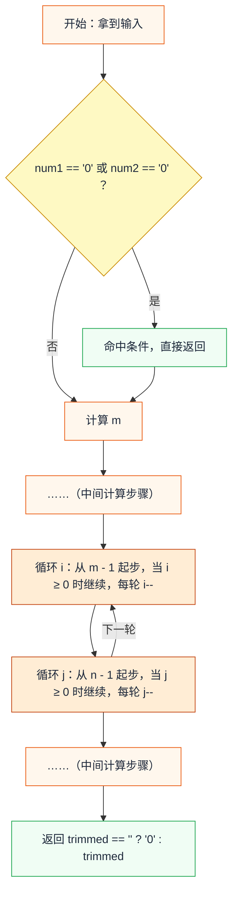

## TypeScript 解题方案（2 个方案逐个讲）

> **运行与提交**：每个方案都是自包含文件（内嵌用例自测，输出 PASS），整块复制到 `.ts` 文件后 `node 文件名` 即可运行。提交 LeetCode 时，把 `demo` 内的算法函数与辅助类型/函数整体取出、置于文件顶层即可。涉及交互/特殊接口的题以题面给定签名为准。

### 方案 1：双重循环枚举

**分析与思路**：核心做法是「双重循环枚举」。代码里依次做这些事：双重循环遍历。

**运行方式**：`node 本文件`，内嵌用例全部通过会输出 PASS。

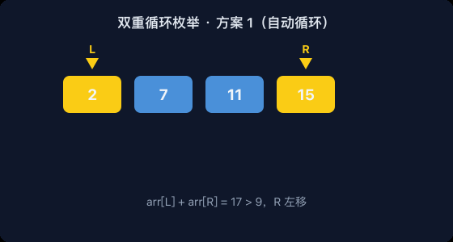

**方案专属流程图**（真实控制流）：

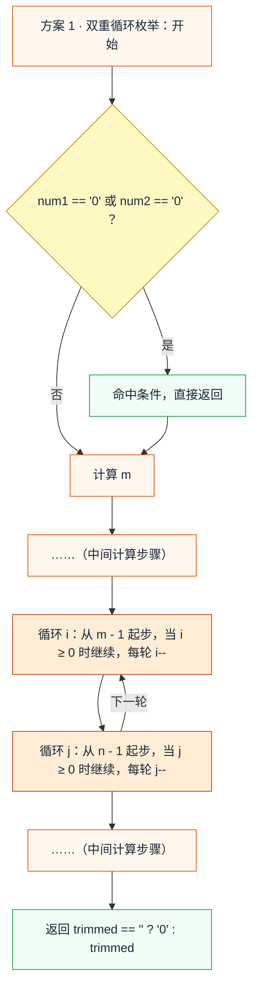

```typescript
export function demo(): void {
  // 程序入口：跑内嵌自测用例
  function multiply(num1: string, num2: string): string {
    // 定义函数/方法 multiply
    if (num1 === '0' || num2 === '0') return '0'; // 若 num1 全等于 「0」 或 num2 全等于 「0」，直接返回 「0」
    const m = num1.length,
      n = num2.length; // 把 num1.长度, 元素个数 赋值为 num2.长度 存入 映射表
    const result: number[] = new Array(m + n).fill(0); // 把 new Array(映射表 加 元素个数).fill(0); 写入 const result: number[]
    for (let i = m - 1; i >= 0; i--) {
      // 让 下标 i 从 映射表 减 1 开始计数，下标 i 不低于 0 就继续
      for (let j = n - 1; j >= 0; j--) {
        // 让 下标 j 从 元素个数 减 1 开始计数，下标 j 不低于 0 就继续
        const mul = parseInt(num1[i], 10) * parseInt(num2[j], 10); // 把 转整数(num1[下标 i]) 乘 转整数(num2[下标 j]) 存入 mul
        const p1 = i + j,
          p2 = i + j + 1; // 把 下标 i 加 下标 j, p2 赋值为 下标 i 加 下标 j 加 1 存入 p1
        const total = mul + result[p2]; // 把 mul 加 结果[p2] 存入 总和
        result[p2] = total % 10; // 把 总和 对…取模 10; 写入 result[p2]
        result[p1] += Math.floor(total / 10); // result[p1]累加 向下取整(总和 除以 10)
      }
    }
    const s = result.join(''); // 把 结果.join(「」) 存入 字符串
    const trimmed = s.replace(/^0+/, ''); // 把 字符串.replace( 除以 按位异或 0 加 除以 , 「」) 存入 trimmed
    return trimmed === '' ? '0' : trimmed; // 返回 trimmed 全等于 「」 ? 「」 : trimmed
  }
  const cases: { a: string; b: string; want: string }[] = [
    { a: '2', b: '3', want: '6' },
    { a: '123', b: '456', want: '56088' },
  ];
  let fail = false; // 把 false 存入 fail
  for (const c of cases) {
    // for (const 字符 of cases) {
    const got = multiply(c.a, c.b); // 把 multiply(字符.数组, 字符.b) 存入 got
    if (got !== c.want) {
      fail = true;
      console.log('FAIL', c, 'got', got);
    }
  }
  if (fail) throw new Error('FAILED'); // 若 fail) throw new Error(「FAILED」);
  console.log('PASS'); // 全部用例通过，输出 PASS
}
demo(); // demo();
```

### 方案 2：双重循环枚举

**分析与思路**：核心做法是「双重循环枚举」。代码里依次做这些事：双重循环遍历。

**运行方式**：`node 本文件`，内嵌用例全部通过会输出 PASS。


**方案专属流程图**（真实控制流）：


```typescript
export function demo(): void {
  // 程序入口：跑内嵌自测用例
  function multiply(num1: string, num2: string): string {
    // 定义函数/方法 multiply
    if (num1 === '0' || num2 === '0') return '0'; // 若 num1 全等于 「0」 或 num2 全等于 「0」，直接返回 「0」
    const m = num1.length,
      n = num2.length; // 把 num1.长度, 元素个数 赋值为 num2.长度 存入 映射表
    const result: number[] = new Array(m + n).fill(0); // 把 new Array(映射表 加 元素个数).fill(0); 写入 const result: number[]
    for (let i = m - 1; i >= 0; i--) {
      // 让 下标 i 从 映射表 减 1 开始计数，下标 i 不低于 0 就继续
      for (let j = n - 1; j >= 0; j--) {
        // 让 下标 j 从 元素个数 减 1 开始计数，下标 j 不低于 0 就继续
        const mul = parseInt(num1[i], 10) * parseInt(num2[j], 10); // 把 转整数(num1[下标 i]) 乘 转整数(num2[下标 j]) 存入 mul
        const p1 = i + j,
          p2 = i + j + 1; // 把 下标 i 加 下标 j, p2 赋值为 下标 i 加 下标 j 加 1 存入 p1
        const total = mul + result[p2]; // 把 mul 加 结果[p2] 存入 总和
        result[p2] = total % 10; // 把 总和 对…取模 10; 写入 result[p2]
        result[p1] += Math.floor(total / 10); // result[p1]累加 向下取整(总和 除以 10)
      }
    }
    const s = result.join(''); // 把 结果.join(「」) 存入 字符串
    const trimmed = s.replace(/^0+/, ''); // 把 字符串.replace( 除以 按位异或 0 加 除以 , 「」) 存入 trimmed
    return trimmed === '' ? '0' : trimmed; // 返回 trimmed 全等于 「」 ? 「」 : trimmed
  }
  const cases: { a: string; b: string; want: string }[] = [
    { a: '2', b: '3', want: '6' },
    { a: '123', b: '456', want: '56088' },
  ];
  let fail = false; // 把 false 存入 fail
  for (const c of cases) {
    // for (const 字符 of cases) {
    const got = multiply(c.a, c.b); // 把 multiply(字符.数组, 字符.b) 存入 got
    if (got !== c.want) {
      fail = true;
      console.log('FAIL', c, 'got', got);
    }
  }
  if (fail) throw new Error('FAILED'); // 若 fail) throw new Error(「FAILED」);
  console.log('PASS'); // 全部用例通过，输出 PASS
}
demo(); // demo();
```

## 逐步拆解与面试追问

**复杂度**：时间 O(n²)（两层嵌套扫描），空间 O(1) 到 O(n)

**为什么是这个量级**：外层定起点、内层扫终点，n 个起点各扫 n 次

**面试官可能会追问**：

- 字符集有多大，能否用定长数组计数？
- 要不要考虑 Unicode 多字节字符？
- 空串与单字符的边界？

## 关键 API 速查（TS 主解法实际用到，附官方链接）

| API | 作用 | 使用要点 | 官方文档 |
|---|---|---|---|
| `Array.prototype.join()` | 数组拼接为字符串 | undefined/null 转空串；嵌套数组会展平一层；join('') 用于字符数组还原 | [官方文档](https://developer.mozilla.org/zh-CN/docs/Web/JavaScript/Reference/Global_Objects/Array/join) |
| `String.prototype.replace()` | 替换首个匹配 | 字符串参数只替换第一处；全局替换用 replace(/x/g, …)；回调可动态生成替换文本 | [官方文档](https://developer.mozilla.org/zh-CN/docs/Web/JavaScript/Reference/Global_Objects/String/replace) |
| `Math.floor()` | 向下取整 | 负数向负无穷（-1.5 → -2）；大数用位运算前注意 2^31 界 | [官方文档](https://developer.mozilla.org/zh-CN/docs/Web/JavaScript/Reference/Global_Objects/Math/floor) |

### 各语言官方文档导航

- **TypeScript / JS**：[MDN 中文参考](https://developer.mozilla.org/zh-CN/)
- **Python**：[Python 官方文档](https://docs.python.org/zh-cn/3/)
- **Go**：[Go 标准库](https://pkg.go.dev/std)
- **Java**：[JDK 17 API](https://docs.oracle.com/en/java/javase/17/docs/api/)
- **Rust**：[Rust 标准库](https://doc.rust-lang.org/std/)
- **Lua**：[Lua 5.4 手册](https://www.lua.org/manual/5.4/)
- **C**：[Cppreference C](https://zh.cppreference.com/w/c)
- **C++**：[Cppreference C++](https://zh.cppreference.com/w/cpp)
- **R**：[R 官方手册](https://stat.ethz.ch/R-manual/)
- **Zig**：[Zig 语言文档](https://ziglang.org/documentation/master/)
- **Dart**：[Dart API](https://api.dart.dev/)

## 附录：其他 10 种语言全部实现（每种语言列举其全部方案）

> TypeScript 的全部方案见「TypeScript 解题方案」一节；下面是其余 10 种语言的对应实现，每种语言的每个方案都带思路分析、代码走读与专属运行架构图。
> 每个方案都内嵌用例自测，可独立运行（老仓库 python/go 文件遵循「打印结果」约定）。
> 完整解法文件见 `dsa/<语言>/string/lc_43_字符串相乘/`。

### Python 实现（2 种方案）

Python 的全部方案如下，每个方案都内嵌用例自测，可独立运行（老仓库 python/go 文件遵循「打印结果」约定）：

#### 方案 1：双重循环枚举

**思路与代码分析**：核心是「双重循环枚举」。Python 版用切片与字典推导式简化操作，突出可读性。**走读**：方案 1 · 双重循环枚举：开始 → 命中条件，直接返回 → 更新 n → 更新 result → 循环 i：从 m - 1 到 -1 前，步长 -1 → 循环 j：从 n - 1 到 -1 前，步长 -1 → 更新 mul → 更新 p2 → 更新 total → 更新 result[p2] → 更新 + → 返回 ( → 处理 .join(str(d) for d in resu → 处理 )。

**运行架构**（真实控制流）：


```python
import sys  # 提高递归深度上限（深输入防 RecursionError）

sys.setrecursionlimit(200000)  # 树/链表类题目节点数可达 1e4 量级

def multiply(num1, num2):  # 定义函数 multiply（参数：num1, num2）
    if num1 == "0" or num2 == "0":  # 若 num1 等于 「0」 or num2 等于 「0」
        return "0"  # 返回 「0」
    m, n = len(num1), len(num2)  # 把 长度(num1), 长度(num2) 写入 m, n
    result = [0] * (m + n)  # 把 [0] 乘 (映射表 加 元素个数) 存入 结果
    for i in range(m - 1, -1, -1):  # 让 下标 i 从 映射表 减 1 倒数回去（每步减 1）
        for j in range(n - 1, -1, -1):  # 让 下标 j 从 元素个数 减 1 倒数回去（每步减 1）
            mul = int(num1[i]) * int(num2[j])  # 把 int(num1[下标 i]) 乘 int(num2[下标 j]) 存入 mul
            p1, p2 = i + j, i + j + 1  # 把 下标 i 加 下标 j, 下标 i 加 下标 j 加 1 写入 p1, p2
            total = mul + result[p2]  # 把 mul 加 结果[p2] 存入 总和
            result[p2] = total % 10  # 把 总和 对…取模 10 写入 result[p2]
            result[p1] += total // 10  # result[p1]累加 总和 除以 除以 10
    return (
        "".join(str(d) for d in result).lstrip("0") or "0"
    )  # 返回 ''.join(str(d) for d in 结果).lstrip('0') or 「0」

if __name__ == "__main__":  # 若 __name__ 等于 '__main__'
    print(multiply("2", "3"))  # 打印输出
    print(multiply("123", "456"))  # 打印输出
```

#### 方案 2：双重循环枚举

**思路与代码分析**：核心是「双重循环枚举」。Python 版用切片与字典推导式简化操作，突出可读性。**走读**：方案 2 · 双重循环枚举：开始 → 命中条件，直接返回 → 更新 n → 更新 result → 循环 i：从 m - 1 到 -1 前，步长 -1 → 循环 j：从 n - 1 到 -1 前，步长 -1 → 更新 mul → 更新 p2 → 更新 total → 更新 result[p2] → 更新 + → 返回 ( → 处理 .join(str(d) for d in resu → 处理 )。

**运行架构**（真实控制流）：

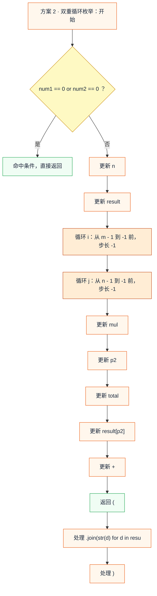

```python
import sys  # 提高递归深度上限（深输入防 RecursionError）

sys.setrecursionlimit(200000)  # 树/链表类题目节点数可达 1e4 量级

def multiply(num1, num2):  # 定义函数 multiply（参数：num1, num2）
    if num1 == "0" or num2 == "0":  # 若 num1 等于 「0」 or num2 等于 「0」
        return "0"  # 返回 「0」
    m, n = len(num1), len(num2)  # 把 长度(num1), 长度(num2) 写入 m, n
    result = [0] * (m + n)  # 把 [0] 乘 (映射表 加 元素个数) 存入 结果
    for i in range(m - 1, -1, -1):  # 让 下标 i 从 映射表 减 1 倒数回去（每步减 1）
        for j in range(n - 1, -1, -1):  # 让 下标 j 从 元素个数 减 1 倒数回去（每步减 1）
            mul = int(num1[i]) * int(num2[j])  # 把 int(num1[下标 i]) 乘 int(num2[下标 j]) 存入 mul
            p1, p2 = i + j, i + j + 1  # 把 下标 i 加 下标 j, 下标 i 加 下标 j 加 1 写入 p1, p2
            total = mul + result[p2]  # 把 mul 加 结果[p2] 存入 总和
            result[p2] = total % 10  # 把 总和 对…取模 10 写入 result[p2]
            result[p1] += total // 10  # result[p1]累加 总和 除以 除以 10
    return (
        "".join(str(d) for d in result).lstrip("0") or "0"
    )  # 返回 ''.join(str(d) for d in 结果).lstrip('0') or 「0」

if __name__ == "__main__":  # 若 __name__ 等于 '__main__'
    print(multiply("2", "3"))  # 打印输出
    print(multiply("123", "456"))  # 打印输出
```

### Go 实现（2 种方案）

Go 的全部方案如下，每个方案都内嵌用例自测，可独立运行（老仓库 python/go 文件遵循「打印结果」约定）：

#### 方案 1：双重循环枚举

**思路与代码分析**：核心是「双重循环枚举」。Go 版用切片与多返回值惯用法，显式处理索引边界。**走读**：方案 1 · 双重循环枚举：开始 → 处理 if num1 == 0 或 num2 == 0 → 返回 0 → 遍历循环 → 遍历循环 → 遍历 result 的下标与元素 d → 返回 out。

**运行架构**（真实控制流）：

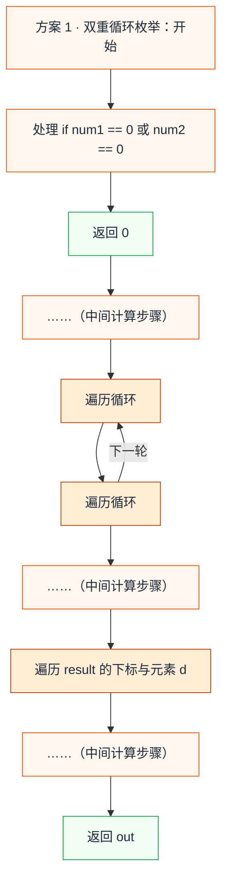

```go
package main // 引入依赖

import (
	"fmt"     // 「fmt」
	"os"      // 「os」
	"reflect" // 「reflect」
)

func multiply(num1, num2 string) string { // 定义函数/方法 multiply
	if num1 == "0" || num2 == "0" { // 若 num1 等于 「0」 或 num2 等于 「0」
		return "0" // 返回 「0」
	}
	m, n := len(num1), len(num2)  // 把 长度(num1), 长度(num2) 写入 m, n :
	result := make([]int, m+n)    // 把 make([]int, 映射表 加 元素个数) 写入 result :
	for i := m - 1; i >= 0; i-- { // 把 映射表 减 1; 下标 i 不低于 0; 下标 i 减一 { 写入 for i :
		for j := n - 1; j >= 0; j-- { // 把 元素个数 减 1; 下标 j 不低于 0; 下标 j 减一 { 写入 for j :
			mul := int(num1[i]-'0') * int(num2[j]-'0') // 把 int(num1[下标 i] 减 '0') 乘 int(num2[下标 j] 减 '0') 写入 mul :
			p1, p2 := i+j, i+j+1                       // 把 下标 i 加 下标 j, 下标 i 加 下标 j 加 1 写入 p1, p2 :
			total := mul + result[p2]                  // 把 mul 加 结果[p2] 写入 total :
			result[p2] = total % 10                    // 把 总和 对…取模 10 写入 result[p2]
			result[p1] += total / 10                   // result[p1]累加 总和 除以 10
		}
	}
	out := ""                  // 把 「」 写入 out :
	for _, d := range result { // 同时取 _ 与 d 遍历
		if !(out == "" && d == 0) { // 若 取反 (out 等于 「」 且 d 等于 0
			out += string('0' + byte(d)) // out累加 string('0' 加 byte(d))
		}
	}
	if out == "" { // 若 out 等于 「」
		out = "0" // 把 「0」 写入 out
	}
	return out // 返回 out
}

func main() { // 程序入口：跑内嵌自测用例
	type tc struct { // 定义类型
		a, b string // 数组, b string
		want string // want string
	}
	cases := []tc{ // 把 []tc{ 写入 cases :
		{"2", "3", "6"},
		{"123", "456", "56088"},
		{"0", "123", "0"},
		{"999", "999", "998001"},
	}
	ok := true                // 把 true 写入 ok :
	for _, c := range cases { // 同时取 _ 与 字符 遍历
		if got := multiply(c.a, c.b); !reflect.DeepEqual(got, c.want) {
			ok = false                                                             // 把 false 写入 ok
			fmt.Printf("FAIL multiply(%q,%q)=%q want %q\n", c.a, c.b, got, c.want) // 打印输出
		}
	}
	if !ok { // 若 取反 ok
		os.Exit(1) // os.Exit(1)
	}
	fmt.Println("PASS") // 全部用例通过，输出 PASS
}
```

#### 方案 2：双重循环枚举

**思路与代码分析**：核心是「双重循环枚举」。Go 版用切片与多返回值惯用法，显式处理索引边界。**走读**：方案 2 · 双重循环枚举：开始 → 处理 if num1 == 0 或 num2 == 0 → 返回 0 → 遍历循环 → 遍历循环 → 遍历 result 的下标与元素 d → 返回 out。

**运行架构**（真实控制流）：

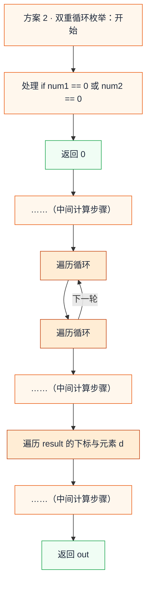

```go
package main // 引入依赖

import (
	"fmt"     // 「fmt」
	"os"      // 「os」
	"reflect" // 「reflect」
)

func multiply(num1, num2 string) string { // 定义函数/方法 multiply
	if num1 == "0" || num2 == "0" { // 若 num1 等于 「0」 或 num2 等于 「0」
		return "0" // 返回 「0」
	}
	m, n := len(num1), len(num2)  // 把 长度(num1), 长度(num2) 写入 m, n :
	result := make([]int, m+n)    // 把 make([]int, 映射表 加 元素个数) 写入 result :
	for i := m - 1; i >= 0; i-- { // 把 映射表 减 1; 下标 i 不低于 0; 下标 i 减一 { 写入 for i :
		for j := n - 1; j >= 0; j-- { // 把 元素个数 减 1; 下标 j 不低于 0; 下标 j 减一 { 写入 for j :
			mul := int(num1[i]-'0') * int(num2[j]-'0') // 把 int(num1[下标 i] 减 '0') 乘 int(num2[下标 j] 减 '0') 写入 mul :
			p1, p2 := i+j, i+j+1                       // 把 下标 i 加 下标 j, 下标 i 加 下标 j 加 1 写入 p1, p2 :
			total := mul + result[p2]                  // 把 mul 加 结果[p2] 写入 total :
			result[p2] = total % 10                    // 把 总和 对…取模 10 写入 result[p2]
			result[p1] += total / 10                   // result[p1]累加 总和 除以 10
		}
	}
	out := ""                  // 把 「」 写入 out :
	for _, d := range result { // 同时取 _ 与 d 遍历
		if !(out == "" && d == 0) { // 若 取反 (out 等于 「」 且 d 等于 0
			out += string('0' + byte(d)) // out累加 string('0' 加 byte(d))
		}
	}
	if out == "" { // 若 out 等于 「」
		out = "0" // 把 「0」 写入 out
	}
	return out // 返回 out
}

func main() { // 程序入口：跑内嵌自测用例
	type tc struct { // 定义类型
		a, b string // 数组, b string
		want string // want string
	}
	cases := []tc{ // 把 []tc{ 写入 cases :
		{"2", "3", "6"},
		{"123", "456", "56088"},
		{"0", "123", "0"},
		{"999", "999", "998001"},
	}
	ok := true                // 把 true 写入 ok :
	for _, c := range cases { // 同时取 _ 与 字符 遍历
		if got := multiply(c.a, c.b); !reflect.DeepEqual(got, c.want) {
			ok = false                                                             // 把 false 写入 ok
			fmt.Printf("FAIL multiply(%q,%q)=%q want %q\n", c.a, c.b, got, c.want) // 打印输出
		}
	}
	if !ok { // 若 取反 ok
		os.Exit(1) // os.Exit(1)
	}
	fmt.Println("PASS") // 全部用例通过，输出 PASS
}
```

### Java 实现（2 种方案）

Java 的全部方案如下，每个方案都内嵌用例自测，可独立运行（老仓库 python/go 文件遵循「打印结果」约定）：

#### 方案 1：双重循环枚举

**思路与代码分析**：核心是「双重循环枚举」。Java 版用类与静态方法组织，集合操作显式明了。代码里依次做这些事：双重循环遍历。**走读**：方案 1 · 双重循环枚举：开始 → 命中条件，直接返回 → 更新 m → 遍历循环 → 遍历循环 → 遍历循环 → 返回 r.isEmpty() ? 0 : r。

**运行架构**（真实控制流）：

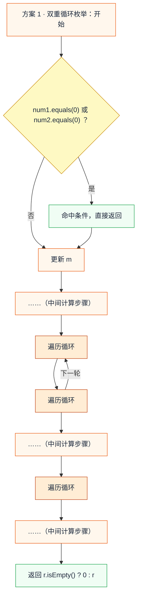

```java
package com.webfault.dsa; // 引入依赖

class Solution { // 定义类型
  public String multiply(String num1, String num2) { // 定义函数/方法 multiply
    if (num1.equals("0") || num2.equals("0"))
      return "0"; // 若 num1.equals(「0」) 或 num2.equals(「0」)，直接返回 「0」
    int m = num1.length(), n = num2.length(); // 把 num1.长度(), 元素个数 赋值为 num2.长度() 存入 映射表
    int[] result = new int[m + n]; // 把 new int[映射表 加 元素个数]; 写入 int[] result
    for (int i = m - 1; i >= 0; i--) { // 让 下标 i 从 映射表 减 1 开始计数，下标 i 不低于 0 就继续
      for (int j = n - 1; j >= 0; j--) { // 让 下标 j 从 元素个数 减 1 开始计数，下标 j 不低于 0 就继续
        int mul =
            (num1.charAt(i) - '0')
                * (num2.charAt(j)
                    - '0'); // 把 (num1 取字符 下标 i) 减 '0') 乘 (num2 取字符 下标 j) 减 '0') 存入 mul
        int p1 = i + j, p2 = i + j + 1; // 把 下标 i 加 下标 j, p2 赋值为 下标 i 加 下标 j 加 1 存入 p1
        int total = mul + result[p2]; // 把 mul 加 结果[p2] 存入 总和
        result[p2] = total % 10; // 把 总和 对…取模 10; 写入 result[p2]
        result[p1] += total / 10; // result[p1]累加 总和 除以 10
      }
    }
    StringBuilder sb = new StringBuilder(); // 把 new StringBuilder(); 写入 StringBuilder sb
    for (int d : result) sb.append(d); // 把 d 追加到列表尾部
    String r = sb.toString().replaceFirst("^0+(?=.)", "");
    return r.isEmpty() ? "0" : r; // 返回 右指针.isEmpty() ? 「0」 : 右指针
  }

  public static void main(String[] args) { // public static void main(String[] args) {
    Solution s = new Solution(); // 把 new Solution(); 写入 Solution s
    String[][] ins = {{"2", "3"}, {"123", "456"}}; // 把 {{「2」,「2」},{「2」,「2」}}; 写入 String[][] ins
    String[] wants = {"6", "56088"}; // 把 {「6」,「6」}; 写入 String[] wants
    boolean ok = true; // 把 true; 写入 boolean ok
    for (int i = 0; i < ins.length; i++) { // 让 下标 i 从 0 开始计数，下标 i 小于 ins.长度 就继续
      String got =
          s.multiply(ins[i][0], ins[i][1]); // 把 字符串.multiply(ins[下标 i][0], ins[下标 i][1]) 存入 got
      if (!got.equals(wants[i])) {
        ok = false;
        System.out.println("FAIL " + ins[i][0] + "x" + ins[i][1] + "=" + got + " want " + wants[i]);
      }
    }
    if (!ok) throw new RuntimeException("FAILED"); // 若 取反 ok) throw new RuntimeException(「FAILED」);
    System.out.println("PASS"); // 全部用例通过，输出 PASS
  }
}
```

#### 方案 2：双重循环枚举

**思路与代码分析**：核心是「双重循环枚举」。Java 版用类与静态方法组织，集合操作显式明了。代码里依次做这些事：双重循环遍历。**走读**：方案 2 · 双重循环枚举：开始 → 命中条件，直接返回 → 更新 m → 遍历循环 → 遍历循环 → 遍历循环 → 返回 r.isEmpty() ? 0 : r。

**运行架构**（真实控制流）：


```java
package com.webfault.dsa; // 引入依赖

class Solution { // 定义类型
  public String multiply(String num1, String num2) { // 定义函数/方法 multiply
    if (num1.equals("0") || num2.equals("0"))
      return "0"; // 若 num1.equals(「0」) 或 num2.equals(「0」)，直接返回 「0」
    int m = num1.length(), n = num2.length(); // 把 num1.长度(), 元素个数 赋值为 num2.长度() 存入 映射表
    int[] result = new int[m + n]; // 把 new int[映射表 加 元素个数]; 写入 int[] result
    for (int i = m - 1; i >= 0; i--) { // 让 下标 i 从 映射表 减 1 开始计数，下标 i 不低于 0 就继续
      for (int j = n - 1; j >= 0; j--) { // 让 下标 j 从 元素个数 减 1 开始计数，下标 j 不低于 0 就继续
        int mul =
            (num1.charAt(i) - '0')
                * (num2.charAt(j)
                    - '0'); // 把 (num1 取字符 下标 i) 减 '0') 乘 (num2 取字符 下标 j) 减 '0') 存入 mul
        int p1 = i + j, p2 = i + j + 1; // 把 下标 i 加 下标 j, p2 赋值为 下标 i 加 下标 j 加 1 存入 p1
        int total = mul + result[p2]; // 把 mul 加 结果[p2] 存入 总和
        result[p2] = total % 10; // 把 总和 对…取模 10; 写入 result[p2]
        result[p1] += total / 10; // result[p1]累加 总和 除以 10
      }
    }
    StringBuilder sb = new StringBuilder(); // 把 new StringBuilder(); 写入 StringBuilder sb
    for (int d : result) sb.append(d); // 把 d 追加到列表尾部
    String r = sb.toString().replaceFirst("^0+(?=.)", "");
    return r.isEmpty() ? "0" : r; // 返回 右指针.isEmpty() ? 「0」 : 右指针
  }

  public static void main(String[] args) { // public static void main(String[] args) {
    Solution s = new Solution(); // 把 new Solution(); 写入 Solution s
    String[][] ins = {{"2", "3"}, {"123", "456"}}; // 把 {{「2」,「2」},{「2」,「2」}}; 写入 String[][] ins
    String[] wants = {"6", "56088"}; // 把 {「6」,「6」}; 写入 String[] wants
    boolean ok = true; // 把 true; 写入 boolean ok
    for (int i = 0; i < ins.length; i++) { // 让 下标 i 从 0 开始计数，下标 i 小于 ins.长度 就继续
      String got =
          s.multiply(ins[i][0], ins[i][1]); // 把 字符串.multiply(ins[下标 i][0], ins[下标 i][1]) 存入 got
      if (!got.equals(wants[i])) {
        ok = false;
        System.out.println("FAIL " + ins[i][0] + "x" + ins[i][1] + "=" + got + " want " + wants[i]);
      }
    }
    if (!ok) throw new RuntimeException("FAILED"); // 若 取反 ok) throw new RuntimeException(「FAILED」);
    System.out.println("PASS"); // 全部用例通过，输出 PASS
  }
}
```

### Rust 实现（2 种方案）

Rust 的全部方案如下，每个方案都内嵌用例自测，可独立运行（老仓库 python/go 文件遵循「打印结果」约定）：

#### 方案 1：双重循环枚举

**思路与代码分析**：核心是「双重循环枚举」。Rust 版用所有权移动与切片借用改写同一逻辑，注意 Option 与引用边界。**走读**：方案 1 · 双重循环枚举：开始 → 处理 if num1 == 0 或 num2 == 0 → 返回 0.to_string() → 遍历 (0..m).rev() 中的每个元素 i → 遍历 (0..n).rev() 中的每个元素 j → 遍历 &result 中的每个元素 d。

**运行架构**（真实控制流）：

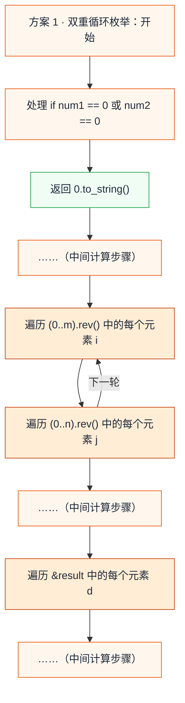

```rust
// LeetCode 43. 字符串相乘 — Rust 版（方案1）
fn multiply(num1: String, num2: String) -> String {
    // 定义函数/方法 multiply
    if num1 == "0" || num2 == "0" {
        return "0".to_string();
    } // 若 num1 等于 「0」 或 num2 等于 「0」 { return 「0」.to_string(); }
    let (a, b) = (num1.as_bytes(), num2.as_bytes()); // 把 (num1.as_bytes(), num2.as_bytes()); 写入 let (a, b)
    let (m, n) = (a.len(), b.len()); // 把 (数组.长度(), b.长度()); 写入 let (m, n)
    let mut result = vec![0u8; m + n]; // 把 vec取反 [0u8; 映射表 加 元素个数]; 写入 let mut result
    for i in (0..m).rev() {
        // for 下标 i in (0..映射表).rev() {
        for j in (0..n).rev() {
            // for 下标 j in (0..元素个数).rev() {
            let mul = (a[i] - b'0') * (b[j] - b'0'); // 把 (数组[下标 i] 减 b'0') 乘 (b[下标 j] 减 b'0') 存入 mul
            let (p1, p2) = (i + j, i + j + 1); // 把 (下标 i 加 下标 j, 下标 i 加 下标 j 加 1); 写入 let (p1, p2)
            let total = mul + result[p2]; // 把 mul 加 结果[p2] 存入 总和
            result[p2] = total % 10; // 把 总和 对…取模 10; 写入 result[p2]
            result[p1] += total / 10; // result[p1]累加 总和 除以 10
        }
    }
    let mut out = String::new(); // 把 String::new(); 写入 let mut out
    let mut started = false; // 把 false; 写入 let mut started
    for &d in &result {
        // for 按位与 d in 按位与 结果 {
        if d != 0 || started {
            out.push((b'0' + d) as char);
            started = true;
        }
    }
    if out.is_empty() {
        out.push('0');
    } // 若 out 是否为空 { out 追加 '0'); }
    out // out
}
fn main() {
    // 程序入口：跑内嵌自测用例
    assert_eq!(multiply("2".into(), "3".into()), "6"); // 断言校验
    assert_eq!(multiply("123".into(), "456".into()), "56088"); // 断言校验
    println!("PASS"); // 全部用例通过，输出 PASS
}
```

#### 方案 2：双重循环枚举

**思路与代码分析**：核心是「双重循环枚举」。Rust 版用所有权移动与切片借用改写同一逻辑，注意 Option 与引用边界。**走读**：方案 2 · 双重循环枚举：开始 → 处理 if num1 == 0 或 num2 == 0 → 返回 0.to_string() → 遍历 (0..m).rev() 中的每个元素 i → 遍历 (0..n).rev() 中的每个元素 j → 遍历 &result 中的每个元素 d。

**运行架构**（真实控制流）：


```rust
// LeetCode 43. 字符串相乘 — Rust 版（方案2）
fn multiply(num1: String, num2: String) -> String {
    // 定义函数/方法 multiply
    if num1 == "0" || num2 == "0" {
        return "0".to_string();
    } // 若 num1 等于 「0」 或 num2 等于 「0」 { return 「0」.to_string(); }
    let (a, b) = (num1.as_bytes(), num2.as_bytes()); // 把 (num1.as_bytes(), num2.as_bytes()); 写入 let (a, b)
    let (m, n) = (a.len(), b.len()); // 把 (数组.长度(), b.长度()); 写入 let (m, n)
    let mut result = vec![0u8; m + n]; // 把 vec取反 [0u8; 映射表 加 元素个数]; 写入 let mut result
    for i in (0..m).rev() {
        // for 下标 i in (0..映射表).rev() {
        for j in (0..n).rev() {
            // for 下标 j in (0..元素个数).rev() {
            let mul = (a[i] - b'0') * (b[j] - b'0'); // 把 (数组[下标 i] 减 b'0') 乘 (b[下标 j] 减 b'0') 存入 mul
            let (p1, p2) = (i + j, i + j + 1); // 把 (下标 i 加 下标 j, 下标 i 加 下标 j 加 1); 写入 let (p1, p2)
            let total = mul + result[p2]; // 把 mul 加 结果[p2] 存入 总和
            result[p2] = total % 10; // 把 总和 对…取模 10; 写入 result[p2]
            result[p1] += total / 10; // result[p1]累加 总和 除以 10
        }
    }
    let mut out = String::new(); // 把 String::new(); 写入 let mut out
    let mut started = false; // 把 false; 写入 let mut started
    for &d in &result {
        // for 按位与 d in 按位与 结果 {
        if d != 0 || started {
            out.push((b'0' + d) as char);
            started = true;
        }
    }
    if out.is_empty() {
        out.push('0');
    } // 若 out 是否为空 { out 追加 '0'); }
    out // out
}
fn main() {
    // 程序入口：跑内嵌自测用例
    assert_eq!(multiply("2".into(), "3".into()), "6"); // 断言校验
    assert_eq!(multiply("123".into(), "456".into()), "56088"); // 断言校验
    println!("PASS"); // 全部用例通过，输出 PASS
}
```

### Lua 实现（2 种方案）

Lua 的全部方案如下，每个方案都内嵌用例自测，可独立运行（老仓库 python/go 文件遵循「打印结果」约定）：

#### 方案 1：双重循环枚举

**思路与代码分析**：核心是「双重循环枚举」。Lua 版用表与 ipairs 遍历，注意 ipairs 遇 nil 即停的语义。**走读**：方案 1 · 双重循环枚举：开始 → 处理 if num1 == 0 or num2 == 0 → 返回 0 → 循环 i：从 1 到 m + n do → 循环 i：从 m 到 1, -1 do → 循环 j：从 n 到 1, -1 do → 遍历 ipairs(result) do 中的每个元素 d → 返回 0 → 返回 table.concat(out)。

**运行架构**（真实控制流）：

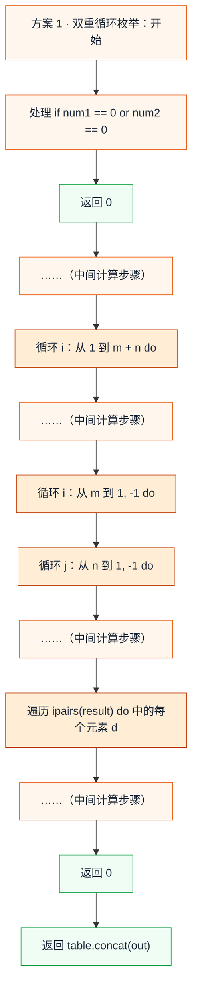

```lua
-- LeetCode 43. 字符串相乘 — Lua 版（方案1）
local function multiply(num1, num2) -- local function multiply(num1, num2)
	if num1 == "0" or num2 == "0" then
		return "0"
	end -- 若 num1 等于 「0」 or num2 等于 「0」 then return 「0」 终点
	local m, n = #num1, #num2 -- 把 #num1, #num2 写入 local m, n
	local result = {} -- 把 {} 写入 local result
	for i = 1, m + n do
		result[i] = 0
	end -- 让 下标 i 从 1 走到 映射表（Lua 1 基）
	for i = m, 1, -1 do -- 把 映射表, 1, 减 1 do 写入 for i
		for j = n, 1, -1 do -- 把 元素个数, 1, 减 1 do 写入 for j
			local mul = (num1:byte(i) - 48) * (num2:byte(j) - 48)
			local p1, p2 = i + j - 1, i + j -- 把 下标 i 加 下标 j 减 1, 下标 i 加 下标 j 写入 local p1, p2
			local total = mul + result[p2] -- 把 mul 加 结果[p2] 写入 local total
			result[p2] = total % 10 -- 把 总和 对…取模 10 写入 result[p2]
			result[p1] = result[p1] + math.floor(total / 10) -- 把 结果[p1] 加 math.floor(总和 除以 10) 写入 result[p1]
		end -- 终点
	end -- 终点
	local out = {} -- 把 {} 写入 local out
	local started = false -- 把 false 写入 local started
	for _, d in ipairs(result) do -- 遍历取 d
		if d ~= 0 or started then -- 若 d ~ 赋值为 0 or started then
			out[#out + 1] = tostring(d) -- 把 tostring(d) 写入 out[#out + 1]
			started = true -- 把 true 存入 started
		end -- 终点
	end -- 终点
	if #out == 0 then
		return "0"
	end -- 若 #out 等于 0 then return 「0」 终点
	return table.concat(out) -- 返回 table.concat(out)
end -- 终点
assert(multiply("2", "3") == "6") -- 断言校验
assert(multiply("123", "456") == "56088") -- 断言校验
print("PASS") -- 全部用例通过，输出 PASS
```

#### 方案 2：双重循环枚举

**思路与代码分析**：核心是「双重循环枚举」。Lua 版用表与 ipairs 遍历，注意 ipairs 遇 nil 即停的语义。**走读**：方案 2 · 双重循环枚举：开始 → 处理 if num1 == 0 or num2 == 0 → 返回 0 → 循环 i：从 1 到 m + n do → 循环 i：从 m 到 1, -1 do → 循环 j：从 n 到 1, -1 do → 遍历 ipairs(result) do 中的每个元素 d → 返回 0 → 返回 table.concat(out)。

**运行架构**（真实控制流）：

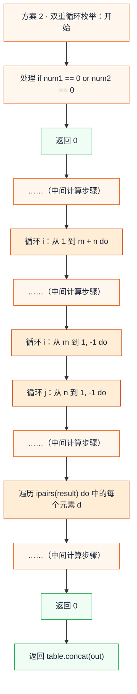

```lua
-- LeetCode 43. 字符串相乘 — Lua 版（方案2）
local function multiply(num1, num2) -- local function multiply(num1, num2)
	if num1 == "0" or num2 == "0" then
		return "0"
	end -- 若 num1 等于 「0」 or num2 等于 「0」 then return 「0」 终点
	local m, n = #num1, #num2 -- 把 #num1, #num2 写入 local m, n
	local result = {} -- 把 {} 写入 local result
	for i = 1, m + n do
		result[i] = 0
	end -- 让 下标 i 从 1 走到 映射表（Lua 1 基）
	for i = m, 1, -1 do -- 把 映射表, 1, 减 1 do 写入 for i
		for j = n, 1, -1 do -- 把 元素个数, 1, 减 1 do 写入 for j
			local mul = (num1:byte(i) - 48) * (num2:byte(j) - 48)
			local p1, p2 = i + j - 1, i + j -- 把 下标 i 加 下标 j 减 1, 下标 i 加 下标 j 写入 local p1, p2
			local total = mul + result[p2] -- 把 mul 加 结果[p2] 写入 local total
			result[p2] = total % 10 -- 把 总和 对…取模 10 写入 result[p2]
			result[p1] = result[p1] + math.floor(total / 10) -- 把 结果[p1] 加 math.floor(总和 除以 10) 写入 result[p1]
		end -- 终点
	end -- 终点
	local out = {} -- 把 {} 写入 local out
	local started = false -- 把 false 写入 local started
	for _, d in ipairs(result) do -- 遍历取 d
		if d ~= 0 or started then -- 若 d ~ 赋值为 0 or started then
			out[#out + 1] = tostring(d) -- 把 tostring(d) 写入 out[#out + 1]
			started = true -- 把 true 存入 started
		end -- 终点
	end -- 终点
	if #out == 0 then
		return "0"
	end -- 若 #out 等于 0 then return 「0」 终点
	return table.concat(out) -- 返回 table.concat(out)
end -- 终点
assert(multiply("2", "3") == "6") -- 断言校验
assert(multiply("123", "456") == "56088") -- 断言校验
print("PASS") -- 全部用例通过，输出 PASS
```

### C 实现（2 种方案）

C 的全部方案如下，每个方案都内嵌用例自测，可独立运行（老仓库 python/go 文件遵循「打印结果」约定）：

#### 方案 1：双重循环枚举

**思路与代码分析**：核心是「双重循环枚举」。C 版手动管理下标与内存，循环边界全部显式写出。代码里依次做这些事：双重循环遍历。**走读**：方案 1 · 双重循环枚举：开始 → 若 strcmp(num1, 0) == 0 或 strcmp(num2, 0) == 0 则： → 返回  → 遍历循环 → 遍历循环 → 遍历循环。

**运行架构**（真实控制流）：


```c
/* LeetCode 43. 字符串相乘 — C 版（方案1） */
#include <stdio.h>                                                     // 引入头文件
#include <string.h>                                                    // 引入头文件
static void multiply(const char *num1, const char *num2, char out[]) { // 定义函数/方法 multiply
    if (strcmp(num1, "0") == 0 || strcmp(num2, "0") == 0) {
        strcpy(out, "0");
        return;
    }
    int m = (int)strlen(num1),
        n = (int)strlen(num2); // 把 (int)strlen(num1), 元素个数 赋值为 (int)strlen(num2) 存入 映射表
    int result[512] = {0};     // 把 {0}; 写入 int result[512]
    for (int i = m - 1; i >= 0; i--) { // 让 下标 i 从 映射表 减 1 开始计数，下标 i 不低于 0 就继续
        for (int j = n - 1; j >= 0; j--) { // 让 下标 j 从 元素个数 减 1 开始计数，下标 j 不低于 0 就继续
            int mul = (num1[i] - '0') *
                      (num2[j] - '0'); // 把 (num1[下标 i] 减 '0') 乘 (num2[下标 j] 减 '0') 存入 mul
            int p1 = i + j, p2 = i + j + 1; // 把 下标 i 加 下标 j, p2 赋值为 下标 i 加 下标 j 加 1 存入 p1
            int total = mul + result[p2]; // 把 mul 加 结果[p2] 存入 总和
            result[p2] = total % 10;      // 把 总和 对…取模 10; 写入 result[p2]
            result[p1] += total / 10;     // result[p1]累加 总和 除以 10
        }
    }
    int pos = 0, started = 0; // 把 0, started 赋值为 0 存入 pos
    for (int i = 0; i < m + n; i++) { // 让 下标 i 从 0 开始计数，下标 i 小于 映射表 加 元素个数 就继续
        if (result[i] != 0 || started) {
            out[pos++] = '0' + result[i];
            started = 1;
        }
    }
    if (pos == 0)
        out[pos++] = '0'; // 若 pos 等于 0) out[pos 加一 ] 赋值为 '0';
    out[pos] = '\0';      // 把 '\0'; 写入 out[pos]
}
int main(void) {             // 程序入口：跑内嵌自测用例
    char out[1024];          // char out[1024];
    multiply("2", "3", out); // multiply(「2」, 「2」, out);
    if (strcmp(out, "6") != 0) {
        printf("FAIL 1\n");
        return 1;
    }                            // 若 strcmp(out, 「6」) 不等于 0) { 输出「6」); return 1; }
    multiply("123", "456", out); // multiply(「123」, 「123」, out);
    if (strcmp(out, "56088") != 0) {
        printf("FAIL 2\n");
        return 1;
    }                 // 若 strcmp(out, 「56088」) 不等于 0) { 输出「56088」); return 1; }
    printf("PASS\n"); // 全部用例通过，输出 PASS
    return 0;         // 返回 0
}
```

#### 方案 2：双重循环枚举

**思路与代码分析**：核心是「双重循环枚举」。C 版手动管理下标与内存，循环边界全部显式写出。代码里依次做这些事：双重循环遍历。**走读**：方案 2 · 双重循环枚举：开始 → 若 strcmp(num1, 0) == 0 或 strcmp(num2, 0) == 0 则： → 返回  → 遍历循环 → 遍历循环 → 遍历循环。

**运行架构**（真实控制流）：

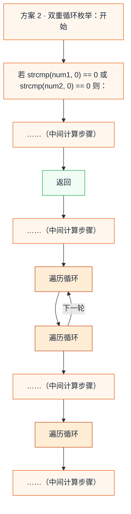

```c
/* LeetCode 43. 字符串相乘 — C 版（方案2） */
#include <stdio.h>                                                     // 引入头文件
#include <string.h>                                                    // 引入头文件
static void multiply(const char *num1, const char *num2, char out[]) { // 定义函数/方法 multiply
    if (strcmp(num1, "0") == 0 || strcmp(num2, "0") == 0) {
        strcpy(out, "0");
        return;
    }
    int m = (int)strlen(num1),
        n = (int)strlen(num2); // 把 (int)strlen(num1), 元素个数 赋值为 (int)strlen(num2) 存入 映射表
    int result[512] = {0};     // 把 {0}; 写入 int result[512]
    for (int i = m - 1; i >= 0; i--) { // 让 下标 i 从 映射表 减 1 开始计数，下标 i 不低于 0 就继续
        for (int j = n - 1; j >= 0; j--) { // 让 下标 j 从 元素个数 减 1 开始计数，下标 j 不低于 0 就继续
            int mul = (num1[i] - '0') *
                      (num2[j] - '0'); // 把 (num1[下标 i] 减 '0') 乘 (num2[下标 j] 减 '0') 存入 mul
            int p1 = i + j, p2 = i + j + 1; // 把 下标 i 加 下标 j, p2 赋值为 下标 i 加 下标 j 加 1 存入 p1
            int total = mul + result[p2]; // 把 mul 加 结果[p2] 存入 总和
            result[p2] = total % 10;      // 把 总和 对…取模 10; 写入 result[p2]
            result[p1] += total / 10;     // result[p1]累加 总和 除以 10
        }
    }
    int pos = 0, started = 0; // 把 0, started 赋值为 0 存入 pos
    for (int i = 0; i < m + n; i++) { // 让 下标 i 从 0 开始计数，下标 i 小于 映射表 加 元素个数 就继续
        if (result[i] != 0 || started) {
            out[pos++] = '0' + result[i];
            started = 1;
        }
    }
    if (pos == 0)
        out[pos++] = '0'; // 若 pos 等于 0) out[pos 加一 ] 赋值为 '0';
    out[pos] = '\0';      // 把 '\0'; 写入 out[pos]
}
int main(void) {             // 程序入口：跑内嵌自测用例
    char out[1024];          // char out[1024];
    multiply("2", "3", out); // multiply(「2」, 「2」, out);
    if (strcmp(out, "6") != 0) {
        printf("FAIL 1\n");
        return 1;
    }                            // 若 strcmp(out, 「6」) 不等于 0) { 输出「6」); return 1; }
    multiply("123", "456", out); // multiply(「123」, 「123」, out);
    if (strcmp(out, "56088") != 0) {
        printf("FAIL 2\n");
        return 1;
    }                 // 若 strcmp(out, 「56088」) 不等于 0) { 输出「56088」); return 1; }
    printf("PASS\n"); // 全部用例通过，输出 PASS
    return 0;         // 返回 0
}
```

### C++ 实现（2 种方案）

C++ 的全部方案如下，每个方案都内嵌用例自测，可独立运行（老仓库 python/go 文件遵循「打印结果」约定）：

#### 方案 1：双重循环枚举

**思路与代码分析**：核心是「双重循环枚举」。C++ 版用 STL 容器与迭代器，减少手写下标错误。代码里依次做这些事：双重循环遍历。**走读**：方案 1 · 双重循环枚举：开始 → 命中条件，直接返回 → 更新 m → 遍历循环 → 遍历循环 → 遍历循环 → 返回 out。

**运行架构**（真实控制流）：


```cpp
// LeetCode 43. 字符串相乘 — C++ 版（方案1）
#include <cassert>  // 引入头文件
#include <iostream> // 引入头文件
#include <string>   // 引入头文件
#include <vector>   // 引入头文件
static std::string multiply(const std::string &num1, const std::string &num2) {
    if (num1 == "0" || num2 == "0")
        return "0"; // 若 num1 等于 「0」 或 num2 等于 「0」，直接返回 「0」
    int m = static_cast<int>(num1.size()), n = static_cast<int>(num2.size());
    std::vector<int> result(m + n, 0); // std::vector 小于 int 超过 结果(映射表 加 元素个数, 0);
    for (int i = m - 1; i >= 0; --i) { // 让 下标 i 从 映射表 减 1 开始计数，下标 i 不低于 0 就继续
        for (int j = n - 1; j >= 0; --j) { // 让 下标 j 从 元素个数 减 1 开始计数，下标 j 不低于 0 就继续
            int mul = (num1[i] - '0') *
                      (num2[j] - '0'); // 把 (num1[下标 i] 减 '0') 乘 (num2[下标 j] 减 '0') 存入 mul
            int p1 = i + j, p2 = i + j + 1; // 把 下标 i 加 下标 j, p2 赋值为 下标 i 加 下标 j 加 1 存入 p1
            int total = mul + result[p2]; // 把 mul 加 结果[p2] 存入 总和
            result[p2] = total % 10;      // 把 总和 对…取模 10; 写入 result[p2]
            result[p1] += total / 10;     // result[p1]累加 总和 除以 10
        }
    }
    std::string out;       // std::string out;
    bool started = false;  // 把 false 存入 started
    for (int d : result) { // for (int d : 结果) {
        if (d != 0 || started) {
            out.push_back('0' + d);
            started = true;
        } // 若 d 不等于 0 或 started) { out 追加 '0' 加 d); started 赋值为 true; }
    }
    if (out.empty())
        out = "0"; // 若 out 是否为空) out 赋值为 「0」;
    return out;    // 返回 out
}
int main() {                                   // 程序入口：跑内嵌自测用例
    assert(multiply("2", "3") == "6");         // 断言校验
    assert(multiply("123", "456") == "56088"); // 断言校验
    std::cout << "PASS" << std::endl;          // 全部用例通过，输出 PASS
    return 0;                                  // 返回 0
}
```

#### 方案 2：双重循环枚举

**思路与代码分析**：核心是「双重循环枚举」。C++ 版用 STL 容器与迭代器，减少手写下标错误。代码里依次做这些事：双重循环遍历。**走读**：方案 2 · 双重循环枚举：开始 → 命中条件，直接返回 → 更新 m → 遍历循环 → 遍历循环 → 遍历循环 → 返回 out。

**运行架构**（真实控制流）：

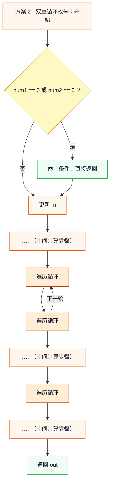

```cpp
// LeetCode 43. 字符串相乘 — C++ 版（方案2）
#include <cassert>  // 引入头文件
#include <iostream> // 引入头文件
#include <string>   // 引入头文件
#include <vector>   // 引入头文件
static std::string multiply(const std::string &num1, const std::string &num2) {
    if (num1 == "0" || num2 == "0")
        return "0"; // 若 num1 等于 「0」 或 num2 等于 「0」，直接返回 「0」
    int m = static_cast<int>(num1.size()), n = static_cast<int>(num2.size());
    std::vector<int> result(m + n, 0); // std::vector 小于 int 超过 结果(映射表 加 元素个数, 0);
    for (int i = m - 1; i >= 0; --i) { // 让 下标 i 从 映射表 减 1 开始计数，下标 i 不低于 0 就继续
        for (int j = n - 1; j >= 0; --j) { // 让 下标 j 从 元素个数 减 1 开始计数，下标 j 不低于 0 就继续
            int mul = (num1[i] - '0') *
                      (num2[j] - '0'); // 把 (num1[下标 i] 减 '0') 乘 (num2[下标 j] 减 '0') 存入 mul
            int p1 = i + j, p2 = i + j + 1; // 把 下标 i 加 下标 j, p2 赋值为 下标 i 加 下标 j 加 1 存入 p1
            int total = mul + result[p2]; // 把 mul 加 结果[p2] 存入 总和
            result[p2] = total % 10;      // 把 总和 对…取模 10; 写入 result[p2]
            result[p1] += total / 10;     // result[p1]累加 总和 除以 10
        }
    }
    std::string out;       // std::string out;
    bool started = false;  // 把 false 存入 started
    for (int d : result) { // for (int d : 结果) {
        if (d != 0 || started) {
            out.push_back('0' + d);
            started = true;
        } // 若 d 不等于 0 或 started) { out 追加 '0' 加 d); started 赋值为 true; }
    }
    if (out.empty())
        out = "0"; // 若 out 是否为空) out 赋值为 「0」;
    return out;    // 返回 out
}
int main() {                                   // 程序入口：跑内嵌自测用例
    assert(multiply("2", "3") == "6");         // 断言校验
    assert(multiply("123", "456") == "56088"); // 断言校验
    std::cout << "PASS" << std::endl;          // 全部用例通过，输出 PASS
    return 0;                                  // 返回 0
}
```

### R 实现（2 种方案）

R 的全部方案如下，每个方案都内嵌用例自测，可独立运行（老仓库 python/go 文件遵循「打印结果」约定）：

#### 方案 1：双重循环枚举

**思路与代码分析**：核心是「双重循环枚举」。R 版用向量化思维与 1 起始下标，注意 1:n 的降序陷阱。代码里依次做这些事：双重循环遍历。**走读**：方案 1 · 双重循环枚举：开始 → 命中条件，直接返回 → 处理 ca ＜- strsplit(num1, )[[1] → 循环 i：遍历 m:1 → 循环 j：遍历 n:1。

**运行架构**（真实控制流）：

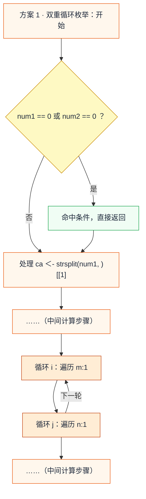

```r
# 版（方案1） 定义函数 multiply_str（参数：num1, num2）
multiply_str <- function(num1, num2) {
    if (num1 == "0" || num2 == "0")
        return("0")  # 若 num1 等于 「0」 或 num2 等于 「0」) return(「0」
    ca <- strsplit(num1, "")[[1]]
    cb <- strsplit(num2, "")[[1]]
    m <- length(ca)
    n <- length(cb)  # 把 长度(ca); 元素个数 小于 减 长度(cb) 存入 映射表
    result <- rep(0L, m + n)  # 把 rep(0L, 映射表 加 元素个数) 存入 结果
    for (i in m:1) {
        # for (下标 i in 映射表:1) { for (下标 j in 元素个数:1) {
        for (j in n:1) {
            mul <- (as.integer(ca[i])) * (as.integer(cb[j]))  # 把 (as.integer(ca[下标 i])) 乘 (as.integer(cb[下标 j])) 存入 mul
            p1 <- i + j - 1
            p2 <- i + j  # 把 下标 i 加 下标 j 减 1; p2 小于 减 下标 i 加 下标 j 存入 p1
            total <- mul + result[p2]  # 把 mul 加 结果[p2] 存入 总和
            result[p2] <- total%%10  # 把 总和 对…取模 对…取模 10 存入 result[p2]
            result[p1] <- result[p1] + total%/%10  # 把 结果[p1] 加 总和 对…取模 除以 对…取模 10 存入 result[p1]
        }
    }
    digits <- result[result != 0 | cumsum(result != 0) > 0 | seq_along(result) == length(result)]
    # 简化：拼接后去前导零
    s <- paste(result, collapse = "")  # 把 paste(结果, collapse 赋值为 「」) 存入 字符串
    s <- sub("^0+", "", s)  # 把 sub(「 按位异或 0 加 」, 「 按位异或 0 加 」, 字符串) 存入 字符串
    if (nchar(s) == 0)
        "0" else s  # 若 nchar(字符串) 等于 0) 「0」 else 字符串
}
stopifnot(multiply_str("2", "3") == "6")  # 断言校验
stopifnot(multiply_str("123", "456") == "56088")  # 断言校验
cat("PASS\n")  # 全部用例通过，输出 PASS
```

#### 方案 2：双重循环枚举

**思路与代码分析**：核心是「双重循环枚举」。R 版用向量化思维与 1 起始下标，注意 1:n 的降序陷阱。代码里依次做这些事：双重循环遍历。**走读**：方案 2 · 双重循环枚举：开始 → 命中条件，直接返回 → 处理 ca ＜- strsplit(num1, )[[1] → 循环 i：遍历 m:1 → 循环 j：遍历 n:1。

**运行架构**（真实控制流）：

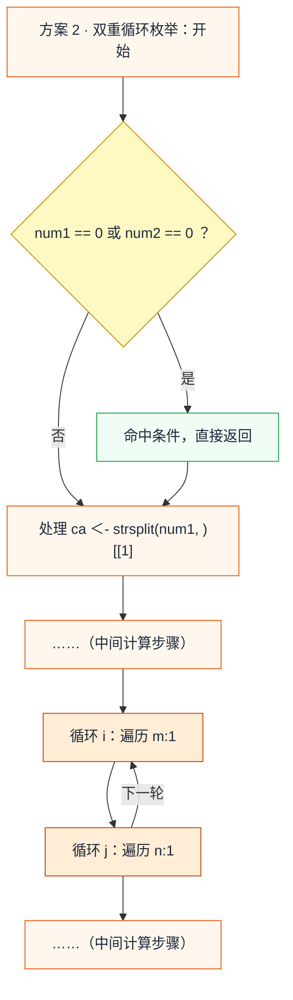

```r
# 版（方案2） 定义函数 multiply_str（参数：num1, num2）
multiply_str <- function(num1, num2) {
    if (num1 == "0" || num2 == "0")
        return("0")  # 若 num1 等于 「0」 或 num2 等于 「0」) return(「0」
    ca <- strsplit(num1, "")[[1]]
    cb <- strsplit(num2, "")[[1]]
    m <- length(ca)
    n <- length(cb)  # 把 长度(ca); 元素个数 小于 减 长度(cb) 存入 映射表
    result <- rep(0L, m + n)  # 把 rep(0L, 映射表 加 元素个数) 存入 结果
    for (i in m:1) {
        # for (下标 i in 映射表:1) { for (下标 j in 元素个数:1) {
        for (j in n:1) {
            mul <- (as.integer(ca[i])) * (as.integer(cb[j]))  # 把 (as.integer(ca[下标 i])) 乘 (as.integer(cb[下标 j])) 存入 mul
            p1 <- i + j - 1
            p2 <- i + j  # 把 下标 i 加 下标 j 减 1; p2 小于 减 下标 i 加 下标 j 存入 p1
            total <- mul + result[p2]  # 把 mul 加 结果[p2] 存入 总和
            result[p2] <- total%%10  # 把 总和 对…取模 对…取模 10 存入 result[p2]
            result[p1] <- result[p1] + total%/%10  # 把 结果[p1] 加 总和 对…取模 除以 对…取模 10 存入 result[p1]
        }
    }
    digits <- result[result != 0 | cumsum(result != 0) > 0 | seq_along(result) == length(result)]
    # 简化：拼接后去前导零
    s <- paste(result, collapse = "")  # 把 paste(结果, collapse 赋值为 「」) 存入 字符串
    s <- sub("^0+", "", s)  # 把 sub(「 按位异或 0 加 」, 「 按位异或 0 加 」, 字符串) 存入 字符串
    if (nchar(s) == 0)
        "0" else s  # 若 nchar(字符串) 等于 0) 「0」 else 字符串
}
stopifnot(multiply_str("2", "3") == "6")  # 断言校验
stopifnot(multiply_str("123", "456") == "56088")  # 断言校验
cat("PASS\n")  # 全部用例通过，输出 PASS
```

### Zig 实现（2 种方案）

Zig 的全部方案如下，每个方案都内嵌用例自测，可独立运行（老仓库 python/go 文件遵循「打印结果」约定）：

#### 方案 1：双重循环枚举

**思路与代码分析**：核心是「双重循环枚举」。Zig 版显式分配与清零，整型边界处理严格。代码里依次做这些事：单循环线性扫描。**走读**：方案 1 · 双重循环枚举：开始 → 若 std.mem.eql(u8, num1, 0) or std.mem.eql(u8, num2, 0) 则： → 返回  → 当 (i ＞ 0) 时反复执行 → 当 (j ＞ 0) 时反复执行 → 遍历集合元素。

**运行架构**（真实控制流）：

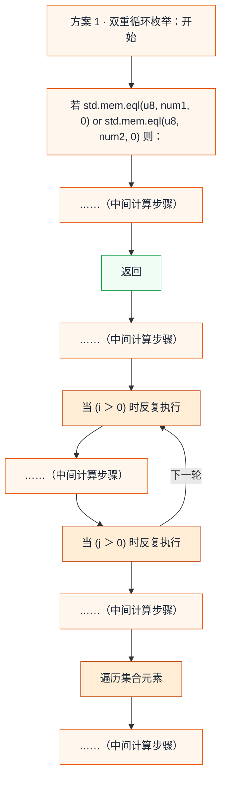

```zig
// LeetCode 43. 字符串相乘 — Zig 版（方案1）
const std = @import("std"); // 把 @import(「std」) 存入 std
fn multiply(num1: []const u8, num2: []const u8, out: *std.ArrayList(u8)) void { // 定义函数/方法 multiply
    if (std.mem.eql(u8, num1, "0") or std.mem.eql(u8, num2, "0")) { // 若 std.mem.eql(u8, num1, 「0」) or std.mem.eql(u8, num2, 「0」
        out.append('0') catch unreachable; // 把 '0' 追加到列表尾部
        return; // return;
    }
    const m = num1.len; // 把 num1.长度 存入 映射表
    const n = num2.len; // 把 num2.长度 存入 元素个数
    var result = [_]i32{0} ** 512; // 把 [_]i32{0} 乘 乘 512 存入 结果
    var i: usize = m; // 把 映射表; 写入 var i: usize
    while (i > 0) { // 循环，直到不满足「下标 i 超过 0」
        i -= 1; // 下标 i累减 1
        var j: usize = n; // 把 元素个数; 写入 var j: usize
        while (j > 0) { // 循环，直到不满足「下标 j 超过 0」
            j -= 1; // 下标 j累减 1
            const mul = @as(i32, num1[i] - '0') * @as(i32, num2[j] - '0');
            const p1 = i + j; // 把 下标 i 加 下标 j 存入 p1
            const p2 = i + j + 1; // 把 下标 i 加 下标 j 加 1 存入 p2
            const total = mul + result[p2]; // 把 mul 加 结果[p2] 存入 总和
            result[p2] = @mod(total, 10); // 把 @mod(总和, 10); 写入 result[p2]
            result[p1] += @divTrunc(total, 10); // result[p1]累加 @divTrunc(总和, 10)
        }
    }
    var started = false; // 把 false 存入 started
    for (result[0 .. m + n]) |d| { // for (结果[0 .. 映射表 加 元素个数]) 按位或 d 按位或 {
        if (d != 0 or started) { // 若 d 不等于 0 or started
            out.append('0' + @as(u8, @intCast(d))) catch unreachable; // 把 '0' 加 @as(u8, @intCast(d 追加到列表尾部
            started = true; // 把 true; 写入 started
        }
    }
    if (out.items.len == 0) out.append('0') catch unreachable; // 若 out.items.长度 等于 0) out 追加 '0') catch unreachable;
}
pub fn main() !void { // 程序入口：跑内嵌自测用例
    var out = std.ArrayList(u8).init(std.heap.page_allocator); // 把 std.ArrayList(u8).init(std.堆.page_allocator) 存入 out
    defer out.deinit(); // defer out.deinit();
    multiply("2", "3", &out); // multiply(「2」, 「2」, 按位与 out);
    if (!std.mem.eql(u8, out.items, "6")) return error.TestFailed; // 若 取反 std.mem.eql(u8, out.items, 「6」)，直接返回 error.TestFailed
    out.clearRetainingCapacity(); // out.clearRetainingCapacity();
    multiply("123", "456", &out); // multiply(「123」, 「123」, 按位与 out);
    if (!std.mem.eql(u8, out.items, "56088")) return error.TestFailed;
    std.debug.print("PASS\n", .{}); // 全部用例通过，输出 PASS
}
```

#### 方案 2：双重循环枚举

**思路与代码分析**：核心是「双重循环枚举」。Zig 版显式分配与清零，整型边界处理严格。代码里依次做这些事：单循环线性扫描。**走读**：方案 2 · 双重循环枚举：开始 → 若 std.mem.eql(u8, num1, 0) or std.mem.eql(u8, num2, 0) 则： → 返回  → 当 (i ＞ 0) 时反复执行 → 当 (j ＞ 0) 时反复执行 → 遍历集合元素。

**运行架构**（真实控制流）：

```mermaid
graph TD
    N0["方案 2 · 双重循环枚举：开始"]
    N1["若 std.mem.eql(u8, num1, 0) or std.mem.eql(u8, num2, 0) 则："]
    D1["……（中间计算步骤）"]
    N3["返回 "]
    D2["……（中间计算步骤）"]
    N8["当 (i ＞ 0) 时反复执行"]
    D3["……（中间计算步骤）"]
    N11["当 (j ＞ 0) 时反复执行"]
    D4["……（中间计算步骤）"]
    N20["遍历集合元素"]
    Dend["……（中间计算步骤）"]
    N0 --> N1
    N11 -- 下一轮 --> N8
    N1 --> D1
    D1 --> N3
    N3 --> D2
    D2 --> N8
    N8 --> D3
    D3 --> N11
    N11 --> D4
    D4 --> N20
    N20 --> Dend
    classDef n fill:#fff7ed,stroke:#ea580c,color:#1e293b;
    classDef lp fill:#ffedd5,stroke:#c2410c,color:#1e293b;
    classDef dc fill:#fef9c3,stroke:#ca8a04,color:#1e293b;
    classDef tm fill:#f0fdf4,stroke:#16a34a,color:#1e293b;
    class N0,N1,D1,D2,D3,D4,Dend n;
    class N8,N11,N20 lp;
    class N3 tm;
```

```zig
// LeetCode 43. 字符串相乘 — Zig 版（方案2）
const std = @import("std"); // 把 @import(「std」) 存入 std
fn multiply(num1: []const u8, num2: []const u8, out: *std.ArrayList(u8)) void { // 定义函数/方法 multiply
    if (std.mem.eql(u8, num1, "0") or std.mem.eql(u8, num2, "0")) { // 若 std.mem.eql(u8, num1, 「0」) or std.mem.eql(u8, num2, 「0」
        out.append('0') catch unreachable; // 把 '0' 追加到列表尾部
        return; // return;
    }
    const m = num1.len; // 把 num1.长度 存入 映射表
    const n = num2.len; // 把 num2.长度 存入 元素个数
    var result = [_]i32{0} ** 512; // 把 [_]i32{0} 乘 乘 512 存入 结果
    var i: usize = m; // 把 映射表; 写入 var i: usize
    while (i > 0) { // 循环，直到不满足「下标 i 超过 0」
        i -= 1; // 下标 i累减 1
        var j: usize = n; // 把 元素个数; 写入 var j: usize
        while (j > 0) { // 循环，直到不满足「下标 j 超过 0」
            j -= 1; // 下标 j累减 1
            const mul = @as(i32, num1[i] - '0') * @as(i32, num2[j] - '0');
            const p1 = i + j; // 把 下标 i 加 下标 j 存入 p1
            const p2 = i + j + 1; // 把 下标 i 加 下标 j 加 1 存入 p2
            const total = mul + result[p2]; // 把 mul 加 结果[p2] 存入 总和
            result[p2] = @mod(total, 10); // 把 @mod(总和, 10); 写入 result[p2]
            result[p1] += @divTrunc(total, 10); // result[p1]累加 @divTrunc(总和, 10)
        }
    }
    var started = false; // 把 false 存入 started
    for (result[0 .. m + n]) |d| { // for (结果[0 .. 映射表 加 元素个数]) 按位或 d 按位或 {
        if (d != 0 or started) { // 若 d 不等于 0 or started
            out.append('0' + @as(u8, @intCast(d))) catch unreachable; // 把 '0' 加 @as(u8, @intCast(d 追加到列表尾部
            started = true; // 把 true; 写入 started
        }
    }
    if (out.items.len == 0) out.append('0') catch unreachable; // 若 out.items.长度 等于 0) out 追加 '0') catch unreachable;
}
pub fn main() !void { // 程序入口：跑内嵌自测用例
    var out = std.ArrayList(u8).init(std.heap.page_allocator); // 把 std.ArrayList(u8).init(std.堆.page_allocator) 存入 out
    defer out.deinit(); // defer out.deinit();
    multiply("2", "3", &out); // multiply(「2」, 「2」, 按位与 out);
    if (!std.mem.eql(u8, out.items, "6")) return error.TestFailed; // 若 取反 std.mem.eql(u8, out.items, 「6」)，直接返回 error.TestFailed
    out.clearRetainingCapacity(); // out.clearRetainingCapacity();
    multiply("123", "456", &out); // multiply(「123」, 「123」, 按位与 out);
    if (!std.mem.eql(u8, out.items, "56088")) return error.TestFailed;
    std.debug.print("PASS\n", .{}); // 全部用例通过，输出 PASS
}
```

### Dart 实现（2 种方案）

Dart 的全部方案如下，每个方案都内嵌用例自测，可独立运行（老仓库 python/go 文件遵循「打印结果」约定）：

#### 方案 1：双重循环枚举

**思路与代码分析**：核心是「双重循环枚举」。Dart 版用可空类型标注与集合方法，注意空安全。代码里依次做这些事：双重循环遍历。**走读**：方案 1 · 双重循环枚举：开始 → 命中条件，直接返回 → 更新 m → 遍历循环 → 遍历循环 → 遍历循环 → 返回 s.isEmpty ? '0' : s。

**运行架构**（真实控制流）：

```mermaid
graph TD
    N0["方案 1 · 双重循环枚举：开始"]
    N1{"num1 == '0' 或 num2 == '0' ？"}
    N2["命中条件，直接返回"]
    N3["更新 m"]
    D1["……（中间计算步骤）"]
    N8["遍历循环"]
    N9["遍历循环"]
    D2["……（中间计算步骤）"]
    N18["遍历循环"]
    D3["……（中间计算步骤）"]
    N23["返回 s.isEmpty ? '0' : s"]
    N0 --> N1
    N1 -- 是 --> N2
    N1 -- 否 --> N3
    N8 --> N9
    N9 -- 下一轮 --> N8
    N2 --> N3
    N3 --> D1
    D1 --> N8
    N9 --> D2
    D2 --> N18
    N18 --> D3
    D3 --> N23
    classDef n fill:#fff7ed,stroke:#ea580c,color:#1e293b;
    classDef lp fill:#ffedd5,stroke:#c2410c,color:#1e293b;
    classDef dc fill:#fef9c3,stroke:#ca8a04,color:#1e293b;
    classDef tm fill:#f0fdf4,stroke:#16a34a,color:#1e293b;
    class N0,N3,D1,D2,D3 n;
    class N8,N9,N18 lp;
    class N1 dc;
    class N2,N23 tm;
```

```dart
// LeetCode 43. 字符串相乘 — Dart 版（方案1）
String multiply(String num1, String num2) {
  // 定义函数/方法 multiply
  if (num1 == '0' || num2 == '0')
    return '0'; // 若 num1 等于 '0' 或 num2 等于 '0'，直接返回 '0'
  final m = num1.length, n = num2.length; // 把 num1.长度, 元素个数 赋值为 num2.长度 存入 映射表
  final result = List<int>.filled(
    m + n,
    0,
  ); // 把 List 小于 int 超过 .filled(映射表 加 元素个数, 0) 存入 结果
  for (var i = m - 1; i >= 0; i--) {
    // 让 下标 i 从 映射表 减 1 开始计数，下标 i 不低于 0 就继续
    for (var j = n - 1; j >= 0; j--) {
      // 让 下标 j 从 元素个数 减 1 开始计数，下标 j 不低于 0 就继续
      final mul = (num1.codeUnitAt(i) - 0x30) * (num2.codeUnitAt(j) - 0x30);
      final p1 = i + j,
          p2 = i + j + 1; // 把 下标 i 加 下标 j, p2 赋值为 下标 i 加 下标 j 加 1 存入 p1
      final total = mul + result[p2]; // 把 mul 加 结果[p2] 存入 总和
      result[p2] = total % 10; // 把 总和 对…取模 10; 写入 result[p2]
      result[p1] += total ~/ 10; // result[p1]累加 总和 ~ 除以 10
    }
  }
  final sb = StringBuffer(); // 把 StringBuffer() 存入 sb
  var started = false; // 把 false 存入 started
  for (final d in result) {
    // for (final d in 结果) {
    if (d != 0 || started) {
      // 若 d 不等于 0 或 started
      sb.write(d); // sb.write(d);
      started = true; // 把 true 存入 started
    }
  }
  final s = sb.toString(); // 把 sb.toString() 存入 字符串
  return s.isEmpty ? '0' : s; // 返回 字符串.isEmpty ? '0' : 字符串
}

void main() {
  // 程序入口：跑内嵌自测用例
  if (multiply('2', '3') != '6')
    throw StateError(
      'c1',
    ); // 若 multiply('2', '3') 不等于 '6') throw StateError('c1');
  if (multiply('123', '456') != '56088') throw StateError('c2');
  print('PASS'); // 全部用例通过，输出 PASS
}
```

#### 方案 2：双重循环枚举

**思路与代码分析**：核心是「双重循环枚举」。Dart 版用可空类型标注与集合方法，注意空安全。代码里依次做这些事：双重循环遍历。**走读**：方案 2 · 双重循环枚举：开始 → 命中条件，直接返回 → 更新 m → 遍历循环 → 遍历循环 → 遍历循环 → 返回 s.isEmpty ? '0' : s。

**运行架构**（真实控制流）：

```mermaid
graph TD
    N0["方案 2 · 双重循环枚举：开始"]
    N1{"num1 == '0' 或 num2 == '0' ？"}
    N2["命中条件，直接返回"]
    N3["更新 m"]
    D1["……（中间计算步骤）"]
    N8["遍历循环"]
    N9["遍历循环"]
    D2["……（中间计算步骤）"]
    N18["遍历循环"]
    D3["……（中间计算步骤）"]
    N23["返回 s.isEmpty ? '0' : s"]
    N0 --> N1
    N1 -- 是 --> N2
    N1 -- 否 --> N3
    N8 --> N9
    N9 -- 下一轮 --> N8
    N2 --> N3
    N3 --> D1
    D1 --> N8
    N9 --> D2
    D2 --> N18
    N18 --> D3
    D3 --> N23
    classDef n fill:#fff7ed,stroke:#ea580c,color:#1e293b;
    classDef lp fill:#ffedd5,stroke:#c2410c,color:#1e293b;
    classDef dc fill:#fef9c3,stroke:#ca8a04,color:#1e293b;
    classDef tm fill:#f0fdf4,stroke:#16a34a,color:#1e293b;
    class N0,N3,D1,D2,D3 n;
    class N8,N9,N18 lp;
    class N1 dc;
    class N2,N23 tm;
```

```dart
// LeetCode 43. 字符串相乘 — Dart 版（方案2）
String multiply(String num1, String num2) {
  // 定义函数/方法 multiply
  if (num1 == '0' || num2 == '0')
    return '0'; // 若 num1 等于 '0' 或 num2 等于 '0'，直接返回 '0'
  final m = num1.length, n = num2.length; // 把 num1.长度, 元素个数 赋值为 num2.长度 存入 映射表
  final result = List<int>.filled(
    m + n,
    0,
  ); // 把 List 小于 int 超过 .filled(映射表 加 元素个数, 0) 存入 结果
  for (var i = m - 1; i >= 0; i--) {
    // 让 下标 i 从 映射表 减 1 开始计数，下标 i 不低于 0 就继续
    for (var j = n - 1; j >= 0; j--) {
      // 让 下标 j 从 元素个数 减 1 开始计数，下标 j 不低于 0 就继续
      final mul = (num1.codeUnitAt(i) - 0x30) * (num2.codeUnitAt(j) - 0x30);
      final p1 = i + j,
          p2 = i + j + 1; // 把 下标 i 加 下标 j, p2 赋值为 下标 i 加 下标 j 加 1 存入 p1
      final total = mul + result[p2]; // 把 mul 加 结果[p2] 存入 总和
      result[p2] = total % 10; // 把 总和 对…取模 10; 写入 result[p2]
      result[p1] += total ~/ 10; // result[p1]累加 总和 ~ 除以 10
    }
  }
  final sb = StringBuffer(); // 把 StringBuffer() 存入 sb
  var started = false; // 把 false 存入 started
  for (final d in result) {
    // for (final d in 结果) {
    if (d != 0 || started) {
      // 若 d 不等于 0 或 started
      sb.write(d); // sb.write(d);
      started = true; // 把 true 存入 started
    }
  }
  final s = sb.toString(); // 把 sb.toString() 存入 字符串
  return s.isEmpty ? '0' : s; // 返回 字符串.isEmpty ? '0' : 字符串
}

void main() {
  // 程序入口：跑内嵌自测用例
  if (multiply('2', '3') != '6')
    throw StateError(
      'c1',
    ); // 若 multiply('2', '3') 不等于 '6') throw StateError('c1');
  if (multiply('123', '456') != '56088') throw StateError('c2');
  print('PASS'); // 全部用例通过，输出 PASS
}
```

---

## 内容总结

- **字符串相乘**（字符串 · Medium）：共 2 个方案，主线思路「双重循环枚举」；时间 O(n²)（两层嵌套扫描）；动画演示滑动窗口过程，附录给出 11 种语言 × 全部方案的可运行实现。
- 来源博客：[https://blog.csdn.net/tyro_java/article/details/145381943](https://blog.csdn.net/tyro_java/article/details/145381943)
- 导航：[📋 总目录](../) ｜ [← 074 字符串相加](../074_字符串相加/) ｜ [076 密钥格式化 →](../076_密钥格式化/)
