# 076 · 密钥格式化（第三阶段 · 字符串 · Medium）

> **难度**：⭐⭐ Medium ｜ **专题**：字符串
> **学习定位**：第三阶段 · 字符串第 76 篇 ｜ **解法数**：2
> **内容总结**：**密钥格式化**（字符串 · Medium）：共 2 个方案，主线思路「逆序分组」；时间 O(n)（单趟线性扫描）；动画演示滑动窗口过程，附录给出 11 种语言 × 全部方案的可运行实现。

---

## 题目描述

给定一个许可密钥字符串 `s`，仅由字母、数字字符和破折号组成。字符串由 `n` 个破折号分成 `n + 1` 组。你也会得到一个整数 `k` 。

我们想要重新格式化字符串 `s`，使每一组包含 `k` 个字符，除了第一组，它可以比 `k` 短，但仍然必须包含至少一个字符。此外，两组之间必须插入破折号，并且应该将所有小写字母转换为大写字母。

返回 重新格式化的许可密钥 。

**用例（来自原题）**：

**示例 1**

```text
输入：S = "5F3Z-2e-9-w", k = 4
输出："5F3Z-2E9W"
```

解释：字符串 S 被分成了两个部分，每部分 4 个字符； 注意，两个额外的破折号需要删掉。

**示例 2**

```text
输入：S = "2-5g-3-J", k = 2
输出："2-5G-3J"
```

解释：字符串 S 被分成了 3 个部分，按照前面的规则描述，第一部分的字符可以少于给定的数量，其余部分皆为 2 个字符。
> 题面与 [leetcode.cn 官方](https://leetcode.cn/problems/license-key-formatting/)一致，示例配图取自官方题面。

**数据范围与注意事项**：

- `1 <= s.length <= 10^5`
- `s` 只包含字母、数字和破折号 `'-'`.
- `1 <= k <= 10^4`
- **易错点**：空串、全空白、单字符三类边界，以及大小写是否敏感。

## 题目分析

**场景是什么**：字符串是字符数组，这类题练的是扫描、切分与匹配，对应真实开发里的文本清洗、协议解析。本题就是该场景的 Medium 级练习，主线做法是「逆序分组」。

**主线怎么解**：把主解法从头到尾过一遍，它其实在依次做这几件事：单循环线性扫描。

## 解题思路

**方案对比**（共 2 个方案，由浅入深）：

| 方案 | 时间复杂度 | 空间复杂度 |
|---|---|---|
| 方案 1 · 逆序分组 | O(n)（单趟线性扫描） | O(1) 到 O(n)（视辅助结构） |
| 方案 2 · 逆序分组 | O(n)（单趟线性扫描） | O(1) 到 O(n)（视辅助结构） |

**方案间的取舍**：方案 1（逆序分组）；方案 2（逆序分组）。数据规模小、可读性优先时选靠前的方案；规模大、性能优先时选靠后的方案。

**怎么读这一篇**：

- 🐣 **新手路线**：把「题目描述」的示例 1 在纸上手推一遍 → 读方案 1（最直观的写法）与它的代码走读 → 按「运行方式」本地跑通看 PASS → 回头对比方案 2 之后的写法差在哪
- 🦅 **大佬路线**：直接锁定最优方案 1（逆序分组，O(n)（单趟线性扫描））→ 跳读该方案代码与走读 → 用「逐步拆解与面试追问」补齐复杂度推导与边界追问

### 动态算法图（滑动窗口，GIF 自动循环）


动画演示字符串专题里滑动窗口的典型过程；每个方案在「TypeScript 解题方案」一节还配了专属动画与专属流程图。

### 主解法流程图（真实控制流）

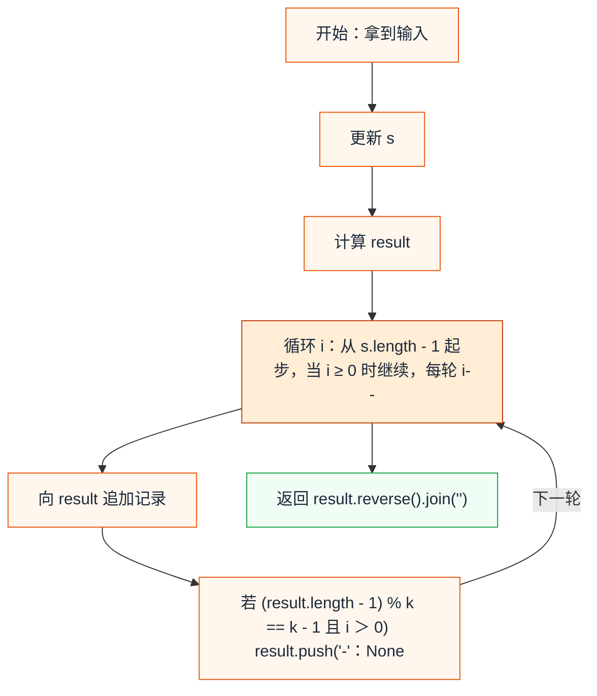

## TypeScript 解题方案（2 个方案逐个讲）

> **运行与提交**：每个方案都是自包含文件（内嵌用例自测，输出 PASS），整块复制到 `.ts` 文件后 `node 文件名` 即可运行。提交 LeetCode 时，把 `demo` 内的算法函数与辅助类型/函数整体取出、置于文件顶层即可。涉及交互/特殊接口的题以题面给定签名为准。

### 方案 1：逆序分组

**分析与思路**：核心做法是「逆序分组」。代码里依次做这些事：单循环线性扫描。

**运行方式**：`node 本文件`，内嵌用例全部通过会输出 PASS。

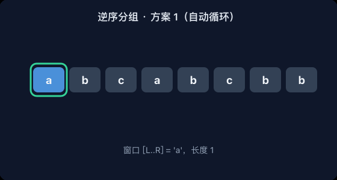

**方案专属流程图**（真实控制流）：


```typescript
/**
 ** LeetCode 482. 密钥格式化
 ** 方案：1 ) 方案1：逆序分组
 ** 来源：https://blog.csdn.net/tyro_java/article/details/145385760
 */

export function licenseKeyFormatting(s: string, k: number): string {
  // 定义函数/方法 licenseKeyFormatting
  s = s.replace(/-/g, '').toUpperCase(); // 把 字符串.replace( 除以 减 除以 g, '').toUpperCase() 存入 字符串
  const result: string[] = []; // 把 []; 写入 const result: string[]
  for (let i = s.length - 1; i >= 0; i--) {
    // 让 下标 i 从 字符串.长度 减 1 开始计数，下标 i 不低于 0 就继续
    result.push(s[i]); // 把 字符串[下标 i] 压入栈/数组尾部
    if ((result.length - 1) % k === k - 1 && i > 0) result.push('-');
  }
  return result.reverse().join(''); // 返回 结果.reverse().join('')
}

export function demo(): void {
  // 程序入口：跑内嵌自测用例
  if (licenseKeyFormatting('abc', 1) !== 'A-B-C')
    throw new Error('FAILED: ' + licenseKeyFormatting('abc', 1));
  if (licenseKeyFormatting('5F3Z-2e-9-w', 4) !== '5-F3Z-2E9W')
    throw new Error('FAILED 2');
  console.log('PASS'); // 全部用例通过，输出 PASS
}

demo(); // demo();
```

### 方案 2：逆序分组

**分析与思路**：核心做法是「逆序分组」。代码里依次做这些事：单循环线性扫描。

**运行方式**：`node 本文件`，内嵌用例全部通过会输出 PASS。


**方案专属流程图**（真实控制流）：

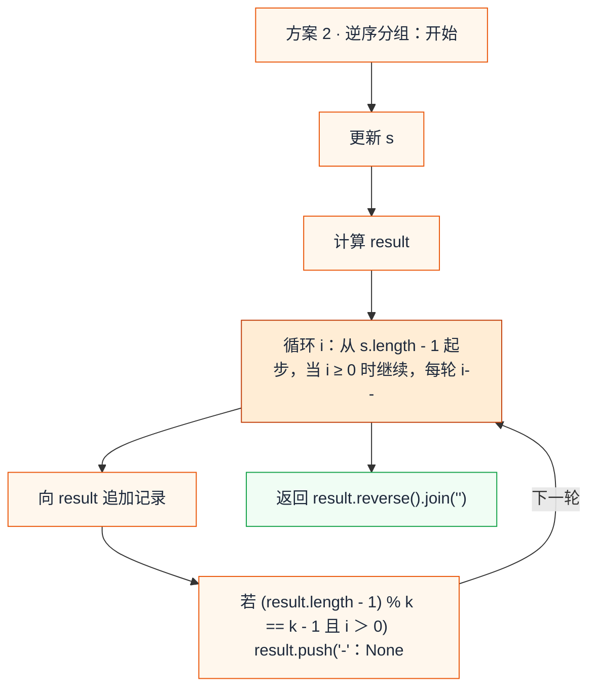

```typescript
/**
 ** LeetCode 482. 密钥格式化
 ** 方案：2 ) 方案2：逆序分组
 ** 来源：https://blog.csdn.net/tyro_java/article/details/145385760
 */

export function licenseKeyFormatting(s: string, k: number): string {
  // 定义函数/方法 licenseKeyFormatting
  s = s.replace(/-/g, '').toUpperCase(); // 把 字符串.replace( 除以 减 除以 g, '').toUpperCase() 存入 字符串
  const result: string[] = []; // 把 []; 写入 const result: string[]
  for (let i = s.length - 1; i >= 0; i--) {
    // 让 下标 i 从 字符串.长度 减 1 开始计数，下标 i 不低于 0 就继续
    result.push(s[i]); // 把 字符串[下标 i] 压入栈/数组尾部
    if ((result.length - 1) % k === k - 1 && i > 0) result.push('-');
  }
  return result.reverse().join(''); // 返回 结果.reverse().join('')
}

export function demo(): void {
  // 程序入口：跑内嵌自测用例
  if (licenseKeyFormatting('abc', 1) !== 'A-B-C')
    throw new Error('FAILED: ' + licenseKeyFormatting('abc', 1));
  if (licenseKeyFormatting('5F3Z-2e-9-w', 4) !== '5-F3Z-2E9W')
    throw new Error('FAILED 2');
  console.log('PASS'); // 全部用例通过，输出 PASS
}

demo(); // demo();
```

## 逐步拆解与面试追问

**复杂度**：时间 O(n)（单趟线性扫描），空间 O(1) 到 O(n)（视辅助结构）

**为什么是这个量级**：每个元素被常数次访问，辅助哈希或栈的开销与 n 同阶

**面试官可能会追问**：

- 字符集有多大，能否用定长数组计数？
- 要不要考虑 Unicode 多字节字符？
- 空串与单字符的边界？

## 关键 API 速查（TS 主解法实际用到，附官方链接）

| API | 作用 | 使用要点 | 官方文档 |
|---|---|---|---|
| `Array.prototype.push()` | 尾部追加 | 返回新长度；可一次多个；均摊 O(1)；会改变原数组 | [官方文档](https://developer.mozilla.org/zh-CN/docs/Web/JavaScript/Reference/Global_Objects/Array/push) |
| `Array.prototype.join()` | 数组拼接为字符串 | undefined/null 转空串；嵌套数组会展平一层；join('') 用于字符数组还原 | [官方文档](https://developer.mozilla.org/zh-CN/docs/Web/JavaScript/Reference/Global_Objects/Array/join) |
| `String.prototype.replace()` | 替换首个匹配 | 字符串参数只替换第一处；全局替换用 replace(/x/g, …)；回调可动态生成替换文本 | [官方文档](https://developer.mozilla.org/zh-CN/docs/Web/JavaScript/Reference/Global_Objects/String/replace) |

### 各语言官方文档导航

- **TypeScript / JS**：[MDN 中文参考](https://developer.mozilla.org/zh-CN/)
- **Python**：[Python 官方文档](https://docs.python.org/zh-cn/3/)
- **Go**：[Go 标准库](https://pkg.go.dev/std)
- **Java**：[JDK 17 API](https://docs.oracle.com/en/java/javase/17/docs/api/)
- **Rust**：[Rust 标准库](https://doc.rust-lang.org/std/)
- **Lua**：[Lua 5.4 手册](https://www.lua.org/manual/5.4/)
- **C**：[Cppreference C](https://zh.cppreference.com/w/c)
- **C++**：[Cppreference C++](https://zh.cppreference.com/w/cpp)
- **R**：[R 官方手册](https://stat.ethz.ch/R-manual/)
- **Zig**：[Zig 语言文档](https://ziglang.org/documentation/master/)
- **Dart**：[Dart API](https://api.dart.dev/)

## 附录：其他 10 种语言全部实现（每种语言列举其全部方案）

> TypeScript 的全部方案见「TypeScript 解题方案」一节；下面是其余 10 种语言的对应实现，每种语言的每个方案都带思路分析、代码走读与专属运行架构图。
> 每个方案都内嵌用例自测，可独立运行（老仓库 python/go 文件遵循「打印结果」约定）。
> 完整解法文件见 `dsa/<语言>/string/lc_482_密钥格式化/`。

### Python 实现（2 种方案）

Python 的全部方案如下，每个方案都内嵌用例自测，可独立运行（老仓库 python/go 文件遵循「打印结果」约定）：

#### 方案 1：逆序分组

**思路与代码分析**：核心是「逆序分组」。Python 版用切片与字典推导式简化操作，突出可读性。**走读**：方案 1 · 逆序分组：开始 → 更新 s → 更新 result → 循环 i：从 0 到 len(s 前 → 向 result 追加记录 → 处理 if ( → 调用 len(result) - 1 → 更新 = → 向 result 追加记录 → 返回 .join(reversed(result))。

**运行架构**（真实控制流）：


```python
import sys  # 提高递归深度上限（深输入防 RecursionError）

sys.setrecursionlimit(200000)  # 树/链表类题目节点数可达 1e4 量级

def licenseKeyFormatting(s, k):  # 定义函数 licenseKeyFormatting（参数：字符串, 下标 k）
    s = s.replace("-", "").upper()  # 把 字符串.replace(' 减 ', '').upper() 存入 字符串
    result = []  # 把 [] 存入 结果
    for i in range(len(s) - 1, -1, -1):  # 让 下标 i 从 长度(字符串) 减 1 倒数回去（每步减 1）
        result.append(s[i])  # 把 字符串[下标 i] 追加到列表尾部
        if (
            len(result) - 1
        ) % k == k - 1 and i > 0:  # 若 长度(结果) 减 1) 对…取模 下标 k 等于 下标 k 减 1 and 下标 i 超过 0
            result.append("-")  # 把 ' 减 ' 追加到列表尾部
    return "".join(reversed(result))  # 返回 ''.join(reversed(结果))

if __name__ == "__main__":  # 若 __name__ 等于 '__main__'
    print(licenseKeyFormatting("abc", 1))  # 打印输出
```

#### 方案 2：逆序分组

**思路与代码分析**：核心是「逆序分组」。Python 版用切片与字典推导式简化操作，突出可读性。**走读**：方案 2 · 逆序分组：开始 → 更新 s → 更新 result → 循环 i：从 0 到 len(s 前 → 向 result 追加记录 → 处理 if ( → 调用 len(result) - 1 → 更新 = → 向 result 追加记录 → 返回 .join(reversed(result))。

**运行架构**（真实控制流）：

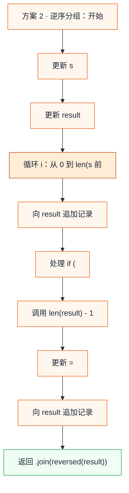

```python
import sys  # 提高递归深度上限（深输入防 RecursionError）

sys.setrecursionlimit(200000)  # 树/链表类题目节点数可达 1e4 量级

def licenseKeyFormatting(s, k):  # 定义函数 licenseKeyFormatting（参数：字符串, 下标 k）
    s = s.replace("-", "").upper()  # 把 字符串.replace(' 减 ', '').upper() 存入 字符串
    result = []  # 把 [] 存入 结果
    for i in range(len(s) - 1, -1, -1):  # 让 下标 i 从 长度(字符串) 减 1 倒数回去（每步减 1）
        result.append(s[i])  # 把 字符串[下标 i] 追加到列表尾部
        if (
            len(result) - 1
        ) % k == k - 1 and i > 0:  # 若 长度(结果) 减 1) 对…取模 下标 k 等于 下标 k 减 1 and 下标 i 超过 0
            result.append("-")  # 把 ' 减 ' 追加到列表尾部
    return "".join(reversed(result))  # 返回 ''.join(reversed(结果))

if __name__ == "__main__":  # 若 __name__ 等于 '__main__'
    print(licenseKeyFormatting("abc", 1))  # 打印输出
```

### Go 实现（2 种方案）

Go 的全部方案如下，每个方案都内嵌用例自测，可独立运行（老仓库 python/go 文件遵循「打印结果」约定）：

#### 方案 1：逆序分组

**思路与代码分析**：核心是「逆序分组」。Go 版用切片与多返回值惯用法，显式处理索引边界。**走读**：方案 1 · 逆序分组：开始 → 更新 s → 更新 s → 计算 result → 遍历循环 → 更新 result → 若 len(result)-1：更新 = → 更新 result → 遍历循环 → 更新 result[j] → 返回 string(result)。

**运行架构**（真实控制流）：


```go
package main // 引入依赖

import (
	"fmt"     // 「fmt」
	"os"      // 「os」
	"reflect" // 「reflect」
	"strings" // 「strings」
)

func licenseKeyFormatting(s string, k int) string { // 定义函数/方法 licenseKeyFormatting
	s = strings.ReplaceAll(s, "-", "") // 把 strings.ReplaceAll(字符串, 「 减 」, 「 减 」) 写入 字符串
	s = strings.ToUpper(s)             // 把 strings.ToUpper(字符串) 写入 字符串
	var result []byte                  // var 结果 []byte
	for i := len(s) - 1; i >= 0; i-- { // 把 长度(字符串) 减 1; 下标 i 不低于 0; 下标 i 减一 { 写入 for i :
		result = append(result, s[i])          // 把 append(结果, 字符串[下标 i]) 写入 结果
		if (len(result)-1)%k == k-1 && i > 0 { // 若 长度(结果) 减 1) 对…取模 下标 k 等于 下标 k 减 1 且 下标 i 超过 0
			result = append(result, '-') // 把 append(结果, ' 减 ') 写入 结果
		}
	}
	for i, j := 0, len(result)-1; i < j; i, j = i+1, j-1 {
		result[i], result[j] = result[j], result[i] // 把 结果[下标 j], 结果[下标 i] 写入 result[i], result[j]
	}
	return string(result) // 定义函数/方法 string
}

func main() { // 程序入口：跑内嵌自测用例
	type tc struct { // 定义类型
		s    string // 字符串 string
		k    int    // 下标 k int
		want string // want string
	}
	cases := []tc{ // 把 []tc{ 写入 cases :
		{"abc", 1, "A-B-C"},
		{"5F3Z-2e-9-w", 4, "5-F3Z-2E9W"},
		{"2-5g-3-J", 2, "2-5-G-3J"},
	}
	ok := true                // 把 true 写入 ok :
	for _, c := range cases { // 同时取 _ 与 字符 遍历
		if got := licenseKeyFormatting(c.s, c.k); !reflect.DeepEqual(got, c.want) {
			ok = false                                                                         // 把 false 写入 ok
			fmt.Printf("FAIL licenseKeyFormatting(%q,%d)=%q want %q\n", c.s, c.k, got, c.want) // 打印输出
		}
	}
	if !ok { // 若 取反 ok
		os.Exit(1) // os.Exit(1)
	}
	fmt.Println("PASS") // 全部用例通过，输出 PASS
}
```

#### 方案 2：逆序分组

**思路与代码分析**：核心是「逆序分组」。Go 版用切片与多返回值惯用法，显式处理索引边界。**走读**：方案 2 · 逆序分组：开始 → 更新 s → 更新 s → 计算 result → 遍历循环 → 更新 result → 若 len(result)-1：更新 = → 更新 result → 遍历循环 → 更新 result[j] → 返回 string(result)。

**运行架构**（真实控制流）：

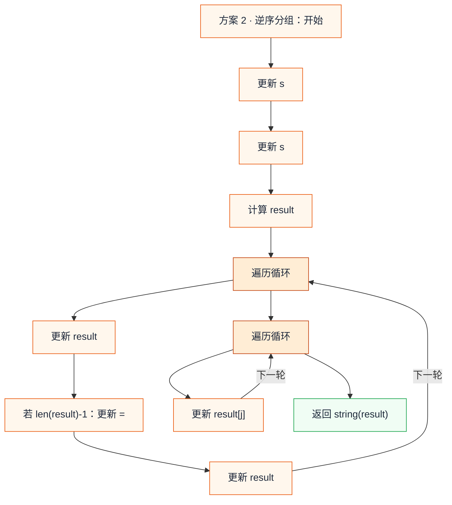

```go
package main // 引入依赖

import (
	"fmt"     // 「fmt」
	"os"      // 「os」
	"reflect" // 「reflect」
	"strings" // 「strings」
)

func licenseKeyFormatting(s string, k int) string { // 定义函数/方法 licenseKeyFormatting
	s = strings.ReplaceAll(s, "-", "") // 把 strings.ReplaceAll(字符串, 「 减 」, 「 减 」) 写入 字符串
	s = strings.ToUpper(s)             // 把 strings.ToUpper(字符串) 写入 字符串
	var result []byte                  // var 结果 []byte
	for i := len(s) - 1; i >= 0; i-- { // 把 长度(字符串) 减 1; 下标 i 不低于 0; 下标 i 减一 { 写入 for i :
		result = append(result, s[i])          // 把 append(结果, 字符串[下标 i]) 写入 结果
		if (len(result)-1)%k == k-1 && i > 0 { // 若 长度(结果) 减 1) 对…取模 下标 k 等于 下标 k 减 1 且 下标 i 超过 0
			result = append(result, '-') // 把 append(结果, ' 减 ') 写入 结果
		}
	}
	for i, j := 0, len(result)-1; i < j; i, j = i+1, j-1 {
		result[i], result[j] = result[j], result[i] // 把 结果[下标 j], 结果[下标 i] 写入 result[i], result[j]
	}
	return string(result) // 定义函数/方法 string
}

func main() { // 程序入口：跑内嵌自测用例
	type tc struct { // 定义类型
		s    string // 字符串 string
		k    int    // 下标 k int
		want string // want string
	}
	cases := []tc{ // 把 []tc{ 写入 cases :
		{"abc", 1, "A-B-C"},
		{"5F3Z-2e-9-w", 4, "5-F3Z-2E9W"},
		{"2-5g-3-J", 2, "2-5-G-3J"},
	}
	ok := true                // 把 true 写入 ok :
	for _, c := range cases { // 同时取 _ 与 字符 遍历
		if got := licenseKeyFormatting(c.s, c.k); !reflect.DeepEqual(got, c.want) {
			ok = false                                                                         // 把 false 写入 ok
			fmt.Printf("FAIL licenseKeyFormatting(%q,%d)=%q want %q\n", c.s, c.k, got, c.want) // 打印输出
		}
	}
	if !ok { // 若 取反 ok
		os.Exit(1) // os.Exit(1)
	}
	fmt.Println("PASS") // 全部用例通过，输出 PASS
}
```

### Java 实现（2 种方案）

Java 的全部方案如下，每个方案都内嵌用例自测，可独立运行（老仓库 python/go 文件遵循「打印结果」约定）：

#### 方案 1：逆序分组

**思路与代码分析**：核心是「逆序分组」。Java 版用类与静态方法组织，集合操作显式明了。代码里依次做这些事：单循环线性扫描。**走读**：方案 1 · 逆序分组：开始 → 更新 s → 更新 result → 遍历循环 → 向 result 追加记录 → 若 (result.length() - 1) % k == k - 1 且 i ＞ 0) result.append(-：None → 返回 result.reverse().toString()。

**运行架构**（真实控制流）：

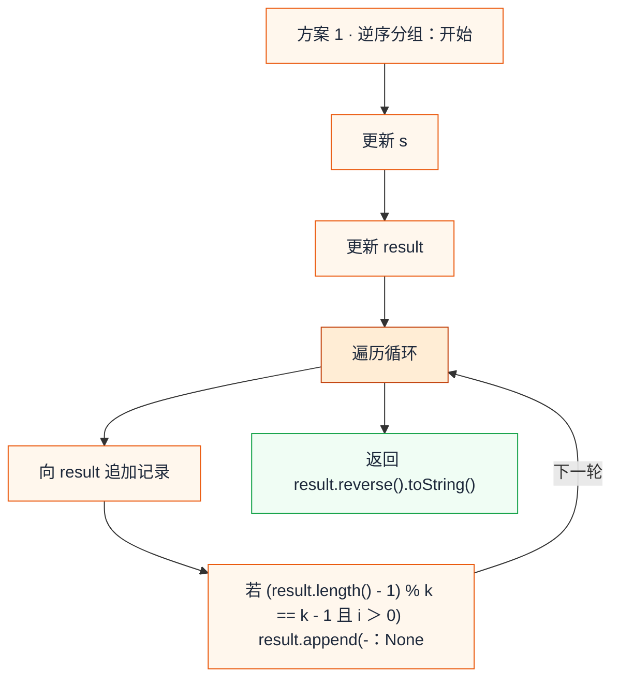

```java
package com.webfault.dsa; // 引入依赖

class Solution { // 定义类型
  public String licenseKeyFormatting(String s, int k) { // 定义函数/方法 licenseKeyFormatting
    s = s.replace("-", "").toUpperCase(); // 把 字符串.replace(「 减 」, 「 减 」).toUpperCase(); 写入 字符串
    StringBuilder result = new StringBuilder(); // 把 new StringBuilder(); 写入 StringBuilder result
    for (int i = s.length() - 1; i >= 0; i--) { // 让 下标 i 从 字符串.长度() 减 1 开始计数，下标 i 不低于 0 就继续
      result.append(s.charAt(i)); // 把 字符串 取字符 下标 i 追加到列表尾部
      if ((result.length() - 1) % k == k - 1 && i > 0) result.append("-");
    }
    return result.reverse().toString(); // 返回 结果.reverse().toString()
  }

  public static void main(String[] args) { // public static void main(String[] args) {
    Solution s = new Solution(); // 把 new Solution(); 写入 Solution s
    String[] ss = {"abc", "5F3Z-2we-9w"}; // 把 {「abc」, 「abc」}; 写入 String[] ss
    int[] ks = {1, 4}; // 把 {1, 4}; 写入 int[] ks
    String[] wants = {"A-B-C", "5F-3Z2-WE9W"}; // 把 {「A 减 B 减 C」, 「A 减 B 减 C」}; 写入 String[] wants
    boolean ok = true; // 把 true; 写入 boolean ok
    for (int i = 0; i < ss.length; i++) { // 让 下标 i 从 0 开始计数，下标 i 小于 ss.长度 就继续
      String got =
          s.licenseKeyFormatting(
              ss[i], ks[i]); // 把 字符串.licenseKeyFormatting(ss[下标 i], ks[下标 i]) 存入 got
      if (!got.equals(wants[i])) {
        ok = false;
        System.out.println("FAIL " + ss[i] + "," + ks[i] + "=" + got + " want " + wants[i]);
      }
    }
    if (!ok) throw new RuntimeException("FAILED"); // 若 取反 ok) throw new RuntimeException(「FAILED」);
    System.out.println("PASS"); // 全部用例通过，输出 PASS
  }
}
```

#### 方案 2：逆序分组

**思路与代码分析**：核心是「逆序分组」。Java 版用类与静态方法组织，集合操作显式明了。代码里依次做这些事：单循环线性扫描。**走读**：方案 2 · 逆序分组：开始 → 更新 s → 更新 result → 遍历循环 → 向 result 追加记录 → 若 (result.length() - 1) % k == k - 1 且 i ＞ 0) result.append(-：None → 返回 result.reverse().toString()。

**运行架构**（真实控制流）：


```java
package com.webfault.dsa; // 引入依赖

class Solution { // 定义类型
  public String licenseKeyFormatting(String s, int k) { // 定义函数/方法 licenseKeyFormatting
    s = s.replace("-", "").toUpperCase(); // 把 字符串.replace(「 减 」, 「 减 」).toUpperCase(); 写入 字符串
    StringBuilder result = new StringBuilder(); // 把 new StringBuilder(); 写入 StringBuilder result
    for (int i = s.length() - 1; i >= 0; i--) { // 让 下标 i 从 字符串.长度() 减 1 开始计数，下标 i 不低于 0 就继续
      result.append(s.charAt(i)); // 把 字符串 取字符 下标 i 追加到列表尾部
      if ((result.length() - 1) % k == k - 1 && i > 0) result.append("-");
    }
    return result.reverse().toString(); // 返回 结果.reverse().toString()
  }

  public static void main(String[] args) { // public static void main(String[] args) {
    Solution s = new Solution(); // 把 new Solution(); 写入 Solution s
    String[] ss = {"abc", "5F3Z-2we-9w"}; // 把 {「abc」, 「abc」}; 写入 String[] ss
    int[] ks = {1, 4}; // 把 {1, 4}; 写入 int[] ks
    String[] wants = {"A-B-C", "5F-3Z2-WE9W"}; // 把 {「A 减 B 减 C」, 「A 减 B 减 C」}; 写入 String[] wants
    boolean ok = true; // 把 true; 写入 boolean ok
    for (int i = 0; i < ss.length; i++) { // 让 下标 i 从 0 开始计数，下标 i 小于 ss.长度 就继续
      String got =
          s.licenseKeyFormatting(
              ss[i], ks[i]); // 把 字符串.licenseKeyFormatting(ss[下标 i], ks[下标 i]) 存入 got
      if (!got.equals(wants[i])) {
        ok = false;
        System.out.println("FAIL " + ss[i] + "," + ks[i] + "=" + got + " want " + wants[i]);
      }
    }
    if (!ok) throw new RuntimeException("FAILED"); // 若 取反 ok) throw new RuntimeException(「FAILED」);
    System.out.println("PASS"); // 全部用例通过，输出 PASS
  }
}
```

### Rust 实现（2 种方案）

Rust 的全部方案如下，每个方案都内嵌用例自测，可独立运行（老仓库 python/go 文件遵循「打印结果」约定）：

#### 方案 1：逆序分组

**思路与代码分析**：核心是「逆序分组」。Rust 版用所有权移动与切片借用改写同一逻辑，注意 Option 与引用边界。**走读**：方案 1 · 逆序分组：开始 → 计算 cleaned → 返回 String::new() → 遍历 0..first 中的每个元素 _ → 当 idx ＜ n 时反复执行 → 遍历 0..k 中的每个元素 _。

**运行架构**（真实控制流）：


```rust
// LeetCode 482. 密钥格式化 — Rust 版（方案1）
fn license_key_formatting(s: String, k: i32) -> String {
    // 定义函数/方法 license_key_formatting
    let cleaned: Vec<u8> = s
        .bytes()
        .filter(|&c| c != b'-')
        .map(|c| c.to_ascii_uppercase())
        .collect();
    let mut out: Vec<u8> = Vec::new(); // 把 Vec::new(); 写入 let mut out: Vec<u8>
    let n = cleaned.len(); // 把 cleaned.长度() 存入 元素个数
    let k = k as usize; // 把 下标 k as usize 存入 下标 k
    if n == 0 {
        return String::new();
    } // 若 元素个数 等于 0 { return String::new(); }
    let first = n % k; // 把 元素个数 对…取模 下标 k 存入 first
    let mut idx = 0usize; // 把 0usize; 写入 let mut idx
    if first > 0 {
        // 若 first 超过 0
        for _ in 0..first {
            out.push(cleaned[idx]);
            idx += 1;
        } // 逐个取出 0 的元素（_）
        if idx < n {
            out.push(b'-');
        } // 若 idx 小于 元素个数 { out 追加 b' 减 '); }
    }
    while idx < n {
        // while idx 小于 元素个数 {
        for _ in 0..k {
            out.push(cleaned[idx]);
            idx += 1;
        } // 逐个取出 0 的元素（_）
        if idx < n {
            out.push(b'-');
        } // 若 idx 小于 元素个数 { out 追加 b' 减 '); }
    }
    String::from_utf8(out).unwrap() // String::from_utf8(out).unwrap()
}
fn main() {
    // 程序入口：跑内嵌自测用例
    assert_eq!(license_key_formatting("5F3Z-2e-9-w".into(), 4), "5F3Z-2E9W"); // 断言校验
    assert_eq!(license_key_formatting("2-5g-3-J".into(), 2), "2-5G-3J"); // 断言校验
    println!("PASS"); // 全部用例通过，输出 PASS
}
```

#### 方案 2：逆序分组

**思路与代码分析**：核心是「逆序分组」。Rust 版用所有权移动与切片借用改写同一逻辑，注意 Option 与引用边界。**走读**：方案 2 · 逆序分组：开始 → 计算 cleaned → 返回 String::new() → 遍历 0..first 中的每个元素 _ → 当 idx ＜ n 时反复执行 → 遍历 0..k 中的每个元素 _。

**运行架构**（真实控制流）：

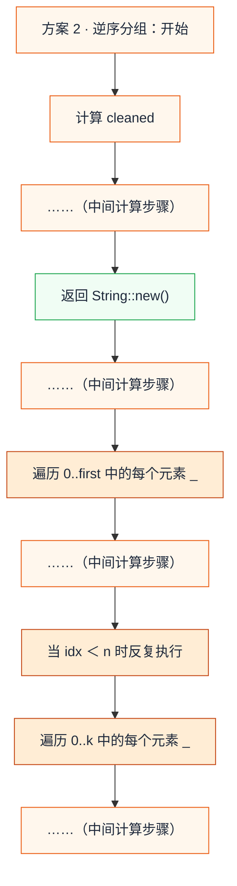

```rust
// LeetCode 482. 密钥格式化 — Rust 版（方案2）
fn license_key_formatting(s: String, k: i32) -> String {
    // 定义函数/方法 license_key_formatting
    let cleaned: Vec<u8> = s
        .bytes()
        .filter(|&c| c != b'-')
        .map(|c| c.to_ascii_uppercase())
        .collect();
    let mut out: Vec<u8> = Vec::new(); // 把 Vec::new(); 写入 let mut out: Vec<u8>
    let n = cleaned.len(); // 把 cleaned.长度() 存入 元素个数
    let k = k as usize; // 把 下标 k as usize 存入 下标 k
    if n == 0 {
        return String::new();
    } // 若 元素个数 等于 0 { return String::new(); }
    let first = n % k; // 把 元素个数 对…取模 下标 k 存入 first
    let mut idx = 0usize; // 把 0usize; 写入 let mut idx
    if first > 0 {
        // 若 first 超过 0
        for _ in 0..first {
            out.push(cleaned[idx]);
            idx += 1;
        } // 逐个取出 0 的元素（_）
        if idx < n {
            out.push(b'-');
        } // 若 idx 小于 元素个数 { out 追加 b' 减 '); }
    }
    while idx < n {
        // while idx 小于 元素个数 {
        for _ in 0..k {
            out.push(cleaned[idx]);
            idx += 1;
        } // 逐个取出 0 的元素（_）
        if idx < n {
            out.push(b'-');
        } // 若 idx 小于 元素个数 { out 追加 b' 减 '); }
    }
    String::from_utf8(out).unwrap() // String::from_utf8(out).unwrap()
}
fn main() {
    // 程序入口：跑内嵌自测用例
    assert_eq!(license_key_formatting("5F3Z-2e-9-w".into(), 4), "5F3Z-2E9W"); // 断言校验
    assert_eq!(license_key_formatting("2-5g-3-J".into(), 2), "2-5G-3J"); // 断言校验
    println!("PASS"); // 全部用例通过，输出 PASS
}
```

### Lua 实现（2 种方案）

Lua 的全部方案如下，每个方案都内嵌用例自测，可独立运行（老仓库 python/go 文件遵循「打印结果」约定）：

#### 方案 1：逆序分组

**思路与代码分析**：核心是「逆序分组」。Lua 版用表与 ipairs 遍历，注意 ipairs 遇 nil 即停的语义。**走读**：方案 1 · 逆序分组：开始 → 更新 cleaned → 返回  → 循环 _：从 1 到 first do → 当 idx ≤ n do 时反复执行 → 循环 _：从 1 到 k do → 返回 table.concat(out)。

**运行架构**（真实控制流）：


```lua
-- LeetCode 482. 密钥格式化 — Lua 版（方案1）
local function license_key_formatting(s, k) -- local function license_key_formatting(字符串, 下标 k)
	local cleaned = {} -- 把 {} 写入 local cleaned
	s:gsub("[^-]", function(c)
		cleaned[#cleaned + 1] = c:upper()
	end)
	local n = #cleaned -- 把 #cleaned 写入 local n
	if n == 0 then
		return ""
	end -- 若 元素个数 等于 0 then return 「」 终点
	local out = {} -- 把 {} 写入 local out
	local first = n % k -- 把 元素个数 对…取模 下标 k 写入 local first
	local idx = 1 -- 把 1 写入 local idx
	if first > 0 then -- 若 first 超过 0 then
		for _ = 1, first do -- 让 _ 从 1 走到 first（Lua 1 基）
			out[#out + 1] = cleaned[idx] -- 把 cleaned[idx] 写入 out[#out + 1]
			idx = idx + 1 -- 把 idx 加 1 存入 idx
		end -- 终点
		if idx <= n then
			out[#out + 1] = "-"
		end -- 若 idx 不超过 元素个数 then out[#out 加 1] 赋值为 「 减 」 终点
	end -- 终点
	while idx <= n do -- 把 元素个数 do 写入 while idx <
		for _ = 1, k do -- 让 _ 从 1 走到 下标 k（Lua 1 基）
			out[#out + 1] = cleaned[idx] -- 把 cleaned[idx] 写入 out[#out + 1]
			idx = idx + 1 -- 把 idx 加 1 存入 idx
		end -- 终点
		if idx <= n then
			out[#out + 1] = "-"
		end -- 若 idx 不超过 元素个数 then out[#out 加 1] 赋值为 「 减 」 终点
	end -- 终点
	return table.concat(out) -- 返回 table.concat(out)
end -- 终点
assert(license_key_formatting("5F3Z-2e-9-w", 4) == "5F3Z-2E9W") -- 断言校验
assert(license_key_formatting("2-5g-3-J", 2) == "2-5G-3J") -- 断言校验
print("PASS") -- 全部用例通过，输出 PASS
```

#### 方案 2：逆序分组

**思路与代码分析**：核心是「逆序分组」。Lua 版用表与 ipairs 遍历，注意 ipairs 遇 nil 即停的语义。**走读**：方案 2 · 逆序分组：开始 → 更新 cleaned → 返回  → 循环 _：从 1 到 first do → 当 idx ≤ n do 时反复执行 → 循环 _：从 1 到 k do → 返回 table.concat(out)。

**运行架构**（真实控制流）：

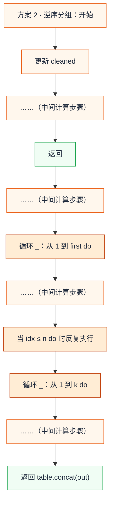

```lua
-- LeetCode 482. 密钥格式化 — Lua 版（方案2）
local function license_key_formatting(s, k) -- local function license_key_formatting(字符串, 下标 k)
	local cleaned = {} -- 把 {} 写入 local cleaned
	s:gsub("[^-]", function(c)
		cleaned[#cleaned + 1] = c:upper()
	end)
	local n = #cleaned -- 把 #cleaned 写入 local n
	if n == 0 then
		return ""
	end -- 若 元素个数 等于 0 then return 「」 终点
	local out = {} -- 把 {} 写入 local out
	local first = n % k -- 把 元素个数 对…取模 下标 k 写入 local first
	local idx = 1 -- 把 1 写入 local idx
	if first > 0 then -- 若 first 超过 0 then
		for _ = 1, first do -- 让 _ 从 1 走到 first（Lua 1 基）
			out[#out + 1] = cleaned[idx] -- 把 cleaned[idx] 写入 out[#out + 1]
			idx = idx + 1 -- 把 idx 加 1 存入 idx
		end -- 终点
		if idx <= n then
			out[#out + 1] = "-"
		end -- 若 idx 不超过 元素个数 then out[#out 加 1] 赋值为 「 减 」 终点
	end -- 终点
	while idx <= n do -- 把 元素个数 do 写入 while idx <
		for _ = 1, k do -- 让 _ 从 1 走到 下标 k（Lua 1 基）
			out[#out + 1] = cleaned[idx] -- 把 cleaned[idx] 写入 out[#out + 1]
			idx = idx + 1 -- 把 idx 加 1 存入 idx
		end -- 终点
		if idx <= n then
			out[#out + 1] = "-"
		end -- 若 idx 不超过 元素个数 then out[#out 加 1] 赋值为 「 减 」 终点
	end -- 终点
	return table.concat(out) -- 返回 table.concat(out)
end -- 终点
assert(license_key_formatting("5F3Z-2e-9-w", 4) == "5F3Z-2E9W") -- 断言校验
assert(license_key_formatting("2-5g-3-J", 2) == "2-5G-3J") -- 断言校验
print("PASS") -- 全部用例通过，输出 PASS
```

### C 实现（2 种方案）

C 的全部方案如下，每个方案都内嵌用例自测，可独立运行（老仓库 python/go 文件遵循「打印结果」约定）：

#### 方案 1：逆序分组

**思路与代码分析**：核心是「逆序分组」。C 版手动管理下标与内存，循环边界全部显式写出。代码里依次做这些事：双重循环遍历。**走读**：方案 1 · 逆序分组：开始 → 处理 char cleaned[8192] → 遍历循环 → 返回  → 遍历循环 → 当 (idx ＜ n) 时反复执行 → 遍历循环。

**运行架构**（真实控制流）：


```c
/* LeetCode 482. 密钥格式化 — C 版（方案1） */
#include <ctype.h>                                                     // 引入头文件
#include <stdio.h>                                                     // 引入头文件
#include <string.h>                                                    // 引入头文件
static void license_key_formatting(const char *s, int k, char out[]) { // 定义函数/方法 license_key_formatting
    char cleaned[8192];                                                // char cleaned[8192];
    int n = 0;                                                         // 把 0 存入 元素个数
    for (const char *p = s; *p; p++) { // 把 字符串; 乘 节点; 节点 加一 ) { 写入 for (const char *p
        if (*p != '-')
            cleaned[n++] = (char)toupper((unsigned char)*p);
    }
    int pos = 0; // 把 0 存入 pos
    if (n == 0) {
        out[0] = '\0';
        return;
    }                  // 若 元素个数 等于 0) { out[0] 赋值为 '\0'; return; }
    int first = n % k; // 把 元素个数 对…取模 下标 k 存入 first
    int idx = 0;       // 把 0 存入 idx
    if (first > 0) {   // 若 first 超过 0
        for (int i = 0; i < first; i++)
            out[pos++] = cleaned[idx++]; // 让 下标 i 从 0 开始计数，下标 i 小于 first 就继续
        if (idx < n)
            out[pos++] = '-'; // 若 idx 小于 元素个数) out[pos 加一 ] 赋值为 ' 减 ';
    }
    while (idx < n) { // 循环，直到不满足「idx 小于 元素个数」
        for (int i = 0; i < k; i++)
            out[pos++] = cleaned[idx++]; // 让 下标 i 从 0 开始计数，下标 i 小于 下标 k 就继续
        if (idx < n)
            out[pos++] = '-'; // 若 idx 小于 元素个数) out[pos 加一 ] 赋值为 ' 减 ';
    }
    out[pos] = '\0'; // 把 '\0'; 写入 out[pos]
}
int main(void) {    // 程序入口：跑内嵌自测用例
    char out[8192]; // char out[8192];
    license_key_formatting("5F3Z-2e-9-w", 4,
                           out); // license_key_formatting(「5F3Z 减 2e 减 9 减 权重」, 4, out);
    if (strcmp(out, "5F3Z-2E9W") != 0) {
        printf("FAIL 1 %s\n", out);
        return 1;
    }
    license_key_formatting("2-5g-3-J", 2, out); // license_key_formatting(「2 减 5g 减 3 减 J」, 2, out);
    if (strcmp(out, "2-5G-3J") != 0) {
        printf("FAIL 2 %s\n", out);
        return 1;
    }
    printf("PASS\n"); // 全部用例通过，输出 PASS
    return 0;         // 返回 0
}
```

#### 方案 2：逆序分组

**思路与代码分析**：核心是「逆序分组」。C 版手动管理下标与内存，循环边界全部显式写出。代码里依次做这些事：双重循环遍历。**走读**：方案 2 · 逆序分组：开始 → 处理 char cleaned[8192] → 遍历循环 → 返回  → 遍历循环 → 当 (idx ＜ n) 时反复执行 → 遍历循环。

**运行架构**（真实控制流）：

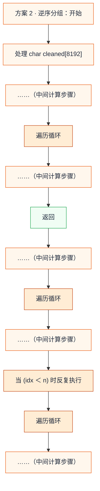

```c
/* LeetCode 482. 密钥格式化 — C 版（方案2） */
#include <ctype.h>                                                     // 引入头文件
#include <stdio.h>                                                     // 引入头文件
#include <string.h>                                                    // 引入头文件
static void license_key_formatting(const char *s, int k, char out[]) { // 定义函数/方法 license_key_formatting
    char cleaned[8192];                                                // char cleaned[8192];
    int n = 0;                                                         // 把 0 存入 元素个数
    for (const char *p = s; *p; p++) { // 把 字符串; 乘 节点; 节点 加一 ) { 写入 for (const char *p
        if (*p != '-')
            cleaned[n++] = (char)toupper((unsigned char)*p);
    }
    int pos = 0; // 把 0 存入 pos
    if (n == 0) {
        out[0] = '\0';
        return;
    }                  // 若 元素个数 等于 0) { out[0] 赋值为 '\0'; return; }
    int first = n % k; // 把 元素个数 对…取模 下标 k 存入 first
    int idx = 0;       // 把 0 存入 idx
    if (first > 0) {   // 若 first 超过 0
        for (int i = 0; i < first; i++)
            out[pos++] = cleaned[idx++]; // 让 下标 i 从 0 开始计数，下标 i 小于 first 就继续
        if (idx < n)
            out[pos++] = '-'; // 若 idx 小于 元素个数) out[pos 加一 ] 赋值为 ' 减 ';
    }
    while (idx < n) { // 循环，直到不满足「idx 小于 元素个数」
        for (int i = 0; i < k; i++)
            out[pos++] = cleaned[idx++]; // 让 下标 i 从 0 开始计数，下标 i 小于 下标 k 就继续
        if (idx < n)
            out[pos++] = '-'; // 若 idx 小于 元素个数) out[pos 加一 ] 赋值为 ' 减 ';
    }
    out[pos] = '\0'; // 把 '\0'; 写入 out[pos]
}
int main(void) {    // 程序入口：跑内嵌自测用例
    char out[8192]; // char out[8192];
    license_key_formatting("5F3Z-2e-9-w", 4,
                           out); // license_key_formatting(「5F3Z 减 2e 减 9 减 权重」, 4, out);
    if (strcmp(out, "5F3Z-2E9W") != 0) {
        printf("FAIL 1 %s\n", out);
        return 1;
    }
    license_key_formatting("2-5g-3-J", 2, out); // license_key_formatting(「2 减 5g 减 3 减 J」, 2, out);
    if (strcmp(out, "2-5G-3J") != 0) {
        printf("FAIL 2 %s\n", out);
        return 1;
    }
    printf("PASS\n"); // 全部用例通过，输出 PASS
    return 0;         // 返回 0
}
```

### C++ 实现（2 种方案）

C++ 的全部方案如下，每个方案都内嵌用例自测，可独立运行（老仓库 python/go 文件遵循「打印结果」约定）：

#### 方案 1：逆序分组

**思路与代码分析**：核心是「逆序分组」。C++ 版用 STL 容器与迭代器，减少手写下标错误。代码里依次做这些事：双重循环遍历。**走读**：方案 1 · 逆序分组：开始 → 处理 std::string cleaned → 遍历循环 → 命中条件，直接返回 → 遍历循环 → 当 (idx ＜ n) 时反复执行 → 遍历循环 → 返回 out。

**运行架构**（真实控制流）：


```cpp
// LeetCode 482. 密钥格式化 — C++ 版（方案1）
#include <algorithm> // 引入头文件
#include <cassert>   // 引入头文件
#include <cctype>    // 引入头文件
#include <iostream>  // 引入头文件
#include <string>    // 引入头文件
static std::string licenseKeyFormatting(const std::string &s, int k) {
    std::string cleaned; // std::string cleaned;
    for (char c : s) {   // for (char 字符 : 字符串) {
        if (c != '-')
            cleaned.push_back(static_cast<char>(std::toupper(static_cast<unsigned char>(c))));
    }
    int n = static_cast<int>(cleaned.size()); // 把 static_cast 小于 int 超过 (cleaned.大小()) 存入 元素个数
    if (n == 0)
        return "";     // 若 元素个数 等于 0，直接返回 「」
    std::string out;   // std::string out;
    int first = n % k; // 把 元素个数 对…取模 下标 k 存入 first
    int idx = 0;       // 把 0 存入 idx
    if (first > 0) {   // 若 first 超过 0
        for (int i = 0; i < first; ++i)
            out.push_back(cleaned[idx++]); // 让 下标 i 从 0 开始计数，下标 i 小于 first 就继续
        if (idx < n)
            out.push_back('-'); // 若 idx 小于 元素个数) out 追加 ' 减 ');
    }
    while (idx < n) { // 循环，直到不满足「idx 小于 元素个数」
        for (int i = 0; i < k; ++i)
            out.push_back(cleaned[idx++]); // 让 下标 i 从 0 开始计数，下标 i 小于 下标 k 就继续
        if (idx < n)
            out.push_back('-'); // 若 idx 小于 元素个数) out 追加 ' 减 ');
    }
    return out; // 返回 out
}
int main() {                                                       // 程序入口：跑内嵌自测用例
    assert(licenseKeyFormatting("5F3Z-2e-9-w", 4) == "5F3Z-2E9W"); // 断言校验
    assert(licenseKeyFormatting("2-5g-3-J", 2) == "2-5G-3J");      // 断言校验
    std::cout << "PASS" << std::endl;                              // 全部用例通过，输出 PASS
    return 0;                                                      // 返回 0
}
```

#### 方案 2：逆序分组

**思路与代码分析**：核心是「逆序分组」。C++ 版用 STL 容器与迭代器，减少手写下标错误。代码里依次做这些事：双重循环遍历。**走读**：方案 2 · 逆序分组：开始 → 处理 std::string cleaned → 遍历循环 → 命中条件，直接返回 → 遍历循环 → 当 (idx ＜ n) 时反复执行 → 遍历循环 → 返回 out。

**运行架构**（真实控制流）：

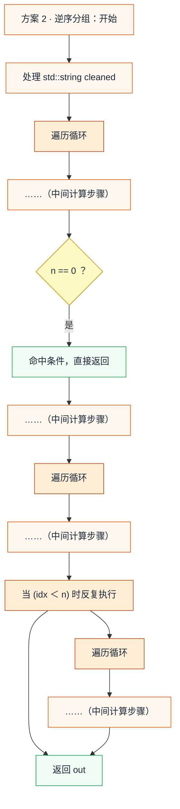

```cpp
// LeetCode 482. 密钥格式化 — C++ 版（方案2）
#include <algorithm> // 引入头文件
#include <cassert>   // 引入头文件
#include <cctype>    // 引入头文件
#include <iostream>  // 引入头文件
#include <string>    // 引入头文件
static std::string licenseKeyFormatting(const std::string &s, int k) {
    std::string cleaned; // std::string cleaned;
    for (char c : s) {   // for (char 字符 : 字符串) {
        if (c != '-')
            cleaned.push_back(static_cast<char>(std::toupper(static_cast<unsigned char>(c))));
    }
    int n = static_cast<int>(cleaned.size()); // 把 static_cast 小于 int 超过 (cleaned.大小()) 存入 元素个数
    if (n == 0)
        return "";     // 若 元素个数 等于 0，直接返回 「」
    std::string out;   // std::string out;
    int first = n % k; // 把 元素个数 对…取模 下标 k 存入 first
    int idx = 0;       // 把 0 存入 idx
    if (first > 0) {   // 若 first 超过 0
        for (int i = 0; i < first; ++i)
            out.push_back(cleaned[idx++]); // 让 下标 i 从 0 开始计数，下标 i 小于 first 就继续
        if (idx < n)
            out.push_back('-'); // 若 idx 小于 元素个数) out 追加 ' 减 ');
    }
    while (idx < n) { // 循环，直到不满足「idx 小于 元素个数」
        for (int i = 0; i < k; ++i)
            out.push_back(cleaned[idx++]); // 让 下标 i 从 0 开始计数，下标 i 小于 下标 k 就继续
        if (idx < n)
            out.push_back('-'); // 若 idx 小于 元素个数) out 追加 ' 减 ');
    }
    return out; // 返回 out
}
int main() {                                                       // 程序入口：跑内嵌自测用例
    assert(licenseKeyFormatting("5F3Z-2e-9-w", 4) == "5F3Z-2E9W"); // 断言校验
    assert(licenseKeyFormatting("2-5g-3-J", 2) == "2-5G-3J");      // 断言校验
    std::cout << "PASS" << std::endl;                              // 全部用例通过，输出 PASS
    return 0;                                                      // 返回 0
}
```

### R 实现（2 种方案）

R 的全部方案如下，每个方案都内嵌用例自测，可独立运行（老仓库 python/go 文件遵循「打印结果」约定）：

#### 方案 1：逆序分组

**思路与代码分析**：核心是「逆序分组」。R 版用向量化思维与 1 起始下标，注意 1:n 的降序陷阱。**走读**：方案 1 · 逆序分组：开始 → 处理 cleaned ＜- toupper(gsub(-, → 命中条件，直接返回 → 当 (idx ≤ n) 时反复执行。

**运行架构**（真实控制流）：

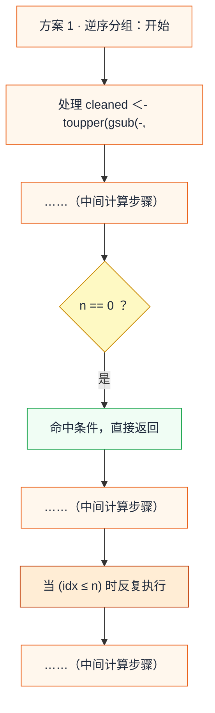

```r
# 版（方案1） 定义函数 license_key_formatting（参数：字符串, 下标 k）
license_key_formatting <- function(s, k) {
    cleaned <- toupper(gsub("-", "", s))  # 把 toupper(gsub(「 减 」, 「 减 」, 字符串)) 存入 cleaned
    chars <- strsplit(cleaned, "")[[1]]  # 把 strsplit(cleaned, 「」)[[1]] 存入 chars
    n <- length(chars)  # 把 长度(chars) 存入 元素个数
    if (n == 0)
        return("")  # 若 元素个数 等于 0) return(「」
    first <- n%%k  # 把 元素个数 对…取模 对…取模 下标 k 存入 first
    out <- character(0)  # 把 character(0) 存入 out
    idx <- 1  # 把 1 存入 idx
    if (first > 0) {
        # 若 first 超过 0
        out <- c(out, chars[idx:(idx + first - 1)])  # 把 字符(out, chars[idx:(idx 加 first 减 1)]) 存入 out
        idx <- idx + first  # 把 idx 加 first 存入 idx
        if (idx <= n)
            out <- c(out, "-")  # 若 idx 不超过 元素个数) out 小于 减 字符(out, 「 减 」
    }
    while (idx <= n) {
        # 循环，直到不满足「idx 不超过 元素个数」
        out <- c(out, chars[idx:(idx + k - 1)])  # 把 字符(out, chars[idx:(idx 加 下标 k 减 1)]) 存入 out
        idx <- idx + k  # 把 idx 加 下标 k 存入 idx
        if (idx <= n)
            out <- c(out, "-")  # 若 idx 不超过 元素个数) out 小于 减 字符(out, 「 减 」
    }
    paste(out, collapse = "")  # 把 「」) 写入 paste(out, collapse
}
stopifnot(license_key_formatting("5F3Z-2e-9-w", 4) == "5F3Z-2E9W")  # 断言校验
stopifnot(license_key_formatting("2-5g-3-J", 2) == "2-5G-3J")  # 断言校验
cat("PASS\n")  # 全部用例通过，输出 PASS
```

#### 方案 2：逆序分组

**思路与代码分析**：核心是「逆序分组」。R 版用向量化思维与 1 起始下标，注意 1:n 的降序陷阱。**走读**：方案 2 · 逆序分组：开始 → 处理 cleaned ＜- toupper(gsub(-, → 命中条件，直接返回 → 当 (idx ≤ n) 时反复执行。

**运行架构**（真实控制流）：


```r
# 版（方案2） 定义函数 license_key_formatting（参数：字符串, 下标 k）
license_key_formatting <- function(s, k) {
    cleaned <- toupper(gsub("-", "", s))  # 把 toupper(gsub(「 减 」, 「 减 」, 字符串)) 存入 cleaned
    chars <- strsplit(cleaned, "")[[1]]  # 把 strsplit(cleaned, 「」)[[1]] 存入 chars
    n <- length(chars)  # 把 长度(chars) 存入 元素个数
    if (n == 0)
        return("")  # 若 元素个数 等于 0) return(「」
    first <- n%%k  # 把 元素个数 对…取模 对…取模 下标 k 存入 first
    out <- character(0)  # 把 character(0) 存入 out
    idx <- 1  # 把 1 存入 idx
    if (first > 0) {
        # 若 first 超过 0
        out <- c(out, chars[idx:(idx + first - 1)])  # 把 字符(out, chars[idx:(idx 加 first 减 1)]) 存入 out
        idx <- idx + first  # 把 idx 加 first 存入 idx
        if (idx <= n)
            out <- c(out, "-")  # 若 idx 不超过 元素个数) out 小于 减 字符(out, 「 减 」
    }
    while (idx <= n) {
        # 循环，直到不满足「idx 不超过 元素个数」
        out <- c(out, chars[idx:(idx + k - 1)])  # 把 字符(out, chars[idx:(idx 加 下标 k 减 1)]) 存入 out
        idx <- idx + k  # 把 idx 加 下标 k 存入 idx
        if (idx <= n)
            out <- c(out, "-")  # 若 idx 不超过 元素个数) out 小于 减 字符(out, 「 减 」
    }
    paste(out, collapse = "")  # 把 「」) 写入 paste(out, collapse
}
stopifnot(license_key_formatting("5F3Z-2e-9-w", 4) == "5F3Z-2E9W")  # 断言校验
stopifnot(license_key_formatting("2-5g-3-J", 2) == "2-5G-3J")  # 断言校验
cat("PASS\n")  # 全部用例通过，输出 PASS
```

### Zig 实现（2 种方案）

Zig 的全部方案如下，每个方案都内嵌用例自测，可独立运行（老仓库 python/go 文件遵循「打印结果」约定）：

#### 方案 1：逆序分组

**思路与代码分析**：核心是「逆序分组」。Zig 版显式分配与清零，整型边界处理严格。代码里依次做这些事：双重循环遍历。**走读**：方案 1 · 逆序分组：开始 → 计算 cleaned → 遍历集合元素 → 命中条件，直接返回 → 遍历集合元素 → 当 (idx ＜ n) 时反复执行 → 遍历集合元素。

**运行架构**（真实控制流）：

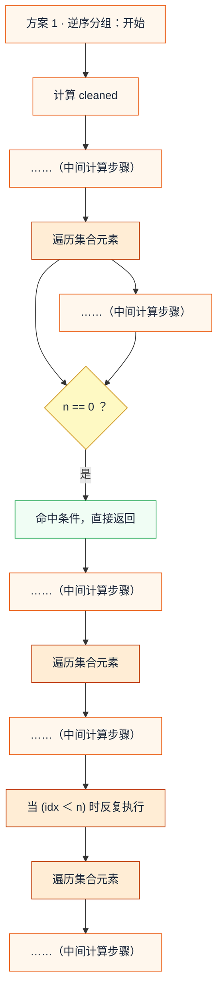

```zig
// LeetCode 482. 密钥格式化 — Zig 版（方案1）
const std = @import("std"); // 把 @import(「std」) 存入 std
fn licenseKeyFormatting(s: []const u8, k: usize, out: *std.ArrayList(u8)) void { // 定义函数/方法 licenseKeyFormatting
    var cleaned: [8192]u8 = undefined; // 把 undefined; 写入 var cleaned: [8192]u8
    var n: usize = 0; // 把 0; 写入 var n: usize
    for (s) |c| { // 逐个取出 字符串 的元素（字符）
        if (c != '-') { // 若 字符 不等于 ' 减 '
            cleaned[n] = std.ascii.toUpper(c); // 把 std.ascii.toUpper(字符); 写入 cleaned[n]
            n += 1; // 元素个数累加 1
        }
    }
    if (n == 0) return; // 若 元素个数 等于 0) return;
    const first = n % k; // 把 元素个数 对…取模 下标 k 存入 first
    var idx: usize = 0; // 把 0; 写入 var idx: usize
    if (first > 0) { // 若 first 超过 0
        for (0..first) |_| { // 让 _ 从 0 走到 first 减一
            out.append(cleaned[idx]) catch unreachable; // 把 cleaned[idx] 追加到列表尾部
            idx += 1; // idx累加 1
        }
        if (idx < n) out.append('-') catch unreachable; // 若 idx 小于 元素个数) out 追加 ' 减 ') catch unreachable;
    }
    while (idx < n) { // 循环，直到不满足「idx 小于 元素个数」
        for (0..k) |_| { // 让 _ 从 0 走到 下标 k 减一
            out.append(cleaned[idx]) catch unreachable; // 把 cleaned[idx] 追加到列表尾部
            idx += 1; // idx累加 1
        }
        if (idx < n) out.append('-') catch unreachable; // 若 idx 小于 元素个数) out 追加 ' 减 ') catch unreachable;
    }
}
pub fn main() !void { // 程序入口：跑内嵌自测用例
    var out = std.ArrayList(u8).init(std.heap.page_allocator); // 把 std.ArrayList(u8).init(std.堆.page_allocator) 存入 out
    defer out.deinit(); // defer out.deinit();
    licenseKeyFormatting("5F3Z-2e-9-w", 4, &out); // licenseKeyFormatting(「5F3Z 减 2e 减 9 减 权重」, 4, 按位与 out);
    if (!std.mem.eql(u8, out.items, "5F3Z-2E9W")) return error.TestFailed;
    out.clearRetainingCapacity(); // out.clearRetainingCapacity();
    licenseKeyFormatting("2-5g-3-J", 2, &out); // licenseKeyFormatting(「2 减 5g 减 3 减 J」, 2, 按位与 out);
    if (!std.mem.eql(u8, out.items, "2-5G-3J")) return error.TestFailed;
    std.debug.print("PASS\n", .{}); // 全部用例通过，输出 PASS
}
```

#### 方案 2：逆序分组

**思路与代码分析**：核心是「逆序分组」。Zig 版显式分配与清零，整型边界处理严格。代码里依次做这些事：双重循环遍历。**走读**：方案 2 · 逆序分组：开始 → 计算 cleaned → 遍历集合元素 → 命中条件，直接返回 → 遍历集合元素 → 当 (idx ＜ n) 时反复执行 → 遍历集合元素。

**运行架构**（真实控制流）：

```mermaid
graph TD
    N0["方案 2 · 逆序分组：开始"]
    N1["计算 cleaned"]
    D1["……（中间计算步骤）"]
    N3["遍历集合元素"]
    D2["……（中间计算步骤）"]
    N7{"n == 0 ？"}
    N8["命中条件，直接返回"]
    D3["……（中间计算步骤）"]
    N12["遍历集合元素"]
    D4["……（中间计算步骤）"]
    N16["当 (idx ＜ n) 时反复执行"]
    N17["遍历集合元素"]
    Dend["……（中间计算步骤）"]
    N0 --> N1
    N3 --> N7
    N7 -- 是 --> N8
    N16 --> N17
    N1 --> D1
    D1 --> N3
    N3 --> D2
    D2 --> N7
    N8 --> D3
    D3 --> N12
    N12 --> D4
    D4 --> N16
    N17 --> Dend
    classDef n fill:#fff7ed,stroke:#ea580c,color:#1e293b;
    classDef lp fill:#ffedd5,stroke:#c2410c,color:#1e293b;
    classDef dc fill:#fef9c3,stroke:#ca8a04,color:#1e293b;
    classDef tm fill:#f0fdf4,stroke:#16a34a,color:#1e293b;
    class N0,N1,D1,D2,D3,D4,Dend n;
    class N3,N12,N16,N17 lp;
    class N7 dc;
    class N8 tm;
```

```zig
// LeetCode 482. 密钥格式化 — Zig 版（方案2）
const std = @import("std"); // 把 @import(「std」) 存入 std
fn licenseKeyFormatting(s: []const u8, k: usize, out: *std.ArrayList(u8)) void { // 定义函数/方法 licenseKeyFormatting
    var cleaned: [8192]u8 = undefined; // 把 undefined; 写入 var cleaned: [8192]u8
    var n: usize = 0; // 把 0; 写入 var n: usize
    for (s) |c| { // 逐个取出 字符串 的元素（字符）
        if (c != '-') { // 若 字符 不等于 ' 减 '
            cleaned[n] = std.ascii.toUpper(c); // 把 std.ascii.toUpper(字符); 写入 cleaned[n]
            n += 1; // 元素个数累加 1
        }
    }
    if (n == 0) return; // 若 元素个数 等于 0) return;
    const first = n % k; // 把 元素个数 对…取模 下标 k 存入 first
    var idx: usize = 0; // 把 0; 写入 var idx: usize
    if (first > 0) { // 若 first 超过 0
        for (0..first) |_| { // 让 _ 从 0 走到 first 减一
            out.append(cleaned[idx]) catch unreachable; // 把 cleaned[idx] 追加到列表尾部
            idx += 1; // idx累加 1
        }
        if (idx < n) out.append('-') catch unreachable; // 若 idx 小于 元素个数) out 追加 ' 减 ') catch unreachable;
    }
    while (idx < n) { // 循环，直到不满足「idx 小于 元素个数」
        for (0..k) |_| { // 让 _ 从 0 走到 下标 k 减一
            out.append(cleaned[idx]) catch unreachable; // 把 cleaned[idx] 追加到列表尾部
            idx += 1; // idx累加 1
        }
        if (idx < n) out.append('-') catch unreachable; // 若 idx 小于 元素个数) out 追加 ' 减 ') catch unreachable;
    }
}
pub fn main() !void { // 程序入口：跑内嵌自测用例
    var out = std.ArrayList(u8).init(std.heap.page_allocator); // 把 std.ArrayList(u8).init(std.堆.page_allocator) 存入 out
    defer out.deinit(); // defer out.deinit();
    licenseKeyFormatting("5F3Z-2e-9-w", 4, &out); // licenseKeyFormatting(「5F3Z 减 2e 减 9 减 权重」, 4, 按位与 out);
    if (!std.mem.eql(u8, out.items, "5F3Z-2E9W")) return error.TestFailed;
    out.clearRetainingCapacity(); // out.clearRetainingCapacity();
    licenseKeyFormatting("2-5g-3-J", 2, &out); // licenseKeyFormatting(「2 减 5g 减 3 减 J」, 2, 按位与 out);
    if (!std.mem.eql(u8, out.items, "2-5G-3J")) return error.TestFailed;
    std.debug.print("PASS\n", .{}); // 全部用例通过，输出 PASS
}
```

### Dart 实现（2 种方案）

Dart 的全部方案如下，每个方案都内嵌用例自测，可独立运行（老仓库 python/go 文件遵循「打印结果」约定）：

#### 方案 1：逆序分组

**思路与代码分析**：核心是「逆序分组」。Dart 版用可空类型标注与集合方法，注意空安全。代码里依次做这些事：双重循环遍历。**走读**：方案 1 · 逆序分组：开始 → 更新 cleaned → 命中条件，直接返回 → 遍历循环 → 当 (idx ＜ n) 时反复执行 → 遍历循环 → 返回 out.join()。

**运行架构**（真实控制流）：

```mermaid
graph TD
    N0["方案 1 · 逆序分组：开始"]
    N1["更新 cleaned"]
    D1["……（中间计算步骤）"]
    N5{"n == 0 ？"}
    N6["命中条件，直接返回"]
    D2["……（中间计算步骤）"]
    N11["遍历循环"]
    D3["……（中间计算步骤）"]
    N14["当 (idx ＜ n) 时反复执行"]
    N15["遍历循环"]
    D4["……（中间计算步骤）"]
    N18["返回 out.join()"]
    N0 --> N1
    N5 -- 是 --> N6
    N14 --> N15
    N14 --> N18
    N1 --> D1
    D1 --> N5
    N6 --> D2
    D2 --> N11
    N11 --> D3
    D3 --> N14
    N15 --> D4
    D4 --> N18
    classDef n fill:#fff7ed,stroke:#ea580c,color:#1e293b;
    classDef lp fill:#ffedd5,stroke:#c2410c,color:#1e293b;
    classDef dc fill:#fef9c3,stroke:#ca8a04,color:#1e293b;
    classDef tm fill:#f0fdf4,stroke:#16a34a,color:#1e293b;
    class N0,N1,D1,D2,D3,D4 n;
    class N11,N14,N15 lp;
    class N5 dc;
    class N6,N18 tm;
```

```dart
// LeetCode 482. 密钥格式化 — Dart 版（方案1）
String licenseKeyFormatting(String s, int k) {
  // 定义函数/方法 licenseKeyFormatting
  final cleaned = s
      .replaceAll('-', '')
      .toUpperCase(); // 把 字符串.replaceAll(' 减 ', '').toUpperCase() 存入 cleaned
  final n = cleaned.length; // 把 cleaned.长度 存入 元素个数
  if (n == 0) return ''; // 若 元素个数 等于 0，直接返回 ''
  final out = <String>[]; // 把 小于 String 超过 [] 存入 out
  final first = n % k; // 把 元素个数 对…取模 下标 k 存入 first
  var idx = 0; // 把 0 存入 idx
  if (first > 0) {
    // 若 first 超过 0
    for (var i = 0; i < first; i++) {
      // 让 下标 i 从 0 开始计数，下标 i 小于 first 就继续
      out.add(cleaned[idx++]); // out 追加 cleaned[idx 加一 ]);
    }
    if (idx < n) out.add('-'); // 若 idx 小于 元素个数) out 追加 ' 减 ');
  }
  while (idx < n) {
    // 循环，直到不满足「idx 小于 元素个数」
    for (var i = 0; i < k; i++) {
      // 让 下标 i 从 0 开始计数，下标 i 小于 下标 k 就继续
      out.add(cleaned[idx++]); // out 追加 cleaned[idx 加一 ]);
    }
    if (idx < n) out.add('-'); // 若 idx 小于 元素个数) out 追加 ' 减 ');
  }
  return out.join(); // 返回 out.join()
}

void main() {
  // 程序入口：跑内嵌自测用例
  if (licenseKeyFormatting('5F3Z-2e-9-w', 4) != '5F3Z-2E9W')
    throw StateError('c1');
  if (licenseKeyFormatting('2-5g-3-J', 2) != '2-5G-3J') throw StateError('c2');
  print('PASS'); // 全部用例通过，输出 PASS
}
```

#### 方案 2：逆序分组

**思路与代码分析**：核心是「逆序分组」。Dart 版用可空类型标注与集合方法，注意空安全。代码里依次做这些事：双重循环遍历。**走读**：方案 2 · 逆序分组：开始 → 更新 cleaned → 命中条件，直接返回 → 遍历循环 → 当 (idx ＜ n) 时反复执行 → 遍历循环 → 返回 out.join()。

**运行架构**（真实控制流）：

```mermaid
graph TD
    N0["方案 2 · 逆序分组：开始"]
    N1["更新 cleaned"]
    D1["……（中间计算步骤）"]
    N5{"n == 0 ？"}
    N6["命中条件，直接返回"]
    D2["……（中间计算步骤）"]
    N11["遍历循环"]
    D3["……（中间计算步骤）"]
    N14["当 (idx ＜ n) 时反复执行"]
    N15["遍历循环"]
    D4["……（中间计算步骤）"]
    N18["返回 out.join()"]
    N0 --> N1
    N5 -- 是 --> N6
    N14 --> N15
    N14 --> N18
    N1 --> D1
    D1 --> N5
    N6 --> D2
    D2 --> N11
    N11 --> D3
    D3 --> N14
    N15 --> D4
    D4 --> N18
    classDef n fill:#fff7ed,stroke:#ea580c,color:#1e293b;
    classDef lp fill:#ffedd5,stroke:#c2410c,color:#1e293b;
    classDef dc fill:#fef9c3,stroke:#ca8a04,color:#1e293b;
    classDef tm fill:#f0fdf4,stroke:#16a34a,color:#1e293b;
    class N0,N1,D1,D2,D3,D4 n;
    class N11,N14,N15 lp;
    class N5 dc;
    class N6,N18 tm;
```

```dart
// LeetCode 482. 密钥格式化 — Dart 版（方案2）
String licenseKeyFormatting(String s, int k) {
  // 定义函数/方法 licenseKeyFormatting
  final cleaned = s
      .replaceAll('-', '')
      .toUpperCase(); // 把 字符串.replaceAll(' 减 ', '').toUpperCase() 存入 cleaned
  final n = cleaned.length; // 把 cleaned.长度 存入 元素个数
  if (n == 0) return ''; // 若 元素个数 等于 0，直接返回 ''
  final out = <String>[]; // 把 小于 String 超过 [] 存入 out
  final first = n % k; // 把 元素个数 对…取模 下标 k 存入 first
  var idx = 0; // 把 0 存入 idx
  if (first > 0) {
    // 若 first 超过 0
    for (var i = 0; i < first; i++) {
      // 让 下标 i 从 0 开始计数，下标 i 小于 first 就继续
      out.add(cleaned[idx++]); // out 追加 cleaned[idx 加一 ]);
    }
    if (idx < n) out.add('-'); // 若 idx 小于 元素个数) out 追加 ' 减 ');
  }
  while (idx < n) {
    // 循环，直到不满足「idx 小于 元素个数」
    for (var i = 0; i < k; i++) {
      // 让 下标 i 从 0 开始计数，下标 i 小于 下标 k 就继续
      out.add(cleaned[idx++]); // out 追加 cleaned[idx 加一 ]);
    }
    if (idx < n) out.add('-'); // 若 idx 小于 元素个数) out 追加 ' 减 ');
  }
  return out.join(); // 返回 out.join()
}

void main() {
  // 程序入口：跑内嵌自测用例
  if (licenseKeyFormatting('5F3Z-2e-9-w', 4) != '5F3Z-2E9W')
    throw StateError('c1');
  if (licenseKeyFormatting('2-5g-3-J', 2) != '2-5G-3J') throw StateError('c2');
  print('PASS'); // 全部用例通过，输出 PASS
}
```

---

## 内容总结

- **密钥格式化**（字符串 · Medium）：共 2 个方案，主线思路「逆序分组」；时间 O(n)（单趟线性扫描）；动画演示滑动窗口过程，附录给出 11 种语言 × 全部方案的可运行实现。
- 来源博客：[https://blog.csdn.net/tyro_java/article/details/145385760](https://blog.csdn.net/tyro_java/article/details/145385760)
- 导航：[📋 总目录](../) ｜ [← 075 字符串相乘](../075_字符串相乘/) ｜ [077 反转字符串中的单词 iii →](../077_反转字符串中的单词_iii/)
