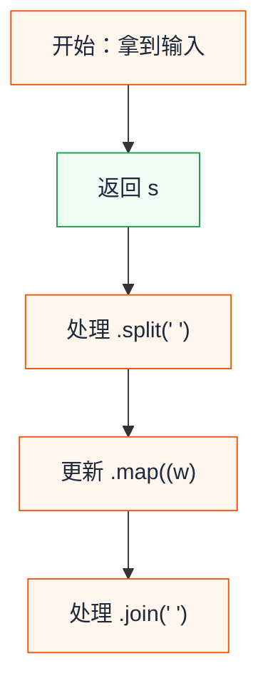
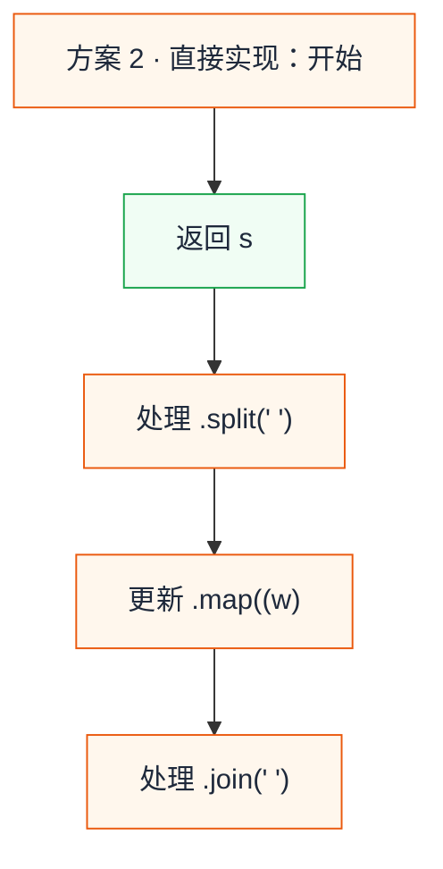
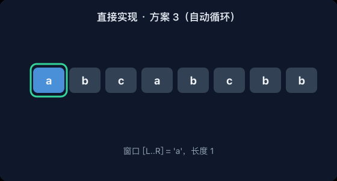
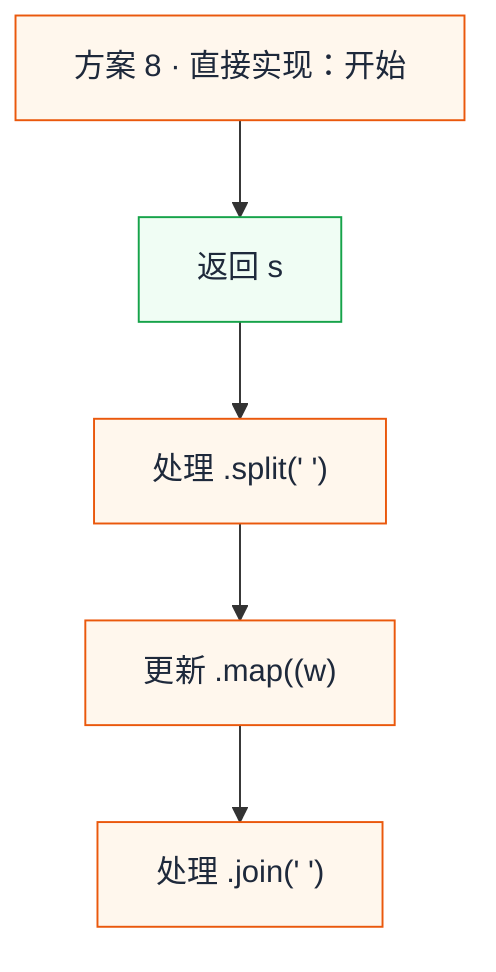
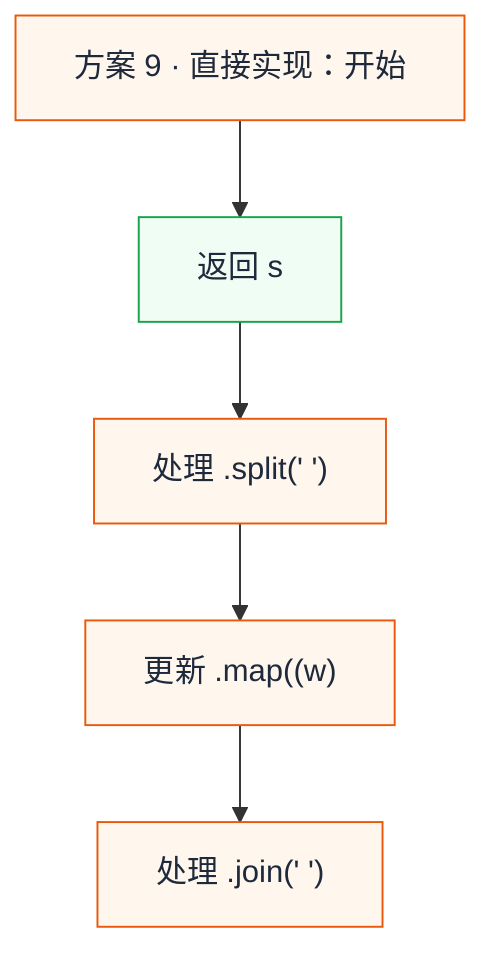
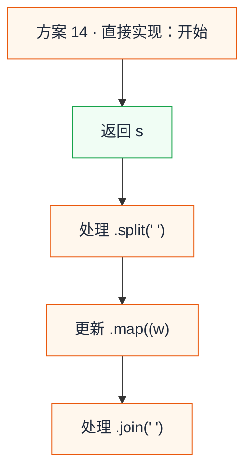
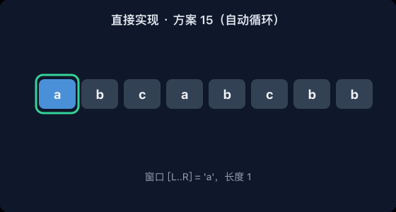
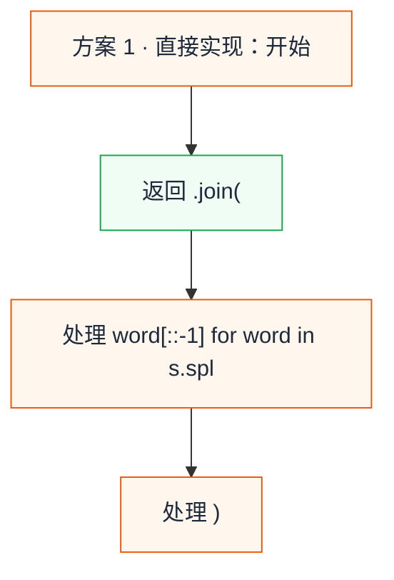
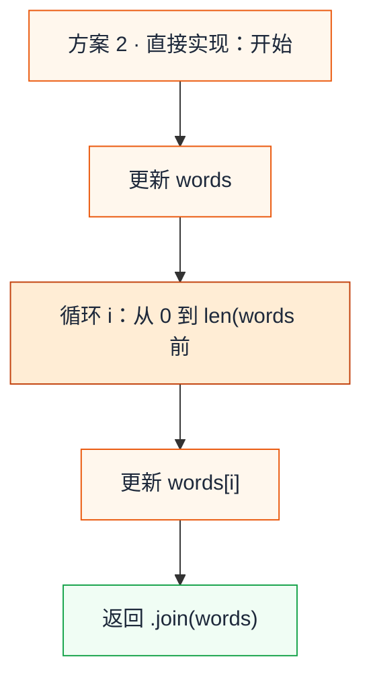
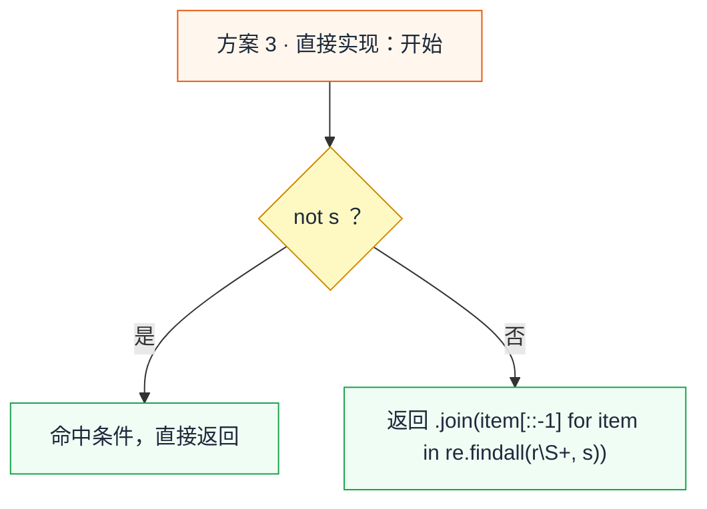

# 077 · 反转字符串中的单词 iii（第三阶段 · 字符串 · Medium）

> **难度**：⭐⭐ Medium ｜ **专题**：字符串
> **学习定位**：第三阶段 · 字符串第 77 篇 ｜ **解法数**：16
> **内容总结**：**反转字符串中的单词 iii**（字符串 · Medium）：共 16 个方案，主线思路「直接实现」；时间 O(n) 量级；动画演示滑动窗口过程，附录给出 11 种语言 × 全部方案的可运行实现。

---

## 题目描述

给定一个字符串 `s` ，你需要反转字符串中每个单词的字符顺序，同时仍保留空格和单词的初始顺序。

- 主函数签名：`function reverseWords(s: string): string`

**用例（来自原题）**：

**示例 1**

```text
输入：s = "Let's take LeetCode contest"
输出："s'teL ekat edoCteeL tsetnoc"
```
> ✅ **官方验证**：全部 TypeScript 解法已通过 leetcode.cn 官方示例用例验证（自动注入运行，全部 PASS）。题面与 [leetcode.cn 官方](https://leetcode.cn/problems/reverse-words-in-a-string-iii/)一致，示例配图取自官方题面。

**数据范围与注意事项**：

- `1 <= s.length <= 5  10^4`
- s 包含可打印的 ASCII 字符。
- s 不包含任何开头或结尾空格。
- s 里 至少 有一个词。
- s 中的所有单词都用一个空格隔开。
- **易错点**：空串、全空白、单字符三类边界，以及大小写是否敏感。

## 题目分析

**场景是什么**：字符串是字符数组，这类题练的是扫描、切分与匹配，对应真实开发里的文本清洗、协议解析。本题就是该场景的 Medium 级练习，主线做法是「直接实现」。

**主线怎么解**：主解法结构简单：读入、处理、返回。

## 解题思路

**方案对比**（共 16 个方案，由浅入深）：

| 方案 | 时间复杂度 | 空间复杂度 |
|---|---|---|
| 方案 1 · 直接实现 | O(n) 量级 | O(n) |
| 方案 2 · 直接实现 | O(n) 量级 | O(n) |
| 方案 3 · 直接实现 | O(n) 量级 | O(n) |
| 方案 4 · 直接实现 | O(n) 量级 | O(n) |
| 方案 5 · 直接实现 | O(n) 量级 | O(n) |
| 方案 6 · 直接实现 | O(n) 量级 | O(n) |
| 方案 7 · 直接实现 | O(n) 量级 | O(n) |
| 方案 8 · 直接实现 | O(n) 量级 | O(n) |
| 方案 9 · 直接实现 | O(n) 量级 | O(n) |
| 方案 10 · 直接实现 | O(n) 量级 | O(n) |
| 方案 11 · 直接实现 | O(n) 量级 | O(n) |
| 方案 12 · 直接实现 | O(n) 量级 | O(n) |
| 方案 13 · 直接实现 | O(n) 量级 | O(n) |
| 方案 14 · 直接实现 | O(n) 量级 | O(n) |
| 方案 15 · 直接实现 | O(n) 量级 | O(n) |
| 方案 16 · 直接实现 | O(n) 量级 | O(n) |

**方案间的取舍**：方案 1（直接实现）；方案 2（直接实现）；方案 3（直接实现）；方案 4（直接实现）；方案 5（直接实现）；方案 6（直接实现）；方案 7（直接实现）；方案 8（直接实现）；方案 9（直接实现）；方案 10（直接实现）；方案 11（直接实现）；方案 12（直接实现）；方案 13（直接实现）；方案 14（直接实现）；方案 15（直接实现）；方案 16（直接实现）。数据规模小、可读性优先时选靠前的方案；规模大、性能优先时选靠后的方案。

**怎么读这一篇**：

- 🐣 **新手路线**：把「题目描述」的示例 1 在纸上手推一遍 → 读方案 1（最直观的写法）与它的代码走读 → 按「运行方式」本地跑通看 PASS → 回头对比方案 2 之后的写法差在哪
- 🦅 **大佬路线**：直接锁定最优方案 1（直接实现，O(n) 量级）→ 跳读该方案代码与走读 → 用「逐步拆解与面试追问」补齐复杂度推导与边界追问

### 动态算法图（滑动窗口，GIF 自动循环）


动画演示字符串专题里滑动窗口的典型过程；每个方案在「TypeScript 解题方案」一节还配了专属动画与专属流程图。

### 主解法流程图（真实控制流）



## TypeScript 解题方案（16 个方案逐个讲）

> **运行与提交**：每个方案都是自包含文件（内嵌用例自测，输出 PASS），整块复制到 `.ts` 文件后 `node 文件名` 即可运行。提交 LeetCode 时，把 `demo` 内的算法函数与辅助类型/函数整体取出、置于文件顶层即可。涉及交互/特殊接口的题以题面给定签名为准。

### 方案 1：直接实现

**分析与思路**：核心做法是「直接实现」。

**运行方式**：`node 本文件`，内嵌用例全部通过会输出 PASS。


**方案专属流程图**（真实控制流）：


```typescript
export function demo(): void {
  // 程序入口：跑内嵌自测用例
  function reverseWords(s: string): string {
    // 定义函数/方法 reverseWords
    return s
      .split(' ')
      .map((w) => w.split('').reverse().join(''))
      .join(' ');
  }
  let fail = false; // 把 false 存入 fail
  if (
    reverseWords("Let's take LeetCode contest") !==
    "s'teL ekat edoCteeL tsetnoc"
  ) {
    fail = true;
    console.log('FAIL1');
  }
  if (reverseWords('God Ding') !== 'doG gniD') {
    fail = true;
    console.log('FAIL2');
  }
  if (fail) throw new Error('FAILED'); // 若 fail) throw new Error(「FAILED」);
  console.log('PASS'); // 全部用例通过，输出 PASS
}
demo(); // demo();
```

### 方案 2：直接实现

**分析与思路**：核心做法是「直接实现」。

**运行方式**：`node 本文件`，内嵌用例全部通过会输出 PASS。


**方案专属流程图**（真实控制流）：



```typescript
export function demo(): void {
  // 程序入口：跑内嵌自测用例
  function reverseWords(s: string): string {
    // 定义函数/方法 reverseWords
    return s
      .split(' ')
      .map((w) => w.split('').reverse().join(''))
      .join(' ');
  }
  let fail = false; // 把 false 存入 fail
  if (
    reverseWords("Let's take LeetCode contest") !==
    "s'teL ekat edoCteeL tsetnoc"
  ) {
    fail = true;
    console.log('FAIL1');
  }
  if (reverseWords('God Ding') !== 'doG gniD') {
    fail = true;
    console.log('FAIL2');
  }
  if (fail) throw new Error('FAILED'); // 若 fail) throw new Error(「FAILED」);
  console.log('PASS'); // 全部用例通过，输出 PASS
}
demo(); // demo();
```

### 方案 3：直接实现

**分析与思路**：核心做法是「直接实现」。

**运行方式**：`node 本文件`，内嵌用例全部通过会输出 PASS。



**方案专属流程图**（真实控制流）：


```typescript
export function demo(): void {
  // 程序入口：跑内嵌自测用例
  function reverseWords(s: string): string {
    // 定义函数/方法 reverseWords
    return s
      .split(' ')
      .map((w) => w.split('').reverse().join(''))
      .join(' ');
  }
  let fail = false; // 把 false 存入 fail
  if (
    reverseWords("Let's take LeetCode contest") !==
    "s'teL ekat edoCteeL tsetnoc"
  ) {
    fail = true;
    console.log('FAIL1');
  }
  if (reverseWords('God Ding') !== 'doG gniD') {
    fail = true;
    console.log('FAIL2');
  }
  if (fail) throw new Error('FAILED'); // 若 fail) throw new Error(「FAILED」);
  console.log('PASS'); // 全部用例通过，输出 PASS
}
demo(); // demo();
```

### 方案 4：直接实现

**分析与思路**：核心做法是「直接实现」。

**运行方式**：`node 本文件`，内嵌用例全部通过会输出 PASS。


**方案专属流程图**（真实控制流）：


```typescript
export function demo(): void {
  // 程序入口：跑内嵌自测用例
  function reverseWords(s: string): string {
    // 定义函数/方法 reverseWords
    return s
      .split(' ')
      .map((w) => w.split('').reverse().join(''))
      .join(' ');
  }
  let fail = false; // 把 false 存入 fail
  if (
    reverseWords("Let's take LeetCode contest") !==
    "s'teL ekat edoCteeL tsetnoc"
  ) {
    fail = true;
    console.log('FAIL1');
  }
  if (reverseWords('God Ding') !== 'doG gniD') {
    fail = true;
    console.log('FAIL2');
  }
  if (fail) throw new Error('FAILED'); // 若 fail) throw new Error(「FAILED」);
  console.log('PASS'); // 全部用例通过，输出 PASS
}
demo(); // demo();
```

### 方案 5：直接实现

**分析与思路**：核心做法是「直接实现」。

**运行方式**：`node 本文件`，内嵌用例全部通过会输出 PASS。


**方案专属流程图**（真实控制流）：


```typescript
export function demo(): void {
  // 程序入口：跑内嵌自测用例
  function reverseWords(s: string): string {
    // 定义函数/方法 reverseWords
    return s
      .split(' ')
      .map((w) => w.split('').reverse().join(''))
      .join(' ');
  }
  let fail = false; // 把 false 存入 fail
  if (
    reverseWords("Let's take LeetCode contest") !==
    "s'teL ekat edoCteeL tsetnoc"
  ) {
    fail = true;
    console.log('FAIL1');
  }
  if (reverseWords('God Ding') !== 'doG gniD') {
    fail = true;
    console.log('FAIL2');
  }
  if (fail) throw new Error('FAILED'); // 若 fail) throw new Error(「FAILED」);
  console.log('PASS'); // 全部用例通过，输出 PASS
}
demo(); // demo();
```

### 方案 6：直接实现

**分析与思路**：核心做法是「直接实现」。

**运行方式**：`node 本文件`，内嵌用例全部通过会输出 PASS。


**方案专属流程图**（真实控制流）：


```typescript
export function demo(): void {
  // 程序入口：跑内嵌自测用例
  function reverseWords(s: string): string {
    // 定义函数/方法 reverseWords
    return s
      .split(' ')
      .map((w) => w.split('').reverse().join(''))
      .join(' ');
  }
  let fail = false; // 把 false 存入 fail
  if (
    reverseWords("Let's take LeetCode contest") !==
    "s'teL ekat edoCteeL tsetnoc"
  ) {
    fail = true;
    console.log('FAIL1');
  }
  if (reverseWords('God Ding') !== 'doG gniD') {
    fail = true;
    console.log('FAIL2');
  }
  if (fail) throw new Error('FAILED'); // 若 fail) throw new Error(「FAILED」);
  console.log('PASS'); // 全部用例通过，输出 PASS
}
demo(); // demo();
```

### 方案 7：直接实现

**分析与思路**：核心做法是「直接实现」。

**运行方式**：`node 本文件`，内嵌用例全部通过会输出 PASS。


**方案专属流程图**（真实控制流）：


```typescript
export function demo(): void {
  // 程序入口：跑内嵌自测用例
  function reverseWords(s: string): string {
    // 定义函数/方法 reverseWords
    return s
      .split(' ')
      .map((w) => w.split('').reverse().join(''))
      .join(' ');
  }
  let fail = false; // 把 false 存入 fail
  if (
    reverseWords("Let's take LeetCode contest") !==
    "s'teL ekat edoCteeL tsetnoc"
  ) {
    fail = true;
    console.log('FAIL1');
  }
  if (reverseWords('God Ding') !== 'doG gniD') {
    fail = true;
    console.log('FAIL2');
  }
  if (fail) throw new Error('FAILED'); // 若 fail) throw new Error(「FAILED」);
  console.log('PASS'); // 全部用例通过，输出 PASS
}
demo(); // demo();
```

### 方案 8：直接实现

**分析与思路**：核心做法是「直接实现」。

**运行方式**：`node 本文件`，内嵌用例全部通过会输出 PASS。


**方案专属流程图**（真实控制流）：



```typescript
export function demo(): void {
  // 程序入口：跑内嵌自测用例
  function reverseWords(s: string): string {
    // 定义函数/方法 reverseWords
    return s
      .split(' ')
      .map((w) => w.split('').reverse().join(''))
      .join(' ');
  }
  let fail = false; // 把 false 存入 fail
  if (
    reverseWords("Let's take LeetCode contest") !==
    "s'teL ekat edoCteeL tsetnoc"
  ) {
    fail = true;
    console.log('FAIL1');
  }
  if (reverseWords('God Ding') !== 'doG gniD') {
    fail = true;
    console.log('FAIL2');
  }
  if (fail) throw new Error('FAILED'); // 若 fail) throw new Error(「FAILED」);
  console.log('PASS'); // 全部用例通过，输出 PASS
}
demo(); // demo();
```

### 方案 9：直接实现

**分析与思路**：核心做法是「直接实现」。

**运行方式**：`node 本文件`，内嵌用例全部通过会输出 PASS。


**方案专属流程图**（真实控制流）：



```typescript
export function demo(): void {
  // 程序入口：跑内嵌自测用例
  function reverseWords(s: string): string {
    // 定义函数/方法 reverseWords
    return s
      .split(' ')
      .map((w) => w.split('').reverse().join(''))
      .join(' ');
  }
  let fail = false; // 把 false 存入 fail
  if (
    reverseWords("Let's take LeetCode contest") !==
    "s'teL ekat edoCteeL tsetnoc"
  ) {
    fail = true;
    console.log('FAIL1');
  }
  if (reverseWords('God Ding') !== 'doG gniD') {
    fail = true;
    console.log('FAIL2');
  }
  if (fail) throw new Error('FAILED'); // 若 fail) throw new Error(「FAILED」);
  console.log('PASS'); // 全部用例通过，输出 PASS
}
demo(); // demo();
```

### 方案 10：直接实现

**分析与思路**：核心做法是「直接实现」。

**运行方式**：`node 本文件`，内嵌用例全部通过会输出 PASS。


**方案专属流程图**（真实控制流）：


```typescript
export function demo(): void {
  // 程序入口：跑内嵌自测用例
  function reverseWords(s: string): string {
    // 定义函数/方法 reverseWords
    return s
      .split(' ')
      .map((w) => w.split('').reverse().join(''))
      .join(' ');
  }
  let fail = false; // 把 false 存入 fail
  if (
    reverseWords("Let's take LeetCode contest") !==
    "s'teL ekat edoCteeL tsetnoc"
  ) {
    fail = true;
    console.log('FAIL1');
  }
  if (reverseWords('God Ding') !== 'doG gniD') {
    fail = true;
    console.log('FAIL2');
  }
  if (fail) throw new Error('FAILED'); // 若 fail) throw new Error(「FAILED」);
  console.log('PASS'); // 全部用例通过，输出 PASS
}
demo(); // demo();
```

### 方案 11：直接实现

**分析与思路**：核心做法是「直接实现」。

**运行方式**：`node 本文件`，内嵌用例全部通过会输出 PASS。


**方案专属流程图**（真实控制流）：


```typescript
export function demo(): void {
  // 程序入口：跑内嵌自测用例
  function reverseWords(s: string): string {
    // 定义函数/方法 reverseWords
    return s
      .split(' ')
      .map((w) => w.split('').reverse().join(''))
      .join(' ');
  }
  let fail = false; // 把 false 存入 fail
  if (
    reverseWords("Let's take LeetCode contest") !==
    "s'teL ekat edoCteeL tsetnoc"
  ) {
    fail = true;
    console.log('FAIL1');
  }
  if (reverseWords('God Ding') !== 'doG gniD') {
    fail = true;
    console.log('FAIL2');
  }
  if (fail) throw new Error('FAILED'); // 若 fail) throw new Error(「FAILED」);
  console.log('PASS'); // 全部用例通过，输出 PASS
}
demo(); // demo();
```

### 方案 12：直接实现

**分析与思路**：核心做法是「直接实现」。

**运行方式**：`node 本文件`，内嵌用例全部通过会输出 PASS。


**方案专属流程图**（真实控制流）：


```typescript
export function demo(): void {
  // 程序入口：跑内嵌自测用例
  function reverseWords(s: string): string {
    // 定义函数/方法 reverseWords
    return s
      .split(' ')
      .map((w) => w.split('').reverse().join(''))
      .join(' ');
  }
  let fail = false; // 把 false 存入 fail
  if (
    reverseWords("Let's take LeetCode contest") !==
    "s'teL ekat edoCteeL tsetnoc"
  ) {
    fail = true;
    console.log('FAIL1');
  }
  if (reverseWords('God Ding') !== 'doG gniD') {
    fail = true;
    console.log('FAIL2');
  }
  if (fail) throw new Error('FAILED'); // 若 fail) throw new Error(「FAILED」);
  console.log('PASS'); // 全部用例通过，输出 PASS
}
demo(); // demo();
```

### 方案 13：直接实现

**分析与思路**：核心做法是「直接实现」。

**运行方式**：`node 本文件`，内嵌用例全部通过会输出 PASS。


**方案专属流程图**（真实控制流）：


```typescript
export function demo(): void {
  // 程序入口：跑内嵌自测用例
  function reverseWords(s: string): string {
    // 定义函数/方法 reverseWords
    return s
      .split(' ')
      .map((w) => w.split('').reverse().join(''))
      .join(' ');
  }
  let fail = false; // 把 false 存入 fail
  if (
    reverseWords("Let's take LeetCode contest") !==
    "s'teL ekat edoCteeL tsetnoc"
  ) {
    fail = true;
    console.log('FAIL1');
  }
  if (reverseWords('God Ding') !== 'doG gniD') {
    fail = true;
    console.log('FAIL2');
  }
  if (fail) throw new Error('FAILED'); // 若 fail) throw new Error(「FAILED」);
  console.log('PASS'); // 全部用例通过，输出 PASS
}
demo(); // demo();
```

### 方案 14：直接实现

**分析与思路**：核心做法是「直接实现」。

**运行方式**：`node 本文件`，内嵌用例全部通过会输出 PASS。


**方案专属流程图**（真实控制流）：



```typescript
export function demo(): void {
  // 程序入口：跑内嵌自测用例
  function reverseWords(s: string): string {
    // 定义函数/方法 reverseWords
    return s
      .split(' ')
      .map((w) => w.split('').reverse().join(''))
      .join(' ');
  }
  let fail = false; // 把 false 存入 fail
  if (
    reverseWords("Let's take LeetCode contest") !==
    "s'teL ekat edoCteeL tsetnoc"
  ) {
    fail = true;
    console.log('FAIL1');
  }
  if (reverseWords('God Ding') !== 'doG gniD') {
    fail = true;
    console.log('FAIL2');
  }
  if (fail) throw new Error('FAILED'); // 若 fail) throw new Error(「FAILED」);
  console.log('PASS'); // 全部用例通过，输出 PASS
}
demo(); // demo();
```

### 方案 15：直接实现

**分析与思路**：核心做法是「直接实现」。

**运行方式**：`node 本文件`，内嵌用例全部通过会输出 PASS。



**方案专属流程图**（真实控制流）：


```typescript
export function demo(): void {
  // 程序入口：跑内嵌自测用例
  function reverseWords(s: string): string {
    // 定义函数/方法 reverseWords
    return s
      .split(' ')
      .map((w) => w.split('').reverse().join(''))
      .join(' ');
  }
  let fail = false; // 把 false 存入 fail
  if (
    reverseWords("Let's take LeetCode contest") !==
    "s'teL ekat edoCteeL tsetnoc"
  ) {
    fail = true;
    console.log('FAIL1');
  }
  if (reverseWords('God Ding') !== 'doG gniD') {
    fail = true;
    console.log('FAIL2');
  }
  if (fail) throw new Error('FAILED'); // 若 fail) throw new Error(「FAILED」);
  console.log('PASS'); // 全部用例通过，输出 PASS
}
demo(); // demo();
```

### 方案 16：直接实现

**分析与思路**：核心做法是「直接实现」。

**运行方式**：`node 本文件`，内嵌用例全部通过会输出 PASS。


**方案专属流程图**（真实控制流）：


```typescript
export function demo(): void {
  // 程序入口：跑内嵌自测用例
  function reverseWords(s: string): string {
    // 定义函数/方法 reverseWords
    return s
      .split(' ')
      .map((w) => w.split('').reverse().join(''))
      .join(' ');
  }
  let fail = false; // 把 false 存入 fail
  if (
    reverseWords("Let's take LeetCode contest") !==
    "s'teL ekat edoCteeL tsetnoc"
  ) {
    fail = true;
    console.log('FAIL1');
  }
  if (reverseWords('God Ding') !== 'doG gniD') {
    fail = true;
    console.log('FAIL2');
  }
  if (fail) throw new Error('FAILED'); // 若 fail) throw new Error(「FAILED」);
  console.log('PASS'); // 全部用例通过，输出 PASS
}
demo(); // demo();
```

## 逐步拆解与面试追问

**复杂度**：时间 O(n) 量级，空间 O(n)

**为什么是这个量级**：整体只对数据做有限趟处理

**面试官可能会追问**：

- 字符集有多大，能否用定长数组计数？
- 要不要考虑 Unicode 多字节字符？
- 空串与单字符的边界？

## 关键 API 速查（TS 主解法实际用到，附官方链接）

| API | 作用 | 使用要点 | 官方文档 |
|---|---|---|---|
| `Array.prototype.map()` | 逐元素映射为新数组 | 回调 (v,i,arr)；返回等长新数组，不改变原数组；稀疏位跳过；链式调用注意中间数组开销 | [官方文档](https://developer.mozilla.org/zh-CN/docs/Web/JavaScript/Reference/Global_Objects/Array/map) |
| `Array.prototype.join()` | 数组拼接为字符串 | undefined/null 转空串；嵌套数组会展平一层；join('') 用于字符数组还原 | [官方文档](https://developer.mozilla.org/zh-CN/docs/Web/JavaScript/Reference/Global_Objects/Array/join) |
| `String.prototype.split()` | 字符串切分为数组 | split('') 按字符拆；split(/正则/) 支持模式；空串调用会拆出空串数组 | [官方文档](https://developer.mozilla.org/zh-CN/docs/Web/JavaScript/Reference/Global_Objects/String/split) |

### 各语言官方文档导航

- **TypeScript / JS**：[MDN 中文参考](https://developer.mozilla.org/zh-CN/)
- **Python**：[Python 官方文档](https://docs.python.org/zh-cn/3/)
- **Go**：[Go 标准库](https://pkg.go.dev/std)
- **Java**：[JDK 17 API](https://docs.oracle.com/en/java/javase/17/docs/api/)
- **Rust**：[Rust 标准库](https://doc.rust-lang.org/std/)
- **Lua**：[Lua 5.4 手册](https://www.lua.org/manual/5.4/)
- **C**：[Cppreference C](https://zh.cppreference.com/w/c)
- **C++**：[Cppreference C++](https://zh.cppreference.com/w/cpp)
- **R**：[R 官方手册](https://stat.ethz.ch/R-manual/)
- **Zig**：[Zig 语言文档](https://ziglang.org/documentation/master/)
- **Dart**：[Dart API](https://api.dart.dev/)

## 附录：其他 10 种语言全部实现（每种语言列举其全部方案）

> TypeScript 的全部方案见「TypeScript 解题方案」一节；下面是其余 10 种语言的对应实现，每种语言的每个方案都带思路分析、代码走读与专属运行架构图。
> 每个方案都内嵌用例自测，可独立运行（老仓库 python/go 文件遵循「打印结果」约定）。
> 完整解法文件见 `dsa/<语言>/string/lc_557_反转字符串中的单词_iii/`。

### Python 实现（16 种方案）

Python 的全部方案如下，每个方案都内嵌用例自测，可独立运行（老仓库 python/go 文件遵循「打印结果」约定）：

#### 方案 1：直接实现

**思路与代码分析**：核心是「直接实现」。Python 版用切片与字典推导式简化操作，突出可读性。**走读**：方案 1 · 直接实现：开始 → 返回 .join( → 处理 word[::-1] for word in s.spl → 处理 )。

**运行架构**（真实控制流）：



```python
import sys  # 提高递归深度上限（深输入防 RecursionError）

sys.setrecursionlimit(200000)  # 树/链表类题目节点数可达 1e4 量级

def reverseWords(s):  # 定义函数 reverseWords（参数：字符串）
    return " ".join(
        word[::-1] for word in s.split(" ")
    )  # 返回 ' '.join(单词[:: 减 1] for 单词 in 字符串.split(' '))

if __name__ == "__main__":  # 若 __name__ 等于 '__main__'
    print(reverseWords("Let's take LeetCode contest"))
```

#### 方案 2：直接实现

**思路与代码分析**：核心是「直接实现」。Python 版用切片与字典推导式简化操作，突出可读性。**走读**：方案 2 · 直接实现：开始 → 更新 words → 循环 i：从 0 到 len(words 前 → 更新 words[i] → 返回 .join(words)。

**运行架构**（真实控制流）：



```python
import sys  # 提高递归深度上限（深输入防 RecursionError）

sys.setrecursionlimit(200000)  # 树/链表类题目节点数可达 1e4 量级

def reverseWords(s):  # 定义函数 reverseWords（参数：字符串）
    words = s.split(" ")  # 把 字符串.split(' ') 存入 单词列表
    for i in range(len(words)):  # 让 下标 i 从 长度(单词列表 遍历
        words[i] = words[i][::-1]  # 把 单词列表[下标 i][:: 减 1] 写入 words[i]
    return " ".join(words)  # 返回 ' '.join(单词列表)

if __name__ == "__main__":  # 若 __name__ 等于 '__main__'
    print(reverseWords("Let's take LeetCode contest"))
```

#### 方案 3：直接实现

**思路与代码分析**：核心是「直接实现」。Python 版用切片与字典推导式简化操作，突出可读性。**走读**：方案 3 · 直接实现：开始 → 命中条件，直接返回 → 返回 .join(item[::-1] for item in re.findall(r\S+, s))。

**运行架构**（真实控制流）：



```python
import sys  # 提高递归深度上限（深输入防 RecursionError）

sys.setrecursionlimit(200000)  # 树/链表类题目节点数可达 1e4 量级

def reverseWords(s):  # 定义函数 reverseWords（参数：字符串）
    import re  # 引入依赖

    if not s:  # 若 not 字符串
        return ""  # 返回 ''
    return " ".join(item[::-1] for item in re.findall(r"\S+", s))

if __name__ == "__main__":  # 若 __name__ 等于 '__main__'
    print(reverseWords("Let's take LeetCode contest"))
```

#### 方案 4：直接实现

**思路与代码分析**：核心是「直接实现」。Python 版用切片与字典推导式简化操作，突出可读性。**走读**：方案 4 · 直接实现：开始 → 命中条件，直接返回 → 返回 .join( → 处理 word[::-1] for word in s.spl → 处理 )。

**运行架构**（真实控制流）：

```mermaid
graph TD
    N0["方案 4 · 直接实现：开始"]
    N1{"not s ？"}
    N2["命中条件，直接返回"]
    N3["返回 .join("]
    N4["处理 word[::-1] for word in s.spl"]
    N5["处理 )"]
    N0 --> N1
    N1 -- 是 --> N2
    N1 -- 否 --> N3
    N3 --> N4
    N4 --> N5
    classDef n fill:#fff7ed,stroke:#ea580c,color:#1e293b;
    classDef lp fill:#ffedd5,stroke:#c2410c,color:#1e293b;
    classDef dc fill:#fef9c3,stroke:#ca8a04,color:#1e293b;
    classDef tm fill:#f0fdf4,stroke:#16a34a,color:#1e293b;
    class N0,N4,N5 n;
    class N1 dc;
    class N2,N3 tm;
```

```python
import sys  # 提高递归深度上限（深输入防 RecursionError）

sys.setrecursionlimit(200000)  # 树/链表类题目节点数可达 1e4 量级

def reverseWords2(s):  # 定义函数 reverseWords2（参数：字符串）
    if not s:  # 若 not 字符串
        return ""  # 返回 ''
    return " ".join(
        word[::-1] for word in s.split(" ")
    )  # 返回 ' '.join(单词[:: 减 1] for 单词 in 字符串.split(' '))

if __name__ == "__main__":  # 若 __name__ 等于 '__main__'
    print(reverseWords2("Let's take LeetCode contest"))
```

#### 方案 5：直接实现

**思路与代码分析**：核心是「直接实现」。Python 版用切片与字典推导式简化操作，突出可读性。**走读**：方案 5 · 直接实现：开始 → 命中条件，直接返回 → 返回 .join( → 处理 word[::-1] for word in s.spl → 处理 )。

**运行架构**（真实控制流）：

```mermaid
graph TD
    N0["方案 5 · 直接实现：开始"]
    N1{"not s ？"}
    N2["命中条件，直接返回"]
    N3["返回 .join("]
    N4["处理 word[::-1] for word in s.spl"]
    N5["处理 )"]
    N0 --> N1
    N1 -- 是 --> N2
    N1 -- 否 --> N3
    N3 --> N4
    N4 --> N5
    classDef n fill:#fff7ed,stroke:#ea580c,color:#1e293b;
    classDef lp fill:#ffedd5,stroke:#c2410c,color:#1e293b;
    classDef dc fill:#fef9c3,stroke:#ca8a04,color:#1e293b;
    classDef tm fill:#f0fdf4,stroke:#16a34a,color:#1e293b;
    class N0,N4,N5 n;
    class N1 dc;
    class N2,N3 tm;
```

```python
import sys  # 提高递归深度上限（深输入防 RecursionError）

sys.setrecursionlimit(200000)  # 树/链表类题目节点数可达 1e4 量级

def reverseWords3(s):  # 定义函数 reverseWords3（参数：字符串）
    if not s:  # 若 not 字符串
        return ""  # 返回 ''
    return " ".join(
        word[::-1] for word in s.split(" ")
    )  # 返回 ' '.join(单词[:: 减 1] for 单词 in 字符串.split(' '))

if __name__ == "__main__":  # 若 __name__ 等于 '__main__'
    print(reverseWords3("Let's take LeetCode contest"))
```

#### 方案 6：直接实现

**思路与代码分析**：核心是「直接实现」。Python 版用切片与字典推导式简化操作，突出可读性。**走读**：方案 6 · 直接实现：开始 → 命中条件，直接返回 → 返回 .join(item[::-1] for item in re.findall(r[\w']+, s))。

**运行架构**（真实控制流）：

```mermaid
graph TD
    N0["方案 6 · 直接实现：开始"]
    N1{"not s ？"}
    N2["命中条件，直接返回"]
    N3["返回 .join(item[::-1] for item in re.findall(r[\w']+, s))"]
    N0 --> N1
    N1 -- 是 --> N2
    N1 -- 否 --> N3
    classDef n fill:#fff7ed,stroke:#ea580c,color:#1e293b;
    classDef lp fill:#ffedd5,stroke:#c2410c,color:#1e293b;
    classDef dc fill:#fef9c3,stroke:#ca8a04,color:#1e293b;
    classDef tm fill:#f0fdf4,stroke:#16a34a,color:#1e293b;
    class N0 n;
    class N1 dc;
    class N2,N3 tm;
```

```python
import sys  # 提高递归深度上限（深输入防 RecursionError）

sys.setrecursionlimit(200000)  # 树/链表类题目节点数可达 1e4 量级

def reverseWords4(s):  # 定义函数 reverseWords4（参数：字符串）
    if not s:  # 若 not 字符串
        return ""  # 返回 ''
    import re  # 引入依赖

    return " ".join(item[::-1] for item in re.findall(r"[\w']+", s))

if __name__ == "__main__":  # 若 __name__ 等于 '__main__'
    print(reverseWords4("Let's take LeetCode contest"))
```

#### 方案 7：直接实现

**思路与代码分析**：核心是「直接实现」。Python 版用切片与字典推导式简化操作，突出可读性。**走读**：方案 7 · 直接实现：开始 → 更新 words → 循环 i：从 0 到 len(words 前 → 更新 words[i] → 返回 .join(words)。

**运行架构**（真实控制流）：

```mermaid
graph TD
    N0["方案 7 · 直接实现：开始"]
    N1["更新 words"]
    N2["循环 i：从 0 到 len(words 前"]
    N3["更新 words[i]"]
    N4["返回 .join(words)"]
    N0 --> N1
    N1 --> N2
    N2 --> N3
    N3 --> N4
    classDef n fill:#fff7ed,stroke:#ea580c,color:#1e293b;
    classDef lp fill:#ffedd5,stroke:#c2410c,color:#1e293b;
    classDef dc fill:#fef9c3,stroke:#ca8a04,color:#1e293b;
    classDef tm fill:#f0fdf4,stroke:#16a34a,color:#1e293b;
    class N0,N1,N3 n;
    class N2 lp;
    class N4 tm;
```

```python
import sys  # 提高递归深度上限（深输入防 RecursionError）

sys.setrecursionlimit(200000)  # 树/链表类题目节点数可达 1e4 量级

def reverseWords5(s):  # 定义函数 reverseWords5（参数：字符串）
    words = s.split(" ")  # 把 字符串.split(' ') 存入 单词列表
    for i in range(len(words)):  # 让 下标 i 从 长度(单词列表 遍历
        words[i] = reverseWord(words[i])  # 把 reverseWord(单词列表[下标 i]) 写入 words[i]
    return " ".join(words)  # 返回 ' '.join(单词列表)

def reverseWord(word):  # 定义函数 reverseWord（参数：单词）
    chars = list(word)  # 把 列表(单词) 存入 chars
    left, right = 0, len(chars) - 1  # 把 0, 长度(chars) 减 1 写入 left, right
    while left < right:  # 循环，直到不满足「左边界 小于 右边界」
        chars[left], chars[right] = (
            chars[right],
            chars[left],
        )  # 把 chars[右边界], chars[左边界] 写入 chars[left], chars[right]
        left += 1  # 左边界累加 1
        right -= 1  # 右边界累减 1
    return "".join(chars)  # 返回 ''.join(chars)

if __name__ == "__main__":  # 若 __name__ 等于 '__main__'
    print(reverseWords5("Let's take LeetCode contest"))
```

#### 方案 8：直接实现

**思路与代码分析**：核心是「直接实现」。Python 版用切片与字典推导式简化操作，突出可读性。**走读**：方案 8 · 直接实现：开始 → 更新 chars → 更新 right → 当 left ＜ right: 时反复执行 → 更新 chars[right] → 处理 chars[right], → 处理 chars[left], → 处理 ) → 更新 + → 更新 - → 返回 .join(chars) → 返回 .join( → 调用 reverse_word(word) for word → 处理 )。

**运行架构**（真实控制流）：

```mermaid
graph TD
    N0["方案 8 · 直接实现：开始"]
    N1["更新 chars"]
    N2["更新 right"]
    N3["当 left ＜ right: 时反复执行"]
    N4["更新 chars[right]"]
    N5["处理 chars[right],"]
    N6["处理 chars[left],"]
    N7["处理 )"]
    N8["更新 +"]
    N9["更新 -"]
    N10["返回 .join(chars)"]
    N11["返回 .join("]
    N12["调用 reverse_word(word) for word"]
    N13["处理 )"]
    N0 --> N1
    N1 --> N2
    N2 --> N3
    N3 --> N4
    N4 --> N5
    N5 --> N6
    N6 --> N7
    N7 --> N8
    N8 --> N9
    N9 --> N10
    N10 --> N11
    N11 --> N12
    N12 --> N13
    classDef n fill:#fff7ed,stroke:#ea580c,color:#1e293b;
    classDef lp fill:#ffedd5,stroke:#c2410c,color:#1e293b;
    classDef dc fill:#fef9c3,stroke:#ca8a04,color:#1e293b;
    classDef tm fill:#f0fdf4,stroke:#16a34a,color:#1e293b;
    class N0,N1,N2,N4,N5,N6,N7,N8,N9,N12,N13 n;
    class N3 lp;
    class N10,N11 tm;
```

```python
import sys  # 提高递归深度上限（深输入防 RecursionError）

sys.setrecursionlimit(200000)  # 树/链表类题目节点数可达 1e4 量级

def reverseWords(s):  # 定义函数 reverseWords（参数：字符串）
    def reverse_word(word):  # 定义函数 reverse_word（参数：单词）
        chars = list(word)  # 把 列表(单词) 存入 chars
        left, right = 0, len(chars) - 1  # 把 0, 长度(chars) 减 1 写入 left, right
        while left < right:  # 循环，直到不满足「左边界 小于 右边界」
            chars[left], chars[right] = (
                chars[right],
                chars[left],
            )  # 把 chars[右边界], chars[左边界] 写入 chars[left], chars[right]
            left += 1  # 左边界累加 1
            right -= 1  # 右边界累减 1
        return "".join(chars)  # 返回 ''.join(chars)

    return " ".join(
        reverse_word(word) for word in s.split(" ")
    )  # 返回 ' '.join(reverse_word(单词) for 单词 in 字符串.split(' '))

if __name__ == "__main__":  # 若 __name__ 等于 '__main__'
    print(reverseWords("Let's take LeetCode contest"))
```

#### 方案 9：直接实现

**思路与代码分析**：核心是「直接实现」。Python 版用切片与字典推导式简化操作，突出可读性。**走读**：方案 9 · 直接实现：开始 → 返回 .join( → 处理 word[::-1] for word in s.spl → 处理 )。

**运行架构**（真实控制流）：

```mermaid
graph TD
    N0["方案 9 · 直接实现：开始"]
    N1["返回 .join("]
    N2["处理 word[::-1] for word in s.spl"]
    N3["处理 )"]
    N0 --> N1
    N1 --> N2
    N2 --> N3
    classDef n fill:#fff7ed,stroke:#ea580c,color:#1e293b;
    classDef lp fill:#ffedd5,stroke:#c2410c,color:#1e293b;
    classDef dc fill:#fef9c3,stroke:#ca8a04,color:#1e293b;
    classDef tm fill:#f0fdf4,stroke:#16a34a,color:#1e293b;
    class N0,N2,N3 n;
    class N1 tm;
```

```python
import sys  # 提高递归深度上限（深输入防 RecursionError）

sys.setrecursionlimit(200000)  # 树/链表类题目节点数可达 1e4 量级

def reverseWords(s):  # 定义函数 reverseWords（参数：字符串）
    return " ".join(
        word[::-1] for word in s.split(" ")
    )  # 返回 ' '.join(单词[:: 减 1] for 单词 in 字符串.split(' '))

if __name__ == "__main__":  # 若 __name__ 等于 '__main__'
    print(reverseWords("Let's take LeetCode contest"))
```

#### 方案 10：直接实现

**思路与代码分析**：核心是「直接实现」。Python 版用切片与字典推导式简化操作，突出可读性。**走读**：方案 10 · 直接实现：开始 → 更新 chars → 当 i ＜ n: 时反复执行 → 当 ( 时反复执行 → 当 left ＜ right: 时反复执行 → 返回 .join(chars)。

**运行架构**（真实控制流）：

```mermaid
graph TD
    N0["方案 10 · 直接实现：开始"]
    N1["更新 chars"]
    D1["……（中间计算步骤）"]
    N4["当 i ＜ n: 时反复执行"]
    D2["……（中间计算步骤）"]
    N8["当 ( 时反复执行"]
    D3["……（中间计算步骤）"]
    N13["当 left ＜ right: 时反复执行"]
    D4["……（中间计算步骤）"]
    N21["返回 .join(chars)"]
    N0 --> N1
    N1 --> D1
    D1 --> N4
    N4 --> D2
    D2 --> N8
    N8 --> D3
    D3 --> N13
    N13 --> D4
    D4 --> N21
    classDef n fill:#fff7ed,stroke:#ea580c,color:#1e293b;
    classDef lp fill:#ffedd5,stroke:#c2410c,color:#1e293b;
    classDef dc fill:#fef9c3,stroke:#ca8a04,color:#1e293b;
    classDef tm fill:#f0fdf4,stroke:#16a34a,color:#1e293b;
    class N0,N1,D1,D2,D3,D4 n;
    class N4,N8,N13 lp;
    class N21 tm;
```

```python
import sys  # 提高递归深度上限（深输入防 RecursionError）

sys.setrecursionlimit(200000)  # 树/链表类题目节点数可达 1e4 量级

def reverseWords(s):  # 定义函数 reverseWords（参数：字符串）
    chars = list(s)  # 把 列表(字符串) 存入 chars
    n = len(chars)  # 把 长度(chars) 存入 元素个数
    i = 0  # 把 0 存入 下标 i
    while i < n:  # 循环，直到不满足「下标 i 小于 元素个数」
        if chars[i] == " ":  # 若 chars[下标 i] 等于 ' '
            i += 1  # 下标 i累加 1
            continue  # 跳过本轮，进入下一次
        j = i  # 把 下标 i 存入 下标 j
        while (
            j < n and chars[j] != " "
        ):  # 循环，直到不满足「下标 j 小于 元素个数 and chars[下标 j] 不等于 ' '」
            j += 1  # 下标 j累加 1
        left, right = i, j - 1  # 把 下标 i, 下标 j 减 1 写入 left, right
        while left < right:  # 循环，直到不满足「左边界 小于 右边界」
            chars[left], chars[right] = (
                chars[right],
                chars[left],
            )  # 把 chars[右边界], chars[左边界] 写入 chars[left], chars[right]
            left += 1  # 左边界累加 1
            right -= 1  # 右边界累减 1
        i = j  # 把 下标 j 存入 下标 i
    return "".join(chars)  # 返回 ''.join(chars)

if __name__ == "__main__":  # 若 __name__ 等于 '__main__'
    print(reverseWords("Let's take LeetCode contest"))
```

#### 方案 11：直接实现

**思路与代码分析**：核心是「直接实现」。Python 版用切片与字典推导式简化操作，突出可读性。**走读**：方案 11 · 直接实现：开始 → 更新 words → 循环 i：从 0 到 len(words 前 → 更新 words[i] → 返回 .join(words)。

**运行架构**（真实控制流）：

```mermaid
graph TD
    N0["方案 11 · 直接实现：开始"]
    N1["更新 words"]
    N2["循环 i：从 0 到 len(words 前"]
    N3["更新 words[i]"]
    N4["返回 .join(words)"]
    N0 --> N1
    N1 --> N2
    N2 --> N3
    N3 --> N4
    classDef n fill:#fff7ed,stroke:#ea580c,color:#1e293b;
    classDef lp fill:#ffedd5,stroke:#c2410c,color:#1e293b;
    classDef dc fill:#fef9c3,stroke:#ca8a04,color:#1e293b;
    classDef tm fill:#f0fdf4,stroke:#16a34a,color:#1e293b;
    class N0,N1,N3 n;
    class N2 lp;
    class N4 tm;
```

```python
import sys  # 提高递归深度上限（深输入防 RecursionError）

sys.setrecursionlimit(200000)  # 树/链表类题目节点数可达 1e4 量级

def reverseWords(s):  # 定义函数 reverseWords（参数：字符串）
    words = s.split(" ")  # 把 字符串.split(' ') 存入 单词列表
    for i in range(len(words)):  # 让 下标 i 从 长度(单词列表 遍历
        words[i] = words[i][::-1]  # 把 单词列表[下标 i][:: 减 1] 写入 words[i]
    return " ".join(words)  # 返回 ' '.join(单词列表)

if __name__ == "__main__":  # 若 __name__ 等于 '__main__'
    print(reverseWords("Let's take LeetCode contest"))
```

#### 方案 12：直接实现

**思路与代码分析**：核心是「直接实现」。Python 版用切片与字典推导式简化操作，突出可读性。**走读**：方案 12 · 直接实现：开始 → 返回 .join( → 处理 word[::-1] for word in s.spl → 处理 )。

**运行架构**（真实控制流）：

```mermaid
graph TD
    N0["方案 12 · 直接实现：开始"]
    N1["返回 .join("]
    N2["处理 word[::-1] for word in s.spl"]
    N3["处理 )"]
    N0 --> N1
    N1 --> N2
    N2 --> N3
    classDef n fill:#fff7ed,stroke:#ea580c,color:#1e293b;
    classDef lp fill:#ffedd5,stroke:#c2410c,color:#1e293b;
    classDef dc fill:#fef9c3,stroke:#ca8a04,color:#1e293b;
    classDef tm fill:#f0fdf4,stroke:#16a34a,color:#1e293b;
    class N0,N2,N3 n;
    class N1 tm;
```

```python
import sys  # 提高递归深度上限（深输入防 RecursionError）

sys.setrecursionlimit(200000)  # 树/链表类题目节点数可达 1e4 量级

def reverseWords(s):  # 定义函数 reverseWords（参数：字符串）
    return " ".join(
        word[::-1] for word in s.split(" ")
    )  # 返回 ' '.join(单词[:: 减 1] for 单词 in 字符串.split(' '))

if __name__ == "__main__":  # 若 __name__ 等于 '__main__'
    print(reverseWords("Let's take LeetCode contest"))
```

#### 方案 13：直接实现

**思路与代码分析**：核心是「直接实现」。Python 版用切片与字典推导式简化操作，突出可读性。**走读**：方案 13 · 直接实现：开始 → 返回 .join( → 处理 word[::-1] for word in s.spl → 处理 )。

**运行架构**（真实控制流）：

```mermaid
graph TD
    N0["方案 13 · 直接实现：开始"]
    N1["返回 .join("]
    N2["处理 word[::-1] for word in s.spl"]
    N3["处理 )"]
    N0 --> N1
    N1 --> N2
    N2 --> N3
    classDef n fill:#fff7ed,stroke:#ea580c,color:#1e293b;
    classDef lp fill:#ffedd5,stroke:#c2410c,color:#1e293b;
    classDef dc fill:#fef9c3,stroke:#ca8a04,color:#1e293b;
    classDef tm fill:#f0fdf4,stroke:#16a34a,color:#1e293b;
    class N0,N2,N3 n;
    class N1 tm;
```

```python
import sys  # 提高递归深度上限（深输入防 RecursionError）

sys.setrecursionlimit(200000)  # 树/链表类题目节点数可达 1e4 量级

def reverseWords(s):  # 定义函数 reverseWords（参数：字符串）
    return " ".join(
        word[::-1] for word in s.split(" ")
    )  # 返回 ' '.join(单词[:: 减 1] for 单词 in 字符串.split(' '))

if __name__ == "__main__":  # 若 __name__ 等于 '__main__'
    print(reverseWords("Let's take LeetCode contest"))
```

#### 方案 14：直接实现

**思路与代码分析**：核心是「直接实现」。Python 版用切片与字典推导式简化操作，突出可读性。**走读**：方案 14 · 直接实现：开始 → 返回 .join( → 处理 word[::-1] for word in s.spl → 处理 )。

**运行架构**（真实控制流）：

```mermaid
graph TD
    N0["方案 14 · 直接实现：开始"]
    N1["返回 .join("]
    N2["处理 word[::-1] for word in s.spl"]
    N3["处理 )"]
    N0 --> N1
    N1 --> N2
    N2 --> N3
    classDef n fill:#fff7ed,stroke:#ea580c,color:#1e293b;
    classDef lp fill:#ffedd5,stroke:#c2410c,color:#1e293b;
    classDef dc fill:#fef9c3,stroke:#ca8a04,color:#1e293b;
    classDef tm fill:#f0fdf4,stroke:#16a34a,color:#1e293b;
    class N0,N2,N3 n;
    class N1 tm;
```

```python
import sys  # 提高递归深度上限（深输入防 RecursionError）

sys.setrecursionlimit(200000)  # 树/链表类题目节点数可达 1e4 量级

def reverseWords(s):  # 定义函数 reverseWords（参数：字符串）
    return " ".join(
        word[::-1] for word in s.split(" ")
    )  # 返回 ' '.join(单词[:: 减 1] for 单词 in 字符串.split(' '))

if __name__ == "__main__":  # 若 __name__ 等于 '__main__'
    print(reverseWords("Let's take LeetCode contest"))
```

#### 方案 15：直接实现

**思路与代码分析**：核心是「直接实现」。Python 版用切片与字典推导式简化操作，突出可读性。**走读**：方案 15 · 直接实现：开始 → 返回 .join( → 处理 word[::-1] for word in s.spl → 处理 )。

**运行架构**（真实控制流）：

```mermaid
graph TD
    N0["方案 15 · 直接实现：开始"]
    N1["返回 .join("]
    N2["处理 word[::-1] for word in s.spl"]
    N3["处理 )"]
    N0 --> N1
    N1 --> N2
    N2 --> N3
    classDef n fill:#fff7ed,stroke:#ea580c,color:#1e293b;
    classDef lp fill:#ffedd5,stroke:#c2410c,color:#1e293b;
    classDef dc fill:#fef9c3,stroke:#ca8a04,color:#1e293b;
    classDef tm fill:#f0fdf4,stroke:#16a34a,color:#1e293b;
    class N0,N2,N3 n;
    class N1 tm;
```

```python
import sys  # 提高递归深度上限（深输入防 RecursionError）

sys.setrecursionlimit(200000)  # 树/链表类题目节点数可达 1e4 量级

def reverseWords(s):  # 定义函数 reverseWords（参数：字符串）
    return " ".join(
        word[::-1] for word in s.split(" ")
    )  # 返回 ' '.join(单词[:: 减 1] for 单词 in 字符串.split(' '))

if __name__ == "__main__":  # 若 __name__ 等于 '__main__'
    print(reverseWords("Let's take LeetCode contest"))
```

#### 方案 16：直接实现

**思路与代码分析**：核心是「直接实现」。Python 版用切片与字典推导式简化操作，突出可读性。**走读**：方案 16 · 直接实现：开始 → 返回 .join( → 处理 word[::-1] for word in s.spl → 处理 )。

**运行架构**（真实控制流）：

```mermaid
graph TD
    N0["方案 16 · 直接实现：开始"]
    N1["返回 .join("]
    N2["处理 word[::-1] for word in s.spl"]
    N3["处理 )"]
    N0 --> N1
    N1 --> N2
    N2 --> N3
    classDef n fill:#fff7ed,stroke:#ea580c,color:#1e293b;
    classDef lp fill:#ffedd5,stroke:#c2410c,color:#1e293b;
    classDef dc fill:#fef9c3,stroke:#ca8a04,color:#1e293b;
    classDef tm fill:#f0fdf4,stroke:#16a34a,color:#1e293b;
    class N0,N2,N3 n;
    class N1 tm;
```

```python
import sys  # 提高递归深度上限（深输入防 RecursionError）

sys.setrecursionlimit(200000)  # 树/链表类题目节点数可达 1e4 量级

def reverseWords(s):  # 定义函数 reverseWords（参数：字符串）
    return " ".join(
        word[::-1] for word in s.split(" ")
    )  # 返回 ' '.join(单词[:: 减 1] for 单词 in 字符串.split(' '))

if __name__ == "__main__":  # 若 __name__ 等于 '__main__'
    print(reverseWords("Let's take LeetCode contest"))
```

### Go 实现（16 种方案）

Go 的全部方案如下，每个方案都内嵌用例自测，可独立运行（老仓库 python/go 文件遵循「打印结果」约定）：

#### 方案 1：直接实现

**思路与代码分析**：核心是「直接实现」。Go 版用切片与多返回值惯用法，显式处理索引边界。**走读**：方案 1 · 直接实现：开始 → 更新 : → 遍历 words 的下标与元素 w → 更新 words[i] → 返回 strings.Join(words, )。

**运行架构**（真实控制流）：

```mermaid
graph TD
    N0["方案 1 · 直接实现：开始"]
    N1["更新 :"]
    N2["遍历 words 的下标与元素 w"]
    N3["更新 words[i]"]
    N4["返回 strings.Join(words, )"]
    N0 --> N1
    N1 --> N2
    N2 --> N3
    N3 -- 下一轮 --> N2
    N2 --> N4
    classDef n fill:#fff7ed,stroke:#ea580c,color:#1e293b;
    classDef lp fill:#ffedd5,stroke:#c2410c,color:#1e293b;
    classDef dc fill:#fef9c3,stroke:#ca8a04,color:#1e293b;
    classDef tm fill:#f0fdf4,stroke:#16a34a,color:#1e293b;
    class N0,N1,N3 n;
    class N2 lp;
    class N4 tm;
```

```go
package main // 引入依赖

import (
	"fmt"
	"os"
	"strings"
) // 引入依赖

func reverseWords(s string) string { // 定义函数/方法 reverseWords
	words := strings.Split(s, " ") // 把 strings.Split(字符串, 「 」) 写入 words :
	for i, w := range words {      // 同时取 下标 i 与 权重 遍历
		words[i] = reverseString(w) // 把 reverseString(权重) 写入 words[i]
	}
	return strings.Join(words, " ") // 返回 strings.Join(单词列表, 「 」)
}

func reverseString(w string) string { // 定义函数/方法 reverseString
	r := []rune(w) // 把 []rune(权重) 写入 r :
	for i, j := 0, len(r)-1; i < j; i, j = i+1, j-1 {
		r[i], r[j] = r[j], r[i] // 把 右指针[下标 j], 右指针[下标 i] 写入 r[i], r[j]
	}
	return string(r) // 定义函数/方法 string
}

func main() { // 程序入口：跑内嵌自测用例
	ok := true          // 把 true 写入 ok :
	cases := []struct { // 把 []struct { 写入 cases :
		in   string // in string
		want string // want string
	}{ // }{
		{"Let's take LeetCode contest", "s'teL ekat edoCteeL tsetnoc"},
		{"ab cd", "ba dc"},
		{"", ""},
		{"a", "a"},
	}
	for _, c := range cases { // 同时取 _ 与 字符 遍历
		if got := reverseWords(c.in); got != c.want { // 若 got : 赋值为 reverseWords(字符.in); got 不等于 字符.want
			ok = false                                                          // 把 false 写入 ok
			fmt.Printf("FAIL reverseWords(%q)=%q want %q\n", c.in, got, c.want) // 打印输出
		}
	}
	if !ok { // 若 取反 ok
		os.Exit(1) // os.Exit(1)
	}
	fmt.Println("PASS") // 全部用例通过，输出 PASS
}
```

#### 方案 2：直接实现

**思路与代码分析**：核心是「直接实现」。Go 版用切片与多返回值惯用法，显式处理索引边界。**走读**：方案 2 · 直接实现：开始 → 更新 : → 遍历 words 的下标与元素 w → 更新 words[i] → 返回 strings.Join(words, )。

**运行架构**（真实控制流）：

```mermaid
graph TD
    N0["方案 2 · 直接实现：开始"]
    N1["更新 :"]
    N2["遍历 words 的下标与元素 w"]
    N3["更新 words[i]"]
    N4["返回 strings.Join(words, )"]
    N0 --> N1
    N1 --> N2
    N2 --> N3
    N3 -- 下一轮 --> N2
    N2 --> N4
    classDef n fill:#fff7ed,stroke:#ea580c,color:#1e293b;
    classDef lp fill:#ffedd5,stroke:#c2410c,color:#1e293b;
    classDef dc fill:#fef9c3,stroke:#ca8a04,color:#1e293b;
    classDef tm fill:#f0fdf4,stroke:#16a34a,color:#1e293b;
    class N0,N1,N3 n;
    class N2 lp;
    class N4 tm;
```

```go
package main // 引入依赖

import (
	"fmt"
	"os"
	"strings"
) // 引入依赖

func reverseWords(s string) string { // 定义函数/方法 reverseWords
	words := strings.Split(s, " ") // 把 strings.Split(字符串, 「 」) 写入 words :
	for i, w := range words {      // 同时取 下标 i 与 权重 遍历
		words[i] = reverseString(w) // 把 reverseString(权重) 写入 words[i]
	}
	return strings.Join(words, " ") // 返回 strings.Join(单词列表, 「 」)
}

func reverseString(w string) string { // 定义函数/方法 reverseString
	r := []rune(w) // 把 []rune(权重) 写入 r :
	for i, j := 0, len(r)-1; i < j; i, j = i+1, j-1 {
		r[i], r[j] = r[j], r[i] // 把 右指针[下标 j], 右指针[下标 i] 写入 r[i], r[j]
	}
	return string(r) // 定义函数/方法 string
}

func main() { // 程序入口：跑内嵌自测用例
	ok := true          // 把 true 写入 ok :
	cases := []struct { // 把 []struct { 写入 cases :
		in   string // in string
		want string // want string
	}{ // }{
		{"Let's take LeetCode contest", "s'teL ekat edoCteeL tsetnoc"},
		{"ab cd", "ba dc"},
		{"", ""},
		{"a", "a"},
	}
	for _, c := range cases { // 同时取 _ 与 字符 遍历
		if got := reverseWords(c.in); got != c.want { // 若 got : 赋值为 reverseWords(字符.in); got 不等于 字符.want
			ok = false                                                          // 把 false 写入 ok
			fmt.Printf("FAIL reverseWords(%q)=%q want %q\n", c.in, got, c.want) // 打印输出
		}
	}
	if !ok { // 若 取反 ok
		os.Exit(1) // os.Exit(1)
	}
	fmt.Println("PASS") // 全部用例通过，输出 PASS
}
```

#### 方案 3：直接实现

**思路与代码分析**：核心是「直接实现」。Go 版用切片与多返回值惯用法，显式处理索引边界。**走读**：方案 3 · 直接实现：开始 → 更新 : → 遍历 words 的下标与元素 w → 更新 words[i] → 返回 strings.Join(words, )。

**运行架构**（真实控制流）：

```mermaid
graph TD
    N0["方案 3 · 直接实现：开始"]
    N1["更新 :"]
    N2["遍历 words 的下标与元素 w"]
    N3["更新 words[i]"]
    N4["返回 strings.Join(words, )"]
    N0 --> N1
    N1 --> N2
    N2 --> N3
    N3 -- 下一轮 --> N2
    N2 --> N4
    classDef n fill:#fff7ed,stroke:#ea580c,color:#1e293b;
    classDef lp fill:#ffedd5,stroke:#c2410c,color:#1e293b;
    classDef dc fill:#fef9c3,stroke:#ca8a04,color:#1e293b;
    classDef tm fill:#f0fdf4,stroke:#16a34a,color:#1e293b;
    class N0,N1,N3 n;
    class N2 lp;
    class N4 tm;
```

```go
package main // 引入依赖

import (
	"fmt"
	"os"
	"strings"
) // 引入依赖

func reverseWords(s string) string { // 定义函数/方法 reverseWords
	words := strings.Split(s, " ") // 把 strings.Split(字符串, 「 」) 写入 words :
	for i, w := range words {      // 同时取 下标 i 与 权重 遍历
		words[i] = reverseString(w) // 把 reverseString(权重) 写入 words[i]
	}
	return strings.Join(words, " ") // 返回 strings.Join(单词列表, 「 」)
}

func reverseString(w string) string { // 定义函数/方法 reverseString
	r := []rune(w) // 把 []rune(权重) 写入 r :
	for i, j := 0, len(r)-1; i < j; i, j = i+1, j-1 {
		r[i], r[j] = r[j], r[i] // 把 右指针[下标 j], 右指针[下标 i] 写入 r[i], r[j]
	}
	return string(r) // 定义函数/方法 string
}

func main() { // 程序入口：跑内嵌自测用例
	ok := true          // 把 true 写入 ok :
	cases := []struct { // 把 []struct { 写入 cases :
		in   string // in string
		want string // want string
	}{ // }{
		{"Let's take LeetCode contest", "s'teL ekat edoCteeL tsetnoc"},
		{"ab cd", "ba dc"},
		{"", ""},
		{"a", "a"},
	}
	for _, c := range cases { // 同时取 _ 与 字符 遍历
		if got := reverseWords(c.in); got != c.want { // 若 got : 赋值为 reverseWords(字符.in); got 不等于 字符.want
			ok = false                                                          // 把 false 写入 ok
			fmt.Printf("FAIL reverseWords(%q)=%q want %q\n", c.in, got, c.want) // 打印输出
		}
	}
	if !ok { // 若 取反 ok
		os.Exit(1) // os.Exit(1)
	}
	fmt.Println("PASS") // 全部用例通过，输出 PASS
}
```

#### 方案 4：直接实现

**思路与代码分析**：核心是「直接实现」。Go 版用切片与多返回值惯用法，显式处理索引边界。**走读**：方案 4 · 直接实现：开始 → 更新 : → 遍历 words 的下标与元素 w → 更新 words[i] → 返回 strings.Join(words, )。

**运行架构**（真实控制流）：

```mermaid
graph TD
    N0["方案 4 · 直接实现：开始"]
    N1["更新 :"]
    N2["遍历 words 的下标与元素 w"]
    N3["更新 words[i]"]
    N4["返回 strings.Join(words, )"]
    N0 --> N1
    N1 --> N2
    N2 --> N3
    N3 -- 下一轮 --> N2
    N2 --> N4
    classDef n fill:#fff7ed,stroke:#ea580c,color:#1e293b;
    classDef lp fill:#ffedd5,stroke:#c2410c,color:#1e293b;
    classDef dc fill:#fef9c3,stroke:#ca8a04,color:#1e293b;
    classDef tm fill:#f0fdf4,stroke:#16a34a,color:#1e293b;
    class N0,N1,N3 n;
    class N2 lp;
    class N4 tm;
```

```go
package main // 引入依赖

import (
	"fmt"
	"os"
	"strings"
) // 引入依赖

func reverseWords(s string) string { // 定义函数/方法 reverseWords
	words := strings.Split(s, " ") // 把 strings.Split(字符串, 「 」) 写入 words :
	for i, w := range words {      // 同时取 下标 i 与 权重 遍历
		words[i] = reverseString(w) // 把 reverseString(权重) 写入 words[i]
	}
	return strings.Join(words, " ") // 返回 strings.Join(单词列表, 「 」)
}

func reverseString(w string) string { // 定义函数/方法 reverseString
	r := []rune(w) // 把 []rune(权重) 写入 r :
	for i, j := 0, len(r)-1; i < j; i, j = i+1, j-1 {
		r[i], r[j] = r[j], r[i] // 把 右指针[下标 j], 右指针[下标 i] 写入 r[i], r[j]
	}
	return string(r) // 定义函数/方法 string
}

func main() { // 程序入口：跑内嵌自测用例
	ok := true          // 把 true 写入 ok :
	cases := []struct { // 把 []struct { 写入 cases :
		in   string // in string
		want string // want string
	}{ // }{
		{"Let's take LeetCode contest", "s'teL ekat edoCteeL tsetnoc"},
		{"ab cd", "ba dc"},
		{"", ""},
		{"a", "a"},
	}
	for _, c := range cases { // 同时取 _ 与 字符 遍历
		if got := reverseWords(c.in); got != c.want { // 若 got : 赋值为 reverseWords(字符.in); got 不等于 字符.want
			ok = false                                                          // 把 false 写入 ok
			fmt.Printf("FAIL reverseWords(%q)=%q want %q\n", c.in, got, c.want) // 打印输出
		}
	}
	if !ok { // 若 取反 ok
		os.Exit(1) // os.Exit(1)
	}
	fmt.Println("PASS") // 全部用例通过，输出 PASS
}
```

#### 方案 5：直接实现

**思路与代码分析**：核心是「直接实现」。Go 版用切片与多返回值惯用法，显式处理索引边界。**走读**：方案 5 · 直接实现：开始 → 更新 : → 遍历 words 的下标与元素 w → 更新 words[i] → 返回 strings.Join(words, )。

**运行架构**（真实控制流）：

```mermaid
graph TD
    N0["方案 5 · 直接实现：开始"]
    N1["更新 :"]
    N2["遍历 words 的下标与元素 w"]
    N3["更新 words[i]"]
    N4["返回 strings.Join(words, )"]
    N0 --> N1
    N1 --> N2
    N2 --> N3
    N3 -- 下一轮 --> N2
    N2 --> N4
    classDef n fill:#fff7ed,stroke:#ea580c,color:#1e293b;
    classDef lp fill:#ffedd5,stroke:#c2410c,color:#1e293b;
    classDef dc fill:#fef9c3,stroke:#ca8a04,color:#1e293b;
    classDef tm fill:#f0fdf4,stroke:#16a34a,color:#1e293b;
    class N0,N1,N3 n;
    class N2 lp;
    class N4 tm;
```

```go
package main // 引入依赖

import (
	"fmt"
	"os"
	"strings"
) // 引入依赖

func reverseWords(s string) string { // 定义函数/方法 reverseWords
	words := strings.Split(s, " ") // 把 strings.Split(字符串, 「 」) 写入 words :
	for i, w := range words {      // 同时取 下标 i 与 权重 遍历
		words[i] = reverseString(w) // 把 reverseString(权重) 写入 words[i]
	}
	return strings.Join(words, " ") // 返回 strings.Join(单词列表, 「 」)
}

func reverseString(w string) string { // 定义函数/方法 reverseString
	r := []rune(w) // 把 []rune(权重) 写入 r :
	for i, j := 0, len(r)-1; i < j; i, j = i+1, j-1 {
		r[i], r[j] = r[j], r[i] // 把 右指针[下标 j], 右指针[下标 i] 写入 r[i], r[j]
	}
	return string(r) // 定义函数/方法 string
}

func main() { // 程序入口：跑内嵌自测用例
	ok := true          // 把 true 写入 ok :
	cases := []struct { // 把 []struct { 写入 cases :
		in   string // in string
		want string // want string
	}{ // }{
		{"Let's take LeetCode contest", "s'teL ekat edoCteeL tsetnoc"},
		{"ab cd", "ba dc"},
		{"", ""},
		{"a", "a"},
	}
	for _, c := range cases { // 同时取 _ 与 字符 遍历
		if got := reverseWords(c.in); got != c.want { // 若 got : 赋值为 reverseWords(字符.in); got 不等于 字符.want
			ok = false                                                          // 把 false 写入 ok
			fmt.Printf("FAIL reverseWords(%q)=%q want %q\n", c.in, got, c.want) // 打印输出
		}
	}
	if !ok { // 若 取反 ok
		os.Exit(1) // os.Exit(1)
	}
	fmt.Println("PASS") // 全部用例通过，输出 PASS
}
```

#### 方案 6：直接实现

**思路与代码分析**：核心是「直接实现」。Go 版用切片与多返回值惯用法，显式处理索引边界。**走读**：方案 6 · 直接实现：开始 → 更新 : → 遍历 words 的下标与元素 w → 更新 words[i] → 返回 strings.Join(words, )。

**运行架构**（真实控制流）：

```mermaid
graph TD
    N0["方案 6 · 直接实现：开始"]
    N1["更新 :"]
    N2["遍历 words 的下标与元素 w"]
    N3["更新 words[i]"]
    N4["返回 strings.Join(words, )"]
    N0 --> N1
    N1 --> N2
    N2 --> N3
    N3 -- 下一轮 --> N2
    N2 --> N4
    classDef n fill:#fff7ed,stroke:#ea580c,color:#1e293b;
    classDef lp fill:#ffedd5,stroke:#c2410c,color:#1e293b;
    classDef dc fill:#fef9c3,stroke:#ca8a04,color:#1e293b;
    classDef tm fill:#f0fdf4,stroke:#16a34a,color:#1e293b;
    class N0,N1,N3 n;
    class N2 lp;
    class N4 tm;
```

```go
package main // 引入依赖

import (
	"fmt"
	"os"
	"strings"
) // 引入依赖

func reverseWords(s string) string { // 定义函数/方法 reverseWords
	words := strings.Split(s, " ") // 把 strings.Split(字符串, 「 」) 写入 words :
	for i, w := range words {      // 同时取 下标 i 与 权重 遍历
		words[i] = reverseString(w) // 把 reverseString(权重) 写入 words[i]
	}
	return strings.Join(words, " ") // 返回 strings.Join(单词列表, 「 」)
}

func reverseString(w string) string { // 定义函数/方法 reverseString
	r := []rune(w) // 把 []rune(权重) 写入 r :
	for i, j := 0, len(r)-1; i < j; i, j = i+1, j-1 {
		r[i], r[j] = r[j], r[i] // 把 右指针[下标 j], 右指针[下标 i] 写入 r[i], r[j]
	}
	return string(r) // 定义函数/方法 string
}

func main() { // 程序入口：跑内嵌自测用例
	ok := true          // 把 true 写入 ok :
	cases := []struct { // 把 []struct { 写入 cases :
		in   string // in string
		want string // want string
	}{ // }{
		{"Let's take LeetCode contest", "s'teL ekat edoCteeL tsetnoc"},
		{"ab cd", "ba dc"},
		{"", ""},
		{"a", "a"},
	}
	for _, c := range cases { // 同时取 _ 与 字符 遍历
		if got := reverseWords(c.in); got != c.want { // 若 got : 赋值为 reverseWords(字符.in); got 不等于 字符.want
			ok = false                                                          // 把 false 写入 ok
			fmt.Printf("FAIL reverseWords(%q)=%q want %q\n", c.in, got, c.want) // 打印输出
		}
	}
	if !ok { // 若 取反 ok
		os.Exit(1) // os.Exit(1)
	}
	fmt.Println("PASS") // 全部用例通过，输出 PASS
}
```

#### 方案 7：直接实现

**思路与代码分析**：核心是「直接实现」。Go 版用切片与多返回值惯用法，显式处理索引边界。**走读**：方案 7 · 直接实现：开始 → 更新 : → 遍历 words 的下标与元素 w → 更新 words[i] → 返回 strings.Join(words, )。

**运行架构**（真实控制流）：

```mermaid
graph TD
    N0["方案 7 · 直接实现：开始"]
    N1["更新 :"]
    N2["遍历 words 的下标与元素 w"]
    N3["更新 words[i]"]
    N4["返回 strings.Join(words, )"]
    N0 --> N1
    N1 --> N2
    N2 --> N3
    N3 -- 下一轮 --> N2
    N2 --> N4
    classDef n fill:#fff7ed,stroke:#ea580c,color:#1e293b;
    classDef lp fill:#ffedd5,stroke:#c2410c,color:#1e293b;
    classDef dc fill:#fef9c3,stroke:#ca8a04,color:#1e293b;
    classDef tm fill:#f0fdf4,stroke:#16a34a,color:#1e293b;
    class N0,N1,N3 n;
    class N2 lp;
    class N4 tm;
```

```go
package main // 引入依赖

import (
	"fmt"
	"os"
	"strings"
) // 引入依赖

func reverseWords(s string) string { // 定义函数/方法 reverseWords
	words := strings.Split(s, " ") // 把 strings.Split(字符串, 「 」) 写入 words :
	for i, w := range words {      // 同时取 下标 i 与 权重 遍历
		words[i] = reverseString(w) // 把 reverseString(权重) 写入 words[i]
	}
	return strings.Join(words, " ") // 返回 strings.Join(单词列表, 「 」)
}

func reverseString(w string) string { // 定义函数/方法 reverseString
	r := []rune(w) // 把 []rune(权重) 写入 r :
	for i, j := 0, len(r)-1; i < j; i, j = i+1, j-1 {
		r[i], r[j] = r[j], r[i] // 把 右指针[下标 j], 右指针[下标 i] 写入 r[i], r[j]
	}
	return string(r) // 定义函数/方法 string
}

func main() { // 程序入口：跑内嵌自测用例
	ok := true          // 把 true 写入 ok :
	cases := []struct { // 把 []struct { 写入 cases :
		in   string // in string
		want string // want string
	}{ // }{
		{"Let's take LeetCode contest", "s'teL ekat edoCteeL tsetnoc"},
		{"ab cd", "ba dc"},
		{"", ""},
		{"a", "a"},
	}
	for _, c := range cases { // 同时取 _ 与 字符 遍历
		if got := reverseWords(c.in); got != c.want { // 若 got : 赋值为 reverseWords(字符.in); got 不等于 字符.want
			ok = false                                                          // 把 false 写入 ok
			fmt.Printf("FAIL reverseWords(%q)=%q want %q\n", c.in, got, c.want) // 打印输出
		}
	}
	if !ok { // 若 取反 ok
		os.Exit(1) // os.Exit(1)
	}
	fmt.Println("PASS") // 全部用例通过，输出 PASS
}
```

#### 方案 8：直接实现

**思路与代码分析**：核心是「直接实现」。Go 版用切片与多返回值惯用法，显式处理索引边界。**走读**：方案 8 · 直接实现：开始 → 更新 : → 遍历 words 的下标与元素 w → 更新 words[i] → 返回 strings.Join(words, )。

**运行架构**（真实控制流）：

```mermaid
graph TD
    N0["方案 8 · 直接实现：开始"]
    N1["更新 :"]
    N2["遍历 words 的下标与元素 w"]
    N3["更新 words[i]"]
    N4["返回 strings.Join(words, )"]
    N0 --> N1
    N1 --> N2
    N2 --> N3
    N3 -- 下一轮 --> N2
    N2 --> N4
    classDef n fill:#fff7ed,stroke:#ea580c,color:#1e293b;
    classDef lp fill:#ffedd5,stroke:#c2410c,color:#1e293b;
    classDef dc fill:#fef9c3,stroke:#ca8a04,color:#1e293b;
    classDef tm fill:#f0fdf4,stroke:#16a34a,color:#1e293b;
    class N0,N1,N3 n;
    class N2 lp;
    class N4 tm;
```

```go
package main // 引入依赖

import (
	"fmt"
	"os"
	"strings"
) // 引入依赖

func reverseWords(s string) string { // 定义函数/方法 reverseWords
	words := strings.Split(s, " ") // 把 strings.Split(字符串, 「 」) 写入 words :
	for i, w := range words {      // 同时取 下标 i 与 权重 遍历
		words[i] = reverseString(w) // 把 reverseString(权重) 写入 words[i]
	}
	return strings.Join(words, " ") // 返回 strings.Join(单词列表, 「 」)
}

func reverseString(w string) string { // 定义函数/方法 reverseString
	r := []rune(w) // 把 []rune(权重) 写入 r :
	for i, j := 0, len(r)-1; i < j; i, j = i+1, j-1 {
		r[i], r[j] = r[j], r[i] // 把 右指针[下标 j], 右指针[下标 i] 写入 r[i], r[j]
	}
	return string(r) // 定义函数/方法 string
}

func main() { // 程序入口：跑内嵌自测用例
	ok := true          // 把 true 写入 ok :
	cases := []struct { // 把 []struct { 写入 cases :
		in   string // in string
		want string // want string
	}{ // }{
		{"Let's take LeetCode contest", "s'teL ekat edoCteeL tsetnoc"},
		{"ab cd", "ba dc"},
		{"", ""},
		{"a", "a"},
	}
	for _, c := range cases { // 同时取 _ 与 字符 遍历
		if got := reverseWords(c.in); got != c.want { // 若 got : 赋值为 reverseWords(字符.in); got 不等于 字符.want
			ok = false                                                          // 把 false 写入 ok
			fmt.Printf("FAIL reverseWords(%q)=%q want %q\n", c.in, got, c.want) // 打印输出
		}
	}
	if !ok { // 若 取反 ok
		os.Exit(1) // os.Exit(1)
	}
	fmt.Println("PASS") // 全部用例通过，输出 PASS
}
```

#### 方案 9：直接实现

**思路与代码分析**：核心是「直接实现」。Go 版用切片与多返回值惯用法，显式处理索引边界。**走读**：方案 9 · 直接实现：开始 → 更新 : → 遍历 words 的下标与元素 w → 更新 words[i] → 返回 strings.Join(words, )。

**运行架构**（真实控制流）：

```mermaid
graph TD
    N0["方案 9 · 直接实现：开始"]
    N1["更新 :"]
    N2["遍历 words 的下标与元素 w"]
    N3["更新 words[i]"]
    N4["返回 strings.Join(words, )"]
    N0 --> N1
    N1 --> N2
    N2 --> N3
    N3 -- 下一轮 --> N2
    N2 --> N4
    classDef n fill:#fff7ed,stroke:#ea580c,color:#1e293b;
    classDef lp fill:#ffedd5,stroke:#c2410c,color:#1e293b;
    classDef dc fill:#fef9c3,stroke:#ca8a04,color:#1e293b;
    classDef tm fill:#f0fdf4,stroke:#16a34a,color:#1e293b;
    class N0,N1,N3 n;
    class N2 lp;
    class N4 tm;
```

```go
package main // 引入依赖

import (
	"fmt"
	"os"
	"strings"
) // 引入依赖

func reverseWords(s string) string { // 定义函数/方法 reverseWords
	words := strings.Split(s, " ") // 把 strings.Split(字符串, 「 」) 写入 words :
	for i, w := range words {      // 同时取 下标 i 与 权重 遍历
		words[i] = reverseString(w) // 把 reverseString(权重) 写入 words[i]
	}
	return strings.Join(words, " ") // 返回 strings.Join(单词列表, 「 」)
}

func reverseString(w string) string { // 定义函数/方法 reverseString
	r := []rune(w) // 把 []rune(权重) 写入 r :
	for i, j := 0, len(r)-1; i < j; i, j = i+1, j-1 {
		r[i], r[j] = r[j], r[i] // 把 右指针[下标 j], 右指针[下标 i] 写入 r[i], r[j]
	}
	return string(r) // 定义函数/方法 string
}

func main() { // 程序入口：跑内嵌自测用例
	ok := true          // 把 true 写入 ok :
	cases := []struct { // 把 []struct { 写入 cases :
		in   string // in string
		want string // want string
	}{ // }{
		{"Let's take LeetCode contest", "s'teL ekat edoCteeL tsetnoc"},
		{"ab cd", "ba dc"},
		{"", ""},
		{"a", "a"},
	}
	for _, c := range cases { // 同时取 _ 与 字符 遍历
		if got := reverseWords(c.in); got != c.want { // 若 got : 赋值为 reverseWords(字符.in); got 不等于 字符.want
			ok = false                                                          // 把 false 写入 ok
			fmt.Printf("FAIL reverseWords(%q)=%q want %q\n", c.in, got, c.want) // 打印输出
		}
	}
	if !ok { // 若 取反 ok
		os.Exit(1) // os.Exit(1)
	}
	fmt.Println("PASS") // 全部用例通过，输出 PASS
}
```

#### 方案 10：直接实现

**思路与代码分析**：核心是「直接实现」。Go 版用切片与多返回值惯用法，显式处理索引边界。**走读**：方案 10 · 直接实现：开始 → 更新 : → 遍历 words 的下标与元素 w → 更新 words[i] → 返回 strings.Join(words, )。

**运行架构**（真实控制流）：

```mermaid
graph TD
    N0["方案 10 · 直接实现：开始"]
    N1["更新 :"]
    N2["遍历 words 的下标与元素 w"]
    N3["更新 words[i]"]
    N4["返回 strings.Join(words, )"]
    N0 --> N1
    N1 --> N2
    N2 --> N3
    N3 -- 下一轮 --> N2
    N2 --> N4
    classDef n fill:#fff7ed,stroke:#ea580c,color:#1e293b;
    classDef lp fill:#ffedd5,stroke:#c2410c,color:#1e293b;
    classDef dc fill:#fef9c3,stroke:#ca8a04,color:#1e293b;
    classDef tm fill:#f0fdf4,stroke:#16a34a,color:#1e293b;
    class N0,N1,N3 n;
    class N2 lp;
    class N4 tm;
```

```go
package main // 引入依赖

import (
	"fmt"
	"os"
	"strings"
) // 引入依赖

func reverseWords(s string) string { // 定义函数/方法 reverseWords
	words := strings.Split(s, " ") // 把 strings.Split(字符串, 「 」) 写入 words :
	for i, w := range words {      // 同时取 下标 i 与 权重 遍历
		words[i] = reverseString(w) // 把 reverseString(权重) 写入 words[i]
	}
	return strings.Join(words, " ") // 返回 strings.Join(单词列表, 「 」)
}

func reverseString(w string) string { // 定义函数/方法 reverseString
	r := []rune(w) // 把 []rune(权重) 写入 r :
	for i, j := 0, len(r)-1; i < j; i, j = i+1, j-1 {
		r[i], r[j] = r[j], r[i] // 把 右指针[下标 j], 右指针[下标 i] 写入 r[i], r[j]
	}
	return string(r) // 定义函数/方法 string
}

func main() { // 程序入口：跑内嵌自测用例
	ok := true          // 把 true 写入 ok :
	cases := []struct { // 把 []struct { 写入 cases :
		in   string // in string
		want string // want string
	}{ // }{
		{"Let's take LeetCode contest", "s'teL ekat edoCteeL tsetnoc"},
		{"ab cd", "ba dc"},
		{"", ""},
		{"a", "a"},
	}
	for _, c := range cases { // 同时取 _ 与 字符 遍历
		if got := reverseWords(c.in); got != c.want { // 若 got : 赋值为 reverseWords(字符.in); got 不等于 字符.want
			ok = false                                                          // 把 false 写入 ok
			fmt.Printf("FAIL reverseWords(%q)=%q want %q\n", c.in, got, c.want) // 打印输出
		}
	}
	if !ok { // 若 取反 ok
		os.Exit(1) // os.Exit(1)
	}
	fmt.Println("PASS") // 全部用例通过，输出 PASS
}
```

#### 方案 11：直接实现

**思路与代码分析**：核心是「直接实现」。Go 版用切片与多返回值惯用法，显式处理索引边界。**走读**：方案 11 · 直接实现：开始 → 更新 : → 遍历 words 的下标与元素 w → 更新 words[i] → 返回 strings.Join(words, )。

**运行架构**（真实控制流）：

```mermaid
graph TD
    N0["方案 11 · 直接实现：开始"]
    N1["更新 :"]
    N2["遍历 words 的下标与元素 w"]
    N3["更新 words[i]"]
    N4["返回 strings.Join(words, )"]
    N0 --> N1
    N1 --> N2
    N2 --> N3
    N3 -- 下一轮 --> N2
    N2 --> N4
    classDef n fill:#fff7ed,stroke:#ea580c,color:#1e293b;
    classDef lp fill:#ffedd5,stroke:#c2410c,color:#1e293b;
    classDef dc fill:#fef9c3,stroke:#ca8a04,color:#1e293b;
    classDef tm fill:#f0fdf4,stroke:#16a34a,color:#1e293b;
    class N0,N1,N3 n;
    class N2 lp;
    class N4 tm;
```

```go
package main // 引入依赖

import (
	"fmt"
	"os"
	"strings"
) // 引入依赖

func reverseWords(s string) string { // 定义函数/方法 reverseWords
	words := strings.Split(s, " ") // 把 strings.Split(字符串, 「 」) 写入 words :
	for i, w := range words {      // 同时取 下标 i 与 权重 遍历
		words[i] = reverseString(w) // 把 reverseString(权重) 写入 words[i]
	}
	return strings.Join(words, " ") // 返回 strings.Join(单词列表, 「 」)
}

func reverseString(w string) string { // 定义函数/方法 reverseString
	r := []rune(w) // 把 []rune(权重) 写入 r :
	for i, j := 0, len(r)-1; i < j; i, j = i+1, j-1 {
		r[i], r[j] = r[j], r[i] // 把 右指针[下标 j], 右指针[下标 i] 写入 r[i], r[j]
	}
	return string(r) // 定义函数/方法 string
}

func main() { // 程序入口：跑内嵌自测用例
	ok := true          // 把 true 写入 ok :
	cases := []struct { // 把 []struct { 写入 cases :
		in   string // in string
		want string // want string
	}{ // }{
		{"Let's take LeetCode contest", "s'teL ekat edoCteeL tsetnoc"},
		{"ab cd", "ba dc"},
		{"", ""},
		{"a", "a"},
	}
	for _, c := range cases { // 同时取 _ 与 字符 遍历
		if got := reverseWords(c.in); got != c.want { // 若 got : 赋值为 reverseWords(字符.in); got 不等于 字符.want
			ok = false                                                          // 把 false 写入 ok
			fmt.Printf("FAIL reverseWords(%q)=%q want %q\n", c.in, got, c.want) // 打印输出
		}
	}
	if !ok { // 若 取反 ok
		os.Exit(1) // os.Exit(1)
	}
	fmt.Println("PASS") // 全部用例通过，输出 PASS
}
```

#### 方案 12：直接实现

**思路与代码分析**：核心是「直接实现」。Go 版用切片与多返回值惯用法，显式处理索引边界。**走读**：方案 12 · 直接实现：开始 → 更新 : → 遍历 words 的下标与元素 w → 更新 words[i] → 返回 strings.Join(words, )。

**运行架构**（真实控制流）：

```mermaid
graph TD
    N0["方案 12 · 直接实现：开始"]
    N1["更新 :"]
    N2["遍历 words 的下标与元素 w"]
    N3["更新 words[i]"]
    N4["返回 strings.Join(words, )"]
    N0 --> N1
    N1 --> N2
    N2 --> N3
    N3 -- 下一轮 --> N2
    N2 --> N4
    classDef n fill:#fff7ed,stroke:#ea580c,color:#1e293b;
    classDef lp fill:#ffedd5,stroke:#c2410c,color:#1e293b;
    classDef dc fill:#fef9c3,stroke:#ca8a04,color:#1e293b;
    classDef tm fill:#f0fdf4,stroke:#16a34a,color:#1e293b;
    class N0,N1,N3 n;
    class N2 lp;
    class N4 tm;
```

```go
package main // 引入依赖

import (
	"fmt"
	"os"
	"strings"
) // 引入依赖

func reverseWords(s string) string { // 定义函数/方法 reverseWords
	words := strings.Split(s, " ") // 把 strings.Split(字符串, 「 」) 写入 words :
	for i, w := range words {      // 同时取 下标 i 与 权重 遍历
		words[i] = reverseString(w) // 把 reverseString(权重) 写入 words[i]
	}
	return strings.Join(words, " ") // 返回 strings.Join(单词列表, 「 」)
}

func reverseString(w string) string { // 定义函数/方法 reverseString
	r := []rune(w) // 把 []rune(权重) 写入 r :
	for i, j := 0, len(r)-1; i < j; i, j = i+1, j-1 {
		r[i], r[j] = r[j], r[i] // 把 右指针[下标 j], 右指针[下标 i] 写入 r[i], r[j]
	}
	return string(r) // 定义函数/方法 string
}

func main() { // 程序入口：跑内嵌自测用例
	ok := true          // 把 true 写入 ok :
	cases := []struct { // 把 []struct { 写入 cases :
		in   string // in string
		want string // want string
	}{ // }{
		{"Let's take LeetCode contest", "s'teL ekat edoCteeL tsetnoc"},
		{"ab cd", "ba dc"},
		{"", ""},
		{"a", "a"},
	}
	for _, c := range cases { // 同时取 _ 与 字符 遍历
		if got := reverseWords(c.in); got != c.want { // 若 got : 赋值为 reverseWords(字符.in); got 不等于 字符.want
			ok = false                                                          // 把 false 写入 ok
			fmt.Printf("FAIL reverseWords(%q)=%q want %q\n", c.in, got, c.want) // 打印输出
		}
	}
	if !ok { // 若 取反 ok
		os.Exit(1) // os.Exit(1)
	}
	fmt.Println("PASS") // 全部用例通过，输出 PASS
}
```

#### 方案 13：直接实现

**思路与代码分析**：核心是「直接实现」。Go 版用切片与多返回值惯用法，显式处理索引边界。**走读**：方案 13 · 直接实现：开始 → 更新 : → 遍历 words 的下标与元素 w → 更新 words[i] → 返回 strings.Join(words, )。

**运行架构**（真实控制流）：

```mermaid
graph TD
    N0["方案 13 · 直接实现：开始"]
    N1["更新 :"]
    N2["遍历 words 的下标与元素 w"]
    N3["更新 words[i]"]
    N4["返回 strings.Join(words, )"]
    N0 --> N1
    N1 --> N2
    N2 --> N3
    N3 -- 下一轮 --> N2
    N2 --> N4
    classDef n fill:#fff7ed,stroke:#ea580c,color:#1e293b;
    classDef lp fill:#ffedd5,stroke:#c2410c,color:#1e293b;
    classDef dc fill:#fef9c3,stroke:#ca8a04,color:#1e293b;
    classDef tm fill:#f0fdf4,stroke:#16a34a,color:#1e293b;
    class N0,N1,N3 n;
    class N2 lp;
    class N4 tm;
```

```go
package main // 引入依赖

import (
	"fmt"
	"os"
	"strings"
) // 引入依赖

func reverseWords(s string) string { // 定义函数/方法 reverseWords
	words := strings.Split(s, " ") // 把 strings.Split(字符串, 「 」) 写入 words :
	for i, w := range words {      // 同时取 下标 i 与 权重 遍历
		words[i] = reverseString(w) // 把 reverseString(权重) 写入 words[i]
	}
	return strings.Join(words, " ") // 返回 strings.Join(单词列表, 「 」)
}

func reverseString(w string) string { // 定义函数/方法 reverseString
	r := []rune(w) // 把 []rune(权重) 写入 r :
	for i, j := 0, len(r)-1; i < j; i, j = i+1, j-1 {
		r[i], r[j] = r[j], r[i] // 把 右指针[下标 j], 右指针[下标 i] 写入 r[i], r[j]
	}
	return string(r) // 定义函数/方法 string
}

func main() { // 程序入口：跑内嵌自测用例
	ok := true          // 把 true 写入 ok :
	cases := []struct { // 把 []struct { 写入 cases :
		in   string // in string
		want string // want string
	}{ // }{
		{"Let's take LeetCode contest", "s'teL ekat edoCteeL tsetnoc"},
		{"ab cd", "ba dc"},
		{"", ""},
		{"a", "a"},
	}
	for _, c := range cases { // 同时取 _ 与 字符 遍历
		if got := reverseWords(c.in); got != c.want { // 若 got : 赋值为 reverseWords(字符.in); got 不等于 字符.want
			ok = false                                                          // 把 false 写入 ok
			fmt.Printf("FAIL reverseWords(%q)=%q want %q\n", c.in, got, c.want) // 打印输出
		}
	}
	if !ok { // 若 取反 ok
		os.Exit(1) // os.Exit(1)
	}
	fmt.Println("PASS") // 全部用例通过，输出 PASS
}
```

#### 方案 14：直接实现

**思路与代码分析**：核心是「直接实现」。Go 版用切片与多返回值惯用法，显式处理索引边界。**走读**：方案 14 · 直接实现：开始 → 更新 : → 遍历 words 的下标与元素 w → 更新 words[i] → 返回 strings.Join(words, )。

**运行架构**（真实控制流）：

```mermaid
graph TD
    N0["方案 14 · 直接实现：开始"]
    N1["更新 :"]
    N2["遍历 words 的下标与元素 w"]
    N3["更新 words[i]"]
    N4["返回 strings.Join(words, )"]
    N0 --> N1
    N1 --> N2
    N2 --> N3
    N3 -- 下一轮 --> N2
    N2 --> N4
    classDef n fill:#fff7ed,stroke:#ea580c,color:#1e293b;
    classDef lp fill:#ffedd5,stroke:#c2410c,color:#1e293b;
    classDef dc fill:#fef9c3,stroke:#ca8a04,color:#1e293b;
    classDef tm fill:#f0fdf4,stroke:#16a34a,color:#1e293b;
    class N0,N1,N3 n;
    class N2 lp;
    class N4 tm;
```

```go
package main // 引入依赖

import (
	"fmt"
	"os"
	"strings"
) // 引入依赖

func reverseWords(s string) string { // 定义函数/方法 reverseWords
	words := strings.Split(s, " ") // 把 strings.Split(字符串, 「 」) 写入 words :
	for i, w := range words {      // 同时取 下标 i 与 权重 遍历
		words[i] = reverseString(w) // 把 reverseString(权重) 写入 words[i]
	}
	return strings.Join(words, " ") // 返回 strings.Join(单词列表, 「 」)
}

func reverseString(w string) string { // 定义函数/方法 reverseString
	r := []rune(w) // 把 []rune(权重) 写入 r :
	for i, j := 0, len(r)-1; i < j; i, j = i+1, j-1 {
		r[i], r[j] = r[j], r[i] // 把 右指针[下标 j], 右指针[下标 i] 写入 r[i], r[j]
	}
	return string(r) // 定义函数/方法 string
}

func main() { // 程序入口：跑内嵌自测用例
	ok := true          // 把 true 写入 ok :
	cases := []struct { // 把 []struct { 写入 cases :
		in   string // in string
		want string // want string
	}{ // }{
		{"Let's take LeetCode contest", "s'teL ekat edoCteeL tsetnoc"},
		{"ab cd", "ba dc"},
		{"", ""},
		{"a", "a"},
	}
	for _, c := range cases { // 同时取 _ 与 字符 遍历
		if got := reverseWords(c.in); got != c.want { // 若 got : 赋值为 reverseWords(字符.in); got 不等于 字符.want
			ok = false                                                          // 把 false 写入 ok
			fmt.Printf("FAIL reverseWords(%q)=%q want %q\n", c.in, got, c.want) // 打印输出
		}
	}
	if !ok { // 若 取反 ok
		os.Exit(1) // os.Exit(1)
	}
	fmt.Println("PASS") // 全部用例通过，输出 PASS
}
```

#### 方案 15：直接实现

**思路与代码分析**：核心是「直接实现」。Go 版用切片与多返回值惯用法，显式处理索引边界。**走读**：方案 15 · 直接实现：开始 → 更新 : → 遍历 words 的下标与元素 w → 更新 words[i] → 返回 strings.Join(words, )。

**运行架构**（真实控制流）：

```mermaid
graph TD
    N0["方案 15 · 直接实现：开始"]
    N1["更新 :"]
    N2["遍历 words 的下标与元素 w"]
    N3["更新 words[i]"]
    N4["返回 strings.Join(words, )"]
    N0 --> N1
    N1 --> N2
    N2 --> N3
    N3 -- 下一轮 --> N2
    N2 --> N4
    classDef n fill:#fff7ed,stroke:#ea580c,color:#1e293b;
    classDef lp fill:#ffedd5,stroke:#c2410c,color:#1e293b;
    classDef dc fill:#fef9c3,stroke:#ca8a04,color:#1e293b;
    classDef tm fill:#f0fdf4,stroke:#16a34a,color:#1e293b;
    class N0,N1,N3 n;
    class N2 lp;
    class N4 tm;
```

```go
package main // 引入依赖

import (
	"fmt"
	"os"
	"strings"
) // 引入依赖

func reverseWords(s string) string { // 定义函数/方法 reverseWords
	words := strings.Split(s, " ") // 把 strings.Split(字符串, 「 」) 写入 words :
	for i, w := range words {      // 同时取 下标 i 与 权重 遍历
		words[i] = reverseString(w) // 把 reverseString(权重) 写入 words[i]
	}
	return strings.Join(words, " ") // 返回 strings.Join(单词列表, 「 」)
}

func reverseString(w string) string { // 定义函数/方法 reverseString
	r := []rune(w) // 把 []rune(权重) 写入 r :
	for i, j := 0, len(r)-1; i < j; i, j = i+1, j-1 {
		r[i], r[j] = r[j], r[i] // 把 右指针[下标 j], 右指针[下标 i] 写入 r[i], r[j]
	}
	return string(r) // 定义函数/方法 string
}

func main() { // 程序入口：跑内嵌自测用例
	ok := true          // 把 true 写入 ok :
	cases := []struct { // 把 []struct { 写入 cases :
		in   string // in string
		want string // want string
	}{ // }{
		{"Let's take LeetCode contest", "s'teL ekat edoCteeL tsetnoc"},
		{"ab cd", "ba dc"},
		{"", ""},
		{"a", "a"},
	}
	for _, c := range cases { // 同时取 _ 与 字符 遍历
		if got := reverseWords(c.in); got != c.want { // 若 got : 赋值为 reverseWords(字符.in); got 不等于 字符.want
			ok = false                                                          // 把 false 写入 ok
			fmt.Printf("FAIL reverseWords(%q)=%q want %q\n", c.in, got, c.want) // 打印输出
		}
	}
	if !ok { // 若 取反 ok
		os.Exit(1) // os.Exit(1)
	}
	fmt.Println("PASS") // 全部用例通过，输出 PASS
}
```

#### 方案 16：直接实现

**思路与代码分析**：核心是「直接实现」。Go 版用切片与多返回值惯用法，显式处理索引边界。**走读**：方案 16 · 直接实现：开始 → 更新 : → 遍历 words 的下标与元素 w → 更新 words[i] → 返回 strings.Join(words, )。

**运行架构**（真实控制流）：

```mermaid
graph TD
    N0["方案 16 · 直接实现：开始"]
    N1["更新 :"]
    N2["遍历 words 的下标与元素 w"]
    N3["更新 words[i]"]
    N4["返回 strings.Join(words, )"]
    N0 --> N1
    N1 --> N2
    N2 --> N3
    N3 -- 下一轮 --> N2
    N2 --> N4
    classDef n fill:#fff7ed,stroke:#ea580c,color:#1e293b;
    classDef lp fill:#ffedd5,stroke:#c2410c,color:#1e293b;
    classDef dc fill:#fef9c3,stroke:#ca8a04,color:#1e293b;
    classDef tm fill:#f0fdf4,stroke:#16a34a,color:#1e293b;
    class N0,N1,N3 n;
    class N2 lp;
    class N4 tm;
```

```go
package main // 引入依赖

import (
	"fmt"
	"os"
	"strings"
) // 引入依赖

func reverseWords(s string) string { // 定义函数/方法 reverseWords
	words := strings.Split(s, " ") // 把 strings.Split(字符串, 「 」) 写入 words :
	for i, w := range words {      // 同时取 下标 i 与 权重 遍历
		words[i] = reverseString(w) // 把 reverseString(权重) 写入 words[i]
	}
	return strings.Join(words, " ") // 返回 strings.Join(单词列表, 「 」)
}

func reverseString(w string) string { // 定义函数/方法 reverseString
	r := []rune(w) // 把 []rune(权重) 写入 r :
	for i, j := 0, len(r)-1; i < j; i, j = i+1, j-1 {
		r[i], r[j] = r[j], r[i] // 把 右指针[下标 j], 右指针[下标 i] 写入 r[i], r[j]
	}
	return string(r) // 定义函数/方法 string
}

func main() { // 程序入口：跑内嵌自测用例
	ok := true          // 把 true 写入 ok :
	cases := []struct { // 把 []struct { 写入 cases :
		in   string // in string
		want string // want string
	}{ // }{
		{"Let's take LeetCode contest", "s'teL ekat edoCteeL tsetnoc"},
		{"ab cd", "ba dc"},
		{"", ""},
		{"a", "a"},
	}
	for _, c := range cases { // 同时取 _ 与 字符 遍历
		if got := reverseWords(c.in); got != c.want { // 若 got : 赋值为 reverseWords(字符.in); got 不等于 字符.want
			ok = false                                                          // 把 false 写入 ok
			fmt.Printf("FAIL reverseWords(%q)=%q want %q\n", c.in, got, c.want) // 打印输出
		}
	}
	if !ok { // 若 取反 ok
		os.Exit(1) // os.Exit(1)
	}
	fmt.Println("PASS") // 全部用例通过，输出 PASS
}
```

### Java 实现（16 种方案）

Java 的全部方案如下，每个方案都内嵌用例自测，可独立运行（老仓库 python/go 文件遵循「打印结果」约定）：

#### 方案 1：直接实现

**思路与代码分析**：核心是「直接实现」。Java 版用类与静态方法组织，集合操作显式明了。代码里依次做这些事：单循环线性扫描。**走读**：方案 1 · 直接实现：开始 → 更新 words → 更新 rev → 遍历循环 → 调用 rev.add(new StringBuilder(wo → 返回 String.join( , rev)。

**运行架构**（真实控制流）：

```mermaid
graph TD
    N0["方案 1 · 直接实现：开始"]
    N1["更新 words"]
    N2["更新 rev"]
    N3["遍历循环"]
    N4["调用 rev.add(new StringBuilder(wo"]
    N5["返回 String.join( , rev)"]
    N0 --> N1
    N1 --> N2
    N2 --> N3
    N3 --> N4
    N4 -- 下一轮 --> N3
    N3 --> N5
    classDef n fill:#fff7ed,stroke:#ea580c,color:#1e293b;
    classDef lp fill:#ffedd5,stroke:#c2410c,color:#1e293b;
    classDef dc fill:#fef9c3,stroke:#ca8a04,color:#1e293b;
    classDef tm fill:#f0fdf4,stroke:#16a34a,color:#1e293b;
    class N0,N1,N2,N4 n;
    class N3 lp;
    class N5 tm;
```

```java
package com.webfault.dsa; // 引入依赖

import java.util.*; // 引入依赖

class Main { // 定义类型
  // faithful translation of python solution_1___1.py
  static String reverseWords(String s) { // 定义函数/方法 reverseWords
    String[] words = s.split(" ", -1); // 把 字符串.split(「 」, 减 1); 写入 String[] words
    List<String> rev = new ArrayList<>(); // 把 new ArrayList 小于 超过 (); 写入 List<String> rev
    for (String word : words) { // for (String 单词 : 单词列表) {
      rev.add(new StringBuilder(word).reverse().toString()); // 反转
    }
    return String.join(" ", rev); // 返回 String.join(「 」, rev)
  }

  public static void main(String[] args) { // public static void main(String[] args) {
    String[][] cases = { // 把 { 写入 String[][] cases
      {"Let's take LeetCode contest", "s'teL ekat edoCteeL tsetnoc"},
      {"God Ding", "doG gniD"},
      {"hello", "olleh"},
      {"", ""},
    };
    boolean ok = true; // 把 true; 写入 boolean ok
    for (String[] c : cases) { // for (String[] 字符 : cases) {
      String got = reverseWords(c[0]); // 把 reverseWords(字符[0]) 存入 got
      if (!got.equals(c[1])) { // 若 取反 got.equals(字符[1]
        ok = false; // 把 false; 写入 ok
        System.out.println(
            "FAIL reverseWords(\"" + c[0] + "\")=\"" + got + "\" want \"" + c[1] + "\""); // 打印输出
      }
    }
    if (!ok) throw new RuntimeException("FAILED"); // 若 取反 ok) throw new RuntimeException(「FAILED」);
    System.out.println("PASS"); // 全部用例通过，输出 PASS
  }
}
```

#### 方案 2：直接实现

**思路与代码分析**：核心是「直接实现」。Java 版用类与静态方法组织，集合操作显式明了。代码里依次做这些事：单循环线性扫描。**走读**：方案 2 · 直接实现：开始 → 更新 words → 遍历循环 → 更新 words[i] → 返回 String.join( , words)。

**运行架构**（真实控制流）：

```mermaid
graph TD
    N0["方案 2 · 直接实现：开始"]
    N1["更新 words"]
    N2["遍历循环"]
    N3["更新 words[i]"]
    N4["返回 String.join( , words)"]
    N0 --> N1
    N1 --> N2
    N2 --> N3
    N3 -- 下一轮 --> N2
    N2 --> N4
    classDef n fill:#fff7ed,stroke:#ea580c,color:#1e293b;
    classDef lp fill:#ffedd5,stroke:#c2410c,color:#1e293b;
    classDef dc fill:#fef9c3,stroke:#ca8a04,color:#1e293b;
    classDef tm fill:#f0fdf4,stroke:#16a34a,color:#1e293b;
    class N0,N1,N3 n;
    class N2 lp;
    class N4 tm;
```

```java
package com.webfault.dsa; // 引入依赖

import java.util.*; // 引入依赖

class Main { // 定义类型
  // faithful translation of python solution_2___2.py
  static String reverseWords(String s) { // 定义函数/方法 reverseWords
    String[] words = s.split(" ", -1); // 把 字符串.split(「 」, 减 1); 写入 String[] words
    for (int i = 0; i < words.length; i++) { // 让 下标 i 从 0 开始计数，下标 i 小于 单词列表.长度 就继续
      words[i] = new StringBuilder(words[i]).reverse().toString(); // 反转
    }
    return String.join(" ", words); // 返回 String.join(「 」, 单词列表)
  }

  public static void main(String[] args) { // public static void main(String[] args) {
    String[][] cases = { // 把 { 写入 String[][] cases
      {"Let's take LeetCode contest", "s'teL ekat edoCteeL tsetnoc"},
      {"God Ding", "doG gniD"},
      {"hello", "olleh"},
      {"", ""},
    };
    boolean ok = true; // 把 true; 写入 boolean ok
    for (String[] c : cases) { // for (String[] 字符 : cases) {
      String got = reverseWords(c[0]); // 把 reverseWords(字符[0]) 存入 got
      if (!got.equals(c[1])) { // 若 取反 got.equals(字符[1]
        ok = false; // 把 false; 写入 ok
        System.out.println(
            "FAIL reverseWords(\"" + c[0] + "\")=\"" + got + "\" want \"" + c[1] + "\""); // 打印输出
      }
    }
    if (!ok) throw new RuntimeException("FAILED"); // 若 取反 ok) throw new RuntimeException(「FAILED」);
    System.out.println("PASS"); // 全部用例通过，输出 PASS
  }
}
```

#### 方案 3：直接实现

**思路与代码分析**：核心是「直接实现」。Java 版用类与静态方法组织，集合操作显式明了。**走读**：方案 3 · 直接实现：开始 → 命中条件，直接返回 → 更新 m → 调用 Pattern.compile(\\S+).matc → 更新 rev → 当 (m.find()) 时反复执行 → 调用 rev.add(new StringBuilder(m. → 返回 String.join( , rev)。

**运行架构**（真实控制流）：

```mermaid
graph TD
    N0["方案 3 · 直接实现：开始"]
    N1{"s == null 或 s.isEmpty() ？"}
    N2["命中条件，直接返回"]
    N3["更新 m"]
    N4["调用 Pattern.compile(\\S+).matc"]
    N5["更新 rev"]
    N6["当 (m.find()) 时反复执行"]
    N7["调用 rev.add(new StringBuilder(m."]
    N8["返回 String.join( , rev)"]
    N0 --> N1
    N1 -- 是 --> N2
    N1 -- 否 --> N3
    N3 --> N4
    N4 --> N5
    N5 --> N6
    N6 --> N7
    N7 -- 下一轮 --> N6
    N6 --> N8
    classDef n fill:#fff7ed,stroke:#ea580c,color:#1e293b;
    classDef lp fill:#ffedd5,stroke:#c2410c,color:#1e293b;
    classDef dc fill:#fef9c3,stroke:#ca8a04,color:#1e293b;
    classDef tm fill:#f0fdf4,stroke:#16a34a,color:#1e293b;
    class N0,N3,N4,N5,N7 n;
    class N6 lp;
    class N1 dc;
    class N2,N8 tm;
```

```java
package com.webfault.dsa; // 引入依赖

import java.util.*; // 引入依赖
import java.util.regex.*; // 引入依赖

class Main { // 定义类型
  // faithful translation of python solution_3___3.py (regex \S+ tokens)
  static String reverseWords(String s) { // 定义函数/方法 reverseWords
    if (s == null || s.isEmpty()) return ""; // 若 字符串 等于 null 或 字符串.isEmpty()，直接返回 「」
    Matcher m =
        Pattern.compile("\\S+").matcher(s); // 把 Pattern.compile(「\S 加 」).matcher(字符串); 写入 Matcher m
    List<String> rev = new ArrayList<>(); // 把 new ArrayList 小于 超过 (); 写入 List<String> rev
    while (m.find()) { // 循环，直到不满足「映射表 查找」
      rev.add(new StringBuilder(m.group()).reverse().toString()); // 反转
    }
    return String.join(" ", rev); // 返回 String.join(「 」, rev)
  }

  public static void main(String[] args) { // public static void main(String[] args) {
    String[][] cases = { // 把 { 写入 String[][] cases
      {"Let's take LeetCode contest", "s'teL ekat edoCteeL tsetnoc"},
      {"God Ding", "doG gniD"},
      {"hello", "olleh"},
      {"", ""},
    };
    boolean ok = true; // 把 true; 写入 boolean ok
    for (String[] c : cases) { // for (String[] 字符 : cases) {
      String got = reverseWords(c[0]); // 把 reverseWords(字符[0]) 存入 got
      if (!got.equals(c[1])) { // 若 取反 got.equals(字符[1]
        ok = false; // 把 false; 写入 ok
        System.out.println(
            "FAIL reverseWords(\"" + c[0] + "\")=\"" + got + "\" want \"" + c[1] + "\""); // 打印输出
      }
    }
    if (!ok) throw new RuntimeException("FAILED"); // 若 取反 ok) throw new RuntimeException(「FAILED」);
    System.out.println("PASS"); // 全部用例通过，输出 PASS
  }
}
```

#### 方案 4：直接实现

**思路与代码分析**：核心是「直接实现」。Java 版用类与静态方法组织，集合操作显式明了。代码里依次做这些事：单循环线性扫描。**走读**：方案 4 · 直接实现：开始 → 命中条件，直接返回 → 更新 words → 更新 rev → 遍历循环 → 调用 rev.add(new StringBuilder(wo → 返回 String.join( , rev)。

**运行架构**（真实控制流）：

```mermaid
graph TD
    N0["方案 4 · 直接实现：开始"]
    N1{"s == null 或 s.isEmpty() ？"}
    N2["命中条件，直接返回"]
    N3["更新 words"]
    N4["更新 rev"]
    N5["遍历循环"]
    N6["调用 rev.add(new StringBuilder(wo"]
    N7["返回 String.join( , rev)"]
    N0 --> N1
    N1 -- 是 --> N2
    N1 -- 否 --> N3
    N3 --> N4
    N4 --> N5
    N5 --> N6
    N6 -- 下一轮 --> N5
    N5 --> N7
    classDef n fill:#fff7ed,stroke:#ea580c,color:#1e293b;
    classDef lp fill:#ffedd5,stroke:#c2410c,color:#1e293b;
    classDef dc fill:#fef9c3,stroke:#ca8a04,color:#1e293b;
    classDef tm fill:#f0fdf4,stroke:#16a34a,color:#1e293b;
    class N0,N3,N4,N6 n;
    class N5 lp;
    class N1 dc;
    class N2,N7 tm;
```

```java
package com.webfault.dsa; // 引入依赖

import java.util.*; // 引入依赖

class Main { // 定义类型
  // faithful translation of python solution_4___4.py
  static String reverseWords2(String s) { // 定义函数/方法 reverseWords2
    if (s == null || s.isEmpty()) return ""; // 若 字符串 等于 null 或 字符串.isEmpty()，直接返回 「」
    String[] words = s.split(" ", -1); // 把 字符串.split(「 」, 减 1); 写入 String[] words
    List<String> rev = new ArrayList<>(); // 把 new ArrayList 小于 超过 (); 写入 List<String> rev
    for (String word : words) { // for (String 单词 : 单词列表) {
      rev.add(new StringBuilder(word).reverse().toString()); // 反转
    }
    return String.join(" ", rev); // 返回 String.join(「 」, rev)
  }

  public static void main(String[] args) { // public static void main(String[] args) {
    String[][] cases = { // 把 { 写入 String[][] cases
      {"Let's take LeetCode contest", "s'teL ekat edoCteeL tsetnoc"},
      {"God Ding", "doG gniD"},
      {"hello", "olleh"},
      {"", ""},
    };
    boolean ok = true; // 把 true; 写入 boolean ok
    for (String[] c : cases) { // for (String[] 字符 : cases) {
      String got = reverseWords2(c[0]); // 把 reverseWords2(字符[0]) 存入 got
      if (!got.equals(c[1])) { // 若 取反 got.equals(字符[1]
        ok = false; // 把 false; 写入 ok
        System.out.println(
            "FAIL reverseWords2(\"" + c[0] + "\")=\"" + got + "\" want \"" + c[1] + "\""); // 打印输出
      }
    }
    if (!ok) throw new RuntimeException("FAILED"); // 若 取反 ok) throw new RuntimeException(「FAILED」);
    System.out.println("PASS"); // 全部用例通过，输出 PASS
  }
}
```

#### 方案 5：直接实现

**思路与代码分析**：核心是「直接实现」。Java 版用类与静态方法组织，集合操作显式明了。代码里依次做这些事：单循环线性扫描。**走读**：方案 5 · 直接实现：开始 → 命中条件，直接返回 → 更新 words → 更新 rev → 遍历循环 → 调用 rev.add(new StringBuilder(wo → 返回 String.join( , rev)。

**运行架构**（真实控制流）：

```mermaid
graph TD
    N0["方案 5 · 直接实现：开始"]
    N1{"s == null 或 s.isEmpty() ？"}
    N2["命中条件，直接返回"]
    N3["更新 words"]
    N4["更新 rev"]
    N5["遍历循环"]
    N6["调用 rev.add(new StringBuilder(wo"]
    N7["返回 String.join( , rev)"]
    N0 --> N1
    N1 -- 是 --> N2
    N1 -- 否 --> N3
    N3 --> N4
    N4 --> N5
    N5 --> N6
    N6 -- 下一轮 --> N5
    N5 --> N7
    classDef n fill:#fff7ed,stroke:#ea580c,color:#1e293b;
    classDef lp fill:#ffedd5,stroke:#c2410c,color:#1e293b;
    classDef dc fill:#fef9c3,stroke:#ca8a04,color:#1e293b;
    classDef tm fill:#f0fdf4,stroke:#16a34a,color:#1e293b;
    class N0,N3,N4,N6 n;
    class N5 lp;
    class N1 dc;
    class N2,N7 tm;
```

```java
package com.webfault.dsa; // 引入依赖

import java.util.*; // 引入依赖

class Main { // 定义类型
  // faithful translation of python solution_5___5.py
  static String reverseWords3(String s) { // 定义函数/方法 reverseWords3
    if (s == null || s.isEmpty()) return ""; // 若 字符串 等于 null 或 字符串.isEmpty()，直接返回 「」
    String[] words = s.split(" ", -1); // 把 字符串.split(「 」, 减 1); 写入 String[] words
    List<String> rev = new ArrayList<>(); // 把 new ArrayList 小于 超过 (); 写入 List<String> rev
    for (String word : words) { // for (String 单词 : 单词列表) {
      rev.add(new StringBuilder(word).reverse().toString()); // 反转
    }
    return String.join(" ", rev); // 返回 String.join(「 」, rev)
  }

  public static void main(String[] args) { // public static void main(String[] args) {
    String[][] cases = { // 把 { 写入 String[][] cases
      {"Let's take LeetCode contest", "s'teL ekat edoCteeL tsetnoc"},
      {"God Ding", "doG gniD"},
      {"hello", "olleh"},
      {"", ""},
    };
    boolean ok = true; // 把 true; 写入 boolean ok
    for (String[] c : cases) { // for (String[] 字符 : cases) {
      String got = reverseWords3(c[0]); // 把 reverseWords3(字符[0]) 存入 got
      if (!got.equals(c[1])) { // 若 取反 got.equals(字符[1]
        ok = false; // 把 false; 写入 ok
        System.out.println(
            "FAIL reverseWords3(\"" + c[0] + "\")=\"" + got + "\" want \"" + c[1] + "\""); // 打印输出
      }
    }
    if (!ok) throw new RuntimeException("FAILED"); // 若 取反 ok) throw new RuntimeException(「FAILED」);
    System.out.println("PASS"); // 全部用例通过，输出 PASS
  }
}
```

#### 方案 6：直接实现

**思路与代码分析**：核心是「直接实现」。Java 版用类与静态方法组织，集合操作显式明了。代码里依次做这些事：单循环线性扫描。**走读**：方案 6 · 直接实现：开始 → 命中条件，直接返回 → 更新 words → 更新 rev → 遍历循环 → 调用 rev.add(new StringBuilder(wo → 返回 String.join( , rev)。

**运行架构**（真实控制流）：

```mermaid
graph TD
    N0["方案 6 · 直接实现：开始"]
    N1{"s == null 或 s.isEmpty() ？"}
    N2["命中条件，直接返回"]
    N3["更新 words"]
    N4["更新 rev"]
    N5["遍历循环"]
    N6["调用 rev.add(new StringBuilder(wo"]
    N7["返回 String.join( , rev)"]
    N0 --> N1
    N1 -- 是 --> N2
    N1 -- 否 --> N3
    N3 --> N4
    N4 --> N5
    N5 --> N6
    N6 -- 下一轮 --> N5
    N5 --> N7
    classDef n fill:#fff7ed,stroke:#ea580c,color:#1e293b;
    classDef lp fill:#ffedd5,stroke:#c2410c,color:#1e293b;
    classDef dc fill:#fef9c3,stroke:#ca8a04,color:#1e293b;
    classDef tm fill:#f0fdf4,stroke:#16a34a,color:#1e293b;
    class N0,N3,N4,N6 n;
    class N5 lp;
    class N1 dc;
    class N2,N7 tm;
```

```java
package com.webfault.dsa; // 引入依赖

import java.util.*; // 引入依赖

class Main { // 定义类型
  // faithful translation of python solution_6___6.py
  static String reverseWords(String s) { // 定义函数/方法 reverseWords
    if (s == null || s.isEmpty()) return ""; // 若 字符串 等于 null 或 字符串.isEmpty()，直接返回 「」
    String[] words = s.split(" ", -1); // 把 字符串.split(「 」, 减 1); 写入 String[] words
    List<String> rev = new ArrayList<>(); // 把 new ArrayList 小于 超过 (); 写入 List<String> rev
    for (String word : words) { // for (String 单词 : 单词列表) {
      rev.add(new StringBuilder(word).reverse().toString()); // 反转
    }
    return String.join(" ", rev); // 返回 String.join(「 」, rev)
  }

  public static void main(String[] args) { // public static void main(String[] args) {
    String[][] cases = { // 把 { 写入 String[][] cases
      {"Let's take LeetCode contest", "s'teL ekat edoCteeL tsetnoc"},
      {"God Ding", "doG gniD"},
      {"hello", "olleh"},
      {"", ""},
    };
    boolean ok = true; // 把 true; 写入 boolean ok
    for (String[] c : cases) { // for (String[] 字符 : cases) {
      String got = reverseWords(c[0]); // 把 reverseWords(字符[0]) 存入 got
      if (!got.equals(c[1])) { // 若 取反 got.equals(字符[1]
        ok = false; // 把 false; 写入 ok
        System.out.println(
            "FAIL reverseWords(\"" + c[0] + "\")=\"" + got + "\" want \"" + c[1] + "\""); // 打印输出
      }
    }
    if (!ok) throw new RuntimeException("FAILED"); // 若 取反 ok) throw new RuntimeException(「FAILED」);
    System.out.println("PASS"); // 全部用例通过，输出 PASS
  }
}
```

#### 方案 7：直接实现

**思路与代码分析**：核心是「直接实现」。Java 版用类与静态方法组织，集合操作显式明了。**走读**：方案 7 · 直接实现：开始 → 返回 String.join( → 处理 , → 调用 reverseEach(s.split( , -1)。

**运行架构**（真实控制流）：

```mermaid
graph TD
    N0["方案 7 · 直接实现：开始"]
    N1["返回 String.join("]
    N2["处理 ,"]
    N3["调用 reverseEach(s.split( , -1)"]
    N0 --> N1
    N1 --> N2
    N2 --> N3
    classDef n fill:#fff7ed,stroke:#ea580c,color:#1e293b;
    classDef lp fill:#ffedd5,stroke:#c2410c,color:#1e293b;
    classDef dc fill:#fef9c3,stroke:#ca8a04,color:#1e293b;
    classDef tm fill:#f0fdf4,stroke:#16a34a,color:#1e293b;
    class N0,N2,N3 n;
    class N1 tm;
```

```java
package com.webfault.dsa; // 引入依赖

import java.util.*; // 引入依赖

class Main { // 定义类型
  // faithful translation of python solution_7___7.py (nested reverse_word two-pointer helper)
  static String reverseWords(String s) { // 定义函数/方法 reverseWords
    return String.join(
        " ",
        reverseEach(s.split(" ", -1))); // 返回 String.join(「 」, reverseEach(字符串.split(「 」, 减 1)))
  }

  static String[] reverseEach(String[] words) { // 定义函数/方法 reverseEach
    String[] out = new String[words.length]; // 把 new String[单词列表.长度]; 写入 String[] out
    for (int i = 0; i < words.length; i++)
      out[i] = reverseWord(words[i]); // 让 下标 i 从 0 开始计数，下标 i 小于 单词列表.长度 就继续
    return out; // 返回 out
  }

  static String reverseWord(String word) { // 定义函数/方法 reverseWord
    char[] chars = word.toCharArray(); // 把 单词.toCharArray(); 写入 char[] chars
    int left = 0, right = chars.length - 1; // 把 0, 右边界 赋值为 chars.长度 减 1 存入 左边界
    while (left < right) { // 循环，直到不满足「左边界 小于 右边界」
      char t = chars[left];
      chars[left] = chars[right];
      chars[right] = t;
      left++;
      right--; // 左边界 加一 ; 右边界 减一 ;
    }
    return new String(chars); // 返回 new String(chars)
  }

  public static void main(String[] args) { // public static void main(String[] args) {
    String[][] cases = { // 把 { 写入 String[][] cases
      {"Let's take LeetCode contest", "s'teL ekat edoCteeL tsetnoc"},
      {"God Ding", "doG gniD"},
      {"hello", "olleh"},
      {"", ""},
    };
    boolean ok = true; // 把 true; 写入 boolean ok
    for (String[] c : cases) { // for (String[] 字符 : cases) {
      String got = reverseWords(c[0]); // 把 reverseWords(字符[0]) 存入 got
      if (!got.equals(c[1])) { // 若 取反 got.equals(字符[1]
        ok = false; // 把 false; 写入 ok
        System.out.println(
            "FAIL reverseWords(\"" + c[0] + "\")=\"" + got + "\" want \"" + c[1] + "\""); // 打印输出
      }
    }
    if (!ok) throw new RuntimeException("FAILED"); // 若 取反 ok) throw new RuntimeException(「FAILED」);
    System.out.println("PASS"); // 全部用例通过，输出 PASS
  }
}
```

#### 方案 8：直接实现

**思路与代码分析**：核心是「直接实现」。Java 版用类与静态方法组织，集合操作显式明了。代码里依次做这些事：单循环线性扫描。**走读**：方案 8 · 直接实现：开始 → 更新 words → 更新 rev → 遍历循环 → 调用 rev.add(reverseWord(word)) → 返回 String.join( , rev)。

**运行架构**（真实控制流）：

```mermaid
graph TD
    N0["方案 8 · 直接实现：开始"]
    N1["更新 words"]
    N2["更新 rev"]
    N3["遍历循环"]
    N4["调用 rev.add(reverseWord(word))"]
    N5["返回 String.join( , rev)"]
    N0 --> N1
    N1 --> N2
    N2 --> N3
    N3 --> N4
    N4 -- 下一轮 --> N3
    N3 --> N5
    classDef n fill:#fff7ed,stroke:#ea580c,color:#1e293b;
    classDef lp fill:#ffedd5,stroke:#c2410c,color:#1e293b;
    classDef dc fill:#fef9c3,stroke:#ca8a04,color:#1e293b;
    classDef tm fill:#f0fdf4,stroke:#16a34a,color:#1e293b;
    class N0,N1,N2,N4 n;
    class N3 lp;
    class N5 tm;
```

```java
package com.webfault.dsa; // 引入依赖

import java.util.*; // 引入依赖

class Main { // 定义类型
  // faithful translation of python solution_8___8.py (nested reverse_word two-pointer helper)
  static String reverseWords(String s) { // 定义函数/方法 reverseWords
    String[] words = s.split(" ", -1); // 把 字符串.split(「 」, 减 1); 写入 String[] words
    List<String> rev = new ArrayList<>(); // 把 new ArrayList 小于 超过 (); 写入 List<String> rev
    for (String word : words) { // for (String 单词 : 单词列表) {
      rev.add(reverseWord(word)); // rev 追加 reverseWord(单词));
    }
    return String.join(" ", rev); // 返回 String.join(「 」, rev)
  }

  static String reverseWord(String word) { // 定义函数/方法 reverseWord
    char[] chars = word.toCharArray(); // 把 单词.toCharArray(); 写入 char[] chars
    int left = 0, right = chars.length - 1; // 把 0, 右边界 赋值为 chars.长度 减 1 存入 左边界
    while (left < right) { // 循环，直到不满足「左边界 小于 右边界」
      char t = chars[left];
      chars[left] = chars[right];
      chars[right] = t;
      left++;
      right--; // 左边界 加一 ; 右边界 减一 ;
    }
    return new String(chars); // 返回 new String(chars)
  }

  public static void main(String[] args) { // public static void main(String[] args) {
    String[][] cases = { // 把 { 写入 String[][] cases
      {"Let's take LeetCode contest", "s'teL ekat edoCteeL tsetnoc"},
      {"God Ding", "doG gniD"},
      {"hello", "olleh"},
      {"", ""},
    };
    boolean ok = true; // 把 true; 写入 boolean ok
    for (String[] c : cases) { // for (String[] 字符 : cases) {
      String got = reverseWords(c[0]); // 把 reverseWords(字符[0]) 存入 got
      if (!got.equals(c[1])) { // 若 取反 got.equals(字符[1]
        ok = false; // 把 false; 写入 ok
        System.out.println(
            "FAIL reverseWords(\"" + c[0] + "\")=\"" + got + "\" want \"" + c[1] + "\""); // 打印输出
      }
    }
    if (!ok) throw new RuntimeException("FAILED"); // 若 取反 ok) throw new RuntimeException(「FAILED」);
    System.out.println("PASS"); // 全部用例通过，输出 PASS
  }
}
```

#### 方案 9：直接实现

**思路与代码分析**：核心是「直接实现」。Java 版用类与静态方法组织，集合操作显式明了。代码里依次做这些事：单循环线性扫描。**走读**：方案 9 · 直接实现：开始 → 更新 words → 遍历循环 → 更新 words[i] → 返回 String.join( , words)。

**运行架构**（真实控制流）：

```mermaid
graph TD
    N0["方案 9 · 直接实现：开始"]
    N1["更新 words"]
    N2["遍历循环"]
    N3["更新 words[i]"]
    N4["返回 String.join( , words)"]
    N0 --> N1
    N1 --> N2
    N2 --> N3
    N3 -- 下一轮 --> N2
    N2 --> N4
    classDef n fill:#fff7ed,stroke:#ea580c,color:#1e293b;
    classDef lp fill:#ffedd5,stroke:#c2410c,color:#1e293b;
    classDef dc fill:#fef9c3,stroke:#ca8a04,color:#1e293b;
    classDef tm fill:#f0fdf4,stroke:#16a34a,color:#1e293b;
    class N0,N1,N3 n;
    class N2 lp;
    class N4 tm;
```

```java
package com.webfault.dsa; // 引入依赖

import java.util.*; // 引入依赖

class Main { // 定义类型
  // faithful translation of python solution_9___9.py (helper reverseWord two-pointer)
  static String reverseWords(String s) { // 定义函数/方法 reverseWords
    String[] words = s.split(" ", -1); // 把 字符串.split(「 」, 减 1); 写入 String[] words
    for (int i = 0; i < words.length; i++) { // 让 下标 i 从 0 开始计数，下标 i 小于 单词列表.长度 就继续
      words[i] = reverseWord(words[i]); // 把 reverseWord(单词列表[下标 i]); 写入 words[i]
    }
    return String.join(" ", words); // 返回 String.join(「 」, 单词列表)
  }

  static String reverseWord(String word) { // 定义函数/方法 reverseWord
    char[] chars = word.toCharArray(); // 把 单词.toCharArray(); 写入 char[] chars
    int left = 0, right = chars.length - 1; // 把 0, 右边界 赋值为 chars.长度 减 1 存入 左边界
    while (left < right) { // 循环，直到不满足「左边界 小于 右边界」
      char t = chars[left];
      chars[left] = chars[right];
      chars[right] = t;
      left++;
      right--; // 左边界 加一 ; 右边界 减一 ;
    }
    return new String(chars); // 返回 new String(chars)
  }

  public static void main(String[] args) { // public static void main(String[] args) {
    String[][] cases = { // 把 { 写入 String[][] cases
      {"Let's take LeetCode contest", "s'teL ekat edoCteeL tsetnoc"},
      {"God Ding", "doG gniD"},
      {"hello", "olleh"},
      {"", ""},
    };
    boolean ok = true; // 把 true; 写入 boolean ok
    for (String[] c : cases) { // for (String[] 字符 : cases) {
      String got = reverseWords(c[0]); // 把 reverseWords(字符[0]) 存入 got
      if (!got.equals(c[1])) { // 若 取反 got.equals(字符[1]
        ok = false; // 把 false; 写入 ok
        System.out.println(
            "FAIL reverseWords(\"" + c[0] + "\")=\"" + got + "\" want \"" + c[1] + "\""); // 打印输出
      }
    }
    if (!ok) throw new RuntimeException("FAILED"); // 若 取反 ok) throw new RuntimeException(「FAILED」);
    System.out.println("PASS"); // 全部用例通过，输出 PASS
  }
}
```

#### 方案 10：直接实现

**思路与代码分析**：核心是「直接实现」。Java 版用类与静态方法组织，集合操作显式明了。代码里依次做这些事：单循环线性扫描。**走读**：方案 10 · 直接实现：开始 → 更新 words → 更新 sb → 遍历循环 → 若 i ＞ 0) sb.append(：None → 向 sb 追加记录 → 处理 new StringBuilder(words[i]) → 处理 .reverse() → 处理 .toString()) → 返回 sb.toString()。

**运行架构**（真实控制流）：

```mermaid
graph TD
    N0["方案 10 · 直接实现：开始"]
    N1["更新 words"]
    N2["更新 sb"]
    N3["遍历循环"]
    N4["若 i ＞ 0) sb.append(：None"]
    N5["向 sb 追加记录"]
    N6["处理 new StringBuilder(words[i])"]
    N7["处理 .reverse()"]
    N8["处理 .toString())"]
    N9["返回 sb.toString()"]
    N0 --> N1
    N1 --> N2
    N2 --> N3
    N3 --> N4
    N4 --> N5
    N5 --> N6
    N6 --> N7
    N7 --> N8
    N8 -- 下一轮 --> N3
    N3 --> N9
    classDef n fill:#fff7ed,stroke:#ea580c,color:#1e293b;
    classDef lp fill:#ffedd5,stroke:#c2410c,color:#1e293b;
    classDef dc fill:#fef9c3,stroke:#ca8a04,color:#1e293b;
    classDef tm fill:#f0fdf4,stroke:#16a34a,color:#1e293b;
    class N0,N1,N2,N4,N5,N6,N7,N8 n;
    class N3 lp;
    class N9 tm;
```

```java
package com.webfault.dsa; // 引入依赖

import java.util.*; // 引入依赖

class Main { // 定义类型
  // faithful translation of python solution_10___10.py
  static String reverseWords(String s) { // 定义函数/方法 reverseWords
    String[] words = s.split(" ", -1); // 把 字符串.split(「 」, 减 1); 写入 String[] words
    StringBuilder sb = new StringBuilder(); // 把 new StringBuilder(); 写入 StringBuilder sb
    for (int i = 0; i < words.length; i++) { // 让 下标 i 从 0 开始计数，下标 i 小于 单词列表.长度 就继续
      if (i > 0) sb.append(" "); // 若 下标 i 超过 0) sb 追加 「 」);
      sb.append(
          new StringBuilder(words[i])
              .reverse()
              .toString()); // 把 new StringBuilder(单词列表[下标 i] 追加到列表尾部
    }
    return sb.toString(); // 返回 sb.toString()
  }

  public static void main(String[] args) { // public static void main(String[] args) {
    String[][] cases = { // 把 { 写入 String[][] cases
      {"Let's take LeetCode contest", "s'teL ekat edoCteeL tsetnoc"},
      {"God Ding", "doG gniD"},
      {"hello", "olleh"},
      {"", ""},
    };
    boolean ok = true; // 把 true; 写入 boolean ok
    for (String[] c : cases) { // for (String[] 字符 : cases) {
      String got = reverseWords(c[0]); // 把 reverseWords(字符[0]) 存入 got
      if (!got.equals(c[1])) { // 若 取反 got.equals(字符[1]
        ok = false; // 把 false; 写入 ok
        System.out.println(
            "FAIL reverseWords(\"" + c[0] + "\")=\"" + got + "\" want \"" + c[1] + "\""); // 打印输出
      }
    }
    if (!ok) throw new RuntimeException("FAILED"); // 若 取反 ok) throw new RuntimeException(「FAILED」);
    System.out.println("PASS"); // 全部用例通过，输出 PASS
  }
}
```

#### 方案 11：直接实现

**思路与代码分析**：核心是「直接实现」。Java 版用类与静态方法组织，集合操作显式明了。代码里依次做这些事：单循环线性扫描。**走读**：方案 11 · 直接实现：开始 → 更新 words → 遍历循环 → 更新 words[i] → 返回 String.join( , words)。

**运行架构**（真实控制流）：

```mermaid
graph TD
    N0["方案 11 · 直接实现：开始"]
    N1["更新 words"]
    N2["遍历循环"]
    N3["更新 words[i]"]
    N4["返回 String.join( , words)"]
    N0 --> N1
    N1 --> N2
    N2 --> N3
    N3 -- 下一轮 --> N2
    N2 --> N4
    classDef n fill:#fff7ed,stroke:#ea580c,color:#1e293b;
    classDef lp fill:#ffedd5,stroke:#c2410c,color:#1e293b;
    classDef dc fill:#fef9c3,stroke:#ca8a04,color:#1e293b;
    classDef tm fill:#f0fdf4,stroke:#16a34a,color:#1e293b;
    class N0,N1,N3 n;
    class N2 lp;
    class N4 tm;
```

```java
package com.webfault.dsa; // 引入依赖

import java.util.*; // 引入依赖

class Main { // 定义类型
  // faithful translation of python solution_11___11.py
  static String reverseWords(String s) { // 定义函数/方法 reverseWords
    String[] words = s.split(" ", -1); // 把 字符串.split(「 」, 减 1); 写入 String[] words
    for (int i = 0; i < words.length; i++) { // 让 下标 i 从 0 开始计数，下标 i 小于 单词列表.长度 就继续
      words[i] = new StringBuilder(words[i]).reverse().toString(); // 反转
    }
    return String.join(" ", words); // 返回 String.join(「 」, 单词列表)
  }

  public static void main(String[] args) { // public static void main(String[] args) {
    String[][] cases = { // 把 { 写入 String[][] cases
      {"Let's take LeetCode contest", "s'teL ekat edoCteeL tsetnoc"},
      {"God Ding", "doG gniD"},
      {"hello", "olleh"},
      {"", ""},
    };
    boolean ok = true; // 把 true; 写入 boolean ok
    for (String[] c : cases) { // for (String[] 字符 : cases) {
      String got = reverseWords(c[0]); // 把 reverseWords(字符[0]) 存入 got
      if (!got.equals(c[1])) { // 若 取反 got.equals(字符[1]
        ok = false; // 把 false; 写入 ok
        System.out.println(
            "FAIL reverseWords(\"" + c[0] + "\")=\"" + got + "\" want \"" + c[1] + "\""); // 打印输出
      }
    }
    if (!ok) throw new RuntimeException("FAILED"); // 若 取反 ok) throw new RuntimeException(「FAILED」);
    System.out.println("PASS"); // 全部用例通过，输出 PASS
  }
}
```

#### 方案 12：直接实现

**思路与代码分析**：核心是「直接实现」。Java 版用类与静态方法组织，集合操作显式明了。代码里依次做这些事：单循环线性扫描。**走读**：方案 12 · 直接实现：开始 → 更新 words → 更新 rev → 遍历循环 → 调用 rev.add(new StringBuilder(wo → 返回 String.join( , rev)。

**运行架构**（真实控制流）：

```mermaid
graph TD
    N0["方案 12 · 直接实现：开始"]
    N1["更新 words"]
    N2["更新 rev"]
    N3["遍历循环"]
    N4["调用 rev.add(new StringBuilder(wo"]
    N5["返回 String.join( , rev)"]
    N0 --> N1
    N1 --> N2
    N2 --> N3
    N3 --> N4
    N4 -- 下一轮 --> N3
    N3 --> N5
    classDef n fill:#fff7ed,stroke:#ea580c,color:#1e293b;
    classDef lp fill:#ffedd5,stroke:#c2410c,color:#1e293b;
    classDef dc fill:#fef9c3,stroke:#ca8a04,color:#1e293b;
    classDef tm fill:#f0fdf4,stroke:#16a34a,color:#1e293b;
    class N0,N1,N2,N4 n;
    class N3 lp;
    class N5 tm;
```

```java
package com.webfault.dsa; // 引入依赖

import java.util.*; // 引入依赖

class Main { // 定义类型
  // faithful translation of python solution_12___12.py
  static String reverseWords(String s) { // 定义函数/方法 reverseWords
    String[] words = s.split(" ", -1); // 把 字符串.split(「 」, 减 1); 写入 String[] words
    List<String> rev = new ArrayList<>(); // 把 new ArrayList 小于 超过 (); 写入 List<String> rev
    for (String word : words) { // for (String 单词 : 单词列表) {
      rev.add(new StringBuilder(word).reverse().toString()); // 反转
    }
    return String.join(" ", rev); // 返回 String.join(「 」, rev)
  }

  public static void main(String[] args) { // public static void main(String[] args) {
    String[][] cases = { // 把 { 写入 String[][] cases
      {"Let's take LeetCode contest", "s'teL ekat edoCteeL tsetnoc"},
      {"God Ding", "doG gniD"},
      {"hello", "olleh"},
      {"", ""},
    };
    boolean ok = true; // 把 true; 写入 boolean ok
    for (String[] c : cases) { // for (String[] 字符 : cases) {
      String got = reverseWords(c[0]); // 把 reverseWords(字符[0]) 存入 got
      if (!got.equals(c[1])) { // 若 取反 got.equals(字符[1]
        ok = false; // 把 false; 写入 ok
        System.out.println(
            "FAIL reverseWords(\"" + c[0] + "\")=\"" + got + "\" want \"" + c[1] + "\""); // 打印输出
      }
    }
    if (!ok) throw new RuntimeException("FAILED"); // 若 取反 ok) throw new RuntimeException(「FAILED」);
    System.out.println("PASS"); // 全部用例通过，输出 PASS
  }
}
```

#### 方案 13：直接实现

**思路与代码分析**：核心是「直接实现」。Java 版用类与静态方法组织，集合操作显式明了。代码里依次做这些事：单循环线性扫描。**走读**：方案 13 · 直接实现：开始 → 更新 words → 更新 sb → 遍历循环 → 若 i ＞ 0) sb.append(：None → 向 sb 追加记录 → 处理 new StringBuilder(words[i]) → 处理 .reverse() → 处理 .toString()) → 返回 sb.toString()。

**运行架构**（真实控制流）：

```mermaid
graph TD
    N0["方案 13 · 直接实现：开始"]
    N1["更新 words"]
    N2["更新 sb"]
    N3["遍历循环"]
    N4["若 i ＞ 0) sb.append(：None"]
    N5["向 sb 追加记录"]
    N6["处理 new StringBuilder(words[i])"]
    N7["处理 .reverse()"]
    N8["处理 .toString())"]
    N9["返回 sb.toString()"]
    N0 --> N1
    N1 --> N2
    N2 --> N3
    N3 --> N4
    N4 --> N5
    N5 --> N6
    N6 --> N7
    N7 --> N8
    N8 -- 下一轮 --> N3
    N3 --> N9
    classDef n fill:#fff7ed,stroke:#ea580c,color:#1e293b;
    classDef lp fill:#ffedd5,stroke:#c2410c,color:#1e293b;
    classDef dc fill:#fef9c3,stroke:#ca8a04,color:#1e293b;
    classDef tm fill:#f0fdf4,stroke:#16a34a,color:#1e293b;
    class N0,N1,N2,N4,N5,N6,N7,N8 n;
    class N3 lp;
    class N9 tm;
```

```java
package com.webfault.dsa; // 引入依赖

import java.util.*; // 引入依赖

class Main { // 定义类型
  // faithful translation of python solution_13___13.py
  static String reverseWords(String s) { // 定义函数/方法 reverseWords
    String[] words = s.split(" ", -1); // 把 字符串.split(「 」, 减 1); 写入 String[] words
    StringBuilder sb = new StringBuilder(); // 把 new StringBuilder(); 写入 StringBuilder sb
    for (int i = 0; i < words.length; i++) { // 让 下标 i 从 0 开始计数，下标 i 小于 单词列表.长度 就继续
      if (i > 0) sb.append(" "); // 若 下标 i 超过 0) sb 追加 「 」);
      sb.append(
          new StringBuilder(words[i])
              .reverse()
              .toString()); // 把 new StringBuilder(单词列表[下标 i] 追加到列表尾部
    }
    return sb.toString(); // 返回 sb.toString()
  }

  public static void main(String[] args) { // public static void main(String[] args) {
    String[][] cases = { // 把 { 写入 String[][] cases
      {"Let's take LeetCode contest", "s'teL ekat edoCteeL tsetnoc"},
      {"God Ding", "doG gniD"},
      {"hello", "olleh"},
      {"", ""},
    };
    boolean ok = true; // 把 true; 写入 boolean ok
    for (String[] c : cases) { // for (String[] 字符 : cases) {
      String got = reverseWords(c[0]); // 把 reverseWords(字符[0]) 存入 got
      if (!got.equals(c[1])) { // 若 取反 got.equals(字符[1]
        ok = false; // 把 false; 写入 ok
        System.out.println(
            "FAIL reverseWords(\"" + c[0] + "\")=\"" + got + "\" want \"" + c[1] + "\""); // 打印输出
      }
    }
    if (!ok) throw new RuntimeException("FAILED"); // 若 取反 ok) throw new RuntimeException(「FAILED」);
    System.out.println("PASS"); // 全部用例通过，输出 PASS
  }
}
```

#### 方案 14：直接实现

**思路与代码分析**：核心是「直接实现」。Java 版用类与静态方法组织，集合操作显式明了。代码里依次做这些事：单循环线性扫描。**走读**：方案 14 · 直接实现：开始 → 更新 words → 更新 rev → 遍历循环 → 调用 rev.add(new StringBuilder(wo → 返回 String.join( , rev)。

**运行架构**（真实控制流）：

```mermaid
graph TD
    N0["方案 14 · 直接实现：开始"]
    N1["更新 words"]
    N2["更新 rev"]
    N3["遍历循环"]
    N4["调用 rev.add(new StringBuilder(wo"]
    N5["返回 String.join( , rev)"]
    N0 --> N1
    N1 --> N2
    N2 --> N3
    N3 --> N4
    N4 -- 下一轮 --> N3
    N3 --> N5
    classDef n fill:#fff7ed,stroke:#ea580c,color:#1e293b;
    classDef lp fill:#ffedd5,stroke:#c2410c,color:#1e293b;
    classDef dc fill:#fef9c3,stroke:#ca8a04,color:#1e293b;
    classDef tm fill:#f0fdf4,stroke:#16a34a,color:#1e293b;
    class N0,N1,N2,N4 n;
    class N3 lp;
    class N5 tm;
```

```java
package com.webfault.dsa; // 引入依赖

import java.util.*; // 引入依赖

class Main { // 定义类型
  // faithful translation of python solution_14___14.py
  static String reverseWords(String s) { // 定义函数/方法 reverseWords
    String[] words = s.split(" ", -1); // 把 字符串.split(「 」, 减 1); 写入 String[] words
    List<String> rev = new ArrayList<>(); // 把 new ArrayList 小于 超过 (); 写入 List<String> rev
    for (String word : words) { // for (String 单词 : 单词列表) {
      rev.add(new StringBuilder(word).reverse().toString()); // 反转
    }
    return String.join(" ", rev); // 返回 String.join(「 」, rev)
  }

  public static void main(String[] args) { // public static void main(String[] args) {
    String[][] cases = { // 把 { 写入 String[][] cases
      {"Let's take LeetCode contest", "s'teL ekat edoCteeL tsetnoc"},
      {"God Ding", "doG gniD"},
      {"hello", "olleh"},
      {"", ""},
    };
    boolean ok = true; // 把 true; 写入 boolean ok
    for (String[] c : cases) { // for (String[] 字符 : cases) {
      String got = reverseWords(c[0]); // 把 reverseWords(字符[0]) 存入 got
      if (!got.equals(c[1])) { // 若 取反 got.equals(字符[1]
        ok = false; // 把 false; 写入 ok
        System.out.println(
            "FAIL reverseWords(\"" + c[0] + "\")=\"" + got + "\" want \"" + c[1] + "\""); // 打印输出
      }
    }
    if (!ok) throw new RuntimeException("FAILED"); // 若 取反 ok) throw new RuntimeException(「FAILED」);
    System.out.println("PASS"); // 全部用例通过，输出 PASS
  }
}
```

#### 方案 15：直接实现

**思路与代码分析**：核心是「直接实现」。Java 版用类与静态方法组织，集合操作显式明了。代码里依次做这些事：单循环线性扫描。**走读**：方案 15 · 直接实现：开始 → 更新 words → 更新 sb → 遍历循环 → 若 i ＞ 0) sb.append(：None → 向 sb 追加记录 → 处理 new StringBuilder(words[i]) → 处理 .reverse() → 处理 .toString()) → 返回 sb.toString()。

**运行架构**（真实控制流）：

```mermaid
graph TD
    N0["方案 15 · 直接实现：开始"]
    N1["更新 words"]
    N2["更新 sb"]
    N3["遍历循环"]
    N4["若 i ＞ 0) sb.append(：None"]
    N5["向 sb 追加记录"]
    N6["处理 new StringBuilder(words[i])"]
    N7["处理 .reverse()"]
    N8["处理 .toString())"]
    N9["返回 sb.toString()"]
    N0 --> N1
    N1 --> N2
    N2 --> N3
    N3 --> N4
    N4 --> N5
    N5 --> N6
    N6 --> N7
    N7 --> N8
    N8 -- 下一轮 --> N3
    N3 --> N9
    classDef n fill:#fff7ed,stroke:#ea580c,color:#1e293b;
    classDef lp fill:#ffedd5,stroke:#c2410c,color:#1e293b;
    classDef dc fill:#fef9c3,stroke:#ca8a04,color:#1e293b;
    classDef tm fill:#f0fdf4,stroke:#16a34a,color:#1e293b;
    class N0,N1,N2,N4,N5,N6,N7,N8 n;
    class N3 lp;
    class N9 tm;
```

```java
package com.webfault.dsa; // 引入依赖

import java.util.*; // 引入依赖

class Main { // 定义类型
  // faithful translation of python solution_15___15.py
  static String reverseWords(String s) { // 定义函数/方法 reverseWords
    String[] words = s.split(" ", -1); // 把 字符串.split(「 」, 减 1); 写入 String[] words
    StringBuilder sb = new StringBuilder(); // 把 new StringBuilder(); 写入 StringBuilder sb
    for (int i = 0; i < words.length; i++) { // 让 下标 i 从 0 开始计数，下标 i 小于 单词列表.长度 就继续
      if (i > 0) sb.append(" "); // 若 下标 i 超过 0) sb 追加 「 」);
      sb.append(
          new StringBuilder(words[i])
              .reverse()
              .toString()); // 把 new StringBuilder(单词列表[下标 i] 追加到列表尾部
    }
    return sb.toString(); // 返回 sb.toString()
  }

  public static void main(String[] args) { // public static void main(String[] args) {
    String[][] cases = { // 把 { 写入 String[][] cases
      {"Let's take LeetCode contest", "s'teL ekat edoCteeL tsetnoc"},
      {"God Ding", "doG gniD"},
      {"hello", "olleh"},
      {"", ""},
    };
    boolean ok = true; // 把 true; 写入 boolean ok
    for (String[] c : cases) { // for (String[] 字符 : cases) {
      String got = reverseWords(c[0]); // 把 reverseWords(字符[0]) 存入 got
      if (!got.equals(c[1])) { // 若 取反 got.equals(字符[1]
        ok = false; // 把 false; 写入 ok
        System.out.println(
            "FAIL reverseWords(\"" + c[0] + "\")=\"" + got + "\" want \"" + c[1] + "\""); // 打印输出
      }
    }
    if (!ok) throw new RuntimeException("FAILED"); // 若 取反 ok) throw new RuntimeException(「FAILED」);
    System.out.println("PASS"); // 全部用例通过，输出 PASS
  }
}
```

#### 方案 16：直接实现

**思路与代码分析**：核心是「直接实现」。Java 版用类与静态方法组织，集合操作显式明了。**走读**：方案 16 · 直接实现：开始 → 更新 chars → 当 (i ＜ n) 时反复执行 → 当 (j ＜ n 且 chars[j] ≠ ' ') 时反复执行 → 当 (left ＜ right) 时反复执行 → 返回 new String(chars)。

**运行架构**（真实控制流）：

```mermaid
graph TD
    N0["方案 16 · 直接实现：开始"]
    N1["更新 chars"]
    D1["……（中间计算步骤）"]
    N3["当 (i ＜ n) 时反复执行"]
    D2["……（中间计算步骤）"]
    N7["当 (j ＜ n 且 chars[j] ≠ ' ') 时反复执行"]
    D3["……（中间计算步骤）"]
    N10["当 (left ＜ right) 时反复执行"]
    D4["……（中间计算步骤）"]
    N17["返回 new String(chars)"]
    N0 --> N1
    N3 --> N17
    N1 --> D1
    D1 --> N3
    N3 --> D2
    D2 --> N7
    N7 --> D3
    D3 --> N10
    N10 --> D4
    D4 --> N17
    classDef n fill:#fff7ed,stroke:#ea580c,color:#1e293b;
    classDef lp fill:#ffedd5,stroke:#c2410c,color:#1e293b;
    classDef dc fill:#fef9c3,stroke:#ca8a04,color:#1e293b;
    classDef tm fill:#f0fdf4,stroke:#16a34a,color:#1e293b;
    class N0,N1,D1,D2,D3,D4 n;
    class N3,N7,N10 lp;
    class N17 tm;
```

```java
package com.webfault.dsa; // 引入依赖

import java.util.*; // 引入依赖

class Main { // 定义类型
  // faithful translation of python solution_16___16.py (in-place char array scan)
  static String reverseWords(String s) { // 定义函数/方法 reverseWords
    char[] chars = s.toCharArray(); // 把 字符串.toCharArray(); 写入 char[] chars
    int n = chars.length, i = 0; // 把 chars.长度, 下标 i 赋值为 0 存入 元素个数
    while (i < n) { // 循环，直到不满足「下标 i 小于 元素个数」
      if (chars[i] == ' ') {
        i++;
        continue;
      } // 若 chars[下标 i] 等于 ' ') { 下标 i 加一 ; continue; }
      int j = i; // 把 下标 i 存入 下标 j
      while (j < n && chars[j] != ' ')
        j++; // 循环，直到不满足「下标 j 小于 元素个数 且 chars[下标 j] 不等于 ' ') 下标 j 加一 ;」
      int left = i, right = j - 1; // 把 下标 i, 右边界 赋值为 下标 j 减 1 存入 左边界
      while (left < right) { // 循环，直到不满足「左边界 小于 右边界」
        char t = chars[left];
        chars[left] = chars[right];
        chars[right] = t;
        left++;
        right--; // 左边界 加一 ; 右边界 减一 ;
      }
      i = j; // 把 下标 j; 写入 下标 i
    }
    return new String(chars); // 返回 new String(chars)
  }

  public static void main(String[] args) { // public static void main(String[] args) {
    String[][] cases = { // 把 { 写入 String[][] cases
      {"Let's take LeetCode contest", "s'teL ekat edoCteeL tsetnoc"},
      {"God Ding", "doG gniD"},
      {"hello", "olleh"},
      {"", ""},
    };
    boolean ok = true; // 把 true; 写入 boolean ok
    for (String[] c : cases) { // for (String[] 字符 : cases) {
      String got = reverseWords(c[0]); // 把 reverseWords(字符[0]) 存入 got
      if (!got.equals(c[1])) { // 若 取反 got.equals(字符[1]
        ok = false; // 把 false; 写入 ok
        System.out.println(
            "FAIL reverseWords(\"" + c[0] + "\")=\"" + got + "\" want \"" + c[1] + "\""); // 打印输出
      }
    }
    if (!ok) throw new RuntimeException("FAILED"); // 若 取反 ok) throw new RuntimeException(「FAILED」);
    System.out.println("PASS"); // 全部用例通过，输出 PASS
  }
}
```

### Rust 实现（16 种方案）

Rust 的全部方案如下，每个方案都内嵌用例自测，可独立运行（老仓库 python/go 文件遵循「打印结果」约定）：

#### 方案 1：直接实现

**思路与代码分析**：核心是「直接实现」。Rust 版用所有权移动与切片借用改写同一逻辑，注意 Option 与引用边界。**走读**：方案 1 · 直接实现：开始 → 调用 s.split(' ') → 处理 .map(｜w｜ w.chars().rev().col → 处理 .collect::＜Vec＜_＞＞() → 处理 .join( ) → 返回结果。

**运行架构**（真实控制流）：

```mermaid
graph TD
    N0["方案 1 · 直接实现：开始"]
    N1["调用 s.split(' ')"]
    N2["处理 .map(｜w｜ w.chars().rev().col"]
    N3["处理 .collect::＜Vec＜_＞＞()"]
    N4["处理 .join( )"]
    N5["返回结果"]
    N0 --> N1
    N1 --> N2
    N2 --> N3
    N3 --> N4
    N4 --> N5
    classDef n fill:#fff7ed,stroke:#ea580c,color:#1e293b;
    classDef lp fill:#ffedd5,stroke:#c2410c,color:#1e293b;
    classDef dc fill:#fef9c3,stroke:#ca8a04,color:#1e293b;
    classDef tm fill:#f0fdf4,stroke:#16a34a,color:#1e293b;
    class N0,N1,N2,N3,N4 n;
    class N5 tm;
```

```rust
// LeetCode 557. 反转字符串中的单词III — Rust 版（方案1）
fn reverse_words(s: String) -> String {
    // 定义函数/方法 reverse_words
    s.split(' ')
        .map(|w| w.chars().rev().collect::<String>())
        .collect::<Vec<_>>()
        .join(" ") // 拼接为字符串
}
fn main() {
    // 程序入口：跑内嵌自测用例
    assert_eq!(
        reverse_words("Let's take LeetCode contest".into()),
        "s'teL ekat edoCteeL tsetnoc"
    ); // 断言校验
    assert_eq!(reverse_words("God Ding".into()), "doG gniD"); // 断言校验
    println!("PASS"); // 全部用例通过，输出 PASS
}
```

#### 方案 2：直接实现

**思路与代码分析**：核心是「直接实现」。Rust 版用所有权移动与切片借用改写同一逻辑，注意 Option 与引用边界。**走读**：方案 2 · 直接实现：开始 → 调用 s.split(' ') → 处理 .map(｜w｜ w.chars().rev().col → 处理 .collect::＜Vec＜_＞＞() → 处理 .join( ) → 返回结果。

**运行架构**（真实控制流）：

```mermaid
graph TD
    N0["方案 2 · 直接实现：开始"]
    N1["调用 s.split(' ')"]
    N2["处理 .map(｜w｜ w.chars().rev().col"]
    N3["处理 .collect::＜Vec＜_＞＞()"]
    N4["处理 .join( )"]
    N5["返回结果"]
    N0 --> N1
    N1 --> N2
    N2 --> N3
    N3 --> N4
    N4 --> N5
    classDef n fill:#fff7ed,stroke:#ea580c,color:#1e293b;
    classDef lp fill:#ffedd5,stroke:#c2410c,color:#1e293b;
    classDef dc fill:#fef9c3,stroke:#ca8a04,color:#1e293b;
    classDef tm fill:#f0fdf4,stroke:#16a34a,color:#1e293b;
    class N0,N1,N2,N3,N4 n;
    class N5 tm;
```

```rust
// LeetCode 557. 反转字符串中的单词III — Rust 版（方案2）
fn reverse_words(s: String) -> String {
    // 定义函数/方法 reverse_words
    s.split(' ')
        .map(|w| w.chars().rev().collect::<String>())
        .collect::<Vec<_>>()
        .join(" ") // 拼接为字符串
}
fn main() {
    // 程序入口：跑内嵌自测用例
    assert_eq!(
        reverse_words("Let's take LeetCode contest".into()),
        "s'teL ekat edoCteeL tsetnoc"
    ); // 断言校验
    assert_eq!(reverse_words("God Ding".into()), "doG gniD"); // 断言校验
    println!("PASS"); // 全部用例通过，输出 PASS
}
```

#### 方案 3：直接实现

**思路与代码分析**：核心是「直接实现」。Rust 版用所有权移动与切片借用改写同一逻辑，注意 Option 与引用边界。**走读**：方案 3 · 直接实现：开始 → 调用 s.split(' ') → 处理 .map(｜w｜ w.chars().rev().col → 处理 .collect::＜Vec＜_＞＞() → 处理 .join( ) → 返回结果。

**运行架构**（真实控制流）：

```mermaid
graph TD
    N0["方案 3 · 直接实现：开始"]
    N1["调用 s.split(' ')"]
    N2["处理 .map(｜w｜ w.chars().rev().col"]
    N3["处理 .collect::＜Vec＜_＞＞()"]
    N4["处理 .join( )"]
    N5["返回结果"]
    N0 --> N1
    N1 --> N2
    N2 --> N3
    N3 --> N4
    N4 --> N5
    classDef n fill:#fff7ed,stroke:#ea580c,color:#1e293b;
    classDef lp fill:#ffedd5,stroke:#c2410c,color:#1e293b;
    classDef dc fill:#fef9c3,stroke:#ca8a04,color:#1e293b;
    classDef tm fill:#f0fdf4,stroke:#16a34a,color:#1e293b;
    class N0,N1,N2,N3,N4 n;
    class N5 tm;
```

```rust
// LeetCode 557. 反转字符串中的单词III — Rust 版（方案3）
fn reverse_words(s: String) -> String {
    // 定义函数/方法 reverse_words
    s.split(' ')
        .map(|w| w.chars().rev().collect::<String>())
        .collect::<Vec<_>>()
        .join(" ") // 拼接为字符串
}
fn main() {
    // 程序入口：跑内嵌自测用例
    assert_eq!(
        reverse_words("Let's take LeetCode contest".into()),
        "s'teL ekat edoCteeL tsetnoc"
    ); // 断言校验
    assert_eq!(reverse_words("God Ding".into()), "doG gniD"); // 断言校验
    println!("PASS"); // 全部用例通过，输出 PASS
}
```

#### 方案 4：直接实现

**思路与代码分析**：核心是「直接实现」。Rust 版用所有权移动与切片借用改写同一逻辑，注意 Option 与引用边界。**走读**：方案 4 · 直接实现：开始 → 调用 s.split(' ') → 处理 .map(｜w｜ w.chars().rev().col → 处理 .collect::＜Vec＜_＞＞() → 处理 .join( ) → 返回结果。

**运行架构**（真实控制流）：

```mermaid
graph TD
    N0["方案 4 · 直接实现：开始"]
    N1["调用 s.split(' ')"]
    N2["处理 .map(｜w｜ w.chars().rev().col"]
    N3["处理 .collect::＜Vec＜_＞＞()"]
    N4["处理 .join( )"]
    N5["返回结果"]
    N0 --> N1
    N1 --> N2
    N2 --> N3
    N3 --> N4
    N4 --> N5
    classDef n fill:#fff7ed,stroke:#ea580c,color:#1e293b;
    classDef lp fill:#ffedd5,stroke:#c2410c,color:#1e293b;
    classDef dc fill:#fef9c3,stroke:#ca8a04,color:#1e293b;
    classDef tm fill:#f0fdf4,stroke:#16a34a,color:#1e293b;
    class N0,N1,N2,N3,N4 n;
    class N5 tm;
```

```rust
// LeetCode 557. 反转字符串中的单词III — Rust 版（方案4）
fn reverse_words(s: String) -> String {
    // 定义函数/方法 reverse_words
    s.split(' ')
        .map(|w| w.chars().rev().collect::<String>())
        .collect::<Vec<_>>()
        .join(" ") // 拼接为字符串
}
fn main() {
    // 程序入口：跑内嵌自测用例
    assert_eq!(
        reverse_words("Let's take LeetCode contest".into()),
        "s'teL ekat edoCteeL tsetnoc"
    ); // 断言校验
    assert_eq!(reverse_words("God Ding".into()), "doG gniD"); // 断言校验
    println!("PASS"); // 全部用例通过，输出 PASS
}
```

#### 方案 5：直接实现

**思路与代码分析**：核心是「直接实现」。Rust 版用所有权移动与切片借用改写同一逻辑，注意 Option 与引用边界。**走读**：方案 5 · 直接实现：开始 → 调用 s.split(' ') → 处理 .map(｜w｜ w.chars().rev().col → 处理 .collect::＜Vec＜_＞＞() → 处理 .join( ) → 返回结果。

**运行架构**（真实控制流）：

```mermaid
graph TD
    N0["方案 5 · 直接实现：开始"]
    N1["调用 s.split(' ')"]
    N2["处理 .map(｜w｜ w.chars().rev().col"]
    N3["处理 .collect::＜Vec＜_＞＞()"]
    N4["处理 .join( )"]
    N5["返回结果"]
    N0 --> N1
    N1 --> N2
    N2 --> N3
    N3 --> N4
    N4 --> N5
    classDef n fill:#fff7ed,stroke:#ea580c,color:#1e293b;
    classDef lp fill:#ffedd5,stroke:#c2410c,color:#1e293b;
    classDef dc fill:#fef9c3,stroke:#ca8a04,color:#1e293b;
    classDef tm fill:#f0fdf4,stroke:#16a34a,color:#1e293b;
    class N0,N1,N2,N3,N4 n;
    class N5 tm;
```

```rust
// LeetCode 557. 反转字符串中的单词III — Rust 版（方案5）
fn reverse_words(s: String) -> String {
    // 定义函数/方法 reverse_words
    s.split(' ')
        .map(|w| w.chars().rev().collect::<String>())
        .collect::<Vec<_>>()
        .join(" ") // 拼接为字符串
}
fn main() {
    // 程序入口：跑内嵌自测用例
    assert_eq!(
        reverse_words("Let's take LeetCode contest".into()),
        "s'teL ekat edoCteeL tsetnoc"
    ); // 断言校验
    assert_eq!(reverse_words("God Ding".into()), "doG gniD"); // 断言校验
    println!("PASS"); // 全部用例通过，输出 PASS
}
```

#### 方案 6：直接实现

**思路与代码分析**：核心是「直接实现」。Rust 版用所有权移动与切片借用改写同一逻辑，注意 Option 与引用边界。**走读**：方案 6 · 直接实现：开始 → 调用 s.split(' ') → 处理 .map(｜w｜ w.chars().rev().col → 处理 .collect::＜Vec＜_＞＞() → 处理 .join( ) → 返回结果。

**运行架构**（真实控制流）：

```mermaid
graph TD
    N0["方案 6 · 直接实现：开始"]
    N1["调用 s.split(' ')"]
    N2["处理 .map(｜w｜ w.chars().rev().col"]
    N3["处理 .collect::＜Vec＜_＞＞()"]
    N4["处理 .join( )"]
    N5["返回结果"]
    N0 --> N1
    N1 --> N2
    N2 --> N3
    N3 --> N4
    N4 --> N5
    classDef n fill:#fff7ed,stroke:#ea580c,color:#1e293b;
    classDef lp fill:#ffedd5,stroke:#c2410c,color:#1e293b;
    classDef dc fill:#fef9c3,stroke:#ca8a04,color:#1e293b;
    classDef tm fill:#f0fdf4,stroke:#16a34a,color:#1e293b;
    class N0,N1,N2,N3,N4 n;
    class N5 tm;
```

```rust
// LeetCode 557. 反转字符串中的单词III — Rust 版（方案6）
fn reverse_words(s: String) -> String {
    // 定义函数/方法 reverse_words
    s.split(' ')
        .map(|w| w.chars().rev().collect::<String>())
        .collect::<Vec<_>>()
        .join(" ") // 拼接为字符串
}
fn main() {
    // 程序入口：跑内嵌自测用例
    assert_eq!(
        reverse_words("Let's take LeetCode contest".into()),
        "s'teL ekat edoCteeL tsetnoc"
    ); // 断言校验
    assert_eq!(reverse_words("God Ding".into()), "doG gniD"); // 断言校验
    println!("PASS"); // 全部用例通过，输出 PASS
}
```

#### 方案 7：直接实现

**思路与代码分析**：核心是「直接实现」。Rust 版用所有权移动与切片借用改写同一逻辑，注意 Option 与引用边界。**走读**：方案 7 · 直接实现：开始 → 调用 s.split(' ') → 处理 .map(｜w｜ w.chars().rev().col → 处理 .collect::＜Vec＜_＞＞() → 处理 .join( ) → 返回结果。

**运行架构**（真实控制流）：

```mermaid
graph TD
    N0["方案 7 · 直接实现：开始"]
    N1["调用 s.split(' ')"]
    N2["处理 .map(｜w｜ w.chars().rev().col"]
    N3["处理 .collect::＜Vec＜_＞＞()"]
    N4["处理 .join( )"]
    N5["返回结果"]
    N0 --> N1
    N1 --> N2
    N2 --> N3
    N3 --> N4
    N4 --> N5
    classDef n fill:#fff7ed,stroke:#ea580c,color:#1e293b;
    classDef lp fill:#ffedd5,stroke:#c2410c,color:#1e293b;
    classDef dc fill:#fef9c3,stroke:#ca8a04,color:#1e293b;
    classDef tm fill:#f0fdf4,stroke:#16a34a,color:#1e293b;
    class N0,N1,N2,N3,N4 n;
    class N5 tm;
```

```rust
// LeetCode 557. 反转字符串中的单词III — Rust 版（方案7）
fn reverse_words(s: String) -> String {
    // 定义函数/方法 reverse_words
    s.split(' ')
        .map(|w| w.chars().rev().collect::<String>())
        .collect::<Vec<_>>()
        .join(" ") // 拼接为字符串
}
fn main() {
    // 程序入口：跑内嵌自测用例
    assert_eq!(
        reverse_words("Let's take LeetCode contest".into()),
        "s'teL ekat edoCteeL tsetnoc"
    ); // 断言校验
    assert_eq!(reverse_words("God Ding".into()), "doG gniD"); // 断言校验
    println!("PASS"); // 全部用例通过，输出 PASS
}
```

#### 方案 8：直接实现

**思路与代码分析**：核心是「直接实现」。Rust 版用所有权移动与切片借用改写同一逻辑，注意 Option 与引用边界。**走读**：方案 8 · 直接实现：开始 → 调用 s.split(' ') → 处理 .map(｜w｜ w.chars().rev().col → 处理 .collect::＜Vec＜_＞＞() → 处理 .join( ) → 返回结果。

**运行架构**（真实控制流）：

```mermaid
graph TD
    N0["方案 8 · 直接实现：开始"]
    N1["调用 s.split(' ')"]
    N2["处理 .map(｜w｜ w.chars().rev().col"]
    N3["处理 .collect::＜Vec＜_＞＞()"]
    N4["处理 .join( )"]
    N5["返回结果"]
    N0 --> N1
    N1 --> N2
    N2 --> N3
    N3 --> N4
    N4 --> N5
    classDef n fill:#fff7ed,stroke:#ea580c,color:#1e293b;
    classDef lp fill:#ffedd5,stroke:#c2410c,color:#1e293b;
    classDef dc fill:#fef9c3,stroke:#ca8a04,color:#1e293b;
    classDef tm fill:#f0fdf4,stroke:#16a34a,color:#1e293b;
    class N0,N1,N2,N3,N4 n;
    class N5 tm;
```

```rust
// LeetCode 557. 反转字符串中的单词III — Rust 版（方案8）
fn reverse_words(s: String) -> String {
    // 定义函数/方法 reverse_words
    s.split(' ')
        .map(|w| w.chars().rev().collect::<String>())
        .collect::<Vec<_>>()
        .join(" ") // 拼接为字符串
}
fn main() {
    // 程序入口：跑内嵌自测用例
    assert_eq!(
        reverse_words("Let's take LeetCode contest".into()),
        "s'teL ekat edoCteeL tsetnoc"
    ); // 断言校验
    assert_eq!(reverse_words("God Ding".into()), "doG gniD"); // 断言校验
    println!("PASS"); // 全部用例通过，输出 PASS
}
```

#### 方案 9：直接实现

**思路与代码分析**：核心是「直接实现」。Rust 版用所有权移动与切片借用改写同一逻辑，注意 Option 与引用边界。**走读**：方案 9 · 直接实现：开始 → 调用 s.split(' ') → 处理 .map(｜w｜ w.chars().rev().col → 处理 .collect::＜Vec＜_＞＞() → 处理 .join( ) → 返回结果。

**运行架构**（真实控制流）：

```mermaid
graph TD
    N0["方案 9 · 直接实现：开始"]
    N1["调用 s.split(' ')"]
    N2["处理 .map(｜w｜ w.chars().rev().col"]
    N3["处理 .collect::＜Vec＜_＞＞()"]
    N4["处理 .join( )"]
    N5["返回结果"]
    N0 --> N1
    N1 --> N2
    N2 --> N3
    N3 --> N4
    N4 --> N5
    classDef n fill:#fff7ed,stroke:#ea580c,color:#1e293b;
    classDef lp fill:#ffedd5,stroke:#c2410c,color:#1e293b;
    classDef dc fill:#fef9c3,stroke:#ca8a04,color:#1e293b;
    classDef tm fill:#f0fdf4,stroke:#16a34a,color:#1e293b;
    class N0,N1,N2,N3,N4 n;
    class N5 tm;
```

```rust
// LeetCode 557. 反转字符串中的单词III — Rust 版（方案9）
fn reverse_words(s: String) -> String {
    // 定义函数/方法 reverse_words
    s.split(' ')
        .map(|w| w.chars().rev().collect::<String>())
        .collect::<Vec<_>>()
        .join(" ") // 拼接为字符串
}
fn main() {
    // 程序入口：跑内嵌自测用例
    assert_eq!(
        reverse_words("Let's take LeetCode contest".into()),
        "s'teL ekat edoCteeL tsetnoc"
    ); // 断言校验
    assert_eq!(reverse_words("God Ding".into()), "doG gniD"); // 断言校验
    println!("PASS"); // 全部用例通过，输出 PASS
}
```

#### 方案 10：直接实现

**思路与代码分析**：核心是「直接实现」。Rust 版用所有权移动与切片借用改写同一逻辑，注意 Option 与引用边界。**走读**：方案 10 · 直接实现：开始 → 调用 s.split(' ') → 处理 .map(｜w｜ w.chars().rev().col → 处理 .collect::＜Vec＜_＞＞() → 处理 .join( ) → 返回结果。

**运行架构**（真实控制流）：

```mermaid
graph TD
    N0["方案 10 · 直接实现：开始"]
    N1["调用 s.split(' ')"]
    N2["处理 .map(｜w｜ w.chars().rev().col"]
    N3["处理 .collect::＜Vec＜_＞＞()"]
    N4["处理 .join( )"]
    N5["返回结果"]
    N0 --> N1
    N1 --> N2
    N2 --> N3
    N3 --> N4
    N4 --> N5
    classDef n fill:#fff7ed,stroke:#ea580c,color:#1e293b;
    classDef lp fill:#ffedd5,stroke:#c2410c,color:#1e293b;
    classDef dc fill:#fef9c3,stroke:#ca8a04,color:#1e293b;
    classDef tm fill:#f0fdf4,stroke:#16a34a,color:#1e293b;
    class N0,N1,N2,N3,N4 n;
    class N5 tm;
```

```rust
// LeetCode 557. 反转字符串中的单词III — Rust 版（方案10）
fn reverse_words(s: String) -> String {
    // 定义函数/方法 reverse_words
    s.split(' ')
        .map(|w| w.chars().rev().collect::<String>())
        .collect::<Vec<_>>()
        .join(" ") // 拼接为字符串
}
fn main() {
    // 程序入口：跑内嵌自测用例
    assert_eq!(
        reverse_words("Let's take LeetCode contest".into()),
        "s'teL ekat edoCteeL tsetnoc"
    ); // 断言校验
    assert_eq!(reverse_words("God Ding".into()), "doG gniD"); // 断言校验
    println!("PASS"); // 全部用例通过，输出 PASS
}
```

#### 方案 11：直接实现

**思路与代码分析**：核心是「直接实现」。Rust 版用所有权移动与切片借用改写同一逻辑，注意 Option 与引用边界。**走读**：方案 11 · 直接实现：开始 → 调用 s.split(' ') → 处理 .map(｜w｜ w.chars().rev().col → 处理 .collect::＜Vec＜_＞＞() → 处理 .join( ) → 返回结果。

**运行架构**（真实控制流）：

```mermaid
graph TD
    N0["方案 11 · 直接实现：开始"]
    N1["调用 s.split(' ')"]
    N2["处理 .map(｜w｜ w.chars().rev().col"]
    N3["处理 .collect::＜Vec＜_＞＞()"]
    N4["处理 .join( )"]
    N5["返回结果"]
    N0 --> N1
    N1 --> N2
    N2 --> N3
    N3 --> N4
    N4 --> N5
    classDef n fill:#fff7ed,stroke:#ea580c,color:#1e293b;
    classDef lp fill:#ffedd5,stroke:#c2410c,color:#1e293b;
    classDef dc fill:#fef9c3,stroke:#ca8a04,color:#1e293b;
    classDef tm fill:#f0fdf4,stroke:#16a34a,color:#1e293b;
    class N0,N1,N2,N3,N4 n;
    class N5 tm;
```

```rust
// LeetCode 557. 反转字符串中的单词III — Rust 版（方案11）
fn reverse_words(s: String) -> String {
    // 定义函数/方法 reverse_words
    s.split(' ')
        .map(|w| w.chars().rev().collect::<String>())
        .collect::<Vec<_>>()
        .join(" ") // 拼接为字符串
}
fn main() {
    // 程序入口：跑内嵌自测用例
    assert_eq!(
        reverse_words("Let's take LeetCode contest".into()),
        "s'teL ekat edoCteeL tsetnoc"
    ); // 断言校验
    assert_eq!(reverse_words("God Ding".into()), "doG gniD"); // 断言校验
    println!("PASS"); // 全部用例通过，输出 PASS
}
```

#### 方案 12：直接实现

**思路与代码分析**：核心是「直接实现」。Rust 版用所有权移动与切片借用改写同一逻辑，注意 Option 与引用边界。**走读**：方案 12 · 直接实现：开始 → 调用 s.split(' ') → 处理 .map(｜w｜ w.chars().rev().col → 处理 .collect::＜Vec＜_＞＞() → 处理 .join( ) → 返回结果。

**运行架构**（真实控制流）：

```mermaid
graph TD
    N0["方案 12 · 直接实现：开始"]
    N1["调用 s.split(' ')"]
    N2["处理 .map(｜w｜ w.chars().rev().col"]
    N3["处理 .collect::＜Vec＜_＞＞()"]
    N4["处理 .join( )"]
    N5["返回结果"]
    N0 --> N1
    N1 --> N2
    N2 --> N3
    N3 --> N4
    N4 --> N5
    classDef n fill:#fff7ed,stroke:#ea580c,color:#1e293b;
    classDef lp fill:#ffedd5,stroke:#c2410c,color:#1e293b;
    classDef dc fill:#fef9c3,stroke:#ca8a04,color:#1e293b;
    classDef tm fill:#f0fdf4,stroke:#16a34a,color:#1e293b;
    class N0,N1,N2,N3,N4 n;
    class N5 tm;
```

```rust
// LeetCode 557. 反转字符串中的单词III — Rust 版（方案12）
fn reverse_words(s: String) -> String {
    // 定义函数/方法 reverse_words
    s.split(' ')
        .map(|w| w.chars().rev().collect::<String>())
        .collect::<Vec<_>>()
        .join(" ") // 拼接为字符串
}
fn main() {
    // 程序入口：跑内嵌自测用例
    assert_eq!(
        reverse_words("Let's take LeetCode contest".into()),
        "s'teL ekat edoCteeL tsetnoc"
    ); // 断言校验
    assert_eq!(reverse_words("God Ding".into()), "doG gniD"); // 断言校验
    println!("PASS"); // 全部用例通过，输出 PASS
}
```

#### 方案 13：直接实现

**思路与代码分析**：核心是「直接实现」。Rust 版用所有权移动与切片借用改写同一逻辑，注意 Option 与引用边界。**走读**：方案 13 · 直接实现：开始 → 调用 s.split(' ') → 处理 .map(｜w｜ w.chars().rev().col → 处理 .collect::＜Vec＜_＞＞() → 处理 .join( ) → 返回结果。

**运行架构**（真实控制流）：

```mermaid
graph TD
    N0["方案 13 · 直接实现：开始"]
    N1["调用 s.split(' ')"]
    N2["处理 .map(｜w｜ w.chars().rev().col"]
    N3["处理 .collect::＜Vec＜_＞＞()"]
    N4["处理 .join( )"]
    N5["返回结果"]
    N0 --> N1
    N1 --> N2
    N2 --> N3
    N3 --> N4
    N4 --> N5
    classDef n fill:#fff7ed,stroke:#ea580c,color:#1e293b;
    classDef lp fill:#ffedd5,stroke:#c2410c,color:#1e293b;
    classDef dc fill:#fef9c3,stroke:#ca8a04,color:#1e293b;
    classDef tm fill:#f0fdf4,stroke:#16a34a,color:#1e293b;
    class N0,N1,N2,N3,N4 n;
    class N5 tm;
```

```rust
// LeetCode 557. 反转字符串中的单词III — Rust 版（方案13）
fn reverse_words(s: String) -> String {
    // 定义函数/方法 reverse_words
    s.split(' ')
        .map(|w| w.chars().rev().collect::<String>())
        .collect::<Vec<_>>()
        .join(" ") // 拼接为字符串
}
fn main() {
    // 程序入口：跑内嵌自测用例
    assert_eq!(
        reverse_words("Let's take LeetCode contest".into()),
        "s'teL ekat edoCteeL tsetnoc"
    ); // 断言校验
    assert_eq!(reverse_words("God Ding".into()), "doG gniD"); // 断言校验
    println!("PASS"); // 全部用例通过，输出 PASS
}
```

#### 方案 14：直接实现

**思路与代码分析**：核心是「直接实现」。Rust 版用所有权移动与切片借用改写同一逻辑，注意 Option 与引用边界。**走读**：方案 14 · 直接实现：开始 → 调用 s.split(' ') → 处理 .map(｜w｜ w.chars().rev().col → 处理 .collect::＜Vec＜_＞＞() → 处理 .join( ) → 返回结果。

**运行架构**（真实控制流）：

```mermaid
graph TD
    N0["方案 14 · 直接实现：开始"]
    N1["调用 s.split(' ')"]
    N2["处理 .map(｜w｜ w.chars().rev().col"]
    N3["处理 .collect::＜Vec＜_＞＞()"]
    N4["处理 .join( )"]
    N5["返回结果"]
    N0 --> N1
    N1 --> N2
    N2 --> N3
    N3 --> N4
    N4 --> N5
    classDef n fill:#fff7ed,stroke:#ea580c,color:#1e293b;
    classDef lp fill:#ffedd5,stroke:#c2410c,color:#1e293b;
    classDef dc fill:#fef9c3,stroke:#ca8a04,color:#1e293b;
    classDef tm fill:#f0fdf4,stroke:#16a34a,color:#1e293b;
    class N0,N1,N2,N3,N4 n;
    class N5 tm;
```

```rust
// LeetCode 557. 反转字符串中的单词III — Rust 版（方案14）
fn reverse_words(s: String) -> String {
    // 定义函数/方法 reverse_words
    s.split(' ')
        .map(|w| w.chars().rev().collect::<String>())
        .collect::<Vec<_>>()
        .join(" ") // 拼接为字符串
}
fn main() {
    // 程序入口：跑内嵌自测用例
    assert_eq!(
        reverse_words("Let's take LeetCode contest".into()),
        "s'teL ekat edoCteeL tsetnoc"
    ); // 断言校验
    assert_eq!(reverse_words("God Ding".into()), "doG gniD"); // 断言校验
    println!("PASS"); // 全部用例通过，输出 PASS
}
```

#### 方案 15：直接实现

**思路与代码分析**：核心是「直接实现」。Rust 版用所有权移动与切片借用改写同一逻辑，注意 Option 与引用边界。**走读**：方案 15 · 直接实现：开始 → 调用 s.split(' ') → 处理 .map(｜w｜ w.chars().rev().col → 处理 .collect::＜Vec＜_＞＞() → 处理 .join( ) → 返回结果。

**运行架构**（真实控制流）：

```mermaid
graph TD
    N0["方案 15 · 直接实现：开始"]
    N1["调用 s.split(' ')"]
    N2["处理 .map(｜w｜ w.chars().rev().col"]
    N3["处理 .collect::＜Vec＜_＞＞()"]
    N4["处理 .join( )"]
    N5["返回结果"]
    N0 --> N1
    N1 --> N2
    N2 --> N3
    N3 --> N4
    N4 --> N5
    classDef n fill:#fff7ed,stroke:#ea580c,color:#1e293b;
    classDef lp fill:#ffedd5,stroke:#c2410c,color:#1e293b;
    classDef dc fill:#fef9c3,stroke:#ca8a04,color:#1e293b;
    classDef tm fill:#f0fdf4,stroke:#16a34a,color:#1e293b;
    class N0,N1,N2,N3,N4 n;
    class N5 tm;
```

```rust
// LeetCode 557. 反转字符串中的单词III — Rust 版（方案15）
fn reverse_words(s: String) -> String {
    // 定义函数/方法 reverse_words
    s.split(' ')
        .map(|w| w.chars().rev().collect::<String>())
        .collect::<Vec<_>>()
        .join(" ") // 拼接为字符串
}
fn main() {
    // 程序入口：跑内嵌自测用例
    assert_eq!(
        reverse_words("Let's take LeetCode contest".into()),
        "s'teL ekat edoCteeL tsetnoc"
    ); // 断言校验
    assert_eq!(reverse_words("God Ding".into()), "doG gniD"); // 断言校验
    println!("PASS"); // 全部用例通过，输出 PASS
}
```

#### 方案 16：直接实现

**思路与代码分析**：核心是「直接实现」。Rust 版用所有权移动与切片借用改写同一逻辑，注意 Option 与引用边界。**走读**：方案 16 · 直接实现：开始 → 调用 s.split(' ') → 处理 .map(｜w｜ w.chars().rev().col → 处理 .collect::＜Vec＜_＞＞() → 处理 .join( ) → 返回结果。

**运行架构**（真实控制流）：

```mermaid
graph TD
    N0["方案 16 · 直接实现：开始"]
    N1["调用 s.split(' ')"]
    N2["处理 .map(｜w｜ w.chars().rev().col"]
    N3["处理 .collect::＜Vec＜_＞＞()"]
    N4["处理 .join( )"]
    N5["返回结果"]
    N0 --> N1
    N1 --> N2
    N2 --> N3
    N3 --> N4
    N4 --> N5
    classDef n fill:#fff7ed,stroke:#ea580c,color:#1e293b;
    classDef lp fill:#ffedd5,stroke:#c2410c,color:#1e293b;
    classDef dc fill:#fef9c3,stroke:#ca8a04,color:#1e293b;
    classDef tm fill:#f0fdf4,stroke:#16a34a,color:#1e293b;
    class N0,N1,N2,N3,N4 n;
    class N5 tm;
```

```rust
// LeetCode 557. 反转字符串中的单词III — Rust 版（方案16）
fn reverse_words(s: String) -> String {
    // 定义函数/方法 reverse_words
    s.split(' ')
        .map(|w| w.chars().rev().collect::<String>())
        .collect::<Vec<_>>()
        .join(" ") // 拼接为字符串
}
fn main() {
    // 程序入口：跑内嵌自测用例
    assert_eq!(
        reverse_words("Let's take LeetCode contest".into()),
        "s'teL ekat edoCteeL tsetnoc"
    ); // 断言校验
    assert_eq!(reverse_words("God Ding".into()), "doG gniD"); // 断言校验
    println!("PASS"); // 全部用例通过，输出 PASS
}
```

### Lua 实现（16 种方案）

Lua 的全部方案如下，每个方案都内嵌用例自测，可独立运行（老仓库 python/go 文件遵循「打印结果」约定）：

#### 方案 1：直接实现

**思路与代码分析**：核心是「直接实现」。Lua 版用表与 ipairs 遍历，注意 ipairs 遇 nil 即停的语义。**走读**：方案 1 · 直接实现：开始 → 更新 out → 遍历 s:gmatch('[^ ]+') do 中的每个元素 w → 更新 1] → 返回 table.concat(out, )。

**运行架构**（真实控制流）：

```mermaid
graph TD
    N0["方案 1 · 直接实现：开始"]
    N1["更新 out"]
    N2["遍历 s:gmatch('[^ ]+') do 中的每个元素 w"]
    N3["更新 1]"]
    N4["返回 table.concat(out, )"]
    N0 --> N1
    N1 --> N2
    N2 --> N3
    N3 --> N4
    classDef n fill:#fff7ed,stroke:#ea580c,color:#1e293b;
    classDef lp fill:#ffedd5,stroke:#c2410c,color:#1e293b;
    classDef dc fill:#fef9c3,stroke:#ca8a04,color:#1e293b;
    classDef tm fill:#f0fdf4,stroke:#16a34a,color:#1e293b;
    class N0,N1,N3 n;
    class N2 lp;
    class N4 tm;
```

```lua
-- LeetCode 557. 反转字符串中的单词III — Lua 版（方案1）
local function reverse_words(s) -- local function reverse_words(字符串)
	local out = {} -- 把 {} 写入 local out
	for w in s:gmatch("[^ ]+") do -- for 权重 in 字符串:gmatch(「[ 按位异或 ] 加 」) do
		out[#out + 1] = w:reverse() -- 把 权重:reverse() 写入 out[#out + 1]
	end -- 终点
	return table.concat(out, " ") -- 返回 table.concat(out, 「 」)
end -- 终点
assert(reverse_words("Let's take LeetCode contest") == "s'teL ekat edoCteeL tsetnoc") -- 断言校验
assert(reverse_words("God Ding") == "doG gniD") -- 断言校验
print("PASS") -- 全部用例通过，输出 PASS
```

#### 方案 2：直接实现

**思路与代码分析**：核心是「直接实现」。Lua 版用表与 ipairs 遍历，注意 ipairs 遇 nil 即停的语义。**走读**：方案 2 · 直接实现：开始 → 更新 out → 遍历 s:gmatch('[^ ]+') do 中的每个元素 w → 更新 1] → 返回 table.concat(out, )。

**运行架构**（真实控制流）：

```mermaid
graph TD
    N0["方案 2 · 直接实现：开始"]
    N1["更新 out"]
    N2["遍历 s:gmatch('[^ ]+') do 中的每个元素 w"]
    N3["更新 1]"]
    N4["返回 table.concat(out, )"]
    N0 --> N1
    N1 --> N2
    N2 --> N3
    N3 --> N4
    classDef n fill:#fff7ed,stroke:#ea580c,color:#1e293b;
    classDef lp fill:#ffedd5,stroke:#c2410c,color:#1e293b;
    classDef dc fill:#fef9c3,stroke:#ca8a04,color:#1e293b;
    classDef tm fill:#f0fdf4,stroke:#16a34a,color:#1e293b;
    class N0,N1,N3 n;
    class N2 lp;
    class N4 tm;
```

```lua
-- LeetCode 557. 反转字符串中的单词III — Lua 版（方案2）
local function reverse_words(s) -- local function reverse_words(字符串)
	local out = {} -- 把 {} 写入 local out
	for w in s:gmatch("[^ ]+") do -- for 权重 in 字符串:gmatch(「[ 按位异或 ] 加 」) do
		out[#out + 1] = w:reverse() -- 把 权重:reverse() 写入 out[#out + 1]
	end -- 终点
	return table.concat(out, " ") -- 返回 table.concat(out, 「 」)
end -- 终点
assert(reverse_words("Let's take LeetCode contest") == "s'teL ekat edoCteeL tsetnoc") -- 断言校验
assert(reverse_words("God Ding") == "doG gniD") -- 断言校验
print("PASS") -- 全部用例通过，输出 PASS
```

#### 方案 3：直接实现

**思路与代码分析**：核心是「直接实现」。Lua 版用表与 ipairs 遍历，注意 ipairs 遇 nil 即停的语义。**走读**：方案 3 · 直接实现：开始 → 更新 out → 遍历 s:gmatch('[^ ]+') do 中的每个元素 w → 更新 1] → 返回 table.concat(out, )。

**运行架构**（真实控制流）：

```mermaid
graph TD
    N0["方案 3 · 直接实现：开始"]
    N1["更新 out"]
    N2["遍历 s:gmatch('[^ ]+') do 中的每个元素 w"]
    N3["更新 1]"]
    N4["返回 table.concat(out, )"]
    N0 --> N1
    N1 --> N2
    N2 --> N3
    N3 --> N4
    classDef n fill:#fff7ed,stroke:#ea580c,color:#1e293b;
    classDef lp fill:#ffedd5,stroke:#c2410c,color:#1e293b;
    classDef dc fill:#fef9c3,stroke:#ca8a04,color:#1e293b;
    classDef tm fill:#f0fdf4,stroke:#16a34a,color:#1e293b;
    class N0,N1,N3 n;
    class N2 lp;
    class N4 tm;
```

```lua
-- LeetCode 557. 反转字符串中的单词III — Lua 版（方案3）
local function reverse_words(s) -- local function reverse_words(字符串)
	local out = {} -- 把 {} 写入 local out
	for w in s:gmatch("[^ ]+") do -- for 权重 in 字符串:gmatch(「[ 按位异或 ] 加 」) do
		out[#out + 1] = w:reverse() -- 把 权重:reverse() 写入 out[#out + 1]
	end -- 终点
	return table.concat(out, " ") -- 返回 table.concat(out, 「 」)
end -- 终点
assert(reverse_words("Let's take LeetCode contest") == "s'teL ekat edoCteeL tsetnoc") -- 断言校验
assert(reverse_words("God Ding") == "doG gniD") -- 断言校验
print("PASS") -- 全部用例通过，输出 PASS
```

#### 方案 4：直接实现

**思路与代码分析**：核心是「直接实现」。Lua 版用表与 ipairs 遍历，注意 ipairs 遇 nil 即停的语义。**走读**：方案 4 · 直接实现：开始 → 更新 out → 遍历 s:gmatch('[^ ]+') do 中的每个元素 w → 更新 1] → 返回 table.concat(out, )。

**运行架构**（真实控制流）：

```mermaid
graph TD
    N0["方案 4 · 直接实现：开始"]
    N1["更新 out"]
    N2["遍历 s:gmatch('[^ ]+') do 中的每个元素 w"]
    N3["更新 1]"]
    N4["返回 table.concat(out, )"]
    N0 --> N1
    N1 --> N2
    N2 --> N3
    N3 --> N4
    classDef n fill:#fff7ed,stroke:#ea580c,color:#1e293b;
    classDef lp fill:#ffedd5,stroke:#c2410c,color:#1e293b;
    classDef dc fill:#fef9c3,stroke:#ca8a04,color:#1e293b;
    classDef tm fill:#f0fdf4,stroke:#16a34a,color:#1e293b;
    class N0,N1,N3 n;
    class N2 lp;
    class N4 tm;
```

```lua
-- LeetCode 557. 反转字符串中的单词III — Lua 版（方案4）
local function reverse_words(s) -- local function reverse_words(字符串)
	local out = {} -- 把 {} 写入 local out
	for w in s:gmatch("[^ ]+") do -- for 权重 in 字符串:gmatch(「[ 按位异或 ] 加 」) do
		out[#out + 1] = w:reverse() -- 把 权重:reverse() 写入 out[#out + 1]
	end -- 终点
	return table.concat(out, " ") -- 返回 table.concat(out, 「 」)
end -- 终点
assert(reverse_words("Let's take LeetCode contest") == "s'teL ekat edoCteeL tsetnoc") -- 断言校验
assert(reverse_words("God Ding") == "doG gniD") -- 断言校验
print("PASS") -- 全部用例通过，输出 PASS
```

#### 方案 5：直接实现

**思路与代码分析**：核心是「直接实现」。Lua 版用表与 ipairs 遍历，注意 ipairs 遇 nil 即停的语义。**走读**：方案 5 · 直接实现：开始 → 更新 out → 遍历 s:gmatch('[^ ]+') do 中的每个元素 w → 更新 1] → 返回 table.concat(out, )。

**运行架构**（真实控制流）：

```mermaid
graph TD
    N0["方案 5 · 直接实现：开始"]
    N1["更新 out"]
    N2["遍历 s:gmatch('[^ ]+') do 中的每个元素 w"]
    N3["更新 1]"]
    N4["返回 table.concat(out, )"]
    N0 --> N1
    N1 --> N2
    N2 --> N3
    N3 --> N4
    classDef n fill:#fff7ed,stroke:#ea580c,color:#1e293b;
    classDef lp fill:#ffedd5,stroke:#c2410c,color:#1e293b;
    classDef dc fill:#fef9c3,stroke:#ca8a04,color:#1e293b;
    classDef tm fill:#f0fdf4,stroke:#16a34a,color:#1e293b;
    class N0,N1,N3 n;
    class N2 lp;
    class N4 tm;
```

```lua
-- LeetCode 557. 反转字符串中的单词III — Lua 版（方案5）
local function reverse_words(s) -- local function reverse_words(字符串)
	local out = {} -- 把 {} 写入 local out
	for w in s:gmatch("[^ ]+") do -- for 权重 in 字符串:gmatch(「[ 按位异或 ] 加 」) do
		out[#out + 1] = w:reverse() -- 把 权重:reverse() 写入 out[#out + 1]
	end -- 终点
	return table.concat(out, " ") -- 返回 table.concat(out, 「 」)
end -- 终点
assert(reverse_words("Let's take LeetCode contest") == "s'teL ekat edoCteeL tsetnoc") -- 断言校验
assert(reverse_words("God Ding") == "doG gniD") -- 断言校验
print("PASS") -- 全部用例通过，输出 PASS
```

#### 方案 6：直接实现

**思路与代码分析**：核心是「直接实现」。Lua 版用表与 ipairs 遍历，注意 ipairs 遇 nil 即停的语义。**走读**：方案 6 · 直接实现：开始 → 更新 out → 遍历 s:gmatch('[^ ]+') do 中的每个元素 w → 更新 1] → 返回 table.concat(out, )。

**运行架构**（真实控制流）：

```mermaid
graph TD
    N0["方案 6 · 直接实现：开始"]
    N1["更新 out"]
    N2["遍历 s:gmatch('[^ ]+') do 中的每个元素 w"]
    N3["更新 1]"]
    N4["返回 table.concat(out, )"]
    N0 --> N1
    N1 --> N2
    N2 --> N3
    N3 --> N4
    classDef n fill:#fff7ed,stroke:#ea580c,color:#1e293b;
    classDef lp fill:#ffedd5,stroke:#c2410c,color:#1e293b;
    classDef dc fill:#fef9c3,stroke:#ca8a04,color:#1e293b;
    classDef tm fill:#f0fdf4,stroke:#16a34a,color:#1e293b;
    class N0,N1,N3 n;
    class N2 lp;
    class N4 tm;
```

```lua
-- LeetCode 557. 反转字符串中的单词III — Lua 版（方案6）
local function reverse_words(s) -- local function reverse_words(字符串)
	local out = {} -- 把 {} 写入 local out
	for w in s:gmatch("[^ ]+") do -- for 权重 in 字符串:gmatch(「[ 按位异或 ] 加 」) do
		out[#out + 1] = w:reverse() -- 把 权重:reverse() 写入 out[#out + 1]
	end -- 终点
	return table.concat(out, " ") -- 返回 table.concat(out, 「 」)
end -- 终点
assert(reverse_words("Let's take LeetCode contest") == "s'teL ekat edoCteeL tsetnoc") -- 断言校验
assert(reverse_words("God Ding") == "doG gniD") -- 断言校验
print("PASS") -- 全部用例通过，输出 PASS
```

#### 方案 7：直接实现

**思路与代码分析**：核心是「直接实现」。Lua 版用表与 ipairs 遍历，注意 ipairs 遇 nil 即停的语义。**走读**：方案 7 · 直接实现：开始 → 更新 out → 遍历 s:gmatch('[^ ]+') do 中的每个元素 w → 更新 1] → 返回 table.concat(out, )。

**运行架构**（真实控制流）：

```mermaid
graph TD
    N0["方案 7 · 直接实现：开始"]
    N1["更新 out"]
    N2["遍历 s:gmatch('[^ ]+') do 中的每个元素 w"]
    N3["更新 1]"]
    N4["返回 table.concat(out, )"]
    N0 --> N1
    N1 --> N2
    N2 --> N3
    N3 --> N4
    classDef n fill:#fff7ed,stroke:#ea580c,color:#1e293b;
    classDef lp fill:#ffedd5,stroke:#c2410c,color:#1e293b;
    classDef dc fill:#fef9c3,stroke:#ca8a04,color:#1e293b;
    classDef tm fill:#f0fdf4,stroke:#16a34a,color:#1e293b;
    class N0,N1,N3 n;
    class N2 lp;
    class N4 tm;
```

```lua
-- LeetCode 557. 反转字符串中的单词III — Lua 版（方案7）
local function reverse_words(s) -- local function reverse_words(字符串)
	local out = {} -- 把 {} 写入 local out
	for w in s:gmatch("[^ ]+") do -- for 权重 in 字符串:gmatch(「[ 按位异或 ] 加 」) do
		out[#out + 1] = w:reverse() -- 把 权重:reverse() 写入 out[#out + 1]
	end -- 终点
	return table.concat(out, " ") -- 返回 table.concat(out, 「 」)
end -- 终点
assert(reverse_words("Let's take LeetCode contest") == "s'teL ekat edoCteeL tsetnoc") -- 断言校验
assert(reverse_words("God Ding") == "doG gniD") -- 断言校验
print("PASS") -- 全部用例通过，输出 PASS
```

#### 方案 8：直接实现

**思路与代码分析**：核心是「直接实现」。Lua 版用表与 ipairs 遍历，注意 ipairs 遇 nil 即停的语义。**走读**：方案 8 · 直接实现：开始 → 更新 out → 遍历 s:gmatch('[^ ]+') do 中的每个元素 w → 更新 1] → 返回 table.concat(out, )。

**运行架构**（真实控制流）：

```mermaid
graph TD
    N0["方案 8 · 直接实现：开始"]
    N1["更新 out"]
    N2["遍历 s:gmatch('[^ ]+') do 中的每个元素 w"]
    N3["更新 1]"]
    N4["返回 table.concat(out, )"]
    N0 --> N1
    N1 --> N2
    N2 --> N3
    N3 --> N4
    classDef n fill:#fff7ed,stroke:#ea580c,color:#1e293b;
    classDef lp fill:#ffedd5,stroke:#c2410c,color:#1e293b;
    classDef dc fill:#fef9c3,stroke:#ca8a04,color:#1e293b;
    classDef tm fill:#f0fdf4,stroke:#16a34a,color:#1e293b;
    class N0,N1,N3 n;
    class N2 lp;
    class N4 tm;
```

```lua
-- LeetCode 557. 反转字符串中的单词III — Lua 版（方案8）
local function reverse_words(s) -- local function reverse_words(字符串)
	local out = {} -- 把 {} 写入 local out
	for w in s:gmatch("[^ ]+") do -- for 权重 in 字符串:gmatch(「[ 按位异或 ] 加 」) do
		out[#out + 1] = w:reverse() -- 把 权重:reverse() 写入 out[#out + 1]
	end -- 终点
	return table.concat(out, " ") -- 返回 table.concat(out, 「 」)
end -- 终点
assert(reverse_words("Let's take LeetCode contest") == "s'teL ekat edoCteeL tsetnoc") -- 断言校验
assert(reverse_words("God Ding") == "doG gniD") -- 断言校验
print("PASS") -- 全部用例通过，输出 PASS
```

#### 方案 9：直接实现

**思路与代码分析**：核心是「直接实现」。Lua 版用表与 ipairs 遍历，注意 ipairs 遇 nil 即停的语义。**走读**：方案 9 · 直接实现：开始 → 更新 out → 遍历 s:gmatch('[^ ]+') do 中的每个元素 w → 更新 1] → 返回 table.concat(out, )。

**运行架构**（真实控制流）：

```mermaid
graph TD
    N0["方案 9 · 直接实现：开始"]
    N1["更新 out"]
    N2["遍历 s:gmatch('[^ ]+') do 中的每个元素 w"]
    N3["更新 1]"]
    N4["返回 table.concat(out, )"]
    N0 --> N1
    N1 --> N2
    N2 --> N3
    N3 --> N4
    classDef n fill:#fff7ed,stroke:#ea580c,color:#1e293b;
    classDef lp fill:#ffedd5,stroke:#c2410c,color:#1e293b;
    classDef dc fill:#fef9c3,stroke:#ca8a04,color:#1e293b;
    classDef tm fill:#f0fdf4,stroke:#16a34a,color:#1e293b;
    class N0,N1,N3 n;
    class N2 lp;
    class N4 tm;
```

```lua
-- LeetCode 557. 反转字符串中的单词III — Lua 版（方案9）
local function reverse_words(s) -- local function reverse_words(字符串)
	local out = {} -- 把 {} 写入 local out
	for w in s:gmatch("[^ ]+") do -- for 权重 in 字符串:gmatch(「[ 按位异或 ] 加 」) do
		out[#out + 1] = w:reverse() -- 把 权重:reverse() 写入 out[#out + 1]
	end -- 终点
	return table.concat(out, " ") -- 返回 table.concat(out, 「 」)
end -- 终点
assert(reverse_words("Let's take LeetCode contest") == "s'teL ekat edoCteeL tsetnoc") -- 断言校验
assert(reverse_words("God Ding") == "doG gniD") -- 断言校验
print("PASS") -- 全部用例通过，输出 PASS
```

#### 方案 10：直接实现

**思路与代码分析**：核心是「直接实现」。Lua 版用表与 ipairs 遍历，注意 ipairs 遇 nil 即停的语义。**走读**：方案 10 · 直接实现：开始 → 更新 out → 遍历 s:gmatch('[^ ]+') do 中的每个元素 w → 更新 1] → 返回 table.concat(out, )。

**运行架构**（真实控制流）：

```mermaid
graph TD
    N0["方案 10 · 直接实现：开始"]
    N1["更新 out"]
    N2["遍历 s:gmatch('[^ ]+') do 中的每个元素 w"]
    N3["更新 1]"]
    N4["返回 table.concat(out, )"]
    N0 --> N1
    N1 --> N2
    N2 --> N3
    N3 --> N4
    classDef n fill:#fff7ed,stroke:#ea580c,color:#1e293b;
    classDef lp fill:#ffedd5,stroke:#c2410c,color:#1e293b;
    classDef dc fill:#fef9c3,stroke:#ca8a04,color:#1e293b;
    classDef tm fill:#f0fdf4,stroke:#16a34a,color:#1e293b;
    class N0,N1,N3 n;
    class N2 lp;
    class N4 tm;
```

```lua
-- LeetCode 557. 反转字符串中的单词III — Lua 版（方案10）
local function reverse_words(s) -- local function reverse_words(字符串)
	local out = {} -- 把 {} 写入 local out
	for w in s:gmatch("[^ ]+") do -- for 权重 in 字符串:gmatch(「[ 按位异或 ] 加 」) do
		out[#out + 1] = w:reverse() -- 把 权重:reverse() 写入 out[#out + 1]
	end -- 终点
	return table.concat(out, " ") -- 返回 table.concat(out, 「 」)
end -- 终点
assert(reverse_words("Let's take LeetCode contest") == "s'teL ekat edoCteeL tsetnoc") -- 断言校验
assert(reverse_words("God Ding") == "doG gniD") -- 断言校验
print("PASS") -- 全部用例通过，输出 PASS
```

#### 方案 11：直接实现

**思路与代码分析**：核心是「直接实现」。Lua 版用表与 ipairs 遍历，注意 ipairs 遇 nil 即停的语义。**走读**：方案 11 · 直接实现：开始 → 更新 out → 遍历 s:gmatch('[^ ]+') do 中的每个元素 w → 更新 1] → 返回 table.concat(out, )。

**运行架构**（真实控制流）：

```mermaid
graph TD
    N0["方案 11 · 直接实现：开始"]
    N1["更新 out"]
    N2["遍历 s:gmatch('[^ ]+') do 中的每个元素 w"]
    N3["更新 1]"]
    N4["返回 table.concat(out, )"]
    N0 --> N1
    N1 --> N2
    N2 --> N3
    N3 --> N4
    classDef n fill:#fff7ed,stroke:#ea580c,color:#1e293b;
    classDef lp fill:#ffedd5,stroke:#c2410c,color:#1e293b;
    classDef dc fill:#fef9c3,stroke:#ca8a04,color:#1e293b;
    classDef tm fill:#f0fdf4,stroke:#16a34a,color:#1e293b;
    class N0,N1,N3 n;
    class N2 lp;
    class N4 tm;
```

```lua
-- LeetCode 557. 反转字符串中的单词III — Lua 版（方案11）
local function reverse_words(s) -- local function reverse_words(字符串)
	local out = {} -- 把 {} 写入 local out
	for w in s:gmatch("[^ ]+") do -- for 权重 in 字符串:gmatch(「[ 按位异或 ] 加 」) do
		out[#out + 1] = w:reverse() -- 把 权重:reverse() 写入 out[#out + 1]
	end -- 终点
	return table.concat(out, " ") -- 返回 table.concat(out, 「 」)
end -- 终点
assert(reverse_words("Let's take LeetCode contest") == "s'teL ekat edoCteeL tsetnoc") -- 断言校验
assert(reverse_words("God Ding") == "doG gniD") -- 断言校验
print("PASS") -- 全部用例通过，输出 PASS
```

#### 方案 12：直接实现

**思路与代码分析**：核心是「直接实现」。Lua 版用表与 ipairs 遍历，注意 ipairs 遇 nil 即停的语义。**走读**：方案 12 · 直接实现：开始 → 更新 out → 遍历 s:gmatch('[^ ]+') do 中的每个元素 w → 更新 1] → 返回 table.concat(out, )。

**运行架构**（真实控制流）：

```mermaid
graph TD
    N0["方案 12 · 直接实现：开始"]
    N1["更新 out"]
    N2["遍历 s:gmatch('[^ ]+') do 中的每个元素 w"]
    N3["更新 1]"]
    N4["返回 table.concat(out, )"]
    N0 --> N1
    N1 --> N2
    N2 --> N3
    N3 --> N4
    classDef n fill:#fff7ed,stroke:#ea580c,color:#1e293b;
    classDef lp fill:#ffedd5,stroke:#c2410c,color:#1e293b;
    classDef dc fill:#fef9c3,stroke:#ca8a04,color:#1e293b;
    classDef tm fill:#f0fdf4,stroke:#16a34a,color:#1e293b;
    class N0,N1,N3 n;
    class N2 lp;
    class N4 tm;
```

```lua
-- LeetCode 557. 反转字符串中的单词III — Lua 版（方案12）
local function reverse_words(s) -- local function reverse_words(字符串)
	local out = {} -- 把 {} 写入 local out
	for w in s:gmatch("[^ ]+") do -- for 权重 in 字符串:gmatch(「[ 按位异或 ] 加 」) do
		out[#out + 1] = w:reverse() -- 把 权重:reverse() 写入 out[#out + 1]
	end -- 终点
	return table.concat(out, " ") -- 返回 table.concat(out, 「 」)
end -- 终点
assert(reverse_words("Let's take LeetCode contest") == "s'teL ekat edoCteeL tsetnoc") -- 断言校验
assert(reverse_words("God Ding") == "doG gniD") -- 断言校验
print("PASS") -- 全部用例通过，输出 PASS
```

#### 方案 13：直接实现

**思路与代码分析**：核心是「直接实现」。Lua 版用表与 ipairs 遍历，注意 ipairs 遇 nil 即停的语义。**走读**：方案 13 · 直接实现：开始 → 更新 out → 遍历 s:gmatch('[^ ]+') do 中的每个元素 w → 更新 1] → 返回 table.concat(out, )。

**运行架构**（真实控制流）：

```mermaid
graph TD
    N0["方案 13 · 直接实现：开始"]
    N1["更新 out"]
    N2["遍历 s:gmatch('[^ ]+') do 中的每个元素 w"]
    N3["更新 1]"]
    N4["返回 table.concat(out, )"]
    N0 --> N1
    N1 --> N2
    N2 --> N3
    N3 --> N4
    classDef n fill:#fff7ed,stroke:#ea580c,color:#1e293b;
    classDef lp fill:#ffedd5,stroke:#c2410c,color:#1e293b;
    classDef dc fill:#fef9c3,stroke:#ca8a04,color:#1e293b;
    classDef tm fill:#f0fdf4,stroke:#16a34a,color:#1e293b;
    class N0,N1,N3 n;
    class N2 lp;
    class N4 tm;
```

```lua
-- LeetCode 557. 反转字符串中的单词III — Lua 版（方案13）
local function reverse_words(s) -- local function reverse_words(字符串)
	local out = {} -- 把 {} 写入 local out
	for w in s:gmatch("[^ ]+") do -- for 权重 in 字符串:gmatch(「[ 按位异或 ] 加 」) do
		out[#out + 1] = w:reverse() -- 把 权重:reverse() 写入 out[#out + 1]
	end -- 终点
	return table.concat(out, " ") -- 返回 table.concat(out, 「 」)
end -- 终点
assert(reverse_words("Let's take LeetCode contest") == "s'teL ekat edoCteeL tsetnoc") -- 断言校验
assert(reverse_words("God Ding") == "doG gniD") -- 断言校验
print("PASS") -- 全部用例通过，输出 PASS
```

#### 方案 14：直接实现

**思路与代码分析**：核心是「直接实现」。Lua 版用表与 ipairs 遍历，注意 ipairs 遇 nil 即停的语义。**走读**：方案 14 · 直接实现：开始 → 更新 out → 遍历 s:gmatch('[^ ]+') do 中的每个元素 w → 更新 1] → 返回 table.concat(out, )。

**运行架构**（真实控制流）：

```mermaid
graph TD
    N0["方案 14 · 直接实现：开始"]
    N1["更新 out"]
    N2["遍历 s:gmatch('[^ ]+') do 中的每个元素 w"]
    N3["更新 1]"]
    N4["返回 table.concat(out, )"]
    N0 --> N1
    N1 --> N2
    N2 --> N3
    N3 --> N4
    classDef n fill:#fff7ed,stroke:#ea580c,color:#1e293b;
    classDef lp fill:#ffedd5,stroke:#c2410c,color:#1e293b;
    classDef dc fill:#fef9c3,stroke:#ca8a04,color:#1e293b;
    classDef tm fill:#f0fdf4,stroke:#16a34a,color:#1e293b;
    class N0,N1,N3 n;
    class N2 lp;
    class N4 tm;
```

```lua
-- LeetCode 557. 反转字符串中的单词III — Lua 版（方案14）
local function reverse_words(s) -- local function reverse_words(字符串)
	local out = {} -- 把 {} 写入 local out
	for w in s:gmatch("[^ ]+") do -- for 权重 in 字符串:gmatch(「[ 按位异或 ] 加 」) do
		out[#out + 1] = w:reverse() -- 把 权重:reverse() 写入 out[#out + 1]
	end -- 终点
	return table.concat(out, " ") -- 返回 table.concat(out, 「 」)
end -- 终点
assert(reverse_words("Let's take LeetCode contest") == "s'teL ekat edoCteeL tsetnoc") -- 断言校验
assert(reverse_words("God Ding") == "doG gniD") -- 断言校验
print("PASS") -- 全部用例通过，输出 PASS
```

#### 方案 15：直接实现

**思路与代码分析**：核心是「直接实现」。Lua 版用表与 ipairs 遍历，注意 ipairs 遇 nil 即停的语义。**走读**：方案 15 · 直接实现：开始 → 更新 out → 遍历 s:gmatch('[^ ]+') do 中的每个元素 w → 更新 1] → 返回 table.concat(out, )。

**运行架构**（真实控制流）：

```mermaid
graph TD
    N0["方案 15 · 直接实现：开始"]
    N1["更新 out"]
    N2["遍历 s:gmatch('[^ ]+') do 中的每个元素 w"]
    N3["更新 1]"]
    N4["返回 table.concat(out, )"]
    N0 --> N1
    N1 --> N2
    N2 --> N3
    N3 --> N4
    classDef n fill:#fff7ed,stroke:#ea580c,color:#1e293b;
    classDef lp fill:#ffedd5,stroke:#c2410c,color:#1e293b;
    classDef dc fill:#fef9c3,stroke:#ca8a04,color:#1e293b;
    classDef tm fill:#f0fdf4,stroke:#16a34a,color:#1e293b;
    class N0,N1,N3 n;
    class N2 lp;
    class N4 tm;
```

```lua
-- LeetCode 557. 反转字符串中的单词III — Lua 版（方案15）
local function reverse_words(s) -- local function reverse_words(字符串)
	local out = {} -- 把 {} 写入 local out
	for w in s:gmatch("[^ ]+") do -- for 权重 in 字符串:gmatch(「[ 按位异或 ] 加 」) do
		out[#out + 1] = w:reverse() -- 把 权重:reverse() 写入 out[#out + 1]
	end -- 终点
	return table.concat(out, " ") -- 返回 table.concat(out, 「 」)
end -- 终点
assert(reverse_words("Let's take LeetCode contest") == "s'teL ekat edoCteeL tsetnoc") -- 断言校验
assert(reverse_words("God Ding") == "doG gniD") -- 断言校验
print("PASS") -- 全部用例通过，输出 PASS
```

#### 方案 16：直接实现

**思路与代码分析**：核心是「直接实现」。Lua 版用表与 ipairs 遍历，注意 ipairs 遇 nil 即停的语义。**走读**：方案 16 · 直接实现：开始 → 更新 out → 遍历 s:gmatch('[^ ]+') do 中的每个元素 w → 更新 1] → 返回 table.concat(out, )。

**运行架构**（真实控制流）：

```mermaid
graph TD
    N0["方案 16 · 直接实现：开始"]
    N1["更新 out"]
    N2["遍历 s:gmatch('[^ ]+') do 中的每个元素 w"]
    N3["更新 1]"]
    N4["返回 table.concat(out, )"]
    N0 --> N1
    N1 --> N2
    N2 --> N3
    N3 --> N4
    classDef n fill:#fff7ed,stroke:#ea580c,color:#1e293b;
    classDef lp fill:#ffedd5,stroke:#c2410c,color:#1e293b;
    classDef dc fill:#fef9c3,stroke:#ca8a04,color:#1e293b;
    classDef tm fill:#f0fdf4,stroke:#16a34a,color:#1e293b;
    class N0,N1,N3 n;
    class N2 lp;
    class N4 tm;
```

```lua
-- LeetCode 557. 反转字符串中的单词III — Lua 版（方案16）
local function reverse_words(s) -- local function reverse_words(字符串)
	local out = {} -- 把 {} 写入 local out
	for w in s:gmatch("[^ ]+") do -- for 权重 in 字符串:gmatch(「[ 按位异或 ] 加 」) do
		out[#out + 1] = w:reverse() -- 把 权重:reverse() 写入 out[#out + 1]
	end -- 终点
	return table.concat(out, " ") -- 返回 table.concat(out, 「 」)
end -- 终点
assert(reverse_words("Let's take LeetCode contest") == "s'teL ekat edoCteeL tsetnoc") -- 断言校验
assert(reverse_words("God Ding") == "doG gniD") -- 断言校验
print("PASS") -- 全部用例通过，输出 PASS
```

### C 实现（16 种方案）

C 的全部方案如下，每个方案都内嵌用例自测，可独立运行（老仓库 python/go 文件遵循「打印结果」约定）：

#### 方案 1：直接实现

**思路与代码分析**：核心是「直接实现」。C 版手动管理下标与内存，循环边界全部显式写出。代码里依次做这些事：单循环线性扫描。**走读**：方案 1 · 直接实现：开始 → 更新 pos → 当 (*p) 时反复执行 → 当 (*p == ' ') 时反复执行 → 当 (*p 且 *p ≠ ' ') 时反复执行 → 遍历循环 → 当 (*p == ' ') 时反复执行 → 返回结果。

**运行架构**（真实控制流）：

```mermaid
graph TD
    N0["方案 1 · 直接实现：开始"]
    N1["更新 pos"]
    D1["……（中间计算步骤）"]
    N3["当 (*p) 时反复执行"]
    N4["当 (*p == ' ') 时反复执行"]
    D2["……（中间计算步骤）"]
    N9["当 (*p 且 *p ≠ ' ') 时反复执行"]
    D3["……（中间计算步骤）"]
    N12["遍历循环"]
    D4["……（中间计算步骤）"]
    N14["当 (*p == ' ') 时反复执行"]
    D5["……（中间计算步骤）"]
    N19["返回结果"]
    N0 --> N1
    N3 --> N4
    N1 --> D1
    D1 --> N3
    N4 --> D2
    D2 --> N9
    N9 --> D3
    D3 --> N12
    N12 --> D4
    D4 --> N14
    N14 --> D5
    D5 --> N19
    classDef n fill:#fff7ed,stroke:#ea580c,color:#1e293b;
    classDef lp fill:#ffedd5,stroke:#c2410c,color:#1e293b;
    classDef dc fill:#fef9c3,stroke:#ca8a04,color:#1e293b;
    classDef tm fill:#f0fdf4,stroke:#16a34a,color:#1e293b;
    class N0,N1,D1,D2,D3,D4,D5 n;
    class N3,N4,N9,N12,N14 lp;
    class N19 tm;
```

```c
/* LeetCode 557. 反转字符串中的单词III — C 版（方案1） */
#include <stdio.h>                                     // 引入头文件
#include <string.h>                                    // 引入头文件
static void reverse_words(const char *s, char out[]) { // 定义函数/方法 reverse_words
    int pos = 0;                                       // 把 0 存入 pos
    const char *p = s;                                 // 把 字符串; 写入 const char *p
    while (*p) {                                       // 循环，直到不满足「乘 节点」
        while (*p == ' ')
            p++; // 循环，直到不满足「乘 节点 等于 ' ') 节点 加一 ;」
        if (!*p)
            break;             // 若 取反 乘 节点) break;
        const char *start = p; // 把 节点; 写入 const char *start
        while (*p && *p != ' ')
            p++; // 循环，直到不满足「乘 节点 且 乘 节点 不等于 ' ') 节点 加一 ;」
        int len = (int)(p - start); // 把 (int)(节点 减 起点) 存入 长度
        for (int i = len - 1; i >= 0; i--)
            out[pos++] = start[i]; // 让 下标 i 从 长度 减 1 开始计数，下标 i 不低于 0 就继续
        while (*p == ' ')
            p++; // 循环，直到不满足「乘 节点 等于 ' ') 节点 加一 ;」
        if (*p)
            out[pos++] = ' '; // 若 乘 节点) out[pos 加一 ] 赋值为 ' ';
    }
    out[pos] = '\0'; // 把 '\0'; 写入 out[pos]
}
int main(void) {    // 程序入口：跑内嵌自测用例
    char out[8192]; // char out[8192];
    reverse_words("Let's take LeetCode contest", out);
    if (strcmp(out, "s'teL ekat edoCteeL tsetnoc") != 0) {
        printf("FAIL 1 %s\n", out);
        return 1;
    }
    reverse_words("God Ding", out); // reverse_words(「God Ding」, out);
    if (strcmp(out, "doG gniD") != 0) {
        printf("FAIL 2 %s\n", out);
        return 1;
    }
    printf("PASS\n"); // 全部用例通过，输出 PASS
    return 0;         // 返回 0
}
```

#### 方案 2：直接实现

**思路与代码分析**：核心是「直接实现」。C 版手动管理下标与内存，循环边界全部显式写出。代码里依次做这些事：单循环线性扫描。**走读**：方案 2 · 直接实现：开始 → 更新 pos → 当 (*p) 时反复执行 → 当 (*p == ' ') 时反复执行 → 当 (*p 且 *p ≠ ' ') 时反复执行 → 遍历循环 → 当 (*p == ' ') 时反复执行 → 返回结果。

**运行架构**（真实控制流）：

```mermaid
graph TD
    N0["方案 2 · 直接实现：开始"]
    N1["更新 pos"]
    D1["……（中间计算步骤）"]
    N3["当 (*p) 时反复执行"]
    N4["当 (*p == ' ') 时反复执行"]
    D2["……（中间计算步骤）"]
    N9["当 (*p 且 *p ≠ ' ') 时反复执行"]
    D3["……（中间计算步骤）"]
    N12["遍历循环"]
    D4["……（中间计算步骤）"]
    N14["当 (*p == ' ') 时反复执行"]
    D5["……（中间计算步骤）"]
    N19["返回结果"]
    N0 --> N1
    N3 --> N4
    N1 --> D1
    D1 --> N3
    N4 --> D2
    D2 --> N9
    N9 --> D3
    D3 --> N12
    N12 --> D4
    D4 --> N14
    N14 --> D5
    D5 --> N19
    classDef n fill:#fff7ed,stroke:#ea580c,color:#1e293b;
    classDef lp fill:#ffedd5,stroke:#c2410c,color:#1e293b;
    classDef dc fill:#fef9c3,stroke:#ca8a04,color:#1e293b;
    classDef tm fill:#f0fdf4,stroke:#16a34a,color:#1e293b;
    class N0,N1,D1,D2,D3,D4,D5 n;
    class N3,N4,N9,N12,N14 lp;
    class N19 tm;
```

```c
/* LeetCode 557. 反转字符串中的单词III — C 版（方案2） */
#include <stdio.h>                                     // 引入头文件
#include <string.h>                                    // 引入头文件
static void reverse_words(const char *s, char out[]) { // 定义函数/方法 reverse_words
    int pos = 0;                                       // 把 0 存入 pos
    const char *p = s;                                 // 把 字符串; 写入 const char *p
    while (*p) {                                       // 循环，直到不满足「乘 节点」
        while (*p == ' ')
            p++; // 循环，直到不满足「乘 节点 等于 ' ') 节点 加一 ;」
        if (!*p)
            break;             // 若 取反 乘 节点) break;
        const char *start = p; // 把 节点; 写入 const char *start
        while (*p && *p != ' ')
            p++; // 循环，直到不满足「乘 节点 且 乘 节点 不等于 ' ') 节点 加一 ;」
        int len = (int)(p - start); // 把 (int)(节点 减 起点) 存入 长度
        for (int i = len - 1; i >= 0; i--)
            out[pos++] = start[i]; // 让 下标 i 从 长度 减 1 开始计数，下标 i 不低于 0 就继续
        while (*p == ' ')
            p++; // 循环，直到不满足「乘 节点 等于 ' ') 节点 加一 ;」
        if (*p)
            out[pos++] = ' '; // 若 乘 节点) out[pos 加一 ] 赋值为 ' ';
    }
    out[pos] = '\0'; // 把 '\0'; 写入 out[pos]
}
int main(void) {    // 程序入口：跑内嵌自测用例
    char out[8192]; // char out[8192];
    reverse_words("Let's take LeetCode contest", out);
    if (strcmp(out, "s'teL ekat edoCteeL tsetnoc") != 0) {
        printf("FAIL 1 %s\n", out);
        return 1;
    }
    reverse_words("God Ding", out); // reverse_words(「God Ding」, out);
    if (strcmp(out, "doG gniD") != 0) {
        printf("FAIL 2 %s\n", out);
        return 1;
    }
    printf("PASS\n"); // 全部用例通过，输出 PASS
    return 0;         // 返回 0
}
```

#### 方案 3：直接实现

**思路与代码分析**：核心是「直接实现」。C 版手动管理下标与内存，循环边界全部显式写出。代码里依次做这些事：单循环线性扫描。**走读**：方案 3 · 直接实现：开始 → 更新 pos → 当 (*p) 时反复执行 → 当 (*p == ' ') 时反复执行 → 当 (*p 且 *p ≠ ' ') 时反复执行 → 遍历循环 → 当 (*p == ' ') 时反复执行 → 返回结果。

**运行架构**（真实控制流）：

```mermaid
graph TD
    N0["方案 3 · 直接实现：开始"]
    N1["更新 pos"]
    D1["……（中间计算步骤）"]
    N3["当 (*p) 时反复执行"]
    N4["当 (*p == ' ') 时反复执行"]
    D2["……（中间计算步骤）"]
    N9["当 (*p 且 *p ≠ ' ') 时反复执行"]
    D3["……（中间计算步骤）"]
    N12["遍历循环"]
    D4["……（中间计算步骤）"]
    N14["当 (*p == ' ') 时反复执行"]
    D5["……（中间计算步骤）"]
    N19["返回结果"]
    N0 --> N1
    N3 --> N4
    N1 --> D1
    D1 --> N3
    N4 --> D2
    D2 --> N9
    N9 --> D3
    D3 --> N12
    N12 --> D4
    D4 --> N14
    N14 --> D5
    D5 --> N19
    classDef n fill:#fff7ed,stroke:#ea580c,color:#1e293b;
    classDef lp fill:#ffedd5,stroke:#c2410c,color:#1e293b;
    classDef dc fill:#fef9c3,stroke:#ca8a04,color:#1e293b;
    classDef tm fill:#f0fdf4,stroke:#16a34a,color:#1e293b;
    class N0,N1,D1,D2,D3,D4,D5 n;
    class N3,N4,N9,N12,N14 lp;
    class N19 tm;
```

```c
/* LeetCode 557. 反转字符串中的单词III — C 版（方案3） */
#include <stdio.h>                                     // 引入头文件
#include <string.h>                                    // 引入头文件
static void reverse_words(const char *s, char out[]) { // 定义函数/方法 reverse_words
    int pos = 0;                                       // 把 0 存入 pos
    const char *p = s;                                 // 把 字符串; 写入 const char *p
    while (*p) {                                       // 循环，直到不满足「乘 节点」
        while (*p == ' ')
            p++; // 循环，直到不满足「乘 节点 等于 ' ') 节点 加一 ;」
        if (!*p)
            break;             // 若 取反 乘 节点) break;
        const char *start = p; // 把 节点; 写入 const char *start
        while (*p && *p != ' ')
            p++; // 循环，直到不满足「乘 节点 且 乘 节点 不等于 ' ') 节点 加一 ;」
        int len = (int)(p - start); // 把 (int)(节点 减 起点) 存入 长度
        for (int i = len - 1; i >= 0; i--)
            out[pos++] = start[i]; // 让 下标 i 从 长度 减 1 开始计数，下标 i 不低于 0 就继续
        while (*p == ' ')
            p++; // 循环，直到不满足「乘 节点 等于 ' ') 节点 加一 ;」
        if (*p)
            out[pos++] = ' '; // 若 乘 节点) out[pos 加一 ] 赋值为 ' ';
    }
    out[pos] = '\0'; // 把 '\0'; 写入 out[pos]
}
int main(void) {    // 程序入口：跑内嵌自测用例
    char out[8192]; // char out[8192];
    reverse_words("Let's take LeetCode contest", out);
    if (strcmp(out, "s'teL ekat edoCteeL tsetnoc") != 0) {
        printf("FAIL 1 %s\n", out);
        return 1;
    }
    reverse_words("God Ding", out); // reverse_words(「God Ding」, out);
    if (strcmp(out, "doG gniD") != 0) {
        printf("FAIL 2 %s\n", out);
        return 1;
    }
    printf("PASS\n"); // 全部用例通过，输出 PASS
    return 0;         // 返回 0
}
```

#### 方案 4：直接实现

**思路与代码分析**：核心是「直接实现」。C 版手动管理下标与内存，循环边界全部显式写出。代码里依次做这些事：单循环线性扫描。**走读**：方案 4 · 直接实现：开始 → 更新 pos → 当 (*p) 时反复执行 → 当 (*p == ' ') 时反复执行 → 当 (*p 且 *p ≠ ' ') 时反复执行 → 遍历循环 → 当 (*p == ' ') 时反复执行 → 返回结果。

**运行架构**（真实控制流）：

```mermaid
graph TD
    N0["方案 4 · 直接实现：开始"]
    N1["更新 pos"]
    D1["……（中间计算步骤）"]
    N3["当 (*p) 时反复执行"]
    N4["当 (*p == ' ') 时反复执行"]
    D2["……（中间计算步骤）"]
    N9["当 (*p 且 *p ≠ ' ') 时反复执行"]
    D3["……（中间计算步骤）"]
    N12["遍历循环"]
    D4["……（中间计算步骤）"]
    N14["当 (*p == ' ') 时反复执行"]
    D5["……（中间计算步骤）"]
    N19["返回结果"]
    N0 --> N1
    N3 --> N4
    N1 --> D1
    D1 --> N3
    N4 --> D2
    D2 --> N9
    N9 --> D3
    D3 --> N12
    N12 --> D4
    D4 --> N14
    N14 --> D5
    D5 --> N19
    classDef n fill:#fff7ed,stroke:#ea580c,color:#1e293b;
    classDef lp fill:#ffedd5,stroke:#c2410c,color:#1e293b;
    classDef dc fill:#fef9c3,stroke:#ca8a04,color:#1e293b;
    classDef tm fill:#f0fdf4,stroke:#16a34a,color:#1e293b;
    class N0,N1,D1,D2,D3,D4,D5 n;
    class N3,N4,N9,N12,N14 lp;
    class N19 tm;
```

```c
/* LeetCode 557. 反转字符串中的单词III — C 版（方案4） */
#include <stdio.h>                                     // 引入头文件
#include <string.h>                                    // 引入头文件
static void reverse_words(const char *s, char out[]) { // 定义函数/方法 reverse_words
    int pos = 0;                                       // 把 0 存入 pos
    const char *p = s;                                 // 把 字符串; 写入 const char *p
    while (*p) {                                       // 循环，直到不满足「乘 节点」
        while (*p == ' ')
            p++; // 循环，直到不满足「乘 节点 等于 ' ') 节点 加一 ;」
        if (!*p)
            break;             // 若 取反 乘 节点) break;
        const char *start = p; // 把 节点; 写入 const char *start
        while (*p && *p != ' ')
            p++; // 循环，直到不满足「乘 节点 且 乘 节点 不等于 ' ') 节点 加一 ;」
        int len = (int)(p - start); // 把 (int)(节点 减 起点) 存入 长度
        for (int i = len - 1; i >= 0; i--)
            out[pos++] = start[i]; // 让 下标 i 从 长度 减 1 开始计数，下标 i 不低于 0 就继续
        while (*p == ' ')
            p++; // 循环，直到不满足「乘 节点 等于 ' ') 节点 加一 ;」
        if (*p)
            out[pos++] = ' '; // 若 乘 节点) out[pos 加一 ] 赋值为 ' ';
    }
    out[pos] = '\0'; // 把 '\0'; 写入 out[pos]
}
int main(void) {    // 程序入口：跑内嵌自测用例
    char out[8192]; // char out[8192];
    reverse_words("Let's take LeetCode contest", out);
    if (strcmp(out, "s'teL ekat edoCteeL tsetnoc") != 0) {
        printf("FAIL 1 %s\n", out);
        return 1;
    }
    reverse_words("God Ding", out); // reverse_words(「God Ding」, out);
    if (strcmp(out, "doG gniD") != 0) {
        printf("FAIL 2 %s\n", out);
        return 1;
    }
    printf("PASS\n"); // 全部用例通过，输出 PASS
    return 0;         // 返回 0
}
```

#### 方案 5：直接实现

**思路与代码分析**：核心是「直接实现」。C 版手动管理下标与内存，循环边界全部显式写出。代码里依次做这些事：单循环线性扫描。**走读**：方案 5 · 直接实现：开始 → 更新 pos → 当 (*p) 时反复执行 → 当 (*p == ' ') 时反复执行 → 当 (*p 且 *p ≠ ' ') 时反复执行 → 遍历循环 → 当 (*p == ' ') 时反复执行 → 返回结果。

**运行架构**（真实控制流）：

```mermaid
graph TD
    N0["方案 5 · 直接实现：开始"]
    N1["更新 pos"]
    D1["……（中间计算步骤）"]
    N3["当 (*p) 时反复执行"]
    N4["当 (*p == ' ') 时反复执行"]
    D2["……（中间计算步骤）"]
    N9["当 (*p 且 *p ≠ ' ') 时反复执行"]
    D3["……（中间计算步骤）"]
    N12["遍历循环"]
    D4["……（中间计算步骤）"]
    N14["当 (*p == ' ') 时反复执行"]
    D5["……（中间计算步骤）"]
    N19["返回结果"]
    N0 --> N1
    N3 --> N4
    N1 --> D1
    D1 --> N3
    N4 --> D2
    D2 --> N9
    N9 --> D3
    D3 --> N12
    N12 --> D4
    D4 --> N14
    N14 --> D5
    D5 --> N19
    classDef n fill:#fff7ed,stroke:#ea580c,color:#1e293b;
    classDef lp fill:#ffedd5,stroke:#c2410c,color:#1e293b;
    classDef dc fill:#fef9c3,stroke:#ca8a04,color:#1e293b;
    classDef tm fill:#f0fdf4,stroke:#16a34a,color:#1e293b;
    class N0,N1,D1,D2,D3,D4,D5 n;
    class N3,N4,N9,N12,N14 lp;
    class N19 tm;
```

```c
/* LeetCode 557. 反转字符串中的单词III — C 版（方案5） */
#include <stdio.h>                                     // 引入头文件
#include <string.h>                                    // 引入头文件
static void reverse_words(const char *s, char out[]) { // 定义函数/方法 reverse_words
    int pos = 0;                                       // 把 0 存入 pos
    const char *p = s;                                 // 把 字符串; 写入 const char *p
    while (*p) {                                       // 循环，直到不满足「乘 节点」
        while (*p == ' ')
            p++; // 循环，直到不满足「乘 节点 等于 ' ') 节点 加一 ;」
        if (!*p)
            break;             // 若 取反 乘 节点) break;
        const char *start = p; // 把 节点; 写入 const char *start
        while (*p && *p != ' ')
            p++; // 循环，直到不满足「乘 节点 且 乘 节点 不等于 ' ') 节点 加一 ;」
        int len = (int)(p - start); // 把 (int)(节点 减 起点) 存入 长度
        for (int i = len - 1; i >= 0; i--)
            out[pos++] = start[i]; // 让 下标 i 从 长度 减 1 开始计数，下标 i 不低于 0 就继续
        while (*p == ' ')
            p++; // 循环，直到不满足「乘 节点 等于 ' ') 节点 加一 ;」
        if (*p)
            out[pos++] = ' '; // 若 乘 节点) out[pos 加一 ] 赋值为 ' ';
    }
    out[pos] = '\0'; // 把 '\0'; 写入 out[pos]
}
int main(void) {    // 程序入口：跑内嵌自测用例
    char out[8192]; // char out[8192];
    reverse_words("Let's take LeetCode contest", out);
    if (strcmp(out, "s'teL ekat edoCteeL tsetnoc") != 0) {
        printf("FAIL 1 %s\n", out);
        return 1;
    }
    reverse_words("God Ding", out); // reverse_words(「God Ding」, out);
    if (strcmp(out, "doG gniD") != 0) {
        printf("FAIL 2 %s\n", out);
        return 1;
    }
    printf("PASS\n"); // 全部用例通过，输出 PASS
    return 0;         // 返回 0
}
```

#### 方案 6：直接实现

**思路与代码分析**：核心是「直接实现」。C 版手动管理下标与内存，循环边界全部显式写出。代码里依次做这些事：单循环线性扫描。**走读**：方案 6 · 直接实现：开始 → 更新 pos → 当 (*p) 时反复执行 → 当 (*p == ' ') 时反复执行 → 当 (*p 且 *p ≠ ' ') 时反复执行 → 遍历循环 → 当 (*p == ' ') 时反复执行 → 返回结果。

**运行架构**（真实控制流）：

```mermaid
graph TD
    N0["方案 6 · 直接实现：开始"]
    N1["更新 pos"]
    D1["……（中间计算步骤）"]
    N3["当 (*p) 时反复执行"]
    N4["当 (*p == ' ') 时反复执行"]
    D2["……（中间计算步骤）"]
    N9["当 (*p 且 *p ≠ ' ') 时反复执行"]
    D3["……（中间计算步骤）"]
    N12["遍历循环"]
    D4["……（中间计算步骤）"]
    N14["当 (*p == ' ') 时反复执行"]
    D5["……（中间计算步骤）"]
    N19["返回结果"]
    N0 --> N1
    N3 --> N4
    N1 --> D1
    D1 --> N3
    N4 --> D2
    D2 --> N9
    N9 --> D3
    D3 --> N12
    N12 --> D4
    D4 --> N14
    N14 --> D5
    D5 --> N19
    classDef n fill:#fff7ed,stroke:#ea580c,color:#1e293b;
    classDef lp fill:#ffedd5,stroke:#c2410c,color:#1e293b;
    classDef dc fill:#fef9c3,stroke:#ca8a04,color:#1e293b;
    classDef tm fill:#f0fdf4,stroke:#16a34a,color:#1e293b;
    class N0,N1,D1,D2,D3,D4,D5 n;
    class N3,N4,N9,N12,N14 lp;
    class N19 tm;
```

```c
/* LeetCode 557. 反转字符串中的单词III — C 版（方案6） */
#include <stdio.h>                                     // 引入头文件
#include <string.h>                                    // 引入头文件
static void reverse_words(const char *s, char out[]) { // 定义函数/方法 reverse_words
    int pos = 0;                                       // 把 0 存入 pos
    const char *p = s;                                 // 把 字符串; 写入 const char *p
    while (*p) {                                       // 循环，直到不满足「乘 节点」
        while (*p == ' ')
            p++; // 循环，直到不满足「乘 节点 等于 ' ') 节点 加一 ;」
        if (!*p)
            break;             // 若 取反 乘 节点) break;
        const char *start = p; // 把 节点; 写入 const char *start
        while (*p && *p != ' ')
            p++; // 循环，直到不满足「乘 节点 且 乘 节点 不等于 ' ') 节点 加一 ;」
        int len = (int)(p - start); // 把 (int)(节点 减 起点) 存入 长度
        for (int i = len - 1; i >= 0; i--)
            out[pos++] = start[i]; // 让 下标 i 从 长度 减 1 开始计数，下标 i 不低于 0 就继续
        while (*p == ' ')
            p++; // 循环，直到不满足「乘 节点 等于 ' ') 节点 加一 ;」
        if (*p)
            out[pos++] = ' '; // 若 乘 节点) out[pos 加一 ] 赋值为 ' ';
    }
    out[pos] = '\0'; // 把 '\0'; 写入 out[pos]
}
int main(void) {    // 程序入口：跑内嵌自测用例
    char out[8192]; // char out[8192];
    reverse_words("Let's take LeetCode contest", out);
    if (strcmp(out, "s'teL ekat edoCteeL tsetnoc") != 0) {
        printf("FAIL 1 %s\n", out);
        return 1;
    }
    reverse_words("God Ding", out); // reverse_words(「God Ding」, out);
    if (strcmp(out, "doG gniD") != 0) {
        printf("FAIL 2 %s\n", out);
        return 1;
    }
    printf("PASS\n"); // 全部用例通过，输出 PASS
    return 0;         // 返回 0
}
```

#### 方案 7：直接实现

**思路与代码分析**：核心是「直接实现」。C 版手动管理下标与内存，循环边界全部显式写出。代码里依次做这些事：单循环线性扫描。**走读**：方案 7 · 直接实现：开始 → 更新 pos → 当 (*p) 时反复执行 → 当 (*p == ' ') 时反复执行 → 当 (*p 且 *p ≠ ' ') 时反复执行 → 遍历循环 → 当 (*p == ' ') 时反复执行 → 返回结果。

**运行架构**（真实控制流）：

```mermaid
graph TD
    N0["方案 7 · 直接实现：开始"]
    N1["更新 pos"]
    D1["……（中间计算步骤）"]
    N3["当 (*p) 时反复执行"]
    N4["当 (*p == ' ') 时反复执行"]
    D2["……（中间计算步骤）"]
    N9["当 (*p 且 *p ≠ ' ') 时反复执行"]
    D3["……（中间计算步骤）"]
    N12["遍历循环"]
    D4["……（中间计算步骤）"]
    N14["当 (*p == ' ') 时反复执行"]
    D5["……（中间计算步骤）"]
    N19["返回结果"]
    N0 --> N1
    N3 --> N4
    N1 --> D1
    D1 --> N3
    N4 --> D2
    D2 --> N9
    N9 --> D3
    D3 --> N12
    N12 --> D4
    D4 --> N14
    N14 --> D5
    D5 --> N19
    classDef n fill:#fff7ed,stroke:#ea580c,color:#1e293b;
    classDef lp fill:#ffedd5,stroke:#c2410c,color:#1e293b;
    classDef dc fill:#fef9c3,stroke:#ca8a04,color:#1e293b;
    classDef tm fill:#f0fdf4,stroke:#16a34a,color:#1e293b;
    class N0,N1,D1,D2,D3,D4,D5 n;
    class N3,N4,N9,N12,N14 lp;
    class N19 tm;
```

```c
/* LeetCode 557. 反转字符串中的单词III — C 版（方案7） */
#include <stdio.h>                                     // 引入头文件
#include <string.h>                                    // 引入头文件
static void reverse_words(const char *s, char out[]) { // 定义函数/方法 reverse_words
    int pos = 0;                                       // 把 0 存入 pos
    const char *p = s;                                 // 把 字符串; 写入 const char *p
    while (*p) {                                       // 循环，直到不满足「乘 节点」
        while (*p == ' ')
            p++; // 循环，直到不满足「乘 节点 等于 ' ') 节点 加一 ;」
        if (!*p)
            break;             // 若 取反 乘 节点) break;
        const char *start = p; // 把 节点; 写入 const char *start
        while (*p && *p != ' ')
            p++; // 循环，直到不满足「乘 节点 且 乘 节点 不等于 ' ') 节点 加一 ;」
        int len = (int)(p - start); // 把 (int)(节点 减 起点) 存入 长度
        for (int i = len - 1; i >= 0; i--)
            out[pos++] = start[i]; // 让 下标 i 从 长度 减 1 开始计数，下标 i 不低于 0 就继续
        while (*p == ' ')
            p++; // 循环，直到不满足「乘 节点 等于 ' ') 节点 加一 ;」
        if (*p)
            out[pos++] = ' '; // 若 乘 节点) out[pos 加一 ] 赋值为 ' ';
    }
    out[pos] = '\0'; // 把 '\0'; 写入 out[pos]
}
int main(void) {    // 程序入口：跑内嵌自测用例
    char out[8192]; // char out[8192];
    reverse_words("Let's take LeetCode contest", out);
    if (strcmp(out, "s'teL ekat edoCteeL tsetnoc") != 0) {
        printf("FAIL 1 %s\n", out);
        return 1;
    }
    reverse_words("God Ding", out); // reverse_words(「God Ding」, out);
    if (strcmp(out, "doG gniD") != 0) {
        printf("FAIL 2 %s\n", out);
        return 1;
    }
    printf("PASS\n"); // 全部用例通过，输出 PASS
    return 0;         // 返回 0
}
```

#### 方案 8：直接实现

**思路与代码分析**：核心是「直接实现」。C 版手动管理下标与内存，循环边界全部显式写出。代码里依次做这些事：单循环线性扫描。**走读**：方案 8 · 直接实现：开始 → 更新 pos → 当 (*p) 时反复执行 → 当 (*p == ' ') 时反复执行 → 当 (*p 且 *p ≠ ' ') 时反复执行 → 遍历循环 → 当 (*p == ' ') 时反复执行 → 返回结果。

**运行架构**（真实控制流）：

```mermaid
graph TD
    N0["方案 8 · 直接实现：开始"]
    N1["更新 pos"]
    D1["……（中间计算步骤）"]
    N3["当 (*p) 时反复执行"]
    N4["当 (*p == ' ') 时反复执行"]
    D2["……（中间计算步骤）"]
    N9["当 (*p 且 *p ≠ ' ') 时反复执行"]
    D3["……（中间计算步骤）"]
    N12["遍历循环"]
    D4["……（中间计算步骤）"]
    N14["当 (*p == ' ') 时反复执行"]
    D5["……（中间计算步骤）"]
    N19["返回结果"]
    N0 --> N1
    N3 --> N4
    N1 --> D1
    D1 --> N3
    N4 --> D2
    D2 --> N9
    N9 --> D3
    D3 --> N12
    N12 --> D4
    D4 --> N14
    N14 --> D5
    D5 --> N19
    classDef n fill:#fff7ed,stroke:#ea580c,color:#1e293b;
    classDef lp fill:#ffedd5,stroke:#c2410c,color:#1e293b;
    classDef dc fill:#fef9c3,stroke:#ca8a04,color:#1e293b;
    classDef tm fill:#f0fdf4,stroke:#16a34a,color:#1e293b;
    class N0,N1,D1,D2,D3,D4,D5 n;
    class N3,N4,N9,N12,N14 lp;
    class N19 tm;
```

```c
/* LeetCode 557. 反转字符串中的单词III — C 版（方案8） */
#include <stdio.h>                                     // 引入头文件
#include <string.h>                                    // 引入头文件
static void reverse_words(const char *s, char out[]) { // 定义函数/方法 reverse_words
    int pos = 0;                                       // 把 0 存入 pos
    const char *p = s;                                 // 把 字符串; 写入 const char *p
    while (*p) {                                       // 循环，直到不满足「乘 节点」
        while (*p == ' ')
            p++; // 循环，直到不满足「乘 节点 等于 ' ') 节点 加一 ;」
        if (!*p)
            break;             // 若 取反 乘 节点) break;
        const char *start = p; // 把 节点; 写入 const char *start
        while (*p && *p != ' ')
            p++; // 循环，直到不满足「乘 节点 且 乘 节点 不等于 ' ') 节点 加一 ;」
        int len = (int)(p - start); // 把 (int)(节点 减 起点) 存入 长度
        for (int i = len - 1; i >= 0; i--)
            out[pos++] = start[i]; // 让 下标 i 从 长度 减 1 开始计数，下标 i 不低于 0 就继续
        while (*p == ' ')
            p++; // 循环，直到不满足「乘 节点 等于 ' ') 节点 加一 ;」
        if (*p)
            out[pos++] = ' '; // 若 乘 节点) out[pos 加一 ] 赋值为 ' ';
    }
    out[pos] = '\0'; // 把 '\0'; 写入 out[pos]
}
int main(void) {    // 程序入口：跑内嵌自测用例
    char out[8192]; // char out[8192];
    reverse_words("Let's take LeetCode contest", out);
    if (strcmp(out, "s'teL ekat edoCteeL tsetnoc") != 0) {
        printf("FAIL 1 %s\n", out);
        return 1;
    }
    reverse_words("God Ding", out); // reverse_words(「God Ding」, out);
    if (strcmp(out, "doG gniD") != 0) {
        printf("FAIL 2 %s\n", out);
        return 1;
    }
    printf("PASS\n"); // 全部用例通过，输出 PASS
    return 0;         // 返回 0
}
```

#### 方案 9：直接实现

**思路与代码分析**：核心是「直接实现」。C 版手动管理下标与内存，循环边界全部显式写出。代码里依次做这些事：单循环线性扫描。**走读**：方案 9 · 直接实现：开始 → 更新 pos → 当 (*p) 时反复执行 → 当 (*p == ' ') 时反复执行 → 当 (*p 且 *p ≠ ' ') 时反复执行 → 遍历循环 → 当 (*p == ' ') 时反复执行 → 返回结果。

**运行架构**（真实控制流）：

```mermaid
graph TD
    N0["方案 9 · 直接实现：开始"]
    N1["更新 pos"]
    D1["……（中间计算步骤）"]
    N3["当 (*p) 时反复执行"]
    N4["当 (*p == ' ') 时反复执行"]
    D2["……（中间计算步骤）"]
    N9["当 (*p 且 *p ≠ ' ') 时反复执行"]
    D3["……（中间计算步骤）"]
    N12["遍历循环"]
    D4["……（中间计算步骤）"]
    N14["当 (*p == ' ') 时反复执行"]
    D5["……（中间计算步骤）"]
    N19["返回结果"]
    N0 --> N1
    N3 --> N4
    N1 --> D1
    D1 --> N3
    N4 --> D2
    D2 --> N9
    N9 --> D3
    D3 --> N12
    N12 --> D4
    D4 --> N14
    N14 --> D5
    D5 --> N19
    classDef n fill:#fff7ed,stroke:#ea580c,color:#1e293b;
    classDef lp fill:#ffedd5,stroke:#c2410c,color:#1e293b;
    classDef dc fill:#fef9c3,stroke:#ca8a04,color:#1e293b;
    classDef tm fill:#f0fdf4,stroke:#16a34a,color:#1e293b;
    class N0,N1,D1,D2,D3,D4,D5 n;
    class N3,N4,N9,N12,N14 lp;
    class N19 tm;
```

```c
/* LeetCode 557. 反转字符串中的单词III — C 版（方案9） */
#include <stdio.h>                                     // 引入头文件
#include <string.h>                                    // 引入头文件
static void reverse_words(const char *s, char out[]) { // 定义函数/方法 reverse_words
    int pos = 0;                                       // 把 0 存入 pos
    const char *p = s;                                 // 把 字符串; 写入 const char *p
    while (*p) {                                       // 循环，直到不满足「乘 节点」
        while (*p == ' ')
            p++; // 循环，直到不满足「乘 节点 等于 ' ') 节点 加一 ;」
        if (!*p)
            break;             // 若 取反 乘 节点) break;
        const char *start = p; // 把 节点; 写入 const char *start
        while (*p && *p != ' ')
            p++; // 循环，直到不满足「乘 节点 且 乘 节点 不等于 ' ') 节点 加一 ;」
        int len = (int)(p - start); // 把 (int)(节点 减 起点) 存入 长度
        for (int i = len - 1; i >= 0; i--)
            out[pos++] = start[i]; // 让 下标 i 从 长度 减 1 开始计数，下标 i 不低于 0 就继续
        while (*p == ' ')
            p++; // 循环，直到不满足「乘 节点 等于 ' ') 节点 加一 ;」
        if (*p)
            out[pos++] = ' '; // 若 乘 节点) out[pos 加一 ] 赋值为 ' ';
    }
    out[pos] = '\0'; // 把 '\0'; 写入 out[pos]
}
int main(void) {    // 程序入口：跑内嵌自测用例
    char out[8192]; // char out[8192];
    reverse_words("Let's take LeetCode contest", out);
    if (strcmp(out, "s'teL ekat edoCteeL tsetnoc") != 0) {
        printf("FAIL 1 %s\n", out);
        return 1;
    }
    reverse_words("God Ding", out); // reverse_words(「God Ding」, out);
    if (strcmp(out, "doG gniD") != 0) {
        printf("FAIL 2 %s\n", out);
        return 1;
    }
    printf("PASS\n"); // 全部用例通过，输出 PASS
    return 0;         // 返回 0
}
```

#### 方案 10：直接实现

**思路与代码分析**：核心是「直接实现」。C 版手动管理下标与内存，循环边界全部显式写出。代码里依次做这些事：单循环线性扫描。**走读**：方案 10 · 直接实现：开始 → 更新 pos → 当 (*p) 时反复执行 → 当 (*p == ' ') 时反复执行 → 当 (*p 且 *p ≠ ' ') 时反复执行 → 遍历循环 → 当 (*p == ' ') 时反复执行 → 返回结果。

**运行架构**（真实控制流）：

```mermaid
graph TD
    N0["方案 10 · 直接实现：开始"]
    N1["更新 pos"]
    D1["……（中间计算步骤）"]
    N3["当 (*p) 时反复执行"]
    N4["当 (*p == ' ') 时反复执行"]
    D2["……（中间计算步骤）"]
    N9["当 (*p 且 *p ≠ ' ') 时反复执行"]
    D3["……（中间计算步骤）"]
    N12["遍历循环"]
    D4["……（中间计算步骤）"]
    N14["当 (*p == ' ') 时反复执行"]
    D5["……（中间计算步骤）"]
    N19["返回结果"]
    N0 --> N1
    N3 --> N4
    N1 --> D1
    D1 --> N3
    N4 --> D2
    D2 --> N9
    N9 --> D3
    D3 --> N12
    N12 --> D4
    D4 --> N14
    N14 --> D5
    D5 --> N19
    classDef n fill:#fff7ed,stroke:#ea580c,color:#1e293b;
    classDef lp fill:#ffedd5,stroke:#c2410c,color:#1e293b;
    classDef dc fill:#fef9c3,stroke:#ca8a04,color:#1e293b;
    classDef tm fill:#f0fdf4,stroke:#16a34a,color:#1e293b;
    class N0,N1,D1,D2,D3,D4,D5 n;
    class N3,N4,N9,N12,N14 lp;
    class N19 tm;
```

```c
/* LeetCode 557. 反转字符串中的单词III — C 版（方案10） */
#include <stdio.h>                                     // 引入头文件
#include <string.h>                                    // 引入头文件
static void reverse_words(const char *s, char out[]) { // 定义函数/方法 reverse_words
    int pos = 0;                                       // 把 0 存入 pos
    const char *p = s;                                 // 把 字符串; 写入 const char *p
    while (*p) {                                       // 循环，直到不满足「乘 节点」
        while (*p == ' ')
            p++; // 循环，直到不满足「乘 节点 等于 ' ') 节点 加一 ;」
        if (!*p)
            break;             // 若 取反 乘 节点) break;
        const char *start = p; // 把 节点; 写入 const char *start
        while (*p && *p != ' ')
            p++; // 循环，直到不满足「乘 节点 且 乘 节点 不等于 ' ') 节点 加一 ;」
        int len = (int)(p - start); // 把 (int)(节点 减 起点) 存入 长度
        for (int i = len - 1; i >= 0; i--)
            out[pos++] = start[i]; // 让 下标 i 从 长度 减 1 开始计数，下标 i 不低于 0 就继续
        while (*p == ' ')
            p++; // 循环，直到不满足「乘 节点 等于 ' ') 节点 加一 ;」
        if (*p)
            out[pos++] = ' '; // 若 乘 节点) out[pos 加一 ] 赋值为 ' ';
    }
    out[pos] = '\0'; // 把 '\0'; 写入 out[pos]
}
int main(void) {    // 程序入口：跑内嵌自测用例
    char out[8192]; // char out[8192];
    reverse_words("Let's take LeetCode contest", out);
    if (strcmp(out, "s'teL ekat edoCteeL tsetnoc") != 0) {
        printf("FAIL 1 %s\n", out);
        return 1;
    }
    reverse_words("God Ding", out); // reverse_words(「God Ding」, out);
    if (strcmp(out, "doG gniD") != 0) {
        printf("FAIL 2 %s\n", out);
        return 1;
    }
    printf("PASS\n"); // 全部用例通过，输出 PASS
    return 0;         // 返回 0
}
```

#### 方案 11：直接实现

**思路与代码分析**：核心是「直接实现」。C 版手动管理下标与内存，循环边界全部显式写出。代码里依次做这些事：单循环线性扫描。**走读**：方案 11 · 直接实现：开始 → 更新 pos → 当 (*p) 时反复执行 → 当 (*p == ' ') 时反复执行 → 当 (*p 且 *p ≠ ' ') 时反复执行 → 遍历循环 → 当 (*p == ' ') 时反复执行 → 返回结果。

**运行架构**（真实控制流）：

```mermaid
graph TD
    N0["方案 11 · 直接实现：开始"]
    N1["更新 pos"]
    D1["……（中间计算步骤）"]
    N3["当 (*p) 时反复执行"]
    N4["当 (*p == ' ') 时反复执行"]
    D2["……（中间计算步骤）"]
    N9["当 (*p 且 *p ≠ ' ') 时反复执行"]
    D3["……（中间计算步骤）"]
    N12["遍历循环"]
    D4["……（中间计算步骤）"]
    N14["当 (*p == ' ') 时反复执行"]
    D5["……（中间计算步骤）"]
    N19["返回结果"]
    N0 --> N1
    N3 --> N4
    N1 --> D1
    D1 --> N3
    N4 --> D2
    D2 --> N9
    N9 --> D3
    D3 --> N12
    N12 --> D4
    D4 --> N14
    N14 --> D5
    D5 --> N19
    classDef n fill:#fff7ed,stroke:#ea580c,color:#1e293b;
    classDef lp fill:#ffedd5,stroke:#c2410c,color:#1e293b;
    classDef dc fill:#fef9c3,stroke:#ca8a04,color:#1e293b;
    classDef tm fill:#f0fdf4,stroke:#16a34a,color:#1e293b;
    class N0,N1,D1,D2,D3,D4,D5 n;
    class N3,N4,N9,N12,N14 lp;
    class N19 tm;
```

```c
/* LeetCode 557. 反转字符串中的单词III — C 版（方案11） */
#include <stdio.h>                                     // 引入头文件
#include <string.h>                                    // 引入头文件
static void reverse_words(const char *s, char out[]) { // 定义函数/方法 reverse_words
    int pos = 0;                                       // 把 0 存入 pos
    const char *p = s;                                 // 把 字符串; 写入 const char *p
    while (*p) {                                       // 循环，直到不满足「乘 节点」
        while (*p == ' ')
            p++; // 循环，直到不满足「乘 节点 等于 ' ') 节点 加一 ;」
        if (!*p)
            break;             // 若 取反 乘 节点) break;
        const char *start = p; // 把 节点; 写入 const char *start
        while (*p && *p != ' ')
            p++; // 循环，直到不满足「乘 节点 且 乘 节点 不等于 ' ') 节点 加一 ;」
        int len = (int)(p - start); // 把 (int)(节点 减 起点) 存入 长度
        for (int i = len - 1; i >= 0; i--)
            out[pos++] = start[i]; // 让 下标 i 从 长度 减 1 开始计数，下标 i 不低于 0 就继续
        while (*p == ' ')
            p++; // 循环，直到不满足「乘 节点 等于 ' ') 节点 加一 ;」
        if (*p)
            out[pos++] = ' '; // 若 乘 节点) out[pos 加一 ] 赋值为 ' ';
    }
    out[pos] = '\0'; // 把 '\0'; 写入 out[pos]
}
int main(void) {    // 程序入口：跑内嵌自测用例
    char out[8192]; // char out[8192];
    reverse_words("Let's take LeetCode contest", out);
    if (strcmp(out, "s'teL ekat edoCteeL tsetnoc") != 0) {
        printf("FAIL 1 %s\n", out);
        return 1;
    }
    reverse_words("God Ding", out); // reverse_words(「God Ding」, out);
    if (strcmp(out, "doG gniD") != 0) {
        printf("FAIL 2 %s\n", out);
        return 1;
    }
    printf("PASS\n"); // 全部用例通过，输出 PASS
    return 0;         // 返回 0
}
```

#### 方案 12：直接实现

**思路与代码分析**：核心是「直接实现」。C 版手动管理下标与内存，循环边界全部显式写出。代码里依次做这些事：单循环线性扫描。**走读**：方案 12 · 直接实现：开始 → 更新 pos → 当 (*p) 时反复执行 → 当 (*p == ' ') 时反复执行 → 当 (*p 且 *p ≠ ' ') 时反复执行 → 遍历循环 → 当 (*p == ' ') 时反复执行 → 返回结果。

**运行架构**（真实控制流）：

```mermaid
graph TD
    N0["方案 12 · 直接实现：开始"]
    N1["更新 pos"]
    D1["……（中间计算步骤）"]
    N3["当 (*p) 时反复执行"]
    N4["当 (*p == ' ') 时反复执行"]
    D2["……（中间计算步骤）"]
    N9["当 (*p 且 *p ≠ ' ') 时反复执行"]
    D3["……（中间计算步骤）"]
    N12["遍历循环"]
    D4["……（中间计算步骤）"]
    N14["当 (*p == ' ') 时反复执行"]
    D5["……（中间计算步骤）"]
    N19["返回结果"]
    N0 --> N1
    N3 --> N4
    N1 --> D1
    D1 --> N3
    N4 --> D2
    D2 --> N9
    N9 --> D3
    D3 --> N12
    N12 --> D4
    D4 --> N14
    N14 --> D5
    D5 --> N19
    classDef n fill:#fff7ed,stroke:#ea580c,color:#1e293b;
    classDef lp fill:#ffedd5,stroke:#c2410c,color:#1e293b;
    classDef dc fill:#fef9c3,stroke:#ca8a04,color:#1e293b;
    classDef tm fill:#f0fdf4,stroke:#16a34a,color:#1e293b;
    class N0,N1,D1,D2,D3,D4,D5 n;
    class N3,N4,N9,N12,N14 lp;
    class N19 tm;
```

```c
/* LeetCode 557. 反转字符串中的单词III — C 版（方案12） */
#include <stdio.h>                                     // 引入头文件
#include <string.h>                                    // 引入头文件
static void reverse_words(const char *s, char out[]) { // 定义函数/方法 reverse_words
    int pos = 0;                                       // 把 0 存入 pos
    const char *p = s;                                 // 把 字符串; 写入 const char *p
    while (*p) {                                       // 循环，直到不满足「乘 节点」
        while (*p == ' ')
            p++; // 循环，直到不满足「乘 节点 等于 ' ') 节点 加一 ;」
        if (!*p)
            break;             // 若 取反 乘 节点) break;
        const char *start = p; // 把 节点; 写入 const char *start
        while (*p && *p != ' ')
            p++; // 循环，直到不满足「乘 节点 且 乘 节点 不等于 ' ') 节点 加一 ;」
        int len = (int)(p - start); // 把 (int)(节点 减 起点) 存入 长度
        for (int i = len - 1; i >= 0; i--)
            out[pos++] = start[i]; // 让 下标 i 从 长度 减 1 开始计数，下标 i 不低于 0 就继续
        while (*p == ' ')
            p++; // 循环，直到不满足「乘 节点 等于 ' ') 节点 加一 ;」
        if (*p)
            out[pos++] = ' '; // 若 乘 节点) out[pos 加一 ] 赋值为 ' ';
    }
    out[pos] = '\0'; // 把 '\0'; 写入 out[pos]
}
int main(void) {    // 程序入口：跑内嵌自测用例
    char out[8192]; // char out[8192];
    reverse_words("Let's take LeetCode contest", out);
    if (strcmp(out, "s'teL ekat edoCteeL tsetnoc") != 0) {
        printf("FAIL 1 %s\n", out);
        return 1;
    }
    reverse_words("God Ding", out); // reverse_words(「God Ding」, out);
    if (strcmp(out, "doG gniD") != 0) {
        printf("FAIL 2 %s\n", out);
        return 1;
    }
    printf("PASS\n"); // 全部用例通过，输出 PASS
    return 0;         // 返回 0
}
```

#### 方案 13：直接实现

**思路与代码分析**：核心是「直接实现」。C 版手动管理下标与内存，循环边界全部显式写出。代码里依次做这些事：单循环线性扫描。**走读**：方案 13 · 直接实现：开始 → 更新 pos → 当 (*p) 时反复执行 → 当 (*p == ' ') 时反复执行 → 当 (*p 且 *p ≠ ' ') 时反复执行 → 遍历循环 → 当 (*p == ' ') 时反复执行 → 返回结果。

**运行架构**（真实控制流）：

```mermaid
graph TD
    N0["方案 13 · 直接实现：开始"]
    N1["更新 pos"]
    D1["……（中间计算步骤）"]
    N3["当 (*p) 时反复执行"]
    N4["当 (*p == ' ') 时反复执行"]
    D2["……（中间计算步骤）"]
    N9["当 (*p 且 *p ≠ ' ') 时反复执行"]
    D3["……（中间计算步骤）"]
    N12["遍历循环"]
    D4["……（中间计算步骤）"]
    N14["当 (*p == ' ') 时反复执行"]
    D5["……（中间计算步骤）"]
    N19["返回结果"]
    N0 --> N1
    N3 --> N4
    N1 --> D1
    D1 --> N3
    N4 --> D2
    D2 --> N9
    N9 --> D3
    D3 --> N12
    N12 --> D4
    D4 --> N14
    N14 --> D5
    D5 --> N19
    classDef n fill:#fff7ed,stroke:#ea580c,color:#1e293b;
    classDef lp fill:#ffedd5,stroke:#c2410c,color:#1e293b;
    classDef dc fill:#fef9c3,stroke:#ca8a04,color:#1e293b;
    classDef tm fill:#f0fdf4,stroke:#16a34a,color:#1e293b;
    class N0,N1,D1,D2,D3,D4,D5 n;
    class N3,N4,N9,N12,N14 lp;
    class N19 tm;
```

```c
/* LeetCode 557. 反转字符串中的单词III — C 版（方案13） */
#include <stdio.h>                                     // 引入头文件
#include <string.h>                                    // 引入头文件
static void reverse_words(const char *s, char out[]) { // 定义函数/方法 reverse_words
    int pos = 0;                                       // 把 0 存入 pos
    const char *p = s;                                 // 把 字符串; 写入 const char *p
    while (*p) {                                       // 循环，直到不满足「乘 节点」
        while (*p == ' ')
            p++; // 循环，直到不满足「乘 节点 等于 ' ') 节点 加一 ;」
        if (!*p)
            break;             // 若 取反 乘 节点) break;
        const char *start = p; // 把 节点; 写入 const char *start
        while (*p && *p != ' ')
            p++; // 循环，直到不满足「乘 节点 且 乘 节点 不等于 ' ') 节点 加一 ;」
        int len = (int)(p - start); // 把 (int)(节点 减 起点) 存入 长度
        for (int i = len - 1; i >= 0; i--)
            out[pos++] = start[i]; // 让 下标 i 从 长度 减 1 开始计数，下标 i 不低于 0 就继续
        while (*p == ' ')
            p++; // 循环，直到不满足「乘 节点 等于 ' ') 节点 加一 ;」
        if (*p)
            out[pos++] = ' '; // 若 乘 节点) out[pos 加一 ] 赋值为 ' ';
    }
    out[pos] = '\0'; // 把 '\0'; 写入 out[pos]
}
int main(void) {    // 程序入口：跑内嵌自测用例
    char out[8192]; // char out[8192];
    reverse_words("Let's take LeetCode contest", out);
    if (strcmp(out, "s'teL ekat edoCteeL tsetnoc") != 0) {
        printf("FAIL 1 %s\n", out);
        return 1;
    }
    reverse_words("God Ding", out); // reverse_words(「God Ding」, out);
    if (strcmp(out, "doG gniD") != 0) {
        printf("FAIL 2 %s\n", out);
        return 1;
    }
    printf("PASS\n"); // 全部用例通过，输出 PASS
    return 0;         // 返回 0
}
```

#### 方案 14：直接实现

**思路与代码分析**：核心是「直接实现」。C 版手动管理下标与内存，循环边界全部显式写出。代码里依次做这些事：单循环线性扫描。**走读**：方案 14 · 直接实现：开始 → 更新 pos → 当 (*p) 时反复执行 → 当 (*p == ' ') 时反复执行 → 当 (*p 且 *p ≠ ' ') 时反复执行 → 遍历循环 → 当 (*p == ' ') 时反复执行 → 返回结果。

**运行架构**（真实控制流）：

```mermaid
graph TD
    N0["方案 14 · 直接实现：开始"]
    N1["更新 pos"]
    D1["……（中间计算步骤）"]
    N3["当 (*p) 时反复执行"]
    N4["当 (*p == ' ') 时反复执行"]
    D2["……（中间计算步骤）"]
    N9["当 (*p 且 *p ≠ ' ') 时反复执行"]
    D3["……（中间计算步骤）"]
    N12["遍历循环"]
    D4["……（中间计算步骤）"]
    N14["当 (*p == ' ') 时反复执行"]
    D5["……（中间计算步骤）"]
    N19["返回结果"]
    N0 --> N1
    N3 --> N4
    N1 --> D1
    D1 --> N3
    N4 --> D2
    D2 --> N9
    N9 --> D3
    D3 --> N12
    N12 --> D4
    D4 --> N14
    N14 --> D5
    D5 --> N19
    classDef n fill:#fff7ed,stroke:#ea580c,color:#1e293b;
    classDef lp fill:#ffedd5,stroke:#c2410c,color:#1e293b;
    classDef dc fill:#fef9c3,stroke:#ca8a04,color:#1e293b;
    classDef tm fill:#f0fdf4,stroke:#16a34a,color:#1e293b;
    class N0,N1,D1,D2,D3,D4,D5 n;
    class N3,N4,N9,N12,N14 lp;
    class N19 tm;
```

```c
/* LeetCode 557. 反转字符串中的单词III — C 版（方案14） */
#include <stdio.h>                                     // 引入头文件
#include <string.h>                                    // 引入头文件
static void reverse_words(const char *s, char out[]) { // 定义函数/方法 reverse_words
    int pos = 0;                                       // 把 0 存入 pos
    const char *p = s;                                 // 把 字符串; 写入 const char *p
    while (*p) {                                       // 循环，直到不满足「乘 节点」
        while (*p == ' ')
            p++; // 循环，直到不满足「乘 节点 等于 ' ') 节点 加一 ;」
        if (!*p)
            break;             // 若 取反 乘 节点) break;
        const char *start = p; // 把 节点; 写入 const char *start
        while (*p && *p != ' ')
            p++; // 循环，直到不满足「乘 节点 且 乘 节点 不等于 ' ') 节点 加一 ;」
        int len = (int)(p - start); // 把 (int)(节点 减 起点) 存入 长度
        for (int i = len - 1; i >= 0; i--)
            out[pos++] = start[i]; // 让 下标 i 从 长度 减 1 开始计数，下标 i 不低于 0 就继续
        while (*p == ' ')
            p++; // 循环，直到不满足「乘 节点 等于 ' ') 节点 加一 ;」
        if (*p)
            out[pos++] = ' '; // 若 乘 节点) out[pos 加一 ] 赋值为 ' ';
    }
    out[pos] = '\0'; // 把 '\0'; 写入 out[pos]
}
int main(void) {    // 程序入口：跑内嵌自测用例
    char out[8192]; // char out[8192];
    reverse_words("Let's take LeetCode contest", out);
    if (strcmp(out, "s'teL ekat edoCteeL tsetnoc") != 0) {
        printf("FAIL 1 %s\n", out);
        return 1;
    }
    reverse_words("God Ding", out); // reverse_words(「God Ding」, out);
    if (strcmp(out, "doG gniD") != 0) {
        printf("FAIL 2 %s\n", out);
        return 1;
    }
    printf("PASS\n"); // 全部用例通过，输出 PASS
    return 0;         // 返回 0
}
```

#### 方案 15：直接实现

**思路与代码分析**：核心是「直接实现」。C 版手动管理下标与内存，循环边界全部显式写出。代码里依次做这些事：单循环线性扫描。**走读**：方案 15 · 直接实现：开始 → 更新 pos → 当 (*p) 时反复执行 → 当 (*p == ' ') 时反复执行 → 当 (*p 且 *p ≠ ' ') 时反复执行 → 遍历循环 → 当 (*p == ' ') 时反复执行 → 返回结果。

**运行架构**（真实控制流）：

```mermaid
graph TD
    N0["方案 15 · 直接实现：开始"]
    N1["更新 pos"]
    D1["……（中间计算步骤）"]
    N3["当 (*p) 时反复执行"]
    N4["当 (*p == ' ') 时反复执行"]
    D2["……（中间计算步骤）"]
    N9["当 (*p 且 *p ≠ ' ') 时反复执行"]
    D3["……（中间计算步骤）"]
    N12["遍历循环"]
    D4["……（中间计算步骤）"]
    N14["当 (*p == ' ') 时反复执行"]
    D5["……（中间计算步骤）"]
    N19["返回结果"]
    N0 --> N1
    N3 --> N4
    N1 --> D1
    D1 --> N3
    N4 --> D2
    D2 --> N9
    N9 --> D3
    D3 --> N12
    N12 --> D4
    D4 --> N14
    N14 --> D5
    D5 --> N19
    classDef n fill:#fff7ed,stroke:#ea580c,color:#1e293b;
    classDef lp fill:#ffedd5,stroke:#c2410c,color:#1e293b;
    classDef dc fill:#fef9c3,stroke:#ca8a04,color:#1e293b;
    classDef tm fill:#f0fdf4,stroke:#16a34a,color:#1e293b;
    class N0,N1,D1,D2,D3,D4,D5 n;
    class N3,N4,N9,N12,N14 lp;
    class N19 tm;
```

```c
/* LeetCode 557. 反转字符串中的单词III — C 版（方案15） */
#include <stdio.h>                                     // 引入头文件
#include <string.h>                                    // 引入头文件
static void reverse_words(const char *s, char out[]) { // 定义函数/方法 reverse_words
    int pos = 0;                                       // 把 0 存入 pos
    const char *p = s;                                 // 把 字符串; 写入 const char *p
    while (*p) {                                       // 循环，直到不满足「乘 节点」
        while (*p == ' ')
            p++; // 循环，直到不满足「乘 节点 等于 ' ') 节点 加一 ;」
        if (!*p)
            break;             // 若 取反 乘 节点) break;
        const char *start = p; // 把 节点; 写入 const char *start
        while (*p && *p != ' ')
            p++; // 循环，直到不满足「乘 节点 且 乘 节点 不等于 ' ') 节点 加一 ;」
        int len = (int)(p - start); // 把 (int)(节点 减 起点) 存入 长度
        for (int i = len - 1; i >= 0; i--)
            out[pos++] = start[i]; // 让 下标 i 从 长度 减 1 开始计数，下标 i 不低于 0 就继续
        while (*p == ' ')
            p++; // 循环，直到不满足「乘 节点 等于 ' ') 节点 加一 ;」
        if (*p)
            out[pos++] = ' '; // 若 乘 节点) out[pos 加一 ] 赋值为 ' ';
    }
    out[pos] = '\0'; // 把 '\0'; 写入 out[pos]
}
int main(void) {    // 程序入口：跑内嵌自测用例
    char out[8192]; // char out[8192];
    reverse_words("Let's take LeetCode contest", out);
    if (strcmp(out, "s'teL ekat edoCteeL tsetnoc") != 0) {
        printf("FAIL 1 %s\n", out);
        return 1;
    }
    reverse_words("God Ding", out); // reverse_words(「God Ding」, out);
    if (strcmp(out, "doG gniD") != 0) {
        printf("FAIL 2 %s\n", out);
        return 1;
    }
    printf("PASS\n"); // 全部用例通过，输出 PASS
    return 0;         // 返回 0
}
```

#### 方案 16：直接实现

**思路与代码分析**：核心是「直接实现」。C 版手动管理下标与内存，循环边界全部显式写出。代码里依次做这些事：单循环线性扫描。**走读**：方案 16 · 直接实现：开始 → 更新 pos → 当 (*p) 时反复执行 → 当 (*p == ' ') 时反复执行 → 当 (*p 且 *p ≠ ' ') 时反复执行 → 遍历循环 → 当 (*p == ' ') 时反复执行 → 返回结果。

**运行架构**（真实控制流）：

```mermaid
graph TD
    N0["方案 16 · 直接实现：开始"]
    N1["更新 pos"]
    D1["……（中间计算步骤）"]
    N3["当 (*p) 时反复执行"]
    N4["当 (*p == ' ') 时反复执行"]
    D2["……（中间计算步骤）"]
    N9["当 (*p 且 *p ≠ ' ') 时反复执行"]
    D3["……（中间计算步骤）"]
    N12["遍历循环"]
    D4["……（中间计算步骤）"]
    N14["当 (*p == ' ') 时反复执行"]
    D5["……（中间计算步骤）"]
    N19["返回结果"]
    N0 --> N1
    N3 --> N4
    N1 --> D1
    D1 --> N3
    N4 --> D2
    D2 --> N9
    N9 --> D3
    D3 --> N12
    N12 --> D4
    D4 --> N14
    N14 --> D5
    D5 --> N19
    classDef n fill:#fff7ed,stroke:#ea580c,color:#1e293b;
    classDef lp fill:#ffedd5,stroke:#c2410c,color:#1e293b;
    classDef dc fill:#fef9c3,stroke:#ca8a04,color:#1e293b;
    classDef tm fill:#f0fdf4,stroke:#16a34a,color:#1e293b;
    class N0,N1,D1,D2,D3,D4,D5 n;
    class N3,N4,N9,N12,N14 lp;
    class N19 tm;
```

```c
/* LeetCode 557. 反转字符串中的单词III — C 版（方案16） */
#include <stdio.h>                                     // 引入头文件
#include <string.h>                                    // 引入头文件
static void reverse_words(const char *s, char out[]) { // 定义函数/方法 reverse_words
    int pos = 0;                                       // 把 0 存入 pos
    const char *p = s;                                 // 把 字符串; 写入 const char *p
    while (*p) {                                       // 循环，直到不满足「乘 节点」
        while (*p == ' ')
            p++; // 循环，直到不满足「乘 节点 等于 ' ') 节点 加一 ;」
        if (!*p)
            break;             // 若 取反 乘 节点) break;
        const char *start = p; // 把 节点; 写入 const char *start
        while (*p && *p != ' ')
            p++; // 循环，直到不满足「乘 节点 且 乘 节点 不等于 ' ') 节点 加一 ;」
        int len = (int)(p - start); // 把 (int)(节点 减 起点) 存入 长度
        for (int i = len - 1; i >= 0; i--)
            out[pos++] = start[i]; // 让 下标 i 从 长度 减 1 开始计数，下标 i 不低于 0 就继续
        while (*p == ' ')
            p++; // 循环，直到不满足「乘 节点 等于 ' ') 节点 加一 ;」
        if (*p)
            out[pos++] = ' '; // 若 乘 节点) out[pos 加一 ] 赋值为 ' ';
    }
    out[pos] = '\0'; // 把 '\0'; 写入 out[pos]
}
int main(void) {    // 程序入口：跑内嵌自测用例
    char out[8192]; // char out[8192];
    reverse_words("Let's take LeetCode contest", out);
    if (strcmp(out, "s'teL ekat edoCteeL tsetnoc") != 0) {
        printf("FAIL 1 %s\n", out);
        return 1;
    }
    reverse_words("God Ding", out); // reverse_words(「God Ding」, out);
    if (strcmp(out, "doG gniD") != 0) {
        printf("FAIL 2 %s\n", out);
        return 1;
    }
    printf("PASS\n"); // 全部用例通过，输出 PASS
    return 0;         // 返回 0
}
```

### C++ 实现（16 种方案）

C++ 的全部方案如下，每个方案都内嵌用例自测，可独立运行（老仓库 python/go 文件遵循「打印结果」约定）：

#### 方案 1：直接实现

**思路与代码分析**：核心是「直接实现」。C++ 版用 STL 容器与迭代器，减少手写下标错误。代码里依次做这些事：单循环线性扫描。**走读**：方案 1 · 直接实现：开始 → 处理 std::vector＜std::string＞ wor → 处理 std::istringstream iss(s) → 处理 std::string w → 当 (iss ＞＞ w) 时反复执行 → 处理 std::reverse(w.begin(), w.en → 调用 words.push_back(w) → 处理 std::string out → 遍历循环 → 若 i：更新 + → 更新 + → 更新 + → 返回 out。

**运行架构**（真实控制流）：

```mermaid
graph TD
    N0["方案 1 · 直接实现：开始"]
    N1["处理 std::vector＜std::string＞ wor"]
    N2["处理 std::istringstream iss(s)"]
    N3["处理 std::string w"]
    N4["当 (iss ＞＞ w) 时反复执行"]
    N5["处理 std::reverse(w.begin(), w.en"]
    N6["调用 words.push_back(w)"]
    N7["处理 std::string out"]
    N8["遍历循环"]
    N9["若 i：更新 +"]
    N10["更新 +"]
    N11["更新 +"]
    N12["返回 out"]
    N0 --> N1
    N1 --> N2
    N2 --> N3
    N3 --> N4
    N4 --> N5
    N5 --> N6
    N6 -- 下一轮 --> N4
    N4 --> N7
    N7 --> N8
    N8 --> N9
    N9 --> N10
    N10 --> N11
    N11 -- 下一轮 --> N8
    N8 --> N12
    classDef n fill:#fff7ed,stroke:#ea580c,color:#1e293b;
    classDef lp fill:#ffedd5,stroke:#c2410c,color:#1e293b;
    classDef dc fill:#fef9c3,stroke:#ca8a04,color:#1e293b;
    classDef tm fill:#f0fdf4,stroke:#16a34a,color:#1e293b;
    class N0,N1,N2,N3,N5,N6,N7,N9,N10,N11 n;
    class N4,N8 lp;
    class N12 tm;
```

```cpp
// LeetCode 557. 反转字符串中的单词III — C++ 版（方案1）
#include <algorithm> // 引入头文件
#include <cassert>   // 引入头文件
#include <iostream>  // 引入头文件
#include <sstream>   // 引入头文件
#include <string>    // 引入头文件
#include <vector>    // 引入头文件
static std::string
reverseWords(const std::string &s) { // static std::string reverseWords(const std::string 按位与 字符串) {
    std::vector<std::string> words;       // std::vector 小于 std::string 超过 单词列表;
    std::istringstream iss(s);            // std::istringstream iss(字符串);
    std::string w;                        // std::string 权重;
    while (iss >> w) {                    // 循环，直到不满足「iss 超过 超过 权重」
        std::reverse(w.begin(), w.end()); // std::reverse(权重 迭代位置 , 权重.终点());
        words.push_back(w);               // 单词列表 追加 权重);
    }
    std::string out;                            // std::string out;
    for (size_t i = 0; i < words.size(); ++i) { // 让 下标 i 从 0 开始计数，下标 i 小于 单词列表.大小() 就继续
        if (i)
            out += " ";  // 若 下标 i) out 累加 「 」;
        out += words[i]; // out累加 单词列表[下标 i]
    }
    return out; // 返回 out
}
int main() { // 程序入口：跑内嵌自测用例
    assert(reverseWords("Let's take LeetCode contest") == "s'teL ekat edoCteeL tsetnoc"); // 断言校验
    assert(reverseWords("God Ding") == "doG gniD");                                       // 断言校验
    std::cout << "PASS" << std::endl; // 全部用例通过，输出 PASS
    return 0;                         // 返回 0
}
```

#### 方案 2：直接实现

**思路与代码分析**：核心是「直接实现」。C++ 版用 STL 容器与迭代器，减少手写下标错误。代码里依次做这些事：单循环线性扫描。**走读**：方案 2 · 直接实现：开始 → 处理 std::vector＜std::string＞ wor → 处理 std::istringstream iss(s) → 处理 std::string w → 当 (iss ＞＞ w) 时反复执行 → 处理 std::reverse(w.begin(), w.en → 调用 words.push_back(w) → 处理 std::string out → 遍历循环 → 若 i：更新 + → 更新 + → 更新 + → 返回 out。

**运行架构**（真实控制流）：

```mermaid
graph TD
    N0["方案 2 · 直接实现：开始"]
    N1["处理 std::vector＜std::string＞ wor"]
    N2["处理 std::istringstream iss(s)"]
    N3["处理 std::string w"]
    N4["当 (iss ＞＞ w) 时反复执行"]
    N5["处理 std::reverse(w.begin(), w.en"]
    N6["调用 words.push_back(w)"]
    N7["处理 std::string out"]
    N8["遍历循环"]
    N9["若 i：更新 +"]
    N10["更新 +"]
    N11["更新 +"]
    N12["返回 out"]
    N0 --> N1
    N1 --> N2
    N2 --> N3
    N3 --> N4
    N4 --> N5
    N5 --> N6
    N6 -- 下一轮 --> N4
    N4 --> N7
    N7 --> N8
    N8 --> N9
    N9 --> N10
    N10 --> N11
    N11 -- 下一轮 --> N8
    N8 --> N12
    classDef n fill:#fff7ed,stroke:#ea580c,color:#1e293b;
    classDef lp fill:#ffedd5,stroke:#c2410c,color:#1e293b;
    classDef dc fill:#fef9c3,stroke:#ca8a04,color:#1e293b;
    classDef tm fill:#f0fdf4,stroke:#16a34a,color:#1e293b;
    class N0,N1,N2,N3,N5,N6,N7,N9,N10,N11 n;
    class N4,N8 lp;
    class N12 tm;
```

```cpp
// LeetCode 557. 反转字符串中的单词III — C++ 版（方案2）
#include <algorithm> // 引入头文件
#include <cassert>   // 引入头文件
#include <iostream>  // 引入头文件
#include <sstream>   // 引入头文件
#include <string>    // 引入头文件
#include <vector>    // 引入头文件
static std::string
reverseWords(const std::string &s) { // static std::string reverseWords(const std::string 按位与 字符串) {
    std::vector<std::string> words;       // std::vector 小于 std::string 超过 单词列表;
    std::istringstream iss(s);            // std::istringstream iss(字符串);
    std::string w;                        // std::string 权重;
    while (iss >> w) {                    // 循环，直到不满足「iss 超过 超过 权重」
        std::reverse(w.begin(), w.end()); // std::reverse(权重 迭代位置 , 权重.终点());
        words.push_back(w);               // 单词列表 追加 权重);
    }
    std::string out;                            // std::string out;
    for (size_t i = 0; i < words.size(); ++i) { // 让 下标 i 从 0 开始计数，下标 i 小于 单词列表.大小() 就继续
        if (i)
            out += " ";  // 若 下标 i) out 累加 「 」;
        out += words[i]; // out累加 单词列表[下标 i]
    }
    return out; // 返回 out
}
int main() { // 程序入口：跑内嵌自测用例
    assert(reverseWords("Let's take LeetCode contest") == "s'teL ekat edoCteeL tsetnoc"); // 断言校验
    assert(reverseWords("God Ding") == "doG gniD");                                       // 断言校验
    std::cout << "PASS" << std::endl; // 全部用例通过，输出 PASS
    return 0;                         // 返回 0
}
```

#### 方案 3：直接实现

**思路与代码分析**：核心是「直接实现」。C++ 版用 STL 容器与迭代器，减少手写下标错误。代码里依次做这些事：单循环线性扫描。**走读**：方案 3 · 直接实现：开始 → 处理 std::vector＜std::string＞ wor → 处理 std::istringstream iss(s) → 处理 std::string w → 当 (iss ＞＞ w) 时反复执行 → 处理 std::reverse(w.begin(), w.en → 调用 words.push_back(w) → 处理 std::string out → 遍历循环 → 若 i：更新 + → 更新 + → 更新 + → 返回 out。

**运行架构**（真实控制流）：

```mermaid
graph TD
    N0["方案 3 · 直接实现：开始"]
    N1["处理 std::vector＜std::string＞ wor"]
    N2["处理 std::istringstream iss(s)"]
    N3["处理 std::string w"]
    N4["当 (iss ＞＞ w) 时反复执行"]
    N5["处理 std::reverse(w.begin(), w.en"]
    N6["调用 words.push_back(w)"]
    N7["处理 std::string out"]
    N8["遍历循环"]
    N9["若 i：更新 +"]
    N10["更新 +"]
    N11["更新 +"]
    N12["返回 out"]
    N0 --> N1
    N1 --> N2
    N2 --> N3
    N3 --> N4
    N4 --> N5
    N5 --> N6
    N6 -- 下一轮 --> N4
    N4 --> N7
    N7 --> N8
    N8 --> N9
    N9 --> N10
    N10 --> N11
    N11 -- 下一轮 --> N8
    N8 --> N12
    classDef n fill:#fff7ed,stroke:#ea580c,color:#1e293b;
    classDef lp fill:#ffedd5,stroke:#c2410c,color:#1e293b;
    classDef dc fill:#fef9c3,stroke:#ca8a04,color:#1e293b;
    classDef tm fill:#f0fdf4,stroke:#16a34a,color:#1e293b;
    class N0,N1,N2,N3,N5,N6,N7,N9,N10,N11 n;
    class N4,N8 lp;
    class N12 tm;
```

```cpp
// LeetCode 557. 反转字符串中的单词III — C++ 版（方案3）
#include <algorithm> // 引入头文件
#include <cassert>   // 引入头文件
#include <iostream>  // 引入头文件
#include <sstream>   // 引入头文件
#include <string>    // 引入头文件
#include <vector>    // 引入头文件
static std::string
reverseWords(const std::string &s) { // static std::string reverseWords(const std::string 按位与 字符串) {
    std::vector<std::string> words;       // std::vector 小于 std::string 超过 单词列表;
    std::istringstream iss(s);            // std::istringstream iss(字符串);
    std::string w;                        // std::string 权重;
    while (iss >> w) {                    // 循环，直到不满足「iss 超过 超过 权重」
        std::reverse(w.begin(), w.end()); // std::reverse(权重 迭代位置 , 权重.终点());
        words.push_back(w);               // 单词列表 追加 权重);
    }
    std::string out;                            // std::string out;
    for (size_t i = 0; i < words.size(); ++i) { // 让 下标 i 从 0 开始计数，下标 i 小于 单词列表.大小() 就继续
        if (i)
            out += " ";  // 若 下标 i) out 累加 「 」;
        out += words[i]; // out累加 单词列表[下标 i]
    }
    return out; // 返回 out
}
int main() { // 程序入口：跑内嵌自测用例
    assert(reverseWords("Let's take LeetCode contest") == "s'teL ekat edoCteeL tsetnoc"); // 断言校验
    assert(reverseWords("God Ding") == "doG gniD");                                       // 断言校验
    std::cout << "PASS" << std::endl; // 全部用例通过，输出 PASS
    return 0;                         // 返回 0
}
```

#### 方案 4：直接实现

**思路与代码分析**：核心是「直接实现」。C++ 版用 STL 容器与迭代器，减少手写下标错误。代码里依次做这些事：单循环线性扫描。**走读**：方案 4 · 直接实现：开始 → 处理 std::vector＜std::string＞ wor → 处理 std::istringstream iss(s) → 处理 std::string w → 当 (iss ＞＞ w) 时反复执行 → 处理 std::reverse(w.begin(), w.en → 调用 words.push_back(w) → 处理 std::string out → 遍历循环 → 若 i：更新 + → 更新 + → 更新 + → 返回 out。

**运行架构**（真实控制流）：

```mermaid
graph TD
    N0["方案 4 · 直接实现：开始"]
    N1["处理 std::vector＜std::string＞ wor"]
    N2["处理 std::istringstream iss(s)"]
    N3["处理 std::string w"]
    N4["当 (iss ＞＞ w) 时反复执行"]
    N5["处理 std::reverse(w.begin(), w.en"]
    N6["调用 words.push_back(w)"]
    N7["处理 std::string out"]
    N8["遍历循环"]
    N9["若 i：更新 +"]
    N10["更新 +"]
    N11["更新 +"]
    N12["返回 out"]
    N0 --> N1
    N1 --> N2
    N2 --> N3
    N3 --> N4
    N4 --> N5
    N5 --> N6
    N6 -- 下一轮 --> N4
    N4 --> N7
    N7 --> N8
    N8 --> N9
    N9 --> N10
    N10 --> N11
    N11 -- 下一轮 --> N8
    N8 --> N12
    classDef n fill:#fff7ed,stroke:#ea580c,color:#1e293b;
    classDef lp fill:#ffedd5,stroke:#c2410c,color:#1e293b;
    classDef dc fill:#fef9c3,stroke:#ca8a04,color:#1e293b;
    classDef tm fill:#f0fdf4,stroke:#16a34a,color:#1e293b;
    class N0,N1,N2,N3,N5,N6,N7,N9,N10,N11 n;
    class N4,N8 lp;
    class N12 tm;
```

```cpp
// LeetCode 557. 反转字符串中的单词III — C++ 版（方案4）
#include <algorithm> // 引入头文件
#include <cassert>   // 引入头文件
#include <iostream>  // 引入头文件
#include <sstream>   // 引入头文件
#include <string>    // 引入头文件
#include <vector>    // 引入头文件
static std::string
reverseWords(const std::string &s) { // static std::string reverseWords(const std::string 按位与 字符串) {
    std::vector<std::string> words;       // std::vector 小于 std::string 超过 单词列表;
    std::istringstream iss(s);            // std::istringstream iss(字符串);
    std::string w;                        // std::string 权重;
    while (iss >> w) {                    // 循环，直到不满足「iss 超过 超过 权重」
        std::reverse(w.begin(), w.end()); // std::reverse(权重 迭代位置 , 权重.终点());
        words.push_back(w);               // 单词列表 追加 权重);
    }
    std::string out;                            // std::string out;
    for (size_t i = 0; i < words.size(); ++i) { // 让 下标 i 从 0 开始计数，下标 i 小于 单词列表.大小() 就继续
        if (i)
            out += " ";  // 若 下标 i) out 累加 「 」;
        out += words[i]; // out累加 单词列表[下标 i]
    }
    return out; // 返回 out
}
int main() { // 程序入口：跑内嵌自测用例
    assert(reverseWords("Let's take LeetCode contest") == "s'teL ekat edoCteeL tsetnoc"); // 断言校验
    assert(reverseWords("God Ding") == "doG gniD");                                       // 断言校验
    std::cout << "PASS" << std::endl; // 全部用例通过，输出 PASS
    return 0;                         // 返回 0
}
```

#### 方案 5：直接实现

**思路与代码分析**：核心是「直接实现」。C++ 版用 STL 容器与迭代器，减少手写下标错误。代码里依次做这些事：单循环线性扫描。**走读**：方案 5 · 直接实现：开始 → 处理 std::vector＜std::string＞ wor → 处理 std::istringstream iss(s) → 处理 std::string w → 当 (iss ＞＞ w) 时反复执行 → 处理 std::reverse(w.begin(), w.en → 调用 words.push_back(w) → 处理 std::string out → 遍历循环 → 若 i：更新 + → 更新 + → 更新 + → 返回 out。

**运行架构**（真实控制流）：

```mermaid
graph TD
    N0["方案 5 · 直接实现：开始"]
    N1["处理 std::vector＜std::string＞ wor"]
    N2["处理 std::istringstream iss(s)"]
    N3["处理 std::string w"]
    N4["当 (iss ＞＞ w) 时反复执行"]
    N5["处理 std::reverse(w.begin(), w.en"]
    N6["调用 words.push_back(w)"]
    N7["处理 std::string out"]
    N8["遍历循环"]
    N9["若 i：更新 +"]
    N10["更新 +"]
    N11["更新 +"]
    N12["返回 out"]
    N0 --> N1
    N1 --> N2
    N2 --> N3
    N3 --> N4
    N4 --> N5
    N5 --> N6
    N6 -- 下一轮 --> N4
    N4 --> N7
    N7 --> N8
    N8 --> N9
    N9 --> N10
    N10 --> N11
    N11 -- 下一轮 --> N8
    N8 --> N12
    classDef n fill:#fff7ed,stroke:#ea580c,color:#1e293b;
    classDef lp fill:#ffedd5,stroke:#c2410c,color:#1e293b;
    classDef dc fill:#fef9c3,stroke:#ca8a04,color:#1e293b;
    classDef tm fill:#f0fdf4,stroke:#16a34a,color:#1e293b;
    class N0,N1,N2,N3,N5,N6,N7,N9,N10,N11 n;
    class N4,N8 lp;
    class N12 tm;
```

```cpp
// LeetCode 557. 反转字符串中的单词III — C++ 版（方案5）
#include <algorithm> // 引入头文件
#include <cassert>   // 引入头文件
#include <iostream>  // 引入头文件
#include <sstream>   // 引入头文件
#include <string>    // 引入头文件
#include <vector>    // 引入头文件
static std::string
reverseWords(const std::string &s) { // static std::string reverseWords(const std::string 按位与 字符串) {
    std::vector<std::string> words;       // std::vector 小于 std::string 超过 单词列表;
    std::istringstream iss(s);            // std::istringstream iss(字符串);
    std::string w;                        // std::string 权重;
    while (iss >> w) {                    // 循环，直到不满足「iss 超过 超过 权重」
        std::reverse(w.begin(), w.end()); // std::reverse(权重 迭代位置 , 权重.终点());
        words.push_back(w);               // 单词列表 追加 权重);
    }
    std::string out;                            // std::string out;
    for (size_t i = 0; i < words.size(); ++i) { // 让 下标 i 从 0 开始计数，下标 i 小于 单词列表.大小() 就继续
        if (i)
            out += " ";  // 若 下标 i) out 累加 「 」;
        out += words[i]; // out累加 单词列表[下标 i]
    }
    return out; // 返回 out
}
int main() { // 程序入口：跑内嵌自测用例
    assert(reverseWords("Let's take LeetCode contest") == "s'teL ekat edoCteeL tsetnoc"); // 断言校验
    assert(reverseWords("God Ding") == "doG gniD");                                       // 断言校验
    std::cout << "PASS" << std::endl; // 全部用例通过，输出 PASS
    return 0;                         // 返回 0
}
```

#### 方案 6：直接实现

**思路与代码分析**：核心是「直接实现」。C++ 版用 STL 容器与迭代器，减少手写下标错误。代码里依次做这些事：单循环线性扫描。**走读**：方案 6 · 直接实现：开始 → 处理 std::vector＜std::string＞ wor → 处理 std::istringstream iss(s) → 处理 std::string w → 当 (iss ＞＞ w) 时反复执行 → 处理 std::reverse(w.begin(), w.en → 调用 words.push_back(w) → 处理 std::string out → 遍历循环 → 若 i：更新 + → 更新 + → 更新 + → 返回 out。

**运行架构**（真实控制流）：

```mermaid
graph TD
    N0["方案 6 · 直接实现：开始"]
    N1["处理 std::vector＜std::string＞ wor"]
    N2["处理 std::istringstream iss(s)"]
    N3["处理 std::string w"]
    N4["当 (iss ＞＞ w) 时反复执行"]
    N5["处理 std::reverse(w.begin(), w.en"]
    N6["调用 words.push_back(w)"]
    N7["处理 std::string out"]
    N8["遍历循环"]
    N9["若 i：更新 +"]
    N10["更新 +"]
    N11["更新 +"]
    N12["返回 out"]
    N0 --> N1
    N1 --> N2
    N2 --> N3
    N3 --> N4
    N4 --> N5
    N5 --> N6
    N6 -- 下一轮 --> N4
    N4 --> N7
    N7 --> N8
    N8 --> N9
    N9 --> N10
    N10 --> N11
    N11 -- 下一轮 --> N8
    N8 --> N12
    classDef n fill:#fff7ed,stroke:#ea580c,color:#1e293b;
    classDef lp fill:#ffedd5,stroke:#c2410c,color:#1e293b;
    classDef dc fill:#fef9c3,stroke:#ca8a04,color:#1e293b;
    classDef tm fill:#f0fdf4,stroke:#16a34a,color:#1e293b;
    class N0,N1,N2,N3,N5,N6,N7,N9,N10,N11 n;
    class N4,N8 lp;
    class N12 tm;
```

```cpp
// LeetCode 557. 反转字符串中的单词III — C++ 版（方案6）
#include <algorithm> // 引入头文件
#include <cassert>   // 引入头文件
#include <iostream>  // 引入头文件
#include <sstream>   // 引入头文件
#include <string>    // 引入头文件
#include <vector>    // 引入头文件
static std::string
reverseWords(const std::string &s) { // static std::string reverseWords(const std::string 按位与 字符串) {
    std::vector<std::string> words;       // std::vector 小于 std::string 超过 单词列表;
    std::istringstream iss(s);            // std::istringstream iss(字符串);
    std::string w;                        // std::string 权重;
    while (iss >> w) {                    // 循环，直到不满足「iss 超过 超过 权重」
        std::reverse(w.begin(), w.end()); // std::reverse(权重 迭代位置 , 权重.终点());
        words.push_back(w);               // 单词列表 追加 权重);
    }
    std::string out;                            // std::string out;
    for (size_t i = 0; i < words.size(); ++i) { // 让 下标 i 从 0 开始计数，下标 i 小于 单词列表.大小() 就继续
        if (i)
            out += " ";  // 若 下标 i) out 累加 「 」;
        out += words[i]; // out累加 单词列表[下标 i]
    }
    return out; // 返回 out
}
int main() { // 程序入口：跑内嵌自测用例
    assert(reverseWords("Let's take LeetCode contest") == "s'teL ekat edoCteeL tsetnoc"); // 断言校验
    assert(reverseWords("God Ding") == "doG gniD");                                       // 断言校验
    std::cout << "PASS" << std::endl; // 全部用例通过，输出 PASS
    return 0;                         // 返回 0
}
```

#### 方案 7：直接实现

**思路与代码分析**：核心是「直接实现」。C++ 版用 STL 容器与迭代器，减少手写下标错误。代码里依次做这些事：单循环线性扫描。**走读**：方案 7 · 直接实现：开始 → 处理 std::vector＜std::string＞ wor → 处理 std::istringstream iss(s) → 处理 std::string w → 当 (iss ＞＞ w) 时反复执行 → 处理 std::reverse(w.begin(), w.en → 调用 words.push_back(w) → 处理 std::string out → 遍历循环 → 若 i：更新 + → 更新 + → 更新 + → 返回 out。

**运行架构**（真实控制流）：

```mermaid
graph TD
    N0["方案 7 · 直接实现：开始"]
    N1["处理 std::vector＜std::string＞ wor"]
    N2["处理 std::istringstream iss(s)"]
    N3["处理 std::string w"]
    N4["当 (iss ＞＞ w) 时反复执行"]
    N5["处理 std::reverse(w.begin(), w.en"]
    N6["调用 words.push_back(w)"]
    N7["处理 std::string out"]
    N8["遍历循环"]
    N9["若 i：更新 +"]
    N10["更新 +"]
    N11["更新 +"]
    N12["返回 out"]
    N0 --> N1
    N1 --> N2
    N2 --> N3
    N3 --> N4
    N4 --> N5
    N5 --> N6
    N6 -- 下一轮 --> N4
    N4 --> N7
    N7 --> N8
    N8 --> N9
    N9 --> N10
    N10 --> N11
    N11 -- 下一轮 --> N8
    N8 --> N12
    classDef n fill:#fff7ed,stroke:#ea580c,color:#1e293b;
    classDef lp fill:#ffedd5,stroke:#c2410c,color:#1e293b;
    classDef dc fill:#fef9c3,stroke:#ca8a04,color:#1e293b;
    classDef tm fill:#f0fdf4,stroke:#16a34a,color:#1e293b;
    class N0,N1,N2,N3,N5,N6,N7,N9,N10,N11 n;
    class N4,N8 lp;
    class N12 tm;
```

```cpp
// LeetCode 557. 反转字符串中的单词III — C++ 版（方案7）
#include <algorithm> // 引入头文件
#include <cassert>   // 引入头文件
#include <iostream>  // 引入头文件
#include <sstream>   // 引入头文件
#include <string>    // 引入头文件
#include <vector>    // 引入头文件
static std::string
reverseWords(const std::string &s) { // static std::string reverseWords(const std::string 按位与 字符串) {
    std::vector<std::string> words;       // std::vector 小于 std::string 超过 单词列表;
    std::istringstream iss(s);            // std::istringstream iss(字符串);
    std::string w;                        // std::string 权重;
    while (iss >> w) {                    // 循环，直到不满足「iss 超过 超过 权重」
        std::reverse(w.begin(), w.end()); // std::reverse(权重 迭代位置 , 权重.终点());
        words.push_back(w);               // 单词列表 追加 权重);
    }
    std::string out;                            // std::string out;
    for (size_t i = 0; i < words.size(); ++i) { // 让 下标 i 从 0 开始计数，下标 i 小于 单词列表.大小() 就继续
        if (i)
            out += " ";  // 若 下标 i) out 累加 「 」;
        out += words[i]; // out累加 单词列表[下标 i]
    }
    return out; // 返回 out
}
int main() { // 程序入口：跑内嵌自测用例
    assert(reverseWords("Let's take LeetCode contest") == "s'teL ekat edoCteeL tsetnoc"); // 断言校验
    assert(reverseWords("God Ding") == "doG gniD");                                       // 断言校验
    std::cout << "PASS" << std::endl; // 全部用例通过，输出 PASS
    return 0;                         // 返回 0
}
```

#### 方案 8：直接实现

**思路与代码分析**：核心是「直接实现」。C++ 版用 STL 容器与迭代器，减少手写下标错误。代码里依次做这些事：单循环线性扫描。**走读**：方案 8 · 直接实现：开始 → 处理 std::vector＜std::string＞ wor → 处理 std::istringstream iss(s) → 处理 std::string w → 当 (iss ＞＞ w) 时反复执行 → 处理 std::reverse(w.begin(), w.en → 调用 words.push_back(w) → 处理 std::string out → 遍历循环 → 若 i：更新 + → 更新 + → 更新 + → 返回 out。

**运行架构**（真实控制流）：

```mermaid
graph TD
    N0["方案 8 · 直接实现：开始"]
    N1["处理 std::vector＜std::string＞ wor"]
    N2["处理 std::istringstream iss(s)"]
    N3["处理 std::string w"]
    N4["当 (iss ＞＞ w) 时反复执行"]
    N5["处理 std::reverse(w.begin(), w.en"]
    N6["调用 words.push_back(w)"]
    N7["处理 std::string out"]
    N8["遍历循环"]
    N9["若 i：更新 +"]
    N10["更新 +"]
    N11["更新 +"]
    N12["返回 out"]
    N0 --> N1
    N1 --> N2
    N2 --> N3
    N3 --> N4
    N4 --> N5
    N5 --> N6
    N6 -- 下一轮 --> N4
    N4 --> N7
    N7 --> N8
    N8 --> N9
    N9 --> N10
    N10 --> N11
    N11 -- 下一轮 --> N8
    N8 --> N12
    classDef n fill:#fff7ed,stroke:#ea580c,color:#1e293b;
    classDef lp fill:#ffedd5,stroke:#c2410c,color:#1e293b;
    classDef dc fill:#fef9c3,stroke:#ca8a04,color:#1e293b;
    classDef tm fill:#f0fdf4,stroke:#16a34a,color:#1e293b;
    class N0,N1,N2,N3,N5,N6,N7,N9,N10,N11 n;
    class N4,N8 lp;
    class N12 tm;
```

```cpp
// LeetCode 557. 反转字符串中的单词III — C++ 版（方案8）
#include <algorithm> // 引入头文件
#include <cassert>   // 引入头文件
#include <iostream>  // 引入头文件
#include <sstream>   // 引入头文件
#include <string>    // 引入头文件
#include <vector>    // 引入头文件
static std::string
reverseWords(const std::string &s) { // static std::string reverseWords(const std::string 按位与 字符串) {
    std::vector<std::string> words;       // std::vector 小于 std::string 超过 单词列表;
    std::istringstream iss(s);            // std::istringstream iss(字符串);
    std::string w;                        // std::string 权重;
    while (iss >> w) {                    // 循环，直到不满足「iss 超过 超过 权重」
        std::reverse(w.begin(), w.end()); // std::reverse(权重 迭代位置 , 权重.终点());
        words.push_back(w);               // 单词列表 追加 权重);
    }
    std::string out;                            // std::string out;
    for (size_t i = 0; i < words.size(); ++i) { // 让 下标 i 从 0 开始计数，下标 i 小于 单词列表.大小() 就继续
        if (i)
            out += " ";  // 若 下标 i) out 累加 「 」;
        out += words[i]; // out累加 单词列表[下标 i]
    }
    return out; // 返回 out
}
int main() { // 程序入口：跑内嵌自测用例
    assert(reverseWords("Let's take LeetCode contest") == "s'teL ekat edoCteeL tsetnoc"); // 断言校验
    assert(reverseWords("God Ding") == "doG gniD");                                       // 断言校验
    std::cout << "PASS" << std::endl; // 全部用例通过，输出 PASS
    return 0;                         // 返回 0
}
```

#### 方案 9：直接实现

**思路与代码分析**：核心是「直接实现」。C++ 版用 STL 容器与迭代器，减少手写下标错误。代码里依次做这些事：单循环线性扫描。**走读**：方案 9 · 直接实现：开始 → 处理 std::vector＜std::string＞ wor → 处理 std::istringstream iss(s) → 处理 std::string w → 当 (iss ＞＞ w) 时反复执行 → 处理 std::reverse(w.begin(), w.en → 调用 words.push_back(w) → 处理 std::string out → 遍历循环 → 若 i：更新 + → 更新 + → 更新 + → 返回 out。

**运行架构**（真实控制流）：

```mermaid
graph TD
    N0["方案 9 · 直接实现：开始"]
    N1["处理 std::vector＜std::string＞ wor"]
    N2["处理 std::istringstream iss(s)"]
    N3["处理 std::string w"]
    N4["当 (iss ＞＞ w) 时反复执行"]
    N5["处理 std::reverse(w.begin(), w.en"]
    N6["调用 words.push_back(w)"]
    N7["处理 std::string out"]
    N8["遍历循环"]
    N9["若 i：更新 +"]
    N10["更新 +"]
    N11["更新 +"]
    N12["返回 out"]
    N0 --> N1
    N1 --> N2
    N2 --> N3
    N3 --> N4
    N4 --> N5
    N5 --> N6
    N6 -- 下一轮 --> N4
    N4 --> N7
    N7 --> N8
    N8 --> N9
    N9 --> N10
    N10 --> N11
    N11 -- 下一轮 --> N8
    N8 --> N12
    classDef n fill:#fff7ed,stroke:#ea580c,color:#1e293b;
    classDef lp fill:#ffedd5,stroke:#c2410c,color:#1e293b;
    classDef dc fill:#fef9c3,stroke:#ca8a04,color:#1e293b;
    classDef tm fill:#f0fdf4,stroke:#16a34a,color:#1e293b;
    class N0,N1,N2,N3,N5,N6,N7,N9,N10,N11 n;
    class N4,N8 lp;
    class N12 tm;
```

```cpp
// LeetCode 557. 反转字符串中的单词III — C++ 版（方案9）
#include <algorithm> // 引入头文件
#include <cassert>   // 引入头文件
#include <iostream>  // 引入头文件
#include <sstream>   // 引入头文件
#include <string>    // 引入头文件
#include <vector>    // 引入头文件
static std::string
reverseWords(const std::string &s) { // static std::string reverseWords(const std::string 按位与 字符串) {
    std::vector<std::string> words;       // std::vector 小于 std::string 超过 单词列表;
    std::istringstream iss(s);            // std::istringstream iss(字符串);
    std::string w;                        // std::string 权重;
    while (iss >> w) {                    // 循环，直到不满足「iss 超过 超过 权重」
        std::reverse(w.begin(), w.end()); // std::reverse(权重 迭代位置 , 权重.终点());
        words.push_back(w);               // 单词列表 追加 权重);
    }
    std::string out;                            // std::string out;
    for (size_t i = 0; i < words.size(); ++i) { // 让 下标 i 从 0 开始计数，下标 i 小于 单词列表.大小() 就继续
        if (i)
            out += " ";  // 若 下标 i) out 累加 「 」;
        out += words[i]; // out累加 单词列表[下标 i]
    }
    return out; // 返回 out
}
int main() { // 程序入口：跑内嵌自测用例
    assert(reverseWords("Let's take LeetCode contest") == "s'teL ekat edoCteeL tsetnoc"); // 断言校验
    assert(reverseWords("God Ding") == "doG gniD");                                       // 断言校验
    std::cout << "PASS" << std::endl; // 全部用例通过，输出 PASS
    return 0;                         // 返回 0
}
```

#### 方案 10：直接实现

**思路与代码分析**：核心是「直接实现」。C++ 版用 STL 容器与迭代器，减少手写下标错误。代码里依次做这些事：单循环线性扫描。**走读**：方案 10 · 直接实现：开始 → 处理 std::vector＜std::string＞ wor → 处理 std::istringstream iss(s) → 处理 std::string w → 当 (iss ＞＞ w) 时反复执行 → 处理 std::reverse(w.begin(), w.en → 调用 words.push_back(w) → 处理 std::string out → 遍历循环 → 若 i：更新 + → 更新 + → 更新 + → 返回 out。

**运行架构**（真实控制流）：

```mermaid
graph TD
    N0["方案 10 · 直接实现：开始"]
    N1["处理 std::vector＜std::string＞ wor"]
    N2["处理 std::istringstream iss(s)"]
    N3["处理 std::string w"]
    N4["当 (iss ＞＞ w) 时反复执行"]
    N5["处理 std::reverse(w.begin(), w.en"]
    N6["调用 words.push_back(w)"]
    N7["处理 std::string out"]
    N8["遍历循环"]
    N9["若 i：更新 +"]
    N10["更新 +"]
    N11["更新 +"]
    N12["返回 out"]
    N0 --> N1
    N1 --> N2
    N2 --> N3
    N3 --> N4
    N4 --> N5
    N5 --> N6
    N6 -- 下一轮 --> N4
    N4 --> N7
    N7 --> N8
    N8 --> N9
    N9 --> N10
    N10 --> N11
    N11 -- 下一轮 --> N8
    N8 --> N12
    classDef n fill:#fff7ed,stroke:#ea580c,color:#1e293b;
    classDef lp fill:#ffedd5,stroke:#c2410c,color:#1e293b;
    classDef dc fill:#fef9c3,stroke:#ca8a04,color:#1e293b;
    classDef tm fill:#f0fdf4,stroke:#16a34a,color:#1e293b;
    class N0,N1,N2,N3,N5,N6,N7,N9,N10,N11 n;
    class N4,N8 lp;
    class N12 tm;
```

```cpp
// LeetCode 557. 反转字符串中的单词III — C++ 版（方案10）
#include <algorithm> // 引入头文件
#include <cassert>   // 引入头文件
#include <iostream>  // 引入头文件
#include <sstream>   // 引入头文件
#include <string>    // 引入头文件
#include <vector>    // 引入头文件
static std::string
reverseWords(const std::string &s) { // static std::string reverseWords(const std::string 按位与 字符串) {
    std::vector<std::string> words;       // std::vector 小于 std::string 超过 单词列表;
    std::istringstream iss(s);            // std::istringstream iss(字符串);
    std::string w;                        // std::string 权重;
    while (iss >> w) {                    // 循环，直到不满足「iss 超过 超过 权重」
        std::reverse(w.begin(), w.end()); // std::reverse(权重 迭代位置 , 权重.终点());
        words.push_back(w);               // 单词列表 追加 权重);
    }
    std::string out;                            // std::string out;
    for (size_t i = 0; i < words.size(); ++i) { // 让 下标 i 从 0 开始计数，下标 i 小于 单词列表.大小() 就继续
        if (i)
            out += " ";  // 若 下标 i) out 累加 「 」;
        out += words[i]; // out累加 单词列表[下标 i]
    }
    return out; // 返回 out
}
int main() { // 程序入口：跑内嵌自测用例
    assert(reverseWords("Let's take LeetCode contest") == "s'teL ekat edoCteeL tsetnoc"); // 断言校验
    assert(reverseWords("God Ding") == "doG gniD");                                       // 断言校验
    std::cout << "PASS" << std::endl; // 全部用例通过，输出 PASS
    return 0;                         // 返回 0
}
```

#### 方案 11：直接实现

**思路与代码分析**：核心是「直接实现」。C++ 版用 STL 容器与迭代器，减少手写下标错误。代码里依次做这些事：单循环线性扫描。**走读**：方案 11 · 直接实现：开始 → 处理 std::vector＜std::string＞ wor → 处理 std::istringstream iss(s) → 处理 std::string w → 当 (iss ＞＞ w) 时反复执行 → 处理 std::reverse(w.begin(), w.en → 调用 words.push_back(w) → 处理 std::string out → 遍历循环 → 若 i：更新 + → 更新 + → 更新 + → 返回 out。

**运行架构**（真实控制流）：

```mermaid
graph TD
    N0["方案 11 · 直接实现：开始"]
    N1["处理 std::vector＜std::string＞ wor"]
    N2["处理 std::istringstream iss(s)"]
    N3["处理 std::string w"]
    N4["当 (iss ＞＞ w) 时反复执行"]
    N5["处理 std::reverse(w.begin(), w.en"]
    N6["调用 words.push_back(w)"]
    N7["处理 std::string out"]
    N8["遍历循环"]
    N9["若 i：更新 +"]
    N10["更新 +"]
    N11["更新 +"]
    N12["返回 out"]
    N0 --> N1
    N1 --> N2
    N2 --> N3
    N3 --> N4
    N4 --> N5
    N5 --> N6
    N6 -- 下一轮 --> N4
    N4 --> N7
    N7 --> N8
    N8 --> N9
    N9 --> N10
    N10 --> N11
    N11 -- 下一轮 --> N8
    N8 --> N12
    classDef n fill:#fff7ed,stroke:#ea580c,color:#1e293b;
    classDef lp fill:#ffedd5,stroke:#c2410c,color:#1e293b;
    classDef dc fill:#fef9c3,stroke:#ca8a04,color:#1e293b;
    classDef tm fill:#f0fdf4,stroke:#16a34a,color:#1e293b;
    class N0,N1,N2,N3,N5,N6,N7,N9,N10,N11 n;
    class N4,N8 lp;
    class N12 tm;
```

```cpp
// LeetCode 557. 反转字符串中的单词III — C++ 版（方案11）
#include <algorithm> // 引入头文件
#include <cassert>   // 引入头文件
#include <iostream>  // 引入头文件
#include <sstream>   // 引入头文件
#include <string>    // 引入头文件
#include <vector>    // 引入头文件
static std::string
reverseWords(const std::string &s) { // static std::string reverseWords(const std::string 按位与 字符串) {
    std::vector<std::string> words;       // std::vector 小于 std::string 超过 单词列表;
    std::istringstream iss(s);            // std::istringstream iss(字符串);
    std::string w;                        // std::string 权重;
    while (iss >> w) {                    // 循环，直到不满足「iss 超过 超过 权重」
        std::reverse(w.begin(), w.end()); // std::reverse(权重 迭代位置 , 权重.终点());
        words.push_back(w);               // 单词列表 追加 权重);
    }
    std::string out;                            // std::string out;
    for (size_t i = 0; i < words.size(); ++i) { // 让 下标 i 从 0 开始计数，下标 i 小于 单词列表.大小() 就继续
        if (i)
            out += " ";  // 若 下标 i) out 累加 「 」;
        out += words[i]; // out累加 单词列表[下标 i]
    }
    return out; // 返回 out
}
int main() { // 程序入口：跑内嵌自测用例
    assert(reverseWords("Let's take LeetCode contest") == "s'teL ekat edoCteeL tsetnoc"); // 断言校验
    assert(reverseWords("God Ding") == "doG gniD");                                       // 断言校验
    std::cout << "PASS" << std::endl; // 全部用例通过，输出 PASS
    return 0;                         // 返回 0
}
```

#### 方案 12：直接实现

**思路与代码分析**：核心是「直接实现」。C++ 版用 STL 容器与迭代器，减少手写下标错误。代码里依次做这些事：单循环线性扫描。**走读**：方案 12 · 直接实现：开始 → 处理 std::vector＜std::string＞ wor → 处理 std::istringstream iss(s) → 处理 std::string w → 当 (iss ＞＞ w) 时反复执行 → 处理 std::reverse(w.begin(), w.en → 调用 words.push_back(w) → 处理 std::string out → 遍历循环 → 若 i：更新 + → 更新 + → 更新 + → 返回 out。

**运行架构**（真实控制流）：

```mermaid
graph TD
    N0["方案 12 · 直接实现：开始"]
    N1["处理 std::vector＜std::string＞ wor"]
    N2["处理 std::istringstream iss(s)"]
    N3["处理 std::string w"]
    N4["当 (iss ＞＞ w) 时反复执行"]
    N5["处理 std::reverse(w.begin(), w.en"]
    N6["调用 words.push_back(w)"]
    N7["处理 std::string out"]
    N8["遍历循环"]
    N9["若 i：更新 +"]
    N10["更新 +"]
    N11["更新 +"]
    N12["返回 out"]
    N0 --> N1
    N1 --> N2
    N2 --> N3
    N3 --> N4
    N4 --> N5
    N5 --> N6
    N6 -- 下一轮 --> N4
    N4 --> N7
    N7 --> N8
    N8 --> N9
    N9 --> N10
    N10 --> N11
    N11 -- 下一轮 --> N8
    N8 --> N12
    classDef n fill:#fff7ed,stroke:#ea580c,color:#1e293b;
    classDef lp fill:#ffedd5,stroke:#c2410c,color:#1e293b;
    classDef dc fill:#fef9c3,stroke:#ca8a04,color:#1e293b;
    classDef tm fill:#f0fdf4,stroke:#16a34a,color:#1e293b;
    class N0,N1,N2,N3,N5,N6,N7,N9,N10,N11 n;
    class N4,N8 lp;
    class N12 tm;
```

```cpp
// LeetCode 557. 反转字符串中的单词III — C++ 版（方案12）
#include <algorithm> // 引入头文件
#include <cassert>   // 引入头文件
#include <iostream>  // 引入头文件
#include <sstream>   // 引入头文件
#include <string>    // 引入头文件
#include <vector>    // 引入头文件
static std::string
reverseWords(const std::string &s) { // static std::string reverseWords(const std::string 按位与 字符串) {
    std::vector<std::string> words;       // std::vector 小于 std::string 超过 单词列表;
    std::istringstream iss(s);            // std::istringstream iss(字符串);
    std::string w;                        // std::string 权重;
    while (iss >> w) {                    // 循环，直到不满足「iss 超过 超过 权重」
        std::reverse(w.begin(), w.end()); // std::reverse(权重 迭代位置 , 权重.终点());
        words.push_back(w);               // 单词列表 追加 权重);
    }
    std::string out;                            // std::string out;
    for (size_t i = 0; i < words.size(); ++i) { // 让 下标 i 从 0 开始计数，下标 i 小于 单词列表.大小() 就继续
        if (i)
            out += " ";  // 若 下标 i) out 累加 「 」;
        out += words[i]; // out累加 单词列表[下标 i]
    }
    return out; // 返回 out
}
int main() { // 程序入口：跑内嵌自测用例
    assert(reverseWords("Let's take LeetCode contest") == "s'teL ekat edoCteeL tsetnoc"); // 断言校验
    assert(reverseWords("God Ding") == "doG gniD");                                       // 断言校验
    std::cout << "PASS" << std::endl; // 全部用例通过，输出 PASS
    return 0;                         // 返回 0
}
```

#### 方案 13：直接实现

**思路与代码分析**：核心是「直接实现」。C++ 版用 STL 容器与迭代器，减少手写下标错误。代码里依次做这些事：单循环线性扫描。**走读**：方案 13 · 直接实现：开始 → 处理 std::vector＜std::string＞ wor → 处理 std::istringstream iss(s) → 处理 std::string w → 当 (iss ＞＞ w) 时反复执行 → 处理 std::reverse(w.begin(), w.en → 调用 words.push_back(w) → 处理 std::string out → 遍历循环 → 若 i：更新 + → 更新 + → 更新 + → 返回 out。

**运行架构**（真实控制流）：

```mermaid
graph TD
    N0["方案 13 · 直接实现：开始"]
    N1["处理 std::vector＜std::string＞ wor"]
    N2["处理 std::istringstream iss(s)"]
    N3["处理 std::string w"]
    N4["当 (iss ＞＞ w) 时反复执行"]
    N5["处理 std::reverse(w.begin(), w.en"]
    N6["调用 words.push_back(w)"]
    N7["处理 std::string out"]
    N8["遍历循环"]
    N9["若 i：更新 +"]
    N10["更新 +"]
    N11["更新 +"]
    N12["返回 out"]
    N0 --> N1
    N1 --> N2
    N2 --> N3
    N3 --> N4
    N4 --> N5
    N5 --> N6
    N6 -- 下一轮 --> N4
    N4 --> N7
    N7 --> N8
    N8 --> N9
    N9 --> N10
    N10 --> N11
    N11 -- 下一轮 --> N8
    N8 --> N12
    classDef n fill:#fff7ed,stroke:#ea580c,color:#1e293b;
    classDef lp fill:#ffedd5,stroke:#c2410c,color:#1e293b;
    classDef dc fill:#fef9c3,stroke:#ca8a04,color:#1e293b;
    classDef tm fill:#f0fdf4,stroke:#16a34a,color:#1e293b;
    class N0,N1,N2,N3,N5,N6,N7,N9,N10,N11 n;
    class N4,N8 lp;
    class N12 tm;
```

```cpp
// LeetCode 557. 反转字符串中的单词III — C++ 版（方案13）
#include <algorithm> // 引入头文件
#include <cassert>   // 引入头文件
#include <iostream>  // 引入头文件
#include <sstream>   // 引入头文件
#include <string>    // 引入头文件
#include <vector>    // 引入头文件
static std::string
reverseWords(const std::string &s) { // static std::string reverseWords(const std::string 按位与 字符串) {
    std::vector<std::string> words;       // std::vector 小于 std::string 超过 单词列表;
    std::istringstream iss(s);            // std::istringstream iss(字符串);
    std::string w;                        // std::string 权重;
    while (iss >> w) {                    // 循环，直到不满足「iss 超过 超过 权重」
        std::reverse(w.begin(), w.end()); // std::reverse(权重 迭代位置 , 权重.终点());
        words.push_back(w);               // 单词列表 追加 权重);
    }
    std::string out;                            // std::string out;
    for (size_t i = 0; i < words.size(); ++i) { // 让 下标 i 从 0 开始计数，下标 i 小于 单词列表.大小() 就继续
        if (i)
            out += " ";  // 若 下标 i) out 累加 「 」;
        out += words[i]; // out累加 单词列表[下标 i]
    }
    return out; // 返回 out
}
int main() { // 程序入口：跑内嵌自测用例
    assert(reverseWords("Let's take LeetCode contest") == "s'teL ekat edoCteeL tsetnoc"); // 断言校验
    assert(reverseWords("God Ding") == "doG gniD");                                       // 断言校验
    std::cout << "PASS" << std::endl; // 全部用例通过，输出 PASS
    return 0;                         // 返回 0
}
```

#### 方案 14：直接实现

**思路与代码分析**：核心是「直接实现」。C++ 版用 STL 容器与迭代器，减少手写下标错误。代码里依次做这些事：单循环线性扫描。**走读**：方案 14 · 直接实现：开始 → 处理 std::vector＜std::string＞ wor → 处理 std::istringstream iss(s) → 处理 std::string w → 当 (iss ＞＞ w) 时反复执行 → 处理 std::reverse(w.begin(), w.en → 调用 words.push_back(w) → 处理 std::string out → 遍历循环 → 若 i：更新 + → 更新 + → 更新 + → 返回 out。

**运行架构**（真实控制流）：

```mermaid
graph TD
    N0["方案 14 · 直接实现：开始"]
    N1["处理 std::vector＜std::string＞ wor"]
    N2["处理 std::istringstream iss(s)"]
    N3["处理 std::string w"]
    N4["当 (iss ＞＞ w) 时反复执行"]
    N5["处理 std::reverse(w.begin(), w.en"]
    N6["调用 words.push_back(w)"]
    N7["处理 std::string out"]
    N8["遍历循环"]
    N9["若 i：更新 +"]
    N10["更新 +"]
    N11["更新 +"]
    N12["返回 out"]
    N0 --> N1
    N1 --> N2
    N2 --> N3
    N3 --> N4
    N4 --> N5
    N5 --> N6
    N6 -- 下一轮 --> N4
    N4 --> N7
    N7 --> N8
    N8 --> N9
    N9 --> N10
    N10 --> N11
    N11 -- 下一轮 --> N8
    N8 --> N12
    classDef n fill:#fff7ed,stroke:#ea580c,color:#1e293b;
    classDef lp fill:#ffedd5,stroke:#c2410c,color:#1e293b;
    classDef dc fill:#fef9c3,stroke:#ca8a04,color:#1e293b;
    classDef tm fill:#f0fdf4,stroke:#16a34a,color:#1e293b;
    class N0,N1,N2,N3,N5,N6,N7,N9,N10,N11 n;
    class N4,N8 lp;
    class N12 tm;
```

```cpp
// LeetCode 557. 反转字符串中的单词III — C++ 版（方案14）
#include <algorithm> // 引入头文件
#include <cassert>   // 引入头文件
#include <iostream>  // 引入头文件
#include <sstream>   // 引入头文件
#include <string>    // 引入头文件
#include <vector>    // 引入头文件
static std::string
reverseWords(const std::string &s) { // static std::string reverseWords(const std::string 按位与 字符串) {
    std::vector<std::string> words;       // std::vector 小于 std::string 超过 单词列表;
    std::istringstream iss(s);            // std::istringstream iss(字符串);
    std::string w;                        // std::string 权重;
    while (iss >> w) {                    // 循环，直到不满足「iss 超过 超过 权重」
        std::reverse(w.begin(), w.end()); // std::reverse(权重 迭代位置 , 权重.终点());
        words.push_back(w);               // 单词列表 追加 权重);
    }
    std::string out;                            // std::string out;
    for (size_t i = 0; i < words.size(); ++i) { // 让 下标 i 从 0 开始计数，下标 i 小于 单词列表.大小() 就继续
        if (i)
            out += " ";  // 若 下标 i) out 累加 「 」;
        out += words[i]; // out累加 单词列表[下标 i]
    }
    return out; // 返回 out
}
int main() { // 程序入口：跑内嵌自测用例
    assert(reverseWords("Let's take LeetCode contest") == "s'teL ekat edoCteeL tsetnoc"); // 断言校验
    assert(reverseWords("God Ding") == "doG gniD");                                       // 断言校验
    std::cout << "PASS" << std::endl; // 全部用例通过，输出 PASS
    return 0;                         // 返回 0
}
```

#### 方案 15：直接实现

**思路与代码分析**：核心是「直接实现」。C++ 版用 STL 容器与迭代器，减少手写下标错误。代码里依次做这些事：单循环线性扫描。**走读**：方案 15 · 直接实现：开始 → 处理 std::vector＜std::string＞ wor → 处理 std::istringstream iss(s) → 处理 std::string w → 当 (iss ＞＞ w) 时反复执行 → 处理 std::reverse(w.begin(), w.en → 调用 words.push_back(w) → 处理 std::string out → 遍历循环 → 若 i：更新 + → 更新 + → 更新 + → 返回 out。

**运行架构**（真实控制流）：

```mermaid
graph TD
    N0["方案 15 · 直接实现：开始"]
    N1["处理 std::vector＜std::string＞ wor"]
    N2["处理 std::istringstream iss(s)"]
    N3["处理 std::string w"]
    N4["当 (iss ＞＞ w) 时反复执行"]
    N5["处理 std::reverse(w.begin(), w.en"]
    N6["调用 words.push_back(w)"]
    N7["处理 std::string out"]
    N8["遍历循环"]
    N9["若 i：更新 +"]
    N10["更新 +"]
    N11["更新 +"]
    N12["返回 out"]
    N0 --> N1
    N1 --> N2
    N2 --> N3
    N3 --> N4
    N4 --> N5
    N5 --> N6
    N6 -- 下一轮 --> N4
    N4 --> N7
    N7 --> N8
    N8 --> N9
    N9 --> N10
    N10 --> N11
    N11 -- 下一轮 --> N8
    N8 --> N12
    classDef n fill:#fff7ed,stroke:#ea580c,color:#1e293b;
    classDef lp fill:#ffedd5,stroke:#c2410c,color:#1e293b;
    classDef dc fill:#fef9c3,stroke:#ca8a04,color:#1e293b;
    classDef tm fill:#f0fdf4,stroke:#16a34a,color:#1e293b;
    class N0,N1,N2,N3,N5,N6,N7,N9,N10,N11 n;
    class N4,N8 lp;
    class N12 tm;
```

```cpp
// LeetCode 557. 反转字符串中的单词III — C++ 版（方案15）
#include <algorithm> // 引入头文件
#include <cassert>   // 引入头文件
#include <iostream>  // 引入头文件
#include <sstream>   // 引入头文件
#include <string>    // 引入头文件
#include <vector>    // 引入头文件
static std::string
reverseWords(const std::string &s) { // static std::string reverseWords(const std::string 按位与 字符串) {
    std::vector<std::string> words;       // std::vector 小于 std::string 超过 单词列表;
    std::istringstream iss(s);            // std::istringstream iss(字符串);
    std::string w;                        // std::string 权重;
    while (iss >> w) {                    // 循环，直到不满足「iss 超过 超过 权重」
        std::reverse(w.begin(), w.end()); // std::reverse(权重 迭代位置 , 权重.终点());
        words.push_back(w);               // 单词列表 追加 权重);
    }
    std::string out;                            // std::string out;
    for (size_t i = 0; i < words.size(); ++i) { // 让 下标 i 从 0 开始计数，下标 i 小于 单词列表.大小() 就继续
        if (i)
            out += " ";  // 若 下标 i) out 累加 「 」;
        out += words[i]; // out累加 单词列表[下标 i]
    }
    return out; // 返回 out
}
int main() { // 程序入口：跑内嵌自测用例
    assert(reverseWords("Let's take LeetCode contest") == "s'teL ekat edoCteeL tsetnoc"); // 断言校验
    assert(reverseWords("God Ding") == "doG gniD");                                       // 断言校验
    std::cout << "PASS" << std::endl; // 全部用例通过，输出 PASS
    return 0;                         // 返回 0
}
```

#### 方案 16：直接实现

**思路与代码分析**：核心是「直接实现」。C++ 版用 STL 容器与迭代器，减少手写下标错误。代码里依次做这些事：单循环线性扫描。**走读**：方案 16 · 直接实现：开始 → 处理 std::vector＜std::string＞ wor → 处理 std::istringstream iss(s) → 处理 std::string w → 当 (iss ＞＞ w) 时反复执行 → 处理 std::reverse(w.begin(), w.en → 调用 words.push_back(w) → 处理 std::string out → 遍历循环 → 若 i：更新 + → 更新 + → 更新 + → 返回 out。

**运行架构**（真实控制流）：

```mermaid
graph TD
    N0["方案 16 · 直接实现：开始"]
    N1["处理 std::vector＜std::string＞ wor"]
    N2["处理 std::istringstream iss(s)"]
    N3["处理 std::string w"]
    N4["当 (iss ＞＞ w) 时反复执行"]
    N5["处理 std::reverse(w.begin(), w.en"]
    N6["调用 words.push_back(w)"]
    N7["处理 std::string out"]
    N8["遍历循环"]
    N9["若 i：更新 +"]
    N10["更新 +"]
    N11["更新 +"]
    N12["返回 out"]
    N0 --> N1
    N1 --> N2
    N2 --> N3
    N3 --> N4
    N4 --> N5
    N5 --> N6
    N6 -- 下一轮 --> N4
    N4 --> N7
    N7 --> N8
    N8 --> N9
    N9 --> N10
    N10 --> N11
    N11 -- 下一轮 --> N8
    N8 --> N12
    classDef n fill:#fff7ed,stroke:#ea580c,color:#1e293b;
    classDef lp fill:#ffedd5,stroke:#c2410c,color:#1e293b;
    classDef dc fill:#fef9c3,stroke:#ca8a04,color:#1e293b;
    classDef tm fill:#f0fdf4,stroke:#16a34a,color:#1e293b;
    class N0,N1,N2,N3,N5,N6,N7,N9,N10,N11 n;
    class N4,N8 lp;
    class N12 tm;
```

```cpp
// LeetCode 557. 反转字符串中的单词III — C++ 版（方案16）
#include <algorithm> // 引入头文件
#include <cassert>   // 引入头文件
#include <iostream>  // 引入头文件
#include <sstream>   // 引入头文件
#include <string>    // 引入头文件
#include <vector>    // 引入头文件
static std::string
reverseWords(const std::string &s) { // static std::string reverseWords(const std::string 按位与 字符串) {
    std::vector<std::string> words;       // std::vector 小于 std::string 超过 单词列表;
    std::istringstream iss(s);            // std::istringstream iss(字符串);
    std::string w;                        // std::string 权重;
    while (iss >> w) {                    // 循环，直到不满足「iss 超过 超过 权重」
        std::reverse(w.begin(), w.end()); // std::reverse(权重 迭代位置 , 权重.终点());
        words.push_back(w);               // 单词列表 追加 权重);
    }
    std::string out;                            // std::string out;
    for (size_t i = 0; i < words.size(); ++i) { // 让 下标 i 从 0 开始计数，下标 i 小于 单词列表.大小() 就继续
        if (i)
            out += " ";  // 若 下标 i) out 累加 「 」;
        out += words[i]; // out累加 单词列表[下标 i]
    }
    return out; // 返回 out
}
int main() { // 程序入口：跑内嵌自测用例
    assert(reverseWords("Let's take LeetCode contest") == "s'teL ekat edoCteeL tsetnoc"); // 断言校验
    assert(reverseWords("God Ding") == "doG gniD");                                       // 断言校验
    std::cout << "PASS" << std::endl; // 全部用例通过，输出 PASS
    return 0;                         // 返回 0
}
```

### R 实现（16 种方案）

R 的全部方案如下，每个方案都内嵌用例自测，可独立运行（老仓库 python/go 文件遵循「打印结果」约定）：

#### 方案 1：直接实现

**思路与代码分析**：核心是「直接实现」。R 版用向量化思维与 1 起始下标，注意 1:n 的降序陷阱。**走读**：方案 1 · 直接实现：开始 → 处理 words ＜- strsplit(s, )[[1 → 更新 collapse → 返回结果。

**运行架构**（真实控制流）：

```mermaid
graph TD
    N0["方案 1 · 直接实现：开始"]
    N1["处理 words ＜- strsplit(s, )[[1"]
    N2["更新 collapse"]
    N3["返回结果"]
    N0 --> N1
    N1 --> N2
    N2 --> N3
    classDef n fill:#fff7ed,stroke:#ea580c,color:#1e293b;
    classDef lp fill:#ffedd5,stroke:#c2410c,color:#1e293b;
    classDef dc fill:#fef9c3,stroke:#ca8a04,color:#1e293b;
    classDef tm fill:#f0fdf4,stroke:#16a34a,color:#1e293b;
    class N0,N1,N2 n;
    class N3 tm;
```

```r
# — R 版（方案1） 定义函数 reverse_words（参数：字符串）
reverse_words <- function(s) {
    words <- strsplit(s, " ")[[1]]  # 把 strsplit(字符串, 「 」)[[1]] 存入 单词列表
    paste(vapply(words, function(w) paste(rev(strsplit(w, "")[[1]]), collapse = ""), ""), collapse = " ")
}
stopifnot(reverse_words("Let's take LeetCode contest") == "s'teL ekat edoCteeL tsetnoc")  # 断言校验
stopifnot(reverse_words("God Ding") == "doG gniD")  # 断言校验
cat("PASS\n")  # 全部用例通过，输出 PASS
```

#### 方案 2：直接实现

**思路与代码分析**：核心是「直接实现」。R 版用向量化思维与 1 起始下标，注意 1:n 的降序陷阱。**走读**：方案 2 · 直接实现：开始 → 处理 words ＜- strsplit(s, )[[1 → 更新 collapse → 返回结果。

**运行架构**（真实控制流）：

```mermaid
graph TD
    N0["方案 2 · 直接实现：开始"]
    N1["处理 words ＜- strsplit(s, )[[1"]
    N2["更新 collapse"]
    N3["返回结果"]
    N0 --> N1
    N1 --> N2
    N2 --> N3
    classDef n fill:#fff7ed,stroke:#ea580c,color:#1e293b;
    classDef lp fill:#ffedd5,stroke:#c2410c,color:#1e293b;
    classDef dc fill:#fef9c3,stroke:#ca8a04,color:#1e293b;
    classDef tm fill:#f0fdf4,stroke:#16a34a,color:#1e293b;
    class N0,N1,N2 n;
    class N3 tm;
```

```r
# — R 版（方案2） 定义函数 reverse_words（参数：字符串）
reverse_words <- function(s) {
    words <- strsplit(s, " ")[[1]]  # 把 strsplit(字符串, 「 」)[[1]] 存入 单词列表
    paste(vapply(words, function(w) paste(rev(strsplit(w, "")[[1]]), collapse = ""), ""), collapse = " ")
}
stopifnot(reverse_words("Let's take LeetCode contest") == "s'teL ekat edoCteeL tsetnoc")  # 断言校验
stopifnot(reverse_words("God Ding") == "doG gniD")  # 断言校验
cat("PASS\n")  # 全部用例通过，输出 PASS
```

#### 方案 3：直接实现

**思路与代码分析**：核心是「直接实现」。R 版用向量化思维与 1 起始下标，注意 1:n 的降序陷阱。**走读**：方案 3 · 直接实现：开始 → 处理 words ＜- strsplit(s, )[[1 → 更新 collapse → 返回结果。

**运行架构**（真实控制流）：

```mermaid
graph TD
    N0["方案 3 · 直接实现：开始"]
    N1["处理 words ＜- strsplit(s, )[[1"]
    N2["更新 collapse"]
    N3["返回结果"]
    N0 --> N1
    N1 --> N2
    N2 --> N3
    classDef n fill:#fff7ed,stroke:#ea580c,color:#1e293b;
    classDef lp fill:#ffedd5,stroke:#c2410c,color:#1e293b;
    classDef dc fill:#fef9c3,stroke:#ca8a04,color:#1e293b;
    classDef tm fill:#f0fdf4,stroke:#16a34a,color:#1e293b;
    class N0,N1,N2 n;
    class N3 tm;
```

```r
# — R 版（方案3） 定义函数 reverse_words（参数：字符串）
reverse_words <- function(s) {
    words <- strsplit(s, " ")[[1]]  # 把 strsplit(字符串, 「 」)[[1]] 存入 单词列表
    paste(vapply(words, function(w) paste(rev(strsplit(w, "")[[1]]), collapse = ""), ""), collapse = " ")
}
stopifnot(reverse_words("Let's take LeetCode contest") == "s'teL ekat edoCteeL tsetnoc")  # 断言校验
stopifnot(reverse_words("God Ding") == "doG gniD")  # 断言校验
cat("PASS\n")  # 全部用例通过，输出 PASS
```

#### 方案 4：直接实现

**思路与代码分析**：核心是「直接实现」。R 版用向量化思维与 1 起始下标，注意 1:n 的降序陷阱。**走读**：方案 4 · 直接实现：开始 → 处理 words ＜- strsplit(s, )[[1 → 更新 collapse → 返回结果。

**运行架构**（真实控制流）：

```mermaid
graph TD
    N0["方案 4 · 直接实现：开始"]
    N1["处理 words ＜- strsplit(s, )[[1"]
    N2["更新 collapse"]
    N3["返回结果"]
    N0 --> N1
    N1 --> N2
    N2 --> N3
    classDef n fill:#fff7ed,stroke:#ea580c,color:#1e293b;
    classDef lp fill:#ffedd5,stroke:#c2410c,color:#1e293b;
    classDef dc fill:#fef9c3,stroke:#ca8a04,color:#1e293b;
    classDef tm fill:#f0fdf4,stroke:#16a34a,color:#1e293b;
    class N0,N1,N2 n;
    class N3 tm;
```

```r
# — R 版（方案4） 定义函数 reverse_words（参数：字符串）
reverse_words <- function(s) {
    words <- strsplit(s, " ")[[1]]  # 把 strsplit(字符串, 「 」)[[1]] 存入 单词列表
    paste(vapply(words, function(w) paste(rev(strsplit(w, "")[[1]]), collapse = ""), ""), collapse = " ")
}
stopifnot(reverse_words("Let's take LeetCode contest") == "s'teL ekat edoCteeL tsetnoc")  # 断言校验
stopifnot(reverse_words("God Ding") == "doG gniD")  # 断言校验
cat("PASS\n")  # 全部用例通过，输出 PASS
```

#### 方案 5：直接实现

**思路与代码分析**：核心是「直接实现」。R 版用向量化思维与 1 起始下标，注意 1:n 的降序陷阱。**走读**：方案 5 · 直接实现：开始 → 处理 words ＜- strsplit(s, )[[1 → 更新 collapse → 返回结果。

**运行架构**（真实控制流）：

```mermaid
graph TD
    N0["方案 5 · 直接实现：开始"]
    N1["处理 words ＜- strsplit(s, )[[1"]
    N2["更新 collapse"]
    N3["返回结果"]
    N0 --> N1
    N1 --> N2
    N2 --> N3
    classDef n fill:#fff7ed,stroke:#ea580c,color:#1e293b;
    classDef lp fill:#ffedd5,stroke:#c2410c,color:#1e293b;
    classDef dc fill:#fef9c3,stroke:#ca8a04,color:#1e293b;
    classDef tm fill:#f0fdf4,stroke:#16a34a,color:#1e293b;
    class N0,N1,N2 n;
    class N3 tm;
```

```r
# — R 版（方案5） 定义函数 reverse_words（参数：字符串）
reverse_words <- function(s) {
    words <- strsplit(s, " ")[[1]]  # 把 strsplit(字符串, 「 」)[[1]] 存入 单词列表
    paste(vapply(words, function(w) paste(rev(strsplit(w, "")[[1]]), collapse = ""), ""), collapse = " ")
}
stopifnot(reverse_words("Let's take LeetCode contest") == "s'teL ekat edoCteeL tsetnoc")  # 断言校验
stopifnot(reverse_words("God Ding") == "doG gniD")  # 断言校验
cat("PASS\n")  # 全部用例通过，输出 PASS
```

#### 方案 6：直接实现

**思路与代码分析**：核心是「直接实现」。R 版用向量化思维与 1 起始下标，注意 1:n 的降序陷阱。**走读**：方案 6 · 直接实现：开始 → 处理 words ＜- strsplit(s, )[[1 → 更新 collapse → 返回结果。

**运行架构**（真实控制流）：

```mermaid
graph TD
    N0["方案 6 · 直接实现：开始"]
    N1["处理 words ＜- strsplit(s, )[[1"]
    N2["更新 collapse"]
    N3["返回结果"]
    N0 --> N1
    N1 --> N2
    N2 --> N3
    classDef n fill:#fff7ed,stroke:#ea580c,color:#1e293b;
    classDef lp fill:#ffedd5,stroke:#c2410c,color:#1e293b;
    classDef dc fill:#fef9c3,stroke:#ca8a04,color:#1e293b;
    classDef tm fill:#f0fdf4,stroke:#16a34a,color:#1e293b;
    class N0,N1,N2 n;
    class N3 tm;
```

```r
# — R 版（方案6） 定义函数 reverse_words（参数：字符串）
reverse_words <- function(s) {
    words <- strsplit(s, " ")[[1]]  # 把 strsplit(字符串, 「 」)[[1]] 存入 单词列表
    paste(vapply(words, function(w) paste(rev(strsplit(w, "")[[1]]), collapse = ""), ""), collapse = " ")
}
stopifnot(reverse_words("Let's take LeetCode contest") == "s'teL ekat edoCteeL tsetnoc")  # 断言校验
stopifnot(reverse_words("God Ding") == "doG gniD")  # 断言校验
cat("PASS\n")  # 全部用例通过，输出 PASS
```

#### 方案 7：直接实现

**思路与代码分析**：核心是「直接实现」。R 版用向量化思维与 1 起始下标，注意 1:n 的降序陷阱。**走读**：方案 7 · 直接实现：开始 → 处理 words ＜- strsplit(s, )[[1 → 更新 collapse → 返回结果。

**运行架构**（真实控制流）：

```mermaid
graph TD
    N0["方案 7 · 直接实现：开始"]
    N1["处理 words ＜- strsplit(s, )[[1"]
    N2["更新 collapse"]
    N3["返回结果"]
    N0 --> N1
    N1 --> N2
    N2 --> N3
    classDef n fill:#fff7ed,stroke:#ea580c,color:#1e293b;
    classDef lp fill:#ffedd5,stroke:#c2410c,color:#1e293b;
    classDef dc fill:#fef9c3,stroke:#ca8a04,color:#1e293b;
    classDef tm fill:#f0fdf4,stroke:#16a34a,color:#1e293b;
    class N0,N1,N2 n;
    class N3 tm;
```

```r
# — R 版（方案7） 定义函数 reverse_words（参数：字符串）
reverse_words <- function(s) {
    words <- strsplit(s, " ")[[1]]  # 把 strsplit(字符串, 「 」)[[1]] 存入 单词列表
    paste(vapply(words, function(w) paste(rev(strsplit(w, "")[[1]]), collapse = ""), ""), collapse = " ")
}
stopifnot(reverse_words("Let's take LeetCode contest") == "s'teL ekat edoCteeL tsetnoc")  # 断言校验
stopifnot(reverse_words("God Ding") == "doG gniD")  # 断言校验
cat("PASS\n")  # 全部用例通过，输出 PASS
```

#### 方案 8：直接实现

**思路与代码分析**：核心是「直接实现」。R 版用向量化思维与 1 起始下标，注意 1:n 的降序陷阱。**走读**：方案 8 · 直接实现：开始 → 处理 words ＜- strsplit(s, )[[1 → 更新 collapse → 返回结果。

**运行架构**（真实控制流）：

```mermaid
graph TD
    N0["方案 8 · 直接实现：开始"]
    N1["处理 words ＜- strsplit(s, )[[1"]
    N2["更新 collapse"]
    N3["返回结果"]
    N0 --> N1
    N1 --> N2
    N2 --> N3
    classDef n fill:#fff7ed,stroke:#ea580c,color:#1e293b;
    classDef lp fill:#ffedd5,stroke:#c2410c,color:#1e293b;
    classDef dc fill:#fef9c3,stroke:#ca8a04,color:#1e293b;
    classDef tm fill:#f0fdf4,stroke:#16a34a,color:#1e293b;
    class N0,N1,N2 n;
    class N3 tm;
```

```r
# — R 版（方案8） 定义函数 reverse_words（参数：字符串）
reverse_words <- function(s) {
    words <- strsplit(s, " ")[[1]]  # 把 strsplit(字符串, 「 」)[[1]] 存入 单词列表
    paste(vapply(words, function(w) paste(rev(strsplit(w, "")[[1]]), collapse = ""), ""), collapse = " ")
}
stopifnot(reverse_words("Let's take LeetCode contest") == "s'teL ekat edoCteeL tsetnoc")  # 断言校验
stopifnot(reverse_words("God Ding") == "doG gniD")  # 断言校验
cat("PASS\n")  # 全部用例通过，输出 PASS
```

#### 方案 9：直接实现

**思路与代码分析**：核心是「直接实现」。R 版用向量化思维与 1 起始下标，注意 1:n 的降序陷阱。**走读**：方案 9 · 直接实现：开始 → 处理 words ＜- strsplit(s, )[[1 → 更新 collapse → 返回结果。

**运行架构**（真实控制流）：

```mermaid
graph TD
    N0["方案 9 · 直接实现：开始"]
    N1["处理 words ＜- strsplit(s, )[[1"]
    N2["更新 collapse"]
    N3["返回结果"]
    N0 --> N1
    N1 --> N2
    N2 --> N3
    classDef n fill:#fff7ed,stroke:#ea580c,color:#1e293b;
    classDef lp fill:#ffedd5,stroke:#c2410c,color:#1e293b;
    classDef dc fill:#fef9c3,stroke:#ca8a04,color:#1e293b;
    classDef tm fill:#f0fdf4,stroke:#16a34a,color:#1e293b;
    class N0,N1,N2 n;
    class N3 tm;
```

```r
# — R 版（方案9） 定义函数 reverse_words（参数：字符串）
reverse_words <- function(s) {
    words <- strsplit(s, " ")[[1]]  # 把 strsplit(字符串, 「 」)[[1]] 存入 单词列表
    paste(vapply(words, function(w) paste(rev(strsplit(w, "")[[1]]), collapse = ""), ""), collapse = " ")
}
stopifnot(reverse_words("Let's take LeetCode contest") == "s'teL ekat edoCteeL tsetnoc")  # 断言校验
stopifnot(reverse_words("God Ding") == "doG gniD")  # 断言校验
cat("PASS\n")  # 全部用例通过，输出 PASS
```

#### 方案 10：直接实现

**思路与代码分析**：核心是「直接实现」。R 版用向量化思维与 1 起始下标，注意 1:n 的降序陷阱。**走读**：方案 10 · 直接实现：开始 → 处理 words ＜- strsplit(s, )[[1 → 更新 collapse → 返回结果。

**运行架构**（真实控制流）：

```mermaid
graph TD
    N0["方案 10 · 直接实现：开始"]
    N1["处理 words ＜- strsplit(s, )[[1"]
    N2["更新 collapse"]
    N3["返回结果"]
    N0 --> N1
    N1 --> N2
    N2 --> N3
    classDef n fill:#fff7ed,stroke:#ea580c,color:#1e293b;
    classDef lp fill:#ffedd5,stroke:#c2410c,color:#1e293b;
    classDef dc fill:#fef9c3,stroke:#ca8a04,color:#1e293b;
    classDef tm fill:#f0fdf4,stroke:#16a34a,color:#1e293b;
    class N0,N1,N2 n;
    class N3 tm;
```

```r
# — R 版（方案10） 定义函数 reverse_words（参数：字符串）
reverse_words <- function(s) {
    words <- strsplit(s, " ")[[1]]  # 把 strsplit(字符串, 「 」)[[1]] 存入 单词列表
    paste(vapply(words, function(w) paste(rev(strsplit(w, "")[[1]]), collapse = ""), ""), collapse = " ")
}
stopifnot(reverse_words("Let's take LeetCode contest") == "s'teL ekat edoCteeL tsetnoc")  # 断言校验
stopifnot(reverse_words("God Ding") == "doG gniD")  # 断言校验
cat("PASS\n")  # 全部用例通过，输出 PASS
```

#### 方案 11：直接实现

**思路与代码分析**：核心是「直接实现」。R 版用向量化思维与 1 起始下标，注意 1:n 的降序陷阱。**走读**：方案 11 · 直接实现：开始 → 处理 words ＜- strsplit(s, )[[1 → 更新 collapse → 返回结果。

**运行架构**（真实控制流）：

```mermaid
graph TD
    N0["方案 11 · 直接实现：开始"]
    N1["处理 words ＜- strsplit(s, )[[1"]
    N2["更新 collapse"]
    N3["返回结果"]
    N0 --> N1
    N1 --> N2
    N2 --> N3
    classDef n fill:#fff7ed,stroke:#ea580c,color:#1e293b;
    classDef lp fill:#ffedd5,stroke:#c2410c,color:#1e293b;
    classDef dc fill:#fef9c3,stroke:#ca8a04,color:#1e293b;
    classDef tm fill:#f0fdf4,stroke:#16a34a,color:#1e293b;
    class N0,N1,N2 n;
    class N3 tm;
```

```r
# — R 版（方案11） 定义函数 reverse_words（参数：字符串）
reverse_words <- function(s) {
    words <- strsplit(s, " ")[[1]]  # 把 strsplit(字符串, 「 」)[[1]] 存入 单词列表
    paste(vapply(words, function(w) paste(rev(strsplit(w, "")[[1]]), collapse = ""), ""), collapse = " ")
}
stopifnot(reverse_words("Let's take LeetCode contest") == "s'teL ekat edoCteeL tsetnoc")  # 断言校验
stopifnot(reverse_words("God Ding") == "doG gniD")  # 断言校验
cat("PASS\n")  # 全部用例通过，输出 PASS
```

#### 方案 12：直接实现

**思路与代码分析**：核心是「直接实现」。R 版用向量化思维与 1 起始下标，注意 1:n 的降序陷阱。**走读**：方案 12 · 直接实现：开始 → 处理 words ＜- strsplit(s, )[[1 → 更新 collapse → 返回结果。

**运行架构**（真实控制流）：

```mermaid
graph TD
    N0["方案 12 · 直接实现：开始"]
    N1["处理 words ＜- strsplit(s, )[[1"]
    N2["更新 collapse"]
    N3["返回结果"]
    N0 --> N1
    N1 --> N2
    N2 --> N3
    classDef n fill:#fff7ed,stroke:#ea580c,color:#1e293b;
    classDef lp fill:#ffedd5,stroke:#c2410c,color:#1e293b;
    classDef dc fill:#fef9c3,stroke:#ca8a04,color:#1e293b;
    classDef tm fill:#f0fdf4,stroke:#16a34a,color:#1e293b;
    class N0,N1,N2 n;
    class N3 tm;
```

```r
# — R 版（方案12） 定义函数 reverse_words（参数：字符串）
reverse_words <- function(s) {
    words <- strsplit(s, " ")[[1]]  # 把 strsplit(字符串, 「 」)[[1]] 存入 单词列表
    paste(vapply(words, function(w) paste(rev(strsplit(w, "")[[1]]), collapse = ""), ""), collapse = " ")
}
stopifnot(reverse_words("Let's take LeetCode contest") == "s'teL ekat edoCteeL tsetnoc")  # 断言校验
stopifnot(reverse_words("God Ding") == "doG gniD")  # 断言校验
cat("PASS\n")  # 全部用例通过，输出 PASS
```

#### 方案 13：直接实现

**思路与代码分析**：核心是「直接实现」。R 版用向量化思维与 1 起始下标，注意 1:n 的降序陷阱。**走读**：方案 13 · 直接实现：开始 → 处理 words ＜- strsplit(s, )[[1 → 更新 collapse → 返回结果。

**运行架构**（真实控制流）：

```mermaid
graph TD
    N0["方案 13 · 直接实现：开始"]
    N1["处理 words ＜- strsplit(s, )[[1"]
    N2["更新 collapse"]
    N3["返回结果"]
    N0 --> N1
    N1 --> N2
    N2 --> N3
    classDef n fill:#fff7ed,stroke:#ea580c,color:#1e293b;
    classDef lp fill:#ffedd5,stroke:#c2410c,color:#1e293b;
    classDef dc fill:#fef9c3,stroke:#ca8a04,color:#1e293b;
    classDef tm fill:#f0fdf4,stroke:#16a34a,color:#1e293b;
    class N0,N1,N2 n;
    class N3 tm;
```

```r
# — R 版（方案13） 定义函数 reverse_words（参数：字符串）
reverse_words <- function(s) {
    words <- strsplit(s, " ")[[1]]  # 把 strsplit(字符串, 「 」)[[1]] 存入 单词列表
    paste(vapply(words, function(w) paste(rev(strsplit(w, "")[[1]]), collapse = ""), ""), collapse = " ")
}
stopifnot(reverse_words("Let's take LeetCode contest") == "s'teL ekat edoCteeL tsetnoc")  # 断言校验
stopifnot(reverse_words("God Ding") == "doG gniD")  # 断言校验
cat("PASS\n")  # 全部用例通过，输出 PASS
```

#### 方案 14：直接实现

**思路与代码分析**：核心是「直接实现」。R 版用向量化思维与 1 起始下标，注意 1:n 的降序陷阱。**走读**：方案 14 · 直接实现：开始 → 处理 words ＜- strsplit(s, )[[1 → 更新 collapse → 返回结果。

**运行架构**（真实控制流）：

```mermaid
graph TD
    N0["方案 14 · 直接实现：开始"]
    N1["处理 words ＜- strsplit(s, )[[1"]
    N2["更新 collapse"]
    N3["返回结果"]
    N0 --> N1
    N1 --> N2
    N2 --> N3
    classDef n fill:#fff7ed,stroke:#ea580c,color:#1e293b;
    classDef lp fill:#ffedd5,stroke:#c2410c,color:#1e293b;
    classDef dc fill:#fef9c3,stroke:#ca8a04,color:#1e293b;
    classDef tm fill:#f0fdf4,stroke:#16a34a,color:#1e293b;
    class N0,N1,N2 n;
    class N3 tm;
```

```r
# — R 版（方案14） 定义函数 reverse_words（参数：字符串）
reverse_words <- function(s) {
    words <- strsplit(s, " ")[[1]]  # 把 strsplit(字符串, 「 」)[[1]] 存入 单词列表
    paste(vapply(words, function(w) paste(rev(strsplit(w, "")[[1]]), collapse = ""), ""), collapse = " ")
}
stopifnot(reverse_words("Let's take LeetCode contest") == "s'teL ekat edoCteeL tsetnoc")  # 断言校验
stopifnot(reverse_words("God Ding") == "doG gniD")  # 断言校验
cat("PASS\n")  # 全部用例通过，输出 PASS
```

#### 方案 15：直接实现

**思路与代码分析**：核心是「直接实现」。R 版用向量化思维与 1 起始下标，注意 1:n 的降序陷阱。**走读**：方案 15 · 直接实现：开始 → 处理 words ＜- strsplit(s, )[[1 → 更新 collapse → 返回结果。

**运行架构**（真实控制流）：

```mermaid
graph TD
    N0["方案 15 · 直接实现：开始"]
    N1["处理 words ＜- strsplit(s, )[[1"]
    N2["更新 collapse"]
    N3["返回结果"]
    N0 --> N1
    N1 --> N2
    N2 --> N3
    classDef n fill:#fff7ed,stroke:#ea580c,color:#1e293b;
    classDef lp fill:#ffedd5,stroke:#c2410c,color:#1e293b;
    classDef dc fill:#fef9c3,stroke:#ca8a04,color:#1e293b;
    classDef tm fill:#f0fdf4,stroke:#16a34a,color:#1e293b;
    class N0,N1,N2 n;
    class N3 tm;
```

```r
# — R 版（方案15） 定义函数 reverse_words（参数：字符串）
reverse_words <- function(s) {
    words <- strsplit(s, " ")[[1]]  # 把 strsplit(字符串, 「 」)[[1]] 存入 单词列表
    paste(vapply(words, function(w) paste(rev(strsplit(w, "")[[1]]), collapse = ""), ""), collapse = " ")
}
stopifnot(reverse_words("Let's take LeetCode contest") == "s'teL ekat edoCteeL tsetnoc")  # 断言校验
stopifnot(reverse_words("God Ding") == "doG gniD")  # 断言校验
cat("PASS\n")  # 全部用例通过，输出 PASS
```

#### 方案 16：直接实现

**思路与代码分析**：核心是「直接实现」。R 版用向量化思维与 1 起始下标，注意 1:n 的降序陷阱。**走读**：方案 16 · 直接实现：开始 → 处理 words ＜- strsplit(s, )[[1 → 更新 collapse → 返回结果。

**运行架构**（真实控制流）：

```mermaid
graph TD
    N0["方案 16 · 直接实现：开始"]
    N1["处理 words ＜- strsplit(s, )[[1"]
    N2["更新 collapse"]
    N3["返回结果"]
    N0 --> N1
    N1 --> N2
    N2 --> N3
    classDef n fill:#fff7ed,stroke:#ea580c,color:#1e293b;
    classDef lp fill:#ffedd5,stroke:#c2410c,color:#1e293b;
    classDef dc fill:#fef9c3,stroke:#ca8a04,color:#1e293b;
    classDef tm fill:#f0fdf4,stroke:#16a34a,color:#1e293b;
    class N0,N1,N2 n;
    class N3 tm;
```

```r
# — R 版（方案16） 定义函数 reverse_words（参数：字符串）
reverse_words <- function(s) {
    words <- strsplit(s, " ")[[1]]  # 把 strsplit(字符串, 「 」)[[1]] 存入 单词列表
    paste(vapply(words, function(w) paste(rev(strsplit(w, "")[[1]]), collapse = ""), ""), collapse = " ")
}
stopifnot(reverse_words("Let's take LeetCode contest") == "s'teL ekat edoCteeL tsetnoc")  # 断言校验
stopifnot(reverse_words("God Ding") == "doG gniD")  # 断言校验
cat("PASS\n")  # 全部用例通过，输出 PASS
```

### Zig 实现（16 种方案）

Zig 的全部方案如下，每个方案都内嵌用例自测，可独立运行（老仓库 python/go 文件遵循「打印结果」约定）：

#### 方案 1：直接实现

**思路与代码分析**：核心是「直接实现」。Zig 版显式分配与清零，整型边界处理严格。**走读**：方案 1 · 直接实现：开始 → 计算 it → 计算 first → 当 (it.next()) ｜w｜ 时反复执行 → 若 非 first) out.append(' '：处理 catch unreachable → 更新 first → 计算 i → 当 (i ＞ 0) 时反复执行 → 更新 - → 向 out 追加记录 → 返回结果。

**运行架构**（真实控制流）：

```mermaid
graph TD
    N0["方案 1 · 直接实现：开始"]
    N1["计算 it"]
    N2["计算 first"]
    N3["当 (it.next()) ｜w｜ 时反复执行"]
    N4["若 非 first) out.append(' '：处理 catch unreachable"]
    N5["更新 first"]
    N6["计算 i"]
    N7["当 (i ＞ 0) 时反复执行"]
    N8["更新 -"]
    N9["向 out 追加记录"]
    N10["返回结果"]
    N0 --> N1
    N1 --> N2
    N2 --> N3
    N3 --> N4
    N4 --> N5
    N5 --> N6
    N6 --> N7
    N7 --> N8
    N8 --> N9
    N9 -- 下一轮 --> N7
    N7 -- 下一轮 --> N3
    N3 --> N10
    classDef n fill:#fff7ed,stroke:#ea580c,color:#1e293b;
    classDef lp fill:#ffedd5,stroke:#c2410c,color:#1e293b;
    classDef dc fill:#fef9c3,stroke:#ca8a04,color:#1e293b;
    classDef tm fill:#f0fdf4,stroke:#16a34a,color:#1e293b;
    class N0,N1,N2,N4,N5,N6,N8,N9 n;
    class N3,N7 lp;
    class N10 tm;
```

```zig
// LeetCode 557. 反转字符串中的单词III — Zig 版（方案1）
const std = @import("std"); // 把 @import(「std」) 存入 std
fn reverseWords(s: []const u8, out: *std.ArrayList(u8)) void { // 定义函数/方法 reverseWords
    var it = std.mem.tokenizeScalar(u8, s, ' '); // 把 std.mem.tokenizeScalar(u8, 字符串, ' ') 存入 it
    var first = true; // 把 true 存入 first
    while (it.next()) |w| { // 循环，直到不满足「it.下一个()) 按位或 权重 按位或」
        if (!first) out.append(' ') catch unreachable; // 若 取反 first) out 追加 ' ') catch unreachable;
        first = false; // 把 false; 写入 first
        var i: usize = w.len; // 把 权重.长度; 写入 var i: usize
        while (i > 0) { // 循环，直到不满足「下标 i 超过 0」
            i -= 1; // 下标 i累减 1
            out.append(w[i]) catch unreachable; // 把 权重[下标 i] 追加到列表尾部
        }
    }
}
pub fn main() !void { // 程序入口：跑内嵌自测用例
    var out = std.ArrayList(u8).init(std.heap.page_allocator); // 把 std.ArrayList(u8).init(std.堆.page_allocator) 存入 out
    defer out.deinit(); // defer out.deinit();
    reverseWords("Let's take LeetCode contest", &out);
    if (!std.mem.eql(u8, out.items, "s'teL ekat edoCteeL tsetnoc")) return error.TestFailed;
    out.clearRetainingCapacity(); // out.clearRetainingCapacity();
    reverseWords("God Ding", &out); // reverseWords(「God Ding」, 按位与 out);
    if (!std.mem.eql(u8, out.items, "doG gniD")) return error.TestFailed;
    std.debug.print("PASS\n", .{}); // 全部用例通过，输出 PASS
}
```

#### 方案 2：直接实现

**思路与代码分析**：核心是「直接实现」。Zig 版显式分配与清零，整型边界处理严格。**走读**：方案 2 · 直接实现：开始 → 计算 it → 计算 first → 当 (it.next()) ｜w｜ 时反复执行 → 若 非 first) out.append(' '：处理 catch unreachable → 更新 first → 计算 i → 当 (i ＞ 0) 时反复执行 → 更新 - → 向 out 追加记录 → 返回结果。

**运行架构**（真实控制流）：

```mermaid
graph TD
    N0["方案 2 · 直接实现：开始"]
    N1["计算 it"]
    N2["计算 first"]
    N3["当 (it.next()) ｜w｜ 时反复执行"]
    N4["若 非 first) out.append(' '：处理 catch unreachable"]
    N5["更新 first"]
    N6["计算 i"]
    N7["当 (i ＞ 0) 时反复执行"]
    N8["更新 -"]
    N9["向 out 追加记录"]
    N10["返回结果"]
    N0 --> N1
    N1 --> N2
    N2 --> N3
    N3 --> N4
    N4 --> N5
    N5 --> N6
    N6 --> N7
    N7 --> N8
    N8 --> N9
    N9 -- 下一轮 --> N7
    N7 -- 下一轮 --> N3
    N3 --> N10
    classDef n fill:#fff7ed,stroke:#ea580c,color:#1e293b;
    classDef lp fill:#ffedd5,stroke:#c2410c,color:#1e293b;
    classDef dc fill:#fef9c3,stroke:#ca8a04,color:#1e293b;
    classDef tm fill:#f0fdf4,stroke:#16a34a,color:#1e293b;
    class N0,N1,N2,N4,N5,N6,N8,N9 n;
    class N3,N7 lp;
    class N10 tm;
```

```zig
// LeetCode 557. 反转字符串中的单词III — Zig 版（方案2）
const std = @import("std"); // 把 @import(「std」) 存入 std
fn reverseWords(s: []const u8, out: *std.ArrayList(u8)) void { // 定义函数/方法 reverseWords
    var it = std.mem.tokenizeScalar(u8, s, ' '); // 把 std.mem.tokenizeScalar(u8, 字符串, ' ') 存入 it
    var first = true; // 把 true 存入 first
    while (it.next()) |w| { // 循环，直到不满足「it.下一个()) 按位或 权重 按位或」
        if (!first) out.append(' ') catch unreachable; // 若 取反 first) out 追加 ' ') catch unreachable;
        first = false; // 把 false; 写入 first
        var i: usize = w.len; // 把 权重.长度; 写入 var i: usize
        while (i > 0) { // 循环，直到不满足「下标 i 超过 0」
            i -= 1; // 下标 i累减 1
            out.append(w[i]) catch unreachable; // 把 权重[下标 i] 追加到列表尾部
        }
    }
}
pub fn main() !void { // 程序入口：跑内嵌自测用例
    var out = std.ArrayList(u8).init(std.heap.page_allocator); // 把 std.ArrayList(u8).init(std.堆.page_allocator) 存入 out
    defer out.deinit(); // defer out.deinit();
    reverseWords("Let's take LeetCode contest", &out);
    if (!std.mem.eql(u8, out.items, "s'teL ekat edoCteeL tsetnoc")) return error.TestFailed;
    out.clearRetainingCapacity(); // out.clearRetainingCapacity();
    reverseWords("God Ding", &out); // reverseWords(「God Ding」, 按位与 out);
    if (!std.mem.eql(u8, out.items, "doG gniD")) return error.TestFailed;
    std.debug.print("PASS\n", .{}); // 全部用例通过，输出 PASS
}
```

#### 方案 3：直接实现

**思路与代码分析**：核心是「直接实现」。Zig 版显式分配与清零，整型边界处理严格。**走读**：方案 3 · 直接实现：开始 → 计算 it → 计算 first → 当 (it.next()) ｜w｜ 时反复执行 → 若 非 first) out.append(' '：处理 catch unreachable → 更新 first → 计算 i → 当 (i ＞ 0) 时反复执行 → 更新 - → 向 out 追加记录 → 返回结果。

**运行架构**（真实控制流）：

```mermaid
graph TD
    N0["方案 3 · 直接实现：开始"]
    N1["计算 it"]
    N2["计算 first"]
    N3["当 (it.next()) ｜w｜ 时反复执行"]
    N4["若 非 first) out.append(' '：处理 catch unreachable"]
    N5["更新 first"]
    N6["计算 i"]
    N7["当 (i ＞ 0) 时反复执行"]
    N8["更新 -"]
    N9["向 out 追加记录"]
    N10["返回结果"]
    N0 --> N1
    N1 --> N2
    N2 --> N3
    N3 --> N4
    N4 --> N5
    N5 --> N6
    N6 --> N7
    N7 --> N8
    N8 --> N9
    N9 -- 下一轮 --> N7
    N7 -- 下一轮 --> N3
    N3 --> N10
    classDef n fill:#fff7ed,stroke:#ea580c,color:#1e293b;
    classDef lp fill:#ffedd5,stroke:#c2410c,color:#1e293b;
    classDef dc fill:#fef9c3,stroke:#ca8a04,color:#1e293b;
    classDef tm fill:#f0fdf4,stroke:#16a34a,color:#1e293b;
    class N0,N1,N2,N4,N5,N6,N8,N9 n;
    class N3,N7 lp;
    class N10 tm;
```

```zig
// LeetCode 557. 反转字符串中的单词III — Zig 版（方案3）
const std = @import("std"); // 把 @import(「std」) 存入 std
fn reverseWords(s: []const u8, out: *std.ArrayList(u8)) void { // 定义函数/方法 reverseWords
    var it = std.mem.tokenizeScalar(u8, s, ' '); // 把 std.mem.tokenizeScalar(u8, 字符串, ' ') 存入 it
    var first = true; // 把 true 存入 first
    while (it.next()) |w| { // 循环，直到不满足「it.下一个()) 按位或 权重 按位或」
        if (!first) out.append(' ') catch unreachable; // 若 取反 first) out 追加 ' ') catch unreachable;
        first = false; // 把 false; 写入 first
        var i: usize = w.len; // 把 权重.长度; 写入 var i: usize
        while (i > 0) { // 循环，直到不满足「下标 i 超过 0」
            i -= 1; // 下标 i累减 1
            out.append(w[i]) catch unreachable; // 把 权重[下标 i] 追加到列表尾部
        }
    }
}
pub fn main() !void { // 程序入口：跑内嵌自测用例
    var out = std.ArrayList(u8).init(std.heap.page_allocator); // 把 std.ArrayList(u8).init(std.堆.page_allocator) 存入 out
    defer out.deinit(); // defer out.deinit();
    reverseWords("Let's take LeetCode contest", &out);
    if (!std.mem.eql(u8, out.items, "s'teL ekat edoCteeL tsetnoc")) return error.TestFailed;
    out.clearRetainingCapacity(); // out.clearRetainingCapacity();
    reverseWords("God Ding", &out); // reverseWords(「God Ding」, 按位与 out);
    if (!std.mem.eql(u8, out.items, "doG gniD")) return error.TestFailed;
    std.debug.print("PASS\n", .{}); // 全部用例通过，输出 PASS
}
```

#### 方案 4：直接实现

**思路与代码分析**：核心是「直接实现」。Zig 版显式分配与清零，整型边界处理严格。**走读**：方案 4 · 直接实现：开始 → 计算 it → 计算 first → 当 (it.next()) ｜w｜ 时反复执行 → 若 非 first) out.append(' '：处理 catch unreachable → 更新 first → 计算 i → 当 (i ＞ 0) 时反复执行 → 更新 - → 向 out 追加记录 → 返回结果。

**运行架构**（真实控制流）：

```mermaid
graph TD
    N0["方案 4 · 直接实现：开始"]
    N1["计算 it"]
    N2["计算 first"]
    N3["当 (it.next()) ｜w｜ 时反复执行"]
    N4["若 非 first) out.append(' '：处理 catch unreachable"]
    N5["更新 first"]
    N6["计算 i"]
    N7["当 (i ＞ 0) 时反复执行"]
    N8["更新 -"]
    N9["向 out 追加记录"]
    N10["返回结果"]
    N0 --> N1
    N1 --> N2
    N2 --> N3
    N3 --> N4
    N4 --> N5
    N5 --> N6
    N6 --> N7
    N7 --> N8
    N8 --> N9
    N9 -- 下一轮 --> N7
    N7 -- 下一轮 --> N3
    N3 --> N10
    classDef n fill:#fff7ed,stroke:#ea580c,color:#1e293b;
    classDef lp fill:#ffedd5,stroke:#c2410c,color:#1e293b;
    classDef dc fill:#fef9c3,stroke:#ca8a04,color:#1e293b;
    classDef tm fill:#f0fdf4,stroke:#16a34a,color:#1e293b;
    class N0,N1,N2,N4,N5,N6,N8,N9 n;
    class N3,N7 lp;
    class N10 tm;
```

```zig
// LeetCode 557. 反转字符串中的单词III — Zig 版（方案4）
const std = @import("std"); // 把 @import(「std」) 存入 std
fn reverseWords(s: []const u8, out: *std.ArrayList(u8)) void { // 定义函数/方法 reverseWords
    var it = std.mem.tokenizeScalar(u8, s, ' '); // 把 std.mem.tokenizeScalar(u8, 字符串, ' ') 存入 it
    var first = true; // 把 true 存入 first
    while (it.next()) |w| { // 循环，直到不满足「it.下一个()) 按位或 权重 按位或」
        if (!first) out.append(' ') catch unreachable; // 若 取反 first) out 追加 ' ') catch unreachable;
        first = false; // 把 false; 写入 first
        var i: usize = w.len; // 把 权重.长度; 写入 var i: usize
        while (i > 0) { // 循环，直到不满足「下标 i 超过 0」
            i -= 1; // 下标 i累减 1
            out.append(w[i]) catch unreachable; // 把 权重[下标 i] 追加到列表尾部
        }
    }
}
pub fn main() !void { // 程序入口：跑内嵌自测用例
    var out = std.ArrayList(u8).init(std.heap.page_allocator); // 把 std.ArrayList(u8).init(std.堆.page_allocator) 存入 out
    defer out.deinit(); // defer out.deinit();
    reverseWords("Let's take LeetCode contest", &out);
    if (!std.mem.eql(u8, out.items, "s'teL ekat edoCteeL tsetnoc")) return error.TestFailed;
    out.clearRetainingCapacity(); // out.clearRetainingCapacity();
    reverseWords("God Ding", &out); // reverseWords(「God Ding」, 按位与 out);
    if (!std.mem.eql(u8, out.items, "doG gniD")) return error.TestFailed;
    std.debug.print("PASS\n", .{}); // 全部用例通过，输出 PASS
}
```

#### 方案 5：直接实现

**思路与代码分析**：核心是「直接实现」。Zig 版显式分配与清零，整型边界处理严格。**走读**：方案 5 · 直接实现：开始 → 计算 it → 计算 first → 当 (it.next()) ｜w｜ 时反复执行 → 若 非 first) out.append(' '：处理 catch unreachable → 更新 first → 计算 i → 当 (i ＞ 0) 时反复执行 → 更新 - → 向 out 追加记录 → 返回结果。

**运行架构**（真实控制流）：

```mermaid
graph TD
    N0["方案 5 · 直接实现：开始"]
    N1["计算 it"]
    N2["计算 first"]
    N3["当 (it.next()) ｜w｜ 时反复执行"]
    N4["若 非 first) out.append(' '：处理 catch unreachable"]
    N5["更新 first"]
    N6["计算 i"]
    N7["当 (i ＞ 0) 时反复执行"]
    N8["更新 -"]
    N9["向 out 追加记录"]
    N10["返回结果"]
    N0 --> N1
    N1 --> N2
    N2 --> N3
    N3 --> N4
    N4 --> N5
    N5 --> N6
    N6 --> N7
    N7 --> N8
    N8 --> N9
    N9 -- 下一轮 --> N7
    N7 -- 下一轮 --> N3
    N3 --> N10
    classDef n fill:#fff7ed,stroke:#ea580c,color:#1e293b;
    classDef lp fill:#ffedd5,stroke:#c2410c,color:#1e293b;
    classDef dc fill:#fef9c3,stroke:#ca8a04,color:#1e293b;
    classDef tm fill:#f0fdf4,stroke:#16a34a,color:#1e293b;
    class N0,N1,N2,N4,N5,N6,N8,N9 n;
    class N3,N7 lp;
    class N10 tm;
```

```zig
// LeetCode 557. 反转字符串中的单词III — Zig 版（方案5）
const std = @import("std"); // 把 @import(「std」) 存入 std
fn reverseWords(s: []const u8, out: *std.ArrayList(u8)) void { // 定义函数/方法 reverseWords
    var it = std.mem.tokenizeScalar(u8, s, ' '); // 把 std.mem.tokenizeScalar(u8, 字符串, ' ') 存入 it
    var first = true; // 把 true 存入 first
    while (it.next()) |w| { // 循环，直到不满足「it.下一个()) 按位或 权重 按位或」
        if (!first) out.append(' ') catch unreachable; // 若 取反 first) out 追加 ' ') catch unreachable;
        first = false; // 把 false; 写入 first
        var i: usize = w.len; // 把 权重.长度; 写入 var i: usize
        while (i > 0) { // 循环，直到不满足「下标 i 超过 0」
            i -= 1; // 下标 i累减 1
            out.append(w[i]) catch unreachable; // 把 权重[下标 i] 追加到列表尾部
        }
    }
}
pub fn main() !void { // 程序入口：跑内嵌自测用例
    var out = std.ArrayList(u8).init(std.heap.page_allocator); // 把 std.ArrayList(u8).init(std.堆.page_allocator) 存入 out
    defer out.deinit(); // defer out.deinit();
    reverseWords("Let's take LeetCode contest", &out);
    if (!std.mem.eql(u8, out.items, "s'teL ekat edoCteeL tsetnoc")) return error.TestFailed;
    out.clearRetainingCapacity(); // out.clearRetainingCapacity();
    reverseWords("God Ding", &out); // reverseWords(「God Ding」, 按位与 out);
    if (!std.mem.eql(u8, out.items, "doG gniD")) return error.TestFailed;
    std.debug.print("PASS\n", .{}); // 全部用例通过，输出 PASS
}
```

#### 方案 6：直接实现

**思路与代码分析**：核心是「直接实现」。Zig 版显式分配与清零，整型边界处理严格。**走读**：方案 6 · 直接实现：开始 → 计算 it → 计算 first → 当 (it.next()) ｜w｜ 时反复执行 → 若 非 first) out.append(' '：处理 catch unreachable → 更新 first → 计算 i → 当 (i ＞ 0) 时反复执行 → 更新 - → 向 out 追加记录 → 返回结果。

**运行架构**（真实控制流）：

```mermaid
graph TD
    N0["方案 6 · 直接实现：开始"]
    N1["计算 it"]
    N2["计算 first"]
    N3["当 (it.next()) ｜w｜ 时反复执行"]
    N4["若 非 first) out.append(' '：处理 catch unreachable"]
    N5["更新 first"]
    N6["计算 i"]
    N7["当 (i ＞ 0) 时反复执行"]
    N8["更新 -"]
    N9["向 out 追加记录"]
    N10["返回结果"]
    N0 --> N1
    N1 --> N2
    N2 --> N3
    N3 --> N4
    N4 --> N5
    N5 --> N6
    N6 --> N7
    N7 --> N8
    N8 --> N9
    N9 -- 下一轮 --> N7
    N7 -- 下一轮 --> N3
    N3 --> N10
    classDef n fill:#fff7ed,stroke:#ea580c,color:#1e293b;
    classDef lp fill:#ffedd5,stroke:#c2410c,color:#1e293b;
    classDef dc fill:#fef9c3,stroke:#ca8a04,color:#1e293b;
    classDef tm fill:#f0fdf4,stroke:#16a34a,color:#1e293b;
    class N0,N1,N2,N4,N5,N6,N8,N9 n;
    class N3,N7 lp;
    class N10 tm;
```

```zig
// LeetCode 557. 反转字符串中的单词III — Zig 版（方案6）
const std = @import("std"); // 把 @import(「std」) 存入 std
fn reverseWords(s: []const u8, out: *std.ArrayList(u8)) void { // 定义函数/方法 reverseWords
    var it = std.mem.tokenizeScalar(u8, s, ' '); // 把 std.mem.tokenizeScalar(u8, 字符串, ' ') 存入 it
    var first = true; // 把 true 存入 first
    while (it.next()) |w| { // 循环，直到不满足「it.下一个()) 按位或 权重 按位或」
        if (!first) out.append(' ') catch unreachable; // 若 取反 first) out 追加 ' ') catch unreachable;
        first = false; // 把 false; 写入 first
        var i: usize = w.len; // 把 权重.长度; 写入 var i: usize
        while (i > 0) { // 循环，直到不满足「下标 i 超过 0」
            i -= 1; // 下标 i累减 1
            out.append(w[i]) catch unreachable; // 把 权重[下标 i] 追加到列表尾部
        }
    }
}
pub fn main() !void { // 程序入口：跑内嵌自测用例
    var out = std.ArrayList(u8).init(std.heap.page_allocator); // 把 std.ArrayList(u8).init(std.堆.page_allocator) 存入 out
    defer out.deinit(); // defer out.deinit();
    reverseWords("Let's take LeetCode contest", &out);
    if (!std.mem.eql(u8, out.items, "s'teL ekat edoCteeL tsetnoc")) return error.TestFailed;
    out.clearRetainingCapacity(); // out.clearRetainingCapacity();
    reverseWords("God Ding", &out); // reverseWords(「God Ding」, 按位与 out);
    if (!std.mem.eql(u8, out.items, "doG gniD")) return error.TestFailed;
    std.debug.print("PASS\n", .{}); // 全部用例通过，输出 PASS
}
```

#### 方案 7：直接实现

**思路与代码分析**：核心是「直接实现」。Zig 版显式分配与清零，整型边界处理严格。**走读**：方案 7 · 直接实现：开始 → 计算 it → 计算 first → 当 (it.next()) ｜w｜ 时反复执行 → 若 非 first) out.append(' '：处理 catch unreachable → 更新 first → 计算 i → 当 (i ＞ 0) 时反复执行 → 更新 - → 向 out 追加记录 → 返回结果。

**运行架构**（真实控制流）：

```mermaid
graph TD
    N0["方案 7 · 直接实现：开始"]
    N1["计算 it"]
    N2["计算 first"]
    N3["当 (it.next()) ｜w｜ 时反复执行"]
    N4["若 非 first) out.append(' '：处理 catch unreachable"]
    N5["更新 first"]
    N6["计算 i"]
    N7["当 (i ＞ 0) 时反复执行"]
    N8["更新 -"]
    N9["向 out 追加记录"]
    N10["返回结果"]
    N0 --> N1
    N1 --> N2
    N2 --> N3
    N3 --> N4
    N4 --> N5
    N5 --> N6
    N6 --> N7
    N7 --> N8
    N8 --> N9
    N9 -- 下一轮 --> N7
    N7 -- 下一轮 --> N3
    N3 --> N10
    classDef n fill:#fff7ed,stroke:#ea580c,color:#1e293b;
    classDef lp fill:#ffedd5,stroke:#c2410c,color:#1e293b;
    classDef dc fill:#fef9c3,stroke:#ca8a04,color:#1e293b;
    classDef tm fill:#f0fdf4,stroke:#16a34a,color:#1e293b;
    class N0,N1,N2,N4,N5,N6,N8,N9 n;
    class N3,N7 lp;
    class N10 tm;
```

```zig
// LeetCode 557. 反转字符串中的单词III — Zig 版（方案7）
const std = @import("std"); // 把 @import(「std」) 存入 std
fn reverseWords(s: []const u8, out: *std.ArrayList(u8)) void { // 定义函数/方法 reverseWords
    var it = std.mem.tokenizeScalar(u8, s, ' '); // 把 std.mem.tokenizeScalar(u8, 字符串, ' ') 存入 it
    var first = true; // 把 true 存入 first
    while (it.next()) |w| { // 循环，直到不满足「it.下一个()) 按位或 权重 按位或」
        if (!first) out.append(' ') catch unreachable; // 若 取反 first) out 追加 ' ') catch unreachable;
        first = false; // 把 false; 写入 first
        var i: usize = w.len; // 把 权重.长度; 写入 var i: usize
        while (i > 0) { // 循环，直到不满足「下标 i 超过 0」
            i -= 1; // 下标 i累减 1
            out.append(w[i]) catch unreachable; // 把 权重[下标 i] 追加到列表尾部
        }
    }
}
pub fn main() !void { // 程序入口：跑内嵌自测用例
    var out = std.ArrayList(u8).init(std.heap.page_allocator); // 把 std.ArrayList(u8).init(std.堆.page_allocator) 存入 out
    defer out.deinit(); // defer out.deinit();
    reverseWords("Let's take LeetCode contest", &out);
    if (!std.mem.eql(u8, out.items, "s'teL ekat edoCteeL tsetnoc")) return error.TestFailed;
    out.clearRetainingCapacity(); // out.clearRetainingCapacity();
    reverseWords("God Ding", &out); // reverseWords(「God Ding」, 按位与 out);
    if (!std.mem.eql(u8, out.items, "doG gniD")) return error.TestFailed;
    std.debug.print("PASS\n", .{}); // 全部用例通过，输出 PASS
}
```

#### 方案 8：直接实现

**思路与代码分析**：核心是「直接实现」。Zig 版显式分配与清零，整型边界处理严格。**走读**：方案 8 · 直接实现：开始 → 计算 it → 计算 first → 当 (it.next()) ｜w｜ 时反复执行 → 若 非 first) out.append(' '：处理 catch unreachable → 更新 first → 计算 i → 当 (i ＞ 0) 时反复执行 → 更新 - → 向 out 追加记录 → 返回结果。

**运行架构**（真实控制流）：

```mermaid
graph TD
    N0["方案 8 · 直接实现：开始"]
    N1["计算 it"]
    N2["计算 first"]
    N3["当 (it.next()) ｜w｜ 时反复执行"]
    N4["若 非 first) out.append(' '：处理 catch unreachable"]
    N5["更新 first"]
    N6["计算 i"]
    N7["当 (i ＞ 0) 时反复执行"]
    N8["更新 -"]
    N9["向 out 追加记录"]
    N10["返回结果"]
    N0 --> N1
    N1 --> N2
    N2 --> N3
    N3 --> N4
    N4 --> N5
    N5 --> N6
    N6 --> N7
    N7 --> N8
    N8 --> N9
    N9 -- 下一轮 --> N7
    N7 -- 下一轮 --> N3
    N3 --> N10
    classDef n fill:#fff7ed,stroke:#ea580c,color:#1e293b;
    classDef lp fill:#ffedd5,stroke:#c2410c,color:#1e293b;
    classDef dc fill:#fef9c3,stroke:#ca8a04,color:#1e293b;
    classDef tm fill:#f0fdf4,stroke:#16a34a,color:#1e293b;
    class N0,N1,N2,N4,N5,N6,N8,N9 n;
    class N3,N7 lp;
    class N10 tm;
```

```zig
// LeetCode 557. 反转字符串中的单词III — Zig 版（方案8）
const std = @import("std"); // 把 @import(「std」) 存入 std
fn reverseWords(s: []const u8, out: *std.ArrayList(u8)) void { // 定义函数/方法 reverseWords
    var it = std.mem.tokenizeScalar(u8, s, ' '); // 把 std.mem.tokenizeScalar(u8, 字符串, ' ') 存入 it
    var first = true; // 把 true 存入 first
    while (it.next()) |w| { // 循环，直到不满足「it.下一个()) 按位或 权重 按位或」
        if (!first) out.append(' ') catch unreachable; // 若 取反 first) out 追加 ' ') catch unreachable;
        first = false; // 把 false; 写入 first
        var i: usize = w.len; // 把 权重.长度; 写入 var i: usize
        while (i > 0) { // 循环，直到不满足「下标 i 超过 0」
            i -= 1; // 下标 i累减 1
            out.append(w[i]) catch unreachable; // 把 权重[下标 i] 追加到列表尾部
        }
    }
}
pub fn main() !void { // 程序入口：跑内嵌自测用例
    var out = std.ArrayList(u8).init(std.heap.page_allocator); // 把 std.ArrayList(u8).init(std.堆.page_allocator) 存入 out
    defer out.deinit(); // defer out.deinit();
    reverseWords("Let's take LeetCode contest", &out);
    if (!std.mem.eql(u8, out.items, "s'teL ekat edoCteeL tsetnoc")) return error.TestFailed;
    out.clearRetainingCapacity(); // out.clearRetainingCapacity();
    reverseWords("God Ding", &out); // reverseWords(「God Ding」, 按位与 out);
    if (!std.mem.eql(u8, out.items, "doG gniD")) return error.TestFailed;
    std.debug.print("PASS\n", .{}); // 全部用例通过，输出 PASS
}
```

#### 方案 9：直接实现

**思路与代码分析**：核心是「直接实现」。Zig 版显式分配与清零，整型边界处理严格。**走读**：方案 9 · 直接实现：开始 → 计算 it → 计算 first → 当 (it.next()) ｜w｜ 时反复执行 → 若 非 first) out.append(' '：处理 catch unreachable → 更新 first → 计算 i → 当 (i ＞ 0) 时反复执行 → 更新 - → 向 out 追加记录 → 返回结果。

**运行架构**（真实控制流）：

```mermaid
graph TD
    N0["方案 9 · 直接实现：开始"]
    N1["计算 it"]
    N2["计算 first"]
    N3["当 (it.next()) ｜w｜ 时反复执行"]
    N4["若 非 first) out.append(' '：处理 catch unreachable"]
    N5["更新 first"]
    N6["计算 i"]
    N7["当 (i ＞ 0) 时反复执行"]
    N8["更新 -"]
    N9["向 out 追加记录"]
    N10["返回结果"]
    N0 --> N1
    N1 --> N2
    N2 --> N3
    N3 --> N4
    N4 --> N5
    N5 --> N6
    N6 --> N7
    N7 --> N8
    N8 --> N9
    N9 -- 下一轮 --> N7
    N7 -- 下一轮 --> N3
    N3 --> N10
    classDef n fill:#fff7ed,stroke:#ea580c,color:#1e293b;
    classDef lp fill:#ffedd5,stroke:#c2410c,color:#1e293b;
    classDef dc fill:#fef9c3,stroke:#ca8a04,color:#1e293b;
    classDef tm fill:#f0fdf4,stroke:#16a34a,color:#1e293b;
    class N0,N1,N2,N4,N5,N6,N8,N9 n;
    class N3,N7 lp;
    class N10 tm;
```

```zig
// LeetCode 557. 反转字符串中的单词III — Zig 版（方案9）
const std = @import("std"); // 把 @import(「std」) 存入 std
fn reverseWords(s: []const u8, out: *std.ArrayList(u8)) void { // 定义函数/方法 reverseWords
    var it = std.mem.tokenizeScalar(u8, s, ' '); // 把 std.mem.tokenizeScalar(u8, 字符串, ' ') 存入 it
    var first = true; // 把 true 存入 first
    while (it.next()) |w| { // 循环，直到不满足「it.下一个()) 按位或 权重 按位或」
        if (!first) out.append(' ') catch unreachable; // 若 取反 first) out 追加 ' ') catch unreachable;
        first = false; // 把 false; 写入 first
        var i: usize = w.len; // 把 权重.长度; 写入 var i: usize
        while (i > 0) { // 循环，直到不满足「下标 i 超过 0」
            i -= 1; // 下标 i累减 1
            out.append(w[i]) catch unreachable; // 把 权重[下标 i] 追加到列表尾部
        }
    }
}
pub fn main() !void { // 程序入口：跑内嵌自测用例
    var out = std.ArrayList(u8).init(std.heap.page_allocator); // 把 std.ArrayList(u8).init(std.堆.page_allocator) 存入 out
    defer out.deinit(); // defer out.deinit();
    reverseWords("Let's take LeetCode contest", &out);
    if (!std.mem.eql(u8, out.items, "s'teL ekat edoCteeL tsetnoc")) return error.TestFailed;
    out.clearRetainingCapacity(); // out.clearRetainingCapacity();
    reverseWords("God Ding", &out); // reverseWords(「God Ding」, 按位与 out);
    if (!std.mem.eql(u8, out.items, "doG gniD")) return error.TestFailed;
    std.debug.print("PASS\n", .{}); // 全部用例通过，输出 PASS
}
```

#### 方案 10：直接实现

**思路与代码分析**：核心是「直接实现」。Zig 版显式分配与清零，整型边界处理严格。**走读**：方案 10 · 直接实现：开始 → 计算 it → 计算 first → 当 (it.next()) ｜w｜ 时反复执行 → 若 非 first) out.append(' '：处理 catch unreachable → 更新 first → 计算 i → 当 (i ＞ 0) 时反复执行 → 更新 - → 向 out 追加记录 → 返回结果。

**运行架构**（真实控制流）：

```mermaid
graph TD
    N0["方案 10 · 直接实现：开始"]
    N1["计算 it"]
    N2["计算 first"]
    N3["当 (it.next()) ｜w｜ 时反复执行"]
    N4["若 非 first) out.append(' '：处理 catch unreachable"]
    N5["更新 first"]
    N6["计算 i"]
    N7["当 (i ＞ 0) 时反复执行"]
    N8["更新 -"]
    N9["向 out 追加记录"]
    N10["返回结果"]
    N0 --> N1
    N1 --> N2
    N2 --> N3
    N3 --> N4
    N4 --> N5
    N5 --> N6
    N6 --> N7
    N7 --> N8
    N8 --> N9
    N9 -- 下一轮 --> N7
    N7 -- 下一轮 --> N3
    N3 --> N10
    classDef n fill:#fff7ed,stroke:#ea580c,color:#1e293b;
    classDef lp fill:#ffedd5,stroke:#c2410c,color:#1e293b;
    classDef dc fill:#fef9c3,stroke:#ca8a04,color:#1e293b;
    classDef tm fill:#f0fdf4,stroke:#16a34a,color:#1e293b;
    class N0,N1,N2,N4,N5,N6,N8,N9 n;
    class N3,N7 lp;
    class N10 tm;
```

```zig
// LeetCode 557. 反转字符串中的单词III — Zig 版（方案10）
const std = @import("std"); // 把 @import(「std」) 存入 std
fn reverseWords(s: []const u8, out: *std.ArrayList(u8)) void { // 定义函数/方法 reverseWords
    var it = std.mem.tokenizeScalar(u8, s, ' '); // 把 std.mem.tokenizeScalar(u8, 字符串, ' ') 存入 it
    var first = true; // 把 true 存入 first
    while (it.next()) |w| { // 循环，直到不满足「it.下一个()) 按位或 权重 按位或」
        if (!first) out.append(' ') catch unreachable; // 若 取反 first) out 追加 ' ') catch unreachable;
        first = false; // 把 false; 写入 first
        var i: usize = w.len; // 把 权重.长度; 写入 var i: usize
        while (i > 0) { // 循环，直到不满足「下标 i 超过 0」
            i -= 1; // 下标 i累减 1
            out.append(w[i]) catch unreachable; // 把 权重[下标 i] 追加到列表尾部
        }
    }
}
pub fn main() !void { // 程序入口：跑内嵌自测用例
    var out = std.ArrayList(u8).init(std.heap.page_allocator); // 把 std.ArrayList(u8).init(std.堆.page_allocator) 存入 out
    defer out.deinit(); // defer out.deinit();
    reverseWords("Let's take LeetCode contest", &out);
    if (!std.mem.eql(u8, out.items, "s'teL ekat edoCteeL tsetnoc")) return error.TestFailed;
    out.clearRetainingCapacity(); // out.clearRetainingCapacity();
    reverseWords("God Ding", &out); // reverseWords(「God Ding」, 按位与 out);
    if (!std.mem.eql(u8, out.items, "doG gniD")) return error.TestFailed;
    std.debug.print("PASS\n", .{}); // 全部用例通过，输出 PASS
}
```

#### 方案 11：直接实现

**思路与代码分析**：核心是「直接实现」。Zig 版显式分配与清零，整型边界处理严格。**走读**：方案 11 · 直接实现：开始 → 计算 it → 计算 first → 当 (it.next()) ｜w｜ 时反复执行 → 若 非 first) out.append(' '：处理 catch unreachable → 更新 first → 计算 i → 当 (i ＞ 0) 时反复执行 → 更新 - → 向 out 追加记录 → 返回结果。

**运行架构**（真实控制流）：

```mermaid
graph TD
    N0["方案 11 · 直接实现：开始"]
    N1["计算 it"]
    N2["计算 first"]
    N3["当 (it.next()) ｜w｜ 时反复执行"]
    N4["若 非 first) out.append(' '：处理 catch unreachable"]
    N5["更新 first"]
    N6["计算 i"]
    N7["当 (i ＞ 0) 时反复执行"]
    N8["更新 -"]
    N9["向 out 追加记录"]
    N10["返回结果"]
    N0 --> N1
    N1 --> N2
    N2 --> N3
    N3 --> N4
    N4 --> N5
    N5 --> N6
    N6 --> N7
    N7 --> N8
    N8 --> N9
    N9 -- 下一轮 --> N7
    N7 -- 下一轮 --> N3
    N3 --> N10
    classDef n fill:#fff7ed,stroke:#ea580c,color:#1e293b;
    classDef lp fill:#ffedd5,stroke:#c2410c,color:#1e293b;
    classDef dc fill:#fef9c3,stroke:#ca8a04,color:#1e293b;
    classDef tm fill:#f0fdf4,stroke:#16a34a,color:#1e293b;
    class N0,N1,N2,N4,N5,N6,N8,N9 n;
    class N3,N7 lp;
    class N10 tm;
```

```zig
// LeetCode 557. 反转字符串中的单词III — Zig 版（方案11）
const std = @import("std"); // 把 @import(「std」) 存入 std
fn reverseWords(s: []const u8, out: *std.ArrayList(u8)) void { // 定义函数/方法 reverseWords
    var it = std.mem.tokenizeScalar(u8, s, ' '); // 把 std.mem.tokenizeScalar(u8, 字符串, ' ') 存入 it
    var first = true; // 把 true 存入 first
    while (it.next()) |w| { // 循环，直到不满足「it.下一个()) 按位或 权重 按位或」
        if (!first) out.append(' ') catch unreachable; // 若 取反 first) out 追加 ' ') catch unreachable;
        first = false; // 把 false; 写入 first
        var i: usize = w.len; // 把 权重.长度; 写入 var i: usize
        while (i > 0) { // 循环，直到不满足「下标 i 超过 0」
            i -= 1; // 下标 i累减 1
            out.append(w[i]) catch unreachable; // 把 权重[下标 i] 追加到列表尾部
        }
    }
}
pub fn main() !void { // 程序入口：跑内嵌自测用例
    var out = std.ArrayList(u8).init(std.heap.page_allocator); // 把 std.ArrayList(u8).init(std.堆.page_allocator) 存入 out
    defer out.deinit(); // defer out.deinit();
    reverseWords("Let's take LeetCode contest", &out);
    if (!std.mem.eql(u8, out.items, "s'teL ekat edoCteeL tsetnoc")) return error.TestFailed;
    out.clearRetainingCapacity(); // out.clearRetainingCapacity();
    reverseWords("God Ding", &out); // reverseWords(「God Ding」, 按位与 out);
    if (!std.mem.eql(u8, out.items, "doG gniD")) return error.TestFailed;
    std.debug.print("PASS\n", .{}); // 全部用例通过，输出 PASS
}
```

#### 方案 12：直接实现

**思路与代码分析**：核心是「直接实现」。Zig 版显式分配与清零，整型边界处理严格。**走读**：方案 12 · 直接实现：开始 → 计算 it → 计算 first → 当 (it.next()) ｜w｜ 时反复执行 → 若 非 first) out.append(' '：处理 catch unreachable → 更新 first → 计算 i → 当 (i ＞ 0) 时反复执行 → 更新 - → 向 out 追加记录 → 返回结果。

**运行架构**（真实控制流）：

```mermaid
graph TD
    N0["方案 12 · 直接实现：开始"]
    N1["计算 it"]
    N2["计算 first"]
    N3["当 (it.next()) ｜w｜ 时反复执行"]
    N4["若 非 first) out.append(' '：处理 catch unreachable"]
    N5["更新 first"]
    N6["计算 i"]
    N7["当 (i ＞ 0) 时反复执行"]
    N8["更新 -"]
    N9["向 out 追加记录"]
    N10["返回结果"]
    N0 --> N1
    N1 --> N2
    N2 --> N3
    N3 --> N4
    N4 --> N5
    N5 --> N6
    N6 --> N7
    N7 --> N8
    N8 --> N9
    N9 -- 下一轮 --> N7
    N7 -- 下一轮 --> N3
    N3 --> N10
    classDef n fill:#fff7ed,stroke:#ea580c,color:#1e293b;
    classDef lp fill:#ffedd5,stroke:#c2410c,color:#1e293b;
    classDef dc fill:#fef9c3,stroke:#ca8a04,color:#1e293b;
    classDef tm fill:#f0fdf4,stroke:#16a34a,color:#1e293b;
    class N0,N1,N2,N4,N5,N6,N8,N9 n;
    class N3,N7 lp;
    class N10 tm;
```

```zig
// LeetCode 557. 反转字符串中的单词III — Zig 版（方案12）
const std = @import("std"); // 把 @import(「std」) 存入 std
fn reverseWords(s: []const u8, out: *std.ArrayList(u8)) void { // 定义函数/方法 reverseWords
    var it = std.mem.tokenizeScalar(u8, s, ' '); // 把 std.mem.tokenizeScalar(u8, 字符串, ' ') 存入 it
    var first = true; // 把 true 存入 first
    while (it.next()) |w| { // 循环，直到不满足「it.下一个()) 按位或 权重 按位或」
        if (!first) out.append(' ') catch unreachable; // 若 取反 first) out 追加 ' ') catch unreachable;
        first = false; // 把 false; 写入 first
        var i: usize = w.len; // 把 权重.长度; 写入 var i: usize
        while (i > 0) { // 循环，直到不满足「下标 i 超过 0」
            i -= 1; // 下标 i累减 1
            out.append(w[i]) catch unreachable; // 把 权重[下标 i] 追加到列表尾部
        }
    }
}
pub fn main() !void { // 程序入口：跑内嵌自测用例
    var out = std.ArrayList(u8).init(std.heap.page_allocator); // 把 std.ArrayList(u8).init(std.堆.page_allocator) 存入 out
    defer out.deinit(); // defer out.deinit();
    reverseWords("Let's take LeetCode contest", &out);
    if (!std.mem.eql(u8, out.items, "s'teL ekat edoCteeL tsetnoc")) return error.TestFailed;
    out.clearRetainingCapacity(); // out.clearRetainingCapacity();
    reverseWords("God Ding", &out); // reverseWords(「God Ding」, 按位与 out);
    if (!std.mem.eql(u8, out.items, "doG gniD")) return error.TestFailed;
    std.debug.print("PASS\n", .{}); // 全部用例通过，输出 PASS
}
```

#### 方案 13：直接实现

**思路与代码分析**：核心是「直接实现」。Zig 版显式分配与清零，整型边界处理严格。**走读**：方案 13 · 直接实现：开始 → 计算 it → 计算 first → 当 (it.next()) ｜w｜ 时反复执行 → 若 非 first) out.append(' '：处理 catch unreachable → 更新 first → 计算 i → 当 (i ＞ 0) 时反复执行 → 更新 - → 向 out 追加记录 → 返回结果。

**运行架构**（真实控制流）：

```mermaid
graph TD
    N0["方案 13 · 直接实现：开始"]
    N1["计算 it"]
    N2["计算 first"]
    N3["当 (it.next()) ｜w｜ 时反复执行"]
    N4["若 非 first) out.append(' '：处理 catch unreachable"]
    N5["更新 first"]
    N6["计算 i"]
    N7["当 (i ＞ 0) 时反复执行"]
    N8["更新 -"]
    N9["向 out 追加记录"]
    N10["返回结果"]
    N0 --> N1
    N1 --> N2
    N2 --> N3
    N3 --> N4
    N4 --> N5
    N5 --> N6
    N6 --> N7
    N7 --> N8
    N8 --> N9
    N9 -- 下一轮 --> N7
    N7 -- 下一轮 --> N3
    N3 --> N10
    classDef n fill:#fff7ed,stroke:#ea580c,color:#1e293b;
    classDef lp fill:#ffedd5,stroke:#c2410c,color:#1e293b;
    classDef dc fill:#fef9c3,stroke:#ca8a04,color:#1e293b;
    classDef tm fill:#f0fdf4,stroke:#16a34a,color:#1e293b;
    class N0,N1,N2,N4,N5,N6,N8,N9 n;
    class N3,N7 lp;
    class N10 tm;
```

```zig
// LeetCode 557. 反转字符串中的单词III — Zig 版（方案13）
const std = @import("std"); // 把 @import(「std」) 存入 std
fn reverseWords(s: []const u8, out: *std.ArrayList(u8)) void { // 定义函数/方法 reverseWords
    var it = std.mem.tokenizeScalar(u8, s, ' '); // 把 std.mem.tokenizeScalar(u8, 字符串, ' ') 存入 it
    var first = true; // 把 true 存入 first
    while (it.next()) |w| { // 循环，直到不满足「it.下一个()) 按位或 权重 按位或」
        if (!first) out.append(' ') catch unreachable; // 若 取反 first) out 追加 ' ') catch unreachable;
        first = false; // 把 false; 写入 first
        var i: usize = w.len; // 把 权重.长度; 写入 var i: usize
        while (i > 0) { // 循环，直到不满足「下标 i 超过 0」
            i -= 1; // 下标 i累减 1
            out.append(w[i]) catch unreachable; // 把 权重[下标 i] 追加到列表尾部
        }
    }
}
pub fn main() !void { // 程序入口：跑内嵌自测用例
    var out = std.ArrayList(u8).init(std.heap.page_allocator); // 把 std.ArrayList(u8).init(std.堆.page_allocator) 存入 out
    defer out.deinit(); // defer out.deinit();
    reverseWords("Let's take LeetCode contest", &out);
    if (!std.mem.eql(u8, out.items, "s'teL ekat edoCteeL tsetnoc")) return error.TestFailed;
    out.clearRetainingCapacity(); // out.clearRetainingCapacity();
    reverseWords("God Ding", &out); // reverseWords(「God Ding」, 按位与 out);
    if (!std.mem.eql(u8, out.items, "doG gniD")) return error.TestFailed;
    std.debug.print("PASS\n", .{}); // 全部用例通过，输出 PASS
}
```

#### 方案 14：直接实现

**思路与代码分析**：核心是「直接实现」。Zig 版显式分配与清零，整型边界处理严格。**走读**：方案 14 · 直接实现：开始 → 计算 it → 计算 first → 当 (it.next()) ｜w｜ 时反复执行 → 若 非 first) out.append(' '：处理 catch unreachable → 更新 first → 计算 i → 当 (i ＞ 0) 时反复执行 → 更新 - → 向 out 追加记录 → 返回结果。

**运行架构**（真实控制流）：

```mermaid
graph TD
    N0["方案 14 · 直接实现：开始"]
    N1["计算 it"]
    N2["计算 first"]
    N3["当 (it.next()) ｜w｜ 时反复执行"]
    N4["若 非 first) out.append(' '：处理 catch unreachable"]
    N5["更新 first"]
    N6["计算 i"]
    N7["当 (i ＞ 0) 时反复执行"]
    N8["更新 -"]
    N9["向 out 追加记录"]
    N10["返回结果"]
    N0 --> N1
    N1 --> N2
    N2 --> N3
    N3 --> N4
    N4 --> N5
    N5 --> N6
    N6 --> N7
    N7 --> N8
    N8 --> N9
    N9 -- 下一轮 --> N7
    N7 -- 下一轮 --> N3
    N3 --> N10
    classDef n fill:#fff7ed,stroke:#ea580c,color:#1e293b;
    classDef lp fill:#ffedd5,stroke:#c2410c,color:#1e293b;
    classDef dc fill:#fef9c3,stroke:#ca8a04,color:#1e293b;
    classDef tm fill:#f0fdf4,stroke:#16a34a,color:#1e293b;
    class N0,N1,N2,N4,N5,N6,N8,N9 n;
    class N3,N7 lp;
    class N10 tm;
```

```zig
// LeetCode 557. 反转字符串中的单词III — Zig 版（方案14）
const std = @import("std"); // 把 @import(「std」) 存入 std
fn reverseWords(s: []const u8, out: *std.ArrayList(u8)) void { // 定义函数/方法 reverseWords
    var it = std.mem.tokenizeScalar(u8, s, ' '); // 把 std.mem.tokenizeScalar(u8, 字符串, ' ') 存入 it
    var first = true; // 把 true 存入 first
    while (it.next()) |w| { // 循环，直到不满足「it.下一个()) 按位或 权重 按位或」
        if (!first) out.append(' ') catch unreachable; // 若 取反 first) out 追加 ' ') catch unreachable;
        first = false; // 把 false; 写入 first
        var i: usize = w.len; // 把 权重.长度; 写入 var i: usize
        while (i > 0) { // 循环，直到不满足「下标 i 超过 0」
            i -= 1; // 下标 i累减 1
            out.append(w[i]) catch unreachable; // 把 权重[下标 i] 追加到列表尾部
        }
    }
}
pub fn main() !void { // 程序入口：跑内嵌自测用例
    var out = std.ArrayList(u8).init(std.heap.page_allocator); // 把 std.ArrayList(u8).init(std.堆.page_allocator) 存入 out
    defer out.deinit(); // defer out.deinit();
    reverseWords("Let's take LeetCode contest", &out);
    if (!std.mem.eql(u8, out.items, "s'teL ekat edoCteeL tsetnoc")) return error.TestFailed;
    out.clearRetainingCapacity(); // out.clearRetainingCapacity();
    reverseWords("God Ding", &out); // reverseWords(「God Ding」, 按位与 out);
    if (!std.mem.eql(u8, out.items, "doG gniD")) return error.TestFailed;
    std.debug.print("PASS\n", .{}); // 全部用例通过，输出 PASS
}
```

#### 方案 15：直接实现

**思路与代码分析**：核心是「直接实现」。Zig 版显式分配与清零，整型边界处理严格。**走读**：方案 15 · 直接实现：开始 → 计算 it → 计算 first → 当 (it.next()) ｜w｜ 时反复执行 → 若 非 first) out.append(' '：处理 catch unreachable → 更新 first → 计算 i → 当 (i ＞ 0) 时反复执行 → 更新 - → 向 out 追加记录 → 返回结果。

**运行架构**（真实控制流）：

```mermaid
graph TD
    N0["方案 15 · 直接实现：开始"]
    N1["计算 it"]
    N2["计算 first"]
    N3["当 (it.next()) ｜w｜ 时反复执行"]
    N4["若 非 first) out.append(' '：处理 catch unreachable"]
    N5["更新 first"]
    N6["计算 i"]
    N7["当 (i ＞ 0) 时反复执行"]
    N8["更新 -"]
    N9["向 out 追加记录"]
    N10["返回结果"]
    N0 --> N1
    N1 --> N2
    N2 --> N3
    N3 --> N4
    N4 --> N5
    N5 --> N6
    N6 --> N7
    N7 --> N8
    N8 --> N9
    N9 -- 下一轮 --> N7
    N7 -- 下一轮 --> N3
    N3 --> N10
    classDef n fill:#fff7ed,stroke:#ea580c,color:#1e293b;
    classDef lp fill:#ffedd5,stroke:#c2410c,color:#1e293b;
    classDef dc fill:#fef9c3,stroke:#ca8a04,color:#1e293b;
    classDef tm fill:#f0fdf4,stroke:#16a34a,color:#1e293b;
    class N0,N1,N2,N4,N5,N6,N8,N9 n;
    class N3,N7 lp;
    class N10 tm;
```

```zig
// LeetCode 557. 反转字符串中的单词III — Zig 版（方案15）
const std = @import("std"); // 把 @import(「std」) 存入 std
fn reverseWords(s: []const u8, out: *std.ArrayList(u8)) void { // 定义函数/方法 reverseWords
    var it = std.mem.tokenizeScalar(u8, s, ' '); // 把 std.mem.tokenizeScalar(u8, 字符串, ' ') 存入 it
    var first = true; // 把 true 存入 first
    while (it.next()) |w| { // 循环，直到不满足「it.下一个()) 按位或 权重 按位或」
        if (!first) out.append(' ') catch unreachable; // 若 取反 first) out 追加 ' ') catch unreachable;
        first = false; // 把 false; 写入 first
        var i: usize = w.len; // 把 权重.长度; 写入 var i: usize
        while (i > 0) { // 循环，直到不满足「下标 i 超过 0」
            i -= 1; // 下标 i累减 1
            out.append(w[i]) catch unreachable; // 把 权重[下标 i] 追加到列表尾部
        }
    }
}
pub fn main() !void { // 程序入口：跑内嵌自测用例
    var out = std.ArrayList(u8).init(std.heap.page_allocator); // 把 std.ArrayList(u8).init(std.堆.page_allocator) 存入 out
    defer out.deinit(); // defer out.deinit();
    reverseWords("Let's take LeetCode contest", &out);
    if (!std.mem.eql(u8, out.items, "s'teL ekat edoCteeL tsetnoc")) return error.TestFailed;
    out.clearRetainingCapacity(); // out.clearRetainingCapacity();
    reverseWords("God Ding", &out); // reverseWords(「God Ding」, 按位与 out);
    if (!std.mem.eql(u8, out.items, "doG gniD")) return error.TestFailed;
    std.debug.print("PASS\n", .{}); // 全部用例通过，输出 PASS
}
```

#### 方案 16：直接实现

**思路与代码分析**：核心是「直接实现」。Zig 版显式分配与清零，整型边界处理严格。**走读**：方案 16 · 直接实现：开始 → 计算 it → 计算 first → 当 (it.next()) ｜w｜ 时反复执行 → 若 非 first) out.append(' '：处理 catch unreachable → 更新 first → 计算 i → 当 (i ＞ 0) 时反复执行 → 更新 - → 向 out 追加记录 → 返回结果。

**运行架构**（真实控制流）：

```mermaid
graph TD
    N0["方案 16 · 直接实现：开始"]
    N1["计算 it"]
    N2["计算 first"]
    N3["当 (it.next()) ｜w｜ 时反复执行"]
    N4["若 非 first) out.append(' '：处理 catch unreachable"]
    N5["更新 first"]
    N6["计算 i"]
    N7["当 (i ＞ 0) 时反复执行"]
    N8["更新 -"]
    N9["向 out 追加记录"]
    N10["返回结果"]
    N0 --> N1
    N1 --> N2
    N2 --> N3
    N3 --> N4
    N4 --> N5
    N5 --> N6
    N6 --> N7
    N7 --> N8
    N8 --> N9
    N9 -- 下一轮 --> N7
    N7 -- 下一轮 --> N3
    N3 --> N10
    classDef n fill:#fff7ed,stroke:#ea580c,color:#1e293b;
    classDef lp fill:#ffedd5,stroke:#c2410c,color:#1e293b;
    classDef dc fill:#fef9c3,stroke:#ca8a04,color:#1e293b;
    classDef tm fill:#f0fdf4,stroke:#16a34a,color:#1e293b;
    class N0,N1,N2,N4,N5,N6,N8,N9 n;
    class N3,N7 lp;
    class N10 tm;
```

```zig
// LeetCode 557. 反转字符串中的单词III — Zig 版（方案16）
const std = @import("std"); // 把 @import(「std」) 存入 std
fn reverseWords(s: []const u8, out: *std.ArrayList(u8)) void { // 定义函数/方法 reverseWords
    var it = std.mem.tokenizeScalar(u8, s, ' '); // 把 std.mem.tokenizeScalar(u8, 字符串, ' ') 存入 it
    var first = true; // 把 true 存入 first
    while (it.next()) |w| { // 循环，直到不满足「it.下一个()) 按位或 权重 按位或」
        if (!first) out.append(' ') catch unreachable; // 若 取反 first) out 追加 ' ') catch unreachable;
        first = false; // 把 false; 写入 first
        var i: usize = w.len; // 把 权重.长度; 写入 var i: usize
        while (i > 0) { // 循环，直到不满足「下标 i 超过 0」
            i -= 1; // 下标 i累减 1
            out.append(w[i]) catch unreachable; // 把 权重[下标 i] 追加到列表尾部
        }
    }
}
pub fn main() !void { // 程序入口：跑内嵌自测用例
    var out = std.ArrayList(u8).init(std.heap.page_allocator); // 把 std.ArrayList(u8).init(std.堆.page_allocator) 存入 out
    defer out.deinit(); // defer out.deinit();
    reverseWords("Let's take LeetCode contest", &out);
    if (!std.mem.eql(u8, out.items, "s'teL ekat edoCteeL tsetnoc")) return error.TestFailed;
    out.clearRetainingCapacity(); // out.clearRetainingCapacity();
    reverseWords("God Ding", &out); // reverseWords(「God Ding」, 按位与 out);
    if (!std.mem.eql(u8, out.items, "doG gniD")) return error.TestFailed;
    std.debug.print("PASS\n", .{}); // 全部用例通过，输出 PASS
}
```

### Dart 实现（16 种方案）

Dart 的全部方案如下，每个方案都内嵌用例自测，可独立运行（老仓库 python/go 文件遵循「打印结果」约定）：

#### 方案 1：直接实现

**思路与代码分析**：核心是「直接实现」。Dart 版用可空类型标注与集合方法，注意空安全。代码里依次做这些事：单循环线性扫描。**走读**：方案 1 · 直接实现：开始 → 更新 out → 遍历循环 → 若 w.isEmpty：处理 continue → 调用 out.add(w.split('').reversed → 返回 out.join(' ')。

**运行架构**（真实控制流）：

```mermaid
graph TD
    N0["方案 1 · 直接实现：开始"]
    N1["更新 out"]
    N2["遍历循环"]
    N3["若 w.isEmpty：处理 continue"]
    N4["调用 out.add(w.split('').reversed"]
    N5["返回 out.join(' ')"]
    N0 --> N1
    N1 --> N2
    N2 --> N3
    N3 --> N4
    N4 -- 下一轮 --> N2
    N2 --> N5
    classDef n fill:#fff7ed,stroke:#ea580c,color:#1e293b;
    classDef lp fill:#ffedd5,stroke:#c2410c,color:#1e293b;
    classDef dc fill:#fef9c3,stroke:#ca8a04,color:#1e293b;
    classDef tm fill:#f0fdf4,stroke:#16a34a,color:#1e293b;
    class N0,N1,N3,N4 n;
    class N2 lp;
    class N5 tm;
```

```dart
// LeetCode 557. 反转字符串中的单词III — Dart 版（方案1）
String reverseWords(String s) {
  // 定义函数/方法 reverseWords
  final out = <String>[]; // 把 小于 String 超过 [] 存入 out
  for (final w in s.split(' ')) {
    // for (final 权重 in 字符串.split(' ')) {
    if (w.isEmpty) continue; // 若 权重.isEmpty) continue;
    out.add(w.split('').reversed.join()); // 拼接为字符串
  }
  return out.join(' '); // 返回 out.join(' ')
}

void main() {
  // 程序入口：跑内嵌自测用例
  if (reverseWords("Let's take LeetCode contest") !=
      "s'teL ekat edoCteeL tsetnoc")
    throw StateError('c1');
  if (reverseWords('God Ding') != 'doG gniD') throw StateError('c2');
  print('PASS'); // 全部用例通过，输出 PASS
}
```

#### 方案 2：直接实现

**思路与代码分析**：核心是「直接实现」。Dart 版用可空类型标注与集合方法，注意空安全。代码里依次做这些事：单循环线性扫描。**走读**：方案 2 · 直接实现：开始 → 更新 out → 遍历循环 → 若 w.isEmpty：处理 continue → 调用 out.add(w.split('').reversed → 返回 out.join(' ')。

**运行架构**（真实控制流）：

```mermaid
graph TD
    N0["方案 2 · 直接实现：开始"]
    N1["更新 out"]
    N2["遍历循环"]
    N3["若 w.isEmpty：处理 continue"]
    N4["调用 out.add(w.split('').reversed"]
    N5["返回 out.join(' ')"]
    N0 --> N1
    N1 --> N2
    N2 --> N3
    N3 --> N4
    N4 -- 下一轮 --> N2
    N2 --> N5
    classDef n fill:#fff7ed,stroke:#ea580c,color:#1e293b;
    classDef lp fill:#ffedd5,stroke:#c2410c,color:#1e293b;
    classDef dc fill:#fef9c3,stroke:#ca8a04,color:#1e293b;
    classDef tm fill:#f0fdf4,stroke:#16a34a,color:#1e293b;
    class N0,N1,N3,N4 n;
    class N2 lp;
    class N5 tm;
```

```dart
// LeetCode 557. 反转字符串中的单词III — Dart 版（方案2）
String reverseWords(String s) {
  // 定义函数/方法 reverseWords
  final out = <String>[]; // 把 小于 String 超过 [] 存入 out
  for (final w in s.split(' ')) {
    // for (final 权重 in 字符串.split(' ')) {
    if (w.isEmpty) continue; // 若 权重.isEmpty) continue;
    out.add(w.split('').reversed.join()); // 拼接为字符串
  }
  return out.join(' '); // 返回 out.join(' ')
}

void main() {
  // 程序入口：跑内嵌自测用例
  if (reverseWords("Let's take LeetCode contest") !=
      "s'teL ekat edoCteeL tsetnoc")
    throw StateError('c1');
  if (reverseWords('God Ding') != 'doG gniD') throw StateError('c2');
  print('PASS'); // 全部用例通过，输出 PASS
}
```

#### 方案 3：直接实现

**思路与代码分析**：核心是「直接实现」。Dart 版用可空类型标注与集合方法，注意空安全。代码里依次做这些事：单循环线性扫描。**走读**：方案 3 · 直接实现：开始 → 更新 out → 遍历循环 → 若 w.isEmpty：处理 continue → 调用 out.add(w.split('').reversed → 返回 out.join(' ')。

**运行架构**（真实控制流）：

```mermaid
graph TD
    N0["方案 3 · 直接实现：开始"]
    N1["更新 out"]
    N2["遍历循环"]
    N3["若 w.isEmpty：处理 continue"]
    N4["调用 out.add(w.split('').reversed"]
    N5["返回 out.join(' ')"]
    N0 --> N1
    N1 --> N2
    N2 --> N3
    N3 --> N4
    N4 -- 下一轮 --> N2
    N2 --> N5
    classDef n fill:#fff7ed,stroke:#ea580c,color:#1e293b;
    classDef lp fill:#ffedd5,stroke:#c2410c,color:#1e293b;
    classDef dc fill:#fef9c3,stroke:#ca8a04,color:#1e293b;
    classDef tm fill:#f0fdf4,stroke:#16a34a,color:#1e293b;
    class N0,N1,N3,N4 n;
    class N2 lp;
    class N5 tm;
```

```dart
// LeetCode 557. 反转字符串中的单词III — Dart 版（方案3）
String reverseWords(String s) {
  // 定义函数/方法 reverseWords
  final out = <String>[]; // 把 小于 String 超过 [] 存入 out
  for (final w in s.split(' ')) {
    // for (final 权重 in 字符串.split(' ')) {
    if (w.isEmpty) continue; // 若 权重.isEmpty) continue;
    out.add(w.split('').reversed.join()); // 拼接为字符串
  }
  return out.join(' '); // 返回 out.join(' ')
}

void main() {
  // 程序入口：跑内嵌自测用例
  if (reverseWords("Let's take LeetCode contest") !=
      "s'teL ekat edoCteeL tsetnoc")
    throw StateError('c1');
  if (reverseWords('God Ding') != 'doG gniD') throw StateError('c2');
  print('PASS'); // 全部用例通过，输出 PASS
}
```

#### 方案 4：直接实现

**思路与代码分析**：核心是「直接实现」。Dart 版用可空类型标注与集合方法，注意空安全。代码里依次做这些事：单循环线性扫描。**走读**：方案 4 · 直接实现：开始 → 更新 out → 遍历循环 → 若 w.isEmpty：处理 continue → 调用 out.add(w.split('').reversed → 返回 out.join(' ')。

**运行架构**（真实控制流）：

```mermaid
graph TD
    N0["方案 4 · 直接实现：开始"]
    N1["更新 out"]
    N2["遍历循环"]
    N3["若 w.isEmpty：处理 continue"]
    N4["调用 out.add(w.split('').reversed"]
    N5["返回 out.join(' ')"]
    N0 --> N1
    N1 --> N2
    N2 --> N3
    N3 --> N4
    N4 -- 下一轮 --> N2
    N2 --> N5
    classDef n fill:#fff7ed,stroke:#ea580c,color:#1e293b;
    classDef lp fill:#ffedd5,stroke:#c2410c,color:#1e293b;
    classDef dc fill:#fef9c3,stroke:#ca8a04,color:#1e293b;
    classDef tm fill:#f0fdf4,stroke:#16a34a,color:#1e293b;
    class N0,N1,N3,N4 n;
    class N2 lp;
    class N5 tm;
```

```dart
// LeetCode 557. 反转字符串中的单词III — Dart 版（方案4）
String reverseWords(String s) {
  // 定义函数/方法 reverseWords
  final out = <String>[]; // 把 小于 String 超过 [] 存入 out
  for (final w in s.split(' ')) {
    // for (final 权重 in 字符串.split(' ')) {
    if (w.isEmpty) continue; // 若 权重.isEmpty) continue;
    out.add(w.split('').reversed.join()); // 拼接为字符串
  }
  return out.join(' '); // 返回 out.join(' ')
}

void main() {
  // 程序入口：跑内嵌自测用例
  if (reverseWords("Let's take LeetCode contest") !=
      "s'teL ekat edoCteeL tsetnoc")
    throw StateError('c1');
  if (reverseWords('God Ding') != 'doG gniD') throw StateError('c2');
  print('PASS'); // 全部用例通过，输出 PASS
}
```

#### 方案 5：直接实现

**思路与代码分析**：核心是「直接实现」。Dart 版用可空类型标注与集合方法，注意空安全。代码里依次做这些事：单循环线性扫描。**走读**：方案 5 · 直接实现：开始 → 更新 out → 遍历循环 → 若 w.isEmpty：处理 continue → 调用 out.add(w.split('').reversed → 返回 out.join(' ')。

**运行架构**（真实控制流）：

```mermaid
graph TD
    N0["方案 5 · 直接实现：开始"]
    N1["更新 out"]
    N2["遍历循环"]
    N3["若 w.isEmpty：处理 continue"]
    N4["调用 out.add(w.split('').reversed"]
    N5["返回 out.join(' ')"]
    N0 --> N1
    N1 --> N2
    N2 --> N3
    N3 --> N4
    N4 -- 下一轮 --> N2
    N2 --> N5
    classDef n fill:#fff7ed,stroke:#ea580c,color:#1e293b;
    classDef lp fill:#ffedd5,stroke:#c2410c,color:#1e293b;
    classDef dc fill:#fef9c3,stroke:#ca8a04,color:#1e293b;
    classDef tm fill:#f0fdf4,stroke:#16a34a,color:#1e293b;
    class N0,N1,N3,N4 n;
    class N2 lp;
    class N5 tm;
```

```dart
// LeetCode 557. 反转字符串中的单词III — Dart 版（方案5）
String reverseWords(String s) {
  // 定义函数/方法 reverseWords
  final out = <String>[]; // 把 小于 String 超过 [] 存入 out
  for (final w in s.split(' ')) {
    // for (final 权重 in 字符串.split(' ')) {
    if (w.isEmpty) continue; // 若 权重.isEmpty) continue;
    out.add(w.split('').reversed.join()); // 拼接为字符串
  }
  return out.join(' '); // 返回 out.join(' ')
}

void main() {
  // 程序入口：跑内嵌自测用例
  if (reverseWords("Let's take LeetCode contest") !=
      "s'teL ekat edoCteeL tsetnoc")
    throw StateError('c1');
  if (reverseWords('God Ding') != 'doG gniD') throw StateError('c2');
  print('PASS'); // 全部用例通过，输出 PASS
}
```

#### 方案 6：直接实现

**思路与代码分析**：核心是「直接实现」。Dart 版用可空类型标注与集合方法，注意空安全。代码里依次做这些事：单循环线性扫描。**走读**：方案 6 · 直接实现：开始 → 更新 out → 遍历循环 → 若 w.isEmpty：处理 continue → 调用 out.add(w.split('').reversed → 返回 out.join(' ')。

**运行架构**（真实控制流）：

```mermaid
graph TD
    N0["方案 6 · 直接实现：开始"]
    N1["更新 out"]
    N2["遍历循环"]
    N3["若 w.isEmpty：处理 continue"]
    N4["调用 out.add(w.split('').reversed"]
    N5["返回 out.join(' ')"]
    N0 --> N1
    N1 --> N2
    N2 --> N3
    N3 --> N4
    N4 -- 下一轮 --> N2
    N2 --> N5
    classDef n fill:#fff7ed,stroke:#ea580c,color:#1e293b;
    classDef lp fill:#ffedd5,stroke:#c2410c,color:#1e293b;
    classDef dc fill:#fef9c3,stroke:#ca8a04,color:#1e293b;
    classDef tm fill:#f0fdf4,stroke:#16a34a,color:#1e293b;
    class N0,N1,N3,N4 n;
    class N2 lp;
    class N5 tm;
```

```dart
// LeetCode 557. 反转字符串中的单词III — Dart 版（方案6）
String reverseWords(String s) {
  // 定义函数/方法 reverseWords
  final out = <String>[]; // 把 小于 String 超过 [] 存入 out
  for (final w in s.split(' ')) {
    // for (final 权重 in 字符串.split(' ')) {
    if (w.isEmpty) continue; // 若 权重.isEmpty) continue;
    out.add(w.split('').reversed.join()); // 拼接为字符串
  }
  return out.join(' '); // 返回 out.join(' ')
}

void main() {
  // 程序入口：跑内嵌自测用例
  if (reverseWords("Let's take LeetCode contest") !=
      "s'teL ekat edoCteeL tsetnoc")
    throw StateError('c1');
  if (reverseWords('God Ding') != 'doG gniD') throw StateError('c2');
  print('PASS'); // 全部用例通过，输出 PASS
}
```

#### 方案 7：直接实现

**思路与代码分析**：核心是「直接实现」。Dart 版用可空类型标注与集合方法，注意空安全。代码里依次做这些事：单循环线性扫描。**走读**：方案 7 · 直接实现：开始 → 更新 out → 遍历循环 → 若 w.isEmpty：处理 continue → 调用 out.add(w.split('').reversed → 返回 out.join(' ')。

**运行架构**（真实控制流）：

```mermaid
graph TD
    N0["方案 7 · 直接实现：开始"]
    N1["更新 out"]
    N2["遍历循环"]
    N3["若 w.isEmpty：处理 continue"]
    N4["调用 out.add(w.split('').reversed"]
    N5["返回 out.join(' ')"]
    N0 --> N1
    N1 --> N2
    N2 --> N3
    N3 --> N4
    N4 -- 下一轮 --> N2
    N2 --> N5
    classDef n fill:#fff7ed,stroke:#ea580c,color:#1e293b;
    classDef lp fill:#ffedd5,stroke:#c2410c,color:#1e293b;
    classDef dc fill:#fef9c3,stroke:#ca8a04,color:#1e293b;
    classDef tm fill:#f0fdf4,stroke:#16a34a,color:#1e293b;
    class N0,N1,N3,N4 n;
    class N2 lp;
    class N5 tm;
```

```dart
// LeetCode 557. 反转字符串中的单词III — Dart 版（方案7）
String reverseWords(String s) {
  // 定义函数/方法 reverseWords
  final out = <String>[]; // 把 小于 String 超过 [] 存入 out
  for (final w in s.split(' ')) {
    // for (final 权重 in 字符串.split(' ')) {
    if (w.isEmpty) continue; // 若 权重.isEmpty) continue;
    out.add(w.split('').reversed.join()); // 拼接为字符串
  }
  return out.join(' '); // 返回 out.join(' ')
}

void main() {
  // 程序入口：跑内嵌自测用例
  if (reverseWords("Let's take LeetCode contest") !=
      "s'teL ekat edoCteeL tsetnoc")
    throw StateError('c1');
  if (reverseWords('God Ding') != 'doG gniD') throw StateError('c2');
  print('PASS'); // 全部用例通过，输出 PASS
}
```

#### 方案 8：直接实现

**思路与代码分析**：核心是「直接实现」。Dart 版用可空类型标注与集合方法，注意空安全。代码里依次做这些事：单循环线性扫描。**走读**：方案 8 · 直接实现：开始 → 更新 out → 遍历循环 → 若 w.isEmpty：处理 continue → 调用 out.add(w.split('').reversed → 返回 out.join(' ')。

**运行架构**（真实控制流）：

```mermaid
graph TD
    N0["方案 8 · 直接实现：开始"]
    N1["更新 out"]
    N2["遍历循环"]
    N3["若 w.isEmpty：处理 continue"]
    N4["调用 out.add(w.split('').reversed"]
    N5["返回 out.join(' ')"]
    N0 --> N1
    N1 --> N2
    N2 --> N3
    N3 --> N4
    N4 -- 下一轮 --> N2
    N2 --> N5
    classDef n fill:#fff7ed,stroke:#ea580c,color:#1e293b;
    classDef lp fill:#ffedd5,stroke:#c2410c,color:#1e293b;
    classDef dc fill:#fef9c3,stroke:#ca8a04,color:#1e293b;
    classDef tm fill:#f0fdf4,stroke:#16a34a,color:#1e293b;
    class N0,N1,N3,N4 n;
    class N2 lp;
    class N5 tm;
```

```dart
// LeetCode 557. 反转字符串中的单词III — Dart 版（方案8）
String reverseWords(String s) {
  // 定义函数/方法 reverseWords
  final out = <String>[]; // 把 小于 String 超过 [] 存入 out
  for (final w in s.split(' ')) {
    // for (final 权重 in 字符串.split(' ')) {
    if (w.isEmpty) continue; // 若 权重.isEmpty) continue;
    out.add(w.split('').reversed.join()); // 拼接为字符串
  }
  return out.join(' '); // 返回 out.join(' ')
}

void main() {
  // 程序入口：跑内嵌自测用例
  if (reverseWords("Let's take LeetCode contest") !=
      "s'teL ekat edoCteeL tsetnoc")
    throw StateError('c1');
  if (reverseWords('God Ding') != 'doG gniD') throw StateError('c2');
  print('PASS'); // 全部用例通过，输出 PASS
}
```

#### 方案 9：直接实现

**思路与代码分析**：核心是「直接实现」。Dart 版用可空类型标注与集合方法，注意空安全。代码里依次做这些事：单循环线性扫描。**走读**：方案 9 · 直接实现：开始 → 更新 out → 遍历循环 → 若 w.isEmpty：处理 continue → 调用 out.add(w.split('').reversed → 返回 out.join(' ')。

**运行架构**（真实控制流）：

```mermaid
graph TD
    N0["方案 9 · 直接实现：开始"]
    N1["更新 out"]
    N2["遍历循环"]
    N3["若 w.isEmpty：处理 continue"]
    N4["调用 out.add(w.split('').reversed"]
    N5["返回 out.join(' ')"]
    N0 --> N1
    N1 --> N2
    N2 --> N3
    N3 --> N4
    N4 -- 下一轮 --> N2
    N2 --> N5
    classDef n fill:#fff7ed,stroke:#ea580c,color:#1e293b;
    classDef lp fill:#ffedd5,stroke:#c2410c,color:#1e293b;
    classDef dc fill:#fef9c3,stroke:#ca8a04,color:#1e293b;
    classDef tm fill:#f0fdf4,stroke:#16a34a,color:#1e293b;
    class N0,N1,N3,N4 n;
    class N2 lp;
    class N5 tm;
```

```dart
// LeetCode 557. 反转字符串中的单词III — Dart 版（方案9）
String reverseWords(String s) {
  // 定义函数/方法 reverseWords
  final out = <String>[]; // 把 小于 String 超过 [] 存入 out
  for (final w in s.split(' ')) {
    // for (final 权重 in 字符串.split(' ')) {
    if (w.isEmpty) continue; // 若 权重.isEmpty) continue;
    out.add(w.split('').reversed.join()); // 拼接为字符串
  }
  return out.join(' '); // 返回 out.join(' ')
}

void main() {
  // 程序入口：跑内嵌自测用例
  if (reverseWords("Let's take LeetCode contest") !=
      "s'teL ekat edoCteeL tsetnoc")
    throw StateError('c1');
  if (reverseWords('God Ding') != 'doG gniD') throw StateError('c2');
  print('PASS'); // 全部用例通过，输出 PASS
}
```

#### 方案 10：直接实现

**思路与代码分析**：核心是「直接实现」。Dart 版用可空类型标注与集合方法，注意空安全。代码里依次做这些事：单循环线性扫描。**走读**：方案 10 · 直接实现：开始 → 更新 out → 遍历循环 → 若 w.isEmpty：处理 continue → 调用 out.add(w.split('').reversed → 返回 out.join(' ')。

**运行架构**（真实控制流）：

```mermaid
graph TD
    N0["方案 10 · 直接实现：开始"]
    N1["更新 out"]
    N2["遍历循环"]
    N3["若 w.isEmpty：处理 continue"]
    N4["调用 out.add(w.split('').reversed"]
    N5["返回 out.join(' ')"]
    N0 --> N1
    N1 --> N2
    N2 --> N3
    N3 --> N4
    N4 -- 下一轮 --> N2
    N2 --> N5
    classDef n fill:#fff7ed,stroke:#ea580c,color:#1e293b;
    classDef lp fill:#ffedd5,stroke:#c2410c,color:#1e293b;
    classDef dc fill:#fef9c3,stroke:#ca8a04,color:#1e293b;
    classDef tm fill:#f0fdf4,stroke:#16a34a,color:#1e293b;
    class N0,N1,N3,N4 n;
    class N2 lp;
    class N5 tm;
```

```dart
// LeetCode 557. 反转字符串中的单词III — Dart 版（方案10）
String reverseWords(String s) {
  // 定义函数/方法 reverseWords
  final out = <String>[]; // 把 小于 String 超过 [] 存入 out
  for (final w in s.split(' ')) {
    // for (final 权重 in 字符串.split(' ')) {
    if (w.isEmpty) continue; // 若 权重.isEmpty) continue;
    out.add(w.split('').reversed.join()); // 拼接为字符串
  }
  return out.join(' '); // 返回 out.join(' ')
}

void main() {
  // 程序入口：跑内嵌自测用例
  if (reverseWords("Let's take LeetCode contest") !=
      "s'teL ekat edoCteeL tsetnoc")
    throw StateError('c1');
  if (reverseWords('God Ding') != 'doG gniD') throw StateError('c2');
  print('PASS'); // 全部用例通过，输出 PASS
}
```

#### 方案 11：直接实现

**思路与代码分析**：核心是「直接实现」。Dart 版用可空类型标注与集合方法，注意空安全。代码里依次做这些事：单循环线性扫描。**走读**：方案 11 · 直接实现：开始 → 更新 out → 遍历循环 → 若 w.isEmpty：处理 continue → 调用 out.add(w.split('').reversed → 返回 out.join(' ')。

**运行架构**（真实控制流）：

```mermaid
graph TD
    N0["方案 11 · 直接实现：开始"]
    N1["更新 out"]
    N2["遍历循环"]
    N3["若 w.isEmpty：处理 continue"]
    N4["调用 out.add(w.split('').reversed"]
    N5["返回 out.join(' ')"]
    N0 --> N1
    N1 --> N2
    N2 --> N3
    N3 --> N4
    N4 -- 下一轮 --> N2
    N2 --> N5
    classDef n fill:#fff7ed,stroke:#ea580c,color:#1e293b;
    classDef lp fill:#ffedd5,stroke:#c2410c,color:#1e293b;
    classDef dc fill:#fef9c3,stroke:#ca8a04,color:#1e293b;
    classDef tm fill:#f0fdf4,stroke:#16a34a,color:#1e293b;
    class N0,N1,N3,N4 n;
    class N2 lp;
    class N5 tm;
```

```dart
// LeetCode 557. 反转字符串中的单词III — Dart 版（方案11）
String reverseWords(String s) {
  // 定义函数/方法 reverseWords
  final out = <String>[]; // 把 小于 String 超过 [] 存入 out
  for (final w in s.split(' ')) {
    // for (final 权重 in 字符串.split(' ')) {
    if (w.isEmpty) continue; // 若 权重.isEmpty) continue;
    out.add(w.split('').reversed.join()); // 拼接为字符串
  }
  return out.join(' '); // 返回 out.join(' ')
}

void main() {
  // 程序入口：跑内嵌自测用例
  if (reverseWords("Let's take LeetCode contest") !=
      "s'teL ekat edoCteeL tsetnoc")
    throw StateError('c1');
  if (reverseWords('God Ding') != 'doG gniD') throw StateError('c2');
  print('PASS'); // 全部用例通过，输出 PASS
}
```

#### 方案 12：直接实现

**思路与代码分析**：核心是「直接实现」。Dart 版用可空类型标注与集合方法，注意空安全。代码里依次做这些事：单循环线性扫描。**走读**：方案 12 · 直接实现：开始 → 更新 out → 遍历循环 → 若 w.isEmpty：处理 continue → 调用 out.add(w.split('').reversed → 返回 out.join(' ')。

**运行架构**（真实控制流）：

```mermaid
graph TD
    N0["方案 12 · 直接实现：开始"]
    N1["更新 out"]
    N2["遍历循环"]
    N3["若 w.isEmpty：处理 continue"]
    N4["调用 out.add(w.split('').reversed"]
    N5["返回 out.join(' ')"]
    N0 --> N1
    N1 --> N2
    N2 --> N3
    N3 --> N4
    N4 -- 下一轮 --> N2
    N2 --> N5
    classDef n fill:#fff7ed,stroke:#ea580c,color:#1e293b;
    classDef lp fill:#ffedd5,stroke:#c2410c,color:#1e293b;
    classDef dc fill:#fef9c3,stroke:#ca8a04,color:#1e293b;
    classDef tm fill:#f0fdf4,stroke:#16a34a,color:#1e293b;
    class N0,N1,N3,N4 n;
    class N2 lp;
    class N5 tm;
```

```dart
// LeetCode 557. 反转字符串中的单词III — Dart 版（方案12）
String reverseWords(String s) {
  // 定义函数/方法 reverseWords
  final out = <String>[]; // 把 小于 String 超过 [] 存入 out
  for (final w in s.split(' ')) {
    // for (final 权重 in 字符串.split(' ')) {
    if (w.isEmpty) continue; // 若 权重.isEmpty) continue;
    out.add(w.split('').reversed.join()); // 拼接为字符串
  }
  return out.join(' '); // 返回 out.join(' ')
}

void main() {
  // 程序入口：跑内嵌自测用例
  if (reverseWords("Let's take LeetCode contest") !=
      "s'teL ekat edoCteeL tsetnoc")
    throw StateError('c1');
  if (reverseWords('God Ding') != 'doG gniD') throw StateError('c2');
  print('PASS'); // 全部用例通过，输出 PASS
}
```

#### 方案 13：直接实现

**思路与代码分析**：核心是「直接实现」。Dart 版用可空类型标注与集合方法，注意空安全。代码里依次做这些事：单循环线性扫描。**走读**：方案 13 · 直接实现：开始 → 更新 out → 遍历循环 → 若 w.isEmpty：处理 continue → 调用 out.add(w.split('').reversed → 返回 out.join(' ')。

**运行架构**（真实控制流）：

```mermaid
graph TD
    N0["方案 13 · 直接实现：开始"]
    N1["更新 out"]
    N2["遍历循环"]
    N3["若 w.isEmpty：处理 continue"]
    N4["调用 out.add(w.split('').reversed"]
    N5["返回 out.join(' ')"]
    N0 --> N1
    N1 --> N2
    N2 --> N3
    N3 --> N4
    N4 -- 下一轮 --> N2
    N2 --> N5
    classDef n fill:#fff7ed,stroke:#ea580c,color:#1e293b;
    classDef lp fill:#ffedd5,stroke:#c2410c,color:#1e293b;
    classDef dc fill:#fef9c3,stroke:#ca8a04,color:#1e293b;
    classDef tm fill:#f0fdf4,stroke:#16a34a,color:#1e293b;
    class N0,N1,N3,N4 n;
    class N2 lp;
    class N5 tm;
```

```dart
// LeetCode 557. 反转字符串中的单词III — Dart 版（方案13）
String reverseWords(String s) {
  // 定义函数/方法 reverseWords
  final out = <String>[]; // 把 小于 String 超过 [] 存入 out
  for (final w in s.split(' ')) {
    // for (final 权重 in 字符串.split(' ')) {
    if (w.isEmpty) continue; // 若 权重.isEmpty) continue;
    out.add(w.split('').reversed.join()); // 拼接为字符串
  }
  return out.join(' '); // 返回 out.join(' ')
}

void main() {
  // 程序入口：跑内嵌自测用例
  if (reverseWords("Let's take LeetCode contest") !=
      "s'teL ekat edoCteeL tsetnoc")
    throw StateError('c1');
  if (reverseWords('God Ding') != 'doG gniD') throw StateError('c2');
  print('PASS'); // 全部用例通过，输出 PASS
}
```

#### 方案 14：直接实现

**思路与代码分析**：核心是「直接实现」。Dart 版用可空类型标注与集合方法，注意空安全。代码里依次做这些事：单循环线性扫描。**走读**：方案 14 · 直接实现：开始 → 更新 out → 遍历循环 → 若 w.isEmpty：处理 continue → 调用 out.add(w.split('').reversed → 返回 out.join(' ')。

**运行架构**（真实控制流）：

```mermaid
graph TD
    N0["方案 14 · 直接实现：开始"]
    N1["更新 out"]
    N2["遍历循环"]
    N3["若 w.isEmpty：处理 continue"]
    N4["调用 out.add(w.split('').reversed"]
    N5["返回 out.join(' ')"]
    N0 --> N1
    N1 --> N2
    N2 --> N3
    N3 --> N4
    N4 -- 下一轮 --> N2
    N2 --> N5
    classDef n fill:#fff7ed,stroke:#ea580c,color:#1e293b;
    classDef lp fill:#ffedd5,stroke:#c2410c,color:#1e293b;
    classDef dc fill:#fef9c3,stroke:#ca8a04,color:#1e293b;
    classDef tm fill:#f0fdf4,stroke:#16a34a,color:#1e293b;
    class N0,N1,N3,N4 n;
    class N2 lp;
    class N5 tm;
```

```dart
// LeetCode 557. 反转字符串中的单词III — Dart 版（方案14）
String reverseWords(String s) {
  // 定义函数/方法 reverseWords
  final out = <String>[]; // 把 小于 String 超过 [] 存入 out
  for (final w in s.split(' ')) {
    // for (final 权重 in 字符串.split(' ')) {
    if (w.isEmpty) continue; // 若 权重.isEmpty) continue;
    out.add(w.split('').reversed.join()); // 拼接为字符串
  }
  return out.join(' '); // 返回 out.join(' ')
}

void main() {
  // 程序入口：跑内嵌自测用例
  if (reverseWords("Let's take LeetCode contest") !=
      "s'teL ekat edoCteeL tsetnoc")
    throw StateError('c1');
  if (reverseWords('God Ding') != 'doG gniD') throw StateError('c2');
  print('PASS'); // 全部用例通过，输出 PASS
}
```

#### 方案 15：直接实现

**思路与代码分析**：核心是「直接实现」。Dart 版用可空类型标注与集合方法，注意空安全。代码里依次做这些事：单循环线性扫描。**走读**：方案 15 · 直接实现：开始 → 更新 out → 遍历循环 → 若 w.isEmpty：处理 continue → 调用 out.add(w.split('').reversed → 返回 out.join(' ')。

**运行架构**（真实控制流）：

```mermaid
graph TD
    N0["方案 15 · 直接实现：开始"]
    N1["更新 out"]
    N2["遍历循环"]
    N3["若 w.isEmpty：处理 continue"]
    N4["调用 out.add(w.split('').reversed"]
    N5["返回 out.join(' ')"]
    N0 --> N1
    N1 --> N2
    N2 --> N3
    N3 --> N4
    N4 -- 下一轮 --> N2
    N2 --> N5
    classDef n fill:#fff7ed,stroke:#ea580c,color:#1e293b;
    classDef lp fill:#ffedd5,stroke:#c2410c,color:#1e293b;
    classDef dc fill:#fef9c3,stroke:#ca8a04,color:#1e293b;
    classDef tm fill:#f0fdf4,stroke:#16a34a,color:#1e293b;
    class N0,N1,N3,N4 n;
    class N2 lp;
    class N5 tm;
```

```dart
// LeetCode 557. 反转字符串中的单词III — Dart 版（方案15）
String reverseWords(String s) {
  // 定义函数/方法 reverseWords
  final out = <String>[]; // 把 小于 String 超过 [] 存入 out
  for (final w in s.split(' ')) {
    // for (final 权重 in 字符串.split(' ')) {
    if (w.isEmpty) continue; // 若 权重.isEmpty) continue;
    out.add(w.split('').reversed.join()); // 拼接为字符串
  }
  return out.join(' '); // 返回 out.join(' ')
}

void main() {
  // 程序入口：跑内嵌自测用例
  if (reverseWords("Let's take LeetCode contest") !=
      "s'teL ekat edoCteeL tsetnoc")
    throw StateError('c1');
  if (reverseWords('God Ding') != 'doG gniD') throw StateError('c2');
  print('PASS'); // 全部用例通过，输出 PASS
}
```

#### 方案 16：直接实现

**思路与代码分析**：核心是「直接实现」。Dart 版用可空类型标注与集合方法，注意空安全。代码里依次做这些事：单循环线性扫描。**走读**：方案 16 · 直接实现：开始 → 更新 out → 遍历循环 → 若 w.isEmpty：处理 continue → 调用 out.add(w.split('').reversed → 返回 out.join(' ')。

**运行架构**（真实控制流）：

```mermaid
graph TD
    N0["方案 16 · 直接实现：开始"]
    N1["更新 out"]
    N2["遍历循环"]
    N3["若 w.isEmpty：处理 continue"]
    N4["调用 out.add(w.split('').reversed"]
    N5["返回 out.join(' ')"]
    N0 --> N1
    N1 --> N2
    N2 --> N3
    N3 --> N4
    N4 -- 下一轮 --> N2
    N2 --> N5
    classDef n fill:#fff7ed,stroke:#ea580c,color:#1e293b;
    classDef lp fill:#ffedd5,stroke:#c2410c,color:#1e293b;
    classDef dc fill:#fef9c3,stroke:#ca8a04,color:#1e293b;
    classDef tm fill:#f0fdf4,stroke:#16a34a,color:#1e293b;
    class N0,N1,N3,N4 n;
    class N2 lp;
    class N5 tm;
```

```dart
// LeetCode 557. 反转字符串中的单词III — Dart 版（方案16）
String reverseWords(String s) {
  // 定义函数/方法 reverseWords
  final out = <String>[]; // 把 小于 String 超过 [] 存入 out
  for (final w in s.split(' ')) {
    // for (final 权重 in 字符串.split(' ')) {
    if (w.isEmpty) continue; // 若 权重.isEmpty) continue;
    out.add(w.split('').reversed.join()); // 拼接为字符串
  }
  return out.join(' '); // 返回 out.join(' ')
}

void main() {
  // 程序入口：跑内嵌自测用例
  if (reverseWords("Let's take LeetCode contest") !=
      "s'teL ekat edoCteeL tsetnoc")
    throw StateError('c1');
  if (reverseWords('God Ding') != 'doG gniD') throw StateError('c2');
  print('PASS'); // 全部用例通过，输出 PASS
}
```

---

## 内容总结

- **反转字符串中的单词 iii**（字符串 · Medium）：共 16 个方案，主线思路「直接实现」；时间 O(n) 量级；动画演示滑动窗口过程，附录给出 11 种语言 × 全部方案的可运行实现。
- 来源博客：[https://blog.csdn.net/tyro_java/article/details/130414333](https://blog.csdn.net/tyro_java/article/details/130414333)
- 导航：[📋 总目录](../) ｜ [← 076 密钥格式化](../076_密钥格式化/) ｜ [078 字符串的排列 →](../078_字符串的排列/)
