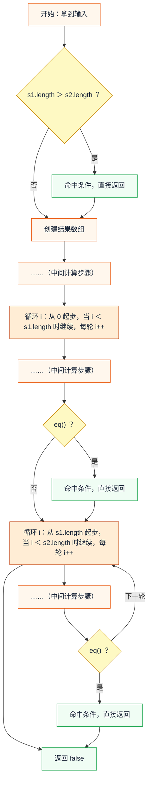
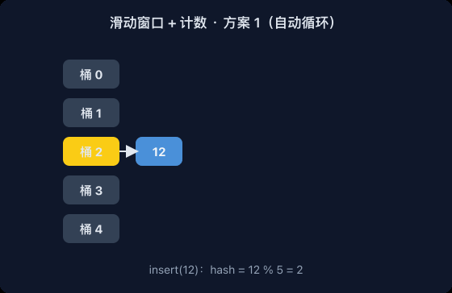
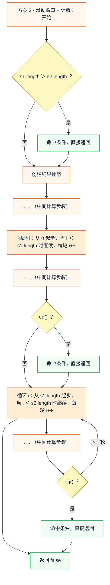
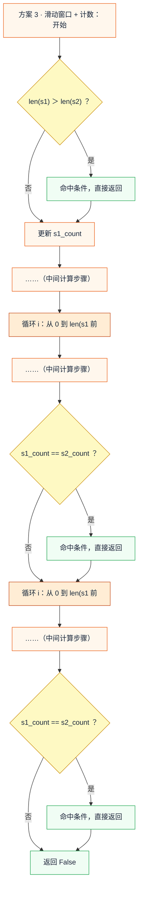
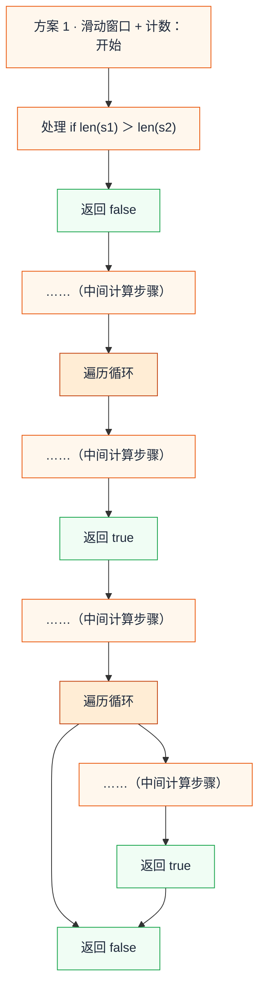
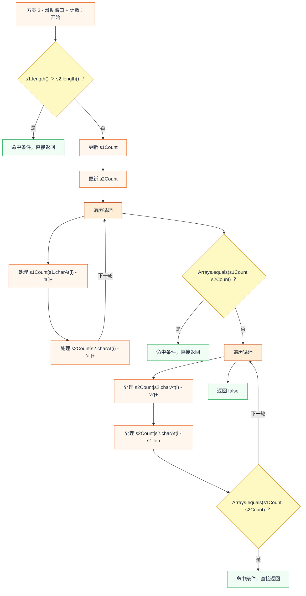
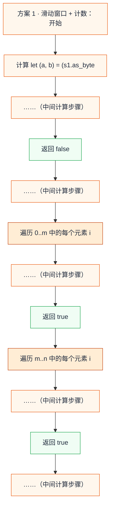
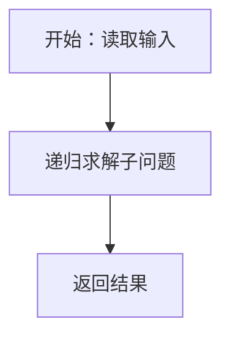
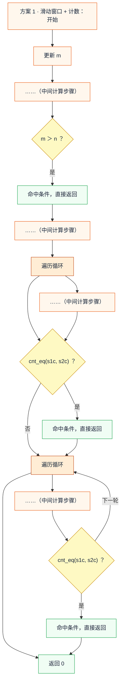

# 078 · 字符串的排列（第三阶段 · 字符串 · Medium）

> **难度**：⭐⭐ Medium ｜ **专题**：字符串
> **学习定位**：第三阶段 · 字符串第 78 篇 ｜ **解法数**：3
> **内容总结**：**字符串的排列**（字符串 · Medium）：共 3 个方案，主线思路「滑动窗口 + 计数」；时间 O(n)（单趟线性扫描）；动画演示滑动窗口过程，附录给出 11 种语言 × 全部方案的可运行实现。

---

## 题目描述

给你两个字符串 `s1` 和 `s2` ，写一个函数来判断 `s2` 是否包含 `s1` 的 排列。如果是，返回 `true` ；否则，返回 `false` 。

换句话说，`s1` 的排列之一是 `s2` 的 子串 。

**用例（来自原题）**：

**示例 1**

```text
输入：s1 = "ab" s2 = "eidbaooo"
输出：true
```

解释：s2 包含 s1 的排列之一 (「ba」).

**示例 2**

```text
输入：s1= "ab" s2 = "eidboaoo"
输出：false
```
> 题面与 [leetcode.cn 官方](https://leetcode.cn/problems/permutation-in-string/)一致，示例配图取自官方题面。

**数据范围与注意事项**：

- `1 <= s1.length, s2.length <= 10^4`
- `s1` 和 `s2` 仅包含小写字母
- **易错点**：空串、全空白、单字符三类边界，以及大小写是否敏感。

## 题目分析

**场景是什么**：字符串是字符数组，这类题练的是扫描、切分与匹配，对应真实开发里的文本清洗、协议解析。本题就是该场景的 Medium 级练习，主线做法是「滑动窗口 + 计数」。

**主线怎么解**：把主解法从头到尾过一遍，它其实在依次做这几件事：双重循环遍历。

## 解题思路

**方案对比**（共 3 个方案，由浅入深）：

| 方案 | 时间复杂度 | 空间复杂度 |
|---|---|---|
| 方案 1 · 滑动窗口 + 计数 | O(n)（单趟线性扫描） | O(1) 到 O(n)（视辅助结构） |
| 方案 2 · 滑动窗口 + 计数 | O(n)（单趟线性扫描） | O(1) 到 O(n)（视辅助结构） |
| 方案 3 · 滑动窗口 + 计数 | O(n)（单趟线性扫描） | O(1) 到 O(n)（视辅助结构） |

**方案间的取舍**：方案 1（滑动窗口 + 计数）；方案 2（滑动窗口 + 计数）；方案 3（滑动窗口 + 计数）。数据规模小、可读性优先时选靠前的方案；规模大、性能优先时选靠后的方案。

**怎么读这一篇**：

- 🐣 **新手路线**：把「题目描述」的示例 1 在纸上手推一遍 → 读方案 1（最直观的写法）与它的代码走读 → 按「运行方式」本地跑通看 PASS → 回头对比方案 2 之后的写法差在哪
- 🦅 **大佬路线**：直接锁定最优方案 1（滑动窗口 + 计数，O(n)（单趟线性扫描））→ 跳读该方案代码与走读 → 用「逐步拆解与面试追问」补齐复杂度推导与边界追问

### 动态算法图（滑动窗口，GIF 自动循环）


动画演示字符串专题里滑动窗口的典型过程；每个方案在「TypeScript 解题方案」一节还配了专属动画与专属流程图。

### 主解法流程图（真实控制流）



## TypeScript 解题方案（3 个方案逐个讲）

> **运行与提交**：每个方案都是自包含文件（内嵌用例自测，输出 PASS），整块复制到 `.ts` 文件后 `node 文件名` 即可运行。提交 LeetCode 时，把 `demo` 内的算法函数与辅助类型/函数整体取出、置于文件顶层即可。涉及交互/特殊接口的题以题面给定签名为准。

### 方案 1：滑动窗口 + 计数

**分析与思路**：核心做法是「滑动窗口 + 计数」。代码里依次做这些事：双重循环遍历。

**运行方式**：`node 本文件`，内嵌用例全部通过会输出 PASS。



**方案专属流程图**（真实控制流）：


```typescript
/**
 ** LeetCode 567. 字符串的排列
 ** 方案：1 ) 方案1：滑动窗口 + 计数
 ** 来源：https://blog.csdn.net/tyro_java/article/details/145385760
 */

export function checkInclusion(s1: string, s2: string): boolean {
  // 定义判定函数 checkInclusion
  if (s1.length > s2.length) return false; // 若 s1.长度 超过 s2.长度，直接返回 false
  const s1c = new Array(26).fill(0); // 把 new Array(26).fill(0) 存入 s1c
  const s2c = new Array(26).fill(0); // 把 new Array(26).fill(0) 存入 s2c
  for (let i = 0; i < s1.length; i++) {
    // 让 下标 i 从 0 开始计数，下标 i 小于 s1.长度 就继续
    s1c[s1.charCodeAt(i) - 97]++; // s1c[s1.charCodeAt(下标 i) 减 97] 加一 ;
    s2c[s2.charCodeAt(i) - 97]++; // s2c[s2.charCodeAt(下标 i) 减 97] 加一 ;
  }
  const eq = () => s1c.every((v: number, idx: number) => v === s2c[idx]);
  if (eq()) return true; // 若 eq()，直接返回 true
  for (let i = s1.length; i < s2.length; i++) {
    // 让 下标 i 从 s1.长度 开始计数，下标 i 小于 s2.长度 就继续
    s2c[s2.charCodeAt(i) - 97]++; // s2c[s2.charCodeAt(下标 i) 减 97] 加一 ;
    s2c[s2.charCodeAt(i - s1.length) - 97]--; // s2c[s2.charCodeAt(下标 i 减 s1.长度) 减 97] 减一 ;
    if (eq()) return true; // 若 eq()，直接返回 true
  }
  return false; // 返回 false
}

export function demo(): void {
  // 程序入口：跑内嵌自测用例
  if (!checkInclusion('ab', 'eidbaooo')) throw new Error('FAILED 1'); // 若 取反 checkInclusion(「ab」, 「ab」)) throw new Error(「ab」);
  if (checkInclusion('ab', 'eidboaoo')) throw new Error('FAILED 2'); // 若 checkInclusion(「ab」, 「ab」)) throw new Error(「ab」);
  console.log('PASS'); // 全部用例通过，输出 PASS
}

demo(); // demo();
```

### 方案 2：滑动窗口 + 计数

**分析与思路**：核心做法是「滑动窗口 + 计数」。代码里依次做这些事：双重循环遍历。

**运行方式**：`node 本文件`，内嵌用例全部通过会输出 PASS。


**方案专属流程图**（真实控制流）：


```typescript
/**
 ** LeetCode 567. 字符串的排列
 ** 方案：2 ) 方案2：滑动窗口 + 计数
 ** 来源：https://blog.csdn.net/tyro_java/article/details/145385760
 */

export function checkInclusion(s1: string, s2: string): boolean {
  // 定义判定函数 checkInclusion
  if (s1.length > s2.length) return false; // 若 s1.长度 超过 s2.长度，直接返回 false
  const s1c = new Array(26).fill(0); // 把 new Array(26).fill(0) 存入 s1c
  const s2c = new Array(26).fill(0); // 把 new Array(26).fill(0) 存入 s2c
  for (let i = 0; i < s1.length; i++) {
    // 让 下标 i 从 0 开始计数，下标 i 小于 s1.长度 就继续
    s1c[s1.charCodeAt(i) - 97]++; // s1c[s1.charCodeAt(下标 i) 减 97] 加一 ;
    s2c[s2.charCodeAt(i) - 97]++; // s2c[s2.charCodeAt(下标 i) 减 97] 加一 ;
  }
  const eq = () => s1c.every((v: number, idx: number) => v === s2c[idx]);
  if (eq()) return true; // 若 eq()，直接返回 true
  for (let i = s1.length; i < s2.length; i++) {
    // 让 下标 i 从 s1.长度 开始计数，下标 i 小于 s2.长度 就继续
    s2c[s2.charCodeAt(i) - 97]++; // s2c[s2.charCodeAt(下标 i) 减 97] 加一 ;
    s2c[s2.charCodeAt(i - s1.length) - 97]--; // s2c[s2.charCodeAt(下标 i 减 s1.长度) 减 97] 减一 ;
    if (eq()) return true; // 若 eq()，直接返回 true
  }
  return false; // 返回 false
}

export function demo(): void {
  // 程序入口：跑内嵌自测用例
  if (!checkInclusion('ab', 'eidbaooo')) throw new Error('FAILED 1'); // 若 取反 checkInclusion(「ab」, 「ab」)) throw new Error(「ab」);
  if (checkInclusion('ab', 'eidboaoo')) throw new Error('FAILED 2'); // 若 checkInclusion(「ab」, 「ab」)) throw new Error(「ab」);
  console.log('PASS'); // 全部用例通过，输出 PASS
}

demo(); // demo();
```

### 方案 3：滑动窗口 + 计数

**分析与思路**：核心做法是「滑动窗口 + 计数」。代码里依次做这些事：双重循环遍历。

**运行方式**：`node 本文件`，内嵌用例全部通过会输出 PASS。


**方案专属流程图**（真实控制流）：



```typescript
/**
 ** LeetCode 567. 字符串的排列
 ** 方案：3 ) 方案3：滑动窗口 + 计数
 ** 来源：https://blog.csdn.net/tyro_java/article/details/145385760
 */

export function checkInclusion(s1: string, s2: string): boolean {
  // 定义判定函数 checkInclusion
  if (s1.length > s2.length) return false; // 若 s1.长度 超过 s2.长度，直接返回 false
  const s1c = new Array(26).fill(0); // 把 new Array(26).fill(0) 存入 s1c
  const s2c = new Array(26).fill(0); // 把 new Array(26).fill(0) 存入 s2c
  for (let i = 0; i < s1.length; i++) {
    // 让 下标 i 从 0 开始计数，下标 i 小于 s1.长度 就继续
    s1c[s1.charCodeAt(i) - 97]++; // s1c[s1.charCodeAt(下标 i) 减 97] 加一 ;
    s2c[s2.charCodeAt(i) - 97]++; // s2c[s2.charCodeAt(下标 i) 减 97] 加一 ;
  }
  const eq = () => s1c.every((v: number, idx: number) => v === s2c[idx]);
  if (eq()) return true; // 若 eq()，直接返回 true
  for (let i = s1.length; i < s2.length; i++) {
    // 让 下标 i 从 s1.长度 开始计数，下标 i 小于 s2.长度 就继续
    s2c[s2.charCodeAt(i) - 97]++; // s2c[s2.charCodeAt(下标 i) 减 97] 加一 ;
    s2c[s2.charCodeAt(i - s1.length) - 97]--; // s2c[s2.charCodeAt(下标 i 减 s1.长度) 减 97] 减一 ;
    if (eq()) return true; // 若 eq()，直接返回 true
  }
  return false; // 返回 false
}

export function demo(): void {
  // 程序入口：跑内嵌自测用例
  if (!checkInclusion('ab', 'eidbaooo')) throw new Error('FAILED 1'); // 若 取反 checkInclusion(「ab」, 「ab」)) throw new Error(「ab」);
  if (checkInclusion('ab', 'eidboaoo')) throw new Error('FAILED 2'); // 若 checkInclusion(「ab」, 「ab」)) throw new Error(「ab」);
  console.log('PASS'); // 全部用例通过，输出 PASS
}

demo(); // demo();
```

## 逐步拆解与面试追问

**复杂度**：时间 O(n)（单趟线性扫描），空间 O(1) 到 O(n)（视辅助结构）

**为什么是这个量级**：每个元素被常数次访问，辅助哈希或栈的开销与 n 同阶

**面试官可能会追问**：

- 字符集有多大，能否用定长数组计数？
- 要不要考虑 Unicode 多字节字符？
- 空串与单字符的边界？

## 关键 API 速查（TS 主解法实际用到，附官方链接）

| API | 作用 | 使用要点 | 官方文档 |
|---|---|---|---|
| `String charCodeAt()` | 取 UTF-16 码元 | 返回 0~65535；超出下标返回 NaN；增补字符（emoji）占两个码元，需 codePointAt | [官方文档](https://developer.mozilla.org/zh-CN/docs/Web/JavaScript/Reference/Global_Objects/String/charCodeAt) |

### 各语言官方文档导航

- **TypeScript / JS**：[MDN 中文参考](https://developer.mozilla.org/zh-CN/)
- **Python**：[Python 官方文档](https://docs.python.org/zh-cn/3/)
- **Go**：[Go 标准库](https://pkg.go.dev/std)
- **Java**：[JDK 17 API](https://docs.oracle.com/en/java/javase/17/docs/api/)
- **Rust**：[Rust 标准库](https://doc.rust-lang.org/std/)
- **Lua**：[Lua 5.4 手册](https://www.lua.org/manual/5.4/)
- **C**：[Cppreference C](https://zh.cppreference.com/w/c)
- **C++**：[Cppreference C++](https://zh.cppreference.com/w/cpp)
- **R**：[R 官方手册](https://stat.ethz.ch/R-manual/)
- **Zig**：[Zig 语言文档](https://ziglang.org/documentation/master/)
- **Dart**：[Dart API](https://api.dart.dev/)

## 附录：其他 10 种语言全部实现（每种语言列举其全部方案）

> TypeScript 的全部方案见「TypeScript 解题方案」一节；下面是其余 10 种语言的对应实现，每种语言的每个方案都带思路分析、代码走读与专属运行架构图。
> 每个方案都内嵌用例自测，可独立运行（老仓库 python/go 文件遵循「打印结果」约定）。
> 完整解法文件见 `dsa/<语言>/string/lc_567_字符串的排列/`。

### Python 实现（3 种方案）

Python 的全部方案如下，每个方案都内嵌用例自测，可独立运行（老仓库 python/go 文件遵循「打印结果」约定）：

#### 方案 1：滑动窗口 + 计数

**思路与代码分析**：核心是「滑动窗口 + 计数」。Python 版用切片与字典推导式简化操作，突出可读性。**走读**：方案 1 · 滑动窗口 + 计数：开始 → 命中条件，直接返回 → 更新 s1_count → 循环 i：从 0 到 len(s1 前 → 命中条件，直接返回 → 循环 i：从 0 到 len(s1 前 → 命中条件，直接返回 → 返回 False。

**运行架构**（真实控制流）：


```python
import sys  # 提高递归深度上限（深输入防 RecursionError）

sys.setrecursionlimit(200000)  # 树/链表类题目节点数可达 1e4 量级

def checkInclusion(s1, s2):  # 定义函数 checkInclusion（参数：s1, s2）
    if len(s1) > len(s2):  # 若 长度(s1) 超过 长度(s2
        return False  # 返回 False
    s1_count = [0] * 26  # 把 [0] 乘 26 存入 s1_count
    s2_count = [0] * 26  # 把 [0] 乘 26 存入 s2_count
    for i in range(len(s1)):  # 让 下标 i 从 长度(s1 遍历
        s1_count[ord(s1[i]) - ord("a")] += 1  # 把 1 写入 s1_count[ord(s1[i]) - ord('a')] +
        s2_count[ord(s2[i]) - ord("a")] += 1  # 把 1 写入 s2_count[ord(s2[i]) - ord('a')] +
    if s1_count == s2_count:  # 若 s1_count 等于 s2_count
        return True  # 返回 True
    for i in range(len(s1), len(s2)):  # 让 下标 i 从 长度(s1 遍历
        s2_count[ord(s2[i]) - ord("a")] += 1  # 把 1 写入 s2_count[ord(s2[i]) - ord('a')] +
        s2_count[
            ord(s2[i - len(s1)]) - ord("a")
        ] -= 1  # 把 1 写入 s2_count[ord(s2[i - len(s1)]) - ord('a')] -
        if s1_count == s2_count:  # 若 s1_count 等于 s2_count
            return True  # 返回 True
    return False  # 返回 False

if __name__ == "__main__":  # 若 __name__ 等于 '__main__'
    print(checkInclusion("ab", "eidbaooo"))  # 打印输出
```

#### 方案 2：滑动窗口 + 计数

**思路与代码分析**：核心是「滑动窗口 + 计数」。Python 版用切片与字典推导式简化操作，突出可读性。**走读**：方案 2 · 滑动窗口 + 计数：开始 → 命中条件，直接返回 → 更新 s1_count → 循环 i：从 0 到 len(s1 前 → 命中条件，直接返回 → 循环 i：从 0 到 len(s1 前 → 命中条件，直接返回 → 返回 False。

**运行架构**（真实控制流）：


```python
import sys  # 提高递归深度上限（深输入防 RecursionError）

sys.setrecursionlimit(200000)  # 树/链表类题目节点数可达 1e4 量级

def checkInclusion(s1, s2):  # 定义函数 checkInclusion（参数：s1, s2）
    if len(s1) > len(s2):  # 若 长度(s1) 超过 长度(s2
        return False  # 返回 False
    s1_count = [0] * 26  # 把 [0] 乘 26 存入 s1_count
    s2_count = [0] * 26  # 把 [0] 乘 26 存入 s2_count
    for i in range(len(s1)):  # 让 下标 i 从 长度(s1 遍历
        s1_count[ord(s1[i]) - ord("a")] += 1  # 把 1 写入 s1_count[ord(s1[i]) - ord('a')] +
        s2_count[ord(s2[i]) - ord("a")] += 1  # 把 1 写入 s2_count[ord(s2[i]) - ord('a')] +
    if s1_count == s2_count:  # 若 s1_count 等于 s2_count
        return True  # 返回 True
    for i in range(len(s1), len(s2)):  # 让 下标 i 从 长度(s1 遍历
        s2_count[ord(s2[i]) - ord("a")] += 1  # 把 1 写入 s2_count[ord(s2[i]) - ord('a')] +
        s2_count[
            ord(s2[i - len(s1)]) - ord("a")
        ] -= 1  # 把 1 写入 s2_count[ord(s2[i - len(s1)]) - ord('a')] -
        if s1_count == s2_count:  # 若 s1_count 等于 s2_count
            return True  # 返回 True
    return False  # 返回 False

if __name__ == "__main__":  # 若 __name__ 等于 '__main__'
    print(checkInclusion("ab", "eidbaooo"))  # 打印输出
```

#### 方案 3：滑动窗口 + 计数

**思路与代码分析**：核心是「滑动窗口 + 计数」。Python 版用切片与字典推导式简化操作，突出可读性。**走读**：方案 3 · 滑动窗口 + 计数：开始 → 命中条件，直接返回 → 更新 s1_count → 循环 i：从 0 到 len(s1 前 → 命中条件，直接返回 → 循环 i：从 0 到 len(s1 前 → 命中条件，直接返回 → 返回 False。

**运行架构**（真实控制流）：



```python
import sys  # 提高递归深度上限（深输入防 RecursionError）

sys.setrecursionlimit(200000)  # 树/链表类题目节点数可达 1e4 量级

def checkInclusion(s1, s2):  # 定义函数 checkInclusion（参数：s1, s2）
    if len(s1) > len(s2):  # 若 长度(s1) 超过 长度(s2
        return False  # 返回 False
    s1_count = [0] * 26  # 把 [0] 乘 26 存入 s1_count
    s2_count = [0] * 26  # 把 [0] 乘 26 存入 s2_count
    for i in range(len(s1)):  # 让 下标 i 从 长度(s1 遍历
        s1_count[ord(s1[i]) - ord("a")] += 1  # 把 1 写入 s1_count[ord(s1[i]) - ord('a')] +
        s2_count[ord(s2[i]) - ord("a")] += 1  # 把 1 写入 s2_count[ord(s2[i]) - ord('a')] +
    if s1_count == s2_count:  # 若 s1_count 等于 s2_count
        return True  # 返回 True
    for i in range(len(s1), len(s2)):  # 让 下标 i 从 长度(s1 遍历
        s2_count[ord(s2[i]) - ord("a")] += 1  # 把 1 写入 s2_count[ord(s2[i]) - ord('a')] +
        s2_count[
            ord(s2[i - len(s1)]) - ord("a")
        ] -= 1  # 把 1 写入 s2_count[ord(s2[i - len(s1)]) - ord('a')] -
        if s1_count == s2_count:  # 若 s1_count 等于 s2_count
            return True  # 返回 True
    return False  # 返回 False

if __name__ == "__main__":  # 若 __name__ 等于 '__main__'
    print(checkInclusion("ab", "eidbaooo"))  # 打印输出
```

### Go 实现（3 种方案）

Go 的全部方案如下，每个方案都内嵌用例自测，可独立运行（老仓库 python/go 文件遵循「打印结果」约定）：

#### 方案 1：滑动窗口 + 计数

**思路与代码分析**：核心是「滑动窗口 + 计数」。Go 版用切片与多返回值惯用法，显式处理索引边界。**走读**：方案 1 · 滑动窗口 + 计数：开始 → 处理 if len(s1) ＞ len(s2) → 返回 false → 遍历循环 → 返回 true → 遍历循环 → 返回 true → 返回 false。

**运行架构**（真实控制流）：



```go
package main // 引入依赖

import (
	"fmt"     // 「fmt」
	"os"      // 「os」
	"reflect" // 「reflect」
)

// 忠实翻译 python/string/lc_567_字符串的排列/solution_1_1_____1_____.py
func checkInclusion(s1, s2 string) bool { // 定义判定函数 checkInclusion
	if len(s1) > len(s2) {
		return false
	} // 若 长度(s1) 超过 长度(s2) { return false }
	s1c := make([]int, 26)         // 把 make([]int, 26) 写入 s1c :
	s2c := make([]int, 26)         // 把 make([]int, 26) 写入 s2c :
	for i := 0; i < len(s1); i++ { // 让 下标 i 从 0 开始计数
		s1c[s1[i]-'a']++ // s1c[s1[下标 i] 减 '数组'] 加一
		s2c[s2[i]-'a']++ // s2c[s2[下标 i] 减 '数组'] 加一
	}
	if eqArr(s1c, s2c) {
		return true
	} // 若 eqArr(s1c, s2c) { return true }
	L := len(s1)                   // 把 长度(s1) 写入 L :
	for i := L; i < len(s2); i++ { // 把 L; 下标 i 小于 长度(s2); 下标 i 加一 { 写入 for i :
		s2c[s2[i]-'a']++   // s2c[s2[下标 i] 减 '数组'] 加一
		s2c[s2[i-L]-'a']-- // s2c[s2[下标 i 减 L] 减 '数组'] 减一
		if eqArr(s1c, s2c) {
			return true
		} // 若 eqArr(s1c, s2c) { return true }
	}
	return false // 返回 false
}

func eqArr(a, b []int) bool { return reflect.DeepEqual(a, b) } // 定义函数/方法 eqArr

func main() { // 程序入口：跑内嵌自测用例
	type caseT struct {
		s1, s2 string
		want   bool
	} // 定义类型
	cases := []caseT{ // 把 []caseT{ 写入 cases :
		{"ab", "eidbaooo", true},
		{"ab", "eidboaoo", false},
		{"hello", "ooolleoooleh", false},
		{"a", "a", true},
		{"abc", "cccccbabbbaaaa", true},
		{"ab", "xyz", false},
	}
	ok := true                // 把 true 写入 ok :
	for _, c := range cases { // 同时取 _ 与 字符 遍历
		if got := checkInclusion(c.s1, c.s2); got != c.want { // 若 got : 赋值为 checkInclusion(字符.s1, 字符.s2); got 不等于 字符.want
			ok = false                                                                     // 把 false 写入 ok
			fmt.Printf("FAIL checkInclusion(%q,%q)=%v want %v\n", c.s1, c.s2, got, c.want) // 打印输出
		}
	}
	if !ok {
		os.Exit(1)
	} // 若 取反 ok { os.Exit(1) }
	fmt.Println("PASS") // 全部用例通过，输出 PASS
}
```

#### 方案 2：滑动窗口 + 计数

**思路与代码分析**：核心是「滑动窗口 + 计数」。Go 版用切片与多返回值惯用法，显式处理索引边界。**走读**：方案 2 · 滑动窗口 + 计数：开始 → 处理 if len(s1) ＞ len(s2) → 返回 false → 遍历循环 → 返回 true → 遍历循环 → 返回 true → 返回 false。

**运行架构**（真实控制流）：


```go
package main // 引入依赖

import (
	"fmt"     // 「fmt」
	"os"      // 「os」
	"reflect" // 「reflect」
)

// 忠实翻译 python/string/lc_567_字符串的排列/solution_2_2_____2_______.py
func checkInclusion(s1, s2 string) bool { // 定义判定函数 checkInclusion
	if len(s1) > len(s2) {
		return false
	} // 若 长度(s1) 超过 长度(s2) { return false }
	s1c := make([]int, 26)         // 把 make([]int, 26) 写入 s1c :
	s2c := make([]int, 26)         // 把 make([]int, 26) 写入 s2c :
	for i := 0; i < len(s1); i++ { // 让 下标 i 从 0 开始计数
		s1c[s1[i]-'a']++ // s1c[s1[下标 i] 减 '数组'] 加一
		s2c[s2[i]-'a']++ // s2c[s2[下标 i] 减 '数组'] 加一
	}
	if eqArr(s1c, s2c) {
		return true
	} // 若 eqArr(s1c, s2c) { return true }
	L := len(s1)                   // 把 长度(s1) 写入 L :
	for i := L; i < len(s2); i++ { // 把 L; 下标 i 小于 长度(s2); 下标 i 加一 { 写入 for i :
		s2c[s2[i]-'a']++   // s2c[s2[下标 i] 减 '数组'] 加一
		s2c[s2[i-L]-'a']-- // s2c[s2[下标 i 减 L] 减 '数组'] 减一
		if eqArr(s1c, s2c) {
			return true
		} // 若 eqArr(s1c, s2c) { return true }
	}
	return false // 返回 false
}

func eqArr(a, b []int) bool { return reflect.DeepEqual(a, b) } // 定义函数/方法 eqArr

func main() { // 程序入口：跑内嵌自测用例
	type caseT struct {
		s1, s2 string
		want   bool
	} // 定义类型
	cases := []caseT{ // 把 []caseT{ 写入 cases :
		{"ab", "eidbaooo", true},
		{"ab", "eidboaoo", false},
		{"hello", "ooolleoooleh", false},
		{"a", "a", true},
		{"abc", "cccccbabbbaaaa", true},
		{"ab", "xyz", false},
	}
	ok := true                // 把 true 写入 ok :
	for _, c := range cases { // 同时取 _ 与 字符 遍历
		if got := checkInclusion(c.s1, c.s2); got != c.want { // 若 got : 赋值为 checkInclusion(字符.s1, 字符.s2); got 不等于 字符.want
			ok = false                                                                     // 把 false 写入 ok
			fmt.Printf("FAIL checkInclusion(%q,%q)=%v want %v\n", c.s1, c.s2, got, c.want) // 打印输出
		}
	}
	if !ok {
		os.Exit(1)
	} // 若 取反 ok { os.Exit(1) }
	fmt.Println("PASS") // 全部用例通过，输出 PASS
}
```

#### 方案 3：滑动窗口 + 计数

**思路与代码分析**：核心是「滑动窗口 + 计数」。Go 版用切片与多返回值惯用法，显式处理索引边界。**走读**：方案 3 · 滑动窗口 + 计数：开始 → 处理 if len(s1) ＞ len(s2) → 返回 false → 遍历循环 → 返回 true → 遍历循环 → 返回 true → 返回 false。

**运行架构**（真实控制流）：


```go
package main // 引入依赖

import (
	"fmt"     // 「fmt」
	"os"      // 「os」
	"reflect" // 「reflect」
)

// 忠实翻译 python/string/lc_567_字符串的排列/solution_3_3_____3____.py
func checkInclusion(s1, s2 string) bool { // 定义判定函数 checkInclusion
	if len(s1) > len(s2) {
		return false
	} // 若 长度(s1) 超过 长度(s2) { return false }
	s1c := make([]int, 26)         // 把 make([]int, 26) 写入 s1c :
	s2c := make([]int, 26)         // 把 make([]int, 26) 写入 s2c :
	for i := 0; i < len(s1); i++ { // 让 下标 i 从 0 开始计数
		s1c[s1[i]-'a']++ // s1c[s1[下标 i] 减 '数组'] 加一
		s2c[s2[i]-'a']++ // s2c[s2[下标 i] 减 '数组'] 加一
	}
	if eqArr(s1c, s2c) {
		return true
	} // 若 eqArr(s1c, s2c) { return true }
	L := len(s1)                   // 把 长度(s1) 写入 L :
	for i := L; i < len(s2); i++ { // 把 L; 下标 i 小于 长度(s2); 下标 i 加一 { 写入 for i :
		s2c[s2[i]-'a']++   // s2c[s2[下标 i] 减 '数组'] 加一
		s2c[s2[i-L]-'a']-- // s2c[s2[下标 i 减 L] 减 '数组'] 减一
		if eqArr(s1c, s2c) {
			return true
		} // 若 eqArr(s1c, s2c) { return true }
	}
	return false // 返回 false
}

func eqArr(a, b []int) bool { return reflect.DeepEqual(a, b) } // 定义函数/方法 eqArr

func main() { // 程序入口：跑内嵌自测用例
	type caseT struct {
		s1, s2 string
		want   bool
	} // 定义类型
	cases := []caseT{ // 把 []caseT{ 写入 cases :
		{"ab", "eidbaooo", true},
		{"ab", "eidboaoo", false},
		{"hello", "ooolleoooleh", false},
		{"a", "a", true},
		{"abc", "cccccbabbbaaaa", true},
		{"ab", "xyz", false},
	}
	ok := true                // 把 true 写入 ok :
	for _, c := range cases { // 同时取 _ 与 字符 遍历
		if got := checkInclusion(c.s1, c.s2); got != c.want { // 若 got : 赋值为 checkInclusion(字符.s1, 字符.s2); got 不等于 字符.want
			ok = false                                                                     // 把 false 写入 ok
			fmt.Printf("FAIL checkInclusion(%q,%q)=%v want %v\n", c.s1, c.s2, got, c.want) // 打印输出
		}
	}
	if !ok {
		os.Exit(1)
	} // 若 取反 ok { os.Exit(1) }
	fmt.Println("PASS") // 全部用例通过，输出 PASS
}
```

### Java 实现（3 种方案）

Java 的全部方案如下，每个方案都内嵌用例自测，可独立运行（老仓库 python/go 文件遵循「打印结果」约定）：

#### 方案 1：滑动窗口 + 计数

**思路与代码分析**：核心是「滑动窗口 + 计数」。Java 版用类与静态方法组织，集合操作显式明了。代码里依次做这些事：双重循环遍历。**走读**：方案 1 · 滑动窗口 + 计数：开始 → 命中条件，直接返回 → 更新 s1Count → 更新 s2Count → 遍历循环 → 处理 s1Count[s1.charAt(i) - 'a']+ → 处理 s2Count[s2.charAt(i) - 'a']+ → 命中条件，直接返回 → 遍历循环 → 处理 s2Count[s2.charAt(i) - 'a']+ → 处理 s2Count[s2.charAt(i - s1.len → 命中条件，直接返回 → 返回 false。

**运行架构**（真实控制流）：


```java
package com.webfault.dsa; // 引入依赖

import java.util.*; // 引入依赖

class Main { // 定义类型
  static boolean checkInclusion(String s1, String s2) { // 定义判定函数 checkInclusion
    if (s1.length() > s2.length()) return false; // 若 s1.长度() 超过 s2.长度()，直接返回 false
    int[] s1Count = new int[26]; // 把 new int[26]; 写入 int[] s1Count
    int[] s2Count = new int[26]; // 把 new int[26]; 写入 int[] s2Count
    for (int i = 0; i < s1.length(); i++) { // 让 下标 i 从 0 开始计数，下标 i 小于 s1.长度() 就继续
      s1Count[s1.charAt(i) - 'a']++; // 逐字符处理
      s2Count[s2.charAt(i) - 'a']++; // 逐字符处理
    }
    if (Arrays.equals(s1Count, s2Count)) return true; // 若 Arrays.equals(s1Count, s2Count)，直接返回 true
    for (int i = s1.length(); i < s2.length(); i++) { // 让 下标 i 从 s1.长度() 开始计数，下标 i 小于 s2.长度() 就继续
      s2Count[s2.charAt(i) - 'a']++; // 逐字符处理
      s2Count[s2.charAt(i - s1.length()) - 'a']--; // 逐字符处理
      if (Arrays.equals(s1Count, s2Count))
        return true; // 若 Arrays.equals(s1Count, s2Count)，直接返回 true
    }
    return false; // 返回 false
  }

  public static void main(String[] args) { // public static void main(String[] args) {
    String[][] a = { // 把 { 写入 String[][] a
      {"ab", "eidbaooo"},
      {"ab", "eidboaoo"},
      {"hello", "ooolleoooleh"},
      {"a", "a"},
      {"abc", "cccccbabbbaaaa"},
      {"ab", "xyz"},
    };
    boolean[] wants = {true, false, false, true, true, false};
    boolean ok = true; // 把 true; 写入 boolean ok
    for (int ci = 0; ci < a.length; ci++) { // 让 ci 从 0 开始计数，ci 小于 数组.长度 就继续
      boolean got =
          checkInclusion(
              a[ci][0], a[ci][1]); // 把 checkInclusion(数组[ci][0], 数组[ci][1]); 写入 boolean got
      if (got != wants[ci]) { // 若 got 不等于 wants[ci]
        ok = false; // 把 false; 写入 ok
        System.out.println("FAIL case " + ci + " got " + got + " want " + wants[ci]); // 打印输出
      }
    }
    if (!ok) throw new RuntimeException("FAILED"); // 若 取反 ok) throw new RuntimeException(「FAILED」);
    System.out.println("PASS"); // 全部用例通过，输出 PASS
  }
}
```

#### 方案 2：滑动窗口 + 计数

**思路与代码分析**：核心是「滑动窗口 + 计数」。Java 版用类与静态方法组织，集合操作显式明了。代码里依次做这些事：双重循环遍历。**走读**：方案 2 · 滑动窗口 + 计数：开始 → 命中条件，直接返回 → 更新 s1Count → 更新 s2Count → 遍历循环 → 处理 s1Count[s1.charAt(i) - 'a']+ → 处理 s2Count[s2.charAt(i) - 'a']+ → 命中条件，直接返回 → 遍历循环 → 处理 s2Count[s2.charAt(i) - 'a']+ → 处理 s2Count[s2.charAt(i - s1.len → 命中条件，直接返回 → 返回 false。

**运行架构**（真实控制流）：



```java
package com.webfault.dsa; // 引入依赖

import java.util.*; // 引入依赖

class Main { // 定义类型
  static boolean checkInclusion(String s1, String s2) { // 定义判定函数 checkInclusion
    if (s1.length() > s2.length()) return false; // 若 s1.长度() 超过 s2.长度()，直接返回 false
    int[] s1Count = new int[26]; // 把 new int[26]; 写入 int[] s1Count
    int[] s2Count = new int[26]; // 把 new int[26]; 写入 int[] s2Count
    for (int i = 0; i < s1.length(); i++) { // 让 下标 i 从 0 开始计数，下标 i 小于 s1.长度() 就继续
      s1Count[s1.charAt(i) - 'a']++; // 逐字符处理
      s2Count[s2.charAt(i) - 'a']++; // 逐字符处理
    }
    if (Arrays.equals(s1Count, s2Count)) return true; // 若 Arrays.equals(s1Count, s2Count)，直接返回 true
    for (int i = s1.length(); i < s2.length(); i++) { // 让 下标 i 从 s1.长度() 开始计数，下标 i 小于 s2.长度() 就继续
      s2Count[s2.charAt(i) - 'a']++; // 逐字符处理
      s2Count[s2.charAt(i - s1.length()) - 'a']--; // 逐字符处理
      if (Arrays.equals(s1Count, s2Count))
        return true; // 若 Arrays.equals(s1Count, s2Count)，直接返回 true
    }
    return false; // 返回 false
  }

  public static void main(String[] args) { // public static void main(String[] args) {
    String[][] a = { // 把 { 写入 String[][] a
      {"ab", "eidbaooo"},
      {"ab", "eidboaoo"},
      {"hello", "ooolleoooleh"},
      {"a", "a"},
      {"abc", "cccccbabbbaaaa"},
      {"ab", "xyz"},
    };
    boolean[] wants = {true, false, false, true, true, false};
    boolean ok = true; // 把 true; 写入 boolean ok
    for (int ci = 0; ci < a.length; ci++) { // 让 ci 从 0 开始计数，ci 小于 数组.长度 就继续
      boolean got =
          checkInclusion(
              a[ci][0], a[ci][1]); // 把 checkInclusion(数组[ci][0], 数组[ci][1]); 写入 boolean got
      if (got != wants[ci]) { // 若 got 不等于 wants[ci]
        ok = false; // 把 false; 写入 ok
        System.out.println("FAIL case " + ci + " got " + got + " want " + wants[ci]); // 打印输出
      }
    }
    if (!ok) throw new RuntimeException("FAILED"); // 若 取反 ok) throw new RuntimeException(「FAILED」);
    System.out.println("PASS"); // 全部用例通过，输出 PASS
  }
}
```

#### 方案 3：滑动窗口 + 计数

**思路与代码分析**：核心是「滑动窗口 + 计数」。Java 版用类与静态方法组织，集合操作显式明了。代码里依次做这些事：双重循环遍历。**走读**：方案 3 · 滑动窗口 + 计数：开始 → 命中条件，直接返回 → 更新 s1Count → 更新 s2Count → 遍历循环 → 处理 s1Count[s1.charAt(i) - 'a']+ → 处理 s2Count[s2.charAt(i) - 'a']+ → 命中条件，直接返回 → 遍历循环 → 处理 s2Count[s2.charAt(i) - 'a']+ → 处理 s2Count[s2.charAt(i - s1.len → 命中条件，直接返回 → 返回 false。

**运行架构**（真实控制流）：


```java
package com.webfault.dsa; // 引入依赖

import java.util.*; // 引入依赖

class Main { // 定义类型
  static boolean checkInclusion(String s1, String s2) { // 定义判定函数 checkInclusion
    if (s1.length() > s2.length()) return false; // 若 s1.长度() 超过 s2.长度()，直接返回 false
    int[] s1Count = new int[26]; // 把 new int[26]; 写入 int[] s1Count
    int[] s2Count = new int[26]; // 把 new int[26]; 写入 int[] s2Count
    for (int i = 0; i < s1.length(); i++) { // 让 下标 i 从 0 开始计数，下标 i 小于 s1.长度() 就继续
      s1Count[s1.charAt(i) - 'a']++; // 逐字符处理
      s2Count[s2.charAt(i) - 'a']++; // 逐字符处理
    }
    if (Arrays.equals(s1Count, s2Count)) return true; // 若 Arrays.equals(s1Count, s2Count)，直接返回 true
    for (int i = s1.length(); i < s2.length(); i++) { // 让 下标 i 从 s1.长度() 开始计数，下标 i 小于 s2.长度() 就继续
      s2Count[s2.charAt(i) - 'a']++; // 逐字符处理
      s2Count[s2.charAt(i - s1.length()) - 'a']--; // 逐字符处理
      if (Arrays.equals(s1Count, s2Count))
        return true; // 若 Arrays.equals(s1Count, s2Count)，直接返回 true
    }
    return false; // 返回 false
  }

  public static void main(String[] args) { // public static void main(String[] args) {
    String[][] a = { // 把 { 写入 String[][] a
      {"ab", "eidbaooo"},
      {"ab", "eidboaoo"},
      {"hello", "ooolleoooleh"},
      {"a", "a"},
      {"abc", "cccccbabbbaaaa"},
      {"ab", "xyz"},
    };
    boolean[] wants = {true, false, false, true, true, false};
    boolean ok = true; // 把 true; 写入 boolean ok
    for (int ci = 0; ci < a.length; ci++) { // 让 ci 从 0 开始计数，ci 小于 数组.长度 就继续
      boolean got =
          checkInclusion(
              a[ci][0], a[ci][1]); // 把 checkInclusion(数组[ci][0], 数组[ci][1]); 写入 boolean got
      if (got != wants[ci]) { // 若 got 不等于 wants[ci]
        ok = false; // 把 false; 写入 ok
        System.out.println("FAIL case " + ci + " got " + got + " want " + wants[ci]); // 打印输出
      }
    }
    if (!ok) throw new RuntimeException("FAILED"); // 若 取反 ok) throw new RuntimeException(「FAILED」);
    System.out.println("PASS"); // 全部用例通过，输出 PASS
  }
}
```

### Rust 实现（3 种方案）

Rust 的全部方案如下，每个方案都内嵌用例自测，可独立运行（老仓库 python/go 文件遵循「打印结果」约定）：

#### 方案 1：滑动窗口 + 计数

**思路与代码分析**：核心是「滑动窗口 + 计数」。Rust 版用所有权移动与切片借用改写同一逻辑，注意 Option 与引用边界。**走读**：方案 1 · 滑动窗口 + 计数：开始 → 计算 let (a, b) = (s1.as_byte → 返回 false → 遍历 0..m 中的每个元素 i → 返回 true → 遍历 m..n 中的每个元素 i → 返回 true。

**运行架构**（真实控制流）：



```rust
// LeetCode 567. 字符串的排列 — Rust 版（方案1）
fn check_inclusion(s1: String, s2: String) -> bool {
    // 定义判定函数 check_inclusion
    let (a, b) = (s1.as_bytes(), s2.as_bytes()); // 把 (s1.as_bytes(), s2.as_bytes()); 写入 let (a, b)
    let (m, n) = (a.len(), b.len()); // 把 (数组.长度(), b.长度()); 写入 let (m, n)
    if m > n {
        return false;
    } // 若 映射表 超过 元素个数 { return false; }
    let mut s1c = [0i32; 26]; // 把 [0i32; 26]; 写入 let mut s1c
    let mut s2c = [0i32; 26]; // 把 [0i32; 26]; 写入 let mut s2c
    for i in 0..m {
        // 逐个取出 0 的元素（下标 i）
        s1c[(a[i] - b'a') as usize] += 1; // 把 1; 写入 s1c[(a[i] - b'a') as usize] +
        s2c[(b[i] - b'a') as usize] += 1; // 把 1; 写入 s2c[(b[i] - b'a') as usize] +
    }
    if s1c == s2c {
        return true;
    } // 若 s1c 等于 s2c { return true; }
    for i in m..n {
        // 逐个取出 映射表 的元素（下标 i）
        s2c[(b[i] - b'a') as usize] += 1; // 把 1; 写入 s2c[(b[i] - b'a') as usize] +
        s2c[(b[i - m] - b'a') as usize] -= 1; // 把 1; 写入 s2c[(b[i - m] - b'a') as usize] -
        if s1c == s2c {
            return true;
        } // 若 s1c 等于 s2c { return true; }
    }
    false // false
}
fn main() {
    // 程序入口：跑内嵌自测用例
    assert!(check_inclusion("ab".into(), "eidbaooo".into())); // 断言校验
    assert!(!check_inclusion("ab".into(), "eidboaoo".into())); // 断言校验
    println!("PASS"); // 全部用例通过，输出 PASS
}
```

#### 方案 2：滑动窗口 + 计数

**思路与代码分析**：核心是「滑动窗口 + 计数」。Rust 版用所有权移动与切片借用改写同一逻辑，注意 Option 与引用边界。**走读**：方案 2 · 滑动窗口 + 计数：开始 → 计算 let (a, b) = (s1.as_byte → 返回 false → 遍历 0..m 中的每个元素 i → 返回 true → 遍历 m..n 中的每个元素 i → 返回 true。

**运行架构**（真实控制流）：


```rust
// LeetCode 567. 字符串的排列 — Rust 版（方案2）
fn check_inclusion(s1: String, s2: String) -> bool {
    // 定义判定函数 check_inclusion
    let (a, b) = (s1.as_bytes(), s2.as_bytes()); // 把 (s1.as_bytes(), s2.as_bytes()); 写入 let (a, b)
    let (m, n) = (a.len(), b.len()); // 把 (数组.长度(), b.长度()); 写入 let (m, n)
    if m > n {
        return false;
    } // 若 映射表 超过 元素个数 { return false; }
    let mut s1c = [0i32; 26]; // 把 [0i32; 26]; 写入 let mut s1c
    let mut s2c = [0i32; 26]; // 把 [0i32; 26]; 写入 let mut s2c
    for i in 0..m {
        // 逐个取出 0 的元素（下标 i）
        s1c[(a[i] - b'a') as usize] += 1; // 把 1; 写入 s1c[(a[i] - b'a') as usize] +
        s2c[(b[i] - b'a') as usize] += 1; // 把 1; 写入 s2c[(b[i] - b'a') as usize] +
    }
    if s1c == s2c {
        return true;
    } // 若 s1c 等于 s2c { return true; }
    for i in m..n {
        // 逐个取出 映射表 的元素（下标 i）
        s2c[(b[i] - b'a') as usize] += 1; // 把 1; 写入 s2c[(b[i] - b'a') as usize] +
        s2c[(b[i - m] - b'a') as usize] -= 1; // 把 1; 写入 s2c[(b[i - m] - b'a') as usize] -
        if s1c == s2c {
            return true;
        } // 若 s1c 等于 s2c { return true; }
    }
    false // false
}
fn main() {
    // 程序入口：跑内嵌自测用例
    assert!(check_inclusion("ab".into(), "eidbaooo".into())); // 断言校验
    assert!(!check_inclusion("ab".into(), "eidboaoo".into())); // 断言校验
    println!("PASS"); // 全部用例通过，输出 PASS
}
```

#### 方案 3：滑动窗口 + 计数

**思路与代码分析**：核心是「滑动窗口 + 计数」。Rust 版用所有权移动与切片借用改写同一逻辑，注意 Option 与引用边界。**走读**：方案 3 · 滑动窗口 + 计数：开始 → 计算 let (a, b) = (s1.as_byte → 返回 false → 遍历 0..m 中的每个元素 i → 返回 true → 遍历 m..n 中的每个元素 i → 返回 true。

**运行架构**（真实控制流）：


```rust
// LeetCode 567. 字符串的排列 — Rust 版（方案3）
fn check_inclusion(s1: String, s2: String) -> bool {
    // 定义判定函数 check_inclusion
    let (a, b) = (s1.as_bytes(), s2.as_bytes()); // 把 (s1.as_bytes(), s2.as_bytes()); 写入 let (a, b)
    let (m, n) = (a.len(), b.len()); // 把 (数组.长度(), b.长度()); 写入 let (m, n)
    if m > n {
        return false;
    } // 若 映射表 超过 元素个数 { return false; }
    let mut s1c = [0i32; 26]; // 把 [0i32; 26]; 写入 let mut s1c
    let mut s2c = [0i32; 26]; // 把 [0i32; 26]; 写入 let mut s2c
    for i in 0..m {
        // 逐个取出 0 的元素（下标 i）
        s1c[(a[i] - b'a') as usize] += 1; // 把 1; 写入 s1c[(a[i] - b'a') as usize] +
        s2c[(b[i] - b'a') as usize] += 1; // 把 1; 写入 s2c[(b[i] - b'a') as usize] +
    }
    if s1c == s2c {
        return true;
    } // 若 s1c 等于 s2c { return true; }
    for i in m..n {
        // 逐个取出 映射表 的元素（下标 i）
        s2c[(b[i] - b'a') as usize] += 1; // 把 1; 写入 s2c[(b[i] - b'a') as usize] +
        s2c[(b[i - m] - b'a') as usize] -= 1; // 把 1; 写入 s2c[(b[i - m] - b'a') as usize] -
        if s1c == s2c {
            return true;
        } // 若 s1c 等于 s2c { return true; }
    }
    false // false
}
fn main() {
    // 程序入口：跑内嵌自测用例
    assert!(check_inclusion("ab".into(), "eidbaooo".into())); // 断言校验
    assert!(!check_inclusion("ab".into(), "eidboaoo".into())); // 断言校验
    println!("PASS"); // 全部用例通过，输出 PASS
}
```

### Lua 实现（3 种方案）

Lua 的全部方案如下，每个方案都内嵌用例自测，可独立运行（老仓库 python/go 文件遵循「打印结果」约定）：

#### 方案 1：滑动窗口 + 计数

**思路与代码分析**：核心是「滑动窗口 + 计数」。Lua 版用表与 ipairs 遍历，注意 ipairs 遇 nil 即停的语义。代码里依次做这些事：递归求解子问题。

**运行架构**（真实控制流）：



```lua
-- LeetCode 567. 字符串的排列 — Lua 版（方案1）
local function check_inclusion(s1, s2) -- local function check_inclusion(s1, s2)
	local m, n = #s1, #s2 -- 把 #s1, #s2 写入 local m, n
	if m > n then
		return false
	end -- 若 映射表 超过 元素个数 then return false 终点
	local s1c, s2c = {}, {} -- 把 {}, {} 写入 local s1c, s2c
	for i = 1, m do -- 让 下标 i 从 1 走到 映射表（Lua 1 基）
		local c1 = s1:byte(i) - 97 -- 把 s1:byte(下标 i) 减 97 写入 local c1
		local c2 = s2:byte(i) - 97 -- 把 s2:byte(下标 i) 减 97 写入 local c2
		s1c[c1] = (s1c[c1] or 0) + 1 -- 把 (s1c[c1] or 0) 加 1 写入 s1c[c1]
		s2c[c2] = (s2c[c2] or 0) + 1 -- 把 (s2c[c2] or 0) 加 1 写入 s2c[c2]
	end -- 终点
	local function eq() -- local function eq()
		for k, v in pairs(s1c) do -- 遍历取 值
			if (s2c[k] or 0) ~= v then
				return false
			end -- 若 s2c[下标 k] or 0) ~ 赋值为 值 then return false 终点
		end -- 终点
		for k, v in pairs(s2c) do -- 遍历取 值
			if (s1c[k] or 0) ~= v then
				return false
			end -- 若 s1c[下标 k] or 0) ~ 赋值为 值 then return false 终点
		end -- 终点
		return true -- 返回 true
	end -- 终点
	if eq() then
		return true
	end -- 若 eq() then return true 终点
	for i = m + 1, n do -- 把 映射表 加 1, 元素个数 do 写入 for i
		local c2 = s2:byte(i) - 97 -- 把 s2:byte(下标 i) 减 97 写入 local c2
		local c0 = s2:byte(i - m) - 97 -- 把 s2:byte(下标 i 减 映射表) 减 97 写入 local c0
		s2c[c2] = (s2c[c2] or 0) + 1 -- 把 (s2c[c2] or 0) 加 1 写入 s2c[c2]
		s2c[c0] = (s2c[c0] or 0) - 1 -- 把 (s2c[c0] or 0) 减 1 写入 s2c[c0]
		if s2c[c0] == 0 then
			s2c[c0] = nil
		end -- 若 s2c[c0] 等于 0 then s2c[c0] 赋值为 nil 终点
		if eq() then
			return true
		end -- 若 eq() then return true 终点
	end -- 终点
	return false -- 返回 false
end -- 终点
assert(check_inclusion("ab", "eidbaooo") == true) -- 断言校验
assert(check_inclusion("ab", "eidboaoo") == false) -- 断言校验
print("PASS") -- 全部用例通过，输出 PASS
```

#### 方案 2：滑动窗口 + 计数

**思路与代码分析**：核心是「滑动窗口 + 计数」。Lua 版用表与 ipairs 遍历，注意 ipairs 遇 nil 即停的语义。代码里依次做这些事：递归求解子问题。

**运行架构**：与方案 1 的控制流相同（同算法在该语言的等价实现），图见上。

```lua
-- LeetCode 567. 字符串的排列 — Lua 版（方案2）
local function check_inclusion(s1, s2) -- local function check_inclusion(s1, s2)
	local m, n = #s1, #s2 -- 把 #s1, #s2 写入 local m, n
	if m > n then
		return false
	end -- 若 映射表 超过 元素个数 then return false 终点
	local s1c, s2c = {}, {} -- 把 {}, {} 写入 local s1c, s2c
	for i = 1, m do -- 让 下标 i 从 1 走到 映射表（Lua 1 基）
		local c1 = s1:byte(i) - 97 -- 把 s1:byte(下标 i) 减 97 写入 local c1
		local c2 = s2:byte(i) - 97 -- 把 s2:byte(下标 i) 减 97 写入 local c2
		s1c[c1] = (s1c[c1] or 0) + 1 -- 把 (s1c[c1] or 0) 加 1 写入 s1c[c1]
		s2c[c2] = (s2c[c2] or 0) + 1 -- 把 (s2c[c2] or 0) 加 1 写入 s2c[c2]
	end -- 终点
	local function eq() -- local function eq()
		for k, v in pairs(s1c) do -- 遍历取 值
			if (s2c[k] or 0) ~= v then
				return false
			end -- 若 s2c[下标 k] or 0) ~ 赋值为 值 then return false 终点
		end -- 终点
		for k, v in pairs(s2c) do -- 遍历取 值
			if (s1c[k] or 0) ~= v then
				return false
			end -- 若 s1c[下标 k] or 0) ~ 赋值为 值 then return false 终点
		end -- 终点
		return true -- 返回 true
	end -- 终点
	if eq() then
		return true
	end -- 若 eq() then return true 终点
	for i = m + 1, n do -- 把 映射表 加 1, 元素个数 do 写入 for i
		local c2 = s2:byte(i) - 97 -- 把 s2:byte(下标 i) 减 97 写入 local c2
		local c0 = s2:byte(i - m) - 97 -- 把 s2:byte(下标 i 减 映射表) 减 97 写入 local c0
		s2c[c2] = (s2c[c2] or 0) + 1 -- 把 (s2c[c2] or 0) 加 1 写入 s2c[c2]
		s2c[c0] = (s2c[c0] or 0) - 1 -- 把 (s2c[c0] or 0) 减 1 写入 s2c[c0]
		if s2c[c0] == 0 then
			s2c[c0] = nil
		end -- 若 s2c[c0] 等于 0 then s2c[c0] 赋值为 nil 终点
		if eq() then
			return true
		end -- 若 eq() then return true 终点
	end -- 终点
	return false -- 返回 false
end -- 终点
assert(check_inclusion("ab", "eidbaooo") == true) -- 断言校验
assert(check_inclusion("ab", "eidboaoo") == false) -- 断言校验
print("PASS") -- 全部用例通过，输出 PASS
```

#### 方案 3：滑动窗口 + 计数

**思路与代码分析**：核心是「滑动窗口 + 计数」。Lua 版用表与 ipairs 遍历，注意 ipairs 遇 nil 即停的语义。代码里依次做这些事：递归求解子问题。

**运行架构**：与方案 1 的控制流相同（同算法在该语言的等价实现），图见上。

```lua
-- LeetCode 567. 字符串的排列 — Lua 版（方案3）
local function check_inclusion(s1, s2) -- local function check_inclusion(s1, s2)
	local m, n = #s1, #s2 -- 把 #s1, #s2 写入 local m, n
	if m > n then
		return false
	end -- 若 映射表 超过 元素个数 then return false 终点
	local s1c, s2c = {}, {} -- 把 {}, {} 写入 local s1c, s2c
	for i = 1, m do -- 让 下标 i 从 1 走到 映射表（Lua 1 基）
		local c1 = s1:byte(i) - 97 -- 把 s1:byte(下标 i) 减 97 写入 local c1
		local c2 = s2:byte(i) - 97 -- 把 s2:byte(下标 i) 减 97 写入 local c2
		s1c[c1] = (s1c[c1] or 0) + 1 -- 把 (s1c[c1] or 0) 加 1 写入 s1c[c1]
		s2c[c2] = (s2c[c2] or 0) + 1 -- 把 (s2c[c2] or 0) 加 1 写入 s2c[c2]
	end -- 终点
	local function eq() -- local function eq()
		for k, v in pairs(s1c) do -- 遍历取 值
			if (s2c[k] or 0) ~= v then
				return false
			end -- 若 s2c[下标 k] or 0) ~ 赋值为 值 then return false 终点
		end -- 终点
		for k, v in pairs(s2c) do -- 遍历取 值
			if (s1c[k] or 0) ~= v then
				return false
			end -- 若 s1c[下标 k] or 0) ~ 赋值为 值 then return false 终点
		end -- 终点
		return true -- 返回 true
	end -- 终点
	if eq() then
		return true
	end -- 若 eq() then return true 终点
	for i = m + 1, n do -- 把 映射表 加 1, 元素个数 do 写入 for i
		local c2 = s2:byte(i) - 97 -- 把 s2:byte(下标 i) 减 97 写入 local c2
		local c0 = s2:byte(i - m) - 97 -- 把 s2:byte(下标 i 减 映射表) 减 97 写入 local c0
		s2c[c2] = (s2c[c2] or 0) + 1 -- 把 (s2c[c2] or 0) 加 1 写入 s2c[c2]
		s2c[c0] = (s2c[c0] or 0) - 1 -- 把 (s2c[c0] or 0) 减 1 写入 s2c[c0]
		if s2c[c0] == 0 then
			s2c[c0] = nil
		end -- 若 s2c[c0] 等于 0 then s2c[c0] 赋值为 nil 终点
		if eq() then
			return true
		end -- 若 eq() then return true 终点
	end -- 终点
	return false -- 返回 false
end -- 终点
assert(check_inclusion("ab", "eidbaooo") == true) -- 断言校验
assert(check_inclusion("ab", "eidboaoo") == false) -- 断言校验
print("PASS") -- 全部用例通过，输出 PASS
```

### C 实现（3 种方案）

C 的全部方案如下，每个方案都内嵌用例自测，可独立运行（老仓库 python/go 文件遵循「打印结果」约定）：

#### 方案 1：滑动窗口 + 计数

**思路与代码分析**：核心是「滑动窗口 + 计数」。C 版手动管理下标与内存，循环边界全部显式写出。代码里依次做这些事：双重循环遍历。**走读**：方案 1 · 滑动窗口 + 计数：开始 → 更新 m → 命中条件，直接返回 → 遍历循环 → 命中条件，直接返回 → 遍历循环 → 命中条件，直接返回 → 返回 0。

**运行架构**（真实控制流）：



```c
/* LeetCode 567. 字符串的排列 — C 版（方案1） */
#include <stdio.h>                                    // 引入头文件
#include <string.h>                                   // 引入头文件
static int cnt_eq(const int a[26], const int b[26]) { // 定义函数/方法 cnt_eq
    for (int i = 0; i < 26; i++)
        if (a[i] != b[i])
            return 0; // 让 下标 i 从 0 开始计数，下标 i 小于 26 就继续
    return 1;         // 返回 1
}
static int check_inclusion(const char *s1, const char *s2) { // 定义判定函数 check_inclusion
    int m = (int)strlen(s1),
        n = (int)strlen(s2); // 把 (int)strlen(s1), 元素个数 赋值为 (int)strlen(s2) 存入 映射表
    if (m > n)
        return 0;                     // 若 映射表 超过 元素个数，直接返回 0
    int s1c[26] = {0}, s2c[26] = {0}; // 把 {0}, s2c[26] 赋值为 {0}; 写入 int s1c[26]
    for (int i = 0; i < m; i++) {     // 让 下标 i 从 0 开始计数，下标 i 小于 映射表 就继续
        s1c[s1[i] - 'a']++;           // s1c[s1[下标 i] 减 '数组'] 加一 ;
        s2c[s2[i] - 'a']++;           // s2c[s2[下标 i] 减 '数组'] 加一 ;
    }
    if (cnt_eq(s1c, s2c))
        return 1;                 // 若 cnt_eq(s1c, s2c)，直接返回 1
    for (int i = m; i < n; i++) { // 让 下标 i 从 映射表 开始计数，下标 i 小于 元素个数 就继续
        s2c[s2[i] - 'a']++;     // s2c[s2[下标 i] 减 '数组'] 加一 ;
        s2c[s2[i - m] - 'a']--; // s2c[s2[下标 i 减 映射表] 减 '数组'] 减一 ;
        if (cnt_eq(s1c, s2c))
            return 1; // 若 cnt_eq(s1c, s2c)，直接返回 1
    }
    return 0; // 返回 0
}
int main(void) { // 程序入口：跑内嵌自测用例
    if (!check_inclusion("ab", "eidbaooo")) {
        printf("FAIL 1\n");
        return 1;
    } // 若 取反 check_inclusion(「ab」, 「ab」)) { 输出「ab」); return 1; }
    if (check_inclusion("ab", "eidboaoo")) {
        printf("FAIL 2\n");
        return 1;
    }                 // 若 check_inclusion(「ab」, 「ab」)) { 输出「ab」); return 1; }
    printf("PASS\n"); // 全部用例通过，输出 PASS
    return 0;         // 返回 0
}
```

#### 方案 2：滑动窗口 + 计数

**思路与代码分析**：核心是「滑动窗口 + 计数」。C 版手动管理下标与内存，循环边界全部显式写出。代码里依次做这些事：双重循环遍历。**走读**：方案 2 · 滑动窗口 + 计数：开始 → 更新 m → 命中条件，直接返回 → 遍历循环 → 命中条件，直接返回 → 遍历循环 → 命中条件，直接返回 → 返回 0。

**运行架构**（真实控制流）：


```c
/* LeetCode 567. 字符串的排列 — C 版（方案2） */
#include <stdio.h>                                    // 引入头文件
#include <string.h>                                   // 引入头文件
static int cnt_eq(const int a[26], const int b[26]) { // 定义函数/方法 cnt_eq
    for (int i = 0; i < 26; i++)
        if (a[i] != b[i])
            return 0; // 让 下标 i 从 0 开始计数，下标 i 小于 26 就继续
    return 1;         // 返回 1
}
static int check_inclusion(const char *s1, const char *s2) { // 定义判定函数 check_inclusion
    int m = (int)strlen(s1),
        n = (int)strlen(s2); // 把 (int)strlen(s1), 元素个数 赋值为 (int)strlen(s2) 存入 映射表
    if (m > n)
        return 0;                     // 若 映射表 超过 元素个数，直接返回 0
    int s1c[26] = {0}, s2c[26] = {0}; // 把 {0}, s2c[26] 赋值为 {0}; 写入 int s1c[26]
    for (int i = 0; i < m; i++) {     // 让 下标 i 从 0 开始计数，下标 i 小于 映射表 就继续
        s1c[s1[i] - 'a']++;           // s1c[s1[下标 i] 减 '数组'] 加一 ;
        s2c[s2[i] - 'a']++;           // s2c[s2[下标 i] 减 '数组'] 加一 ;
    }
    if (cnt_eq(s1c, s2c))
        return 1;                 // 若 cnt_eq(s1c, s2c)，直接返回 1
    for (int i = m; i < n; i++) { // 让 下标 i 从 映射表 开始计数，下标 i 小于 元素个数 就继续
        s2c[s2[i] - 'a']++;     // s2c[s2[下标 i] 减 '数组'] 加一 ;
        s2c[s2[i - m] - 'a']--; // s2c[s2[下标 i 减 映射表] 减 '数组'] 减一 ;
        if (cnt_eq(s1c, s2c))
            return 1; // 若 cnt_eq(s1c, s2c)，直接返回 1
    }
    return 0; // 返回 0
}
int main(void) { // 程序入口：跑内嵌自测用例
    if (!check_inclusion("ab", "eidbaooo")) {
        printf("FAIL 1\n");
        return 1;
    } // 若 取反 check_inclusion(「ab」, 「ab」)) { 输出「ab」); return 1; }
    if (check_inclusion("ab", "eidboaoo")) {
        printf("FAIL 2\n");
        return 1;
    }                 // 若 check_inclusion(「ab」, 「ab」)) { 输出「ab」); return 1; }
    printf("PASS\n"); // 全部用例通过，输出 PASS
    return 0;         // 返回 0
}
```

#### 方案 3：滑动窗口 + 计数

**思路与代码分析**：核心是「滑动窗口 + 计数」。C 版手动管理下标与内存，循环边界全部显式写出。代码里依次做这些事：双重循环遍历。**走读**：方案 3 · 滑动窗口 + 计数：开始 → 更新 m → 命中条件，直接返回 → 遍历循环 → 命中条件，直接返回 → 遍历循环 → 命中条件，直接返回 → 返回 0。

**运行架构**（真实控制流）：


```c
/* LeetCode 567. 字符串的排列 — C 版（方案3） */
#include <stdio.h>                                    // 引入头文件
#include <string.h>                                   // 引入头文件
static int cnt_eq(const int a[26], const int b[26]) { // 定义函数/方法 cnt_eq
    for (int i = 0; i < 26; i++)
        if (a[i] != b[i])
            return 0; // 让 下标 i 从 0 开始计数，下标 i 小于 26 就继续
    return 1;         // 返回 1
}
static int check_inclusion(const char *s1, const char *s2) { // 定义判定函数 check_inclusion
    int m = (int)strlen(s1),
        n = (int)strlen(s2); // 把 (int)strlen(s1), 元素个数 赋值为 (int)strlen(s2) 存入 映射表
    if (m > n)
        return 0;                     // 若 映射表 超过 元素个数，直接返回 0
    int s1c[26] = {0}, s2c[26] = {0}; // 把 {0}, s2c[26] 赋值为 {0}; 写入 int s1c[26]
    for (int i = 0; i < m; i++) {     // 让 下标 i 从 0 开始计数，下标 i 小于 映射表 就继续
        s1c[s1[i] - 'a']++;           // s1c[s1[下标 i] 减 '数组'] 加一 ;
        s2c[s2[i] - 'a']++;           // s2c[s2[下标 i] 减 '数组'] 加一 ;
    }
    if (cnt_eq(s1c, s2c))
        return 1;                 // 若 cnt_eq(s1c, s2c)，直接返回 1
    for (int i = m; i < n; i++) { // 让 下标 i 从 映射表 开始计数，下标 i 小于 元素个数 就继续
        s2c[s2[i] - 'a']++;     // s2c[s2[下标 i] 减 '数组'] 加一 ;
        s2c[s2[i - m] - 'a']--; // s2c[s2[下标 i 减 映射表] 减 '数组'] 减一 ;
        if (cnt_eq(s1c, s2c))
            return 1; // 若 cnt_eq(s1c, s2c)，直接返回 1
    }
    return 0; // 返回 0
}
int main(void) { // 程序入口：跑内嵌自测用例
    if (!check_inclusion("ab", "eidbaooo")) {
        printf("FAIL 1\n");
        return 1;
    } // 若 取反 check_inclusion(「ab」, 「ab」)) { 输出「ab」); return 1; }
    if (check_inclusion("ab", "eidboaoo")) {
        printf("FAIL 2\n");
        return 1;
    }                 // 若 check_inclusion(「ab」, 「ab」)) { 输出「ab」); return 1; }
    printf("PASS\n"); // 全部用例通过，输出 PASS
    return 0;         // 返回 0
}
```

### C++ 实现（3 种方案）

C++ 的全部方案如下，每个方案都内嵌用例自测，可独立运行（老仓库 python/go 文件遵循「打印结果」约定）：

#### 方案 1：滑动窗口 + 计数

**思路与代码分析**：核心是「滑动窗口 + 计数」。C++ 版用 STL 容器与迭代器，减少手写下标错误。代码里依次做这些事：双重循环遍历。**走读**：方案 1 · 滑动窗口 + 计数：开始 → 更新 m → 命中条件，直接返回 → 处理 std::vector＜int＞ s1c(26, 0), → 遍历循环 → 处理 ++s1c[s1[i] - 'a'] → 处理 ++s2c[s2[i] - 'a'] → 命中条件，直接返回 → 遍历循环 → 处理 ++s2c[s2[i] - 'a'] → 处理 --s2c[s2[i - m] - 'a'] → 命中条件，直接返回 → 返回 false。

**运行架构**（真实控制流）：

```mermaid
graph TD
    N0["方案 1 · 滑动窗口 + 计数：开始"]
    N1["更新 m"]
    N2{"m ＞ n ？"}
    N3["命中条件，直接返回"]
    N4["处理 std::vector＜int＞ s1c(26, 0),"]
    N5["遍历循环"]
    N6["处理 ++s1c[s1[i] - 'a']"]
    N7["处理 ++s2c[s2[i] - 'a']"]
    N8{"s1c == s2c ？"}
    N9["命中条件，直接返回"]
    N10["遍历循环"]
    N11["处理 ++s2c[s2[i] - 'a']"]
    N12["处理 --s2c[s2[i - m] - 'a']"]
    N13{"s1c == s2c ？"}
    N14["命中条件，直接返回"]
    N15["返回 false"]
    N0 --> N1
    N1 --> N2
    N2 -- 是 --> N3
    N2 -- 否 --> N4
    N4 --> N5
    N5 --> N6
    N6 --> N7
    N7 -- 下一轮 --> N5
    N5 --> N8
    N8 -- 是 --> N9
    N8 -- 否 --> N10
    N10 --> N11
    N11 --> N12
    N12 --> N13
    N13 -- 是 --> N14
    N13 -- 下一轮 --> N10
    N10 --> N15
    classDef n fill:#fff7ed,stroke:#ea580c,color:#1e293b;
    classDef lp fill:#ffedd5,stroke:#c2410c,color:#1e293b;
    classDef dc fill:#fef9c3,stroke:#ca8a04,color:#1e293b;
    classDef tm fill:#f0fdf4,stroke:#16a34a,color:#1e293b;
    class N0,N1,N4,N6,N7,N11,N12 n;
    class N5,N10 lp;
    class N2,N8,N13 dc;
    class N3,N9,N14,N15 tm;
```

```cpp
// LeetCode 567. 字符串的排列 — C++ 版（方案1）
#include <cassert>                                                         // 引入头文件
#include <iostream>                                                        // 引入头文件
#include <string>                                                          // 引入头文件
#include <vector>                                                          // 引入头文件
static bool checkInclusion(const std::string &s1, const std::string &s2) { // 定义判定函数 checkInclusion
    int m = static_cast<int>(s1.size()), n = static_cast<int>(s2.size());
    if (m > n)
        return false;                        // 若 映射表 超过 元素个数，直接返回 false
    std::vector<int> s1c(26, 0), s2c(26, 0); // std::vector 小于 int 超过 s1c(26, 0), s2c(26, 0);
    for (int i = 0; i < m; ++i) { // 让 下标 i 从 0 开始计数，下标 i 小于 映射表 就继续
        ++s1c[s1[i] - 'a'];       // 加一 s1c[s1[下标 i] 减 '数组'];
        ++s2c[s2[i] - 'a'];       // 加一 s2c[s2[下标 i] 减 '数组'];
    }
    if (s1c == s2c)
        return true;              // 若 s1c 等于 s2c，直接返回 true
    for (int i = m; i < n; ++i) { // 让 下标 i 从 映射表 开始计数，下标 i 小于 元素个数 就继续
        ++s2c[s2[i] - 'a'];     // 加一 s2c[s2[下标 i] 减 '数组'];
        --s2c[s2[i - m] - 'a']; // 减一 s2c[s2[下标 i 减 映射表] 减 '数组'];
        if (s1c == s2c)
            return true; // 若 s1c 等于 s2c，直接返回 true
    }
    return false; // 返回 false
}
int main() {                                   // 程序入口：跑内嵌自测用例
    assert(checkInclusion("ab", "eidbaooo"));  // 断言校验
    assert(!checkInclusion("ab", "eidboaoo")); // 断言校验
    std::cout << "PASS" << std::endl;          // 全部用例通过，输出 PASS
    return 0;                                  // 返回 0
}
```

#### 方案 2：滑动窗口 + 计数

**思路与代码分析**：核心是「滑动窗口 + 计数」。C++ 版用 STL 容器与迭代器，减少手写下标错误。代码里依次做这些事：双重循环遍历。**走读**：方案 2 · 滑动窗口 + 计数：开始 → 更新 m → 命中条件，直接返回 → 处理 std::vector＜int＞ s1c(26, 0), → 遍历循环 → 处理 ++s1c[s1[i] - 'a'] → 处理 ++s2c[s2[i] - 'a'] → 命中条件，直接返回 → 遍历循环 → 处理 ++s2c[s2[i] - 'a'] → 处理 --s2c[s2[i - m] - 'a'] → 命中条件，直接返回 → 返回 false。

**运行架构**（真实控制流）：

```mermaid
graph TD
    N0["方案 2 · 滑动窗口 + 计数：开始"]
    N1["更新 m"]
    N2{"m ＞ n ？"}
    N3["命中条件，直接返回"]
    N4["处理 std::vector＜int＞ s1c(26, 0),"]
    N5["遍历循环"]
    N6["处理 ++s1c[s1[i] - 'a']"]
    N7["处理 ++s2c[s2[i] - 'a']"]
    N8{"s1c == s2c ？"}
    N9["命中条件，直接返回"]
    N10["遍历循环"]
    N11["处理 ++s2c[s2[i] - 'a']"]
    N12["处理 --s2c[s2[i - m] - 'a']"]
    N13{"s1c == s2c ？"}
    N14["命中条件，直接返回"]
    N15["返回 false"]
    N0 --> N1
    N1 --> N2
    N2 -- 是 --> N3
    N2 -- 否 --> N4
    N4 --> N5
    N5 --> N6
    N6 --> N7
    N7 -- 下一轮 --> N5
    N5 --> N8
    N8 -- 是 --> N9
    N8 -- 否 --> N10
    N10 --> N11
    N11 --> N12
    N12 --> N13
    N13 -- 是 --> N14
    N13 -- 下一轮 --> N10
    N10 --> N15
    classDef n fill:#fff7ed,stroke:#ea580c,color:#1e293b;
    classDef lp fill:#ffedd5,stroke:#c2410c,color:#1e293b;
    classDef dc fill:#fef9c3,stroke:#ca8a04,color:#1e293b;
    classDef tm fill:#f0fdf4,stroke:#16a34a,color:#1e293b;
    class N0,N1,N4,N6,N7,N11,N12 n;
    class N5,N10 lp;
    class N2,N8,N13 dc;
    class N3,N9,N14,N15 tm;
```

```cpp
// LeetCode 567. 字符串的排列 — C++ 版（方案2）
#include <cassert>                                                         // 引入头文件
#include <iostream>                                                        // 引入头文件
#include <string>                                                          // 引入头文件
#include <vector>                                                          // 引入头文件
static bool checkInclusion(const std::string &s1, const std::string &s2) { // 定义判定函数 checkInclusion
    int m = static_cast<int>(s1.size()), n = static_cast<int>(s2.size());
    if (m > n)
        return false;                        // 若 映射表 超过 元素个数，直接返回 false
    std::vector<int> s1c(26, 0), s2c(26, 0); // std::vector 小于 int 超过 s1c(26, 0), s2c(26, 0);
    for (int i = 0; i < m; ++i) { // 让 下标 i 从 0 开始计数，下标 i 小于 映射表 就继续
        ++s1c[s1[i] - 'a'];       // 加一 s1c[s1[下标 i] 减 '数组'];
        ++s2c[s2[i] - 'a'];       // 加一 s2c[s2[下标 i] 减 '数组'];
    }
    if (s1c == s2c)
        return true;              // 若 s1c 等于 s2c，直接返回 true
    for (int i = m; i < n; ++i) { // 让 下标 i 从 映射表 开始计数，下标 i 小于 元素个数 就继续
        ++s2c[s2[i] - 'a'];     // 加一 s2c[s2[下标 i] 减 '数组'];
        --s2c[s2[i - m] - 'a']; // 减一 s2c[s2[下标 i 减 映射表] 减 '数组'];
        if (s1c == s2c)
            return true; // 若 s1c 等于 s2c，直接返回 true
    }
    return false; // 返回 false
}
int main() {                                   // 程序入口：跑内嵌自测用例
    assert(checkInclusion("ab", "eidbaooo"));  // 断言校验
    assert(!checkInclusion("ab", "eidboaoo")); // 断言校验
    std::cout << "PASS" << std::endl;          // 全部用例通过，输出 PASS
    return 0;                                  // 返回 0
}
```

#### 方案 3：滑动窗口 + 计数

**思路与代码分析**：核心是「滑动窗口 + 计数」。C++ 版用 STL 容器与迭代器，减少手写下标错误。代码里依次做这些事：双重循环遍历。**走读**：方案 3 · 滑动窗口 + 计数：开始 → 更新 m → 命中条件，直接返回 → 处理 std::vector＜int＞ s1c(26, 0), → 遍历循环 → 处理 ++s1c[s1[i] - 'a'] → 处理 ++s2c[s2[i] - 'a'] → 命中条件，直接返回 → 遍历循环 → 处理 ++s2c[s2[i] - 'a'] → 处理 --s2c[s2[i - m] - 'a'] → 命中条件，直接返回 → 返回 false。

**运行架构**（真实控制流）：

```mermaid
graph TD
    N0["方案 3 · 滑动窗口 + 计数：开始"]
    N1["更新 m"]
    N2{"m ＞ n ？"}
    N3["命中条件，直接返回"]
    N4["处理 std::vector＜int＞ s1c(26, 0),"]
    N5["遍历循环"]
    N6["处理 ++s1c[s1[i] - 'a']"]
    N7["处理 ++s2c[s2[i] - 'a']"]
    N8{"s1c == s2c ？"}
    N9["命中条件，直接返回"]
    N10["遍历循环"]
    N11["处理 ++s2c[s2[i] - 'a']"]
    N12["处理 --s2c[s2[i - m] - 'a']"]
    N13{"s1c == s2c ？"}
    N14["命中条件，直接返回"]
    N15["返回 false"]
    N0 --> N1
    N1 --> N2
    N2 -- 是 --> N3
    N2 -- 否 --> N4
    N4 --> N5
    N5 --> N6
    N6 --> N7
    N7 -- 下一轮 --> N5
    N5 --> N8
    N8 -- 是 --> N9
    N8 -- 否 --> N10
    N10 --> N11
    N11 --> N12
    N12 --> N13
    N13 -- 是 --> N14
    N13 -- 下一轮 --> N10
    N10 --> N15
    classDef n fill:#fff7ed,stroke:#ea580c,color:#1e293b;
    classDef lp fill:#ffedd5,stroke:#c2410c,color:#1e293b;
    classDef dc fill:#fef9c3,stroke:#ca8a04,color:#1e293b;
    classDef tm fill:#f0fdf4,stroke:#16a34a,color:#1e293b;
    class N0,N1,N4,N6,N7,N11,N12 n;
    class N5,N10 lp;
    class N2,N8,N13 dc;
    class N3,N9,N14,N15 tm;
```

```cpp
// LeetCode 567. 字符串的排列 — C++ 版（方案3）
#include <cassert>                                                         // 引入头文件
#include <iostream>                                                        // 引入头文件
#include <string>                                                          // 引入头文件
#include <vector>                                                          // 引入头文件
static bool checkInclusion(const std::string &s1, const std::string &s2) { // 定义判定函数 checkInclusion
    int m = static_cast<int>(s1.size()), n = static_cast<int>(s2.size());
    if (m > n)
        return false;                        // 若 映射表 超过 元素个数，直接返回 false
    std::vector<int> s1c(26, 0), s2c(26, 0); // std::vector 小于 int 超过 s1c(26, 0), s2c(26, 0);
    for (int i = 0; i < m; ++i) { // 让 下标 i 从 0 开始计数，下标 i 小于 映射表 就继续
        ++s1c[s1[i] - 'a'];       // 加一 s1c[s1[下标 i] 减 '数组'];
        ++s2c[s2[i] - 'a'];       // 加一 s2c[s2[下标 i] 减 '数组'];
    }
    if (s1c == s2c)
        return true;              // 若 s1c 等于 s2c，直接返回 true
    for (int i = m; i < n; ++i) { // 让 下标 i 从 映射表 开始计数，下标 i 小于 元素个数 就继续
        ++s2c[s2[i] - 'a'];     // 加一 s2c[s2[下标 i] 减 '数组'];
        --s2c[s2[i - m] - 'a']; // 减一 s2c[s2[下标 i 减 映射表] 减 '数组'];
        if (s1c == s2c)
            return true; // 若 s1c 等于 s2c，直接返回 true
    }
    return false; // 返回 false
}
int main() {                                   // 程序入口：跑内嵌自测用例
    assert(checkInclusion("ab", "eidbaooo"));  // 断言校验
    assert(!checkInclusion("ab", "eidboaoo")); // 断言校验
    std::cout << "PASS" << std::endl;          // 全部用例通过，输出 PASS
    return 0;                                  // 返回 0
}
```

### R 实现（3 种方案）

R 的全部方案如下，每个方案都内嵌用例自测，可独立运行（老仓库 python/go 文件遵循「打印结果」约定）：

#### 方案 1：滑动窗口 + 计数

**思路与代码分析**：核心是「滑动窗口 + 计数」。R 版用向量化思维与 1 起始下标，注意 1:n 的降序陷阱。代码里依次做这些事：双重循环遍历。**走读**：方案 1 · 滑动窗口 + 计数：开始 → 处理 a ＜- strsplit(s1, )[[1]] → 命中条件，直接返回 → 循环 ch：遍历 str[from:to]) cnt[utf8ToInt(ch) - 96] <- cnt[utf8ToInt(ch → 命中条件，直接返回 → 循环 i：遍历 (m + 1):n → 命中条件，直接返回。

**运行架构**（真实控制流）：

```mermaid
graph TD
    N0["方案 1 · 滑动窗口 + 计数：开始"]
    N1["处理 a ＜- strsplit(s1, )[[1]]"]
    D1["……（中间计算步骤）"]
    N5{"m ＞ n ？"}
    N6["命中条件，直接返回"]
    D2["……（中间计算步骤）"]
    N9["循环 ch：遍历 str[from:to]) cnt[utf8ToInt(ch) - 96] <- cnt[utf8ToInt(ch"]
    D3["……（中间计算步骤）"]
    N13{"identical(s1c, s2c) ？"}
    N14["命中条件，直接返回"]
    N15["循环 i：遍历 (m + 1):n"]
    D4["……（中间计算步骤）"]
    N17{"identical(s1c, s2c) ？"}
    N18["命中条件，直接返回"]
    Dend["……（中间计算步骤）"]
    N0 --> N1
    N5 -- 是 --> N6
    N13 -- 是 --> N14
    N13 -- 否 --> N15
    N17 -- 是 --> N18
    N17 -- 下一轮 --> N15
    N1 --> D1
    D1 --> N5
    N6 --> D2
    D2 --> N9
    N9 --> D3
    D3 --> N13
    N14 --> N15
    N15 --> D4
    D4 --> N17
    N18 --> Dend
    classDef n fill:#fff7ed,stroke:#ea580c,color:#1e293b;
    classDef lp fill:#ffedd5,stroke:#c2410c,color:#1e293b;
    classDef dc fill:#fef9c3,stroke:#ca8a04,color:#1e293b;
    classDef tm fill:#f0fdf4,stroke:#16a34a,color:#1e293b;
    class N0,N1,D1,D2,D3,D4,Dend n;
    class N9,N15 lp;
    class N5,N13,N17 dc;
    class N6,N14,N18 tm;
```

```r
# 版（方案1） 定义函数 check_inclusion（参数：s1, s2）
check_inclusion <- function(s1, s2) {
    a <- strsplit(s1, "")[[1]]  # 把 strsplit(s1, 「」)[[1]] 存入 数组
    b <- strsplit(s2, "")[[1]]  # 把 strsplit(s2, 「」)[[1]] 存入 b
    m <- length(a)
    n <- length(b)  # 把 长度(数组); 元素个数 小于 减 长度(b) 存入 映射表
    if (m > n)
        return(FALSE)  # 若 映射表 超过 元素个数) return(FALSE
    ci <- function(str, from, to) {
        # 定义函数 ci（参数：str, from, to）
        cnt <- rep(0L, 26)  # 把 rep(0L, 26) 存入 计数
        for (ch in str[from:to]) cnt[utf8ToInt(ch) - 96] <- cnt[utf8ToInt(ch) - 96] + 1L
        cnt  # 计数
    }
    s1c <- ci(a, 1, m)  # 把 ci(数组, 1, 映射表) 存入 s1c
    s2c <- ci(b, 1, m)  # 把 ci(b, 1, 映射表) 存入 s2c
    if (identical(s1c, s2c))
        return(TRUE)  # 若 identical(s1c, s2c)) return(TRUE
    for (i in (m + 1):n) {
        # for (下标 i in (映射表 加 1):元素个数) {
        s2c <- ci(b, i - m + 1, i)  # 简化重算窗口（正确性优先）
        if (identical(s1c, s2c))
            return(TRUE)  # 若 identical(s1c, s2c)) return(TRUE
    }
    FALSE  # FALSE
}
stopifnot(check_inclusion("ab", "eidbaooo"))  # 断言校验
stopifnot(!check_inclusion("ab", "eidboaoo"))  # 断言校验
cat("PASS\n")  # 全部用例通过，输出 PASS
```

#### 方案 2：滑动窗口 + 计数

**思路与代码分析**：核心是「滑动窗口 + 计数」。R 版用向量化思维与 1 起始下标，注意 1:n 的降序陷阱。代码里依次做这些事：双重循环遍历。**走读**：方案 2 · 滑动窗口 + 计数：开始 → 处理 a ＜- strsplit(s1, )[[1]] → 命中条件，直接返回 → 循环 ch：遍历 str[from:to]) cnt[utf8ToInt(ch) - 96] <- cnt[utf8ToInt(ch → 命中条件，直接返回 → 循环 i：遍历 (m + 1):n → 命中条件，直接返回。

**运行架构**（真实控制流）：

```mermaid
graph TD
    N0["方案 2 · 滑动窗口 + 计数：开始"]
    N1["处理 a ＜- strsplit(s1, )[[1]]"]
    D1["……（中间计算步骤）"]
    N5{"m ＞ n ？"}
    N6["命中条件，直接返回"]
    D2["……（中间计算步骤）"]
    N9["循环 ch：遍历 str[from:to]) cnt[utf8ToInt(ch) - 96] <- cnt[utf8ToInt(ch"]
    D3["……（中间计算步骤）"]
    N13{"identical(s1c, s2c) ？"}
    N14["命中条件，直接返回"]
    N15["循环 i：遍历 (m + 1):n"]
    D4["……（中间计算步骤）"]
    N17{"identical(s1c, s2c) ？"}
    N18["命中条件，直接返回"]
    Dend["……（中间计算步骤）"]
    N0 --> N1
    N5 -- 是 --> N6
    N13 -- 是 --> N14
    N13 -- 否 --> N15
    N17 -- 是 --> N18
    N17 -- 下一轮 --> N15
    N1 --> D1
    D1 --> N5
    N6 --> D2
    D2 --> N9
    N9 --> D3
    D3 --> N13
    N14 --> N15
    N15 --> D4
    D4 --> N17
    N18 --> Dend
    classDef n fill:#fff7ed,stroke:#ea580c,color:#1e293b;
    classDef lp fill:#ffedd5,stroke:#c2410c,color:#1e293b;
    classDef dc fill:#fef9c3,stroke:#ca8a04,color:#1e293b;
    classDef tm fill:#f0fdf4,stroke:#16a34a,color:#1e293b;
    class N0,N1,D1,D2,D3,D4,Dend n;
    class N9,N15 lp;
    class N5,N13,N17 dc;
    class N6,N14,N18 tm;
```

```r
# 版（方案2） 定义函数 check_inclusion（参数：s1, s2）
check_inclusion <- function(s1, s2) {
    a <- strsplit(s1, "")[[1]]  # 把 strsplit(s1, 「」)[[1]] 存入 数组
    b <- strsplit(s2, "")[[1]]  # 把 strsplit(s2, 「」)[[1]] 存入 b
    m <- length(a)
    n <- length(b)  # 把 长度(数组); 元素个数 小于 减 长度(b) 存入 映射表
    if (m > n)
        return(FALSE)  # 若 映射表 超过 元素个数) return(FALSE
    ci <- function(str, from, to) {
        # 定义函数 ci（参数：str, from, to）
        cnt <- rep(0L, 26)  # 把 rep(0L, 26) 存入 计数
        for (ch in str[from:to]) cnt[utf8ToInt(ch) - 96] <- cnt[utf8ToInt(ch) - 96] + 1L
        cnt  # 计数
    }
    s1c <- ci(a, 1, m)  # 把 ci(数组, 1, 映射表) 存入 s1c
    s2c <- ci(b, 1, m)  # 把 ci(b, 1, 映射表) 存入 s2c
    if (identical(s1c, s2c))
        return(TRUE)  # 若 identical(s1c, s2c)) return(TRUE
    for (i in (m + 1):n) {
        # for (下标 i in (映射表 加 1):元素个数) {
        s2c <- ci(b, i - m + 1, i)  # 简化重算窗口（正确性优先）
        if (identical(s1c, s2c))
            return(TRUE)  # 若 identical(s1c, s2c)) return(TRUE
    }
    FALSE  # FALSE
}
stopifnot(check_inclusion("ab", "eidbaooo"))  # 断言校验
stopifnot(!check_inclusion("ab", "eidboaoo"))  # 断言校验
cat("PASS\n")  # 全部用例通过，输出 PASS
```

#### 方案 3：滑动窗口 + 计数

**思路与代码分析**：核心是「滑动窗口 + 计数」。R 版用向量化思维与 1 起始下标，注意 1:n 的降序陷阱。代码里依次做这些事：双重循环遍历。**走读**：方案 3 · 滑动窗口 + 计数：开始 → 处理 a ＜- strsplit(s1, )[[1]] → 命中条件，直接返回 → 循环 ch：遍历 str[from:to]) cnt[utf8ToInt(ch) - 96] <- cnt[utf8ToInt(ch → 命中条件，直接返回 → 循环 i：遍历 (m + 1):n → 命中条件，直接返回。

**运行架构**（真实控制流）：

```mermaid
graph TD
    N0["方案 3 · 滑动窗口 + 计数：开始"]
    N1["处理 a ＜- strsplit(s1, )[[1]]"]
    D1["……（中间计算步骤）"]
    N5{"m ＞ n ？"}
    N6["命中条件，直接返回"]
    D2["……（中间计算步骤）"]
    N9["循环 ch：遍历 str[from:to]) cnt[utf8ToInt(ch) - 96] <- cnt[utf8ToInt(ch"]
    D3["……（中间计算步骤）"]
    N13{"identical(s1c, s2c) ？"}
    N14["命中条件，直接返回"]
    N15["循环 i：遍历 (m + 1):n"]
    D4["……（中间计算步骤）"]
    N17{"identical(s1c, s2c) ？"}
    N18["命中条件，直接返回"]
    Dend["……（中间计算步骤）"]
    N0 --> N1
    N5 -- 是 --> N6
    N13 -- 是 --> N14
    N13 -- 否 --> N15
    N17 -- 是 --> N18
    N17 -- 下一轮 --> N15
    N1 --> D1
    D1 --> N5
    N6 --> D2
    D2 --> N9
    N9 --> D3
    D3 --> N13
    N14 --> N15
    N15 --> D4
    D4 --> N17
    N18 --> Dend
    classDef n fill:#fff7ed,stroke:#ea580c,color:#1e293b;
    classDef lp fill:#ffedd5,stroke:#c2410c,color:#1e293b;
    classDef dc fill:#fef9c3,stroke:#ca8a04,color:#1e293b;
    classDef tm fill:#f0fdf4,stroke:#16a34a,color:#1e293b;
    class N0,N1,D1,D2,D3,D4,Dend n;
    class N9,N15 lp;
    class N5,N13,N17 dc;
    class N6,N14,N18 tm;
```

```r
# 版（方案3） 定义函数 check_inclusion（参数：s1, s2）
check_inclusion <- function(s1, s2) {
    a <- strsplit(s1, "")[[1]]  # 把 strsplit(s1, 「」)[[1]] 存入 数组
    b <- strsplit(s2, "")[[1]]  # 把 strsplit(s2, 「」)[[1]] 存入 b
    m <- length(a)
    n <- length(b)  # 把 长度(数组); 元素个数 小于 减 长度(b) 存入 映射表
    if (m > n)
        return(FALSE)  # 若 映射表 超过 元素个数) return(FALSE
    ci <- function(str, from, to) {
        # 定义函数 ci（参数：str, from, to）
        cnt <- rep(0L, 26)  # 把 rep(0L, 26) 存入 计数
        for (ch in str[from:to]) cnt[utf8ToInt(ch) - 96] <- cnt[utf8ToInt(ch) - 96] + 1L
        cnt  # 计数
    }
    s1c <- ci(a, 1, m)  # 把 ci(数组, 1, 映射表) 存入 s1c
    s2c <- ci(b, 1, m)  # 把 ci(b, 1, 映射表) 存入 s2c
    if (identical(s1c, s2c))
        return(TRUE)  # 若 identical(s1c, s2c)) return(TRUE
    for (i in (m + 1):n) {
        # for (下标 i in (映射表 加 1):元素个数) {
        s2c <- ci(b, i - m + 1, i)  # 简化重算窗口（正确性优先）
        if (identical(s1c, s2c))
            return(TRUE)  # 若 identical(s1c, s2c)) return(TRUE
    }
    FALSE  # FALSE
}
stopifnot(check_inclusion("ab", "eidbaooo"))  # 断言校验
stopifnot(!check_inclusion("ab", "eidboaoo"))  # 断言校验
cat("PASS\n")  # 全部用例通过，输出 PASS
```

### Zig 实现（3 种方案）

Zig 的全部方案如下，每个方案都内嵌用例自测，可独立运行（老仓库 python/go 文件遵循「打印结果」约定）：

#### 方案 1：滑动窗口 + 计数

**思路与代码分析**：核心是「滑动窗口 + 计数」。Zig 版显式分配与清零，整型边界处理严格。代码里依次做这些事：双重循环遍历。**走读**：方案 1 · 滑动窗口 + 计数：开始 → 计算 m → 命中条件，直接返回 → 遍历集合元素 → 命中条件，直接返回 → 遍历集合元素 → 命中条件，直接返回 → 返回 false。

**运行架构**（真实控制流）：

```mermaid
graph TD
    N0["方案 1 · 滑动窗口 + 计数：开始"]
    N1["计算 m"]
    D1["……（中间计算步骤）"]
    N3{"m ＞ n ？"}
    N4["命中条件，直接返回"]
    D2["……（中间计算步骤）"]
    N7["遍历集合元素"]
    D3["……（中间计算步骤）"]
    N10{"cntEq(&s1c, &s2c) ？"}
    N11["命中条件，直接返回"]
    N12["遍历集合元素"]
    D4["……（中间计算步骤）"]
    N15{"cntEq(&s1c, &s2c) ？"}
    N16["命中条件，直接返回"]
    N17["返回 false"]
    N0 --> N1
    N3 -- 是 --> N4
    N7 --> N10
    N10 -- 是 --> N11
    N10 -- 否 --> N12
    N15 -- 是 --> N16
    N15 -- 下一轮 --> N12
    N12 --> N17
    N1 --> D1
    D1 --> N3
    N4 --> D2
    D2 --> N7
    N7 --> D3
    D3 --> N10
    N11 --> N12
    N12 --> D4
    D4 --> N15
    N16 --> N17
    classDef n fill:#fff7ed,stroke:#ea580c,color:#1e293b;
    classDef lp fill:#ffedd5,stroke:#c2410c,color:#1e293b;
    classDef dc fill:#fef9c3,stroke:#ca8a04,color:#1e293b;
    classDef tm fill:#f0fdf4,stroke:#16a34a,color:#1e293b;
    class N0,N1,D1,D2,D3,D4 n;
    class N7,N12 lp;
    class N3,N10,N15 dc;
    class N4,N11,N16,N17 tm;
```

```zig
// LeetCode 567. 字符串的排列 — Zig 版（方案1）
const std = @import("std"); // 把 @import(「std」) 存入 std
fn cntEq(a: *const [26]i32, b: *const [26]i32) bool { // 定义函数/方法 cntEq
    for (a, b) |x, y| if (x != y) return false; // 把 y) return false; 写入 for (a, b) |x, y| if (x !
    return true; // 返回 true
}
fn checkInclusion(s1: []const u8, s2: []const u8) bool { // 定义判定函数 checkInclusion
    const m = s1.len; // 把 s1.长度 存入 映射表
    const n = s2.len; // 把 s2.长度 存入 元素个数
    if (m > n) return false; // 若 映射表 超过 元素个数，直接返回 false
    var s1c = [_]i32{0} ** 26; // 把 [_]i32{0} 乘 乘 26 存入 s1c
    var s2c = [_]i32{0} ** 26; // 把 [_]i32{0} 乘 乘 26 存入 s2c
    for (0..m) |i| { // 让 下标 i 从 0 走到 映射表 减一
        s1c[s1[i] - 'a'] += 1; // 把 1; 写入 s1c[s1[i] - 'a'] +
        s2c[s2[i] - 'a'] += 1; // 把 1; 写入 s2c[s2[i] - 'a'] +
    }
    if (cntEq(&s1c, &s2c)) return true; // 若 cntEq( 按位与 s1c, 按位与 s2c)，直接返回 true
    for (m..n) |i| { // 逐个取出 映射表..元素个数 的元素（下标 i）
        s2c[s2[i] - 'a'] += 1; // 把 1; 写入 s2c[s2[i] - 'a'] +
        s2c[s2[i - m] - 'a'] -= 1; // 把 1; 写入 s2c[s2[i - m] - 'a'] -
        if (cntEq(&s1c, &s2c)) return true; // 若 cntEq( 按位与 s1c, 按位与 s2c)，直接返回 true
    }
    return false; // 返回 false
}
pub fn main() !void { // 程序入口：跑内嵌自测用例
    if (!checkInclusion("ab", "eidbaooo")) return error.TestFailed; // 若 取反 checkInclusion(「ab」, 「ab」)，直接返回 error.TestFailed
    if (checkInclusion("ab", "eidboaoo")) return error.TestFailed; // 若 checkInclusion(「ab」, 「ab」)，直接返回 error.TestFailed
    std.debug.print("PASS\n", .{}); // 全部用例通过，输出 PASS
}
```

#### 方案 2：滑动窗口 + 计数

**思路与代码分析**：核心是「滑动窗口 + 计数」。Zig 版显式分配与清零，整型边界处理严格。代码里依次做这些事：双重循环遍历。**走读**：方案 2 · 滑动窗口 + 计数：开始 → 计算 m → 命中条件，直接返回 → 遍历集合元素 → 命中条件，直接返回 → 遍历集合元素 → 命中条件，直接返回 → 返回 false。

**运行架构**（真实控制流）：

```mermaid
graph TD
    N0["方案 2 · 滑动窗口 + 计数：开始"]
    N1["计算 m"]
    D1["……（中间计算步骤）"]
    N3{"m ＞ n ？"}
    N4["命中条件，直接返回"]
    D2["……（中间计算步骤）"]
    N7["遍历集合元素"]
    D3["……（中间计算步骤）"]
    N10{"cntEq(&s1c, &s2c) ？"}
    N11["命中条件，直接返回"]
    N12["遍历集合元素"]
    D4["……（中间计算步骤）"]
    N15{"cntEq(&s1c, &s2c) ？"}
    N16["命中条件，直接返回"]
    N17["返回 false"]
    N0 --> N1
    N3 -- 是 --> N4
    N7 --> N10
    N10 -- 是 --> N11
    N10 -- 否 --> N12
    N15 -- 是 --> N16
    N15 -- 下一轮 --> N12
    N12 --> N17
    N1 --> D1
    D1 --> N3
    N4 --> D2
    D2 --> N7
    N7 --> D3
    D3 --> N10
    N11 --> N12
    N12 --> D4
    D4 --> N15
    N16 --> N17
    classDef n fill:#fff7ed,stroke:#ea580c,color:#1e293b;
    classDef lp fill:#ffedd5,stroke:#c2410c,color:#1e293b;
    classDef dc fill:#fef9c3,stroke:#ca8a04,color:#1e293b;
    classDef tm fill:#f0fdf4,stroke:#16a34a,color:#1e293b;
    class N0,N1,D1,D2,D3,D4 n;
    class N7,N12 lp;
    class N3,N10,N15 dc;
    class N4,N11,N16,N17 tm;
```

```zig
// LeetCode 567. 字符串的排列 — Zig 版（方案2）
const std = @import("std"); // 把 @import(「std」) 存入 std
fn cntEq(a: *const [26]i32, b: *const [26]i32) bool { // 定义函数/方法 cntEq
    for (a, b) |x, y| if (x != y) return false; // 把 y) return false; 写入 for (a, b) |x, y| if (x !
    return true; // 返回 true
}
fn checkInclusion(s1: []const u8, s2: []const u8) bool { // 定义判定函数 checkInclusion
    const m = s1.len; // 把 s1.长度 存入 映射表
    const n = s2.len; // 把 s2.长度 存入 元素个数
    if (m > n) return false; // 若 映射表 超过 元素个数，直接返回 false
    var s1c = [_]i32{0} ** 26; // 把 [_]i32{0} 乘 乘 26 存入 s1c
    var s2c = [_]i32{0} ** 26; // 把 [_]i32{0} 乘 乘 26 存入 s2c
    for (0..m) |i| { // 让 下标 i 从 0 走到 映射表 减一
        s1c[s1[i] - 'a'] += 1; // 把 1; 写入 s1c[s1[i] - 'a'] +
        s2c[s2[i] - 'a'] += 1; // 把 1; 写入 s2c[s2[i] - 'a'] +
    }
    if (cntEq(&s1c, &s2c)) return true; // 若 cntEq( 按位与 s1c, 按位与 s2c)，直接返回 true
    for (m..n) |i| { // 逐个取出 映射表..元素个数 的元素（下标 i）
        s2c[s2[i] - 'a'] += 1; // 把 1; 写入 s2c[s2[i] - 'a'] +
        s2c[s2[i - m] - 'a'] -= 1; // 把 1; 写入 s2c[s2[i - m] - 'a'] -
        if (cntEq(&s1c, &s2c)) return true; // 若 cntEq( 按位与 s1c, 按位与 s2c)，直接返回 true
    }
    return false; // 返回 false
}
pub fn main() !void { // 程序入口：跑内嵌自测用例
    if (!checkInclusion("ab", "eidbaooo")) return error.TestFailed; // 若 取反 checkInclusion(「ab」, 「ab」)，直接返回 error.TestFailed
    if (checkInclusion("ab", "eidboaoo")) return error.TestFailed; // 若 checkInclusion(「ab」, 「ab」)，直接返回 error.TestFailed
    std.debug.print("PASS\n", .{}); // 全部用例通过，输出 PASS
}
```

#### 方案 3：滑动窗口 + 计数

**思路与代码分析**：核心是「滑动窗口 + 计数」。Zig 版显式分配与清零，整型边界处理严格。代码里依次做这些事：双重循环遍历。**走读**：方案 3 · 滑动窗口 + 计数：开始 → 计算 m → 命中条件，直接返回 → 遍历集合元素 → 命中条件，直接返回 → 遍历集合元素 → 命中条件，直接返回 → 返回 false。

**运行架构**（真实控制流）：

```mermaid
graph TD
    N0["方案 3 · 滑动窗口 + 计数：开始"]
    N1["计算 m"]
    D1["……（中间计算步骤）"]
    N3{"m ＞ n ？"}
    N4["命中条件，直接返回"]
    D2["……（中间计算步骤）"]
    N7["遍历集合元素"]
    D3["……（中间计算步骤）"]
    N10{"cntEq(&s1c, &s2c) ？"}
    N11["命中条件，直接返回"]
    N12["遍历集合元素"]
    D4["……（中间计算步骤）"]
    N15{"cntEq(&s1c, &s2c) ？"}
    N16["命中条件，直接返回"]
    N17["返回 false"]
    N0 --> N1
    N3 -- 是 --> N4
    N7 --> N10
    N10 -- 是 --> N11
    N10 -- 否 --> N12
    N15 -- 是 --> N16
    N15 -- 下一轮 --> N12
    N12 --> N17
    N1 --> D1
    D1 --> N3
    N4 --> D2
    D2 --> N7
    N7 --> D3
    D3 --> N10
    N11 --> N12
    N12 --> D4
    D4 --> N15
    N16 --> N17
    classDef n fill:#fff7ed,stroke:#ea580c,color:#1e293b;
    classDef lp fill:#ffedd5,stroke:#c2410c,color:#1e293b;
    classDef dc fill:#fef9c3,stroke:#ca8a04,color:#1e293b;
    classDef tm fill:#f0fdf4,stroke:#16a34a,color:#1e293b;
    class N0,N1,D1,D2,D3,D4 n;
    class N7,N12 lp;
    class N3,N10,N15 dc;
    class N4,N11,N16,N17 tm;
```

```zig
// LeetCode 567. 字符串的排列 — Zig 版（方案3）
const std = @import("std"); // 把 @import(「std」) 存入 std
fn cntEq(a: *const [26]i32, b: *const [26]i32) bool { // 定义函数/方法 cntEq
    for (a, b) |x, y| if (x != y) return false; // 把 y) return false; 写入 for (a, b) |x, y| if (x !
    return true; // 返回 true
}
fn checkInclusion(s1: []const u8, s2: []const u8) bool { // 定义判定函数 checkInclusion
    const m = s1.len; // 把 s1.长度 存入 映射表
    const n = s2.len; // 把 s2.长度 存入 元素个数
    if (m > n) return false; // 若 映射表 超过 元素个数，直接返回 false
    var s1c = [_]i32{0} ** 26; // 把 [_]i32{0} 乘 乘 26 存入 s1c
    var s2c = [_]i32{0} ** 26; // 把 [_]i32{0} 乘 乘 26 存入 s2c
    for (0..m) |i| { // 让 下标 i 从 0 走到 映射表 减一
        s1c[s1[i] - 'a'] += 1; // 把 1; 写入 s1c[s1[i] - 'a'] +
        s2c[s2[i] - 'a'] += 1; // 把 1; 写入 s2c[s2[i] - 'a'] +
    }
    if (cntEq(&s1c, &s2c)) return true; // 若 cntEq( 按位与 s1c, 按位与 s2c)，直接返回 true
    for (m..n) |i| { // 逐个取出 映射表..元素个数 的元素（下标 i）
        s2c[s2[i] - 'a'] += 1; // 把 1; 写入 s2c[s2[i] - 'a'] +
        s2c[s2[i - m] - 'a'] -= 1; // 把 1; 写入 s2c[s2[i - m] - 'a'] -
        if (cntEq(&s1c, &s2c)) return true; // 若 cntEq( 按位与 s1c, 按位与 s2c)，直接返回 true
    }
    return false; // 返回 false
}
pub fn main() !void { // 程序入口：跑内嵌自测用例
    if (!checkInclusion("ab", "eidbaooo")) return error.TestFailed; // 若 取反 checkInclusion(「ab」, 「ab」)，直接返回 error.TestFailed
    if (checkInclusion("ab", "eidboaoo")) return error.TestFailed; // 若 checkInclusion(「ab」, 「ab」)，直接返回 error.TestFailed
    std.debug.print("PASS\n", .{}); // 全部用例通过，输出 PASS
}
```

### Dart 实现（3 种方案）

Dart 的全部方案如下，每个方案都内嵌用例自测，可独立运行（老仓库 python/go 文件遵循「打印结果」约定）：

#### 方案 1：滑动窗口 + 计数

**思路与代码分析**：核心是「滑动窗口 + 计数」。Dart 版用可空类型标注与集合方法，注意空安全。代码里依次做这些事：双重循环遍历。

**运行架构**（真实控制流）：

```mermaid
graph TD
    A["开始：读取输入"]
    F0["双重循环遍历"]
    A --> F0
    Z["返回结果"]
    F0 --> Z
```

```dart
// LeetCode 567. 字符串的排列 — Dart 版（方案1）
bool checkInclusion(String s1, String s2) {
  // 定义判定函数 checkInclusion
  final m = s1.length, n = s2.length; // 把 s1.长度, 元素个数 赋值为 s2.长度 存入 映射表
  if (m > n) return false; // 若 映射表 超过 元素个数，直接返回 false
  final s1c = List<int>.filled(26, 0); // 把 List 小于 int 超过 .filled(26, 0) 存入 s1c
  final s2c = List<int>.filled(26, 0); // 把 List 小于 int 超过 .filled(26, 0) 存入 s2c
  for (var i = 0; i < m; i++) {
    // 让 下标 i 从 0 开始计数，下标 i 小于 映射表 就继续
    s1c[s1.codeUnitAt(i) - 97]++; // s1c[s1.codeUnitAt(下标 i) 减 97] 加一 ;
    s2c[s2.codeUnitAt(i) - 97]++; // s2c[s2.codeUnitAt(下标 i) 减 97] 加一 ;
  }
  bool eq() {
    // 定义函数/方法 eq
    for (var i = 0; i < 26; i++) {
      // 让 下标 i 从 0 开始计数，下标 i 小于 26 就继续
      if (s1c[i] != s2c[i])
        return false; // 若 s1c[下标 i] 不等于 s2c[下标 i]，直接返回 false
    }
    return true; // 返回 true
  }

  if (eq()) return true; // 若 eq()，直接返回 true
  for (var i = m; i < n; i++) {
    // 让 下标 i 从 映射表 开始计数，下标 i 小于 元素个数 就继续
    s2c[s2.codeUnitAt(i) - 97]++; // s2c[s2.codeUnitAt(下标 i) 减 97] 加一 ;
    s2c[s2.codeUnitAt(i - m) -
        97]--; // s2c[s2.codeUnitAt(下标 i 减 映射表) 减 97] 减一 ;
    if (eq()) return true; // 若 eq()，直接返回 true
  }
  return false; // 返回 false
}

void main() {
  // 程序入口：跑内嵌自测用例
  if (!checkInclusion('ab', 'eidbaooo')) throw StateError('c1');
  if (checkInclusion('ab', 'eidboaoo'))
    throw StateError(
      'c2',
    ); // 若 checkInclusion('ab', 'eidboaoo')) throw StateError('c2');
  print('PASS'); // 全部用例通过，输出 PASS
}
```

#### 方案 2：滑动窗口 + 计数

**思路与代码分析**：核心是「滑动窗口 + 计数」。Dart 版用可空类型标注与集合方法，注意空安全。代码里依次做这些事：双重循环遍历。

**运行架构**：与方案 1 的控制流相同（同算法在该语言的等价实现），图见上。

```dart
// LeetCode 567. 字符串的排列 — Dart 版（方案2）
bool checkInclusion(String s1, String s2) {
  // 定义判定函数 checkInclusion
  final m = s1.length, n = s2.length; // 把 s1.长度, 元素个数 赋值为 s2.长度 存入 映射表
  if (m > n) return false; // 若 映射表 超过 元素个数，直接返回 false
  final s1c = List<int>.filled(26, 0); // 把 List 小于 int 超过 .filled(26, 0) 存入 s1c
  final s2c = List<int>.filled(26, 0); // 把 List 小于 int 超过 .filled(26, 0) 存入 s2c
  for (var i = 0; i < m; i++) {
    // 让 下标 i 从 0 开始计数，下标 i 小于 映射表 就继续
    s1c[s1.codeUnitAt(i) - 97]++; // s1c[s1.codeUnitAt(下标 i) 减 97] 加一 ;
    s2c[s2.codeUnitAt(i) - 97]++; // s2c[s2.codeUnitAt(下标 i) 减 97] 加一 ;
  }
  bool eq() {
    // 定义函数/方法 eq
    for (var i = 0; i < 26; i++) {
      // 让 下标 i 从 0 开始计数，下标 i 小于 26 就继续
      if (s1c[i] != s2c[i])
        return false; // 若 s1c[下标 i] 不等于 s2c[下标 i]，直接返回 false
    }
    return true; // 返回 true
  }

  if (eq()) return true; // 若 eq()，直接返回 true
  for (var i = m; i < n; i++) {
    // 让 下标 i 从 映射表 开始计数，下标 i 小于 元素个数 就继续
    s2c[s2.codeUnitAt(i) - 97]++; // s2c[s2.codeUnitAt(下标 i) 减 97] 加一 ;
    s2c[s2.codeUnitAt(i - m) -
        97]--; // s2c[s2.codeUnitAt(下标 i 减 映射表) 减 97] 减一 ;
    if (eq()) return true; // 若 eq()，直接返回 true
  }
  return false; // 返回 false
}

void main() {
  // 程序入口：跑内嵌自测用例
  if (!checkInclusion('ab', 'eidbaooo')) throw StateError('c1');
  if (checkInclusion('ab', 'eidboaoo'))
    throw StateError(
      'c2',
    ); // 若 checkInclusion('ab', 'eidboaoo')) throw StateError('c2');
  print('PASS'); // 全部用例通过，输出 PASS
}
```

#### 方案 3：滑动窗口 + 计数

**思路与代码分析**：核心是「滑动窗口 + 计数」。Dart 版用可空类型标注与集合方法，注意空安全。代码里依次做这些事：双重循环遍历。

**运行架构**：与方案 1 的控制流相同（同算法在该语言的等价实现），图见上。

```dart
// LeetCode 567. 字符串的排列 — Dart 版（方案3）
bool checkInclusion(String s1, String s2) {
  // 定义判定函数 checkInclusion
  final m = s1.length, n = s2.length; // 把 s1.长度, 元素个数 赋值为 s2.长度 存入 映射表
  if (m > n) return false; // 若 映射表 超过 元素个数，直接返回 false
  final s1c = List<int>.filled(26, 0); // 把 List 小于 int 超过 .filled(26, 0) 存入 s1c
  final s2c = List<int>.filled(26, 0); // 把 List 小于 int 超过 .filled(26, 0) 存入 s2c
  for (var i = 0; i < m; i++) {
    // 让 下标 i 从 0 开始计数，下标 i 小于 映射表 就继续
    s1c[s1.codeUnitAt(i) - 97]++; // s1c[s1.codeUnitAt(下标 i) 减 97] 加一 ;
    s2c[s2.codeUnitAt(i) - 97]++; // s2c[s2.codeUnitAt(下标 i) 减 97] 加一 ;
  }
  bool eq() {
    // 定义函数/方法 eq
    for (var i = 0; i < 26; i++) {
      // 让 下标 i 从 0 开始计数，下标 i 小于 26 就继续
      if (s1c[i] != s2c[i])
        return false; // 若 s1c[下标 i] 不等于 s2c[下标 i]，直接返回 false
    }
    return true; // 返回 true
  }

  if (eq()) return true; // 若 eq()，直接返回 true
  for (var i = m; i < n; i++) {
    // 让 下标 i 从 映射表 开始计数，下标 i 小于 元素个数 就继续
    s2c[s2.codeUnitAt(i) - 97]++; // s2c[s2.codeUnitAt(下标 i) 减 97] 加一 ;
    s2c[s2.codeUnitAt(i - m) -
        97]--; // s2c[s2.codeUnitAt(下标 i 减 映射表) 减 97] 减一 ;
    if (eq()) return true; // 若 eq()，直接返回 true
  }
  return false; // 返回 false
}

void main() {
  // 程序入口：跑内嵌自测用例
  if (!checkInclusion('ab', 'eidbaooo')) throw StateError('c1');
  if (checkInclusion('ab', 'eidboaoo'))
    throw StateError(
      'c2',
    ); // 若 checkInclusion('ab', 'eidboaoo')) throw StateError('c2');
  print('PASS'); // 全部用例通过，输出 PASS
}
```

---

## 内容总结

- **字符串的排列**（字符串 · Medium）：共 3 个方案，主线思路「滑动窗口 + 计数」；时间 O(n)（单趟线性扫描）；动画演示滑动窗口过程，附录给出 11 种语言 × 全部方案的可运行实现。
- 来源博客：[https://blog.csdn.net/tyro_java/article/details/145385760](https://blog.csdn.net/tyro_java/article/details/145385760)
- 导航：[📋 总目录](../) ｜ [← 077 反转字符串中的单词 iii](../077_反转字符串中的单词_iii/) ｜ [079 最后一个单词的长度 →](../079_最后一个单词的长度/)
