# 079 · 最后一个单词的长度（第三阶段 · 字符串 · Medium）

> **难度**：⭐⭐ Medium ｜ **专题**：字符串
> **学习定位**：第三阶段 · 字符串第 79 篇 ｜ **解法数**：1
> **内容总结**：**最后一个单词的长度**（字符串 · Medium）：共 1 个方案，主线思路「从尾部扫描」；时间 O(n) 量级；动画演示滑动窗口过程，附录给出 11 种语言 × 全部方案的可运行实现。

---

## 题目描述

给你一个字符串 `s`，由若干单词组成，单词前后用一些空格字符隔开。返回字符串中 最后一个 单词的长度。

单词 是指仅由字母组成、不包含任何空格字符的最大子字符串。

- 主函数签名：`function lengthOfLastWord(s: string): number`

**用例（来自原题）**：

**示例 1**

```text
输入：s = "Hello World"
输出：5
```

解释：最后一个单词是「World」，长度为 5。

**示例 2**

```text
输入：s = "   fly me   to   the moon  "
输出：4
```

解释：最后一个单词是「moon」，长度为 4。

**示例 3**

```text
输入：s = "luffy is still joyboy"
输出：6
```

解释：最后一个单词是长度为 6 的「joyboy」。
> ✅ **官方验证**：全部 TypeScript 解法已通过 leetcode.cn 官方示例用例验证（自动注入运行，全部 PASS）。题面与 [leetcode.cn 官方](https://leetcode.cn/problems/length-of-last-word/)一致，示例配图取自官方题面。

**数据范围与注意事项**：

- `1 <= s.length <= 10^4`
- `s` 仅有英文字母和空格 `' '` 组成
- `s` 中至少存在一个单词
- **易错点**：空串、全空白、单字符三类边界，以及大小写是否敏感。

## 题目分析

**场景是什么**：字符串是字符数组，这类题练的是扫描、切分与匹配，对应真实开发里的文本清洗、协议解析。本题就是该场景的 Medium 级练习，主线做法是「从尾部扫描」。

**主线怎么解**：主解法结构简单：读入、处理、返回。

## 解题思路

**方案对比**（共 1 个方案，由浅入深）：

| 方案 | 时间复杂度 | 空间复杂度 |
|---|---|---|
| 方案 1 · 从尾部扫描 | O(n) 量级 | O(n) |

**怎么读这一篇**：

- 🐣 **新手路线**：把「题目描述」的示例 1 在纸上手推一遍 → 读方案 1（最直观的写法）与它的代码走读 → 按「运行方式」本地跑通看 PASS → 回头对比方案 2 之后的写法差在哪
- 🦅 **大佬路线**：直接锁定最优方案 1（从尾部扫描，O(n) 量级）→ 跳读该方案代码与走读 → 用「逐步拆解与面试追问」补齐复杂度推导与边界追问

### 动态算法图（滑动窗口，GIF 自动循环）

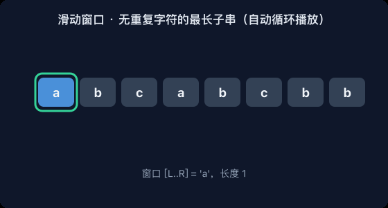

动画演示字符串专题里滑动窗口的典型过程；每个方案在「TypeScript 解题方案」一节还配了专属动画与专属流程图。

### 主解法流程图（真实控制流）

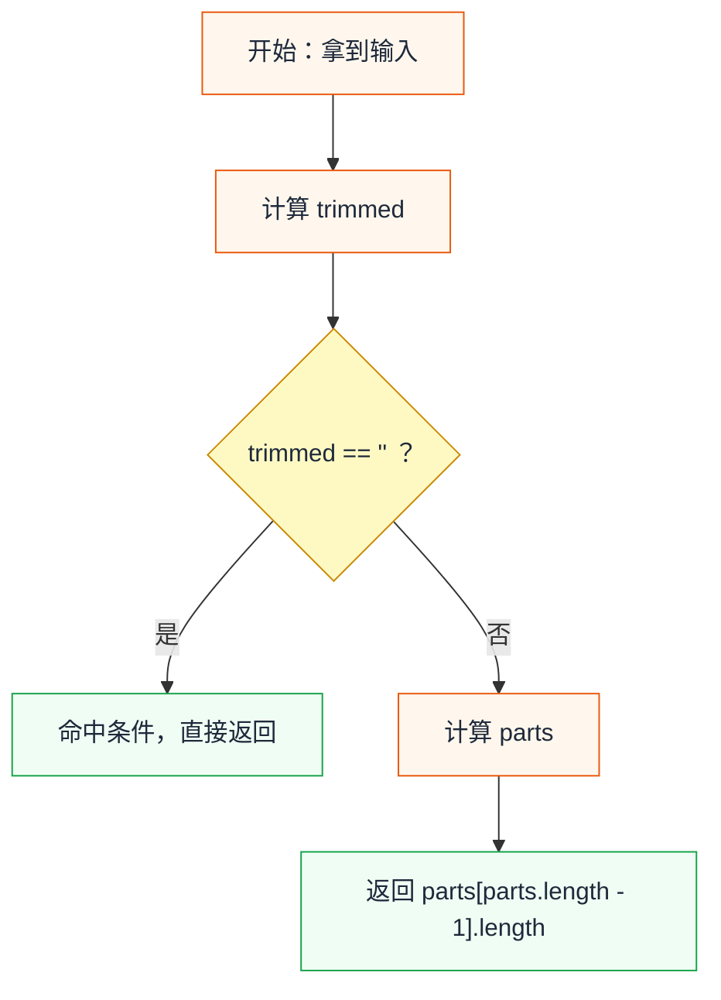

## TypeScript 解题方案（1 个方案逐个讲）

> **运行与提交**：每个方案都是自包含文件（内嵌用例自测，输出 PASS），整块复制到 `.ts` 文件后 `node 文件名` 即可运行。提交 LeetCode 时，把 `demo` 内的算法函数与辅助类型/函数整体取出、置于文件顶层即可。涉及交互/特殊接口的题以题面给定签名为准。

### 方案 1：从尾部扫描

**分析与思路**：核心做法是「从尾部扫描」。

**运行方式**：`node 本文件`，内嵌用例全部通过会输出 PASS。

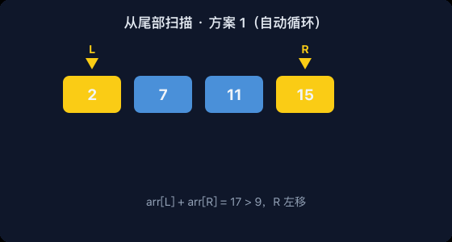

**方案专属流程图**（真实控制流）：

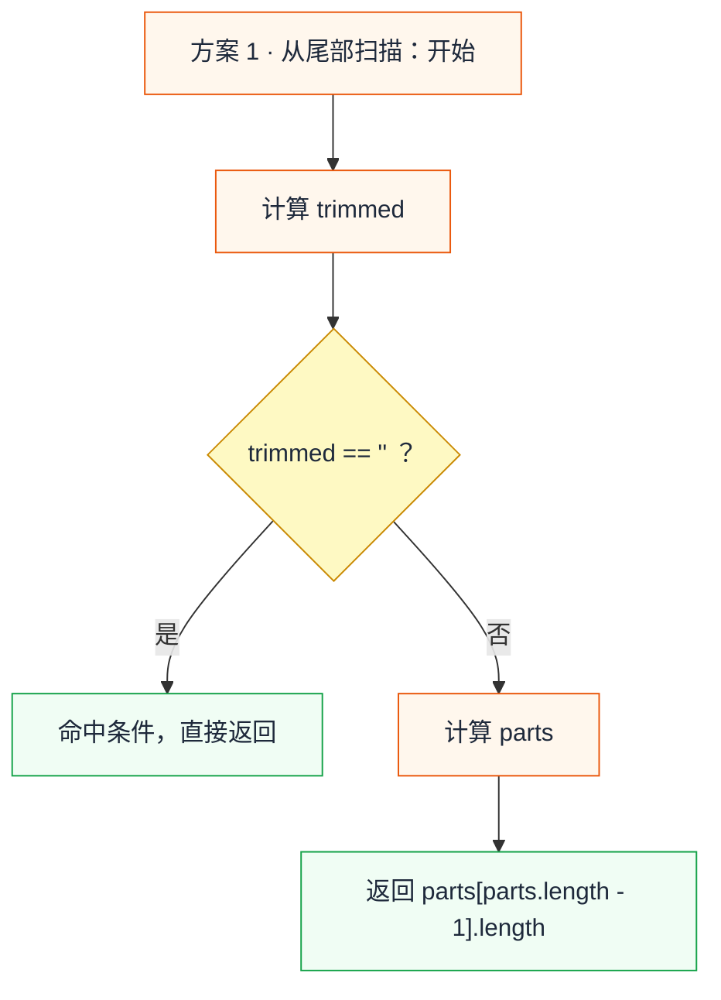

```typescript
/**
 ** LeetCode 58. 最后一个单词的长度
 ** 方案：1 ) 方案1：从尾部扫描
 */

// 忠实翻译 Python 参考实现 ref_lengthOfLastWord：len(s.split()[-1]) if s.split() else 0
function lengthOfLastWord(s: string): number {
  // 定义函数/方法 lengthOfLastWord
  const trimmed = s.trim(); // 把 字符串.trim() 存入 trimmed
  if (trimmed === '') {
    // 若 trimmed 全等于 「」
    return 0; // 返回 0
  }
  const parts = trimmed.split(/\s+/); // 把 trimmed.split( 除以 \字符串 加 除以 ) 存入 parts
  return parts[parts.length - 1].length; // 返回 parts[parts.长度 减 1].长度
}

export function demo(): void {
  // 程序入口：跑内嵌自测用例
  // 用例来自 _tools/correctness_check.py PROBLEMS["lc_58_最后一个单词的长度"]
  const cases: [string, number][] = [
    ['Hello World', 5],
    ['   fly me   to   the moon  ', 4],
    ['luffy is still joyboy', 6],
  ];
  for (const [input, want] of cases) {
    // for (const [input, want] of cases) {
    const got = lengthOfLastWord(input); // 把 lengthOfLastWord(input) 存入 got
    if (got !== want) {
      // 若 got 不等于 want
      throw new Error(
        `FAIL lengthOfLastWord(${JSON.stringify(input)}) = ${got}, want ${want}`,
      );
    }
  }
  console.log('PASS'); // 全部用例通过，输出 PASS
}

demo(); // demo();
```

## 逐步拆解与面试追问

**复杂度**：时间 O(n) 量级，空间 O(n)

**为什么是这个量级**：整体只对数据做有限趟处理

**面试官可能会追问**：

- 字符集有多大，能否用定长数组计数？
- 要不要考虑 Unicode 多字节字符？
- 空串与单字符的边界？

## 关键 API 速查（TS 主解法实际用到，附官方链接）

| API | 作用 | 使用要点 | 官方文档 |
|---|---|---|---|
| `String.prototype.split()` | 字符串切分为数组 | split('') 按字符拆；split(/正则/) 支持模式；空串调用会拆出空串数组 | [官方文档](https://developer.mozilla.org/zh-CN/docs/Web/JavaScript/Reference/Global_Objects/String/split) |
| `String.prototype.trim()` | 去除首尾空白 | 返回新串；变体 trimStart/trimEnd；不处理串中间空格 | [官方文档](https://developer.mozilla.org/zh-CN/docs/Web/JavaScript/Reference/Global_Objects/String/trim) |
| `JSON.stringify()` | 序列化为 JSON 字符串 | 常用于结构化比较（深度相等判定）；undefined/函数/循环引用会被丢弃或抛错 | [官方文档](https://developer.mozilla.org/zh-CN/docs/Web/JavaScript/Reference/Global_Objects/JSON/stringify) |

### 各语言官方文档导航

- **TypeScript / JS**：[MDN 中文参考](https://developer.mozilla.org/zh-CN/)
- **Python**：[Python 官方文档](https://docs.python.org/zh-cn/3/)
- **Go**：[Go 标准库](https://pkg.go.dev/std)
- **Java**：[JDK 17 API](https://docs.oracle.com/en/java/javase/17/docs/api/)
- **Rust**：[Rust 标准库](https://doc.rust-lang.org/std/)
- **Lua**：[Lua 5.4 手册](https://www.lua.org/manual/5.4/)
- **C**：[Cppreference C](https://zh.cppreference.com/w/c)
- **C++**：[Cppreference C++](https://zh.cppreference.com/w/cpp)
- **R**：[R 官方手册](https://stat.ethz.ch/R-manual/)
- **Zig**：[Zig 语言文档](https://ziglang.org/documentation/master/)
- **Dart**：[Dart API](https://api.dart.dev/)

## 附录：其他 10 种语言全部实现（每种语言列举其全部方案）

> TypeScript 的全部方案见「TypeScript 解题方案」一节；下面是其余 10 种语言的对应实现，每种语言的每个方案都带思路分析、代码走读与专属运行架构图。
> 每个方案都内嵌用例自测，可独立运行（老仓库 python/go 文件遵循「打印结果」约定）。
> 完整解法文件见 `dsa/<语言>/string/lc_58_最后一个单词的长度/`。

### Python 实现（1 种方案）

Python 的全部方案如下，每个方案都内嵌用例自测，可独立运行（老仓库 python/go 文件遵循「打印结果」约定）：

#### 方案 1：从尾部扫描

**思路与代码分析**：核心是「从尾部扫描」。Python 版用切片与字典推导式简化操作，突出可读性。**走读**：方案 1 · 从尾部扫描：开始 → 更新 trimmed → 命中条件，直接返回 → 更新 parts → 返回 len(parts[-1])。

**运行架构**（真实控制流）：

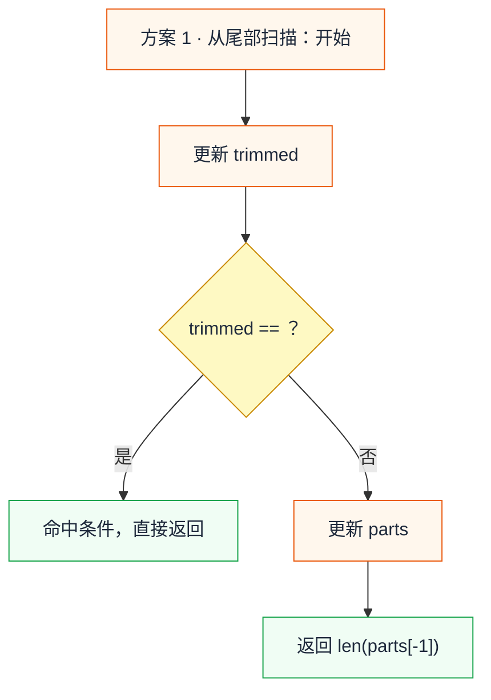

```python
import sys  # 提高递归深度上限（深输入防 RecursionError）

sys.setrecursionlimit(200000)  # 树/链表类题目节点数可达 1e4 量级

def length_of_last_word(s):  # 定义函数 length_of_last_word（参数：字符串）
    trimmed = s.strip()  # 把 字符串.strip() 存入 trimmed
    if trimmed == "":  # 若 trimmed 等于 「」
        return 0  # 返回 0
    parts = trimmed.split()  # 把 trimmed.split() 存入 parts
    return len(parts[-1])  # 返回 长度(parts[ 减 1])

if __name__ == "__main__":  # 若 __name__ 等于 '__main__'
    cases = [
        ("Hello World", 5),
        ("   fly me   to   the moon  ", 4),
        ("luffy is still joyboy", 6),
    ]
    for inp, want in cases:  # for inp, want in cases:
        got = length_of_last_word(inp)  # 把 length_of_last_word(inp) 存入 got
        assert got == want, f"lengthOfLastWord({inp!r}) = {got}, want {want}"  # 断言校验
    print("PASS")  # 全部用例通过，输出 PASS
```

### Go 实现（1 种方案）

Go 的全部方案如下，每个方案都内嵌用例自测，可独立运行（老仓库 python/go 文件遵循「打印结果」约定）：

#### 方案 1：从尾部扫描

**思路与代码分析**：核心是「从尾部扫描」。Go 版用切片与多返回值惯用法，显式处理索引边界。**走读**：方案 1 · 从尾部扫描：开始 → 更新 : → 处理 if len(fields) == 0 → 返回 0 → 返回 len(fields[len(fields)-1])。

**运行架构**（真实控制流）：

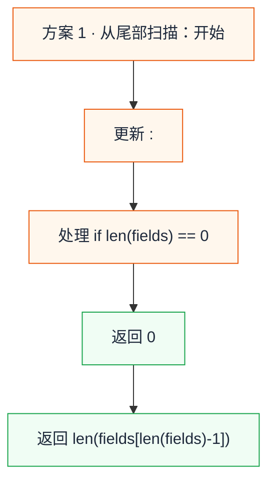

```go
package main // 引入依赖

import (
	"fmt"     // 「fmt」
	"os"      // 「os」
	"strings" // 「strings」
)

// lengthOfLastWord 最后一个单词的长度。
// 忠实翻译 Python 参考实现 ref_lengthOfLastWord：len(s.split()[-1]) if s.split() else 0
func lengthOfLastWord(s string) int { // 定义函数/方法 lengthOfLastWord
	fields := strings.Fields(s) // 把 strings.Fields(字符串) 写入 fields :
	if len(fields) == 0 {       // 若 长度(fields) 等于 0
		return 0 // 返回 0
	}
	return len(fields[len(fields)-1]) // 定义函数/方法 len
}

func main() { // 程序入口：跑内嵌自测用例
	// 用例来自 _tools/correctness_check.py PROBLEMS["lc_58_最后一个单词的长度"]
	cases := []struct { // 把 []struct { 写入 cases :
		in   string // in string
		want int    // want int
	}{ // }{
		{"Hello World", 5},
		{"   fly me   to   the moon  ", 4},
		{"luffy is still joyboy", 6},
	}
	allOK := true             // 把 true 写入 allOK :
	for _, c := range cases { // 同时取 _ 与 字符 遍历
		got := lengthOfLastWord(c.in) // 把 lengthOfLastWord(字符.in) 写入 got :
		if got != c.want {            // 若 got 不等于 字符.want
			allOK = false                                                              // 把 false 写入 allOK
			fmt.Printf("FAIL lengthOfLastWord(%q) = %v, want %v\n", c.in, got, c.want) // 打印输出
		}
	}
	if !allOK { // 若 取反 allOK
		os.Exit(1) // os.Exit(1)
	}
	fmt.Println("PASS") // 全部用例通过，输出 PASS
}
```

### Java 实现（1 种方案）

Java 的全部方案如下，每个方案都内嵌用例自测，可独立运行（老仓库 python/go 文件遵循「打印结果」约定）：

#### 方案 1：从尾部扫描

**思路与代码分析**：核心是「从尾部扫描」。Java 版用类与静态方法组织，集合操作显式明了。**走读**：方案 1 · 从尾部扫描：开始 → 更新 end → 当 (end ≥ 0 且 s.charAt(end) == ' ') 时反复执行 → 处理 end-- → 命中条件，直接返回 → 更新 start → 当 (start ≥ 0 且 s.charAt(start) ≠ ' ') 时反复执行 → 处理 start-- → 返回 end - start。

**运行架构**（真实控制流）：

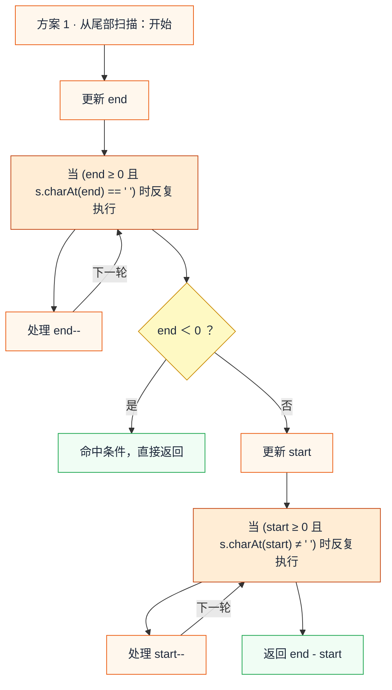

```java
package com.webfault.dsa; // 引入依赖

// LeetCode 58. 最后一个单词的长度。
// 忠实翻译 Python 参考实现 ref_lengthOfLastWord：len(s.split()[-1]) if s.split() else 0
class lc58_solution1 { // 定义类型
  int lengthOfLastWord(String s) { // 定义函数/方法 lengthOfLastWord
    int end = s.length() - 1; // 把 字符串.长度() 减 1 存入 终点
    while (end >= 0 && s.charAt(end) == ' ') { // 循环，直到不满足「终点 不低于 0 且 字符串 取字符 终点) 等于 ' '」
      end--; // 终点 减一
    }
    if (end < 0) { // 若 终点 小于 0
      return 0; // 返回 0
    }
    int start = end; // 把 终点 存入 起点
    while (start >= 0 && s.charAt(start) != ' ') { // 循环，直到不满足「起点 不低于 0 且 字符串 取字符 起点) 不等于 ' '」
      start--; // 起点 减一
    }
    return end - start; // 返回 终点 减 起点
  }

  public static void main(String[] args) { // public static void main(String[] args) {
    // 用例来自 _tools/correctness_check.py PROBLEMS["lc_58_最后一个单词的长度"]
    Object[][] cases = { // 把 { 写入 Object[][] cases
      {"Hello World", 5},
      {"   fly me   to   the moon  ", 4},
      {"luffy is still joyboy", 6},
    };
    lc58_solution1 s = new lc58_solution1(); // 把 new lc58_solution1(); 写入 lc58_solution1 s
    boolean allOK = true; // 把 true; 写入 boolean allOK
    for (Object[] c : cases) { // for (Object[] 字符 : cases) {
      int got = s.lengthOfLastWord((String) c[0]); // 把 字符串.lengthOfLastWord((String) 字符[0]) 存入 got
      int want = (Integer) c[1]; // 把 (Integer) 字符[1] 存入 want
      if (got != want) { // 若 got 不等于 want
        allOK = false; // 把 false; 写入 allOK
        System.out.println(
            "FAIL lengthOfLastWord(" + c[0] + ") = " + got + ", want " + want); // 打印输出
      }
    }
    if (!allOK) { // 若 取反 allOK
      throw new RuntimeException(
          "some cases FAILED"); // throw new RuntimeException(「some cases FAILED」);
    }
    System.out.println("PASS"); // 全部用例通过，输出 PASS
  }
}
```

### Rust 实现（1 种方案）

Rust 的全部方案如下，每个方案都内嵌用例自测，可独立运行（老仓库 python/go 文件遵循「打印结果」约定）：

#### 方案 1：从尾部扫描

**思路与代码分析**：核心是「从尾部扫描」。Rust 版用所有权移动与切片借用改写同一逻辑，注意 Option 与引用边界。**走读**：方案 1 · 从尾部扫描：开始 → 计算 t → 处理 if t.is_empty() → 返回 0 → 调用 t.split_whitespace() → 处理 .last() → 处理 .map(｜w｜ w.len() as i32) → 处理 .unwrap_or(0)。

**运行架构**（真实控制流）：

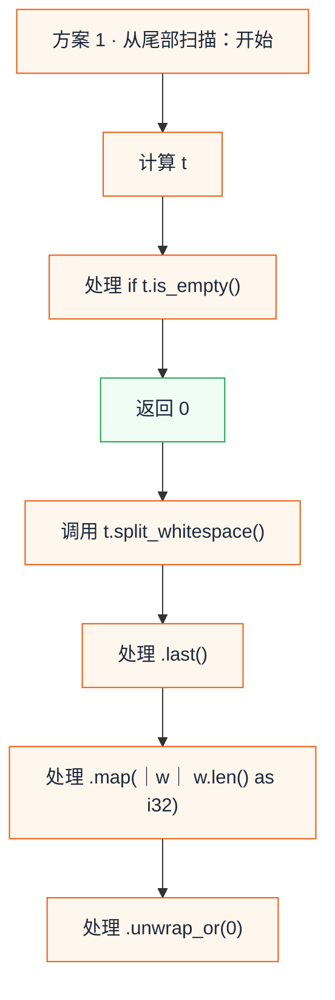

```rust
// LeetCode 58. 最后一个单词的长度 — Rust 版（方案1）
fn length_of_last_word(s: String) -> i32 {
    // 定义函数/方法 length_of_last_word
    let t = s.trim(); // 把 字符串.trim() 存入 另一字符串
    if t.is_empty() {
        return 0;
    } // 若 另一字符串 是否为空 { return 0; }
    t.split_whitespace()
        .last()
        .map(|w| w.len() as i32)
        .unwrap_or(0)
}
fn main() {
    // 程序入口：跑内嵌自测用例
    assert_eq!(length_of_last_word("Hello World".to_string()), 5); // 断言校验
    assert_eq!(length_of_last_word(" ".to_string()), 0); // 断言校验
    assert_eq!(length_of_last_word("a".to_string()), 1); // 断言校验
    assert_eq!(length_of_last_word(" fly me to the moon ".to_string()), 4); // 断言校验
    println!("PASS"); // 全部用例通过，输出 PASS
}
```

### Lua 实现（1 种方案）

Lua 的全部方案如下，每个方案都内嵌用例自测，可独立运行（老仓库 python/go 文件遵循「打印结果」约定）：

#### 方案 1：从尾部扫描

**思路与代码分析**：核心是「从尾部扫描」。Lua 版用表与 ipairs 遍历，注意 ipairs 遇 nil 即停的语义。**走读**：方案 1 · 从尾部扫描：开始 → 更新 t → 处理 if t == then → 返回 0 → 更新 last → 返回 last and #last or 0。

**运行架构**（真实控制流）：

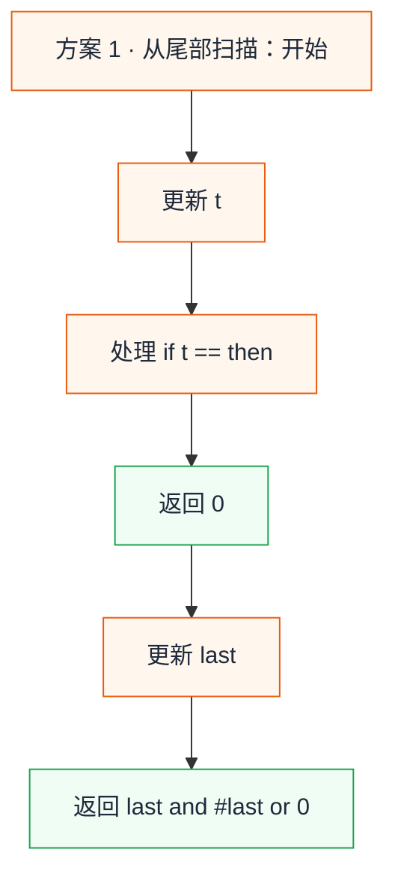

```lua
-- LeetCode 58. 最后一个单词的长度 — Lua 版（方案1）
local function length_of_last_word(s) -- local function length_of_last_word(字符串)
	local t = s:gsub("^%s+", ""):gsub("%s+$", "")
	if t == "" then
		return 0
	end -- 若 另一字符串 等于 「」 then return 0 终点
	local last = t:match("([%w]+)%s*$") -- 把 另一字符串:match(「([ 对…取模 权重] 加 ) 对…取模 字符串 乘 $」) 写入 local last
	return last and #last or 0 -- 返回 last and #last or 0
end -- 终点
assert(length_of_last_word("Hello World") == 5) -- 断言校验
assert(length_of_last_word(" ") == 0) -- 断言校验
assert(length_of_last_word("a") == 1) -- 断言校验
assert(length_of_last_word(" fly me to the moon ") == 4) -- 断言校验
print("PASS") -- 全部用例通过，输出 PASS
```

### C 实现（1 种方案）

C 的全部方案如下，每个方案都内嵌用例自测，可独立运行（老仓库 python/go 文件遵循「打印结果」约定）：

#### 方案 1：从尾部扫描

**思路与代码分析**：核心是「从尾部扫描」。C 版手动管理下标与内存，循环边界全部显式写出。**走读**：方案 1 · 从尾部扫描：开始 → 更新 n → 更新 end → 当 (end ≥ 0 且 s[end] == ' ') 时反复执行 → 处理 end-- → 命中条件，直接返回 → 更新 start → 当 (start ≥ 0 且 s[start] ≠ ' ') 时反复执行 → 处理 start-- → 返回 end - start。

**运行架构**（真实控制流）：

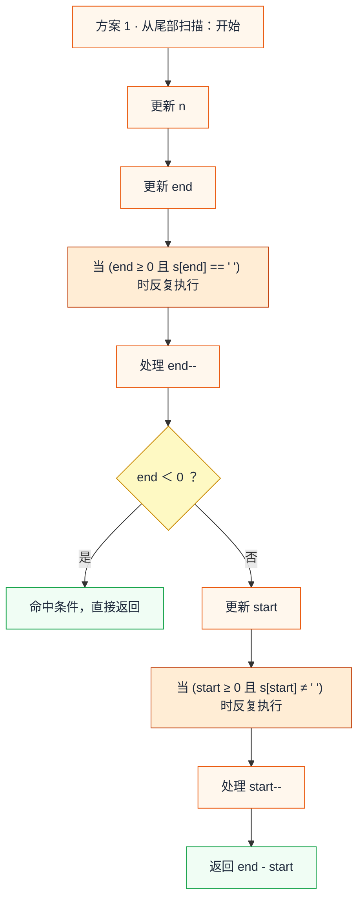

```c
/* LeetCode 58. 最后一个单词的长度 — C 版（方案1） */
#include <stdio.h>                              // 引入头文件
#include <string.h>                             // 引入头文件
static int length_of_last_word(const char *s) { // 定义函数/方法 length_of_last_word
    int n = (int)strlen(s);                     // 把 (int)strlen(字符串) 存入 元素个数
    int end = n - 1;                            // 把 元素个数 减 1 存入 终点
    while (end >= 0 && s[end] == ' ')
        end--; // 循环，直到不满足「终点 不低于 0 且 字符串[终点] 等于 ' ') 终点 减一 ;」
    if (end < 0)
        return 0;    // 若 终点 小于 0，直接返回 0
    int start = end; // 把 终点 存入 起点
    while (start >= 0 && s[start] != ' ')
        start--; // 循环，直到不满足「起点 不低于 0 且 字符串[起点] 不等于 ' ') 起点 减一 ;」
    return end - start; // 返回 终点 减 起点
}
int main(void) { // 程序入口：跑内嵌自测用例
    if (length_of_last_word("Hello World") != 5) {
        printf("FAIL 1\n");
        return 1;
    }
    if (length_of_last_word(" ") != 0) {
        printf("FAIL 2\n");
        return 1;
    } // 若 length_of_last_word(「 」) 不等于 0) { 输出「 」); return 1; }
    if (length_of_last_word("a") != 1) {
        printf("FAIL 3\n");
        return 1;
    } // 若 length_of_last_word(「数组」) 不等于 1) { 输出「数组」); return 1; }
    if (length_of_last_word(" fly me to the moon ") != 4) {
        printf("FAIL 4\n");
        return 1;
    }
    printf("PASS\n"); // 全部用例通过，输出 PASS
    return 0;         // 返回 0
}
```

### C++ 实现（1 种方案）

C++ 的全部方案如下，每个方案都内嵌用例自测，可独立运行（老仓库 python/go 文件遵循「打印结果」约定）：

#### 方案 1：从尾部扫描

**思路与代码分析**：核心是「从尾部扫描」。C++ 版用 STL 容器与迭代器，减少手写下标错误。**走读**：方案 1 · 从尾部扫描：开始 → 更新 end → 当 (end ≥ 0 且 s[end] == ' ') 时反复执行 → 处理 --end → 命中条件，直接返回 → 更新 start → 当 (start ≥ 0 且 s[start] ≠ ' ') 时反复执行 → 处理 --start → 返回 end - start。

**运行架构**（真实控制流）：

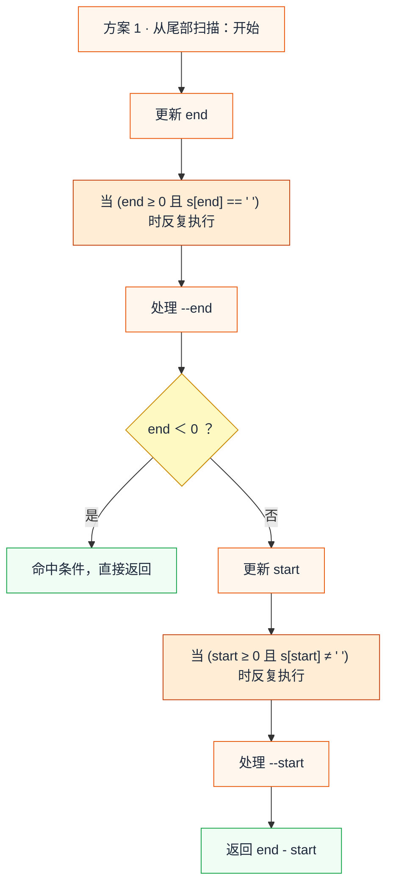

```cpp
// LeetCode 58. 最后一个单词的长度 — C++ 版（方案1）
#include <cassert>                           // 引入头文件
#include <iostream>                          // 引入头文件
#include <string>                            // 引入头文件
static int lengthOfLastWord(std::string s) { // 定义函数/方法 lengthOfLastWord
    int end = static_cast<int>(s.size()) - 1; // 把 static_cast 小于 int 超过 (字符串.大小()) 减 1 存入 终点
    while (end >= 0 && s[end] == ' ')
        --end; // 循环，直到不满足「终点 不低于 0 且 字符串[终点] 等于 ' ') 减一 终点;」
    if (end < 0)
        return 0;    // 若 终点 小于 0，直接返回 0
    int start = end; // 把 终点 存入 起点
    while (start >= 0 && s[start] != ' ')
        --start; // 循环，直到不满足「起点 不低于 0 且 字符串[起点] 不等于 ' ') 减一 起点;」
    return end - start; // 返回 终点 减 起点
}
int main() {                                               // 程序入口：跑内嵌自测用例
    assert(lengthOfLastWord("Hello World") == 5);          // 断言校验
    assert(lengthOfLastWord(" ") == 0);                    // 断言校验
    assert(lengthOfLastWord("a") == 1);                    // 断言校验
    assert(lengthOfLastWord(" fly me to the moon ") == 4); // 断言校验
    std::cout << "PASS" << std::endl;                      // 全部用例通过，输出 PASS
    return 0;                                              // 返回 0
}
```

### R 实现（1 种方案）

R 的全部方案如下，每个方案都内嵌用例自测，可独立运行（老仓库 python/go 文件遵循「打印结果」约定）：

#### 方案 1：从尾部扫描

**思路与代码分析**：核心是「从尾部扫描」。R 版用向量化思维与 1 起始下标，注意 1:n 的降序陷阱。**走读**：方案 1 · 从尾部扫描：开始 → 处理 t ＜- trimws(s) → 命中条件，直接返回 → 处理 words ＜- strsplit(t, )[[1 → 调用 nchar(words[length(words)])。

**运行架构**（真实控制流）：

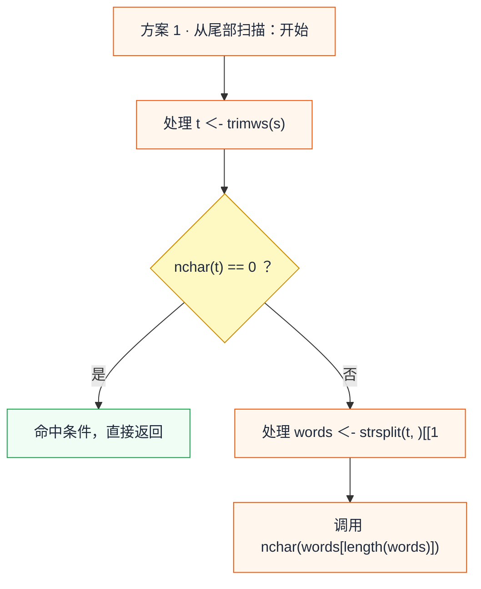

```r
# 版（方案1） 定义函数 length_of_last_word（参数：字符串）
length_of_last_word <- function(s) {
    t <- trimws(s)  # 把 trimws(字符串) 存入 另一字符串
    if (nchar(t) == 0)
        return(0L)  # 若 nchar(另一字符串) 等于 0) return(0L
    words <- strsplit(t, " ")[[1]]  # 把 strsplit(另一字符串, 「 」)[[1]] 存入 单词列表
    nchar(words[length(words)])  # nchar(单词列表[长度(单词列表)])
}
stopifnot(length_of_last_word("Hello World") == 5)  # 断言校验
stopifnot(length_of_last_word(" ") == 0)  # 断言校验
stopifnot(length_of_last_word("a") == 1)  # 断言校验
stopifnot(length_of_last_word(" fly me to the moon ") == 4)  # 断言校验
cat("PASS\n")  # 全部用例通过，输出 PASS
```

### Zig 实现（1 种方案）

Zig 的全部方案如下，每个方案都内嵌用例自测，可独立运行（老仓库 python/go 文件遵循「打印结果」约定）：

#### 方案 1：从尾部扫描

**思路与代码分析**：核心是「从尾部扫描」。Zig 版显式分配与清零，整型边界处理严格。**走读**：方案 1 · 从尾部扫描：开始 → 计算 end → 当 (end ≥ 0 and s[@intCast(end)] == ' ') end -= 1 时反复执行 → 命中条件，直接返回 → 计算 start → 当 (start ≥ 0 and s[@intCast(start)] ≠ ' ') start -= 1 时反复执行 → 返回 @intCast(end - start)。

**运行架构**（真实控制流）：

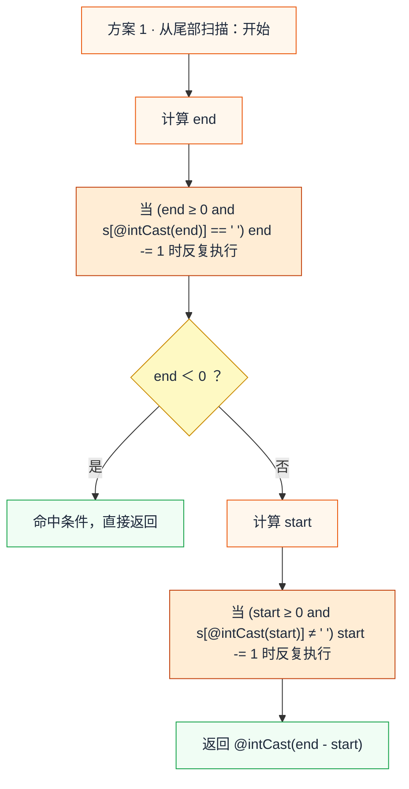

```zig
// LeetCode 58. 最后一个单词的长度 — Zig 版（方案1）
const std = @import("std"); // 把 @import(「std」) 存入 std
fn lengthOfLastWord(s: []const u8) i32 { // 定义函数/方法 lengthOfLastWord
    var end: isize = @intCast(s.len - 1); // 把 @intCast(字符串.长度 减 1); 写入 var end: isize
    while (end >= 0 and s[@intCast(end)] == ' ') end -= 1; // 循环，直到不满足「终点 不低于 0 and 字符串[@intCast(终点)] 等于 ' ') 终点 累减 1;」
    if (end < 0) return 0; // 若 终点 小于 0，直接返回 0
    var start = end; // 把 终点 存入 起点
    while (start >= 0 and s[@intCast(start)] != ' ') start -= 1; // 循环，直到不满足「起点 不低于 0 and 字符串[@intCast(起点)] 不等于 ' ') 起点 累减 1;」
    return @intCast(end - start); // 返回 @intCast(终点 减 起点)
}
pub fn main() !void { // 程序入口：跑内嵌自测用例
    if (lengthOfLastWord("Hello World") != 5) return error.TestFailed;
    if (lengthOfLastWord(" ") != 0) return error.TestFailed; // 若 lengthOfLastWord(「 」) 不等于 0，直接返回 error.TestFailed
    if (lengthOfLastWord("a") != 1) return error.TestFailed; // 若 lengthOfLastWord(「数组」) 不等于 1，直接返回 error.TestFailed
    if (lengthOfLastWord(" fly me to the moon ") != 4) return error.TestFailed;
    std.debug.print("PASS\n", .{}); // 全部用例通过，输出 PASS
}
```

### Dart 实现（1 种方案）

Dart 的全部方案如下，每个方案都内嵌用例自测，可独立运行（老仓库 python/go 文件遵循「打印结果」约定）：

#### 方案 1：从尾部扫描

**思路与代码分析**：核心是「从尾部扫描」。Dart 版用可空类型标注与集合方法，注意空安全。**走读**：方案 1 · 从尾部扫描：开始 → 计算 end → 当 (end ≥ 0 且 s[end] == ' ') 时反复执行 → 处理 end-- → 命中条件，直接返回 → 计算 start → 当 (start ≥ 0 且 s[start] ≠ ' ') 时反复执行 → 处理 start-- → 返回 end - start。

**运行架构**（真实控制流）：


```dart
// LeetCode 58. 最后一个单词的长度 — Dart 版（方案1）
int lengthOfLastWord(String s) {
  // 定义函数/方法 lengthOfLastWord
  var end = s.length - 1; // 把 字符串.长度 减 1 存入 终点
  while (end >= 0 && s[end] == ' ')
    end--; // 循环，直到不满足「终点 不低于 0 且 字符串[终点] 等于 ' ') 终点 减一 ;」
  if (end < 0) return 0; // 若 终点 小于 0，直接返回 0
  var start = end; // 把 终点 存入 起点
  while (start >= 0 && s[start] != ' ')
    start--; // 循环，直到不满足「起点 不低于 0 且 字符串[起点] 不等于 ' ') 起点 减一 ;」
  return end - start; // 返回 终点 减 起点
}

void main() {
  // 程序入口：跑内嵌自测用例
  if (lengthOfLastWord('Hello World') != 5) throw StateError('c1');
  if (lengthOfLastWord(' ') != 0)
    throw StateError(
      'c2',
    ); // 若 lengthOfLastWord(' ') 不等于 0) throw StateError('c2');
  if (lengthOfLastWord('a') != 1)
    throw StateError(
      'c3',
    ); // 若 lengthOfLastWord('数组') 不等于 1) throw StateError('c3');
  if (lengthOfLastWord(' fly me to the moon ') != 4) throw StateError('c4');
  print('PASS'); // 全部用例通过，输出 PASS
}
```

---

## 内容总结

- **最后一个单词的长度**（字符串 · Medium）：共 1 个方案，主线思路「从尾部扫描」；时间 O(n) 量级；动画演示滑动窗口过程，附录给出 11 种语言 × 全部方案的可运行实现。
- 来源博客：[]()
- 导航：[📋 总目录](../) ｜ [← 078 字符串的排列](../078_字符串的排列/) ｜ [080 二进制求和 →](../080_二进制求和/)
