# 080 · 二进制求和（第三阶段 · 字符串 · Medium）

> **难度**：⭐⭐ Medium ｜ **专题**：字符串
> **学习定位**：第三阶段 · 字符串第 80 篇 ｜ **解法数**：1
> **内容总结**：**二进制求和**（字符串 · Medium）：共 1 个方案，主线思路「直接实现」；时间 O(n) 量级；动画演示滑动窗口过程，附录给出 11 种语言 × 全部方案的可运行实现。

---

## 题目描述

给你两个二进制字符串 `a` 和 `b` ，以二进制字符串的形式返回它们的和。

示例 1：

输入:a = 「11」, b = 「1」
输出：「100」

示例 2：

输入：a = 「1010」, b = 「1011」
输出：「10101」

提示：

 `1 
 `a` 和 `b` 仅由字符 `'0'` 或 `'1'` 组成
 字符串如果不是 `「0」` ，就不含前导零

- 主函数签名：`function addBinary(a: string, b: string): string`

**用例演示**（摘自主解法内嵌自测，输入到输出一目了然）：

```typescript
const cases: [string, string, string][] = [
  ['11', '1', '100'],
  ['1010', '1011', '10101'],
  ['0', '0', '0'],
];
```

> 题面与 [leetcode.cn 官方](https://leetcode.cn/problems/add-binary/)一致，示例配图取自官方题面。

**数据范围与注意事项**：

- `1 <= a.length, b.length <= 10^4`
- `a` 和 `b` 仅由字符 `'0'` 或 `'1'` 组成
- 字符串如果不是 `「0」` ，就不含前导零
- **易错点**：空串、全空白、单字符三类边界，以及大小写是否敏感。

## 题目分析

**场景是什么**：字符串是字符数组，这类题练的是扫描、切分与匹配，对应真实开发里的文本清洗、协议解析。本题就是该场景的 Medium 级练习，主线做法是「直接实现」。

**主线怎么解**：主解法结构简单：读入、处理、返回。

## 解题思路

**方案对比**（共 1 个方案，由浅入深）：

| 方案 | 时间复杂度 | 空间复杂度 |
|---|---|---|
| 方案 1 · 直接实现 | O(n) 量级 | O(n) |

**怎么读这一篇**：

- 🐣 **新手路线**：把「题目描述」的示例 1 在纸上手推一遍 → 读方案 1（最直观的写法）与它的代码走读 → 按「运行方式」本地跑通看 PASS → 回头对比方案 2 之后的写法差在哪
- 🦅 **大佬路线**：直接锁定最优方案 1（直接实现，O(n) 量级）→ 跳读该方案代码与走读 → 用「逐步拆解与面试追问」补齐复杂度推导与边界追问

### 动态算法图（滑动窗口，GIF 自动循环）


动画演示字符串专题里滑动窗口的典型过程；每个方案在「TypeScript 解题方案」一节还配了专属动画与专属流程图。

### 主解法流程图（真实控制流）

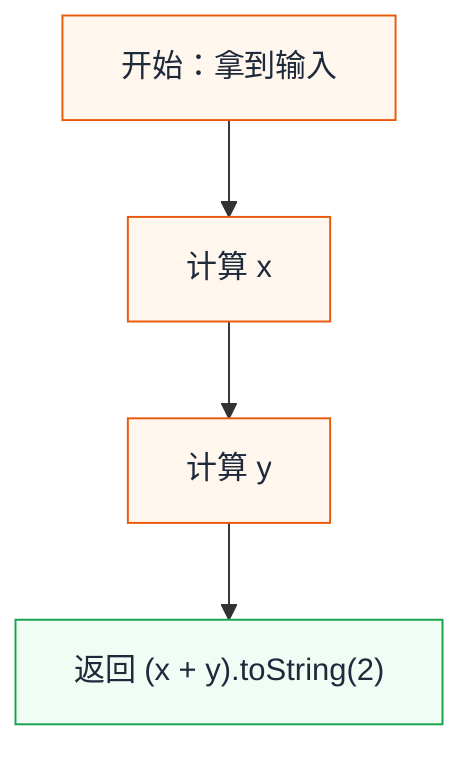

## TypeScript 解题方案（1 个方案逐个讲）

> **运行与提交**：每个方案都是自包含文件（内嵌用例自测，输出 PASS），整块复制到 `.ts` 文件后 `node 文件名` 即可运行。提交 LeetCode 时，把 `demo` 内的算法函数与辅助类型/函数整体取出、置于文件顶层即可。涉及交互/特殊接口的题以题面给定签名为准。

### 方案 1：直接实现

**分析与思路**：核心做法是「直接实现」。

**运行方式**：`node 本文件`，内嵌用例全部通过会输出 PASS。


**方案专属流程图**（真实控制流）：

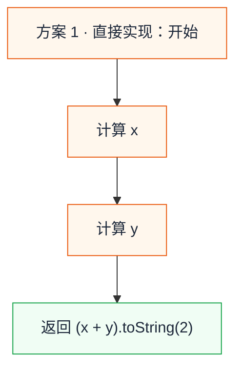

```typescript
// 二进制求和：使用 BigInt 按二进制相加（忠实于 Python bin(int(a,2)+int(b,2))）

function addBinary(a: string, b: string): string {
  // 定义函数/方法 addBinary
  const x = BigInt('0b' + a); // 把 BigInt(「0b」 加 数组) 存入 x
  const y = BigInt('0b' + b); // 把 BigInt(「0b」 加 b) 存入 y
  return (x + y).toString(2); // 返回 (x 加 y).toString(2)
}

// 自检用例：(a, b, 期望)
const cases: [string, string, string][] = [
  ['11', '1', '100'],
  ['1010', '1011', '10101'],
  ['0', '0', '0'],
];

export function demo(): void {
  // 程序入口：跑内嵌自测用例
  for (const [a, b, want] of cases) {
    // for (const [数组, b, want] of cases) {
    const got = addBinary(a, b); // 把 addBinary(数组, b) 存入 got
    if (got !== want) {
      // 若 got 不等于 want
      throw new Error(`FAIL: addBinary(${a},${b})=${got} want ${want}`);
    }
  }
  console.log('PASS'); // 全部用例通过，输出 PASS
}

demo(); // demo();
```

## 逐步拆解与面试追问

**复杂度**：时间 O(n) 量级，空间 O(n)

**为什么是这个量级**：整体只对数据做有限趟处理

**面试官可能会追问**：

- 字符集有多大，能否用定长数组计数？
- 要不要考虑 Unicode 多字节字符？
- 空串与单字符的边界？

## 关键 API 速查（TS 主解法实际用到，附官方链接）

| API | 作用 | 使用要点 | 官方文档 |
|---|---|---|---|
| `BigInt` | 任意精度整数 | 字面量 123n；不能与 number 混算；不能用于 Math 方法 | [官方文档](https://developer.mozilla.org/zh-CN/docs/Web/JavaScript/Reference/Global_Objects/BigInt) |

### 各语言官方文档导航

- **TypeScript / JS**：[MDN 中文参考](https://developer.mozilla.org/zh-CN/)
- **Python**：[Python 官方文档](https://docs.python.org/zh-cn/3/)
- **Go**：[Go 标准库](https://pkg.go.dev/std)
- **Java**：[JDK 17 API](https://docs.oracle.com/en/java/javase/17/docs/api/)
- **Rust**：[Rust 标准库](https://doc.rust-lang.org/std/)
- **Lua**：[Lua 5.4 手册](https://www.lua.org/manual/5.4/)
- **C**：[Cppreference C](https://zh.cppreference.com/w/c)
- **C++**：[Cppreference C++](https://zh.cppreference.com/w/cpp)
- **R**：[R 官方手册](https://stat.ethz.ch/R-manual/)
- **Zig**：[Zig 语言文档](https://ziglang.org/documentation/master/)
- **Dart**：[Dart API](https://api.dart.dev/)

## 附录：其他 10 种语言全部实现（每种语言列举其全部方案）

> TypeScript 的全部方案见「TypeScript 解题方案」一节；下面是其余 10 种语言的对应实现，每种语言的每个方案都带思路分析、代码走读与专属运行架构图。
> 每个方案都内嵌用例自测，可独立运行（老仓库 python/go 文件遵循「打印结果」约定）。
> 完整解法文件见 `dsa/<语言>/string/lc_67_二进制求和/`。

### Python 实现（1 种方案）

Python 的全部方案如下，每个方案都内嵌用例自测，可独立运行（老仓库 python/go 文件遵循「打印结果」约定）：

#### 方案 1：直接实现

**思路与代码分析**：核心是「直接实现」。Python 版用切片与字典推导式简化操作，突出可读性。**走读**：方案 1 · 直接实现：开始 → 返回 bin(int(a, 2) + int(b, 2))[2:]。

**运行架构**（真实控制流）：

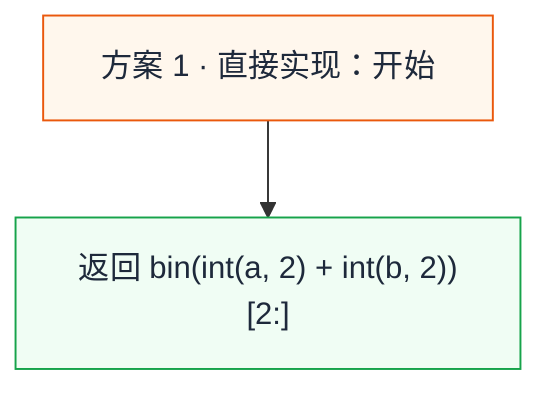

```python
import sys  # 提高递归深度上限（深输入防 RecursionError）

sys.setrecursionlimit(200000)  # 树/链表类题目节点数可达 1e4 量级

def add_binary(a, b):  # 定义函数 add_binary（参数：数组, b）
    return bin(int(a, 2) + int(b, 2))[2:]  # 返回 bin(int(数组, 2) 加 int(b, 2))[2:]

if __name__ == "__main__":  # 若 __name__ 等于 '__main__'
    cases = [
        ("11", "1", "100"),
        ("1010", "1011", "10101"),
        ("0", "0", "0"),
    ]
    for a, b, want in cases:  # for 数组, b, want in cases:
        got = add_binary(a, b)  # 把 add_binary(数组, b) 存入 got
        assert got == want, f"addBinary({a},{b})={got} want {want}"  # 断言校验
    print("PASS")  # 全部用例通过，输出 PASS
```

### Go 实现（1 种方案）

Go 的全部方案如下，每个方案都内嵌用例自测，可独立运行（老仓库 python/go 文件遵循「打印结果」约定）：

#### 方案 1：直接实现

**思路与代码分析**：核心是「直接实现」。Go 版用切片与多返回值惯用法，显式处理索引边界。**走读**：方案 1 · 直接实现：开始 → 更新 : → 更新 : → 计算 sb → 遍历循环 → 更新 : → 处理 if i ≥ 0 → 更新 + → 处理 i-- → 处理 if j ≥ 0 → 更新 + → 处理 j-- → 更新 sb → 更新 carry → 返回 string(sb)。

**运行架构**（真实控制流）：

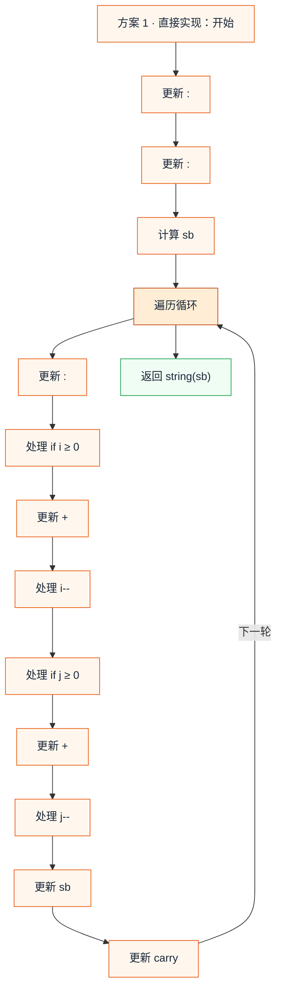

```go
package main // 引入依赖

import (
	"fmt" // 「fmt」
	"os"  // 「os」
)

// 二进制求和：从低位逐位相加（忠实于 bin(int(a,2)+int(b,2)) 的结果）
func addBinary(a, b string) string { // 定义函数/方法 addBinary
	i, j := len(a)-1, len(b)-1          // 把 长度(数组) 减 1, 长度(b) 减 1 写入 i, j :
	carry := 0                          // 把 0 写入 carry :
	var sb []byte                       // var sb []byte
	for i >= 0 || j >= 0 || carry > 0 { // 把 0 或 下标 j 不低于 0 或 carry 超过 0 { 写入 for i >
		sum := carry // 把 carry 写入 sum :
		if i >= 0 {  // 若 下标 i 不低于 0
			sum += int(a[i] - '0') // 累计和累加 int(数组[下标 i] 减 '0')
			i--                    // 下标 i 减一
		}
		if j >= 0 { // 若 下标 j 不低于 0
			sum += int(b[j] - '0') // 累计和累加 int(b[下标 j] 减 '0')
			j--                    // 下标 j 减一
		}
		sb = append([]byte{byte('0' + sum%2)}, sb...) // 把 append([]byte{byte('0' 加 累计和 对…取模 2)}, sb...) 写入 sb
		carry = sum / 2                               // 把 累计和 除以 2 写入 carry
	}
	return string(sb) // 定义函数/方法 string
}

func main() { // 程序入口：跑内嵌自测用例
	type tc struct { // 定义类型
		a, b, want string // 数组, b, want string
	}
	cases := []tc{ // 把 []tc{ 写入 cases :
		{"11", "1", "100"},
		{"1010", "1011", "10101"},
		{"0", "0", "0"},
	}
	ok := true                // 把 true 写入 ok :
	for _, c := range cases { // 同时取 _ 与 字符 遍历
		got := addBinary(c.a, c.b) // 把 addBinary(字符.数组, 字符.b) 写入 got :
		if got != c.want {         // 若 got 不等于 字符.want
			fmt.Printf("FAIL: addBinary(%s,%s)=%s want %s\n", c.a, c.b, got, c.want) // 打印输出
			ok = false                                                               // 把 false 写入 ok
		}
	}
	if !ok { // 若 取反 ok
		fmt.Println("FAIL") // 打印输出
		os.Exit(1)          // os.Exit(1)
	}
	fmt.Println("PASS") // 全部用例通过，输出 PASS
}
```

### Java 实现（1 种方案）

Java 的全部方案如下，每个方案都内嵌用例自测，可独立运行（老仓库 python/go 文件遵循「打印结果」约定）：

#### 方案 1：直接实现

**思路与代码分析**：核心是「直接实现」。Java 版用类与静态方法组织，集合操作显式明了。**走读**：方案 1 · 直接实现：开始 → 更新 x → 更新 y → 返回 x.add(y).toString(2)。

**运行架构**（真实控制流）：

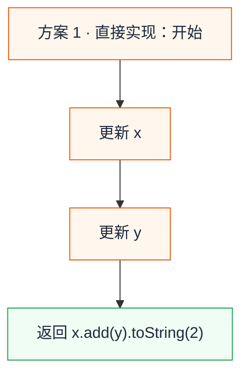

```java
package com.webfault.dsa; // 引入依赖

import java.math.BigInteger; // 引入依赖

class lc67_solution1 { // 定义类型
  // 二进制求和：使用 BigInteger 按二进制相加（忠实于 Python bin(int(a,2)+int(b,2))）
  static String addBinary(String a, String b) { // 定义函数/方法 addBinary
    BigInteger x = new BigInteger(a, 2); // 把 new BigInteger(数组, 2); 写入 BigInteger x
    BigInteger y = new BigInteger(b, 2); // 把 new BigInteger(b, 2); 写入 BigInteger y
    return x.add(y).toString(2); // 返回 x 追加 y).toString(2)
  }

  public static void main(String[] args) { // public static void main(String[] args) {
    String[][] cases = { // 把 { 写入 String[][] cases
      {"11", "1", "100"},
      {"1010", "1011", "10101"},
      {"0", "0", "0"},
    };
    for (String[] c : cases) { // for (String[] 字符 : cases) {
      String got = addBinary(c[0], c[1]); // 把 addBinary(字符[0], 字符[1]) 存入 got
      if (!got.equals(c[2])) { // 若 取反 got.equals(字符[2]
        System.out.println(
            "FAIL: addBinary(" + c[0] + "," + c[1] + ")=" + got + " want " + c[2]); // 打印输出
        System.exit(1); // System.exit(1);
      }
    }
    System.out.println("PASS"); // 全部用例通过，输出 PASS
  }
}
```

### Rust 实现（1 种方案）

Rust 的全部方案如下，每个方案都内嵌用例自测，可独立运行（老仓库 python/go 文件遵循「打印结果」约定）：

#### 方案 1：直接实现

**思路与代码分析**：核心是「直接实现」。Rust 版用所有权移动与切片借用改写同一逻辑，注意 Option 与引用边界。**走读**：方案 1 · 直接实现：开始 → 计算 let (a, b) = (a.as_bytes → 当 i ≥ 0 或 j ≥ 0 或 carry ＞ 0 时反复执行 → 返回结果。

**运行架构**（真实控制流）：

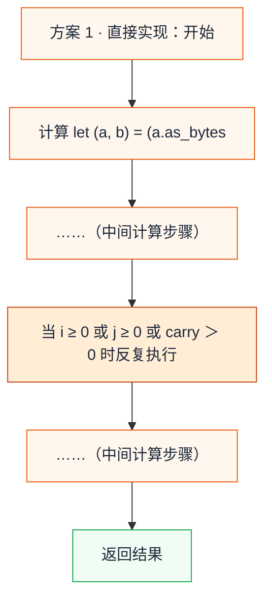

```rust
// LeetCode 67. 二进制求和 — Rust 版（方案1）
fn add_binary(a: String, b: String) -> String {
    // 定义函数/方法 add_binary
    let (a, b) = (a.as_bytes(), b.as_bytes()); // 把 (数组.as_bytes(), b.as_bytes()); 写入 let (a, b)
    let (mut i, mut j) = (a.len() as i32 - 1, b.len() as i32 - 1);
    let mut carry = 0u8; // 把 0u8; 写入 let mut carry
    let mut out: Vec<u8> = Vec::new(); // 把 Vec::new(); 写入 let mut out: Vec<u8>
    while i >= 0 || j >= 0 || carry > 0 {
        // 把 0 或 下标 j 不低于 0 或 carry 超过 0 { 写入 while i >
        let mut total = carry; // 把 carry; 写入 let mut total
        if i >= 0 {
            total += a[i as usize] - b'0';
            i -= 1;
        } // 若 下标 i 不低于 0 { 总和 累加 数组[下标 i as usize] 减 b'0'; 下标 i 累减 1; }
        if j >= 0 {
            total += b[j as usize] - b'0';
            j -= 1;
        } // 若 下标 j 不低于 0 { 总和 累加 b[下标 j as usize] 减 b'0'; 下标 j 累减 1; }
        out.push(b'0' + total % 2); // 把 b'0' 加 总和 对…取模 2 压入栈/数组尾部
        carry = total / 2; // 把 总和 除以 2; 写入 carry
    }
    out.reverse(); // 反转
    String::from_utf8(out).unwrap() // String::from_utf8(out).unwrap()
}
fn main() {
    // 程序入口：跑内嵌自测用例
    assert_eq!(add_binary("11".to_string(), "1".to_string()), "100"); // 断言校验
    assert_eq!(add_binary("1010".to_string(), "1011".to_string()), "10101"); // 断言校验
    println!("PASS"); // 全部用例通过，输出 PASS
}
```

### Lua 实现（1 种方案）

Lua 的全部方案如下，每个方案都内嵌用例自测，可独立运行（老仓库 python/go 文件遵循「打印结果」约定）：

#### 方案 1：直接实现

**思路与代码分析**：核心是「直接实现」。Lua 版用表与 ipairs 遍历，注意 ipairs 遇 nil 即停的语义。**走读**：方案 1 · 直接实现：开始 → 更新 j → 更新 carry → 更新 out → 当 i ≥ 1 or j ≥ 1 or carry ＞ 0 do 时反复执行 → 更新 total → 处理 if i ≥ 1 then → 更新 total → 更新 i → 处理 if j ≥ 1 then → 更新 total → 更新 j → 更新 1] → 更新 carry → 返回 table.concat(out):reverse()。

**运行架构**（真实控制流）：

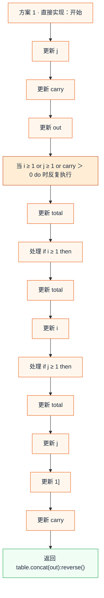

```lua
-- LeetCode 67. 二进制求和 — Lua 版（方案1）
local function add_binary(a, b) -- local function add_binary(数组, b)
	local i, j = #a, #b -- 把 #数组, #b 写入 local i, j
	local carry = 0 -- 把 0 写入 local carry
	local out = {} -- 把 {} 写入 local out
	while i >= 1 or j >= 1 or carry > 0 do -- 把 1 or 下标 j 不低于 1 or carry 超过 0 do 写入 while i >
		local total = carry -- 把 carry 写入 local total
		if i >= 1 then
			total = total + (a:byte(i) - 48)
			i = i - 1
		end
		if j >= 1 then
			total = total + (b:byte(j) - 48)
			j = j - 1
		end
		out[#out + 1] = tostring(total % 2) -- 把 tostring(总和 对…取模 2) 写入 out[#out + 1]
		carry = math.floor(total / 2) -- 把 math.floor(总和 除以 2) 存入 carry
	end -- 终点
	return table.concat(out):reverse() -- 返回 table.concat(out):reverse()
end -- 终点
assert(add_binary("11", "1") == "100") -- 断言校验
assert(add_binary("1010", "1011") == "10101") -- 断言校验
print("PASS") -- 全部用例通过，输出 PASS
```

### C 实现（1 种方案）

C 的全部方案如下，每个方案都内嵌用例自测，可独立运行（老仓库 python/go 文件遵循「打印结果」约定）：

#### 方案 1：直接实现

**思路与代码分析**：核心是「直接实现」。C 版手动管理下标与内存，循环边界全部显式写出。代码里依次做这些事：单循环线性扫描。**走读**：方案 1 · 直接实现：开始 → 更新 i → 当 (i ≥ 0 或 j ≥ 0 或 carry) 时反复执行 → 遍历循环 → 返回结果。

**运行架构**（真实控制流）：

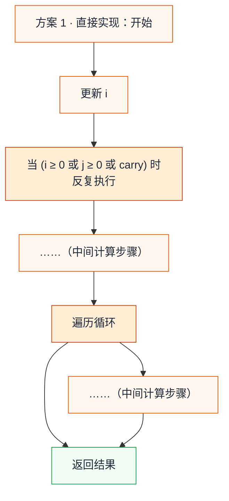

```c
/* LeetCode 67. 二进制求和 — C 版（方案1） */
#include <stdio.h>                                                 // 引入头文件
#include <string.h>                                                // 引入头文件
static void add_binary(const char *a, const char *b, char out[]) { // 定义函数/方法 add_binary
    int i = (int)strlen(a) - 1, j = (int)strlen(b) - 1, carry = 0, n = 0;
    while (i >= 0 || j >= 0 || carry) { // 循环，直到不满足「下标 i 不低于 0 或 下标 j 不低于 0 或 carry」
        int total = carry; // 把 carry 存入 总和
        if (i >= 0) {
            total += a[i] - '0';
            i--;
        } // 若 下标 i 不低于 0) { 总和 累加 数组[下标 i] 减 '0'; 下标 i 减一 ; }
        if (j >= 0) {
            total += b[j] - '0';
            j--;
        } // 若 下标 j 不低于 0) { 总和 累加 b[下标 j] 减 '0'; 下标 j 减一 ; }
        out[n++] = '0' + total % 2; // 把 '0' 加 总和 对…取模 2; 写入 out[n++]
        carry = total / 2;          // 把 总和 除以 2; 写入 carry
    }
    if (n == 0)
        out[n++] = '0'; // 若 元素个数 等于 0) out[元素个数 加一 ] 赋值为 '0';
    out[n] = '\0';      // 把 '\0'; 写入 out[n]
    for (int l = 0, r = n - 1; l < r; l++, r--) {
        char t = out[l];
        out[l] = out[r];
        out[r] = t;
    } // 让 左指针 从 0, 右指针 赋值为 元素个数 减 1 开始计数，左指针 小于 右指针 就继续
}
int main(void) {                // 程序入口：跑内嵌自测用例
    char out[8192];             // char out[8192];
    add_binary("11", "1", out); // add_binary(「11」, 「11」, out);
    if (strcmp(out, "100") != 0) {
        printf("FAIL 1\n");
        return 1;
    } // 若 strcmp(out, 「100」) 不等于 0) { 输出「100」); return 1; }
    add_binary("1010", "1011", out); // add_binary(「1010」, 「1010」, out);
    if (strcmp(out, "10101") != 0) {
        printf("FAIL 2\n");
        return 1;
    }                 // 若 strcmp(out, 「10101」) 不等于 0) { 输出「10101」); return 1; }
    printf("PASS\n"); // 全部用例通过，输出 PASS
    return 0;         // 返回 0
}
```

### C++ 实现（1 种方案）

C++ 的全部方案如下，每个方案都内嵌用例自测，可独立运行（老仓库 python/go 文件遵循「打印结果」约定）：

#### 方案 1：直接实现

**思路与代码分析**：核心是「直接实现」。C++ 版用 STL 容器与迭代器，减少手写下标错误。**走读**：方案 1 · 直接实现：开始 → 更新 i → 处理 std::string out → 当 (i ≥ 0 或 j ≥ 0 或 carry) 时反复执行 → 更新 total → 若 i ≥ 0：更新 + → 更新 + → 若 j ≥ 0：更新 + → 更新 + → 调用 out.push_back('0' + total % → 更新 carry → 若 out.empty()：更新 out → 更新 out → 处理 std::reverse(out.begin(), ou → 返回 out。

**运行架构**（真实控制流）：

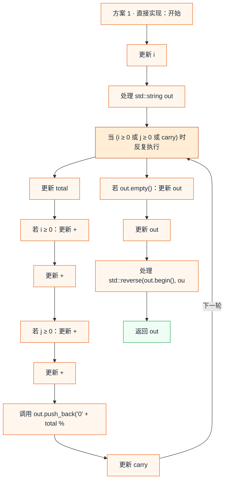

```cpp
// LeetCode 67. 二进制求和 — C++ 版（方案1）
#include <algorithm> // 引入头文件
#include <cassert>   // 引入头文件
#include <iostream>  // 引入头文件
#include <string>    // 引入头文件
static std::string addBinary(const std::string &a, const std::string &b) {
    int i = static_cast<int>(a.size()) - 1, j = static_cast<int>(b.size()) - 1, carry = 0;
    std::string out;                    // std::string out;
    while (i >= 0 || j >= 0 || carry) { // 循环，直到不满足「下标 i 不低于 0 或 下标 j 不低于 0 或 carry」
        int total = carry; // 把 carry 存入 总和
        if (i >= 0)
            total += a[i--] - '0'; // 若 下标 i 不低于 0) 总和 累加 数组[下标 i 减一 ] 减 '0';
        if (j >= 0)
            total += b[j--] - '0'; // 若 下标 j 不低于 0) 总和 累加 b[下标 j 减一 ] 减 '0';
        out.push_back('0' + total % 2); // out 追加 '0' 加 总和 对…取模 2);
        carry = total / 2;              // 把 总和 除以 2; 写入 carry
    }
    if (out.empty())
        out = "0";                        // 若 out 是否为空) out 赋值为 「0」;
    std::reverse(out.begin(), out.end()); // std::reverse(out 迭代位置 , out.终点());
    return out;                           // 返回 out
}
int main() {                                      // 程序入口：跑内嵌自测用例
    assert(addBinary("11", "1") == "100");        // 断言校验
    assert(addBinary("1010", "1011") == "10101"); // 断言校验
    std::cout << "PASS" << std::endl;             // 全部用例通过，输出 PASS
    return 0;                                     // 返回 0
}
```

### R 实现（1 种方案）

R 的全部方案如下，每个方案都内嵌用例自测，可独立运行（老仓库 python/go 文件遵循「打印结果」约定）：

#### 方案 1：直接实现

**思路与代码分析**：核心是「直接实现」。R 版用向量化思维与 1 起始下标，注意 1:n 的降序陷阱。**走读**：方案 1 · 直接实现：开始 → 处理 ca ＜- strsplit(a, )[[1]] → 当 (i ≥ 1 或 j ≥ 1 或 carry ＞ 0) 时反复执行 → 返回结果。

**运行架构**（真实控制流）：

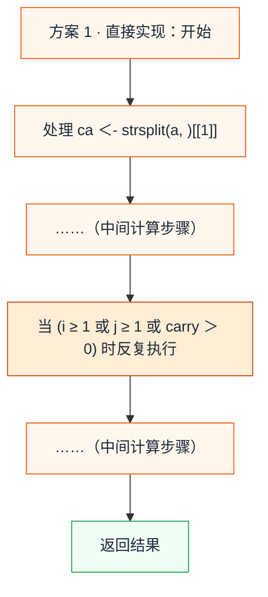

```r
# 版（方案1） 定义函数 add_binary（参数：数组, b）
add_binary <- function(a, b) {
    ca <- strsplit(a, "")[[1]]
    cb <- strsplit(b, "")[[1]]  # 把 strsplit(数组, 「」)[[1]]; cb 小于 减 strsplit(b, 「」)[[1]] 存入 ca
    i <- length(ca)
    j <- length(cb)
    carry <- 0  # 把 长度(ca); 下标 j 小于 减 长度(cb); carry 小于 减 0 存入 下标 i
    out <- character(0)  # 把 character(0) 存入 out
    while (i >= 1 || j >= 1 || carry > 0) {
        # 循环，直到不满足「下标 i 不低于 1 或 下标 j 不低于 1 或 carry 超过 0」
        total <- carry  # 把 carry 存入 总和
        if (i >= 1) {
            total <- total + as.integer(ca[i])
            i <- i - 1
        }
        if (j >= 1) {
            total <- total + as.integer(cb[j])
            j <- j - 1
        }
        out <- c(out, as.character(total%%2))  # 把 字符(out, as.character(总和 对…取模 对…取模 2)) 存入 out
        carry <- total%/%2  # 把 总和 对…取模 除以 对…取模 2 存入 carry
    }
    if (length(out) == 0)
        out <- "0"  # 若 长度(out) 等于 0) out 小于 减 「0」
    paste(rev(out), collapse = "")  # 把 「」) 写入 paste(rev(out), collapse
}
stopifnot(add_binary("11", "1") == "100")  # 断言校验
stopifnot(add_binary("1010", "1011") == "10101")  # 断言校验
cat("PASS\n")  # 全部用例通过，输出 PASS
```

### Zig 实现（1 种方案）

Zig 的全部方案如下，每个方案都内嵌用例自测，可独立运行（老仓库 python/go 文件遵循「打印结果」约定）：

#### 方案 1：直接实现

**思路与代码分析**：核心是「直接实现」。Zig 版显式分配与清零，整型边界处理严格。**走读**：方案 1 · 直接实现：开始 → 计算 i → 当 (i ≥ 0 or j ≥ 0 or carry ＞ 0) 时反复执行 → 返回结果。

**运行架构**（真实控制流）：

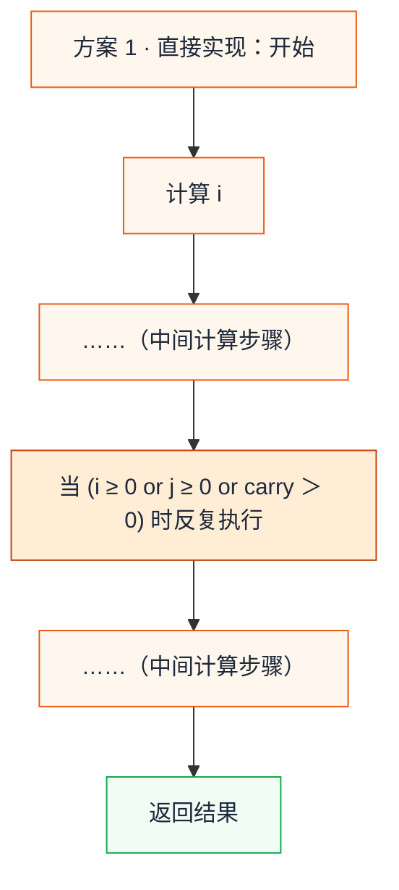

```zig
// LeetCode 67. 二进制求和 — Zig 版（方案1）
const std = @import("std"); // 把 @import(「std」) 存入 std
fn addBinary(a: []const u8, b: []const u8, out: *std.ArrayList(u8)) void { // 定义函数/方法 addBinary
    var i: isize = @as(isize, @intCast(a.len)) - 1; // 把 @as(isize, @intCast(数组.长度)) 减 1; 写入 var i: isize
    var j: isize = @as(isize, @intCast(b.len)) - 1; // 把 @as(isize, @intCast(b.长度)) 减 1; 写入 var j: isize
    var carry: u8 = 0; // 把 0; 写入 var carry: u8
    while (i >= 0 or j >= 0 or carry > 0) { // 循环，直到不满足「下标 i 不低于 0 or 下标 j 不低于 0 or carry 超过 0」
        var total: u8 = carry; // 把 carry; 写入 var total: u8
        if (i >= 0) {
            total += a[@intCast(i)] - '0';
            i -= 1;
        } // 若 下标 i 不低于 0) { 总和 累加 数组[@intCast(下标 i)] 减 '0'; 下标 i 累减 1; }
        if (j >= 0) {
            total += b[@intCast(j)] - '0';
            j -= 1;
        } // 若 下标 j 不低于 0) { 总和 累加 b[@intCast(下标 j)] 减 '0'; 下标 j 累减 1; }
        out.append('0' + total % 2) catch unreachable; // 把 '0' 加 总和 对…取模 2 追加到列表尾部
        carry = total / 2; // 把 总和 除以 2; 写入 carry
    }
    if (out.items.len == 0) out.append('0') catch unreachable; // 若 out.items.长度 等于 0) out 追加 '0') catch unreachable;
    std.mem.reverse(u8, out.items); // 反转
}
pub fn main() !void { // 程序入口：跑内嵌自测用例
    var out = std.ArrayList(u8).init(std.heap.page_allocator); // 把 std.ArrayList(u8).init(std.堆.page_allocator) 存入 out
    defer out.deinit(); // defer out.deinit();
    addBinary("11", "1", &out); // addBinary(「11」, 「11」, 按位与 out);
    if (!std.mem.eql(u8, out.items, "100")) return error.TestFailed; // 若 取反 std.mem.eql(u8, out.items, 「100」)，直接返回 error.TestFailed
    out.clearRetainingCapacity(); // out.clearRetainingCapacity();
    addBinary("1010", "1011", &out); // addBinary(「1010」, 「1010」, 按位与 out);
    if (!std.mem.eql(u8, out.items, "10101")) return error.TestFailed;
    std.debug.print("PASS\n", .{}); // 全部用例通过，输出 PASS
}
```

### Dart 实现（1 种方案）

Dart 的全部方案如下，每个方案都内嵌用例自测，可独立运行（老仓库 python/go 文件遵循「打印结果」约定）：

#### 方案 1：直接实现

**思路与代码分析**：核心是「直接实现」。Dart 版用可空类型标注与集合方法，注意空安全。**走读**：方案 1 · 直接实现：开始 → 计算 i → 更新 j → 更新 carry → 更新 out → 当 (i ≥ 0 或 j ≥ 0 或 carry ＞ 0) 时反复执行 → 计算 total → 若 i ≥ 0 则： → 更新 + → 若 j ≥ 0 则： → 更新 + → 调用 out.add((total % 2).toString → 更新 carry → 命中条件，直接返回。

**运行架构**（真实控制流）：

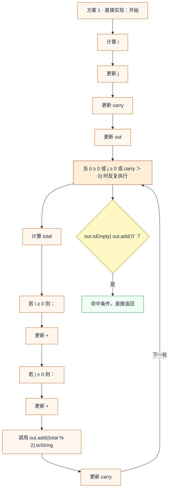

```dart
// LeetCode 67. 二进制求和 — Dart 版（方案1）
String addBinary(String a, String b) {
  // 定义函数/方法 addBinary
  var i = a.length - 1,
      j = b.length - 1,
      carry = 0; // 把 数组.长度 减 1, 下标 j 赋值为 b.长度 减 1, carry 赋值为 0 存入 下标 i
  final out = <String>[]; // 把 小于 String 超过 [] 存入 out
  while (i >= 0 || j >= 0 || carry > 0) {
    // 循环，直到不满足「下标 i 不低于 0 或 下标 j 不低于 0 或 carry 超过 0」
    var total = carry; // 把 carry 存入 总和
    if (i >= 0) {
      // 若 下标 i 不低于 0
      total += a.codeUnitAt(i--) - 0x30; // 总和累加 数组.codeUnitAt(下标 i 减一 ) 减 0x30
    }
    if (j >= 0) {
      // 若 下标 j 不低于 0
      total += b.codeUnitAt(j--) - 0x30; // 总和累加 b.codeUnitAt(下标 j 减一 ) 减 0x30
    }
    out.add((total % 2).toString()); // out 追加 (总和 对…取模 2).toString());
    carry = total ~/ 2; // 把 总和 ~ 除以 2 存入 carry
  }
  if (out.isEmpty) out.add('0'); // 若 out.isEmpty) out 追加 '0');
  return out.reversed.join(); // 返回 out.reversed.join()
}

void main() {
  // 程序入口：跑内嵌自测用例
  if (addBinary('11', '1') != '100')
    throw StateError(
      'c1',
    ); // 若 addBinary('11', '1') 不等于 '100') throw StateError('c1');
  if (addBinary('1010', '1011') != '10101') throw StateError('c2');
  print('PASS'); // 全部用例通过，输出 PASS
}
```

---

## 内容总结

- **二进制求和**（字符串 · Medium）：共 1 个方案，主线思路「直接实现」；时间 O(n) 量级；动画演示滑动窗口过程，附录给出 11 种语言 × 全部方案的可运行实现。
- 来源博客：[]()
- 导航：[📋 总目录](../) ｜ [← 079 最后一个单词的长度](../079_最后一个单词的长度/) ｜ [081 计数二进制子串 →](../081_计数二进制子串/)
