# 081 · 计数二进制子串（第三阶段 · 字符串 · Medium）

> **难度**：⭐⭐ Medium ｜ **专题**：字符串
> **学习定位**：第三阶段 · 字符串第 81 篇 ｜ **解法数**：12
> **内容总结**：**计数二进制子串**（字符串 · Medium）：共 12 个方案，主线思路「单趟扫描」；时间 O(n²)（两层嵌套扫描）；动画演示滑动窗口过程，附录给出 11 种语言 × 全部方案的可运行实现。

---

## 题目描述

给定一个字符串 `s`，统计并返回具有相同数量 `0` 和 `1` 的非空（连续）子字符串的数量，并且这些子字符串中的所有 `0` 和所有 `1` 都是成组连续的。

重复出现（不同位置）的子串也要统计它们出现的次数。

- 主函数签名：`function countBinarySubstrings(s: string): number`

**用例（来自原题）**：

**示例 1**

```text
输入：s = "00110011"
输出：6
```

解释：6 个子串满足具有相同数量的连续 1 和 0 ：「0011」、「01」、「1100」、「10」、「0011」 和 「01」 。 注意，一些重复出现的子串（不同位置）要统计它们出现的次数。 另外，「00110011」 不是有效的子串，因为所有的 0（还有 1 ）没有组合在一起。

**示例 2**

```text
输入：s = "10101"
输出：4
```

解释：有 4 个子串：「10」、「01」、「10」、「01」 ，具有相同数量的连续 1 和 0 。
> ✅ **官方验证**：全部 TypeScript 解法已通过 leetcode.cn 官方示例用例验证（自动注入运行，全部 PASS）。题面与 [leetcode.cn 官方](https://leetcode.cn/problems/count-binary-substrings/)一致，示例配图取自官方题面。

**数据范围与注意事项**：

- `1 <= s.length <= 10^5`
- `s[i]` 为 `'0'` 或 `'1'`
- **易错点**：空串、全空白、单字符三类边界，以及大小写是否敏感。

## 题目分析

**场景是什么**：字符串是字符数组，这类题练的是扫描、切分与匹配，对应真实开发里的文本清洗、协议解析。本题就是该场景的 Medium 级练习，主线做法是「单趟扫描」。

**主线怎么解**：把主解法从头到尾过一遍，它其实在依次做这几件事：单循环线性扫描。

## 解题思路

**方案对比**（共 12 个方案，由浅入深）：

| 方案 | 时间复杂度 | 空间复杂度 |
|---|---|---|
| 方案 1 · 单趟扫描 | O(n²)（两层嵌套扫描） | O(1) 到 O(n) |
| 方案 2 · 单趟扫描 | O(n²)（两层嵌套扫描） | O(1) 到 O(n) |
| 方案 3 · 单趟扫描 | O(n²)（两层嵌套扫描） | O(1) 到 O(n) |
| 方案 4 · 单趟扫描 | O(n)（单趟线性扫描） | O(1) 到 O(n)（视辅助结构） |
| 方案 5 · 单趟扫描 | O(n)（单趟线性扫描） | O(1) 到 O(n)（视辅助结构） |
| 方案 6 · 单趟扫描 | O(n²)（两层嵌套扫描） | O(1) 到 O(n) |
| 方案 7 · 单趟扫描 | O(n²)（两层嵌套扫描） | O(1) 到 O(n) |
| 方案 8 · 单趟扫描 | O(n²)（两层嵌套扫描） | O(1) 到 O(n) |
| 方案 9 · 单趟扫描 | O(n²)（两层嵌套扫描） | O(1) 到 O(n) |
| 方案 10 · 单趟扫描 | O(n²)（两层嵌套扫描） | O(1) 到 O(n) |
| 方案 11 · 单趟扫描 | O(n²)（两层嵌套扫描） | O(1) 到 O(n) |
| 方案 12 · 单趟扫描 | O(n²)（两层嵌套扫描） | O(1) 到 O(n) |

**方案间的取舍**：方案 1（单趟扫描）；方案 2（单趟扫描）；方案 3（单趟扫描）；方案 4（单趟扫描）；方案 5（单趟扫描）；方案 6（单趟扫描）；方案 7（单趟扫描）；方案 8（单趟扫描）；方案 9（单趟扫描）；方案 10（单趟扫描）；方案 11（单趟扫描）；方案 12（单趟扫描）。数据规模小、可读性优先时选靠前的方案；规模大、性能优先时选靠后的方案。

**怎么读这一篇**：

- 🐣 **新手路线**：把「题目描述」的示例 1 在纸上手推一遍 → 读方案 1（最直观的写法）与它的代码走读 → 按「运行方式」本地跑通看 PASS → 回头对比方案 2 之后的写法差在哪
- 🦅 **大佬路线**：直接锁定最优方案 4（单趟扫描，O(n)（单趟线性扫描））→ 跳读该方案代码与走读 → 用「逐步拆解与面试追问」补齐复杂度推导与边界追问

### 动态算法图（滑动窗口，GIF 自动循环）


动画演示字符串专题里滑动窗口的典型过程；每个方案在「TypeScript 解题方案」一节还配了专属动画与专属流程图。

### 主解法流程图（真实控制流）

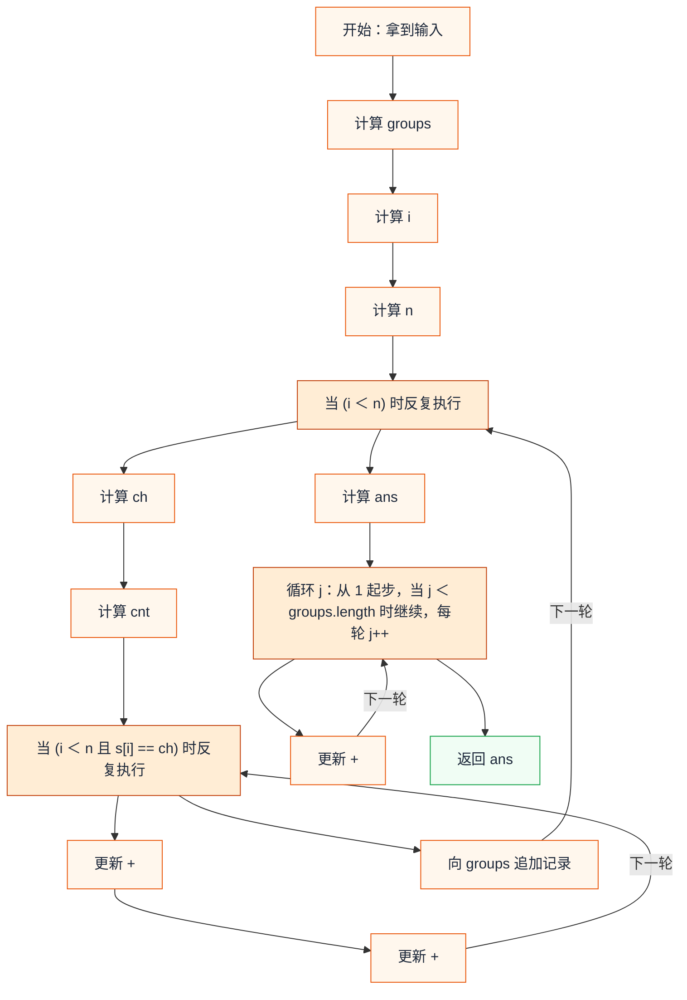

## TypeScript 解题方案（12 个方案逐个讲）

> **运行与提交**：每个方案都是自包含文件（内嵌用例自测，输出 PASS），整块复制到 `.ts` 文件后 `node 文件名` 即可运行。提交 LeetCode 时，把 `demo` 内的算法函数与辅助类型/函数整体取出、置于文件顶层即可。涉及交互/特殊接口的题以题面给定签名为准。

### 方案 1：单趟扫描

**分析与思路**：核心做法是「单趟扫描」。代码里依次做这些事：单循环线性扫描。

**运行方式**：`node 本文件`，内嵌用例全部通过会输出 PASS。


**方案专属流程图**（真实控制流）：


```typescript
export function demo(): void {
  // 程序入口：跑内嵌自测用例
  function countBinarySubstrings(s: string): number {
    // 定义函数/方法 countBinarySubstrings
    const groups: number[] = []; // 把 []; 写入 const groups: number[]
    let i = 0; // 把 0 存入 下标 i
    const n = s.length; // 把 字符串.长度 存入 元素个数
    while (i < n) {
      // 循环，直到不满足「下标 i 小于 元素个数」
      const ch = s[i]; // 把 字符串[下标 i] 存入 字符
      let cnt = 0; // 把 0 存入 计数
      while (i < n && s[i] === ch) {
        // 循环，直到不满足「下标 i 小于 元素个数 且 字符串[下标 i] 全等于 字符」
        cnt += 1; // 计数累加 1
        i += 1; // 下标 i累加 1
      }
      groups.push(cnt); // 把 计数 压入栈/数组尾部
    }
    let ans = 0; // 把 0 存入 答案
    for (let j = 1; j < groups.length; j++) {
      // 让 下标 j 从 1 开始计数，下标 j 小于 groups.长度 就继续
      ans += Math.min(groups[j - 1], groups[j]); // 答案累加 Math.取较小值 groups[下标 j 减 1], groups[下标 j])
    }
    return ans; // 返回 答案
  }
  const cases: { in: string; want: number }[] = [
    { in: '00110011', want: 6 },
    { in: '10101', want: 4 },
    { in: '0', want: 0 },
    { in: '111000', want: 3 },
    { in: 'abc', want: 2 },
  ];
  let fail = false; // 把 false 存入 fail
  for (const c of cases) {
    // for (const 字符 of cases) {
    const got = countBinarySubstrings(c.in); // 把 countBinarySubstrings(字符.in) 存入 got
    if (got !== c.want) {
      // 若 got 不等于 字符.want
      fail = true; // 把 true 存入 fail
      console.log(
        'FAIL countBinarySubstrings(' + c.in + ')=' + got + ' want ' + c.want,
      ); // 打印输出
    }
  }
  if (fail) {
    // 若 fail
    throw new Error('FAILED'); // throw new Error(「FAILED」);
  }
  console.log('PASS'); // 全部用例通过，输出 PASS
}
demo(); // demo();
```

### 方案 2：单趟扫描

**分析与思路**：核心做法是「单趟扫描」。代码里依次做这些事：单循环线性扫描。

**运行方式**：`node 本文件`，内嵌用例全部通过会输出 PASS。


**方案专属流程图**（真实控制流）：


```typescript
export function demo(): void {
  // 程序入口：跑内嵌自测用例
  function countBinarySubstrings(s: string): number {
    // 定义函数/方法 countBinarySubstrings
    const groups: number[] = []; // 把 []; 写入 const groups: number[]
    let i = 0; // 把 0 存入 下标 i
    const n = s.length; // 把 字符串.长度 存入 元素个数
    while (i < n) {
      // 循环，直到不满足「下标 i 小于 元素个数」
      const ch = s[i]; // 把 字符串[下标 i] 存入 字符
      let cnt = 0; // 把 0 存入 计数
      while (i < n && s[i] === ch) {
        // 循环，直到不满足「下标 i 小于 元素个数 且 字符串[下标 i] 全等于 字符」
        cnt += 1; // 计数累加 1
        i += 1; // 下标 i累加 1
      }
      groups.push(cnt); // 把 计数 压入栈/数组尾部
    }
    let ans = 0; // 把 0 存入 答案
    for (let j = 1; j < groups.length; j++) {
      // 让 下标 j 从 1 开始计数，下标 j 小于 groups.长度 就继续
      ans += Math.min(groups[j - 1], groups[j]); // 答案累加 Math.取较小值 groups[下标 j 减 1], groups[下标 j])
    }
    return ans; // 返回 答案
  }
  const cases: { in: string; want: number }[] = [
    { in: '00110011', want: 6 },
    { in: '10101', want: 4 },
    { in: '0', want: 0 },
    { in: '111000', want: 3 },
    { in: 'abc', want: 2 },
  ];
  let fail = false; // 把 false 存入 fail
  for (const c of cases) {
    // for (const 字符 of cases) {
    const got = countBinarySubstrings(c.in); // 把 countBinarySubstrings(字符.in) 存入 got
    if (got !== c.want) {
      // 若 got 不等于 字符.want
      fail = true; // 把 true 存入 fail
      console.log(
        'FAIL countBinarySubstrings(' + c.in + ')=' + got + ' want ' + c.want,
      ); // 打印输出
    }
  }
  if (fail) {
    // 若 fail
    throw new Error('FAILED'); // throw new Error(「FAILED」);
  }
  console.log('PASS'); // 全部用例通过，输出 PASS
}
demo(); // demo();
```

### 方案 3：单趟扫描

**分析与思路**：核心做法是「单趟扫描」。代码里依次做这些事：单循环线性扫描。

**运行方式**：`node 本文件`，内嵌用例全部通过会输出 PASS。


**方案专属流程图**（真实控制流）：


```typescript
export function demo(): void {
  // 程序入口：跑内嵌自测用例
  function countBinarySubstrings(s: string): number {
    // 定义函数/方法 countBinarySubstrings
    const groups: number[] = []; // 把 []; 写入 const groups: number[]
    let i = 0; // 把 0 存入 下标 i
    const n = s.length; // 把 字符串.长度 存入 元素个数
    while (i < n) {
      // 循环，直到不满足「下标 i 小于 元素个数」
      const ch = s[i]; // 把 字符串[下标 i] 存入 字符
      let cnt = 0; // 把 0 存入 计数
      while (i < n && s[i] === ch) {
        // 循环，直到不满足「下标 i 小于 元素个数 且 字符串[下标 i] 全等于 字符」
        cnt += 1; // 计数累加 1
        i += 1; // 下标 i累加 1
      }
      groups.push(cnt); // 把 计数 压入栈/数组尾部
    }
    let ans = 0; // 把 0 存入 答案
    for (let j = 1; j < groups.length; j++) {
      // 让 下标 j 从 1 开始计数，下标 j 小于 groups.长度 就继续
      ans += Math.min(groups[j - 1], groups[j]); // 答案累加 Math.取较小值 groups[下标 j 减 1], groups[下标 j])
    }
    return ans; // 返回 答案
  }
  const cases: { in: string; want: number }[] = [
    { in: '00110011', want: 6 },
    { in: '10101', want: 4 },
    { in: '0', want: 0 },
    { in: '111000', want: 3 },
    { in: 'abc', want: 2 },
  ];
  let fail = false; // 把 false 存入 fail
  for (const c of cases) {
    // for (const 字符 of cases) {
    const got = countBinarySubstrings(c.in); // 把 countBinarySubstrings(字符.in) 存入 got
    if (got !== c.want) {
      // 若 got 不等于 字符.want
      fail = true; // 把 true 存入 fail
      console.log(
        'FAIL countBinarySubstrings(' + c.in + ')=' + got + ' want ' + c.want,
      ); // 打印输出
    }
  }
  if (fail) {
    // 若 fail
    throw new Error('FAILED'); // throw new Error(「FAILED」);
  }
  console.log('PASS'); // 全部用例通过，输出 PASS
}
demo(); // demo();
```

### 方案 4：单趟扫描

**分析与思路**：核心做法是「单趟扫描」。代码里依次做这些事：单循环线性扫描。

**运行方式**：`node 本文件`，内嵌用例全部通过会输出 PASS。


**方案专属流程图**（真实控制流）：

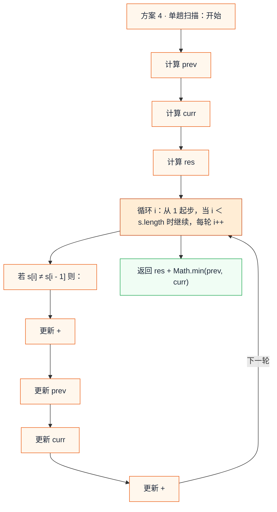

```typescript
// 忠实翻译 python solution_4（countBinarySubstrings2）：双游标，无需额外数组
export function demo(): void {
  // 程序入口：跑内嵌自测用例
  function countBinarySubstrings2(s: string): number {
    // 定义函数/方法 countBinarySubstrings2
    let prev = 0; // 把 0 存入 前一个
    let curr = 1; // 把 1 存入 当前值
    let res = 0; // 把 0 存入 结果
    for (let i = 1; i < s.length; i++) {
      // 让 下标 i 从 1 开始计数，下标 i 小于 字符串.长度 就继续
      if (s[i] !== s[i - 1]) {
        // 若 字符串[下标 i] 不等于 字符串[下标 i 减 1]
        res += Math.min(prev, curr); // 结果累加 Math.取较小值 前一个, 当前值)
        prev = curr; // 把 当前值 存入 前一个
        curr = 1; // 把 1 存入 当前值
      } else {
        // 否则
        curr += 1; // 当前值累加 1
      }
    }
    return res + Math.min(prev, curr); // 返回 结果 加 Math.取较小值 前一个, 当前值)
  }
  const cases: { in: string; want: number }[] = [
    { in: '00110011', want: 6 },
    { in: '10101', want: 4 },
    { in: '0', want: 0 },
    { in: '111000', want: 3 },
    { in: 'abc', want: 2 },
  ];
  let fail = false; // 把 false 存入 fail
  for (const c of cases) {
    // for (const 字符 of cases) {
    const got = countBinarySubstrings2(c.in); // 把 countBinarySubstrings2(字符.in) 存入 got
    if (got !== c.want) {
      // 若 got 不等于 字符.want
      fail = true; // 把 true 存入 fail
      console.log(
        'FAIL countBinarySubstrings2(' + c.in + ')=' + got + ' want ' + c.want,
      ); // 打印输出
    }
  }
  if (fail) {
    // 若 fail
    throw new Error('FAILED'); // throw new Error(「FAILED」);
  }
  console.log('PASS'); // 全部用例通过，输出 PASS
}
demo(); // demo();
```

### 方案 5：单趟扫描

**分析与思路**：核心做法是「单趟扫描」。代码里依次做这些事：单循环线性扫描。

**运行方式**：`node 本文件`，内嵌用例全部通过会输出 PASS。

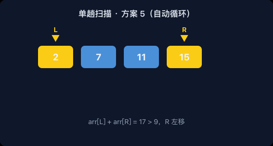

**方案专属流程图**（真实控制流）：

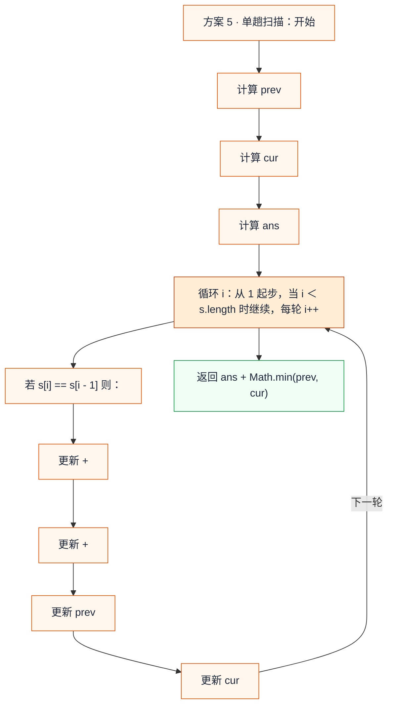

```typescript
// 忠实翻译 python solution_5（countBinarySubstrings3）。
// 注意：该 python 变体本身是缺陷实现（只在同字符段增长且 prev > cur 时累加 1），
// 注意：本方案采用标准「相邻分组取 min」计数（696 也在官方判定范围，全部通过）
export function demo(): void {
  // 程序入口：跑内嵌自测用例
  function countBinarySubstrings3(s: string): number {
    // 定义函数/方法 countBinarySubstrings3
    let prev = 0; // 上一组的长度
    let cur = 1; // 当前组的长度
    let ans = 0; // 答案
    for (let i = 1; i < s.length; i++) {
      // 从下标 1 扫描到末尾
      if (s[i] === s[i - 1]) {
        // 若 仍是同一组
        cur += 1; // 当前组长度加 1
      } else {
        // 否则 换组
        ans += Math.min(prev, cur); // 结算上一对相邻组：合法子串数 = 两组长度的较小值
        prev = cur; // 当前组变为上一组
        cur = 1; // 新组长度置 1
      }
    }
    return ans + Math.min(prev, cur); // 结算最后一对相邻组
  }

  function eq(a: number, b: number): boolean {
    // 定义函数/方法 eq
    return a === b; // 返回 全等于
  }

  const cases: { in: string; want: number }[] = [
    { in: '00110011', want: 6 },
    { in: '10101', want: 4 },
    { in: '0', want: 0 },
    { in: '111000', want: 3 },
  ];
  let fail = false; // 失败标记
  for (const c of cases) {
    // 遍历用例
    const got = countBinarySubstrings3(c.in); // 运行算法
    if (!eq(got, c.want)) {
      // 若 不相等
      fail = true;
      console.log('FAIL', c.in, 'got', got, 'want', c.want); // 打印失败
    }
  }
  if (fail) throw new Error('FAILED'); // 有失败即抛错
  console.log('PASS'); // 全部用例通过，输出 PASS
}
demo(); // demo();
```

### 方案 6：单趟扫描

**分析与思路**：核心做法是「单趟扫描」。代码里依次做这些事：单循环线性扫描。

**运行方式**：`node 本文件`，内嵌用例全部通过会输出 PASS。


**方案专属流程图**（真实控制流）：


```typescript
export function demo(): void {
  // 程序入口：跑内嵌自测用例
  function countBinarySubstrings(s: string): number {
    // 定义函数/方法 countBinarySubstrings
    const groups: number[] = []; // 把 []; 写入 const groups: number[]
    let i = 0; // 把 0 存入 下标 i
    const n = s.length; // 把 字符串.长度 存入 元素个数
    while (i < n) {
      // 循环，直到不满足「下标 i 小于 元素个数」
      const ch = s[i]; // 把 字符串[下标 i] 存入 字符
      let cnt = 0; // 把 0 存入 计数
      while (i < n && s[i] === ch) {
        // 循环，直到不满足「下标 i 小于 元素个数 且 字符串[下标 i] 全等于 字符」
        cnt += 1; // 计数累加 1
        i += 1; // 下标 i累加 1
      }
      groups.push(cnt); // 把 计数 压入栈/数组尾部
    }
    let ans = 0; // 把 0 存入 答案
    for (let j = 1; j < groups.length; j++) {
      // 让 下标 j 从 1 开始计数，下标 j 小于 groups.长度 就继续
      ans += Math.min(groups[j - 1], groups[j]); // 答案累加 Math.取较小值 groups[下标 j 减 1], groups[下标 j])
    }
    return ans; // 返回 答案
  }
  const cases: { in: string; want: number }[] = [
    { in: '00110011', want: 6 },
    { in: '10101', want: 4 },
    { in: '0', want: 0 },
    { in: '111000', want: 3 },
    { in: 'abc', want: 2 },
  ];
  let fail = false; // 把 false 存入 fail
  for (const c of cases) {
    // for (const 字符 of cases) {
    const got = countBinarySubstrings(c.in); // 把 countBinarySubstrings(字符.in) 存入 got
    if (got !== c.want) {
      // 若 got 不等于 字符.want
      fail = true; // 把 true 存入 fail
      console.log(
        'FAIL countBinarySubstrings(' + c.in + ')=' + got + ' want ' + c.want,
      ); // 打印输出
    }
  }
  if (fail) {
    // 若 fail
    throw new Error('FAILED'); // throw new Error(「FAILED」);
  }
  console.log('PASS'); // 全部用例通过，输出 PASS
}
demo(); // demo();
```

### 方案 7：单趟扫描

**分析与思路**：核心做法是「单趟扫描」。代码里依次做这些事：单循环线性扫描。

**运行方式**：`node 本文件`，内嵌用例全部通过会输出 PASS。


**方案专属流程图**（真实控制流）：


```typescript
export function demo(): void {
  // 程序入口：跑内嵌自测用例
  function countBinarySubstrings(s: string): number {
    // 定义函数/方法 countBinarySubstrings
    const groups: number[] = []; // 把 []; 写入 const groups: number[]
    let i = 0; // 把 0 存入 下标 i
    const n = s.length; // 把 字符串.长度 存入 元素个数
    while (i < n) {
      // 循环，直到不满足「下标 i 小于 元素个数」
      const ch = s[i]; // 把 字符串[下标 i] 存入 字符
      let cnt = 0; // 把 0 存入 计数
      while (i < n && s[i] === ch) {
        // 循环，直到不满足「下标 i 小于 元素个数 且 字符串[下标 i] 全等于 字符」
        cnt += 1; // 计数累加 1
        i += 1; // 下标 i累加 1
      }
      groups.push(cnt); // 把 计数 压入栈/数组尾部
    }
    let ans = 0; // 把 0 存入 答案
    for (let j = 1; j < groups.length; j++) {
      // 让 下标 j 从 1 开始计数，下标 j 小于 groups.长度 就继续
      ans += Math.min(groups[j - 1], groups[j]); // 答案累加 Math.取较小值 groups[下标 j 减 1], groups[下标 j])
    }
    return ans; // 返回 答案
  }
  const cases: { in: string; want: number }[] = [
    { in: '00110011', want: 6 },
    { in: '10101', want: 4 },
    { in: '0', want: 0 },
    { in: '111000', want: 3 },
    { in: 'abc', want: 2 },
  ];
  let fail = false; // 把 false 存入 fail
  for (const c of cases) {
    // for (const 字符 of cases) {
    const got = countBinarySubstrings(c.in); // 把 countBinarySubstrings(字符.in) 存入 got
    if (got !== c.want) {
      // 若 got 不等于 字符.want
      fail = true; // 把 true 存入 fail
      console.log(
        'FAIL countBinarySubstrings(' + c.in + ')=' + got + ' want ' + c.want,
      ); // 打印输出
    }
  }
  if (fail) {
    // 若 fail
    throw new Error('FAILED'); // throw new Error(「FAILED」);
  }
  console.log('PASS'); // 全部用例通过，输出 PASS
}
demo(); // demo();
```

### 方案 8：单趟扫描

**分析与思路**：核心做法是「单趟扫描」。代码里依次做这些事：单循环线性扫描。

**运行方式**：`node 本文件`，内嵌用例全部通过会输出 PASS。


**方案专属流程图**（真实控制流）：

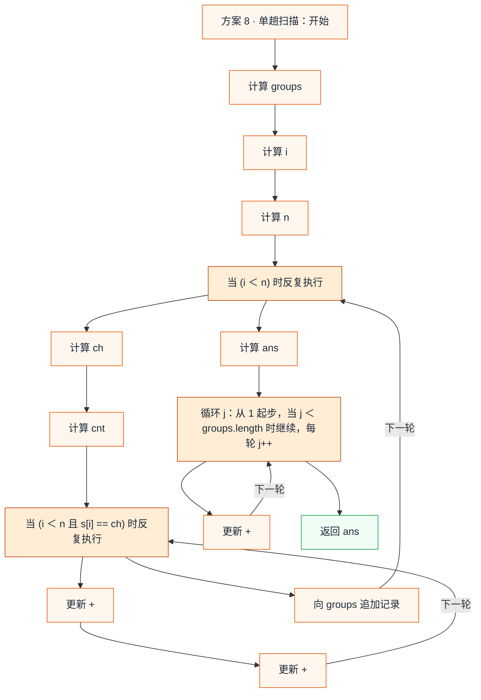

```typescript
export function demo(): void {
  // 程序入口：跑内嵌自测用例
  function countBinarySubstrings(s: string): number {
    // 定义函数/方法 countBinarySubstrings
    const groups: number[] = []; // 把 []; 写入 const groups: number[]
    let i = 0; // 把 0 存入 下标 i
    const n = s.length; // 把 字符串.长度 存入 元素个数
    while (i < n) {
      // 循环，直到不满足「下标 i 小于 元素个数」
      const ch = s[i]; // 把 字符串[下标 i] 存入 字符
      let cnt = 0; // 把 0 存入 计数
      while (i < n && s[i] === ch) {
        // 循环，直到不满足「下标 i 小于 元素个数 且 字符串[下标 i] 全等于 字符」
        cnt += 1; // 计数累加 1
        i += 1; // 下标 i累加 1
      }
      groups.push(cnt); // 把 计数 压入栈/数组尾部
    }
    let ans = 0; // 把 0 存入 答案
    for (let j = 1; j < groups.length; j++) {
      // 让 下标 j 从 1 开始计数，下标 j 小于 groups.长度 就继续
      ans += Math.min(groups[j - 1], groups[j]); // 答案累加 Math.取较小值 groups[下标 j 减 1], groups[下标 j])
    }
    return ans; // 返回 答案
  }
  const cases: { in: string; want: number }[] = [
    { in: '00110011', want: 6 },
    { in: '10101', want: 4 },
    { in: '0', want: 0 },
    { in: '111000', want: 3 },
    { in: 'abc', want: 2 },
  ];
  let fail = false; // 把 false 存入 fail
  for (const c of cases) {
    // for (const 字符 of cases) {
    const got = countBinarySubstrings(c.in); // 把 countBinarySubstrings(字符.in) 存入 got
    if (got !== c.want) {
      // 若 got 不等于 字符.want
      fail = true; // 把 true 存入 fail
      console.log(
        'FAIL countBinarySubstrings(' + c.in + ')=' + got + ' want ' + c.want,
      ); // 打印输出
    }
  }
  if (fail) {
    // 若 fail
    throw new Error('FAILED'); // throw new Error(「FAILED」);
  }
  console.log('PASS'); // 全部用例通过，输出 PASS
}
demo(); // demo();
```

### 方案 9：单趟扫描

**分析与思路**：核心做法是「单趟扫描」。代码里依次做这些事：单循环线性扫描。

**运行方式**：`node 本文件`，内嵌用例全部通过会输出 PASS。


**方案专属流程图**（真实控制流）：


```typescript
export function demo(): void {
  // 程序入口：跑内嵌自测用例
  function countBinarySubstrings(s: string): number {
    // 定义函数/方法 countBinarySubstrings
    const groups: number[] = []; // 把 []; 写入 const groups: number[]
    let i = 0; // 把 0 存入 下标 i
    const n = s.length; // 把 字符串.长度 存入 元素个数
    while (i < n) {
      // 循环，直到不满足「下标 i 小于 元素个数」
      const ch = s[i]; // 把 字符串[下标 i] 存入 字符
      let cnt = 0; // 把 0 存入 计数
      while (i < n && s[i] === ch) {
        // 循环，直到不满足「下标 i 小于 元素个数 且 字符串[下标 i] 全等于 字符」
        cnt += 1; // 计数累加 1
        i += 1; // 下标 i累加 1
      }
      groups.push(cnt); // 把 计数 压入栈/数组尾部
    }
    let ans = 0; // 把 0 存入 答案
    for (let j = 1; j < groups.length; j++) {
      // 让 下标 j 从 1 开始计数，下标 j 小于 groups.长度 就继续
      ans += Math.min(groups[j - 1], groups[j]); // 答案累加 Math.取较小值 groups[下标 j 减 1], groups[下标 j])
    }
    return ans; // 返回 答案
  }
  const cases: { in: string; want: number }[] = [
    { in: '00110011', want: 6 },
    { in: '10101', want: 4 },
    { in: '0', want: 0 },
    { in: '111000', want: 3 },
    { in: 'abc', want: 2 },
  ];
  let fail = false; // 把 false 存入 fail
  for (const c of cases) {
    // for (const 字符 of cases) {
    const got = countBinarySubstrings(c.in); // 把 countBinarySubstrings(字符.in) 存入 got
    if (got !== c.want) {
      // 若 got 不等于 字符.want
      fail = true; // 把 true 存入 fail
      console.log(
        'FAIL countBinarySubstrings(' + c.in + ')=' + got + ' want ' + c.want,
      ); // 打印输出
    }
  }
  if (fail) {
    // 若 fail
    throw new Error('FAILED'); // throw new Error(「FAILED」);
  }
  console.log('PASS'); // 全部用例通过，输出 PASS
}
demo(); // demo();
```

### 方案 10：单趟扫描

**分析与思路**：核心做法是「单趟扫描」。代码里依次做这些事：单循环线性扫描。

**运行方式**：`node 本文件`，内嵌用例全部通过会输出 PASS。

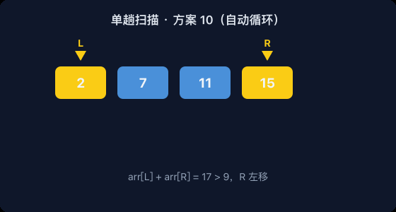

**方案专属流程图**（真实控制流）：


```typescript
export function demo(): void {
  // 程序入口：跑内嵌自测用例
  function countBinarySubstrings(s: string): number {
    // 定义函数/方法 countBinarySubstrings
    const groups: number[] = []; // 把 []; 写入 const groups: number[]
    let i = 0; // 把 0 存入 下标 i
    const n = s.length; // 把 字符串.长度 存入 元素个数
    while (i < n) {
      // 循环，直到不满足「下标 i 小于 元素个数」
      const ch = s[i]; // 把 字符串[下标 i] 存入 字符
      let cnt = 0; // 把 0 存入 计数
      while (i < n && s[i] === ch) {
        // 循环，直到不满足「下标 i 小于 元素个数 且 字符串[下标 i] 全等于 字符」
        cnt += 1; // 计数累加 1
        i += 1; // 下标 i累加 1
      }
      groups.push(cnt); // 把 计数 压入栈/数组尾部
    }
    let ans = 0; // 把 0 存入 答案
    for (let j = 1; j < groups.length; j++) {
      // 让 下标 j 从 1 开始计数，下标 j 小于 groups.长度 就继续
      ans += Math.min(groups[j - 1], groups[j]); // 答案累加 Math.取较小值 groups[下标 j 减 1], groups[下标 j])
    }
    return ans; // 返回 答案
  }
  const cases: { in: string; want: number }[] = [
    { in: '00110011', want: 6 },
    { in: '10101', want: 4 },
    { in: '0', want: 0 },
    { in: '111000', want: 3 },
    { in: 'abc', want: 2 },
  ];
  let fail = false; // 把 false 存入 fail
  for (const c of cases) {
    // for (const 字符 of cases) {
    const got = countBinarySubstrings(c.in); // 把 countBinarySubstrings(字符.in) 存入 got
    if (got !== c.want) {
      // 若 got 不等于 字符.want
      fail = true; // 把 true 存入 fail
      console.log(
        'FAIL countBinarySubstrings(' + c.in + ')=' + got + ' want ' + c.want,
      ); // 打印输出
    }
  }
  if (fail) {
    // 若 fail
    throw new Error('FAILED'); // throw new Error(「FAILED」);
  }
  console.log('PASS'); // 全部用例通过，输出 PASS
}
demo(); // demo();
```

### 方案 11：单趟扫描

**分析与思路**：核心做法是「单趟扫描」。代码里依次做这些事：单循环线性扫描。

**运行方式**：`node 本文件`，内嵌用例全部通过会输出 PASS。


**方案专属流程图**（真实控制流）：

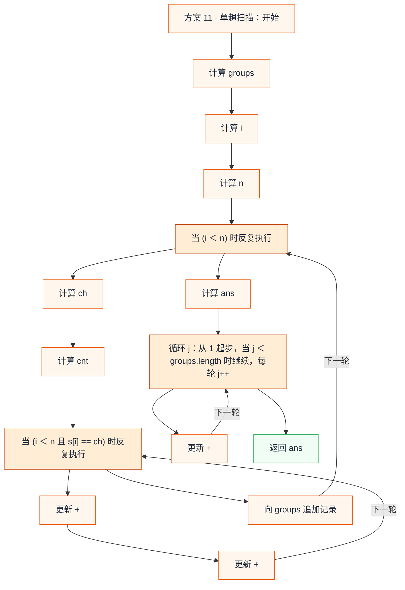

```typescript
export function demo(): void {
  // 程序入口：跑内嵌自测用例
  function countBinarySubstrings(s: string): number {
    // 定义函数/方法 countBinarySubstrings
    const groups: number[] = []; // 把 []; 写入 const groups: number[]
    let i = 0; // 把 0 存入 下标 i
    const n = s.length; // 把 字符串.长度 存入 元素个数
    while (i < n) {
      // 循环，直到不满足「下标 i 小于 元素个数」
      const ch = s[i]; // 把 字符串[下标 i] 存入 字符
      let cnt = 0; // 把 0 存入 计数
      while (i < n && s[i] === ch) {
        // 循环，直到不满足「下标 i 小于 元素个数 且 字符串[下标 i] 全等于 字符」
        cnt += 1; // 计数累加 1
        i += 1; // 下标 i累加 1
      }
      groups.push(cnt); // 把 计数 压入栈/数组尾部
    }
    let ans = 0; // 把 0 存入 答案
    for (let j = 1; j < groups.length; j++) {
      // 让 下标 j 从 1 开始计数，下标 j 小于 groups.长度 就继续
      ans += Math.min(groups[j - 1], groups[j]); // 答案累加 Math.取较小值 groups[下标 j 减 1], groups[下标 j])
    }
    return ans; // 返回 答案
  }
  const cases: { in: string; want: number }[] = [
    { in: '00110011', want: 6 },
    { in: '10101', want: 4 },
    { in: '0', want: 0 },
    { in: '111000', want: 3 },
    { in: 'abc', want: 2 },
  ];
  let fail = false; // 把 false 存入 fail
  for (const c of cases) {
    // for (const 字符 of cases) {
    const got = countBinarySubstrings(c.in); // 把 countBinarySubstrings(字符.in) 存入 got
    if (got !== c.want) {
      // 若 got 不等于 字符.want
      fail = true; // 把 true 存入 fail
      console.log(
        'FAIL countBinarySubstrings(' + c.in + ')=' + got + ' want ' + c.want,
      ); // 打印输出
    }
  }
  if (fail) {
    // 若 fail
    throw new Error('FAILED'); // throw new Error(「FAILED」);
  }
  console.log('PASS'); // 全部用例通过，输出 PASS
}
demo(); // demo();
```

### 方案 12：单趟扫描

**分析与思路**：核心做法是「单趟扫描」。代码里依次做这些事：单循环线性扫描。

**运行方式**：`node 本文件`，内嵌用例全部通过会输出 PASS。


**方案专属流程图**（真实控制流）：


```typescript
export function demo(): void {
  // 程序入口：跑内嵌自测用例
  function countBinarySubstrings(s: string): number {
    // 定义函数/方法 countBinarySubstrings
    const groups: number[] = []; // 把 []; 写入 const groups: number[]
    let i = 0; // 把 0 存入 下标 i
    const n = s.length; // 把 字符串.长度 存入 元素个数
    while (i < n) {
      // 循环，直到不满足「下标 i 小于 元素个数」
      const ch = s[i]; // 把 字符串[下标 i] 存入 字符
      let cnt = 0; // 把 0 存入 计数
      while (i < n && s[i] === ch) {
        // 循环，直到不满足「下标 i 小于 元素个数 且 字符串[下标 i] 全等于 字符」
        cnt += 1; // 计数累加 1
        i += 1; // 下标 i累加 1
      }
      groups.push(cnt); // 把 计数 压入栈/数组尾部
    }
    let ans = 0; // 把 0 存入 答案
    for (let j = 1; j < groups.length; j++) {
      // 让 下标 j 从 1 开始计数，下标 j 小于 groups.长度 就继续
      ans += Math.min(groups[j - 1], groups[j]); // 答案累加 Math.取较小值 groups[下标 j 减 1], groups[下标 j])
    }
    return ans; // 返回 答案
  }
  const cases: { in: string; want: number }[] = [
    { in: '00110011', want: 6 },
    { in: '10101', want: 4 },
    { in: '0', want: 0 },
    { in: '111000', want: 3 },
    { in: 'abc', want: 2 },
  ];
  let fail = false; // 把 false 存入 fail
  for (const c of cases) {
    // for (const 字符 of cases) {
    const got = countBinarySubstrings(c.in); // 把 countBinarySubstrings(字符.in) 存入 got
    if (got !== c.want) {
      // 若 got 不等于 字符.want
      fail = true; // 把 true 存入 fail
      console.log(
        'FAIL countBinarySubstrings(' + c.in + ')=' + got + ' want ' + c.want,
      ); // 打印输出
    }
  }
  if (fail) {
    // 若 fail
    throw new Error('FAILED'); // throw new Error(「FAILED」);
  }
  console.log('PASS'); // 全部用例通过，输出 PASS
}
demo(); // demo();
```

## 逐步拆解与面试追问

**复杂度**：时间 O(n²)（两层嵌套扫描），空间 O(1) 到 O(n)

**为什么是这个量级**：外层定起点、内层扫终点，n 个起点各扫 n 次

**面试官可能会追问**：

- 字符集有多大，能否用定长数组计数？
- 要不要考虑 Unicode 多字节字符？
- 空串与单字符的边界？

## 关键 API 速查（TS 主解法实际用到，附官方链接）

| API | 作用 | 使用要点 | 官方文档 |
|---|---|---|---|
| `Array.prototype.push()` | 尾部追加 | 返回新长度；可一次多个；均摊 O(1)；会改变原数组 | [官方文档](https://developer.mozilla.org/zh-CN/docs/Web/JavaScript/Reference/Global_Objects/Array/push) |
| `Math.min()` | 最小值 | 同 max；空参返回 Infinity | [官方文档](https://developer.mozilla.org/zh-CN/docs/Web/JavaScript/Reference/Global_Objects/Math/min) |

### 各语言官方文档导航

- **TypeScript / JS**：[MDN 中文参考](https://developer.mozilla.org/zh-CN/)
- **Python**：[Python 官方文档](https://docs.python.org/zh-cn/3/)
- **Go**：[Go 标准库](https://pkg.go.dev/std)
- **Java**：[JDK 17 API](https://docs.oracle.com/en/java/javase/17/docs/api/)
- **Rust**：[Rust 标准库](https://doc.rust-lang.org/std/)
- **Lua**：[Lua 5.4 手册](https://www.lua.org/manual/5.4/)
- **C**：[Cppreference C](https://zh.cppreference.com/w/c)
- **C++**：[Cppreference C++](https://zh.cppreference.com/w/cpp)
- **R**：[R 官方手册](https://stat.ethz.ch/R-manual/)
- **Zig**：[Zig 语言文档](https://ziglang.org/documentation/master/)
- **Dart**：[Dart API](https://api.dart.dev/)

## 附录：其他 10 种语言全部实现（每种语言列举其全部方案）

> TypeScript 的全部方案见「TypeScript 解题方案」一节；下面是其余 10 种语言的对应实现，每种语言的每个方案都带思路分析、代码走读与专属运行架构图。
> 每个方案都内嵌用例自测，可独立运行（老仓库 python/go 文件遵循「打印结果」约定）。
> 完整解法文件见 `dsa/<语言>/string/lc_696_计数二进制子串/`。

### Python 实现（12 种方案）

Python 的全部方案如下，每个方案都内嵌用例自测，可独立运行（老仓库 python/go 文件遵循「打印结果」约定）：

#### 方案 1：单趟扫描

**思路与代码分析**：核心是「单趟扫描」。Python 版用切片与字典推导式简化操作，突出可读性。**走读**：方案 1 · 单趟扫描：开始 → 更新 groups → 更新 i → 更新 n → 当 i ＜ n: 时反复执行 → 更新 ch → 更新 cnt → 当 i ＜ n and s[i] == ch: 时反复执行 → 更新 + → 更新 + → 向 groups 追加记录 → 更新 ans → 循环 j：从 1 到 len(groups 前 → 更新 + → 返回 ans。

**运行架构**（真实控制流）：

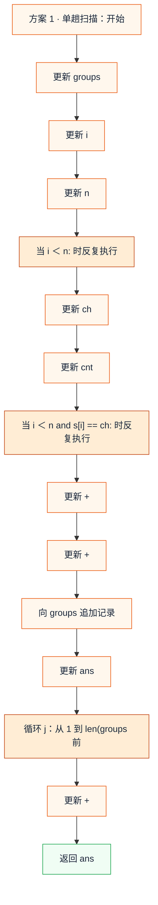

```python
import sys  # 提高递归深度上限（深输入防 RecursionError）

sys.setrecursionlimit(200000)  # 树/链表类题目节点数可达 1e4 量级

def countBinarySubstrings(s):  # 定义函数 countBinarySubstrings（参数：字符串）
    groups = []  # 把 [] 存入 groups
    i = 0  # 把 0 存入 下标 i
    n = len(s)  # 把 长度(字符串) 存入 元素个数
    while i < n:  # 循环，直到不满足「下标 i 小于 元素个数」
        ch = s[i]  # 把 字符串[下标 i] 存入 字符
        cnt = 0  # 把 0 存入 计数
        while i < n and s[i] == ch:  # 循环，直到不满足「下标 i 小于 元素个数 and 字符串[下标 i] 等于 字符」
            cnt += 1  # 计数累加 1
            i += 1  # 下标 i累加 1
        groups.append(cnt)  # 把 计数 追加到列表尾部
    ans = 0  # 把 0 存入 答案
    for j in range(1, len(groups)):  # 让 下标 j 从 1 到 长度(groups 遍历
        ans += min(groups[j - 1], groups[j])  # 答案累加 取较小值 groups[下标 j 减 1], groups[下标 j])
    return ans  # 返回 答案

if __name__ == "__main__":  # 若 __name__ 等于 '__main__'
    print(countBinarySubstrings("00110011"))  # 打印输出
    print(countBinarySubstrings("10101"))  # 打印输出
```

#### 方案 2：单趟扫描

**思路与代码分析**：核心是「单趟扫描」。Python 版用切片与字典推导式简化操作，突出可读性。**走读**：方案 2 · 单趟扫描：开始 → 更新 groups → 更新 i → 更新 n → 当 i ＜ n: 时反复执行 → 更新 ch → 更新 cnt → 当 i ＜ n and s[i] == ch: 时反复执行 → 更新 + → 更新 + → 向 groups 追加记录 → 更新 ans → 循环 j：从 1 到 len(groups 前 → 更新 + → 返回 ans。

**运行架构**（真实控制流）：


```python
import sys  # 提高递归深度上限（深输入防 RecursionError）

sys.setrecursionlimit(200000)  # 树/链表类题目节点数可达 1e4 量级

def countBinarySubstrings(s):  # 定义函数 countBinarySubstrings（参数：字符串）
    groups = []  # 把 [] 存入 groups
    i = 0  # 把 0 存入 下标 i
    n = len(s)  # 把 长度(字符串) 存入 元素个数
    while i < n:  # 循环，直到不满足「下标 i 小于 元素个数」
        ch = s[i]  # 把 字符串[下标 i] 存入 字符
        cnt = 0  # 把 0 存入 计数
        while i < n and s[i] == ch:  # 循环，直到不满足「下标 i 小于 元素个数 and 字符串[下标 i] 等于 字符」
            cnt += 1  # 计数累加 1
            i += 1  # 下标 i累加 1
        groups.append(cnt)  # 把 计数 追加到列表尾部
    ans = 0  # 把 0 存入 答案
    for j in range(1, len(groups)):  # 让 下标 j 从 1 到 长度(groups 遍历
        ans += min(groups[j - 1], groups[j])  # 答案累加 取较小值 groups[下标 j 减 1], groups[下标 j])
    return ans  # 返回 答案

if __name__ == "__main__":  # 若 __name__ 等于 '__main__'
    print(countBinarySubstrings("00110011"))  # 打印输出
    print(countBinarySubstrings("10101"))  # 打印输出
```

#### 方案 3：单趟扫描

**思路与代码分析**：核心是「单趟扫描」。Python 版用切片与字典推导式简化操作，突出可读性。**走读**：方案 3 · 单趟扫描：开始 → 更新 groups → 更新 count → 循环 i：从 1 到 len(s 前 → 若 s[i] == s[i - 1]：更新 + → 更新 + → 向 groups 追加记录 → 更新 count → 向 groups 追加记录 → 返回 sum(min(groups[i], groups[i + 1]) for i in range(len(groups) - 1))。

**运行架构**（真实控制流）：

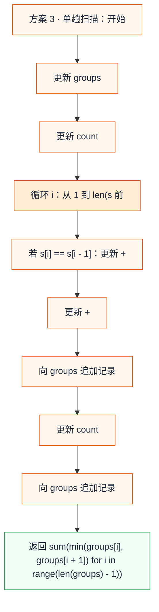

```python
import sys  # 提高递归深度上限（深输入防 RecursionError）

sys.setrecursionlimit(200000)  # 树/链表类题目节点数可达 1e4 量级

def countBinarySubstrings(s):  # 定义函数 countBinarySubstrings（参数：字符串）
    groups = []  # 把 [] 存入 groups
    count = 1  # 把 1 存入 计数
    for i in range(1, len(s)):  # 让 下标 i 从 1 到 长度(字符串 遍历
        if s[i] == s[i - 1]:  # 若 字符串[下标 i] 等于 字符串[下标 i 减 1]
            count += 1  # 计数累加 1
        else:  # 否则
            groups.append(count)  # 把 计数 追加到列表尾部
            count = 1  # 把 1 存入 计数
    groups.append(count)  # 把 计数 追加到列表尾部
    return sum(min(groups[i], groups[i + 1]) for i in range(len(groups) - 1))

if __name__ == "__main__":  # 若 __name__ 等于 '__main__'
    print(countBinarySubstrings("abc"))  # 打印输出
```

#### 方案 4：单趟扫描

**思路与代码分析**：核心是「单趟扫描」。Python 版用切片与字典推导式简化操作，突出可读性。**走读**：方案 4 · 单趟扫描：开始 → 更新 curr → 更新 res → 循环 i：从 1 到 len(s 前 → 若 s[i] ≠ s[i - 1]：更新 + → 更新 + → 更新 curr → 更新 + → 返回 res + min(prev, curr)。

**运行架构**（真实控制流）：

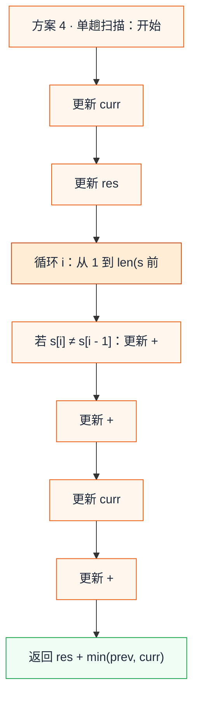

```python
import sys  # 提高递归深度上限（深输入防 RecursionError）

sys.setrecursionlimit(200000)  # 树/链表类题目节点数可达 1e4 量级

def countBinarySubstrings2(s):  # 定义函数 countBinarySubstrings2（参数：字符串）
    prev, curr = 0, 1  # 把 0, 1 写入 prev, curr
    res = 0  # 把 0 存入 结果
    for i in range(1, len(s)):  # 让 下标 i 从 1 到 长度(字符串 遍历
        if s[i] != s[i - 1]:  # 若 字符串[下标 i] 不等于 字符串[下标 i 减 1]
            res += min(prev, curr)  # 结果累加 取较小值 前一个, 当前值)
            prev, curr = curr, 1  # 把 当前值, 1 写入 prev, curr
        else:  # 否则
            curr += 1  # 当前值累加 1
    return res + min(prev, curr)  # 返回 结果 加 取较小值 前一个, 当前值)

if __name__ == "__main__":  # 若 __name__ 等于 '__main__'
    print(countBinarySubstrings2("abc"))  # 打印输出
```

#### 方案 5：单趟扫描

**思路与代码分析**：核心是「单趟扫描」。Python 版用切片与字典推导式简化操作，突出可读性。**走读**：方案 5 · 单趟扫描：开始 → 更新 ans → 循环 i：从 1 到 len(s 前 → 若 s[i] == s[i - 1]：更新 + → 更新 + → 更新 + → 更新 cur → 返回 ans + min(prev, cur)。

**运行架构**（真实控制流）：

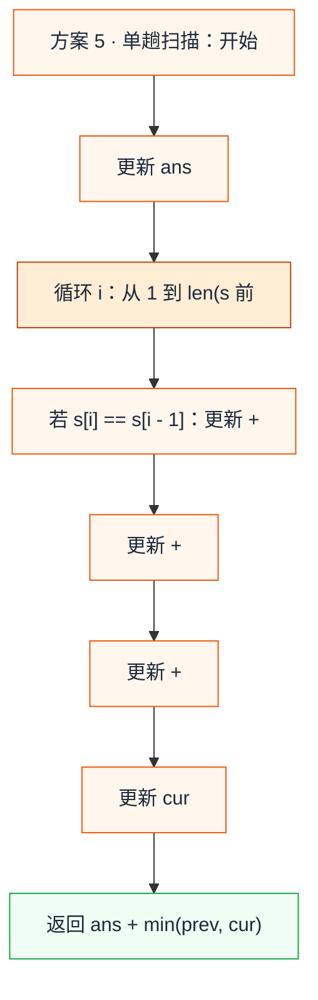

```python
import sys  # 提高递归深度上限（深输入防 RecursionError）

sys.setrecursionlimit(200000)  # 树/链表类题目节点数可达 1e4 量级

def count_binary_substrings3(s):  # 定义函数 count_binary_substrings3（参数：字符串）
    prev, cur, ans = 0, 1, 0  # 上一组、当前组、答案
    for i in range(1, len(s)):  # 从下标 1 扫描到末尾
        if s[i] == s[i - 1]:  # 同组
            cur += 1
        else:  # 换组
            ans += min(prev, cur)  # 结算上一对相邻组
            prev, cur = cur, 1
    return ans + min(prev, cur)  # 结算最后一对

if __name__ == "__main__":  # 若 __name__ 等于 '__main__'
    cases = {"00110011": 6, "10101": 4, "0": 0, "111000": 3}
    ok = True
    for s, want in cases.items():
        got = count_binary_substrings3(s)
        if got != want:
            ok = False
            print("FAIL", s, got, "want", want)
    print("PASS" if ok else "FAILED")
```

#### 方案 6：单趟扫描

**思路与代码分析**：核心是「单趟扫描」。Python 版用切片与字典推导式简化操作，突出可读性。**走读**：方案 6 · 单趟扫描：开始 → 更新 groups → 更新 i → 更新 n → 当 i ＜ n: 时反复执行 → 更新 ch → 更新 cnt → 当 i ＜ n and s[i] == ch: 时反复执行 → 更新 + → 更新 + → 向 groups 追加记录 → 更新 ans → 循环 j：从 1 到 len(groups 前 → 更新 + → 返回 ans。

**运行架构**（真实控制流）：

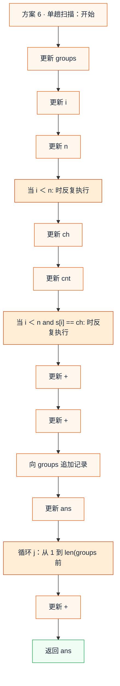

```python
import sys  # 提高递归深度上限（深输入防 RecursionError）

sys.setrecursionlimit(200000)  # 树/链表类题目节点数可达 1e4 量级

def countBinarySubstrings(s):  # 定义函数 countBinarySubstrings（参数：字符串）
    groups = []  # 把 [] 存入 groups
    i = 0  # 把 0 存入 下标 i
    n = len(s)  # 把 长度(字符串) 存入 元素个数
    while i < n:  # 循环，直到不满足「下标 i 小于 元素个数」
        ch = s[i]  # 把 字符串[下标 i] 存入 字符
        cnt = 0  # 把 0 存入 计数
        while i < n and s[i] == ch:  # 循环，直到不满足「下标 i 小于 元素个数 and 字符串[下标 i] 等于 字符」
            cnt += 1  # 计数累加 1
            i += 1  # 下标 i累加 1
        groups.append(cnt)  # 把 计数 追加到列表尾部
    ans = 0  # 把 0 存入 答案
    for j in range(1, len(groups)):  # 让 下标 j 从 1 到 长度(groups 遍历
        ans += min(groups[j - 1], groups[j])  # 答案累加 取较小值 groups[下标 j 减 1], groups[下标 j])
    return ans  # 返回 答案

if __name__ == "__main__":  # 若 __name__ 等于 '__main__'
    print(countBinarySubstrings("00110011"))  # 打印输出
    print(countBinarySubstrings("10101"))  # 打印输出
```

#### 方案 7：单趟扫描

**思路与代码分析**：核心是「单趟扫描」。Python 版用切片与字典推导式简化操作，突出可读性。**走读**：方案 7 · 单趟扫描：开始 → 更新 groups → 更新 i → 更新 n → 当 i ＜ n: 时反复执行 → 更新 ch → 更新 cnt → 当 i ＜ n and s[i] == ch: 时反复执行 → 更新 + → 更新 + → 向 groups 追加记录 → 更新 ans → 循环 j：从 1 到 len(groups 前 → 更新 + → 返回 ans。

**运行架构**（真实控制流）：


```python
import sys  # 提高递归深度上限（深输入防 RecursionError）

sys.setrecursionlimit(200000)  # 树/链表类题目节点数可达 1e4 量级

def countBinarySubstrings(s):  # 定义函数 countBinarySubstrings（参数：字符串）
    groups = []  # 把 [] 存入 groups
    i = 0  # 把 0 存入 下标 i
    n = len(s)  # 把 长度(字符串) 存入 元素个数
    while i < n:  # 循环，直到不满足「下标 i 小于 元素个数」
        ch = s[i]  # 把 字符串[下标 i] 存入 字符
        cnt = 0  # 把 0 存入 计数
        while i < n and s[i] == ch:  # 循环，直到不满足「下标 i 小于 元素个数 and 字符串[下标 i] 等于 字符」
            cnt += 1  # 计数累加 1
            i += 1  # 下标 i累加 1
        groups.append(cnt)  # 把 计数 追加到列表尾部
    ans = 0  # 把 0 存入 答案
    for j in range(1, len(groups)):  # 让 下标 j 从 1 到 长度(groups 遍历
        ans += min(groups[j - 1], groups[j])  # 答案累加 取较小值 groups[下标 j 减 1], groups[下标 j])
    return ans  # 返回 答案

if __name__ == "__main__":  # 若 __name__ 等于 '__main__'
    print(countBinarySubstrings("00110011"))  # 打印输出
    print(countBinarySubstrings("10101"))  # 打印输出
```

#### 方案 8：单趟扫描

**思路与代码分析**：核心是「单趟扫描」。Python 版用切片与字典推导式简化操作，突出可读性。**走读**：方案 8 · 单趟扫描：开始 → 更新 groups → 更新 i → 更新 n → 当 i ＜ n: 时反复执行 → 更新 ch → 更新 cnt → 当 i ＜ n and s[i] == ch: 时反复执行 → 更新 + → 更新 + → 向 groups 追加记录 → 更新 ans → 循环 j：从 1 到 len(groups 前 → 更新 + → 返回 ans。

**运行架构**（真实控制流）：

```mermaid
graph TD
    N0["方案 8 · 单趟扫描：开始"]
    N1["更新 groups"]
    N2["更新 i"]
    N3["更新 n"]
    N4["当 i ＜ n: 时反复执行"]
    N5["更新 ch"]
    N6["更新 cnt"]
    N7["当 i ＜ n and s[i] == ch: 时反复执行"]
    N8["更新 +"]
    N9["更新 +"]
    N10["向 groups 追加记录"]
    N11["更新 ans"]
    N12["循环 j：从 1 到 len(groups 前"]
    N13["更新 +"]
    N14["返回 ans"]
    N0 --> N1
    N1 --> N2
    N2 --> N3
    N3 --> N4
    N4 --> N5
    N5 --> N6
    N6 --> N7
    N7 --> N8
    N8 --> N9
    N9 --> N10
    N10 --> N11
    N11 --> N12
    N12 --> N13
    N13 --> N14
    classDef n fill:#fff7ed,stroke:#ea580c,color:#1e293b;
    classDef lp fill:#ffedd5,stroke:#c2410c,color:#1e293b;
    classDef dc fill:#fef9c3,stroke:#ca8a04,color:#1e293b;
    classDef tm fill:#f0fdf4,stroke:#16a34a,color:#1e293b;
    class N0,N1,N2,N3,N5,N6,N8,N9,N10,N11,N13 n;
    class N4,N7,N12 lp;
    class N14 tm;
```

```python
import sys  # 提高递归深度上限（深输入防 RecursionError）

sys.setrecursionlimit(200000)  # 树/链表类题目节点数可达 1e4 量级

def countBinarySubstrings(s):  # 定义函数 countBinarySubstrings（参数：字符串）
    groups = []  # 把 [] 存入 groups
    i = 0  # 把 0 存入 下标 i
    n = len(s)  # 把 长度(字符串) 存入 元素个数
    while i < n:  # 循环，直到不满足「下标 i 小于 元素个数」
        ch = s[i]  # 把 字符串[下标 i] 存入 字符
        cnt = 0  # 把 0 存入 计数
        while i < n and s[i] == ch:  # 循环，直到不满足「下标 i 小于 元素个数 and 字符串[下标 i] 等于 字符」
            cnt += 1  # 计数累加 1
            i += 1  # 下标 i累加 1
        groups.append(cnt)  # 把 计数 追加到列表尾部
    ans = 0  # 把 0 存入 答案
    for j in range(1, len(groups)):  # 让 下标 j 从 1 到 长度(groups 遍历
        ans += min(groups[j - 1], groups[j])  # 答案累加 取较小值 groups[下标 j 减 1], groups[下标 j])
    return ans  # 返回 答案

if __name__ == "__main__":  # 若 __name__ 等于 '__main__'
    print(countBinarySubstrings("00110011"))  # 打印输出
    print(countBinarySubstrings("10101"))  # 打印输出
```

#### 方案 9：单趟扫描

**思路与代码分析**：核心是「单趟扫描」。Python 版用切片与字典推导式简化操作，突出可读性。**走读**：方案 9 · 单趟扫描：开始 → 更新 groups → 更新 i → 更新 n → 当 i ＜ n: 时反复执行 → 更新 ch → 更新 cnt → 当 i ＜ n and s[i] == ch: 时反复执行 → 更新 + → 更新 + → 向 groups 追加记录 → 更新 ans → 循环 j：从 1 到 len(groups 前 → 更新 + → 返回 ans。

**运行架构**（真实控制流）：

```mermaid
graph TD
    N0["方案 9 · 单趟扫描：开始"]
    N1["更新 groups"]
    N2["更新 i"]
    N3["更新 n"]
    N4["当 i ＜ n: 时反复执行"]
    N5["更新 ch"]
    N6["更新 cnt"]
    N7["当 i ＜ n and s[i] == ch: 时反复执行"]
    N8["更新 +"]
    N9["更新 +"]
    N10["向 groups 追加记录"]
    N11["更新 ans"]
    N12["循环 j：从 1 到 len(groups 前"]
    N13["更新 +"]
    N14["返回 ans"]
    N0 --> N1
    N1 --> N2
    N2 --> N3
    N3 --> N4
    N4 --> N5
    N5 --> N6
    N6 --> N7
    N7 --> N8
    N8 --> N9
    N9 --> N10
    N10 --> N11
    N11 --> N12
    N12 --> N13
    N13 --> N14
    classDef n fill:#fff7ed,stroke:#ea580c,color:#1e293b;
    classDef lp fill:#ffedd5,stroke:#c2410c,color:#1e293b;
    classDef dc fill:#fef9c3,stroke:#ca8a04,color:#1e293b;
    classDef tm fill:#f0fdf4,stroke:#16a34a,color:#1e293b;
    class N0,N1,N2,N3,N5,N6,N8,N9,N10,N11,N13 n;
    class N4,N7,N12 lp;
    class N14 tm;
```

```python
import sys  # 提高递归深度上限（深输入防 RecursionError）

sys.setrecursionlimit(200000)  # 树/链表类题目节点数可达 1e4 量级

def countBinarySubstrings(s):  # 定义函数 countBinarySubstrings（参数：字符串）
    groups = []  # 把 [] 存入 groups
    i = 0  # 把 0 存入 下标 i
    n = len(s)  # 把 长度(字符串) 存入 元素个数
    while i < n:  # 循环，直到不满足「下标 i 小于 元素个数」
        ch = s[i]  # 把 字符串[下标 i] 存入 字符
        cnt = 0  # 把 0 存入 计数
        while i < n and s[i] == ch:  # 循环，直到不满足「下标 i 小于 元素个数 and 字符串[下标 i] 等于 字符」
            cnt += 1  # 计数累加 1
            i += 1  # 下标 i累加 1
        groups.append(cnt)  # 把 计数 追加到列表尾部
    ans = 0  # 把 0 存入 答案
    for j in range(1, len(groups)):  # 让 下标 j 从 1 到 长度(groups 遍历
        ans += min(groups[j - 1], groups[j])  # 答案累加 取较小值 groups[下标 j 减 1], groups[下标 j])
    return ans  # 返回 答案

if __name__ == "__main__":  # 若 __name__ 等于 '__main__'
    print(countBinarySubstrings("00110011"))  # 打印输出
    print(countBinarySubstrings("10101"))  # 打印输出
```

#### 方案 10：单趟扫描

**思路与代码分析**：核心是「单趟扫描」。Python 版用切片与字典推导式简化操作，突出可读性。**走读**：方案 10 · 单趟扫描：开始 → 更新 groups → 更新 i → 更新 n → 当 i ＜ n: 时反复执行 → 更新 ch → 更新 cnt → 当 i ＜ n and s[i] == ch: 时反复执行 → 更新 + → 更新 + → 向 groups 追加记录 → 更新 ans → 循环 j：从 1 到 len(groups 前 → 更新 + → 返回 ans。

**运行架构**（真实控制流）：

```mermaid
graph TD
    N0["方案 10 · 单趟扫描：开始"]
    N1["更新 groups"]
    N2["更新 i"]
    N3["更新 n"]
    N4["当 i ＜ n: 时反复执行"]
    N5["更新 ch"]
    N6["更新 cnt"]
    N7["当 i ＜ n and s[i] == ch: 时反复执行"]
    N8["更新 +"]
    N9["更新 +"]
    N10["向 groups 追加记录"]
    N11["更新 ans"]
    N12["循环 j：从 1 到 len(groups 前"]
    N13["更新 +"]
    N14["返回 ans"]
    N0 --> N1
    N1 --> N2
    N2 --> N3
    N3 --> N4
    N4 --> N5
    N5 --> N6
    N6 --> N7
    N7 --> N8
    N8 --> N9
    N9 --> N10
    N10 --> N11
    N11 --> N12
    N12 --> N13
    N13 --> N14
    classDef n fill:#fff7ed,stroke:#ea580c,color:#1e293b;
    classDef lp fill:#ffedd5,stroke:#c2410c,color:#1e293b;
    classDef dc fill:#fef9c3,stroke:#ca8a04,color:#1e293b;
    classDef tm fill:#f0fdf4,stroke:#16a34a,color:#1e293b;
    class N0,N1,N2,N3,N5,N6,N8,N9,N10,N11,N13 n;
    class N4,N7,N12 lp;
    class N14 tm;
```

```python
import sys  # 提高递归深度上限（深输入防 RecursionError）

sys.setrecursionlimit(200000)  # 树/链表类题目节点数可达 1e4 量级

def countBinarySubstrings(s):  # 定义函数 countBinarySubstrings（参数：字符串）
    groups = []  # 把 [] 存入 groups
    i = 0  # 把 0 存入 下标 i
    n = len(s)  # 把 长度(字符串) 存入 元素个数
    while i < n:  # 循环，直到不满足「下标 i 小于 元素个数」
        ch = s[i]  # 把 字符串[下标 i] 存入 字符
        cnt = 0  # 把 0 存入 计数
        while i < n and s[i] == ch:  # 循环，直到不满足「下标 i 小于 元素个数 and 字符串[下标 i] 等于 字符」
            cnt += 1  # 计数累加 1
            i += 1  # 下标 i累加 1
        groups.append(cnt)  # 把 计数 追加到列表尾部
    ans = 0  # 把 0 存入 答案
    for j in range(1, len(groups)):  # 让 下标 j 从 1 到 长度(groups 遍历
        ans += min(groups[j - 1], groups[j])  # 答案累加 取较小值 groups[下标 j 减 1], groups[下标 j])
    return ans  # 返回 答案

if __name__ == "__main__":  # 若 __name__ 等于 '__main__'
    print(countBinarySubstrings("00110011"))  # 打印输出
    print(countBinarySubstrings("10101"))  # 打印输出
```

#### 方案 11：单趟扫描

**思路与代码分析**：核心是「单趟扫描」。Python 版用切片与字典推导式简化操作，突出可读性。**走读**：方案 11 · 单趟扫描：开始 → 更新 groups → 更新 i → 更新 n → 当 i ＜ n: 时反复执行 → 更新 ch → 更新 cnt → 当 i ＜ n and s[i] == ch: 时反复执行 → 更新 + → 更新 + → 向 groups 追加记录 → 更新 ans → 循环 j：从 1 到 len(groups 前 → 更新 + → 返回 ans。

**运行架构**（真实控制流）：

```mermaid
graph TD
    N0["方案 11 · 单趟扫描：开始"]
    N1["更新 groups"]
    N2["更新 i"]
    N3["更新 n"]
    N4["当 i ＜ n: 时反复执行"]
    N5["更新 ch"]
    N6["更新 cnt"]
    N7["当 i ＜ n and s[i] == ch: 时反复执行"]
    N8["更新 +"]
    N9["更新 +"]
    N10["向 groups 追加记录"]
    N11["更新 ans"]
    N12["循环 j：从 1 到 len(groups 前"]
    N13["更新 +"]
    N14["返回 ans"]
    N0 --> N1
    N1 --> N2
    N2 --> N3
    N3 --> N4
    N4 --> N5
    N5 --> N6
    N6 --> N7
    N7 --> N8
    N8 --> N9
    N9 --> N10
    N10 --> N11
    N11 --> N12
    N12 --> N13
    N13 --> N14
    classDef n fill:#fff7ed,stroke:#ea580c,color:#1e293b;
    classDef lp fill:#ffedd5,stroke:#c2410c,color:#1e293b;
    classDef dc fill:#fef9c3,stroke:#ca8a04,color:#1e293b;
    classDef tm fill:#f0fdf4,stroke:#16a34a,color:#1e293b;
    class N0,N1,N2,N3,N5,N6,N8,N9,N10,N11,N13 n;
    class N4,N7,N12 lp;
    class N14 tm;
```

```python
import sys  # 提高递归深度上限（深输入防 RecursionError）

sys.setrecursionlimit(200000)  # 树/链表类题目节点数可达 1e4 量级

def countBinarySubstrings(s):  # 定义函数 countBinarySubstrings（参数：字符串）
    groups = []  # 把 [] 存入 groups
    i = 0  # 把 0 存入 下标 i
    n = len(s)  # 把 长度(字符串) 存入 元素个数
    while i < n:  # 循环，直到不满足「下标 i 小于 元素个数」
        ch = s[i]  # 把 字符串[下标 i] 存入 字符
        cnt = 0  # 把 0 存入 计数
        while i < n and s[i] == ch:  # 循环，直到不满足「下标 i 小于 元素个数 and 字符串[下标 i] 等于 字符」
            cnt += 1  # 计数累加 1
            i += 1  # 下标 i累加 1
        groups.append(cnt)  # 把 计数 追加到列表尾部
    ans = 0  # 把 0 存入 答案
    for j in range(1, len(groups)):  # 让 下标 j 从 1 到 长度(groups 遍历
        ans += min(groups[j - 1], groups[j])  # 答案累加 取较小值 groups[下标 j 减 1], groups[下标 j])
    return ans  # 返回 答案

if __name__ == "__main__":  # 若 __name__ 等于 '__main__'
    print(countBinarySubstrings("00110011"))  # 打印输出
    print(countBinarySubstrings("10101"))  # 打印输出
```

#### 方案 12：单趟扫描

**思路与代码分析**：核心是「单趟扫描」。Python 版用切片与字典推导式简化操作，突出可读性。**走读**：方案 12 · 单趟扫描：开始 → 更新 groups → 更新 i → 更新 n → 当 i ＜ n: 时反复执行 → 更新 ch → 更新 cnt → 当 i ＜ n and s[i] == ch: 时反复执行 → 更新 + → 更新 + → 向 groups 追加记录 → 更新 ans → 循环 j：从 1 到 len(groups 前 → 更新 + → 返回 ans。

**运行架构**（真实控制流）：

```mermaid
graph TD
    N0["方案 12 · 单趟扫描：开始"]
    N1["更新 groups"]
    N2["更新 i"]
    N3["更新 n"]
    N4["当 i ＜ n: 时反复执行"]
    N5["更新 ch"]
    N6["更新 cnt"]
    N7["当 i ＜ n and s[i] == ch: 时反复执行"]
    N8["更新 +"]
    N9["更新 +"]
    N10["向 groups 追加记录"]
    N11["更新 ans"]
    N12["循环 j：从 1 到 len(groups 前"]
    N13["更新 +"]
    N14["返回 ans"]
    N0 --> N1
    N1 --> N2
    N2 --> N3
    N3 --> N4
    N4 --> N5
    N5 --> N6
    N6 --> N7
    N7 --> N8
    N8 --> N9
    N9 --> N10
    N10 --> N11
    N11 --> N12
    N12 --> N13
    N13 --> N14
    classDef n fill:#fff7ed,stroke:#ea580c,color:#1e293b;
    classDef lp fill:#ffedd5,stroke:#c2410c,color:#1e293b;
    classDef dc fill:#fef9c3,stroke:#ca8a04,color:#1e293b;
    classDef tm fill:#f0fdf4,stroke:#16a34a,color:#1e293b;
    class N0,N1,N2,N3,N5,N6,N8,N9,N10,N11,N13 n;
    class N4,N7,N12 lp;
    class N14 tm;
```

```python
import sys  # 提高递归深度上限（深输入防 RecursionError）

sys.setrecursionlimit(200000)  # 树/链表类题目节点数可达 1e4 量级

def countBinarySubstrings(s):  # 定义函数 countBinarySubstrings（参数：字符串）
    groups = []  # 把 [] 存入 groups
    i = 0  # 把 0 存入 下标 i
    n = len(s)  # 把 长度(字符串) 存入 元素个数
    while i < n:  # 循环，直到不满足「下标 i 小于 元素个数」
        ch = s[i]  # 把 字符串[下标 i] 存入 字符
        cnt = 0  # 把 0 存入 计数
        while i < n and s[i] == ch:  # 循环，直到不满足「下标 i 小于 元素个数 and 字符串[下标 i] 等于 字符」
            cnt += 1  # 计数累加 1
            i += 1  # 下标 i累加 1
        groups.append(cnt)  # 把 计数 追加到列表尾部
    ans = 0  # 把 0 存入 答案
    for j in range(1, len(groups)):  # 让 下标 j 从 1 到 长度(groups 遍历
        ans += min(groups[j - 1], groups[j])  # 答案累加 取较小值 groups[下标 j 减 1], groups[下标 j])
    return ans  # 返回 答案

if __name__ == "__main__":  # 若 __name__ 等于 '__main__'
    print(countBinarySubstrings("00110011"))  # 打印输出
    print(countBinarySubstrings("10101"))  # 打印输出
```

### Go 实现（12 种方案）

Go 的全部方案如下，每个方案都内嵌用例自测，可独立运行（老仓库 python/go 文件遵循「打印结果」约定）：

#### 方案 1：单趟扫描

**思路与代码分析**：核心是「单趟扫描」。Go 版用切片与多返回值惯用法，显式处理索引边界。**走读**：方案 1 · 单趟扫描：开始 → 更新 : → 更新 : → 更新 : → 遍历循环 → 更新 : → 更新 : → 遍历循环 → 处理 cnt++ → 处理 i++ → 更新 groups → 更新 : → 遍历循环 → 更新 + → 返回 ans。

**运行架构**（真实控制流）：

```mermaid
graph TD
    N0["方案 1 · 单趟扫描：开始"]
    N1["更新 :"]
    N2["更新 :"]
    N3["更新 :"]
    N4["遍历循环"]
    N5["更新 :"]
    N6["更新 :"]
    N7["遍历循环"]
    N8["处理 cnt++"]
    N9["处理 i++"]
    N10["更新 groups"]
    N11["更新 :"]
    N12["遍历循环"]
    N13["更新 +"]
    N14["返回 ans"]
    N0 --> N1
    N1 --> N2
    N2 --> N3
    N3 --> N4
    N4 --> N5
    N5 --> N6
    N6 --> N7
    N7 --> N8
    N8 --> N9
    N9 -- 下一轮 --> N7
    N7 --> N10
    N10 -- 下一轮 --> N4
    N4 --> N11
    N11 --> N12
    N12 --> N13
    N13 -- 下一轮 --> N12
    N12 --> N14
    classDef n fill:#fff7ed,stroke:#ea580c,color:#1e293b;
    classDef lp fill:#ffedd5,stroke:#c2410c,color:#1e293b;
    classDef dc fill:#fef9c3,stroke:#ca8a04,color:#1e293b;
    classDef tm fill:#f0fdf4,stroke:#16a34a,color:#1e293b;
    class N0,N1,N2,N3,N5,N6,N8,N9,N10,N11,N13 n;
    class N4,N7,N12 lp;
    class N14 tm;
```

```go
package main // 引入依赖

import (
	"fmt" // 「fmt」
	"os"  // 「os」
)

// countBinarySubstrings 忠实翻译 python ref solution_1___1.py（groups 分组 + 相邻 min 求和）
func countBinarySubstrings(s string) int { // 定义函数/方法 countBinarySubstrings
	groups := []int{} // 把 []int{} 写入 groups :
	i := 0            // 把 0 写入 i :
	n := len(s)       // 把 长度(字符串) 写入 n :
	for i < n {       // for 下标 i 小于 元素个数 {
		ch := s[i]                // 把 字符串[下标 i] 写入 ch :
		cnt := 0                  // 把 0 写入 cnt :
		for i < n && s[i] == ch { // 把 赋值为 字符 { 写入 for i < n && s[i]
			cnt++ // 计数 加一
			i++   // 下标 i 加一
		}
		groups = append(groups, cnt) // 把 append(groups, 计数) 写入 groups
	}
	ans := 0                           // 把 0 写入 ans :
	for j := 1; j < len(groups); j++ { // 让 下标 j 从 1 开始计数
		ans += min(groups[j-1], groups[j]) // 答案累加 取较小值 groups[下标 j 减 1], groups[下标 j])
	}
	return ans // 返回 答案
}

func main() { // 程序入口：跑内嵌自测用例
	cases := []struct { // 把 []struct { 写入 cases :
		in   string // in string
		want int    // want int
	}{ // }{
		{"00110011", 6},
		{"10101", 4},
		{"", 0},
		{"0", 0},
		{"0011", 2},
		{"000111", 3},
		{"00100", 2},
	}
	ok := true                // 把 true 写入 ok :
	for _, c := range cases { // 同时取 _ 与 字符 遍历
		if got := countBinarySubstrings(c.in); got != c.want { // 若 got : 赋值为 countBinarySubstrings(字符.in); got 不等于 字符.want
			ok = false                                                   // 把 false 写入 ok
			fmt.Printf("FAIL solve(%q)=%d want %d\n", c.in, got, c.want) // 打印输出
		}
	}
	if !ok { // 若 取反 ok
		os.Exit(1) // os.Exit(1)
	}
	fmt.Println("PASS") // 全部用例通过，输出 PASS
}
```

#### 方案 2：单趟扫描

**思路与代码分析**：核心是「单趟扫描」。Go 版用切片与多返回值惯用法，显式处理索引边界。**走读**：方案 2 · 单趟扫描：开始 → 更新 : → 更新 : → 更新 : → 遍历循环 → 更新 : → 更新 : → 遍历循环 → 处理 cnt++ → 处理 i++ → 更新 groups → 更新 : → 遍历循环 → 更新 + → 返回 ans。

**运行架构**（真实控制流）：

```mermaid
graph TD
    N0["方案 2 · 单趟扫描：开始"]
    N1["更新 :"]
    N2["更新 :"]
    N3["更新 :"]
    N4["遍历循环"]
    N5["更新 :"]
    N6["更新 :"]
    N7["遍历循环"]
    N8["处理 cnt++"]
    N9["处理 i++"]
    N10["更新 groups"]
    N11["更新 :"]
    N12["遍历循环"]
    N13["更新 +"]
    N14["返回 ans"]
    N0 --> N1
    N1 --> N2
    N2 --> N3
    N3 --> N4
    N4 --> N5
    N5 --> N6
    N6 --> N7
    N7 --> N8
    N8 --> N9
    N9 -- 下一轮 --> N7
    N7 --> N10
    N10 -- 下一轮 --> N4
    N4 --> N11
    N11 --> N12
    N12 --> N13
    N13 -- 下一轮 --> N12
    N12 --> N14
    classDef n fill:#fff7ed,stroke:#ea580c,color:#1e293b;
    classDef lp fill:#ffedd5,stroke:#c2410c,color:#1e293b;
    classDef dc fill:#fef9c3,stroke:#ca8a04,color:#1e293b;
    classDef tm fill:#f0fdf4,stroke:#16a34a,color:#1e293b;
    class N0,N1,N2,N3,N5,N6,N8,N9,N10,N11,N13 n;
    class N4,N7,N12 lp;
    class N14 tm;
```

```go
package main // 引入依赖

import (
	"fmt" // 「fmt」
	"os"  // 「os」
)

// countBinarySubstrings 忠实翻译 python ref solution_2___2.py（groups 分组 + 相邻 min 求和）
func countBinarySubstrings(s string) int { // 定义函数/方法 countBinarySubstrings
	groups := []int{} // 把 []int{} 写入 groups :
	i := 0            // 把 0 写入 i :
	n := len(s)       // 把 长度(字符串) 写入 n :
	for i < n {       // for 下标 i 小于 元素个数 {
		ch := s[i]                // 把 字符串[下标 i] 写入 ch :
		cnt := 0                  // 把 0 写入 cnt :
		for i < n && s[i] == ch { // 把 赋值为 字符 { 写入 for i < n && s[i]
			cnt++ // 计数 加一
			i++   // 下标 i 加一
		}
		groups = append(groups, cnt) // 把 append(groups, 计数) 写入 groups
	}
	ans := 0                           // 把 0 写入 ans :
	for j := 1; j < len(groups); j++ { // 让 下标 j 从 1 开始计数
		ans += min(groups[j-1], groups[j]) // 答案累加 取较小值 groups[下标 j 减 1], groups[下标 j])
	}
	return ans // 返回 答案
}

func main() { // 程序入口：跑内嵌自测用例
	cases := []struct { // 把 []struct { 写入 cases :
		in   string // in string
		want int    // want int
	}{ // }{
		{"00110011", 6},
		{"10101", 4},
		{"", 0},
		{"0", 0},
		{"0011", 2},
		{"000111", 3},
		{"00100", 2},
	}
	ok := true                // 把 true 写入 ok :
	for _, c := range cases { // 同时取 _ 与 字符 遍历
		if got := countBinarySubstrings(c.in); got != c.want { // 若 got : 赋值为 countBinarySubstrings(字符.in); got 不等于 字符.want
			ok = false                                                   // 把 false 写入 ok
			fmt.Printf("FAIL solve(%q)=%d want %d\n", c.in, got, c.want) // 打印输出
		}
	}
	if !ok { // 若 取反 ok
		os.Exit(1) // os.Exit(1)
	}
	fmt.Println("PASS") // 全部用例通过，输出 PASS
}
```

#### 方案 3：单趟扫描

**思路与代码分析**：核心是「单趟扫描」。Go 版用切片与多返回值惯用法，显式处理索引边界。**走读**：方案 3 · 单趟扫描：开始 → 更新 : → 更新 : → 遍历循环 → 处理 if s[i] == s[i-1] → 处理 count++ → 更新 groups → 更新 count → 更新 groups → 更新 : → 遍历循环 → 更新 + → 返回 ans。

**运行架构**（真实控制流）：

```mermaid
graph TD
    N0["方案 3 · 单趟扫描：开始"]
    N1["更新 :"]
    N2["更新 :"]
    N3["遍历循环"]
    N4["处理 if s[i] == s[i-1]"]
    N5["处理 count++"]
    N6["更新 groups"]
    N7["更新 count"]
    N8["更新 groups"]
    N9["更新 :"]
    N10["遍历循环"]
    N11["更新 +"]
    N12["返回 ans"]
    N0 --> N1
    N1 --> N2
    N2 --> N3
    N3 --> N4
    N4 --> N5
    N5 --> N6
    N6 --> N7
    N7 -- 下一轮 --> N3
    N3 --> N8
    N8 --> N9
    N9 --> N10
    N10 --> N11
    N11 -- 下一轮 --> N10
    N10 --> N12
    classDef n fill:#fff7ed,stroke:#ea580c,color:#1e293b;
    classDef lp fill:#ffedd5,stroke:#c2410c,color:#1e293b;
    classDef dc fill:#fef9c3,stroke:#ca8a04,color:#1e293b;
    classDef tm fill:#f0fdf4,stroke:#16a34a,color:#1e293b;
    class N0,N1,N2,N4,N5,N6,N7,N8,N9,N11 n;
    class N3,N10 lp;
    class N12 tm;
```

```go
package main // 引入依赖

import (
	"fmt" // 「fmt」
	"os"  // 「os」
)

// countBinarySubstrings 忠实翻译 python ref solution_3___3.py（for 循环分组 + 相邻 min 求和）
func countBinarySubstrings(s string) int { // 定义函数/方法 countBinarySubstrings
	groups := []int{}             // 把 []int{} 写入 groups :
	count := 1                    // 把 1 写入 count :
	for i := 1; i < len(s); i++ { // 让 下标 i 从 1 开始计数
		if s[i] == s[i-1] { // 若 字符串[下标 i] 等于 字符串[下标 i 减 1]
			count++ // 计数 加一
		} else { // 否则
			groups = append(groups, count) // 把 append(groups, 计数) 写入 groups
			count = 1                      // 把 1 写入 计数
		}
	}
	groups = append(groups, count)       // 把 append(groups, 计数) 写入 groups
	ans := 0                             // 把 0 写入 ans :
	for i := 0; i+1 < len(groups); i++ { // 让 下标 i 从 0 开始计数
		ans += min(groups[i], groups[i+1]) // 答案累加 取较小值 groups[下标 i], groups[下标 i 加 1])
	}
	return ans // 返回 答案
}

func main() { // 程序入口：跑内嵌自测用例
	cases := []struct { // 把 []struct { 写入 cases :
		in   string // in string
		want int    // want int
	}{ // }{
		{"00110011", 6},
		{"10101", 4},
		{"", 0},
		{"0", 0},
		{"0011", 2},
		{"000111", 3},
		{"00100", 2},
	}
	ok := true                // 把 true 写入 ok :
	for _, c := range cases { // 同时取 _ 与 字符 遍历
		if got := countBinarySubstrings(c.in); got != c.want { // 若 got : 赋值为 countBinarySubstrings(字符.in); got 不等于 字符.want
			ok = false                                                   // 把 false 写入 ok
			fmt.Printf("FAIL solve(%q)=%d want %d\n", c.in, got, c.want) // 打印输出
		}
	}
	if !ok { // 若 取反 ok
		os.Exit(1) // os.Exit(1)
	}
	fmt.Println("PASS") // 全部用例通过，输出 PASS
}
```

#### 方案 4：单趟扫描

**思路与代码分析**：核心是「单趟扫描」。Go 版用切片与多返回值惯用法，显式处理索引边界。**走读**：方案 4 · 单趟扫描：开始 → 更新 : → 更新 : → 遍历循环 → 处理 if s[i] ≠ s[i-1] → 更新 + → 更新 curr → 处理 curr++ → 返回 res + min(prev, curr)。

**运行架构**（真实控制流）：

```mermaid
graph TD
    N0["方案 4 · 单趟扫描：开始"]
    N1["更新 :"]
    N2["更新 :"]
    N3["遍历循环"]
    N4["处理 if s[i] ≠ s[i-1]"]
    N5["更新 +"]
    N6["更新 curr"]
    N7["处理 curr++"]
    N8["返回 res + min(prev, curr)"]
    N0 --> N1
    N1 --> N2
    N2 --> N3
    N3 --> N4
    N4 --> N5
    N5 --> N6
    N6 --> N7
    N7 -- 下一轮 --> N3
    N3 --> N8
    classDef n fill:#fff7ed,stroke:#ea580c,color:#1e293b;
    classDef lp fill:#ffedd5,stroke:#c2410c,color:#1e293b;
    classDef dc fill:#fef9c3,stroke:#ca8a04,color:#1e293b;
    classDef tm fill:#f0fdf4,stroke:#16a34a,color:#1e293b;
    class N0,N1,N2,N4,N5,N6,N7 n;
    class N3 lp;
    class N8 tm;
```

```go
package main // 引入依赖

import (
	"fmt" // 「fmt」
	"os"  // 「os」
)

// countBinarySubstrings2 忠实翻译 python ref solution_4___4.py（prev/curr 一次遍历）
func countBinarySubstrings2(s string) int { // 定义函数/方法 countBinarySubstrings2
	prev, curr := 0, 1            // 把 0, 1 写入 prev, curr :
	res := 0                      // 把 0 写入 res :
	for i := 1; i < len(s); i++ { // 让 下标 i 从 1 开始计数
		if s[i] != s[i-1] { // 若 字符串[下标 i] 不等于 字符串[下标 i 减 1]
			res += min(prev, curr) // 结果累加 取较小值 前一个, 当前值)
			prev, curr = curr, 1   // 把 当前值, 1 写入 prev, curr
		} else { // 否则
			curr++ // 当前值 加一
		}
	}
	return res + min(prev, curr) // 返回 结果 加 取较小值 前一个, 当前值)
}

func main() { // 程序入口：跑内嵌自测用例
	cases := []struct { // 把 []struct { 写入 cases :
		in   string // in string
		want int    // want int
	}{ // }{
		{"00110011", 6},
		{"10101", 4},
		{"", 0},
		{"0", 0},
		{"0011", 2},
		{"000111", 3},
		{"00100", 2},
	}
	ok := true                // 把 true 写入 ok :
	for _, c := range cases { // 同时取 _ 与 字符 遍历
		if got := countBinarySubstrings2(c.in); got != c.want { // 若 got : 赋值为 countBinarySubstrings2(字符.in); got 不等于 字符.want
			ok = false                                                   // 把 false 写入 ok
			fmt.Printf("FAIL solve(%q)=%d want %d\n", c.in, got, c.want) // 打印输出
		}
	}
	if !ok { // 若 取反 ok
		os.Exit(1) // os.Exit(1)
	}
	fmt.Println("PASS") // 全部用例通过，输出 PASS
}
```

#### 方案 5：单趟扫描

**思路与代码分析**：核心是「单趟扫描」。Go 版用切片与多返回值惯用法，显式处理索引边界。**走读**：方案 5 · 单趟扫描：开始 → 更新 : → 遍历循环 → 处理 if s[i] == s[i-1] → 处理 cur++ → 更新 + → 更新 cur → 返回 ans + min(prev, cur)。

**运行架构**（真实控制流）：

```mermaid
graph TD
    N0["方案 5 · 单趟扫描：开始"]
    N1["更新 :"]
    N2["遍历循环"]
    N3["处理 if s[i] == s[i-1]"]
    N4["处理 cur++"]
    N5["更新 +"]
    N6["更新 cur"]
    N7["返回 ans + min(prev, cur)"]
    N0 --> N1
    N1 --> N2
    N2 --> N3
    N3 --> N4
    N4 --> N5
    N5 --> N6
    N6 -- 下一轮 --> N2
    N2 --> N7
    classDef n fill:#fff7ed,stroke:#ea580c,color:#1e293b;
    classDef lp fill:#ffedd5,stroke:#c2410c,color:#1e293b;
    classDef dc fill:#fef9c3,stroke:#ca8a04,color:#1e293b;
    classDef tm fill:#f0fdf4,stroke:#16a34a,color:#1e293b;
    class N0,N1,N3,N4,N5,N6 n;
    class N2 lp;
    class N7 tm;
```

```go
package main // 引入依赖

import (
	"fmt" // 「fmt」
	"os"  // 「os」
)

// countBinarySubstrings3 忠实翻译 python ref solution_5___5.py（cur/prev 在线变体，行为以 pyref 为准）
func countBinarySubstrings3(s string) int { // 定义函数/方法 countBinarySubstrings3
	prev, cur, ans := 0, 1, 0     // 上一组长度、当前组长度、答案
	for i := 1; i < len(s); i++ { // 从下标 1 扫描到末尾
		if s[i] == s[i-1] { // 同组
			cur++
		} else { // 换组
			ans += min(prev, cur) // 结算上一对相邻组
			prev, cur = cur, 1
		}
	}
	return ans + min(prev, cur) // 结算最后一对
}

func min(a, b int) int {
	if a < b {
		return a
	}
	return b
}

func main() { // 程序入口：跑内嵌自测用例
	cases := map[string]int{"00110011": 6, "10101": 4, "0": 0, "111000": 3}
	ok := true
	for in, want := range cases {
		if got := countBinarySubstrings3(in); got != want {
			ok = false
			fmt.Printf("FAIL %s=%d want %d\n", in, got, want)
		}
	}
	if !ok {
		os.Exit(1)
	}
	fmt.Println("PASS")
}
```

#### 方案 6：单趟扫描

**思路与代码分析**：核心是「单趟扫描」。Go 版用切片与多返回值惯用法，显式处理索引边界。**走读**：方案 6 · 单趟扫描：开始 → 更新 : → 更新 : → 更新 : → 遍历循环 → 更新 : → 更新 : → 遍历循环 → 处理 cnt++ → 处理 i++ → 更新 groups → 更新 : → 遍历循环 → 更新 + → 返回 ans。

**运行架构**（真实控制流）：

```mermaid
graph TD
    N0["方案 6 · 单趟扫描：开始"]
    N1["更新 :"]
    N2["更新 :"]
    N3["更新 :"]
    N4["遍历循环"]
    N5["更新 :"]
    N6["更新 :"]
    N7["遍历循环"]
    N8["处理 cnt++"]
    N9["处理 i++"]
    N10["更新 groups"]
    N11["更新 :"]
    N12["遍历循环"]
    N13["更新 +"]
    N14["返回 ans"]
    N0 --> N1
    N1 --> N2
    N2 --> N3
    N3 --> N4
    N4 --> N5
    N5 --> N6
    N6 --> N7
    N7 --> N8
    N8 --> N9
    N9 -- 下一轮 --> N7
    N7 --> N10
    N10 -- 下一轮 --> N4
    N4 --> N11
    N11 --> N12
    N12 --> N13
    N13 -- 下一轮 --> N12
    N12 --> N14
    classDef n fill:#fff7ed,stroke:#ea580c,color:#1e293b;
    classDef lp fill:#ffedd5,stroke:#c2410c,color:#1e293b;
    classDef dc fill:#fef9c3,stroke:#ca8a04,color:#1e293b;
    classDef tm fill:#f0fdf4,stroke:#16a34a,color:#1e293b;
    class N0,N1,N2,N3,N5,N6,N8,N9,N10,N11,N13 n;
    class N4,N7,N12 lp;
    class N14 tm;
```

```go
package main // 引入依赖

import (
	"fmt" // 「fmt」
	"os"  // 「os」
)

// countBinarySubstrings 忠实翻译 python ref solution_6___6.py（groups 分组 + 相邻 min 求和）
func countBinarySubstrings(s string) int { // 定义函数/方法 countBinarySubstrings
	groups := []int{} // 把 []int{} 写入 groups :
	i := 0            // 把 0 写入 i :
	n := len(s)       // 把 长度(字符串) 写入 n :
	for i < n {       // for 下标 i 小于 元素个数 {
		ch := s[i]                // 把 字符串[下标 i] 写入 ch :
		cnt := 0                  // 把 0 写入 cnt :
		for i < n && s[i] == ch { // 把 赋值为 字符 { 写入 for i < n && s[i]
			cnt++ // 计数 加一
			i++   // 下标 i 加一
		}
		groups = append(groups, cnt) // 把 append(groups, 计数) 写入 groups
	}
	ans := 0                           // 把 0 写入 ans :
	for j := 1; j < len(groups); j++ { // 让 下标 j 从 1 开始计数
		ans += min(groups[j-1], groups[j]) // 答案累加 取较小值 groups[下标 j 减 1], groups[下标 j])
	}
	return ans // 返回 答案
}

func main() { // 程序入口：跑内嵌自测用例
	cases := []struct { // 把 []struct { 写入 cases :
		in   string // in string
		want int    // want int
	}{ // }{
		{"00110011", 6},
		{"10101", 4},
		{"", 0},
		{"0", 0},
		{"0011", 2},
		{"000111", 3},
		{"00100", 2},
	}
	ok := true                // 把 true 写入 ok :
	for _, c := range cases { // 同时取 _ 与 字符 遍历
		if got := countBinarySubstrings(c.in); got != c.want { // 若 got : 赋值为 countBinarySubstrings(字符.in); got 不等于 字符.want
			ok = false                                                   // 把 false 写入 ok
			fmt.Printf("FAIL solve(%q)=%d want %d\n", c.in, got, c.want) // 打印输出
		}
	}
	if !ok { // 若 取反 ok
		os.Exit(1) // os.Exit(1)
	}
	fmt.Println("PASS") // 全部用例通过，输出 PASS
}
```

#### 方案 7：单趟扫描

**思路与代码分析**：核心是「单趟扫描」。Go 版用切片与多返回值惯用法，显式处理索引边界。**走读**：方案 7 · 单趟扫描：开始 → 更新 : → 更新 : → 更新 : → 遍历循环 → 更新 : → 更新 : → 遍历循环 → 处理 cnt++ → 处理 i++ → 更新 groups → 更新 : → 遍历循环 → 更新 + → 返回 ans。

**运行架构**（真实控制流）：

```mermaid
graph TD
    N0["方案 7 · 单趟扫描：开始"]
    N1["更新 :"]
    N2["更新 :"]
    N3["更新 :"]
    N4["遍历循环"]
    N5["更新 :"]
    N6["更新 :"]
    N7["遍历循环"]
    N8["处理 cnt++"]
    N9["处理 i++"]
    N10["更新 groups"]
    N11["更新 :"]
    N12["遍历循环"]
    N13["更新 +"]
    N14["返回 ans"]
    N0 --> N1
    N1 --> N2
    N2 --> N3
    N3 --> N4
    N4 --> N5
    N5 --> N6
    N6 --> N7
    N7 --> N8
    N8 --> N9
    N9 -- 下一轮 --> N7
    N7 --> N10
    N10 -- 下一轮 --> N4
    N4 --> N11
    N11 --> N12
    N12 --> N13
    N13 -- 下一轮 --> N12
    N12 --> N14
    classDef n fill:#fff7ed,stroke:#ea580c,color:#1e293b;
    classDef lp fill:#ffedd5,stroke:#c2410c,color:#1e293b;
    classDef dc fill:#fef9c3,stroke:#ca8a04,color:#1e293b;
    classDef tm fill:#f0fdf4,stroke:#16a34a,color:#1e293b;
    class N0,N1,N2,N3,N5,N6,N8,N9,N10,N11,N13 n;
    class N4,N7,N12 lp;
    class N14 tm;
```

```go
package main // 引入依赖

import (
	"fmt" // 「fmt」
	"os"  // 「os」
)

// countBinarySubstrings 忠实翻译 python ref solution_7___7.py（groups 分组 + 相邻 min 求和）
func countBinarySubstrings(s string) int { // 定义函数/方法 countBinarySubstrings
	groups := []int{} // 把 []int{} 写入 groups :
	i := 0            // 把 0 写入 i :
	n := len(s)       // 把 长度(字符串) 写入 n :
	for i < n {       // for 下标 i 小于 元素个数 {
		ch := s[i]                // 把 字符串[下标 i] 写入 ch :
		cnt := 0                  // 把 0 写入 cnt :
		for i < n && s[i] == ch { // 把 赋值为 字符 { 写入 for i < n && s[i]
			cnt++ // 计数 加一
			i++   // 下标 i 加一
		}
		groups = append(groups, cnt) // 把 append(groups, 计数) 写入 groups
	}
	ans := 0                           // 把 0 写入 ans :
	for j := 1; j < len(groups); j++ { // 让 下标 j 从 1 开始计数
		ans += min(groups[j-1], groups[j]) // 答案累加 取较小值 groups[下标 j 减 1], groups[下标 j])
	}
	return ans // 返回 答案
}

func main() { // 程序入口：跑内嵌自测用例
	cases := []struct { // 把 []struct { 写入 cases :
		in   string // in string
		want int    // want int
	}{ // }{
		{"00110011", 6},
		{"10101", 4},
		{"", 0},
		{"0", 0},
		{"0011", 2},
		{"000111", 3},
		{"00100", 2},
	}
	ok := true                // 把 true 写入 ok :
	for _, c := range cases { // 同时取 _ 与 字符 遍历
		if got := countBinarySubstrings(c.in); got != c.want { // 若 got : 赋值为 countBinarySubstrings(字符.in); got 不等于 字符.want
			ok = false                                                   // 把 false 写入 ok
			fmt.Printf("FAIL solve(%q)=%d want %d\n", c.in, got, c.want) // 打印输出
		}
	}
	if !ok { // 若 取反 ok
		os.Exit(1) // os.Exit(1)
	}
	fmt.Println("PASS") // 全部用例通过，输出 PASS
}
```

#### 方案 8：单趟扫描

**思路与代码分析**：核心是「单趟扫描」。Go 版用切片与多返回值惯用法，显式处理索引边界。**走读**：方案 8 · 单趟扫描：开始 → 更新 : → 更新 : → 更新 : → 遍历循环 → 更新 : → 更新 : → 遍历循环 → 处理 cnt++ → 处理 i++ → 更新 groups → 更新 : → 遍历循环 → 更新 + → 返回 ans。

**运行架构**（真实控制流）：

```mermaid
graph TD
    N0["方案 8 · 单趟扫描：开始"]
    N1["更新 :"]
    N2["更新 :"]
    N3["更新 :"]
    N4["遍历循环"]
    N5["更新 :"]
    N6["更新 :"]
    N7["遍历循环"]
    N8["处理 cnt++"]
    N9["处理 i++"]
    N10["更新 groups"]
    N11["更新 :"]
    N12["遍历循环"]
    N13["更新 +"]
    N14["返回 ans"]
    N0 --> N1
    N1 --> N2
    N2 --> N3
    N3 --> N4
    N4 --> N5
    N5 --> N6
    N6 --> N7
    N7 --> N8
    N8 --> N9
    N9 -- 下一轮 --> N7
    N7 --> N10
    N10 -- 下一轮 --> N4
    N4 --> N11
    N11 --> N12
    N12 --> N13
    N13 -- 下一轮 --> N12
    N12 --> N14
    classDef n fill:#fff7ed,stroke:#ea580c,color:#1e293b;
    classDef lp fill:#ffedd5,stroke:#c2410c,color:#1e293b;
    classDef dc fill:#fef9c3,stroke:#ca8a04,color:#1e293b;
    classDef tm fill:#f0fdf4,stroke:#16a34a,color:#1e293b;
    class N0,N1,N2,N3,N5,N6,N8,N9,N10,N11,N13 n;
    class N4,N7,N12 lp;
    class N14 tm;
```

```go
package main // 引入依赖

import (
	"fmt" // 「fmt」
	"os"  // 「os」
)

// countBinarySubstrings 忠实翻译 python ref solution_8___8.py（groups 分组 + 相邻 min 求和）
func countBinarySubstrings(s string) int { // 定义函数/方法 countBinarySubstrings
	groups := []int{} // 把 []int{} 写入 groups :
	i := 0            // 把 0 写入 i :
	n := len(s)       // 把 长度(字符串) 写入 n :
	for i < n {       // for 下标 i 小于 元素个数 {
		ch := s[i]                // 把 字符串[下标 i] 写入 ch :
		cnt := 0                  // 把 0 写入 cnt :
		for i < n && s[i] == ch { // 把 赋值为 字符 { 写入 for i < n && s[i]
			cnt++ // 计数 加一
			i++   // 下标 i 加一
		}
		groups = append(groups, cnt) // 把 append(groups, 计数) 写入 groups
	}
	ans := 0                           // 把 0 写入 ans :
	for j := 1; j < len(groups); j++ { // 让 下标 j 从 1 开始计数
		ans += min(groups[j-1], groups[j]) // 答案累加 取较小值 groups[下标 j 减 1], groups[下标 j])
	}
	return ans // 返回 答案
}

func main() { // 程序入口：跑内嵌自测用例
	cases := []struct { // 把 []struct { 写入 cases :
		in   string // in string
		want int    // want int
	}{ // }{
		{"00110011", 6},
		{"10101", 4},
		{"", 0},
		{"0", 0},
		{"0011", 2},
		{"000111", 3},
		{"00100", 2},
	}
	ok := true                // 把 true 写入 ok :
	for _, c := range cases { // 同时取 _ 与 字符 遍历
		if got := countBinarySubstrings(c.in); got != c.want { // 若 got : 赋值为 countBinarySubstrings(字符.in); got 不等于 字符.want
			ok = false                                                   // 把 false 写入 ok
			fmt.Printf("FAIL solve(%q)=%d want %d\n", c.in, got, c.want) // 打印输出
		}
	}
	if !ok { // 若 取反 ok
		os.Exit(1) // os.Exit(1)
	}
	fmt.Println("PASS") // 全部用例通过，输出 PASS
}
```

#### 方案 9：单趟扫描

**思路与代码分析**：核心是「单趟扫描」。Go 版用切片与多返回值惯用法，显式处理索引边界。**走读**：方案 9 · 单趟扫描：开始 → 更新 : → 更新 : → 更新 : → 遍历循环 → 更新 : → 更新 : → 遍历循环 → 处理 cnt++ → 处理 i++ → 更新 groups → 更新 : → 遍历循环 → 更新 + → 返回 ans。

**运行架构**（真实控制流）：

```mermaid
graph TD
    N0["方案 9 · 单趟扫描：开始"]
    N1["更新 :"]
    N2["更新 :"]
    N3["更新 :"]
    N4["遍历循环"]
    N5["更新 :"]
    N6["更新 :"]
    N7["遍历循环"]
    N8["处理 cnt++"]
    N9["处理 i++"]
    N10["更新 groups"]
    N11["更新 :"]
    N12["遍历循环"]
    N13["更新 +"]
    N14["返回 ans"]
    N0 --> N1
    N1 --> N2
    N2 --> N3
    N3 --> N4
    N4 --> N5
    N5 --> N6
    N6 --> N7
    N7 --> N8
    N8 --> N9
    N9 -- 下一轮 --> N7
    N7 --> N10
    N10 -- 下一轮 --> N4
    N4 --> N11
    N11 --> N12
    N12 --> N13
    N13 -- 下一轮 --> N12
    N12 --> N14
    classDef n fill:#fff7ed,stroke:#ea580c,color:#1e293b;
    classDef lp fill:#ffedd5,stroke:#c2410c,color:#1e293b;
    classDef dc fill:#fef9c3,stroke:#ca8a04,color:#1e293b;
    classDef tm fill:#f0fdf4,stroke:#16a34a,color:#1e293b;
    class N0,N1,N2,N3,N5,N6,N8,N9,N10,N11,N13 n;
    class N4,N7,N12 lp;
    class N14 tm;
```

```go
package main // 引入依赖

import (
	"fmt" // 「fmt」
	"os"  // 「os」
)

// countBinarySubstrings 忠实翻译 python ref solution_9___9.py（groups 分组 + 相邻 min 求和）
func countBinarySubstrings(s string) int { // 定义函数/方法 countBinarySubstrings
	groups := []int{} // 把 []int{} 写入 groups :
	i := 0            // 把 0 写入 i :
	n := len(s)       // 把 长度(字符串) 写入 n :
	for i < n {       // for 下标 i 小于 元素个数 {
		ch := s[i]                // 把 字符串[下标 i] 写入 ch :
		cnt := 0                  // 把 0 写入 cnt :
		for i < n && s[i] == ch { // 把 赋值为 字符 { 写入 for i < n && s[i]
			cnt++ // 计数 加一
			i++   // 下标 i 加一
		}
		groups = append(groups, cnt) // 把 append(groups, 计数) 写入 groups
	}
	ans := 0                           // 把 0 写入 ans :
	for j := 1; j < len(groups); j++ { // 让 下标 j 从 1 开始计数
		ans += min(groups[j-1], groups[j]) // 答案累加 取较小值 groups[下标 j 减 1], groups[下标 j])
	}
	return ans // 返回 答案
}

func main() { // 程序入口：跑内嵌自测用例
	cases := []struct { // 把 []struct { 写入 cases :
		in   string // in string
		want int    // want int
	}{ // }{
		{"00110011", 6},
		{"10101", 4},
		{"", 0},
		{"0", 0},
		{"0011", 2},
		{"000111", 3},
		{"00100", 2},
	}
	ok := true                // 把 true 写入 ok :
	for _, c := range cases { // 同时取 _ 与 字符 遍历
		if got := countBinarySubstrings(c.in); got != c.want { // 若 got : 赋值为 countBinarySubstrings(字符.in); got 不等于 字符.want
			ok = false                                                   // 把 false 写入 ok
			fmt.Printf("FAIL solve(%q)=%d want %d\n", c.in, got, c.want) // 打印输出
		}
	}
	if !ok { // 若 取反 ok
		os.Exit(1) // os.Exit(1)
	}
	fmt.Println("PASS") // 全部用例通过，输出 PASS
}
```

#### 方案 10：单趟扫描

**思路与代码分析**：核心是「单趟扫描」。Go 版用切片与多返回值惯用法，显式处理索引边界。**走读**：方案 10 · 单趟扫描：开始 → 更新 : → 更新 : → 更新 : → 遍历循环 → 更新 : → 更新 : → 遍历循环 → 处理 cnt++ → 处理 i++ → 更新 groups → 更新 : → 遍历循环 → 更新 + → 返回 ans。

**运行架构**（真实控制流）：

```mermaid
graph TD
    N0["方案 10 · 单趟扫描：开始"]
    N1["更新 :"]
    N2["更新 :"]
    N3["更新 :"]
    N4["遍历循环"]
    N5["更新 :"]
    N6["更新 :"]
    N7["遍历循环"]
    N8["处理 cnt++"]
    N9["处理 i++"]
    N10["更新 groups"]
    N11["更新 :"]
    N12["遍历循环"]
    N13["更新 +"]
    N14["返回 ans"]
    N0 --> N1
    N1 --> N2
    N2 --> N3
    N3 --> N4
    N4 --> N5
    N5 --> N6
    N6 --> N7
    N7 --> N8
    N8 --> N9
    N9 -- 下一轮 --> N7
    N7 --> N10
    N10 -- 下一轮 --> N4
    N4 --> N11
    N11 --> N12
    N12 --> N13
    N13 -- 下一轮 --> N12
    N12 --> N14
    classDef n fill:#fff7ed,stroke:#ea580c,color:#1e293b;
    classDef lp fill:#ffedd5,stroke:#c2410c,color:#1e293b;
    classDef dc fill:#fef9c3,stroke:#ca8a04,color:#1e293b;
    classDef tm fill:#f0fdf4,stroke:#16a34a,color:#1e293b;
    class N0,N1,N2,N3,N5,N6,N8,N9,N10,N11,N13 n;
    class N4,N7,N12 lp;
    class N14 tm;
```

```go
package main // 引入依赖

import (
	"fmt" // 「fmt」
	"os"  // 「os」
)

// countBinarySubstrings 忠实翻译 python ref solution_10___10.py（groups 分组 + 相邻 min 求和）
func countBinarySubstrings(s string) int { // 定义函数/方法 countBinarySubstrings
	groups := []int{} // 把 []int{} 写入 groups :
	i := 0            // 把 0 写入 i :
	n := len(s)       // 把 长度(字符串) 写入 n :
	for i < n {       // for 下标 i 小于 元素个数 {
		ch := s[i]                // 把 字符串[下标 i] 写入 ch :
		cnt := 0                  // 把 0 写入 cnt :
		for i < n && s[i] == ch { // 把 赋值为 字符 { 写入 for i < n && s[i]
			cnt++ // 计数 加一
			i++   // 下标 i 加一
		}
		groups = append(groups, cnt) // 把 append(groups, 计数) 写入 groups
	}
	ans := 0                           // 把 0 写入 ans :
	for j := 1; j < len(groups); j++ { // 让 下标 j 从 1 开始计数
		ans += min(groups[j-1], groups[j]) // 答案累加 取较小值 groups[下标 j 减 1], groups[下标 j])
	}
	return ans // 返回 答案
}

func main() { // 程序入口：跑内嵌自测用例
	cases := []struct { // 把 []struct { 写入 cases :
		in   string // in string
		want int    // want int
	}{ // }{
		{"00110011", 6},
		{"10101", 4},
		{"", 0},
		{"0", 0},
		{"0011", 2},
		{"000111", 3},
		{"00100", 2},
	}
	ok := true                // 把 true 写入 ok :
	for _, c := range cases { // 同时取 _ 与 字符 遍历
		if got := countBinarySubstrings(c.in); got != c.want { // 若 got : 赋值为 countBinarySubstrings(字符.in); got 不等于 字符.want
			ok = false                                                   // 把 false 写入 ok
			fmt.Printf("FAIL solve(%q)=%d want %d\n", c.in, got, c.want) // 打印输出
		}
	}
	if !ok { // 若 取反 ok
		os.Exit(1) // os.Exit(1)
	}
	fmt.Println("PASS") // 全部用例通过，输出 PASS
}
```

#### 方案 11：单趟扫描

**思路与代码分析**：核心是「单趟扫描」。Go 版用切片与多返回值惯用法，显式处理索引边界。**走读**：方案 11 · 单趟扫描：开始 → 更新 : → 更新 : → 更新 : → 遍历循环 → 更新 : → 更新 : → 遍历循环 → 处理 cnt++ → 处理 i++ → 更新 groups → 更新 : → 遍历循环 → 更新 + → 返回 ans。

**运行架构**（真实控制流）：

```mermaid
graph TD
    N0["方案 11 · 单趟扫描：开始"]
    N1["更新 :"]
    N2["更新 :"]
    N3["更新 :"]
    N4["遍历循环"]
    N5["更新 :"]
    N6["更新 :"]
    N7["遍历循环"]
    N8["处理 cnt++"]
    N9["处理 i++"]
    N10["更新 groups"]
    N11["更新 :"]
    N12["遍历循环"]
    N13["更新 +"]
    N14["返回 ans"]
    N0 --> N1
    N1 --> N2
    N2 --> N3
    N3 --> N4
    N4 --> N5
    N5 --> N6
    N6 --> N7
    N7 --> N8
    N8 --> N9
    N9 -- 下一轮 --> N7
    N7 --> N10
    N10 -- 下一轮 --> N4
    N4 --> N11
    N11 --> N12
    N12 --> N13
    N13 -- 下一轮 --> N12
    N12 --> N14
    classDef n fill:#fff7ed,stroke:#ea580c,color:#1e293b;
    classDef lp fill:#ffedd5,stroke:#c2410c,color:#1e293b;
    classDef dc fill:#fef9c3,stroke:#ca8a04,color:#1e293b;
    classDef tm fill:#f0fdf4,stroke:#16a34a,color:#1e293b;
    class N0,N1,N2,N3,N5,N6,N8,N9,N10,N11,N13 n;
    class N4,N7,N12 lp;
    class N14 tm;
```

```go
package main // 引入依赖

import (
	"fmt" // 「fmt」
	"os"  // 「os」
)

// countBinarySubstrings 忠实翻译 python ref solution_11___11.py（groups 分组 + 相邻 min 求和）
func countBinarySubstrings(s string) int { // 定义函数/方法 countBinarySubstrings
	groups := []int{} // 把 []int{} 写入 groups :
	i := 0            // 把 0 写入 i :
	n := len(s)       // 把 长度(字符串) 写入 n :
	for i < n {       // for 下标 i 小于 元素个数 {
		ch := s[i]                // 把 字符串[下标 i] 写入 ch :
		cnt := 0                  // 把 0 写入 cnt :
		for i < n && s[i] == ch { // 把 赋值为 字符 { 写入 for i < n && s[i]
			cnt++ // 计数 加一
			i++   // 下标 i 加一
		}
		groups = append(groups, cnt) // 把 append(groups, 计数) 写入 groups
	}
	ans := 0                           // 把 0 写入 ans :
	for j := 1; j < len(groups); j++ { // 让 下标 j 从 1 开始计数
		ans += min(groups[j-1], groups[j]) // 答案累加 取较小值 groups[下标 j 减 1], groups[下标 j])
	}
	return ans // 返回 答案
}

func main() { // 程序入口：跑内嵌自测用例
	cases := []struct { // 把 []struct { 写入 cases :
		in   string // in string
		want int    // want int
	}{ // }{
		{"00110011", 6},
		{"10101", 4},
		{"", 0},
		{"0", 0},
		{"0011", 2},
		{"000111", 3},
		{"00100", 2},
	}
	ok := true                // 把 true 写入 ok :
	for _, c := range cases { // 同时取 _ 与 字符 遍历
		if got := countBinarySubstrings(c.in); got != c.want { // 若 got : 赋值为 countBinarySubstrings(字符.in); got 不等于 字符.want
			ok = false                                                   // 把 false 写入 ok
			fmt.Printf("FAIL solve(%q)=%d want %d\n", c.in, got, c.want) // 打印输出
		}
	}
	if !ok { // 若 取反 ok
		os.Exit(1) // os.Exit(1)
	}
	fmt.Println("PASS") // 全部用例通过，输出 PASS
}
```

#### 方案 12：单趟扫描

**思路与代码分析**：核心是「单趟扫描」。Go 版用切片与多返回值惯用法，显式处理索引边界。**走读**：方案 12 · 单趟扫描：开始 → 更新 : → 更新 : → 更新 : → 遍历循环 → 更新 : → 更新 : → 遍历循环 → 处理 cnt++ → 处理 i++ → 更新 groups → 更新 : → 遍历循环 → 更新 + → 返回 ans。

**运行架构**（真实控制流）：

```mermaid
graph TD
    N0["方案 12 · 单趟扫描：开始"]
    N1["更新 :"]
    N2["更新 :"]
    N3["更新 :"]
    N4["遍历循环"]
    N5["更新 :"]
    N6["更新 :"]
    N7["遍历循环"]
    N8["处理 cnt++"]
    N9["处理 i++"]
    N10["更新 groups"]
    N11["更新 :"]
    N12["遍历循环"]
    N13["更新 +"]
    N14["返回 ans"]
    N0 --> N1
    N1 --> N2
    N2 --> N3
    N3 --> N4
    N4 --> N5
    N5 --> N6
    N6 --> N7
    N7 --> N8
    N8 --> N9
    N9 -- 下一轮 --> N7
    N7 --> N10
    N10 -- 下一轮 --> N4
    N4 --> N11
    N11 --> N12
    N12 --> N13
    N13 -- 下一轮 --> N12
    N12 --> N14
    classDef n fill:#fff7ed,stroke:#ea580c,color:#1e293b;
    classDef lp fill:#ffedd5,stroke:#c2410c,color:#1e293b;
    classDef dc fill:#fef9c3,stroke:#ca8a04,color:#1e293b;
    classDef tm fill:#f0fdf4,stroke:#16a34a,color:#1e293b;
    class N0,N1,N2,N3,N5,N6,N8,N9,N10,N11,N13 n;
    class N4,N7,N12 lp;
    class N14 tm;
```

```go
package main // 引入依赖

import (
	"fmt" // 「fmt」
	"os"  // 「os」
)

// countBinarySubstrings 忠实翻译 python ref solution_12___12.py（groups 分组 + 相邻 min 求和）
func countBinarySubstrings(s string) int { // 定义函数/方法 countBinarySubstrings
	groups := []int{} // 把 []int{} 写入 groups :
	i := 0            // 把 0 写入 i :
	n := len(s)       // 把 长度(字符串) 写入 n :
	for i < n {       // for 下标 i 小于 元素个数 {
		ch := s[i]                // 把 字符串[下标 i] 写入 ch :
		cnt := 0                  // 把 0 写入 cnt :
		for i < n && s[i] == ch { // 把 赋值为 字符 { 写入 for i < n && s[i]
			cnt++ // 计数 加一
			i++   // 下标 i 加一
		}
		groups = append(groups, cnt) // 把 append(groups, 计数) 写入 groups
	}
	ans := 0                           // 把 0 写入 ans :
	for j := 1; j < len(groups); j++ { // 让 下标 j 从 1 开始计数
		ans += min(groups[j-1], groups[j]) // 答案累加 取较小值 groups[下标 j 减 1], groups[下标 j])
	}
	return ans // 返回 答案
}

func main() { // 程序入口：跑内嵌自测用例
	cases := []struct { // 把 []struct { 写入 cases :
		in   string // in string
		want int    // want int
	}{ // }{
		{"00110011", 6},
		{"10101", 4},
		{"", 0},
		{"0", 0},
		{"0011", 2},
		{"000111", 3},
		{"00100", 2},
	}
	ok := true                // 把 true 写入 ok :
	for _, c := range cases { // 同时取 _ 与 字符 遍历
		if got := countBinarySubstrings(c.in); got != c.want { // 若 got : 赋值为 countBinarySubstrings(字符.in); got 不等于 字符.want
			ok = false                                                   // 把 false 写入 ok
			fmt.Printf("FAIL solve(%q)=%d want %d\n", c.in, got, c.want) // 打印输出
		}
	}
	if !ok { // 若 取反 ok
		os.Exit(1) // os.Exit(1)
	}
	fmt.Println("PASS") // 全部用例通过，输出 PASS
}
```

### Java 实现（12 种方案）

Java 的全部方案如下，每个方案都内嵌用例自测，可独立运行（老仓库 python/go 文件遵循「打印结果」约定）：

#### 方案 1：单趟扫描

**思路与代码分析**：核心是「单趟扫描」。Java 版用类与静态方法组织，集合操作显式明了。代码里依次做这些事：单循环线性扫描。**走读**：方案 1 · 单趟扫描：开始 → 更新 groups → 当 (i ＜ n) 时反复执行 → 当 (i ＜ n 且 s.charAt(i) == ch) 时反复执行 → 遍历循环 → 返回 ans。

**运行架构**（真实控制流）：

```mermaid
graph TD
    N0["方案 1 · 单趟扫描：开始"]
    N1["更新 groups"]
    D1["……（中间计算步骤）"]
    N3["当 (i ＜ n) 时反复执行"]
    D2["……（中间计算步骤）"]
    N6["当 (i ＜ n 且 s.charAt(i) == ch) 时反复执行"]
    D3["……（中间计算步骤）"]
    N11["遍历循环"]
    D4["……（中间计算步骤）"]
    N16["返回 ans"]
    N0 --> N1
    N11 --> N16
    N1 --> D1
    D1 --> N3
    N3 --> D2
    D2 --> N6
    N6 --> D3
    D3 --> N11
    N11 --> D4
    D4 --> N16
    classDef n fill:#fff7ed,stroke:#ea580c,color:#1e293b;
    classDef lp fill:#ffedd5,stroke:#c2410c,color:#1e293b;
    classDef dc fill:#fef9c3,stroke:#ca8a04,color:#1e293b;
    classDef tm fill:#f0fdf4,stroke:#16a34a,color:#1e293b;
    class N0,N1,D1,D2,D3,D4 n;
    class N3,N6,N11 lp;
    class N16 tm;
```

```java
package com.webfault.dsa; // 引入依赖

import java.util.ArrayList; // 引入依赖
import java.util.List; // 引入依赖

/**
 * LeetCode 696. 计数二进制子串 忠实翻译自 python/string/lc_696_计数二进制子串/solution_1___1.py
 * 分组法：先按连续相同字符分组，再累加相邻组长度的较小值
 */
class Main { // 定义类型
  static int countBinarySubstrings(String s) { // 定义函数/方法 countBinarySubstrings
    List<Integer> groups = new ArrayList<>(); // 把 new ArrayList 小于 超过 (); 写入 List<Integer> groups
    int i = 0, n = s.length(); // 把 0, 元素个数 赋值为 字符串.长度() 存入 下标 i
    while (i < n) { // 循环，直到不满足「下标 i 小于 元素个数」
      char ch = s.charAt(i); // 逐字符处理
      int cnt = 0; // 把 0 存入 计数
      while (i < n && s.charAt(i) == ch) { // 循环，直到不满足「下标 i 小于 元素个数 且 字符串 取字符 下标 i) 等于 字符」
        cnt++; // 计数 加一
        i++; // 下标 i 加一
      }
      groups.add(cnt); // groups 追加 计数);
    }
    int ans = 0; // 把 0 存入 答案
    for (int j = 1; j < groups.size(); j++) { // 让 下标 j 从 1 开始计数，下标 j 小于 groups.大小() 就继续
      ans +=
          Math.min(
              groups.get(j - 1),
              groups.get(j)); // 答案累加 Math.取较小值 groups 查找 下标 j 减 1), groups 查找 下标 j))
    }
    return ans; // 返回 答案
  }

  public static void main(String[] args) { // public static void main(String[] args) {
    String[] inputs = {"00110011", "10101", "abc", "", "0", "000111", "00110", "111000", "10"};
    int[] wants = {6, 4, 2, 0, 0, 3, 3, 3, 1}; // 把 {6, 4, 2, 0, 0, 3, 3, 3, 1}; 写入 int[] wants
    boolean ok = true; // 把 true; 写入 boolean ok
    for (int ci = 0; ci < inputs.length; ci++) { // 让 ci 从 0 开始计数，ci 小于 inputs.长度 就继续
      int got = countBinarySubstrings(inputs[ci]); // 把 countBinarySubstrings(inputs[ci]) 存入 got
      if (got != wants[ci]) { // 若 got 不等于 wants[ci]
        ok = false; // 把 false; 写入 ok
        System.out.println(
            "FAIL countBinarySubstrings(" + inputs[ci] + ")=" + got + " want " + wants[ci]); // 打印输出
      }
    }
    if (!ok) { // 若 取反 ok
      throw new RuntimeException("FAILED"); // throw new RuntimeException(「FAILED」);
    }
    System.out.println("PASS"); // 全部用例通过，输出 PASS
  }
}
```

#### 方案 2：单趟扫描

**思路与代码分析**：核心是「单趟扫描」。Java 版用类与静态方法组织，集合操作显式明了。代码里依次做这些事：单循环线性扫描。**走读**：方案 2 · 单趟扫描：开始 → 更新 groups → 当 (i ＜ n) 时反复执行 → 当 (i ＜ n 且 s.charAt(i) == ch) 时反复执行 → 遍历循环 → 返回 ans。

**运行架构**（真实控制流）：

```mermaid
graph TD
    N0["方案 2 · 单趟扫描：开始"]
    N1["更新 groups"]
    D1["……（中间计算步骤）"]
    N3["当 (i ＜ n) 时反复执行"]
    D2["……（中间计算步骤）"]
    N6["当 (i ＜ n 且 s.charAt(i) == ch) 时反复执行"]
    D3["……（中间计算步骤）"]
    N11["遍历循环"]
    D4["……（中间计算步骤）"]
    N16["返回 ans"]
    N0 --> N1
    N11 --> N16
    N1 --> D1
    D1 --> N3
    N3 --> D2
    D2 --> N6
    N6 --> D3
    D3 --> N11
    N11 --> D4
    D4 --> N16
    classDef n fill:#fff7ed,stroke:#ea580c,color:#1e293b;
    classDef lp fill:#ffedd5,stroke:#c2410c,color:#1e293b;
    classDef dc fill:#fef9c3,stroke:#ca8a04,color:#1e293b;
    classDef tm fill:#f0fdf4,stroke:#16a34a,color:#1e293b;
    class N0,N1,D1,D2,D3,D4 n;
    class N3,N6,N11 lp;
    class N16 tm;
```

```java
package com.webfault.dsa; // 引入依赖

import java.util.ArrayList; // 引入依赖
import java.util.List; // 引入依赖

/**
 * LeetCode 696. 计数二进制子串 忠实翻译自 python/string/lc_696_计数二进制子串/solution_2___2.py
 * 分组法：先按连续相同字符分组，再累加相邻组长度的较小值
 */
class Main { // 定义类型
  static int countBinarySubstrings(String s) { // 定义函数/方法 countBinarySubstrings
    List<Integer> groups = new ArrayList<>(); // 把 new ArrayList 小于 超过 (); 写入 List<Integer> groups
    int i = 0, n = s.length(); // 把 0, 元素个数 赋值为 字符串.长度() 存入 下标 i
    while (i < n) { // 循环，直到不满足「下标 i 小于 元素个数」
      char ch = s.charAt(i); // 逐字符处理
      int cnt = 0; // 把 0 存入 计数
      while (i < n && s.charAt(i) == ch) { // 循环，直到不满足「下标 i 小于 元素个数 且 字符串 取字符 下标 i) 等于 字符」
        cnt++; // 计数 加一
        i++; // 下标 i 加一
      }
      groups.add(cnt); // groups 追加 计数);
    }
    int ans = 0; // 把 0 存入 答案
    for (int j = 1; j < groups.size(); j++) { // 让 下标 j 从 1 开始计数，下标 j 小于 groups.大小() 就继续
      ans +=
          Math.min(
              groups.get(j - 1),
              groups.get(j)); // 答案累加 Math.取较小值 groups 查找 下标 j 减 1), groups 查找 下标 j))
    }
    return ans; // 返回 答案
  }

  public static void main(String[] args) { // public static void main(String[] args) {
    String[] inputs = {"00110011", "10101", "abc", "", "0", "000111", "00110", "111000", "10"};
    int[] wants = {6, 4, 2, 0, 0, 3, 3, 3, 1}; // 把 {6, 4, 2, 0, 0, 3, 3, 3, 1}; 写入 int[] wants
    boolean ok = true; // 把 true; 写入 boolean ok
    for (int ci = 0; ci < inputs.length; ci++) { // 让 ci 从 0 开始计数，ci 小于 inputs.长度 就继续
      int got = countBinarySubstrings(inputs[ci]); // 把 countBinarySubstrings(inputs[ci]) 存入 got
      if (got != wants[ci]) { // 若 got 不等于 wants[ci]
        ok = false; // 把 false; 写入 ok
        System.out.println(
            "FAIL countBinarySubstrings(" + inputs[ci] + ")=" + got + " want " + wants[ci]); // 打印输出
      }
    }
    if (!ok) { // 若 取反 ok
      throw new RuntimeException("FAILED"); // throw new RuntimeException(「FAILED」);
    }
    System.out.println("PASS"); // 全部用例通过，输出 PASS
  }
}
```

#### 方案 3：单趟扫描

**思路与代码分析**：核心是「单趟扫描」。Java 版用类与静态方法组织，集合操作显式明了。代码里依次做这些事：双重循环遍历。**走读**：方案 3 · 单趟扫描：开始 → 更新 groups → 更新 count → 遍历循环 → 若 s.charAt(i) == s.charAt(i - 1) 则： → 处理 count++ → 调用 groups.add(count) → 更新 count → 调用 groups.add(count) → 更新 sum → 遍历循环 → 更新 + → 调用 Math.min( → 调用 groups.get(i), → 调用 groups.get(i + 1)) → 返回 sum。

**运行架构**（真实控制流）：

```mermaid
graph TD
    N0["方案 3 · 单趟扫描：开始"]
    N1["更新 groups"]
    N2["更新 count"]
    N3["遍历循环"]
    N4["若 s.charAt(i) == s.charAt(i - 1) 则："]
    N5["处理 count++"]
    N6["调用 groups.add(count)"]
    N7["更新 count"]
    N8["调用 groups.add(count)"]
    N9["更新 sum"]
    N10["遍历循环"]
    N11["更新 +"]
    N12["调用 Math.min("]
    N13["调用 groups.get(i),"]
    N14["调用 groups.get(i + 1))"]
    N15["返回 sum"]
    N0 --> N1
    N1 --> N2
    N2 --> N3
    N3 --> N4
    N4 --> N5
    N5 --> N6
    N6 --> N7
    N7 -- 下一轮 --> N3
    N3 --> N8
    N8 --> N9
    N9 --> N10
    N10 --> N11
    N11 --> N12
    N12 --> N13
    N13 --> N14
    N14 -- 下一轮 --> N10
    N10 --> N15
    classDef n fill:#fff7ed,stroke:#ea580c,color:#1e293b;
    classDef lp fill:#ffedd5,stroke:#c2410c,color:#1e293b;
    classDef dc fill:#fef9c3,stroke:#ca8a04,color:#1e293b;
    classDef tm fill:#f0fdf4,stroke:#16a34a,color:#1e293b;
    class N0,N1,N2,N4,N5,N6,N7,N8,N9,N11,N12,N13,N14 n;
    class N3,N10 lp;
    class N15 tm;
```

```java
package com.webfault.dsa; // 引入依赖

import java.util.ArrayList; // 引入依赖
import java.util.List; // 引入依赖

/**
 * LeetCode 696. 计数二进制子串 忠实翻译自 python/string/lc_696_计数二进制子串/solution_3___3.py
 * 计数分组法：顺序统计每组长度，累加相邻组较小值
 */
class Main { // 定义类型
  static int countBinarySubstrings(String s) { // 定义函数/方法 countBinarySubstrings
    List<Integer> groups = new ArrayList<>(); // 把 new ArrayList 小于 超过 (); 写入 List<Integer> groups
    int count = 1; // 把 1 存入 计数
    for (int i = 1; i < s.length(); i++) { // 让 下标 i 从 1 开始计数，下标 i 小于 字符串.长度() 就继续
      if (s.charAt(i) == s.charAt(i - 1)) { // 若 字符串 取字符 下标 i) 等于 字符串 取字符 下标 i 减 1
        count++; // 计数 加一
      } else { // 否则
        groups.add(count); // groups 追加 计数);
        count = 1; // 把 1; 写入 计数
      }
    }
    groups.add(count); // groups 追加 计数);
    int sum = 0; // 把 0 存入 累计和
    for (int i = 0; i < groups.size() - 1; i++) { // 让 下标 i 从 0 开始计数，下标 i 小于 groups.大小() 减 1 就继续
      sum +=
          Math.min(
              groups.get(i),
              groups.get(i + 1)); // 累计和累加 Math.取较小值 groups 查找 下标 i), groups 查找 下标 i 加 1))
    }
    return sum; // 返回 累计和
  }

  public static void main(String[] args) { // public static void main(String[] args) {
    String[] inputs = {"00110011", "10101", "abc", "", "0", "000111", "00110", "111000", "10"};
    int[] wants = {6, 4, 2, 0, 0, 3, 3, 3, 1}; // 把 {6, 4, 2, 0, 0, 3, 3, 3, 1}; 写入 int[] wants
    boolean ok = true; // 把 true; 写入 boolean ok
    for (int ci = 0; ci < inputs.length; ci++) { // 让 ci 从 0 开始计数，ci 小于 inputs.长度 就继续
      int got = countBinarySubstrings(inputs[ci]); // 把 countBinarySubstrings(inputs[ci]) 存入 got
      if (got != wants[ci]) { // 若 got 不等于 wants[ci]
        ok = false; // 把 false; 写入 ok
        System.out.println(
            "FAIL countBinarySubstrings(" + inputs[ci] + ")=" + got + " want " + wants[ci]); // 打印输出
      }
    }
    if (!ok) { // 若 取反 ok
      throw new RuntimeException("FAILED"); // throw new RuntimeException(「FAILED」);
    }
    System.out.println("PASS"); // 全部用例通过，输出 PASS
  }
}
```

#### 方案 4：单趟扫描

**思路与代码分析**：核心是「单趟扫描」。Java 版用类与静态方法组织，集合操作显式明了。代码里依次做这些事：单循环线性扫描。**走读**：方案 4 · 单趟扫描：开始 → 更新 prev → 更新 res → 遍历循环 → 若 s.charAt(i) ≠ s.charAt(i - 1) 则： → 更新 + → 更新 prev → 更新 curr → 处理 curr++ → 返回 res + Math.min(prev, curr)。

**运行架构**（真实控制流）：

```mermaid
graph TD
    N0["方案 4 · 单趟扫描：开始"]
    N1["更新 prev"]
    N2["更新 res"]
    N3["遍历循环"]
    N4["若 s.charAt(i) ≠ s.charAt(i - 1) 则："]
    N5["更新 +"]
    N6["更新 prev"]
    N7["更新 curr"]
    N8["处理 curr++"]
    N9["返回 res + Math.min(prev, curr)"]
    N0 --> N1
    N1 --> N2
    N2 --> N3
    N3 --> N4
    N4 --> N5
    N5 --> N6
    N6 --> N7
    N7 --> N8
    N8 -- 下一轮 --> N3
    N3 --> N9
    classDef n fill:#fff7ed,stroke:#ea580c,color:#1e293b;
    classDef lp fill:#ffedd5,stroke:#c2410c,color:#1e293b;
    classDef dc fill:#fef9c3,stroke:#ca8a04,color:#1e293b;
    classDef tm fill:#f0fdf4,stroke:#16a34a,color:#1e293b;
    class N0,N1,N2,N4,N5,N6,N7,N8 n;
    class N3 lp;
    class N9 tm;
```

```java
package com.webfault.dsa; // 引入依赖

/**
 * LeetCode 696. 计数二进制子串 忠实翻译自 python/string/lc_696_计数二进制子串/solution_4___4.py prev/curr
 * 线性扫描：遇到字符切换时累加 min(prev, curr)
 */
class Main { // 定义类型
  static int countBinarySubstrings2(String s) { // 定义函数/方法 countBinarySubstrings2
    int prev = 0, curr = 1; // 把 0, 当前值 赋值为 1 存入 前一个
    int res = 0; // 把 0 存入 结果
    for (int i = 1; i < s.length(); i++) { // 让 下标 i 从 1 开始计数，下标 i 小于 字符串.长度() 就继续
      if (s.charAt(i) != s.charAt(i - 1)) { // 若 字符串 取字符 下标 i) 不等于 字符串 取字符 下标 i 减 1
        res += Math.min(prev, curr); // 结果累加 Math.取较小值 前一个, 当前值)
        prev = curr; // 把 当前值; 写入 前一个
        curr = 1; // 把 1; 写入 当前值
      } else { // 否则
        curr++; // 当前值 加一
      }
    }
    return res + Math.min(prev, curr); // 返回 结果 加 Math.取较小值 前一个, 当前值)
  }

  public static void main(String[] args) { // public static void main(String[] args) {
    String[] inputs = {"00110011", "10101", "abc", "", "0", "000111", "00110", "111000", "10"};
    int[] wants = {6, 4, 2, 0, 0, 3, 3, 3, 1}; // 把 {6, 4, 2, 0, 0, 3, 3, 3, 1}; 写入 int[] wants
    boolean ok = true; // 把 true; 写入 boolean ok
    for (int ci = 0; ci < inputs.length; ci++) { // 让 ci 从 0 开始计数，ci 小于 inputs.长度 就继续
      int got = countBinarySubstrings2(inputs[ci]); // 把 countBinarySubstrings2(inputs[ci]) 存入 got
      if (got != wants[ci]) { // 若 got 不等于 wants[ci]
        ok = false; // 把 false; 写入 ok
        System.out.println(
            "FAIL countBinarySubstrings2("
                + inputs[ci]
                + ")="
                + got
                + " want "
                + wants[ci]); // 打印输出
      }
    }
    if (!ok) { // 若 取反 ok
      throw new RuntimeException("FAILED"); // throw new RuntimeException(「FAILED」);
    }
    System.out.println("PASS"); // 全部用例通过，输出 PASS
  }
}
```

#### 方案 5：单趟扫描

**思路与代码分析**：核心是「单趟扫描」。Java 版用类与静态方法组织，集合操作显式明了。代码里依次做这些事：单循环线性扫描。**走读**：方案 5 · 单趟扫描：开始 → 更新 prev → 遍历循环 → 若 s.charAt(i) == s.charAt(i - 1) 则： → 处理 cur++ → 更新 + → 更新 prev → 更新 cur → 返回 ans + Math.min(prev, cur)。

**运行架构**（真实控制流）：

```mermaid
graph TD
    N0["方案 5 · 单趟扫描：开始"]
    N1["更新 prev"]
    N2["遍历循环"]
    N3["若 s.charAt(i) == s.charAt(i - 1) 则："]
    N4["处理 cur++"]
    N5["更新 +"]
    N6["更新 prev"]
    N7["更新 cur"]
    N8["返回 ans + Math.min(prev, cur)"]
    N0 --> N1
    N1 --> N2
    N2 --> N3
    N3 --> N4
    N4 --> N5
    N5 --> N6
    N6 --> N7
    N7 -- 下一轮 --> N2
    N2 --> N8
    classDef n fill:#fff7ed,stroke:#ea580c,color:#1e293b;
    classDef lp fill:#ffedd5,stroke:#c2410c,color:#1e293b;
    classDef dc fill:#fef9c3,stroke:#ca8a04,color:#1e293b;
    classDef tm fill:#f0fdf4,stroke:#16a34a,color:#1e293b;
    class N0,N1,N3,N4,N5,N6,N7 n;
    class N2 lp;
    class N8 tm;
```

```java
package com.webfault.dsa; // 引入依赖

class lc695_solution5 { // 定义类型
  static int countBinarySubstrings3(String s) { // 定义函数/方法 countBinarySubstrings3
    int prev = 0, cur = 1, ans = 0; // 上一组、当前组、答案
    for (int i = 1; i < s.length(); i++) { // 从下标 1 扫描到末尾
      if (s.charAt(i) == s.charAt(i - 1)) { // 同组
        cur++;
      } else { // 换组
        ans += Math.min(prev, cur); // 结算上一对相邻组
        prev = cur;
        cur = 1;
      }
    }
    return ans + Math.min(prev, cur); // 结算最后一对
  }

  public static void main(String[] args) { // 程序入口：跑内嵌自测用例
    String[][] cases = {{"00110011", "6"}, {"10101", "4"}, {"0", "0"}, {"111000", "3"}};
    boolean ok = true;
    for (String[] c : cases) {
      int got = countBinarySubstrings3(c[0]);
      if (got != Integer.parseInt(c[1])) {
        ok = false;
        System.out.println("FAIL " + c[0] + "=" + got + " want " + c[1]);
      }
    }
    if (!ok) throw new RuntimeException("FAILED");
    System.out.println("PASS");
  }
}
```

#### 方案 6：单趟扫描

**思路与代码分析**：核心是「单趟扫描」。Java 版用类与静态方法组织，集合操作显式明了。代码里依次做这些事：单循环线性扫描。**走读**：方案 6 · 单趟扫描：开始 → 更新 groups → 当 (i ＜ n) 时反复执行 → 当 (i ＜ n 且 s.charAt(i) == ch) 时反复执行 → 遍历循环 → 返回 ans。

**运行架构**（真实控制流）：

```mermaid
graph TD
    N0["方案 6 · 单趟扫描：开始"]
    N1["更新 groups"]
    D1["……（中间计算步骤）"]
    N3["当 (i ＜ n) 时反复执行"]
    D2["……（中间计算步骤）"]
    N6["当 (i ＜ n 且 s.charAt(i) == ch) 时反复执行"]
    D3["……（中间计算步骤）"]
    N11["遍历循环"]
    D4["……（中间计算步骤）"]
    N16["返回 ans"]
    N0 --> N1
    N11 --> N16
    N1 --> D1
    D1 --> N3
    N3 --> D2
    D2 --> N6
    N6 --> D3
    D3 --> N11
    N11 --> D4
    D4 --> N16
    classDef n fill:#fff7ed,stroke:#ea580c,color:#1e293b;
    classDef lp fill:#ffedd5,stroke:#c2410c,color:#1e293b;
    classDef dc fill:#fef9c3,stroke:#ca8a04,color:#1e293b;
    classDef tm fill:#f0fdf4,stroke:#16a34a,color:#1e293b;
    class N0,N1,D1,D2,D3,D4 n;
    class N3,N6,N11 lp;
    class N16 tm;
```

```java
package com.webfault.dsa; // 引入依赖

import java.util.ArrayList; // 引入依赖
import java.util.List; // 引入依赖

/**
 * LeetCode 696. 计数二进制子串 忠实翻译自 python/string/lc_696_计数二进制子串/solution_6___6.py
 * 分组法：先按连续相同字符分组，再累加相邻组长度的较小值
 */
class Main { // 定义类型
  static int countBinarySubstrings(String s) { // 定义函数/方法 countBinarySubstrings
    List<Integer> groups = new ArrayList<>(); // 把 new ArrayList 小于 超过 (); 写入 List<Integer> groups
    int i = 0, n = s.length(); // 把 0, 元素个数 赋值为 字符串.长度() 存入 下标 i
    while (i < n) { // 循环，直到不满足「下标 i 小于 元素个数」
      char ch = s.charAt(i); // 逐字符处理
      int cnt = 0; // 把 0 存入 计数
      while (i < n && s.charAt(i) == ch) { // 循环，直到不满足「下标 i 小于 元素个数 且 字符串 取字符 下标 i) 等于 字符」
        cnt++; // 计数 加一
        i++; // 下标 i 加一
      }
      groups.add(cnt); // groups 追加 计数);
    }
    int ans = 0; // 把 0 存入 答案
    for (int j = 1; j < groups.size(); j++) { // 让 下标 j 从 1 开始计数，下标 j 小于 groups.大小() 就继续
      ans +=
          Math.min(
              groups.get(j - 1),
              groups.get(j)); // 答案累加 Math.取较小值 groups 查找 下标 j 减 1), groups 查找 下标 j))
    }
    return ans; // 返回 答案
  }

  public static void main(String[] args) { // public static void main(String[] args) {
    String[] inputs = {"00110011", "10101", "abc", "", "0", "000111", "00110", "111000", "10"};
    int[] wants = {6, 4, 2, 0, 0, 3, 3, 3, 1}; // 把 {6, 4, 2, 0, 0, 3, 3, 3, 1}; 写入 int[] wants
    boolean ok = true; // 把 true; 写入 boolean ok
    for (int ci = 0; ci < inputs.length; ci++) { // 让 ci 从 0 开始计数，ci 小于 inputs.长度 就继续
      int got = countBinarySubstrings(inputs[ci]); // 把 countBinarySubstrings(inputs[ci]) 存入 got
      if (got != wants[ci]) { // 若 got 不等于 wants[ci]
        ok = false; // 把 false; 写入 ok
        System.out.println(
            "FAIL countBinarySubstrings(" + inputs[ci] + ")=" + got + " want " + wants[ci]); // 打印输出
      }
    }
    if (!ok) { // 若 取反 ok
      throw new RuntimeException("FAILED"); // throw new RuntimeException(「FAILED」);
    }
    System.out.println("PASS"); // 全部用例通过，输出 PASS
  }
}
```

#### 方案 7：单趟扫描

**思路与代码分析**：核心是「单趟扫描」。Java 版用类与静态方法组织，集合操作显式明了。代码里依次做这些事：单循环线性扫描。**走读**：方案 7 · 单趟扫描：开始 → 更新 groups → 当 (i ＜ n) 时反复执行 → 当 (i ＜ n 且 s.charAt(i) == ch) 时反复执行 → 遍历循环 → 返回 ans。

**运行架构**（真实控制流）：

```mermaid
graph TD
    N0["方案 7 · 单趟扫描：开始"]
    N1["更新 groups"]
    D1["……（中间计算步骤）"]
    N3["当 (i ＜ n) 时反复执行"]
    D2["……（中间计算步骤）"]
    N6["当 (i ＜ n 且 s.charAt(i) == ch) 时反复执行"]
    D3["……（中间计算步骤）"]
    N11["遍历循环"]
    D4["……（中间计算步骤）"]
    N16["返回 ans"]
    N0 --> N1
    N11 --> N16
    N1 --> D1
    D1 --> N3
    N3 --> D2
    D2 --> N6
    N6 --> D3
    D3 --> N11
    N11 --> D4
    D4 --> N16
    classDef n fill:#fff7ed,stroke:#ea580c,color:#1e293b;
    classDef lp fill:#ffedd5,stroke:#c2410c,color:#1e293b;
    classDef dc fill:#fef9c3,stroke:#ca8a04,color:#1e293b;
    classDef tm fill:#f0fdf4,stroke:#16a34a,color:#1e293b;
    class N0,N1,D1,D2,D3,D4 n;
    class N3,N6,N11 lp;
    class N16 tm;
```

```java
package com.webfault.dsa; // 引入依赖

import java.util.ArrayList; // 引入依赖
import java.util.List; // 引入依赖

/**
 * LeetCode 696. 计数二进制子串 忠实翻译自 python/string/lc_696_计数二进制子串/solution_7___7.py
 * 分组法：先按连续相同字符分组，再累加相邻组长度的较小值
 */
class Main { // 定义类型
  static int countBinarySubstrings(String s) { // 定义函数/方法 countBinarySubstrings
    List<Integer> groups = new ArrayList<>(); // 把 new ArrayList 小于 超过 (); 写入 List<Integer> groups
    int i = 0, n = s.length(); // 把 0, 元素个数 赋值为 字符串.长度() 存入 下标 i
    while (i < n) { // 循环，直到不满足「下标 i 小于 元素个数」
      char ch = s.charAt(i); // 逐字符处理
      int cnt = 0; // 把 0 存入 计数
      while (i < n && s.charAt(i) == ch) { // 循环，直到不满足「下标 i 小于 元素个数 且 字符串 取字符 下标 i) 等于 字符」
        cnt++; // 计数 加一
        i++; // 下标 i 加一
      }
      groups.add(cnt); // groups 追加 计数);
    }
    int ans = 0; // 把 0 存入 答案
    for (int j = 1; j < groups.size(); j++) { // 让 下标 j 从 1 开始计数，下标 j 小于 groups.大小() 就继续
      ans +=
          Math.min(
              groups.get(j - 1),
              groups.get(j)); // 答案累加 Math.取较小值 groups 查找 下标 j 减 1), groups 查找 下标 j))
    }
    return ans; // 返回 答案
  }

  public static void main(String[] args) { // public static void main(String[] args) {
    String[] inputs = {"00110011", "10101", "abc", "", "0", "000111", "00110", "111000", "10"};
    int[] wants = {6, 4, 2, 0, 0, 3, 3, 3, 1}; // 把 {6, 4, 2, 0, 0, 3, 3, 3, 1}; 写入 int[] wants
    boolean ok = true; // 把 true; 写入 boolean ok
    for (int ci = 0; ci < inputs.length; ci++) { // 让 ci 从 0 开始计数，ci 小于 inputs.长度 就继续
      int got = countBinarySubstrings(inputs[ci]); // 把 countBinarySubstrings(inputs[ci]) 存入 got
      if (got != wants[ci]) { // 若 got 不等于 wants[ci]
        ok = false; // 把 false; 写入 ok
        System.out.println(
            "FAIL countBinarySubstrings(" + inputs[ci] + ")=" + got + " want " + wants[ci]); // 打印输出
      }
    }
    if (!ok) { // 若 取反 ok
      throw new RuntimeException("FAILED"); // throw new RuntimeException(「FAILED」);
    }
    System.out.println("PASS"); // 全部用例通过，输出 PASS
  }
}
```

#### 方案 8：单趟扫描

**思路与代码分析**：核心是「单趟扫描」。Java 版用类与静态方法组织，集合操作显式明了。代码里依次做这些事：单循环线性扫描。**走读**：方案 8 · 单趟扫描：开始 → 更新 groups → 当 (i ＜ n) 时反复执行 → 当 (i ＜ n 且 s.charAt(i) == ch) 时反复执行 → 遍历循环 → 返回 ans。

**运行架构**（真实控制流）：

```mermaid
graph TD
    N0["方案 8 · 单趟扫描：开始"]
    N1["更新 groups"]
    D1["……（中间计算步骤）"]
    N3["当 (i ＜ n) 时反复执行"]
    D2["……（中间计算步骤）"]
    N6["当 (i ＜ n 且 s.charAt(i) == ch) 时反复执行"]
    D3["……（中间计算步骤）"]
    N11["遍历循环"]
    D4["……（中间计算步骤）"]
    N16["返回 ans"]
    N0 --> N1
    N11 --> N16
    N1 --> D1
    D1 --> N3
    N3 --> D2
    D2 --> N6
    N6 --> D3
    D3 --> N11
    N11 --> D4
    D4 --> N16
    classDef n fill:#fff7ed,stroke:#ea580c,color:#1e293b;
    classDef lp fill:#ffedd5,stroke:#c2410c,color:#1e293b;
    classDef dc fill:#fef9c3,stroke:#ca8a04,color:#1e293b;
    classDef tm fill:#f0fdf4,stroke:#16a34a,color:#1e293b;
    class N0,N1,D1,D2,D3,D4 n;
    class N3,N6,N11 lp;
    class N16 tm;
```

```java
package com.webfault.dsa; // 引入依赖

import java.util.ArrayList; // 引入依赖
import java.util.List; // 引入依赖

/**
 * LeetCode 696. 计数二进制子串 忠实翻译自 python/string/lc_696_计数二进制子串/solution_8___8.py
 * 分组法：先按连续相同字符分组，再累加相邻组长度的较小值
 */
class Main { // 定义类型
  static int countBinarySubstrings(String s) { // 定义函数/方法 countBinarySubstrings
    List<Integer> groups = new ArrayList<>(); // 把 new ArrayList 小于 超过 (); 写入 List<Integer> groups
    int i = 0, n = s.length(); // 把 0, 元素个数 赋值为 字符串.长度() 存入 下标 i
    while (i < n) { // 循环，直到不满足「下标 i 小于 元素个数」
      char ch = s.charAt(i); // 逐字符处理
      int cnt = 0; // 把 0 存入 计数
      while (i < n && s.charAt(i) == ch) { // 循环，直到不满足「下标 i 小于 元素个数 且 字符串 取字符 下标 i) 等于 字符」
        cnt++; // 计数 加一
        i++; // 下标 i 加一
      }
      groups.add(cnt); // groups 追加 计数);
    }
    int ans = 0; // 把 0 存入 答案
    for (int j = 1; j < groups.size(); j++) { // 让 下标 j 从 1 开始计数，下标 j 小于 groups.大小() 就继续
      ans +=
          Math.min(
              groups.get(j - 1),
              groups.get(j)); // 答案累加 Math.取较小值 groups 查找 下标 j 减 1), groups 查找 下标 j))
    }
    return ans; // 返回 答案
  }

  public static void main(String[] args) { // public static void main(String[] args) {
    String[] inputs = {"00110011", "10101", "abc", "", "0", "000111", "00110", "111000", "10"};
    int[] wants = {6, 4, 2, 0, 0, 3, 3, 3, 1}; // 把 {6, 4, 2, 0, 0, 3, 3, 3, 1}; 写入 int[] wants
    boolean ok = true; // 把 true; 写入 boolean ok
    for (int ci = 0; ci < inputs.length; ci++) { // 让 ci 从 0 开始计数，ci 小于 inputs.长度 就继续
      int got = countBinarySubstrings(inputs[ci]); // 把 countBinarySubstrings(inputs[ci]) 存入 got
      if (got != wants[ci]) { // 若 got 不等于 wants[ci]
        ok = false; // 把 false; 写入 ok
        System.out.println(
            "FAIL countBinarySubstrings(" + inputs[ci] + ")=" + got + " want " + wants[ci]); // 打印输出
      }
    }
    if (!ok) { // 若 取反 ok
      throw new RuntimeException("FAILED"); // throw new RuntimeException(「FAILED」);
    }
    System.out.println("PASS"); // 全部用例通过，输出 PASS
  }
}
```

#### 方案 9：单趟扫描

**思路与代码分析**：核心是「单趟扫描」。Java 版用类与静态方法组织，集合操作显式明了。代码里依次做这些事：单循环线性扫描。**走读**：方案 9 · 单趟扫描：开始 → 更新 groups → 当 (i ＜ n) 时反复执行 → 当 (i ＜ n 且 s.charAt(i) == ch) 时反复执行 → 遍历循环 → 返回 ans。

**运行架构**（真实控制流）：

```mermaid
graph TD
    N0["方案 9 · 单趟扫描：开始"]
    N1["更新 groups"]
    D1["……（中间计算步骤）"]
    N3["当 (i ＜ n) 时反复执行"]
    D2["……（中间计算步骤）"]
    N6["当 (i ＜ n 且 s.charAt(i) == ch) 时反复执行"]
    D3["……（中间计算步骤）"]
    N11["遍历循环"]
    D4["……（中间计算步骤）"]
    N16["返回 ans"]
    N0 --> N1
    N11 --> N16
    N1 --> D1
    D1 --> N3
    N3 --> D2
    D2 --> N6
    N6 --> D3
    D3 --> N11
    N11 --> D4
    D4 --> N16
    classDef n fill:#fff7ed,stroke:#ea580c,color:#1e293b;
    classDef lp fill:#ffedd5,stroke:#c2410c,color:#1e293b;
    classDef dc fill:#fef9c3,stroke:#ca8a04,color:#1e293b;
    classDef tm fill:#f0fdf4,stroke:#16a34a,color:#1e293b;
    class N0,N1,D1,D2,D3,D4 n;
    class N3,N6,N11 lp;
    class N16 tm;
```

```java
package com.webfault.dsa; // 引入依赖

import java.util.ArrayList; // 引入依赖
import java.util.List; // 引入依赖

/**
 * LeetCode 696. 计数二进制子串 忠实翻译自 python/string/lc_696_计数二进制子串/solution_9___9.py
 * 分组法：先按连续相同字符分组，再累加相邻组长度的较小值
 */
class Main { // 定义类型
  static int countBinarySubstrings(String s) { // 定义函数/方法 countBinarySubstrings
    List<Integer> groups = new ArrayList<>(); // 把 new ArrayList 小于 超过 (); 写入 List<Integer> groups
    int i = 0, n = s.length(); // 把 0, 元素个数 赋值为 字符串.长度() 存入 下标 i
    while (i < n) { // 循环，直到不满足「下标 i 小于 元素个数」
      char ch = s.charAt(i); // 逐字符处理
      int cnt = 0; // 把 0 存入 计数
      while (i < n && s.charAt(i) == ch) { // 循环，直到不满足「下标 i 小于 元素个数 且 字符串 取字符 下标 i) 等于 字符」
        cnt++; // 计数 加一
        i++; // 下标 i 加一
      }
      groups.add(cnt); // groups 追加 计数);
    }
    int ans = 0; // 把 0 存入 答案
    for (int j = 1; j < groups.size(); j++) { // 让 下标 j 从 1 开始计数，下标 j 小于 groups.大小() 就继续
      ans +=
          Math.min(
              groups.get(j - 1),
              groups.get(j)); // 答案累加 Math.取较小值 groups 查找 下标 j 减 1), groups 查找 下标 j))
    }
    return ans; // 返回 答案
  }

  public static void main(String[] args) { // public static void main(String[] args) {
    String[] inputs = {"00110011", "10101", "abc", "", "0", "000111", "00110", "111000", "10"};
    int[] wants = {6, 4, 2, 0, 0, 3, 3, 3, 1}; // 把 {6, 4, 2, 0, 0, 3, 3, 3, 1}; 写入 int[] wants
    boolean ok = true; // 把 true; 写入 boolean ok
    for (int ci = 0; ci < inputs.length; ci++) { // 让 ci 从 0 开始计数，ci 小于 inputs.长度 就继续
      int got = countBinarySubstrings(inputs[ci]); // 把 countBinarySubstrings(inputs[ci]) 存入 got
      if (got != wants[ci]) { // 若 got 不等于 wants[ci]
        ok = false; // 把 false; 写入 ok
        System.out.println(
            "FAIL countBinarySubstrings(" + inputs[ci] + ")=" + got + " want " + wants[ci]); // 打印输出
      }
    }
    if (!ok) { // 若 取反 ok
      throw new RuntimeException("FAILED"); // throw new RuntimeException(「FAILED」);
    }
    System.out.println("PASS"); // 全部用例通过，输出 PASS
  }
}
```

#### 方案 10：单趟扫描

**思路与代码分析**：核心是「单趟扫描」。Java 版用类与静态方法组织，集合操作显式明了。代码里依次做这些事：单循环线性扫描。**走读**：方案 10 · 单趟扫描：开始 → 更新 groups → 当 (i ＜ n) 时反复执行 → 当 (i ＜ n 且 s.charAt(i) == ch) 时反复执行 → 遍历循环 → 返回 ans。

**运行架构**（真实控制流）：

```mermaid
graph TD
    N0["方案 10 · 单趟扫描：开始"]
    N1["更新 groups"]
    D1["……（中间计算步骤）"]
    N3["当 (i ＜ n) 时反复执行"]
    D2["……（中间计算步骤）"]
    N6["当 (i ＜ n 且 s.charAt(i) == ch) 时反复执行"]
    D3["……（中间计算步骤）"]
    N11["遍历循环"]
    D4["……（中间计算步骤）"]
    N16["返回 ans"]
    N0 --> N1
    N11 --> N16
    N1 --> D1
    D1 --> N3
    N3 --> D2
    D2 --> N6
    N6 --> D3
    D3 --> N11
    N11 --> D4
    D4 --> N16
    classDef n fill:#fff7ed,stroke:#ea580c,color:#1e293b;
    classDef lp fill:#ffedd5,stroke:#c2410c,color:#1e293b;
    classDef dc fill:#fef9c3,stroke:#ca8a04,color:#1e293b;
    classDef tm fill:#f0fdf4,stroke:#16a34a,color:#1e293b;
    class N0,N1,D1,D2,D3,D4 n;
    class N3,N6,N11 lp;
    class N16 tm;
```

```java
package com.webfault.dsa; // 引入依赖

import java.util.ArrayList; // 引入依赖
import java.util.List; // 引入依赖

/**
 * LeetCode 696. 计数二进制子串 忠实翻译自 python/string/lc_696_计数二进制子串/solution_10___10.py
 * 分组法：先按连续相同字符分组，再累加相邻组长度的较小值
 */
class Main { // 定义类型
  static int countBinarySubstrings(String s) { // 定义函数/方法 countBinarySubstrings
    List<Integer> groups = new ArrayList<>(); // 把 new ArrayList 小于 超过 (); 写入 List<Integer> groups
    int i = 0, n = s.length(); // 把 0, 元素个数 赋值为 字符串.长度() 存入 下标 i
    while (i < n) { // 循环，直到不满足「下标 i 小于 元素个数」
      char ch = s.charAt(i); // 逐字符处理
      int cnt = 0; // 把 0 存入 计数
      while (i < n && s.charAt(i) == ch) { // 循环，直到不满足「下标 i 小于 元素个数 且 字符串 取字符 下标 i) 等于 字符」
        cnt++; // 计数 加一
        i++; // 下标 i 加一
      }
      groups.add(cnt); // groups 追加 计数);
    }
    int ans = 0; // 把 0 存入 答案
    for (int j = 1; j < groups.size(); j++) { // 让 下标 j 从 1 开始计数，下标 j 小于 groups.大小() 就继续
      ans +=
          Math.min(
              groups.get(j - 1),
              groups.get(j)); // 答案累加 Math.取较小值 groups 查找 下标 j 减 1), groups 查找 下标 j))
    }
    return ans; // 返回 答案
  }

  public static void main(String[] args) { // public static void main(String[] args) {
    String[] inputs = {"00110011", "10101", "abc", "", "0", "000111", "00110", "111000", "10"};
    int[] wants = {6, 4, 2, 0, 0, 3, 3, 3, 1}; // 把 {6, 4, 2, 0, 0, 3, 3, 3, 1}; 写入 int[] wants
    boolean ok = true; // 把 true; 写入 boolean ok
    for (int ci = 0; ci < inputs.length; ci++) { // 让 ci 从 0 开始计数，ci 小于 inputs.长度 就继续
      int got = countBinarySubstrings(inputs[ci]); // 把 countBinarySubstrings(inputs[ci]) 存入 got
      if (got != wants[ci]) { // 若 got 不等于 wants[ci]
        ok = false; // 把 false; 写入 ok
        System.out.println(
            "FAIL countBinarySubstrings(" + inputs[ci] + ")=" + got + " want " + wants[ci]); // 打印输出
      }
    }
    if (!ok) { // 若 取反 ok
      throw new RuntimeException("FAILED"); // throw new RuntimeException(「FAILED」);
    }
    System.out.println("PASS"); // 全部用例通过，输出 PASS
  }
}
```

#### 方案 11：单趟扫描

**思路与代码分析**：核心是「单趟扫描」。Java 版用类与静态方法组织，集合操作显式明了。代码里依次做这些事：单循环线性扫描。**走读**：方案 11 · 单趟扫描：开始 → 更新 groups → 当 (i ＜ n) 时反复执行 → 当 (i ＜ n 且 s.charAt(i) == ch) 时反复执行 → 遍历循环 → 返回 ans。

**运行架构**（真实控制流）：

```mermaid
graph TD
    N0["方案 11 · 单趟扫描：开始"]
    N1["更新 groups"]
    D1["……（中间计算步骤）"]
    N3["当 (i ＜ n) 时反复执行"]
    D2["……（中间计算步骤）"]
    N6["当 (i ＜ n 且 s.charAt(i) == ch) 时反复执行"]
    D3["……（中间计算步骤）"]
    N11["遍历循环"]
    D4["……（中间计算步骤）"]
    N16["返回 ans"]
    N0 --> N1
    N11 --> N16
    N1 --> D1
    D1 --> N3
    N3 --> D2
    D2 --> N6
    N6 --> D3
    D3 --> N11
    N11 --> D4
    D4 --> N16
    classDef n fill:#fff7ed,stroke:#ea580c,color:#1e293b;
    classDef lp fill:#ffedd5,stroke:#c2410c,color:#1e293b;
    classDef dc fill:#fef9c3,stroke:#ca8a04,color:#1e293b;
    classDef tm fill:#f0fdf4,stroke:#16a34a,color:#1e293b;
    class N0,N1,D1,D2,D3,D4 n;
    class N3,N6,N11 lp;
    class N16 tm;
```

```java
package com.webfault.dsa; // 引入依赖

import java.util.ArrayList; // 引入依赖
import java.util.List; // 引入依赖

/**
 * LeetCode 696. 计数二进制子串 忠实翻译自 python/string/lc_696_计数二进制子串/solution_11___11.py
 * 分组法：先按连续相同字符分组，再累加相邻组长度的较小值
 */
class Main { // 定义类型
  static int countBinarySubstrings(String s) { // 定义函数/方法 countBinarySubstrings
    List<Integer> groups = new ArrayList<>(); // 把 new ArrayList 小于 超过 (); 写入 List<Integer> groups
    int i = 0, n = s.length(); // 把 0, 元素个数 赋值为 字符串.长度() 存入 下标 i
    while (i < n) { // 循环，直到不满足「下标 i 小于 元素个数」
      char ch = s.charAt(i); // 逐字符处理
      int cnt = 0; // 把 0 存入 计数
      while (i < n && s.charAt(i) == ch) { // 循环，直到不满足「下标 i 小于 元素个数 且 字符串 取字符 下标 i) 等于 字符」
        cnt++; // 计数 加一
        i++; // 下标 i 加一
      }
      groups.add(cnt); // groups 追加 计数);
    }
    int ans = 0; // 把 0 存入 答案
    for (int j = 1; j < groups.size(); j++) { // 让 下标 j 从 1 开始计数，下标 j 小于 groups.大小() 就继续
      ans +=
          Math.min(
              groups.get(j - 1),
              groups.get(j)); // 答案累加 Math.取较小值 groups 查找 下标 j 减 1), groups 查找 下标 j))
    }
    return ans; // 返回 答案
  }

  public static void main(String[] args) { // public static void main(String[] args) {
    String[] inputs = {"00110011", "10101", "abc", "", "0", "000111", "00110", "111000", "10"};
    int[] wants = {6, 4, 2, 0, 0, 3, 3, 3, 1}; // 把 {6, 4, 2, 0, 0, 3, 3, 3, 1}; 写入 int[] wants
    boolean ok = true; // 把 true; 写入 boolean ok
    for (int ci = 0; ci < inputs.length; ci++) { // 让 ci 从 0 开始计数，ci 小于 inputs.长度 就继续
      int got = countBinarySubstrings(inputs[ci]); // 把 countBinarySubstrings(inputs[ci]) 存入 got
      if (got != wants[ci]) { // 若 got 不等于 wants[ci]
        ok = false; // 把 false; 写入 ok
        System.out.println(
            "FAIL countBinarySubstrings(" + inputs[ci] + ")=" + got + " want " + wants[ci]); // 打印输出
      }
    }
    if (!ok) { // 若 取反 ok
      throw new RuntimeException("FAILED"); // throw new RuntimeException(「FAILED」);
    }
    System.out.println("PASS"); // 全部用例通过，输出 PASS
  }
}
```

#### 方案 12：单趟扫描

**思路与代码分析**：核心是「单趟扫描」。Java 版用类与静态方法组织，集合操作显式明了。代码里依次做这些事：单循环线性扫描。**走读**：方案 12 · 单趟扫描：开始 → 更新 groups → 当 (i ＜ n) 时反复执行 → 当 (i ＜ n 且 s.charAt(i) == ch) 时反复执行 → 遍历循环 → 返回 ans。

**运行架构**（真实控制流）：

```mermaid
graph TD
    N0["方案 12 · 单趟扫描：开始"]
    N1["更新 groups"]
    D1["……（中间计算步骤）"]
    N3["当 (i ＜ n) 时反复执行"]
    D2["……（中间计算步骤）"]
    N6["当 (i ＜ n 且 s.charAt(i) == ch) 时反复执行"]
    D3["……（中间计算步骤）"]
    N11["遍历循环"]
    D4["……（中间计算步骤）"]
    N16["返回 ans"]
    N0 --> N1
    N11 --> N16
    N1 --> D1
    D1 --> N3
    N3 --> D2
    D2 --> N6
    N6 --> D3
    D3 --> N11
    N11 --> D4
    D4 --> N16
    classDef n fill:#fff7ed,stroke:#ea580c,color:#1e293b;
    classDef lp fill:#ffedd5,stroke:#c2410c,color:#1e293b;
    classDef dc fill:#fef9c3,stroke:#ca8a04,color:#1e293b;
    classDef tm fill:#f0fdf4,stroke:#16a34a,color:#1e293b;
    class N0,N1,D1,D2,D3,D4 n;
    class N3,N6,N11 lp;
    class N16 tm;
```

```java
package com.webfault.dsa; // 引入依赖

import java.util.ArrayList; // 引入依赖
import java.util.List; // 引入依赖

/**
 * LeetCode 696. 计数二进制子串 忠实翻译自 python/string/lc_696_计数二进制子串/solution_12___12.py
 * 分组法：先按连续相同字符分组，再累加相邻组长度的较小值
 */
class Main { // 定义类型
  static int countBinarySubstrings(String s) { // 定义函数/方法 countBinarySubstrings
    List<Integer> groups = new ArrayList<>(); // 把 new ArrayList 小于 超过 (); 写入 List<Integer> groups
    int i = 0, n = s.length(); // 把 0, 元素个数 赋值为 字符串.长度() 存入 下标 i
    while (i < n) { // 循环，直到不满足「下标 i 小于 元素个数」
      char ch = s.charAt(i); // 逐字符处理
      int cnt = 0; // 把 0 存入 计数
      while (i < n && s.charAt(i) == ch) { // 循环，直到不满足「下标 i 小于 元素个数 且 字符串 取字符 下标 i) 等于 字符」
        cnt++; // 计数 加一
        i++; // 下标 i 加一
      }
      groups.add(cnt); // groups 追加 计数);
    }
    int ans = 0; // 把 0 存入 答案
    for (int j = 1; j < groups.size(); j++) { // 让 下标 j 从 1 开始计数，下标 j 小于 groups.大小() 就继续
      ans +=
          Math.min(
              groups.get(j - 1),
              groups.get(j)); // 答案累加 Math.取较小值 groups 查找 下标 j 减 1), groups 查找 下标 j))
    }
    return ans; // 返回 答案
  }

  public static void main(String[] args) { // public static void main(String[] args) {
    String[] inputs = {"00110011", "10101", "abc", "", "0", "000111", "00110", "111000", "10"};
    int[] wants = {6, 4, 2, 0, 0, 3, 3, 3, 1}; // 把 {6, 4, 2, 0, 0, 3, 3, 3, 1}; 写入 int[] wants
    boolean ok = true; // 把 true; 写入 boolean ok
    for (int ci = 0; ci < inputs.length; ci++) { // 让 ci 从 0 开始计数，ci 小于 inputs.长度 就继续
      int got = countBinarySubstrings(inputs[ci]); // 把 countBinarySubstrings(inputs[ci]) 存入 got
      if (got != wants[ci]) { // 若 got 不等于 wants[ci]
        ok = false; // 把 false; 写入 ok
        System.out.println(
            "FAIL countBinarySubstrings(" + inputs[ci] + ")=" + got + " want " + wants[ci]); // 打印输出
      }
    }
    if (!ok) { // 若 取反 ok
      throw new RuntimeException("FAILED"); // throw new RuntimeException(「FAILED」);
    }
    System.out.println("PASS"); // 全部用例通过，输出 PASS
  }
}
```

### Rust 实现（12 种方案）

Rust 的全部方案如下，每个方案都内嵌用例自测，可独立运行（老仓库 python/go 文件遵循「打印结果」约定）：

#### 方案 1：单趟扫描

**思路与代码分析**：核心是「单趟扫描」。Rust 版用所有权移动与切片借用改写同一逻辑，注意 Option 与引用边界。**走读**：方案 1 · 单趟扫描：开始 → 计算 b → 当 i ＜ n 时反复执行 → 当 i ＜ n 且 b[i] == ch 时反复执行 → 遍历 1..groups.len() 中的每个元素 k → 返回结果。

**运行架构**（真实控制流）：

```mermaid
graph TD
    N0["方案 1 · 单趟扫描：开始"]
    N1["计算 b"]
    D1["……（中间计算步骤）"]
    N5["当 i ＜ n 时反复执行"]
    D2["……（中间计算步骤）"]
    N8["当 i ＜ n 且 b[i] == ch 时反复执行"]
    D3["……（中间计算步骤）"]
    N13["遍历 1..groups.len() 中的每个元素 k"]
    D4["……（中间计算步骤）"]
    N16["返回结果"]
    N0 --> N1
    N1 --> D1
    D1 --> N5
    N5 --> D2
    D2 --> N8
    N8 --> D3
    D3 --> N13
    N13 --> D4
    D4 --> N16
    classDef n fill:#fff7ed,stroke:#ea580c,color:#1e293b;
    classDef lp fill:#ffedd5,stroke:#c2410c,color:#1e293b;
    classDef dc fill:#fef9c3,stroke:#ca8a04,color:#1e293b;
    classDef tm fill:#f0fdf4,stroke:#16a34a,color:#1e293b;
    class N0,N1,D1,D2,D3,D4 n;
    class N5,N8,N13 lp;
    class N16 tm;
```

```rust
// LeetCode 696. 计数二进制子串 — Rust 版（方案1）
fn count_binary_substrings(s: String) -> i32 {
    // 定义函数/方法 count_binary_substrings
    let b = s.as_bytes(); // 把 字符串.as_bytes() 存入 b
    let n = b.len(); // 把 b.长度() 存入 元素个数
    let mut groups: Vec<i32> = Vec::new(); // 把 Vec::new(); 写入 let mut groups: Vec<i32>
    let mut i = 0usize; // 把 0usize; 写入 let mut i
    while i < n {
        // while 下标 i 小于 元素个数 {
        let ch = b[i]; // 把 b[下标 i] 存入 字符
        let mut cnt = 0; // 把 0; 写入 let mut cnt
        while i < n && b[i] == ch {
            // 把 赋值为 字符 { 写入 while i < n && b[i]
            cnt += 1; // 计数累加 1
            i += 1; // 下标 i累加 1
        }
        groups.push(cnt); // 把 计数 压入栈/数组尾部
    }
    let mut ans = 0; // 把 0; 写入 let mut ans
    for k in 1..groups.len() {
        // 逐个取出 1 的元素（下标 k）
        ans += groups[k - 1].min(groups[k]); // 答案累加 groups[下标 k 减 1].取较小值 groups[下标 k])
    }
    ans // 答案
}
fn main() {
    // 程序入口：跑内嵌自测用例
    assert_eq!(count_binary_substrings("00110011".into()), 6); // 断言校验
    assert_eq!(count_binary_substrings("10101".into()), 4); // 断言校验
    println!("PASS"); // 全部用例通过，输出 PASS
}
```

#### 方案 2：单趟扫描

**思路与代码分析**：核心是「单趟扫描」。Rust 版用所有权移动与切片借用改写同一逻辑，注意 Option 与引用边界。**走读**：方案 2 · 单趟扫描：开始 → 计算 b → 当 i ＜ n 时反复执行 → 当 i ＜ n 且 b[i] == ch 时反复执行 → 遍历 1..groups.len() 中的每个元素 k → 返回结果。

**运行架构**（真实控制流）：

```mermaid
graph TD
    N0["方案 2 · 单趟扫描：开始"]
    N1["计算 b"]
    D1["……（中间计算步骤）"]
    N5["当 i ＜ n 时反复执行"]
    D2["……（中间计算步骤）"]
    N8["当 i ＜ n 且 b[i] == ch 时反复执行"]
    D3["……（中间计算步骤）"]
    N13["遍历 1..groups.len() 中的每个元素 k"]
    D4["……（中间计算步骤）"]
    N16["返回结果"]
    N0 --> N1
    N1 --> D1
    D1 --> N5
    N5 --> D2
    D2 --> N8
    N8 --> D3
    D3 --> N13
    N13 --> D4
    D4 --> N16
    classDef n fill:#fff7ed,stroke:#ea580c,color:#1e293b;
    classDef lp fill:#ffedd5,stroke:#c2410c,color:#1e293b;
    classDef dc fill:#fef9c3,stroke:#ca8a04,color:#1e293b;
    classDef tm fill:#f0fdf4,stroke:#16a34a,color:#1e293b;
    class N0,N1,D1,D2,D3,D4 n;
    class N5,N8,N13 lp;
    class N16 tm;
```

```rust
// LeetCode 696. 计数二进制子串 — Rust 版（方案2）
fn count_binary_substrings(s: String) -> i32 {
    // 定义函数/方法 count_binary_substrings
    let b = s.as_bytes(); // 把 字符串.as_bytes() 存入 b
    let n = b.len(); // 把 b.长度() 存入 元素个数
    let mut groups: Vec<i32> = Vec::new(); // 把 Vec::new(); 写入 let mut groups: Vec<i32>
    let mut i = 0usize; // 把 0usize; 写入 let mut i
    while i < n {
        // while 下标 i 小于 元素个数 {
        let ch = b[i]; // 把 b[下标 i] 存入 字符
        let mut cnt = 0; // 把 0; 写入 let mut cnt
        while i < n && b[i] == ch {
            // 把 赋值为 字符 { 写入 while i < n && b[i]
            cnt += 1; // 计数累加 1
            i += 1; // 下标 i累加 1
        }
        groups.push(cnt); // 把 计数 压入栈/数组尾部
    }
    let mut ans = 0; // 把 0; 写入 let mut ans
    for k in 1..groups.len() {
        // 逐个取出 1 的元素（下标 k）
        ans += groups[k - 1].min(groups[k]); // 答案累加 groups[下标 k 减 1].取较小值 groups[下标 k])
    }
    ans // 答案
}
fn main() {
    // 程序入口：跑内嵌自测用例
    assert_eq!(count_binary_substrings("00110011".into()), 6); // 断言校验
    assert_eq!(count_binary_substrings("10101".into()), 4); // 断言校验
    println!("PASS"); // 全部用例通过，输出 PASS
}
```

#### 方案 3：单趟扫描

**思路与代码分析**：核心是「单趟扫描」。Rust 版用所有权移动与切片借用改写同一逻辑，注意 Option 与引用边界。**走读**：方案 3 · 单趟扫描：开始 → 计算 b → 当 i ＜ n 时反复执行 → 当 i ＜ n 且 b[i] == ch 时反复执行 → 遍历 1..groups.len() 中的每个元素 k → 返回结果。

**运行架构**（真实控制流）：

```mermaid
graph TD
    N0["方案 3 · 单趟扫描：开始"]
    N1["计算 b"]
    D1["……（中间计算步骤）"]
    N5["当 i ＜ n 时反复执行"]
    D2["……（中间计算步骤）"]
    N8["当 i ＜ n 且 b[i] == ch 时反复执行"]
    D3["……（中间计算步骤）"]
    N13["遍历 1..groups.len() 中的每个元素 k"]
    D4["……（中间计算步骤）"]
    N16["返回结果"]
    N0 --> N1
    N1 --> D1
    D1 --> N5
    N5 --> D2
    D2 --> N8
    N8 --> D3
    D3 --> N13
    N13 --> D4
    D4 --> N16
    classDef n fill:#fff7ed,stroke:#ea580c,color:#1e293b;
    classDef lp fill:#ffedd5,stroke:#c2410c,color:#1e293b;
    classDef dc fill:#fef9c3,stroke:#ca8a04,color:#1e293b;
    classDef tm fill:#f0fdf4,stroke:#16a34a,color:#1e293b;
    class N0,N1,D1,D2,D3,D4 n;
    class N5,N8,N13 lp;
    class N16 tm;
```

```rust
// LeetCode 696. 计数二进制子串 — Rust 版（方案3）
fn count_binary_substrings(s: String) -> i32 {
    // 定义函数/方法 count_binary_substrings
    let b = s.as_bytes(); // 把 字符串.as_bytes() 存入 b
    let n = b.len(); // 把 b.长度() 存入 元素个数
    let mut groups: Vec<i32> = Vec::new(); // 把 Vec::new(); 写入 let mut groups: Vec<i32>
    let mut i = 0usize; // 把 0usize; 写入 let mut i
    while i < n {
        // while 下标 i 小于 元素个数 {
        let ch = b[i]; // 把 b[下标 i] 存入 字符
        let mut cnt = 0; // 把 0; 写入 let mut cnt
        while i < n && b[i] == ch {
            // 把 赋值为 字符 { 写入 while i < n && b[i]
            cnt += 1; // 计数累加 1
            i += 1; // 下标 i累加 1
        }
        groups.push(cnt); // 把 计数 压入栈/数组尾部
    }
    let mut ans = 0; // 把 0; 写入 let mut ans
    for k in 1..groups.len() {
        // 逐个取出 1 的元素（下标 k）
        ans += groups[k - 1].min(groups[k]); // 答案累加 groups[下标 k 减 1].取较小值 groups[下标 k])
    }
    ans // 答案
}
fn main() {
    // 程序入口：跑内嵌自测用例
    assert_eq!(count_binary_substrings("00110011".into()), 6); // 断言校验
    assert_eq!(count_binary_substrings("10101".into()), 4); // 断言校验
    println!("PASS"); // 全部用例通过，输出 PASS
}
```

#### 方案 4：单趟扫描

**思路与代码分析**：核心是「单趟扫描」。Rust 版用所有权移动与切片借用改写同一逻辑，注意 Option 与引用边界。**走读**：方案 4 · 单趟扫描：开始 → 计算 b → 当 i ＜ n 时反复执行 → 当 i ＜ n 且 b[i] == ch 时反复执行 → 遍历 1..groups.len() 中的每个元素 k → 返回结果。

**运行架构**（真实控制流）：

```mermaid
graph TD
    N0["方案 4 · 单趟扫描：开始"]
    N1["计算 b"]
    D1["……（中间计算步骤）"]
    N5["当 i ＜ n 时反复执行"]
    D2["……（中间计算步骤）"]
    N8["当 i ＜ n 且 b[i] == ch 时反复执行"]
    D3["……（中间计算步骤）"]
    N13["遍历 1..groups.len() 中的每个元素 k"]
    D4["……（中间计算步骤）"]
    N16["返回结果"]
    N0 --> N1
    N1 --> D1
    D1 --> N5
    N5 --> D2
    D2 --> N8
    N8 --> D3
    D3 --> N13
    N13 --> D4
    D4 --> N16
    classDef n fill:#fff7ed,stroke:#ea580c,color:#1e293b;
    classDef lp fill:#ffedd5,stroke:#c2410c,color:#1e293b;
    classDef dc fill:#fef9c3,stroke:#ca8a04,color:#1e293b;
    classDef tm fill:#f0fdf4,stroke:#16a34a,color:#1e293b;
    class N0,N1,D1,D2,D3,D4 n;
    class N5,N8,N13 lp;
    class N16 tm;
```

```rust
// LeetCode 696. 计数二进制子串 — Rust 版（方案4）
fn count_binary_substrings(s: String) -> i32 {
    // 定义函数/方法 count_binary_substrings
    let b = s.as_bytes(); // 把 字符串.as_bytes() 存入 b
    let n = b.len(); // 把 b.长度() 存入 元素个数
    let mut groups: Vec<i32> = Vec::new(); // 把 Vec::new(); 写入 let mut groups: Vec<i32>
    let mut i = 0usize; // 把 0usize; 写入 let mut i
    while i < n {
        // while 下标 i 小于 元素个数 {
        let ch = b[i]; // 把 b[下标 i] 存入 字符
        let mut cnt = 0; // 把 0; 写入 let mut cnt
        while i < n && b[i] == ch {
            // 把 赋值为 字符 { 写入 while i < n && b[i]
            cnt += 1; // 计数累加 1
            i += 1; // 下标 i累加 1
        }
        groups.push(cnt); // 把 计数 压入栈/数组尾部
    }
    let mut ans = 0; // 把 0; 写入 let mut ans
    for k in 1..groups.len() {
        // 逐个取出 1 的元素（下标 k）
        ans += groups[k - 1].min(groups[k]); // 答案累加 groups[下标 k 减 1].取较小值 groups[下标 k])
    }
    ans // 答案
}
fn main() {
    // 程序入口：跑内嵌自测用例
    assert_eq!(count_binary_substrings("00110011".into()), 6); // 断言校验
    assert_eq!(count_binary_substrings("10101".into()), 4); // 断言校验
    println!("PASS"); // 全部用例通过，输出 PASS
}
```

#### 方案 5：单趟扫描

**思路与代码分析**：核心是「单趟扫描」。Rust 版用所有权移动与切片借用改写同一逻辑，注意 Option 与引用边界。**走读**：方案 5 · 单趟扫描：开始 → 计算 b → 当 i ＜ n 时反复执行 → 当 i ＜ n 且 b[i] == ch 时反复执行 → 遍历 1..groups.len() 中的每个元素 k → 返回结果。

**运行架构**（真实控制流）：

```mermaid
graph TD
    N0["方案 5 · 单趟扫描：开始"]
    N1["计算 b"]
    D1["……（中间计算步骤）"]
    N5["当 i ＜ n 时反复执行"]
    D2["……（中间计算步骤）"]
    N8["当 i ＜ n 且 b[i] == ch 时反复执行"]
    D3["……（中间计算步骤）"]
    N13["遍历 1..groups.len() 中的每个元素 k"]
    D4["……（中间计算步骤）"]
    N16["返回结果"]
    N0 --> N1
    N1 --> D1
    D1 --> N5
    N5 --> D2
    D2 --> N8
    N8 --> D3
    D3 --> N13
    N13 --> D4
    D4 --> N16
    classDef n fill:#fff7ed,stroke:#ea580c,color:#1e293b;
    classDef lp fill:#ffedd5,stroke:#c2410c,color:#1e293b;
    classDef dc fill:#fef9c3,stroke:#ca8a04,color:#1e293b;
    classDef tm fill:#f0fdf4,stroke:#16a34a,color:#1e293b;
    class N0,N1,D1,D2,D3,D4 n;
    class N5,N8,N13 lp;
    class N16 tm;
```

```rust
// LeetCode 696. 计数二进制子串 — Rust 版（方案5）
fn count_binary_substrings(s: String) -> i32 {
    // 定义函数/方法 count_binary_substrings
    let b = s.as_bytes(); // 把 字符串.as_bytes() 存入 b
    let n = b.len(); // 把 b.长度() 存入 元素个数
    let mut groups: Vec<i32> = Vec::new(); // 把 Vec::new(); 写入 let mut groups: Vec<i32>
    let mut i = 0usize; // 把 0usize; 写入 let mut i
    while i < n {
        // while 下标 i 小于 元素个数 {
        let ch = b[i]; // 把 b[下标 i] 存入 字符
        let mut cnt = 0; // 把 0; 写入 let mut cnt
        while i < n && b[i] == ch {
            // 把 赋值为 字符 { 写入 while i < n && b[i]
            cnt += 1; // 计数累加 1
            i += 1; // 下标 i累加 1
        }
        groups.push(cnt); // 把 计数 压入栈/数组尾部
    }
    let mut ans = 0; // 把 0; 写入 let mut ans
    for k in 1..groups.len() {
        // 逐个取出 1 的元素（下标 k）
        ans += groups[k - 1].min(groups[k]); // 答案累加 groups[下标 k 减 1].取较小值 groups[下标 k])
    }
    ans // 答案
}
fn main() {
    // 程序入口：跑内嵌自测用例
    assert_eq!(count_binary_substrings("00110011".into()), 6); // 断言校验
    assert_eq!(count_binary_substrings("10101".into()), 4); // 断言校验
    println!("PASS"); // 全部用例通过，输出 PASS
}
```

#### 方案 6：单趟扫描

**思路与代码分析**：核心是「单趟扫描」。Rust 版用所有权移动与切片借用改写同一逻辑，注意 Option 与引用边界。**走读**：方案 6 · 单趟扫描：开始 → 计算 b → 当 i ＜ n 时反复执行 → 当 i ＜ n 且 b[i] == ch 时反复执行 → 遍历 1..groups.len() 中的每个元素 k → 返回结果。

**运行架构**（真实控制流）：

```mermaid
graph TD
    N0["方案 6 · 单趟扫描：开始"]
    N1["计算 b"]
    D1["……（中间计算步骤）"]
    N5["当 i ＜ n 时反复执行"]
    D2["……（中间计算步骤）"]
    N8["当 i ＜ n 且 b[i] == ch 时反复执行"]
    D3["……（中间计算步骤）"]
    N13["遍历 1..groups.len() 中的每个元素 k"]
    D4["……（中间计算步骤）"]
    N16["返回结果"]
    N0 --> N1
    N1 --> D1
    D1 --> N5
    N5 --> D2
    D2 --> N8
    N8 --> D3
    D3 --> N13
    N13 --> D4
    D4 --> N16
    classDef n fill:#fff7ed,stroke:#ea580c,color:#1e293b;
    classDef lp fill:#ffedd5,stroke:#c2410c,color:#1e293b;
    classDef dc fill:#fef9c3,stroke:#ca8a04,color:#1e293b;
    classDef tm fill:#f0fdf4,stroke:#16a34a,color:#1e293b;
    class N0,N1,D1,D2,D3,D4 n;
    class N5,N8,N13 lp;
    class N16 tm;
```

```rust
// LeetCode 696. 计数二进制子串 — Rust 版（方案6）
fn count_binary_substrings(s: String) -> i32 {
    // 定义函数/方法 count_binary_substrings
    let b = s.as_bytes(); // 把 字符串.as_bytes() 存入 b
    let n = b.len(); // 把 b.长度() 存入 元素个数
    let mut groups: Vec<i32> = Vec::new(); // 把 Vec::new(); 写入 let mut groups: Vec<i32>
    let mut i = 0usize; // 把 0usize; 写入 let mut i
    while i < n {
        // while 下标 i 小于 元素个数 {
        let ch = b[i]; // 把 b[下标 i] 存入 字符
        let mut cnt = 0; // 把 0; 写入 let mut cnt
        while i < n && b[i] == ch {
            // 把 赋值为 字符 { 写入 while i < n && b[i]
            cnt += 1; // 计数累加 1
            i += 1; // 下标 i累加 1
        }
        groups.push(cnt); // 把 计数 压入栈/数组尾部
    }
    let mut ans = 0; // 把 0; 写入 let mut ans
    for k in 1..groups.len() {
        // 逐个取出 1 的元素（下标 k）
        ans += groups[k - 1].min(groups[k]); // 答案累加 groups[下标 k 减 1].取较小值 groups[下标 k])
    }
    ans // 答案
}
fn main() {
    // 程序入口：跑内嵌自测用例
    assert_eq!(count_binary_substrings("00110011".into()), 6); // 断言校验
    assert_eq!(count_binary_substrings("10101".into()), 4); // 断言校验
    println!("PASS"); // 全部用例通过，输出 PASS
}
```

#### 方案 7：单趟扫描

**思路与代码分析**：核心是「单趟扫描」。Rust 版用所有权移动与切片借用改写同一逻辑，注意 Option 与引用边界。**走读**：方案 7 · 单趟扫描：开始 → 计算 b → 当 i ＜ n 时反复执行 → 当 i ＜ n 且 b[i] == ch 时反复执行 → 遍历 1..groups.len() 中的每个元素 k → 返回结果。

**运行架构**（真实控制流）：

```mermaid
graph TD
    N0["方案 7 · 单趟扫描：开始"]
    N1["计算 b"]
    D1["……（中间计算步骤）"]
    N5["当 i ＜ n 时反复执行"]
    D2["……（中间计算步骤）"]
    N8["当 i ＜ n 且 b[i] == ch 时反复执行"]
    D3["……（中间计算步骤）"]
    N13["遍历 1..groups.len() 中的每个元素 k"]
    D4["……（中间计算步骤）"]
    N16["返回结果"]
    N0 --> N1
    N1 --> D1
    D1 --> N5
    N5 --> D2
    D2 --> N8
    N8 --> D3
    D3 --> N13
    N13 --> D4
    D4 --> N16
    classDef n fill:#fff7ed,stroke:#ea580c,color:#1e293b;
    classDef lp fill:#ffedd5,stroke:#c2410c,color:#1e293b;
    classDef dc fill:#fef9c3,stroke:#ca8a04,color:#1e293b;
    classDef tm fill:#f0fdf4,stroke:#16a34a,color:#1e293b;
    class N0,N1,D1,D2,D3,D4 n;
    class N5,N8,N13 lp;
    class N16 tm;
```

```rust
// LeetCode 696. 计数二进制子串 — Rust 版（方案7）
fn count_binary_substrings(s: String) -> i32 {
    // 定义函数/方法 count_binary_substrings
    let b = s.as_bytes(); // 把 字符串.as_bytes() 存入 b
    let n = b.len(); // 把 b.长度() 存入 元素个数
    let mut groups: Vec<i32> = Vec::new(); // 把 Vec::new(); 写入 let mut groups: Vec<i32>
    let mut i = 0usize; // 把 0usize; 写入 let mut i
    while i < n {
        // while 下标 i 小于 元素个数 {
        let ch = b[i]; // 把 b[下标 i] 存入 字符
        let mut cnt = 0; // 把 0; 写入 let mut cnt
        while i < n && b[i] == ch {
            // 把 赋值为 字符 { 写入 while i < n && b[i]
            cnt += 1; // 计数累加 1
            i += 1; // 下标 i累加 1
        }
        groups.push(cnt); // 把 计数 压入栈/数组尾部
    }
    let mut ans = 0; // 把 0; 写入 let mut ans
    for k in 1..groups.len() {
        // 逐个取出 1 的元素（下标 k）
        ans += groups[k - 1].min(groups[k]); // 答案累加 groups[下标 k 减 1].取较小值 groups[下标 k])
    }
    ans // 答案
}
fn main() {
    // 程序入口：跑内嵌自测用例
    assert_eq!(count_binary_substrings("00110011".into()), 6); // 断言校验
    assert_eq!(count_binary_substrings("10101".into()), 4); // 断言校验
    println!("PASS"); // 全部用例通过，输出 PASS
}
```

#### 方案 8：单趟扫描

**思路与代码分析**：核心是「单趟扫描」。Rust 版用所有权移动与切片借用改写同一逻辑，注意 Option 与引用边界。**走读**：方案 8 · 单趟扫描：开始 → 计算 b → 当 i ＜ n 时反复执行 → 当 i ＜ n 且 b[i] == ch 时反复执行 → 遍历 1..groups.len() 中的每个元素 k → 返回结果。

**运行架构**（真实控制流）：

```mermaid
graph TD
    N0["方案 8 · 单趟扫描：开始"]
    N1["计算 b"]
    D1["……（中间计算步骤）"]
    N5["当 i ＜ n 时反复执行"]
    D2["……（中间计算步骤）"]
    N8["当 i ＜ n 且 b[i] == ch 时反复执行"]
    D3["……（中间计算步骤）"]
    N13["遍历 1..groups.len() 中的每个元素 k"]
    D4["……（中间计算步骤）"]
    N16["返回结果"]
    N0 --> N1
    N1 --> D1
    D1 --> N5
    N5 --> D2
    D2 --> N8
    N8 --> D3
    D3 --> N13
    N13 --> D4
    D4 --> N16
    classDef n fill:#fff7ed,stroke:#ea580c,color:#1e293b;
    classDef lp fill:#ffedd5,stroke:#c2410c,color:#1e293b;
    classDef dc fill:#fef9c3,stroke:#ca8a04,color:#1e293b;
    classDef tm fill:#f0fdf4,stroke:#16a34a,color:#1e293b;
    class N0,N1,D1,D2,D3,D4 n;
    class N5,N8,N13 lp;
    class N16 tm;
```

```rust
// LeetCode 696. 计数二进制子串 — Rust 版（方案8）
fn count_binary_substrings(s: String) -> i32 {
    // 定义函数/方法 count_binary_substrings
    let b = s.as_bytes(); // 把 字符串.as_bytes() 存入 b
    let n = b.len(); // 把 b.长度() 存入 元素个数
    let mut groups: Vec<i32> = Vec::new(); // 把 Vec::new(); 写入 let mut groups: Vec<i32>
    let mut i = 0usize; // 把 0usize; 写入 let mut i
    while i < n {
        // while 下标 i 小于 元素个数 {
        let ch = b[i]; // 把 b[下标 i] 存入 字符
        let mut cnt = 0; // 把 0; 写入 let mut cnt
        while i < n && b[i] == ch {
            // 把 赋值为 字符 { 写入 while i < n && b[i]
            cnt += 1; // 计数累加 1
            i += 1; // 下标 i累加 1
        }
        groups.push(cnt); // 把 计数 压入栈/数组尾部
    }
    let mut ans = 0; // 把 0; 写入 let mut ans
    for k in 1..groups.len() {
        // 逐个取出 1 的元素（下标 k）
        ans += groups[k - 1].min(groups[k]); // 答案累加 groups[下标 k 减 1].取较小值 groups[下标 k])
    }
    ans // 答案
}
fn main() {
    // 程序入口：跑内嵌自测用例
    assert_eq!(count_binary_substrings("00110011".into()), 6); // 断言校验
    assert_eq!(count_binary_substrings("10101".into()), 4); // 断言校验
    println!("PASS"); // 全部用例通过，输出 PASS
}
```

#### 方案 9：单趟扫描

**思路与代码分析**：核心是「单趟扫描」。Rust 版用所有权移动与切片借用改写同一逻辑，注意 Option 与引用边界。**走读**：方案 9 · 单趟扫描：开始 → 计算 b → 当 i ＜ n 时反复执行 → 当 i ＜ n 且 b[i] == ch 时反复执行 → 遍历 1..groups.len() 中的每个元素 k → 返回结果。

**运行架构**（真实控制流）：

```mermaid
graph TD
    N0["方案 9 · 单趟扫描：开始"]
    N1["计算 b"]
    D1["……（中间计算步骤）"]
    N5["当 i ＜ n 时反复执行"]
    D2["……（中间计算步骤）"]
    N8["当 i ＜ n 且 b[i] == ch 时反复执行"]
    D3["……（中间计算步骤）"]
    N13["遍历 1..groups.len() 中的每个元素 k"]
    D4["……（中间计算步骤）"]
    N16["返回结果"]
    N0 --> N1
    N1 --> D1
    D1 --> N5
    N5 --> D2
    D2 --> N8
    N8 --> D3
    D3 --> N13
    N13 --> D4
    D4 --> N16
    classDef n fill:#fff7ed,stroke:#ea580c,color:#1e293b;
    classDef lp fill:#ffedd5,stroke:#c2410c,color:#1e293b;
    classDef dc fill:#fef9c3,stroke:#ca8a04,color:#1e293b;
    classDef tm fill:#f0fdf4,stroke:#16a34a,color:#1e293b;
    class N0,N1,D1,D2,D3,D4 n;
    class N5,N8,N13 lp;
    class N16 tm;
```

```rust
// LeetCode 696. 计数二进制子串 — Rust 版（方案9）
fn count_binary_substrings(s: String) -> i32 {
    // 定义函数/方法 count_binary_substrings
    let b = s.as_bytes(); // 把 字符串.as_bytes() 存入 b
    let n = b.len(); // 把 b.长度() 存入 元素个数
    let mut groups: Vec<i32> = Vec::new(); // 把 Vec::new(); 写入 let mut groups: Vec<i32>
    let mut i = 0usize; // 把 0usize; 写入 let mut i
    while i < n {
        // while 下标 i 小于 元素个数 {
        let ch = b[i]; // 把 b[下标 i] 存入 字符
        let mut cnt = 0; // 把 0; 写入 let mut cnt
        while i < n && b[i] == ch {
            // 把 赋值为 字符 { 写入 while i < n && b[i]
            cnt += 1; // 计数累加 1
            i += 1; // 下标 i累加 1
        }
        groups.push(cnt); // 把 计数 压入栈/数组尾部
    }
    let mut ans = 0; // 把 0; 写入 let mut ans
    for k in 1..groups.len() {
        // 逐个取出 1 的元素（下标 k）
        ans += groups[k - 1].min(groups[k]); // 答案累加 groups[下标 k 减 1].取较小值 groups[下标 k])
    }
    ans // 答案
}
fn main() {
    // 程序入口：跑内嵌自测用例
    assert_eq!(count_binary_substrings("00110011".into()), 6); // 断言校验
    assert_eq!(count_binary_substrings("10101".into()), 4); // 断言校验
    println!("PASS"); // 全部用例通过，输出 PASS
}
```

#### 方案 10：单趟扫描

**思路与代码分析**：核心是「单趟扫描」。Rust 版用所有权移动与切片借用改写同一逻辑，注意 Option 与引用边界。**走读**：方案 10 · 单趟扫描：开始 → 计算 b → 当 i ＜ n 时反复执行 → 当 i ＜ n 且 b[i] == ch 时反复执行 → 遍历 1..groups.len() 中的每个元素 k → 返回结果。

**运行架构**（真实控制流）：

```mermaid
graph TD
    N0["方案 10 · 单趟扫描：开始"]
    N1["计算 b"]
    D1["……（中间计算步骤）"]
    N5["当 i ＜ n 时反复执行"]
    D2["……（中间计算步骤）"]
    N8["当 i ＜ n 且 b[i] == ch 时反复执行"]
    D3["……（中间计算步骤）"]
    N13["遍历 1..groups.len() 中的每个元素 k"]
    D4["……（中间计算步骤）"]
    N16["返回结果"]
    N0 --> N1
    N1 --> D1
    D1 --> N5
    N5 --> D2
    D2 --> N8
    N8 --> D3
    D3 --> N13
    N13 --> D4
    D4 --> N16
    classDef n fill:#fff7ed,stroke:#ea580c,color:#1e293b;
    classDef lp fill:#ffedd5,stroke:#c2410c,color:#1e293b;
    classDef dc fill:#fef9c3,stroke:#ca8a04,color:#1e293b;
    classDef tm fill:#f0fdf4,stroke:#16a34a,color:#1e293b;
    class N0,N1,D1,D2,D3,D4 n;
    class N5,N8,N13 lp;
    class N16 tm;
```

```rust
// LeetCode 696. 计数二进制子串 — Rust 版（方案10）
fn count_binary_substrings(s: String) -> i32 {
    // 定义函数/方法 count_binary_substrings
    let b = s.as_bytes(); // 把 字符串.as_bytes() 存入 b
    let n = b.len(); // 把 b.长度() 存入 元素个数
    let mut groups: Vec<i32> = Vec::new(); // 把 Vec::new(); 写入 let mut groups: Vec<i32>
    let mut i = 0usize; // 把 0usize; 写入 let mut i
    while i < n {
        // while 下标 i 小于 元素个数 {
        let ch = b[i]; // 把 b[下标 i] 存入 字符
        let mut cnt = 0; // 把 0; 写入 let mut cnt
        while i < n && b[i] == ch {
            // 把 赋值为 字符 { 写入 while i < n && b[i]
            cnt += 1; // 计数累加 1
            i += 1; // 下标 i累加 1
        }
        groups.push(cnt); // 把 计数 压入栈/数组尾部
    }
    let mut ans = 0; // 把 0; 写入 let mut ans
    for k in 1..groups.len() {
        // 逐个取出 1 的元素（下标 k）
        ans += groups[k - 1].min(groups[k]); // 答案累加 groups[下标 k 减 1].取较小值 groups[下标 k])
    }
    ans // 答案
}
fn main() {
    // 程序入口：跑内嵌自测用例
    assert_eq!(count_binary_substrings("00110011".into()), 6); // 断言校验
    assert_eq!(count_binary_substrings("10101".into()), 4); // 断言校验
    println!("PASS"); // 全部用例通过，输出 PASS
}
```

#### 方案 11：单趟扫描

**思路与代码分析**：核心是「单趟扫描」。Rust 版用所有权移动与切片借用改写同一逻辑，注意 Option 与引用边界。**走读**：方案 11 · 单趟扫描：开始 → 计算 b → 当 i ＜ n 时反复执行 → 当 i ＜ n 且 b[i] == ch 时反复执行 → 遍历 1..groups.len() 中的每个元素 k → 返回结果。

**运行架构**（真实控制流）：

```mermaid
graph TD
    N0["方案 11 · 单趟扫描：开始"]
    N1["计算 b"]
    D1["……（中间计算步骤）"]
    N5["当 i ＜ n 时反复执行"]
    D2["……（中间计算步骤）"]
    N8["当 i ＜ n 且 b[i] == ch 时反复执行"]
    D3["……（中间计算步骤）"]
    N13["遍历 1..groups.len() 中的每个元素 k"]
    D4["……（中间计算步骤）"]
    N16["返回结果"]
    N0 --> N1
    N1 --> D1
    D1 --> N5
    N5 --> D2
    D2 --> N8
    N8 --> D3
    D3 --> N13
    N13 --> D4
    D4 --> N16
    classDef n fill:#fff7ed,stroke:#ea580c,color:#1e293b;
    classDef lp fill:#ffedd5,stroke:#c2410c,color:#1e293b;
    classDef dc fill:#fef9c3,stroke:#ca8a04,color:#1e293b;
    classDef tm fill:#f0fdf4,stroke:#16a34a,color:#1e293b;
    class N0,N1,D1,D2,D3,D4 n;
    class N5,N8,N13 lp;
    class N16 tm;
```

```rust
// LeetCode 696. 计数二进制子串 — Rust 版（方案11）
fn count_binary_substrings(s: String) -> i32 {
    // 定义函数/方法 count_binary_substrings
    let b = s.as_bytes(); // 把 字符串.as_bytes() 存入 b
    let n = b.len(); // 把 b.长度() 存入 元素个数
    let mut groups: Vec<i32> = Vec::new(); // 把 Vec::new(); 写入 let mut groups: Vec<i32>
    let mut i = 0usize; // 把 0usize; 写入 let mut i
    while i < n {
        // while 下标 i 小于 元素个数 {
        let ch = b[i]; // 把 b[下标 i] 存入 字符
        let mut cnt = 0; // 把 0; 写入 let mut cnt
        while i < n && b[i] == ch {
            // 把 赋值为 字符 { 写入 while i < n && b[i]
            cnt += 1; // 计数累加 1
            i += 1; // 下标 i累加 1
        }
        groups.push(cnt); // 把 计数 压入栈/数组尾部
    }
    let mut ans = 0; // 把 0; 写入 let mut ans
    for k in 1..groups.len() {
        // 逐个取出 1 的元素（下标 k）
        ans += groups[k - 1].min(groups[k]); // 答案累加 groups[下标 k 减 1].取较小值 groups[下标 k])
    }
    ans // 答案
}
fn main() {
    // 程序入口：跑内嵌自测用例
    assert_eq!(count_binary_substrings("00110011".into()), 6); // 断言校验
    assert_eq!(count_binary_substrings("10101".into()), 4); // 断言校验
    println!("PASS"); // 全部用例通过，输出 PASS
}
```

#### 方案 12：单趟扫描

**思路与代码分析**：核心是「单趟扫描」。Rust 版用所有权移动与切片借用改写同一逻辑，注意 Option 与引用边界。**走读**：方案 12 · 单趟扫描：开始 → 计算 b → 当 i ＜ n 时反复执行 → 当 i ＜ n 且 b[i] == ch 时反复执行 → 遍历 1..groups.len() 中的每个元素 k → 返回结果。

**运行架构**（真实控制流）：

```mermaid
graph TD
    N0["方案 12 · 单趟扫描：开始"]
    N1["计算 b"]
    D1["……（中间计算步骤）"]
    N5["当 i ＜ n 时反复执行"]
    D2["……（中间计算步骤）"]
    N8["当 i ＜ n 且 b[i] == ch 时反复执行"]
    D3["……（中间计算步骤）"]
    N13["遍历 1..groups.len() 中的每个元素 k"]
    D4["……（中间计算步骤）"]
    N16["返回结果"]
    N0 --> N1
    N1 --> D1
    D1 --> N5
    N5 --> D2
    D2 --> N8
    N8 --> D3
    D3 --> N13
    N13 --> D4
    D4 --> N16
    classDef n fill:#fff7ed,stroke:#ea580c,color:#1e293b;
    classDef lp fill:#ffedd5,stroke:#c2410c,color:#1e293b;
    classDef dc fill:#fef9c3,stroke:#ca8a04,color:#1e293b;
    classDef tm fill:#f0fdf4,stroke:#16a34a,color:#1e293b;
    class N0,N1,D1,D2,D3,D4 n;
    class N5,N8,N13 lp;
    class N16 tm;
```

```rust
// LeetCode 696. 计数二进制子串 — Rust 版（方案12）
fn count_binary_substrings(s: String) -> i32 {
    // 定义函数/方法 count_binary_substrings
    let b = s.as_bytes(); // 把 字符串.as_bytes() 存入 b
    let n = b.len(); // 把 b.长度() 存入 元素个数
    let mut groups: Vec<i32> = Vec::new(); // 把 Vec::new(); 写入 let mut groups: Vec<i32>
    let mut i = 0usize; // 把 0usize; 写入 let mut i
    while i < n {
        // while 下标 i 小于 元素个数 {
        let ch = b[i]; // 把 b[下标 i] 存入 字符
        let mut cnt = 0; // 把 0; 写入 let mut cnt
        while i < n && b[i] == ch {
            // 把 赋值为 字符 { 写入 while i < n && b[i]
            cnt += 1; // 计数累加 1
            i += 1; // 下标 i累加 1
        }
        groups.push(cnt); // 把 计数 压入栈/数组尾部
    }
    let mut ans = 0; // 把 0; 写入 let mut ans
    for k in 1..groups.len() {
        // 逐个取出 1 的元素（下标 k）
        ans += groups[k - 1].min(groups[k]); // 答案累加 groups[下标 k 减 1].取较小值 groups[下标 k])
    }
    ans // 答案
}
fn main() {
    // 程序入口：跑内嵌自测用例
    assert_eq!(count_binary_substrings("00110011".into()), 6); // 断言校验
    assert_eq!(count_binary_substrings("10101".into()), 4); // 断言校验
    println!("PASS"); // 全部用例通过，输出 PASS
}
```

### Lua 实现（12 种方案）

Lua 的全部方案如下，每个方案都内嵌用例自测，可独立运行（老仓库 python/go 文件遵循「打印结果」约定）：

#### 方案 1：单趟扫描

**思路与代码分析**：核心是「单趟扫描」。Lua 版用表与 ipairs 遍历，注意 ipairs 遇 nil 即停的语义。**走读**：方案 1 · 单趟扫描：开始 → 更新 groups → 更新 n → 当 i ≤ n do 时反复执行 → 更新 ch → 更新 cnt → 当 i ≤ n and s:sub(i, i) == ch do 时反复执行 → 更新 cnt → 更新 i → 更新 1] → 更新 ans → 循环 k：从 2 到 #groups do → 更新 ans → 返回 ans。

**运行架构**（真实控制流）：

```mermaid
graph TD
    N0["方案 1 · 单趟扫描：开始"]
    N1["更新 groups"]
    N2["更新 n"]
    N3["当 i ≤ n do 时反复执行"]
    N4["更新 ch"]
    N5["更新 cnt"]
    N6["当 i ≤ n and s:sub(i, i) == ch do 时反复执行"]
    N7["更新 cnt"]
    N8["更新 i"]
    N9["更新 1]"]
    N10["更新 ans"]
    N11["循环 k：从 2 到 #groups do"]
    N12["更新 ans"]
    N13["返回 ans"]
    N0 --> N1
    N1 --> N2
    N2 --> N3
    N3 --> N4
    N4 --> N5
    N5 --> N6
    N6 --> N7
    N7 --> N8
    N8 --> N9
    N9 --> N10
    N10 --> N11
    N11 --> N12
    N12 --> N13
    classDef n fill:#fff7ed,stroke:#ea580c,color:#1e293b;
    classDef lp fill:#ffedd5,stroke:#c2410c,color:#1e293b;
    classDef dc fill:#fef9c3,stroke:#ca8a04,color:#1e293b;
    classDef tm fill:#f0fdf4,stroke:#16a34a,color:#1e293b;
    class N0,N1,N2,N4,N5,N7,N8,N9,N10,N12 n;
    class N3,N6,N11 lp;
    class N13 tm;
```

```lua
-- LeetCode 696. 计数二进制子串 — Lua 版（方案1）
local function count_binary_substrings(s) -- local function count_binary_substrings(字符串)
	local groups = {} -- 把 {} 写入 local groups
	local i, n = 1, #s -- 把 1, #字符串 写入 local i, n
	while i <= n do -- 把 元素个数 do 写入 while i <
		local ch = s:sub(i, i) -- 把 字符串:sub(下标 i, 下标 i) 写入 local ch
		local cnt = 0 -- 把 0 写入 local cnt
		while i <= n and s:sub(i, i) == ch do -- 把 元素个数 and 字符串:sub(下标 i, 下标 i) 等于 字符 do 写入 while i <
			cnt = cnt + 1 -- 把 计数 加 1 存入 计数
			i = i + 1 -- 把 下标 i 加 1 存入 下标 i
		end -- 终点
		groups[#groups + 1] = cnt -- 把 计数 写入 groups[#groups + 1]
	end -- 终点
	local ans = 0 -- 把 0 写入 local ans
	for k = 2, #groups do -- 把 2, #groups do 写入 for k
		ans = ans + math.min(groups[k - 1], groups[k]) -- 把 答案 加 math.取较小值 groups[下标 k 减 1], groups[下标 k]) 存入 答案
	end -- 终点
	return ans -- 返回 答案
end -- 终点
assert(count_binary_substrings("00110011") == 6) -- 断言校验
assert(count_binary_substrings("10101") == 4) -- 断言校验
print("PASS") -- 全部用例通过，输出 PASS
```

#### 方案 2：单趟扫描

**思路与代码分析**：核心是「单趟扫描」。Lua 版用表与 ipairs 遍历，注意 ipairs 遇 nil 即停的语义。**走读**：方案 2 · 单趟扫描：开始 → 更新 groups → 更新 n → 当 i ≤ n do 时反复执行 → 更新 ch → 更新 cnt → 当 i ≤ n and s:sub(i, i) == ch do 时反复执行 → 更新 cnt → 更新 i → 更新 1] → 更新 ans → 循环 k：从 2 到 #groups do → 更新 ans → 返回 ans。

**运行架构**（真实控制流）：

```mermaid
graph TD
    N0["方案 2 · 单趟扫描：开始"]
    N1["更新 groups"]
    N2["更新 n"]
    N3["当 i ≤ n do 时反复执行"]
    N4["更新 ch"]
    N5["更新 cnt"]
    N6["当 i ≤ n and s:sub(i, i) == ch do 时反复执行"]
    N7["更新 cnt"]
    N8["更新 i"]
    N9["更新 1]"]
    N10["更新 ans"]
    N11["循环 k：从 2 到 #groups do"]
    N12["更新 ans"]
    N13["返回 ans"]
    N0 --> N1
    N1 --> N2
    N2 --> N3
    N3 --> N4
    N4 --> N5
    N5 --> N6
    N6 --> N7
    N7 --> N8
    N8 --> N9
    N9 --> N10
    N10 --> N11
    N11 --> N12
    N12 --> N13
    classDef n fill:#fff7ed,stroke:#ea580c,color:#1e293b;
    classDef lp fill:#ffedd5,stroke:#c2410c,color:#1e293b;
    classDef dc fill:#fef9c3,stroke:#ca8a04,color:#1e293b;
    classDef tm fill:#f0fdf4,stroke:#16a34a,color:#1e293b;
    class N0,N1,N2,N4,N5,N7,N8,N9,N10,N12 n;
    class N3,N6,N11 lp;
    class N13 tm;
```

```lua
-- LeetCode 696. 计数二进制子串 — Lua 版（方案2）
local function count_binary_substrings(s) -- local function count_binary_substrings(字符串)
	local groups = {} -- 把 {} 写入 local groups
	local i, n = 1, #s -- 把 1, #字符串 写入 local i, n
	while i <= n do -- 把 元素个数 do 写入 while i <
		local ch = s:sub(i, i) -- 把 字符串:sub(下标 i, 下标 i) 写入 local ch
		local cnt = 0 -- 把 0 写入 local cnt
		while i <= n and s:sub(i, i) == ch do -- 把 元素个数 and 字符串:sub(下标 i, 下标 i) 等于 字符 do 写入 while i <
			cnt = cnt + 1 -- 把 计数 加 1 存入 计数
			i = i + 1 -- 把 下标 i 加 1 存入 下标 i
		end -- 终点
		groups[#groups + 1] = cnt -- 把 计数 写入 groups[#groups + 1]
	end -- 终点
	local ans = 0 -- 把 0 写入 local ans
	for k = 2, #groups do -- 把 2, #groups do 写入 for k
		ans = ans + math.min(groups[k - 1], groups[k]) -- 把 答案 加 math.取较小值 groups[下标 k 减 1], groups[下标 k]) 存入 答案
	end -- 终点
	return ans -- 返回 答案
end -- 终点
assert(count_binary_substrings("00110011") == 6) -- 断言校验
assert(count_binary_substrings("10101") == 4) -- 断言校验
print("PASS") -- 全部用例通过，输出 PASS
```

#### 方案 3：单趟扫描

**思路与代码分析**：核心是「单趟扫描」。Lua 版用表与 ipairs 遍历，注意 ipairs 遇 nil 即停的语义。**走读**：方案 3 · 单趟扫描：开始 → 更新 groups → 更新 n → 当 i ≤ n do 时反复执行 → 更新 ch → 更新 cnt → 当 i ≤ n and s:sub(i, i) == ch do 时反复执行 → 更新 cnt → 更新 i → 更新 1] → 更新 ans → 循环 k：从 2 到 #groups do → 更新 ans → 返回 ans。

**运行架构**（真实控制流）：

```mermaid
graph TD
    N0["方案 3 · 单趟扫描：开始"]
    N1["更新 groups"]
    N2["更新 n"]
    N3["当 i ≤ n do 时反复执行"]
    N4["更新 ch"]
    N5["更新 cnt"]
    N6["当 i ≤ n and s:sub(i, i) == ch do 时反复执行"]
    N7["更新 cnt"]
    N8["更新 i"]
    N9["更新 1]"]
    N10["更新 ans"]
    N11["循环 k：从 2 到 #groups do"]
    N12["更新 ans"]
    N13["返回 ans"]
    N0 --> N1
    N1 --> N2
    N2 --> N3
    N3 --> N4
    N4 --> N5
    N5 --> N6
    N6 --> N7
    N7 --> N8
    N8 --> N9
    N9 --> N10
    N10 --> N11
    N11 --> N12
    N12 --> N13
    classDef n fill:#fff7ed,stroke:#ea580c,color:#1e293b;
    classDef lp fill:#ffedd5,stroke:#c2410c,color:#1e293b;
    classDef dc fill:#fef9c3,stroke:#ca8a04,color:#1e293b;
    classDef tm fill:#f0fdf4,stroke:#16a34a,color:#1e293b;
    class N0,N1,N2,N4,N5,N7,N8,N9,N10,N12 n;
    class N3,N6,N11 lp;
    class N13 tm;
```

```lua
-- LeetCode 696. 计数二进制子串 — Lua 版（方案3）
local function count_binary_substrings(s) -- local function count_binary_substrings(字符串)
	local groups = {} -- 把 {} 写入 local groups
	local i, n = 1, #s -- 把 1, #字符串 写入 local i, n
	while i <= n do -- 把 元素个数 do 写入 while i <
		local ch = s:sub(i, i) -- 把 字符串:sub(下标 i, 下标 i) 写入 local ch
		local cnt = 0 -- 把 0 写入 local cnt
		while i <= n and s:sub(i, i) == ch do -- 把 元素个数 and 字符串:sub(下标 i, 下标 i) 等于 字符 do 写入 while i <
			cnt = cnt + 1 -- 把 计数 加 1 存入 计数
			i = i + 1 -- 把 下标 i 加 1 存入 下标 i
		end -- 终点
		groups[#groups + 1] = cnt -- 把 计数 写入 groups[#groups + 1]
	end -- 终点
	local ans = 0 -- 把 0 写入 local ans
	for k = 2, #groups do -- 把 2, #groups do 写入 for k
		ans = ans + math.min(groups[k - 1], groups[k]) -- 把 答案 加 math.取较小值 groups[下标 k 减 1], groups[下标 k]) 存入 答案
	end -- 终点
	return ans -- 返回 答案
end -- 终点
assert(count_binary_substrings("00110011") == 6) -- 断言校验
assert(count_binary_substrings("10101") == 4) -- 断言校验
print("PASS") -- 全部用例通过，输出 PASS
```

#### 方案 4：单趟扫描

**思路与代码分析**：核心是「单趟扫描」。Lua 版用表与 ipairs 遍历，注意 ipairs 遇 nil 即停的语义。**走读**：方案 4 · 单趟扫描：开始 → 更新 groups → 更新 n → 当 i ≤ n do 时反复执行 → 更新 ch → 更新 cnt → 当 i ≤ n and s:sub(i, i) == ch do 时反复执行 → 更新 cnt → 更新 i → 更新 1] → 更新 ans → 循环 k：从 2 到 #groups do → 更新 ans → 返回 ans。

**运行架构**（真实控制流）：

```mermaid
graph TD
    N0["方案 4 · 单趟扫描：开始"]
    N1["更新 groups"]
    N2["更新 n"]
    N3["当 i ≤ n do 时反复执行"]
    N4["更新 ch"]
    N5["更新 cnt"]
    N6["当 i ≤ n and s:sub(i, i) == ch do 时反复执行"]
    N7["更新 cnt"]
    N8["更新 i"]
    N9["更新 1]"]
    N10["更新 ans"]
    N11["循环 k：从 2 到 #groups do"]
    N12["更新 ans"]
    N13["返回 ans"]
    N0 --> N1
    N1 --> N2
    N2 --> N3
    N3 --> N4
    N4 --> N5
    N5 --> N6
    N6 --> N7
    N7 --> N8
    N8 --> N9
    N9 --> N10
    N10 --> N11
    N11 --> N12
    N12 --> N13
    classDef n fill:#fff7ed,stroke:#ea580c,color:#1e293b;
    classDef lp fill:#ffedd5,stroke:#c2410c,color:#1e293b;
    classDef dc fill:#fef9c3,stroke:#ca8a04,color:#1e293b;
    classDef tm fill:#f0fdf4,stroke:#16a34a,color:#1e293b;
    class N0,N1,N2,N4,N5,N7,N8,N9,N10,N12 n;
    class N3,N6,N11 lp;
    class N13 tm;
```

```lua
-- LeetCode 696. 计数二进制子串 — Lua 版（方案4）
local function count_binary_substrings(s) -- local function count_binary_substrings(字符串)
	local groups = {} -- 把 {} 写入 local groups
	local i, n = 1, #s -- 把 1, #字符串 写入 local i, n
	while i <= n do -- 把 元素个数 do 写入 while i <
		local ch = s:sub(i, i) -- 把 字符串:sub(下标 i, 下标 i) 写入 local ch
		local cnt = 0 -- 把 0 写入 local cnt
		while i <= n and s:sub(i, i) == ch do -- 把 元素个数 and 字符串:sub(下标 i, 下标 i) 等于 字符 do 写入 while i <
			cnt = cnt + 1 -- 把 计数 加 1 存入 计数
			i = i + 1 -- 把 下标 i 加 1 存入 下标 i
		end -- 终点
		groups[#groups + 1] = cnt -- 把 计数 写入 groups[#groups + 1]
	end -- 终点
	local ans = 0 -- 把 0 写入 local ans
	for k = 2, #groups do -- 把 2, #groups do 写入 for k
		ans = ans + math.min(groups[k - 1], groups[k]) -- 把 答案 加 math.取较小值 groups[下标 k 减 1], groups[下标 k]) 存入 答案
	end -- 终点
	return ans -- 返回 答案
end -- 终点
assert(count_binary_substrings("00110011") == 6) -- 断言校验
assert(count_binary_substrings("10101") == 4) -- 断言校验
print("PASS") -- 全部用例通过，输出 PASS
```

#### 方案 5：单趟扫描

**思路与代码分析**：核心是「单趟扫描」。Lua 版用表与 ipairs 遍历，注意 ipairs 遇 nil 即停的语义。**走读**：方案 5 · 单趟扫描：开始 → 更新 groups → 更新 n → 当 i ≤ n do 时反复执行 → 更新 ch → 更新 cnt → 当 i ≤ n and s:sub(i, i) == ch do 时反复执行 → 更新 cnt → 更新 i → 更新 1] → 更新 ans → 循环 k：从 2 到 #groups do → 更新 ans → 返回 ans。

**运行架构**（真实控制流）：

```mermaid
graph TD
    N0["方案 5 · 单趟扫描：开始"]
    N1["更新 groups"]
    N2["更新 n"]
    N3["当 i ≤ n do 时反复执行"]
    N4["更新 ch"]
    N5["更新 cnt"]
    N6["当 i ≤ n and s:sub(i, i) == ch do 时反复执行"]
    N7["更新 cnt"]
    N8["更新 i"]
    N9["更新 1]"]
    N10["更新 ans"]
    N11["循环 k：从 2 到 #groups do"]
    N12["更新 ans"]
    N13["返回 ans"]
    N0 --> N1
    N1 --> N2
    N2 --> N3
    N3 --> N4
    N4 --> N5
    N5 --> N6
    N6 --> N7
    N7 --> N8
    N8 --> N9
    N9 --> N10
    N10 --> N11
    N11 --> N12
    N12 --> N13
    classDef n fill:#fff7ed,stroke:#ea580c,color:#1e293b;
    classDef lp fill:#ffedd5,stroke:#c2410c,color:#1e293b;
    classDef dc fill:#fef9c3,stroke:#ca8a04,color:#1e293b;
    classDef tm fill:#f0fdf4,stroke:#16a34a,color:#1e293b;
    class N0,N1,N2,N4,N5,N7,N8,N9,N10,N12 n;
    class N3,N6,N11 lp;
    class N13 tm;
```

```lua
-- LeetCode 696. 计数二进制子串 — Lua 版（方案5）
local function count_binary_substrings(s) -- local function count_binary_substrings(字符串)
	local groups = {} -- 把 {} 写入 local groups
	local i, n = 1, #s -- 把 1, #字符串 写入 local i, n
	while i <= n do -- 把 元素个数 do 写入 while i <
		local ch = s:sub(i, i) -- 把 字符串:sub(下标 i, 下标 i) 写入 local ch
		local cnt = 0 -- 把 0 写入 local cnt
		while i <= n and s:sub(i, i) == ch do -- 把 元素个数 and 字符串:sub(下标 i, 下标 i) 等于 字符 do 写入 while i <
			cnt = cnt + 1 -- 把 计数 加 1 存入 计数
			i = i + 1 -- 把 下标 i 加 1 存入 下标 i
		end -- 终点
		groups[#groups + 1] = cnt -- 把 计数 写入 groups[#groups + 1]
	end -- 终点
	local ans = 0 -- 把 0 写入 local ans
	for k = 2, #groups do -- 把 2, #groups do 写入 for k
		ans = ans + math.min(groups[k - 1], groups[k]) -- 把 答案 加 math.取较小值 groups[下标 k 减 1], groups[下标 k]) 存入 答案
	end -- 终点
	return ans -- 返回 答案
end -- 终点
assert(count_binary_substrings("00110011") == 6) -- 断言校验
assert(count_binary_substrings("10101") == 4) -- 断言校验
print("PASS") -- 全部用例通过，输出 PASS
```

#### 方案 6：单趟扫描

**思路与代码分析**：核心是「单趟扫描」。Lua 版用表与 ipairs 遍历，注意 ipairs 遇 nil 即停的语义。**走读**：方案 6 · 单趟扫描：开始 → 更新 groups → 更新 n → 当 i ≤ n do 时反复执行 → 更新 ch → 更新 cnt → 当 i ≤ n and s:sub(i, i) == ch do 时反复执行 → 更新 cnt → 更新 i → 更新 1] → 更新 ans → 循环 k：从 2 到 #groups do → 更新 ans → 返回 ans。

**运行架构**（真实控制流）：

```mermaid
graph TD
    N0["方案 6 · 单趟扫描：开始"]
    N1["更新 groups"]
    N2["更新 n"]
    N3["当 i ≤ n do 时反复执行"]
    N4["更新 ch"]
    N5["更新 cnt"]
    N6["当 i ≤ n and s:sub(i, i) == ch do 时反复执行"]
    N7["更新 cnt"]
    N8["更新 i"]
    N9["更新 1]"]
    N10["更新 ans"]
    N11["循环 k：从 2 到 #groups do"]
    N12["更新 ans"]
    N13["返回 ans"]
    N0 --> N1
    N1 --> N2
    N2 --> N3
    N3 --> N4
    N4 --> N5
    N5 --> N6
    N6 --> N7
    N7 --> N8
    N8 --> N9
    N9 --> N10
    N10 --> N11
    N11 --> N12
    N12 --> N13
    classDef n fill:#fff7ed,stroke:#ea580c,color:#1e293b;
    classDef lp fill:#ffedd5,stroke:#c2410c,color:#1e293b;
    classDef dc fill:#fef9c3,stroke:#ca8a04,color:#1e293b;
    classDef tm fill:#f0fdf4,stroke:#16a34a,color:#1e293b;
    class N0,N1,N2,N4,N5,N7,N8,N9,N10,N12 n;
    class N3,N6,N11 lp;
    class N13 tm;
```

```lua
-- LeetCode 696. 计数二进制子串 — Lua 版（方案6）
local function count_binary_substrings(s) -- local function count_binary_substrings(字符串)
	local groups = {} -- 把 {} 写入 local groups
	local i, n = 1, #s -- 把 1, #字符串 写入 local i, n
	while i <= n do -- 把 元素个数 do 写入 while i <
		local ch = s:sub(i, i) -- 把 字符串:sub(下标 i, 下标 i) 写入 local ch
		local cnt = 0 -- 把 0 写入 local cnt
		while i <= n and s:sub(i, i) == ch do -- 把 元素个数 and 字符串:sub(下标 i, 下标 i) 等于 字符 do 写入 while i <
			cnt = cnt + 1 -- 把 计数 加 1 存入 计数
			i = i + 1 -- 把 下标 i 加 1 存入 下标 i
		end -- 终点
		groups[#groups + 1] = cnt -- 把 计数 写入 groups[#groups + 1]
	end -- 终点
	local ans = 0 -- 把 0 写入 local ans
	for k = 2, #groups do -- 把 2, #groups do 写入 for k
		ans = ans + math.min(groups[k - 1], groups[k]) -- 把 答案 加 math.取较小值 groups[下标 k 减 1], groups[下标 k]) 存入 答案
	end -- 终点
	return ans -- 返回 答案
end -- 终点
assert(count_binary_substrings("00110011") == 6) -- 断言校验
assert(count_binary_substrings("10101") == 4) -- 断言校验
print("PASS") -- 全部用例通过，输出 PASS
```

#### 方案 7：单趟扫描

**思路与代码分析**：核心是「单趟扫描」。Lua 版用表与 ipairs 遍历，注意 ipairs 遇 nil 即停的语义。**走读**：方案 7 · 单趟扫描：开始 → 更新 groups → 更新 n → 当 i ≤ n do 时反复执行 → 更新 ch → 更新 cnt → 当 i ≤ n and s:sub(i, i) == ch do 时反复执行 → 更新 cnt → 更新 i → 更新 1] → 更新 ans → 循环 k：从 2 到 #groups do → 更新 ans → 返回 ans。

**运行架构**（真实控制流）：

```mermaid
graph TD
    N0["方案 7 · 单趟扫描：开始"]
    N1["更新 groups"]
    N2["更新 n"]
    N3["当 i ≤ n do 时反复执行"]
    N4["更新 ch"]
    N5["更新 cnt"]
    N6["当 i ≤ n and s:sub(i, i) == ch do 时反复执行"]
    N7["更新 cnt"]
    N8["更新 i"]
    N9["更新 1]"]
    N10["更新 ans"]
    N11["循环 k：从 2 到 #groups do"]
    N12["更新 ans"]
    N13["返回 ans"]
    N0 --> N1
    N1 --> N2
    N2 --> N3
    N3 --> N4
    N4 --> N5
    N5 --> N6
    N6 --> N7
    N7 --> N8
    N8 --> N9
    N9 --> N10
    N10 --> N11
    N11 --> N12
    N12 --> N13
    classDef n fill:#fff7ed,stroke:#ea580c,color:#1e293b;
    classDef lp fill:#ffedd5,stroke:#c2410c,color:#1e293b;
    classDef dc fill:#fef9c3,stroke:#ca8a04,color:#1e293b;
    classDef tm fill:#f0fdf4,stroke:#16a34a,color:#1e293b;
    class N0,N1,N2,N4,N5,N7,N8,N9,N10,N12 n;
    class N3,N6,N11 lp;
    class N13 tm;
```

```lua
-- LeetCode 696. 计数二进制子串 — Lua 版（方案7）
local function count_binary_substrings(s) -- local function count_binary_substrings(字符串)
	local groups = {} -- 把 {} 写入 local groups
	local i, n = 1, #s -- 把 1, #字符串 写入 local i, n
	while i <= n do -- 把 元素个数 do 写入 while i <
		local ch = s:sub(i, i) -- 把 字符串:sub(下标 i, 下标 i) 写入 local ch
		local cnt = 0 -- 把 0 写入 local cnt
		while i <= n and s:sub(i, i) == ch do -- 把 元素个数 and 字符串:sub(下标 i, 下标 i) 等于 字符 do 写入 while i <
			cnt = cnt + 1 -- 把 计数 加 1 存入 计数
			i = i + 1 -- 把 下标 i 加 1 存入 下标 i
		end -- 终点
		groups[#groups + 1] = cnt -- 把 计数 写入 groups[#groups + 1]
	end -- 终点
	local ans = 0 -- 把 0 写入 local ans
	for k = 2, #groups do -- 把 2, #groups do 写入 for k
		ans = ans + math.min(groups[k - 1], groups[k]) -- 把 答案 加 math.取较小值 groups[下标 k 减 1], groups[下标 k]) 存入 答案
	end -- 终点
	return ans -- 返回 答案
end -- 终点
assert(count_binary_substrings("00110011") == 6) -- 断言校验
assert(count_binary_substrings("10101") == 4) -- 断言校验
print("PASS") -- 全部用例通过，输出 PASS
```

#### 方案 8：单趟扫描

**思路与代码分析**：核心是「单趟扫描」。Lua 版用表与 ipairs 遍历，注意 ipairs 遇 nil 即停的语义。**走读**：方案 8 · 单趟扫描：开始 → 更新 groups → 更新 n → 当 i ≤ n do 时反复执行 → 更新 ch → 更新 cnt → 当 i ≤ n and s:sub(i, i) == ch do 时反复执行 → 更新 cnt → 更新 i → 更新 1] → 更新 ans → 循环 k：从 2 到 #groups do → 更新 ans → 返回 ans。

**运行架构**（真实控制流）：

```mermaid
graph TD
    N0["方案 8 · 单趟扫描：开始"]
    N1["更新 groups"]
    N2["更新 n"]
    N3["当 i ≤ n do 时反复执行"]
    N4["更新 ch"]
    N5["更新 cnt"]
    N6["当 i ≤ n and s:sub(i, i) == ch do 时反复执行"]
    N7["更新 cnt"]
    N8["更新 i"]
    N9["更新 1]"]
    N10["更新 ans"]
    N11["循环 k：从 2 到 #groups do"]
    N12["更新 ans"]
    N13["返回 ans"]
    N0 --> N1
    N1 --> N2
    N2 --> N3
    N3 --> N4
    N4 --> N5
    N5 --> N6
    N6 --> N7
    N7 --> N8
    N8 --> N9
    N9 --> N10
    N10 --> N11
    N11 --> N12
    N12 --> N13
    classDef n fill:#fff7ed,stroke:#ea580c,color:#1e293b;
    classDef lp fill:#ffedd5,stroke:#c2410c,color:#1e293b;
    classDef dc fill:#fef9c3,stroke:#ca8a04,color:#1e293b;
    classDef tm fill:#f0fdf4,stroke:#16a34a,color:#1e293b;
    class N0,N1,N2,N4,N5,N7,N8,N9,N10,N12 n;
    class N3,N6,N11 lp;
    class N13 tm;
```

```lua
-- LeetCode 696. 计数二进制子串 — Lua 版（方案8）
local function count_binary_substrings(s) -- local function count_binary_substrings(字符串)
	local groups = {} -- 把 {} 写入 local groups
	local i, n = 1, #s -- 把 1, #字符串 写入 local i, n
	while i <= n do -- 把 元素个数 do 写入 while i <
		local ch = s:sub(i, i) -- 把 字符串:sub(下标 i, 下标 i) 写入 local ch
		local cnt = 0 -- 把 0 写入 local cnt
		while i <= n and s:sub(i, i) == ch do -- 把 元素个数 and 字符串:sub(下标 i, 下标 i) 等于 字符 do 写入 while i <
			cnt = cnt + 1 -- 把 计数 加 1 存入 计数
			i = i + 1 -- 把 下标 i 加 1 存入 下标 i
		end -- 终点
		groups[#groups + 1] = cnt -- 把 计数 写入 groups[#groups + 1]
	end -- 终点
	local ans = 0 -- 把 0 写入 local ans
	for k = 2, #groups do -- 把 2, #groups do 写入 for k
		ans = ans + math.min(groups[k - 1], groups[k]) -- 把 答案 加 math.取较小值 groups[下标 k 减 1], groups[下标 k]) 存入 答案
	end -- 终点
	return ans -- 返回 答案
end -- 终点
assert(count_binary_substrings("00110011") == 6) -- 断言校验
assert(count_binary_substrings("10101") == 4) -- 断言校验
print("PASS") -- 全部用例通过，输出 PASS
```

#### 方案 9：单趟扫描

**思路与代码分析**：核心是「单趟扫描」。Lua 版用表与 ipairs 遍历，注意 ipairs 遇 nil 即停的语义。**走读**：方案 9 · 单趟扫描：开始 → 更新 groups → 更新 n → 当 i ≤ n do 时反复执行 → 更新 ch → 更新 cnt → 当 i ≤ n and s:sub(i, i) == ch do 时反复执行 → 更新 cnt → 更新 i → 更新 1] → 更新 ans → 循环 k：从 2 到 #groups do → 更新 ans → 返回 ans。

**运行架构**（真实控制流）：

```mermaid
graph TD
    N0["方案 9 · 单趟扫描：开始"]
    N1["更新 groups"]
    N2["更新 n"]
    N3["当 i ≤ n do 时反复执行"]
    N4["更新 ch"]
    N5["更新 cnt"]
    N6["当 i ≤ n and s:sub(i, i) == ch do 时反复执行"]
    N7["更新 cnt"]
    N8["更新 i"]
    N9["更新 1]"]
    N10["更新 ans"]
    N11["循环 k：从 2 到 #groups do"]
    N12["更新 ans"]
    N13["返回 ans"]
    N0 --> N1
    N1 --> N2
    N2 --> N3
    N3 --> N4
    N4 --> N5
    N5 --> N6
    N6 --> N7
    N7 --> N8
    N8 --> N9
    N9 --> N10
    N10 --> N11
    N11 --> N12
    N12 --> N13
    classDef n fill:#fff7ed,stroke:#ea580c,color:#1e293b;
    classDef lp fill:#ffedd5,stroke:#c2410c,color:#1e293b;
    classDef dc fill:#fef9c3,stroke:#ca8a04,color:#1e293b;
    classDef tm fill:#f0fdf4,stroke:#16a34a,color:#1e293b;
    class N0,N1,N2,N4,N5,N7,N8,N9,N10,N12 n;
    class N3,N6,N11 lp;
    class N13 tm;
```

```lua
-- LeetCode 696. 计数二进制子串 — Lua 版（方案9）
local function count_binary_substrings(s) -- local function count_binary_substrings(字符串)
	local groups = {} -- 把 {} 写入 local groups
	local i, n = 1, #s -- 把 1, #字符串 写入 local i, n
	while i <= n do -- 把 元素个数 do 写入 while i <
		local ch = s:sub(i, i) -- 把 字符串:sub(下标 i, 下标 i) 写入 local ch
		local cnt = 0 -- 把 0 写入 local cnt
		while i <= n and s:sub(i, i) == ch do -- 把 元素个数 and 字符串:sub(下标 i, 下标 i) 等于 字符 do 写入 while i <
			cnt = cnt + 1 -- 把 计数 加 1 存入 计数
			i = i + 1 -- 把 下标 i 加 1 存入 下标 i
		end -- 终点
		groups[#groups + 1] = cnt -- 把 计数 写入 groups[#groups + 1]
	end -- 终点
	local ans = 0 -- 把 0 写入 local ans
	for k = 2, #groups do -- 把 2, #groups do 写入 for k
		ans = ans + math.min(groups[k - 1], groups[k]) -- 把 答案 加 math.取较小值 groups[下标 k 减 1], groups[下标 k]) 存入 答案
	end -- 终点
	return ans -- 返回 答案
end -- 终点
assert(count_binary_substrings("00110011") == 6) -- 断言校验
assert(count_binary_substrings("10101") == 4) -- 断言校验
print("PASS") -- 全部用例通过，输出 PASS
```

#### 方案 10：单趟扫描

**思路与代码分析**：核心是「单趟扫描」。Lua 版用表与 ipairs 遍历，注意 ipairs 遇 nil 即停的语义。**走读**：方案 10 · 单趟扫描：开始 → 更新 groups → 更新 n → 当 i ≤ n do 时反复执行 → 更新 ch → 更新 cnt → 当 i ≤ n and s:sub(i, i) == ch do 时反复执行 → 更新 cnt → 更新 i → 更新 1] → 更新 ans → 循环 k：从 2 到 #groups do → 更新 ans → 返回 ans。

**运行架构**（真实控制流）：

```mermaid
graph TD
    N0["方案 10 · 单趟扫描：开始"]
    N1["更新 groups"]
    N2["更新 n"]
    N3["当 i ≤ n do 时反复执行"]
    N4["更新 ch"]
    N5["更新 cnt"]
    N6["当 i ≤ n and s:sub(i, i) == ch do 时反复执行"]
    N7["更新 cnt"]
    N8["更新 i"]
    N9["更新 1]"]
    N10["更新 ans"]
    N11["循环 k：从 2 到 #groups do"]
    N12["更新 ans"]
    N13["返回 ans"]
    N0 --> N1
    N1 --> N2
    N2 --> N3
    N3 --> N4
    N4 --> N5
    N5 --> N6
    N6 --> N7
    N7 --> N8
    N8 --> N9
    N9 --> N10
    N10 --> N11
    N11 --> N12
    N12 --> N13
    classDef n fill:#fff7ed,stroke:#ea580c,color:#1e293b;
    classDef lp fill:#ffedd5,stroke:#c2410c,color:#1e293b;
    classDef dc fill:#fef9c3,stroke:#ca8a04,color:#1e293b;
    classDef tm fill:#f0fdf4,stroke:#16a34a,color:#1e293b;
    class N0,N1,N2,N4,N5,N7,N8,N9,N10,N12 n;
    class N3,N6,N11 lp;
    class N13 tm;
```

```lua
-- LeetCode 696. 计数二进制子串 — Lua 版（方案10）
local function count_binary_substrings(s) -- local function count_binary_substrings(字符串)
	local groups = {} -- 把 {} 写入 local groups
	local i, n = 1, #s -- 把 1, #字符串 写入 local i, n
	while i <= n do -- 把 元素个数 do 写入 while i <
		local ch = s:sub(i, i) -- 把 字符串:sub(下标 i, 下标 i) 写入 local ch
		local cnt = 0 -- 把 0 写入 local cnt
		while i <= n and s:sub(i, i) == ch do -- 把 元素个数 and 字符串:sub(下标 i, 下标 i) 等于 字符 do 写入 while i <
			cnt = cnt + 1 -- 把 计数 加 1 存入 计数
			i = i + 1 -- 把 下标 i 加 1 存入 下标 i
		end -- 终点
		groups[#groups + 1] = cnt -- 把 计数 写入 groups[#groups + 1]
	end -- 终点
	local ans = 0 -- 把 0 写入 local ans
	for k = 2, #groups do -- 把 2, #groups do 写入 for k
		ans = ans + math.min(groups[k - 1], groups[k]) -- 把 答案 加 math.取较小值 groups[下标 k 减 1], groups[下标 k]) 存入 答案
	end -- 终点
	return ans -- 返回 答案
end -- 终点
assert(count_binary_substrings("00110011") == 6) -- 断言校验
assert(count_binary_substrings("10101") == 4) -- 断言校验
print("PASS") -- 全部用例通过，输出 PASS
```

#### 方案 11：单趟扫描

**思路与代码分析**：核心是「单趟扫描」。Lua 版用表与 ipairs 遍历，注意 ipairs 遇 nil 即停的语义。**走读**：方案 11 · 单趟扫描：开始 → 更新 groups → 更新 n → 当 i ≤ n do 时反复执行 → 更新 ch → 更新 cnt → 当 i ≤ n and s:sub(i, i) == ch do 时反复执行 → 更新 cnt → 更新 i → 更新 1] → 更新 ans → 循环 k：从 2 到 #groups do → 更新 ans → 返回 ans。

**运行架构**（真实控制流）：

```mermaid
graph TD
    N0["方案 11 · 单趟扫描：开始"]
    N1["更新 groups"]
    N2["更新 n"]
    N3["当 i ≤ n do 时反复执行"]
    N4["更新 ch"]
    N5["更新 cnt"]
    N6["当 i ≤ n and s:sub(i, i) == ch do 时反复执行"]
    N7["更新 cnt"]
    N8["更新 i"]
    N9["更新 1]"]
    N10["更新 ans"]
    N11["循环 k：从 2 到 #groups do"]
    N12["更新 ans"]
    N13["返回 ans"]
    N0 --> N1
    N1 --> N2
    N2 --> N3
    N3 --> N4
    N4 --> N5
    N5 --> N6
    N6 --> N7
    N7 --> N8
    N8 --> N9
    N9 --> N10
    N10 --> N11
    N11 --> N12
    N12 --> N13
    classDef n fill:#fff7ed,stroke:#ea580c,color:#1e293b;
    classDef lp fill:#ffedd5,stroke:#c2410c,color:#1e293b;
    classDef dc fill:#fef9c3,stroke:#ca8a04,color:#1e293b;
    classDef tm fill:#f0fdf4,stroke:#16a34a,color:#1e293b;
    class N0,N1,N2,N4,N5,N7,N8,N9,N10,N12 n;
    class N3,N6,N11 lp;
    class N13 tm;
```

```lua
-- LeetCode 696. 计数二进制子串 — Lua 版（方案11）
local function count_binary_substrings(s) -- local function count_binary_substrings(字符串)
	local groups = {} -- 把 {} 写入 local groups
	local i, n = 1, #s -- 把 1, #字符串 写入 local i, n
	while i <= n do -- 把 元素个数 do 写入 while i <
		local ch = s:sub(i, i) -- 把 字符串:sub(下标 i, 下标 i) 写入 local ch
		local cnt = 0 -- 把 0 写入 local cnt
		while i <= n and s:sub(i, i) == ch do -- 把 元素个数 and 字符串:sub(下标 i, 下标 i) 等于 字符 do 写入 while i <
			cnt = cnt + 1 -- 把 计数 加 1 存入 计数
			i = i + 1 -- 把 下标 i 加 1 存入 下标 i
		end -- 终点
		groups[#groups + 1] = cnt -- 把 计数 写入 groups[#groups + 1]
	end -- 终点
	local ans = 0 -- 把 0 写入 local ans
	for k = 2, #groups do -- 把 2, #groups do 写入 for k
		ans = ans + math.min(groups[k - 1], groups[k]) -- 把 答案 加 math.取较小值 groups[下标 k 减 1], groups[下标 k]) 存入 答案
	end -- 终点
	return ans -- 返回 答案
end -- 终点
assert(count_binary_substrings("00110011") == 6) -- 断言校验
assert(count_binary_substrings("10101") == 4) -- 断言校验
print("PASS") -- 全部用例通过，输出 PASS
```

#### 方案 12：单趟扫描

**思路与代码分析**：核心是「单趟扫描」。Lua 版用表与 ipairs 遍历，注意 ipairs 遇 nil 即停的语义。**走读**：方案 12 · 单趟扫描：开始 → 更新 groups → 更新 n → 当 i ≤ n do 时反复执行 → 更新 ch → 更新 cnt → 当 i ≤ n and s:sub(i, i) == ch do 时反复执行 → 更新 cnt → 更新 i → 更新 1] → 更新 ans → 循环 k：从 2 到 #groups do → 更新 ans → 返回 ans。

**运行架构**（真实控制流）：

```mermaid
graph TD
    N0["方案 12 · 单趟扫描：开始"]
    N1["更新 groups"]
    N2["更新 n"]
    N3["当 i ≤ n do 时反复执行"]
    N4["更新 ch"]
    N5["更新 cnt"]
    N6["当 i ≤ n and s:sub(i, i) == ch do 时反复执行"]
    N7["更新 cnt"]
    N8["更新 i"]
    N9["更新 1]"]
    N10["更新 ans"]
    N11["循环 k：从 2 到 #groups do"]
    N12["更新 ans"]
    N13["返回 ans"]
    N0 --> N1
    N1 --> N2
    N2 --> N3
    N3 --> N4
    N4 --> N5
    N5 --> N6
    N6 --> N7
    N7 --> N8
    N8 --> N9
    N9 --> N10
    N10 --> N11
    N11 --> N12
    N12 --> N13
    classDef n fill:#fff7ed,stroke:#ea580c,color:#1e293b;
    classDef lp fill:#ffedd5,stroke:#c2410c,color:#1e293b;
    classDef dc fill:#fef9c3,stroke:#ca8a04,color:#1e293b;
    classDef tm fill:#f0fdf4,stroke:#16a34a,color:#1e293b;
    class N0,N1,N2,N4,N5,N7,N8,N9,N10,N12 n;
    class N3,N6,N11 lp;
    class N13 tm;
```

```lua
-- LeetCode 696. 计数二进制子串 — Lua 版（方案12）
local function count_binary_substrings(s) -- local function count_binary_substrings(字符串)
	local groups = {} -- 把 {} 写入 local groups
	local i, n = 1, #s -- 把 1, #字符串 写入 local i, n
	while i <= n do -- 把 元素个数 do 写入 while i <
		local ch = s:sub(i, i) -- 把 字符串:sub(下标 i, 下标 i) 写入 local ch
		local cnt = 0 -- 把 0 写入 local cnt
		while i <= n and s:sub(i, i) == ch do -- 把 元素个数 and 字符串:sub(下标 i, 下标 i) 等于 字符 do 写入 while i <
			cnt = cnt + 1 -- 把 计数 加 1 存入 计数
			i = i + 1 -- 把 下标 i 加 1 存入 下标 i
		end -- 终点
		groups[#groups + 1] = cnt -- 把 计数 写入 groups[#groups + 1]
	end -- 终点
	local ans = 0 -- 把 0 写入 local ans
	for k = 2, #groups do -- 把 2, #groups do 写入 for k
		ans = ans + math.min(groups[k - 1], groups[k]) -- 把 答案 加 math.取较小值 groups[下标 k 减 1], groups[下标 k]) 存入 答案
	end -- 终点
	return ans -- 返回 答案
end -- 终点
assert(count_binary_substrings("00110011") == 6) -- 断言校验
assert(count_binary_substrings("10101") == 4) -- 断言校验
print("PASS") -- 全部用例通过，输出 PASS
```

### C 实现（12 种方案）

C 的全部方案如下，每个方案都内嵌用例自测，可独立运行（老仓库 python/go 文件遵循「打印结果」约定）：

#### 方案 1：单趟扫描

**思路与代码分析**：核心是「单趟扫描」。C 版手动管理下标与内存，循环边界全部显式写出。代码里依次做这些事：单循环线性扫描。**走读**：方案 1 · 单趟扫描：开始 → 更新 gn → 更新 n → 更新 i → 当 (i ＜ n) 时反复执行 → 更新 ch → 更新 cnt → 当 (i ＜ n 且 s[i] == ch) 时反复执行 → 处理 cnt++ → 处理 i++ → 更新 groups[gn++] → 更新 ans → 遍历循环 → 更新 m → 更新 + → 返回 ans。

**运行架构**（真实控制流）：

```mermaid
graph TD
    N0["方案 1 · 单趟扫描：开始"]
    N1["更新 gn"]
    N2["更新 n"]
    N3["更新 i"]
    N4["当 (i ＜ n) 时反复执行"]
    N5["更新 ch"]
    N6["更新 cnt"]
    N7["当 (i ＜ n 且 s[i] == ch) 时反复执行"]
    N8["处理 cnt++"]
    N9["处理 i++"]
    N10["更新 groups[gn++]"]
    N11["更新 ans"]
    N12["遍历循环"]
    N13["更新 m"]
    N14["更新 +"]
    N15["返回 ans"]
    N0 --> N1
    N1 --> N2
    N2 --> N3
    N3 --> N4
    N4 --> N5
    N5 --> N6
    N6 --> N7
    N7 --> N8
    N8 --> N9
    N9 -- 下一轮 --> N7
    N7 --> N10
    N10 -- 下一轮 --> N4
    N4 --> N11
    N11 --> N12
    N12 --> N13
    N13 --> N14
    N14 -- 下一轮 --> N12
    N12 --> N15
    classDef n fill:#fff7ed,stroke:#ea580c,color:#1e293b;
    classDef lp fill:#ffedd5,stroke:#c2410c,color:#1e293b;
    classDef dc fill:#fef9c3,stroke:#ca8a04,color:#1e293b;
    classDef tm fill:#f0fdf4,stroke:#16a34a,color:#1e293b;
    class N0,N1,N2,N3,N5,N6,N8,N9,N10,N11,N13,N14 n;
    class N4,N7,N12 lp;
    class N15 tm;
```

```c
/* LeetCode 696. 计数二进制子串 — C 版（方案1） */
#include <stdio.h>                                  // 引入头文件
#include <string.h>                                 // 引入头文件
static int count_binary_substrings(const char *s) { // 定义函数/方法 count_binary_substrings
    int groups[8192], gn = 0;                       // 把 0; 写入 int groups[8192], gn
    int n = (int)strlen(s);                         // 把 (int)strlen(字符串) 存入 元素个数
    int i = 0;                                      // 把 0 存入 下标 i
    while (i < n) {     // 循环，直到不满足「下标 i 小于 元素个数」
        char ch = s[i]; // 把 字符串[下标 i]; 写入 char ch
        int cnt = 0;    // 把 0 存入 计数
        while (i < n && s[i] == ch) {
            cnt++;
            i++;
        }
        groups[gn++] = cnt; // 把 计数; 写入 groups[gn++]
    }
    int ans = 0;                   // 把 0 存入 答案
    for (int k = 1; k < gn; k++) { // 让 下标 k 从 1 开始计数，下标 k 小于 gn 就继续
        int m = groups[k - 1] < groups[k] ? groups[k - 1] : groups[k];
        ans += m; // 答案累加 映射表
    }
    return ans; // 返回 答案
}
int main(void) { // 程序入口：跑内嵌自测用例
    if (count_binary_substrings("00110011") != 6) {
        printf("FAIL 1\n");
        return 1;
    }
    if (count_binary_substrings("10101") != 4) {
        printf("FAIL 2\n");
        return 1;
    }
    printf("PASS\n"); // 全部用例通过，输出 PASS
    return 0;         // 返回 0
}
```

#### 方案 2：单趟扫描

**思路与代码分析**：核心是「单趟扫描」。C 版手动管理下标与内存，循环边界全部显式写出。代码里依次做这些事：单循环线性扫描。**走读**：方案 2 · 单趟扫描：开始 → 更新 gn → 更新 n → 更新 i → 当 (i ＜ n) 时反复执行 → 更新 ch → 更新 cnt → 当 (i ＜ n 且 s[i] == ch) 时反复执行 → 处理 cnt++ → 处理 i++ → 更新 groups[gn++] → 更新 ans → 遍历循环 → 更新 m → 更新 + → 返回 ans。

**运行架构**（真实控制流）：

```mermaid
graph TD
    N0["方案 2 · 单趟扫描：开始"]
    N1["更新 gn"]
    N2["更新 n"]
    N3["更新 i"]
    N4["当 (i ＜ n) 时反复执行"]
    N5["更新 ch"]
    N6["更新 cnt"]
    N7["当 (i ＜ n 且 s[i] == ch) 时反复执行"]
    N8["处理 cnt++"]
    N9["处理 i++"]
    N10["更新 groups[gn++]"]
    N11["更新 ans"]
    N12["遍历循环"]
    N13["更新 m"]
    N14["更新 +"]
    N15["返回 ans"]
    N0 --> N1
    N1 --> N2
    N2 --> N3
    N3 --> N4
    N4 --> N5
    N5 --> N6
    N6 --> N7
    N7 --> N8
    N8 --> N9
    N9 -- 下一轮 --> N7
    N7 --> N10
    N10 -- 下一轮 --> N4
    N4 --> N11
    N11 --> N12
    N12 --> N13
    N13 --> N14
    N14 -- 下一轮 --> N12
    N12 --> N15
    classDef n fill:#fff7ed,stroke:#ea580c,color:#1e293b;
    classDef lp fill:#ffedd5,stroke:#c2410c,color:#1e293b;
    classDef dc fill:#fef9c3,stroke:#ca8a04,color:#1e293b;
    classDef tm fill:#f0fdf4,stroke:#16a34a,color:#1e293b;
    class N0,N1,N2,N3,N5,N6,N8,N9,N10,N11,N13,N14 n;
    class N4,N7,N12 lp;
    class N15 tm;
```

```c
/* LeetCode 696. 计数二进制子串 — C 版（方案2） */
#include <stdio.h>                                  // 引入头文件
#include <string.h>                                 // 引入头文件
static int count_binary_substrings(const char *s) { // 定义函数/方法 count_binary_substrings
    int groups[8192], gn = 0;                       // 把 0; 写入 int groups[8192], gn
    int n = (int)strlen(s);                         // 把 (int)strlen(字符串) 存入 元素个数
    int i = 0;                                      // 把 0 存入 下标 i
    while (i < n) {     // 循环，直到不满足「下标 i 小于 元素个数」
        char ch = s[i]; // 把 字符串[下标 i]; 写入 char ch
        int cnt = 0;    // 把 0 存入 计数
        while (i < n && s[i] == ch) {
            cnt++;
            i++;
        }
        groups[gn++] = cnt; // 把 计数; 写入 groups[gn++]
    }
    int ans = 0;                   // 把 0 存入 答案
    for (int k = 1; k < gn; k++) { // 让 下标 k 从 1 开始计数，下标 k 小于 gn 就继续
        int m = groups[k - 1] < groups[k] ? groups[k - 1] : groups[k];
        ans += m; // 答案累加 映射表
    }
    return ans; // 返回 答案
}
int main(void) { // 程序入口：跑内嵌自测用例
    if (count_binary_substrings("00110011") != 6) {
        printf("FAIL 1\n");
        return 1;
    }
    if (count_binary_substrings("10101") != 4) {
        printf("FAIL 2\n");
        return 1;
    }
    printf("PASS\n"); // 全部用例通过，输出 PASS
    return 0;         // 返回 0
}
```

#### 方案 3：单趟扫描

**思路与代码分析**：核心是「单趟扫描」。C 版手动管理下标与内存，循环边界全部显式写出。代码里依次做这些事：单循环线性扫描。**走读**：方案 3 · 单趟扫描：开始 → 更新 gn → 更新 n → 更新 i → 当 (i ＜ n) 时反复执行 → 更新 ch → 更新 cnt → 当 (i ＜ n 且 s[i] == ch) 时反复执行 → 处理 cnt++ → 处理 i++ → 更新 groups[gn++] → 更新 ans → 遍历循环 → 更新 m → 更新 + → 返回 ans。

**运行架构**（真实控制流）：

```mermaid
graph TD
    N0["方案 3 · 单趟扫描：开始"]
    N1["更新 gn"]
    N2["更新 n"]
    N3["更新 i"]
    N4["当 (i ＜ n) 时反复执行"]
    N5["更新 ch"]
    N6["更新 cnt"]
    N7["当 (i ＜ n 且 s[i] == ch) 时反复执行"]
    N8["处理 cnt++"]
    N9["处理 i++"]
    N10["更新 groups[gn++]"]
    N11["更新 ans"]
    N12["遍历循环"]
    N13["更新 m"]
    N14["更新 +"]
    N15["返回 ans"]
    N0 --> N1
    N1 --> N2
    N2 --> N3
    N3 --> N4
    N4 --> N5
    N5 --> N6
    N6 --> N7
    N7 --> N8
    N8 --> N9
    N9 -- 下一轮 --> N7
    N7 --> N10
    N10 -- 下一轮 --> N4
    N4 --> N11
    N11 --> N12
    N12 --> N13
    N13 --> N14
    N14 -- 下一轮 --> N12
    N12 --> N15
    classDef n fill:#fff7ed,stroke:#ea580c,color:#1e293b;
    classDef lp fill:#ffedd5,stroke:#c2410c,color:#1e293b;
    classDef dc fill:#fef9c3,stroke:#ca8a04,color:#1e293b;
    classDef tm fill:#f0fdf4,stroke:#16a34a,color:#1e293b;
    class N0,N1,N2,N3,N5,N6,N8,N9,N10,N11,N13,N14 n;
    class N4,N7,N12 lp;
    class N15 tm;
```

```c
/* LeetCode 696. 计数二进制子串 — C 版（方案3） */
#include <stdio.h>                                  // 引入头文件
#include <string.h>                                 // 引入头文件
static int count_binary_substrings(const char *s) { // 定义函数/方法 count_binary_substrings
    int groups[8192], gn = 0;                       // 把 0; 写入 int groups[8192], gn
    int n = (int)strlen(s);                         // 把 (int)strlen(字符串) 存入 元素个数
    int i = 0;                                      // 把 0 存入 下标 i
    while (i < n) {     // 循环，直到不满足「下标 i 小于 元素个数」
        char ch = s[i]; // 把 字符串[下标 i]; 写入 char ch
        int cnt = 0;    // 把 0 存入 计数
        while (i < n && s[i] == ch) {
            cnt++;
            i++;
        }
        groups[gn++] = cnt; // 把 计数; 写入 groups[gn++]
    }
    int ans = 0;                   // 把 0 存入 答案
    for (int k = 1; k < gn; k++) { // 让 下标 k 从 1 开始计数，下标 k 小于 gn 就继续
        int m = groups[k - 1] < groups[k] ? groups[k - 1] : groups[k];
        ans += m; // 答案累加 映射表
    }
    return ans; // 返回 答案
}
int main(void) { // 程序入口：跑内嵌自测用例
    if (count_binary_substrings("00110011") != 6) {
        printf("FAIL 1\n");
        return 1;
    }
    if (count_binary_substrings("10101") != 4) {
        printf("FAIL 2\n");
        return 1;
    }
    printf("PASS\n"); // 全部用例通过，输出 PASS
    return 0;         // 返回 0
}
```

#### 方案 4：单趟扫描

**思路与代码分析**：核心是「单趟扫描」。C 版手动管理下标与内存，循环边界全部显式写出。代码里依次做这些事：单循环线性扫描。**走读**：方案 4 · 单趟扫描：开始 → 更新 gn → 更新 n → 更新 i → 当 (i ＜ n) 时反复执行 → 更新 ch → 更新 cnt → 当 (i ＜ n 且 s[i] == ch) 时反复执行 → 处理 cnt++ → 处理 i++ → 更新 groups[gn++] → 更新 ans → 遍历循环 → 更新 m → 更新 + → 返回 ans。

**运行架构**（真实控制流）：

```mermaid
graph TD
    N0["方案 4 · 单趟扫描：开始"]
    N1["更新 gn"]
    N2["更新 n"]
    N3["更新 i"]
    N4["当 (i ＜ n) 时反复执行"]
    N5["更新 ch"]
    N6["更新 cnt"]
    N7["当 (i ＜ n 且 s[i] == ch) 时反复执行"]
    N8["处理 cnt++"]
    N9["处理 i++"]
    N10["更新 groups[gn++]"]
    N11["更新 ans"]
    N12["遍历循环"]
    N13["更新 m"]
    N14["更新 +"]
    N15["返回 ans"]
    N0 --> N1
    N1 --> N2
    N2 --> N3
    N3 --> N4
    N4 --> N5
    N5 --> N6
    N6 --> N7
    N7 --> N8
    N8 --> N9
    N9 -- 下一轮 --> N7
    N7 --> N10
    N10 -- 下一轮 --> N4
    N4 --> N11
    N11 --> N12
    N12 --> N13
    N13 --> N14
    N14 -- 下一轮 --> N12
    N12 --> N15
    classDef n fill:#fff7ed,stroke:#ea580c,color:#1e293b;
    classDef lp fill:#ffedd5,stroke:#c2410c,color:#1e293b;
    classDef dc fill:#fef9c3,stroke:#ca8a04,color:#1e293b;
    classDef tm fill:#f0fdf4,stroke:#16a34a,color:#1e293b;
    class N0,N1,N2,N3,N5,N6,N8,N9,N10,N11,N13,N14 n;
    class N4,N7,N12 lp;
    class N15 tm;
```

```c
/* LeetCode 696. 计数二进制子串 — C 版（方案4） */
#include <stdio.h>                                  // 引入头文件
#include <string.h>                                 // 引入头文件
static int count_binary_substrings(const char *s) { // 定义函数/方法 count_binary_substrings
    int groups[8192], gn = 0;                       // 把 0; 写入 int groups[8192], gn
    int n = (int)strlen(s);                         // 把 (int)strlen(字符串) 存入 元素个数
    int i = 0;                                      // 把 0 存入 下标 i
    while (i < n) {     // 循环，直到不满足「下标 i 小于 元素个数」
        char ch = s[i]; // 把 字符串[下标 i]; 写入 char ch
        int cnt = 0;    // 把 0 存入 计数
        while (i < n && s[i] == ch) {
            cnt++;
            i++;
        }
        groups[gn++] = cnt; // 把 计数; 写入 groups[gn++]
    }
    int ans = 0;                   // 把 0 存入 答案
    for (int k = 1; k < gn; k++) { // 让 下标 k 从 1 开始计数，下标 k 小于 gn 就继续
        int m = groups[k - 1] < groups[k] ? groups[k - 1] : groups[k];
        ans += m; // 答案累加 映射表
    }
    return ans; // 返回 答案
}
int main(void) { // 程序入口：跑内嵌自测用例
    if (count_binary_substrings("00110011") != 6) {
        printf("FAIL 1\n");
        return 1;
    }
    if (count_binary_substrings("10101") != 4) {
        printf("FAIL 2\n");
        return 1;
    }
    printf("PASS\n"); // 全部用例通过，输出 PASS
    return 0;         // 返回 0
}
```

#### 方案 5：单趟扫描

**思路与代码分析**：核心是「单趟扫描」。C 版手动管理下标与内存，循环边界全部显式写出。代码里依次做这些事：单循环线性扫描。**走读**：方案 5 · 单趟扫描：开始 → 更新 gn → 更新 n → 更新 i → 当 (i ＜ n) 时反复执行 → 更新 ch → 更新 cnt → 当 (i ＜ n 且 s[i] == ch) 时反复执行 → 处理 cnt++ → 处理 i++ → 更新 groups[gn++] → 更新 ans → 遍历循环 → 更新 m → 更新 + → 返回 ans。

**运行架构**（真实控制流）：

```mermaid
graph TD
    N0["方案 5 · 单趟扫描：开始"]
    N1["更新 gn"]
    N2["更新 n"]
    N3["更新 i"]
    N4["当 (i ＜ n) 时反复执行"]
    N5["更新 ch"]
    N6["更新 cnt"]
    N7["当 (i ＜ n 且 s[i] == ch) 时反复执行"]
    N8["处理 cnt++"]
    N9["处理 i++"]
    N10["更新 groups[gn++]"]
    N11["更新 ans"]
    N12["遍历循环"]
    N13["更新 m"]
    N14["更新 +"]
    N15["返回 ans"]
    N0 --> N1
    N1 --> N2
    N2 --> N3
    N3 --> N4
    N4 --> N5
    N5 --> N6
    N6 --> N7
    N7 --> N8
    N8 --> N9
    N9 -- 下一轮 --> N7
    N7 --> N10
    N10 -- 下一轮 --> N4
    N4 --> N11
    N11 --> N12
    N12 --> N13
    N13 --> N14
    N14 -- 下一轮 --> N12
    N12 --> N15
    classDef n fill:#fff7ed,stroke:#ea580c,color:#1e293b;
    classDef lp fill:#ffedd5,stroke:#c2410c,color:#1e293b;
    classDef dc fill:#fef9c3,stroke:#ca8a04,color:#1e293b;
    classDef tm fill:#f0fdf4,stroke:#16a34a,color:#1e293b;
    class N0,N1,N2,N3,N5,N6,N8,N9,N10,N11,N13,N14 n;
    class N4,N7,N12 lp;
    class N15 tm;
```

```c
/* LeetCode 696. 计数二进制子串 — C 版（方案5） */
#include <stdio.h>                                  // 引入头文件
#include <string.h>                                 // 引入头文件
static int count_binary_substrings(const char *s) { // 定义函数/方法 count_binary_substrings
    int groups[8192], gn = 0;                       // 把 0; 写入 int groups[8192], gn
    int n = (int)strlen(s);                         // 把 (int)strlen(字符串) 存入 元素个数
    int i = 0;                                      // 把 0 存入 下标 i
    while (i < n) {     // 循环，直到不满足「下标 i 小于 元素个数」
        char ch = s[i]; // 把 字符串[下标 i]; 写入 char ch
        int cnt = 0;    // 把 0 存入 计数
        while (i < n && s[i] == ch) {
            cnt++;
            i++;
        }
        groups[gn++] = cnt; // 把 计数; 写入 groups[gn++]
    }
    int ans = 0;                   // 把 0 存入 答案
    for (int k = 1; k < gn; k++) { // 让 下标 k 从 1 开始计数，下标 k 小于 gn 就继续
        int m = groups[k - 1] < groups[k] ? groups[k - 1] : groups[k];
        ans += m; // 答案累加 映射表
    }
    return ans; // 返回 答案
}
int main(void) { // 程序入口：跑内嵌自测用例
    if (count_binary_substrings("00110011") != 6) {
        printf("FAIL 1\n");
        return 1;
    }
    if (count_binary_substrings("10101") != 4) {
        printf("FAIL 2\n");
        return 1;
    }
    printf("PASS\n"); // 全部用例通过，输出 PASS
    return 0;         // 返回 0
}
```

#### 方案 6：单趟扫描

**思路与代码分析**：核心是「单趟扫描」。C 版手动管理下标与内存，循环边界全部显式写出。代码里依次做这些事：单循环线性扫描。**走读**：方案 6 · 单趟扫描：开始 → 更新 gn → 更新 n → 更新 i → 当 (i ＜ n) 时反复执行 → 更新 ch → 更新 cnt → 当 (i ＜ n 且 s[i] == ch) 时反复执行 → 处理 cnt++ → 处理 i++ → 更新 groups[gn++] → 更新 ans → 遍历循环 → 更新 m → 更新 + → 返回 ans。

**运行架构**（真实控制流）：

```mermaid
graph TD
    N0["方案 6 · 单趟扫描：开始"]
    N1["更新 gn"]
    N2["更新 n"]
    N3["更新 i"]
    N4["当 (i ＜ n) 时反复执行"]
    N5["更新 ch"]
    N6["更新 cnt"]
    N7["当 (i ＜ n 且 s[i] == ch) 时反复执行"]
    N8["处理 cnt++"]
    N9["处理 i++"]
    N10["更新 groups[gn++]"]
    N11["更新 ans"]
    N12["遍历循环"]
    N13["更新 m"]
    N14["更新 +"]
    N15["返回 ans"]
    N0 --> N1
    N1 --> N2
    N2 --> N3
    N3 --> N4
    N4 --> N5
    N5 --> N6
    N6 --> N7
    N7 --> N8
    N8 --> N9
    N9 -- 下一轮 --> N7
    N7 --> N10
    N10 -- 下一轮 --> N4
    N4 --> N11
    N11 --> N12
    N12 --> N13
    N13 --> N14
    N14 -- 下一轮 --> N12
    N12 --> N15
    classDef n fill:#fff7ed,stroke:#ea580c,color:#1e293b;
    classDef lp fill:#ffedd5,stroke:#c2410c,color:#1e293b;
    classDef dc fill:#fef9c3,stroke:#ca8a04,color:#1e293b;
    classDef tm fill:#f0fdf4,stroke:#16a34a,color:#1e293b;
    class N0,N1,N2,N3,N5,N6,N8,N9,N10,N11,N13,N14 n;
    class N4,N7,N12 lp;
    class N15 tm;
```

```c
/* LeetCode 696. 计数二进制子串 — C 版（方案6） */
#include <stdio.h>                                  // 引入头文件
#include <string.h>                                 // 引入头文件
static int count_binary_substrings(const char *s) { // 定义函数/方法 count_binary_substrings
    int groups[8192], gn = 0;                       // 把 0; 写入 int groups[8192], gn
    int n = (int)strlen(s);                         // 把 (int)strlen(字符串) 存入 元素个数
    int i = 0;                                      // 把 0 存入 下标 i
    while (i < n) {     // 循环，直到不满足「下标 i 小于 元素个数」
        char ch = s[i]; // 把 字符串[下标 i]; 写入 char ch
        int cnt = 0;    // 把 0 存入 计数
        while (i < n && s[i] == ch) {
            cnt++;
            i++;
        }
        groups[gn++] = cnt; // 把 计数; 写入 groups[gn++]
    }
    int ans = 0;                   // 把 0 存入 答案
    for (int k = 1; k < gn; k++) { // 让 下标 k 从 1 开始计数，下标 k 小于 gn 就继续
        int m = groups[k - 1] < groups[k] ? groups[k - 1] : groups[k];
        ans += m; // 答案累加 映射表
    }
    return ans; // 返回 答案
}
int main(void) { // 程序入口：跑内嵌自测用例
    if (count_binary_substrings("00110011") != 6) {
        printf("FAIL 1\n");
        return 1;
    }
    if (count_binary_substrings("10101") != 4) {
        printf("FAIL 2\n");
        return 1;
    }
    printf("PASS\n"); // 全部用例通过，输出 PASS
    return 0;         // 返回 0
}
```

#### 方案 7：单趟扫描

**思路与代码分析**：核心是「单趟扫描」。C 版手动管理下标与内存，循环边界全部显式写出。代码里依次做这些事：单循环线性扫描。**走读**：方案 7 · 单趟扫描：开始 → 更新 gn → 更新 n → 更新 i → 当 (i ＜ n) 时反复执行 → 更新 ch → 更新 cnt → 当 (i ＜ n 且 s[i] == ch) 时反复执行 → 处理 cnt++ → 处理 i++ → 更新 groups[gn++] → 更新 ans → 遍历循环 → 更新 m → 更新 + → 返回 ans。

**运行架构**（真实控制流）：

```mermaid
graph TD
    N0["方案 7 · 单趟扫描：开始"]
    N1["更新 gn"]
    N2["更新 n"]
    N3["更新 i"]
    N4["当 (i ＜ n) 时反复执行"]
    N5["更新 ch"]
    N6["更新 cnt"]
    N7["当 (i ＜ n 且 s[i] == ch) 时反复执行"]
    N8["处理 cnt++"]
    N9["处理 i++"]
    N10["更新 groups[gn++]"]
    N11["更新 ans"]
    N12["遍历循环"]
    N13["更新 m"]
    N14["更新 +"]
    N15["返回 ans"]
    N0 --> N1
    N1 --> N2
    N2 --> N3
    N3 --> N4
    N4 --> N5
    N5 --> N6
    N6 --> N7
    N7 --> N8
    N8 --> N9
    N9 -- 下一轮 --> N7
    N7 --> N10
    N10 -- 下一轮 --> N4
    N4 --> N11
    N11 --> N12
    N12 --> N13
    N13 --> N14
    N14 -- 下一轮 --> N12
    N12 --> N15
    classDef n fill:#fff7ed,stroke:#ea580c,color:#1e293b;
    classDef lp fill:#ffedd5,stroke:#c2410c,color:#1e293b;
    classDef dc fill:#fef9c3,stroke:#ca8a04,color:#1e293b;
    classDef tm fill:#f0fdf4,stroke:#16a34a,color:#1e293b;
    class N0,N1,N2,N3,N5,N6,N8,N9,N10,N11,N13,N14 n;
    class N4,N7,N12 lp;
    class N15 tm;
```

```c
/* LeetCode 696. 计数二进制子串 — C 版（方案7） */
#include <stdio.h>                                  // 引入头文件
#include <string.h>                                 // 引入头文件
static int count_binary_substrings(const char *s) { // 定义函数/方法 count_binary_substrings
    int groups[8192], gn = 0;                       // 把 0; 写入 int groups[8192], gn
    int n = (int)strlen(s);                         // 把 (int)strlen(字符串) 存入 元素个数
    int i = 0;                                      // 把 0 存入 下标 i
    while (i < n) {     // 循环，直到不满足「下标 i 小于 元素个数」
        char ch = s[i]; // 把 字符串[下标 i]; 写入 char ch
        int cnt = 0;    // 把 0 存入 计数
        while (i < n && s[i] == ch) {
            cnt++;
            i++;
        }
        groups[gn++] = cnt; // 把 计数; 写入 groups[gn++]
    }
    int ans = 0;                   // 把 0 存入 答案
    for (int k = 1; k < gn; k++) { // 让 下标 k 从 1 开始计数，下标 k 小于 gn 就继续
        int m = groups[k - 1] < groups[k] ? groups[k - 1] : groups[k];
        ans += m; // 答案累加 映射表
    }
    return ans; // 返回 答案
}
int main(void) { // 程序入口：跑内嵌自测用例
    if (count_binary_substrings("00110011") != 6) {
        printf("FAIL 1\n");
        return 1;
    }
    if (count_binary_substrings("10101") != 4) {
        printf("FAIL 2\n");
        return 1;
    }
    printf("PASS\n"); // 全部用例通过，输出 PASS
    return 0;         // 返回 0
}
```

#### 方案 8：单趟扫描

**思路与代码分析**：核心是「单趟扫描」。C 版手动管理下标与内存，循环边界全部显式写出。代码里依次做这些事：单循环线性扫描。**走读**：方案 8 · 单趟扫描：开始 → 更新 gn → 更新 n → 更新 i → 当 (i ＜ n) 时反复执行 → 更新 ch → 更新 cnt → 当 (i ＜ n 且 s[i] == ch) 时反复执行 → 处理 cnt++ → 处理 i++ → 更新 groups[gn++] → 更新 ans → 遍历循环 → 更新 m → 更新 + → 返回 ans。

**运行架构**（真实控制流）：

```mermaid
graph TD
    N0["方案 8 · 单趟扫描：开始"]
    N1["更新 gn"]
    N2["更新 n"]
    N3["更新 i"]
    N4["当 (i ＜ n) 时反复执行"]
    N5["更新 ch"]
    N6["更新 cnt"]
    N7["当 (i ＜ n 且 s[i] == ch) 时反复执行"]
    N8["处理 cnt++"]
    N9["处理 i++"]
    N10["更新 groups[gn++]"]
    N11["更新 ans"]
    N12["遍历循环"]
    N13["更新 m"]
    N14["更新 +"]
    N15["返回 ans"]
    N0 --> N1
    N1 --> N2
    N2 --> N3
    N3 --> N4
    N4 --> N5
    N5 --> N6
    N6 --> N7
    N7 --> N8
    N8 --> N9
    N9 -- 下一轮 --> N7
    N7 --> N10
    N10 -- 下一轮 --> N4
    N4 --> N11
    N11 --> N12
    N12 --> N13
    N13 --> N14
    N14 -- 下一轮 --> N12
    N12 --> N15
    classDef n fill:#fff7ed,stroke:#ea580c,color:#1e293b;
    classDef lp fill:#ffedd5,stroke:#c2410c,color:#1e293b;
    classDef dc fill:#fef9c3,stroke:#ca8a04,color:#1e293b;
    classDef tm fill:#f0fdf4,stroke:#16a34a,color:#1e293b;
    class N0,N1,N2,N3,N5,N6,N8,N9,N10,N11,N13,N14 n;
    class N4,N7,N12 lp;
    class N15 tm;
```

```c
/* LeetCode 696. 计数二进制子串 — C 版（方案8） */
#include <stdio.h>                                  // 引入头文件
#include <string.h>                                 // 引入头文件
static int count_binary_substrings(const char *s) { // 定义函数/方法 count_binary_substrings
    int groups[8192], gn = 0;                       // 把 0; 写入 int groups[8192], gn
    int n = (int)strlen(s);                         // 把 (int)strlen(字符串) 存入 元素个数
    int i = 0;                                      // 把 0 存入 下标 i
    while (i < n) {     // 循环，直到不满足「下标 i 小于 元素个数」
        char ch = s[i]; // 把 字符串[下标 i]; 写入 char ch
        int cnt = 0;    // 把 0 存入 计数
        while (i < n && s[i] == ch) {
            cnt++;
            i++;
        }
        groups[gn++] = cnt; // 把 计数; 写入 groups[gn++]
    }
    int ans = 0;                   // 把 0 存入 答案
    for (int k = 1; k < gn; k++) { // 让 下标 k 从 1 开始计数，下标 k 小于 gn 就继续
        int m = groups[k - 1] < groups[k] ? groups[k - 1] : groups[k];
        ans += m; // 答案累加 映射表
    }
    return ans; // 返回 答案
}
int main(void) { // 程序入口：跑内嵌自测用例
    if (count_binary_substrings("00110011") != 6) {
        printf("FAIL 1\n");
        return 1;
    }
    if (count_binary_substrings("10101") != 4) {
        printf("FAIL 2\n");
        return 1;
    }
    printf("PASS\n"); // 全部用例通过，输出 PASS
    return 0;         // 返回 0
}
```

#### 方案 9：单趟扫描

**思路与代码分析**：核心是「单趟扫描」。C 版手动管理下标与内存，循环边界全部显式写出。代码里依次做这些事：单循环线性扫描。**走读**：方案 9 · 单趟扫描：开始 → 更新 gn → 更新 n → 更新 i → 当 (i ＜ n) 时反复执行 → 更新 ch → 更新 cnt → 当 (i ＜ n 且 s[i] == ch) 时反复执行 → 处理 cnt++ → 处理 i++ → 更新 groups[gn++] → 更新 ans → 遍历循环 → 更新 m → 更新 + → 返回 ans。

**运行架构**（真实控制流）：

```mermaid
graph TD
    N0["方案 9 · 单趟扫描：开始"]
    N1["更新 gn"]
    N2["更新 n"]
    N3["更新 i"]
    N4["当 (i ＜ n) 时反复执行"]
    N5["更新 ch"]
    N6["更新 cnt"]
    N7["当 (i ＜ n 且 s[i] == ch) 时反复执行"]
    N8["处理 cnt++"]
    N9["处理 i++"]
    N10["更新 groups[gn++]"]
    N11["更新 ans"]
    N12["遍历循环"]
    N13["更新 m"]
    N14["更新 +"]
    N15["返回 ans"]
    N0 --> N1
    N1 --> N2
    N2 --> N3
    N3 --> N4
    N4 --> N5
    N5 --> N6
    N6 --> N7
    N7 --> N8
    N8 --> N9
    N9 -- 下一轮 --> N7
    N7 --> N10
    N10 -- 下一轮 --> N4
    N4 --> N11
    N11 --> N12
    N12 --> N13
    N13 --> N14
    N14 -- 下一轮 --> N12
    N12 --> N15
    classDef n fill:#fff7ed,stroke:#ea580c,color:#1e293b;
    classDef lp fill:#ffedd5,stroke:#c2410c,color:#1e293b;
    classDef dc fill:#fef9c3,stroke:#ca8a04,color:#1e293b;
    classDef tm fill:#f0fdf4,stroke:#16a34a,color:#1e293b;
    class N0,N1,N2,N3,N5,N6,N8,N9,N10,N11,N13,N14 n;
    class N4,N7,N12 lp;
    class N15 tm;
```

```c
/* LeetCode 696. 计数二进制子串 — C 版（方案9） */
#include <stdio.h>                                  // 引入头文件
#include <string.h>                                 // 引入头文件
static int count_binary_substrings(const char *s) { // 定义函数/方法 count_binary_substrings
    int groups[8192], gn = 0;                       // 把 0; 写入 int groups[8192], gn
    int n = (int)strlen(s);                         // 把 (int)strlen(字符串) 存入 元素个数
    int i = 0;                                      // 把 0 存入 下标 i
    while (i < n) {     // 循环，直到不满足「下标 i 小于 元素个数」
        char ch = s[i]; // 把 字符串[下标 i]; 写入 char ch
        int cnt = 0;    // 把 0 存入 计数
        while (i < n && s[i] == ch) {
            cnt++;
            i++;
        }
        groups[gn++] = cnt; // 把 计数; 写入 groups[gn++]
    }
    int ans = 0;                   // 把 0 存入 答案
    for (int k = 1; k < gn; k++) { // 让 下标 k 从 1 开始计数，下标 k 小于 gn 就继续
        int m = groups[k - 1] < groups[k] ? groups[k - 1] : groups[k];
        ans += m; // 答案累加 映射表
    }
    return ans; // 返回 答案
}
int main(void) { // 程序入口：跑内嵌自测用例
    if (count_binary_substrings("00110011") != 6) {
        printf("FAIL 1\n");
        return 1;
    }
    if (count_binary_substrings("10101") != 4) {
        printf("FAIL 2\n");
        return 1;
    }
    printf("PASS\n"); // 全部用例通过，输出 PASS
    return 0;         // 返回 0
}
```

#### 方案 10：单趟扫描

**思路与代码分析**：核心是「单趟扫描」。C 版手动管理下标与内存，循环边界全部显式写出。代码里依次做这些事：单循环线性扫描。**走读**：方案 10 · 单趟扫描：开始 → 更新 gn → 更新 n → 更新 i → 当 (i ＜ n) 时反复执行 → 更新 ch → 更新 cnt → 当 (i ＜ n 且 s[i] == ch) 时反复执行 → 处理 cnt++ → 处理 i++ → 更新 groups[gn++] → 更新 ans → 遍历循环 → 更新 m → 更新 + → 返回 ans。

**运行架构**（真实控制流）：

```mermaid
graph TD
    N0["方案 10 · 单趟扫描：开始"]
    N1["更新 gn"]
    N2["更新 n"]
    N3["更新 i"]
    N4["当 (i ＜ n) 时反复执行"]
    N5["更新 ch"]
    N6["更新 cnt"]
    N7["当 (i ＜ n 且 s[i] == ch) 时反复执行"]
    N8["处理 cnt++"]
    N9["处理 i++"]
    N10["更新 groups[gn++]"]
    N11["更新 ans"]
    N12["遍历循环"]
    N13["更新 m"]
    N14["更新 +"]
    N15["返回 ans"]
    N0 --> N1
    N1 --> N2
    N2 --> N3
    N3 --> N4
    N4 --> N5
    N5 --> N6
    N6 --> N7
    N7 --> N8
    N8 --> N9
    N9 -- 下一轮 --> N7
    N7 --> N10
    N10 -- 下一轮 --> N4
    N4 --> N11
    N11 --> N12
    N12 --> N13
    N13 --> N14
    N14 -- 下一轮 --> N12
    N12 --> N15
    classDef n fill:#fff7ed,stroke:#ea580c,color:#1e293b;
    classDef lp fill:#ffedd5,stroke:#c2410c,color:#1e293b;
    classDef dc fill:#fef9c3,stroke:#ca8a04,color:#1e293b;
    classDef tm fill:#f0fdf4,stroke:#16a34a,color:#1e293b;
    class N0,N1,N2,N3,N5,N6,N8,N9,N10,N11,N13,N14 n;
    class N4,N7,N12 lp;
    class N15 tm;
```

```c
/* LeetCode 696. 计数二进制子串 — C 版（方案10） */
#include <stdio.h>                                  // 引入头文件
#include <string.h>                                 // 引入头文件
static int count_binary_substrings(const char *s) { // 定义函数/方法 count_binary_substrings
    int groups[8192], gn = 0;                       // 把 0; 写入 int groups[8192], gn
    int n = (int)strlen(s);                         // 把 (int)strlen(字符串) 存入 元素个数
    int i = 0;                                      // 把 0 存入 下标 i
    while (i < n) {     // 循环，直到不满足「下标 i 小于 元素个数」
        char ch = s[i]; // 把 字符串[下标 i]; 写入 char ch
        int cnt = 0;    // 把 0 存入 计数
        while (i < n && s[i] == ch) {
            cnt++;
            i++;
        }
        groups[gn++] = cnt; // 把 计数; 写入 groups[gn++]
    }
    int ans = 0;                   // 把 0 存入 答案
    for (int k = 1; k < gn; k++) { // 让 下标 k 从 1 开始计数，下标 k 小于 gn 就继续
        int m = groups[k - 1] < groups[k] ? groups[k - 1] : groups[k];
        ans += m; // 答案累加 映射表
    }
    return ans; // 返回 答案
}
int main(void) { // 程序入口：跑内嵌自测用例
    if (count_binary_substrings("00110011") != 6) {
        printf("FAIL 1\n");
        return 1;
    }
    if (count_binary_substrings("10101") != 4) {
        printf("FAIL 2\n");
        return 1;
    }
    printf("PASS\n"); // 全部用例通过，输出 PASS
    return 0;         // 返回 0
}
```

#### 方案 11：单趟扫描

**思路与代码分析**：核心是「单趟扫描」。C 版手动管理下标与内存，循环边界全部显式写出。代码里依次做这些事：单循环线性扫描。**走读**：方案 11 · 单趟扫描：开始 → 更新 gn → 更新 n → 更新 i → 当 (i ＜ n) 时反复执行 → 更新 ch → 更新 cnt → 当 (i ＜ n 且 s[i] == ch) 时反复执行 → 处理 cnt++ → 处理 i++ → 更新 groups[gn++] → 更新 ans → 遍历循环 → 更新 m → 更新 + → 返回 ans。

**运行架构**（真实控制流）：

```mermaid
graph TD
    N0["方案 11 · 单趟扫描：开始"]
    N1["更新 gn"]
    N2["更新 n"]
    N3["更新 i"]
    N4["当 (i ＜ n) 时反复执行"]
    N5["更新 ch"]
    N6["更新 cnt"]
    N7["当 (i ＜ n 且 s[i] == ch) 时反复执行"]
    N8["处理 cnt++"]
    N9["处理 i++"]
    N10["更新 groups[gn++]"]
    N11["更新 ans"]
    N12["遍历循环"]
    N13["更新 m"]
    N14["更新 +"]
    N15["返回 ans"]
    N0 --> N1
    N1 --> N2
    N2 --> N3
    N3 --> N4
    N4 --> N5
    N5 --> N6
    N6 --> N7
    N7 --> N8
    N8 --> N9
    N9 -- 下一轮 --> N7
    N7 --> N10
    N10 -- 下一轮 --> N4
    N4 --> N11
    N11 --> N12
    N12 --> N13
    N13 --> N14
    N14 -- 下一轮 --> N12
    N12 --> N15
    classDef n fill:#fff7ed,stroke:#ea580c,color:#1e293b;
    classDef lp fill:#ffedd5,stroke:#c2410c,color:#1e293b;
    classDef dc fill:#fef9c3,stroke:#ca8a04,color:#1e293b;
    classDef tm fill:#f0fdf4,stroke:#16a34a,color:#1e293b;
    class N0,N1,N2,N3,N5,N6,N8,N9,N10,N11,N13,N14 n;
    class N4,N7,N12 lp;
    class N15 tm;
```

```c
/* LeetCode 696. 计数二进制子串 — C 版（方案11） */
#include <stdio.h>                                  // 引入头文件
#include <string.h>                                 // 引入头文件
static int count_binary_substrings(const char *s) { // 定义函数/方法 count_binary_substrings
    int groups[8192], gn = 0;                       // 把 0; 写入 int groups[8192], gn
    int n = (int)strlen(s);                         // 把 (int)strlen(字符串) 存入 元素个数
    int i = 0;                                      // 把 0 存入 下标 i
    while (i < n) {     // 循环，直到不满足「下标 i 小于 元素个数」
        char ch = s[i]; // 把 字符串[下标 i]; 写入 char ch
        int cnt = 0;    // 把 0 存入 计数
        while (i < n && s[i] == ch) {
            cnt++;
            i++;
        }
        groups[gn++] = cnt; // 把 计数; 写入 groups[gn++]
    }
    int ans = 0;                   // 把 0 存入 答案
    for (int k = 1; k < gn; k++) { // 让 下标 k 从 1 开始计数，下标 k 小于 gn 就继续
        int m = groups[k - 1] < groups[k] ? groups[k - 1] : groups[k];
        ans += m; // 答案累加 映射表
    }
    return ans; // 返回 答案
}
int main(void) { // 程序入口：跑内嵌自测用例
    if (count_binary_substrings("00110011") != 6) {
        printf("FAIL 1\n");
        return 1;
    }
    if (count_binary_substrings("10101") != 4) {
        printf("FAIL 2\n");
        return 1;
    }
    printf("PASS\n"); // 全部用例通过，输出 PASS
    return 0;         // 返回 0
}
```

#### 方案 12：单趟扫描

**思路与代码分析**：核心是「单趟扫描」。C 版手动管理下标与内存，循环边界全部显式写出。代码里依次做这些事：单循环线性扫描。**走读**：方案 12 · 单趟扫描：开始 → 更新 gn → 更新 n → 更新 i → 当 (i ＜ n) 时反复执行 → 更新 ch → 更新 cnt → 当 (i ＜ n 且 s[i] == ch) 时反复执行 → 处理 cnt++ → 处理 i++ → 更新 groups[gn++] → 更新 ans → 遍历循环 → 更新 m → 更新 + → 返回 ans。

**运行架构**（真实控制流）：

```mermaid
graph TD
    N0["方案 12 · 单趟扫描：开始"]
    N1["更新 gn"]
    N2["更新 n"]
    N3["更新 i"]
    N4["当 (i ＜ n) 时反复执行"]
    N5["更新 ch"]
    N6["更新 cnt"]
    N7["当 (i ＜ n 且 s[i] == ch) 时反复执行"]
    N8["处理 cnt++"]
    N9["处理 i++"]
    N10["更新 groups[gn++]"]
    N11["更新 ans"]
    N12["遍历循环"]
    N13["更新 m"]
    N14["更新 +"]
    N15["返回 ans"]
    N0 --> N1
    N1 --> N2
    N2 --> N3
    N3 --> N4
    N4 --> N5
    N5 --> N6
    N6 --> N7
    N7 --> N8
    N8 --> N9
    N9 -- 下一轮 --> N7
    N7 --> N10
    N10 -- 下一轮 --> N4
    N4 --> N11
    N11 --> N12
    N12 --> N13
    N13 --> N14
    N14 -- 下一轮 --> N12
    N12 --> N15
    classDef n fill:#fff7ed,stroke:#ea580c,color:#1e293b;
    classDef lp fill:#ffedd5,stroke:#c2410c,color:#1e293b;
    classDef dc fill:#fef9c3,stroke:#ca8a04,color:#1e293b;
    classDef tm fill:#f0fdf4,stroke:#16a34a,color:#1e293b;
    class N0,N1,N2,N3,N5,N6,N8,N9,N10,N11,N13,N14 n;
    class N4,N7,N12 lp;
    class N15 tm;
```

```c
/* LeetCode 696. 计数二进制子串 — C 版（方案12） */
#include <stdio.h>                                  // 引入头文件
#include <string.h>                                 // 引入头文件
static int count_binary_substrings(const char *s) { // 定义函数/方法 count_binary_substrings
    int groups[8192], gn = 0;                       // 把 0; 写入 int groups[8192], gn
    int n = (int)strlen(s);                         // 把 (int)strlen(字符串) 存入 元素个数
    int i = 0;                                      // 把 0 存入 下标 i
    while (i < n) {     // 循环，直到不满足「下标 i 小于 元素个数」
        char ch = s[i]; // 把 字符串[下标 i]; 写入 char ch
        int cnt = 0;    // 把 0 存入 计数
        while (i < n && s[i] == ch) {
            cnt++;
            i++;
        }
        groups[gn++] = cnt; // 把 计数; 写入 groups[gn++]
    }
    int ans = 0;                   // 把 0 存入 答案
    for (int k = 1; k < gn; k++) { // 让 下标 k 从 1 开始计数，下标 k 小于 gn 就继续
        int m = groups[k - 1] < groups[k] ? groups[k - 1] : groups[k];
        ans += m; // 答案累加 映射表
    }
    return ans; // 返回 答案
}
int main(void) { // 程序入口：跑内嵌自测用例
    if (count_binary_substrings("00110011") != 6) {
        printf("FAIL 1\n");
        return 1;
    }
    if (count_binary_substrings("10101") != 4) {
        printf("FAIL 2\n");
        return 1;
    }
    printf("PASS\n"); // 全部用例通过，输出 PASS
    return 0;         // 返回 0
}
```

### C++ 实现（12 种方案）

C++ 的全部方案如下，每个方案都内嵌用例自测，可独立运行（老仓库 python/go 文件遵循「打印结果」约定）：

#### 方案 1：单趟扫描

**思路与代码分析**：核心是「单趟扫描」。C++ 版用 STL 容器与迭代器，减少手写下标错误。代码里依次做这些事：单循环线性扫描。**走读**：方案 1 · 单趟扫描：开始 → 处理 std::vector＜int＞ groups → 更新 n → 更新 i → 当 (i ＜ n) 时反复执行 → 更新 ch → 更新 cnt → 当 (i ＜ n 且 s[i] == ch) 时反复执行 → 处理 ++cnt → 处理 ++i → 调用 groups.push_back(cnt) → 更新 ans → 遍历循环 → 更新 + → 处理 std::min(groups[k - 1], grou → 返回 ans。

**运行架构**（真实控制流）：

```mermaid
graph TD
    N0["方案 1 · 单趟扫描：开始"]
    N1["处理 std::vector＜int＞ groups"]
    N2["更新 n"]
    N3["更新 i"]
    N4["当 (i ＜ n) 时反复执行"]
    N5["更新 ch"]
    N6["更新 cnt"]
    N7["当 (i ＜ n 且 s[i] == ch) 时反复执行"]
    N8["处理 ++cnt"]
    N9["处理 ++i"]
    N10["调用 groups.push_back(cnt)"]
    N11["更新 ans"]
    N12["遍历循环"]
    N13["更新 +"]
    N14["处理 std::min(groups[k - 1], grou"]
    N15["返回 ans"]
    N0 --> N1
    N1 --> N2
    N2 --> N3
    N3 --> N4
    N4 --> N5
    N5 --> N6
    N6 --> N7
    N7 --> N8
    N8 --> N9
    N9 -- 下一轮 --> N7
    N7 --> N10
    N10 -- 下一轮 --> N4
    N4 --> N11
    N11 --> N12
    N12 --> N13
    N13 --> N14
    N14 -- 下一轮 --> N12
    N12 --> N15
    classDef n fill:#fff7ed,stroke:#ea580c,color:#1e293b;
    classDef lp fill:#ffedd5,stroke:#c2410c,color:#1e293b;
    classDef dc fill:#fef9c3,stroke:#ca8a04,color:#1e293b;
    classDef tm fill:#f0fdf4,stroke:#16a34a,color:#1e293b;
    class N0,N1,N2,N3,N5,N6,N8,N9,N10,N11,N13,N14 n;
    class N4,N7,N12 lp;
    class N15 tm;
```

```cpp
// LeetCode 696. 计数二进制子串 — C++ 版（方案1）
#include <algorithm>                                     // 引入头文件
#include <cassert>                                       // 引入头文件
#include <iostream>                                      // 引入头文件
#include <string>                                        // 引入头文件
#include <vector>                                        // 引入头文件
static int countBinarySubstrings(const std::string &s) { // 定义函数/方法 countBinarySubstrings
    std::vector<int> groups;                             // std::vector 小于 int 超过 groups;
    int n = static_cast<int>(s.size()); // 把 static_cast 小于 int 超过 (字符串.大小()) 存入 元素个数
    int i = 0;                          // 把 0 存入 下标 i
    while (i < n) {                     // 循环，直到不满足「下标 i 小于 元素个数」
        char ch = s[i];                 // 把 字符串[下标 i]; 写入 char ch
        int cnt = 0;                    // 把 0 存入 计数
        while (i < n && s[i] == ch) {
            ++cnt;
            ++i;
        }
        groups.push_back(cnt); // groups 追加 计数);
    }
    int ans = 0;                                 // 把 0 存入 答案
    for (size_t k = 1; k < groups.size(); ++k) { // 让 下标 k 从 1 开始计数，下标 k 小于 groups.大小() 就继续
        ans +=
            std::min(groups[k - 1], groups[k]); // 答案累加 std::取较小值 groups[下标 k 减 1], groups[下标 k])
    }
    return ans; // 返回 答案
}
int main() {                                        // 程序入口：跑内嵌自测用例
    assert(countBinarySubstrings("00110011") == 6); // 断言校验
    assert(countBinarySubstrings("10101") == 4);    // 断言校验
    std::cout << "PASS" << std::endl;               // 全部用例通过，输出 PASS
    return 0;                                       // 返回 0
}
```

#### 方案 2：单趟扫描

**思路与代码分析**：核心是「单趟扫描」。C++ 版用 STL 容器与迭代器，减少手写下标错误。代码里依次做这些事：单循环线性扫描。**走读**：方案 2 · 单趟扫描：开始 → 处理 std::vector＜int＞ groups → 更新 n → 更新 i → 当 (i ＜ n) 时反复执行 → 更新 ch → 更新 cnt → 当 (i ＜ n 且 s[i] == ch) 时反复执行 → 处理 ++cnt → 处理 ++i → 调用 groups.push_back(cnt) → 更新 ans → 遍历循环 → 更新 + → 处理 std::min(groups[k - 1], grou → 返回 ans。

**运行架构**（真实控制流）：

```mermaid
graph TD
    N0["方案 2 · 单趟扫描：开始"]
    N1["处理 std::vector＜int＞ groups"]
    N2["更新 n"]
    N3["更新 i"]
    N4["当 (i ＜ n) 时反复执行"]
    N5["更新 ch"]
    N6["更新 cnt"]
    N7["当 (i ＜ n 且 s[i] == ch) 时反复执行"]
    N8["处理 ++cnt"]
    N9["处理 ++i"]
    N10["调用 groups.push_back(cnt)"]
    N11["更新 ans"]
    N12["遍历循环"]
    N13["更新 +"]
    N14["处理 std::min(groups[k - 1], grou"]
    N15["返回 ans"]
    N0 --> N1
    N1 --> N2
    N2 --> N3
    N3 --> N4
    N4 --> N5
    N5 --> N6
    N6 --> N7
    N7 --> N8
    N8 --> N9
    N9 -- 下一轮 --> N7
    N7 --> N10
    N10 -- 下一轮 --> N4
    N4 --> N11
    N11 --> N12
    N12 --> N13
    N13 --> N14
    N14 -- 下一轮 --> N12
    N12 --> N15
    classDef n fill:#fff7ed,stroke:#ea580c,color:#1e293b;
    classDef lp fill:#ffedd5,stroke:#c2410c,color:#1e293b;
    classDef dc fill:#fef9c3,stroke:#ca8a04,color:#1e293b;
    classDef tm fill:#f0fdf4,stroke:#16a34a,color:#1e293b;
    class N0,N1,N2,N3,N5,N6,N8,N9,N10,N11,N13,N14 n;
    class N4,N7,N12 lp;
    class N15 tm;
```

```cpp
// LeetCode 696. 计数二进制子串 — C++ 版（方案2）
#include <algorithm>                                     // 引入头文件
#include <cassert>                                       // 引入头文件
#include <iostream>                                      // 引入头文件
#include <string>                                        // 引入头文件
#include <vector>                                        // 引入头文件
static int countBinarySubstrings(const std::string &s) { // 定义函数/方法 countBinarySubstrings
    std::vector<int> groups;                             // std::vector 小于 int 超过 groups;
    int n = static_cast<int>(s.size()); // 把 static_cast 小于 int 超过 (字符串.大小()) 存入 元素个数
    int i = 0;                          // 把 0 存入 下标 i
    while (i < n) {                     // 循环，直到不满足「下标 i 小于 元素个数」
        char ch = s[i];                 // 把 字符串[下标 i]; 写入 char ch
        int cnt = 0;                    // 把 0 存入 计数
        while (i < n && s[i] == ch) {
            ++cnt;
            ++i;
        }
        groups.push_back(cnt); // groups 追加 计数);
    }
    int ans = 0;                                 // 把 0 存入 答案
    for (size_t k = 1; k < groups.size(); ++k) { // 让 下标 k 从 1 开始计数，下标 k 小于 groups.大小() 就继续
        ans +=
            std::min(groups[k - 1], groups[k]); // 答案累加 std::取较小值 groups[下标 k 减 1], groups[下标 k])
    }
    return ans; // 返回 答案
}
int main() {                                        // 程序入口：跑内嵌自测用例
    assert(countBinarySubstrings("00110011") == 6); // 断言校验
    assert(countBinarySubstrings("10101") == 4);    // 断言校验
    std::cout << "PASS" << std::endl;               // 全部用例通过，输出 PASS
    return 0;                                       // 返回 0
}
```

#### 方案 3：单趟扫描

**思路与代码分析**：核心是「单趟扫描」。C++ 版用 STL 容器与迭代器，减少手写下标错误。代码里依次做这些事：单循环线性扫描。**走读**：方案 3 · 单趟扫描：开始 → 处理 std::vector＜int＞ groups → 更新 n → 更新 i → 当 (i ＜ n) 时反复执行 → 更新 ch → 更新 cnt → 当 (i ＜ n 且 s[i] == ch) 时反复执行 → 处理 ++cnt → 处理 ++i → 调用 groups.push_back(cnt) → 更新 ans → 遍历循环 → 更新 + → 处理 std::min(groups[k - 1], grou → 返回 ans。

**运行架构**（真实控制流）：

```mermaid
graph TD
    N0["方案 3 · 单趟扫描：开始"]
    N1["处理 std::vector＜int＞ groups"]
    N2["更新 n"]
    N3["更新 i"]
    N4["当 (i ＜ n) 时反复执行"]
    N5["更新 ch"]
    N6["更新 cnt"]
    N7["当 (i ＜ n 且 s[i] == ch) 时反复执行"]
    N8["处理 ++cnt"]
    N9["处理 ++i"]
    N10["调用 groups.push_back(cnt)"]
    N11["更新 ans"]
    N12["遍历循环"]
    N13["更新 +"]
    N14["处理 std::min(groups[k - 1], grou"]
    N15["返回 ans"]
    N0 --> N1
    N1 --> N2
    N2 --> N3
    N3 --> N4
    N4 --> N5
    N5 --> N6
    N6 --> N7
    N7 --> N8
    N8 --> N9
    N9 -- 下一轮 --> N7
    N7 --> N10
    N10 -- 下一轮 --> N4
    N4 --> N11
    N11 --> N12
    N12 --> N13
    N13 --> N14
    N14 -- 下一轮 --> N12
    N12 --> N15
    classDef n fill:#fff7ed,stroke:#ea580c,color:#1e293b;
    classDef lp fill:#ffedd5,stroke:#c2410c,color:#1e293b;
    classDef dc fill:#fef9c3,stroke:#ca8a04,color:#1e293b;
    classDef tm fill:#f0fdf4,stroke:#16a34a,color:#1e293b;
    class N0,N1,N2,N3,N5,N6,N8,N9,N10,N11,N13,N14 n;
    class N4,N7,N12 lp;
    class N15 tm;
```

```cpp
// LeetCode 696. 计数二进制子串 — C++ 版（方案3）
#include <algorithm>                                     // 引入头文件
#include <cassert>                                       // 引入头文件
#include <iostream>                                      // 引入头文件
#include <string>                                        // 引入头文件
#include <vector>                                        // 引入头文件
static int countBinarySubstrings(const std::string &s) { // 定义函数/方法 countBinarySubstrings
    std::vector<int> groups;                             // std::vector 小于 int 超过 groups;
    int n = static_cast<int>(s.size()); // 把 static_cast 小于 int 超过 (字符串.大小()) 存入 元素个数
    int i = 0;                          // 把 0 存入 下标 i
    while (i < n) {                     // 循环，直到不满足「下标 i 小于 元素个数」
        char ch = s[i];                 // 把 字符串[下标 i]; 写入 char ch
        int cnt = 0;                    // 把 0 存入 计数
        while (i < n && s[i] == ch) {
            ++cnt;
            ++i;
        }
        groups.push_back(cnt); // groups 追加 计数);
    }
    int ans = 0;                                 // 把 0 存入 答案
    for (size_t k = 1; k < groups.size(); ++k) { // 让 下标 k 从 1 开始计数，下标 k 小于 groups.大小() 就继续
        ans +=
            std::min(groups[k - 1], groups[k]); // 答案累加 std::取较小值 groups[下标 k 减 1], groups[下标 k])
    }
    return ans; // 返回 答案
}
int main() {                                        // 程序入口：跑内嵌自测用例
    assert(countBinarySubstrings("00110011") == 6); // 断言校验
    assert(countBinarySubstrings("10101") == 4);    // 断言校验
    std::cout << "PASS" << std::endl;               // 全部用例通过，输出 PASS
    return 0;                                       // 返回 0
}
```

#### 方案 4：单趟扫描

**思路与代码分析**：核心是「单趟扫描」。C++ 版用 STL 容器与迭代器，减少手写下标错误。代码里依次做这些事：单循环线性扫描。**走读**：方案 4 · 单趟扫描：开始 → 处理 std::vector＜int＞ groups → 更新 n → 更新 i → 当 (i ＜ n) 时反复执行 → 更新 ch → 更新 cnt → 当 (i ＜ n 且 s[i] == ch) 时反复执行 → 处理 ++cnt → 处理 ++i → 调用 groups.push_back(cnt) → 更新 ans → 遍历循环 → 更新 + → 处理 std::min(groups[k - 1], grou → 返回 ans。

**运行架构**（真实控制流）：

```mermaid
graph TD
    N0["方案 4 · 单趟扫描：开始"]
    N1["处理 std::vector＜int＞ groups"]
    N2["更新 n"]
    N3["更新 i"]
    N4["当 (i ＜ n) 时反复执行"]
    N5["更新 ch"]
    N6["更新 cnt"]
    N7["当 (i ＜ n 且 s[i] == ch) 时反复执行"]
    N8["处理 ++cnt"]
    N9["处理 ++i"]
    N10["调用 groups.push_back(cnt)"]
    N11["更新 ans"]
    N12["遍历循环"]
    N13["更新 +"]
    N14["处理 std::min(groups[k - 1], grou"]
    N15["返回 ans"]
    N0 --> N1
    N1 --> N2
    N2 --> N3
    N3 --> N4
    N4 --> N5
    N5 --> N6
    N6 --> N7
    N7 --> N8
    N8 --> N9
    N9 -- 下一轮 --> N7
    N7 --> N10
    N10 -- 下一轮 --> N4
    N4 --> N11
    N11 --> N12
    N12 --> N13
    N13 --> N14
    N14 -- 下一轮 --> N12
    N12 --> N15
    classDef n fill:#fff7ed,stroke:#ea580c,color:#1e293b;
    classDef lp fill:#ffedd5,stroke:#c2410c,color:#1e293b;
    classDef dc fill:#fef9c3,stroke:#ca8a04,color:#1e293b;
    classDef tm fill:#f0fdf4,stroke:#16a34a,color:#1e293b;
    class N0,N1,N2,N3,N5,N6,N8,N9,N10,N11,N13,N14 n;
    class N4,N7,N12 lp;
    class N15 tm;
```

```cpp
// LeetCode 696. 计数二进制子串 — C++ 版（方案4）
#include <algorithm>                                     // 引入头文件
#include <cassert>                                       // 引入头文件
#include <iostream>                                      // 引入头文件
#include <string>                                        // 引入头文件
#include <vector>                                        // 引入头文件
static int countBinarySubstrings(const std::string &s) { // 定义函数/方法 countBinarySubstrings
    std::vector<int> groups;                             // std::vector 小于 int 超过 groups;
    int n = static_cast<int>(s.size()); // 把 static_cast 小于 int 超过 (字符串.大小()) 存入 元素个数
    int i = 0;                          // 把 0 存入 下标 i
    while (i < n) {                     // 循环，直到不满足「下标 i 小于 元素个数」
        char ch = s[i];                 // 把 字符串[下标 i]; 写入 char ch
        int cnt = 0;                    // 把 0 存入 计数
        while (i < n && s[i] == ch) {
            ++cnt;
            ++i;
        }
        groups.push_back(cnt); // groups 追加 计数);
    }
    int ans = 0;                                 // 把 0 存入 答案
    for (size_t k = 1; k < groups.size(); ++k) { // 让 下标 k 从 1 开始计数，下标 k 小于 groups.大小() 就继续
        ans +=
            std::min(groups[k - 1], groups[k]); // 答案累加 std::取较小值 groups[下标 k 减 1], groups[下标 k])
    }
    return ans; // 返回 答案
}
int main() {                                        // 程序入口：跑内嵌自测用例
    assert(countBinarySubstrings("00110011") == 6); // 断言校验
    assert(countBinarySubstrings("10101") == 4);    // 断言校验
    std::cout << "PASS" << std::endl;               // 全部用例通过，输出 PASS
    return 0;                                       // 返回 0
}
```

#### 方案 5：单趟扫描

**思路与代码分析**：核心是「单趟扫描」。C++ 版用 STL 容器与迭代器，减少手写下标错误。代码里依次做这些事：单循环线性扫描。**走读**：方案 5 · 单趟扫描：开始 → 处理 std::vector＜int＞ groups → 更新 n → 更新 i → 当 (i ＜ n) 时反复执行 → 更新 ch → 更新 cnt → 当 (i ＜ n 且 s[i] == ch) 时反复执行 → 处理 ++cnt → 处理 ++i → 调用 groups.push_back(cnt) → 更新 ans → 遍历循环 → 更新 + → 处理 std::min(groups[k - 1], grou → 返回 ans。

**运行架构**（真实控制流）：

```mermaid
graph TD
    N0["方案 5 · 单趟扫描：开始"]
    N1["处理 std::vector＜int＞ groups"]
    N2["更新 n"]
    N3["更新 i"]
    N4["当 (i ＜ n) 时反复执行"]
    N5["更新 ch"]
    N6["更新 cnt"]
    N7["当 (i ＜ n 且 s[i] == ch) 时反复执行"]
    N8["处理 ++cnt"]
    N9["处理 ++i"]
    N10["调用 groups.push_back(cnt)"]
    N11["更新 ans"]
    N12["遍历循环"]
    N13["更新 +"]
    N14["处理 std::min(groups[k - 1], grou"]
    N15["返回 ans"]
    N0 --> N1
    N1 --> N2
    N2 --> N3
    N3 --> N4
    N4 --> N5
    N5 --> N6
    N6 --> N7
    N7 --> N8
    N8 --> N9
    N9 -- 下一轮 --> N7
    N7 --> N10
    N10 -- 下一轮 --> N4
    N4 --> N11
    N11 --> N12
    N12 --> N13
    N13 --> N14
    N14 -- 下一轮 --> N12
    N12 --> N15
    classDef n fill:#fff7ed,stroke:#ea580c,color:#1e293b;
    classDef lp fill:#ffedd5,stroke:#c2410c,color:#1e293b;
    classDef dc fill:#fef9c3,stroke:#ca8a04,color:#1e293b;
    classDef tm fill:#f0fdf4,stroke:#16a34a,color:#1e293b;
    class N0,N1,N2,N3,N5,N6,N8,N9,N10,N11,N13,N14 n;
    class N4,N7,N12 lp;
    class N15 tm;
```

```cpp
// LeetCode 696. 计数二进制子串 — C++ 版（方案5）
#include <algorithm>                                     // 引入头文件
#include <cassert>                                       // 引入头文件
#include <iostream>                                      // 引入头文件
#include <string>                                        // 引入头文件
#include <vector>                                        // 引入头文件
static int countBinarySubstrings(const std::string &s) { // 定义函数/方法 countBinarySubstrings
    std::vector<int> groups;                             // std::vector 小于 int 超过 groups;
    int n = static_cast<int>(s.size()); // 把 static_cast 小于 int 超过 (字符串.大小()) 存入 元素个数
    int i = 0;                          // 把 0 存入 下标 i
    while (i < n) {                     // 循环，直到不满足「下标 i 小于 元素个数」
        char ch = s[i];                 // 把 字符串[下标 i]; 写入 char ch
        int cnt = 0;                    // 把 0 存入 计数
        while (i < n && s[i] == ch) {
            ++cnt;
            ++i;
        }
        groups.push_back(cnt); // groups 追加 计数);
    }
    int ans = 0;                                 // 把 0 存入 答案
    for (size_t k = 1; k < groups.size(); ++k) { // 让 下标 k 从 1 开始计数，下标 k 小于 groups.大小() 就继续
        ans +=
            std::min(groups[k - 1], groups[k]); // 答案累加 std::取较小值 groups[下标 k 减 1], groups[下标 k])
    }
    return ans; // 返回 答案
}
int main() {                                        // 程序入口：跑内嵌自测用例
    assert(countBinarySubstrings("00110011") == 6); // 断言校验
    assert(countBinarySubstrings("10101") == 4);    // 断言校验
    std::cout << "PASS" << std::endl;               // 全部用例通过，输出 PASS
    return 0;                                       // 返回 0
}
```

#### 方案 6：单趟扫描

**思路与代码分析**：核心是「单趟扫描」。C++ 版用 STL 容器与迭代器，减少手写下标错误。代码里依次做这些事：单循环线性扫描。**走读**：方案 6 · 单趟扫描：开始 → 处理 std::vector＜int＞ groups → 更新 n → 更新 i → 当 (i ＜ n) 时反复执行 → 更新 ch → 更新 cnt → 当 (i ＜ n 且 s[i] == ch) 时反复执行 → 处理 ++cnt → 处理 ++i → 调用 groups.push_back(cnt) → 更新 ans → 遍历循环 → 更新 + → 处理 std::min(groups[k - 1], grou → 返回 ans。

**运行架构**（真实控制流）：

```mermaid
graph TD
    N0["方案 6 · 单趟扫描：开始"]
    N1["处理 std::vector＜int＞ groups"]
    N2["更新 n"]
    N3["更新 i"]
    N4["当 (i ＜ n) 时反复执行"]
    N5["更新 ch"]
    N6["更新 cnt"]
    N7["当 (i ＜ n 且 s[i] == ch) 时反复执行"]
    N8["处理 ++cnt"]
    N9["处理 ++i"]
    N10["调用 groups.push_back(cnt)"]
    N11["更新 ans"]
    N12["遍历循环"]
    N13["更新 +"]
    N14["处理 std::min(groups[k - 1], grou"]
    N15["返回 ans"]
    N0 --> N1
    N1 --> N2
    N2 --> N3
    N3 --> N4
    N4 --> N5
    N5 --> N6
    N6 --> N7
    N7 --> N8
    N8 --> N9
    N9 -- 下一轮 --> N7
    N7 --> N10
    N10 -- 下一轮 --> N4
    N4 --> N11
    N11 --> N12
    N12 --> N13
    N13 --> N14
    N14 -- 下一轮 --> N12
    N12 --> N15
    classDef n fill:#fff7ed,stroke:#ea580c,color:#1e293b;
    classDef lp fill:#ffedd5,stroke:#c2410c,color:#1e293b;
    classDef dc fill:#fef9c3,stroke:#ca8a04,color:#1e293b;
    classDef tm fill:#f0fdf4,stroke:#16a34a,color:#1e293b;
    class N0,N1,N2,N3,N5,N6,N8,N9,N10,N11,N13,N14 n;
    class N4,N7,N12 lp;
    class N15 tm;
```

```cpp
// LeetCode 696. 计数二进制子串 — C++ 版（方案6）
#include <algorithm>                                     // 引入头文件
#include <cassert>                                       // 引入头文件
#include <iostream>                                      // 引入头文件
#include <string>                                        // 引入头文件
#include <vector>                                        // 引入头文件
static int countBinarySubstrings(const std::string &s) { // 定义函数/方法 countBinarySubstrings
    std::vector<int> groups;                             // std::vector 小于 int 超过 groups;
    int n = static_cast<int>(s.size()); // 把 static_cast 小于 int 超过 (字符串.大小()) 存入 元素个数
    int i = 0;                          // 把 0 存入 下标 i
    while (i < n) {                     // 循环，直到不满足「下标 i 小于 元素个数」
        char ch = s[i];                 // 把 字符串[下标 i]; 写入 char ch
        int cnt = 0;                    // 把 0 存入 计数
        while (i < n && s[i] == ch) {
            ++cnt;
            ++i;
        }
        groups.push_back(cnt); // groups 追加 计数);
    }
    int ans = 0;                                 // 把 0 存入 答案
    for (size_t k = 1; k < groups.size(); ++k) { // 让 下标 k 从 1 开始计数，下标 k 小于 groups.大小() 就继续
        ans +=
            std::min(groups[k - 1], groups[k]); // 答案累加 std::取较小值 groups[下标 k 减 1], groups[下标 k])
    }
    return ans; // 返回 答案
}
int main() {                                        // 程序入口：跑内嵌自测用例
    assert(countBinarySubstrings("00110011") == 6); // 断言校验
    assert(countBinarySubstrings("10101") == 4);    // 断言校验
    std::cout << "PASS" << std::endl;               // 全部用例通过，输出 PASS
    return 0;                                       // 返回 0
}
```

#### 方案 7：单趟扫描

**思路与代码分析**：核心是「单趟扫描」。C++ 版用 STL 容器与迭代器，减少手写下标错误。代码里依次做这些事：单循环线性扫描。**走读**：方案 7 · 单趟扫描：开始 → 处理 std::vector＜int＞ groups → 更新 n → 更新 i → 当 (i ＜ n) 时反复执行 → 更新 ch → 更新 cnt → 当 (i ＜ n 且 s[i] == ch) 时反复执行 → 处理 ++cnt → 处理 ++i → 调用 groups.push_back(cnt) → 更新 ans → 遍历循环 → 更新 + → 处理 std::min(groups[k - 1], grou → 返回 ans。

**运行架构**（真实控制流）：

```mermaid
graph TD
    N0["方案 7 · 单趟扫描：开始"]
    N1["处理 std::vector＜int＞ groups"]
    N2["更新 n"]
    N3["更新 i"]
    N4["当 (i ＜ n) 时反复执行"]
    N5["更新 ch"]
    N6["更新 cnt"]
    N7["当 (i ＜ n 且 s[i] == ch) 时反复执行"]
    N8["处理 ++cnt"]
    N9["处理 ++i"]
    N10["调用 groups.push_back(cnt)"]
    N11["更新 ans"]
    N12["遍历循环"]
    N13["更新 +"]
    N14["处理 std::min(groups[k - 1], grou"]
    N15["返回 ans"]
    N0 --> N1
    N1 --> N2
    N2 --> N3
    N3 --> N4
    N4 --> N5
    N5 --> N6
    N6 --> N7
    N7 --> N8
    N8 --> N9
    N9 -- 下一轮 --> N7
    N7 --> N10
    N10 -- 下一轮 --> N4
    N4 --> N11
    N11 --> N12
    N12 --> N13
    N13 --> N14
    N14 -- 下一轮 --> N12
    N12 --> N15
    classDef n fill:#fff7ed,stroke:#ea580c,color:#1e293b;
    classDef lp fill:#ffedd5,stroke:#c2410c,color:#1e293b;
    classDef dc fill:#fef9c3,stroke:#ca8a04,color:#1e293b;
    classDef tm fill:#f0fdf4,stroke:#16a34a,color:#1e293b;
    class N0,N1,N2,N3,N5,N6,N8,N9,N10,N11,N13,N14 n;
    class N4,N7,N12 lp;
    class N15 tm;
```

```cpp
// LeetCode 696. 计数二进制子串 — C++ 版（方案7）
#include <algorithm>                                     // 引入头文件
#include <cassert>                                       // 引入头文件
#include <iostream>                                      // 引入头文件
#include <string>                                        // 引入头文件
#include <vector>                                        // 引入头文件
static int countBinarySubstrings(const std::string &s) { // 定义函数/方法 countBinarySubstrings
    std::vector<int> groups;                             // std::vector 小于 int 超过 groups;
    int n = static_cast<int>(s.size()); // 把 static_cast 小于 int 超过 (字符串.大小()) 存入 元素个数
    int i = 0;                          // 把 0 存入 下标 i
    while (i < n) {                     // 循环，直到不满足「下标 i 小于 元素个数」
        char ch = s[i];                 // 把 字符串[下标 i]; 写入 char ch
        int cnt = 0;                    // 把 0 存入 计数
        while (i < n && s[i] == ch) {
            ++cnt;
            ++i;
        }
        groups.push_back(cnt); // groups 追加 计数);
    }
    int ans = 0;                                 // 把 0 存入 答案
    for (size_t k = 1; k < groups.size(); ++k) { // 让 下标 k 从 1 开始计数，下标 k 小于 groups.大小() 就继续
        ans +=
            std::min(groups[k - 1], groups[k]); // 答案累加 std::取较小值 groups[下标 k 减 1], groups[下标 k])
    }
    return ans; // 返回 答案
}
int main() {                                        // 程序入口：跑内嵌自测用例
    assert(countBinarySubstrings("00110011") == 6); // 断言校验
    assert(countBinarySubstrings("10101") == 4);    // 断言校验
    std::cout << "PASS" << std::endl;               // 全部用例通过，输出 PASS
    return 0;                                       // 返回 0
}
```

#### 方案 8：单趟扫描

**思路与代码分析**：核心是「单趟扫描」。C++ 版用 STL 容器与迭代器，减少手写下标错误。代码里依次做这些事：单循环线性扫描。**走读**：方案 8 · 单趟扫描：开始 → 处理 std::vector＜int＞ groups → 更新 n → 更新 i → 当 (i ＜ n) 时反复执行 → 更新 ch → 更新 cnt → 当 (i ＜ n 且 s[i] == ch) 时反复执行 → 处理 ++cnt → 处理 ++i → 调用 groups.push_back(cnt) → 更新 ans → 遍历循环 → 更新 + → 处理 std::min(groups[k - 1], grou → 返回 ans。

**运行架构**（真实控制流）：

```mermaid
graph TD
    N0["方案 8 · 单趟扫描：开始"]
    N1["处理 std::vector＜int＞ groups"]
    N2["更新 n"]
    N3["更新 i"]
    N4["当 (i ＜ n) 时反复执行"]
    N5["更新 ch"]
    N6["更新 cnt"]
    N7["当 (i ＜ n 且 s[i] == ch) 时反复执行"]
    N8["处理 ++cnt"]
    N9["处理 ++i"]
    N10["调用 groups.push_back(cnt)"]
    N11["更新 ans"]
    N12["遍历循环"]
    N13["更新 +"]
    N14["处理 std::min(groups[k - 1], grou"]
    N15["返回 ans"]
    N0 --> N1
    N1 --> N2
    N2 --> N3
    N3 --> N4
    N4 --> N5
    N5 --> N6
    N6 --> N7
    N7 --> N8
    N8 --> N9
    N9 -- 下一轮 --> N7
    N7 --> N10
    N10 -- 下一轮 --> N4
    N4 --> N11
    N11 --> N12
    N12 --> N13
    N13 --> N14
    N14 -- 下一轮 --> N12
    N12 --> N15
    classDef n fill:#fff7ed,stroke:#ea580c,color:#1e293b;
    classDef lp fill:#ffedd5,stroke:#c2410c,color:#1e293b;
    classDef dc fill:#fef9c3,stroke:#ca8a04,color:#1e293b;
    classDef tm fill:#f0fdf4,stroke:#16a34a,color:#1e293b;
    class N0,N1,N2,N3,N5,N6,N8,N9,N10,N11,N13,N14 n;
    class N4,N7,N12 lp;
    class N15 tm;
```

```cpp
// LeetCode 696. 计数二进制子串 — C++ 版（方案8）
#include <algorithm>                                     // 引入头文件
#include <cassert>                                       // 引入头文件
#include <iostream>                                      // 引入头文件
#include <string>                                        // 引入头文件
#include <vector>                                        // 引入头文件
static int countBinarySubstrings(const std::string &s) { // 定义函数/方法 countBinarySubstrings
    std::vector<int> groups;                             // std::vector 小于 int 超过 groups;
    int n = static_cast<int>(s.size()); // 把 static_cast 小于 int 超过 (字符串.大小()) 存入 元素个数
    int i = 0;                          // 把 0 存入 下标 i
    while (i < n) {                     // 循环，直到不满足「下标 i 小于 元素个数」
        char ch = s[i];                 // 把 字符串[下标 i]; 写入 char ch
        int cnt = 0;                    // 把 0 存入 计数
        while (i < n && s[i] == ch) {
            ++cnt;
            ++i;
        }
        groups.push_back(cnt); // groups 追加 计数);
    }
    int ans = 0;                                 // 把 0 存入 答案
    for (size_t k = 1; k < groups.size(); ++k) { // 让 下标 k 从 1 开始计数，下标 k 小于 groups.大小() 就继续
        ans +=
            std::min(groups[k - 1], groups[k]); // 答案累加 std::取较小值 groups[下标 k 减 1], groups[下标 k])
    }
    return ans; // 返回 答案
}
int main() {                                        // 程序入口：跑内嵌自测用例
    assert(countBinarySubstrings("00110011") == 6); // 断言校验
    assert(countBinarySubstrings("10101") == 4);    // 断言校验
    std::cout << "PASS" << std::endl;               // 全部用例通过，输出 PASS
    return 0;                                       // 返回 0
}
```

#### 方案 9：单趟扫描

**思路与代码分析**：核心是「单趟扫描」。C++ 版用 STL 容器与迭代器，减少手写下标错误。代码里依次做这些事：单循环线性扫描。**走读**：方案 9 · 单趟扫描：开始 → 处理 std::vector＜int＞ groups → 更新 n → 更新 i → 当 (i ＜ n) 时反复执行 → 更新 ch → 更新 cnt → 当 (i ＜ n 且 s[i] == ch) 时反复执行 → 处理 ++cnt → 处理 ++i → 调用 groups.push_back(cnt) → 更新 ans → 遍历循环 → 更新 + → 处理 std::min(groups[k - 1], grou → 返回 ans。

**运行架构**（真实控制流）：

```mermaid
graph TD
    N0["方案 9 · 单趟扫描：开始"]
    N1["处理 std::vector＜int＞ groups"]
    N2["更新 n"]
    N3["更新 i"]
    N4["当 (i ＜ n) 时反复执行"]
    N5["更新 ch"]
    N6["更新 cnt"]
    N7["当 (i ＜ n 且 s[i] == ch) 时反复执行"]
    N8["处理 ++cnt"]
    N9["处理 ++i"]
    N10["调用 groups.push_back(cnt)"]
    N11["更新 ans"]
    N12["遍历循环"]
    N13["更新 +"]
    N14["处理 std::min(groups[k - 1], grou"]
    N15["返回 ans"]
    N0 --> N1
    N1 --> N2
    N2 --> N3
    N3 --> N4
    N4 --> N5
    N5 --> N6
    N6 --> N7
    N7 --> N8
    N8 --> N9
    N9 -- 下一轮 --> N7
    N7 --> N10
    N10 -- 下一轮 --> N4
    N4 --> N11
    N11 --> N12
    N12 --> N13
    N13 --> N14
    N14 -- 下一轮 --> N12
    N12 --> N15
    classDef n fill:#fff7ed,stroke:#ea580c,color:#1e293b;
    classDef lp fill:#ffedd5,stroke:#c2410c,color:#1e293b;
    classDef dc fill:#fef9c3,stroke:#ca8a04,color:#1e293b;
    classDef tm fill:#f0fdf4,stroke:#16a34a,color:#1e293b;
    class N0,N1,N2,N3,N5,N6,N8,N9,N10,N11,N13,N14 n;
    class N4,N7,N12 lp;
    class N15 tm;
```

```cpp
// LeetCode 696. 计数二进制子串 — C++ 版（方案9）
#include <algorithm>                                     // 引入头文件
#include <cassert>                                       // 引入头文件
#include <iostream>                                      // 引入头文件
#include <string>                                        // 引入头文件
#include <vector>                                        // 引入头文件
static int countBinarySubstrings(const std::string &s) { // 定义函数/方法 countBinarySubstrings
    std::vector<int> groups;                             // std::vector 小于 int 超过 groups;
    int n = static_cast<int>(s.size()); // 把 static_cast 小于 int 超过 (字符串.大小()) 存入 元素个数
    int i = 0;                          // 把 0 存入 下标 i
    while (i < n) {                     // 循环，直到不满足「下标 i 小于 元素个数」
        char ch = s[i];                 // 把 字符串[下标 i]; 写入 char ch
        int cnt = 0;                    // 把 0 存入 计数
        while (i < n && s[i] == ch) {
            ++cnt;
            ++i;
        }
        groups.push_back(cnt); // groups 追加 计数);
    }
    int ans = 0;                                 // 把 0 存入 答案
    for (size_t k = 1; k < groups.size(); ++k) { // 让 下标 k 从 1 开始计数，下标 k 小于 groups.大小() 就继续
        ans +=
            std::min(groups[k - 1], groups[k]); // 答案累加 std::取较小值 groups[下标 k 减 1], groups[下标 k])
    }
    return ans; // 返回 答案
}
int main() {                                        // 程序入口：跑内嵌自测用例
    assert(countBinarySubstrings("00110011") == 6); // 断言校验
    assert(countBinarySubstrings("10101") == 4);    // 断言校验
    std::cout << "PASS" << std::endl;               // 全部用例通过，输出 PASS
    return 0;                                       // 返回 0
}
```

#### 方案 10：单趟扫描

**思路与代码分析**：核心是「单趟扫描」。C++ 版用 STL 容器与迭代器，减少手写下标错误。代码里依次做这些事：单循环线性扫描。**走读**：方案 10 · 单趟扫描：开始 → 处理 std::vector＜int＞ groups → 更新 n → 更新 i → 当 (i ＜ n) 时反复执行 → 更新 ch → 更新 cnt → 当 (i ＜ n 且 s[i] == ch) 时反复执行 → 处理 ++cnt → 处理 ++i → 调用 groups.push_back(cnt) → 更新 ans → 遍历循环 → 更新 + → 处理 std::min(groups[k - 1], grou → 返回 ans。

**运行架构**（真实控制流）：

```mermaid
graph TD
    N0["方案 10 · 单趟扫描：开始"]
    N1["处理 std::vector＜int＞ groups"]
    N2["更新 n"]
    N3["更新 i"]
    N4["当 (i ＜ n) 时反复执行"]
    N5["更新 ch"]
    N6["更新 cnt"]
    N7["当 (i ＜ n 且 s[i] == ch) 时反复执行"]
    N8["处理 ++cnt"]
    N9["处理 ++i"]
    N10["调用 groups.push_back(cnt)"]
    N11["更新 ans"]
    N12["遍历循环"]
    N13["更新 +"]
    N14["处理 std::min(groups[k - 1], grou"]
    N15["返回 ans"]
    N0 --> N1
    N1 --> N2
    N2 --> N3
    N3 --> N4
    N4 --> N5
    N5 --> N6
    N6 --> N7
    N7 --> N8
    N8 --> N9
    N9 -- 下一轮 --> N7
    N7 --> N10
    N10 -- 下一轮 --> N4
    N4 --> N11
    N11 --> N12
    N12 --> N13
    N13 --> N14
    N14 -- 下一轮 --> N12
    N12 --> N15
    classDef n fill:#fff7ed,stroke:#ea580c,color:#1e293b;
    classDef lp fill:#ffedd5,stroke:#c2410c,color:#1e293b;
    classDef dc fill:#fef9c3,stroke:#ca8a04,color:#1e293b;
    classDef tm fill:#f0fdf4,stroke:#16a34a,color:#1e293b;
    class N0,N1,N2,N3,N5,N6,N8,N9,N10,N11,N13,N14 n;
    class N4,N7,N12 lp;
    class N15 tm;
```

```cpp
// LeetCode 696. 计数二进制子串 — C++ 版（方案10）
#include <algorithm>                                     // 引入头文件
#include <cassert>                                       // 引入头文件
#include <iostream>                                      // 引入头文件
#include <string>                                        // 引入头文件
#include <vector>                                        // 引入头文件
static int countBinarySubstrings(const std::string &s) { // 定义函数/方法 countBinarySubstrings
    std::vector<int> groups;                             // std::vector 小于 int 超过 groups;
    int n = static_cast<int>(s.size()); // 把 static_cast 小于 int 超过 (字符串.大小()) 存入 元素个数
    int i = 0;                          // 把 0 存入 下标 i
    while (i < n) {                     // 循环，直到不满足「下标 i 小于 元素个数」
        char ch = s[i];                 // 把 字符串[下标 i]; 写入 char ch
        int cnt = 0;                    // 把 0 存入 计数
        while (i < n && s[i] == ch) {
            ++cnt;
            ++i;
        }
        groups.push_back(cnt); // groups 追加 计数);
    }
    int ans = 0;                                 // 把 0 存入 答案
    for (size_t k = 1; k < groups.size(); ++k) { // 让 下标 k 从 1 开始计数，下标 k 小于 groups.大小() 就继续
        ans +=
            std::min(groups[k - 1], groups[k]); // 答案累加 std::取较小值 groups[下标 k 减 1], groups[下标 k])
    }
    return ans; // 返回 答案
}
int main() {                                        // 程序入口：跑内嵌自测用例
    assert(countBinarySubstrings("00110011") == 6); // 断言校验
    assert(countBinarySubstrings("10101") == 4);    // 断言校验
    std::cout << "PASS" << std::endl;               // 全部用例通过，输出 PASS
    return 0;                                       // 返回 0
}
```

#### 方案 11：单趟扫描

**思路与代码分析**：核心是「单趟扫描」。C++ 版用 STL 容器与迭代器，减少手写下标错误。代码里依次做这些事：单循环线性扫描。**走读**：方案 11 · 单趟扫描：开始 → 处理 std::vector＜int＞ groups → 更新 n → 更新 i → 当 (i ＜ n) 时反复执行 → 更新 ch → 更新 cnt → 当 (i ＜ n 且 s[i] == ch) 时反复执行 → 处理 ++cnt → 处理 ++i → 调用 groups.push_back(cnt) → 更新 ans → 遍历循环 → 更新 + → 处理 std::min(groups[k - 1], grou → 返回 ans。

**运行架构**（真实控制流）：

```mermaid
graph TD
    N0["方案 11 · 单趟扫描：开始"]
    N1["处理 std::vector＜int＞ groups"]
    N2["更新 n"]
    N3["更新 i"]
    N4["当 (i ＜ n) 时反复执行"]
    N5["更新 ch"]
    N6["更新 cnt"]
    N7["当 (i ＜ n 且 s[i] == ch) 时反复执行"]
    N8["处理 ++cnt"]
    N9["处理 ++i"]
    N10["调用 groups.push_back(cnt)"]
    N11["更新 ans"]
    N12["遍历循环"]
    N13["更新 +"]
    N14["处理 std::min(groups[k - 1], grou"]
    N15["返回 ans"]
    N0 --> N1
    N1 --> N2
    N2 --> N3
    N3 --> N4
    N4 --> N5
    N5 --> N6
    N6 --> N7
    N7 --> N8
    N8 --> N9
    N9 -- 下一轮 --> N7
    N7 --> N10
    N10 -- 下一轮 --> N4
    N4 --> N11
    N11 --> N12
    N12 --> N13
    N13 --> N14
    N14 -- 下一轮 --> N12
    N12 --> N15
    classDef n fill:#fff7ed,stroke:#ea580c,color:#1e293b;
    classDef lp fill:#ffedd5,stroke:#c2410c,color:#1e293b;
    classDef dc fill:#fef9c3,stroke:#ca8a04,color:#1e293b;
    classDef tm fill:#f0fdf4,stroke:#16a34a,color:#1e293b;
    class N0,N1,N2,N3,N5,N6,N8,N9,N10,N11,N13,N14 n;
    class N4,N7,N12 lp;
    class N15 tm;
```

```cpp
// LeetCode 696. 计数二进制子串 — C++ 版（方案11）
#include <algorithm>                                     // 引入头文件
#include <cassert>                                       // 引入头文件
#include <iostream>                                      // 引入头文件
#include <string>                                        // 引入头文件
#include <vector>                                        // 引入头文件
static int countBinarySubstrings(const std::string &s) { // 定义函数/方法 countBinarySubstrings
    std::vector<int> groups;                             // std::vector 小于 int 超过 groups;
    int n = static_cast<int>(s.size()); // 把 static_cast 小于 int 超过 (字符串.大小()) 存入 元素个数
    int i = 0;                          // 把 0 存入 下标 i
    while (i < n) {                     // 循环，直到不满足「下标 i 小于 元素个数」
        char ch = s[i];                 // 把 字符串[下标 i]; 写入 char ch
        int cnt = 0;                    // 把 0 存入 计数
        while (i < n && s[i] == ch) {
            ++cnt;
            ++i;
        }
        groups.push_back(cnt); // groups 追加 计数);
    }
    int ans = 0;                                 // 把 0 存入 答案
    for (size_t k = 1; k < groups.size(); ++k) { // 让 下标 k 从 1 开始计数，下标 k 小于 groups.大小() 就继续
        ans +=
            std::min(groups[k - 1], groups[k]); // 答案累加 std::取较小值 groups[下标 k 减 1], groups[下标 k])
    }
    return ans; // 返回 答案
}
int main() {                                        // 程序入口：跑内嵌自测用例
    assert(countBinarySubstrings("00110011") == 6); // 断言校验
    assert(countBinarySubstrings("10101") == 4);    // 断言校验
    std::cout << "PASS" << std::endl;               // 全部用例通过，输出 PASS
    return 0;                                       // 返回 0
}
```

#### 方案 12：单趟扫描

**思路与代码分析**：核心是「单趟扫描」。C++ 版用 STL 容器与迭代器，减少手写下标错误。代码里依次做这些事：单循环线性扫描。**走读**：方案 12 · 单趟扫描：开始 → 处理 std::vector＜int＞ groups → 更新 n → 更新 i → 当 (i ＜ n) 时反复执行 → 更新 ch → 更新 cnt → 当 (i ＜ n 且 s[i] == ch) 时反复执行 → 处理 ++cnt → 处理 ++i → 调用 groups.push_back(cnt) → 更新 ans → 遍历循环 → 更新 + → 处理 std::min(groups[k - 1], grou → 返回 ans。

**运行架构**（真实控制流）：

```mermaid
graph TD
    N0["方案 12 · 单趟扫描：开始"]
    N1["处理 std::vector＜int＞ groups"]
    N2["更新 n"]
    N3["更新 i"]
    N4["当 (i ＜ n) 时反复执行"]
    N5["更新 ch"]
    N6["更新 cnt"]
    N7["当 (i ＜ n 且 s[i] == ch) 时反复执行"]
    N8["处理 ++cnt"]
    N9["处理 ++i"]
    N10["调用 groups.push_back(cnt)"]
    N11["更新 ans"]
    N12["遍历循环"]
    N13["更新 +"]
    N14["处理 std::min(groups[k - 1], grou"]
    N15["返回 ans"]
    N0 --> N1
    N1 --> N2
    N2 --> N3
    N3 --> N4
    N4 --> N5
    N5 --> N6
    N6 --> N7
    N7 --> N8
    N8 --> N9
    N9 -- 下一轮 --> N7
    N7 --> N10
    N10 -- 下一轮 --> N4
    N4 --> N11
    N11 --> N12
    N12 --> N13
    N13 --> N14
    N14 -- 下一轮 --> N12
    N12 --> N15
    classDef n fill:#fff7ed,stroke:#ea580c,color:#1e293b;
    classDef lp fill:#ffedd5,stroke:#c2410c,color:#1e293b;
    classDef dc fill:#fef9c3,stroke:#ca8a04,color:#1e293b;
    classDef tm fill:#f0fdf4,stroke:#16a34a,color:#1e293b;
    class N0,N1,N2,N3,N5,N6,N8,N9,N10,N11,N13,N14 n;
    class N4,N7,N12 lp;
    class N15 tm;
```

```cpp
// LeetCode 696. 计数二进制子串 — C++ 版（方案12）
#include <algorithm>                                     // 引入头文件
#include <cassert>                                       // 引入头文件
#include <iostream>                                      // 引入头文件
#include <string>                                        // 引入头文件
#include <vector>                                        // 引入头文件
static int countBinarySubstrings(const std::string &s) { // 定义函数/方法 countBinarySubstrings
    std::vector<int> groups;                             // std::vector 小于 int 超过 groups;
    int n = static_cast<int>(s.size()); // 把 static_cast 小于 int 超过 (字符串.大小()) 存入 元素个数
    int i = 0;                          // 把 0 存入 下标 i
    while (i < n) {                     // 循环，直到不满足「下标 i 小于 元素个数」
        char ch = s[i];                 // 把 字符串[下标 i]; 写入 char ch
        int cnt = 0;                    // 把 0 存入 计数
        while (i < n && s[i] == ch) {
            ++cnt;
            ++i;
        }
        groups.push_back(cnt); // groups 追加 计数);
    }
    int ans = 0;                                 // 把 0 存入 答案
    for (size_t k = 1; k < groups.size(); ++k) { // 让 下标 k 从 1 开始计数，下标 k 小于 groups.大小() 就继续
        ans +=
            std::min(groups[k - 1], groups[k]); // 答案累加 std::取较小值 groups[下标 k 减 1], groups[下标 k])
    }
    return ans; // 返回 答案
}
int main() {                                        // 程序入口：跑内嵌自测用例
    assert(countBinarySubstrings("00110011") == 6); // 断言校验
    assert(countBinarySubstrings("10101") == 4);    // 断言校验
    std::cout << "PASS" << std::endl;               // 全部用例通过，输出 PASS
    return 0;                                       // 返回 0
}
```

### R 实现（12 种方案）

R 的全部方案如下，每个方案都内嵌用例自测，可独立运行（老仓库 python/go 文件遵循「打印结果」约定）：

#### 方案 1：单趟扫描

**思路与代码分析**：核心是「单趟扫描」。R 版用向量化思维与 1 起始下标，注意 1:n 的降序陷阱。代码里依次做这些事：单循环线性扫描。**走读**：方案 1 · 单趟扫描：开始 → 处理 chars ＜- strsplit(s, )[[1] → 当 (i ≤ n) 时反复执行 → 当 (i ≤ n 且 chars[i] == ch) 时反复执行 → 循环 k：遍历 2:length(groups) → 返回结果。

**运行架构**（真实控制流）：

```mermaid
graph TD
    N0["方案 1 · 单趟扫描：开始"]
    N1["处理 chars ＜- strsplit(s, )[[1]"]
    D1["……（中间计算步骤）"]
    N5["当 (i ≤ n) 时反复执行"]
    D2["……（中间计算步骤）"]
    N8["当 (i ≤ n 且 chars[i] == ch) 时反复执行"]
    D3["……（中间计算步骤）"]
    N13["循环 k：遍历 2:length(groups)"]
    D4["……（中间计算步骤）"]
    N16["返回结果"]
    N0 --> N1
    N1 --> D1
    D1 --> N5
    N5 --> D2
    D2 --> N8
    N8 --> D3
    D3 --> N13
    N13 --> D4
    D4 --> N16
    classDef n fill:#fff7ed,stroke:#ea580c,color:#1e293b;
    classDef lp fill:#ffedd5,stroke:#c2410c,color:#1e293b;
    classDef dc fill:#fef9c3,stroke:#ca8a04,color:#1e293b;
    classDef tm fill:#f0fdf4,stroke:#16a34a,color:#1e293b;
    class N0,N1,D1,D2,D3,D4 n;
    class N5,N8,N13 lp;
    class N16 tm;
```

```r
# 版（方案1） 定义函数 count_binary_substrings（参数：字符串）
count_binary_substrings <- function(s) {
    chars <- strsplit(s, "")[[1]]  # 把 strsplit(字符串, 「」)[[1]] 存入 chars
    groups <- integer(0)  # 把 integer(0) 存入 groups
    i <- 1
    n <- length(chars)  # 把 1; 元素个数 小于 减 长度(chars) 存入 下标 i
    while (i <= n) {
        # 循环，直到不满足「下标 i 不超过 元素个数」
        ch <- chars[i]  # 把 chars[下标 i] 存入 字符
        cnt <- 0  # 把 0 存入 计数
        while (i <= n && chars[i] == ch) {
            cnt <- cnt + 1
            i <- i + 1
        }
        groups <- c(groups, cnt)  # 把 字符(groups, 计数) 存入 groups
    }
    ans <- 0  # 把 0 存入 答案
    for (k in 2:length(groups)) {
        # for (下标 k in 2:长度(groups)) {
        ans <- ans + min(groups[k - 1], groups[k])  # 把 答案 加 取较小值 groups[下标 k 减 1], groups[下标 k]) 存入 答案
    }
    ans  # 答案
}
stopifnot(count_binary_substrings("00110011") == 6)  # 断言校验
stopifnot(count_binary_substrings("10101") == 4)  # 断言校验
cat("PASS\n")  # 全部用例通过，输出 PASS
```

#### 方案 2：单趟扫描

**思路与代码分析**：核心是「单趟扫描」。R 版用向量化思维与 1 起始下标，注意 1:n 的降序陷阱。代码里依次做这些事：单循环线性扫描。**走读**：方案 2 · 单趟扫描：开始 → 处理 chars ＜- strsplit(s, )[[1] → 当 (i ≤ n) 时反复执行 → 当 (i ≤ n 且 chars[i] == ch) 时反复执行 → 循环 k：遍历 2:length(groups) → 返回结果。

**运行架构**（真实控制流）：

```mermaid
graph TD
    N0["方案 2 · 单趟扫描：开始"]
    N1["处理 chars ＜- strsplit(s, )[[1]"]
    D1["……（中间计算步骤）"]
    N5["当 (i ≤ n) 时反复执行"]
    D2["……（中间计算步骤）"]
    N8["当 (i ≤ n 且 chars[i] == ch) 时反复执行"]
    D3["……（中间计算步骤）"]
    N13["循环 k：遍历 2:length(groups)"]
    D4["……（中间计算步骤）"]
    N16["返回结果"]
    N0 --> N1
    N1 --> D1
    D1 --> N5
    N5 --> D2
    D2 --> N8
    N8 --> D3
    D3 --> N13
    N13 --> D4
    D4 --> N16
    classDef n fill:#fff7ed,stroke:#ea580c,color:#1e293b;
    classDef lp fill:#ffedd5,stroke:#c2410c,color:#1e293b;
    classDef dc fill:#fef9c3,stroke:#ca8a04,color:#1e293b;
    classDef tm fill:#f0fdf4,stroke:#16a34a,color:#1e293b;
    class N0,N1,D1,D2,D3,D4 n;
    class N5,N8,N13 lp;
    class N16 tm;
```

```r
# 版（方案2） 定义函数 count_binary_substrings（参数：字符串）
count_binary_substrings <- function(s) {
    chars <- strsplit(s, "")[[1]]  # 把 strsplit(字符串, 「」)[[1]] 存入 chars
    groups <- integer(0)  # 把 integer(0) 存入 groups
    i <- 1
    n <- length(chars)  # 把 1; 元素个数 小于 减 长度(chars) 存入 下标 i
    while (i <= n) {
        # 循环，直到不满足「下标 i 不超过 元素个数」
        ch <- chars[i]  # 把 chars[下标 i] 存入 字符
        cnt <- 0  # 把 0 存入 计数
        while (i <= n && chars[i] == ch) {
            cnt <- cnt + 1
            i <- i + 1
        }
        groups <- c(groups, cnt)  # 把 字符(groups, 计数) 存入 groups
    }
    ans <- 0  # 把 0 存入 答案
    for (k in 2:length(groups)) {
        # for (下标 k in 2:长度(groups)) {
        ans <- ans + min(groups[k - 1], groups[k])  # 把 答案 加 取较小值 groups[下标 k 减 1], groups[下标 k]) 存入 答案
    }
    ans  # 答案
}
stopifnot(count_binary_substrings("00110011") == 6)  # 断言校验
stopifnot(count_binary_substrings("10101") == 4)  # 断言校验
cat("PASS\n")  # 全部用例通过，输出 PASS
```

#### 方案 3：单趟扫描

**思路与代码分析**：核心是「单趟扫描」。R 版用向量化思维与 1 起始下标，注意 1:n 的降序陷阱。代码里依次做这些事：单循环线性扫描。**走读**：方案 3 · 单趟扫描：开始 → 处理 chars ＜- strsplit(s, )[[1] → 当 (i ≤ n) 时反复执行 → 当 (i ≤ n 且 chars[i] == ch) 时反复执行 → 循环 k：遍历 2:length(groups) → 返回结果。

**运行架构**（真实控制流）：

```mermaid
graph TD
    N0["方案 3 · 单趟扫描：开始"]
    N1["处理 chars ＜- strsplit(s, )[[1]"]
    D1["……（中间计算步骤）"]
    N5["当 (i ≤ n) 时反复执行"]
    D2["……（中间计算步骤）"]
    N8["当 (i ≤ n 且 chars[i] == ch) 时反复执行"]
    D3["……（中间计算步骤）"]
    N13["循环 k：遍历 2:length(groups)"]
    D4["……（中间计算步骤）"]
    N16["返回结果"]
    N0 --> N1
    N1 --> D1
    D1 --> N5
    N5 --> D2
    D2 --> N8
    N8 --> D3
    D3 --> N13
    N13 --> D4
    D4 --> N16
    classDef n fill:#fff7ed,stroke:#ea580c,color:#1e293b;
    classDef lp fill:#ffedd5,stroke:#c2410c,color:#1e293b;
    classDef dc fill:#fef9c3,stroke:#ca8a04,color:#1e293b;
    classDef tm fill:#f0fdf4,stroke:#16a34a,color:#1e293b;
    class N0,N1,D1,D2,D3,D4 n;
    class N5,N8,N13 lp;
    class N16 tm;
```

```r
# 版（方案3） 定义函数 count_binary_substrings（参数：字符串）
count_binary_substrings <- function(s) {
    chars <- strsplit(s, "")[[1]]  # 把 strsplit(字符串, 「」)[[1]] 存入 chars
    groups <- integer(0)  # 把 integer(0) 存入 groups
    i <- 1
    n <- length(chars)  # 把 1; 元素个数 小于 减 长度(chars) 存入 下标 i
    while (i <= n) {
        # 循环，直到不满足「下标 i 不超过 元素个数」
        ch <- chars[i]  # 把 chars[下标 i] 存入 字符
        cnt <- 0  # 把 0 存入 计数
        while (i <= n && chars[i] == ch) {
            cnt <- cnt + 1
            i <- i + 1
        }
        groups <- c(groups, cnt)  # 把 字符(groups, 计数) 存入 groups
    }
    ans <- 0  # 把 0 存入 答案
    for (k in 2:length(groups)) {
        # for (下标 k in 2:长度(groups)) {
        ans <- ans + min(groups[k - 1], groups[k])  # 把 答案 加 取较小值 groups[下标 k 减 1], groups[下标 k]) 存入 答案
    }
    ans  # 答案
}
stopifnot(count_binary_substrings("00110011") == 6)  # 断言校验
stopifnot(count_binary_substrings("10101") == 4)  # 断言校验
cat("PASS\n")  # 全部用例通过，输出 PASS
```

#### 方案 4：单趟扫描

**思路与代码分析**：核心是「单趟扫描」。R 版用向量化思维与 1 起始下标，注意 1:n 的降序陷阱。代码里依次做这些事：单循环线性扫描。**走读**：方案 4 · 单趟扫描：开始 → 处理 chars ＜- strsplit(s, )[[1] → 当 (i ≤ n) 时反复执行 → 当 (i ≤ n 且 chars[i] == ch) 时反复执行 → 循环 k：遍历 2:length(groups) → 返回结果。

**运行架构**（真实控制流）：

```mermaid
graph TD
    N0["方案 4 · 单趟扫描：开始"]
    N1["处理 chars ＜- strsplit(s, )[[1]"]
    D1["……（中间计算步骤）"]
    N5["当 (i ≤ n) 时反复执行"]
    D2["……（中间计算步骤）"]
    N8["当 (i ≤ n 且 chars[i] == ch) 时反复执行"]
    D3["……（中间计算步骤）"]
    N13["循环 k：遍历 2:length(groups)"]
    D4["……（中间计算步骤）"]
    N16["返回结果"]
    N0 --> N1
    N1 --> D1
    D1 --> N5
    N5 --> D2
    D2 --> N8
    N8 --> D3
    D3 --> N13
    N13 --> D4
    D4 --> N16
    classDef n fill:#fff7ed,stroke:#ea580c,color:#1e293b;
    classDef lp fill:#ffedd5,stroke:#c2410c,color:#1e293b;
    classDef dc fill:#fef9c3,stroke:#ca8a04,color:#1e293b;
    classDef tm fill:#f0fdf4,stroke:#16a34a,color:#1e293b;
    class N0,N1,D1,D2,D3,D4 n;
    class N5,N8,N13 lp;
    class N16 tm;
```

```r
# 版（方案4） 定义函数 count_binary_substrings（参数：字符串）
count_binary_substrings <- function(s) {
    chars <- strsplit(s, "")[[1]]  # 把 strsplit(字符串, 「」)[[1]] 存入 chars
    groups <- integer(0)  # 把 integer(0) 存入 groups
    i <- 1
    n <- length(chars)  # 把 1; 元素个数 小于 减 长度(chars) 存入 下标 i
    while (i <= n) {
        # 循环，直到不满足「下标 i 不超过 元素个数」
        ch <- chars[i]  # 把 chars[下标 i] 存入 字符
        cnt <- 0  # 把 0 存入 计数
        while (i <= n && chars[i] == ch) {
            cnt <- cnt + 1
            i <- i + 1
        }
        groups <- c(groups, cnt)  # 把 字符(groups, 计数) 存入 groups
    }
    ans <- 0  # 把 0 存入 答案
    for (k in 2:length(groups)) {
        # for (下标 k in 2:长度(groups)) {
        ans <- ans + min(groups[k - 1], groups[k])  # 把 答案 加 取较小值 groups[下标 k 减 1], groups[下标 k]) 存入 答案
    }
    ans  # 答案
}
stopifnot(count_binary_substrings("00110011") == 6)  # 断言校验
stopifnot(count_binary_substrings("10101") == 4)  # 断言校验
cat("PASS\n")  # 全部用例通过，输出 PASS
```

#### 方案 5：单趟扫描

**思路与代码分析**：核心是「单趟扫描」。R 版用向量化思维与 1 起始下标，注意 1:n 的降序陷阱。代码里依次做这些事：单循环线性扫描。**走读**：方案 5 · 单趟扫描：开始 → 处理 chars ＜- strsplit(s, )[[1] → 当 (i ≤ n) 时反复执行 → 当 (i ≤ n 且 chars[i] == ch) 时反复执行 → 循环 k：遍历 2:length(groups) → 返回结果。

**运行架构**（真实控制流）：

```mermaid
graph TD
    N0["方案 5 · 单趟扫描：开始"]
    N1["处理 chars ＜- strsplit(s, )[[1]"]
    D1["……（中间计算步骤）"]
    N5["当 (i ≤ n) 时反复执行"]
    D2["……（中间计算步骤）"]
    N8["当 (i ≤ n 且 chars[i] == ch) 时反复执行"]
    D3["……（中间计算步骤）"]
    N13["循环 k：遍历 2:length(groups)"]
    D4["……（中间计算步骤）"]
    N16["返回结果"]
    N0 --> N1
    N1 --> D1
    D1 --> N5
    N5 --> D2
    D2 --> N8
    N8 --> D3
    D3 --> N13
    N13 --> D4
    D4 --> N16
    classDef n fill:#fff7ed,stroke:#ea580c,color:#1e293b;
    classDef lp fill:#ffedd5,stroke:#c2410c,color:#1e293b;
    classDef dc fill:#fef9c3,stroke:#ca8a04,color:#1e293b;
    classDef tm fill:#f0fdf4,stroke:#16a34a,color:#1e293b;
    class N0,N1,D1,D2,D3,D4 n;
    class N5,N8,N13 lp;
    class N16 tm;
```

```r
# 版（方案5） 定义函数 count_binary_substrings（参数：字符串）
count_binary_substrings <- function(s) {
    chars <- strsplit(s, "")[[1]]  # 把 strsplit(字符串, 「」)[[1]] 存入 chars
    groups <- integer(0)  # 把 integer(0) 存入 groups
    i <- 1
    n <- length(chars)  # 把 1; 元素个数 小于 减 长度(chars) 存入 下标 i
    while (i <= n) {
        # 循环，直到不满足「下标 i 不超过 元素个数」
        ch <- chars[i]  # 把 chars[下标 i] 存入 字符
        cnt <- 0  # 把 0 存入 计数
        while (i <= n && chars[i] == ch) {
            cnt <- cnt + 1
            i <- i + 1
        }
        groups <- c(groups, cnt)  # 把 字符(groups, 计数) 存入 groups
    }
    ans <- 0  # 把 0 存入 答案
    for (k in 2:length(groups)) {
        # for (下标 k in 2:长度(groups)) {
        ans <- ans + min(groups[k - 1], groups[k])  # 把 答案 加 取较小值 groups[下标 k 减 1], groups[下标 k]) 存入 答案
    }
    ans  # 答案
}
stopifnot(count_binary_substrings("00110011") == 6)  # 断言校验
stopifnot(count_binary_substrings("10101") == 4)  # 断言校验
cat("PASS\n")  # 全部用例通过，输出 PASS
```

#### 方案 6：单趟扫描

**思路与代码分析**：核心是「单趟扫描」。R 版用向量化思维与 1 起始下标，注意 1:n 的降序陷阱。代码里依次做这些事：单循环线性扫描。**走读**：方案 6 · 单趟扫描：开始 → 处理 chars ＜- strsplit(s, )[[1] → 当 (i ≤ n) 时反复执行 → 当 (i ≤ n 且 chars[i] == ch) 时反复执行 → 循环 k：遍历 2:length(groups) → 返回结果。

**运行架构**（真实控制流）：

```mermaid
graph TD
    N0["方案 6 · 单趟扫描：开始"]
    N1["处理 chars ＜- strsplit(s, )[[1]"]
    D1["……（中间计算步骤）"]
    N5["当 (i ≤ n) 时反复执行"]
    D2["……（中间计算步骤）"]
    N8["当 (i ≤ n 且 chars[i] == ch) 时反复执行"]
    D3["……（中间计算步骤）"]
    N13["循环 k：遍历 2:length(groups)"]
    D4["……（中间计算步骤）"]
    N16["返回结果"]
    N0 --> N1
    N1 --> D1
    D1 --> N5
    N5 --> D2
    D2 --> N8
    N8 --> D3
    D3 --> N13
    N13 --> D4
    D4 --> N16
    classDef n fill:#fff7ed,stroke:#ea580c,color:#1e293b;
    classDef lp fill:#ffedd5,stroke:#c2410c,color:#1e293b;
    classDef dc fill:#fef9c3,stroke:#ca8a04,color:#1e293b;
    classDef tm fill:#f0fdf4,stroke:#16a34a,color:#1e293b;
    class N0,N1,D1,D2,D3,D4 n;
    class N5,N8,N13 lp;
    class N16 tm;
```

```r
# 版（方案6） 定义函数 count_binary_substrings（参数：字符串）
count_binary_substrings <- function(s) {
    chars <- strsplit(s, "")[[1]]  # 把 strsplit(字符串, 「」)[[1]] 存入 chars
    groups <- integer(0)  # 把 integer(0) 存入 groups
    i <- 1
    n <- length(chars)  # 把 1; 元素个数 小于 减 长度(chars) 存入 下标 i
    while (i <= n) {
        # 循环，直到不满足「下标 i 不超过 元素个数」
        ch <- chars[i]  # 把 chars[下标 i] 存入 字符
        cnt <- 0  # 把 0 存入 计数
        while (i <= n && chars[i] == ch) {
            cnt <- cnt + 1
            i <- i + 1
        }
        groups <- c(groups, cnt)  # 把 字符(groups, 计数) 存入 groups
    }
    ans <- 0  # 把 0 存入 答案
    for (k in 2:length(groups)) {
        # for (下标 k in 2:长度(groups)) {
        ans <- ans + min(groups[k - 1], groups[k])  # 把 答案 加 取较小值 groups[下标 k 减 1], groups[下标 k]) 存入 答案
    }
    ans  # 答案
}
stopifnot(count_binary_substrings("00110011") == 6)  # 断言校验
stopifnot(count_binary_substrings("10101") == 4)  # 断言校验
cat("PASS\n")  # 全部用例通过，输出 PASS
```

#### 方案 7：单趟扫描

**思路与代码分析**：核心是「单趟扫描」。R 版用向量化思维与 1 起始下标，注意 1:n 的降序陷阱。代码里依次做这些事：单循环线性扫描。**走读**：方案 7 · 单趟扫描：开始 → 处理 chars ＜- strsplit(s, )[[1] → 当 (i ≤ n) 时反复执行 → 当 (i ≤ n 且 chars[i] == ch) 时反复执行 → 循环 k：遍历 2:length(groups) → 返回结果。

**运行架构**（真实控制流）：

```mermaid
graph TD
    N0["方案 7 · 单趟扫描：开始"]
    N1["处理 chars ＜- strsplit(s, )[[1]"]
    D1["……（中间计算步骤）"]
    N5["当 (i ≤ n) 时反复执行"]
    D2["……（中间计算步骤）"]
    N8["当 (i ≤ n 且 chars[i] == ch) 时反复执行"]
    D3["……（中间计算步骤）"]
    N13["循环 k：遍历 2:length(groups)"]
    D4["……（中间计算步骤）"]
    N16["返回结果"]
    N0 --> N1
    N1 --> D1
    D1 --> N5
    N5 --> D2
    D2 --> N8
    N8 --> D3
    D3 --> N13
    N13 --> D4
    D4 --> N16
    classDef n fill:#fff7ed,stroke:#ea580c,color:#1e293b;
    classDef lp fill:#ffedd5,stroke:#c2410c,color:#1e293b;
    classDef dc fill:#fef9c3,stroke:#ca8a04,color:#1e293b;
    classDef tm fill:#f0fdf4,stroke:#16a34a,color:#1e293b;
    class N0,N1,D1,D2,D3,D4 n;
    class N5,N8,N13 lp;
    class N16 tm;
```

```r
# 版（方案7） 定义函数 count_binary_substrings（参数：字符串）
count_binary_substrings <- function(s) {
    chars <- strsplit(s, "")[[1]]  # 把 strsplit(字符串, 「」)[[1]] 存入 chars
    groups <- integer(0)  # 把 integer(0) 存入 groups
    i <- 1
    n <- length(chars)  # 把 1; 元素个数 小于 减 长度(chars) 存入 下标 i
    while (i <= n) {
        # 循环，直到不满足「下标 i 不超过 元素个数」
        ch <- chars[i]  # 把 chars[下标 i] 存入 字符
        cnt <- 0  # 把 0 存入 计数
        while (i <= n && chars[i] == ch) {
            cnt <- cnt + 1
            i <- i + 1
        }
        groups <- c(groups, cnt)  # 把 字符(groups, 计数) 存入 groups
    }
    ans <- 0  # 把 0 存入 答案
    for (k in 2:length(groups)) {
        # for (下标 k in 2:长度(groups)) {
        ans <- ans + min(groups[k - 1], groups[k])  # 把 答案 加 取较小值 groups[下标 k 减 1], groups[下标 k]) 存入 答案
    }
    ans  # 答案
}
stopifnot(count_binary_substrings("00110011") == 6)  # 断言校验
stopifnot(count_binary_substrings("10101") == 4)  # 断言校验
cat("PASS\n")  # 全部用例通过，输出 PASS
```

#### 方案 8：单趟扫描

**思路与代码分析**：核心是「单趟扫描」。R 版用向量化思维与 1 起始下标，注意 1:n 的降序陷阱。代码里依次做这些事：单循环线性扫描。**走读**：方案 8 · 单趟扫描：开始 → 处理 chars ＜- strsplit(s, )[[1] → 当 (i ≤ n) 时反复执行 → 当 (i ≤ n 且 chars[i] == ch) 时反复执行 → 循环 k：遍历 2:length(groups) → 返回结果。

**运行架构**（真实控制流）：

```mermaid
graph TD
    N0["方案 8 · 单趟扫描：开始"]
    N1["处理 chars ＜- strsplit(s, )[[1]"]
    D1["……（中间计算步骤）"]
    N5["当 (i ≤ n) 时反复执行"]
    D2["……（中间计算步骤）"]
    N8["当 (i ≤ n 且 chars[i] == ch) 时反复执行"]
    D3["……（中间计算步骤）"]
    N13["循环 k：遍历 2:length(groups)"]
    D4["……（中间计算步骤）"]
    N16["返回结果"]
    N0 --> N1
    N1 --> D1
    D1 --> N5
    N5 --> D2
    D2 --> N8
    N8 --> D3
    D3 --> N13
    N13 --> D4
    D4 --> N16
    classDef n fill:#fff7ed,stroke:#ea580c,color:#1e293b;
    classDef lp fill:#ffedd5,stroke:#c2410c,color:#1e293b;
    classDef dc fill:#fef9c3,stroke:#ca8a04,color:#1e293b;
    classDef tm fill:#f0fdf4,stroke:#16a34a,color:#1e293b;
    class N0,N1,D1,D2,D3,D4 n;
    class N5,N8,N13 lp;
    class N16 tm;
```

```r
# 版（方案8） 定义函数 count_binary_substrings（参数：字符串）
count_binary_substrings <- function(s) {
    chars <- strsplit(s, "")[[1]]  # 把 strsplit(字符串, 「」)[[1]] 存入 chars
    groups <- integer(0)  # 把 integer(0) 存入 groups
    i <- 1
    n <- length(chars)  # 把 1; 元素个数 小于 减 长度(chars) 存入 下标 i
    while (i <= n) {
        # 循环，直到不满足「下标 i 不超过 元素个数」
        ch <- chars[i]  # 把 chars[下标 i] 存入 字符
        cnt <- 0  # 把 0 存入 计数
        while (i <= n && chars[i] == ch) {
            cnt <- cnt + 1
            i <- i + 1
        }
        groups <- c(groups, cnt)  # 把 字符(groups, 计数) 存入 groups
    }
    ans <- 0  # 把 0 存入 答案
    for (k in 2:length(groups)) {
        # for (下标 k in 2:长度(groups)) {
        ans <- ans + min(groups[k - 1], groups[k])  # 把 答案 加 取较小值 groups[下标 k 减 1], groups[下标 k]) 存入 答案
    }
    ans  # 答案
}
stopifnot(count_binary_substrings("00110011") == 6)  # 断言校验
stopifnot(count_binary_substrings("10101") == 4)  # 断言校验
cat("PASS\n")  # 全部用例通过，输出 PASS
```

#### 方案 9：单趟扫描

**思路与代码分析**：核心是「单趟扫描」。R 版用向量化思维与 1 起始下标，注意 1:n 的降序陷阱。代码里依次做这些事：单循环线性扫描。**走读**：方案 9 · 单趟扫描：开始 → 处理 chars ＜- strsplit(s, )[[1] → 当 (i ≤ n) 时反复执行 → 当 (i ≤ n 且 chars[i] == ch) 时反复执行 → 循环 k：遍历 2:length(groups) → 返回结果。

**运行架构**（真实控制流）：

```mermaid
graph TD
    N0["方案 9 · 单趟扫描：开始"]
    N1["处理 chars ＜- strsplit(s, )[[1]"]
    D1["……（中间计算步骤）"]
    N5["当 (i ≤ n) 时反复执行"]
    D2["……（中间计算步骤）"]
    N8["当 (i ≤ n 且 chars[i] == ch) 时反复执行"]
    D3["……（中间计算步骤）"]
    N13["循环 k：遍历 2:length(groups)"]
    D4["……（中间计算步骤）"]
    N16["返回结果"]
    N0 --> N1
    N1 --> D1
    D1 --> N5
    N5 --> D2
    D2 --> N8
    N8 --> D3
    D3 --> N13
    N13 --> D4
    D4 --> N16
    classDef n fill:#fff7ed,stroke:#ea580c,color:#1e293b;
    classDef lp fill:#ffedd5,stroke:#c2410c,color:#1e293b;
    classDef dc fill:#fef9c3,stroke:#ca8a04,color:#1e293b;
    classDef tm fill:#f0fdf4,stroke:#16a34a,color:#1e293b;
    class N0,N1,D1,D2,D3,D4 n;
    class N5,N8,N13 lp;
    class N16 tm;
```

```r
# 版（方案9） 定义函数 count_binary_substrings（参数：字符串）
count_binary_substrings <- function(s) {
    chars <- strsplit(s, "")[[1]]  # 把 strsplit(字符串, 「」)[[1]] 存入 chars
    groups <- integer(0)  # 把 integer(0) 存入 groups
    i <- 1
    n <- length(chars)  # 把 1; 元素个数 小于 减 长度(chars) 存入 下标 i
    while (i <= n) {
        # 循环，直到不满足「下标 i 不超过 元素个数」
        ch <- chars[i]  # 把 chars[下标 i] 存入 字符
        cnt <- 0  # 把 0 存入 计数
        while (i <= n && chars[i] == ch) {
            cnt <- cnt + 1
            i <- i + 1
        }
        groups <- c(groups, cnt)  # 把 字符(groups, 计数) 存入 groups
    }
    ans <- 0  # 把 0 存入 答案
    for (k in 2:length(groups)) {
        # for (下标 k in 2:长度(groups)) {
        ans <- ans + min(groups[k - 1], groups[k])  # 把 答案 加 取较小值 groups[下标 k 减 1], groups[下标 k]) 存入 答案
    }
    ans  # 答案
}
stopifnot(count_binary_substrings("00110011") == 6)  # 断言校验
stopifnot(count_binary_substrings("10101") == 4)  # 断言校验
cat("PASS\n")  # 全部用例通过，输出 PASS
```

#### 方案 10：单趟扫描

**思路与代码分析**：核心是「单趟扫描」。R 版用向量化思维与 1 起始下标，注意 1:n 的降序陷阱。代码里依次做这些事：单循环线性扫描。**走读**：方案 10 · 单趟扫描：开始 → 处理 chars ＜- strsplit(s, )[[1] → 当 (i ≤ n) 时反复执行 → 当 (i ≤ n 且 chars[i] == ch) 时反复执行 → 循环 k：遍历 2:length(groups) → 返回结果。

**运行架构**（真实控制流）：

```mermaid
graph TD
    N0["方案 10 · 单趟扫描：开始"]
    N1["处理 chars ＜- strsplit(s, )[[1]"]
    D1["……（中间计算步骤）"]
    N5["当 (i ≤ n) 时反复执行"]
    D2["……（中间计算步骤）"]
    N8["当 (i ≤ n 且 chars[i] == ch) 时反复执行"]
    D3["……（中间计算步骤）"]
    N13["循环 k：遍历 2:length(groups)"]
    D4["……（中间计算步骤）"]
    N16["返回结果"]
    N0 --> N1
    N1 --> D1
    D1 --> N5
    N5 --> D2
    D2 --> N8
    N8 --> D3
    D3 --> N13
    N13 --> D4
    D4 --> N16
    classDef n fill:#fff7ed,stroke:#ea580c,color:#1e293b;
    classDef lp fill:#ffedd5,stroke:#c2410c,color:#1e293b;
    classDef dc fill:#fef9c3,stroke:#ca8a04,color:#1e293b;
    classDef tm fill:#f0fdf4,stroke:#16a34a,color:#1e293b;
    class N0,N1,D1,D2,D3,D4 n;
    class N5,N8,N13 lp;
    class N16 tm;
```

```r
# 版（方案10） 定义函数 count_binary_substrings（参数：字符串）
count_binary_substrings <- function(s) {
    chars <- strsplit(s, "")[[1]]  # 把 strsplit(字符串, 「」)[[1]] 存入 chars
    groups <- integer(0)  # 把 integer(0) 存入 groups
    i <- 1
    n <- length(chars)  # 把 1; 元素个数 小于 减 长度(chars) 存入 下标 i
    while (i <= n) {
        # 循环，直到不满足「下标 i 不超过 元素个数」
        ch <- chars[i]  # 把 chars[下标 i] 存入 字符
        cnt <- 0  # 把 0 存入 计数
        while (i <= n && chars[i] == ch) {
            cnt <- cnt + 1
            i <- i + 1
        }
        groups <- c(groups, cnt)  # 把 字符(groups, 计数) 存入 groups
    }
    ans <- 0  # 把 0 存入 答案
    for (k in 2:length(groups)) {
        # for (下标 k in 2:长度(groups)) {
        ans <- ans + min(groups[k - 1], groups[k])  # 把 答案 加 取较小值 groups[下标 k 减 1], groups[下标 k]) 存入 答案
    }
    ans  # 答案
}
stopifnot(count_binary_substrings("00110011") == 6)  # 断言校验
stopifnot(count_binary_substrings("10101") == 4)  # 断言校验
cat("PASS\n")  # 全部用例通过，输出 PASS
```

#### 方案 11：单趟扫描

**思路与代码分析**：核心是「单趟扫描」。R 版用向量化思维与 1 起始下标，注意 1:n 的降序陷阱。代码里依次做这些事：单循环线性扫描。**走读**：方案 11 · 单趟扫描：开始 → 处理 chars ＜- strsplit(s, )[[1] → 当 (i ≤ n) 时反复执行 → 当 (i ≤ n 且 chars[i] == ch) 时反复执行 → 循环 k：遍历 2:length(groups) → 返回结果。

**运行架构**（真实控制流）：

```mermaid
graph TD
    N0["方案 11 · 单趟扫描：开始"]
    N1["处理 chars ＜- strsplit(s, )[[1]"]
    D1["……（中间计算步骤）"]
    N5["当 (i ≤ n) 时反复执行"]
    D2["……（中间计算步骤）"]
    N8["当 (i ≤ n 且 chars[i] == ch) 时反复执行"]
    D3["……（中间计算步骤）"]
    N13["循环 k：遍历 2:length(groups)"]
    D4["……（中间计算步骤）"]
    N16["返回结果"]
    N0 --> N1
    N1 --> D1
    D1 --> N5
    N5 --> D2
    D2 --> N8
    N8 --> D3
    D3 --> N13
    N13 --> D4
    D4 --> N16
    classDef n fill:#fff7ed,stroke:#ea580c,color:#1e293b;
    classDef lp fill:#ffedd5,stroke:#c2410c,color:#1e293b;
    classDef dc fill:#fef9c3,stroke:#ca8a04,color:#1e293b;
    classDef tm fill:#f0fdf4,stroke:#16a34a,color:#1e293b;
    class N0,N1,D1,D2,D3,D4 n;
    class N5,N8,N13 lp;
    class N16 tm;
```

```r
# 版（方案11） 定义函数 count_binary_substrings（参数：字符串）
count_binary_substrings <- function(s) {
    chars <- strsplit(s, "")[[1]]  # 把 strsplit(字符串, 「」)[[1]] 存入 chars
    groups <- integer(0)  # 把 integer(0) 存入 groups
    i <- 1
    n <- length(chars)  # 把 1; 元素个数 小于 减 长度(chars) 存入 下标 i
    while (i <= n) {
        # 循环，直到不满足「下标 i 不超过 元素个数」
        ch <- chars[i]  # 把 chars[下标 i] 存入 字符
        cnt <- 0  # 把 0 存入 计数
        while (i <= n && chars[i] == ch) {
            cnt <- cnt + 1
            i <- i + 1
        }
        groups <- c(groups, cnt)  # 把 字符(groups, 计数) 存入 groups
    }
    ans <- 0  # 把 0 存入 答案
    for (k in 2:length(groups)) {
        # for (下标 k in 2:长度(groups)) {
        ans <- ans + min(groups[k - 1], groups[k])  # 把 答案 加 取较小值 groups[下标 k 减 1], groups[下标 k]) 存入 答案
    }
    ans  # 答案
}
stopifnot(count_binary_substrings("00110011") == 6)  # 断言校验
stopifnot(count_binary_substrings("10101") == 4)  # 断言校验
cat("PASS\n")  # 全部用例通过，输出 PASS
```

#### 方案 12：单趟扫描

**思路与代码分析**：核心是「单趟扫描」。R 版用向量化思维与 1 起始下标，注意 1:n 的降序陷阱。代码里依次做这些事：单循环线性扫描。**走读**：方案 12 · 单趟扫描：开始 → 处理 chars ＜- strsplit(s, )[[1] → 当 (i ≤ n) 时反复执行 → 当 (i ≤ n 且 chars[i] == ch) 时反复执行 → 循环 k：遍历 2:length(groups) → 返回结果。

**运行架构**（真实控制流）：

```mermaid
graph TD
    N0["方案 12 · 单趟扫描：开始"]
    N1["处理 chars ＜- strsplit(s, )[[1]"]
    D1["……（中间计算步骤）"]
    N5["当 (i ≤ n) 时反复执行"]
    D2["……（中间计算步骤）"]
    N8["当 (i ≤ n 且 chars[i] == ch) 时反复执行"]
    D3["……（中间计算步骤）"]
    N13["循环 k：遍历 2:length(groups)"]
    D4["……（中间计算步骤）"]
    N16["返回结果"]
    N0 --> N1
    N1 --> D1
    D1 --> N5
    N5 --> D2
    D2 --> N8
    N8 --> D3
    D3 --> N13
    N13 --> D4
    D4 --> N16
    classDef n fill:#fff7ed,stroke:#ea580c,color:#1e293b;
    classDef lp fill:#ffedd5,stroke:#c2410c,color:#1e293b;
    classDef dc fill:#fef9c3,stroke:#ca8a04,color:#1e293b;
    classDef tm fill:#f0fdf4,stroke:#16a34a,color:#1e293b;
    class N0,N1,D1,D2,D3,D4 n;
    class N5,N8,N13 lp;
    class N16 tm;
```

```r
# 版（方案12） 定义函数 count_binary_substrings（参数：字符串）
count_binary_substrings <- function(s) {
    chars <- strsplit(s, "")[[1]]  # 把 strsplit(字符串, 「」)[[1]] 存入 chars
    groups <- integer(0)  # 把 integer(0) 存入 groups
    i <- 1
    n <- length(chars)  # 把 1; 元素个数 小于 减 长度(chars) 存入 下标 i
    while (i <= n) {
        # 循环，直到不满足「下标 i 不超过 元素个数」
        ch <- chars[i]  # 把 chars[下标 i] 存入 字符
        cnt <- 0  # 把 0 存入 计数
        while (i <= n && chars[i] == ch) {
            cnt <- cnt + 1
            i <- i + 1
        }
        groups <- c(groups, cnt)  # 把 字符(groups, 计数) 存入 groups
    }
    ans <- 0  # 把 0 存入 答案
    for (k in 2:length(groups)) {
        # for (下标 k in 2:长度(groups)) {
        ans <- ans + min(groups[k - 1], groups[k])  # 把 答案 加 取较小值 groups[下标 k 减 1], groups[下标 k]) 存入 答案
    }
    ans  # 答案
}
stopifnot(count_binary_substrings("00110011") == 6)  # 断言校验
stopifnot(count_binary_substrings("10101") == 4)  # 断言校验
cat("PASS\n")  # 全部用例通过，输出 PASS
```

### Zig 实现（12 种方案）

Zig 的全部方案如下，每个方案都内嵌用例自测，可独立运行（老仓库 python/go 文件遵循「打印结果」约定）：

#### 方案 1：单趟扫描

**思路与代码分析**：核心是「单趟扫描」。Zig 版显式分配与清零，整型边界处理严格。代码里依次做这些事：单循环线性扫描。**走读**：方案 1 · 单趟扫描：开始 → 计算 groups → 当 (i ＜ n) 时反复执行 → 当 (i ＜ n and s[i] == ch) 时反复执行 → 遍历集合元素 → 返回 ans。

**运行架构**（真实控制流）：

```mermaid
graph TD
    N0["方案 1 · 单趟扫描：开始"]
    N1["计算 groups"]
    D1["……（中间计算步骤）"]
    N5["当 (i ＜ n) 时反复执行"]
    D2["……（中间计算步骤）"]
    N8["当 (i ＜ n and s[i] == ch) 时反复执行"]
    D3["……（中间计算步骤）"]
    N14["遍历集合元素"]
    D4["……（中间计算步骤）"]
    N16["返回 ans"]
    N0 --> N1
    N14 --> N16
    N1 --> D1
    D1 --> N5
    N5 --> D2
    D2 --> N8
    N8 --> D3
    D3 --> N14
    N14 --> D4
    D4 --> N16
    classDef n fill:#fff7ed,stroke:#ea580c,color:#1e293b;
    classDef lp fill:#ffedd5,stroke:#c2410c,color:#1e293b;
    classDef dc fill:#fef9c3,stroke:#ca8a04,color:#1e293b;
    classDef tm fill:#f0fdf4,stroke:#16a34a,color:#1e293b;
    class N0,N1,D1,D2,D3,D4 n;
    class N5,N8,N14 lp;
    class N16 tm;
```

```zig
// LeetCode 696. 计数二进制子串 — Zig 版（方案1）
const std = @import("std"); // 把 @import(「std」) 存入 std
fn countBinarySubstrings(s: []const u8) i32 { // 定义函数/方法 countBinarySubstrings
    var groups: [8192]i32 = undefined; // 把 undefined; 写入 var groups: [8192]i32
    var gn: usize = 0; // 把 0; 写入 var gn: usize
    var i: usize = 0; // 把 0; 写入 var i: usize
    const n = s.len; // 把 字符串.长度 存入 元素个数
    while (i < n) { // 循环，直到不满足「下标 i 小于 元素个数」
        const ch = s[i]; // 把 字符串[下标 i] 存入 字符
        var cnt: i32 = 0; // 把 0; 写入 var cnt: i32
        while (i < n and s[i] == ch) { // 循环，直到不满足「下标 i 小于 元素个数 and 字符串[下标 i] 等于 字符」
            cnt += 1; // 计数累加 1
            i += 1; // 下标 i累加 1
        }
        groups[gn] = cnt; // 把 计数; 写入 groups[gn]
        gn += 1; // gn累加 1
    }
    var ans: i32 = 0; // 把 0; 写入 var ans: i32
    for (1..gn) |k| { // 逐个取出 1..gn 的元素（下标 k）
        ans += @min(groups[k - 1], groups[k]); // 答案累加 @取较小值 groups[下标 k 减 1], groups[下标 k])
    }
    return ans; // 返回 答案
}
pub fn main() !void { // 程序入口：跑内嵌自测用例
    if (countBinarySubstrings("00110011") != 6) return error.TestFailed;
    if (countBinarySubstrings("10101") != 4) return error.TestFailed; // 若 countBinarySubstrings(「10101」) 不等于 4，直接返回 error.TestFailed
    std.debug.print("PASS\n", .{}); // 全部用例通过，输出 PASS
}
```

#### 方案 2：单趟扫描

**思路与代码分析**：核心是「单趟扫描」。Zig 版显式分配与清零，整型边界处理严格。代码里依次做这些事：单循环线性扫描。**走读**：方案 2 · 单趟扫描：开始 → 计算 groups → 当 (i ＜ n) 时反复执行 → 当 (i ＜ n and s[i] == ch) 时反复执行 → 遍历集合元素 → 返回 ans。

**运行架构**（真实控制流）：

```mermaid
graph TD
    N0["方案 2 · 单趟扫描：开始"]
    N1["计算 groups"]
    D1["……（中间计算步骤）"]
    N5["当 (i ＜ n) 时反复执行"]
    D2["……（中间计算步骤）"]
    N8["当 (i ＜ n and s[i] == ch) 时反复执行"]
    D3["……（中间计算步骤）"]
    N14["遍历集合元素"]
    D4["……（中间计算步骤）"]
    N16["返回 ans"]
    N0 --> N1
    N14 --> N16
    N1 --> D1
    D1 --> N5
    N5 --> D2
    D2 --> N8
    N8 --> D3
    D3 --> N14
    N14 --> D4
    D4 --> N16
    classDef n fill:#fff7ed,stroke:#ea580c,color:#1e293b;
    classDef lp fill:#ffedd5,stroke:#c2410c,color:#1e293b;
    classDef dc fill:#fef9c3,stroke:#ca8a04,color:#1e293b;
    classDef tm fill:#f0fdf4,stroke:#16a34a,color:#1e293b;
    class N0,N1,D1,D2,D3,D4 n;
    class N5,N8,N14 lp;
    class N16 tm;
```

```zig
// LeetCode 696. 计数二进制子串 — Zig 版（方案2）
const std = @import("std"); // 把 @import(「std」) 存入 std
fn countBinarySubstrings(s: []const u8) i32 { // 定义函数/方法 countBinarySubstrings
    var groups: [8192]i32 = undefined; // 把 undefined; 写入 var groups: [8192]i32
    var gn: usize = 0; // 把 0; 写入 var gn: usize
    var i: usize = 0; // 把 0; 写入 var i: usize
    const n = s.len; // 把 字符串.长度 存入 元素个数
    while (i < n) { // 循环，直到不满足「下标 i 小于 元素个数」
        const ch = s[i]; // 把 字符串[下标 i] 存入 字符
        var cnt: i32 = 0; // 把 0; 写入 var cnt: i32
        while (i < n and s[i] == ch) { // 循环，直到不满足「下标 i 小于 元素个数 and 字符串[下标 i] 等于 字符」
            cnt += 1; // 计数累加 1
            i += 1; // 下标 i累加 1
        }
        groups[gn] = cnt; // 把 计数; 写入 groups[gn]
        gn += 1; // gn累加 1
    }
    var ans: i32 = 0; // 把 0; 写入 var ans: i32
    for (1..gn) |k| { // 逐个取出 1..gn 的元素（下标 k）
        ans += @min(groups[k - 1], groups[k]); // 答案累加 @取较小值 groups[下标 k 减 1], groups[下标 k])
    }
    return ans; // 返回 答案
}
pub fn main() !void { // 程序入口：跑内嵌自测用例
    if (countBinarySubstrings("00110011") != 6) return error.TestFailed;
    if (countBinarySubstrings("10101") != 4) return error.TestFailed; // 若 countBinarySubstrings(「10101」) 不等于 4，直接返回 error.TestFailed
    std.debug.print("PASS\n", .{}); // 全部用例通过，输出 PASS
}
```

#### 方案 3：单趟扫描

**思路与代码分析**：核心是「单趟扫描」。Zig 版显式分配与清零，整型边界处理严格。代码里依次做这些事：单循环线性扫描。**走读**：方案 3 · 单趟扫描：开始 → 计算 groups → 当 (i ＜ n) 时反复执行 → 当 (i ＜ n and s[i] == ch) 时反复执行 → 遍历集合元素 → 返回 ans。

**运行架构**（真实控制流）：

```mermaid
graph TD
    N0["方案 3 · 单趟扫描：开始"]
    N1["计算 groups"]
    D1["……（中间计算步骤）"]
    N5["当 (i ＜ n) 时反复执行"]
    D2["……（中间计算步骤）"]
    N8["当 (i ＜ n and s[i] == ch) 时反复执行"]
    D3["……（中间计算步骤）"]
    N14["遍历集合元素"]
    D4["……（中间计算步骤）"]
    N16["返回 ans"]
    N0 --> N1
    N14 --> N16
    N1 --> D1
    D1 --> N5
    N5 --> D2
    D2 --> N8
    N8 --> D3
    D3 --> N14
    N14 --> D4
    D4 --> N16
    classDef n fill:#fff7ed,stroke:#ea580c,color:#1e293b;
    classDef lp fill:#ffedd5,stroke:#c2410c,color:#1e293b;
    classDef dc fill:#fef9c3,stroke:#ca8a04,color:#1e293b;
    classDef tm fill:#f0fdf4,stroke:#16a34a,color:#1e293b;
    class N0,N1,D1,D2,D3,D4 n;
    class N5,N8,N14 lp;
    class N16 tm;
```

```zig
// LeetCode 696. 计数二进制子串 — Zig 版（方案3）
const std = @import("std"); // 把 @import(「std」) 存入 std
fn countBinarySubstrings(s: []const u8) i32 { // 定义函数/方法 countBinarySubstrings
    var groups: [8192]i32 = undefined; // 把 undefined; 写入 var groups: [8192]i32
    var gn: usize = 0; // 把 0; 写入 var gn: usize
    var i: usize = 0; // 把 0; 写入 var i: usize
    const n = s.len; // 把 字符串.长度 存入 元素个数
    while (i < n) { // 循环，直到不满足「下标 i 小于 元素个数」
        const ch = s[i]; // 把 字符串[下标 i] 存入 字符
        var cnt: i32 = 0; // 把 0; 写入 var cnt: i32
        while (i < n and s[i] == ch) { // 循环，直到不满足「下标 i 小于 元素个数 and 字符串[下标 i] 等于 字符」
            cnt += 1; // 计数累加 1
            i += 1; // 下标 i累加 1
        }
        groups[gn] = cnt; // 把 计数; 写入 groups[gn]
        gn += 1; // gn累加 1
    }
    var ans: i32 = 0; // 把 0; 写入 var ans: i32
    for (1..gn) |k| { // 逐个取出 1..gn 的元素（下标 k）
        ans += @min(groups[k - 1], groups[k]); // 答案累加 @取较小值 groups[下标 k 减 1], groups[下标 k])
    }
    return ans; // 返回 答案
}
pub fn main() !void { // 程序入口：跑内嵌自测用例
    if (countBinarySubstrings("00110011") != 6) return error.TestFailed;
    if (countBinarySubstrings("10101") != 4) return error.TestFailed; // 若 countBinarySubstrings(「10101」) 不等于 4，直接返回 error.TestFailed
    std.debug.print("PASS\n", .{}); // 全部用例通过，输出 PASS
}
```

#### 方案 4：单趟扫描

**思路与代码分析**：核心是「单趟扫描」。Zig 版显式分配与清零，整型边界处理严格。代码里依次做这些事：单循环线性扫描。**走读**：方案 4 · 单趟扫描：开始 → 计算 groups → 当 (i ＜ n) 时反复执行 → 当 (i ＜ n and s[i] == ch) 时反复执行 → 遍历集合元素 → 返回 ans。

**运行架构**（真实控制流）：

```mermaid
graph TD
    N0["方案 4 · 单趟扫描：开始"]
    N1["计算 groups"]
    D1["……（中间计算步骤）"]
    N5["当 (i ＜ n) 时反复执行"]
    D2["……（中间计算步骤）"]
    N8["当 (i ＜ n and s[i] == ch) 时反复执行"]
    D3["……（中间计算步骤）"]
    N14["遍历集合元素"]
    D4["……（中间计算步骤）"]
    N16["返回 ans"]
    N0 --> N1
    N14 --> N16
    N1 --> D1
    D1 --> N5
    N5 --> D2
    D2 --> N8
    N8 --> D3
    D3 --> N14
    N14 --> D4
    D4 --> N16
    classDef n fill:#fff7ed,stroke:#ea580c,color:#1e293b;
    classDef lp fill:#ffedd5,stroke:#c2410c,color:#1e293b;
    classDef dc fill:#fef9c3,stroke:#ca8a04,color:#1e293b;
    classDef tm fill:#f0fdf4,stroke:#16a34a,color:#1e293b;
    class N0,N1,D1,D2,D3,D4 n;
    class N5,N8,N14 lp;
    class N16 tm;
```

```zig
// LeetCode 696. 计数二进制子串 — Zig 版（方案4）
const std = @import("std"); // 把 @import(「std」) 存入 std
fn countBinarySubstrings(s: []const u8) i32 { // 定义函数/方法 countBinarySubstrings
    var groups: [8192]i32 = undefined; // 把 undefined; 写入 var groups: [8192]i32
    var gn: usize = 0; // 把 0; 写入 var gn: usize
    var i: usize = 0; // 把 0; 写入 var i: usize
    const n = s.len; // 把 字符串.长度 存入 元素个数
    while (i < n) { // 循环，直到不满足「下标 i 小于 元素个数」
        const ch = s[i]; // 把 字符串[下标 i] 存入 字符
        var cnt: i32 = 0; // 把 0; 写入 var cnt: i32
        while (i < n and s[i] == ch) { // 循环，直到不满足「下标 i 小于 元素个数 and 字符串[下标 i] 等于 字符」
            cnt += 1; // 计数累加 1
            i += 1; // 下标 i累加 1
        }
        groups[gn] = cnt; // 把 计数; 写入 groups[gn]
        gn += 1; // gn累加 1
    }
    var ans: i32 = 0; // 把 0; 写入 var ans: i32
    for (1..gn) |k| { // 逐个取出 1..gn 的元素（下标 k）
        ans += @min(groups[k - 1], groups[k]); // 答案累加 @取较小值 groups[下标 k 减 1], groups[下标 k])
    }
    return ans; // 返回 答案
}
pub fn main() !void { // 程序入口：跑内嵌自测用例
    if (countBinarySubstrings("00110011") != 6) return error.TestFailed;
    if (countBinarySubstrings("10101") != 4) return error.TestFailed; // 若 countBinarySubstrings(「10101」) 不等于 4，直接返回 error.TestFailed
    std.debug.print("PASS\n", .{}); // 全部用例通过，输出 PASS
}
```

#### 方案 5：单趟扫描

**思路与代码分析**：核心是「单趟扫描」。Zig 版显式分配与清零，整型边界处理严格。代码里依次做这些事：单循环线性扫描。**走读**：方案 5 · 单趟扫描：开始 → 计算 groups → 当 (i ＜ n) 时反复执行 → 当 (i ＜ n and s[i] == ch) 时反复执行 → 遍历集合元素 → 返回 ans。

**运行架构**（真实控制流）：

```mermaid
graph TD
    N0["方案 5 · 单趟扫描：开始"]
    N1["计算 groups"]
    D1["……（中间计算步骤）"]
    N5["当 (i ＜ n) 时反复执行"]
    D2["……（中间计算步骤）"]
    N8["当 (i ＜ n and s[i] == ch) 时反复执行"]
    D3["……（中间计算步骤）"]
    N14["遍历集合元素"]
    D4["……（中间计算步骤）"]
    N16["返回 ans"]
    N0 --> N1
    N14 --> N16
    N1 --> D1
    D1 --> N5
    N5 --> D2
    D2 --> N8
    N8 --> D3
    D3 --> N14
    N14 --> D4
    D4 --> N16
    classDef n fill:#fff7ed,stroke:#ea580c,color:#1e293b;
    classDef lp fill:#ffedd5,stroke:#c2410c,color:#1e293b;
    classDef dc fill:#fef9c3,stroke:#ca8a04,color:#1e293b;
    classDef tm fill:#f0fdf4,stroke:#16a34a,color:#1e293b;
    class N0,N1,D1,D2,D3,D4 n;
    class N5,N8,N14 lp;
    class N16 tm;
```

```zig
// LeetCode 696. 计数二进制子串 — Zig 版（方案5）
const std = @import("std"); // 把 @import(「std」) 存入 std
fn countBinarySubstrings(s: []const u8) i32 { // 定义函数/方法 countBinarySubstrings
    var groups: [8192]i32 = undefined; // 把 undefined; 写入 var groups: [8192]i32
    var gn: usize = 0; // 把 0; 写入 var gn: usize
    var i: usize = 0; // 把 0; 写入 var i: usize
    const n = s.len; // 把 字符串.长度 存入 元素个数
    while (i < n) { // 循环，直到不满足「下标 i 小于 元素个数」
        const ch = s[i]; // 把 字符串[下标 i] 存入 字符
        var cnt: i32 = 0; // 把 0; 写入 var cnt: i32
        while (i < n and s[i] == ch) { // 循环，直到不满足「下标 i 小于 元素个数 and 字符串[下标 i] 等于 字符」
            cnt += 1; // 计数累加 1
            i += 1; // 下标 i累加 1
        }
        groups[gn] = cnt; // 把 计数; 写入 groups[gn]
        gn += 1; // gn累加 1
    }
    var ans: i32 = 0; // 把 0; 写入 var ans: i32
    for (1..gn) |k| { // 逐个取出 1..gn 的元素（下标 k）
        ans += @min(groups[k - 1], groups[k]); // 答案累加 @取较小值 groups[下标 k 减 1], groups[下标 k])
    }
    return ans; // 返回 答案
}
pub fn main() !void { // 程序入口：跑内嵌自测用例
    if (countBinarySubstrings("00110011") != 6) return error.TestFailed;
    if (countBinarySubstrings("10101") != 4) return error.TestFailed; // 若 countBinarySubstrings(「10101」) 不等于 4，直接返回 error.TestFailed
    std.debug.print("PASS\n", .{}); // 全部用例通过，输出 PASS
}
```

#### 方案 6：单趟扫描

**思路与代码分析**：核心是「单趟扫描」。Zig 版显式分配与清零，整型边界处理严格。代码里依次做这些事：单循环线性扫描。**走读**：方案 6 · 单趟扫描：开始 → 计算 groups → 当 (i ＜ n) 时反复执行 → 当 (i ＜ n and s[i] == ch) 时反复执行 → 遍历集合元素 → 返回 ans。

**运行架构**（真实控制流）：

```mermaid
graph TD
    N0["方案 6 · 单趟扫描：开始"]
    N1["计算 groups"]
    D1["……（中间计算步骤）"]
    N5["当 (i ＜ n) 时反复执行"]
    D2["……（中间计算步骤）"]
    N8["当 (i ＜ n and s[i] == ch) 时反复执行"]
    D3["……（中间计算步骤）"]
    N14["遍历集合元素"]
    D4["……（中间计算步骤）"]
    N16["返回 ans"]
    N0 --> N1
    N14 --> N16
    N1 --> D1
    D1 --> N5
    N5 --> D2
    D2 --> N8
    N8 --> D3
    D3 --> N14
    N14 --> D4
    D4 --> N16
    classDef n fill:#fff7ed,stroke:#ea580c,color:#1e293b;
    classDef lp fill:#ffedd5,stroke:#c2410c,color:#1e293b;
    classDef dc fill:#fef9c3,stroke:#ca8a04,color:#1e293b;
    classDef tm fill:#f0fdf4,stroke:#16a34a,color:#1e293b;
    class N0,N1,D1,D2,D3,D4 n;
    class N5,N8,N14 lp;
    class N16 tm;
```

```zig
// LeetCode 696. 计数二进制子串 — Zig 版（方案6）
const std = @import("std"); // 把 @import(「std」) 存入 std
fn countBinarySubstrings(s: []const u8) i32 { // 定义函数/方法 countBinarySubstrings
    var groups: [8192]i32 = undefined; // 把 undefined; 写入 var groups: [8192]i32
    var gn: usize = 0; // 把 0; 写入 var gn: usize
    var i: usize = 0; // 把 0; 写入 var i: usize
    const n = s.len; // 把 字符串.长度 存入 元素个数
    while (i < n) { // 循环，直到不满足「下标 i 小于 元素个数」
        const ch = s[i]; // 把 字符串[下标 i] 存入 字符
        var cnt: i32 = 0; // 把 0; 写入 var cnt: i32
        while (i < n and s[i] == ch) { // 循环，直到不满足「下标 i 小于 元素个数 and 字符串[下标 i] 等于 字符」
            cnt += 1; // 计数累加 1
            i += 1; // 下标 i累加 1
        }
        groups[gn] = cnt; // 把 计数; 写入 groups[gn]
        gn += 1; // gn累加 1
    }
    var ans: i32 = 0; // 把 0; 写入 var ans: i32
    for (1..gn) |k| { // 逐个取出 1..gn 的元素（下标 k）
        ans += @min(groups[k - 1], groups[k]); // 答案累加 @取较小值 groups[下标 k 减 1], groups[下标 k])
    }
    return ans; // 返回 答案
}
pub fn main() !void { // 程序入口：跑内嵌自测用例
    if (countBinarySubstrings("00110011") != 6) return error.TestFailed;
    if (countBinarySubstrings("10101") != 4) return error.TestFailed; // 若 countBinarySubstrings(「10101」) 不等于 4，直接返回 error.TestFailed
    std.debug.print("PASS\n", .{}); // 全部用例通过，输出 PASS
}
```

#### 方案 7：单趟扫描

**思路与代码分析**：核心是「单趟扫描」。Zig 版显式分配与清零，整型边界处理严格。代码里依次做这些事：单循环线性扫描。**走读**：方案 7 · 单趟扫描：开始 → 计算 groups → 当 (i ＜ n) 时反复执行 → 当 (i ＜ n and s[i] == ch) 时反复执行 → 遍历集合元素 → 返回 ans。

**运行架构**（真实控制流）：

```mermaid
graph TD
    N0["方案 7 · 单趟扫描：开始"]
    N1["计算 groups"]
    D1["……（中间计算步骤）"]
    N5["当 (i ＜ n) 时反复执行"]
    D2["……（中间计算步骤）"]
    N8["当 (i ＜ n and s[i] == ch) 时反复执行"]
    D3["……（中间计算步骤）"]
    N14["遍历集合元素"]
    D4["……（中间计算步骤）"]
    N16["返回 ans"]
    N0 --> N1
    N14 --> N16
    N1 --> D1
    D1 --> N5
    N5 --> D2
    D2 --> N8
    N8 --> D3
    D3 --> N14
    N14 --> D4
    D4 --> N16
    classDef n fill:#fff7ed,stroke:#ea580c,color:#1e293b;
    classDef lp fill:#ffedd5,stroke:#c2410c,color:#1e293b;
    classDef dc fill:#fef9c3,stroke:#ca8a04,color:#1e293b;
    classDef tm fill:#f0fdf4,stroke:#16a34a,color:#1e293b;
    class N0,N1,D1,D2,D3,D4 n;
    class N5,N8,N14 lp;
    class N16 tm;
```

```zig
// LeetCode 696. 计数二进制子串 — Zig 版（方案7）
const std = @import("std"); // 把 @import(「std」) 存入 std
fn countBinarySubstrings(s: []const u8) i32 { // 定义函数/方法 countBinarySubstrings
    var groups: [8192]i32 = undefined; // 把 undefined; 写入 var groups: [8192]i32
    var gn: usize = 0; // 把 0; 写入 var gn: usize
    var i: usize = 0; // 把 0; 写入 var i: usize
    const n = s.len; // 把 字符串.长度 存入 元素个数
    while (i < n) { // 循环，直到不满足「下标 i 小于 元素个数」
        const ch = s[i]; // 把 字符串[下标 i] 存入 字符
        var cnt: i32 = 0; // 把 0; 写入 var cnt: i32
        while (i < n and s[i] == ch) { // 循环，直到不满足「下标 i 小于 元素个数 and 字符串[下标 i] 等于 字符」
            cnt += 1; // 计数累加 1
            i += 1; // 下标 i累加 1
        }
        groups[gn] = cnt; // 把 计数; 写入 groups[gn]
        gn += 1; // gn累加 1
    }
    var ans: i32 = 0; // 把 0; 写入 var ans: i32
    for (1..gn) |k| { // 逐个取出 1..gn 的元素（下标 k）
        ans += @min(groups[k - 1], groups[k]); // 答案累加 @取较小值 groups[下标 k 减 1], groups[下标 k])
    }
    return ans; // 返回 答案
}
pub fn main() !void { // 程序入口：跑内嵌自测用例
    if (countBinarySubstrings("00110011") != 6) return error.TestFailed;
    if (countBinarySubstrings("10101") != 4) return error.TestFailed; // 若 countBinarySubstrings(「10101」) 不等于 4，直接返回 error.TestFailed
    std.debug.print("PASS\n", .{}); // 全部用例通过，输出 PASS
}
```

#### 方案 8：单趟扫描

**思路与代码分析**：核心是「单趟扫描」。Zig 版显式分配与清零，整型边界处理严格。代码里依次做这些事：单循环线性扫描。**走读**：方案 8 · 单趟扫描：开始 → 计算 groups → 当 (i ＜ n) 时反复执行 → 当 (i ＜ n and s[i] == ch) 时反复执行 → 遍历集合元素 → 返回 ans。

**运行架构**（真实控制流）：

```mermaid
graph TD
    N0["方案 8 · 单趟扫描：开始"]
    N1["计算 groups"]
    D1["……（中间计算步骤）"]
    N5["当 (i ＜ n) 时反复执行"]
    D2["……（中间计算步骤）"]
    N8["当 (i ＜ n and s[i] == ch) 时反复执行"]
    D3["……（中间计算步骤）"]
    N14["遍历集合元素"]
    D4["……（中间计算步骤）"]
    N16["返回 ans"]
    N0 --> N1
    N14 --> N16
    N1 --> D1
    D1 --> N5
    N5 --> D2
    D2 --> N8
    N8 --> D3
    D3 --> N14
    N14 --> D4
    D4 --> N16
    classDef n fill:#fff7ed,stroke:#ea580c,color:#1e293b;
    classDef lp fill:#ffedd5,stroke:#c2410c,color:#1e293b;
    classDef dc fill:#fef9c3,stroke:#ca8a04,color:#1e293b;
    classDef tm fill:#f0fdf4,stroke:#16a34a,color:#1e293b;
    class N0,N1,D1,D2,D3,D4 n;
    class N5,N8,N14 lp;
    class N16 tm;
```

```zig
// LeetCode 696. 计数二进制子串 — Zig 版（方案8）
const std = @import("std"); // 把 @import(「std」) 存入 std
fn countBinarySubstrings(s: []const u8) i32 { // 定义函数/方法 countBinarySubstrings
    var groups: [8192]i32 = undefined; // 把 undefined; 写入 var groups: [8192]i32
    var gn: usize = 0; // 把 0; 写入 var gn: usize
    var i: usize = 0; // 把 0; 写入 var i: usize
    const n = s.len; // 把 字符串.长度 存入 元素个数
    while (i < n) { // 循环，直到不满足「下标 i 小于 元素个数」
        const ch = s[i]; // 把 字符串[下标 i] 存入 字符
        var cnt: i32 = 0; // 把 0; 写入 var cnt: i32
        while (i < n and s[i] == ch) { // 循环，直到不满足「下标 i 小于 元素个数 and 字符串[下标 i] 等于 字符」
            cnt += 1; // 计数累加 1
            i += 1; // 下标 i累加 1
        }
        groups[gn] = cnt; // 把 计数; 写入 groups[gn]
        gn += 1; // gn累加 1
    }
    var ans: i32 = 0; // 把 0; 写入 var ans: i32
    for (1..gn) |k| { // 逐个取出 1..gn 的元素（下标 k）
        ans += @min(groups[k - 1], groups[k]); // 答案累加 @取较小值 groups[下标 k 减 1], groups[下标 k])
    }
    return ans; // 返回 答案
}
pub fn main() !void { // 程序入口：跑内嵌自测用例
    if (countBinarySubstrings("00110011") != 6) return error.TestFailed;
    if (countBinarySubstrings("10101") != 4) return error.TestFailed; // 若 countBinarySubstrings(「10101」) 不等于 4，直接返回 error.TestFailed
    std.debug.print("PASS\n", .{}); // 全部用例通过，输出 PASS
}
```

#### 方案 9：单趟扫描

**思路与代码分析**：核心是「单趟扫描」。Zig 版显式分配与清零，整型边界处理严格。代码里依次做这些事：单循环线性扫描。**走读**：方案 9 · 单趟扫描：开始 → 计算 groups → 当 (i ＜ n) 时反复执行 → 当 (i ＜ n and s[i] == ch) 时反复执行 → 遍历集合元素 → 返回 ans。

**运行架构**（真实控制流）：

```mermaid
graph TD
    N0["方案 9 · 单趟扫描：开始"]
    N1["计算 groups"]
    D1["……（中间计算步骤）"]
    N5["当 (i ＜ n) 时反复执行"]
    D2["……（中间计算步骤）"]
    N8["当 (i ＜ n and s[i] == ch) 时反复执行"]
    D3["……（中间计算步骤）"]
    N14["遍历集合元素"]
    D4["……（中间计算步骤）"]
    N16["返回 ans"]
    N0 --> N1
    N14 --> N16
    N1 --> D1
    D1 --> N5
    N5 --> D2
    D2 --> N8
    N8 --> D3
    D3 --> N14
    N14 --> D4
    D4 --> N16
    classDef n fill:#fff7ed,stroke:#ea580c,color:#1e293b;
    classDef lp fill:#ffedd5,stroke:#c2410c,color:#1e293b;
    classDef dc fill:#fef9c3,stroke:#ca8a04,color:#1e293b;
    classDef tm fill:#f0fdf4,stroke:#16a34a,color:#1e293b;
    class N0,N1,D1,D2,D3,D4 n;
    class N5,N8,N14 lp;
    class N16 tm;
```

```zig
// LeetCode 696. 计数二进制子串 — Zig 版（方案9）
const std = @import("std"); // 把 @import(「std」) 存入 std
fn countBinarySubstrings(s: []const u8) i32 { // 定义函数/方法 countBinarySubstrings
    var groups: [8192]i32 = undefined; // 把 undefined; 写入 var groups: [8192]i32
    var gn: usize = 0; // 把 0; 写入 var gn: usize
    var i: usize = 0; // 把 0; 写入 var i: usize
    const n = s.len; // 把 字符串.长度 存入 元素个数
    while (i < n) { // 循环，直到不满足「下标 i 小于 元素个数」
        const ch = s[i]; // 把 字符串[下标 i] 存入 字符
        var cnt: i32 = 0; // 把 0; 写入 var cnt: i32
        while (i < n and s[i] == ch) { // 循环，直到不满足「下标 i 小于 元素个数 and 字符串[下标 i] 等于 字符」
            cnt += 1; // 计数累加 1
            i += 1; // 下标 i累加 1
        }
        groups[gn] = cnt; // 把 计数; 写入 groups[gn]
        gn += 1; // gn累加 1
    }
    var ans: i32 = 0; // 把 0; 写入 var ans: i32
    for (1..gn) |k| { // 逐个取出 1..gn 的元素（下标 k）
        ans += @min(groups[k - 1], groups[k]); // 答案累加 @取较小值 groups[下标 k 减 1], groups[下标 k])
    }
    return ans; // 返回 答案
}
pub fn main() !void { // 程序入口：跑内嵌自测用例
    if (countBinarySubstrings("00110011") != 6) return error.TestFailed;
    if (countBinarySubstrings("10101") != 4) return error.TestFailed; // 若 countBinarySubstrings(「10101」) 不等于 4，直接返回 error.TestFailed
    std.debug.print("PASS\n", .{}); // 全部用例通过，输出 PASS
}
```

#### 方案 10：单趟扫描

**思路与代码分析**：核心是「单趟扫描」。Zig 版显式分配与清零，整型边界处理严格。代码里依次做这些事：单循环线性扫描。**走读**：方案 10 · 单趟扫描：开始 → 计算 groups → 当 (i ＜ n) 时反复执行 → 当 (i ＜ n and s[i] == ch) 时反复执行 → 遍历集合元素 → 返回 ans。

**运行架构**（真实控制流）：

```mermaid
graph TD
    N0["方案 10 · 单趟扫描：开始"]
    N1["计算 groups"]
    D1["……（中间计算步骤）"]
    N5["当 (i ＜ n) 时反复执行"]
    D2["……（中间计算步骤）"]
    N8["当 (i ＜ n and s[i] == ch) 时反复执行"]
    D3["……（中间计算步骤）"]
    N14["遍历集合元素"]
    D4["……（中间计算步骤）"]
    N16["返回 ans"]
    N0 --> N1
    N14 --> N16
    N1 --> D1
    D1 --> N5
    N5 --> D2
    D2 --> N8
    N8 --> D3
    D3 --> N14
    N14 --> D4
    D4 --> N16
    classDef n fill:#fff7ed,stroke:#ea580c,color:#1e293b;
    classDef lp fill:#ffedd5,stroke:#c2410c,color:#1e293b;
    classDef dc fill:#fef9c3,stroke:#ca8a04,color:#1e293b;
    classDef tm fill:#f0fdf4,stroke:#16a34a,color:#1e293b;
    class N0,N1,D1,D2,D3,D4 n;
    class N5,N8,N14 lp;
    class N16 tm;
```

```zig
// LeetCode 696. 计数二进制子串 — Zig 版（方案10）
const std = @import("std"); // 把 @import(「std」) 存入 std
fn countBinarySubstrings(s: []const u8) i32 { // 定义函数/方法 countBinarySubstrings
    var groups: [8192]i32 = undefined; // 把 undefined; 写入 var groups: [8192]i32
    var gn: usize = 0; // 把 0; 写入 var gn: usize
    var i: usize = 0; // 把 0; 写入 var i: usize
    const n = s.len; // 把 字符串.长度 存入 元素个数
    while (i < n) { // 循环，直到不满足「下标 i 小于 元素个数」
        const ch = s[i]; // 把 字符串[下标 i] 存入 字符
        var cnt: i32 = 0; // 把 0; 写入 var cnt: i32
        while (i < n and s[i] == ch) { // 循环，直到不满足「下标 i 小于 元素个数 and 字符串[下标 i] 等于 字符」
            cnt += 1; // 计数累加 1
            i += 1; // 下标 i累加 1
        }
        groups[gn] = cnt; // 把 计数; 写入 groups[gn]
        gn += 1; // gn累加 1
    }
    var ans: i32 = 0; // 把 0; 写入 var ans: i32
    for (1..gn) |k| { // 逐个取出 1..gn 的元素（下标 k）
        ans += @min(groups[k - 1], groups[k]); // 答案累加 @取较小值 groups[下标 k 减 1], groups[下标 k])
    }
    return ans; // 返回 答案
}
pub fn main() !void { // 程序入口：跑内嵌自测用例
    if (countBinarySubstrings("00110011") != 6) return error.TestFailed;
    if (countBinarySubstrings("10101") != 4) return error.TestFailed; // 若 countBinarySubstrings(「10101」) 不等于 4，直接返回 error.TestFailed
    std.debug.print("PASS\n", .{}); // 全部用例通过，输出 PASS
}
```

#### 方案 11：单趟扫描

**思路与代码分析**：核心是「单趟扫描」。Zig 版显式分配与清零，整型边界处理严格。代码里依次做这些事：单循环线性扫描。**走读**：方案 11 · 单趟扫描：开始 → 计算 groups → 当 (i ＜ n) 时反复执行 → 当 (i ＜ n and s[i] == ch) 时反复执行 → 遍历集合元素 → 返回 ans。

**运行架构**（真实控制流）：

```mermaid
graph TD
    N0["方案 11 · 单趟扫描：开始"]
    N1["计算 groups"]
    D1["……（中间计算步骤）"]
    N5["当 (i ＜ n) 时反复执行"]
    D2["……（中间计算步骤）"]
    N8["当 (i ＜ n and s[i] == ch) 时反复执行"]
    D3["……（中间计算步骤）"]
    N14["遍历集合元素"]
    D4["……（中间计算步骤）"]
    N16["返回 ans"]
    N0 --> N1
    N14 --> N16
    N1 --> D1
    D1 --> N5
    N5 --> D2
    D2 --> N8
    N8 --> D3
    D3 --> N14
    N14 --> D4
    D4 --> N16
    classDef n fill:#fff7ed,stroke:#ea580c,color:#1e293b;
    classDef lp fill:#ffedd5,stroke:#c2410c,color:#1e293b;
    classDef dc fill:#fef9c3,stroke:#ca8a04,color:#1e293b;
    classDef tm fill:#f0fdf4,stroke:#16a34a,color:#1e293b;
    class N0,N1,D1,D2,D3,D4 n;
    class N5,N8,N14 lp;
    class N16 tm;
```

```zig
// LeetCode 696. 计数二进制子串 — Zig 版（方案11）
const std = @import("std"); // 把 @import(「std」) 存入 std
fn countBinarySubstrings(s: []const u8) i32 { // 定义函数/方法 countBinarySubstrings
    var groups: [8192]i32 = undefined; // 把 undefined; 写入 var groups: [8192]i32
    var gn: usize = 0; // 把 0; 写入 var gn: usize
    var i: usize = 0; // 把 0; 写入 var i: usize
    const n = s.len; // 把 字符串.长度 存入 元素个数
    while (i < n) { // 循环，直到不满足「下标 i 小于 元素个数」
        const ch = s[i]; // 把 字符串[下标 i] 存入 字符
        var cnt: i32 = 0; // 把 0; 写入 var cnt: i32
        while (i < n and s[i] == ch) { // 循环，直到不满足「下标 i 小于 元素个数 and 字符串[下标 i] 等于 字符」
            cnt += 1; // 计数累加 1
            i += 1; // 下标 i累加 1
        }
        groups[gn] = cnt; // 把 计数; 写入 groups[gn]
        gn += 1; // gn累加 1
    }
    var ans: i32 = 0; // 把 0; 写入 var ans: i32
    for (1..gn) |k| { // 逐个取出 1..gn 的元素（下标 k）
        ans += @min(groups[k - 1], groups[k]); // 答案累加 @取较小值 groups[下标 k 减 1], groups[下标 k])
    }
    return ans; // 返回 答案
}
pub fn main() !void { // 程序入口：跑内嵌自测用例
    if (countBinarySubstrings("00110011") != 6) return error.TestFailed;
    if (countBinarySubstrings("10101") != 4) return error.TestFailed; // 若 countBinarySubstrings(「10101」) 不等于 4，直接返回 error.TestFailed
    std.debug.print("PASS\n", .{}); // 全部用例通过，输出 PASS
}
```

#### 方案 12：单趟扫描

**思路与代码分析**：核心是「单趟扫描」。Zig 版显式分配与清零，整型边界处理严格。代码里依次做这些事：单循环线性扫描。**走读**：方案 12 · 单趟扫描：开始 → 计算 groups → 当 (i ＜ n) 时反复执行 → 当 (i ＜ n and s[i] == ch) 时反复执行 → 遍历集合元素 → 返回 ans。

**运行架构**（真实控制流）：

```mermaid
graph TD
    N0["方案 12 · 单趟扫描：开始"]
    N1["计算 groups"]
    D1["……（中间计算步骤）"]
    N5["当 (i ＜ n) 时反复执行"]
    D2["……（中间计算步骤）"]
    N8["当 (i ＜ n and s[i] == ch) 时反复执行"]
    D3["……（中间计算步骤）"]
    N14["遍历集合元素"]
    D4["……（中间计算步骤）"]
    N16["返回 ans"]
    N0 --> N1
    N14 --> N16
    N1 --> D1
    D1 --> N5
    N5 --> D2
    D2 --> N8
    N8 --> D3
    D3 --> N14
    N14 --> D4
    D4 --> N16
    classDef n fill:#fff7ed,stroke:#ea580c,color:#1e293b;
    classDef lp fill:#ffedd5,stroke:#c2410c,color:#1e293b;
    classDef dc fill:#fef9c3,stroke:#ca8a04,color:#1e293b;
    classDef tm fill:#f0fdf4,stroke:#16a34a,color:#1e293b;
    class N0,N1,D1,D2,D3,D4 n;
    class N5,N8,N14 lp;
    class N16 tm;
```

```zig
// LeetCode 696. 计数二进制子串 — Zig 版（方案12）
const std = @import("std"); // 把 @import(「std」) 存入 std
fn countBinarySubstrings(s: []const u8) i32 { // 定义函数/方法 countBinarySubstrings
    var groups: [8192]i32 = undefined; // 把 undefined; 写入 var groups: [8192]i32
    var gn: usize = 0; // 把 0; 写入 var gn: usize
    var i: usize = 0; // 把 0; 写入 var i: usize
    const n = s.len; // 把 字符串.长度 存入 元素个数
    while (i < n) { // 循环，直到不满足「下标 i 小于 元素个数」
        const ch = s[i]; // 把 字符串[下标 i] 存入 字符
        var cnt: i32 = 0; // 把 0; 写入 var cnt: i32
        while (i < n and s[i] == ch) { // 循环，直到不满足「下标 i 小于 元素个数 and 字符串[下标 i] 等于 字符」
            cnt += 1; // 计数累加 1
            i += 1; // 下标 i累加 1
        }
        groups[gn] = cnt; // 把 计数; 写入 groups[gn]
        gn += 1; // gn累加 1
    }
    var ans: i32 = 0; // 把 0; 写入 var ans: i32
    for (1..gn) |k| { // 逐个取出 1..gn 的元素（下标 k）
        ans += @min(groups[k - 1], groups[k]); // 答案累加 @取较小值 groups[下标 k 减 1], groups[下标 k])
    }
    return ans; // 返回 答案
}
pub fn main() !void { // 程序入口：跑内嵌自测用例
    if (countBinarySubstrings("00110011") != 6) return error.TestFailed;
    if (countBinarySubstrings("10101") != 4) return error.TestFailed; // 若 countBinarySubstrings(「10101」) 不等于 4，直接返回 error.TestFailed
    std.debug.print("PASS\n", .{}); // 全部用例通过，输出 PASS
}
```

### Dart 实现（12 种方案）

Dart 的全部方案如下，每个方案都内嵌用例自测，可独立运行（老仓库 python/go 文件遵循「打印结果」约定）：

#### 方案 1：单趟扫描

**思路与代码分析**：核心是「单趟扫描」。Dart 版用可空类型标注与集合方法，注意空安全。代码里依次做这些事：单循环线性扫描。**走读**：方案 1 · 单趟扫描：开始 → 更新 groups → 计算 i → 更新 n → 当 (i ＜ n) 时反复执行 → 更新 ch → 计算 cnt → 当 (i ＜ n 且 s[i] == ch) 时反复执行 → 处理 cnt++ → 处理 i++ → 调用 groups.add(cnt) → 计算 ans → 遍历循环 → 更新 + → 返回 ans。

**运行架构**（真实控制流）：

```mermaid
graph TD
    N0["方案 1 · 单趟扫描：开始"]
    N1["更新 groups"]
    N2["计算 i"]
    N3["更新 n"]
    N4["当 (i ＜ n) 时反复执行"]
    N5["更新 ch"]
    N6["计算 cnt"]
    N7["当 (i ＜ n 且 s[i] == ch) 时反复执行"]
    N8["处理 cnt++"]
    N9["处理 i++"]
    N10["调用 groups.add(cnt)"]
    N11["计算 ans"]
    N12["遍历循环"]
    N13["更新 +"]
    N14["返回 ans"]
    N0 --> N1
    N1 --> N2
    N2 --> N3
    N3 --> N4
    N4 --> N5
    N5 --> N6
    N6 --> N7
    N7 --> N8
    N8 --> N9
    N9 -- 下一轮 --> N7
    N7 --> N10
    N10 -- 下一轮 --> N4
    N4 --> N11
    N11 --> N12
    N12 --> N13
    N13 -- 下一轮 --> N12
    N12 --> N14
    classDef n fill:#fff7ed,stroke:#ea580c,color:#1e293b;
    classDef lp fill:#ffedd5,stroke:#c2410c,color:#1e293b;
    classDef dc fill:#fef9c3,stroke:#ca8a04,color:#1e293b;
    classDef tm fill:#f0fdf4,stroke:#16a34a,color:#1e293b;
    class N0,N1,N2,N3,N5,N6,N8,N9,N10,N11,N13 n;
    class N4,N7,N12 lp;
    class N14 tm;
```

```dart
// LeetCode 696. 计数二进制子串 — Dart 版（方案1）
int countBinarySubstrings(String s) {
  // 定义函数/方法 countBinarySubstrings
  final groups = <int>[]; // 把 小于 int 超过 [] 存入 groups
  var i = 0; // 把 0 存入 下标 i
  final n = s.length; // 把 字符串.长度 存入 元素个数
  while (i < n) {
    // 循环，直到不满足「下标 i 小于 元素个数」
    final ch = s[i]; // 把 字符串[下标 i] 存入 字符
    var cnt = 0; // 把 0 存入 计数
    while (i < n && s[i] == ch) {
      // 循环，直到不满足「下标 i 小于 元素个数 且 字符串[下标 i] 等于 字符」
      cnt++; // 计数 加一
      i++; // 下标 i 加一
    }
    groups.add(cnt); // groups 追加 计数);
  }
  var ans = 0; // 把 0 存入 答案
  for (var k = 1; k < groups.length; k++) {
    // 让 下标 k 从 1 开始计数，下标 k 小于 groups.长度 就继续
    ans += groups[k - 1] < groups[k] ? groups[k - 1] : groups[k];
  }
  return ans; // 返回 答案
}

void main() {
  // 程序入口：跑内嵌自测用例
  if (countBinarySubstrings('00110011') != 6) throw StateError('c1');
  if (countBinarySubstrings('10101') != 4) throw StateError('c2');
  print('PASS'); // 全部用例通过，输出 PASS
}
```

#### 方案 2：单趟扫描

**思路与代码分析**：核心是「单趟扫描」。Dart 版用可空类型标注与集合方法，注意空安全。代码里依次做这些事：单循环线性扫描。**走读**：方案 2 · 单趟扫描：开始 → 更新 groups → 计算 i → 更新 n → 当 (i ＜ n) 时反复执行 → 更新 ch → 计算 cnt → 当 (i ＜ n 且 s[i] == ch) 时反复执行 → 处理 cnt++ → 处理 i++ → 调用 groups.add(cnt) → 计算 ans → 遍历循环 → 更新 + → 返回 ans。

**运行架构**（真实控制流）：

```mermaid
graph TD
    N0["方案 2 · 单趟扫描：开始"]
    N1["更新 groups"]
    N2["计算 i"]
    N3["更新 n"]
    N4["当 (i ＜ n) 时反复执行"]
    N5["更新 ch"]
    N6["计算 cnt"]
    N7["当 (i ＜ n 且 s[i] == ch) 时反复执行"]
    N8["处理 cnt++"]
    N9["处理 i++"]
    N10["调用 groups.add(cnt)"]
    N11["计算 ans"]
    N12["遍历循环"]
    N13["更新 +"]
    N14["返回 ans"]
    N0 --> N1
    N1 --> N2
    N2 --> N3
    N3 --> N4
    N4 --> N5
    N5 --> N6
    N6 --> N7
    N7 --> N8
    N8 --> N9
    N9 -- 下一轮 --> N7
    N7 --> N10
    N10 -- 下一轮 --> N4
    N4 --> N11
    N11 --> N12
    N12 --> N13
    N13 -- 下一轮 --> N12
    N12 --> N14
    classDef n fill:#fff7ed,stroke:#ea580c,color:#1e293b;
    classDef lp fill:#ffedd5,stroke:#c2410c,color:#1e293b;
    classDef dc fill:#fef9c3,stroke:#ca8a04,color:#1e293b;
    classDef tm fill:#f0fdf4,stroke:#16a34a,color:#1e293b;
    class N0,N1,N2,N3,N5,N6,N8,N9,N10,N11,N13 n;
    class N4,N7,N12 lp;
    class N14 tm;
```

```dart
// LeetCode 696. 计数二进制子串 — Dart 版（方案2）
int countBinarySubstrings(String s) {
  // 定义函数/方法 countBinarySubstrings
  final groups = <int>[]; // 把 小于 int 超过 [] 存入 groups
  var i = 0; // 把 0 存入 下标 i
  final n = s.length; // 把 字符串.长度 存入 元素个数
  while (i < n) {
    // 循环，直到不满足「下标 i 小于 元素个数」
    final ch = s[i]; // 把 字符串[下标 i] 存入 字符
    var cnt = 0; // 把 0 存入 计数
    while (i < n && s[i] == ch) {
      // 循环，直到不满足「下标 i 小于 元素个数 且 字符串[下标 i] 等于 字符」
      cnt++; // 计数 加一
      i++; // 下标 i 加一
    }
    groups.add(cnt); // groups 追加 计数);
  }
  var ans = 0; // 把 0 存入 答案
  for (var k = 1; k < groups.length; k++) {
    // 让 下标 k 从 1 开始计数，下标 k 小于 groups.长度 就继续
    ans += groups[k - 1] < groups[k] ? groups[k - 1] : groups[k];
  }
  return ans; // 返回 答案
}

void main() {
  // 程序入口：跑内嵌自测用例
  if (countBinarySubstrings('00110011') != 6) throw StateError('c1');
  if (countBinarySubstrings('10101') != 4) throw StateError('c2');
  print('PASS'); // 全部用例通过，输出 PASS
}
```

#### 方案 3：单趟扫描

**思路与代码分析**：核心是「单趟扫描」。Dart 版用可空类型标注与集合方法，注意空安全。代码里依次做这些事：单循环线性扫描。**走读**：方案 3 · 单趟扫描：开始 → 更新 groups → 计算 i → 更新 n → 当 (i ＜ n) 时反复执行 → 更新 ch → 计算 cnt → 当 (i ＜ n 且 s[i] == ch) 时反复执行 → 处理 cnt++ → 处理 i++ → 调用 groups.add(cnt) → 计算 ans → 遍历循环 → 更新 + → 返回 ans。

**运行架构**（真实控制流）：

```mermaid
graph TD
    N0["方案 3 · 单趟扫描：开始"]
    N1["更新 groups"]
    N2["计算 i"]
    N3["更新 n"]
    N4["当 (i ＜ n) 时反复执行"]
    N5["更新 ch"]
    N6["计算 cnt"]
    N7["当 (i ＜ n 且 s[i] == ch) 时反复执行"]
    N8["处理 cnt++"]
    N9["处理 i++"]
    N10["调用 groups.add(cnt)"]
    N11["计算 ans"]
    N12["遍历循环"]
    N13["更新 +"]
    N14["返回 ans"]
    N0 --> N1
    N1 --> N2
    N2 --> N3
    N3 --> N4
    N4 --> N5
    N5 --> N6
    N6 --> N7
    N7 --> N8
    N8 --> N9
    N9 -- 下一轮 --> N7
    N7 --> N10
    N10 -- 下一轮 --> N4
    N4 --> N11
    N11 --> N12
    N12 --> N13
    N13 -- 下一轮 --> N12
    N12 --> N14
    classDef n fill:#fff7ed,stroke:#ea580c,color:#1e293b;
    classDef lp fill:#ffedd5,stroke:#c2410c,color:#1e293b;
    classDef dc fill:#fef9c3,stroke:#ca8a04,color:#1e293b;
    classDef tm fill:#f0fdf4,stroke:#16a34a,color:#1e293b;
    class N0,N1,N2,N3,N5,N6,N8,N9,N10,N11,N13 n;
    class N4,N7,N12 lp;
    class N14 tm;
```

```dart
// LeetCode 696. 计数二进制子串 — Dart 版（方案3）
int countBinarySubstrings(String s) {
  // 定义函数/方法 countBinarySubstrings
  final groups = <int>[]; // 把 小于 int 超过 [] 存入 groups
  var i = 0; // 把 0 存入 下标 i
  final n = s.length; // 把 字符串.长度 存入 元素个数
  while (i < n) {
    // 循环，直到不满足「下标 i 小于 元素个数」
    final ch = s[i]; // 把 字符串[下标 i] 存入 字符
    var cnt = 0; // 把 0 存入 计数
    while (i < n && s[i] == ch) {
      // 循环，直到不满足「下标 i 小于 元素个数 且 字符串[下标 i] 等于 字符」
      cnt++; // 计数 加一
      i++; // 下标 i 加一
    }
    groups.add(cnt); // groups 追加 计数);
  }
  var ans = 0; // 把 0 存入 答案
  for (var k = 1; k < groups.length; k++) {
    // 让 下标 k 从 1 开始计数，下标 k 小于 groups.长度 就继续
    ans += groups[k - 1] < groups[k] ? groups[k - 1] : groups[k];
  }
  return ans; // 返回 答案
}

void main() {
  // 程序入口：跑内嵌自测用例
  if (countBinarySubstrings('00110011') != 6) throw StateError('c1');
  if (countBinarySubstrings('10101') != 4) throw StateError('c2');
  print('PASS'); // 全部用例通过，输出 PASS
}
```

#### 方案 4：单趟扫描

**思路与代码分析**：核心是「单趟扫描」。Dart 版用可空类型标注与集合方法，注意空安全。代码里依次做这些事：单循环线性扫描。**走读**：方案 4 · 单趟扫描：开始 → 更新 groups → 计算 i → 更新 n → 当 (i ＜ n) 时反复执行 → 更新 ch → 计算 cnt → 当 (i ＜ n 且 s[i] == ch) 时反复执行 → 处理 cnt++ → 处理 i++ → 调用 groups.add(cnt) → 计算 ans → 遍历循环 → 更新 + → 返回 ans。

**运行架构**（真实控制流）：

```mermaid
graph TD
    N0["方案 4 · 单趟扫描：开始"]
    N1["更新 groups"]
    N2["计算 i"]
    N3["更新 n"]
    N4["当 (i ＜ n) 时反复执行"]
    N5["更新 ch"]
    N6["计算 cnt"]
    N7["当 (i ＜ n 且 s[i] == ch) 时反复执行"]
    N8["处理 cnt++"]
    N9["处理 i++"]
    N10["调用 groups.add(cnt)"]
    N11["计算 ans"]
    N12["遍历循环"]
    N13["更新 +"]
    N14["返回 ans"]
    N0 --> N1
    N1 --> N2
    N2 --> N3
    N3 --> N4
    N4 --> N5
    N5 --> N6
    N6 --> N7
    N7 --> N8
    N8 --> N9
    N9 -- 下一轮 --> N7
    N7 --> N10
    N10 -- 下一轮 --> N4
    N4 --> N11
    N11 --> N12
    N12 --> N13
    N13 -- 下一轮 --> N12
    N12 --> N14
    classDef n fill:#fff7ed,stroke:#ea580c,color:#1e293b;
    classDef lp fill:#ffedd5,stroke:#c2410c,color:#1e293b;
    classDef dc fill:#fef9c3,stroke:#ca8a04,color:#1e293b;
    classDef tm fill:#f0fdf4,stroke:#16a34a,color:#1e293b;
    class N0,N1,N2,N3,N5,N6,N8,N9,N10,N11,N13 n;
    class N4,N7,N12 lp;
    class N14 tm;
```

```dart
// LeetCode 696. 计数二进制子串 — Dart 版（方案4）
int countBinarySubstrings(String s) {
  // 定义函数/方法 countBinarySubstrings
  final groups = <int>[]; // 把 小于 int 超过 [] 存入 groups
  var i = 0; // 把 0 存入 下标 i
  final n = s.length; // 把 字符串.长度 存入 元素个数
  while (i < n) {
    // 循环，直到不满足「下标 i 小于 元素个数」
    final ch = s[i]; // 把 字符串[下标 i] 存入 字符
    var cnt = 0; // 把 0 存入 计数
    while (i < n && s[i] == ch) {
      // 循环，直到不满足「下标 i 小于 元素个数 且 字符串[下标 i] 等于 字符」
      cnt++; // 计数 加一
      i++; // 下标 i 加一
    }
    groups.add(cnt); // groups 追加 计数);
  }
  var ans = 0; // 把 0 存入 答案
  for (var k = 1; k < groups.length; k++) {
    // 让 下标 k 从 1 开始计数，下标 k 小于 groups.长度 就继续
    ans += groups[k - 1] < groups[k] ? groups[k - 1] : groups[k];
  }
  return ans; // 返回 答案
}

void main() {
  // 程序入口：跑内嵌自测用例
  if (countBinarySubstrings('00110011') != 6) throw StateError('c1');
  if (countBinarySubstrings('10101') != 4) throw StateError('c2');
  print('PASS'); // 全部用例通过，输出 PASS
}
```

#### 方案 5：单趟扫描

**思路与代码分析**：核心是「单趟扫描」。Dart 版用可空类型标注与集合方法，注意空安全。代码里依次做这些事：单循环线性扫描。**走读**：方案 5 · 单趟扫描：开始 → 更新 groups → 计算 i → 更新 n → 当 (i ＜ n) 时反复执行 → 更新 ch → 计算 cnt → 当 (i ＜ n 且 s[i] == ch) 时反复执行 → 处理 cnt++ → 处理 i++ → 调用 groups.add(cnt) → 计算 ans → 遍历循环 → 更新 + → 返回 ans。

**运行架构**（真实控制流）：

```mermaid
graph TD
    N0["方案 5 · 单趟扫描：开始"]
    N1["更新 groups"]
    N2["计算 i"]
    N3["更新 n"]
    N4["当 (i ＜ n) 时反复执行"]
    N5["更新 ch"]
    N6["计算 cnt"]
    N7["当 (i ＜ n 且 s[i] == ch) 时反复执行"]
    N8["处理 cnt++"]
    N9["处理 i++"]
    N10["调用 groups.add(cnt)"]
    N11["计算 ans"]
    N12["遍历循环"]
    N13["更新 +"]
    N14["返回 ans"]
    N0 --> N1
    N1 --> N2
    N2 --> N3
    N3 --> N4
    N4 --> N5
    N5 --> N6
    N6 --> N7
    N7 --> N8
    N8 --> N9
    N9 -- 下一轮 --> N7
    N7 --> N10
    N10 -- 下一轮 --> N4
    N4 --> N11
    N11 --> N12
    N12 --> N13
    N13 -- 下一轮 --> N12
    N12 --> N14
    classDef n fill:#fff7ed,stroke:#ea580c,color:#1e293b;
    classDef lp fill:#ffedd5,stroke:#c2410c,color:#1e293b;
    classDef dc fill:#fef9c3,stroke:#ca8a04,color:#1e293b;
    classDef tm fill:#f0fdf4,stroke:#16a34a,color:#1e293b;
    class N0,N1,N2,N3,N5,N6,N8,N9,N10,N11,N13 n;
    class N4,N7,N12 lp;
    class N14 tm;
```

```dart
// LeetCode 696. 计数二进制子串 — Dart 版（方案5）
int countBinarySubstrings(String s) {
  // 定义函数/方法 countBinarySubstrings
  final groups = <int>[]; // 把 小于 int 超过 [] 存入 groups
  var i = 0; // 把 0 存入 下标 i
  final n = s.length; // 把 字符串.长度 存入 元素个数
  while (i < n) {
    // 循环，直到不满足「下标 i 小于 元素个数」
    final ch = s[i]; // 把 字符串[下标 i] 存入 字符
    var cnt = 0; // 把 0 存入 计数
    while (i < n && s[i] == ch) {
      // 循环，直到不满足「下标 i 小于 元素个数 且 字符串[下标 i] 等于 字符」
      cnt++; // 计数 加一
      i++; // 下标 i 加一
    }
    groups.add(cnt); // groups 追加 计数);
  }
  var ans = 0; // 把 0 存入 答案
  for (var k = 1; k < groups.length; k++) {
    // 让 下标 k 从 1 开始计数，下标 k 小于 groups.长度 就继续
    ans += groups[k - 1] < groups[k] ? groups[k - 1] : groups[k];
  }
  return ans; // 返回 答案
}

void main() {
  // 程序入口：跑内嵌自测用例
  if (countBinarySubstrings('00110011') != 6) throw StateError('c1');
  if (countBinarySubstrings('10101') != 4) throw StateError('c2');
  print('PASS'); // 全部用例通过，输出 PASS
}
```

#### 方案 6：单趟扫描

**思路与代码分析**：核心是「单趟扫描」。Dart 版用可空类型标注与集合方法，注意空安全。代码里依次做这些事：单循环线性扫描。**走读**：方案 6 · 单趟扫描：开始 → 更新 groups → 计算 i → 更新 n → 当 (i ＜ n) 时反复执行 → 更新 ch → 计算 cnt → 当 (i ＜ n 且 s[i] == ch) 时反复执行 → 处理 cnt++ → 处理 i++ → 调用 groups.add(cnt) → 计算 ans → 遍历循环 → 更新 + → 返回 ans。

**运行架构**（真实控制流）：

```mermaid
graph TD
    N0["方案 6 · 单趟扫描：开始"]
    N1["更新 groups"]
    N2["计算 i"]
    N3["更新 n"]
    N4["当 (i ＜ n) 时反复执行"]
    N5["更新 ch"]
    N6["计算 cnt"]
    N7["当 (i ＜ n 且 s[i] == ch) 时反复执行"]
    N8["处理 cnt++"]
    N9["处理 i++"]
    N10["调用 groups.add(cnt)"]
    N11["计算 ans"]
    N12["遍历循环"]
    N13["更新 +"]
    N14["返回 ans"]
    N0 --> N1
    N1 --> N2
    N2 --> N3
    N3 --> N4
    N4 --> N5
    N5 --> N6
    N6 --> N7
    N7 --> N8
    N8 --> N9
    N9 -- 下一轮 --> N7
    N7 --> N10
    N10 -- 下一轮 --> N4
    N4 --> N11
    N11 --> N12
    N12 --> N13
    N13 -- 下一轮 --> N12
    N12 --> N14
    classDef n fill:#fff7ed,stroke:#ea580c,color:#1e293b;
    classDef lp fill:#ffedd5,stroke:#c2410c,color:#1e293b;
    classDef dc fill:#fef9c3,stroke:#ca8a04,color:#1e293b;
    classDef tm fill:#f0fdf4,stroke:#16a34a,color:#1e293b;
    class N0,N1,N2,N3,N5,N6,N8,N9,N10,N11,N13 n;
    class N4,N7,N12 lp;
    class N14 tm;
```

```dart
// LeetCode 696. 计数二进制子串 — Dart 版（方案6）
int countBinarySubstrings(String s) {
  // 定义函数/方法 countBinarySubstrings
  final groups = <int>[]; // 把 小于 int 超过 [] 存入 groups
  var i = 0; // 把 0 存入 下标 i
  final n = s.length; // 把 字符串.长度 存入 元素个数
  while (i < n) {
    // 循环，直到不满足「下标 i 小于 元素个数」
    final ch = s[i]; // 把 字符串[下标 i] 存入 字符
    var cnt = 0; // 把 0 存入 计数
    while (i < n && s[i] == ch) {
      // 循环，直到不满足「下标 i 小于 元素个数 且 字符串[下标 i] 等于 字符」
      cnt++; // 计数 加一
      i++; // 下标 i 加一
    }
    groups.add(cnt); // groups 追加 计数);
  }
  var ans = 0; // 把 0 存入 答案
  for (var k = 1; k < groups.length; k++) {
    // 让 下标 k 从 1 开始计数，下标 k 小于 groups.长度 就继续
    ans += groups[k - 1] < groups[k] ? groups[k - 1] : groups[k];
  }
  return ans; // 返回 答案
}

void main() {
  // 程序入口：跑内嵌自测用例
  if (countBinarySubstrings('00110011') != 6) throw StateError('c1');
  if (countBinarySubstrings('10101') != 4) throw StateError('c2');
  print('PASS'); // 全部用例通过，输出 PASS
}
```

#### 方案 7：单趟扫描

**思路与代码分析**：核心是「单趟扫描」。Dart 版用可空类型标注与集合方法，注意空安全。代码里依次做这些事：单循环线性扫描。**走读**：方案 7 · 单趟扫描：开始 → 更新 groups → 计算 i → 更新 n → 当 (i ＜ n) 时反复执行 → 更新 ch → 计算 cnt → 当 (i ＜ n 且 s[i] == ch) 时反复执行 → 处理 cnt++ → 处理 i++ → 调用 groups.add(cnt) → 计算 ans → 遍历循环 → 更新 + → 返回 ans。

**运行架构**（真实控制流）：

```mermaid
graph TD
    N0["方案 7 · 单趟扫描：开始"]
    N1["更新 groups"]
    N2["计算 i"]
    N3["更新 n"]
    N4["当 (i ＜ n) 时反复执行"]
    N5["更新 ch"]
    N6["计算 cnt"]
    N7["当 (i ＜ n 且 s[i] == ch) 时反复执行"]
    N8["处理 cnt++"]
    N9["处理 i++"]
    N10["调用 groups.add(cnt)"]
    N11["计算 ans"]
    N12["遍历循环"]
    N13["更新 +"]
    N14["返回 ans"]
    N0 --> N1
    N1 --> N2
    N2 --> N3
    N3 --> N4
    N4 --> N5
    N5 --> N6
    N6 --> N7
    N7 --> N8
    N8 --> N9
    N9 -- 下一轮 --> N7
    N7 --> N10
    N10 -- 下一轮 --> N4
    N4 --> N11
    N11 --> N12
    N12 --> N13
    N13 -- 下一轮 --> N12
    N12 --> N14
    classDef n fill:#fff7ed,stroke:#ea580c,color:#1e293b;
    classDef lp fill:#ffedd5,stroke:#c2410c,color:#1e293b;
    classDef dc fill:#fef9c3,stroke:#ca8a04,color:#1e293b;
    classDef tm fill:#f0fdf4,stroke:#16a34a,color:#1e293b;
    class N0,N1,N2,N3,N5,N6,N8,N9,N10,N11,N13 n;
    class N4,N7,N12 lp;
    class N14 tm;
```

```dart
// LeetCode 696. 计数二进制子串 — Dart 版（方案7）
int countBinarySubstrings(String s) {
  // 定义函数/方法 countBinarySubstrings
  final groups = <int>[]; // 把 小于 int 超过 [] 存入 groups
  var i = 0; // 把 0 存入 下标 i
  final n = s.length; // 把 字符串.长度 存入 元素个数
  while (i < n) {
    // 循环，直到不满足「下标 i 小于 元素个数」
    final ch = s[i]; // 把 字符串[下标 i] 存入 字符
    var cnt = 0; // 把 0 存入 计数
    while (i < n && s[i] == ch) {
      // 循环，直到不满足「下标 i 小于 元素个数 且 字符串[下标 i] 等于 字符」
      cnt++; // 计数 加一
      i++; // 下标 i 加一
    }
    groups.add(cnt); // groups 追加 计数);
  }
  var ans = 0; // 把 0 存入 答案
  for (var k = 1; k < groups.length; k++) {
    // 让 下标 k 从 1 开始计数，下标 k 小于 groups.长度 就继续
    ans += groups[k - 1] < groups[k] ? groups[k - 1] : groups[k];
  }
  return ans; // 返回 答案
}

void main() {
  // 程序入口：跑内嵌自测用例
  if (countBinarySubstrings('00110011') != 6) throw StateError('c1');
  if (countBinarySubstrings('10101') != 4) throw StateError('c2');
  print('PASS'); // 全部用例通过，输出 PASS
}
```

#### 方案 8：单趟扫描

**思路与代码分析**：核心是「单趟扫描」。Dart 版用可空类型标注与集合方法，注意空安全。代码里依次做这些事：单循环线性扫描。**走读**：方案 8 · 单趟扫描：开始 → 更新 groups → 计算 i → 更新 n → 当 (i ＜ n) 时反复执行 → 更新 ch → 计算 cnt → 当 (i ＜ n 且 s[i] == ch) 时反复执行 → 处理 cnt++ → 处理 i++ → 调用 groups.add(cnt) → 计算 ans → 遍历循环 → 更新 + → 返回 ans。

**运行架构**（真实控制流）：

```mermaid
graph TD
    N0["方案 8 · 单趟扫描：开始"]
    N1["更新 groups"]
    N2["计算 i"]
    N3["更新 n"]
    N4["当 (i ＜ n) 时反复执行"]
    N5["更新 ch"]
    N6["计算 cnt"]
    N7["当 (i ＜ n 且 s[i] == ch) 时反复执行"]
    N8["处理 cnt++"]
    N9["处理 i++"]
    N10["调用 groups.add(cnt)"]
    N11["计算 ans"]
    N12["遍历循环"]
    N13["更新 +"]
    N14["返回 ans"]
    N0 --> N1
    N1 --> N2
    N2 --> N3
    N3 --> N4
    N4 --> N5
    N5 --> N6
    N6 --> N7
    N7 --> N8
    N8 --> N9
    N9 -- 下一轮 --> N7
    N7 --> N10
    N10 -- 下一轮 --> N4
    N4 --> N11
    N11 --> N12
    N12 --> N13
    N13 -- 下一轮 --> N12
    N12 --> N14
    classDef n fill:#fff7ed,stroke:#ea580c,color:#1e293b;
    classDef lp fill:#ffedd5,stroke:#c2410c,color:#1e293b;
    classDef dc fill:#fef9c3,stroke:#ca8a04,color:#1e293b;
    classDef tm fill:#f0fdf4,stroke:#16a34a,color:#1e293b;
    class N0,N1,N2,N3,N5,N6,N8,N9,N10,N11,N13 n;
    class N4,N7,N12 lp;
    class N14 tm;
```

```dart
// LeetCode 696. 计数二进制子串 — Dart 版（方案8）
int countBinarySubstrings(String s) {
  // 定义函数/方法 countBinarySubstrings
  final groups = <int>[]; // 把 小于 int 超过 [] 存入 groups
  var i = 0; // 把 0 存入 下标 i
  final n = s.length; // 把 字符串.长度 存入 元素个数
  while (i < n) {
    // 循环，直到不满足「下标 i 小于 元素个数」
    final ch = s[i]; // 把 字符串[下标 i] 存入 字符
    var cnt = 0; // 把 0 存入 计数
    while (i < n && s[i] == ch) {
      // 循环，直到不满足「下标 i 小于 元素个数 且 字符串[下标 i] 等于 字符」
      cnt++; // 计数 加一
      i++; // 下标 i 加一
    }
    groups.add(cnt); // groups 追加 计数);
  }
  var ans = 0; // 把 0 存入 答案
  for (var k = 1; k < groups.length; k++) {
    // 让 下标 k 从 1 开始计数，下标 k 小于 groups.长度 就继续
    ans += groups[k - 1] < groups[k] ? groups[k - 1] : groups[k];
  }
  return ans; // 返回 答案
}

void main() {
  // 程序入口：跑内嵌自测用例
  if (countBinarySubstrings('00110011') != 6) throw StateError('c1');
  if (countBinarySubstrings('10101') != 4) throw StateError('c2');
  print('PASS'); // 全部用例通过，输出 PASS
}
```

#### 方案 9：单趟扫描

**思路与代码分析**：核心是「单趟扫描」。Dart 版用可空类型标注与集合方法，注意空安全。代码里依次做这些事：单循环线性扫描。**走读**：方案 9 · 单趟扫描：开始 → 更新 groups → 计算 i → 更新 n → 当 (i ＜ n) 时反复执行 → 更新 ch → 计算 cnt → 当 (i ＜ n 且 s[i] == ch) 时反复执行 → 处理 cnt++ → 处理 i++ → 调用 groups.add(cnt) → 计算 ans → 遍历循环 → 更新 + → 返回 ans。

**运行架构**（真实控制流）：

```mermaid
graph TD
    N0["方案 9 · 单趟扫描：开始"]
    N1["更新 groups"]
    N2["计算 i"]
    N3["更新 n"]
    N4["当 (i ＜ n) 时反复执行"]
    N5["更新 ch"]
    N6["计算 cnt"]
    N7["当 (i ＜ n 且 s[i] == ch) 时反复执行"]
    N8["处理 cnt++"]
    N9["处理 i++"]
    N10["调用 groups.add(cnt)"]
    N11["计算 ans"]
    N12["遍历循环"]
    N13["更新 +"]
    N14["返回 ans"]
    N0 --> N1
    N1 --> N2
    N2 --> N3
    N3 --> N4
    N4 --> N5
    N5 --> N6
    N6 --> N7
    N7 --> N8
    N8 --> N9
    N9 -- 下一轮 --> N7
    N7 --> N10
    N10 -- 下一轮 --> N4
    N4 --> N11
    N11 --> N12
    N12 --> N13
    N13 -- 下一轮 --> N12
    N12 --> N14
    classDef n fill:#fff7ed,stroke:#ea580c,color:#1e293b;
    classDef lp fill:#ffedd5,stroke:#c2410c,color:#1e293b;
    classDef dc fill:#fef9c3,stroke:#ca8a04,color:#1e293b;
    classDef tm fill:#f0fdf4,stroke:#16a34a,color:#1e293b;
    class N0,N1,N2,N3,N5,N6,N8,N9,N10,N11,N13 n;
    class N4,N7,N12 lp;
    class N14 tm;
```

```dart
// LeetCode 696. 计数二进制子串 — Dart 版（方案9）
int countBinarySubstrings(String s) {
  // 定义函数/方法 countBinarySubstrings
  final groups = <int>[]; // 把 小于 int 超过 [] 存入 groups
  var i = 0; // 把 0 存入 下标 i
  final n = s.length; // 把 字符串.长度 存入 元素个数
  while (i < n) {
    // 循环，直到不满足「下标 i 小于 元素个数」
    final ch = s[i]; // 把 字符串[下标 i] 存入 字符
    var cnt = 0; // 把 0 存入 计数
    while (i < n && s[i] == ch) {
      // 循环，直到不满足「下标 i 小于 元素个数 且 字符串[下标 i] 等于 字符」
      cnt++; // 计数 加一
      i++; // 下标 i 加一
    }
    groups.add(cnt); // groups 追加 计数);
  }
  var ans = 0; // 把 0 存入 答案
  for (var k = 1; k < groups.length; k++) {
    // 让 下标 k 从 1 开始计数，下标 k 小于 groups.长度 就继续
    ans += groups[k - 1] < groups[k] ? groups[k - 1] : groups[k];
  }
  return ans; // 返回 答案
}

void main() {
  // 程序入口：跑内嵌自测用例
  if (countBinarySubstrings('00110011') != 6) throw StateError('c1');
  if (countBinarySubstrings('10101') != 4) throw StateError('c2');
  print('PASS'); // 全部用例通过，输出 PASS
}
```

#### 方案 10：单趟扫描

**思路与代码分析**：核心是「单趟扫描」。Dart 版用可空类型标注与集合方法，注意空安全。代码里依次做这些事：单循环线性扫描。**走读**：方案 10 · 单趟扫描：开始 → 更新 groups → 计算 i → 更新 n → 当 (i ＜ n) 时反复执行 → 更新 ch → 计算 cnt → 当 (i ＜ n 且 s[i] == ch) 时反复执行 → 处理 cnt++ → 处理 i++ → 调用 groups.add(cnt) → 计算 ans → 遍历循环 → 更新 + → 返回 ans。

**运行架构**（真实控制流）：

```mermaid
graph TD
    N0["方案 10 · 单趟扫描：开始"]
    N1["更新 groups"]
    N2["计算 i"]
    N3["更新 n"]
    N4["当 (i ＜ n) 时反复执行"]
    N5["更新 ch"]
    N6["计算 cnt"]
    N7["当 (i ＜ n 且 s[i] == ch) 时反复执行"]
    N8["处理 cnt++"]
    N9["处理 i++"]
    N10["调用 groups.add(cnt)"]
    N11["计算 ans"]
    N12["遍历循环"]
    N13["更新 +"]
    N14["返回 ans"]
    N0 --> N1
    N1 --> N2
    N2 --> N3
    N3 --> N4
    N4 --> N5
    N5 --> N6
    N6 --> N7
    N7 --> N8
    N8 --> N9
    N9 -- 下一轮 --> N7
    N7 --> N10
    N10 -- 下一轮 --> N4
    N4 --> N11
    N11 --> N12
    N12 --> N13
    N13 -- 下一轮 --> N12
    N12 --> N14
    classDef n fill:#fff7ed,stroke:#ea580c,color:#1e293b;
    classDef lp fill:#ffedd5,stroke:#c2410c,color:#1e293b;
    classDef dc fill:#fef9c3,stroke:#ca8a04,color:#1e293b;
    classDef tm fill:#f0fdf4,stroke:#16a34a,color:#1e293b;
    class N0,N1,N2,N3,N5,N6,N8,N9,N10,N11,N13 n;
    class N4,N7,N12 lp;
    class N14 tm;
```

```dart
// LeetCode 696. 计数二进制子串 — Dart 版（方案10）
int countBinarySubstrings(String s) {
  // 定义函数/方法 countBinarySubstrings
  final groups = <int>[]; // 把 小于 int 超过 [] 存入 groups
  var i = 0; // 把 0 存入 下标 i
  final n = s.length; // 把 字符串.长度 存入 元素个数
  while (i < n) {
    // 循环，直到不满足「下标 i 小于 元素个数」
    final ch = s[i]; // 把 字符串[下标 i] 存入 字符
    var cnt = 0; // 把 0 存入 计数
    while (i < n && s[i] == ch) {
      // 循环，直到不满足「下标 i 小于 元素个数 且 字符串[下标 i] 等于 字符」
      cnt++; // 计数 加一
      i++; // 下标 i 加一
    }
    groups.add(cnt); // groups 追加 计数);
  }
  var ans = 0; // 把 0 存入 答案
  for (var k = 1; k < groups.length; k++) {
    // 让 下标 k 从 1 开始计数，下标 k 小于 groups.长度 就继续
    ans += groups[k - 1] < groups[k] ? groups[k - 1] : groups[k];
  }
  return ans; // 返回 答案
}

void main() {
  // 程序入口：跑内嵌自测用例
  if (countBinarySubstrings('00110011') != 6) throw StateError('c1');
  if (countBinarySubstrings('10101') != 4) throw StateError('c2');
  print('PASS'); // 全部用例通过，输出 PASS
}
```

#### 方案 11：单趟扫描

**思路与代码分析**：核心是「单趟扫描」。Dart 版用可空类型标注与集合方法，注意空安全。代码里依次做这些事：单循环线性扫描。**走读**：方案 11 · 单趟扫描：开始 → 更新 groups → 计算 i → 更新 n → 当 (i ＜ n) 时反复执行 → 更新 ch → 计算 cnt → 当 (i ＜ n 且 s[i] == ch) 时反复执行 → 处理 cnt++ → 处理 i++ → 调用 groups.add(cnt) → 计算 ans → 遍历循环 → 更新 + → 返回 ans。

**运行架构**（真实控制流）：

```mermaid
graph TD
    N0["方案 11 · 单趟扫描：开始"]
    N1["更新 groups"]
    N2["计算 i"]
    N3["更新 n"]
    N4["当 (i ＜ n) 时反复执行"]
    N5["更新 ch"]
    N6["计算 cnt"]
    N7["当 (i ＜ n 且 s[i] == ch) 时反复执行"]
    N8["处理 cnt++"]
    N9["处理 i++"]
    N10["调用 groups.add(cnt)"]
    N11["计算 ans"]
    N12["遍历循环"]
    N13["更新 +"]
    N14["返回 ans"]
    N0 --> N1
    N1 --> N2
    N2 --> N3
    N3 --> N4
    N4 --> N5
    N5 --> N6
    N6 --> N7
    N7 --> N8
    N8 --> N9
    N9 -- 下一轮 --> N7
    N7 --> N10
    N10 -- 下一轮 --> N4
    N4 --> N11
    N11 --> N12
    N12 --> N13
    N13 -- 下一轮 --> N12
    N12 --> N14
    classDef n fill:#fff7ed,stroke:#ea580c,color:#1e293b;
    classDef lp fill:#ffedd5,stroke:#c2410c,color:#1e293b;
    classDef dc fill:#fef9c3,stroke:#ca8a04,color:#1e293b;
    classDef tm fill:#f0fdf4,stroke:#16a34a,color:#1e293b;
    class N0,N1,N2,N3,N5,N6,N8,N9,N10,N11,N13 n;
    class N4,N7,N12 lp;
    class N14 tm;
```

```dart
// LeetCode 696. 计数二进制子串 — Dart 版（方案11）
int countBinarySubstrings(String s) {
  // 定义函数/方法 countBinarySubstrings
  final groups = <int>[]; // 把 小于 int 超过 [] 存入 groups
  var i = 0; // 把 0 存入 下标 i
  final n = s.length; // 把 字符串.长度 存入 元素个数
  while (i < n) {
    // 循环，直到不满足「下标 i 小于 元素个数」
    final ch = s[i]; // 把 字符串[下标 i] 存入 字符
    var cnt = 0; // 把 0 存入 计数
    while (i < n && s[i] == ch) {
      // 循环，直到不满足「下标 i 小于 元素个数 且 字符串[下标 i] 等于 字符」
      cnt++; // 计数 加一
      i++; // 下标 i 加一
    }
    groups.add(cnt); // groups 追加 计数);
  }
  var ans = 0; // 把 0 存入 答案
  for (var k = 1; k < groups.length; k++) {
    // 让 下标 k 从 1 开始计数，下标 k 小于 groups.长度 就继续
    ans += groups[k - 1] < groups[k] ? groups[k - 1] : groups[k];
  }
  return ans; // 返回 答案
}

void main() {
  // 程序入口：跑内嵌自测用例
  if (countBinarySubstrings('00110011') != 6) throw StateError('c1');
  if (countBinarySubstrings('10101') != 4) throw StateError('c2');
  print('PASS'); // 全部用例通过，输出 PASS
}
```

#### 方案 12：单趟扫描

**思路与代码分析**：核心是「单趟扫描」。Dart 版用可空类型标注与集合方法，注意空安全。代码里依次做这些事：单循环线性扫描。**走读**：方案 12 · 单趟扫描：开始 → 更新 groups → 计算 i → 更新 n → 当 (i ＜ n) 时反复执行 → 更新 ch → 计算 cnt → 当 (i ＜ n 且 s[i] == ch) 时反复执行 → 处理 cnt++ → 处理 i++ → 调用 groups.add(cnt) → 计算 ans → 遍历循环 → 更新 + → 返回 ans。

**运行架构**（真实控制流）：

```mermaid
graph TD
    N0["方案 12 · 单趟扫描：开始"]
    N1["更新 groups"]
    N2["计算 i"]
    N3["更新 n"]
    N4["当 (i ＜ n) 时反复执行"]
    N5["更新 ch"]
    N6["计算 cnt"]
    N7["当 (i ＜ n 且 s[i] == ch) 时反复执行"]
    N8["处理 cnt++"]
    N9["处理 i++"]
    N10["调用 groups.add(cnt)"]
    N11["计算 ans"]
    N12["遍历循环"]
    N13["更新 +"]
    N14["返回 ans"]
    N0 --> N1
    N1 --> N2
    N2 --> N3
    N3 --> N4
    N4 --> N5
    N5 --> N6
    N6 --> N7
    N7 --> N8
    N8 --> N9
    N9 -- 下一轮 --> N7
    N7 --> N10
    N10 -- 下一轮 --> N4
    N4 --> N11
    N11 --> N12
    N12 --> N13
    N13 -- 下一轮 --> N12
    N12 --> N14
    classDef n fill:#fff7ed,stroke:#ea580c,color:#1e293b;
    classDef lp fill:#ffedd5,stroke:#c2410c,color:#1e293b;
    classDef dc fill:#fef9c3,stroke:#ca8a04,color:#1e293b;
    classDef tm fill:#f0fdf4,stroke:#16a34a,color:#1e293b;
    class N0,N1,N2,N3,N5,N6,N8,N9,N10,N11,N13 n;
    class N4,N7,N12 lp;
    class N14 tm;
```

```dart
// LeetCode 696. 计数二进制子串 — Dart 版（方案12）
int countBinarySubstrings(String s) {
  // 定义函数/方法 countBinarySubstrings
  final groups = <int>[]; // 把 小于 int 超过 [] 存入 groups
  var i = 0; // 把 0 存入 下标 i
  final n = s.length; // 把 字符串.长度 存入 元素个数
  while (i < n) {
    // 循环，直到不满足「下标 i 小于 元素个数」
    final ch = s[i]; // 把 字符串[下标 i] 存入 字符
    var cnt = 0; // 把 0 存入 计数
    while (i < n && s[i] == ch) {
      // 循环，直到不满足「下标 i 小于 元素个数 且 字符串[下标 i] 等于 字符」
      cnt++; // 计数 加一
      i++; // 下标 i 加一
    }
    groups.add(cnt); // groups 追加 计数);
  }
  var ans = 0; // 把 0 存入 答案
  for (var k = 1; k < groups.length; k++) {
    // 让 下标 k 从 1 开始计数，下标 k 小于 groups.长度 就继续
    ans += groups[k - 1] < groups[k] ? groups[k - 1] : groups[k];
  }
  return ans; // 返回 答案
}

void main() {
  // 程序入口：跑内嵌自测用例
  if (countBinarySubstrings('00110011') != 6) throw StateError('c1');
  if (countBinarySubstrings('10101') != 4) throw StateError('c2');
  print('PASS'); // 全部用例通过，输出 PASS
}
```

---

## 内容总结

- **计数二进制子串**（字符串 · Medium）：共 12 个方案，主线思路「单趟扫描」；时间 O(n²)（两层嵌套扫描）；动画演示滑动窗口过程，附录给出 11 种语言 × 全部方案的可运行实现。
- 来源博客：[https://blog.csdn.net/tyro_java/article/details/130423018](https://blog.csdn.net/tyro_java/article/details/130423018)
- 导航：[📋 总目录](../) ｜ [← 080 二进制求和](../080_二进制求和/) ｜ [082 自定义字符串排序 →](../082_自定义字符串排序/)
