# 082 · 自定义字符串排序（第三阶段 · 字符串 · Medium）

> **难度**：⭐⭐ Medium ｜ **专题**：字符串
> **学习定位**：第三阶段 · 字符串第 82 篇 ｜ **解法数**：2
> **内容总结**：**自定义字符串排序**（字符串 · Medium）：共 2 个方案，主线思路「计数重排」；时间 O(n²)（两层嵌套扫描）；动画演示滑动窗口过程，附录给出 11 种语言 × 全部方案的可运行实现。

---

## 题目描述

给定两个字符串 `order` 和 `s` 。`order` 的所有字母都是 唯一 的，并且预先按照一些自定义的顺序排序。

对 `s` 的字符进行置换，使其与排序的 `order` 相匹配。更具体地说，如果在 `order` 中的字符 `x` 出现字符 `y` 之前，那么在排列后的字符串中， `x` 也应该出现在 `y` 之前。

返回 满足这个性质的 `s` 的任意一种排列 。

**用例（来自原题）**：

**示例 1**

**示例 2**

解释：字符 「b」、「c」 和 「a」 规定了 s 中字符的顺序。s 中的字符 「d」 没有在 order 中出现，所以它的位置是弹性的。
> 题面与 [leetcode.cn 官方](https://leetcode.cn/problems/custom-sort-string/)一致，示例配图取自官方题面。

**数据范围与注意事项**：

- `1 <= order.length <= 26`
- `1 <= s.length <= 200`
- `order` 和 `s` 由小写英文字母组成
- `order` 中的所有字符都 不同
- **易错点**：空串、全空白、单字符三类边界，以及大小写是否敏感。

## 题目分析

**场景是什么**：字符串是字符数组，这类题练的是扫描、切分与匹配，对应真实开发里的文本清洗、协议解析。本题就是该场景的 Medium 级练习，主线做法是「计数重排」。

**主线怎么解**：把主解法从头到尾过一遍，它其实在依次做这几件事：双重循环遍历。

## 解题思路

**方案对比**（共 2 个方案，由浅入深）：

| 方案 | 时间复杂度 | 空间复杂度 |
|---|---|---|
| 方案 1 · 计数重排 | O(n²)（两层嵌套扫描） | O(1) 到 O(n) |
| 方案 2 · 计数重排 | O(n²)（两层嵌套扫描） | O(1) 到 O(n) |

**方案间的取舍**：方案 1（计数重排）；方案 2（计数重排）。数据规模小、可读性优先时选靠前的方案；规模大、性能优先时选靠后的方案。

**怎么读这一篇**：

- 🐣 **新手路线**：把「题目描述」的示例 1 在纸上手推一遍 → 读方案 1（最直观的写法）与它的代码走读 → 按「运行方式」本地跑通看 PASS → 回头对比方案 2 之后的写法差在哪
- 🦅 **大佬路线**：直接锁定最优方案 1（计数重排，O(n²)（两层嵌套扫描））→ 跳读该方案代码与走读 → 用「逐步拆解与面试追问」补齐复杂度推导与边界追问

### 动态算法图（滑动窗口，GIF 自动循环）


动画演示字符串专题里滑动窗口的典型过程；每个方案在「TypeScript 解题方案」一节还配了专属动画与专属流程图。

### 主解法流程图（真实控制流）

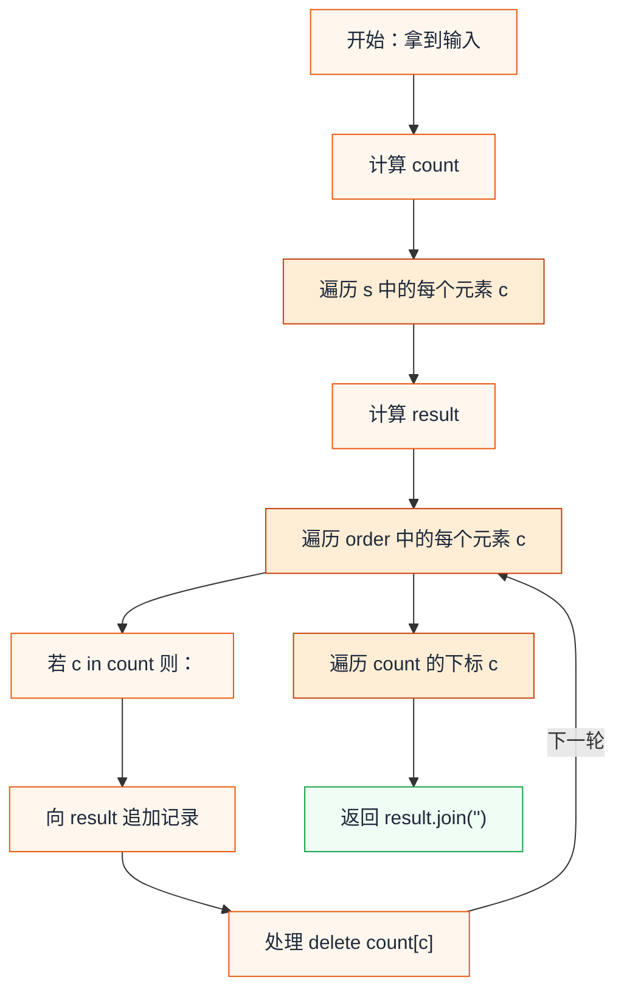

## TypeScript 解题方案（2 个方案逐个讲）

> **运行与提交**：每个方案都是自包含文件（内嵌用例自测，输出 PASS），整块复制到 `.ts` 文件后 `node 文件名` 即可运行。提交 LeetCode 时，把 `demo` 内的算法函数与辅助类型/函数整体取出、置于文件顶层即可。涉及交互/特殊接口的题以题面给定签名为准。

### 方案 1：计数重排

**分析与思路**：核心做法是「计数重排」。代码里依次做这些事：双重循环遍历。

**运行方式**：`node 本文件`，内嵌用例全部通过会输出 PASS。

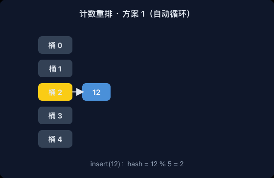

**方案专属流程图**（真实控制流）：

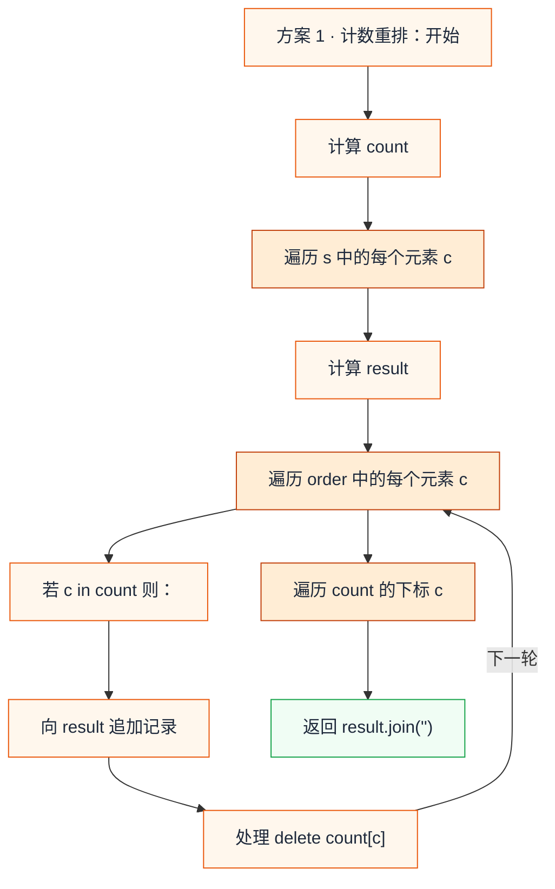

```typescript
/**
 ** LeetCode 791. 自定义字符串排序
 ** 方案：1 ) 方案1：计数重排
 ** 来源：https://blog.csdn.net/tyro_java/article/details/145385760
 */

export function customSortString(order: string, s: string): string {
  // 定义函数/方法 customSortString
  const count: { [c: string]: number } = {}; // 把 {}; 写入 const count: { [c: string]: number }
  for (const c of s) count[c] = (count[c] || 0) + 1; // 把 (计数[字符] 或 0) 加 1; 写入 for (const c of s) count[c]
  const result: string[] = []; // 把 []; 写入 const result: string[]
  for (const c of order) {
    // for (const 字符 of order) {
    if (c in count) {
      // 若 字符 in 计数
      result.push(c.repeat(count[c])); // 把 字符.repeat(计数[字符] 压入栈/数组尾部
      delete count[c]; // delete 计数[字符];
    }
  }
  for (const c in count) result.push(c.repeat(count[c])); // 把 字符.repeat(计数[字符] 压入栈/数组尾部
  return result.join(''); // 返回 结果.join('')
}

export function demo(): void {
  // 程序入口：跑内嵌自测用例
  if (customSortString('cba', 'abcd') !== 'cbad')
    throw new Error('FAILED 1: ' + customSortString('cba', 'abcd'));
  if (customSortString('cbafg', 'abcd') !== 'cbad') throw new Error('FAILED 2');
  console.log('PASS'); // 全部用例通过，输出 PASS
}

demo(); // demo();
```

### 方案 2：计数重排

**分析与思路**：核心做法是「计数重排」。代码里依次做这些事：双重循环遍历。

**运行方式**：`node 本文件`，内嵌用例全部通过会输出 PASS。


**方案专属流程图**（真实控制流）：

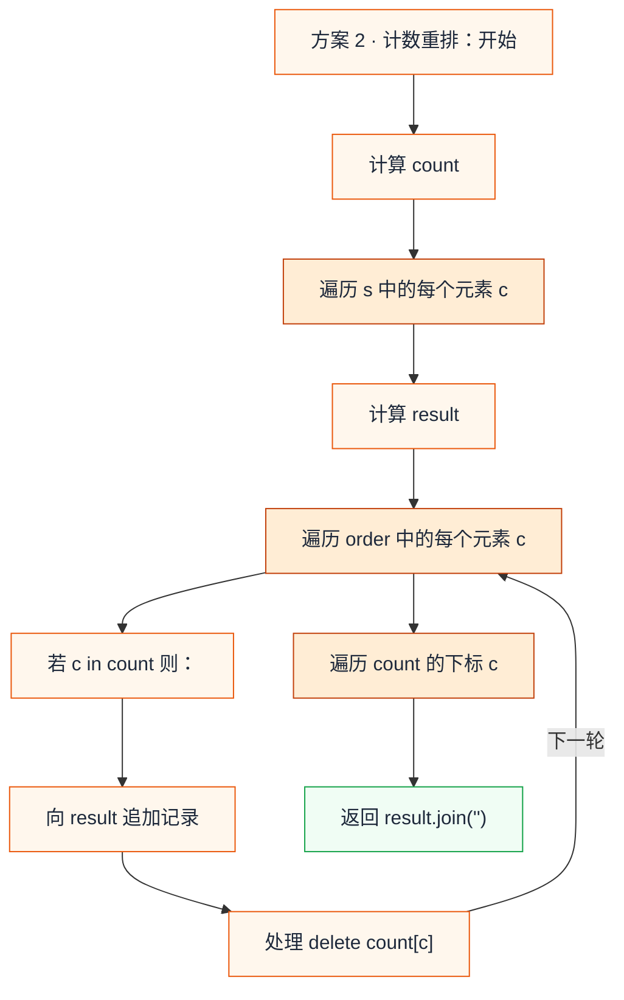

```typescript
/**
 ** LeetCode 791. 自定义字符串排序
 ** 方案：2 ) 方案2：计数重排
 ** 来源：https://blog.csdn.net/tyro_java/article/details/145385760
 */

export function customSortString(order: string, s: string): string {
  // 定义函数/方法 customSortString
  const count: { [c: string]: number } = {}; // 把 {}; 写入 const count: { [c: string]: number }
  for (const c of s) count[c] = (count[c] || 0) + 1; // 把 (计数[字符] 或 0) 加 1; 写入 for (const c of s) count[c]
  const result: string[] = []; // 把 []; 写入 const result: string[]
  for (const c of order) {
    // for (const 字符 of order) {
    if (c in count) {
      // 若 字符 in 计数
      result.push(c.repeat(count[c])); // 把 字符.repeat(计数[字符] 压入栈/数组尾部
      delete count[c]; // delete 计数[字符];
    }
  }
  for (const c in count) result.push(c.repeat(count[c])); // 把 字符.repeat(计数[字符] 压入栈/数组尾部
  return result.join(''); // 返回 结果.join('')
}

export function demo(): void {
  // 程序入口：跑内嵌自测用例
  if (customSortString('cba', 'abcd') !== 'cbad')
    throw new Error('FAILED 1: ' + customSortString('cba', 'abcd'));
  if (customSortString('cbafg', 'abcd') !== 'cbad') throw new Error('FAILED 2');
  console.log('PASS'); // 全部用例通过，输出 PASS
}

demo(); // demo();
```

## 逐步拆解与面试追问

**复杂度**：时间 O(n²)（两层嵌套扫描），空间 O(1) 到 O(n)

**为什么是这个量级**：外层定起点、内层扫终点，n 个起点各扫 n 次

**面试官可能会追问**：

- 字符集有多大，能否用定长数组计数？
- 要不要考虑 Unicode 多字节字符？
- 空串与单字符的边界？

## 关键 API 速查（TS 主解法实际用到，附官方链接）

| API | 作用 | 使用要点 | 官方文档 |
|---|---|---|---|
| `Array.prototype.push()` | 尾部追加 | 返回新长度；可一次多个；均摊 O(1)；会改变原数组 | [官方文档](https://developer.mozilla.org/zh-CN/docs/Web/JavaScript/Reference/Global_Objects/Array/push) |
| `Array.prototype.join()` | 数组拼接为字符串 | undefined/null 转空串；嵌套数组会展平一层；join('') 用于字符数组还原 | [官方文档](https://developer.mozilla.org/zh-CN/docs/Web/JavaScript/Reference/Global_Objects/Array/join) |
| `String.prototype.repeat()` | 重复 N 次 | 参数为次数（非分隔）；负数抛 RangeError | [官方文档](https://developer.mozilla.org/zh-CN/docs/Web/JavaScript/Reference/Global_Objects/String/repeat) |

### 各语言官方文档导航

- **TypeScript / JS**：[MDN 中文参考](https://developer.mozilla.org/zh-CN/)
- **Python**：[Python 官方文档](https://docs.python.org/zh-cn/3/)
- **Go**：[Go 标准库](https://pkg.go.dev/std)
- **Java**：[JDK 17 API](https://docs.oracle.com/en/java/javase/17/docs/api/)
- **Rust**：[Rust 标准库](https://doc.rust-lang.org/std/)
- **Lua**：[Lua 5.4 手册](https://www.lua.org/manual/5.4/)
- **C**：[Cppreference C](https://zh.cppreference.com/w/c)
- **C++**：[Cppreference C++](https://zh.cppreference.com/w/cpp)
- **R**：[R 官方手册](https://stat.ethz.ch/R-manual/)
- **Zig**：[Zig 语言文档](https://ziglang.org/documentation/master/)
- **Dart**：[Dart API](https://api.dart.dev/)

## 附录：其他 10 种语言全部实现（每种语言列举其全部方案）

> TypeScript 的全部方案见「TypeScript 解题方案」一节；下面是其余 10 种语言的对应实现，每种语言的每个方案都带思路分析、代码走读与专属运行架构图。
> 每个方案都内嵌用例自测，可独立运行（老仓库 python/go 文件遵循「打印结果」约定）。
> 完整解法文件见 `dsa/<语言>/string/lc_791_自定义字符串排序/`。

### Python 实现（2 种方案）

Python 的全部方案如下，每个方案都内嵌用例自测，可独立运行（老仓库 python/go 文件遵循「打印结果」约定）：

#### 方案 1：计数重排

**思路与代码分析**：核心是「计数重排」。Python 版用切片与字典推导式简化操作，突出可读性。**走读**：方案 1 · 计数重排：开始 → 更新 count → 遍历 s: 中的每个元素 c → 更新 count[c] → 更新 result → 遍历 order: 中的每个元素 c → 若 c in count：向 result 追加记录 → 向 result 追加记录 → 处理 del count[c] → 遍历 count: 中的每个元素 c → 向 result 追加记录 → 返回 .join(result)。

**运行架构**（真实控制流）：


```python
import sys  # 提高递归深度上限（深输入防 RecursionError）

sys.setrecursionlimit(200000)  # 树/链表类题目节点数可达 1e4 量级

def customSortString(order, s):  # 定义函数 customSortString（参数：order, 字符串）
    count = {}  # 把 {} 存入 计数
    for c in s:  # 逐个取出 字符串 的元素（字符）
        count[c] = count.get(c, 0) + 1  # 把 计数 查找 字符, 0) 加 1 写入 count[c]
    result = []  # 把 [] 存入 结果
    for c in order:  # 逐个取出 order 的元素（字符）
        if c in count:  # 若 字符 in 计数
            result.append(c * count[c])  # 把 字符 乘 计数[字符] 追加到列表尾部
            del count[c]  # del 计数[字符]
    for c in count:  # 逐个取出 计数 的元素（字符）
        result.append(c * count[c])  # 把 字符 乘 计数[字符] 追加到列表尾部
    return "".join(result)  # 返回 ''.join(结果)

if __name__ == "__main__":  # 若 __name__ 等于 '__main__'
    print(customSortString("cba", "abcd"))  # 打印输出
    print(customSortString("cbafg", "abcd"))  # 打印输出
```

#### 方案 2：计数重排

**思路与代码分析**：核心是「计数重排」。Python 版用切片与字典推导式简化操作，突出可读性。**走读**：方案 2 · 计数重排：开始 → 更新 count → 遍历 s: 中的每个元素 c → 更新 count[c] → 更新 result → 遍历 order: 中的每个元素 c → 若 c in count：向 result 追加记录 → 向 result 追加记录 → 处理 del count[c] → 遍历 count: 中的每个元素 c → 向 result 追加记录 → 返回 .join(result)。

**运行架构**（真实控制流）：

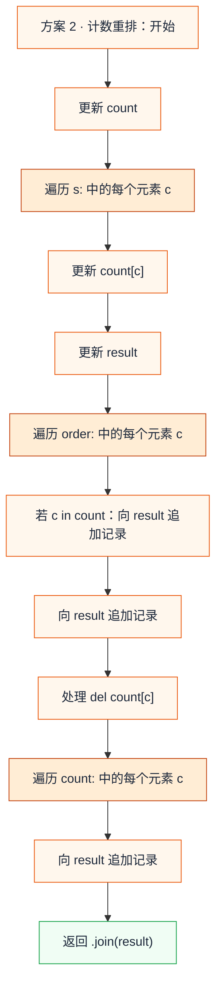

```python
import sys  # 提高递归深度上限（深输入防 RecursionError）

sys.setrecursionlimit(200000)  # 树/链表类题目节点数可达 1e4 量级

def customSortString(order, s):  # 定义函数 customSortString（参数：order, 字符串）
    count = {}  # 把 {} 存入 计数
    for c in s:  # 逐个取出 字符串 的元素（字符）
        count[c] = count.get(c, 0) + 1  # 把 计数 查找 字符, 0) 加 1 写入 count[c]
    result = []  # 把 [] 存入 结果
    for c in order:  # 逐个取出 order 的元素（字符）
        if c in count:  # 若 字符 in 计数
            result.append(c * count[c])  # 把 字符 乘 计数[字符] 追加到列表尾部
            del count[c]  # del 计数[字符]
    for c in count:  # 逐个取出 计数 的元素（字符）
        result.append(c * count[c])  # 把 字符 乘 计数[字符] 追加到列表尾部
    return "".join(result)  # 返回 ''.join(结果)

if __name__ == "__main__":  # 若 __name__ 等于 '__main__'
    print(customSortString("cba", "abcd"))  # 打印输出
    print(customSortString("cbafg", "abcd"))  # 打印输出
```

### Go 实现（2 种方案）

Go 的全部方案如下，每个方案都内嵌用例自测，可独立运行（老仓库 python/go 文件遵循「打印结果」约定）：

#### 方案 1：计数重排

**思路与代码分析**：核心是「计数重排」。Go 版用切片与多返回值惯用法，显式处理索引边界。代码里依次做这些事：哈希结构做计数或查重。**走读**：方案 1 · 计数重排：开始 → 更新 : → 遍历 s 的下标与元素 c → 处理 count[c]++ → 计算 result → 遍历 order 的下标与元素 c → 处理 if n, ok := count[c]; ok → 遍历循环 → 更新 result → 调用 delete(count, c) → 遍历 count 的下标与元素 n → 遍历循环 → 更新 result → 返回 string(result)。

**运行架构**（真实控制流）：


```go
package main // 引入依赖

import (
	"fmt"     // 「fmt」
	"os"      // 「os」
	"reflect" // 「reflect」
)

func customSortString(order, s string) string { // 定义函数/方法 customSortString
	count := map[rune]int{} // 把 映射表[rune]int{} 写入 count :
	for _, c := range s {   // 同时取 _ 与 字符 遍历
		count[c]++ // 计数[字符] 加一
	}
	var result []rune         // var 结果 []rune
	for _, c := range order { // 同时取 _ 与 字符 遍历
		if n, ok := count[c]; ok { // 若 元素个数, ok : 赋值为 计数[字符]; ok
			for i := 0; i < n; i++ { // 让 下标 i 从 0 开始计数
				result = append(result, c) // 把 append(结果, 字符) 写入 结果
			}
			delete(count, c) // delete(计数, 字符)
		}
	}
	for c, n := range count { // 同时取 字符 与 元素个数 遍历
		for i := 0; i < n; i++ { // 让 下标 i 从 0 开始计数
			result = append(result, c) // 把 append(结果, 字符) 写入 结果
		}
	}
	return string(result) // 定义函数/方法 string
}

func main() { // 程序入口：跑内嵌自测用例
	type tc struct { // 定义类型
		order, s, want string // order, 字符串, want string
	}
	cases := []tc{ // 把 []tc{ 写入 cases :
		{"cba", "abcd", "cbad"},
		{"cbafg", "abcd", "cbad"},
		{"kqep", "pekeq", "kqeep"},
	}
	ok := true                // 把 true 写入 ok :
	for _, c := range cases { // 同时取 _ 与 字符 遍历
		if got := customSortString(c.order, c.s); !reflect.DeepEqual(got, c.want) {
			ok = false                                                                         // 把 false 写入 ok
			fmt.Printf("FAIL customSortString(%q,%q)=%q want %q\n", c.order, c.s, got, c.want) // 打印输出
		}
	}
	if !ok { // 若 取反 ok
		os.Exit(1) // os.Exit(1)
	}
	fmt.Println("PASS") // 全部用例通过，输出 PASS
}
```

#### 方案 2：计数重排

**思路与代码分析**：核心是「计数重排」。Go 版用切片与多返回值惯用法，显式处理索引边界。代码里依次做这些事：哈希结构做计数或查重。**走读**：方案 2 · 计数重排：开始 → 更新 : → 遍历 s 的下标与元素 c → 处理 count[c]++ → 计算 result → 遍历 order 的下标与元素 c → 处理 if n, ok := count[c]; ok → 遍历循环 → 更新 result → 调用 delete(count, c) → 遍历 count 的下标与元素 n → 遍历循环 → 更新 result → 返回 string(result)。

**运行架构**（真实控制流）：

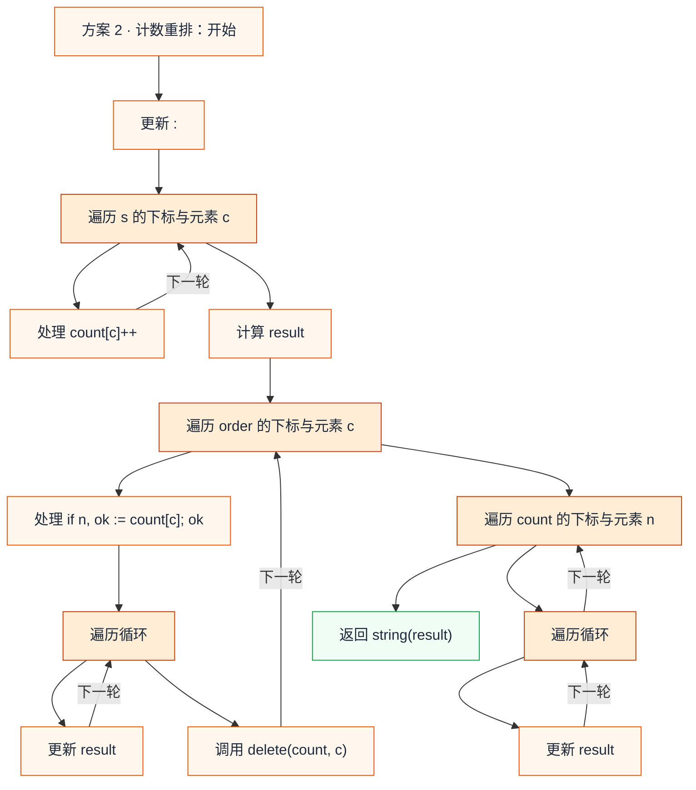

```go
package main // 引入依赖

import (
	"fmt"     // 「fmt」
	"os"      // 「os」
	"reflect" // 「reflect」
)

func customSortString(order, s string) string { // 定义函数/方法 customSortString
	count := map[rune]int{} // 把 映射表[rune]int{} 写入 count :
	for _, c := range s {   // 同时取 _ 与 字符 遍历
		count[c]++ // 计数[字符] 加一
	}
	var result []rune         // var 结果 []rune
	for _, c := range order { // 同时取 _ 与 字符 遍历
		if n, ok := count[c]; ok { // 若 元素个数, ok : 赋值为 计数[字符]; ok
			for i := 0; i < n; i++ { // 让 下标 i 从 0 开始计数
				result = append(result, c) // 把 append(结果, 字符) 写入 结果
			}
			delete(count, c) // delete(计数, 字符)
		}
	}
	for c, n := range count { // 同时取 字符 与 元素个数 遍历
		for i := 0; i < n; i++ { // 让 下标 i 从 0 开始计数
			result = append(result, c) // 把 append(结果, 字符) 写入 结果
		}
	}
	return string(result) // 定义函数/方法 string
}

func main() { // 程序入口：跑内嵌自测用例
	type tc struct { // 定义类型
		order, s, want string // order, 字符串, want string
	}
	cases := []tc{ // 把 []tc{ 写入 cases :
		{"cba", "abcd", "cbad"},
		{"cbafg", "abcd", "cbad"},
		{"kqep", "pekeq", "kqeep"},
	}
	ok := true                // 把 true 写入 ok :
	for _, c := range cases { // 同时取 _ 与 字符 遍历
		if got := customSortString(c.order, c.s); !reflect.DeepEqual(got, c.want) {
			ok = false                                                                         // 把 false 写入 ok
			fmt.Printf("FAIL customSortString(%q,%q)=%q want %q\n", c.order, c.s, got, c.want) // 打印输出
		}
	}
	if !ok { // 若 取反 ok
		os.Exit(1) // os.Exit(1)
	}
	fmt.Println("PASS") // 全部用例通过，输出 PASS
}
```

### Java 实现（2 种方案）

Java 的全部方案如下，每个方案都内嵌用例自测，可独立运行（老仓库 python/go 文件遵循「打印结果」约定）：

#### 方案 1：计数重排

**思路与代码分析**：核心是「计数重排」。Java 版用类与静态方法组织，集合操作显式明了。代码里依次做这些事：哈希结构做计数或查重；双重循环遍历。**走读**：方案 1 · 计数重排：开始 → 更新 count → 处理 new HashMap＜＞() → 遍历循环 → 更新 result → 遍历循环 → 若 count.containsKey(c) 则： → 遍历循环 → 向 result 追加记录 → 调用 count.remove(c) → 遍历循环 → 调用 count.entrySet()) → 遍历循环 → 向 result 追加记录 → 返回 result.toString()。

**运行架构**（真实控制流）：

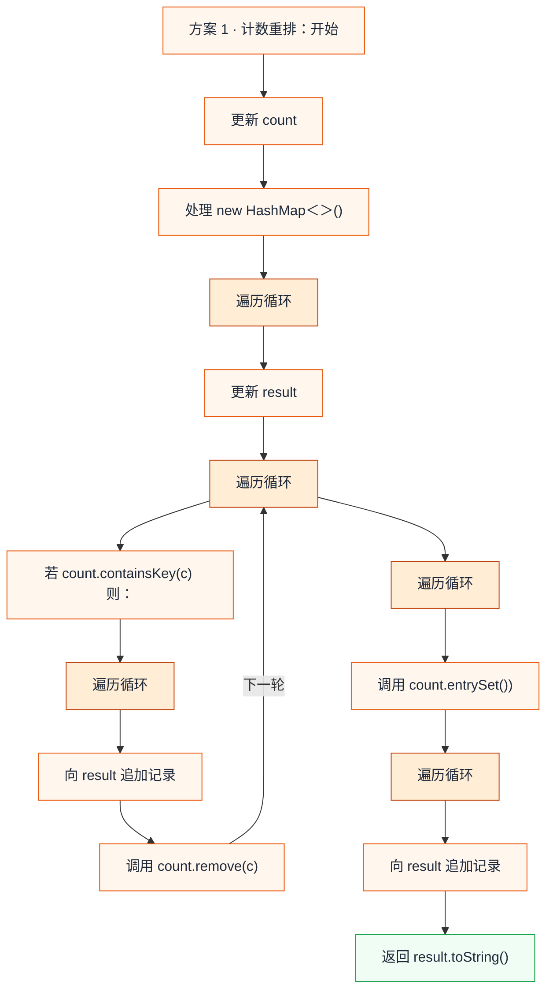

```java
package com.webfault.dsa; // 引入依赖

import java.util.*; // 引入依赖

class Solution { // 定义类型
  public String customSortString(String order, String s) { // 定义函数/方法 customSortString
    Map<Character, Integer> count =
        new HashMap<>(); // 把 new HashMap 小于 超过 (); 写入 Map<Character, Integer> count
    for (char c : s.toCharArray()) count.put(c, count.getOrDefault(c, 0) + 1);
    StringBuilder result = new StringBuilder(); // 把 new StringBuilder(); 写入 StringBuilder result
    for (char c : order.toCharArray()) { // for (char 字符 : order.toCharArray()) {
      if (count.containsKey(c)) { // 若 计数.containsKey(字符
        for (int t = 0; t < count.get(c); t++)
          result.append(c); // 让 另一字符串 从 0 开始计数，另一字符串 小于 计数 查找 字符) 就继续
        count.remove(c); // 计数 弹出 字符);
      }
    }
    for (Map.Entry<Character, Integer> e :
        count.entrySet()) { // for (Map.Entry 小于 Character, Integer 超过 e : 计数.entrySet()) {
      for (int t = 0; t < e.getValue(); t++)
        result.append(e.getKey()); // 让 另一字符串 从 0 开始计数，另一字符串 小于 e.getValue() 就继续
    }
    return result.toString(); // 返回 结果.toString()
  }

  public static void main(String[] args) { // public static void main(String[] args) {
    Solution s = new Solution(); // 把 new Solution(); 写入 Solution s
    String[][] ins = {
      {"cba", "abcd"}, {"cbafg", "abcd"}
    }; // 把 {{「cba」,「cba」},{「cba」,「cba」}}; 写入 String[][] ins
    String[] wants = {"cbad", "cbad"}; // 把 {「cbad」,「cbad」}; 写入 String[] wants
    boolean ok = true; // 把 true; 写入 boolean ok
    for (int i = 0; i < ins.length; i++) { // 让 下标 i 从 0 开始计数，下标 i 小于 ins.长度 就继续
      String got =
          s.customSortString(
              ins[i][0], ins[i][1]); // 把 字符串.customSortString(ins[下标 i][0], ins[下标 i][1]) 存入 got
      if (!got.equals(wants[i])) {
        ok = false;
        System.out.println("FAIL " + ins[i][0] + "," + ins[i][1] + "=" + got + " want " + wants[i]);
      }
    }
    if (!ok) throw new RuntimeException("FAILED"); // 若 取反 ok) throw new RuntimeException(「FAILED」);
    System.out.println("PASS"); // 全部用例通过，输出 PASS
  }
}
```

#### 方案 2：计数重排

**思路与代码分析**：核心是「计数重排」。Java 版用类与静态方法组织，集合操作显式明了。代码里依次做这些事：哈希结构做计数或查重；双重循环遍历。**走读**：方案 2 · 计数重排：开始 → 更新 count → 处理 new HashMap＜＞() → 遍历循环 → 更新 result → 遍历循环 → 若 count.containsKey(c) 则： → 遍历循环 → 向 result 追加记录 → 调用 count.remove(c) → 遍历循环 → 调用 count.entrySet()) → 遍历循环 → 向 result 追加记录 → 返回 result.toString()。

**运行架构**（真实控制流）：


```java
package com.webfault.dsa; // 引入依赖

import java.util.*; // 引入依赖

class Solution { // 定义类型
  public String customSortString(String order, String s) { // 定义函数/方法 customSortString
    Map<Character, Integer> count =
        new HashMap<>(); // 把 new HashMap 小于 超过 (); 写入 Map<Character, Integer> count
    for (char c : s.toCharArray()) count.put(c, count.getOrDefault(c, 0) + 1);
    StringBuilder result = new StringBuilder(); // 把 new StringBuilder(); 写入 StringBuilder result
    for (char c : order.toCharArray()) { // for (char 字符 : order.toCharArray()) {
      if (count.containsKey(c)) { // 若 计数.containsKey(字符
        for (int t = 0; t < count.get(c); t++)
          result.append(c); // 让 另一字符串 从 0 开始计数，另一字符串 小于 计数 查找 字符) 就继续
        count.remove(c); // 计数 弹出 字符);
      }
    }
    for (Map.Entry<Character, Integer> e :
        count.entrySet()) { // for (Map.Entry 小于 Character, Integer 超过 e : 计数.entrySet()) {
      for (int t = 0; t < e.getValue(); t++)
        result.append(e.getKey()); // 让 另一字符串 从 0 开始计数，另一字符串 小于 e.getValue() 就继续
    }
    return result.toString(); // 返回 结果.toString()
  }

  public static void main(String[] args) { // public static void main(String[] args) {
    Solution s = new Solution(); // 把 new Solution(); 写入 Solution s
    String[][] ins = {
      {"cba", "abcd"}, {"cbafg", "abcd"}
    }; // 把 {{「cba」,「cba」},{「cba」,「cba」}}; 写入 String[][] ins
    String[] wants = {"cbad", "cbad"}; // 把 {「cbad」,「cbad」}; 写入 String[] wants
    boolean ok = true; // 把 true; 写入 boolean ok
    for (int i = 0; i < ins.length; i++) { // 让 下标 i 从 0 开始计数，下标 i 小于 ins.长度 就继续
      String got =
          s.customSortString(
              ins[i][0], ins[i][1]); // 把 字符串.customSortString(ins[下标 i][0], ins[下标 i][1]) 存入 got
      if (!got.equals(wants[i])) {
        ok = false;
        System.out.println("FAIL " + ins[i][0] + "," + ins[i][1] + "=" + got + " want " + wants[i]);
      }
    }
    if (!ok) throw new RuntimeException("FAILED"); // 若 取反 ok) throw new RuntimeException(「FAILED」);
    System.out.println("PASS"); // 全部用例通过，输出 PASS
  }
}
```

### Rust 实现（2 种方案）

Rust 的全部方案如下，每个方案都内嵌用例自测，可独立运行（老仓库 python/go 文件遵循「打印结果」约定）：

#### 方案 1：计数重排

**思路与代码分析**：核心是「计数重排」。Rust 版用所有权移动与切片借用改写同一逻辑，注意 Option 与引用边界。代码里依次做这些事：单循环线性扫描。**走读**：方案 1 · 计数重排：开始 → 计算 count → 遍历 s.bytes() 中的每个元素 b → 更新 + → 计算 out → 遍历 order.bytes() 中的每个元素 b → 计算 idx → 遍历 0..count[idx] 中的每个元素 _ → 向 out 追加记录 → 更新 count[idx] → 遍历循环 → 遍历 0..c 中的每个元素 _ → 向 out 追加记录 → 处理 out → 返回结果。

**运行架构**（真实控制流）：

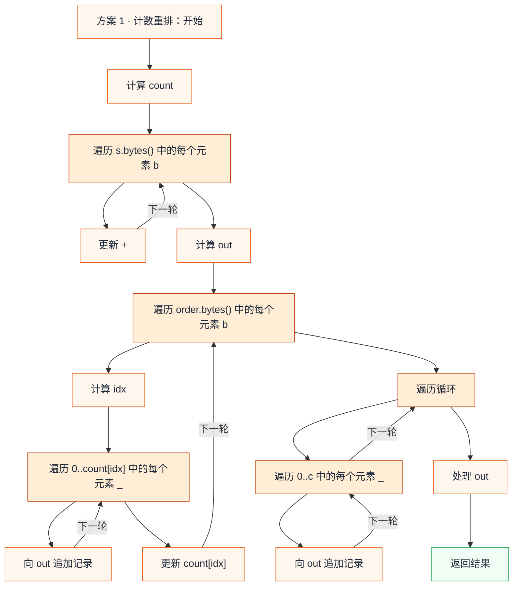

```rust
// LeetCode 791. 自定义字符串排序 — Rust 版（方案1）
fn custom_sort_string(order: String, s: String) -> String {
    // 定义函数/方法 custom_sort_string
    let mut count = [0usize; 26]; // 把 [0usize; 26]; 写入 let mut count
    for b in s.bytes() {
        count[(b - b'a') as usize] += 1;
    } // 逐个取出 字符串 的元素（b）
    let mut out = String::new(); // 把 String::new(); 写入 let mut out
    for b in order.bytes() {
        // 逐个取出 order 的元素（b）
        let idx = (b - b'a') as usize; // 把 (b 减 b'数组') as usize 存入 idx
        for _ in 0..count[idx] {
            out.push(b as char);
        } // 逐个取出 0 的元素（_）
        count[idx] = 0; // 把 0; 写入 count[idx]
    }
    for (i, &c) in count.iter().enumerate() {
        // for (下标 i, 按位与 字符) in 计数.iter().enumerate() {
        for _ in 0..c {
            out.push((b'a' + i as u8) as char);
        } // 逐个取出 0 的元素（_）
    }
    out // out
}
fn main() {
    // 程序入口：跑内嵌自测用例
    assert_eq!(custom_sort_string("cba".into(), "abcd".into()), "cbad"); // 断言校验
    assert_eq!(custom_sort_string("bcafg".into(), "abcd".into()), "bcad"); // 断言校验
    println!("PASS"); // 全部用例通过，输出 PASS
}
```

#### 方案 2：计数重排

**思路与代码分析**：核心是「计数重排」。Rust 版用所有权移动与切片借用改写同一逻辑，注意 Option 与引用边界。代码里依次做这些事：单循环线性扫描。**走读**：方案 2 · 计数重排：开始 → 计算 count → 遍历 s.bytes() 中的每个元素 b → 更新 + → 计算 out → 遍历 order.bytes() 中的每个元素 b → 计算 idx → 遍历 0..count[idx] 中的每个元素 _ → 向 out 追加记录 → 更新 count[idx] → 遍历循环 → 遍历 0..c 中的每个元素 _ → 向 out 追加记录 → 处理 out → 返回结果。

**运行架构**（真实控制流）：


```rust
// LeetCode 791. 自定义字符串排序 — Rust 版（方案2）
fn custom_sort_string(order: String, s: String) -> String {
    // 定义函数/方法 custom_sort_string
    let mut count = [0usize; 26]; // 把 [0usize; 26]; 写入 let mut count
    for b in s.bytes() {
        count[(b - b'a') as usize] += 1;
    } // 逐个取出 字符串 的元素（b）
    let mut out = String::new(); // 把 String::new(); 写入 let mut out
    for b in order.bytes() {
        // 逐个取出 order 的元素（b）
        let idx = (b - b'a') as usize; // 把 (b 减 b'数组') as usize 存入 idx
        for _ in 0..count[idx] {
            out.push(b as char);
        } // 逐个取出 0 的元素（_）
        count[idx] = 0; // 把 0; 写入 count[idx]
    }
    for (i, &c) in count.iter().enumerate() {
        // for (下标 i, 按位与 字符) in 计数.iter().enumerate() {
        for _ in 0..c {
            out.push((b'a' + i as u8) as char);
        } // 逐个取出 0 的元素（_）
    }
    out // out
}
fn main() {
    // 程序入口：跑内嵌自测用例
    assert_eq!(custom_sort_string("cba".into(), "abcd".into()), "cbad"); // 断言校验
    assert_eq!(custom_sort_string("bcafg".into(), "abcd".into()), "bcad"); // 断言校验
    println!("PASS"); // 全部用例通过，输出 PASS
}
```

### Lua 实现（2 种方案）

Lua 的全部方案如下，每个方案都内嵌用例自测，可独立运行（老仓库 python/go 文件遵循「打印结果」约定）：

#### 方案 1：计数重排

**思路与代码分析**：核心是「计数重排」。Lua 版用表与 ipairs 遍历，注意 ipairs 遇 nil 即停的语义。代码里依次做这些事：先排序再处理。**走读**：方案 1 · 计数重排：开始 → 更新 count → 遍历 s:gmatch('[%a]') do 中的每个元素 c → 遍历 order:gmatch('[%a]') do 中的每个元素 c → 循环 _：从 1 到 count[c] do → 遍历 pairs(count) do 中的每个元素 n → 循环 _：从 1 到 n do → 遍历 ipairs(rest) do 中的每个元素 c → 返回 table.concat(out)。

**运行架构**（真实控制流）：

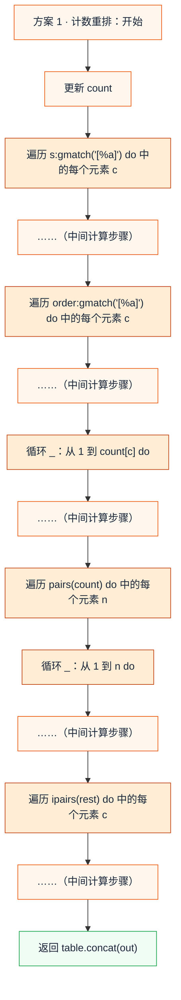

```lua
-- LeetCode 791. 自定义字符串排序 — Lua 版（方案1）
local function custom_sort_string(order, s) -- local function custom_sort_string(order, 字符串)
	local count = {} -- 把 {} 写入 local count
	for c in s:gmatch("[%a]") do -- for 字符 in 字符串:gmatch(「[ 对…取模 数组]」) do
		count[c] = (count[c] or 0) + 1 -- 把 (计数[字符] or 0) 加 1 写入 count[c]
	end -- 终点
	local out = {} -- 把 {} 写入 local out
	for c in order:gmatch("[%a]") do -- for 字符 in order:gmatch(「[ 对…取模 数组]」) do
		if count[c] then -- 若 计数[字符] then
			for _ = 1, count[c] do
				out[#out + 1] = c
			end -- 让 _ 从 1 走到 计数（Lua 1 基）
			count[c] = nil -- 把 nil 写入 count[c]
		end -- 终点
	end -- 终点
	local rest = {} -- 把 {} 写入 local rest
	for c, n in pairs(count) do -- 遍历取 元素个数
		for _ = 1, n do
			rest[#rest + 1] = c
		end -- 让 _ 从 1 走到 元素个数（Lua 1 基）
	end -- 终点
	table.sort(rest) -- 排序
	for _, c in ipairs(rest) do
		out[#out + 1] = c
	end -- 遍历取 字符
	return table.concat(out) -- 返回 table.concat(out)
end -- 终点
assert(custom_sort_string("cba", "abcd") == "cbad") -- 断言校验
assert(custom_sort_string("bcafg", "abcd") == "bcad") -- 断言校验
print("PASS") -- 全部用例通过，输出 PASS
```

#### 方案 2：计数重排

**思路与代码分析**：核心是「计数重排」。Lua 版用表与 ipairs 遍历，注意 ipairs 遇 nil 即停的语义。代码里依次做这些事：先排序再处理。**走读**：方案 2 · 计数重排：开始 → 更新 count → 遍历 s:gmatch('[%a]') do 中的每个元素 c → 遍历 order:gmatch('[%a]') do 中的每个元素 c → 循环 _：从 1 到 count[c] do → 遍历 pairs(count) do 中的每个元素 n → 循环 _：从 1 到 n do → 遍历 ipairs(rest) do 中的每个元素 c → 返回 table.concat(out)。

**运行架构**（真实控制流）：


```lua
-- LeetCode 791. 自定义字符串排序 — Lua 版（方案2）
local function custom_sort_string(order, s) -- local function custom_sort_string(order, 字符串)
	local count = {} -- 把 {} 写入 local count
	for c in s:gmatch("[%a]") do -- for 字符 in 字符串:gmatch(「[ 对…取模 数组]」) do
		count[c] = (count[c] or 0) + 1 -- 把 (计数[字符] or 0) 加 1 写入 count[c]
	end -- 终点
	local out = {} -- 把 {} 写入 local out
	for c in order:gmatch("[%a]") do -- for 字符 in order:gmatch(「[ 对…取模 数组]」) do
		if count[c] then -- 若 计数[字符] then
			for _ = 1, count[c] do
				out[#out + 1] = c
			end -- 让 _ 从 1 走到 计数（Lua 1 基）
			count[c] = nil -- 把 nil 写入 count[c]
		end -- 终点
	end -- 终点
	local rest = {} -- 把 {} 写入 local rest
	for c, n in pairs(count) do -- 遍历取 元素个数
		for _ = 1, n do
			rest[#rest + 1] = c
		end -- 让 _ 从 1 走到 元素个数（Lua 1 基）
	end -- 终点
	table.sort(rest) -- 排序
	for _, c in ipairs(rest) do
		out[#out + 1] = c
	end -- 遍历取 字符
	return table.concat(out) -- 返回 table.concat(out)
end -- 终点
assert(custom_sort_string("cba", "abcd") == "cbad") -- 断言校验
assert(custom_sort_string("bcafg", "abcd") == "bcad") -- 断言校验
print("PASS") -- 全部用例通过，输出 PASS
```

### C 实现（2 种方案）

C 的全部方案如下，每个方案都内嵌用例自测，可独立运行（老仓库 python/go 文件遵循「打印结果」约定）：

#### 方案 1：计数重排

**思路与代码分析**：核心是「计数重排」。C 版手动管理下标与内存，循环边界全部显式写出。代码里依次做这些事：双重循环遍历。**走读**：方案 1 · 计数重排：开始 → 更新 count[26] → 遍历循环 → 处理 count[*p - 'a']++ → 更新 pos → 遍历循环 → 更新 idx → 遍历循环 → 更新 out[pos++] → 更新 count[idx] → 遍历循环 → 遍历循环 → 更新 out[pos++] → 更新 out[pos] → 返回结果。

**运行架构**（真实控制流）：

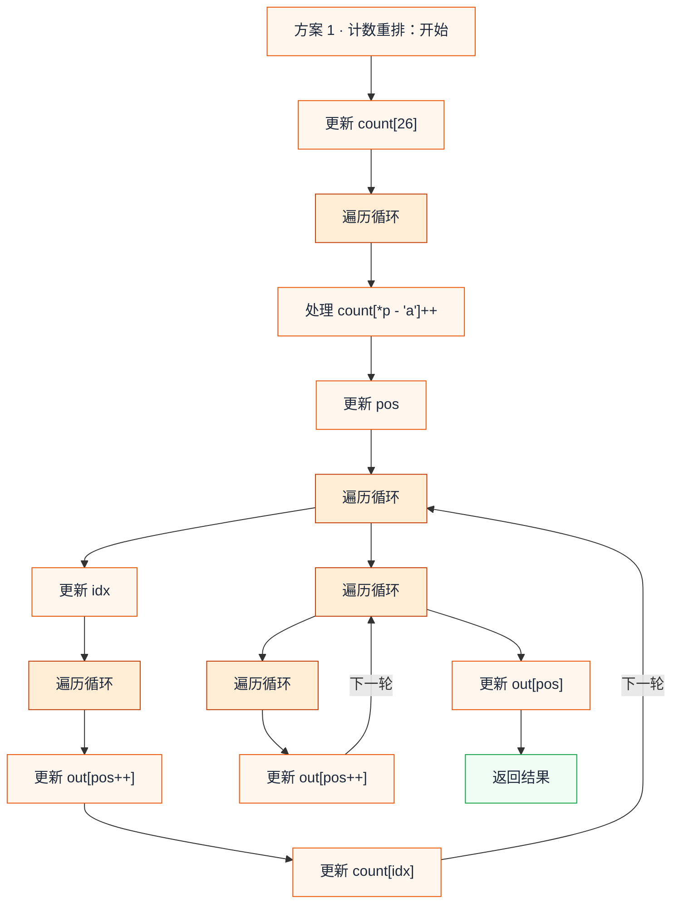

```c
/* LeetCode 791. 自定义字符串排序 — C 版（方案1） */
#include <stdio.h>  // 引入头文件
#include <string.h> // 引入头文件
static void custom_sort_string(const char *order, const char *s,
                               char out[]) { // 定义函数/方法 custom_sort_string
    int count[26] = {0};                     // 把 {0}; 写入 int count[26]
    for (const char *p = s; *p; p++)
        count[*p - 'a']++;
    int pos = 0;                           // 把 0 存入 pos
    for (const char *p = order; *p; p++) { // 把 order; 乘 节点; 节点 加一 ) { 写入 for (const char *p
        int idx = *p - 'a';                // 把 乘 节点 减 '数组' 存入 idx
        for (int i = 0; i < count[idx]; i++)
            out[pos++] = *p; // 让 下标 i 从 0 开始计数，下标 i 小于 计数[idx] 就继续
        count[idx] = 0;      // 把 0; 写入 count[idx]
    }
    for (int i = 0; i < 26; i++) { // 让 下标 i 从 0 开始计数，下标 i 小于 26 就继续
        for (int j = 0; j < count[i]; j++)
            out[pos++] = 'a' + i; // 让 下标 j 从 0 开始计数，下标 j 小于 计数[下标 i] 就继续
    }
    out[pos] = '\0'; // 把 '\0'; 写入 out[pos]
}
int main(void) {                            // 程序入口：跑内嵌自测用例
    char out[8192];                         // char out[8192];
    custom_sort_string("cba", "abcd", out); // custom_sort_string(「cba」, 「cba」, out);
    if (strcmp(out, "cbad") != 0) {
        printf("FAIL 1 %s\n", out);
        return 1;
    } // 若 strcmp(out, 「cbad」) 不等于 0) { 输出「cbad」, out); return 1; }
    custom_sort_string("bcafg", "abcd", out); // custom_sort_string(「bcafg」, 「bcafg」, out);
    if (strcmp(out, "bcad") != 0) {
        printf("FAIL 2 %s\n", out);
        return 1;
    }                 // 若 strcmp(out, 「bcad」) 不等于 0) { 输出「bcad」, out); return 1; }
    printf("PASS\n"); // 全部用例通过，输出 PASS
    return 0;         // 返回 0
}
```

#### 方案 2：计数重排

**思路与代码分析**：核心是「计数重排」。C 版手动管理下标与内存，循环边界全部显式写出。代码里依次做这些事：双重循环遍历。**走读**：方案 2 · 计数重排：开始 → 更新 count[26] → 遍历循环 → 处理 count[*p - 'a']++ → 更新 pos → 遍历循环 → 更新 idx → 遍历循环 → 更新 out[pos++] → 更新 count[idx] → 遍历循环 → 遍历循环 → 更新 out[pos++] → 更新 out[pos] → 返回结果。

**运行架构**（真实控制流）：


```c
/* LeetCode 791. 自定义字符串排序 — C 版（方案2） */
#include <stdio.h>  // 引入头文件
#include <string.h> // 引入头文件
static void custom_sort_string(const char *order, const char *s,
                               char out[]) { // 定义函数/方法 custom_sort_string
    int count[26] = {0};                     // 把 {0}; 写入 int count[26]
    for (const char *p = s; *p; p++)
        count[*p - 'a']++;
    int pos = 0;                           // 把 0 存入 pos
    for (const char *p = order; *p; p++) { // 把 order; 乘 节点; 节点 加一 ) { 写入 for (const char *p
        int idx = *p - 'a';                // 把 乘 节点 减 '数组' 存入 idx
        for (int i = 0; i < count[idx]; i++)
            out[pos++] = *p; // 让 下标 i 从 0 开始计数，下标 i 小于 计数[idx] 就继续
        count[idx] = 0;      // 把 0; 写入 count[idx]
    }
    for (int i = 0; i < 26; i++) { // 让 下标 i 从 0 开始计数，下标 i 小于 26 就继续
        for (int j = 0; j < count[i]; j++)
            out[pos++] = 'a' + i; // 让 下标 j 从 0 开始计数，下标 j 小于 计数[下标 i] 就继续
    }
    out[pos] = '\0'; // 把 '\0'; 写入 out[pos]
}
int main(void) {                            // 程序入口：跑内嵌自测用例
    char out[8192];                         // char out[8192];
    custom_sort_string("cba", "abcd", out); // custom_sort_string(「cba」, 「cba」, out);
    if (strcmp(out, "cbad") != 0) {
        printf("FAIL 1 %s\n", out);
        return 1;
    } // 若 strcmp(out, 「cbad」) 不等于 0) { 输出「cbad」, out); return 1; }
    custom_sort_string("bcafg", "abcd", out); // custom_sort_string(「bcafg」, 「bcafg」, out);
    if (strcmp(out, "bcad") != 0) {
        printf("FAIL 2 %s\n", out);
        return 1;
    }                 // 若 strcmp(out, 「bcad」) 不等于 0) { 输出「bcad」, out); return 1; }
    printf("PASS\n"); // 全部用例通过，输出 PASS
    return 0;         // 返回 0
}
```

### C++ 实现（2 种方案）

C++ 的全部方案如下，每个方案都内嵌用例自测，可独立运行（老仓库 python/go 文件遵循「打印结果」约定）：

#### 方案 1：计数重排

**思路与代码分析**：核心是「计数重排」。C++ 版用 STL 容器与迭代器，减少手写下标错误。代码里依次做这些事：双重循环遍历。**走读**：方案 1 · 计数重排：开始 → 更新 count[26] → 遍历循环 → 处理 ++count[c - 'a'] → 处理 std::string out → 遍历循环 → 向 out 追加记录 → 处理 c) → 更新 'a'] → 遍历循环 → 向 out 追加记录 → 处理 static_cast＜size_t＞(count[i] → 处理 static_cast＜char＞('a' + i)) → 返回 out。

**运行架构**（真实控制流）：

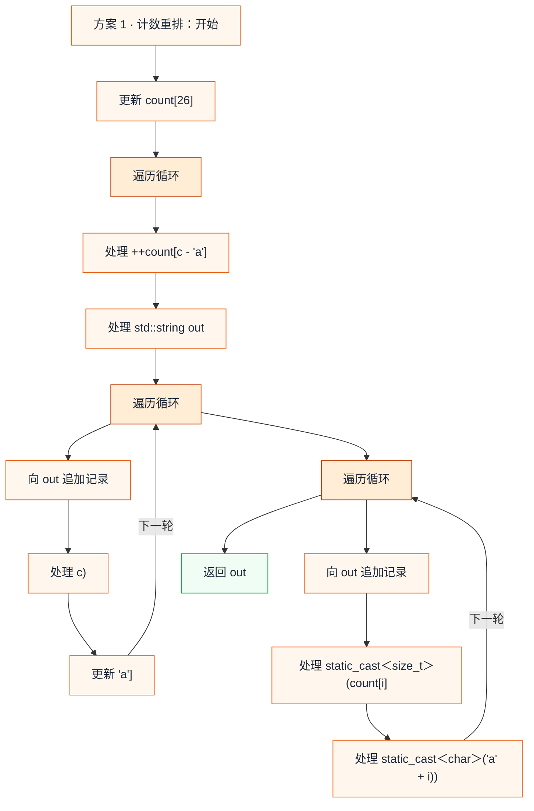

```cpp
// LeetCode 791. 自定义字符串排序 — C++ 版（方案1）
#include <cassert>  // 引入头文件
#include <iostream> // 引入头文件
#include <string>   // 引入头文件
static std::string customSortString(const std::string &order, const std::string &s) {
    int count[26] = {0}; // 把 {0}; 写入 int count[26]
    for (char c : s)
        ++count[c - 'a'];  // for (char 字符 : 字符串) 加一 计数[字符 减 '数组'];
    std::string out;       // std::string out;
    for (char c : order) { // for (char 字符 : order) {
        out.append(static_cast<size_t>(count[c - 'a']),
                   c); // 把 static_cast 小于 size_t 超过 (计数[字符 减 '数组'] 追加到列表尾部
        count[c - 'a'] = 0; // 把 0; 写入 count[c - 'a']
    }
    for (int i = 0; i < 26; ++i) { // 让 下标 i 从 0 开始计数，下标 i 小于 26 就继续
        out.append(
            static_cast<size_t>(count[i]),
            static_cast<char>('a' + i)); // 把 static_cast 小于 size_t 超过 (计数[下标 i] 追加到列表尾部
    }
    return out; // 返回 out
}
int main() {                                             // 程序入口：跑内嵌自测用例
    assert(customSortString("cba", "abcd") == "cbad");   // 断言校验
    assert(customSortString("bcafg", "abcd") == "bcad"); // 断言校验
    std::cout << "PASS" << std::endl;                    // 全部用例通过，输出 PASS
    return 0;                                            // 返回 0
}
```

#### 方案 2：计数重排

**思路与代码分析**：核心是「计数重排」。C++ 版用 STL 容器与迭代器，减少手写下标错误。代码里依次做这些事：双重循环遍历。**走读**：方案 2 · 计数重排：开始 → 更新 count[26] → 遍历循环 → 处理 ++count[c - 'a'] → 处理 std::string out → 遍历循环 → 向 out 追加记录 → 处理 c) → 更新 'a'] → 遍历循环 → 向 out 追加记录 → 处理 static_cast＜size_t＞(count[i] → 处理 static_cast＜char＞('a' + i)) → 返回 out。

**运行架构**（真实控制流）：


```cpp
// LeetCode 791. 自定义字符串排序 — C++ 版（方案2）
#include <cassert>  // 引入头文件
#include <iostream> // 引入头文件
#include <string>   // 引入头文件
static std::string customSortString(const std::string &order, const std::string &s) {
    int count[26] = {0}; // 把 {0}; 写入 int count[26]
    for (char c : s)
        ++count[c - 'a'];  // for (char 字符 : 字符串) 加一 计数[字符 减 '数组'];
    std::string out;       // std::string out;
    for (char c : order) { // for (char 字符 : order) {
        out.append(static_cast<size_t>(count[c - 'a']),
                   c); // 把 static_cast 小于 size_t 超过 (计数[字符 减 '数组'] 追加到列表尾部
        count[c - 'a'] = 0; // 把 0; 写入 count[c - 'a']
    }
    for (int i = 0; i < 26; ++i) { // 让 下标 i 从 0 开始计数，下标 i 小于 26 就继续
        out.append(
            static_cast<size_t>(count[i]),
            static_cast<char>('a' + i)); // 把 static_cast 小于 size_t 超过 (计数[下标 i] 追加到列表尾部
    }
    return out; // 返回 out
}
int main() {                                             // 程序入口：跑内嵌自测用例
    assert(customSortString("cba", "abcd") == "cbad");   // 断言校验
    assert(customSortString("bcafg", "abcd") == "bcad"); // 断言校验
    std::cout << "PASS" << std::endl;                    // 全部用例通过，输出 PASS
    return 0;                                            // 返回 0
}
```

### R 实现（2 种方案）

R 的全部方案如下，每个方案都内嵌用例自测，可独立运行（老仓库 python/go 文件遵循「打印结果」约定）：

#### 方案 1：计数重排

**思路与代码分析**：核心是「计数重排」。R 版用向量化思维与 1 起始下标，注意 1:n 的降序陷阱。代码里依次做这些事：双重循环遍历。**走读**：方案 1 · 计数重排：开始 → 处理 count ＜- table(strsplit(s, → 处理 out ＜- character(0) → 循环 c：遍历 strsplit(order, '')[[1]] → 若 非 is.na(count[c]) 且 count[[c]] ＞ 0 则： → 处理 out ＜- c(out, rep(c, count[[ → 处理 count[[c]] ＜- 0 → 处理 rest ＜- character(0) → 循环 c：遍历 names(count) → 若 count[[c]] ＞ 0：处理 rest ＜- c(rest, rep(c, count → 处理 rest ＜- c(rest, rep(c, count → 更新 collapse → 返回结果。

**运行架构**（真实控制流）：


```r
# 版（方案1） 定义函数 custom_sort_string（参数：order, 字符串）
custom_sort_string <- function(order, s) {
    count <- table(strsplit(s, "")[[1]])  # 把 table(strsplit(字符串, 「」)[[1]]) 存入 计数
    out <- character(0)  # 把 character(0) 存入 out
    for (c in strsplit(order, "")[[1]]) {
        # for (字符 in strsplit(order, 「」)[[1]]) { 若 取反 is.na(计数[字符]) 且 计数[[字符]] 超过 0
        if (!is.na(count[c]) && count[[c]] > 0) {
            out <- c(out, rep(c, count[[c]]))  # 把 字符(out, rep(字符, 计数[[字符]])) 存入 out
            count[[c]] <- 0  # 把 0 存入 count[[c]]
        }
    }
    rest <- character(0)  # 把 character(0) 存入 rest
    for (c in names(count)) {
        # for (字符 in names(计数)) {
        if (count[[c]] > 0)
            rest <- c(rest, rep(c, count[[c]]))  # 若 计数[[字符]] 超过 0) rest 小于 减 字符(rest, rep(字符, 计数[[字符]]
    }
    paste(c(out, rest), collapse = "")  # 把 「」) 写入 paste(c(out, rest), collapse
}
stopifnot(custom_sort_string("cba", "abcd") == "cbad")  # 断言校验
stopifnot(custom_sort_string("bcafg", "abcd") == "bcad")  # 断言校验
cat("PASS\n")  # 全部用例通过，输出 PASS
```

#### 方案 2：计数重排

**思路与代码分析**：核心是「计数重排」。R 版用向量化思维与 1 起始下标，注意 1:n 的降序陷阱。代码里依次做这些事：双重循环遍历。**走读**：方案 2 · 计数重排：开始 → 处理 count ＜- table(strsplit(s, → 处理 out ＜- character(0) → 循环 c：遍历 strsplit(order, '')[[1]] → 若 非 is.na(count[c]) 且 count[[c]] ＞ 0 则： → 处理 out ＜- c(out, rep(c, count[[ → 处理 count[[c]] ＜- 0 → 处理 rest ＜- character(0) → 循环 c：遍历 names(count) → 若 count[[c]] ＞ 0：处理 rest ＜- c(rest, rep(c, count → 处理 rest ＜- c(rest, rep(c, count → 更新 collapse → 返回结果。

**运行架构**（真实控制流）：

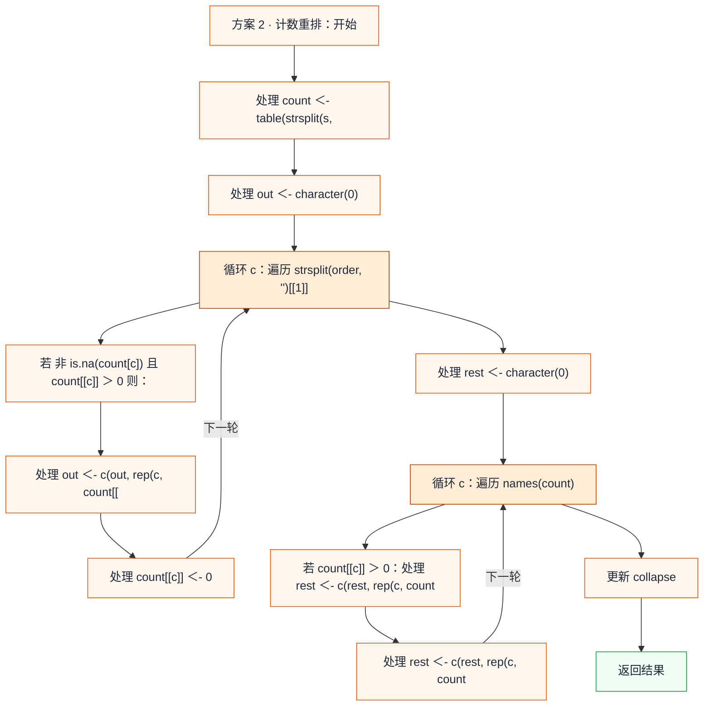

```r
# 版（方案2） 定义函数 custom_sort_string（参数：order, 字符串）
custom_sort_string <- function(order, s) {
    count <- table(strsplit(s, "")[[1]])  # 把 table(strsplit(字符串, 「」)[[1]]) 存入 计数
    out <- character(0)  # 把 character(0) 存入 out
    for (c in strsplit(order, "")[[1]]) {
        # for (字符 in strsplit(order, 「」)[[1]]) { 若 取反 is.na(计数[字符]) 且 计数[[字符]] 超过 0
        if (!is.na(count[c]) && count[[c]] > 0) {
            out <- c(out, rep(c, count[[c]]))  # 把 字符(out, rep(字符, 计数[[字符]])) 存入 out
            count[[c]] <- 0  # 把 0 存入 count[[c]]
        }
    }
    rest <- character(0)  # 把 character(0) 存入 rest
    for (c in names(count)) {
        # for (字符 in names(计数)) {
        if (count[[c]] > 0)
            rest <- c(rest, rep(c, count[[c]]))  # 若 计数[[字符]] 超过 0) rest 小于 减 字符(rest, rep(字符, 计数[[字符]]
    }
    paste(c(out, rest), collapse = "")  # 把 「」) 写入 paste(c(out, rest), collapse
}
stopifnot(custom_sort_string("cba", "abcd") == "cbad")  # 断言校验
stopifnot(custom_sort_string("bcafg", "abcd") == "bcad")  # 断言校验
cat("PASS\n")  # 全部用例通过，输出 PASS
```

### Zig 实现（2 种方案）

Zig 的全部方案如下，每个方案都内嵌用例自测，可独立运行（老仓库 python/go 文件遵循「打印结果」约定）：

#### 方案 1：计数重排

**思路与代码分析**：核心是「计数重排」。Zig 版显式分配与清零，整型边界处理严格。代码里依次做这些事：双重循环遍历。**走读**：方案 1 · 计数重排：开始 → 计算 count → 遍历集合元素 → 遍历集合元素 → 计算 idx → 遍历集合元素 → 更新 count[idx] → 遍历集合元素 → 遍历集合元素 → 返回结果。

**运行架构**（真实控制流）：

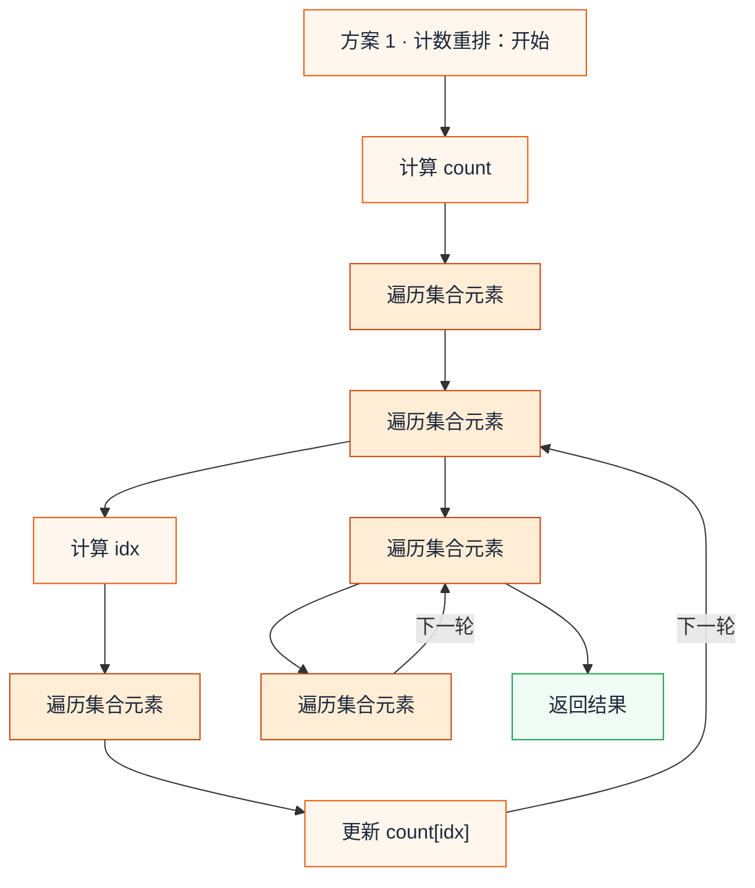

```zig
// LeetCode 791. 自定义字符串排序 — Zig 版（方案1）
const std = @import("std"); // 把 @import(「std」) 存入 std
fn customSortString(order: []const u8, s: []const u8, out: *std.ArrayList(u8)) void { // 定义函数/方法 customSortString
    var count = [_]usize{0} ** 26; // 把 [_]usize{0} 乘 乘 26 存入 计数
    for (s) |c| count[c - 'a'] += 1; // 逐个取出 字符串 的元素（字符）
    for (order) |c| { // 逐个取出 order 的元素（字符）
        const idx = c - 'a'; // 把 字符 减 '数组' 存入 idx
        for (0..count[idx]) |_| out.append(c) catch unreachable; // 把 字符 追加到列表尾部
        count[idx] = 0; // 把 0; 写入 count[idx]
    }
    for (count, 0..) |cnt, i| { // for (计数, 0..) 按位或 计数, 下标 i 按位或 {
        for (0..cnt) |_| out.append('a' + @as(u8, @intCast(i))) catch unreachable; // 让 _ 从 0 走到 计数 减一
    }
}
pub fn main() !void { // 程序入口：跑内嵌自测用例
    var out = std.ArrayList(u8).init(std.heap.page_allocator); // 把 std.ArrayList(u8).init(std.堆.page_allocator) 存入 out
    defer out.deinit(); // defer out.deinit();
    customSortString("cba", "abcd", &out); // customSortString(「cba」, 「cba」, 按位与 out);
    if (!std.mem.eql(u8, out.items, "cbad")) return error.TestFailed;
    out.clearRetainingCapacity(); // out.clearRetainingCapacity();
    customSortString("bcafg", "abcd", &out); // customSortString(「bcafg」, 「bcafg」, 按位与 out);
    if (!std.mem.eql(u8, out.items, "bcad")) return error.TestFailed;
    std.debug.print("PASS\n", .{}); // 全部用例通过，输出 PASS
}
```

#### 方案 2：计数重排

**思路与代码分析**：核心是「计数重排」。Zig 版显式分配与清零，整型边界处理严格。代码里依次做这些事：双重循环遍历。**走读**：方案 2 · 计数重排：开始 → 计算 count → 遍历集合元素 → 遍历集合元素 → 计算 idx → 遍历集合元素 → 更新 count[idx] → 遍历集合元素 → 遍历集合元素 → 返回结果。

**运行架构**（真实控制流）：

```mermaid
graph TD
    N0["方案 2 · 计数重排：开始"]
    N1["计算 count"]
    N2["遍历集合元素"]
    N3["遍历集合元素"]
    N4["计算 idx"]
    N5["遍历集合元素"]
    N6["更新 count[idx]"]
    N7["遍历集合元素"]
    N8["遍历集合元素"]
    N9["返回结果"]
    N0 --> N1
    N1 --> N2
    N2 --> N3
    N3 --> N4
    N4 --> N5
    N5 --> N6
    N6 -- 下一轮 --> N3
    N3 --> N7
    N7 --> N8
    N8 -- 下一轮 --> N7
    N7 --> N9
    classDef n fill:#fff7ed,stroke:#ea580c,color:#1e293b;
    classDef lp fill:#ffedd5,stroke:#c2410c,color:#1e293b;
    classDef dc fill:#fef9c3,stroke:#ca8a04,color:#1e293b;
    classDef tm fill:#f0fdf4,stroke:#16a34a,color:#1e293b;
    class N0,N1,N4,N6 n;
    class N2,N3,N5,N7,N8 lp;
    class N9 tm;
```

```zig
// LeetCode 791. 自定义字符串排序 — Zig 版（方案2）
const std = @import("std"); // 把 @import(「std」) 存入 std
fn customSortString(order: []const u8, s: []const u8, out: *std.ArrayList(u8)) void { // 定义函数/方法 customSortString
    var count = [_]usize{0} ** 26; // 把 [_]usize{0} 乘 乘 26 存入 计数
    for (s) |c| count[c - 'a'] += 1; // 逐个取出 字符串 的元素（字符）
    for (order) |c| { // 逐个取出 order 的元素（字符）
        const idx = c - 'a'; // 把 字符 减 '数组' 存入 idx
        for (0..count[idx]) |_| out.append(c) catch unreachable; // 把 字符 追加到列表尾部
        count[idx] = 0; // 把 0; 写入 count[idx]
    }
    for (count, 0..) |cnt, i| { // for (计数, 0..) 按位或 计数, 下标 i 按位或 {
        for (0..cnt) |_| out.append('a' + @as(u8, @intCast(i))) catch unreachable; // 让 _ 从 0 走到 计数 减一
    }
}
pub fn main() !void { // 程序入口：跑内嵌自测用例
    var out = std.ArrayList(u8).init(std.heap.page_allocator); // 把 std.ArrayList(u8).init(std.堆.page_allocator) 存入 out
    defer out.deinit(); // defer out.deinit();
    customSortString("cba", "abcd", &out); // customSortString(「cba」, 「cba」, 按位与 out);
    if (!std.mem.eql(u8, out.items, "cbad")) return error.TestFailed;
    out.clearRetainingCapacity(); // out.clearRetainingCapacity();
    customSortString("bcafg", "abcd", &out); // customSortString(「bcafg」, 「bcafg」, 按位与 out);
    if (!std.mem.eql(u8, out.items, "bcad")) return error.TestFailed;
    std.debug.print("PASS\n", .{}); // 全部用例通过，输出 PASS
}
```

### Dart 实现（2 种方案）

Dart 的全部方案如下，每个方案都内嵌用例自测，可独立运行（老仓库 python/go 文件遵循「打印结果」约定）：

#### 方案 1：计数重排

**思路与代码分析**：核心是「计数重排」。Dart 版用可空类型标注与集合方法，注意空安全。代码里依次做这些事：先排序再处理；双重循环遍历。**走读**：方案 1 · 计数重排：开始 → 更新 count → 遍历循环 → 更新 count[c] → 更新 out → 遍历循环 → 更新 n → 遍历循环 → 调用 out.add(c) → 更新 count[c] → 更新 rest → 遍历循环 → 遍历循环 → 调用 rest.add(e.key) → 排序整理 → 返回 (out..addAll(rest)).join()。

**运行架构**（真实控制流）：

```mermaid
graph TD
    N0["方案 1 · 计数重排：开始"]
    N1["更新 count"]
    N2["遍历循环"]
    N3["更新 count[c]"]
    N4["更新 out"]
    N5["遍历循环"]
    N6["更新 n"]
    N7["遍历循环"]
    N8["调用 out.add(c)"]
    N9["更新 count[c]"]
    N10["更新 rest"]
    N11["遍历循环"]
    N12["遍历循环"]
    N13["调用 rest.add(e.key)"]
    N14["排序整理"]
    N15["返回 (out..addAll(rest)).join()"]
    N0 --> N1
    N1 --> N2
    N2 --> N3
    N3 -- 下一轮 --> N2
    N2 --> N4
    N4 --> N5
    N5 --> N6
    N6 --> N7
    N7 --> N8
    N8 -- 下一轮 --> N7
    N7 --> N9
    N9 -- 下一轮 --> N5
    N5 --> N10
    N10 --> N11
    N11 --> N12
    N12 --> N13
    N13 -- 下一轮 --> N12
    N12 -- 下一轮 --> N11
    N11 --> N14
    N14 --> N15
    classDef n fill:#fff7ed,stroke:#ea580c,color:#1e293b;
    classDef lp fill:#ffedd5,stroke:#c2410c,color:#1e293b;
    classDef dc fill:#fef9c3,stroke:#ca8a04,color:#1e293b;
    classDef tm fill:#f0fdf4,stroke:#16a34a,color:#1e293b;
    class N0,N1,N3,N4,N6,N8,N9,N10,N13,N14 n;
    class N2,N5,N7,N11,N12 lp;
    class N15 tm;
```

```dart
// LeetCode 791. 自定义字符串排序 — Dart 版（方案1）
String customSortString(String order, String s) {
  // 定义函数/方法 customSortString
  final count = <String, int>{}; // 把 小于 String, int 超过 {} 存入 计数
  for (final c in s.split('')) {
    // for (final 字符 in 字符串.split('')) {
    count[c] = (count[c] ?? 0) + 1; // 把 (计数[字符] ?? 0) 加 1; 写入 count[c]
  }
  final out = <String>[]; // 把 小于 String 超过 [] 存入 out
  for (final c in order.split('')) {
    // for (final 字符 in order.split('')) {
    final n = count[c] ?? 0; // 把 计数[字符] ?? 0 存入 元素个数
    for (var i = 0; i < n; i++) {
      // 让 下标 i 从 0 开始计数，下标 i 小于 元素个数 就继续
      out.add(c); // out 追加 字符);
    }
    count[c] = 0; // 把 0; 写入 count[c]
  }
  final rest = <String>[]; // 把 小于 String 超过 [] 存入 rest
  for (final e in count.entries) {
    // for (final e in 计数.entries) {
    for (var i = 0; i < e.value; i++) {
      // 让 下标 i 从 0 开始计数，下标 i 小于 e.value 就继续
      rest.add(e.key); // rest 追加 e.key);
    }
  }
  rest.sort(); // 排序
  return (out..addAll(rest)).join(); // 返回 (out..addAll(rest)).join()
}

void main() {
  // 程序入口：跑内嵌自测用例
  if (customSortString('cba', 'abcd') != 'cbad') throw StateError('c1');
  if (customSortString('bcafg', 'abcd') != 'bcad') throw StateError('c2');
  print('PASS'); // 全部用例通过，输出 PASS
}
```

#### 方案 2：计数重排

**思路与代码分析**：核心是「计数重排」。Dart 版用可空类型标注与集合方法，注意空安全。代码里依次做这些事：先排序再处理；双重循环遍历。**走读**：方案 2 · 计数重排：开始 → 更新 count → 遍历循环 → 更新 count[c] → 更新 out → 遍历循环 → 更新 n → 遍历循环 → 调用 out.add(c) → 更新 count[c] → 更新 rest → 遍历循环 → 遍历循环 → 调用 rest.add(e.key) → 排序整理 → 返回 (out..addAll(rest)).join()。

**运行架构**（真实控制流）：

```mermaid
graph TD
    N0["方案 2 · 计数重排：开始"]
    N1["更新 count"]
    N2["遍历循环"]
    N3["更新 count[c]"]
    N4["更新 out"]
    N5["遍历循环"]
    N6["更新 n"]
    N7["遍历循环"]
    N8["调用 out.add(c)"]
    N9["更新 count[c]"]
    N10["更新 rest"]
    N11["遍历循环"]
    N12["遍历循环"]
    N13["调用 rest.add(e.key)"]
    N14["排序整理"]
    N15["返回 (out..addAll(rest)).join()"]
    N0 --> N1
    N1 --> N2
    N2 --> N3
    N3 -- 下一轮 --> N2
    N2 --> N4
    N4 --> N5
    N5 --> N6
    N6 --> N7
    N7 --> N8
    N8 -- 下一轮 --> N7
    N7 --> N9
    N9 -- 下一轮 --> N5
    N5 --> N10
    N10 --> N11
    N11 --> N12
    N12 --> N13
    N13 -- 下一轮 --> N12
    N12 -- 下一轮 --> N11
    N11 --> N14
    N14 --> N15
    classDef n fill:#fff7ed,stroke:#ea580c,color:#1e293b;
    classDef lp fill:#ffedd5,stroke:#c2410c,color:#1e293b;
    classDef dc fill:#fef9c3,stroke:#ca8a04,color:#1e293b;
    classDef tm fill:#f0fdf4,stroke:#16a34a,color:#1e293b;
    class N0,N1,N3,N4,N6,N8,N9,N10,N13,N14 n;
    class N2,N5,N7,N11,N12 lp;
    class N15 tm;
```

```dart
// LeetCode 791. 自定义字符串排序 — Dart 版（方案2）
String customSortString(String order, String s) {
  // 定义函数/方法 customSortString
  final count = <String, int>{}; // 把 小于 String, int 超过 {} 存入 计数
  for (final c in s.split('')) {
    // for (final 字符 in 字符串.split('')) {
    count[c] = (count[c] ?? 0) + 1; // 把 (计数[字符] ?? 0) 加 1; 写入 count[c]
  }
  final out = <String>[]; // 把 小于 String 超过 [] 存入 out
  for (final c in order.split('')) {
    // for (final 字符 in order.split('')) {
    final n = count[c] ?? 0; // 把 计数[字符] ?? 0 存入 元素个数
    for (var i = 0; i < n; i++) {
      // 让 下标 i 从 0 开始计数，下标 i 小于 元素个数 就继续
      out.add(c); // out 追加 字符);
    }
    count[c] = 0; // 把 0; 写入 count[c]
  }
  final rest = <String>[]; // 把 小于 String 超过 [] 存入 rest
  for (final e in count.entries) {
    // for (final e in 计数.entries) {
    for (var i = 0; i < e.value; i++) {
      // 让 下标 i 从 0 开始计数，下标 i 小于 e.value 就继续
      rest.add(e.key); // rest 追加 e.key);
    }
  }
  rest.sort(); // 排序
  return (out..addAll(rest)).join(); // 返回 (out..addAll(rest)).join()
}

void main() {
  // 程序入口：跑内嵌自测用例
  if (customSortString('cba', 'abcd') != 'cbad') throw StateError('c1');
  if (customSortString('bcafg', 'abcd') != 'bcad') throw StateError('c2');
  print('PASS'); // 全部用例通过，输出 PASS
}
```

---

## 内容总结

- **自定义字符串排序**（字符串 · Medium）：共 2 个方案，主线思路「计数重排」；时间 O(n²)（两层嵌套扫描）；动画演示滑动窗口过程，附录给出 11 种语言 × 全部方案的可运行实现。
- 来源博客：[https://blog.csdn.net/tyro_java/article/details/145385760](https://blog.csdn.net/tyro_java/article/details/145385760)
- 导航：[📋 总目录](../) ｜ [← 081 计数二进制子串](../081_计数二进制子串/) ｜ [083 字符串转换整数 (atoi) →](../083_字符串转换整数_%28atoi%29/)
