# 083 · 字符串转换整数 (atoi)（第三阶段 · 字符串 · Medium）

> **难度**：⭐⭐ Medium ｜ **专题**：字符串
> **学习定位**：第三阶段 · 字符串第 83 篇 ｜ **解法数**：2
> **内容总结**：**字符串转换整数 (atoi)**（字符串 · Medium）：共 2 个方案，主线思路「自动机 (DFA)」；时间 O(n)（单趟线性扫描）；动画演示滑动窗口过程，附录给出 11 种语言 × 全部方案的可运行实现。

---

## 题目描述

请你来实现一个 `myAtoi(string s)` 函数，使其能将字符串转换成一个 32 位有符号整数。

函数 `myAtoi(string s)` 的算法如下：

 空格：读入字符串并丢弃无用的前导空格（`「 」`）
 符号：检查下一个字符（假设还未到字符末尾）为 `'-'` 还是 `'+'`。如果两者都不存在，则假定结果为正。
 转换：通过跳过前置零来读取该整数，直到遇到非数字字符或到达字符串的结尾。如果没有读取数字，则结果为 0。
 舍入：如果整数数超过 32 位有符号整数范围 `[−2^31, 2^31 − 1]` ，需要截断这个整数，使其保持在这个范围内。具体来说，小于 `−2^31` 的整数应该被舍入为 `−2^31` ，大于 `2^31 − 1` 的整数应该被舍入为 `2^31 − 1` 。

返回整数作为最终结果。

示例 1：

输入：s = 「42」

输出：42

解释：加粗的字符串为已经读入的字符，插入符号是当前读取的字符。

带下划线线的字符是所读的内容，插入符号是当前读入位置。
第 1 步：「42」（当前没有读入字符，因为没有前导空格）
 ^
第 2 步：「42」（当前没有读入字符，因为这里不存在 '-' 或者 '+'）
 ^
第 3 步：「42」（读入 「42」）
 ^

示例 2：

输入：s = 「 -042」

输出：-42

解释：

第 1 步：「 -042」（读入前导空格，但忽视掉）
 ^
第 2 步：「 -042」（读入 '-' 字符，所以结果应该是负数）
 ^
第 3 步：「 -042」（读入 「042」，在结果中忽略前导零）
 ^

示例 3：

输入：s = 「1337c0d3」

输出：1337

解释：

第 1 步：「1337c0d3」（当前没有读入字符，因为没有前导空格）
 ^
第 2 步：「1337c0d3」（当前没有读入字符，因为这里不存在 '-' 或者 '+'）
 ^
第 3 步：「1337c0d3」（读入 「1337」；由于下一个字符不是一个数字，所以读入停止）
 ^

**用例（来自原题）**：

**示例 4**

```text
第 1 步："0-1" (当前没有读入字符，因为没有前导空格)
         ^
第 2 步："0-1" (当前没有读入字符，因为这里不存在 '-' 或者 '+')
         ^
第 3 步："0-1" (读入 "0"；由于下一个字符不是一个数字，所以读入停止)
          ^
```

**示例 5**
> 题面与 [leetcode.cn 官方](https://leetcode.cn/problems/string-to-integer-atoi/)一致，示例配图取自官方题面。

**数据范围与注意事项**：

- `0 <= s.length <= 200`
- `s` 由英文字母（大写和小写）、数字（`0-9`）、`' '`、`'+'`、`'-'` 和 `'.'` 组成
- **易错点**：空串、全空白、单字符三类边界，以及大小写是否敏感。

## 题目分析

**场景是什么**：字符串是字符数组，这类题练的是扫描、切分与匹配，对应真实开发里的文本清洗、协议解析。本题就是该场景的 Medium 级练习，主线做法是「自动机 (DFA)」。

**主线怎么解**：把主解法从头到尾过一遍，它其实在依次做这几件事：单循环线性扫描。

## 解题思路

**方案对比**（共 2 个方案，由浅入深）：

| 方案 | 时间复杂度 | 空间复杂度 |
|---|---|---|
| 方案 1 · 自动机 (DFA) | O(n)（单趟线性扫描） | O(1) 到 O(n)（视辅助结构） |
| 方案 2 · 直接扫描 | O(n)（单趟线性扫描） | O(1) 到 O(n)（视辅助结构） |

**由浅入深的路径**：自动机 (DFA) → 直接扫描；每往右一步，都在补上一步的短板。

**方案间的取舍**：方案 1（自动机 (DFA)）；方案 2（直接扫描）。数据规模小、可读性优先时选靠前的方案；规模大、性能优先时选靠后的方案。

**怎么读这一篇**：

- 🐣 **新手路线**：把「题目描述」的示例 1 在纸上手推一遍 → 读方案 1（最直观的写法）与它的代码走读 → 按「运行方式」本地跑通看 PASS → 回头对比方案 2 之后的写法差在哪
- 🦅 **大佬路线**：直接锁定最优方案 1（自动机 (DFA)，O(n)（单趟线性扫描））→ 跳读该方案代码与走读 → 用「逐步拆解与面试追问」补齐复杂度推导与边界追问

### 动态算法图（滑动窗口，GIF 自动循环）


动画演示字符串专题里滑动窗口的典型过程；每个方案在「TypeScript 解题方案」一节还配了专属动画与专属流程图。

### 主解法流程图（真实控制流）

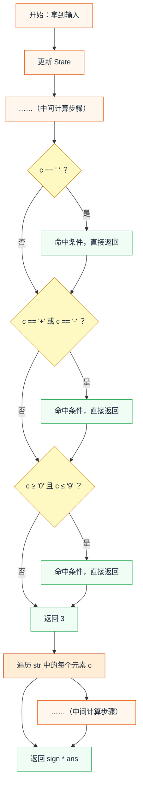

## TypeScript 解题方案（2 个方案逐个讲）

> **运行与提交**：每个方案都是自包含文件（内嵌用例自测，输出 PASS），整块复制到 `.ts` 文件后 `node 文件名` 即可运行。提交 LeetCode 时，把 `demo` 内的算法函数与辅助类型/函数整体取出、置于文件顶层即可。涉及交互/特殊接口的题以题面给定签名为准。

### 方案 1：自动机 (DFA)

**分析与思路**：核心做法是「自动机 (DFA)」。代码里依次做这些事：单循环线性扫描。

**运行方式**：`node 本文件`，内嵌用例全部通过会输出 PASS。

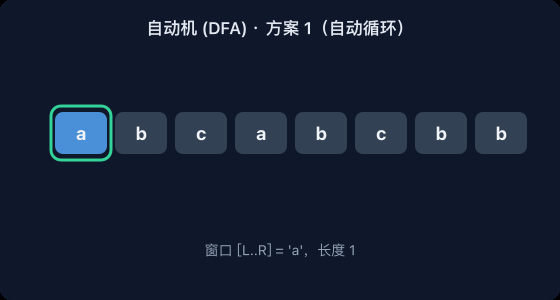

**方案专属流程图**（真实控制流）：

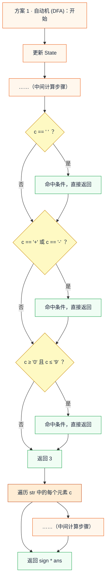

```typescript
/**
 ** LeetCode 8. 字符串转换整数 (atoi)
 ** 方案：1 ) 方案1：自动机 (DFA)
 ** 来源：https://blog.csdn.net/tyro_java/article/details/145385760
 */

export function myAtoi(str: string): number {
  // 定义函数/方法 myAtoi
  type State = 'start' | 'signed' | 'in_number' | 'end'; // 定义类型
  const table: { [k in State]: [State, State, State, State] } = {
    start: ['start', 'signed', 'in_number', 'end'],
    signed: ['end', 'end', 'in_number', 'end'],
    in_number: ['end', 'end', 'in_number', 'end'],
    end: ['end', 'end', 'end', 'end'],
  };
  let state: State = 'start'; // 把 '起点'; 写入 let state: State
  let sign = 1; // 把 1 存入 sign
  let ans = 0; // 把 0 存入 答案
  const getCol = (c: string): number => {
    if (c === ' ') return 0; // 若 字符 全等于 ' '，直接返回 0
    if (c === '+' || c === '-') return 1; // 若 字符 全等于 ' 加 ' 或 字符 全等于 ' 减 '，直接返回 1
    if (c >= '0' && c <= '9') return 2; // 若 字符 不低于 '0' 且 字符 不超过 '9'，直接返回 2
    return 3; // 返回 3
  };
  for (const c of str) {
    // for (const 字符 of str) {
    state = table[state][getCol(c)]; // 把 table[state][getCol(字符)] 存入 state
    if (state === 'in_number') {
      // 若 state 全等于 'in_number'
      ans = ans * 10 + parseInt(c, 10); // 把 答案 乘 10 加 转整数(字符) 存入 答案
      if (sign === 1)
        ans = Math.min(ans, 2147483647); // 若 sign 全等于 1) 答案 赋值为 Math.取较小值 答案, 2147483647);
      else ans = Math.min(ans, 2147483648); // 否则
    } else if (state === 'signed') {
      // 否则，若 state 全等于 'signed'
      sign = c === '+' ? 1 : -1; // 把 字符 全等于 ' 加 ' ? 1 : 减 1 存入 sign
    }
  }
  return sign * ans; // 返回 sign 乘 答案
}

export function demo(): void {
  // 程序入口：跑内嵌自测用例
  if (myAtoi('   -42') !== -42) throw new Error('FAILED 1'); // 若 myAtoi(「 减 42」) 不等于 减 42) throw new Error(「 减 42」);
  if (myAtoi('4193 with words') !== 4193) throw new Error('FAILED 2');
  if (myAtoi('words and 987') !== 0) throw new Error('FAILED 3');
  if (myAtoi('-91283472332') !== -2147483648)
    throw new Error('FAILED 4: ' + myAtoi('-91283472332'));
  console.log('PASS'); // 全部用例通过，输出 PASS
}

demo(); // demo();
```

### 方案 2：直接扫描

**分析与思路**：核心做法是「直接扫描」。

**运行方式**：`node 本文件`，内嵌用例全部通过会输出 PASS。

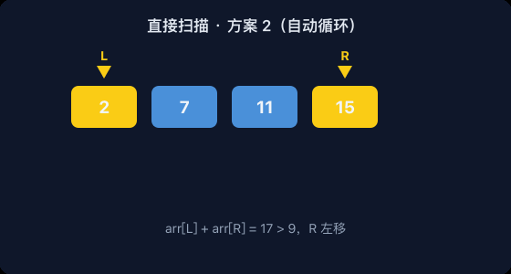

**方案专属流程图**（真实控制流）：

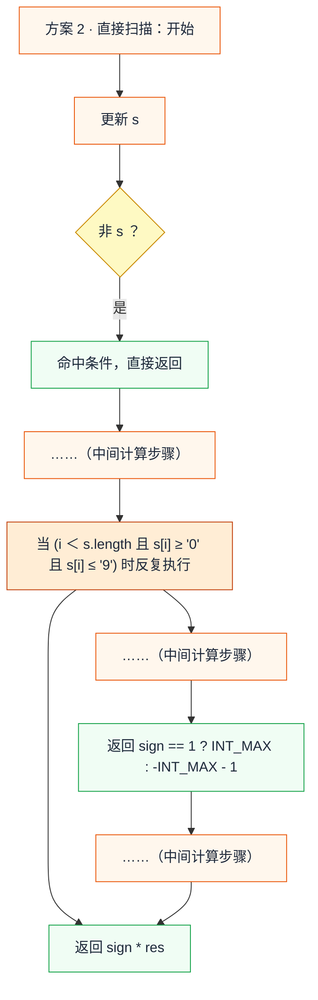

```typescript
/**
 ** LeetCode 8. 字符串转换整数 (atoi)
 ** 方案：2 ) 方案2：直接扫描
 ** 来源：https://blog.csdn.net/tyro_java/article/details/145385760
 */

export function myAtoi(s: string): number {
  // 定义函数/方法 myAtoi
  s = s.trim(); // 把 字符串.trim() 存入 字符串
  if (!s) return 0; // 若 取反 字符串，直接返回 0
  let i = 0; // 把 0 存入 下标 i
  let sign = 1; // 把 1 存入 sign
  if (s[0] === '+')
    i++; // 若 字符串[0] 全等于 ' 加 ') 下标 i 加一 ;
  else if (s[0] === '-') {
    sign = -1;
    i++;
  } // 否则，若 字符串[0] 全等于 ' 减 ') { sign 赋值为 减 1; 下标 i 加一 ; }
  let res = 0; // 把 0 存入 结果
  const INT_MAX = 2 ** 31 - 1; // 把 2 乘 乘 31 减 1 存入 INT_MAX
  while (i < s.length && s[i] >= '0' && s[i] <= '9') {
    const digit = parseInt(s[i], 10); // 把 转整数(字符串[下标 i]) 存入 digit
    if (
      res > Math.floor(INT_MAX / 10) ||
      (res === Math.floor(INT_MAX / 10) && digit > 7)
    ) {
      return sign === 1 ? INT_MAX : -INT_MAX - 1; // 返回 sign 全等于 1 ? INT_MAX : 减 INT_MAX 减 1
    }
    res = res * 10 + digit; // 把 结果 乘 10 加 digit 存入 结果
    i++; // 下标 i 加一
  }
  return sign * res; // 返回 sign 乘 结果
}

export function demo(): void {
  // 程序入口：跑内嵌自测用例
  if (myAtoi('   -42') !== -42) throw new Error('FAILED 1'); // 若 myAtoi(「 减 42」) 不等于 减 42) throw new Error(「 减 42」);
  if (myAtoi('4193 with words') !== 4193) throw new Error('FAILED 2');
  if (myAtoi('words and 987') !== 0) throw new Error('FAILED 3');
  if (myAtoi('-91283472332') !== -2147483648)
    throw new Error('FAILED 4: ' + myAtoi('-91283472332'));
  console.log('PASS'); // 全部用例通过，输出 PASS
}

demo(); // demo();
```

## 逐步拆解与面试追问

**复杂度**：时间 O(n)（单趟线性扫描），空间 O(1) 到 O(n)（视辅助结构）

**为什么是这个量级**：每个元素被常数次访问，辅助哈希或栈的开销与 n 同阶

**面试官可能会追问**：

- 字符集有多大，能否用定长数组计数？
- 要不要考虑 Unicode 多字节字符？
- 空串与单字符的边界？

## 关键 API 速查（TS 主解法实际用到，附官方链接）

| API | 作用 | 使用要点 | 官方文档 |
|---|---|---|---|
| `Math.min()` | 最小值 | 同 max；空参返回 Infinity | [官方文档](https://developer.mozilla.org/zh-CN/docs/Web/JavaScript/Reference/Global_Objects/Math/min) |

### 各语言官方文档导航

- **TypeScript / JS**：[MDN 中文参考](https://developer.mozilla.org/zh-CN/)
- **Python**：[Python 官方文档](https://docs.python.org/zh-cn/3/)
- **Go**：[Go 标准库](https://pkg.go.dev/std)
- **Java**：[JDK 17 API](https://docs.oracle.com/en/java/javase/17/docs/api/)
- **Rust**：[Rust 标准库](https://doc.rust-lang.org/std/)
- **Lua**：[Lua 5.4 手册](https://www.lua.org/manual/5.4/)
- **C**：[Cppreference C](https://zh.cppreference.com/w/c)
- **C++**：[Cppreference C++](https://zh.cppreference.com/w/cpp)
- **R**：[R 官方手册](https://stat.ethz.ch/R-manual/)
- **Zig**：[Zig 语言文档](https://ziglang.org/documentation/master/)
- **Dart**：[Dart API](https://api.dart.dev/)

## 附录：其他 10 种语言全部实现（每种语言列举其全部方案）

> TypeScript 的全部方案见「TypeScript 解题方案」一节；下面是其余 10 种语言的对应实现，每种语言的每个方案都带思路分析、代码走读与专属运行架构图。
> 每个方案都内嵌用例自测，可独立运行（老仓库 python/go 文件遵循「打印结果」约定）。
> 完整解法文件见 `dsa/<语言>/string/lc_8_字符串转换整数_(atoi)/`。

### Python 实现（2 种方案）

Python 的全部方案如下，每个方案都内嵌用例自测，可独立运行（老仓库 python/go 文件遵循「打印结果」约定）：

#### 方案 1：自动机 (DFA)

**思路与代码分析**：核心是「自动机 (DFA)」。Python 版用切片与字典推导式简化操作，突出可读性。**走读**：方案 1 · 自动机 (DFA)：开始 → 处理 class Automaton: → 命中条件，直接返回 → 命中条件，直接返回 → 命中条件，直接返回 → 返回 3 → 遍历 str: 中的每个元素 c → 返回 automaton.sign * automaton.ans。

**运行架构**（真实控制流）：

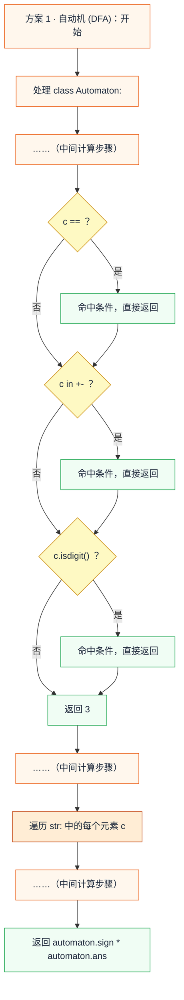

```python
import sys  # 提高递归深度上限（深输入防 RecursionError）

sys.setrecursionlimit(200000)  # 树/链表类题目节点数可达 1e4 量级

def myAtoi(str):  # 定义函数 myAtoi（参数：str）
    class Automaton:  # 定义类
        def __init__(self):  # 构造函数：初始化成员
            self.state = "start"  # 把 '起点' 写入 self.state
            self.sign = 1  # 把 1 写入 self.sign
            self.ans = 0  # 把 0 写入 答案
            self.table = {  # 把 { 写入 self.table
                "start": ["start", "signed", "in_number", "end"],
                "signed": ["end", "end", "in_number", "end"],
                "in_number": ["end", "end", "in_number", "end"],
                "end": ["end", "end", "end", "end"],
            }

        def get_col(self, c):  # 定义函数 get_col（参数：self, 字符）
            if c == " ":  # 若 字符 等于 ' '
                return 0  # 返回 0
            if c in "+-":  # 若 字符 in ' 加 减 '
                return 1  # 返回 1
            if c.isdigit():  # 若 字符.isdigit(
                return 2  # 返回 2
            return 3  # 返回 3

        def get(self, c):  # 定义函数 get（参数：self, 字符）
            self.state = self.table[self.state][
                self.get_col(c)
            ]  # 把 self.table[self.state][self.get_col(字符)] 写入 self.state
            if self.state == "in_number":  # 若 self.state 等于 'in_number'
                self.ans = self.ans * 10 + int(c)  # 把 self.答案 乘 10 加 int(字符) 写入 答案
                if self.sign == 1:  # 若 self.sign 等于 1
                    self.ans = min(self.ans, 2147483647)  # 把 取较小值 self.答案, 2147483647) 写入 答案
                else:  # 否则
                    self.ans = min(self.ans, 2147483648)  # 把 取较小值 self.答案, 2147483648) 写入 答案
            elif self.state == "signed":  # 否则，若 self.state 等于 'signed'
                self.sign = 1 if c == "+" else -1  # 把 1 if 字符 等于 ' 加 ' else 减 1 写入 self.sign

    automaton = Automaton()  # 把 Automaton() 存入 automaton
    for c in str:  # 逐个取出 str 的元素（字符）
        automaton.get(c)  # automaton 查找 字符)
    return automaton.sign * automaton.ans  # 返回 automaton.sign 乘 automaton.答案

if __name__ == "__main__":  # 若 __name__ 等于 '__main__'
    print(myAtoi("   -42"))  # 打印输出
    print(myAtoi("4193 with words"))  # 打印输出
    print(myAtoi("words and 987"))  # 打印输出
    print(myAtoi("-91283472332"))  # 打印输出
```

#### 方案 2：直接扫描

**思路与代码分析**：核心是「直接扫描」。Python 版用切片与字典推导式简化操作，突出可读性。**走读**：方案 2 · 直接扫描：开始 → 更新 s → 命中条件，直接返回 → 当 ( 时反复执行 → 命中条件，直接返回 → 返回 sign * res。

**运行架构**（真实控制流）：

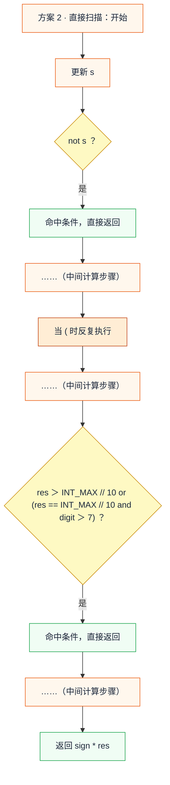

```python
import sys  # 提高递归深度上限（深输入防 RecursionError）

sys.setrecursionlimit(200000)  # 树/链表类题目节点数可达 1e4 量级

def myAtoi(s):  # 定义函数 myAtoi（参数：字符串）
    s = s.strip()  # 把 字符串.strip() 存入 字符串
    if not s:  # 若 not 字符串
        return 0  # 返回 0
    i = 0  # 把 0 存入 下标 i
    sign = 1  # 把 1 存入 sign
    if s[0] == "+":  # 若 字符串[0] 等于 ' 加 '
        i += 1  # 下标 i累加 1
    elif s[0] == "-":  # 否则，若 字符串[0] 等于 ' 减 '
        sign = -1  # 把 减 1 存入 sign
        i += 1  # 下标 i累加 1
    res = 0  # 把 0 存入 结果
    INT_MAX = 2**31 - 1  # 把 2 乘 乘 31 减 1 存入 INT_MAX
    while (
        i < len(s) and s[i].isdigit()
    ):  # 循环，直到不满足「下标 i 小于 长度(字符串) and 字符串[下标 i].isdigit(」
        digit = int(s[i])  # 把 int(字符串[下标 i]) 存入 digit
        if res > INT_MAX // 10 or (res == INT_MAX // 10 and digit > 7):
            return INT_MAX if sign == 1 else -INT_MAX - 1  # 返回 INT_MAX if sign 等于 1 else 减 INT_MAX 减 1
        res = res * 10 + digit  # 把 结果 乘 10 加 digit 存入 结果
        i += 1  # 下标 i累加 1
    return sign * res  # 返回 sign 乘 结果

if __name__ == "__main__":  # 若 __name__ 等于 '__main__'
    print(myAtoi("   -42"))  # 打印输出
    print(myAtoi("4193 with words"))  # 打印输出
    print(myAtoi("words and 987"))  # 打印输出
    print(myAtoi("-91283472332"))  # 打印输出
```

### Go 实现（2 种方案）

Go 的全部方案如下，每个方案都内嵌用例自测，可独立运行（老仓库 python/go 文件遵循「打印结果」约定）：

#### 方案 1：自动机 (DFA)

**思路与代码分析**：核心是「自动机 (DFA)」。Go 版用切片与多返回值惯用法，显式处理索引边界。**走读**：方案 1 · 自动机 (DFA)：开始 → 更新 : → 遍历循环 → 调用 auto.get(str[i]) → 返回 auto.sign * auto.ans。

**运行架构**（真实控制流）：

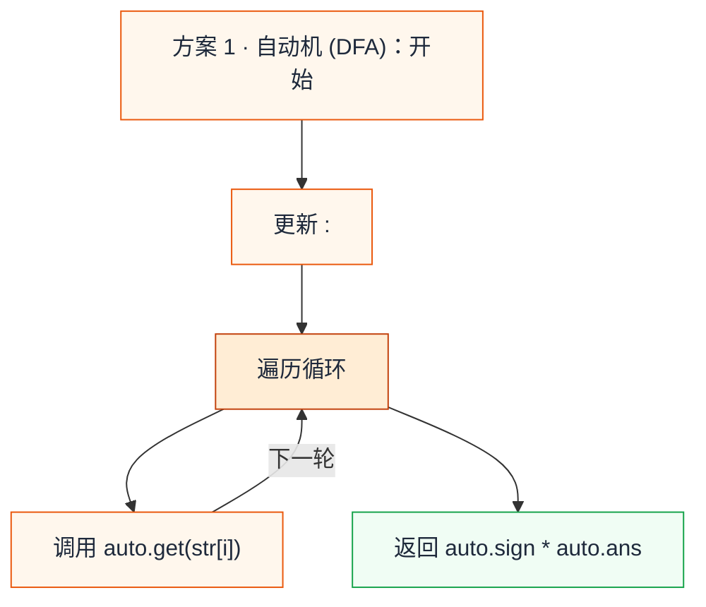

```go
package main // 引入依赖

import (
	"fmt"     // 「fmt」
	"math"    // 「math」
	"os"      // 「os」
	"reflect" // 「reflect」
)

type Automaton struct { // 定义类型
	state string // state string
	sign  int    // sign int
	ans   int    // 答案 int
}

var autoTable = map[string][]string{ // 把 映射表[string][]string{ 存入 autoTable
	"start":     {"start", "signed", "in_number", "end"},
	"signed":    {"end", "end", "in_number", "end"},
	"in_number": {"end", "end", "in_number", "end"},
	"end":       {"end", "end", "end", "end"},
}

func (a *Automaton) getCol(c byte) int { // 定义函数/方法 getCol
	if c == ' ' { // 若 字符 等于 ' '
		return 0 // 返回 0
	}
	if c == '+' || c == '-' { // 若 字符 等于 ' 加 ' 或 字符 等于 ' 减 '
		return 1 // 返回 1
	}
	if c >= '0' && c <= '9' { // 若 字符 不低于 '0' 且 字符 不超过 '9'
		return 2 // 返回 2
	}
	return 3 // 返回 3
}

func (a *Automaton) get(c byte) { // 定义函数/方法 get
	a.state = autoTable[a.state][a.getCol(c)] // 把 autoTable[数组.state][数组.getCol(字符)] 写入 a.state
	if a.state == "in_number" {               // 若 数组.state 等于 「in_number」
		a.ans = a.ans*10 + int(c-'0') // 把 数组.答案 乘 10 加 int(字符 减 '0') 写入 答案
		if a.sign == 1 {              // 若 数组.sign 等于 1
			if a.ans > math.MaxInt32 { // 若 数组.答案 超过 math.MaxInt32
				a.ans = math.MaxInt32 // 把 math.MaxInt32 写入 答案
			}
		} else { // 否则
			if a.ans > math.MaxInt32+1 { // 若 数组.答案 超过 math.MaxInt32 加 1
				a.ans = math.MaxInt32 + 1 // 把 math.MaxInt32 加 1 写入 答案
			}
		}
	} else if a.state == "signed" { // 否则，若 数组.state 等于 「signed」
		if c == '+' { // 若 字符 等于 ' 加 '
			a.sign = 1 // 把 1 写入 a.sign
		} else { // 否则
			a.sign = -1 // 把 减 1 写入 a.sign
		}
	}
}

func myAtoi(str string) int { // 定义函数/方法 myAtoi
	auto := &Automaton{state: "start", sign: 1, ans: 0} // 把 按位与 Automaton{state: 「起点」, sign: 1, 答案: 0} 写入 auto :
	for i := 0; i < len(str); i++ {                     // 让 下标 i 从 0 开始计数
		auto.get(str[i]) // auto 查找 str[下标 i])
	}
	return auto.sign * auto.ans // 返回 auto.sign 乘 auto.答案
}

func main() { // 程序入口：跑内嵌自测用例
	type tc struct { // 定义类型
		in   string // in string
		want int    // want int
	}
	cases := []tc{ // 把 []tc{ 写入 cases :
		{"   -42", -42},
		{"4193 with words", 4193},
		{"words and 987", 0},
		{"-91283472332", -2147483648},
		{"+1", 1},
	}
	ok := true                // 把 true 写入 ok :
	for _, c := range cases { // 同时取 _ 与 字符 遍历
		if got := myAtoi(c.in); !reflect.DeepEqual(got, c.want) { // 若 got : 赋值为 myAtoi(字符.in); 取反 reflect.DeepEqual(got, 字符.want
			ok = false                                                    // 把 false 写入 ok
			fmt.Printf("FAIL myAtoi(%q)=%v want %v\n", c.in, got, c.want) // 打印输出
		}
	}
	if !ok { // 若 取反 ok
		os.Exit(1) // os.Exit(1)
	}
	fmt.Println("PASS") // 全部用例通过，输出 PASS
}
```

#### 方案 2：直接扫描

**思路与代码分析**：核心是「直接扫描」。Go 版用切片与多返回值惯用法，显式处理索引边界。**走读**：方案 2 · 直接扫描：开始 → 更新 s → 返回 0 → 遍历循环 → 返回 INT_MAX → 返回 -INT_MAX - 1 → 返回 sign * res。

**运行架构**（真实控制流）：

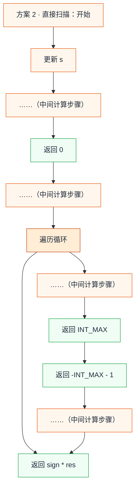

```go
package main // 引入依赖

import (
	"fmt"     // 「fmt」
	"os"      // 「os」
	"reflect" // 「reflect」
	"strings" // 「strings」
)

func myAtoi(s string) int { // 定义函数/方法 myAtoi
	s = strings.TrimSpace(s) // 把 strings.TrimSpace(字符串) 写入 字符串
	if len(s) == 0 {         // 若 长度(字符串) 等于 0
		return 0 // 返回 0
	}
	i := 0           // 把 0 写入 i :
	sign := 1        // 把 1 写入 sign :
	if s[i] == '+' { // 若 字符串[下标 i] 等于 ' 加 '
		i++ // 下标 i 加一
	} else if s[i] == '-' { // 否则，若 字符串[下标 i] 等于 ' 减 '
		sign = -1 // 把 减 1 写入 sign
		i++       // 下标 i 加一
	}
	res := 0                                       // 把 0 写入 res :
	INT_MAX := 2147483647                          // 把 2147483647 写入 INT_MAX :
	for i < len(s) && s[i] >= '0' && s[i] <= '9' { // 把 '0' 且 字符串[下标 i] 不超过 '9' { 写入 for i < len(s) && s[i] >
		digit := int(s[i] - '0')                                  // 把 int(字符串[下标 i] 减 '0') 写入 digit :
		if res > INT_MAX/10 || (res == INT_MAX/10 && digit > 7) { // 若 结果 超过 INT_MAX 除以 10 或 (结果 等于 INT_MAX 除以 10 且 digit 超过 7
			if sign == 1 { // 若 sign 等于 1
				return INT_MAX // 返回 INT_MAX
			}
			return -INT_MAX - 1 // 返回 减 INT_MAX 减 1
		}
		res = res*10 + digit // 把 结果 乘 10 加 digit 写入 结果
		i++                  // 下标 i 加一
	}
	return sign * res // 返回 sign 乘 结果
}

func main() { // 程序入口：跑内嵌自测用例
	type tc struct { // 定义类型
		in   string // in string
		want int    // want int
	}
	cases := []tc{ // 把 []tc{ 写入 cases :
		{"   -42", -42},
		{"4193 with words", 4193},
		{"words and 987", 0},
		{"-91283472332", -2147483648},
		{"+1", 1},
	}
	ok := true                // 把 true 写入 ok :
	for _, c := range cases { // 同时取 _ 与 字符 遍历
		if got := myAtoi(c.in); !reflect.DeepEqual(got, c.want) { // 若 got : 赋值为 myAtoi(字符.in); 取反 reflect.DeepEqual(got, 字符.want
			ok = false                                                    // 把 false 写入 ok
			fmt.Printf("FAIL myAtoi(%q)=%v want %v\n", c.in, got, c.want) // 打印输出
		}
	}
	if !ok { // 若 取反 ok
		os.Exit(1) // os.Exit(1)
	}
	fmt.Println("PASS") // 全部用例通过，输出 PASS
}
```

### Java 实现（2 种方案）

Java 的全部方案如下，每个方案都内嵌用例自测，可独立运行（老仓库 python/go 文件遵循「打印结果」约定）：

#### 方案 1：自动机 (DFA)

**思路与代码分析**：核心是「自动机 (DFA)」。Java 版用类与静态方法组织，集合操作显式明了。代码里依次做这些事：单循环线性扫描。

**运行架构**（真实控制流）：

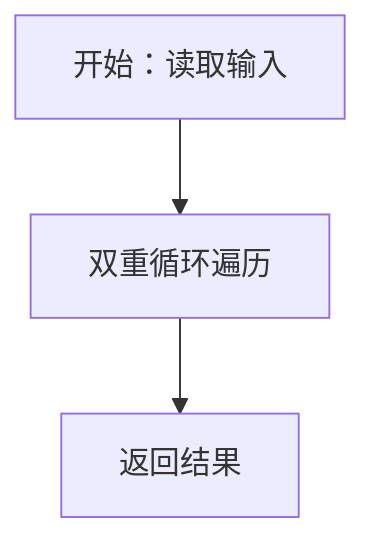

```java
package com.webfault.dsa; // 引入依赖

class Solution { // 定义类型
  public int myAtoi(String str) { // 定义函数/方法 myAtoi
    class Automaton { // 定义类型
      String state = "start"; // 把 「起点」 存入 state
      int sign = 1; // 把 1 存入 sign
      long ans = 0; // 把 0; 写入 long ans
      String[][] table = { // 把 { 写入 String[][] table
        {"start", "signed", "in_number", "end"},
        {"end", "end", "in_number", "end"},
        {"end", "end", "in_number", "end"},
        {"end", "end", "end", "end"} // {「终点」,「终点」,「终点」,「终点」}
      };

      int getCol(char c) { // 定义函数/方法 getCol
        if (c == ' ') return 0; // 若 字符 等于 ' '，直接返回 0
        if (c == '+' || c == '-') return 1; // 若 字符 等于 ' 加 ' 或 字符 等于 ' 减 '，直接返回 1
        if (Character.isDigit(c)) return 2; // 若 Character.isDigit(字符)，直接返回 2
        return 3; // 返回 3
      }

      int idx(String st) { // 定义函数/方法 idx
        if (st.equals("start")) return 0; // 若 st.equals(「起点」)，直接返回 0
        if (st.equals("signed")) return 1; // 若 st.equals(「signed」)，直接返回 1
        if (st.equals("in_number")) return 2; // 若 st.equals(「in_number」)，直接返回 2
        return 3; // 返回 3
      }

      void get(char c) { // 定义函数/方法 get
        state = table[idx(state)][getCol(c)]; // 把 table[idx(state)][getCol(字符)]; 写入 state
        if (state.equals("in_number")) { // 若 state.equals(「in_number」
          ans = ans * 10 + (c - '0'); // 把 答案 乘 10 加 (字符 减 '0'); 写入 答案
          if (sign == 1)
            ans = Math.min(ans, 2147483647L); // 若 sign 等于 1) 答案 赋值为 Math.取较小值 答案, 2147483647L);
          else ans = Math.min(ans, 2147483648L); // 否则
        } else if (state.equals("signed")) { // 否则，若 state.equals(「signed」
          sign = (c == '+') ? 1 : -1; // 把 (字符 等于 ' 加 ') ? 1 : 减 1; 写入 sign
        }
      }
    }
    Automaton a = new Automaton(); // 把 new Automaton(); 写入 Automaton a
    for (int i = 0; i < str.length(); i++)
      a.get(str.charAt(i)); // 让 下标 i 从 0 开始计数，下标 i 小于 str.长度() 就继续
    return (int) (a.sign * a.ans); // 返回 (int)(数组.sign 乘 数组.答案)
  }

  public static void main(String[] args) { // public static void main(String[] args) {
    Solution s = new Solution(); // 把 new Solution(); 写入 Solution s
    String[] ins = {
      "   -42", "4193 with words", "words and 987", "-91283472332"
    }; // 把 {「 减 42」, 「 减 42」, 「 减 42」, 「 减 42」}; 写入 String[] ins
    int[] wants = {-42, 4193, 0, -2147483648}; // 把 { 减 42, 4193, 0, 减 2147483648}; 写入 int[] wants
    boolean ok = true; // 把 true; 写入 boolean ok
    for (int i = 0; i < ins.length; i++) { // 让 下标 i 从 0 开始计数，下标 i 小于 ins.长度 就继续
      int got = s.myAtoi(ins[i]); // 把 字符串.myAtoi(ins[下标 i]) 存入 got
      if (got != wants[i]) {
        ok = false;
        System.out.println("FAIL " + ins[i] + "=" + got + " want " + wants[i]);
      }
    }
    if (!ok) throw new RuntimeException("FAILED"); // 若 取反 ok) throw new RuntimeException(「FAILED」);
    System.out.println("PASS"); // 全部用例通过，输出 PASS
  }
}
```

#### 方案 2：直接扫描

**思路与代码分析**：核心是「直接扫描」。Java 版用类与静态方法组织，集合操作显式明了。**走读**：方案 2 · 直接扫描：开始 → 更新 s → 命中条件，直接返回 → 当 (i ＜ s.length() 时反复执行 → 返回 sign == 1 → 返回 sign * res。

**运行架构**（真实控制流）：

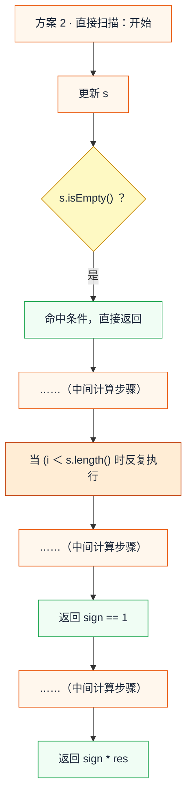

```java
package com.webfault.dsa; // 引入依赖

class Solution { // 定义类型
  public int myAtoi(String s) { // 定义函数/方法 myAtoi
    s = s.trim(); // 把 字符串.trim(); 写入 字符串
    if (s.isEmpty()) return 0; // 若 字符串.isEmpty()，直接返回 0
    int i = 0, sign = 1; // 把 0, sign 赋值为 1 存入 下标 i
    if (s.charAt(0) == '+') i++; // 若 字符串 取字符 0) 等于 ' 加 ') 下标 i 加一 ;
    else if (s.charAt(0) == '-') {
      sign = -1;
      i++;
    } // 否则，若 字符串 取字符 0) 等于 ' 减 ') { sign 赋值为 减 1; 下标 i 加一 ; }
    int res = 0; // 把 0 存入 结果
    int INT_MAX = Integer.MAX_VALUE; // 把 Integer.MAX_VALUE 存入 INT_MAX
    while (i < s.length()
        && Character.isDigit(
            s.charAt(i))) { // 循环，直到不满足「下标 i 小于 字符串.长度() 且 Character.isDigit(字符串 取字符 下标 i」
      int digit = s.charAt(i) - '0'; // 把 字符串 取字符 下标 i) 减 '0' 存入 digit
      if (res > INT_MAX / 10
          || (res == INT_MAX / 10
              && digit > 7)) { // 若 结果 超过 INT_MAX 除以 10 或 (结果 等于 INT_MAX 除以 10 且 digit 超过 7
        return sign == 1
            ? INT_MAX
            : Integer.MIN_VALUE; // 返回 sign 等于 1 ? INT_MAX : Integer.MIN_VALUE
      }
      res = res * 10 + digit; // 把 结果 乘 10 加 digit; 写入 结果
      i++; // 下标 i 加一
    }
    return sign * res; // 返回 sign 乘 结果
  }

  public static void main(String[] args) { // public static void main(String[] args) {
    Solution s = new Solution(); // 把 new Solution(); 写入 Solution s
    String[] ins = {
      "   -42", "4193 with words", "words and 987", "-91283472332"
    }; // 把 {「 减 42」, 「 减 42」, 「 减 42」, 「 减 42」}; 写入 String[] ins
    int[] wants = {-42, 4193, 0, -2147483648}; // 把 { 减 42, 4193, 0, 减 2147483648}; 写入 int[] wants
    boolean ok = true; // 把 true; 写入 boolean ok
    for (int i = 0; i < ins.length; i++) { // 让 下标 i 从 0 开始计数，下标 i 小于 ins.长度 就继续
      int got = s.myAtoi(ins[i]); // 把 字符串.myAtoi(ins[下标 i]) 存入 got
      if (got != wants[i]) {
        ok = false;
        System.out.println("FAIL " + ins[i] + "=" + got + " want " + wants[i]);
      }
    }
    if (!ok) throw new RuntimeException("FAILED"); // 若 取反 ok) throw new RuntimeException(「FAILED」);
    System.out.println("PASS"); // 全部用例通过，输出 PASS
  }
}
```

### Rust 实现（2 种方案）

Rust 的全部方案如下，每个方案都内嵌用例自测，可独立运行（老仓库 python/go 文件遵循「打印结果」约定）：

#### 方案 1：自动机 (DFA)

**思路与代码分析**：核心是「自动机 (DFA)」。Rust 版用所有权移动与切片借用改写同一逻辑，注意 Option 与引用边界。**走读**：方案 1 · 自动机 (DFA)：开始 → 计算 b → 当 i ＜ n 且 (b[i] == b' ') 时反复执行 → 当 i ＜ n 且 b[i].is_ascii_digit() 时反复执行 → 返回 i32::MAX → 返回 i32::MIN。

**运行架构**（真实控制流）：

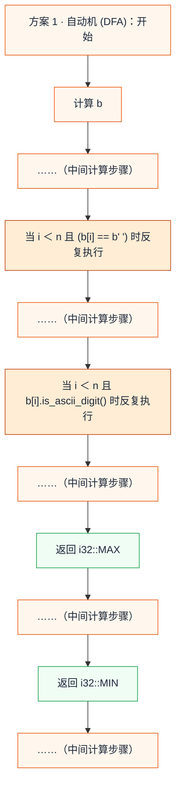

```rust
// LeetCode 8. 字符串转换整数 (atoi) — Rust 版（方案1）
fn my_atoi(s: String) -> i32 {
    // 定义函数/方法 my_atoi
    let b = s.as_bytes(); // 把 字符串.as_bytes() 存入 b
    let mut i = 0usize; // 把 0usize; 写入 let mut i
    let n = b.len(); // 把 b.长度() 存入 元素个数
    while i < n && (b[i] == b' ') {
        i += 1;
    } // 把 赋值为 b' ') { 下标 i 累加 1; } 写入 while i < n && (b[i]
    let mut sign = 1i64; // 把 1i64; 写入 let mut sign
    if i < n && (b[i] == b'+' || b[i] == b'-') {
        // 若 下标 i 小于 元素个数 且 (b[下标 i] 等于 b' 加 ' 或 b[下标 i] 等于 b' 减 '
        if b[i] == b'-' {
            sign = -1;
        } // 若 b[下标 i] 等于 b' 减 ' { sign 赋值为 减 1; }
        i += 1; // 下标 i累加 1
    }
    let mut ans: i64 = 0; // 把 0; 写入 let mut ans: i64
    while i < n && b[i].is_ascii_digit() {
        // while 下标 i 小于 元素个数 且 b[下标 i].is_ascii_digit() {
        ans = ans * 10 + (b[i] - b'0') as i64; // 把 答案 乘 10 加 (b[下标 i] 减 b'0') as i64; 写入 答案
        if ans > i32::MAX as i64 + 1 {
            ans = i32::MAX as i64 + 1;
        } // 若 答案 超过 i32::MAX as i64 加 1 { 答案 赋值为 i32::MAX as i64 加 1; }
        i += 1; // 下标 i累加 1
    }
    ans *= sign; // 把 sign; 写入 ans *
    if ans > i32::MAX as i64 {
        return i32::MAX;
    } // 若 答案 超过 i32::MAX as i64 { return i32::MAX; }
    if ans < i32::MIN as i64 {
        return i32::MIN;
    } // 若 答案 小于 i32::MIN as i64 { return i32::MIN; }
    ans as i32 // 答案 as i32
}
fn main() {
    // 程序入口：跑内嵌自测用例
    assert_eq!(my_atoi("42".to_string()), 42); // 断言校验
    assert_eq!(my_atoi(" -42".to_string()), -42); // 断言校验
    assert_eq!(my_atoi("4193 with words".to_string()), 4193); // 断言校验
    assert_eq!(my_atoi("-91283472332".to_string()), -2147483648); // 断言校验
    assert_eq!(my_atoi("words and 987".to_string()), 0); // 断言校验
    println!("PASS"); // 全部用例通过，输出 PASS
}
```

#### 方案 2：直接扫描

**思路与代码分析**：核心是「直接扫描」。Rust 版用所有权移动与切片借用改写同一逻辑，注意 Option 与引用边界。**走读**：方案 2 · 直接扫描：开始 → 计算 b → 当 i ＜ n 且 (b[i] == b' ') 时反复执行 → 当 i ＜ n 且 b[i].is_ascii_digit() 时反复执行 → 返回 i32::MAX → 返回 i32::MIN。

**运行架构**（真实控制流）：

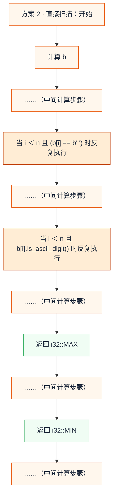

```rust
// LeetCode 8. 字符串转换整数 (atoi) — Rust 版（方案2）
fn my_atoi(s: String) -> i32 {
    // 定义函数/方法 my_atoi
    let b = s.as_bytes(); // 把 字符串.as_bytes() 存入 b
    let mut i = 0usize; // 把 0usize; 写入 let mut i
    let n = b.len(); // 把 b.长度() 存入 元素个数
    while i < n && (b[i] == b' ') {
        i += 1;
    } // 把 赋值为 b' ') { 下标 i 累加 1; } 写入 while i < n && (b[i]
    let mut sign = 1i64; // 把 1i64; 写入 let mut sign
    if i < n && (b[i] == b'+' || b[i] == b'-') {
        // 若 下标 i 小于 元素个数 且 (b[下标 i] 等于 b' 加 ' 或 b[下标 i] 等于 b' 减 '
        if b[i] == b'-' {
            sign = -1;
        } // 若 b[下标 i] 等于 b' 减 ' { sign 赋值为 减 1; }
        i += 1; // 下标 i累加 1
    }
    let mut ans: i64 = 0; // 把 0; 写入 let mut ans: i64
    while i < n && b[i].is_ascii_digit() {
        // while 下标 i 小于 元素个数 且 b[下标 i].is_ascii_digit() {
        ans = ans * 10 + (b[i] - b'0') as i64; // 把 答案 乘 10 加 (b[下标 i] 减 b'0') as i64; 写入 答案
        if ans > i32::MAX as i64 + 1 {
            ans = i32::MAX as i64 + 1;
        } // 若 答案 超过 i32::MAX as i64 加 1 { 答案 赋值为 i32::MAX as i64 加 1; }
        i += 1; // 下标 i累加 1
    }
    ans *= sign; // 把 sign; 写入 ans *
    if ans > i32::MAX as i64 {
        return i32::MAX;
    } // 若 答案 超过 i32::MAX as i64 { return i32::MAX; }
    if ans < i32::MIN as i64 {
        return i32::MIN;
    } // 若 答案 小于 i32::MIN as i64 { return i32::MIN; }
    ans as i32 // 答案 as i32
}
fn main() {
    // 程序入口：跑内嵌自测用例
    assert_eq!(my_atoi("42".to_string()), 42); // 断言校验
    assert_eq!(my_atoi(" -42".to_string()), -42); // 断言校验
    assert_eq!(my_atoi("4193 with words".to_string()), 4193); // 断言校验
    assert_eq!(my_atoi("-91283472332".to_string()), -2147483648); // 断言校验
    assert_eq!(my_atoi("words and 987".to_string()), 0); // 断言校验
    println!("PASS"); // 全部用例通过，输出 PASS
}
```

### Lua 实现（2 种方案）

Lua 的全部方案如下，每个方案都内嵌用例自测，可独立运行（老仓库 python/go 文件遵循「打印结果」约定）：

#### 方案 1：自动机 (DFA)

**思路与代码分析**：核心是「自动机 (DFA)」。Lua 版用表与 ipairs 遍历，注意 ipairs 遇 nil 即停的语义。**走读**：方案 1 · 自动机 (DFA)：开始 → 更新 i → 当 i ≤ n and s:sub(i, i) == do 时反复执行 → 当 i ≤ n and s:sub(i, i):match(%d) do 时反复执行 → 返回 2147483647 → 返回 -2147483648 → 返回 ans。

**运行架构**（真实控制流）：

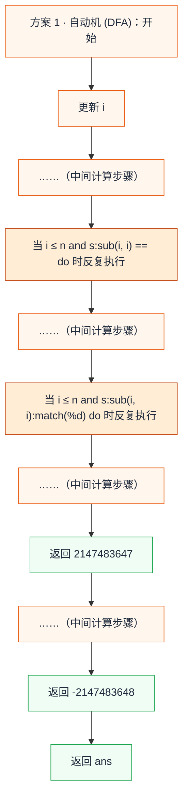

```lua
-- LeetCode 8. 字符串转换整数 (atoi) — Lua 版（方案1）
local function my_atoi(s) -- local function my_atoi(字符串)
	local i = 1 -- 把 1 写入 local i
	local n = #s -- 把 #字符串 写入 local n
	while i <= n and s:sub(i, i) == " " do
		i = i + 1
	end
	local sign = 1 -- 把 1 写入 local sign
	if i <= n and (s:sub(i, i) == "+" or s:sub(i, i) == "-") then
		if s:sub(i, i) == "-" then
			sign = -1
		end -- 若 字符串:sub(下标 i, 下标 i) 等于 「 减 」 then sign 赋值为 减 1 终点
		i = i + 1 -- 把 下标 i 加 1 存入 下标 i
	end -- 终点
	local ans = 0 -- 把 0 写入 local ans
	while i <= n and s:sub(i, i):match("%d") do
		ans = ans * 10 + tonumber(s:sub(i, i)) -- 把 答案 乘 10 加 tonumber(字符串:sub(下标 i, 下标 i)) 存入 答案
		if ans > 2147483648 then
			ans = 2147483648
		end -- 若 答案 超过 2147483648 then 答案 赋值为 2147483648 终点
		i = i + 1 -- 把 下标 i 加 1 存入 下标 i
	end -- 终点
	ans = ans * sign -- 把 答案 乘 sign 存入 答案
	if ans > 2147483647 then
		return 2147483647
	end -- 若 答案 超过 2147483647 then return 2147483647 终点
	if ans < -2147483648 then
		return -2147483648
	end -- 若 答案 小于 减 2147483648 then return 减 2147483648 终点
	return ans -- 返回 答案
end -- 终点
assert(my_atoi("42") == 42) -- 断言校验
assert(my_atoi(" -42") == -42) -- 断言校验
assert(my_atoi("4193 with words") == 4193) -- 断言校验
assert(my_atoi("-91283472332") == -2147483648) -- 断言校验
assert(my_atoi("words and 987") == 0) -- 断言校验
print("PASS") -- 全部用例通过，输出 PASS
```

#### 方案 2：直接扫描

**思路与代码分析**：核心是「直接扫描」。Lua 版用表与 ipairs 遍历，注意 ipairs 遇 nil 即停的语义。**走读**：方案 2 · 直接扫描：开始 → 更新 i → 当 i ≤ n and s:sub(i, i) == do 时反复执行 → 当 i ≤ n and s:sub(i, i):match(%d) do 时反复执行 → 返回 2147483647 → 返回 -2147483648 → 返回 ans。

**运行架构**（真实控制流）：

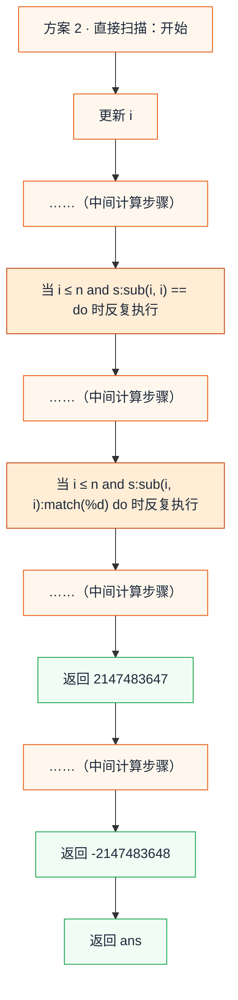

```lua
-- LeetCode 8. 字符串转换整数 (atoi) — Lua 版（方案2）
local function my_atoi(s) -- local function my_atoi(字符串)
	local i = 1 -- 把 1 写入 local i
	local n = #s -- 把 #字符串 写入 local n
	while i <= n and s:sub(i, i) == " " do
		i = i + 1
	end
	local sign = 1 -- 把 1 写入 local sign
	if i <= n and (s:sub(i, i) == "+" or s:sub(i, i) == "-") then
		if s:sub(i, i) == "-" then
			sign = -1
		end -- 若 字符串:sub(下标 i, 下标 i) 等于 「 减 」 then sign 赋值为 减 1 终点
		i = i + 1 -- 把 下标 i 加 1 存入 下标 i
	end -- 终点
	local ans = 0 -- 把 0 写入 local ans
	while i <= n and s:sub(i, i):match("%d") do
		ans = ans * 10 + tonumber(s:sub(i, i)) -- 把 答案 乘 10 加 tonumber(字符串:sub(下标 i, 下标 i)) 存入 答案
		if ans > 2147483648 then
			ans = 2147483648
		end -- 若 答案 超过 2147483648 then 答案 赋值为 2147483648 终点
		i = i + 1 -- 把 下标 i 加 1 存入 下标 i
	end -- 终点
	ans = ans * sign -- 把 答案 乘 sign 存入 答案
	if ans > 2147483647 then
		return 2147483647
	end -- 若 答案 超过 2147483647 then return 2147483647 终点
	if ans < -2147483648 then
		return -2147483648
	end -- 若 答案 小于 减 2147483648 then return 减 2147483648 终点
	return ans -- 返回 答案
end -- 终点
assert(my_atoi("42") == 42) -- 断言校验
assert(my_atoi(" -42") == -42) -- 断言校验
assert(my_atoi("4193 with words") == 4193) -- 断言校验
assert(my_atoi("-91283472332") == -2147483648) -- 断言校验
assert(my_atoi("words and 987") == 0) -- 断言校验
print("PASS") -- 全部用例通过，输出 PASS
```

### C 实现（2 种方案）

C 的全部方案如下，每个方案都内嵌用例自测，可独立运行（老仓库 python/go 文件遵循「打印结果」约定）：

#### 方案 1：自动机 (DFA)

**思路与代码分析**：核心是「自动机 (DFA)」。C 版手动管理下标与内存，循环边界全部显式写出。**走读**：方案 1 · 自动机 (DFA)：开始 → 更新 i → 当 (i ＜ n 且 s[i] == ' ') 时反复执行 → 当 (i ＜ n 且 isdigit((unsigned char)s[i])) 时反复执行 → 命中条件，直接返回 → 命中条件，直接返回 → 返回 (int)ans。

**运行架构**（真实控制流）：

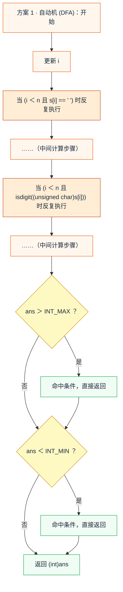

```c
/* LeetCode 8. 字符串转换整数 (atoi) — C 版（方案1） */
#include <ctype.h>                  // 引入头文件
#include <limits.h>                 // 引入头文件
#include <stdio.h>                  // 引入头文件
#include <string.h>                 // 引入头文件
static int my_atoi(const char *s) { // 定义函数/方法 my_atoi
    int i = 0, n = (int)strlen(s);  // 把 0, 元素个数 赋值为 (int)strlen(字符串) 存入 下标 i
    while (i < n && s[i] == ' ')
        i++; // 循环，直到不满足「下标 i 小于 元素个数 且 字符串[下标 i] 等于 ' ') 下标 i 加一 ;」
    int sign = 1; // 把 1 存入 sign
    if (i < n &&
        (s[i] == '+' ||
         s[i] ==
             '-')) { // 若 下标 i 小于 元素个数 且 (字符串[下标 i] 等于 ' 加 ' 或 字符串[下标 i] 等于 ' 减 '
        if (s[i] == '-')
            sign = -1; // 若 字符串[下标 i] 等于 ' 减 ') sign 赋值为 减 1;
        i++;           // 下标 i 加一
    }
    long ans = 0;                                   // 把 0; 写入 long ans
    while (i < n && isdigit((unsigned char)s[i])) { // 循环，直到不满足「下标 i 小于 元素个数 且
                                                    // isdigit((unsigned char)字符串[下标 i]」
        ans = ans * 10 + (s[i] - '0'); // 把 答案 乘 10 加 (字符串[下标 i] 减 '0'); 写入 答案
        if (ans > 2147483648L)
            ans = 2147483648L; // 若 答案 超过 2147483648L) 答案 赋值为 2147483648L;
        i++;                   // 下标 i 加一
    }
    ans *= sign; // 把 sign; 写入 ans *
    if (ans > INT_MAX)
        return INT_MAX; // 若 答案 超过 INT_MAX，直接返回 INT_MAX
    if (ans < INT_MIN)
        return INT_MIN; // 若 答案 小于 INT_MIN，直接返回 INT_MIN
    return (int)ans;    // 返回 (int)答案
}
int main(void) { // 程序入口：跑内嵌自测用例
    if (my_atoi("42") != 42) {
        printf("FAIL 1\n");
        return 1;
    } // 若 my_atoi(「42」) 不等于 42) { 输出「42」); return 1; }
    if (my_atoi(" -42") != -42) {
        printf("FAIL 2\n");
        return 1;
    } // 若 my_atoi(「 减 42」) 不等于 减 42) { 输出「 减 42」); return 1; }
    if (my_atoi("4193 with words") != 4193) {
        printf("FAIL 3\n");
        return 1;
    }
    if (my_atoi("-91283472332") != INT_MIN) {
        printf("FAIL 4\n");
        return 1;
    }
    if (my_atoi("words and 987") != 0) {
        printf("FAIL 5\n");
        return 1;
    }
    printf("PASS\n"); // 全部用例通过，输出 PASS
    return 0;         // 返回 0
}
```

#### 方案 2：直接扫描

**思路与代码分析**：核心是「直接扫描」。C 版手动管理下标与内存，循环边界全部显式写出。**走读**：方案 2 · 直接扫描：开始 → 更新 i → 当 (i ＜ n 且 s[i] == ' ') 时反复执行 → 当 (i ＜ n 且 isdigit((unsigned char)s[i])) 时反复执行 → 命中条件，直接返回 → 命中条件，直接返回 → 返回 (int)ans。

**运行架构**（真实控制流）：

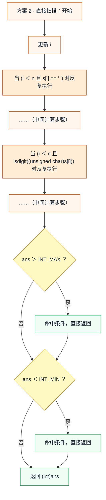

```c
/* LeetCode 8. 字符串转换整数 (atoi) — C 版（方案2） */
#include <ctype.h>                  // 引入头文件
#include <limits.h>                 // 引入头文件
#include <stdio.h>                  // 引入头文件
#include <string.h>                 // 引入头文件
static int my_atoi(const char *s) { // 定义函数/方法 my_atoi
    int i = 0, n = (int)strlen(s);  // 把 0, 元素个数 赋值为 (int)strlen(字符串) 存入 下标 i
    while (i < n && s[i] == ' ')
        i++; // 循环，直到不满足「下标 i 小于 元素个数 且 字符串[下标 i] 等于 ' ') 下标 i 加一 ;」
    int sign = 1; // 把 1 存入 sign
    if (i < n &&
        (s[i] == '+' ||
         s[i] ==
             '-')) { // 若 下标 i 小于 元素个数 且 (字符串[下标 i] 等于 ' 加 ' 或 字符串[下标 i] 等于 ' 减 '
        if (s[i] == '-')
            sign = -1; // 若 字符串[下标 i] 等于 ' 减 ') sign 赋值为 减 1;
        i++;           // 下标 i 加一
    }
    long ans = 0;                                   // 把 0; 写入 long ans
    while (i < n && isdigit((unsigned char)s[i])) { // 循环，直到不满足「下标 i 小于 元素个数 且
                                                    // isdigit((unsigned char)字符串[下标 i]」
        ans = ans * 10 + (s[i] - '0'); // 把 答案 乘 10 加 (字符串[下标 i] 减 '0'); 写入 答案
        if (ans > 2147483648L)
            ans = 2147483648L; // 若 答案 超过 2147483648L) 答案 赋值为 2147483648L;
        i++;                   // 下标 i 加一
    }
    ans *= sign; // 把 sign; 写入 ans *
    if (ans > INT_MAX)
        return INT_MAX; // 若 答案 超过 INT_MAX，直接返回 INT_MAX
    if (ans < INT_MIN)
        return INT_MIN; // 若 答案 小于 INT_MIN，直接返回 INT_MIN
    return (int)ans;    // 返回 (int)答案
}
int main(void) { // 程序入口：跑内嵌自测用例
    if (my_atoi("42") != 42) {
        printf("FAIL 1\n");
        return 1;
    } // 若 my_atoi(「42」) 不等于 42) { 输出「42」); return 1; }
    if (my_atoi(" -42") != -42) {
        printf("FAIL 2\n");
        return 1;
    } // 若 my_atoi(「 减 42」) 不等于 减 42) { 输出「 减 42」); return 1; }
    if (my_atoi("4193 with words") != 4193) {
        printf("FAIL 3\n");
        return 1;
    }
    if (my_atoi("-91283472332") != INT_MIN) {
        printf("FAIL 4\n");
        return 1;
    }
    if (my_atoi("words and 987") != 0) {
        printf("FAIL 5\n");
        return 1;
    }
    printf("PASS\n"); // 全部用例通过，输出 PASS
    return 0;         // 返回 0
}
```

### C++ 实现（2 种方案）

C++ 的全部方案如下，每个方案都内嵌用例自测，可独立运行（老仓库 python/go 文件遵循「打印结果」约定）：

#### 方案 1：自动机 (DFA)

**思路与代码分析**：核心是「自动机 (DFA)」。C++ 版用 STL 容器与迭代器，减少手写下标错误。**走读**：方案 1 · 自动机 (DFA)：开始 → 更新 i → 当 (i ＜ n 且 s[i] == ' ') 时反复执行 → 当 (i ＜ n 且 std::isdigit(static_cast＜unsigned char＞(s[i]))) 时反复执行 → 命中条件，直接返回 → 命中条件，直接返回 → 返回 static_cast＜int＞(ans)。

**运行架构**（真实控制流）：

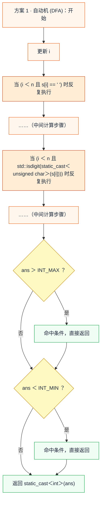

```cpp
// LeetCode 8. 字符串转换整数 (atoi) — C++ 版（方案1）
#include <cassert>                        // 引入头文件
#include <cctype>                         // 引入头文件
#include <climits>                        // 引入头文件
#include <iostream>                       // 引入头文件
#include <string>                         // 引入头文件
static int myAtoi(const std::string &s) { // 定义函数/方法 myAtoi
    size_t i = 0, n = s.size();           // 把 0, 元素个数 赋值为 字符串.大小(); 写入 size_t i
    while (i < n && s[i] == ' ')
        ++i; // 循环，直到不满足「下标 i 小于 元素个数 且 字符串[下标 i] 等于 ' ') 加一 下标 i;」
    long long sign = 1; // 把 1 存入 sign
    if (i < n &&
        (s[i] == '+' ||
         s[i] ==
             '-')) { // 若 下标 i 小于 元素个数 且 (字符串[下标 i] 等于 ' 加 ' 或 字符串[下标 i] 等于 ' 减 '
        if (s[i] == '-')
            sign = -1; // 若 字符串[下标 i] 等于 ' 减 ') sign 赋值为 减 1;
        ++i;           // 加一 下标 i;
    }
    long long ans = 0; // 把 0 存入 答案
    while (i < n && std::isdigit(static_cast<unsigned char>(s[i]))) {
        ans = ans * 10 + (s[i] - '0'); // 把 答案 乘 10 加 (字符串[下标 i] 减 '0'); 写入 答案
        if (ans > 2147483648LL)
            ans = 2147483648LL; // 若 答案 超过 2147483648LL) 答案 赋值为 2147483648LL;
        ++i;                    // 加一 下标 i;
    }
    ans *= sign; // 把 sign; 写入 ans *
    if (ans > INT_MAX)
        return INT_MAX; // 若 答案 超过 INT_MAX，直接返回 INT_MAX
    if (ans < INT_MIN)
        return INT_MIN;           // 若 答案 小于 INT_MIN，直接返回 INT_MIN
    return static_cast<int>(ans); // 返回 static_cast 小于 int 超过 (答案)
}
int main() {                                   // 程序入口：跑内嵌自测用例
    assert(myAtoi("42") == 42);                // 断言校验
    assert(myAtoi(" -42") == -42);             // 断言校验
    assert(myAtoi("4193 with words") == 4193); // 断言校验
    assert(myAtoi("-91283472332") == INT_MIN); // 断言校验
    assert(myAtoi("words and 987") == 0);      // 断言校验
    std::cout << "PASS" << std::endl;          // 全部用例通过，输出 PASS
    return 0;                                  // 返回 0
}
```

#### 方案 2：直接扫描

**思路与代码分析**：核心是「直接扫描」。C++ 版用 STL 容器与迭代器，减少手写下标错误。**走读**：方案 2 · 直接扫描：开始 → 更新 i → 当 (i ＜ n 且 s[i] == ' ') 时反复执行 → 当 (i ＜ n 且 std::isdigit(static_cast＜unsigned char＞(s[i]))) 时反复执行 → 命中条件，直接返回 → 命中条件，直接返回 → 返回 static_cast＜int＞(ans)。

**运行架构**（真实控制流）：

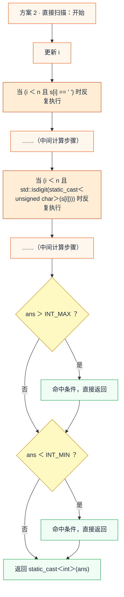

```cpp
// LeetCode 8. 字符串转换整数 (atoi) — C++ 版（方案2）
#include <cassert>                        // 引入头文件
#include <cctype>                         // 引入头文件
#include <climits>                        // 引入头文件
#include <iostream>                       // 引入头文件
#include <string>                         // 引入头文件
static int myAtoi(const std::string &s) { // 定义函数/方法 myAtoi
    size_t i = 0, n = s.size();           // 把 0, 元素个数 赋值为 字符串.大小(); 写入 size_t i
    while (i < n && s[i] == ' ')
        ++i; // 循环，直到不满足「下标 i 小于 元素个数 且 字符串[下标 i] 等于 ' ') 加一 下标 i;」
    long long sign = 1; // 把 1 存入 sign
    if (i < n &&
        (s[i] == '+' ||
         s[i] ==
             '-')) { // 若 下标 i 小于 元素个数 且 (字符串[下标 i] 等于 ' 加 ' 或 字符串[下标 i] 等于 ' 减 '
        if (s[i] == '-')
            sign = -1; // 若 字符串[下标 i] 等于 ' 减 ') sign 赋值为 减 1;
        ++i;           // 加一 下标 i;
    }
    long long ans = 0; // 把 0 存入 答案
    while (i < n && std::isdigit(static_cast<unsigned char>(s[i]))) {
        ans = ans * 10 + (s[i] - '0'); // 把 答案 乘 10 加 (字符串[下标 i] 减 '0'); 写入 答案
        if (ans > 2147483648LL)
            ans = 2147483648LL; // 若 答案 超过 2147483648LL) 答案 赋值为 2147483648LL;
        ++i;                    // 加一 下标 i;
    }
    ans *= sign; // 把 sign; 写入 ans *
    if (ans > INT_MAX)
        return INT_MAX; // 若 答案 超过 INT_MAX，直接返回 INT_MAX
    if (ans < INT_MIN)
        return INT_MIN;           // 若 答案 小于 INT_MIN，直接返回 INT_MIN
    return static_cast<int>(ans); // 返回 static_cast 小于 int 超过 (答案)
}
int main() {                                   // 程序入口：跑内嵌自测用例
    assert(myAtoi("42") == 42);                // 断言校验
    assert(myAtoi(" -42") == -42);             // 断言校验
    assert(myAtoi("4193 with words") == 4193); // 断言校验
    assert(myAtoi("-91283472332") == INT_MIN); // 断言校验
    assert(myAtoi("words and 987") == 0);      // 断言校验
    std::cout << "PASS" << std::endl;          // 全部用例通过，输出 PASS
    return 0;                                  // 返回 0
}
```

### R 实现（2 种方案）

R 的全部方案如下，每个方案都内嵌用例自测，可独立运行（老仓库 python/go 文件遵循「打印结果」约定）：

#### 方案 1：自动机 (DFA)

**思路与代码分析**：核心是「自动机 (DFA)」。R 版用向量化思维与 1 起始下标，注意 1:n 的降序陷阱。**走读**：方案 1 · 自动机 (DFA)：开始 → 处理 i ＜- 1 → 当 (i ≤ n 且 chars[i] == ) i ＜- i + 1L 时反复执行 → 当 (i ≤ n 且 grepl([0-9], chars[i])) 时反复执行 → 命中条件，直接返回 → 命中条件，直接返回。

**运行架构**（真实控制流）：

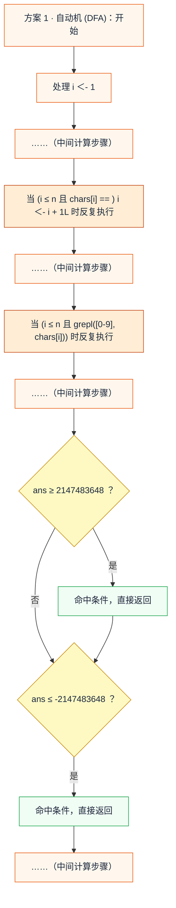

```r
# R 版（方案1） 定义函数 my_atoi（参数：字符串）
my_atoi <- function(s) {
    i <- 1
    n <- nchar(s)  # 把 1; 元素个数 小于 减 nchar(字符串) 存入 下标 i
    chars <- strsplit(s, "")[[1]]  # 把 strsplit(字符串, 「」)[[1]] 存入 chars
    while (i <= n && chars[i] == " ") i <- i + 1L
    sign <- 1  # 把 1 存入 sign
    if (i <= n && (chars[i] == "+" || chars[i] == "-")) {
        if (chars[i] == "-")
            sign <- -1  # 若 chars[下标 i] 等于 「 减 」) sign 小于 减 减 1
        i <- i + 1L  # 把 下标 i 加 1L 存入 下标 i
    }
    ans <- 0  # 把 0 存入 答案
    while (i <= n && grepl("[0-9]", chars[i])) {
        # 循环，直到不满足「下标 i 不超过 元素个数 且 grepl(「[0 减 9]」, chars[下标 i]」
        ans <- ans * 10 + as.integer(chars[i])  # 把 答案 乘 10 加 as.integer(chars[下标 i]) 存入 答案
        if (ans > 2147483648)
            ans <- 2147483648  # 若 答案 超过 2147483648) 答案 小于 减 2147483648
        i <- i + 1L  # 把 下标 i 加 1L 存入 下标 i
    }
    ans <- ans * sign  # 把 答案 乘 sign 存入 答案
    if (ans >= 2147483648)
        return(2147483647L)  # 若 答案 不低于 2147483648) return(2147483647L
    if (ans <= -2147483648)
        return(-2147483648)  # 若 答案 不超过 减 2147483648) return( 减 2147483648L
    as.integer(ans)  # as.integer(答案)
}
stopifnot(my_atoi("42") == 42)  # 断言校验
stopifnot(my_atoi(" -42") == -42)  # 断言校验
stopifnot(my_atoi("4193 with words") == 4193)  # 断言校验
stopifnot(my_atoi("-91283472332") == -2147483648)  # 断言校验
stopifnot(my_atoi("words and 987") == 0)  # 断言校验
cat("PASS\n")  # 全部用例通过，输出 PASS
```

#### 方案 2：直接扫描

**思路与代码分析**：核心是「直接扫描」。R 版用向量化思维与 1 起始下标，注意 1:n 的降序陷阱。**走读**：方案 2 · 直接扫描：开始 → 处理 i ＜- 1 → 当 (i ≤ n 且 chars[i] == ) i ＜- i + 1L 时反复执行 → 当 (i ≤ n 且 grepl([0-9], chars[i])) 时反复执行 → 命中条件，直接返回 → 命中条件，直接返回。

**运行架构**（真实控制流）：

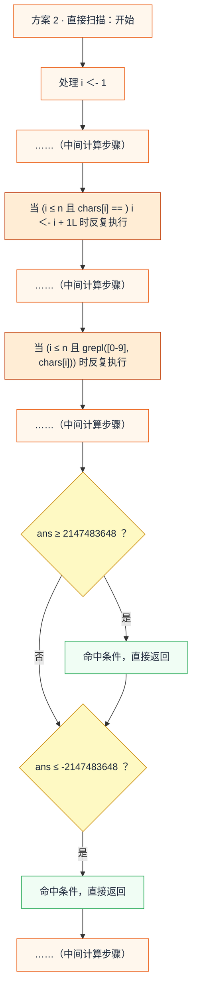

```r
# R 版（方案2） 定义函数 my_atoi（参数：字符串）
my_atoi <- function(s) {
    i <- 1
    n <- nchar(s)  # 把 1; 元素个数 小于 减 nchar(字符串) 存入 下标 i
    chars <- strsplit(s, "")[[1]]  # 把 strsplit(字符串, 「」)[[1]] 存入 chars
    while (i <= n && chars[i] == " ") i <- i + 1L
    sign <- 1  # 把 1 存入 sign
    if (i <= n && (chars[i] == "+" || chars[i] == "-")) {
        if (chars[i] == "-")
            sign <- -1  # 若 chars[下标 i] 等于 「 减 」) sign 小于 减 减 1
        i <- i + 1L  # 把 下标 i 加 1L 存入 下标 i
    }
    ans <- 0  # 把 0 存入 答案
    while (i <= n && grepl("[0-9]", chars[i])) {
        # 循环，直到不满足「下标 i 不超过 元素个数 且 grepl(「[0 减 9]」, chars[下标 i]」
        ans <- ans * 10 + as.integer(chars[i])  # 把 答案 乘 10 加 as.integer(chars[下标 i]) 存入 答案
        if (ans > 2147483648)
            ans <- 2147483648  # 若 答案 超过 2147483648) 答案 小于 减 2147483648
        i <- i + 1L  # 把 下标 i 加 1L 存入 下标 i
    }
    ans <- ans * sign  # 把 答案 乘 sign 存入 答案
    if (ans >= 2147483648)
        return(2147483647L)  # 若 答案 不低于 2147483648) return(2147483647L
    if (ans <= -2147483648)
        return(-2147483648)  # 若 答案 不超过 减 2147483648) return( 减 2147483648L
    as.integer(ans)  # as.integer(答案)
}
stopifnot(my_atoi("42") == 42)  # 断言校验
stopifnot(my_atoi(" -42") == -42)  # 断言校验
stopifnot(my_atoi("4193 with words") == 4193)  # 断言校验
stopifnot(my_atoi("-91283472332") == -2147483648)  # 断言校验
stopifnot(my_atoi("words and 987") == 0)  # 断言校验
cat("PASS\n")  # 全部用例通过，输出 PASS
```

### Zig 实现（2 种方案）

Zig 的全部方案如下，每个方案都内嵌用例自测，可独立运行（老仓库 python/go 文件遵循「打印结果」约定）：

#### 方案 1：自动机 (DFA)

**思路与代码分析**：核心是「自动机 (DFA)」。Zig 版显式分配与清零，整型边界处理严格。**走读**：方案 1 · 自动机 (DFA)：开始 → 计算 i → 当 (i ＜ n and s[i] == ' ') i += 1 时反复执行 → 当 (i ＜ n and std.ascii.isDigit(s[i])) 时反复执行 → 命中条件，直接返回 → 命中条件，直接返回 → 返回 @intCast(ans)。

**运行架构**（真实控制流）：

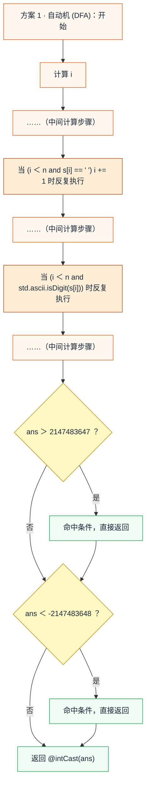

```zig
// LeetCode 8. 字符串转换整数 (atoi) — Zig 版（方案1）
const std = @import("std"); // 把 @import(「std」) 存入 std
fn myAtoi(s: []const u8) i32 { // 定义函数/方法 myAtoi
    var i: usize = 0; // 把 0; 写入 var i: usize
    const n = s.len; // 把 字符串.长度 存入 元素个数
    while (i < n and s[i] == ' ') i += 1; // 循环，直到不满足「下标 i 小于 元素个数 and 字符串[下标 i] 等于 ' ') 下标 i 累加 1;」
    var sign: i64 = 1; // 把 1; 写入 var sign: i64
    if (i < n and (s[i] == '+' or s[i] == '-')) { // 若 下标 i 小于 元素个数 and (字符串[下标 i] 等于 ' 加 ' or 字符串[下标 i] 等于 ' 减 '
        if (s[i] == '-') sign = -1; // 若 字符串[下标 i] 等于 ' 减 ') sign 赋值为 减 1;
        i += 1; // 下标 i累加 1
    }
    var ans: i64 = 0; // 把 0; 写入 var ans: i64
    while (i < n and std.ascii.isDigit(s[i])) { // 循环，直到不满足「下标 i 小于 元素个数 and std.ascii.isDigit(字符串[下标 i]」
        ans = ans * 10 + @as(i64, s[i] - '0'); // 把 答案 乘 10 加 @as(i64, 字符串[下标 i] 减 '0'); 写入 答案
        if (ans > 2147483648) ans = 2147483648; // 若 答案 超过 2147483648) 答案 赋值为 2147483648;
        i += 1; // 下标 i累加 1
    }
    ans *= sign; // 把 sign; 写入 ans *
    if (ans > 2147483647) return 2147483647; // 若 答案 超过 2147483647，直接返回 2147483647
    if (ans < -2147483648) return -2147483648; // 若 答案 小于 减 2147483648，直接返回 减 2147483648
    return @intCast(ans); // 返回 @intCast(答案)
}
pub fn main() !void { // 程序入口：跑内嵌自测用例
    if (myAtoi("42") != 42) return error.TestFailed; // 若 myAtoi(「42」) 不等于 42，直接返回 error.TestFailed
    if (myAtoi(" -42") != -42) return error.TestFailed; // 若 myAtoi(「 减 42」) 不等于 减 42，直接返回 error.TestFailed
    if (myAtoi("4193 with words") != 4193) return error.TestFailed; // 若 myAtoi(「4193 with 单词列表」) 不等于 4193，直接返回 error.TestFailed
    if (myAtoi("-91283472332") != -2147483648) return error.TestFailed;
    if (myAtoi("words and 987") != 0) return error.TestFailed; // 若 myAtoi(「单词列表 and 987」) 不等于 0，直接返回 error.TestFailed
    std.debug.print("PASS\n", .{}); // 全部用例通过，输出 PASS
}
```

#### 方案 2：直接扫描

**思路与代码分析**：核心是「直接扫描」。Zig 版显式分配与清零，整型边界处理严格。**走读**：方案 2 · 直接扫描：开始 → 计算 i → 当 (i ＜ n and s[i] == ' ') i += 1 时反复执行 → 当 (i ＜ n and std.ascii.isDigit(s[i])) 时反复执行 → 命中条件，直接返回 → 命中条件，直接返回 → 返回 @intCast(ans)。

**运行架构**（真实控制流）：

```mermaid
graph TD
    N0["方案 2 · 直接扫描：开始"]
    N1["计算 i"]
    D1["……（中间计算步骤）"]
    N3["当 (i ＜ n and s[i] == ' ') i += 1 时反复执行"]
    D2["……（中间计算步骤）"]
    N9["当 (i ＜ n and std.ascii.isDigit(s[i])) 时反复执行"]
    D3["……（中间计算步骤）"]
    N14{"ans ＞ 2147483647 ？"}
    N15["命中条件，直接返回"]
    N16{"ans ＜ -2147483648 ？"}
    N17["命中条件，直接返回"]
    N18["返回 @intCast(ans)"]
    N0 --> N1
    N14 -- 是 --> N15
    N14 -- 否 --> N16
    N16 -- 是 --> N17
    N16 -- 否 --> N18
    N1 --> D1
    D1 --> N3
    N3 --> D2
    D2 --> N9
    N9 --> D3
    D3 --> N14
    N15 --> N16
    N17 --> N18
    classDef n fill:#fff7ed,stroke:#ea580c,color:#1e293b;
    classDef lp fill:#ffedd5,stroke:#c2410c,color:#1e293b;
    classDef dc fill:#fef9c3,stroke:#ca8a04,color:#1e293b;
    classDef tm fill:#f0fdf4,stroke:#16a34a,color:#1e293b;
    class N0,N1,D1,D2,D3 n;
    class N3,N9 lp;
    class N14,N16 dc;
    class N15,N17,N18 tm;
```

```zig
// LeetCode 8. 字符串转换整数 (atoi) — Zig 版（方案2）
const std = @import("std"); // 把 @import(「std」) 存入 std
fn myAtoi(s: []const u8) i32 { // 定义函数/方法 myAtoi
    var i: usize = 0; // 把 0; 写入 var i: usize
    const n = s.len; // 把 字符串.长度 存入 元素个数
    while (i < n and s[i] == ' ') i += 1; // 循环，直到不满足「下标 i 小于 元素个数 and 字符串[下标 i] 等于 ' ') 下标 i 累加 1;」
    var sign: i64 = 1; // 把 1; 写入 var sign: i64
    if (i < n and (s[i] == '+' or s[i] == '-')) { // 若 下标 i 小于 元素个数 and (字符串[下标 i] 等于 ' 加 ' or 字符串[下标 i] 等于 ' 减 '
        if (s[i] == '-') sign = -1; // 若 字符串[下标 i] 等于 ' 减 ') sign 赋值为 减 1;
        i += 1; // 下标 i累加 1
    }
    var ans: i64 = 0; // 把 0; 写入 var ans: i64
    while (i < n and std.ascii.isDigit(s[i])) { // 循环，直到不满足「下标 i 小于 元素个数 and std.ascii.isDigit(字符串[下标 i]」
        ans = ans * 10 + @as(i64, s[i] - '0'); // 把 答案 乘 10 加 @as(i64, 字符串[下标 i] 减 '0'); 写入 答案
        if (ans > 2147483648) ans = 2147483648; // 若 答案 超过 2147483648) 答案 赋值为 2147483648;
        i += 1; // 下标 i累加 1
    }
    ans *= sign; // 把 sign; 写入 ans *
    if (ans > 2147483647) return 2147483647; // 若 答案 超过 2147483647，直接返回 2147483647
    if (ans < -2147483648) return -2147483648; // 若 答案 小于 减 2147483648，直接返回 减 2147483648
    return @intCast(ans); // 返回 @intCast(答案)
}
pub fn main() !void { // 程序入口：跑内嵌自测用例
    if (myAtoi("42") != 42) return error.TestFailed; // 若 myAtoi(「42」) 不等于 42，直接返回 error.TestFailed
    if (myAtoi(" -42") != -42) return error.TestFailed; // 若 myAtoi(「 减 42」) 不等于 减 42，直接返回 error.TestFailed
    if (myAtoi("4193 with words") != 4193) return error.TestFailed; // 若 myAtoi(「4193 with 单词列表」) 不等于 4193，直接返回 error.TestFailed
    if (myAtoi("-91283472332") != -2147483648) return error.TestFailed;
    if (myAtoi("words and 987") != 0) return error.TestFailed; // 若 myAtoi(「单词列表 and 987」) 不等于 0，直接返回 error.TestFailed
    std.debug.print("PASS\n", .{}); // 全部用例通过，输出 PASS
}
```

### Dart 实现（2 种方案）

Dart 的全部方案如下，每个方案都内嵌用例自测，可独立运行（老仓库 python/go 文件遵循「打印结果」约定）：

#### 方案 1：自动机 (DFA)

**思路与代码分析**：核心是「自动机 (DFA)」。Dart 版用可空类型标注与集合方法，注意空安全。**走读**：方案 1 · 自动机 (DFA)：开始 → 计算 i → 当 (i ＜ n 且 s[i] == ' ') 时反复执行 → 当 (i ＜ n 且 s.codeUnitAt(i) ≥ 0x30 且 s.codeUnitAt(i) ≤ 0x39) 时反复执行 → 命中条件，直接返回 → 命中条件，直接返回 → 返回 ans。

**运行架构**（真实控制流）：

```mermaid
graph TD
    N0["方案 1 · 自动机 (DFA)：开始"]
    N1["计算 i"]
    D1["……（中间计算步骤）"]
    N3["当 (i ＜ n 且 s[i] == ' ') 时反复执行"]
    D2["……（中间计算步骤）"]
    N10["当 (i ＜ n 且 s.codeUnitAt(i) ≥ 0x30 且 s.codeUnitAt(i) ≤ 0x39) 时反复执行"]
    D3["……（中间计算步骤）"]
    N19{"ans ＞ 2147483647 ？"}
    N20["命中条件，直接返回"]
    N21{"ans ＜ -2147483648 ？"}
    N22["命中条件，直接返回"]
    N23["返回 ans"]
    N0 --> N1
    N19 -- 是 --> N20
    N19 -- 否 --> N21
    N21 -- 是 --> N22
    N21 -- 否 --> N23
    N1 --> D1
    D1 --> N3
    N3 --> D2
    D2 --> N10
    N10 --> D3
    D3 --> N19
    N20 --> N21
    N22 --> N23
    classDef n fill:#fff7ed,stroke:#ea580c,color:#1e293b;
    classDef lp fill:#ffedd5,stroke:#c2410c,color:#1e293b;
    classDef dc fill:#fef9c3,stroke:#ca8a04,color:#1e293b;
    classDef tm fill:#f0fdf4,stroke:#16a34a,color:#1e293b;
    class N0,N1,D1,D2,D3 n;
    class N3,N10 lp;
    class N19,N21 dc;
    class N20,N22,N23 tm;
```

```dart
// LeetCode 8. 字符串转换整数 (atoi) — Dart 版（方案1）
int myAtoi(String s) {
  // 定义函数/方法 myAtoi
  var i = 0; // 把 0 存入 下标 i
  final n = s.length; // 把 字符串.长度 存入 元素个数
  while (i < n && s[i] == ' ')
    i++; // 循环，直到不满足「下标 i 小于 元素个数 且 字符串[下标 i] 等于 ' ') 下标 i 加一 ;」
  var sign = 1; // 把 1 存入 sign
  if (i < n && (s[i] == '+' || s[i] == '-')) {
    // 若 下标 i 小于 元素个数 且 (字符串[下标 i] 等于 ' 加 ' 或 字符串[下标 i] 等于 ' 减 '
    if (s[i] == '-') sign = -1; // 若 字符串[下标 i] 等于 ' 减 ') sign 赋值为 减 1;
    i++; // 下标 i 加一
  }
  var ans = 0; // 把 0 存入 答案
  while (i < n && s.codeUnitAt(i) >= 0x30 && s.codeUnitAt(i) <= 0x39) {
    ans =
        ans * 10 +
        (s.codeUnitAt(i) -
            0x30); // 把 答案 乘 10 加 (字符串.codeUnitAt(下标 i) 减 0x30) 存入 答案
    if (ans > 2147483648)
      ans = 2147483648; // 若 答案 超过 2147483648) 答案 赋值为 2147483648;
    i++; // 下标 i 加一
  }
  ans *= sign; // 把 sign; 写入 ans *
  if (ans > 2147483647) return 2147483647; // 若 答案 超过 2147483647，直接返回 2147483647
  if (ans < -2147483648)
    return -2147483648; // 若 答案 小于 减 2147483648，直接返回 减 2147483648
  return ans; // 返回 答案
}

void main() {
  // 程序入口：跑内嵌自测用例
  if (myAtoi('42') != 42)
    throw StateError('c1'); // 若 myAtoi('42') 不等于 42) throw StateError('c1');
  if (myAtoi(' -42') != -42)
    throw StateError(
      'c2',
    ); // 若 myAtoi(' 减 42') 不等于 减 42) throw StateError('c2');
  if (myAtoi('4193 with words') != 4193)
    throw StateError(
      'c3',
    ); // 若 myAtoi('4193 with 单词列表') 不等于 4193) throw StateError('c3');
  if (myAtoi('-91283472332') != -2147483648) throw StateError('c4');
  if (myAtoi('words and 987') != 0)
    throw StateError(
      'c5',
    ); // 若 myAtoi('单词列表 and 987') 不等于 0) throw StateError('c5');
  print('PASS'); // 全部用例通过，输出 PASS
}
```

#### 方案 2：直接扫描

**思路与代码分析**：核心是「直接扫描」。Dart 版用可空类型标注与集合方法，注意空安全。**走读**：方案 2 · 直接扫描：开始 → 计算 i → 当 (i ＜ n 且 s[i] == ' ') 时反复执行 → 当 (i ＜ n 且 s.codeUnitAt(i) ≥ 0x30 且 s.codeUnitAt(i) ≤ 0x39) 时反复执行 → 命中条件，直接返回 → 命中条件，直接返回 → 返回 ans。

**运行架构**（真实控制流）：

```mermaid
graph TD
    N0["方案 2 · 直接扫描：开始"]
    N1["计算 i"]
    D1["……（中间计算步骤）"]
    N3["当 (i ＜ n 且 s[i] == ' ') 时反复执行"]
    D2["……（中间计算步骤）"]
    N10["当 (i ＜ n 且 s.codeUnitAt(i) ≥ 0x30 且 s.codeUnitAt(i) ≤ 0x39) 时反复执行"]
    D3["……（中间计算步骤）"]
    N19{"ans ＞ 2147483647 ？"}
    N20["命中条件，直接返回"]
    N21{"ans ＜ -2147483648 ？"}
    N22["命中条件，直接返回"]
    N23["返回 ans"]
    N0 --> N1
    N19 -- 是 --> N20
    N19 -- 否 --> N21
    N21 -- 是 --> N22
    N21 -- 否 --> N23
    N1 --> D1
    D1 --> N3
    N3 --> D2
    D2 --> N10
    N10 --> D3
    D3 --> N19
    N20 --> N21
    N22 --> N23
    classDef n fill:#fff7ed,stroke:#ea580c,color:#1e293b;
    classDef lp fill:#ffedd5,stroke:#c2410c,color:#1e293b;
    classDef dc fill:#fef9c3,stroke:#ca8a04,color:#1e293b;
    classDef tm fill:#f0fdf4,stroke:#16a34a,color:#1e293b;
    class N0,N1,D1,D2,D3 n;
    class N3,N10 lp;
    class N19,N21 dc;
    class N20,N22,N23 tm;
```

```dart
// LeetCode 8. 字符串转换整数 (atoi) — Dart 版（方案2）
int myAtoi(String s) {
  // 定义函数/方法 myAtoi
  var i = 0; // 把 0 存入 下标 i
  final n = s.length; // 把 字符串.长度 存入 元素个数
  while (i < n && s[i] == ' ')
    i++; // 循环，直到不满足「下标 i 小于 元素个数 且 字符串[下标 i] 等于 ' ') 下标 i 加一 ;」
  var sign = 1; // 把 1 存入 sign
  if (i < n && (s[i] == '+' || s[i] == '-')) {
    // 若 下标 i 小于 元素个数 且 (字符串[下标 i] 等于 ' 加 ' 或 字符串[下标 i] 等于 ' 减 '
    if (s[i] == '-') sign = -1; // 若 字符串[下标 i] 等于 ' 减 ') sign 赋值为 减 1;
    i++; // 下标 i 加一
  }
  var ans = 0; // 把 0 存入 答案
  while (i < n && s.codeUnitAt(i) >= 0x30 && s.codeUnitAt(i) <= 0x39) {
    ans =
        ans * 10 +
        (s.codeUnitAt(i) -
            0x30); // 把 答案 乘 10 加 (字符串.codeUnitAt(下标 i) 减 0x30) 存入 答案
    if (ans > 2147483648)
      ans = 2147483648; // 若 答案 超过 2147483648) 答案 赋值为 2147483648;
    i++; // 下标 i 加一
  }
  ans *= sign; // 把 sign; 写入 ans *
  if (ans > 2147483647) return 2147483647; // 若 答案 超过 2147483647，直接返回 2147483647
  if (ans < -2147483648)
    return -2147483648; // 若 答案 小于 减 2147483648，直接返回 减 2147483648
  return ans; // 返回 答案
}

void main() {
  // 程序入口：跑内嵌自测用例
  if (myAtoi('42') != 42)
    throw StateError('c1'); // 若 myAtoi('42') 不等于 42) throw StateError('c1');
  if (myAtoi(' -42') != -42)
    throw StateError(
      'c2',
    ); // 若 myAtoi(' 减 42') 不等于 减 42) throw StateError('c2');
  if (myAtoi('4193 with words') != 4193)
    throw StateError(
      'c3',
    ); // 若 myAtoi('4193 with 单词列表') 不等于 4193) throw StateError('c3');
  if (myAtoi('-91283472332') != -2147483648) throw StateError('c4');
  if (myAtoi('words and 987') != 0)
    throw StateError(
      'c5',
    ); // 若 myAtoi('单词列表 and 987') 不等于 0) throw StateError('c5');
  print('PASS'); // 全部用例通过，输出 PASS
}
```

---

## 内容总结

- **字符串转换整数 (atoi)**（字符串 · Medium）：共 2 个方案，主线思路「自动机 (DFA)」；时间 O(n)（单趟线性扫描）；动画演示滑动窗口过程，附录给出 11 种语言 × 全部方案的可运行实现。
- 来源博客：[https://blog.csdn.net/tyro_java/article/details/145385760](https://blog.csdn.net/tyro_java/article/details/145385760)
- 导航：[📋 总目录](../) ｜ [← 082 自定义字符串排序](../082_自定义字符串排序/) ｜ [084 搜索插入位置 →](../084_搜索插入位置/)
