# 084 · 搜索插入位置（第四阶段 · 查找与排序 · Easy）

> **难度**：⭐ Easy ｜ **专题**：二分查找
> **学习定位**：第四阶段 · 查找与排序第 84 篇 ｜ **解法数**：1
> **内容总结**：**搜索插入位置**（二分查找 · Easy）：共 1 个方案，主线思路「二分查找」；时间 O(log n)；动画演示二分收缩过程，附录给出 11 种语言 × 全部方案的可运行实现。

---

## 题目描述

给定一个排序数组和一个目标值，在数组中找到目标值，并返回其索引。如果目标值不存在于数组中，返回它将会被按顺序插入的位置。

请必须使用时间复杂度为 `O(log n)` 的算法。

**用例（来自原题）**：

**示例 1**

```text
输入: nums = [1,3,5,6], target = 5
输出: 2
```

**示例 3**

```text
输入: nums = [1,3,5,6], target = 7
输出: 4
```
> ✅ **官方验证**：全部 TypeScript 解法已通过 leetcode.cn 官方示例用例验证（自动注入运行，全部 PASS）。题面与 [leetcode.cn 官方](https://leetcode.cn/problems/search-insert-position/)一致，示例配图取自官方题面。

**数据范围与注意事项**：

- `1 <= nums.length <= 10^4`
- `-10^4 <= nums[i] <= 10^4`
- `nums` 为 无重复元素 的 升序 排列数组
- `-10^4 <= target <= 10^4`
- **易错点**：区间开闭要前后一致，mid 计算用左加右减防溢出。

## 题目分析

**场景是什么**：有序数据上每次砍一半，对应真实开发里的字典查找、版本定位、容量规划。本题就是该场景的 Easy 级练习，主线做法是「二分查找」。

**主线怎么解**：把主解法从头到尾过一遍，它其实在依次做这几件事：二分收缩区间。

## 解题思路

**方案对比**（共 1 个方案，由浅入深）：

| 方案 | 时间复杂度 | 空间复杂度 |
|---|---|---|
| 方案 1 · 二分查找 | O(log n) | O(1) |

**怎么读这一篇**：

- 🐣 **新手路线**：把「题目描述」的示例 1 在纸上手推一遍 → 读方案 1（最直观的写法）与它的代码走读 → 按「运行方式」本地跑通看 PASS → 回头对比方案 2 之后的写法差在哪
- 🦅 **大佬路线**：直接锁定最优方案 1（二分查找，O(log n)）→ 跳读该方案代码与走读 → 用「逐步拆解与面试追问」补齐复杂度推导与边界追问

### 动态算法图（二分收缩，GIF 自动循环）


动画演示二分查找专题里二分收缩的典型过程；每个方案在「TypeScript 解题方案」一节还配了专属动画与专属流程图。

### 主解法流程图（真实控制流）

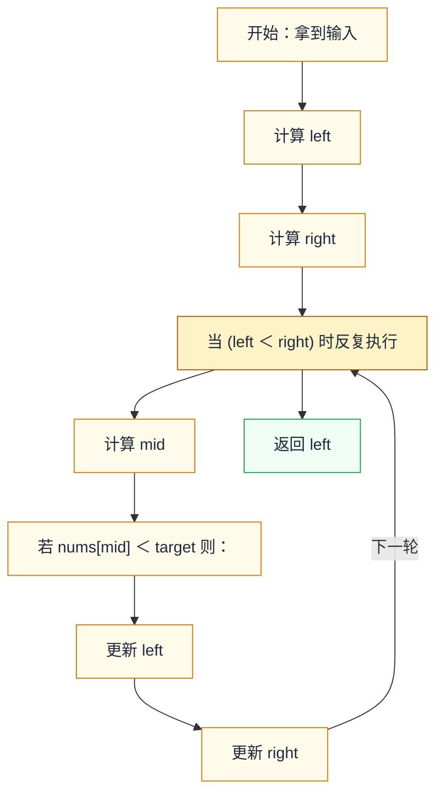

## TypeScript 解题方案（1 个方案逐个讲）

> **运行与提交**：每个方案都是自包含文件（内嵌用例自测，输出 PASS），整块复制到 `.ts` 文件后 `node 文件名` 即可运行。提交 LeetCode 时，把 `demo` 内的算法函数与辅助类型/函数整体取出、置于文件顶层即可。涉及交互/特殊接口的题以题面给定签名为准。

### 方案 1：二分查找

**分析与思路**：核心做法是「二分查找」。代码里依次做这些事：二分收缩区间。

**运行方式**：`node 本文件`，内嵌用例全部通过会输出 PASS。


**方案专属流程图**（真实控制流）：

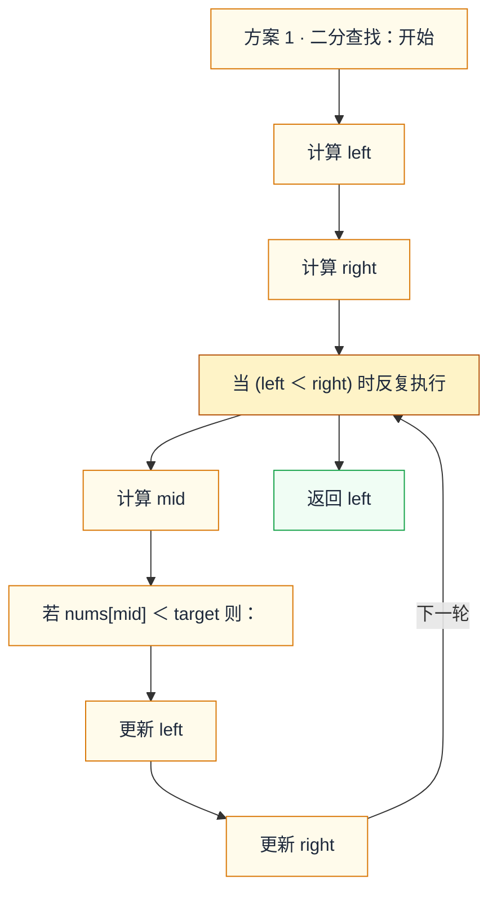

```typescript
/**
 ** LeetCode 35. 搜索插入位置
 ** 方案：1 ) 方案1：二分查找
 ** 来源：https://blog.csdn.net/tyro_java/article/details/145233077
 */

export function searchInsert(nums: number[], target: number): number {
  // 定义函数/方法 searchInsert
  let left = 0; // 把 0 存入 左边界
  let right = nums.length; // 把 数组.长度 存入 右边界
  while (left < right) {
    // 循环，直到不满足「左边界 小于 右边界」
    const mid = Math.floor((left + right) / 2); // 把 向下取整((左边界 加 右边界) 除以 2) 存入 中点
    if (nums[mid] < target) {
      // 若 数组[中点] 小于 目标值
      left = mid + 1; // 把 中点 加 1 存入 左边界
    } else {
      // 否则
      right = mid; // 把 中点 存入 右边界
    }
  }
  return left; // 返回 左边界
}

export function demo(): void {
  // 程序入口：跑内嵌自测用例
  if (searchInsert([1, 2, 3], 1) !== 0) throw new Error('FAILED');
  if (searchInsert([1, 3, 5, 6], 5) !== 2) throw new Error('FAILED');
  if (searchInsert([1, 3, 5, 6], 2) !== 1) throw new Error('FAILED');
  if (searchInsert([1, 3, 5, 6], 7) !== 4) throw new Error('FAILED');
  if (searchInsert([1, 3, 5, 6], 0) !== 0) throw new Error('FAILED');
  console.log('PASS'); // 全部用例通过，输出 PASS
}

demo(); // demo();
```

## 逐步拆解与面试追问

**复杂度**：时间 O(log n)，空间 O(1)

**为什么是这个量级**：每轮把候选区间砍半，n 个元素最多砍 log2(n) 轮

**面试官可能会追问**：

- mid 写成左加右减是防什么？
- 区间开闭不一致会怎样？
- 何时退化为线性查找？

## 关键 API 速查（TS 主解法实际用到，附官方链接）

| API | 作用 | 使用要点 | 官方文档 |
|---|---|---|---|
| `Math.floor()` | 向下取整 | 负数向负无穷（-1.5 → -2）；大数用位运算前注意 2^31 界 | [官方文档](https://developer.mozilla.org/zh-CN/docs/Web/JavaScript/Reference/Global_Objects/Math/floor) |

### 各语言官方文档导航

- **TypeScript / JS**：[MDN 中文参考](https://developer.mozilla.org/zh-CN/)
- **Python**：[Python 官方文档](https://docs.python.org/zh-cn/3/)
- **Go**：[Go 标准库](https://pkg.go.dev/std)
- **Java**：[JDK 17 API](https://docs.oracle.com/en/java/javase/17/docs/api/)
- **Rust**：[Rust 标准库](https://doc.rust-lang.org/std/)
- **Lua**：[Lua 5.4 手册](https://www.lua.org/manual/5.4/)
- **C**：[Cppreference C](https://zh.cppreference.com/w/c)
- **C++**：[Cppreference C++](https://zh.cppreference.com/w/cpp)
- **R**：[R 官方手册](https://stat.ethz.ch/R-manual/)
- **Zig**：[Zig 语言文档](https://ziglang.org/documentation/master/)
- **Dart**：[Dart API](https://api.dart.dev/)

## 附录：其他 10 种语言全部实现（每种语言列举其全部方案）

> TypeScript 的全部方案见「TypeScript 解题方案」一节；下面是其余 10 种语言的对应实现，每种语言的每个方案都带思路分析、代码走读与专属运行架构图。
> 每个方案都内嵌用例自测，可独立运行（老仓库 python/go 文件遵循「打印结果」约定）。
> 完整解法文件见 `dsa/<语言>/binary_search/lc_35_搜索插入位置/`。

### Python 实现（1 种方案）

Python 的全部方案如下，每个方案都内嵌用例自测，可独立运行（老仓库 python/go 文件遵循「打印结果」约定）：

#### 方案 1：二分查找

**思路与代码分析**：核心是「二分查找」。Python 版用切片与字典推导式简化操作，突出可读性。代码里依次做这些事：二分收缩区间。**走读**：方案 1 · 二分查找：开始 → 更新 right → 当 left ＜ right: 时反复执行 → 更新 mid → 若 nums[mid] ＜ target：更新 left → 更新 left → 更新 right → 返回 left。

**运行架构**（真实控制流）：

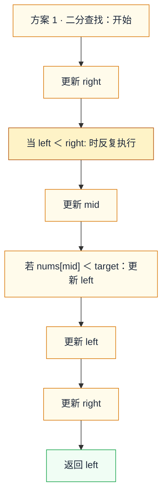

```python
import sys  # 提高递归深度上限（深输入防 RecursionError）

sys.setrecursionlimit(200000)  # 树/链表类题目节点数可达 1e4 量级

def searchInsert(nums, target):  # 定义函数 searchInsert（参数：数组, 目标值）
    left, right = 0, len(nums)  # 把 0, 长度(数组) 写入 left, right
    while left < right:  # 循环，直到不满足「左边界 小于 右边界」
        mid = (left + right) // 2  # 把 (左边界 加 右边界) 除以 除以 2 存入 中点
        if nums[mid] < target:  # 若 数组[中点] 小于 目标值
            left = mid + 1  # 把 中点 加 1 存入 左边界
        else:  # 否则
            right = mid  # 把 中点 存入 右边界
    return left  # 返回 左边界

if __name__ == "__main__":  # 若 __name__ 等于 '__main__'
    print(searchInsert([1, 2, 3], 1))  # 打印输出
```

### Go 实现（1 种方案）

Go 的全部方案如下，每个方案都内嵌用例自测，可独立运行（老仓库 python/go 文件遵循「打印结果」约定）：

#### 方案 1：二分查找

**思路与代码分析**：核心是「二分查找」。Go 版用切片与多返回值惯用法，显式处理索引边界。**走读**：方案 1 · 二分查找：开始 → 更新 : → 遍历循环 → 更新 : → 处理 if nums[mid] ＜ target → 更新 left → 更新 right → 返回 left。

**运行架构**（真实控制流）：

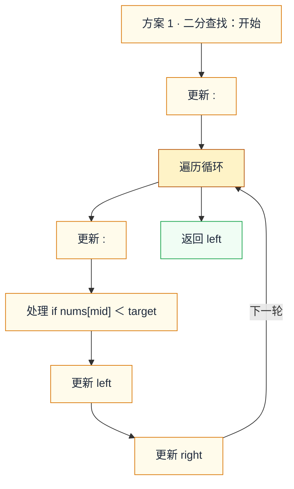

```go
package main // 引入依赖

import (
	"fmt" // 「fmt」
	"os"  // 「os」
)

// searchInsert 是 Python 参考 solution_1 的忠实翻译（二分查找返回 left）。
func searchInsert(nums []int, target int) int { // 定义函数/方法 searchInsert
	left, right := 0, len(nums) // 把 0, 长度(数组) 写入 left, right :
	for left < right {          // for 左边界 小于 右边界 {
		mid := (left + right) / 2 // 把 (左边界 加 右边界) 除以 2 写入 mid :
		if nums[mid] < target {   // 若 数组[中点] 小于 目标值
			left = mid + 1 // 把 中点 加 1 写入 左边界
		} else { // 否则
			right = mid // 把 中点 写入 右边界
		}
	}
	return left // 返回 左边界
}

func main() { // 程序入口：跑内嵌自测用例
	type tc struct { // 定义类型
		nums   []int // 数组 []int
		target int   // 目标值 int
		want   int   // want int
	}
	cases := []tc{ // 把 []tc{ 写入 cases :
		{[]int{1, 2, 3}, 1, 0},
		{[]int{1, 3, 5, 6}, 5, 2},
		{[]int{1, 3, 5, 6}, 2, 1},
		{[]int{1, 3, 5, 6}, 7, 4},
		{[]int{1, 3, 5, 6}, 0, 0},
		{[]int{}, 5, 0},
	}
	for _, c := range cases { // 同时取 _ 与 字符 遍历
		if got := searchInsert(c.nums, c.target); got != c.want { // 若 got : 赋值为 searchInsert(字符.数组, 字符.目标值); got 不等于 字符.want
			fmt.Printf("FAIL %v %d got=%d want=%d\n", c.nums, c.target, got, c.want) // 打印输出
			os.Exit(1)                                                               // os.Exit(1)
		}
	}
	fmt.Println("PASS") // 全部用例通过，输出 PASS
}
```

### Java 实现（1 种方案）

Java 的全部方案如下，每个方案都内嵌用例自测，可独立运行（老仓库 python/go 文件遵循「打印结果」约定）：

#### 方案 1：二分查找

**思路与代码分析**：核心是「二分查找」。Java 版用类与静态方法组织，集合操作显式明了。代码里依次做这些事：二分收缩区间。**走读**：方案 1 · 二分查找：开始 → 更新 left → 当 (left ＜ right) 时反复执行 → 更新 mid → 若 nums[mid] ＜ target：更新 left → 返回 left。

**运行架构**（真实控制流）：

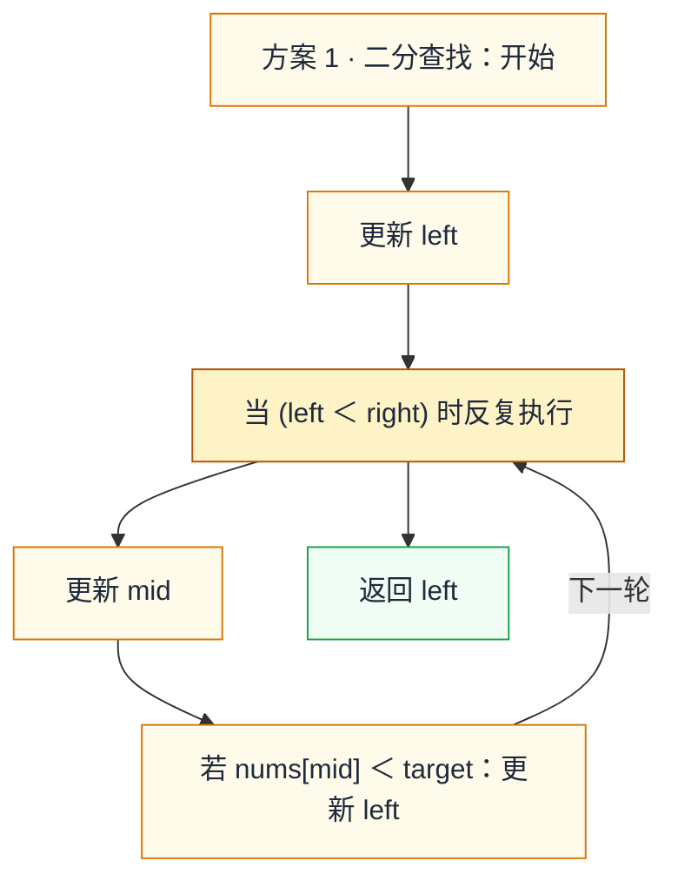

```java
package com.webfault.dsa; // 引入依赖

class Main { // 定义类型
  int searchInsert(int[] nums, int target) { // 定义函数/方法 searchInsert
    int left = 0, right = nums.length; // 把 0, 右边界 赋值为 数组.长度 存入 左边界
    while (left < right) { // 循环，直到不满足「左边界 小于 右边界」
      int mid = left + (right - left) / 2; // 把 (左边界 加 右边界) 除以 2 存入 中点
      if (nums[mid] < target) left = mid + 1; // 若 数组[中点] 小于 目标值) 左边界 赋值为 中点 加 1;
      else right = mid; // 否则
    }
    return left; // 返回 左边界
  }

  public static void main(String[] args) { // public static void main(String[] args) {
    Main s = new Main(); // 把 new Main(); 写入 Main s
    boolean ok = true; // 把 true; 写入 boolean ok
    if (s.searchInsert(new int[] {1, 3, 5, 6}, 5) != 2) {
      ok = false;
      System.out.println("FAIL 5");
    }
    if (s.searchInsert(new int[] {1, 3, 5, 6}, 2) != 1) {
      ok = false;
      System.out.println("FAIL 2");
    }
    if (s.searchInsert(new int[] {1, 3, 5, 6}, 7) != 4) {
      ok = false;
      System.out.println("FAIL 7");
    }
    if (s.searchInsert(new int[] {1, 3, 5, 6}, 0) != 0) {
      ok = false;
      System.out.println("FAIL 0");
    }
    if (s.searchInsert(new int[] {}, 5) != 0) {
      ok = false;
      System.out.println("FAIL empty");
    }
    if (!ok) throw new RuntimeException("FAILED"); // 若 取反 ok) throw new RuntimeException(「FAILED」);
    System.out.println("PASS"); // 全部用例通过，输出 PASS
  }
}
```

### Rust 实现（1 种方案）

Rust 的全部方案如下，每个方案都内嵌用例自测，可独立运行（老仓库 python/go 文件遵循「打印结果」约定）：

#### 方案 1：二分查找

**思路与代码分析**：核心是「二分查找」。Rust 版用所有权移动与切片借用改写同一逻辑，注意 Option 与引用边界。代码里依次做这些事：二分收缩区间。**走读**：方案 1 · 二分查找：开始 → 计算 let (mut left, mut right → 当 left ＜ right 时反复执行 → 计算 mid → 处理 if nums[mid] ＜ target → 更新 left → 更新 right → 处理 left → 返回结果。

**运行架构**（真实控制流）：

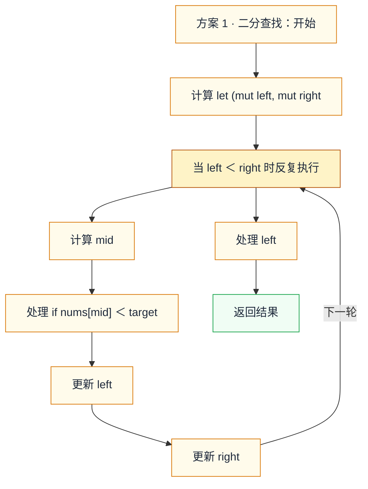

```rust
// LeetCode 35. 搜索插入位置 — Rust 版（方案1：二分查找）
fn search_insert(nums: &[i32], target: i32) -> usize {
    // 定义函数/方法 search_insert
    let (mut left, mut right) = (0usize, nums.len()); // 把 (0usize, 数组.长度()); 写入 let (mut left, mut right)
    while left < right {
        // while 左边界 小于 右边界 {
        let mid = left + (right - left) / 2; // 把 左边界 加 (右边界 减 左边界) 除以 2 存入 中点
        if nums[mid] < target {
            left = mid + 1;
        } else {
            right = mid;
        } // 若 数组[中点] 小于 目标值 { 左边界 赋值为 中点 加 1; } else { 右边界 赋值为 中点; }
    }
    left // 左边界
}
fn main() {
    // 程序入口：跑内嵌自测用例
    let a1 = [1, 2, 3]; // 把 [1, 2, 3] 存入 a1
    let a2 = [1, 3, 5, 6]; // 把 [1, 3, 5, 6] 存入 a2
    let cases = [
        (&a1[..], 1, 0usize),
        (&a2[..], 5, 2),
        (&a2[..], 2, 1),
        (&a2[..], 7, 4),
        (&a2[..], 0, 0),
    ];
    for (nums, t, want) in cases {
        // for (数组, 另一字符串, want) in cases {
        assert_eq!(search_insert(nums, t), want); // 断言校验
    }
    println!("PASS"); // 全部用例通过，输出 PASS
}
```

### Lua 实现（1 种方案）

Lua 的全部方案如下，每个方案都内嵌用例自测，可独立运行（老仓库 python/go 文件遵循「打印结果」约定）：

#### 方案 1：二分查找

**思路与代码分析**：核心是「二分查找」。Lua 版用表与 ipairs 遍历，注意 ipairs 遇 nil 即停的语义。代码里依次做这些事：二分收缩区间。**走读**：方案 1 · 二分查找：开始 → 更新 right → 当 left ＜ right do 时反复执行 → 更新 mid → 处理 if nums[mid] ＜ target then → 更新 left → 更新 right → 返回 left - 1。

**运行架构**（真实控制流）：

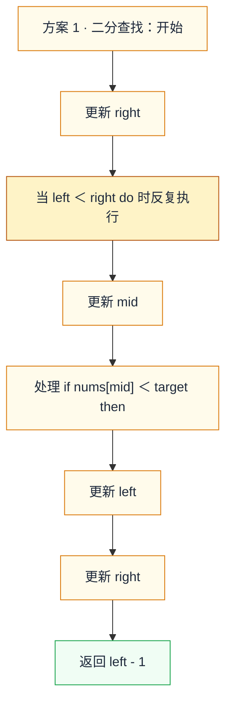

```lua
-- LeetCode 35. 搜索插入位置 — Lua 版（方案1：二分查找）
local function search_insert(nums, target) -- local function search_insert(数组, 目标值)
	local left, right = 1, #nums + 1 -- 把 1, #数组 加 1 写入 local left, right
	while left < right do -- while 左边界 小于 右边界 do
		local mid = math.floor((left + right) / 2) -- 把 math.floor((左边界 加 右边界) 除以 2) 写入 local mid
		if nums[mid] < target then
			left = mid + 1
		else
			right = mid
		end -- 若 数组[中点] 小于 目标值 then 左边界 赋值为 中点 加 1 else 右边界 赋值为 中点 终点
	end -- 终点
	return left - 1 -- 返回 左边界 减 1
end -- 终点
local cases = { -- 把 { 写入 local cases
	{ { 1, 2, 3 }, 1, 0 },
	{ { 1, 3, 5, 6 }, 5, 2 },
	{ { 1, 3, 5, 6 }, 2, 1 },
	{ { 1, 3, 5, 6 }, 7, 4 },
	{ { 1, 3, 5, 6 }, 0, 0 },
}
for _, c in ipairs(cases) do -- 遍历取 字符
	assert(search_insert(c[1], c[2]) == c[3], "case failed") -- 断言校验
end -- 终点
print("PASS") -- 全部用例通过，输出 PASS
```

### C 实现（1 种方案）

C 的全部方案如下，每个方案都内嵌用例自测，可独立运行（老仓库 python/go 文件遵循「打印结果」约定）：

#### 方案 1：二分查找

**思路与代码分析**：核心是「二分查找」。C 版手动管理下标与内存，循环边界全部显式写出。代码里依次做这些事：二分收缩区间。**走读**：方案 1 · 二分查找：开始 → 更新 left → 当 (left ＜ right) 时反复执行 → 更新 mid → 若 nums[mid] ＜ target：更新 left → 更新 left → 更新 right → 返回 left。

**运行架构**（真实控制流）：

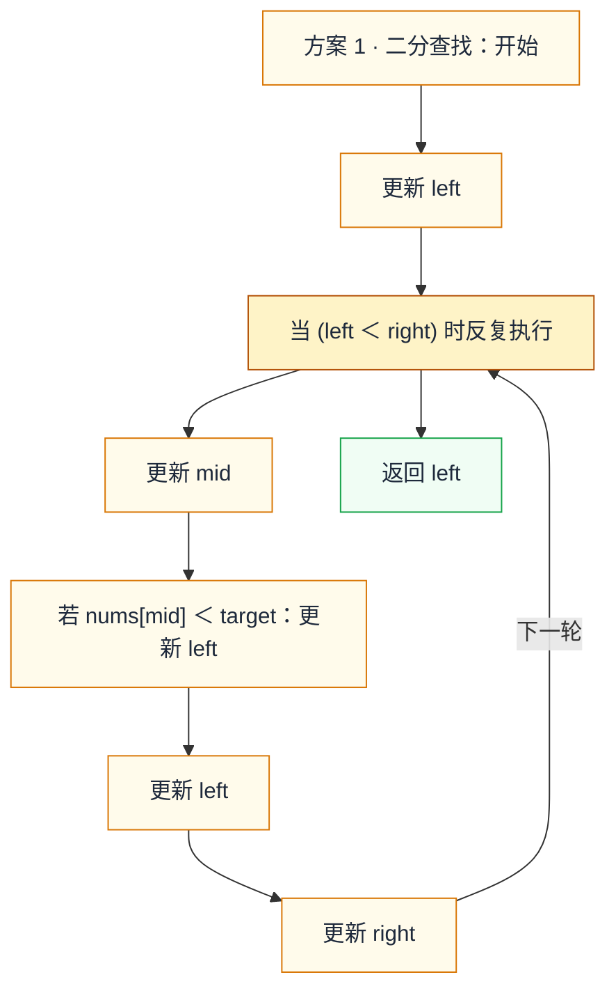

```c
* LeetCode 35. 搜索插入位置 — C 版（方案1：二分查找） */
#include <stdio.h>                                      // 引入头文件
int search_insert(const int *nums, int n, int target) { // 定义函数/方法 search_insert
    int left = 0, right = n;                 // 把 0, 右边界 赋值为 元素个数 存入 左边界
    while (left < right) {                   // 循环，直到不满足「左边界 小于 右边界」
        int mid = left + (right - left) / 2; // 把 左边界 加 (右边界 减 左边界) 除以 2 存入 中点
        if (nums[mid] < target)
            left = mid + 1;
        else
            right = mid; // 若 数组[中点] 小于 目标值) 左边界 赋值为 中点 加 1; else 右边界 赋值为 中点;
    }
    return left; // 返回 左边界
}
int main(void) {                              // 程序入口：跑内嵌自测用例
    int a1[] = {1, 2, 3}, a[] = {1, 3, 5, 6}; // 把 {1, 2, 3}, 数组[] 赋值为 {1, 3, 5, 6}; 写入 int a1[]
    struct {
        const int *nums;
        int n;
        int t;
        int want;
    } cs[] = {
        {a1, 3, 1, 0}, {a, 4, 5, 2}, {a, 4, 2, 1}, {a, 4, 7, 4}, {a, 4, 0, 0},
    };
    for (int i = 0; i < 5; i++) // 让 下标 i 从 0 开始计数，下标 i 小于 5 就继续
        if (search_insert(cs[i].nums, cs[i].n, cs[i].t) != cs[i].want) {
            printf("FAIL %d\n", i);
            return 1;
        }
    printf("PASS\n"); // 全部用例通过，输出 PASS
    return 0;         // 返回 0
}
```

### C++ 实现（1 种方案）

C++ 的全部方案如下，每个方案都内嵌用例自测，可独立运行（老仓库 python/go 文件遵循「打印结果」约定）：

#### 方案 1：二分查找

**思路与代码分析**：核心是「二分查找」。C++ 版用 STL 容器与迭代器，减少手写下标错误。代码里依次做这些事：二分收缩区间。**走读**：方案 1 · 二分查找：开始 → 更新 left → 调用 nums.size()) → 当 (left ＜ right) 时反复执行 → 更新 mid → 若 nums[mid] ＜ target：更新 left → 更新 left → 更新 right → 返回 left。

**运行架构**（真实控制流）：

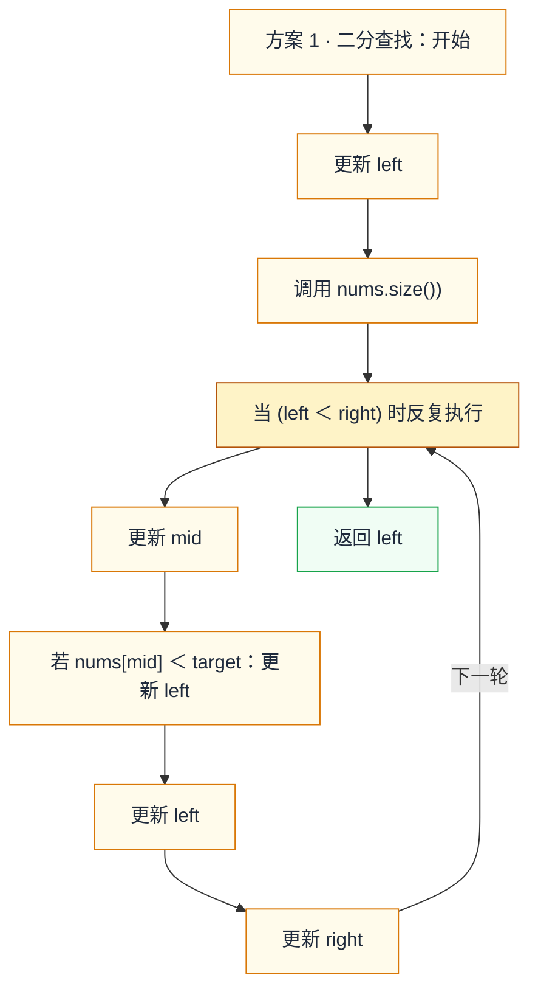

```cpp
// LeetCode 35. 搜索插入位置 — C++ 版（方案1：二分查找）
#include <cassert>                                           // 引入头文件
#include <iostream>                                          // 引入头文件
#include <vector>                                            // 引入头文件
int searchInsert(const std::vector<int> &nums, int target) { // 定义函数/方法 searchInsert
    int left = 0, right = static_cast<int>(
                      nums.size()); // 把 0, 右边界 赋值为 static_cast 小于 int 超过 (数组.大小()) 存入 左边界
    while (left < right) {                   // 循环，直到不满足「左边界 小于 右边界」
        int mid = left + (right - left) / 2; // 把 左边界 加 (右边界 减 左边界) 除以 2 存入 中点
        if (nums[mid] < target)
            left = mid + 1;
        else
            right = mid; // 若 数组[中点] 小于 目标值) 左边界 赋值为 中点 加 1; else 右边界 赋值为 中点;
    }
    return left; // 返回 左边界
}
int main() {                                    // 程序入口：跑内嵌自测用例
    assert(searchInsert({1, 2, 3}, 1) == 0);    // 断言校验
    assert(searchInsert({1, 3, 5, 6}, 5) == 2); // 断言校验
    assert(searchInsert({1, 3, 5, 6}, 2) == 1); // 断言校验
    assert(searchInsert({1, 3, 5, 6}, 7) == 4); // 断言校验
    assert(searchInsert({1, 3, 5, 6}, 0) == 0); // 断言校验
    std::cout << "PASS" << std::endl;           // 全部用例通过，输出 PASS
}
```

### R 实现（1 种方案）

R 的全部方案如下，每个方案都内嵌用例自测，可独立运行（老仓库 python/go 文件遵循「打印结果」约定）：

#### 方案 1：二分查找

**思路与代码分析**：核心是「二分查找」。R 版用向量化思维与 1 起始下标，注意 1:n 的降序陷阱。代码里依次做这些事：二分收缩区间。**走读**：方案 1 · 二分查找：开始 → 处理 left ＜- 1L → 处理 right ＜- length(nums) + 1L → 当 (left ＜ right) 时反复执行 → 处理 mid ＜- left + (right - left) → 若 nums[mid] ＜ target：处理 left ＜- mid + 1L else right → 处理 left ＜- mid + 1L else right → 处理 left - 1L → 返回结果。

**运行架构**（真实控制流）：

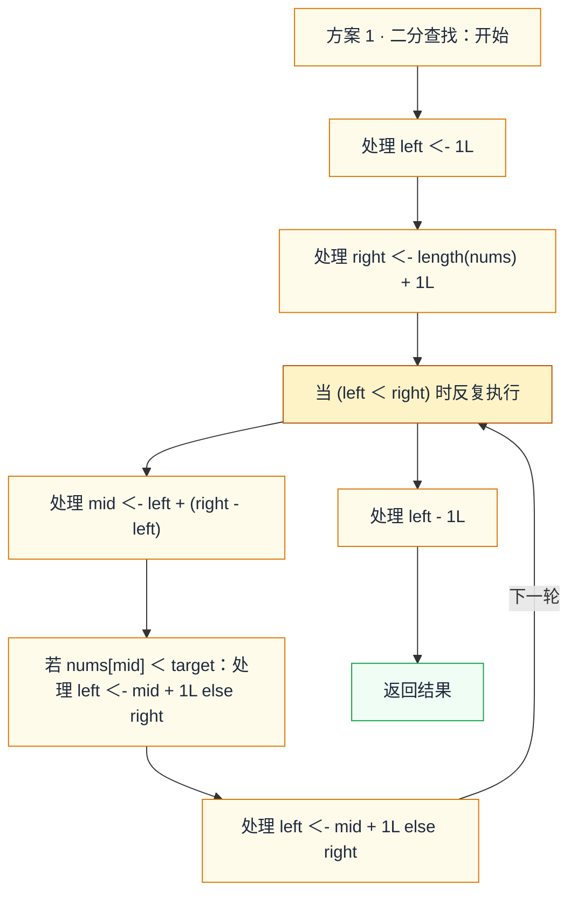

```r
# 版（方案1：二分查找） 定义函数 search_insert（参数：数组, 目标值）
search_insert <- function(nums, target) {
    left <- 1L
    right <- length(nums) + 1L  # 把 1L; 右边界 小于 减 长度(数组) 加 1L 存入 左边界
    while (left < right) {
        # 循环，直到不满足「左边界 小于 右边界」
        mid <- left + (right - left)%/%2L  # 把 左边界 加 (右边界 减 左边界) 对…取模 除以 对…取模 2L 存入 中点
        if (nums[mid] < target)
            left <- mid + 1L else right <- mid  # 若 数组[中点] 小于 目标值) 左边界 小于 减 中点 加 1L else 右边界 小于 减 中点
    }
    left - 1L  # 左边界 减 1L
}
stopifnot(search_insert(c(1L, 2L, 3L), 1L) == 0L)  # 断言校验
stopifnot(search_insert(c(1L, 3L, 5L, 6L), 5L) == 2L)  # 断言校验
stopifnot(search_insert(c(1L, 3L, 5L, 6L), 2L) == 1L)  # 断言校验
stopifnot(search_insert(c(1L, 3L, 5L, 6L), 7L) == 4L)  # 断言校验
stopifnot(search_insert(c(1L, 3L, 5L, 6L), 0L) == 0L)  # 断言校验
cat("PASS\n")  # 全部用例通过，输出 PASS
```

### Zig 实现（1 种方案）

Zig 的全部方案如下，每个方案都内嵌用例自测，可独立运行（老仓库 python/go 文件遵循「打印结果」约定）：

#### 方案 1：二分查找

**思路与代码分析**：核心是「二分查找」。Zig 版显式分配与清零，整型边界处理严格。代码里依次做这些事：二分收缩区间。**走读**：方案 1 · 二分查找：开始 → 计算 left → 计算 right → 当 (left ＜ right) 时反复执行 → 计算 mid → 若 nums[mid] ＜ target：更新 left → 返回 left。

**运行架构**（真实控制流）：

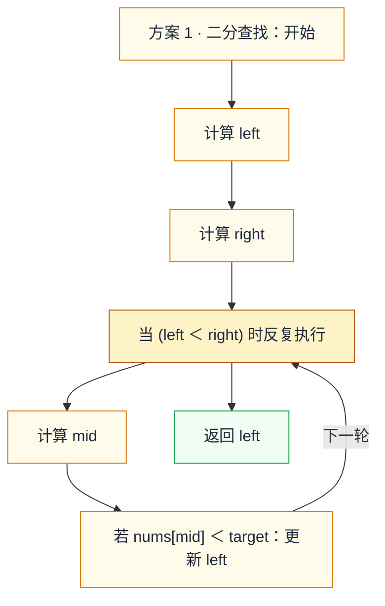

```zig
// LeetCode 35. 搜索插入位置 — Zig 版（方案1：二分查找）
const std = @import("std"); // 把 @import(「std」) 存入 std
fn searchInsert(nums: []const i32, target: i32) usize { // 定义函数/方法 searchInsert
    var left: usize = 0; // 把 0; 写入 var left: usize
    var right: usize = nums.len; // 把 数组.长度; 写入 var right: usize
    while (left < right) { // 循环，直到不满足「左边界 小于 右边界」
        const mid = left + (right - left) / 2; // 把 左边界 加 (右边界 减 左边界) 除以 2 存入 中点
        if (nums[mid] < target) left = mid + 1 else right = mid; // 若 数组[中点] 小于 目标值) 左边界 赋值为 中点 加 1 else 右边界 赋值为 中点;
    }
    return left; // 返回 左边界
}
pub fn main() !void { // 程序入口：跑内嵌自测用例
    const a1 = [_]i32{ 1, 2, 3 }; // 把 [_]i32{ 1, 2, 3 } 存入 a1
    const a2 = [_]i32{ 1, 3, 5, 6 }; // 把 [_]i32{ 1, 3, 5, 6 } 存入 a2
    const Case = struct { nums: []const i32, t: i32, want: usize };
    const cases = [_]Case{ // 把 [_]Case{ 存入 cases
        .{ .nums = &a1, .t = 1, .want = 0 },
        .{ .nums = &a2, .t = 5, .want = 2 },
        .{ .nums = &a2, .t = 2, .want = 1 },
        .{ .nums = &a2, .t = 7, .want = 4 },
        .{ .nums = &a2, .t = 0, .want = 0 },
    };
    for (cases, 0..) |c, i| { // for (cases, 0..) 按位或 字符, 下标 i 按位或 {
        if (searchInsert(c.nums, c.t) != c.want) { // 若 searchInsert(字符.数组, 字符.另一字符串) 不等于 字符.want
            std.debug.print("FAIL case {d}\n", .{i}); // 打印输出
            return error.TestFailed; // 返回 error.TestFailed
        }
    }
    std.debug.print("PASS\n", .{}); // 全部用例通过，输出 PASS
}
```

### Dart 实现（1 种方案）

Dart 的全部方案如下，每个方案都内嵌用例自测，可独立运行（老仓库 python/go 文件遵循「打印结果」约定）：

#### 方案 1：二分查找

**思路与代码分析**：核心是「二分查找」。Dart 版用可空类型标注与集合方法，注意空安全。代码里依次做这些事：二分收缩区间。**走读**：方案 1 · 二分查找：开始 → 计算 left → 当 (left ＜ right) 时反复执行 → 更新 mid → 若 nums[mid] ＜ target 则： → 更新 left → 更新 right → 返回 left。

**运行架构**（真实控制流）：

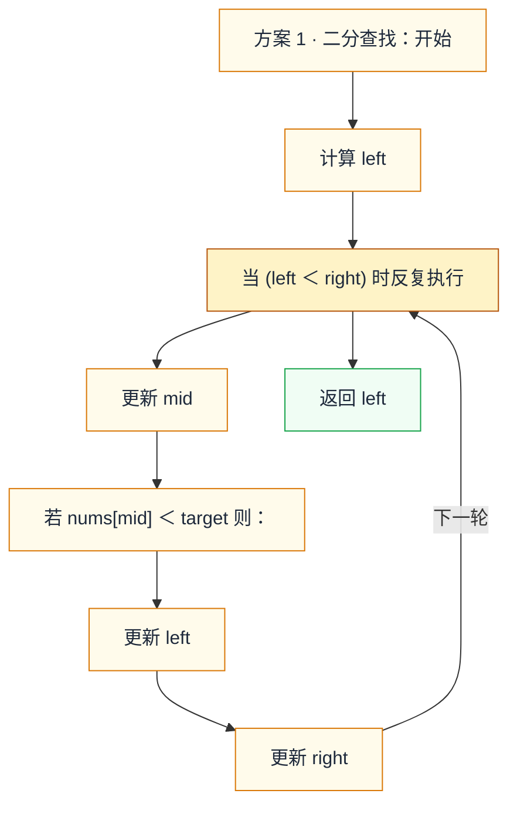

```dart
// LeetCode 35. 搜索插入位置 — Dart 版（方案1：二分查找）
int searchInsert(List<int> nums, int target) {
  // 定义函数/方法 searchInsert
  var left = 0, right = nums.length; // 把 0, 右边界 赋值为 数组.长度 存入 左边界
  while (left < right) {
    // 循环，直到不满足「左边界 小于 右边界」
    final mid = left + (right - left) ~/ 2; // 把 左边界 加 (右边界 减 左边界) ~ 除以 2 存入 中点
    if (nums[mid] < target) {
      // 若 数组[中点] 小于 目标值
      left = mid + 1; // 把 中点 加 1 存入 左边界
    } else {
      // 否则
      right = mid; // 把 中点 存入 右边界
    }
  }
  return left; // 返回 左边界
}

void main() {
  // 程序入口：跑内嵌自测用例
  final r = <bool>[
    searchInsert([1, 2, 3], 1) == 0,
    searchInsert([1, 3, 5, 6], 5) == 2,
    searchInsert([1, 3, 5, 6], 2) == 1,
    searchInsert([1, 3, 5, 6], 7) == 4,
    searchInsert([1, 3, 5, 6], 0) == 0,
  ];
  if (r.any((e) => !e)) throw StateError('case failed');
  print('PASS'); // 全部用例通过，输出 PASS
}
```

---

## 内容总结

- **搜索插入位置**（二分查找 · Easy）：共 1 个方案，主线思路「二分查找」；时间 O(log n)；动画演示二分收缩过程，附录给出 11 种语言 × 全部方案的可运行实现。
- 来源博客：[https://blog.csdn.net/tyro_java/article/details/145233077](https://blog.csdn.net/tyro_java/article/details/145233077)
- 导航：[📋 总目录](../) ｜ [← 083 字符串转换整数 (atoi)](../083_字符串转换整数_%28atoi%29/) ｜ [085 堆排序 →](../085_堆排序/)
