# 085 · 堆排序（第四阶段 · 查找与排序 · Medium）

> **难度**：⭐⭐ Medium ｜ **专题**：排序
> **学习定位**：第四阶段 · 查找与排序第 85 篇 ｜ **解法数**：1
> **内容总结**：**堆排序**（排序 · Medium）：共 1 个方案，主线思路「迭代指针处理」；时间 O(n)（单趟线性扫描）；动画演示冒泡交换过程，附录给出 11 种语言 × 全部方案的可运行实现。

---

## 题目描述

堆排序。具体输入输出约定见函数签名与用例。

- 主函数签名：`function treeToLevel(root: any): any[]`

**用例演示**（摘自主解法内嵌自测，输入到输出一目了然）：

```typescript
  const cases = [
    { in: [[5, 2, 4, 6, 1, 3]], want: [1, 2, 3, 4, 5, 6] },
    { in: [[9, 8, 7, 6, 5]], want: [5, 6, 7, 8, 9] },
    { in: [[1, 2, 3]], want: [1, 2, 3] },
    { in: [[]], want: [] },
  ];
```

**数据范围与注意事项**：

- **易错点**：比较器返回值的正负含义，写反了排序结果直接错。

## 题目分析

**场景是什么**：排序是多数算法的前置工序，这类题练的是比较逻辑与稳定性取舍。本题就是该场景的 Medium 级练习，主线做法是「迭代指针处理」。

**主线怎么解**：把主解法从头到尾过一遍，它其实在依次做这几件事：队列或堆的调度。

## 解题思路

**方案对比**（共 1 个方案，由浅入深）：

| 方案 | 时间复杂度 | 空间复杂度 |
|---|---|---|
| 方案 1 · 迭代指针处理 | O(n)（单趟线性扫描） | O(1) 到 O(n)（视辅助结构） |

**怎么读这一篇**：

- 🐣 **新手路线**：把「题目描述」的示例 1 在纸上手推一遍 → 读方案 1（最直观的写法）与它的代码走读 → 按「运行方式」本地跑通看 PASS → 回头对比方案 2 之后的写法差在哪
- 🦅 **大佬路线**：直接锁定最优方案 1（迭代指针处理，O(n)（单趟线性扫描））→ 跳读该方案代码与走读 → 用「逐步拆解与面试追问」补齐复杂度推导与边界追问

### 动态算法图（冒泡交换，GIF 自动循环）


动画演示排序专题里冒泡交换的典型过程；每个方案在「TypeScript 解题方案」一节还配了专属动画与专属流程图。

### 主解法流程图（真实控制流）

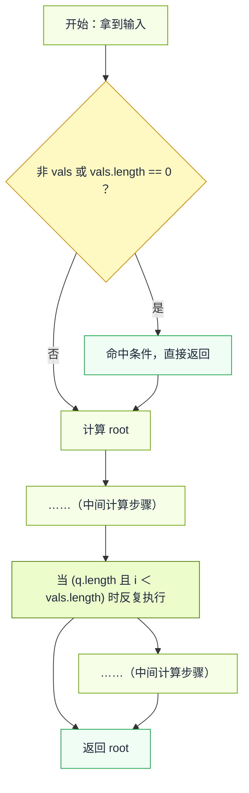

## TypeScript 解题方案（1 个方案逐个讲）

> **运行与提交**：每个方案都是自包含文件（内嵌用例自测，输出 PASS），整块复制到 `.ts` 文件后 `node 文件名` 即可运行。提交 LeetCode 时，把 `demo` 内的算法函数与辅助类型/函数整体取出、置于文件顶层即可。涉及交互/特殊接口的题以题面给定签名为准。

### 方案 1：迭代指针处理

**分析与思路**：核心做法是「迭代指针处理」。代码里依次做这些事：队列或堆的调度。

**运行方式**：`node 本文件`，内嵌用例全部通过会输出 PASS。


**方案专属流程图**（真实控制流）：

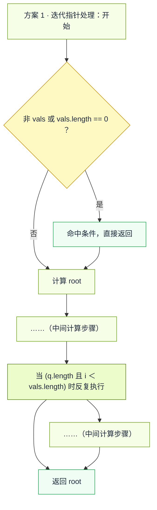

```typescript
class TreeNode {
  // 定义类型
  val: any;
  left: any;
  right: any; // 值: any; 左边界: any; 右边界: any;
  constructor(val?: any, left?: any, right?: any) {
    // constructor(值?: any, 左边界?: any, 右边界?: any) {
    this.val = val === undefined ? 0 : val; // 把 (值 全等于 undefined ? 0 : 值); 写入 值
    this.left = left === undefined ? null : left; // 把 (左边界 全等于 undefined ? null : 左边界); 写入 左边界
    this.right = right === undefined ? null : right; // 把 (右边界 全等于 undefined ? null : 右边界); 写入 右边界
  }
}
function buildTree(vals: any): any {
  // 定义函数/方法 buildTree
  if (!vals || vals.length === 0) return null; // 若 取反 vals 或 vals.长度 全等于 0，直接返回 null
  const root = new TreeNode(vals[0]);
  const q: any[] = [root];
  let i = 1;
  while (q.length && i < vals.length) {
    // 循环，直到不满足「节点.长度 且 下标 i 小于 vals.长度」
    const node = q.shift(); // 把 节点.shift() 存入 节点
    if (vals[i] !== null && vals[i] !== undefined) {
      node.left = new TreeNode(vals[i]);
      q.push(node.left);
    }
    i++; // 下标 i 加一
    if (i < vals.length && vals[i] !== null && vals[i] !== undefined) {
      node.right = new TreeNode(vals[i]);
      q.push(node.right);
    }
    i++; // 下标 i 加一
  }
  return root; // 返回 根节点
}
function treeToLevel(root: any): any[] {
  // 定义函数/方法 treeToLevel
  if (!root) return []; // 若 取反 根节点，直接返回 []
  const out: any[] = [];
  const q: any[] = [root]; // 把 []; const 节点: any[] 赋值为 [根节点]; 写入 const out: any[]
  while (q.length) {
    // 循环，直到不满足「节点.长度」
    const n = q.shift(); // 把 节点.shift() 存入 元素个数
    if (n === null || n === undefined) {
      out.push(null);
      continue;
    }
    out.push(n.val);
    q.push(n.left);
    q.push(n.right); // 把 元素个数.值 压入栈/数组尾部
  }
  while (out.length && out[out.length - 1] === null) out.pop(); // 循环，直到不满足「out.长度 且 out[out.长度 减 1] 全等于 null) out 弹出 );」
  return out; // 返回 out
}
class ListNode {
  // 定义类型
  val: any;
  next: any; // 值: any; 下一个: any;
  constructor(val?: any, next?: any) {
    this.val = val === undefined ? 0 : val;
    this.next = next === undefined ? null : next;
  }
}
function buildList(vals: any): any {
  // 定义函数/方法 buildList
  const dummy = new ListNode(0);
  let cur = dummy; // 把 new ListNode(0); let 当前值 赋值为 哨兵节点 存入 哨兵节点
  for (const v of vals) {
    cur.next = new ListNode(v);
    cur = cur.next;
  } // 把 new ListNode(值); 当前值 赋值为 当前值.下一个; } 写入 下一个
  return dummy.next; // 返回 哨兵节点.下一个
}
function listToArray(head: any): any[] {
  // 定义函数/方法 listToArray
  const out: any[] = [];
  let p = head; // 把 []; let 节点 赋值为 头节点; 写入 const out: any[]
  while (p) {
    out.push(p.val);
    p = p.next;
  } // 循环，直到不满足「节点) { out 追加 节点.值); 节点 赋值为 节点.下一个; }」
  return out; // 返回 out
}
// python-runtime shims
function pyLen(a: any): number {
  // 定义函数/方法 pyLen
  if (a === null || a === undefined) return 0; // 若 数组 全等于 null 或 数组 全等于 undefined，直接返回 0
  if (
    typeof a === 'string' ||
    Array.isArray(a) ||
    a instanceof Set ||
    a instanceof Map
  )
    return a.length ?? a.size;
  if (typeof a === 'object') return Object.keys(a).length; // 若 typeof 数组 全等于 'object'，直接返回 Object.keys(数组).长度
  return 0; // 返回 0
}
function pySlice(a: any, i: any, j: any, step?: any): any {
  // 定义函数/方法 pySlice
  if (typeof a === 'string') {
    const r = [...a].slice(i ?? 0, j ?? a.length);
    return step ? r.reverse().join('') : r.join('');
  }
  const arr = Array.isArray(a) ? a : [...a]; // 把 Array.isArray(数组) ? 数组 : 复制的 数组 存入 数组
  return arr.slice(i ?? 0, j ?? arr.length); // 返回 数组 截取 下标 i ?? 0, 下标 j ?? 数组.长度)
}
function pyRange(a: any, b?: any, step?: any): any[] {
  // 定义函数/方法 pyRange
  let s = 0,
    e = a,
    st = 1; // 把 0, e 赋值为 数组, st 赋值为 1 存入 字符串
  if (b !== undefined) {
    s = a;
    e = b;
  } // 若 b 不等于 undefined) { 字符串 赋值为 数组; e 赋值为 b; }
  if (step !== undefined) st = step; // 若 步数 不等于 undefined) st 赋值为 步数;
  const out: any[] = []; // 把 []; 写入 const out: any[]
  if (st > 0) for (let i = s; i < e; i += st) out.push(i);
  else for (let i = s; i > e; i += st) out.push(i); // 否则
  return out; // 返回 out
}
function pyIn(x: any, coll: any): boolean {
  // 定义函数/方法 pyIn
  if (coll === null || coll === undefined) return false; // 若 coll 全等于 null 或 coll 全等于 undefined，直接返回 false
  if (Array.isArray(coll)) return coll.includes(x); // 若 Array.isArray(coll)，直接返回 coll 是否包含 x)
  if (coll instanceof Set || coll instanceof Map) return coll.has(x); // 若 coll instanceof Set 或 coll instanceof Map，直接返回 coll.has(x)
  if (typeof coll === 'object') return x in coll; // 若 typeof coll 全等于 'object'，直接返回 x in coll
  if (typeof coll === 'string') return coll.indexOf(x) >= 0; // 若 typeof coll 全等于 'string'，直接返回 coll 查找 x) 不低于 0
  return false; // 返回 false
}
function pySorted(a: any): any[] {
  // 定义函数/方法 pySorted
  const arr = typeof a === 'string' ? [...a] : [...a]; // 把 (typeof 数组 全等于 'string') ? 复制的 数组 : 复制的 数组 存入 数组
  return arr.sort((x: any, y: any) => (x < y ? -1 : x > y ? 1 : 0));
}
function pyMin(a: any, b?: any): any {
  if (b !== undefined) return Math.min(a, b);
  if (Array.isArray(a) || a instanceof Set) return Math.min(...a);
  return Math.min(a);
} // 定义函数/方法 pyMin
function pyMax(a: any, b?: any): any {
  if (b !== undefined) return Math.max(a, b);
  if (Array.isArray(a) || a instanceof Set) return Math.max(...a);
  return Math.max(a);
} // 定义函数/方法 pyMax
function pySum(a: any): number {
  let s = 0;
  for (const v of a) s += v;
  return s;
} // 定义函数/方法 pySum
function pyAbs(x: any): number {
  return Math.abs(x);
} // 定义函数/方法 pyAbs
function pyEnumerate(a: any): any[] {
  const out: any[] = [];
  let i = 0;
  for (const v of a) {
    out.push([i, v]);
    i++;
  }
  return out;
} // 定义函数/方法 pyEnumerate
function pyZip(a: any, b: any): any[] {
  const n = Math.min(a.length, b.length);
  const out: any[] = [];
  for (let i = 0; i < n; i++) out.push([a[i], b[i]]);
  return out;
} // 定义函数/方法 pyZip
function pyDictGet(d: any, k: any, def?: any): any {
  return k in d ? d[k] : def === undefined ? null : def;
} // 定义函数/方法 pyDictGet
function pyPrint(...args: any[]): void {
  console.log(
    args
      .map((a) => (typeof a === 'object' && a !== null ? JSON.stringify(a) : a))
      .join(' '),
  );
} // 定义函数/方法 pyPrint
// collections / heapq
function heapPush(h: any[], x: any): void {
  h.push(x);
  let i = h.length - 1;
  while (i > 0) {
    const p = (i - 1) >> 1;
    if (h[p] <= h[i]) break;
    [h[p], h[i]] = [h[i], h[p]];
    i = p;
  }
} // 定义函数/方法 heapPush
function heapPop(h: any[]): any {
  const top = h[0];
  const last = h.pop();
  if (h.length) {
    h[0] = last;
    let i = 0;
    const n = h.length;
    while (true) {
      let l = 2 * i + 1,
        r = 2 * i + 2,
        s = i;
      if (l < n && h[l] < h[s]) s = l;
      if (r < n && h[r] < h[s]) s = r;
      if (s === i) break;
      [h[s], h[i]] = [h[i], h[s]];
      i = s;
    }
  }
  return top;
} // 定义函数/方法 heapPop
class Deque {
  private a: any[] = [];
  push(x: any) {
    this.a.push(x);
  }
  pushLeft(x: any) {
    this.a.unshift(x);
  }
  pop() {
    return this.a.pop();
  }
  popLeft() {
    return this.a.shift();
  }
  get length() {
    return this.a.length;
  }
  toArray() {
    return this.a.slice();
  }
} // 定义类型
function Counter(iter: any): any {
  const m: any = {};
  for (const v of iter) m[v] = (m[v] || 0) + 1;
  return m;
} // 定义函数/方法 Counter
function gcd(a: any, b: any): any {
  while (b) {
    [a, b] = [b, a % b];
  }
  return a;
} // 定义函数/方法 gcd
function pyInf(): number {
  return Infinity;
} // 定义函数/方法 pyInf

function norm(x: any): any {
  // 定义函数/方法 norm
  if (x === null || x === undefined) return null; // 若 x 全等于 null 或 x 全等于 undefined，直接返回 null
  if (typeof x === 'object') {
    // 若 typeof x 全等于 'object'
    if (x instanceof Deque) return x.toArray(); // 若 x instanceof Deque，直接返回 x.toArray()
    if (Array.isArray(x)) return x.map(norm); // 若 Array.isArray(x)，直接返回 x.映射表(norm)
    if (
      typeof x.val === 'number' &&
      (typeof x.left !== 'undefined' || typeof x.right !== 'undefined')
    )
      return treeToLevel(x);
    if (typeof x.next !== 'undefined' && typeof x.val === 'number')
      return listToArray(x);
    if (x instanceof Set) return [...x].sort(); // 若 x instanceof Set，直接返回 复制的 x 排序 )
    if (x instanceof Map) return Object.fromEntries(x); // 若 x instanceof Map，直接返回 Object.fromEntries(x)
    const o: any = {};
    for (const k of Object.keys(x)) o[k] = norm(x[k]);
    return o;
  }
  return x; // 返回 x
}
function eq(a: any, b: any): boolean {
  // 定义函数/方法 eq
  const x = norm(a),
    y = norm(b); // 把 norm(数组), y 赋值为 norm(b) 存入 x
  if (x === y) return true; // 若 x 全等于 y，直接返回 true
  if (x === null || y === null) return x === y; // 若 x 全等于 null 或 y 全等于 null，直接返回 x 全等于 y
  if (Array.isArray(x) && Array.isArray(y)) {
    // 若 Array.isArray(x) 且 Array.isArray(y
    if (x.length !== y.length) return false; // 若 x.长度 不等于 y.长度，直接返回 false
    for (let i = 0; i < x.length; i++) if (!eq(x[i], y[i])) return false; // 让 下标 i 从 0 开始计数，下标 i 小于 x.长度 就继续
    return true; // 返回 true
  }
  if (typeof x === 'object' && typeof y === 'object') {
    // 若 typeof x 全等于 'object' 且 typeof y 全等于 'object'
    const kx = Object.keys(x),
      ky = Object.keys(y); // 把 Object.keys(x), ky 赋值为 Object.keys(y) 存入 kx
    if (kx.length !== ky.length) return false; // 若 kx.长度 不等于 ky.长度，直接返回 false
    for (const k of kx) if (!eq(x[k], y[k])) return false;
    return true; // 返回 true
  }
  return x === y; // 返回 x 全等于 y
}

function heapSort(arr) {
  // 定义函数/方法 heapSort
  const a = arr.slice(); // 把 数组 截取 ) 存入 数组
  const n = a.length; // 把 数组.长度 存入 元素个数
  function heapify(k) {
    // 定义函数/方法 heapify
    for (let i = Math.floor(k / 2) - 1; i >= 0; i--) sift(i, k); // 让 下标 i 从 向下取整(下标 k 除以 2) 减 1 开始计数，下标 i 不低于 0 就继续
  }
  function sift(i, k) {
    // 定义函数/方法 sift
    while (true) {
      // 循环，直到不满足「true」
      let l = 2 * i + 1,
        r = 2 * i + 2,
        big = i; // 把 2 乘 下标 i 加 1, 右指针 赋值为 2 乘 下标 i 加 2, big 赋值为 下标 i 存入 左指针
      if (l < k && a[l] > a[big]) big = l; // 若 左指针 小于 下标 k 且 数组[左指针] 超过 数组[big]) big 赋值为 左指针;
      if (r < k && a[r] > a[big]) big = r; // 若 右指针 小于 下标 k 且 数组[右指针] 超过 数组[big]) big 赋值为 右指针;
      if (big === i) break; // 若 big 全等于 下标 i) break;
      [a[i], a[big]] = [a[big], a[i]];
      i = big; // 把 [数组[big], 数组[下标 i]]; 下标 i 赋值为 big; 写入 [a[i], a[big]]
    }
  }
  heapify(n); // heapify(元素个数);
  for (let end = n - 1; end > 0; end--) {
    // 让 终点 从 元素个数 减 1 开始计数，终点 超过 0 就继续
    [a[0], a[end]] = [a[end], a[0]]; // 把 [数组[终点], 数组[0]]; 写入 [a[0], a[end]]
    sift(0, end); // sift(0, 终点);
  }
  return a; // 返回 数组
}
export function demo(): void {
  // 程序入口：跑内嵌自测用例
  const cases = [
    { in: [[5, 2, 4, 6, 1, 3]], want: [1, 2, 3, 4, 5, 6] },
    { in: [[9, 8, 7, 6, 5]], want: [5, 6, 7, 8, 9] },
    { in: [[1, 2, 3]], want: [1, 2, 3] },
    { in: [[]], want: [] },
  ];
  let fail = false; // 把 false 存入 fail
  for (const c of cases) {
    // for (const 字符 of cases) {
    const got = heapSort(...c.in); // 把 heapSort(...字符.in) 存入 got
    if (!eq(got, c.want)) {
      fail = true;
      console.log(
        'FAIL',
        JSON.stringify(c.in),
        '=>',
        JSON.stringify(got),
        'want',
        JSON.stringify(c.want),
      );
    }
  }
  if (fail) throw new Error('FAILED'); // 若 fail) throw new Error('FAILED');
  console.log('PASS'); // 全部用例通过，输出 PASS
}
demo(); // demo();
```

## 逐步拆解与面试追问

**复杂度**：时间 O(n)（单趟线性扫描），空间 O(1) 到 O(n)（视辅助结构）

**为什么是这个量级**：每个元素被常数次访问，辅助哈希或栈的开销与 n 同阶

**面试官可能会追问**：

- 稳定性对结果有影响吗？
- 比较器怎么写才不会越界？
- 数据近有序时选哪种排序？

## 关键 API 速查（TS 主解法实际用到，附官方链接）

| API | 作用 | 使用要点 | 官方文档 |
|---|---|---|---|
| `Array.prototype.sort()` | 原地排序 | 默认按字符串 Unicode 序（10 会排在 2 前），数字必须传 (a,b)=>a-b；V8 用 TimSort，稳定，O(n log n)；返回原数组引用 | [官方文档](https://developer.mozilla.org/zh-CN/docs/Web/JavaScript/Reference/Global_Objects/Array/sort) |
| `Array.prototype.map()` | 逐元素映射为新数组 | 回调 (v,i,arr)；返回等长新数组，不改变原数组；稀疏位跳过；链式调用注意中间数组开销 | [官方文档](https://developer.mozilla.org/zh-CN/docs/Web/JavaScript/Reference/Global_Objects/Array/map) |
| `Array.prototype.push()` | 尾部追加 | 返回新长度；可一次多个；均摊 O(1)；会改变原数组 | [官方文档](https://developer.mozilla.org/zh-CN/docs/Web/JavaScript/Reference/Global_Objects/Array/push) |
| `Array.prototype.pop()` | 尾部弹出 | 返回被删元素（空数组返回 undefined）；O(1) | [官方文档](https://developer.mozilla.org/zh-CN/docs/Web/JavaScript/Reference/Global_Objects/Array/pop) |
| `Array.prototype.shift()` | 头部取出 | O(n)（后续元素整体前移）；大量头部操作请用链表或双端结构 | [官方文档](https://developer.mozilla.org/zh-CN/docs/Web/JavaScript/Reference/Global_Objects/Array/shift) |
| `Array.prototype.unshift()` | 头部插入 | O(n)；与 shift 组合可当双端队列 | [官方文档](https://developer.mozilla.org/zh-CN/docs/Web/JavaScript/Reference/Global_Objects/Array/unshift) |
| `Array/String includes()` | 是否包含 | 数组用 SameValueZero（NaN 可判）；字符串按子串；第二个参数为起始下标 | [官方文档](https://developer.mozilla.org/zh-CN/docs/Web/JavaScript/Reference/Global_Objects/Array/includes) |
| `Array/String indexOf()` | 首次出现的下标 | 找不到返回 -1；无法判 NaN（用 includes）；字符串可传起始位 | [官方文档](https://developer.mozilla.org/zh-CN/docs/Web/JavaScript/Reference/Global_Objects/Array/indexOf) |
| `Array/String slice()` | 切片（不改原数组） | slice(start,end) 含头不含尾；负数从尾计；常用于复制数组（slice()） | [官方文档](https://developer.mozilla.org/zh-CN/docs/Web/JavaScript/Reference/Global_Objects/Array/slice) |
| `Array.prototype.join()` | 数组拼接为字符串 | undefined/null 转空串；嵌套数组会展平一层；join('') 用于字符数组还原 | [官方文档](https://developer.mozilla.org/zh-CN/docs/Web/JavaScript/Reference/Global_Objects/Array/join) |
| `Object.keys()` | 对象键名数组 | 仅自身可枚举字符串键（不含 symbol）；配 length 可当计数器 | [官方文档](https://developer.mozilla.org/zh-CN/docs/Web/JavaScript/Reference/Global_Objects/Object/keys) |
| `Object.fromEntries()` | 键值对数组转对象 | 参数为 [k,v] 可迭代；map 出来的键值对可直接转对象 | [官方文档](https://developer.mozilla.org/zh-CN/docs/Web/JavaScript/Reference/Global_Objects/Object/fromEntries) |
| `JSON.stringify()` | 序列化为 JSON 字符串 | 常用于结构化比较（深度相等判定）；undefined/函数/循环引用会被丢弃或抛错 | [官方文档](https://developer.mozilla.org/zh-CN/docs/Web/JavaScript/Reference/Global_Objects/JSON/stringify) |
| `Math.max()` | 最大值 | 配展开 Math.max(...arr)；空参返回 -Infinity；超大数组注意展开参数上限 | [官方文档](https://developer.mozilla.org/zh-CN/docs/Web/JavaScript/Reference/Global_Objects/Math/max) |
| `Math.min()` | 最小值 | 同 max；空参返回 Infinity | [官方文档](https://developer.mozilla.org/zh-CN/docs/Web/JavaScript/Reference/Global_Objects/Math/min) |
| `Math.abs()` | 绝对值 | 入参会被隐式转数字；-0 返回 +0 | [官方文档](https://developer.mozilla.org/zh-CN/docs/Web/JavaScript/Reference/Global_Objects/Math/abs) |
| `Math.floor()` | 向下取整 | 负数向负无穷（-1.5 → -2）；大数用位运算前注意 2^31 界 | [官方文档](https://developer.mozilla.org/zh-CN/docs/Web/JavaScript/Reference/Global_Objects/Math/floor) |

### 各语言官方文档导航

- **TypeScript / JS**：[MDN 中文参考](https://developer.mozilla.org/zh-CN/)
- **Python**：[Python 官方文档](https://docs.python.org/zh-cn/3/)
- **Go**：[Go 标准库](https://pkg.go.dev/std)
- **Java**：[JDK 17 API](https://docs.oracle.com/en/java/javase/17/docs/api/)
- **Rust**：[Rust 标准库](https://doc.rust-lang.org/std/)
- **Lua**：[Lua 5.4 手册](https://www.lua.org/manual/5.4/)
- **C**：[Cppreference C](https://zh.cppreference.com/w/c)
- **C++**：[Cppreference C++](https://zh.cppreference.com/w/cpp)
- **R**：[R 官方手册](https://stat.ethz.ch/R-manual/)
- **Zig**：[Zig 语言文档](https://ziglang.org/documentation/master/)
- **Dart**：[Dart API](https://api.dart.dev/)

## 附录：其他 10 种语言全部实现（每种语言列举其全部方案）

> TypeScript 的全部方案见「TypeScript 解题方案」一节；下面是其余 10 种语言的对应实现，每种语言的每个方案都带思路分析、代码走读与专属运行架构图。
> 每个方案都内嵌用例自测，可独立运行（老仓库 python/go 文件遵循「打印结果」约定）。
> 完整解法文件见 `dsa/<语言>/sort/lc_134085409_堆排序/`。

### Python 实现（1 种方案）

Python 的全部方案如下，每个方案都内嵌用例自测，可独立运行（老仓库 python/go 文件遵循「打印结果」约定）：

#### 方案 1：迭代指针处理

**思路与代码分析**：核心是「迭代指针处理」。Python 版用切片与字典推导式简化操作，突出可读性。代码里依次做这些事：队列或堆的调度。**走读**：方案 1 · 迭代指针处理：开始 → 更新 largest → 更新 l → 更新 r → 若 l ＜ n and arr[l] ＞ arr[largest]：更新 largest → 更新 largest → 若 r ＜ n and arr[r] ＞ arr[largest]：更新 largest → 更新 largest → 若 largest ≠ root：更新 arr[largest] → 更新 arr[largest] → 处理 arr[largest], → 处理 arr[root], → 处理 ) → 调用 heapify(arr, n, largest) → 返回结果。

**运行架构**（真实控制流）：

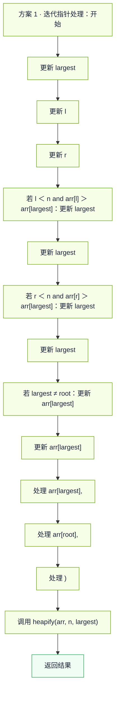

```python
import sys  # 提高递归深度上限（深输入防 RecursionError）

sys.setrecursionlimit(200000)  # 树/链表类题目节点数可达 1e4 量级

def heapify(arr, n, root):  # 定义函数 heapify（参数：数组, 元素个数, 根节点）
    """下沉操作：以 root 为根的子堆中，把最大值换到根。"""
    largest = root  # 把 根节点 存入 largest
    l = 2 * root + 1  # 把 2 乘 根节点 加 1 存入 左指针
    r = 2 * root + 2  # 把 2 乘 根节点 加 2 存入 右指针
    if l < n and arr[l] > arr[largest]:  # 若 左指针 小于 元素个数 and 数组[左指针] 超过 数组[largest]
        largest = l  # 把 左指针 存入 largest
    if r < n and arr[r] > arr[largest]:  # 若 右指针 小于 元素个数 and 数组[右指针] 超过 数组[largest]
        largest = r  # 把 右指针 存入 largest
    if largest != root:  # 若 largest 不等于 根节点
        arr[root], arr[largest] = (
            arr[largest],
            arr[root],
        )  # 把 数组[largest], 数组[根节点] 写入 arr[root], arr[largest]
        heapify(arr, n, largest)  # heapify(数组, 元素个数, largest)

def heap_sort(arr):  # 定义函数 heap_sort（参数：数组）
    """堆排序（升序）：先建最大堆，再反复把堆顶交换到末尾并下沉。"""
    a = arr[:]  # 把 复制 数组 存入 数组
    n = len(a)  # 把 长度(数组) 存入 元素个数
    for i in range(n // 2 - 1, -1, -1):  # 让 下标 i 从 元素个数 除以 除以 2 减 1 倒数回去（每步减 1）
        heapify(a, n, i)  # heapify(数组, 元素个数, 下标 i)
    for i in range(n - 1, 0, -1):  # 让 下标 i 从 元素个数 减 1 倒数回去（每步减 1）
        a[0], a[i] = a[i], a[0]  # 把 数组[下标 i], 数组[0] 写入 a[0], a[i]
        heapify(a, i, 0)  # heapify(数组, 下标 i, 0)
    return a  # 返回 数组

class MaxHeap:  # 定义类
    """最大堆：用于动态获取/删除最大值。"""

    def __init__(self):  # 构造函数：初始化成员
        self.data = []  # 把 [] 写入 self.data

    def push(self, val):  # 定义函数 push（参数：self, 值）
        self.data.append(val)  # 把 值 追加到列表尾部
        self._up(len(self.data) - 1)  # self._up(长度(self.data) 减 1)

    def pop(self):  # 定义函数 pop（参数：self）
        if not self.data:  # 若 not self.data
            return None  # 返回 None
        top = self.data[0]  # 把 self.data[0] 存入 top
        self.data[0] = self.data[-1]  # 把 self.data[ 减 1] 写入 self.data[0]
        self.data.pop()  # 弹出栈顶元素
        self._down(0)  # self._down(0)
        return top  # 返回 top

    def _up(self, i):  # 定义函数 _up（参数：self, 下标 i）
        while i > 0 and self.data[i] > self.data[(i - 1) // 2]:
            self.data[i], self.data[(i - 1) // 2] = self.data[(i - 1) // 2], self.data[i]
            i = (i - 1) // 2  # 把 (下标 i 减 1) 除以 除以 2 存入 下标 i

    def _down(self, i):  # 定义函数 _down（参数：self, 下标 i）
        n = len(self.data)  # 把 长度(self.data) 存入 元素个数
        while True:  # 循环，直到不满足「True」
            l, r, m = 2 * i + 1, 2 * i + 2, i  # 把 2 乘 下标 i 加 1, 2 乘 下标 i 加 2, 下标 i 写入 l, r, m
            if (
                l < n and self.data[l] > self.data[m]
            ):  # 若 左指针 小于 元素个数 and self.data[左指针] 超过 self.data[映射表]
                m = l  # 把 左指针 存入 映射表
            if (
                r < n and self.data[r] > self.data[m]
            ):  # 若 右指针 小于 元素个数 and self.data[右指针] 超过 self.data[映射表]
                m = r  # 把 右指针 存入 映射表
            if m == i:  # 若 映射表 等于 下标 i
                break  # 跳出循环
            self.data[i], self.data[m] = self.data[m], self.data[i]
            i = m  # 把 映射表 存入 下标 i

if __name__ == "__main__":  # 若 __name__ 等于 '__main__'
    print("heap sort:", heap_sort([12, 11, 13, 5, 6, 7]))  # 打印输出
    h = MaxHeap()  # 把 MaxHeap() 存入 h
    for v in [4, 1, 9, 3]:  # for 值 in [4, 1, 9, 3]:
        h.push(v)  # 把 值 压入栈/数组尾部
    print("max heap pops:", [h.pop() for _ in range(4)])  # 打印输出
```

### Go 实现（1 种方案）

Go 的全部方案如下，每个方案都内嵌用例自测，可独立运行（老仓库 python/go 文件遵循「打印结果」约定）：

#### 方案 1：迭代指针处理

**思路与代码分析**：核心是「迭代指针处理」。Go 版用切片与多返回值惯用法，显式处理索引边界。代码里依次做这些事：队列或堆的调度。**走读**：方案 1 · 迭代指针处理：开始 → 更新 : → 更新 : → 遍历循环 → 调用 heapify(a, n, i) → 遍历循环 → 更新 a[i] → 调用 heapify(a, i, 0) → 返回 a。

**运行架构**（真实控制流）：

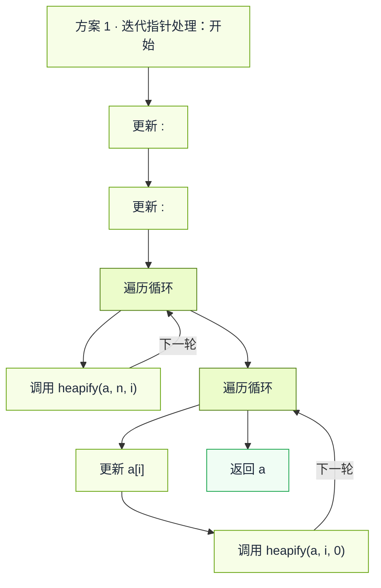

```go
package main // 引入依赖

import (
	"fmt"     // 「fmt」
	"os"      // 「os」
	"reflect" // 「reflect」
)

func heapify(arr []int, n, root int) { // 定义函数/方法 heapify
	largest := root                     // 把 根节点 写入 largest :
	l := 2*root + 1                     // 把 2 乘 根节点 加 1 写入 l :
	r := 2*root + 2                     // 把 2 乘 根节点 加 2 写入 r :
	if l < n && arr[l] > arr[largest] { // 若 左指针 小于 元素个数 且 数组[左指针] 超过 数组[largest]
		largest = l // 把 左指针 写入 largest
	}
	if r < n && arr[r] > arr[largest] { // 若 右指针 小于 元素个数 且 数组[右指针] 超过 数组[largest]
		largest = r // 把 右指针 写入 largest
	}
	if largest != root { // 若 largest 不等于 根节点
		arr[root], arr[largest] = arr[largest], arr[root] // 把 数组[largest], 数组[根节点] 写入 arr[root], arr[largest]
		heapify(arr, n, largest)                          // heapify(数组, 元素个数, largest)
	}
}

func heapSort(arr []int) []int { // 定义函数/方法 heapSort
	a := append([]int{}, arr...)    // 把 append([]int{}, 数组...) 写入 a :
	n := len(a)                     // 把 长度(数组) 写入 n :
	for i := n/2 - 1; i >= 0; i-- { // 把 元素个数 除以 2 减 1; 下标 i 不低于 0; 下标 i 减一 { 写入 for i :
		heapify(a, n, i) // heapify(数组, 元素个数, 下标 i)
	}
	for i := n - 1; i > 0; i-- { // 把 元素个数 减 1; 下标 i 超过 0; 下标 i 减一 { 写入 for i :
		a[0], a[i] = a[i], a[0] // 把 数组[下标 i], 数组[0] 写入 a[0], a[i]
		heapify(a, i, 0)        // heapify(数组, 下标 i, 0)
	}
	return a // 返回 数组
}

type maxHeap struct { // 定义类型
	data []int // data []int
}

func (h *maxHeap) push(val int) { // 定义函数/方法 push
	h.data = append(h.data, val) // 把 append(h.data, 值) 写入 h.data
	h.up(len(h.data) - 1)        // h.up(长度(h.data) 减 1)
}

func (h *maxHeap) pop() int { // 定义函数/方法 pop
	if len(h.data) == 0 { // 若 长度(h.data) 等于 0
		return 0 // 返回 0
	}
	top := h.data[0]                  // 把 h.data[0] 写入 top :
	h.data[0] = h.data[len(h.data)-1] // 把 h.data[长度(h.data) 减 1] 写入 h.data[0]
	h.data = h.data[:len(h.data)-1]   // 把 h.data[:长度(h.data) 减 1] 写入 h.data
	h.down(0)                         // h.down(0)
	return top                        // 返回 top
}

func (h *maxHeap) up(i int) { // 定义函数/方法 up
	for i > 0 && h.data[i] > h.data[(i-1)/2] { // for 下标 i 超过 0 且 h.data[下标 i] 超过 h.data[(下标 i 减 1) 除以 2] {
		h.data[i], h.data[(i-1)/2] = h.data[(i-1)/2], h.data[i]
		i = (i - 1) / 2 // 把 (下标 i 减 1) 除以 2 写入 下标 i
	}
}

func (h *maxHeap) down(i int) { // 定义函数/方法 down
	n := len(h.data) // 把 长度(h.data) 写入 n :
	for {            // for {
		l, r, m := 2*i+1, 2*i+2, i          // 把 2 乘 下标 i 加 1, 2 乘 下标 i 加 2, 下标 i 写入 l, r, m :
		if l < n && h.data[l] > h.data[m] { // 若 左指针 小于 元素个数 且 h.data[左指针] 超过 h.data[映射表]
			m = l // 把 左指针 写入 映射表
		}
		if r < n && h.data[r] > h.data[m] { // 若 右指针 小于 元素个数 且 h.data[右指针] 超过 h.data[映射表]
			m = r // 把 右指针 写入 映射表
		}
		if m == i { // 若 映射表 等于 下标 i
			break // 跳出循环
		}
		h.data[i], h.data[m] = h.data[m], h.data[i] // 把 h.data[映射表], h.data[下标 i] 写入 h.data[i], h.data[m]
		i = m                                       // 把 映射表 写入 下标 i
	}
}

func main() { // 程序入口：跑内嵌自测用例
	ok := true // 把 true 写入 ok :
	if got := heapSort([]int{12, 11, 13, 5, 6, 7}); !reflect.DeepEqual(got, []int{5, 6, 7, 11, 12, 13}) {
		ok = false                            // 把 false 写入 ok
		fmt.Printf("FAIL heapSort=%v\n", got) // 打印输出
	}
	h := &maxHeap{}                       // 把 按位与 maxHeap{} 写入 h :
	for _, v := range []int{4, 1, 9, 3} { // 同时取 _ 与 值 遍历
		h.push(v) // 把 值 压入栈/数组尾部
	}
	pops := []int{}          // 把 []int{} 写入 pops :
	for i := 0; i < 4; i++ { // 让 下标 i 从 0 开始计数
		pops = append(pops, h.pop()) // 弹出栈顶元素
	}
	if !reflect.DeepEqual(pops, []int{9, 4, 3, 1}) { // 若 取反 reflect.DeepEqual(pops, []int{9, 4, 3, 1}
		ok = false                                 // 把 false 写入 ok
		fmt.Printf("FAIL maxHeap pops=%v\n", pops) // 打印输出
	}
	if !ok { // 若 取反 ok
		os.Exit(1) // os.Exit(1)
	}
	fmt.Println("PASS") // 全部用例通过，输出 PASS
}
```

### Java 实现（1 种方案）

Java 的全部方案如下，每个方案都内嵌用例自测，可独立运行（老仓库 python/go 文件遵循「打印结果」约定）：

#### 方案 1：迭代指针处理

**思路与代码分析**：核心是「迭代指针处理」。Java 版用类与静态方法组织，集合操作显式明了。代码里依次做这些事：队列或堆的调度。**走读**：方案 1 · 迭代指针处理：开始 → 更新 largest → 若 l ＜ n 且 arr[l] ＞ arr[largest]：更新 largest → 更新 largest → 若 r ＜ n 且 arr[r] ＞ arr[largest]：更新 largest → 更新 largest → 若 largest ≠ i 则： → 更新 t → 更新 arr[i] → 更新 arr[largest] → 调用 heapify(arr, n, largest) → 返回结果。

**运行架构**（真实控制流）：

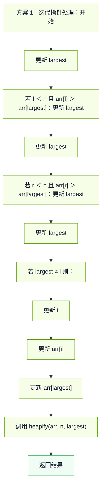

```java
package com.webfault.dsa; // 引入依赖

import java.util.*; // 引入依赖

class HeapS1 { // 定义类型
  static void heapify(int[] arr, int n, int i) { // 定义函数/方法 heapify
    int largest = i, l = 2 * i + 1, r = 2 * i + 2;
    if (l < n && arr[l] > arr[largest])
      largest = l; // 若 左指针 小于 元素个数 且 数组[左指针] 超过 数组[largest]) largest 赋值为 左指针;
    if (r < n && arr[r] > arr[largest])
      largest = r; // 若 右指针 小于 元素个数 且 数组[右指针] 超过 数组[largest]) largest 赋值为 右指针;
    if (largest != i) { // 若 largest 不等于 下标 i
      int t = arr[i];
      arr[i] = arr[largest];
      arr[largest] = t;
      heapify(arr, n, largest); // heapify(数组, 元素个数, largest);
    }
  }

  static int[] heapSort(int[] arr) { // 定义函数/方法 heapSort
    int[] a = arr.clone(); // 把 数组.clone(); 写入 int[] a
    int n = a.length; // 把 数组.长度 存入 元素个数
    for (int i = n / 2 - 1; i >= 0; i--)
      heapify(a, n, i); // 让 下标 i 从 元素个数 除以 2 减 1 开始计数，下标 i 不低于 0 就继续
    for (int i = n - 1; i > 0; i--) { // 让 下标 i 从 元素个数 减 1 开始计数，下标 i 超过 0 就继续
      int t = a[0];
      a[0] = a[i];
      a[i] = t; // 把 数组[0]; 数组[0] 赋值为 数组[下标 i]; 数组[下标 i] 赋值为 另一字符串 存入 另一字符串
      heapify(a, i, 0); // heapify(数组, 下标 i, 0);
    }
    return a; // 返回 数组
  }

  static class MaxHeap { // static class MaxHeap {
    List<Integer> data = new ArrayList<>(); // 把 new ArrayList 小于 超过 (); 写入 List<Integer> data

    void push(int val) {
      data.add(val);
      up(data.size() - 1);
    } // void push(int 值) { data 追加 值); up(data.大小() 减 1); }

    Integer pop() { // 定义函数/方法 pop
      if (data.isEmpty()) return null; // 若 data.isEmpty()，直接返回 null
      int top = data.get(0); // 把 data 查找 0) 存入 top
      data.set(0, data.get(data.size() - 1)); // data.set(0, data 查找 data.大小() 减 1));
      data.remove(data.size() - 1); // data 弹出 data.大小() 减 1);
      down(0); // down(0);
      return top; // 返回 top
    }

    void up(int i) { // 定义函数/方法 up
      while (i > 0 && data.get(i) > data.get((i - 1) / 2)) {
        Collections.swap(data, i, (i - 1) / 2); // Collections.交换 data, 下标 i, (下标 i 减 1) 除以 2);
        i = (i - 1) / 2; // 把 (下标 i 减 1) 除以 2; 写入 下标 i
      }
    }

    void down(int i) { // 定义函数/方法 down
      int n = data.size(); // 把 data.大小() 存入 元素个数
      while (true) { // 循环，直到不满足「true」
        int l = 2 * i + 1,
            r = 2 * i + 2,
            m = i; // 把 2 乘 下标 i 加 1, 右指针 赋值为 2 乘 下标 i 加 2, 映射表 赋值为 下标 i 存入 左指针
        if (l < n && data.get(l) > data.get(m))
          m = l; // 若 左指针 小于 元素个数 且 data 查找 左指针) 超过 data 查找 映射表)) 映射表 赋值为 左指针;
        if (r < n && data.get(r) > data.get(m))
          m = r; // 若 右指针 小于 元素个数 且 data 查找 右指针) 超过 data 查找 映射表)) 映射表 赋值为 右指针;
        if (m == i) break; // 若 映射表 等于 下标 i) break;
        Collections.swap(data, i, m); // Collections.交换 data, 下标 i, 映射表);
        i = m; // 把 映射表; 写入 下标 i
      }
    }
  }

  public static void main(String[] args) { // public static void main(String[] args) {
    boolean ok = true; // 把 true; 写入 boolean ok
    int[] hs = HeapS1.heapSort(new int[] {12, 11, 13, 5, 6, 7});
    if (!Arrays.equals(
        hs,
        new int[] {5, 6, 7, 11, 12, 13})) { // 若 取反 Arrays.equals(hs, new int[]{5, 6, 7, 11, 12, 13}
      ok = false;
      System.out.println("FAIL heapSort=" + Arrays.toString(hs)); // 打印输出
    }
    MaxHeap h = new MaxHeap(); // 把 new MaxHeap(); 写入 MaxHeap h
    for (int v : new int[] {4, 1, 9, 3}) h.push(v); // 把 值 压入栈/数组尾部
    List<Integer> pops = new ArrayList<>(); // 把 new ArrayList 小于 超过 (); 写入 List<Integer> pops
    for (int k = 0; k < 4; k++) pops.add(h.pop()); // 让 下标 k 从 0 开始计数，下标 k 小于 4 就继续
    List<Integer> want =
        Arrays.asList(9, 4, 3, 1); // 把 Arrays.asList(9, 4, 3, 1); 写入 List<Integer> want
    if (!pops.equals(want)) { // 若 取反 pops.equals(want
      ok = false;
      System.out.println("FAIL maxHeap pops=" + pops); // 打印输出
    }
    if (!ok) throw new RuntimeException("FAILED"); // 若 取反 ok) throw new RuntimeException(「FAILED」);
    System.out.println("PASS"); // 全部用例通过，输出 PASS
  }
}
```

### Rust 实现（1 种方案）

Rust 的全部方案如下，每个方案都内嵌用例自测，可独立运行（老仓库 python/go 文件遵循「打印结果」约定）：

#### 方案 1：迭代指针处理

**思路与代码分析**：核心是「迭代指针处理」。Rust 版用所有权移动与切片借用改写同一逻辑，注意 Option 与引用边界。**走读**：方案 1 · 迭代指针处理：开始 → 计算 v → 遍历 (0..n / 2).rev() 中的每个元素 i → 遍历 (1..n).rev() 中的每个元素 end → 返回结果。

**运行架构**（真实控制流）：

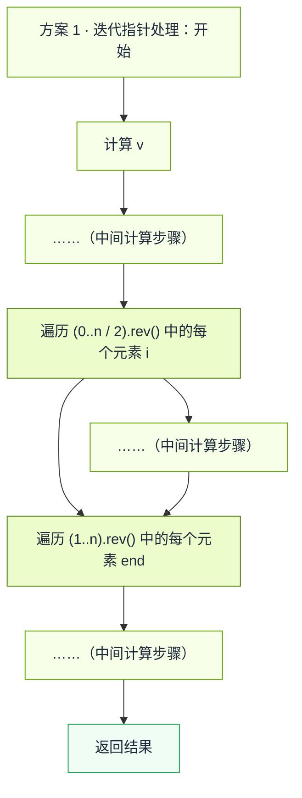

```rust
// 数据结构与算法之排序: 堆排序 — Rust 版（方案1）
fn heap_sort(nums: Vec<i32>) -> Vec<i32> {
    // 定义函数/方法 heap_sort
    let mut v = nums; // 把 数组; 写入 let mut v
    let n = v.len(); // 把 值.长度() 存入 元素个数
    fn sift(v: &mut Vec<i32>, start: usize, end: usize) {
        // 定义函数/方法 sift
        let mut root = start; // 把 起点; 写入 let mut root
        loop {
            // loop {
            let child = 2 * root + 1; // 把 2 乘 根节点 加 1 存入 子节点
            if child > end {
                break;
            } // 若 子节点 超过 终点 { break; }
            let mut swap = root; // 把 根节点; 写入 let mut swap
            if v[swap] < v[child] {
                swap = child;
            } // 若 值[swap] 小于 值[子节点] { swap 赋值为 子节点; }
            if child + 1 <= end && v[swap] < v[child + 1] {
                swap = child + 1;
            }
            if swap == root {
                break;
            } // 若 swap 等于 根节点 { break; }
            v.swap(root, swap); // 值.交换 根节点, swap);
            root = swap; // 把 swap; 写入 根节点
        }
    }
    for i in (0..n / 2).rev() {
        sift(&mut v, i, n - 1);
    }
    for end in (1..n).rev() {
        // for 终点 in (1..元素个数).rev() {
        v.swap(0, end); // 值.交换 0, 终点);
        sift(&mut v, 0, end - 1); // sift( 按位与 mut 值, 0, 终点 减 1);
    }
    v
}
fn main() {
    // 程序入口：跑内嵌自测用例
    assert_eq!(heap_sort(vec![5, 2, 4, 6, 1, 3]), vec![1, 2, 3, 4, 5, 6]); // 断言校验
    assert_eq!(heap_sort(vec![9, 8, 7, 6, 5]), vec![5, 6, 7, 8, 9]); // 断言校验
    println!("PASS");
} // 全部用例通过，输出 PASS
```

### Lua 实现（1 种方案）

Lua 的全部方案如下，每个方案都内嵌用例自测，可独立运行（老仓库 python/go 文件遵循「打印结果」约定）：

#### 方案 1：迭代指针处理

**思路与代码分析**：核心是「迭代指针处理」。Lua 版用表与 ipairs 遍历，注意 ipairs 遇 nil 即停的语义。代码里依次做这些事：递归求解子问题。**走读**：方案 1 · 迭代指针处理：开始 → 更新 v → 当 true do 时反复执行 → 循环 i：从 n // 2 到 1, -1 do → 循环 end_：从 n 到 2, -1 do → 返回 v。

**运行架构**（真实控制流）：

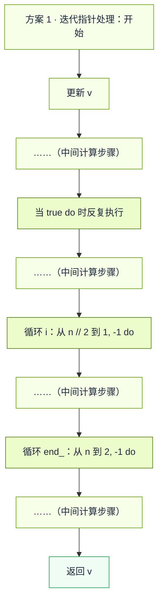

```lua
-- 数据结构与算法之排序: 堆排序 — Lua 版（方案1）
local function heap_sort(nums) -- local function heap_sort(数组)
	local v = { table.unpack(nums) } -- 把 {table.unpack(数组)} 写入 local v
	local n = #v -- 把 #值 写入 local n
	local function sift(start, end_) -- local function sift(起点, end_)
		local root = start -- 把 起点 写入 local root
		while true do -- while true do
			local child = 2 * root -- 把 2 乘 根节点 写入 local child
			if child > end_ then
				break
			end -- 若 子节点 超过 end_ then break 终点
			local swap = root -- 把 根节点 写入 local swap
			if v[swap] < v[child] then
				swap = child
			end -- 若 值[swap] 小于 值[子节点] then swap 赋值为 子节点 终点
			if child + 1 <= end_ and v[swap] < v[child + 1] then
				swap = child + 1
			end
			if swap == root then
				break
			end -- 若 swap 等于 根节点 then break 终点
			v[root], v[swap] = v[swap], v[root] -- 把 值[swap], 值[根节点] 写入 v[root], v[swap]
			root = swap -- 把 swap 存入 根节点
		end -- 终点
	end -- 终点
	for i = n // 2, 1, -1 do
		sift(i, n)
	end -- 把 元素个数 写入 for i
	for end_ = n, 2, -1 do -- 把 元素个数, 2, 减 1 do 写入 for end_
		v[1], v[end_] = v[end_], v[1] -- 把 值[end_], 值[1] 写入 v[1], v[end_]
		sift(1, end_ - 1) -- sift(1, end_ 减 1)
	end -- 终点
	return v -- 返回 值
end -- 终点
assert(table.concat(heap_sort({ 5, 2, 4, 6, 1, 3 }), ",") == "1,2,3,4,5,6") -- 打印输出
assert(table.concat(heap_sort({ 9, 8, 7, 6, 5 }), ",") == "5,6,7,8,9") -- 打印输出
print("PASS") -- 全部用例通过，输出 PASS
```

### C 实现（1 种方案）

C 的全部方案如下，每个方案都内嵌用例自测，可独立运行（老仓库 python/go 文件遵循「打印结果」约定）：

#### 方案 1：迭代指针处理

**思路与代码分析**：核心是「迭代指针处理」。C 版手动管理下标与内存，循环边界全部显式写出。代码里依次做这些事：双重循环遍历。**走读**：方案 1 · 迭代指针处理：开始 → 遍历循环 → 调用 sift(v, i, n - 1) → 遍历循环 → 更新 t → 更新 v[0] → 更新 v[end] → 调用 sift(v, 0, end - 1) → 返回结果。

**运行架构**（真实控制流）：

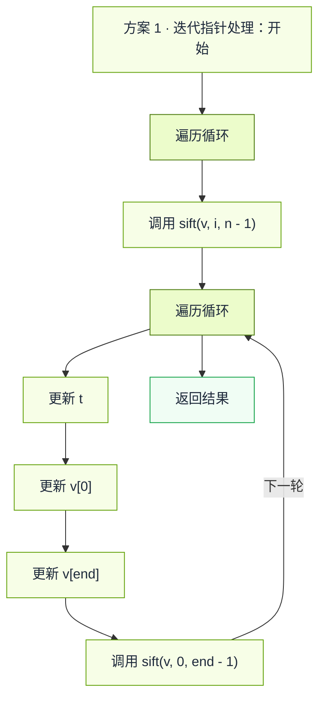

```c
/* 数据结构与算法之排序: 堆排序 — C 版（方案1） */
#include <stdio.h>                              // 引入头文件
static void sift(int v[], int start, int end) { // 定义函数/方法 sift
    int root = start;                           // 把 起点 存入 根节点
    while (1) {                                 // 循环，直到不满足「1」
        int child = 2 * root + 1;               // 把 2 乘 根节点 加 1 存入 子节点
        if (child > end)
            break;       // 若 子节点 超过 终点) break;
        int swap = root; // 把 根节点 存入 swap
        if (v[swap] < v[child])
            swap = child; // 若 值[swap] 小于 值[子节点]) swap 赋值为 子节点;
        if (child + 1 <= end && v[swap] < v[child + 1])
            swap = child +
                   1; // 若 子节点 加 1 不超过 终点 且 值[swap] 小于 值[子节点 加 1]) swap 赋值为 子节点 加 1;
        if (swap == root)
            break; // 若 swap 等于 根节点) break;
        int t = v[root];
        v[root] = v[swap];
        v[swap] = t; // 把 值[根节点]; 值[根节点] 赋值为 值[swap]; 值[swap] 赋值为 另一字符串 存入 另一字符串
        root = swap; // 把 swap; 写入 根节点
    }
}
static void heap_sort(int v[], int n) { // 定义函数/方法 heap_sort
    for (int i = n / 2 - 1; i >= 0; i--)
        sift(v, i, n - 1); // 让 下标 i 从 元素个数 除以 2 减 1 开始计数，下标 i 不低于 0 就继续
    for (int end = n - 1; end >= 1; end--) { // 让 终点 从 元素个数 减 1 开始计数，终点 不低于 1 就继续
        int t = v[0];
        v[0] = v[end];
        v[end] = t; // 把 值[0]; 值[0] 赋值为 值[终点]; 值[终点] 赋值为 另一字符串 存入 另一字符串
        sift(v, 0, end - 1); // sift(值, 0, 终点 减 1);
    }
}
int main(void) {                   // 程序入口：跑内嵌自测用例
    int v1[] = {5, 2, 4, 6, 1, 3}; // 把 {5,2,4,6,1,3}; 写入 int v1[]
    heap_sort(v1, 6);              // heap_sort(v1, 6);
    for (int i = 0; i < 6; i++)
        if (v1[i] != i + 1) {
            printf("FAIL\n");
            return 1;
        } // 让 下标 i 从 0 开始计数，下标 i 小于 6 就继续
    printf("PASS\n");
    return 0;
} // 全部用例通过，输出 PASS
```

### C++ 实现（1 种方案）

C++ 的全部方案如下，每个方案都内嵌用例自测，可独立运行（老仓库 python/go 文件遵循「打印结果」约定）：

#### 方案 1：迭代指针处理

**思路与代码分析**：核心是「迭代指针处理」。C++ 版用 STL 容器与迭代器，减少手写下标错误。代码里依次做这些事：双重循环遍历。**走读**：方案 1 · 迭代指针处理：开始 → 命中条件，直接返回 → 更新 n → 遍历循环 → 调用 sift(v, i - 1, n - 1) → 遍历循环 → 处理 std::swap(v[0], v[end - 1]) → 调用 sift(v, 0, end - 2) → 返回 v。

**运行架构**（真实控制流）：

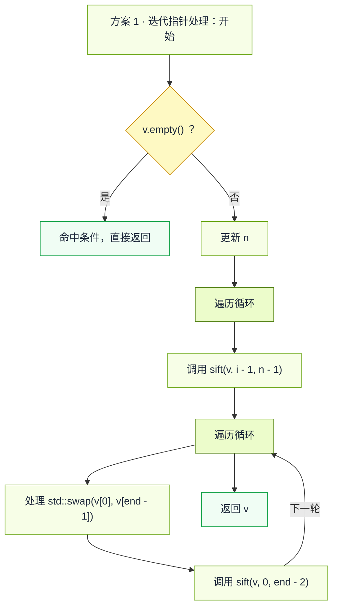

```cpp
// 数据结构与算法之排序: 堆排序 — C++ 版（方案1）
#include <cassert>                                                // 引入头文件
#include <iostream>                                               // 引入头文件
#include <vector>                                                 // 引入头文件
static void sift(std::vector<int> &v, size_t start, size_t end) { // 定义函数/方法 sift
    size_t root = start;                                          // 把 起点; 写入 size_t root
    while (true) {                                                // 循环，直到不满足「true」
        size_t child = 2 * root + 1; // 把 2 乘 根节点 加 1; 写入 size_t child
        if (child > end)
            break;          // 若 子节点 超过 终点) break;
        size_t swap = root; // 把 根节点; 写入 size_t swap
        if (v[swap] < v[child])
            swap = child; // 若 值[swap] 小于 值[子节点]) swap 赋值为 子节点;
        if (child + 1 <= end && v[swap] < v[child + 1])
            swap = child +
                   1; // 若 子节点 加 1 不超过 终点 且 值[swap] 小于 值[子节点 加 1]) swap 赋值为 子节点 加 1;
        if (swap == root)
            break;                   // 若 swap 等于 根节点) break;
        std::swap(v[root], v[swap]); // 交换 值[根节点] 与 值[swap]
        root = swap;                 // 把 swap; 写入 根节点
    }
}
static std::vector<int> heapSort(std::vector<int> v) {
    if (v.empty())
        return v;        // 若 值 是否为空，直接返回 值
    size_t n = v.size(); // 把 值.大小(); 写入 size_t n
    for (size_t i = n / 2; i > 0; --i)
        sift(v, i - 1, n - 1); // 让 下标 i 从 元素个数 除以 2 开始计数，下标 i 超过 0 就继续
    for (size_t end = n; end > 1; --end) { // 让 终点 从 元素个数 开始计数，终点 超过 1 就继续
        std::swap(v[0], v[end - 1]);       // 交换 值[0] 与 值[终点 减 1]
        sift(v, 0, end - 2);               // sift(值, 0, 终点 减 2);
    }
    return v; // 返回 值
}
int main() { // 程序入口：跑内嵌自测用例
    assert((heapSort({5, 2, 4, 6, 1, 3}) == std::vector<int>{1, 2, 3, 4, 5, 6})); // 断言校验
    assert((heapSort({9, 8, 7, 6, 5}) == std::vector<int>{5, 6, 7, 8, 9}));       // 断言校验
    std::cout << "PASS" << std::endl;
} // 全部用例通过，输出 PASS
```

### R 实现（1 种方案）

R 的全部方案如下，每个方案都内嵌用例自测，可独立运行（老仓库 python/go 文件遵循「打印结果」约定）：

#### 方案 1：迭代指针处理

**思路与代码分析**：核心是「迭代指针处理」。R 版用向量化思维与 1 起始下标，注意 1:n 的降序陷阱。代码里依次做这些事：双重循环遍历。**走读**：方案 1 · 迭代指针处理：开始 → 更新 new.env(parent → 当 (TRUE) 时反复执行 → 循环 i：遍历 (n%/%2L):1) sift(i, n → 循环 end_：遍历 n:2 → 返回结果。

**运行架构**（真实控制流）：

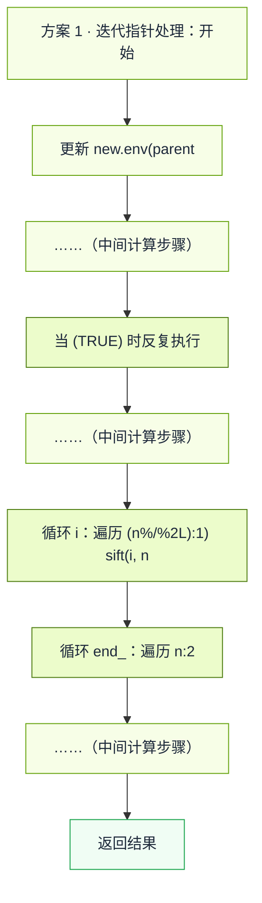

```r
# 版（方案1） 定义函数 heap_sort（参数：数组）
heap_sort <- function(nums) {
    e <- new.env(parent = emptyenv())  # 把 new.env(parent 赋值为 emptyenv()) 存入 e
    e$v <- nums  # 把 数组 存入 e$v
    n <- length(nums)  # 把 长度(数组) 存入 元素个数
    sift <- function(start, end_) {
        # 定义函数 sift（参数：起点, end_）
        root <- start  # 把 起点 存入 根节点
        while (TRUE) {
            # 循环，直到不满足「TRUE」
            child <- 2L * root  # 把 2L 乘 根节点 存入 子节点
            if (child > end_)
                break  # 若 子节点 超过 end_) break
            swap <- root  # 把 根节点 存入 swap
            if (e$v[swap] < e$v[child])
                swap <- child  # 若 e$值[swap] 小于 e$值[子节点]) swap 小于 减 子节点
            if (child + 1L <= end_ && e$v[swap] < e$v[child + 1L])
                swap <- child + 1L
            if (swap == root)
                break  # 若 swap 等于 根节点) break
            t <- e$v[root]  # 把 e$值[根节点] 存入 另一字符串
            e$v[root] <- e$v[swap]  # 把 e$值[swap] 存入 e$v[root]
            e$v[swap] <- t  # 把 另一字符串 存入 e$v[swap]
            root <- swap  # 把 swap 存入 根节点
        }
    }
    if (n >= 2) {
        # 若 元素个数 不低于 2
        for (i in (n%/%2L):1) sift(i, n)  # for (下标 i in (元素个数 对…取模 除以 对…取模 2L):1) sift(下标 i, 元素个数)
        for (end_ in n:2) {
            # for (end_ in 元素个数:2) {
            t <- e$v[1]  # 把 e$值[1] 存入 另一字符串
            e$v[1] <- e$v[end_]  # 把 e$值[end_] 存入 e$v[1]
            e$v[end_] <- t  # 把 另一字符串 存入 e$v[end_]
            sift(1, end_ - 1L)  # sift(1, end_ 减 1L)
        }
    }
    e$v  # e$值
}
stopifnot(identical(as.integer(heap_sort(c(5, 2, 4, 6, 1, 3))), 1:6))  # 断言校验
stopifnot(identical(as.integer(heap_sort(c(9, 8, 7, 6, 5))), 5:9))  # 断言校验
cat("PASS\n")  # 全部用例通过，输出 PASS
```

### Zig 实现（1 种方案）

Zig 的全部方案如下，每个方案都内嵌用例自测，可独立运行（老仓库 python/go 文件遵循「打印结果」约定）：

#### 方案 1：迭代指针处理

**思路与代码分析**：核心是「迭代指针处理」。Zig 版显式分配与清零，整型边界处理严格。**走读**：方案 1 · 迭代指针处理：开始 → 计算 n → 命中条件，直接返回 → 计算 i → 当 (i ＞ 0) : (i -= 1) sift(nums, i - 1, n - 1) 时反复执行 → 计算 end → 当 (end ＞ 1) : (end -= 1) 时反复执行 → 计算 t → 更新 nums[0] → 更新 1] → 调用 sift(nums, 0, end - 2)。

**运行架构**（真实控制流）：

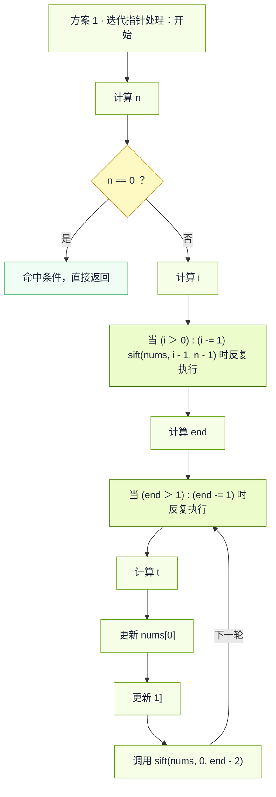

```zig
// 数据结构与算法之排序: 堆排序 — Zig 版（方案1）
const std = @import("std"); // 把 @import(「std」) 存入 std
fn sift(nums: []i32, start: usize, end: usize) void { // 定义函数/方法 sift
    var root = start; // 把 起点 存入 根节点
    while (true) { // 循环，直到不满足「true」
        const child = 2 * root + 1; // 把 2 乘 根节点 加 1 存入 子节点
        if (child > end) break; // 若 子节点 超过 终点) break;
        var swap = root; // 把 根节点 存入 swap
        if (nums[swap] < nums[child]) swap = child; // 若 数组[swap] 小于 数组[子节点]) swap 赋值为 子节点;
        if (child + 1 <= end and nums[swap] < nums[child + 1]) swap = child + 1;
        if (swap == root) break; // 若 swap 等于 根节点) break;
        const t = nums[root]; // 把 数组[根节点] 存入 另一字符串
        nums[root] = nums[swap]; // 把 数组[swap]; 写入 nums[root]
        nums[swap] = t; // 把 另一字符串; 写入 nums[swap]
        root = swap; // 把 swap; 写入 根节点
    }
}
fn heapSort(nums: []i32) void { // 定义函数/方法 heapSort
    const n = nums.len; // 把 数组.长度 存入 元素个数
    if (n == 0) return; // 若 元素个数 等于 0) return;
    var i: usize = n / 2; // 把 元素个数 除以 2; 写入 var i: usize
    while (i > 0) : (i -= 1) sift(nums, i - 1, n - 1);
    var end = n; // 把 元素个数 存入 终点
    while (end > 1) : (end -= 1) { // 循环，直到不满足「终点 超过 1) : (终点 累减 1」
        const t = nums[0]; // 把 数组[0] 存入 另一字符串
        nums[0] = nums[end - 1]; // 把 数组[终点 减 1]; 写入 nums[0]
        nums[end - 1] = t; // 把 另一字符串; 写入 nums[end - 1]
        sift(nums, 0, end - 2); // sift(数组, 0, 终点 减 2);
    }
}
pub fn main() !void { // 程序入口：跑内嵌自测用例
    var v1 = [_]i32{ 5, 2, 4, 6, 1, 3 }; // 把 [_]i32{ 5, 2, 4, 6, 1, 3 } 存入 v1
    heapSort(&v1); // heapSort( 按位与 v1);
    for (v1, 0..) |v, i| if (v != @as(i32, @intCast(i + 1))) return error.TestFailed;
    std.debug.print("PASS\n", .{});
} // 全部用例通过，输出 PASS
```

### Dart 实现（1 种方案）

Dart 的全部方案如下，每个方案都内嵌用例自测，可独立运行（老仓库 python/go 文件遵循「打印结果」约定）：

#### 方案 1：迭代指针处理

**思路与代码分析**：核心是「迭代指针处理」。Dart 版用可空类型标注与集合方法，注意空安全。代码里依次做这些事：双重循环遍历。**走读**：方案 1 · 迭代指针处理：开始 → 更新 v → 命中条件，直接返回 → 当 (true) 时反复执行 → 遍历循环 → 遍历循环 → 返回 v。

**运行架构**（真实控制流）：

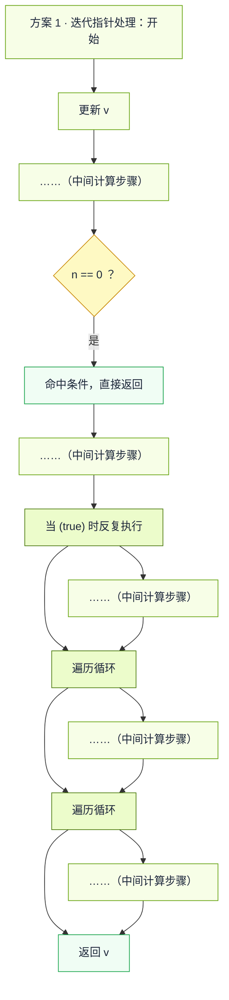

```dart
// 数据结构与算法之排序: 堆排序 — Dart 版（方案1）
List<int> heapSort(List<int> nums) {
  // 定义函数/方法 heapSort
  final v = List<int>.from(nums); // 把 List 小于 int 超过 .from(数组) 存入 值
  final n = v.length; // 把 值.长度 存入 元素个数
  if (n == 0) return v; // 若 元素个数 等于 0，直接返回 值
  void sift(int start, int end) {
    // 定义函数/方法 sift
    var root = start; // 把 起点 存入 根节点
    while (true) {
      // 循环，直到不满足「true」
      final child = 2 * root + 1; // 把 2 乘 根节点 加 1 存入 子节点
      if (child > end) break; // 若 子节点 超过 终点) break;
      var swap = root; // 把 根节点 存入 swap
      if (v[swap] < v[child])
        swap = child; // 若 值[swap] 小于 值[子节点]) swap 赋值为 子节点;
      if (child + 1 <= end && v[swap] < v[child + 1])
        swap =
            child +
            1; // 若 子节点 加 1 不超过 终点 且 值[swap] 小于 值[子节点 加 1]) swap 赋值为 子节点 加 1;
      if (swap == root) break; // 若 swap 等于 根节点) break;
      final t = v[root]; // 把 值[根节点] 存入 另一字符串
      v[root] = v[swap]; // 把 值[swap]; 写入 v[root]
      v[swap] = t; // 把 另一字符串; 写入 v[swap]
      root = swap; // 把 swap 存入 根节点
    }
  }

  for (var i = n ~/ 2 - 1; i >= 0; i--) {
    sift(i, n - 1);
  } // 让 下标 i 从 元素个数 ~ 除以 2 减 1 开始计数，下标 i 不低于 0 就继续
  for (var end = n - 1; end >= 1; end--) {
    // 让 终点 从 元素个数 减 1 开始计数，终点 不低于 1 就继续
    final t = v[0]; // 把 值[0] 存入 另一字符串
    v[0] = v[end]; // 把 值[终点]; 写入 v[0]
    v[end] = t; // 把 另一字符串; 写入 v[end]
    sift(0, end - 1); // sift(0, 终点 减 1);
  }
  return v; // 返回 值
}

void main() {
  if (heapSort([5, 2, 4, 6, 1, 3]).toString() != '[1, 2, 3, 4, 5, 6]')
    throw StateError('c1');
  print('PASS');
} // 全部用例通过，输出 PASS
```

---

## 内容总结

- **堆排序**（排序 · Medium）：共 1 个方案，主线思路「迭代指针处理」；时间 O(n)（单趟线性扫描）；动画演示冒泡交换过程，附录给出 11 种语言 × 全部方案的可运行实现。
- 来源博客：[https://blog.csdn.net/tyro_java/article/details/134085409](https://blog.csdn.net/tyro_java/article/details/134085409)
- 导航：[📋 总目录](../) ｜ [← 084 搜索插入位置](../084_搜索插入位置/) ｜ [086 根据数字二进制下 1 的数目排序 →](../086_根据数字二进制下_1_的数目排序/)
