# 086 · 根据数字二进制下 1 的数目排序（第四阶段 · 查找与排序 · Medium）

> **难度**：⭐⭐ Medium ｜ **专题**：排序
> **学习定位**：第四阶段 · 查找与排序第 86 篇 ｜ **解法数**：2
> **内容总结**：**根据数字二进制下 1 的数目排序**（排序 · Medium）：共 2 个方案，主线思路「方案1（暴力统计 1 的个数）」；时间 O(n)（单趟线性扫描）；动画演示冒泡交换过程，附录给出 11 种语言 × 全部方案的可运行实现。

---

## 题目描述

给你一个整数数组 `arr` 。请你将数组中的元素按照其二进制表示中数字 1 的数目升序排序。

如果存在多个数字二进制中 1 的数目相同，则必须将它们按照数值大小升序排列。

请你返回排序后的数组。

- 主函数签名：`function onesCount(x: number): number`

**用例（来自原题）**：

**示例 1**

```text
输入：arr = [0,1,2,3,4,5,6,7,8]
输出：[0,1,2,4,8,3,5,6,7]
```

解释：[0] 是唯一一个有 0 个 1 的数。 [1,2,4,8] 都有 1 个 1 。 [3,5,6] 有 2 个 1 。 [7] 有 3 个 1 。 按照 1 的个数排序得到的结果数组为 [0,1,2,4,8,3,5,6,7]

**示例 2**

```text
输入：arr = [1024,512,256,128,64,32,16,8,4,2,1]
输出：[1,2,4,8,16,32,64,128,256,512,1024]
```

解释：数组中所有整数二进制下都只有 1 个 1 ，所以你需要按照数值大小将它们排序。

**示例 3**

```text
输入：arr = [10000,10000]
输出：[10000,10000]
```

**示例 4**

```text
输入：arr = [2,3,5,7,11,13,17,19]
输出：[2,3,5,17,7,11,13,19]
```
> 题面与 [leetcode.cn 官方](https://leetcode.cn/problems/sort-integers-by-the-number-of-1-bits/)一致，示例配图取自官方题面。

**数据范围与注意事项**：

- `1 <= arr.length <= 500`
- `0 <= arr[i] <= 10^4`
- **易错点**：比较器返回值的正负含义，写反了排序结果直接错。

## 题目分析

**场景是什么**：排序是多数算法的前置工序，这类题练的是比较逻辑与稳定性取舍。本题就是该场景的 Medium 级练习，主线做法是「方案1（暴力统计 1 的个数）」。

**主线怎么解**：主解法结构简单：读入、处理、返回。

## 解题思路

**方案对比**（共 2 个方案，由浅入深）：

| 方案 | 时间复杂度 | 空间复杂度 |
|---|---|---|
| 方案 1 · 方案1（暴力统计 1 的个数） | O(n)（单趟线性扫描） | O(1) 到 O(n)（视辅助结构） |
| 方案 2 · 方案2（递推预处理 bit 计数） | O(n)（单趟线性扫描） | O(1) 到 O(n)（视辅助结构） |

**由浅入深的路径**：方案1（暴力统计 1 的个数） → 方案2（递推预处理 bit 计数）；每往右一步，都在补上一步的短板。

**方案间的取舍**：方案 1（方案1（暴力统计 1 的个数））；方案 2（方案2（递推预处理 bit 计数））。数据规模小、可读性优先时选靠前的方案；规模大、性能优先时选靠后的方案。

**怎么读这一篇**：

- 🐣 **新手路线**：把「题目描述」的示例 1 在纸上手推一遍 → 读方案 1（最直观的写法）与它的代码走读 → 按「运行方式」本地跑通看 PASS → 回头对比方案 2 之后的写法差在哪
- 🦅 **大佬路线**：直接锁定最优方案 1（方案1（暴力统计 1 的个数），O(n)（单趟线性扫描））→ 跳读该方案代码与走读 → 用「逐步拆解与面试追问」补齐复杂度推导与边界追问

### 动态算法图（冒泡交换，GIF 自动循环）


动画演示排序专题里冒泡交换的典型过程；每个方案在「TypeScript 解题方案」一节还配了专属动画与专属流程图。

### 主解法流程图（真实控制流）

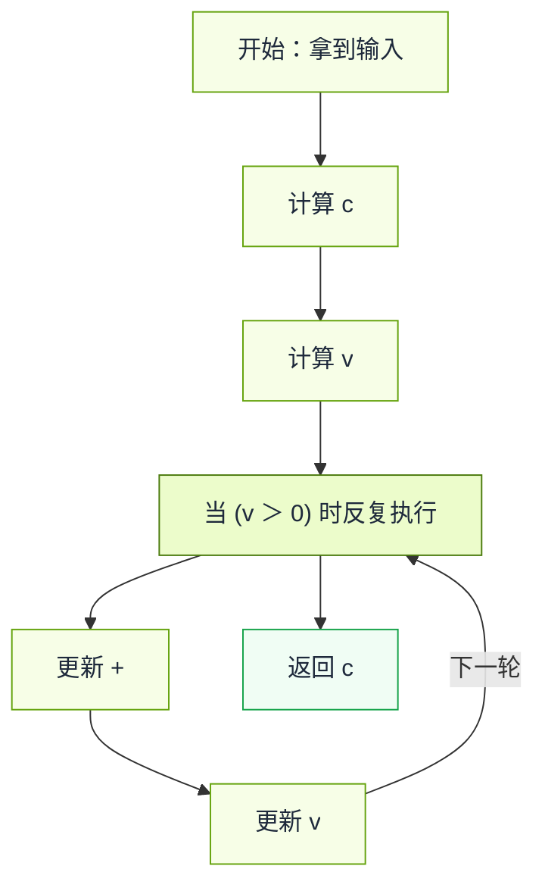

## TypeScript 解题方案（2 个方案逐个讲）

> **运行与提交**：每个方案都是自包含文件（内嵌用例自测，输出 PASS），整块复制到 `.ts` 文件后 `node 文件名` 即可运行。提交 LeetCode 时，把 `demo` 内的算法函数与辅助类型/函数整体取出、置于文件顶层即可。涉及交互/特殊接口的题以题面给定签名为准。

### 方案 1：方案1（暴力统计 1 的个数）

**分析与思路**：核心做法是「方案1（暴力统计 1 的个数）」。

**运行方式**：`node 本文件`，内嵌用例全部通过会输出 PASS。

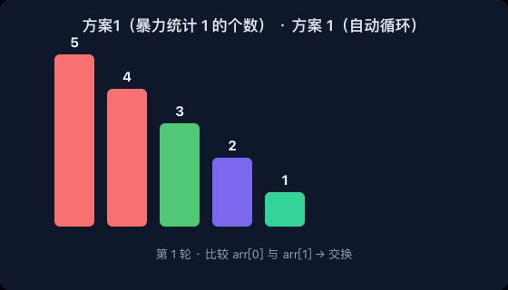

**方案专属流程图**（真实控制流）：

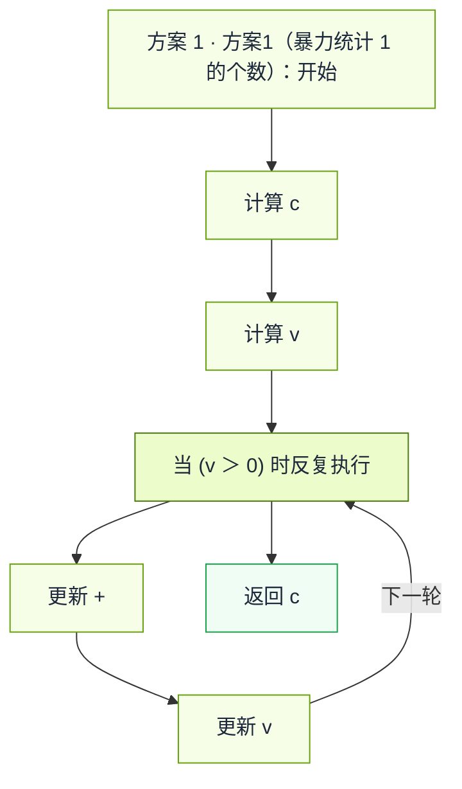

```typescript
/**
 ** LeetCode 1356. 根据数字二进制下 1 的数目排序
 ** 方案：方案1（暴力统计 1 的个数）
 */

function onesCount(x: number): number {
  // 定义函数/方法 onesCount
  let c = 0; // 把 0 存入 字符
  let v = x; // 把 x 存入 值
  while (v > 0) {
    // 循环，直到不满足「值 超过 0」
    c += v % 2; // 字符累加 值 对…取模 2
    v = Math.floor(v / 2); // 把 向下取整(值 除以 2) 存入 值
  }
  return c; // 返回 字符
}

export function demo(): void {
  // 程序入口：跑内嵌自测用例
  if (onesCount(1) !== 1) throw new Error('onesCount(1) should be 1');
  console.log('PASS'); // 全部用例通过，输出 PASS
}

demo(); // demo();
```

### 方案 2：方案2（递推预处理 bit 计数）

**分析与思路**：核心做法是「方案2（递推预处理 bit 计数）」。代码里依次做这些事：先排序再处理；单循环线性扫描。

**运行方式**：`node 本文件`，内嵌用例全部通过会输出 PASS。

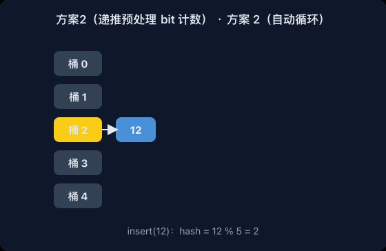

**方案专属流程图**（真实控制流）：

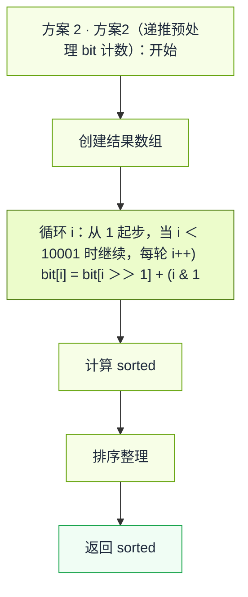

```typescript
/**
 ** LeetCode 1356. 根据数字二进制下 1 的数目排序
 ** 方案：方案2（递推预处理 bit 计数）
 */

function sortByBits(arr: number[]): number[] {
  // 定义函数/方法 sortByBits
  const bit = new Array<number>(10001).fill(0); // 把 new Array 小于 number 超过 (10001).fill(0) 存入 bit
  for (let i = 1; i < 10001; i++) bit[i] = bit[i >> 1] + (i & 1); // 让 下标 i 从 1 开始计数，下标 i 小于 10001 就继续
  const sorted = arr.slice(); // 把 数组 截取 ) 存入 sorted
  sorted.sort((a, b) => bit[a] - bit[b] || a - b);
  return sorted; // 返回 sorted
}

export function demo(): void {
  // 程序入口：跑内嵌自测用例
  const got = sortByBits([1, 2, 3]); // 把 sortByBits([1, 2, 3]) 存入 got
  const expected = [1, 2, 3]; // 把 [1, 2, 3] 存入 expected
  if (got.length !== expected.length || got.some((v, i) => v !== expected[i]))
    throw new Error('sortByBits([1,2,3]) mismatch'); // throw new Error(「sortByBits([1,2,3]) mismatch」);
  console.log('PASS'); // 全部用例通过，输出 PASS
}

demo(); // demo();
```

## 逐步拆解与面试追问

**复杂度**：时间 O(n)（单趟线性扫描），空间 O(1) 到 O(n)（视辅助结构）

**为什么是这个量级**：每个元素被常数次访问，辅助哈希或栈的开销与 n 同阶

**面试官可能会追问**：

- 稳定性对结果有影响吗？
- 比较器怎么写才不会越界？
- 数据近有序时选哪种排序？

## 关键 API 速查（TS 主解法实际用到，附官方链接）

| API | 作用 | 使用要点 | 官方文档 |
|---|---|---|---|
| `Math.floor()` | 向下取整 | 负数向负无穷（-1.5 → -2）；大数用位运算前注意 2^31 界 | [官方文档](https://developer.mozilla.org/zh-CN/docs/Web/JavaScript/Reference/Global_Objects/Math/floor) |

### 各语言官方文档导航

- **TypeScript / JS**：[MDN 中文参考](https://developer.mozilla.org/zh-CN/)
- **Python**：[Python 官方文档](https://docs.python.org/zh-cn/3/)
- **Go**：[Go 标准库](https://pkg.go.dev/std)
- **Java**：[JDK 17 API](https://docs.oracle.com/en/java/javase/17/docs/api/)
- **Rust**：[Rust 标准库](https://doc.rust-lang.org/std/)
- **Lua**：[Lua 5.4 手册](https://www.lua.org/manual/5.4/)
- **C**：[Cppreference C](https://zh.cppreference.com/w/c)
- **C++**：[Cppreference C++](https://zh.cppreference.com/w/cpp)
- **R**：[R 官方手册](https://stat.ethz.ch/R-manual/)
- **Zig**：[Zig 语言文档](https://ziglang.org/documentation/master/)
- **Dart**：[Dart API](https://api.dart.dev/)

## 附录：其他 10 种语言全部实现（每种语言列举其全部方案）

> TypeScript 的全部方案见「TypeScript 解题方案」一节；下面是其余 10 种语言的对应实现，每种语言的每个方案都带思路分析、代码走读与专属运行架构图。
> 每个方案都内嵌用例自测，可独立运行（老仓库 python/go 文件遵循「打印结果」约定）。
> 完整解法文件见 `dsa/<语言>/sort/lc_1356_根据数字二进制下_1_的数目排序/`。

### Python 实现（2 种方案）

Python 的全部方案如下，每个方案都内嵌用例自测，可独立运行（老仓库 python/go 文件遵循「打印结果」约定）：

#### 方案 1：方案1（暴力统计 1 的个数）

**思路与代码分析**：核心是「方案1（暴力统计 1 的个数）」。Python 版用切片与字典推导式简化操作，突出可读性。**走读**：方案 1 · 方案1（暴力统计 1 的个数）：开始 → 更新 c → 当 x ＞ 0: 时反复执行 → 更新 + → 更新 x → 返回 c。

**运行架构**（真实控制流）：

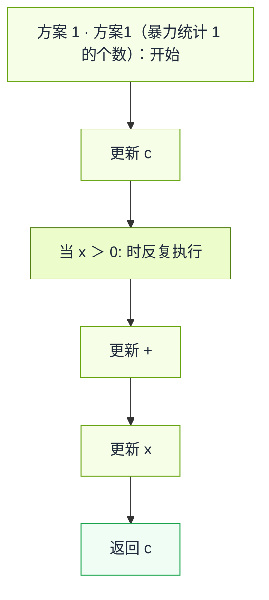

```python
import sys  # 提高递归深度上限（深输入防 RecursionError）

sys.setrecursionlimit(200000)  # 树/链表类题目节点数可达 1e4 量级

def onesCount(x):  # 定义函数 onesCount（参数：x）
    c = 0  # 把 0 存入 字符
    while x > 0:  # 循环，直到不满足「x 超过 0」
        c += x % 2  # 字符累加 x 对…取模 2
        x = x // 2  # 把 x 除以 除以 2 存入 x
    return c  # 返回 字符

if __name__ == "__main__":  # 若 __name__ 等于 '__main__'
    print(onesCount(1))  # 打印输出
```

#### 方案 2：方案2（递推预处理 bit 计数）

**思路与代码分析**：核心是「方案2（递推预处理 bit 计数）」。Python 版用切片与字典推导式简化操作，突出可读性。代码里依次做这些事：先排序再处理。**走读**：方案 2 · 方案2（递推预处理 bit 计数）：开始 → 更新 bit → 循环 i：从 1 到 10001 前 → 更新 bit[i] → 更新 sorted_arr → 排序整理 → 返回 sorted_arr。

**运行架构**（真实控制流）：

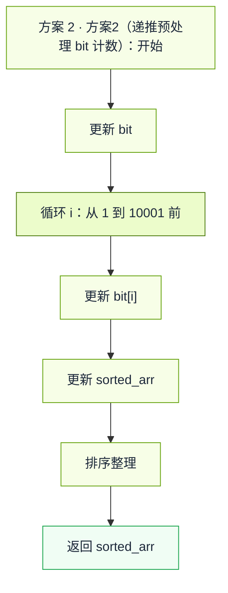

```python
import sys  # 提高递归深度上限（深输入防 RecursionError）

sys.setrecursionlimit(200000)  # 树/链表类题目节点数可达 1e4 量级

def sortByBits(arr):  # 定义函数 sortByBits（参数：数组）
    bit = [0] * 10001  # 把 [0] 乘 10001 存入 bit
    for i in range(1, 10001):  # 让 下标 i 从 1 到 10001 遍历
        bit[i] = bit[i >> 1] + (i & 1)  # 把 bit[下标 i 超过 超过 1] 加 (下标 i 按位与 1) 写入 bit[i]
    sorted_arr = arr[:]  # 把 复制 数组 存入 sorted_arr
    sorted_arr.sort(key=lambda x: (bit[x], x))  # 排序
    return sorted_arr  # 返回 sorted_arr

if __name__ == "__main__":  # 若 __name__ 等于 '__main__'
    print(sortByBits([1, 2, 3]))  # 打印输出
```

### Go 实现（2 种方案）

Go 的全部方案如下，每个方案都内嵌用例自测，可独立运行（老仓库 python/go 文件遵循「打印结果」约定）：

#### 方案 1：方案1（暴力统计 1 的个数）

**思路与代码分析**：核心是「方案1（暴力统计 1 的个数）」。Go 版用切片与多返回值惯用法，显式处理索引边界。**走读**：方案 1 · 方案1（暴力统计 1 的个数）：开始 → 更新 : → 遍历循环 → 更新 + → 更新 / → 返回 c。

**运行架构**（真实控制流）：

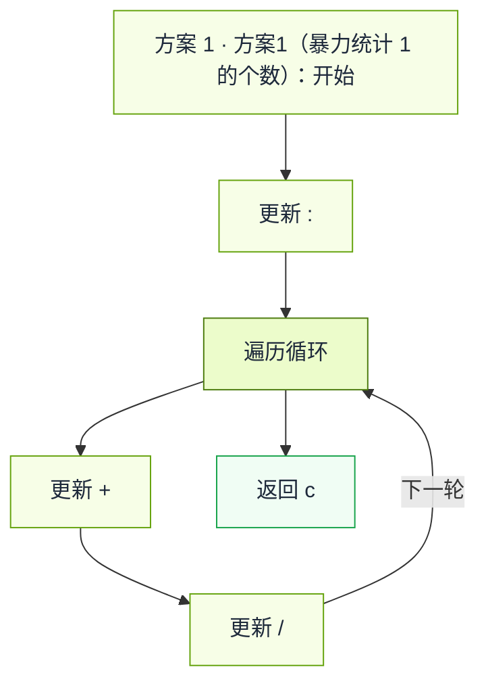

```go
package main // 引入依赖

import (
	"fmt" // 「fmt」
	"os"  // 「os」
)

func onesCount(x int) int { // 定义函数/方法 onesCount
	c := 0      // 把 0 写入 c :
	for x > 0 { // for x 超过 0 {
		c += x % 2 // 字符累加 x 对…取模 2
		x /= 2     // 把 2 写入 x /
	}
	return c // 返回 字符
}

func main() { // 程序入口：跑内嵌自测用例
	ok := true       // 把 true 写入 ok :
	tc := []struct { // 把 []struct { 写入 tc :
		in   int // in int
		want int // want int
	}{ // }{
		{1, 1}, {2, 1}, {3, 2}, {7, 3}, {0, 0},
	}
	for _, c := range tc { // 同时取 _ 与 字符 遍历
		if got := onesCount(c.in); got != c.want { // 若 got : 赋值为 onesCount(字符.in); got 不等于 字符.want
			ok = false                                                       // 把 false 写入 ok
			fmt.Printf("FAIL onesCount(%d)=%d want %d\n", c.in, got, c.want) // 打印输出
		}
	}
	if !ok { // 若 取反 ok
		os.Exit(1) // os.Exit(1)
	}
	fmt.Println("PASS") // 全部用例通过，输出 PASS
}
```

#### 方案 2：方案2（递推预处理 bit 计数）

**思路与代码分析**：核心是「方案2（递推预处理 bit 计数）」。Go 版用切片与多返回值惯用法，显式处理索引边界。**走读**：方案 2 · 方案2（递推预处理 bit 计数）：开始 → 更新 : → 遍历循环 → 更新 bit[i] → 更新 : → 调用 copy(sortedArr, arr) → 调用 sort.Slice(sortedArr, func(i → 处理 if bit[sortedArr[i]] ≠ bit[ → 返回 bit[sortedArr[i]] ＜ bit[sortedArr[j]] → 返回 sortedArr[i] ＜ sortedArr[j] → 返回 sortedArr。

**运行架构**（真实控制流）：

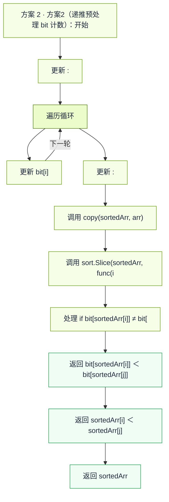

```go
package main // 引入依赖

import (
	"fmt"     // 「fmt」
	"os"      // 「os」
	"reflect" // 「reflect」
	"sort"    // 「sort」
)

func sortByBits(arr []int) []int { // 定义函数/方法 sortByBits
	bit := make([]int, 10001)    // 把 make([]int, 10001) 写入 bit :
	for i := 1; i < 10001; i++ { // 让 下标 i 从 1 开始计数
		bit[i] = bit[i>>1] + (i & 1) // 把 bit[下标 i 超过 超过 1] 加 (下标 i 按位与 1) 写入 bit[i]
	}
	sortedArr := make([]int, len(arr))          // 把 make([]int, 长度(数组)) 写入 sortedArr :
	copy(sortedArr, arr)                        // copy(sortedArr, 数组)
	sort.Slice(sortedArr, func(i, j int) bool { // sort.Slice(sortedArr, func(下标 i, 下标 j int) bool {
		if bit[sortedArr[i]] != bit[sortedArr[j]] { // 若 bit[sortedArr[下标 i]] 不等于 bit[sortedArr[下标 j]]
			return bit[sortedArr[i]] < bit[sortedArr[j]] // 返回 bit[sortedArr[下标 i]] 小于 bit[sortedArr[下标 j]]
		}
		return sortedArr[i] < sortedArr[j] // 返回 sortedArr[下标 i] 小于 sortedArr[下标 j]
	}) // })
	return sortedArr // 返回 sortedArr
}

func main() { // 程序入口：跑内嵌自测用例
	ok := true // 把 true 写入 ok :
	if got := sortByBits([]int{1, 2, 3}); !reflect.DeepEqual(got, []int{1, 2, 3}) {
		ok = false                           // 把 false 写入 ok
		fmt.Printf("FAIL [1,2,3]=%v\n", got) // 打印输出
	}
	want := []int{0, 1, 2, 4, 8, 3, 5, 6, 7} // 把 []int{0, 1, 2, 4, 8, 3, 5, 6, 7} 写入 want :
	if got := sortByBits([]int{0, 1, 2, 3, 4, 5, 6, 7, 8}); !reflect.DeepEqual(got, want) {
		ok = false                                     // 把 false 写入 ok
		fmt.Printf("FAIL big=%v want %v\n", got, want) // 打印输出
	}
	if !ok { // 若 取反 ok
		os.Exit(1) // os.Exit(1)
	}
	fmt.Println("PASS") // 全部用例通过，输出 PASS
}
```

### Java 实现（2 种方案）

Java 的全部方案如下，每个方案都内嵌用例自测，可独立运行（老仓库 python/go 文件遵循「打印结果」约定）：

#### 方案 1：方案1（暴力统计 1 的个数）

**思路与代码分析**：核心是「方案1（暴力统计 1 的个数）」。Java 版用类与静态方法组织，集合操作显式明了。**走读**：方案 1 · 方案1（暴力统计 1 的个数）：开始 → 更新 c → 当 (x ＞ 0) 时反复执行 → 更新 + → 更新 >> → 返回 c。

**运行架构**（真实控制流）：

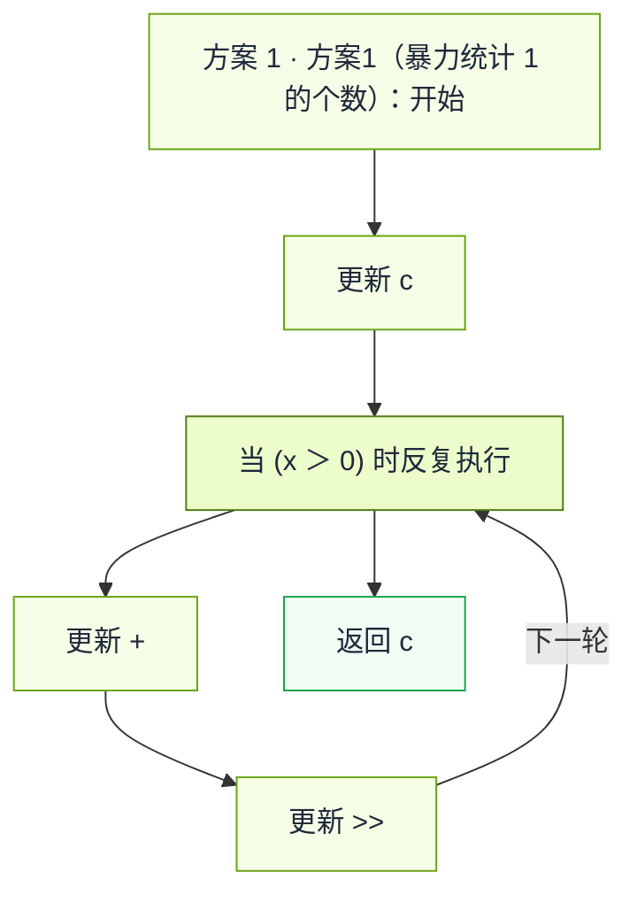

```java
package com.webfault.dsa; // 引入依赖

class BitS1 { // 定义类型
  static int onesCount(int x) { // 定义函数/方法 onesCount
    int c = 0; // 把 0 存入 字符
    while (x > 0) { // 循环，直到不满足「x 超过 0」
      c += x & 1; // 字符累加 x 按位与 1
      x >>= 1; // 把 1; 写入 x >>
    }
    return c; // 返回 字符
  }

  public static void main(String[] args) { // public static void main(String[] args) {
    int[] got = { // 把 { 写入 int[] got
      BitS1.onesCount(1), BitS1.onesCount(7), BitS1.onesCount(0), BitS1.onesCount(15),
    };
    int[] want = {1, 3, 0, 4}; // 把 { 1, 3, 0, 4 }; 写入 int[] want
    boolean ok = true; // 把 true; 写入 boolean ok
    for (int i = 0; i < got.length; i++)
      if (got[i] != want[i]) {
        ok = false;
        System.out.println("FAIL onesCount(" + i + ")=" + got[i]);
      } // 让 下标 i 从 0 开始计数，下标 i 小于 got.长度 就继续
    if (!ok) throw new RuntimeException("FAILED"); // 若 取反 ok) throw new RuntimeException(「FAILED」);
    System.out.println("PASS"); // 全部用例通过，输出 PASS
  }
}
```

#### 方案 2：方案2（递推预处理 bit 计数）

**思路与代码分析**：核心是「方案2（递推预处理 bit 计数）」。Java 版用类与静态方法组织，集合操作显式明了。代码里依次做这些事：先排序再处理；双重循环遍历。**走读**：方案 2 · 方案2（递推预处理 bit 计数）：开始 → 更新 bit → 遍历循环 → 遍历循环 → 命中条件，直接返回 → 返回 arr[a] - arr[b] → 遍历循环 → 返回 result。

**运行架构**（真实控制流）：

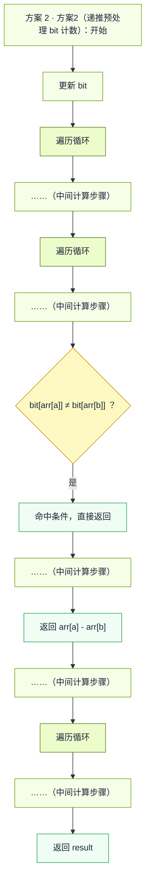

```java
package com.webfault.dsa; // 引入依赖

import java.util.*; // 引入依赖

class BitS2 { // 定义类型
  static int[] sortByBits(int[] arr) { // 定义函数/方法 sortByBits
    int[] bit = new int[10001]; // 把 new int[10001]; 写入 int[] bit
    for (int i = 1; i < 10001; i++)
      bit[i] = bit[i >> 1] + (i & 1); // 让 下标 i 从 1 开始计数，下标 i 小于 10001 就继续
    Integer[] idx = new Integer[arr.length]; // 把 new Integer[数组.长度]; 写入 Integer[] idx
    for (int i = 0; i < arr.length; i++) idx[i] = i; // 让 下标 i 从 0 开始计数，下标 i 小于 数组.长度 就继续
    Arrays.sort(
        idx,
        (a, b) -> { // 排序
          if (bit[arr[a]] != bit[arr[b]])
            return bit[arr[a]]
                - bit[arr[b]]; // 若 bit[数组[数组]] 不等于 bit[数组[b]]，直接返回 bit[数组[数组]] 减 bit[数组[b]]
          return arr[a] - arr[b]; // 返回 数组[数组] 减 数组[b]
        }); // });
    int[] result = new int[arr.length]; // 把 new int[数组.长度]; 写入 int[] result
    for (int i = 0; i < idx.length; i++)
      result[i] = arr[idx[i]]; // 让 下标 i 从 0 开始计数，下标 i 小于 idx.长度 就继续
    return result; // 返回 结果
  }

  public static void main(String[] args) { // public static void main(String[] args) {
    int[][][] cases = { // 把 { 写入 int[][][] cases
      {{1, 2, 3}, {1, 2, 3}},
      {{0, 2, 1, 4}, {0, 1, 2, 4}},
      {{0, 1, 2, 3, 4, 5, 6, 7, 8}, {0, 1, 2, 4, 8, 3, 5, 6, 7}},
    };
    boolean ok = true; // 把 true; 写入 boolean ok
    for (int[][] c : cases) { // for (int[][] 字符 : cases) {
      int[] got = BitS2.sortByBits(c[0].clone()); // 把 BitS2.sortByBits(字符[0].clone()); 写入 int[] got
      if (!Arrays.equals(got, c[1])) {
        ok = false;
        System.out.println("FAIL " + Arrays.toString(c[0]) + " -> " + Arrays.toString(got));
      }
    }
    if (!ok) throw new RuntimeException("FAILED"); // 若 取反 ok) throw new RuntimeException(「FAILED」);
    System.out.println("PASS"); // 全部用例通过，输出 PASS
  }
}
```

### Rust 实现（2 种方案）

Rust 的全部方案如下，每个方案都内嵌用例自测，可独立运行（老仓库 python/go 文件遵循「打印结果」约定）：

#### 方案 1：方案1（暴力统计 1 的个数）

**思路与代码分析**：核心是「方案1（暴力统计 1 的个数）」。Rust 版用所有权移动与切片借用改写同一逻辑，注意 Option 与引用边界。**走读**：方案 1 · 方案1（暴力统计 1 的个数）：开始 → 计算 arr → 调用 arr.sort_by(｜&a, &b｜ → 计算 let (ba, bb) = (count_bi → 调用 ba.cmp(&bb).then(a.cmp(&b)) → 处理 arr → 返回结果。

**运行架构**（真实控制流）：

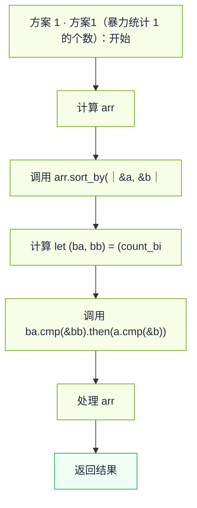

```rust
// LeetCode 1356. 根据数字二进制下1的数目排序 — Rust 版（方案1）
fn count_bits(mut n: i32) -> i32 {
    // 定义函数/方法 count_bits
    let mut c = 0; // 把 0; 写入 let mut c
    while n > 0 {
        c += n & 1;
        n >>= 1;
    } // 把 元素个数 按位与 1; 元素个数 超过 不低于 1; } 写入 while n > 0 { c +
    c // 字符
}
fn sort_by_bits(nums: Vec<i32>) -> Vec<i32> {
    // 定义函数/方法 sort_by_bits
    let mut arr = nums; // 把 数组; 写入 let mut arr
    arr.sort_by(|&a, &b| {
        // 数组.sort_by( 按位或 按位与 数组, 按位与 b 按位或 {
        let (ba, bb) = (count_bits(a), count_bits(b)); // 把 (count_bits(数组), count_bits(b)); 写入 let (ba, bb)
        ba.cmp(&bb).then(a.cmp(&b)) // ba.cmp( 按位与 bb).then(数组.cmp( 按位与 b))
    }); // });
    arr // 数组
}
fn main() {
    // 程序入口：跑内嵌自测用例
    assert_eq!(
        sort_by_bits(vec![0, 1, 2, 3, 4, 5, 6, 7, 8]),
        vec![0, 1, 2, 4, 8, 3, 5, 6, 7]
    ); // 断言校验
    assert_eq!(
        sort_by_bits(vec![1024, 512, 256, 128, 64, 32, 16, 8, 4, 2, 1]),
        vec![1, 2, 4, 8, 16, 32, 64, 128, 256, 512, 1024]
    ); // 断言校验
    println!("PASS"); // 全部用例通过，输出 PASS
}
```

#### 方案 2：方案2（递推预处理 bit 计数）

**思路与代码分析**：核心是「方案2（递推预处理 bit 计数）」。Rust 版用所有权移动与切片借用改写同一逻辑，注意 Option 与引用边界。**走读**：方案 2 · 方案2（递推预处理 bit 计数）：开始 → 计算 arr → 调用 arr.sort_by(｜&a, &b｜ → 计算 let (ba, bb) = (count_bi → 调用 ba.cmp(&bb).then(a.cmp(&b)) → 处理 arr → 返回结果。

**运行架构**（真实控制流）：

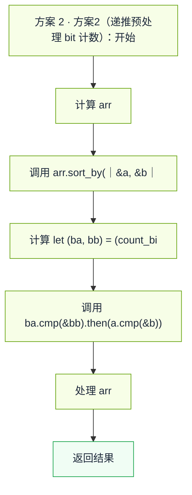

```rust
// LeetCode 1356. 根据数字二进制下1的数目排序 — Rust 版（方案2）
fn count_bits(mut n: i32) -> i32 {
    // 定义函数/方法 count_bits
    let mut c = 0; // 把 0; 写入 let mut c
    while n > 0 {
        c += n & 1;
        n >>= 1;
    } // 把 元素个数 按位与 1; 元素个数 超过 不低于 1; } 写入 while n > 0 { c +
    c // 字符
}
fn sort_by_bits(nums: Vec<i32>) -> Vec<i32> {
    // 定义函数/方法 sort_by_bits
    let mut arr = nums; // 把 数组; 写入 let mut arr
    arr.sort_by(|&a, &b| {
        // 数组.sort_by( 按位或 按位与 数组, 按位与 b 按位或 {
        let (ba, bb) = (count_bits(a), count_bits(b)); // 把 (count_bits(数组), count_bits(b)); 写入 let (ba, bb)
        ba.cmp(&bb).then(a.cmp(&b)) // ba.cmp( 按位与 bb).then(数组.cmp( 按位与 b))
    }); // });
    arr // 数组
}
fn main() {
    // 程序入口：跑内嵌自测用例
    assert_eq!(
        sort_by_bits(vec![0, 1, 2, 3, 4, 5, 6, 7, 8]),
        vec![0, 1, 2, 4, 8, 3, 5, 6, 7]
    ); // 断言校验
    assert_eq!(
        sort_by_bits(vec![1024, 512, 256, 128, 64, 32, 16, 8, 4, 2, 1]),
        vec![1, 2, 4, 8, 16, 32, 64, 128, 256, 512, 1024]
    ); // 断言校验
    println!("PASS"); // 全部用例通过，输出 PASS
}
```

### Lua 实现（2 种方案）

Lua 的全部方案如下，每个方案都内嵌用例自测，可独立运行（老仓库 python/go 文件遵循「打印结果」约定）：

#### 方案 1：方案1（暴力统计 1 的个数）

**思路与代码分析**：核心是「方案1（暴力统计 1 的个数）」。Lua 版用表与 ipairs 遍历，注意 ipairs 遇 nil 即停的语义。**走读**：方案 1 · 方案1（暴力统计 1 的个数）：开始 → 更新 c → 当 n ＞ 0 do 时反复执行 → 更新 c → 更新 n → 返回 c。

**运行架构**（真实控制流）：

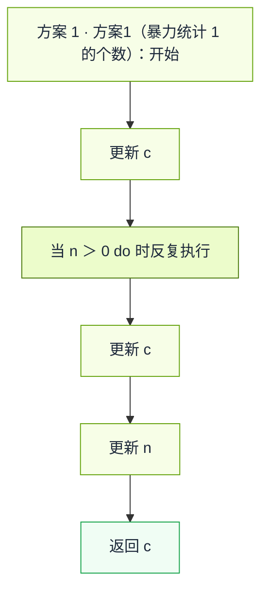

```lua
-- LeetCode 1356. 根据数字二进制下1的数目排序 — Lua 版（方案1）
local function count_bits(n) -- local function count_bits(元素个数)
	local c = 0 -- 把 0 写入 local c
	while n > 0 do -- while 元素个数 超过 0 do
		c = c + (n & 1) -- 把 字符 加 (元素个数 按位与 1) 存入 字符
		n = n >> 1 -- 把 元素个数 超过 超过 1 存入 元素个数
	end -- 终点
	return c -- 返回 字符
end -- 终点
local function sort_by_bits(nums) -- local function sort_by_bits(数组)
	local arr = { table.unpack(nums) } -- 把 {table.unpack(数组)} 写入 local arr
	table.sort(arr, function(a, b) -- 排序
		local ba, bb = count_bits(a), count_bits(b) -- 把 count_bits(数组), count_bits(b) 写入 local ba, bb
		if ba ~= bb then
			return ba < bb
		end -- 若 ba ~ 赋值为 bb then return ba 小于 bb 终点
		return a < b -- 返回 数组 小于 b
	end) -- 终点)
	return arr -- 返回 数组
end -- 终点
local a = sort_by_bits({ 0, 1, 2, 3, 4, 5, 6, 7, 8 }) -- 把 sort_by_bits({0, 1, 2, 3, 4, 5, 6, 7, 8}) 写入 local a
assert(#a == 9 and a[1] == 0 and a[2] == 1 and a[3] == 2 and a[4] == 4 and a[5] == 8 and a[6] == 3 and a[9] == 7) -- 断言校验
print("PASS") -- 全部用例通过，输出 PASS
```

#### 方案 2：方案2（递推预处理 bit 计数）

**思路与代码分析**：核心是「方案2（递推预处理 bit 计数）」。Lua 版用表与 ipairs 遍历，注意 ipairs 遇 nil 即停的语义。**走读**：方案 2 · 方案2（递推预处理 bit 计数）：开始 → 更新 c → 当 n ＞ 0 do 时反复执行 → 更新 c → 更新 n → 返回 c。

**运行架构**（真实控制流）：

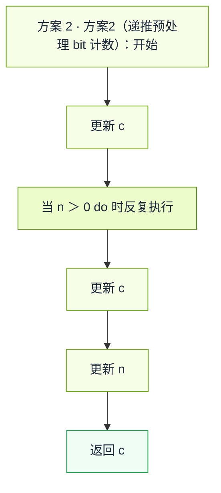

```lua
-- LeetCode 1356. 根据数字二进制下1的数目排序 — Lua 版（方案2）
local function count_bits(n) -- local function count_bits(元素个数)
	local c = 0 -- 把 0 写入 local c
	while n > 0 do -- while 元素个数 超过 0 do
		c = c + (n & 1) -- 把 字符 加 (元素个数 按位与 1) 存入 字符
		n = n >> 1 -- 把 元素个数 超过 超过 1 存入 元素个数
	end -- 终点
	return c -- 返回 字符
end -- 终点
local function sort_by_bits(nums) -- local function sort_by_bits(数组)
	local arr = { table.unpack(nums) } -- 把 {table.unpack(数组)} 写入 local arr
	table.sort(arr, function(a, b) -- 排序
		local ba, bb = count_bits(a), count_bits(b) -- 把 count_bits(数组), count_bits(b) 写入 local ba, bb
		if ba ~= bb then
			return ba < bb
		end -- 若 ba ~ 赋值为 bb then return ba 小于 bb 终点
		return a < b -- 返回 数组 小于 b
	end) -- 终点)
	return arr -- 返回 数组
end -- 终点
local a = sort_by_bits({ 0, 1, 2, 3, 4, 5, 6, 7, 8 }) -- 把 sort_by_bits({0, 1, 2, 3, 4, 5, 6, 7, 8}) 写入 local a
assert(#a == 9 and a[1] == 0 and a[2] == 1 and a[3] == 2 and a[4] == 4 and a[5] == 8 and a[6] == 3 and a[9] == 7) -- 断言校验
print("PASS") -- 全部用例通过，输出 PASS
```

### C 实现（2 种方案）

C 的全部方案如下，每个方案都内嵌用例自测，可独立运行（老仓库 python/go 文件遵循「打印结果」约定）：

#### 方案 1：方案1（暴力统计 1 的个数）

**思路与代码分析**：核心是「方案1（暴力统计 1 的个数）」。C 版手动管理下标与内存，循环边界全部显式写出。代码里依次做这些事：单循环线性扫描。**走读**：方案 1 · 方案1（暴力统计 1 的个数）：开始 → 遍历循环 → 更新 out[i] → 调用 qsort(out, n, sizeof(int), c → 返回结果。

**运行架构**（真实控制流）：

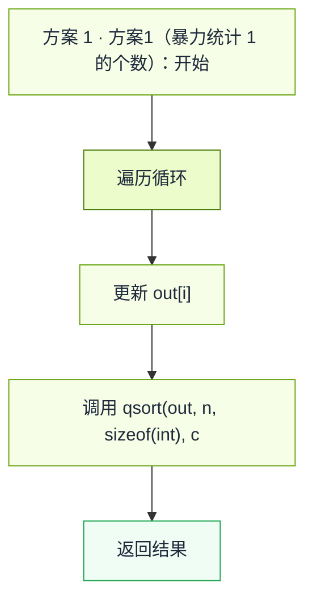

```c
/* LeetCode 1356. 根据数字二进制下1的数目排序 — C 版（方案1） */
#include <stdio.h>  // 引入头文件
#include <stdlib.h> // 引入头文件
static int count_bits(int n) {
    int c = 0;
    while (n) {
        c += n & 1;
        n >>= 1;
    }
    return c;
}
static int cmp_bits(const void *a, const void *b) { // 定义函数/方法 cmp_bits
    int x = *(const int *)a,
        y = *(const int *)b; // 把 乘 (const int 乘 )数组, y 赋值为 乘 (const int 乘 )b 存入 x
    int bx = count_bits(x), by = count_bits(y); // 把 count_bits(x), by 赋值为 count_bits(y) 存入 bx
    if (bx != by)
        return bx - by; // 若 bx 不等于 by，直接返回 bx 减 by
    return x - y;       // 返回 x 减 y
}
static void sort_by_bits(const int *nums, int n, int out[]) { // 定义函数/方法 sort_by_bits
    for (int i = 0; i < n; i++)
        out[i] = nums[i]; // 让 下标 i 从 0 开始计数，下标 i 小于 元素个数 就继续
    qsort(out, n, sizeof(int), cmp_bits); // qsort(out, 元素个数, sizeof(int), cmp_bits);
}
int main(void) {                           // 程序入口：跑内嵌自测用例
    int out[64];                           // int out[64];
    int w[] = {0, 1, 2, 4, 8, 3, 5, 6, 7}; // 把 {0,1,2,4,8,3,5,6,7}; 写入 int w[]
    sort_by_bits((int[]){0, 1, 2, 3, 4, 5, 6, 7, 8}, 9,
                 out); // sort_by_bits((int[]){0,1,2,3,4,5,6,7,8}, 9, out);
    for (int i = 0; i < 9; i++)
        if (out[i] != w[i]) {
            printf("FAIL %d\n", i);
            return 1;
        }             // 让 下标 i 从 0 开始计数，下标 i 小于 9 就继续
    printf("PASS\n"); // 全部用例通过，输出 PASS
    return 0;         // 返回 0
}
```

#### 方案 2：方案2（递推预处理 bit 计数）

**思路与代码分析**：核心是「方案2（递推预处理 bit 计数）」。C 版手动管理下标与内存，循环边界全部显式写出。代码里依次做这些事：单循环线性扫描。**走读**：方案 2 · 方案2（递推预处理 bit 计数）：开始 → 遍历循环 → 更新 out[i] → 调用 qsort(out, n, sizeof(int), c → 返回结果。

**运行架构**（真实控制流）：

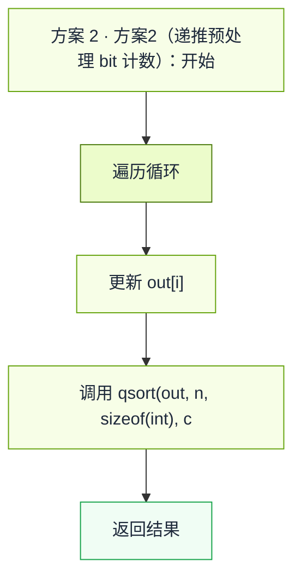

```c
/* LeetCode 1356. 根据数字二进制下1的数目排序 — C 版（方案2） */
#include <stdio.h>  // 引入头文件
#include <stdlib.h> // 引入头文件
static int count_bits(int n) {
    int c = 0;
    while (n) {
        c += n & 1;
        n >>= 1;
    }
    return c;
}
static int cmp_bits(const void *a, const void *b) { // 定义函数/方法 cmp_bits
    int x = *(const int *)a,
        y = *(const int *)b; // 把 乘 (const int 乘 )数组, y 赋值为 乘 (const int 乘 )b 存入 x
    int bx = count_bits(x), by = count_bits(y); // 把 count_bits(x), by 赋值为 count_bits(y) 存入 bx
    if (bx != by)
        return bx - by; // 若 bx 不等于 by，直接返回 bx 减 by
    return x - y;       // 返回 x 减 y
}
static void sort_by_bits(const int *nums, int n, int out[]) { // 定义函数/方法 sort_by_bits
    for (int i = 0; i < n; i++)
        out[i] = nums[i]; // 让 下标 i 从 0 开始计数，下标 i 小于 元素个数 就继续
    qsort(out, n, sizeof(int), cmp_bits); // qsort(out, 元素个数, sizeof(int), cmp_bits);
}
int main(void) {                           // 程序入口：跑内嵌自测用例
    int out[64];                           // int out[64];
    int w[] = {0, 1, 2, 4, 8, 3, 5, 6, 7}; // 把 {0,1,2,4,8,3,5,6,7}; 写入 int w[]
    sort_by_bits((int[]){0, 1, 2, 3, 4, 5, 6, 7, 8}, 9,
                 out); // sort_by_bits((int[]){0,1,2,3,4,5,6,7,8}, 9, out);
    for (int i = 0; i < 9; i++)
        if (out[i] != w[i]) {
            printf("FAIL %d\n", i);
            return 1;
        }             // 让 下标 i 从 0 开始计数，下标 i 小于 9 就继续
    printf("PASS\n"); // 全部用例通过，输出 PASS
    return 0;         // 返回 0
}
```

### C++ 实现（2 种方案）

C++ 的全部方案如下，每个方案都内嵌用例自测，可独立运行（老仓库 python/go 文件遵循「打印结果」约定）：

#### 方案 1：方案1（暴力统计 1 的个数）

**思路与代码分析**：核心是「方案1（暴力统计 1 的个数）」。C++ 版用 STL 容器与迭代器，减少手写下标错误。**走读**：方案 1 · 方案1（暴力统计 1 的个数）：开始 → 处理 std::sort(nums.begin(), nums → 配置比较器（lambda） → 更新 ba → 更新 bb → 命中条件，直接返回 → 返回 a ＜ b → 返回 nums。

**运行架构**（真实控制流）：

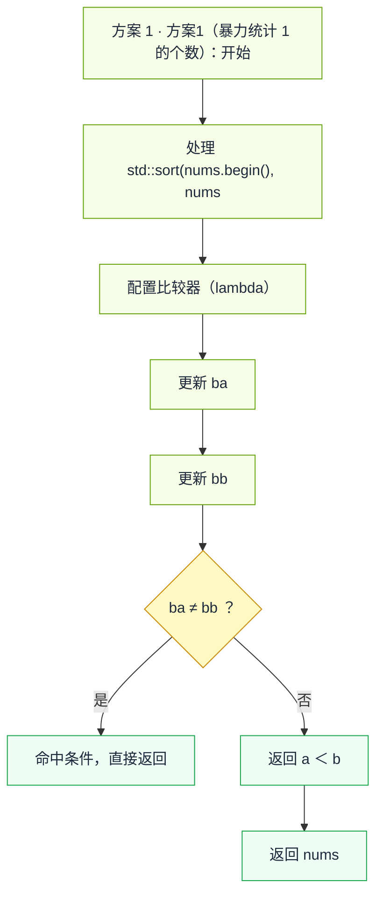

```cpp
// LeetCode 1356. 根据数字二进制下1的数目排序 — C++ 版（方案1）
#include <algorithm> // 引入头文件
#include <cassert>   // 引入头文件
#include <iostream>  // 引入头文件
#include <vector>    // 引入头文件
static int countBits(int n) {
    int c = 0;
    while (n) {
        c += n & 1;
        n >>= 1;
    }
    return c;
}
static std::vector<int> sortByBits(std::vector<int> nums) {
    std::sort(nums.begin(), nums.end(),
              [](int a, int b) { // std::sort(数组 迭代位置 , 数组.终点(), [](int 数组, int b) {
                  int ba = countBits(a),
                      bb = countBits(b); // 把 countBits(数组), bb 赋值为 countBits(b) 存入 ba
                  if (ba != bb)
                      return ba < bb; // 若 ba 不等于 bb，直接返回 ba 小于 bb
                  return a < b;       // 返回 数组 小于 b
              });                     // });
    return nums;                      // 返回 数组
}
int main() { // 程序入口：跑内嵌自测用例
    assert(
        (sortByBits({0, 1, 2, 3, 4, 5, 6, 7, 8}) == std::vector<int>{0, 1, 2, 4, 8, 3, 5, 6, 7})); // 断言校验
    std::cout << "PASS" << std::endl; // 全部用例通过，输出 PASS
    return 0;                         // 返回 0
}
```

#### 方案 2：方案2（递推预处理 bit 计数）

**思路与代码分析**：核心是「方案2（递推预处理 bit 计数）」。C++ 版用 STL 容器与迭代器，减少手写下标错误。**走读**：方案 2 · 方案2（递推预处理 bit 计数）：开始 → 处理 std::sort(nums.begin(), nums → 配置比较器（lambda） → 更新 ba → 更新 bb → 命中条件，直接返回 → 返回 a ＜ b → 返回 nums。

**运行架构**（真实控制流）：

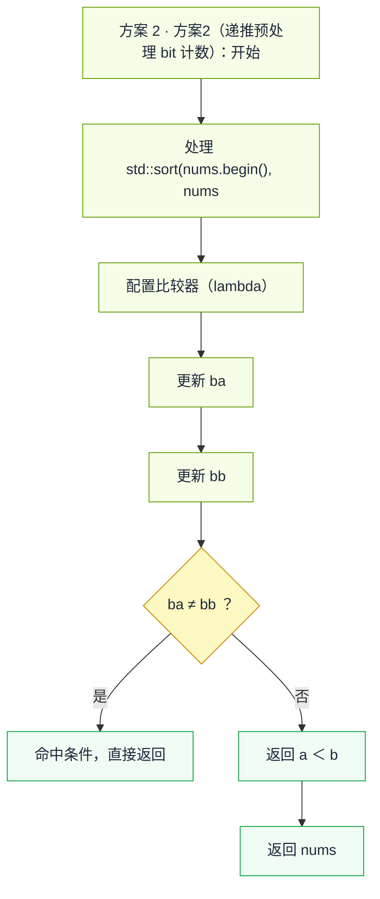

```cpp
// LeetCode 1356. 根据数字二进制下1的数目排序 — C++ 版（方案2）
#include <algorithm> // 引入头文件
#include <cassert>   // 引入头文件
#include <iostream>  // 引入头文件
#include <vector>    // 引入头文件
static int countBits(int n) {
    int c = 0;
    while (n) {
        c += n & 1;
        n >>= 1;
    }
    return c;
}
static std::vector<int> sortByBits(std::vector<int> nums) {
    std::sort(nums.begin(), nums.end(),
              [](int a, int b) { // std::sort(数组 迭代位置 , 数组.终点(), [](int 数组, int b) {
                  int ba = countBits(a),
                      bb = countBits(b); // 把 countBits(数组), bb 赋值为 countBits(b) 存入 ba
                  if (ba != bb)
                      return ba < bb; // 若 ba 不等于 bb，直接返回 ba 小于 bb
                  return a < b;       // 返回 数组 小于 b
              });                     // });
    return nums;                      // 返回 数组
}
int main() { // 程序入口：跑内嵌自测用例
    assert(
        (sortByBits({0, 1, 2, 3, 4, 5, 6, 7, 8}) == std::vector<int>{0, 1, 2, 4, 8, 3, 5, 6, 7})); // 断言校验
    std::cout << "PASS" << std::endl; // 全部用例通过，输出 PASS
    return 0;                         // 返回 0
}
```

### R 实现（2 种方案）

R 的全部方案如下，每个方案都内嵌用例自测，可独立运行（老仓库 python/go 文件遵循「打印结果」约定）：

#### 方案 1：方案1（暴力统计 1 的个数）

**思路与代码分析**：核心是「方案1（暴力统计 1 的个数）」。R 版用向量化思维与 1 起始下标，注意 1:n 的降序陷阱。**走读**：方案 1 · 方案1（暴力统计 1 的个数）：开始 → 处理 c ＜- 0L → 当 (n ＞ 0) 时反复执行 → 处理 c ＜- c + bitwAnd(n, 1) → 处理 n ＜- bitwShiftR(n, 1) → 处理 c → 返回结果。

**运行架构**（真实控制流）：

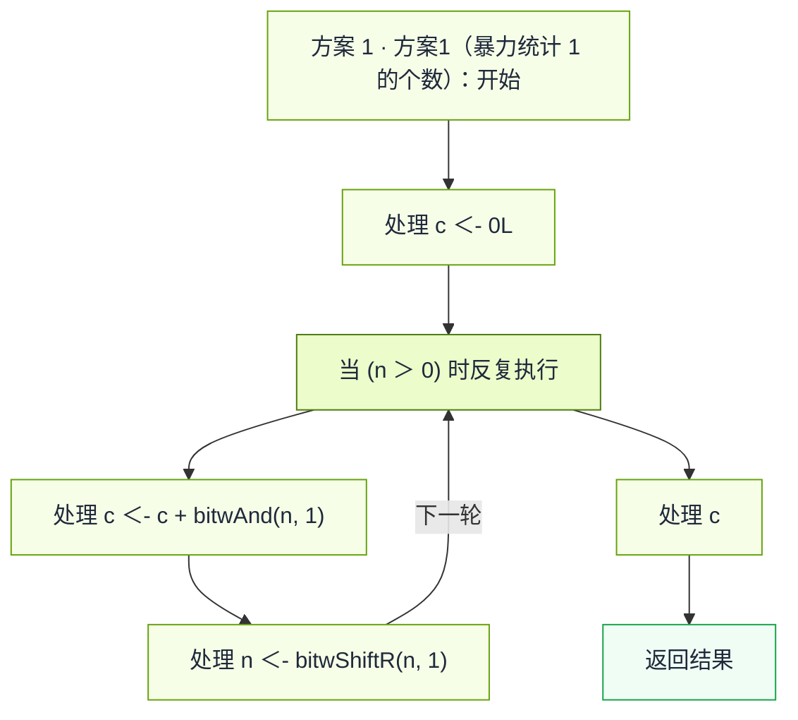

```r
# 根据数字二进制下1的数目排序 — R 版（方案1） 定义函数 count_bits（参数：元素个数）
count_bits <- function(n) {
    c <- 0L  # 把 0L 存入 字符
    while (n > 0) {
        c <- c + bitwAnd(n, 1)
        n <- bitwShiftR(n, 1)
    }
    c  # 字符
}
sort_by_bits <- function(nums) {
    # 定义函数 sort_by_bits（参数：数组）
    b <- vapply(nums, count_bits, 0L)  # 把 vapply(数组, count_bits, 0L) 存入 b
    nums[order(b, nums)]  # 数组[order(b, 数组)]
}
stopifnot(identical(sort_by_bits(0:8), c(0L, 1L, 2L, 4L, 8L, 3L, 5L, 6L, 7L)))  # 断言校验
cat("PASS\n")  # 全部用例通过，输出 PASS
```

#### 方案 2：方案2（递推预处理 bit 计数）

**思路与代码分析**：核心是「方案2（递推预处理 bit 计数）」。R 版用向量化思维与 1 起始下标，注意 1:n 的降序陷阱。**走读**：方案 2 · 方案2（递推预处理 bit 计数）：开始 → 处理 c ＜- 0L → 当 (n ＞ 0) 时反复执行 → 处理 c ＜- c + bitwAnd(n, 1) → 处理 n ＜- bitwShiftR(n, 1) → 处理 c → 返回结果。

**运行架构**（真实控制流）：

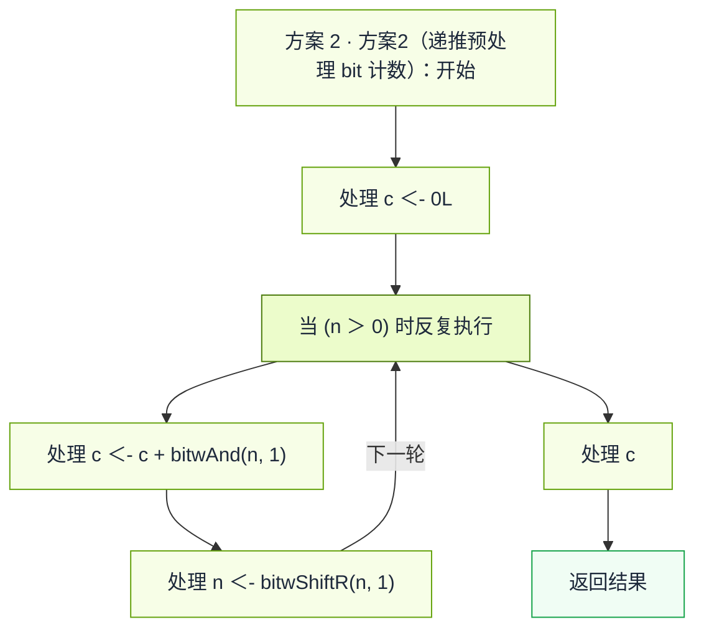

```r
# 根据数字二进制下1的数目排序 — R 版（方案2） 定义函数 count_bits（参数：元素个数）
count_bits <- function(n) {
    c <- 0L  # 把 0L 存入 字符
    while (n > 0) {
        c <- c + bitwAnd(n, 1)
        n <- bitwShiftR(n, 1)
    }
    c  # 字符
}
sort_by_bits <- function(nums) {
    # 定义函数 sort_by_bits（参数：数组）
    b <- vapply(nums, count_bits, 0L)  # 把 vapply(数组, count_bits, 0L) 存入 b
    nums[order(b, nums)]  # 数组[order(b, 数组)]
}
stopifnot(identical(sort_by_bits(0:8), c(0L, 1L, 2L, 4L, 8L, 3L, 5L, 6L, 7L)))  # 断言校验
cat("PASS\n")  # 全部用例通过，输出 PASS
```

### Zig 实现（2 种方案）

Zig 的全部方案如下，每个方案都内嵌用例自测，可独立运行（老仓库 python/go 文件遵循「打印结果」约定）：

#### 方案 1：方案1（暴力统计 1 的个数）

**思路与代码分析**：核心是「方案1（暴力统计 1 的个数）」。Zig 版显式分配与清零，整型边界处理严格。**走读**：方案 1 · 方案1（暴力统计 1 的个数）：开始 → 计算 arr → 计算 S → 计算 ba → 计算 bb → 命中条件，直接返回 → 返回 a ＜ b → 处理 std.sort.pdq(i32, arr, → 返回 arr。

**运行架构**（真实控制流）：

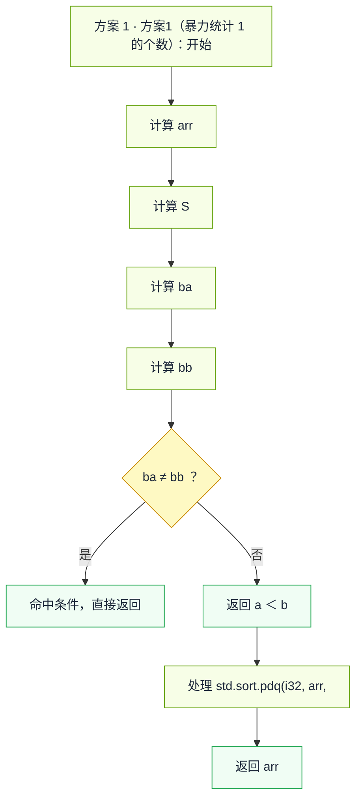

```zig
// LeetCode 1356. 根据数字二进制下1的数目排序 — Zig 版（方案1）
const std = @import("std"); // 把 @import(「std」) 存入 std
fn countBits(n0: i32) i32 { // 定义函数/方法 countBits
    var c: i32 = 0; // 把 0; 写入 var c: i32
    var n = n0; // 把 n0 存入 元素个数
    while (n > 0) : (n >>= 1) c += n & 1; // 循环，直到不满足「元素个数 超过 0) : (元素个数 超过 不低于 1) 字符 累加 元素个数 按位与 1;」
    return c; // 返回 字符
}
fn sortByBits(nums: []const i32, alloc: std.mem.Allocator) []i32 { // 定义函数/方法 sortByBits
    const arr = alloc.dupe(i32, nums) catch unreachable; // 把 alloc.dupe(i32, 数组) catch unreachable 存入 数组
    const S = struct { // 把 struct { 存入 S
        fn lt(_: void, a: i32, b: i32) bool { // 定义函数/方法 lt
            const ba = countBits(a); // 把 countBits(数组) 存入 ba
            const bb = countBits(b); // 把 countBits(b) 存入 bb
            if (ba != bb) return ba < bb; // 若 ba 不等于 bb，直接返回 ba 小于 bb
            return a < b; // 返回 数组 小于 b
        }
    };
    std.sort.pdq(i32, arr, {}, S.lt); // std.sort.pdq(i32, 数组, {}, S.lt);
    return arr; // 返回 数组
}
pub fn main() !void { // 程序入口：跑内嵌自测用例
    var arena = std.heap.ArenaAllocator.init(std.heap.page_allocator); // 把 std.堆.ArenaAllocator.init(std.堆.page_allocator) 存入 arena
    defer arena.deinit(); // defer arena.deinit();
    const got = sortByBits(&[_]i32{ 0, 1, 2, 3, 4, 5, 6, 7, 8 }, arena.allocator());
    const want = [_]i32{ 0, 1, 2, 4, 8, 3, 5, 6, 7 }; // 把 [_]i32{ 0, 1, 2, 4, 8, 3, 5, 6, 7 } 存入 want
    if (got.len != want.len) return error.TestFailed; // 若 got.长度 不等于 want.长度，直接返回 error.TestFailed
    for (want, 0..) |w, i| if (got[i] != w) return error.TestFailed;
    std.debug.print("PASS\n", .{}); // 全部用例通过，输出 PASS
}
```

#### 方案 2：方案2（递推预处理 bit 计数）

**思路与代码分析**：核心是「方案2（递推预处理 bit 计数）」。Zig 版显式分配与清零，整型边界处理严格。**走读**：方案 2 · 方案2（递推预处理 bit 计数）：开始 → 计算 arr → 计算 S → 计算 ba → 计算 bb → 命中条件，直接返回 → 返回 a ＜ b → 处理 std.sort.pdq(i32, arr, → 返回 arr。

**运行架构**（真实控制流）：

```mermaid
graph TD
    N0["方案 2 · 方案2（递推预处理 bit 计数）：开始"]
    N1["计算 arr"]
    N2["计算 S"]
    N3["计算 ba"]
    N4["计算 bb"]
    N5{"ba ≠ bb ？"}
    N6["命中条件，直接返回"]
    N7["返回 a ＜ b"]
    N8["处理 std.sort.pdq(i32, arr,"]
    N9["返回 arr"]
    N0 --> N1
    N1 --> N2
    N2 --> N3
    N3 --> N4
    N4 --> N5
    N5 -- 是 --> N6
    N5 -- 否 --> N7
    N7 --> N8
    N8 --> N9
    classDef n fill:#f7fee7,stroke:#65a30d,color:#1e293b;
    classDef lp fill:#ecfccb,stroke:#4d7c0f,color:#1e293b;
    classDef dc fill:#fef9c3,stroke:#ca8a04,color:#1e293b;
    classDef tm fill:#f0fdf4,stroke:#16a34a,color:#1e293b;
    class N0,N1,N2,N3,N4,N8 n;
    class N5 dc;
    class N6,N7,N9 tm;
```

```zig
// LeetCode 1356. 根据数字二进制下1的数目排序 — Zig 版（方案2）
const std = @import("std"); // 把 @import(「std」) 存入 std
fn countBits(n0: i32) i32 { // 定义函数/方法 countBits
    var c: i32 = 0; // 把 0; 写入 var c: i32
    var n = n0; // 把 n0 存入 元素个数
    while (n > 0) : (n >>= 1) c += n & 1; // 循环，直到不满足「元素个数 超过 0) : (元素个数 超过 不低于 1) 字符 累加 元素个数 按位与 1;」
    return c; // 返回 字符
}
fn sortByBits(nums: []const i32, alloc: std.mem.Allocator) []i32 { // 定义函数/方法 sortByBits
    const arr = alloc.dupe(i32, nums) catch unreachable; // 把 alloc.dupe(i32, 数组) catch unreachable 存入 数组
    const S = struct { // 把 struct { 存入 S
        fn lt(_: void, a: i32, b: i32) bool { // 定义函数/方法 lt
            const ba = countBits(a); // 把 countBits(数组) 存入 ba
            const bb = countBits(b); // 把 countBits(b) 存入 bb
            if (ba != bb) return ba < bb; // 若 ba 不等于 bb，直接返回 ba 小于 bb
            return a < b; // 返回 数组 小于 b
        }
    };
    std.sort.pdq(i32, arr, {}, S.lt); // std.sort.pdq(i32, 数组, {}, S.lt);
    return arr; // 返回 数组
}
pub fn main() !void { // 程序入口：跑内嵌自测用例
    var arena = std.heap.ArenaAllocator.init(std.heap.page_allocator); // 把 std.堆.ArenaAllocator.init(std.堆.page_allocator) 存入 arena
    defer arena.deinit(); // defer arena.deinit();
    const got = sortByBits(&[_]i32{ 0, 1, 2, 3, 4, 5, 6, 7, 8 }, arena.allocator());
    const want = [_]i32{ 0, 1, 2, 4, 8, 3, 5, 6, 7 }; // 把 [_]i32{ 0, 1, 2, 4, 8, 3, 5, 6, 7 } 存入 want
    if (got.len != want.len) return error.TestFailed; // 若 got.长度 不等于 want.长度，直接返回 error.TestFailed
    for (want, 0..) |w, i| if (got[i] != w) return error.TestFailed;
    std.debug.print("PASS\n", .{}); // 全部用例通过，输出 PASS
}
```

### Dart 实现（2 种方案）

Dart 的全部方案如下，每个方案都内嵌用例自测，可独立运行（老仓库 python/go 文件遵循「打印结果」约定）：

#### 方案 1：方案1（暴力统计 1 的个数）

**思路与代码分析**：核心是「方案1（暴力统计 1 的个数）」。Dart 版用可空类型标注与集合方法，注意空安全。代码里依次做这些事：先排序再处理。**走读**：方案 1 · 方案1（暴力统计 1 的个数）：开始 → 更新 arr → 处理 List＜int＞.from(nums) → 排序整理 → 更新 ba → 更新 bb → 命中条件，直接返回 → 返回 a.compareTo(b) → 返回 arr。

**运行架构**（真实控制流）：

```mermaid
graph TD
    N0["方案 1 · 方案1（暴力统计 1 的个数）：开始"]
    N1["更新 arr"]
    N2["处理 List＜int＞.from(nums)"]
    N3["排序整理"]
    N4["更新 ba"]
    N5["更新 bb"]
    N6{"ba ≠ bb ？"}
    N7["命中条件，直接返回"]
    N8["返回 a.compareTo(b)"]
    N9["返回 arr"]
    N0 --> N1
    N1 --> N2
    N2 --> N3
    N3 --> N4
    N4 --> N5
    N5 --> N6
    N6 -- 是 --> N7
    N6 -- 否 --> N8
    N8 --> N9
    classDef n fill:#f7fee7,stroke:#65a30d,color:#1e293b;
    classDef lp fill:#ecfccb,stroke:#4d7c0f,color:#1e293b;
    classDef dc fill:#fef9c3,stroke:#ca8a04,color:#1e293b;
    classDef tm fill:#f0fdf4,stroke:#16a34a,color:#1e293b;
    class N0,N1,N2,N3,N4,N5 n;
    class N6 dc;
    class N7,N8,N9 tm;
```

```dart
// LeetCode 1356. 根据数字二进制下1的数目排序 — Dart 版（方案1）
int countBits(int n) {
  // 定义函数/方法 countBits
  var c = 0; // 把 0 存入 字符
  while (n > 0) {
    // 循环，直到不满足「元素个数 超过 0」
    c += n & 1; // 字符累加 元素个数 按位与 1
    n >>= 1; // 把 1; 写入 n >>
  }
  return c; // 返回 字符
}

List<int> sortByBits(List<int> nums) {
  // 定义函数/方法 sortByBits
  final arr =
      List<int>.from(nums) // 把 List 小于 int 超过 .from(数组) 存入 数组
        ..sort((a, b) {
          // 排序
          final ba = countBits(a),
              bb = countBits(b); // 把 countBits(数组), bb 赋值为 countBits(b) 存入 ba
          if (ba != bb)
            return ba.compareTo(bb); // 若 ba 不等于 bb，直接返回 ba.compareTo(bb)
          return a.compareTo(b); // 返回 数组.compareTo(b)
        }); // });
  return arr; // 返回 数组
}

void main() {
  // 程序入口：跑内嵌自测用例
  if (sortByBits([0, 1, 2, 3, 4, 5, 6, 7, 8]).toString() !=
      '[0, 1, 2, 4, 8, 3, 5, 6, 7]')
    throw StateError('c1');
  print('PASS'); // 全部用例通过，输出 PASS
}
```

#### 方案 2：方案2（递推预处理 bit 计数）

**思路与代码分析**：核心是「方案2（递推预处理 bit 计数）」。Dart 版用可空类型标注与集合方法，注意空安全。代码里依次做这些事：先排序再处理。**走读**：方案 2 · 方案2（递推预处理 bit 计数）：开始 → 更新 arr → 处理 List＜int＞.from(nums) → 排序整理 → 更新 ba → 更新 bb → 命中条件，直接返回 → 返回 a.compareTo(b) → 返回 arr。

**运行架构**（真实控制流）：

```mermaid
graph TD
    N0["方案 2 · 方案2（递推预处理 bit 计数）：开始"]
    N1["更新 arr"]
    N2["处理 List＜int＞.from(nums)"]
    N3["排序整理"]
    N4["更新 ba"]
    N5["更新 bb"]
    N6{"ba ≠ bb ？"}
    N7["命中条件，直接返回"]
    N8["返回 a.compareTo(b)"]
    N9["返回 arr"]
    N0 --> N1
    N1 --> N2
    N2 --> N3
    N3 --> N4
    N4 --> N5
    N5 --> N6
    N6 -- 是 --> N7
    N6 -- 否 --> N8
    N8 --> N9
    classDef n fill:#f7fee7,stroke:#65a30d,color:#1e293b;
    classDef lp fill:#ecfccb,stroke:#4d7c0f,color:#1e293b;
    classDef dc fill:#fef9c3,stroke:#ca8a04,color:#1e293b;
    classDef tm fill:#f0fdf4,stroke:#16a34a,color:#1e293b;
    class N0,N1,N2,N3,N4,N5 n;
    class N6 dc;
    class N7,N8,N9 tm;
```

```dart
// LeetCode 1356. 根据数字二进制下1的数目排序 — Dart 版（方案2）
int countBits(int n) {
  // 定义函数/方法 countBits
  var c = 0; // 把 0 存入 字符
  while (n > 0) {
    // 循环，直到不满足「元素个数 超过 0」
    c += n & 1; // 字符累加 元素个数 按位与 1
    n >>= 1; // 把 1; 写入 n >>
  }
  return c; // 返回 字符
}

List<int> sortByBits(List<int> nums) {
  // 定义函数/方法 sortByBits
  final arr =
      List<int>.from(nums) // 把 List 小于 int 超过 .from(数组) 存入 数组
        ..sort((a, b) {
          // 排序
          final ba = countBits(a),
              bb = countBits(b); // 把 countBits(数组), bb 赋值为 countBits(b) 存入 ba
          if (ba != bb)
            return ba.compareTo(bb); // 若 ba 不等于 bb，直接返回 ba.compareTo(bb)
          return a.compareTo(b); // 返回 数组.compareTo(b)
        }); // });
  return arr; // 返回 数组
}

void main() {
  // 程序入口：跑内嵌自测用例
  if (sortByBits([0, 1, 2, 3, 4, 5, 6, 7, 8]).toString() !=
      '[0, 1, 2, 4, 8, 3, 5, 6, 7]')
    throw StateError('c1');
  print('PASS'); // 全部用例通过，输出 PASS
}
```

---

## 内容总结

- **根据数字二进制下 1 的数目排序**（排序 · Medium）：共 2 个方案，主线思路「方案1（暴力统计 1 的个数）」；时间 O(n)（单趟线性扫描）；动画演示冒泡交换过程，附录给出 11 种语言 × 全部方案的可运行实现。
- 来源博客：[https://blog.csdn.net/tyro_java/article/details/145381295](https://blog.csdn.net/tyro_java/article/details/145381295)
- 导航：[📋 总目录](../) ｜ [← 085 堆排序](../085_堆排序/) ｜ [087 寻找旋转排序数组中的最小值 →](../087_寻找旋转排序数组中的最小值/)
