# 087 · 寻找旋转排序数组中的最小值（第四阶段 · 查找与排序 · Medium）

> **难度**：⭐⭐ Medium ｜ **专题**：二分查找
> **学习定位**：第四阶段 · 查找与排序第 87 篇 ｜ **解法数**：1
> **内容总结**：**寻找旋转排序数组中的最小值**（二分查找 · Medium）：共 1 个方案，主线思路「二分查找」；时间 O(n)（单趟线性扫描）；动画演示二分收缩过程，附录给出 11 种语言 × 全部方案的可运行实现。

---

## 题目描述

已知一个长度为 `n` 的数组，预先按照升序排列，经由 `1` 到 `n` 次 旋转 后，得到输入数组。例如，原数组 `nums = [0,1,2,4,5,6,7]` 在变化后可能得到：

 若旋转 `4` 次，则可以得到 `[4,5,6,7,0,1,2]`
 若旋转 `7` 次，则可以得到 `[0,1,2,4,5,6,7]`

注意，数组 `[a[0], a[1], a[2], ..., a[n-1]]` 旋转一次 的结果为数组 `[a[n-1], a[0], a[1], a[2], ..., a[n-2]]` 。

给你一个元素值 互不相同 的数组 `nums` ，它原来是一个升序排列的数组，并按上述情形进行了多次旋转。请你找出并返回数组中的 最小元素 。

你必须设计一个时间复杂度为 `O(log n)` 的算法解决此问题。

**用例（来自原题）**：

**示例 1**

```text
输入：nums = [3,4,5,1,2]
输出：1
```

解释：原数组为 [1,2,3,4,5] ，旋转 3 次得到输入数组。

**示例 2**

```text
输入：nums = [4,5,6,7,0,1,2]
输出：0
```

解释：原数组为 [0,1,2,4,5,6,7] ，旋转 4 次得到输入数组。

**示例 3**

```text
输入：nums = [11,13,15,17]
输出：11
```

解释：原数组为 [11,13,15,17] ，旋转 4 次得到输入数组。
> ✅ **官方验证**：全部 TypeScript 解法已通过 leetcode.cn 官方示例用例验证（自动注入运行，全部 PASS）。题面与 [leetcode.cn 官方](https://leetcode.cn/problems/find-minimum-in-rotated-sorted-array/)一致，示例配图取自官方题面。

**数据范围与注意事项**：

- `n == nums.length`
- `1 <= n <= 5000`
- `-5000 <= nums[i] <= 5000`
- `nums` 中的所有整数 互不相同
- `nums` 原来是一个升序排序的数组，并进行了 `1` 至 `n` 次旋转
- **易错点**：区间开闭要前后一致，mid 计算用左加右减防溢出。

## 题目分析

**场景是什么**：有序数据上每次砍一半，对应真实开发里的字典查找、版本定位、容量规划。本题就是该场景的 Medium 级练习，主线做法是「二分查找」。

**主线怎么解**：主解法结构简单：读入、处理、返回。

## 解题思路

**方案对比**（共 1 个方案，由浅入深）：

| 方案 | 时间复杂度 | 空间复杂度 |
|---|---|---|
| 方案 1 · 二分查找 | O(n)（单趟线性扫描） | O(1) 到 O(n)（视辅助结构） |

**怎么读这一篇**：

- 🐣 **新手路线**：把「题目描述」的示例 1 在纸上手推一遍 → 读方案 1（最直观的写法）与它的代码走读 → 按「运行方式」本地跑通看 PASS → 回头对比方案 2 之后的写法差在哪
- 🦅 **大佬路线**：直接锁定最优方案 1（二分查找，O(n)（单趟线性扫描））→ 跳读该方案代码与走读 → 用「逐步拆解与面试追问」补齐复杂度推导与边界追问

### 动态算法图（二分收缩，GIF 自动循环）


动画演示二分查找专题里二分收缩的典型过程；每个方案在「TypeScript 解题方案」一节还配了专属动画与专属流程图。

### 主解法流程图（真实控制流）

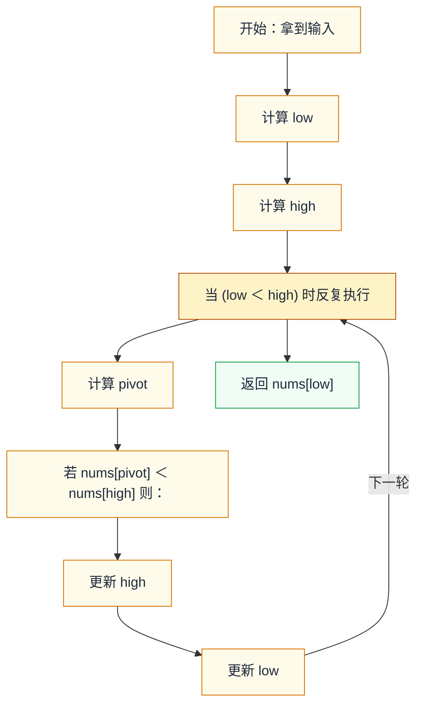

## TypeScript 解题方案（1 个方案逐个讲）

> **运行与提交**：每个方案都是自包含文件（内嵌用例自测，输出 PASS），整块复制到 `.ts` 文件后 `node 文件名` 即可运行。提交 LeetCode 时，把 `demo` 内的算法函数与辅助类型/函数整体取出、置于文件顶层即可。涉及交互/特殊接口的题以题面给定签名为准。

### 方案 1：二分查找

**分析与思路**：核心做法是「二分查找」。

**运行方式**：`node 本文件`，内嵌用例全部通过会输出 PASS。


**方案专属流程图**（真实控制流）：

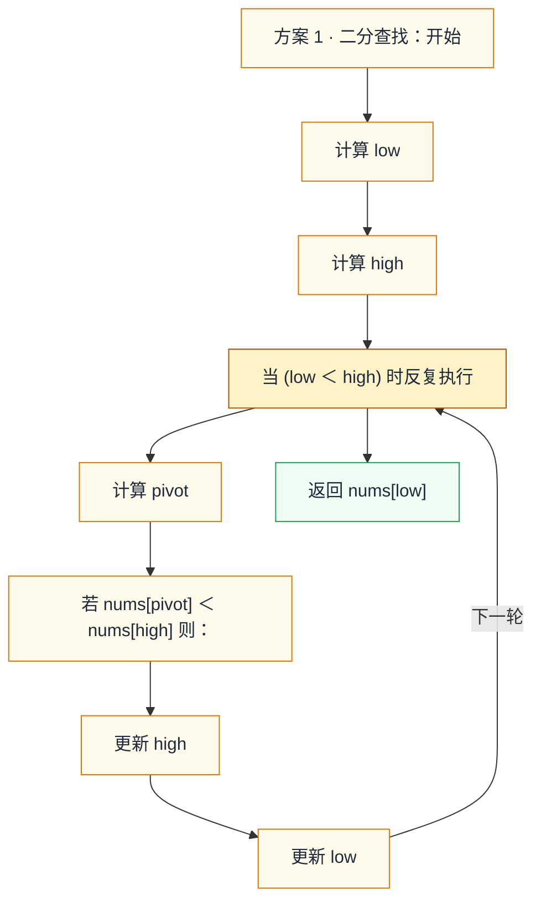

```typescript
/**
 ** LeetCode 153. 寻找旋转排序数组中的最小值
 ** 方案：1 ）方案1: 二分查找
 ** 来源：https://blog.csdn.net/tyro_java/article/details/145233483
 */

export function findMin(nums: number[]): number {
  // 定义函数/方法 findMin
  let low = 0; // 把 0 存入 low
  let high = nums.length - 1; // 把 数组.长度 减 1 存入 high
  while (low < high) {
    // 循环，直到不满足「low 小于 high」
    const pivot = low + Math.floor((high - low) / 2); // 把 low 加 向下取整((high 减 low) 除以 2) 存入 pivot
    if (nums[pivot] < nums[high]) {
      // 若 数组[pivot] 小于 数组[high]
      high = pivot; // 把 pivot 存入 high
    } else {
      // 否则
      low = pivot + 1; // 把 pivot 加 1 存入 low
    }
  }
  return nums[low]; // 返回 数组[low]
}

export function demo(): void {
  // 程序入口：跑内嵌自测用例
  if (findMin([1, 2, 3]) !== 1) throw new Error('FAILED'); // 若 findMin([1, 2, 3]) 不等于 1) throw new Error(「FAILED」);
  if (findMin([3, 4, 5, 1, 2]) !== 1) throw new Error('FAILED'); // 若 findMin([3, 4, 5, 1, 2]) 不等于 1) throw new Error(「FAILED」);
  if (findMin([4, 5, 6, 7, 0, 1, 2]) !== 0) throw new Error('FAILED');
  if (findMin([11, 13, 15, 17]) !== 11) throw new Error('FAILED');
  console.log('PASS'); // 全部用例通过，输出 PASS
}

demo(); // demo();
```

## 逐步拆解与面试追问

**复杂度**：时间 O(n)（单趟线性扫描），空间 O(1) 到 O(n)（视辅助结构）

**为什么是这个量级**：每个元素被常数次访问，辅助哈希或栈的开销与 n 同阶

**面试官可能会追问**：

- mid 写成左加右减是防什么？
- 区间开闭不一致会怎样？
- 何时退化为线性查找？

## 关键 API 速查（TS 主解法实际用到，附官方链接）

| API | 作用 | 使用要点 | 官方文档 |
|---|---|---|---|
| `Math.floor()` | 向下取整 | 负数向负无穷（-1.5 → -2）；大数用位运算前注意 2^31 界 | [官方文档](https://developer.mozilla.org/zh-CN/docs/Web/JavaScript/Reference/Global_Objects/Math/floor) |

### 各语言官方文档导航

- **TypeScript / JS**：[MDN 中文参考](https://developer.mozilla.org/zh-CN/)
- **Python**：[Python 官方文档](https://docs.python.org/zh-cn/3/)
- **Go**：[Go 标准库](https://pkg.go.dev/std)
- **Java**：[JDK 17 API](https://docs.oracle.com/en/java/javase/17/docs/api/)
- **Rust**：[Rust 标准库](https://doc.rust-lang.org/std/)
- **Lua**：[Lua 5.4 手册](https://www.lua.org/manual/5.4/)
- **C**：[Cppreference C](https://zh.cppreference.com/w/c)
- **C++**：[Cppreference C++](https://zh.cppreference.com/w/cpp)
- **R**：[R 官方手册](https://stat.ethz.ch/R-manual/)
- **Zig**：[Zig 语言文档](https://ziglang.org/documentation/master/)
- **Dart**：[Dart API](https://api.dart.dev/)

## 附录：其他 10 种语言全部实现（每种语言列举其全部方案）

> TypeScript 的全部方案见「TypeScript 解题方案」一节；下面是其余 10 种语言的对应实现，每种语言的每个方案都带思路分析、代码走读与专属运行架构图。
> 每个方案都内嵌用例自测，可独立运行（老仓库 python/go 文件遵循「打印结果」约定）。
> 完整解法文件见 `dsa/<语言>/binary_search/lc_153_寻找旋转排序数组中的最小值/`。

### Python 实现（1 种方案）

Python 的全部方案如下，每个方案都内嵌用例自测，可独立运行（老仓库 python/go 文件遵循「打印结果」约定）：

#### 方案 1：二分查找

**思路与代码分析**：核心是「二分查找」。Python 版用切片与字典推导式简化操作，突出可读性。**走读**：方案 1 · 二分查找：开始 → 更新 low → 更新 high → 当 low ＜ high: 时反复执行 → 更新 pivot → 若 nums[pivot] ＜ nums[high]：更新 high → 更新 high → 更新 low → 返回 nums[low]。

**运行架构**（真实控制流）：

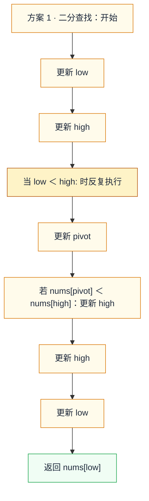

```python
import sys  # 提高递归深度上限（深输入防 RecursionError）

sys.setrecursionlimit(200000)  # 树/链表类题目节点数可达 1e4 量级

def findMin(nums):  # 定义函数 findMin（参数：数组）
    low = 0  # 把 0 存入 low
    high = len(nums) - 1  # 把 长度(数组) 减 1 存入 high
    while low < high:  # 循环，直到不满足「low 小于 high」
        pivot = low + int((high - low) / 2)  # 把 low 加 int((high 减 low) 除以 2) 存入 pivot
        if nums[pivot] < nums[high]:  # 若 数组[pivot] 小于 数组[high]
            high = pivot  # 把 pivot 存入 high
        else:  # 否则
            low = pivot + 1  # 把 pivot 加 1 存入 low
    return nums[low]  # 返回 数组[low]

if __name__ == "__main__":  # 若 __name__ 等于 '__main__'
    print(findMin([1, 2, 3]))  # 打印输出
```

### Go 实现（1 种方案）

Go 的全部方案如下，每个方案都内嵌用例自测，可独立运行（老仓库 python/go 文件遵循「打印结果」约定）：

#### 方案 1：二分查找

**思路与代码分析**：核心是「二分查找」。Go 版用切片与多返回值惯用法，显式处理索引边界。**走读**：方案 1 · 二分查找：开始 → 更新 : → 更新 : → 遍历循环 → 更新 : → 处理 if nums[pivot] ＜ nums[high] → 更新 high → 更新 low → 返回 nums[low]。

**运行架构**（真实控制流）：

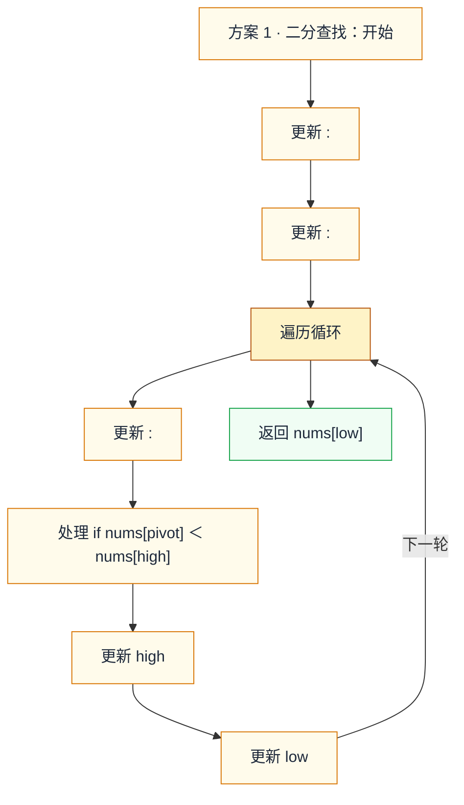

```go
package main // 引入依赖

import (
	"fmt" // 「fmt」
	"os"  // 「os」
)

// findMin 是 Python 参考 solution_1 的忠实翻译（二分查找）。
func findMin(nums []int) int { // 定义函数/方法 findMin
	low := 0              // 把 0 写入 low :
	high := len(nums) - 1 // 把 长度(数组) 减 1 写入 high :
	for low < high {      // for low 小于 high {
		pivot := low + (high-low)/2   // 把 low 加 (high 减 low) 除以 2 写入 pivot :
		if nums[pivot] < nums[high] { // 若 数组[pivot] 小于 数组[high]
			high = pivot // 把 pivot 写入 high
		} else { // 否则
			low = pivot + 1 // 把 pivot 加 1 写入 low
		}
	}
	return nums[low] // 返回 数组[low]
}

func main() { // 程序入口：跑内嵌自测用例
	type tc struct { // 定义类型
		nums []int // 数组 []int
		want int   // want int
	}
	cases := []tc{ // 把 []tc{ 写入 cases :
		{[]int{1, 2, 3}, 1},
		{[]int{3, 4, 5, 1, 2}, 1},
		{[]int{4, 5, 6, 7, 0, 1, 2}, 0},
		{[]int{11, 13, 15, 17}, 11},
		{[]int{2, 1}, 1},
		{[]int{1}, 1},
	}
	for _, c := range cases { // 同时取 _ 与 字符 遍历
		if got := findMin(c.nums); got != c.want { // 若 got : 赋值为 findMin(字符.数组); got 不等于 字符.want
			fmt.Printf("FAIL %v got=%d want=%d\n", c.nums, got, c.want) // 打印输出
			os.Exit(1)                                                  // os.Exit(1)
		}
	}
	fmt.Println("PASS") // 全部用例通过，输出 PASS
}
```

### Java 实现（1 种方案）

Java 的全部方案如下，每个方案都内嵌用例自测，可独立运行（老仓库 python/go 文件遵循「打印结果」约定）：

#### 方案 1：二分查找

**思路与代码分析**：核心是「二分查找」。Java 版用类与静态方法组织，集合操作显式明了。**走读**：方案 1 · 二分查找：开始 → 更新 low → 更新 high → 当 (low ＜ high) 时反复执行 → 更新 pivot → 若 nums[pivot] ＜ nums[high] 则： → 更新 high → 更新 low → 返回 nums[low]。

**运行架构**（真实控制流）：

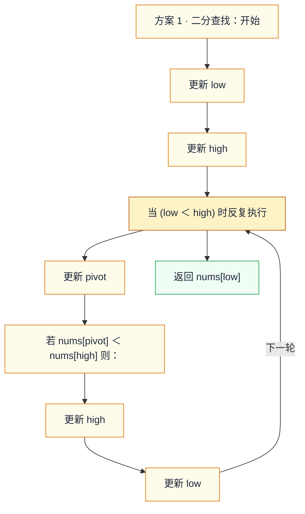

```java
package com.webfault.dsa; // 引入依赖

class FindMinRotated { // 定义类型
  public int findMin(int[] nums) { // 定义函数/方法 findMin
    int low = 0; // 把 0 存入 low
    int high = nums.length - 1; // 把 数组.长度 减 1 存入 high
    while (low < high) { // 循环，直到不满足「low 小于 high」
      int pivot = low + (high - low) / 2; // 把 low 加 (high 减 low) 除以 2 存入 pivot
      if (nums[pivot] < nums[high]) { // 若 数组[pivot] 小于 数组[high]
        high = pivot; // 把 pivot; 写入 high
      } else { // 否则
        low = pivot + 1; // 把 pivot 加 1; 写入 low
      }
    }
    return nums[low]; // 返回 数组[low]
  }

  public static void main(String[] args) { // public static void main(String[] args) {
    FindMinRotated s = new FindMinRotated(); // 把 new FindMinRotated(); 写入 FindMinRotated s
    int[][][] cases = { // 把 { 写入 int[][][] cases
      {{1, 2, 3}, {1}},
      {{3, 4, 5, 1, 2}, {1}},
      {{4, 5, 6, 7, 0, 1, 2}, {0}},
    };
    boolean ok = true; // 把 true; 写入 boolean ok
    for (int[][] c : cases) { // for (int[][] 字符 : cases) {
      int got = s.findMin(c[0]); // 把 字符串.findMin(字符[0]) 存入 got
      if (got != c[1][0]) { // 若 got 不等于 字符[1][0]
        ok = false; // 把 false; 写入 ok
        System.out.println(
            "FAIL findMin(" + arrStr(c[0]) + ")=" + got + " want " + c[1][0]); // 打印输出
      }
    }
    if (!ok) throw new RuntimeException("FAILED"); // 若 取反 ok) throw new RuntimeException(「FAILED」);
    System.out.println("PASS"); // 全部用例通过，输出 PASS
  }

  static String arrStr(int[] a) { // 定义函数/方法 arrStr
    StringBuilder sb = new StringBuilder("["); // 把 new StringBuilder(「[」); 写入 StringBuilder sb
    for (int i = 0; i < a.length; i++) {
      if (i > 0) sb.append(",");
      sb.append(a[i]);
    } // 让 下标 i 从 0 开始计数，下标 i 小于 数组.长度 就继续
    sb.append("]"); // 把 「]」 追加到列表尾部
    return sb.toString(); // 返回 sb.toString()
  }
}
```

### Rust 实现（1 种方案）

Rust 的全部方案如下，每个方案都内嵌用例自测，可独立运行（老仓库 python/go 文件遵循「打印结果」约定）：

#### 方案 1：二分查找

**思路与代码分析**：核心是「二分查找」。Rust 版用所有权移动与切片借用改写同一逻辑，注意 Option 与引用边界。**走读**：方案 1 · 二分查找：开始 → 计算 low → 计算 high → 当 low ＜ high 时反复执行 → 计算 pivot → 计算 p → 处理 if nums[p] ＜ nums[high as us → 更新 high → 更新 low → 处理 nums[low as usize] → 返回结果。

**运行架构**（真实控制流）：

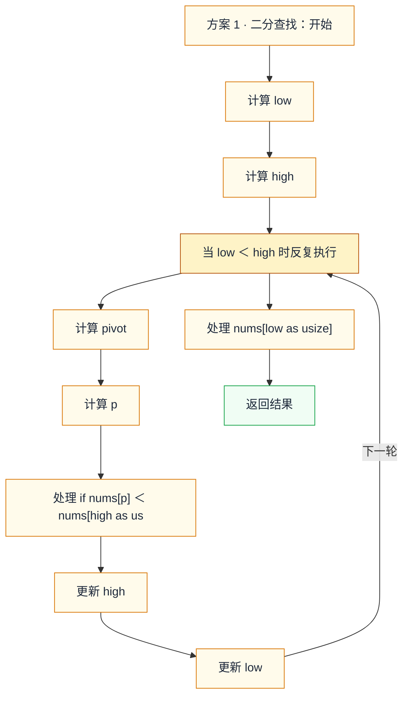

```rust
// LeetCode 153. 寻找旋转排序数组中的最小值 — Rust 版（方案1：二分查找）

fn find_min(nums: &[i32]) -> i32 {
    // 定义函数/方法 find_min
    let mut low: i32 = 0; // 把 0; 写入 let mut low: i32
    let mut high: i32 = nums.len() as i32 - 1; // 把 数组.长度() as i32 减 1; 写入 let mut high: i32
    while low < high {
        // while low 小于 high {
        let pivot = low + (high - low) / 2; // 防溢出写法
        let p = pivot as usize; // 把 pivot as usize 存入 节点
        if nums[p] < nums[high as usize] {
            // 若 数组[节点] 小于 数组[high as usize]
            high = pivot; // 把 pivot; 写入 high
        } else {
            // 否则
            low = pivot + 1; // 把 pivot 加 1; 写入 low
        }
    }
    nums[low as usize] // 数组[low as usize]
}

fn main() {
    // 程序入口：跑内嵌自测用例
    assert_eq!(find_min(&[1, 2, 3]), 1); // 断言校验
    assert_eq!(find_min(&[3, 4, 5, 1, 2]), 1); // 断言校验
    assert_eq!(find_min(&[4, 5, 6, 7, 0, 1, 2]), 0); // 断言校验
    assert_eq!(find_min(&[11, 13, 15, 17]), 11); // 断言校验
    println!("PASS"); // 全部用例通过，输出 PASS
}
```

### Lua 实现（1 种方案）

Lua 的全部方案如下，每个方案都内嵌用例自测，可独立运行（老仓库 python/go 文件遵循「打印结果」约定）：

#### 方案 1：二分查找

**思路与代码分析**：核心是「二分查找」。Lua 版用表与 ipairs 遍历，注意 ipairs 遇 nil 即停的语义。**走读**：方案 1 · 二分查找：开始 → 更新 low → 更新 high → 当 low ＜ high do 时反复执行 → 更新 pivot → 处理 if nums[pivot + 1] ＜ nums[hi → 更新 high → 更新 low → 返回 nums[low + 1]。

**运行架构**（真实控制流）：

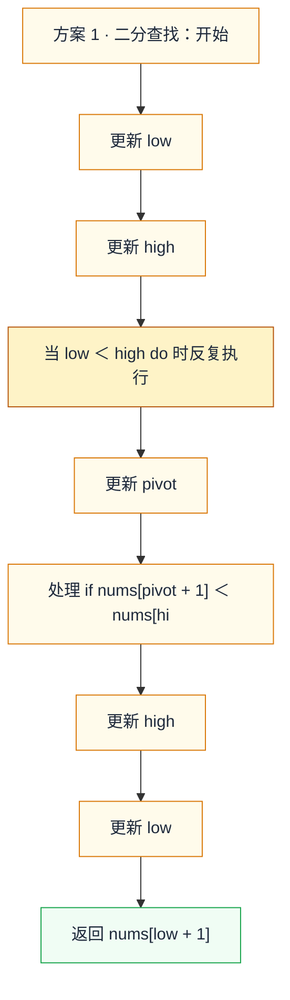

```lua
-- LeetCode 153. 寻找旋转排序数组中的最小值 — Lua 版（方案1：二分查找）

-- 0 基下标语义与 TS 参考一致（Lua 数组本身 1 基，读取时 +1）
local function findMin(nums) -- local function findMin(数组)
	local low = 0 -- 把 0 写入 local low
	local high = #nums - 1 -- 把 #数组 减 1 写入 local high
	while low < high do -- while low 小于 high do
		local pivot = low + (high - low) // 2 -- 防溢出写法（Lua 5.4 整数除法）
		if nums[pivot + 1] < nums[high + 1] then -- 若 数组[pivot 加 1] 小于 数组[high 加 1] then
			high = pivot -- 把 pivot 存入 high
		else -- 否则
			low = pivot + 1 -- 把 pivot 加 1 存入 low
		end -- 终点
	end -- 终点
	return nums[low + 1] -- 返回 数组[low 加 1]
end -- 终点

-- 自测：与 LeetCode 官方用例一致
assert(findMin({ 1, 2, 3 }) == 1, "case 1 failed") -- 断言校验
assert(findMin({ 3, 4, 5, 1, 2 }) == 1, "case 2 failed") -- 断言校验
assert(findMin({ 4, 5, 6, 7, 0, 1, 2 }) == 0, "case 3 failed") -- 断言校验
assert(findMin({ 11, 13, 15, 17 }) == 11, "case 4 failed") -- 断言校验
print("PASS") -- 全部用例通过，输出 PASS
```

### C 实现（1 种方案）

C 的全部方案如下，每个方案都内嵌用例自测，可独立运行（老仓库 python/go 文件遵循「打印结果」约定）：

#### 方案 1：二分查找

**思路与代码分析**：核心是「二分查找」。C 版手动管理下标与内存，循环边界全部显式写出。**走读**：方案 1 · 二分查找：开始 → 更新 low → 当 (low ＜ high) 时反复执行 → 更新 pivot → 若 nums[pivot] ＜ nums[high] 则： → 更新 high → 更新 low → 返回 nums[low]。

**运行架构**（真实控制流）：

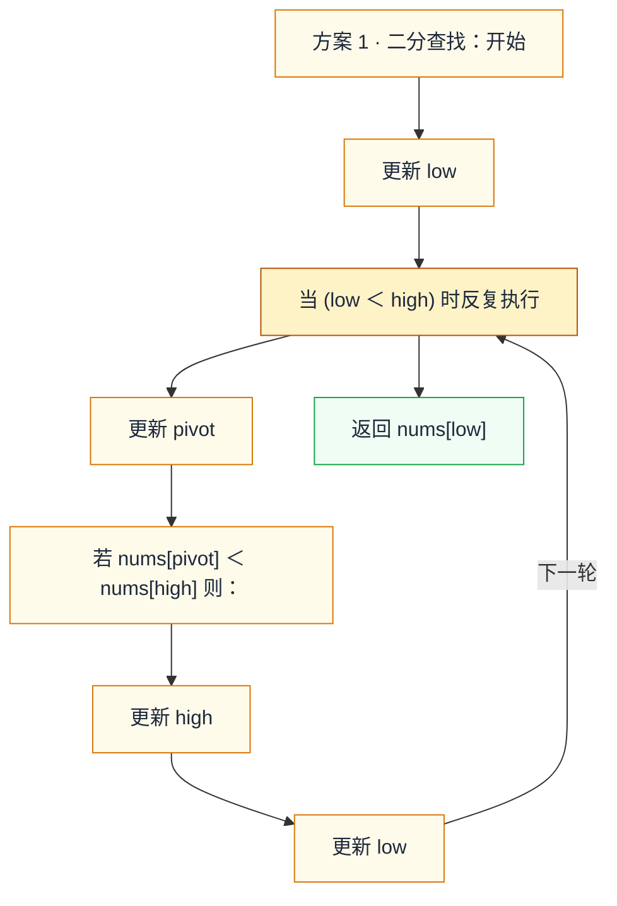

```c
* LeetCode 153. 寻找旋转排序数组中的最小值 — C 版（方案1：二分查找） */

#include <stdio.h> // 引入头文件

int findMin(const int *nums, int n) { // 定义函数/方法 findMin
    int low = 0, high = n - 1;        // 把 0, high 赋值为 元素个数 减 1 存入 low
    while (low < high) {              // 循环，直到不满足「low 小于 high」
        int pivot = low + (high - low) / 2;
            /* 防溢出写法 */ // 把 low 加 (high 减 low) 除以 2; 除以 乘 防溢出写法 乘 除以 存入 pivot
        if (nums[pivot] < nums[high]) { // 若 数组[pivot] 小于 数组[high]
            high = pivot;               // 把 pivot; 写入 high
        } else {                        // 否则
            low = pivot + 1;            // 把 pivot 加 1; 写入 low
        }
    }
    return nums[low]; // 返回 数组[low]
}

int main(void) {                      // 程序入口：跑内嵌自测用例
    int a1[] = {1, 2, 3};             // 把 {1, 2, 3}; 写入 int a1[]
    int a2[] = {3, 4, 5, 1, 2};       // 把 {3, 4, 5, 1, 2}; 写入 int a2[]
    int a3[] = {4, 5, 6, 7, 0, 1, 2}; // 把 {4, 5, 6, 7, 0, 1, 2}; 写入 int a3[]
    int a4[] = {11, 13, 15, 17};      // 把 {11, 13, 15, 17}; 写入 int a4[]
    if (findMin(a1, 3) != 1) {
        printf("case 1 FAILED\n");
        return 1;
    } // 若 findMin(a1, 3) 不等于 1) { 输出「case 1 FAILED 」); return 1; }
    if (findMin(a2, 5) != 1) {
        printf("case 2 FAILED\n");
        return 1;
    } // 若 findMin(a2, 5) 不等于 1) { 输出「case 2 FAILED 」); return 1; }
    if (findMin(a3, 7) != 0) {
        printf("case 3 FAILED\n");
        return 1;
    } // 若 findMin(a3, 7) 不等于 0) { 输出「case 3 FAILED 」); return 1; }
    if (findMin(a4, 4) != 11) {
        printf("case 4 FAILED\n");
        return 1;
    }                 // 若 findMin(a4, 4) 不等于 11) { 输出「case 4 FAILED 」); return 1; }
    printf("PASS\n"); // 全部用例通过，输出 PASS
    return 0;         // 返回 0
}
```

### C++ 实现（1 种方案）

C++ 的全部方案如下，每个方案都内嵌用例自测，可独立运行（老仓库 python/go 文件遵循「打印结果」约定）：

#### 方案 1：二分查找

**思路与代码分析**：核心是「二分查找」。C++ 版用 STL 容器与迭代器，减少手写下标错误。**走读**：方案 1 · 二分查找：开始 → 更新 low → 处理 1 → 当 (low ＜ high) 时反复执行 → 更新 pivot → 若 nums[pivot] ＜ nums[high] 则： → 更新 high → 更新 low → 返回 nums[low]。

**运行架构**（真实控制流）：

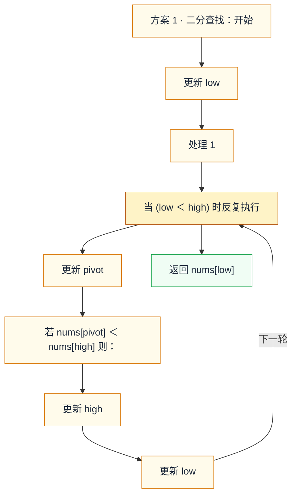

```cpp
// LeetCode 153. 寻找旋转排序数组中的最小值 — C++ 版（方案1：二分查找）

#include <cassert>  // 引入头文件
#include <iostream> // 引入头文件
#include <vector>   // 引入头文件

int findMin(const std::vector<int> &nums) { // 定义函数/方法 findMin
    int low = 0, high = static_cast<int>(nums.size()) -
                        1; // 把 0, high 赋值为 static_cast 小于 int 超过 (数组.大小()) 减 1 存入 low
    while (low < high) {                    // 循环，直到不满足「low 小于 high」
        int pivot = low + (high - low) / 2; // 防溢出写法
        if (nums[pivot] < nums[high]) {     // 若 数组[pivot] 小于 数组[high]
            high = pivot;                   // 把 pivot; 写入 high
        } else {                            // 否则
            low = pivot + 1;                // 把 pivot 加 1; 写入 low
        }
    }
    return nums[low]; // 返回 数组[low]
}

int main() {                                     // 程序入口：跑内嵌自测用例
    assert(findMin({1, 2, 3}) == 1);             // 断言校验
    assert(findMin({3, 4, 5, 1, 2}) == 1);       // 断言校验
    assert(findMin({4, 5, 6, 7, 0, 1, 2}) == 0); // 断言校验
    assert(findMin({11, 13, 15, 17}) == 11);     // 断言校验
    std::cout << "PASS" << std::endl;            // 全部用例通过，输出 PASS
    return 0;                                    // 返回 0
}
```

### R 实现（1 种方案）

R 的全部方案如下，每个方案都内嵌用例自测，可独立运行（老仓库 python/go 文件遵循「打印结果」约定）：

#### 方案 1：二分查找

**思路与代码分析**：核心是「二分查找」。R 版用向量化思维与 1 起始下标，注意 1:n 的降序陷阱。**走读**：方案 1 · 二分查找：开始 → 处理 low ＜- 0L → 处理 high ＜- length(nums) - 1L → 当 (low ＜ high) 时反复执行 → 处理 pivot ＜- low + (high - low)% → 若 nums[pivot + 1L] ＜ nums[high + 1L] 则： → 处理 high ＜- pivot → 处理 low ＜- pivot + 1L → 处理 nums[low + 1L] → 返回结果。

**运行架构**（真实控制流）：

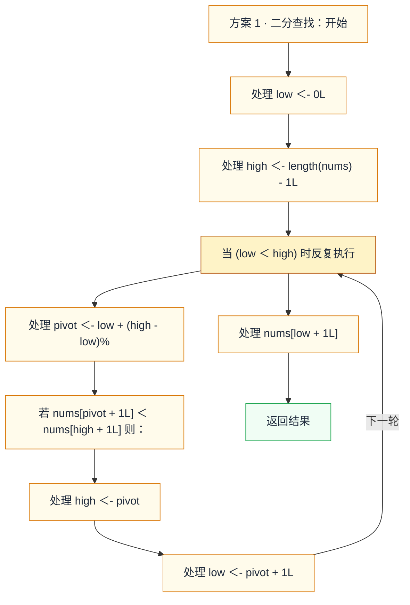

```r
# 寻找旋转排序数组中的最小值 — R 版（方案1：二分查找）
# 0 基下标语义与 TS 参考一致（R 向量本身 1 基，读取时 +1） 定义函数 findMin（参数：数组）
findMin <- function(nums) {
    low <- 0L  # 把 0L 存入 low
    high <- length(nums) - 1L  # 把 长度(数组) 减 1L 存入 high
    while (low < high) {
        # 循环，直到不满足「low 小于 high」
        pivot <- low + (high - low)%/%2L  # 防溢出写法（R 整数除法 %/%）
        if (nums[pivot + 1L] < nums[high + 1L]) {
            # 若 数组[pivot 加 1L] 小于 数组[high 加 1L]
            high <- pivot  # 把 pivot 存入 high
        } else {
            # 否则
            low <- pivot + 1L  # 把 pivot 加 1L 存入 low
        }
    }
    nums[low + 1L]  # 数组[low 加 1L]
}
# 自测：与 LeetCode 官方用例一致
stopifnot(identical(findMin(c(1L, 2L, 3L)), 1L))  # 断言校验
stopifnot(identical(findMin(c(3L, 4L, 5L, 1L, 2L)), 1L))  # 断言校验
stopifnot(identical(findMin(c(4L, 5L, 6L, 7L, 0L, 1L, 2L)), 0L))  # 断言校验
stopifnot(identical(findMin(c(11L, 13L, 15L, 17L)), 11L))  # 断言校验
cat("PASS\n")  # 全部用例通过，输出 PASS
```

### Zig 实现（1 种方案）

Zig 的全部方案如下，每个方案都内嵌用例自测，可独立运行（老仓库 python/go 文件遵循「打印结果」约定）：

#### 方案 1：二分查找

**思路与代码分析**：核心是「二分查找」。Zig 版显式分配与清零，整型边界处理严格。**走读**：方案 1 · 二分查找：开始 → 计算 low → 计算 high → 当 (low ＜ high) 时反复执行 → 计算 pivot → 计算 p → 计算 h → 若 nums[p] ＜ nums[h] 则： → 更新 high → 更新 low → 计算 l → 返回 nums[l]。

**运行架构**（真实控制流）：

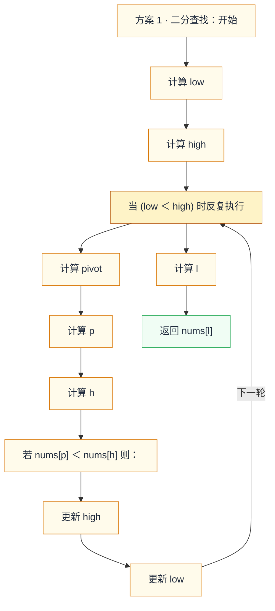

```zig
// LeetCode 153. 寻找旋转排序数组中的最小值 — Zig 版（方案1：二分查找）

const std = @import("std"); // 把 @import(「std」) 存入 std

fn findMin(nums: []const i32) i32 { // 定义函数/方法 findMin
    var low: i32 = 0; // 把 0; 写入 var low: i32
    var high: i32 = @as(i32, @intCast(nums.len)) - 1; // 把 @as(i32, @intCast(数组.长度)) 减 1; 写入 var high: i32
    while (low < high) { // 循环，直到不满足「low 小于 high」
        const pivot = low + @divTrunc(high - low, 2); // 防溢出写法
        const p: usize = @intCast(pivot); // 把 @intCast(pivot); 写入 const p: usize
        const h: usize = @intCast(high); // 把 @intCast(high); 写入 const h: usize
        if (nums[p] < nums[h]) { // 若 数组[节点] 小于 数组[h]
            high = pivot; // 把 pivot; 写入 high
        } else { // 否则
            low = pivot + 1; // 把 pivot 加 1; 写入 low
        }
    }
    const l: usize = @intCast(low); // 把 @intCast(low); 写入 const l: usize
    return nums[l]; // 返回 数组[左指针]
}

pub fn main() !void { // 程序入口：跑内嵌自测用例
    const a1 = [_]i32{ 1, 2, 3 }; // 把 [_]i32{ 1, 2, 3 } 存入 a1
    const a2 = [_]i32{ 3, 4, 5, 1, 2 }; // 把 [_]i32{ 3, 4, 5, 1, 2 } 存入 a2
    const a3 = [_]i32{ 4, 5, 6, 7, 0, 1, 2 }; // 把 [_]i32{ 4, 5, 6, 7, 0, 1, 2 } 存入 a3
    const a4 = [_]i32{ 11, 13, 15, 17 }; // 把 [_]i32{ 11, 13, 15, 17 } 存入 a4
    if (findMin(&a1) != 1) return error.TestFailed; // 若 findMin( 按位与 a1) 不等于 1，直接返回 error.TestFailed
    if (findMin(&a2) != 1) return error.TestFailed; // 若 findMin( 按位与 a2) 不等于 1，直接返回 error.TestFailed
    if (findMin(&a3) != 0) return error.TestFailed; // 若 findMin( 按位与 a3) 不等于 0，直接返回 error.TestFailed
    if (findMin(&a4) != 11) return error.TestFailed; // 若 findMin( 按位与 a4) 不等于 11，直接返回 error.TestFailed
    std.debug.print("PASS\n", .{}); // 全部用例通过，输出 PASS
}
```

### Dart 实现（1 种方案）

Dart 的全部方案如下，每个方案都内嵌用例自测，可独立运行（老仓库 python/go 文件遵循「打印结果」约定）：

#### 方案 1：二分查找

**思路与代码分析**：核心是「二分查找」。Dart 版用可空类型标注与集合方法，注意空安全。**走读**：方案 1 · 二分查找：开始 → 计算 low → 计算 high → 当 (low ＜ high) 时反复执行 → 更新 pivot → 若 nums[pivot] ＜ nums[high] 则： → 更新 high → 更新 low → 返回 nums[low]。

**运行架构**（真实控制流）：


```dart
// LeetCode 153. 寻找旋转排序数组中的最小值 — Dart 版（方案1：二分查找）

int findMin(List<int> nums) {
  // 定义函数/方法 findMin
  var low = 0; // 把 0 存入 low
  var high = nums.length - 1; // 把 数组.长度 减 1 存入 high
  while (low < high) {
    // 循环，直到不满足「low 小于 high」
    final pivot = low + (high - low) ~/ 2; // 防溢出写法
    if (nums[pivot] < nums[high]) {
      // 若 数组[pivot] 小于 数组[high]
      high = pivot; // 把 pivot 存入 high
    } else {
      // 否则
      low = pivot + 1; // 把 pivot 加 1 存入 low
    }
  }
  return nums[low]; // 返回 数组[low]
}

void main() {
  // 程序入口：跑内嵌自测用例
  if (findMin([1, 2, 3]) != 1) throw StateError('case 1 failed');
  if (findMin([3, 4, 5, 1, 2]) != 1) throw StateError('case 2 failed');
  if (findMin([4, 5, 6, 7, 0, 1, 2]) != 0) throw StateError('case 3 failed');
  if (findMin([11, 13, 15, 17]) != 11) throw StateError('case 4 failed');
  print('PASS'); // 全部用例通过，输出 PASS
}
```

---

## 内容总结

- **寻找旋转排序数组中的最小值**（二分查找 · Medium）：共 1 个方案，主线思路「二分查找」；时间 O(n)（单趟线性扫描）；动画演示二分收缩过程，附录给出 11 种语言 × 全部方案的可运行实现。
- 来源博客：[https://blog.csdn.net/tyro_java/article/details/145233483](https://blog.csdn.net/tyro_java/article/details/145233483)
- 导航：[📋 总目录](../) ｜ [← 086 根据数字二进制下 1 的数目排序](../086_根据数字二进制下_1_的数目排序/) ｜ [088 三数之和 →](../088_三数之和/)
