# 088 · 三数之和（第四阶段 · 查找与排序 · Medium）

> **难度**：⭐⭐ Medium ｜ **专题**：排序
> **学习定位**：第四阶段 · 查找与排序第 88 篇 ｜ **解法数**：2
> **内容总结**：**三数之和**（排序 · Medium）：共 2 个方案，主线思路「方案1（排序 + 双指针，first/second 循环）」；时间 O(n²)（两层嵌套扫描）；动画演示冒泡交换过程，附录给出 11 种语言 × 全部方案的可运行实现。

---

## 题目描述

给你一个整数数组 `nums` ，判断是否存在三元组 `[nums[i], nums[j], nums[k]]` 满足 `i != j`、`i != k` 且 `j != k` ，同时还满足 `nums[i] + nums[j] + nums[k] == 0` 。请你返回所有和为 `0` 且不重复的三元组。

注意：答案中不可以包含重复的三元组。

- 主函数签名：`function threeSum(nums: number[]): number[][]`

**用例（来自原题）**：

**示例 1**

```text
输入：nums = [-1,0,1,2,-1,-4]
输出：[[-1,-1,2],[-1,0,1]]
```

解释：nums[0] + nums[1] + nums[2] = (-1) + 0 + 1 = 0 。 nums[1] + nums[2] + nums[4] = 0 + 1 + (-1) = 0 。 nums[0] + nums[3] + nums[4] = (-1) + 2 + (-1) = 0 。 不同的三元组是 [-1,0,1] 和 [-1,-1,2] 。 注意，输出的顺序和三元组的顺序并不重要。

**示例 2**

```text
输入：nums = [0,1,1]
输出：[]
```

解释：唯一可能的三元组和不为 0 。

**示例 3**

```text
输入：nums = [0,0,0]
输出：[[0,0,0]]
```

解释：唯一可能的三元组和为 0 。
> ✅ **官方验证**：全部 TypeScript 解法已通过 leetcode.cn 官方示例用例验证（自动注入运行，全部 PASS）。题面与 [leetcode.cn 官方](https://leetcode.cn/problems/3sum/)一致，示例配图取自官方题面。

**数据范围与注意事项**：

- `3 <= nums.length <= 3000`
- `-10^5 <= nums[i] <= 10^5`
- **易错点**：比较器返回值的正负含义，写反了排序结果直接错。

## 题目分析

**场景是什么**：排序是多数算法的前置工序，这类题练的是比较逻辑与稳定性取舍。本题就是该场景的 Medium 级练习，主线做法是「方案1（排序 + 双指针，first/second 循环）」。

**主线怎么解**：把主解法从头到尾过一遍，它其实在依次做这几件事：先排序再处理 → 双重循环遍历。

## 解题思路

**方案对比**（共 2 个方案，由浅入深）：

| 方案 | 时间复杂度 | 空间复杂度 |
|---|---|---|
| 方案 1 · 方案1（排序 + 双指针，first/second 循环） | O(n²)（两层嵌套扫描） | O(1) 到 O(n) |
| 方案 2 · 方案2（排序 + 双指针，i/left/right 去重） | O(n²)（两层嵌套扫描） | O(1) 到 O(n) |

**由浅入深的路径**：方案1（排序 + 双指针，first/second 循环） → 方案2（排序 + 双指针，i/left/right 去重）；每往右一步，都在补上一步的短板。

**方案间的取舍**：方案 1（方案1（排序 + 双指针，first/second 循环））；方案 2（方案2（排序 + 双指针，i/left/right 去重））。数据规模小、可读性优先时选靠前的方案；规模大、性能优先时选靠后的方案。

**怎么读这一篇**：

- 🐣 **新手路线**：把「题目描述」的示例 1 在纸上手推一遍 → 读方案 1（最直观的写法）与它的代码走读 → 按「运行方式」本地跑通看 PASS → 回头对比方案 2 之后的写法差在哪
- 🦅 **大佬路线**：直接锁定最优方案 1（方案1（排序 + 双指针，first/second 循环），O(n²)（两层嵌套扫描））→ 跳读该方案代码与走读 → 用「逐步拆解与面试追问」补齐复杂度推导与边界追问

### 动态算法图（冒泡交换，GIF 自动循环）

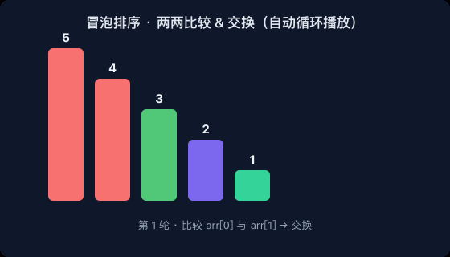

动画演示排序专题里冒泡交换的典型过程；每个方案在「TypeScript 解题方案」一节还配了专属动画与专属流程图。

### 主解法流程图（真实控制流）

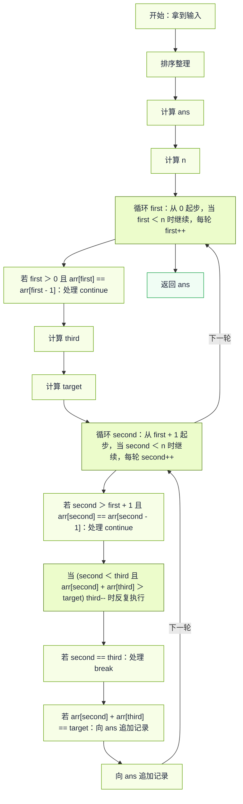

## TypeScript 解题方案（2 个方案逐个讲）

> **运行与提交**：每个方案都是自包含文件（内嵌用例自测，输出 PASS），整块复制到 `.ts` 文件后 `node 文件名` 即可运行。提交 LeetCode 时，把 `demo` 内的算法函数与辅助类型/函数整体取出、置于文件顶层即可。涉及交互/特殊接口的题以题面给定签名为准。

### 方案 1：方案1（排序 + 双指针，first/second 循环）

**分析与思路**：核心做法是「方案1（排序 + 双指针，first/second 循环）」。代码里依次做这些事：先排序再处理；双重循环遍历。

**运行方式**：`node 本文件`，内嵌用例全部通过会输出 PASS。

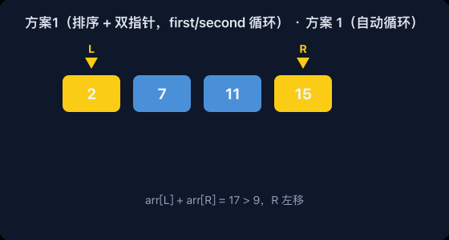

**方案专属流程图**（真实控制流）：

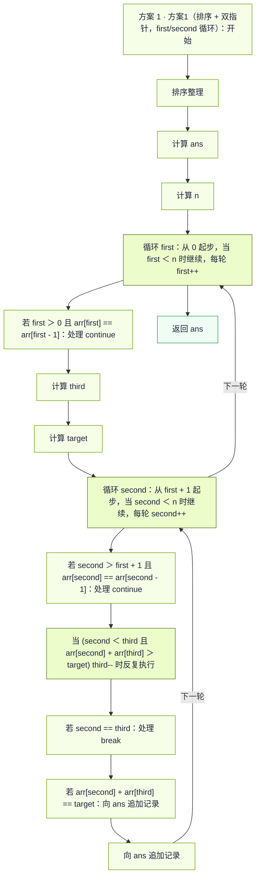

```typescript
/**
 ** LeetCode 15. 三数之和
 ** 方案：方案1（排序 + 双指针，first/second 循环）
 */

function threeSum(nums: number[]): number[][] {
  // 定义函数/方法 threeSum
  const arr = nums.slice().sort((a, b) => a - b);
  const ans: number[][] = []; // 把 []; 写入 const ans: number[][]
  const n = arr.length; // 把 数组.长度 存入 元素个数
  for (let first = 0; first < n; first++) {
    // 让 first 从 0 开始计数，first 小于 元素个数 就继续
    if (first > 0 && arr[first] === arr[first - 1]) continue; // 若 first 超过 0 且 数组[first] 全等于 数组[first 减 1]) continue;
    let third = n - 1; // 把 元素个数 减 1 存入 third
    const target = -arr[first]; // 把 减 数组[first] 存入 目标值
    for (let second = first + 1; second < n; second++) {
      // 让 second 从 first 加 1 开始计数，second 小于 元素个数 就继续
      if (second > first + 1 && arr[second] === arr[second - 1]) continue;
      while (second < third && arr[second] + arr[third] > target) third--; // 循环，直到不满足「second 小于 third 且 数组[third] 超过 目标值) third 减一 ;」
      if (second === third) break; // 若 second 全等于 third) break;
      if (arr[second] + arr[third] === target)
        // 若 数组[second] 加 数组[third] 全等于 目标值
        ans.push([arr[first], arr[second], arr[third]]); // 把 [数组[first], 数组[second], 数组[third]] 压入栈/数组尾部
    }
  }
  return ans; // 返回 答案
}

export function demo(): void {
  // 程序入口：跑内嵌自测用例
  const got = threeSum([1, 2, 3]); // 把 threeSum([1, 2, 3]) 存入 got
  if (got.length !== 0) throw new Error('threeSum([1,2,3]) should be []');
  console.log('PASS'); // 全部用例通过，输出 PASS
}

demo(); // demo();
```

### 方案 2：方案2（排序 + 双指针，i/left/right 去重）

**分析与思路**：核心做法是「方案2（排序 + 双指针，i/left/right 去重）」。代码里依次做这些事：先排序再处理；单循环线性扫描。

**运行方式**：`node 本文件`，内嵌用例全部通过会输出 PASS。

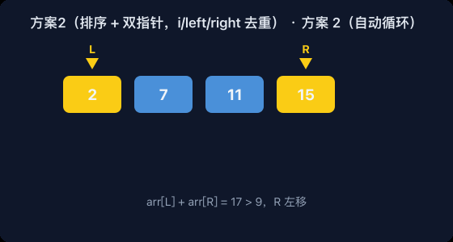

**方案专属流程图**（真实控制流）：

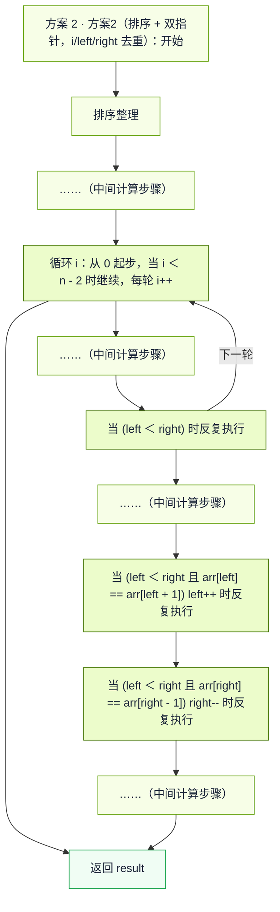

```typescript
/**
 ** LeetCode 15. 三数之和
 ** 方案：方案2（排序 + 双指针，i/left/right 去重）
 */

function threeSum(nums: number[]): number[][] {
  // 定义函数/方法 threeSum
  const arr = nums.slice().sort((a, b) => a - b);
  const result: number[][] = []; // 把 []; 写入 const result: number[][]
  const n = arr.length; // 把 数组.长度 存入 元素个数
  for (let i = 0; i < n - 2; i++) {
    // 让 下标 i 从 0 开始计数，下标 i 小于 元素个数 减 2 就继续
    if (i > 0 && arr[i] === arr[i - 1]) continue; // 若 下标 i 超过 0 且 数组[下标 i] 全等于 数组[下标 i 减 1]) continue;
    let left = i + 1; // 把 下标 i 加 1 存入 左边界
    let right = n - 1; // 把 元素个数 减 1 存入 右边界
    while (left < right) {
      // 循环，直到不满足「左边界 小于 右边界」
      const total = arr[i] + arr[left] + arr[right]; // 把 数组[下标 i] 加 数组[左边界] 加 数组[右边界] 存入 总和
      if (total < 0) {
        // 若 总和 小于 0
        left++; // 左边界 加一
      } else if (total > 0) {
        // 否则，若 总和 超过 0
        right--; // 右边界 减一
      } else {
        // 否则
        result.push([arr[i], arr[left], arr[right]]); // 把 [数组[下标 i], 数组[左边界], 数组[右边界]] 压入栈/数组尾部
        while (left < right && arr[left] === arr[left + 1]) left++; // 循环，直到不满足「左边界 小于 右边界 且 数组[左边界] 全等于 数组[左边界 加 1]) 左边界 加一 ;」
        while (left < right && arr[right] === arr[right - 1]) right--; // 循环，直到不满足「左边界 小于 右边界 且 数组[右边界] 全等于 数组[右边界 减 1]) 右边界 减一 ;」
        left++; // 左边界 加一
        right--; // 右边界 减一
      }
    }
  }
  return result; // 返回 结果
}

export function demo(): void {
  // 程序入口：跑内嵌自测用例
  const got = threeSum([1, 2, 3]); // 把 threeSum([1, 2, 3]) 存入 got
  if (got.length !== 0) throw new Error('threeSum([1,2,3]) should be []');
  console.log('PASS'); // 全部用例通过，输出 PASS
}

demo(); // demo();
```

## 逐步拆解与面试追问

**复杂度**：时间 O(n²)（两层嵌套扫描），空间 O(1) 到 O(n)

**为什么是这个量级**：外层定起点、内层扫终点，n 个起点各扫 n 次

**面试官可能会追问**：

- 稳定性对结果有影响吗？
- 比较器怎么写才不会越界？
- 数据近有序时选哪种排序？

## 关键 API 速查（TS 主解法实际用到，附官方链接）

| API | 作用 | 使用要点 | 官方文档 |
|---|---|---|---|
| `Array.prototype.sort()` | 原地排序 | 默认按字符串 Unicode 序（10 会排在 2 前），数字必须传 (a,b)=>a-b；V8 用 TimSort，稳定，O(n log n)；返回原数组引用 | [官方文档](https://developer.mozilla.org/zh-CN/docs/Web/JavaScript/Reference/Global_Objects/Array/sort) |
| `Array.prototype.push()` | 尾部追加 | 返回新长度；可一次多个；均摊 O(1)；会改变原数组 | [官方文档](https://developer.mozilla.org/zh-CN/docs/Web/JavaScript/Reference/Global_Objects/Array/push) |
| `Array/String slice()` | 切片（不改原数组） | slice(start,end) 含头不含尾；负数从尾计；常用于复制数组（slice()） | [官方文档](https://developer.mozilla.org/zh-CN/docs/Web/JavaScript/Reference/Global_Objects/Array/slice) |

### 各语言官方文档导航

- **TypeScript / JS**：[MDN 中文参考](https://developer.mozilla.org/zh-CN/)
- **Python**：[Python 官方文档](https://docs.python.org/zh-cn/3/)
- **Go**：[Go 标准库](https://pkg.go.dev/std)
- **Java**：[JDK 17 API](https://docs.oracle.com/en/java/javase/17/docs/api/)
- **Rust**：[Rust 标准库](https://doc.rust-lang.org/std/)
- **Lua**：[Lua 5.4 手册](https://www.lua.org/manual/5.4/)
- **C**：[Cppreference C](https://zh.cppreference.com/w/c)
- **C++**：[Cppreference C++](https://zh.cppreference.com/w/cpp)
- **R**：[R 官方手册](https://stat.ethz.ch/R-manual/)
- **Zig**：[Zig 语言文档](https://ziglang.org/documentation/master/)
- **Dart**：[Dart API](https://api.dart.dev/)

## 附录：其他 10 种语言全部实现（每种语言列举其全部方案）

> TypeScript 的全部方案见「TypeScript 解题方案」一节；下面是其余 10 种语言的对应实现，每种语言的每个方案都带思路分析、代码走读与专属运行架构图。
> 每个方案都内嵌用例自测，可独立运行（老仓库 python/go 文件遵循「打印结果」约定）。
> 完整解法文件见 `dsa/<语言>/sort/lc_15_三数之和/`。

### Python 实现（2 种方案）

Python 的全部方案如下，每个方案都内嵌用例自测，可独立运行（老仓库 python/go 文件遵循「打印结果」约定）：

#### 方案 1：方案1（排序 + 双指针，first/second 循环）

**思路与代码分析**：核心是「方案1（排序 + 双指针，first/second 循环）」。Python 版用切片与字典推导式简化操作，突出可读性。代码里依次做这些事：先排序再处理。**走读**：方案 1 · 方案1（排序 + 双指针，first/second 循环）：开始 → 排序整理 → 循环 first：从 0 到 n 前 → 循环 second：从 first + 1 到 n 前 → 当 ( 时反复执行 → 返回 ans。

**运行架构**（真实控制流）：

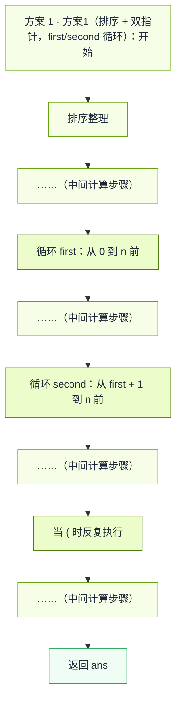

```python
import sys  # 提高递归深度上限（深输入防 RecursionError）

sys.setrecursionlimit(200000)  # 树/链表类题目节点数可达 1e4 量级

def threeSum(nums):  # 定义函数 threeSum（参数：数组）
    nums.sort()  # 排序
    ans = []  # 把 [] 存入 答案
    n = len(nums)  # 把 长度(数组) 存入 元素个数
    for first in range(n):  # 让 first 从 元素个数 遍历
        if (
            first > 0 and nums[first] == nums[first - 1]
        ):  # 若 first 超过 0 and 数组[first] 等于 数组[first 减 1]
            continue  # 跳过本轮，进入下一次
        third = n - 1  # 把 元素个数 减 1 存入 third
        target = -nums[first]  # 把 减 数组[first] 存入 目标值
        for second in range(first + 1, n):  # 让 second 从 first 加 1 到 元素个数 遍历
            if (
                second > first + 1 and nums[second] == nums[second - 1]
            ):  # 若 second 超过 first 加 1 and 数组[second] 等于 数组[second 减 1]
                continue  # 跳过本轮，进入下一次
            while (
                second < third and nums[second] + nums[third] > target
            ):  # 循环，直到不满足「second 小于 third and 数组[second] 加 数组[third] 超过 目标值」
                third -= 1  # third累减 1
            if second == third:  # 若 second 等于 third
                break  # 跳出循环
            if nums[second] + nums[third] == target:  # 若 数组[second] 加 数组[third] 等于 目标值
                ans.append(
                    [nums[first], nums[second], nums[third]]
                )  # 把 [数组[first], 数组[second], 数组[third]] 追加到列表尾部
    return ans  # 返回 答案

if __name__ == "__main__":  # 若 __name__ 等于 '__main__'
    print(threeSum([1, 2, 3]))  # 打印输出
```

#### 方案 2：方案2（排序 + 双指针，i/left/right 去重）

**思路与代码分析**：核心是「方案2（排序 + 双指针，i/left/right 去重）」。Python 版用切片与字典推导式简化操作，突出可读性。代码里依次做这些事：先排序再处理。**走读**：方案 2 · 方案2（排序 + 双指针，i/left/right 去重）：开始 → 排序整理 → 循环 i：从 0 到 n - 2 前 → 当 left ＜ right: 时反复执行 → 当 ( 时反复执行 → 当 ( 时反复执行 → 返回 result。

**运行架构**（真实控制流）：

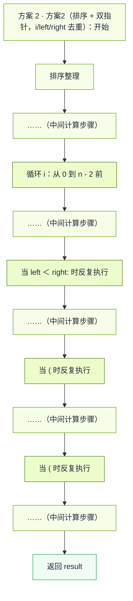

```python
import sys  # 提高递归深度上限（深输入防 RecursionError）

sys.setrecursionlimit(200000)  # 树/链表类题目节点数可达 1e4 量级

def threeSum(nums):  # 定义函数 threeSum（参数：数组）
    nums.sort()  # 排序
    result = []  # 把 [] 存入 结果
    n = len(nums)  # 把 长度(数组) 存入 元素个数
    for i in range(n - 2):  # 让 下标 i 从 元素个数 减 2 遍历
        if i > 0 and nums[i] == nums[i - 1]:  # 若 下标 i 超过 0 and 数组[下标 i] 等于 数组[下标 i 减 1]
            continue  # 跳过本轮，进入下一次
        left, right = i + 1, n - 1  # 把 下标 i 加 1, 元素个数 减 1 写入 left, right
        while left < right:  # 循环，直到不满足「左边界 小于 右边界」
            total = (
                nums[i] + nums[left] + nums[right]
            )  # 把 数组[下标 i] 加 数组[左边界] 加 数组[右边界] 存入 总和
            if total < 0:  # 若 总和 小于 0
                left += 1  # 左边界累加 1
            elif total > 0:  # 否则，若 总和 超过 0
                right -= 1  # 右边界累减 1
            else:  # 否则
                result.append(
                    [nums[i], nums[left], nums[right]]
                )  # 把 [数组[下标 i], 数组[左边界], 数组[右边界]] 追加到列表尾部
                while (
                    left < right and nums[left] == nums[left + 1]
                ):  # 循环，直到不满足「左边界 小于 右边界 and 数组[左边界] 等于 数组[左边界 加 1]」
                    left += 1  # 左边界累加 1
                while (
                    left < right and nums[right] == nums[right - 1]
                ):  # 循环，直到不满足「左边界 小于 右边界 and 数组[右边界] 等于 数组[右边界 减 1]」
                    right -= 1  # 右边界累减 1
                left += 1  # 左边界累加 1
                right -= 1  # 右边界累减 1
    return result  # 返回 结果

if __name__ == "__main__":  # 若 __name__ 等于 '__main__'
    print(threeSum([1, 2, 3]))  # 打印输出
```

### Go 实现（2 种方案）

Go 的全部方案如下，每个方案都内嵌用例自测，可独立运行（老仓库 python/go 文件遵循「打印结果」约定）：

#### 方案 1：方案1（排序 + 双指针，first/second 循环）

**思路与代码分析**：核心是「方案1（排序 + 双指针，first/second 循环）」。Go 版用切片与多返回值惯用法，显式处理索引边界。**走读**：方案 1 · 方案1（排序 + 双指针，first/second 循环）：开始 → 调用 sort.Ints(nums) → 遍历循环 → 遍历循环 → 遍历循环 → 返回 ans。

**运行架构**（真实控制流）：

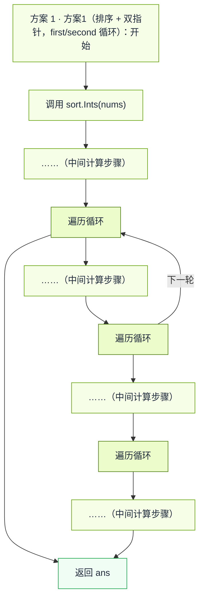

```go
package main // 引入依赖

import (
	"fmt"
	"os"
	"reflect"
	"sort"
) // 引入依赖

func threeSum(nums []int) [][]int { // 定义函数/方法 threeSum
	sort.Ints(nums)                      // sort.Ints(数组)
	ans := [][]int{}                     // 把 [][]int{} 写入 ans :
	n := len(nums)                       // 把 长度(数组) 写入 n :
	for first := 0; first < n; first++ { // 让 first 从 0 开始计数
		if first > 0 && nums[first] == nums[first-1] { // 若 first 超过 0 且 数组[first] 等于 数组[first 减 1]
			continue // 跳过本轮，进入下一次
		}
		third := n - 1                                  // 把 元素个数 减 1 写入 third :
		target := -nums[first]                          // 把 减 数组[first] 写入 target :
		for second := first + 1; second < n; second++ { // 把 first 加 1; second 小于 元素个数; second 加一 { 写入 for second :
			if second > first+1 && nums[second] == nums[second-1] { // 若 second 超过 first 加 1 且 数组[second] 等于 数组[second 减 1]
				continue // 跳过本轮，进入下一次
			}
			for second < third && nums[second]+nums[third] > target { // for second 小于 third 且 数组[third] 超过 目标值 {
				third-- // third 减一
			}
			if second == third { // 若 second 等于 third
				break // 跳出循环
			}
			if nums[second]+nums[third] == target { // 若 数组[second] 加 数组[third] 等于 目标值
				ans = append(ans, []int{nums[first], nums[second], nums[third]}) // 把 append(答案, []int{数组[first], 数组[second], 数组[third]}) 写入 答案
			}
		}
	}
	return ans // 返回 答案
}

func main() { // 程序入口：跑内嵌自测用例
	cases := []struct { // 把 []struct { 写入 cases :
		in   []int   // in []int
		want [][]int // want [][]int
	}{ // }{
		{[]int{-1, 0, 1, 2, -1, -4}, [][]int{{-1, -1, 2}, {-1, 0, 1}}},
		{[]int{0, 0, 0}, [][]int{{0, 0, 0}}},
		{[]int{1, 2, 3}, [][]int{}},
	}
	ok := true                // 把 true 写入 ok :
	for _, c := range cases { // 同时取 _ 与 字符 遍历
		if g := threeSum(c.in); !reflect.DeepEqual(g, c.want) { // 若 g : 赋值为 threeSum(字符.in); 取反 reflect.DeepEqual(g, 字符.want
			ok = false                                          // 把 false 写入 ok
			fmt.Printf("FAIL %v=%v want %v\n", c.in, g, c.want) // 打印输出
		}
	}
	if !ok { // 若 取反 ok
		os.Exit(1) // os.Exit(1)
	}
	fmt.Println("PASS") // 全部用例通过，输出 PASS
}
```

#### 方案 2：方案2（排序 + 双指针，i/left/right 去重）

**思路与代码分析**：核心是「方案2（排序 + 双指针，i/left/right 去重）」。Go 版用切片与多返回值惯用法，显式处理索引边界。**走读**：方案 2 · 方案2（排序 + 双指针，i/left/right 去重）：开始 → 调用 sort.Ints(nums) → 遍历循环 → 遍历循环 → 遍历循环 → 遍历循环 → 返回 result。

**运行架构**（真实控制流）：

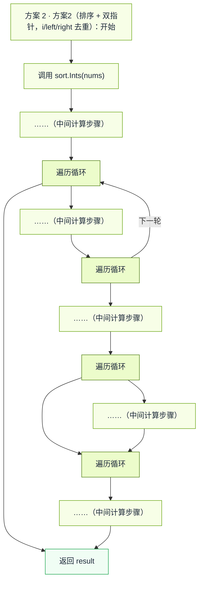

```go
package main // 引入依赖

import (
	"fmt"     // 「fmt」
	"os"      // 「os」
	"reflect" // 「reflect」
	"sort"    // 「sort」
)

func threeSum(nums []int) [][]int { // 定义函数/方法 threeSum
	sort.Ints(nums)            // sort.Ints(数组)
	result := [][]int{}        // 把 [][]int{} 写入 result :
	n := len(nums)             // 把 长度(数组) 写入 n :
	for i := 0; i < n-2; i++ { // 让 下标 i 从 0 开始计数
		if i > 0 && nums[i] == nums[i-1] { // 若 下标 i 超过 0 且 数组[下标 i] 等于 数组[下标 i 减 1]
			continue // 跳过本轮，进入下一次
		}
		left, right := i+1, n-1 // 把 下标 i 加 1, 元素个数 减 1 写入 left, right :
		for left < right {      // for 左边界 小于 右边界 {
			total := nums[i] + nums[left] + nums[right] // 把 数组[下标 i] 加 数组[左边界] 加 数组[右边界] 写入 total :
			if total < 0 {                              // 若 总和 小于 0
				left++ // 左边界 加一
			} else if total > 0 { // 否则，若 总和 超过 0
				right-- // 右边界 减一
			} else { // 否则
				result = append(result, []int{nums[i], nums[left], nums[right]}) // 把 append(结果, []int{数组[下标 i], 数组[左边界], 数组[右边界]}) 写入 结果
				for left < right && nums[left] == nums[left+1] {                 // 把 赋值为 数组[左边界 加 1] { 写入 for left < right && nums[left]
					left++ // 左边界 加一
				}
				for left < right && nums[right] == nums[right-1] { // 把 赋值为 数组[右边界 减 1] { 写入 for left < right && nums[right]
					right-- // 右边界 减一
				}
				left++  // 左边界 加一
				right-- // 右边界 减一
			}
		}
	}
	return result // 返回 结果
}

func main() { // 程序入口：跑内嵌自测用例
	ok := true // 把 true 写入 ok :
	if got := threeSum([]int{1, 2, 3}); !reflect.DeepEqual(got, [][]int{}) {
		ok = false                           // 把 false 写入 ok
		fmt.Printf("FAIL [1,2,3]=%v\n", got) // 打印输出
	}
	want := [][]int{{-1, -1, 2}, {-1, 0, 1}} // 把 [][]int{{ 减 1, 减 1, 2}, { 减 1, 0, 1}} 写入 want :
	if got := threeSum([]int{-1, 0, 1, 2, -1, -4}); !reflect.DeepEqual(got, want) {
		ok = false                                         // 把 false 写入 ok
		fmt.Printf("FAIL classic=%v want %v\n", got, want) // 打印输出
	}
	if !ok { // 若 取反 ok
		os.Exit(1) // os.Exit(1)
	}
	fmt.Println("PASS") // 全部用例通过，输出 PASS
}
```

### Java 实现（2 种方案）

Java 的全部方案如下，每个方案都内嵌用例自测，可独立运行（老仓库 python/go 文件遵循「打印结果」约定）：

#### 方案 1：方案1（排序 + 双指针，first/second 循环）

**思路与代码分析**：核心是「方案1（排序 + 双指针，first/second 循环）」。Java 版用类与静态方法组织，集合操作显式明了。代码里依次做这些事：单循环线性扫描。**走读**：方案 1 · 方案1（排序 + 双指针，first/second 循环）：开始 → 命中条件，直接返回 → 遍历循环 → 命中条件，直接返回 → 返回 true。

**运行架构**（真实控制流）：

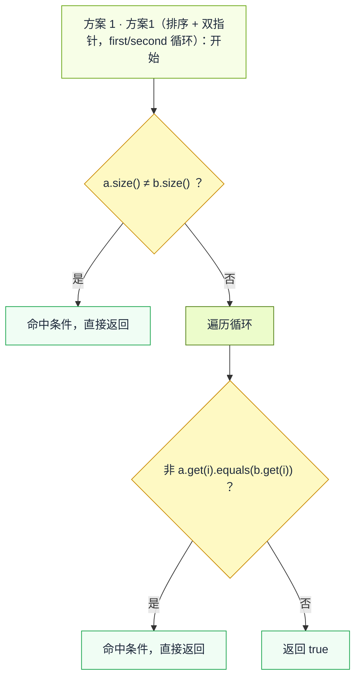

```java
package com.webfault.dsa; // 引入依赖

import java.util.*; // 引入依赖

class Sum3S1 { // 定义类型
  static List<List<Integer>> threeSum(int[] nums) { // 定义函数/方法 threeSum
    List<List<Integer>> ans =
        new ArrayList<>(); // 把 new ArrayList 小于 超过 (); 写入 List<List<Integer>> ans
    Arrays.sort(nums); // 排序
    int n = nums.length; // 把 数组.长度 存入 元素个数
    for (int first = 0; first < n; first++) { // 让 first 从 0 开始计数，first 小于 元素个数 就继续
      if (first > 0 && nums[first] == nums[first - 1])
        continue; // 若 first 超过 0 且 数组[first] 等于 数组[first 减 1]) continue;
      int third = n - 1; // 把 元素个数 减 1 存入 third
      int target = -nums[first]; // 把 减 数组[first] 存入 目标值
      for (int second = first + 1;
          second < n;
          second++) { // 让 second 从 first 加 1 开始计数，second 小于 元素个数 就继续
        if (second > first + 1 && nums[second] == nums[second - 1]) continue;
        while (second < third && nums[second] + nums[third] > target) third--;
        if (second == third) break; // 若 second 等于 third) break;
        if (nums[second] + nums[third] == target) { // 若 数组[second] 加 数组[third] 等于 目标值
          ans.add(
              Arrays.asList(
                  nums[first],
                  nums[second],
                  nums[third])); // 答案 追加 Arrays.asList(数组[first], 数组[second], 数组[third]));
        }
      }
    }
    return ans; // 返回 答案
  }

  static boolean eqLL(List<List<Integer>> a, List<List<Integer>> b) { // 定义函数/方法 eqLL
    if (a.size() != b.size()) return false; // 若 数组.大小() 不等于 b.大小()，直接返回 false
    for (int i = 0; i < a.size(); i++)
      if (!a.get(i).equals(b.get(i))) return false; // 让 下标 i 从 0 开始计数，下标 i 小于 数组.大小() 就继续
    return true; // 返回 true
  }

  public static void main(String[] args) { // public static void main(String[] args) {
    boolean ok = true; // 把 true; 写入 boolean ok
    if (!eqLL(Sum3S1.threeSum(new int[] {1, 2, 3}), new ArrayList<>())) {
      ok = false;
      System.out.println("FAIL empty");
    }
    List<List<Integer>> want = Arrays.asList(Arrays.asList(-1, -1, 2), Arrays.asList(-1, 0, 1));
    if (!eqLL(Sum3S1.threeSum(new int[] {-1, 0, 1, 2, -1, -4}), want)) {
      ok = false;
      System.out.println("FAIL case2=" + Sum3S1.threeSum(new int[] {-1, 0, 1, 2, -1, -4}));
    }
    if (!ok) throw new RuntimeException("FAILED"); // 若 取反 ok) throw new RuntimeException(「FAILED」);
    System.out.println("PASS"); // 全部用例通过，输出 PASS
  }
}
```

#### 方案 2：方案2（排序 + 双指针，i/left/right 去重）

**思路与代码分析**：核心是「方案2（排序 + 双指针，i/left/right 去重）」。Java 版用类与静态方法组织，集合操作显式明了。代码里依次做这些事：单循环线性扫描。**走读**：方案 2 · 方案2（排序 + 双指针，i/left/right 去重）：开始 → 命中条件，直接返回 → 遍历循环 → 命中条件，直接返回 → 返回 true。

**运行架构**（真实控制流）：

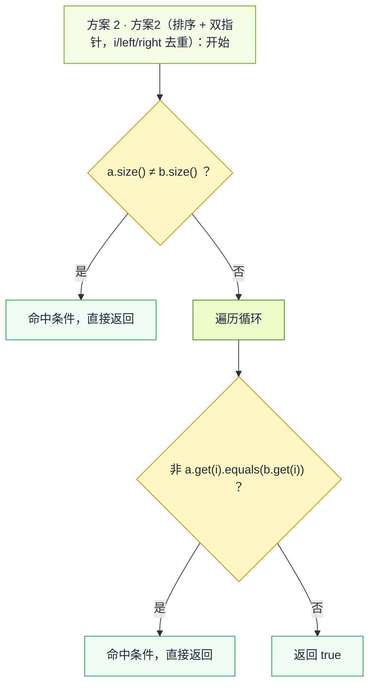

```java
package com.webfault.dsa; // 引入依赖

import java.util.*; // 引入依赖

class Sum3S2 { // 定义类型
  static List<List<Integer>> threeSum(int[] nums) { // 定义函数/方法 threeSum
    List<List<Integer>> ans =
        new ArrayList<>(); // 把 new ArrayList 小于 超过 (); 写入 List<List<Integer>> ans
    Arrays.sort(nums); // 排序
    int n = nums.length; // 把 数组.长度 存入 元素个数
    for (int i = 0; i < n; i++) { // 让 下标 i 从 0 开始计数，下标 i 小于 元素个数 就继续
      if (i > 0 && nums[i] == nums[i - 1])
        continue; // 若 下标 i 超过 0 且 数组[下标 i] 等于 数组[下标 i 减 1]) continue;
      int left = i + 1, right = n - 1; // 把 下标 i 加 1, 右边界 赋值为 元素个数 减 1 存入 左边界
      while (left < right) { // 循环，直到不满足「左边界 小于 右边界」
        int sum = nums[i] + nums[left] + nums[right]; // 把 数组[下标 i] 加 数组[左边界] 加 数组[右边界] 存入 累计和
        if (sum == 0) { // 若 累计和 等于 0
          ans.add(
              Arrays.asList(
                  nums[i],
                  nums[left],
                  nums[right])); // 答案 追加 Arrays.asList(数组[下标 i], 数组[左边界], 数组[右边界]));
          while (left < right && nums[left] == nums[left + 1])
            left++; // 循环，直到不满足「左边界 小于 右边界 且 数组[左边界] 等于 数组[左边界 加 1]) 左边界 加一 ;」
          left++; // 左边界 加一
          while (left < right && nums[right] == nums[right - 1])
            right--; // 循环，直到不满足「左边界 小于 右边界 且 数组[右边界] 等于 数组[右边界 减 1]) 右边界 减一 ;」
          right--; // 右边界 减一
        } else if (sum < 0) left++; // 否则，若 累计和 小于 0) 左边界 加一 ;
        else right--; // 否则
      }
    }
    return ans; // 返回 答案
  }

  static boolean eqLL(List<List<Integer>> a, List<List<Integer>> b) { // 定义函数/方法 eqLL
    if (a.size() != b.size()) return false; // 若 数组.大小() 不等于 b.大小()，直接返回 false
    for (int i = 0; i < a.size(); i++)
      if (!a.get(i).equals(b.get(i))) return false; // 让 下标 i 从 0 开始计数，下标 i 小于 数组.大小() 就继续
    return true; // 返回 true
  }

  public static void main(String[] args) { // public static void main(String[] args) {
    boolean ok = true; // 把 true; 写入 boolean ok
    if (!eqLL(Sum3S2.threeSum(new int[] {1, 2, 3}), new ArrayList<>())) {
      ok = false;
      System.out.println("FAIL empty");
    }
    List<List<Integer>> want = Arrays.asList(Arrays.asList(-1, -1, 2), Arrays.asList(-1, 0, 1));
    if (!eqLL(Sum3S2.threeSum(new int[] {-1, 0, 1, 2, -1, -4}), want)) {
      ok = false;
      System.out.println("FAIL case2");
    }
    if (!ok) throw new RuntimeException("FAILED"); // 若 取反 ok) throw new RuntimeException(「FAILED」);
    System.out.println("PASS"); // 全部用例通过，输出 PASS
  }
}
```

### Rust 实现（2 种方案）

Rust 的全部方案如下，每个方案都内嵌用例自测，可独立运行（老仓库 python/go 文件遵循「打印结果」约定）：

#### 方案 1：方案1（排序 + 双指针，first/second 循环）

**思路与代码分析**：核心是「方案1（排序 + 双指针，first/second 循环）」。Rust 版用所有权移动与切片借用改写同一逻辑，注意 Option 与引用边界。代码里依次做这些事：先排序再处理。**走读**：方案 1 · 方案1（排序 + 双指针，first/second 循环）：开始 → 计算 arr → 遍历 0..n 中的每个元素 first → 遍历 first + 1..n 中的每个元素 second → 当 second ＜ third 且 arr[second] + arr[third] ＞ target 时反复执行 → 返回结果。

**运行架构**（真实控制流）：

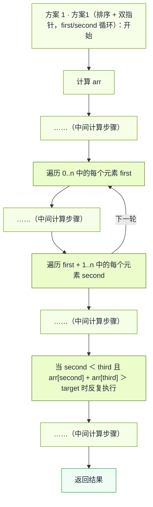

```rust
// LeetCode 15. 三数之和 — Rust 版（方案1）
fn three_sum(nums: Vec<i32>) -> Vec<Vec<i32>> {
    // 定义函数/方法 three_sum
    let mut arr = nums; // 把 数组; 写入 let mut arr
    arr.sort(); // 排序
    let mut ans: Vec<Vec<i32>> = Vec::new(); // 把 Vec::new(); 写入 let mut ans: Vec<Vec<i32>>
    let n = arr.len(); // 把 数组.长度() 存入 元素个数
    for first in 0..n {
        // 逐个取出 0 的元素（first）
        if first > 0 && arr[first] == arr[first - 1] {
            continue;
        } // 若 first 超过 0 且 数组[first] 等于 数组[first 减 1] { continue; }
        let mut third = n - 1; // 把 元素个数 减 1; 写入 let mut third
        let target = -arr[first]; // 把 减 数组[first] 存入 目标值
        for second in first + 1..n {
            // 逐个取出 first 的元素（second）
            if second > first + 1 && arr[second] == arr[second - 1] {
                continue;
            }
            while second < third && arr[second] + arr[third] > target {
                third -= 1;
            }
            if second == third {
                break;
            } // 若 second 等于 third { break; }
            if arr[second] + arr[third] == target {
                // 若 数组[second] 加 数组[third] 等于 目标值
                ans.push(vec![arr[first], arr[second], arr[third]]); // 把 vec取反 [数组[first], 数组[second], 数组[third]] 压入栈/数组尾部
            }
        }
    }
    ans // 答案
}
fn main() {
    // 程序入口：跑内嵌自测用例
    let mut got = three_sum(vec![-1, 0, 1, 2, -1, -4]); // 把 three_sum(vec取反 [ 减 1, 0, 1, 2, 减 1, 减 4]); 写入 let mut got
    got.sort(); // 排序
    assert_eq!(got, vec![vec![-1, -1, 2], vec![-1, 0, 1]]); // 断言校验
    assert!(
        three_sum(vec![0, 0, 0]).iter().all(|t| t == &vec![0, 0, 0])
            && three_sum(vec![0, 0, 0]).len() == 1
    ); // 断言校验
    println!("PASS"); // 全部用例通过，输出 PASS
}
```

#### 方案 2：方案2（排序 + 双指针，i/left/right 去重）

**思路与代码分析**：核心是「方案2（排序 + 双指针，i/left/right 去重）」。Rust 版用所有权移动与切片借用改写同一逻辑，注意 Option 与引用边界。代码里依次做这些事：先排序再处理。**走读**：方案 2 · 方案2（排序 + 双指针，i/left/right 去重）：开始 → 计算 arr → 遍历 0..n 中的每个元素 first → 遍历 first + 1..n 中的每个元素 second → 当 second ＜ third 且 arr[second] + arr[third] ＞ target 时反复执行 → 返回结果。

**运行架构**（真实控制流）：

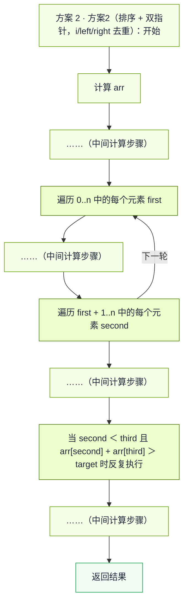

```rust
// LeetCode 15. 三数之和 — Rust 版（方案2）
fn three_sum(nums: Vec<i32>) -> Vec<Vec<i32>> {
    // 定义函数/方法 three_sum
    let mut arr = nums; // 把 数组; 写入 let mut arr
    arr.sort(); // 排序
    let mut ans: Vec<Vec<i32>> = Vec::new(); // 把 Vec::new(); 写入 let mut ans: Vec<Vec<i32>>
    let n = arr.len(); // 把 数组.长度() 存入 元素个数
    for first in 0..n {
        // 逐个取出 0 的元素（first）
        if first > 0 && arr[first] == arr[first - 1] {
            continue;
        } // 若 first 超过 0 且 数组[first] 等于 数组[first 减 1] { continue; }
        let mut third = n - 1; // 把 元素个数 减 1; 写入 let mut third
        let target = -arr[first]; // 把 减 数组[first] 存入 目标值
        for second in first + 1..n {
            // 逐个取出 first 的元素（second）
            if second > first + 1 && arr[second] == arr[second - 1] {
                continue;
            }
            while second < third && arr[second] + arr[third] > target {
                third -= 1;
            }
            if second == third {
                break;
            } // 若 second 等于 third { break; }
            if arr[second] + arr[third] == target {
                // 若 数组[second] 加 数组[third] 等于 目标值
                ans.push(vec![arr[first], arr[second], arr[third]]); // 把 vec取反 [数组[first], 数组[second], 数组[third]] 压入栈/数组尾部
            }
        }
    }
    ans // 答案
}
fn main() {
    // 程序入口：跑内嵌自测用例
    let mut got = three_sum(vec![-1, 0, 1, 2, -1, -4]); // 把 three_sum(vec取反 [ 减 1, 0, 1, 2, 减 1, 减 4]); 写入 let mut got
    got.sort(); // 排序
    assert_eq!(got, vec![vec![-1, -1, 2], vec![-1, 0, 1]]); // 断言校验
    assert!(
        three_sum(vec![0, 0, 0]).iter().all(|t| t == &vec![0, 0, 0])
            && three_sum(vec![0, 0, 0]).len() == 1
    ); // 断言校验
    println!("PASS"); // 全部用例通过，输出 PASS
}
```

### Lua 实现（2 种方案）

Lua 的全部方案如下，每个方案都内嵌用例自测，可独立运行（老仓库 python/go 文件遵循「打印结果」约定）：

#### 方案 1：方案1（排序 + 双指针，first/second 循环）

**思路与代码分析**：核心是「方案1（排序 + 双指针，first/second 循环）」。Lua 版用表与 ipairs 遍历，注意 ipairs 遇 nil 即停的语义。代码里依次做这些事：先排序再处理。**走读**：方案 1 · 方案1（排序 + 双指针，first/second 循环）：开始 → 更新 arr → 循环 first：从 1 到 n do → 循环 second：从 first + 1 到 n do → 当 second ＜ third and arr[second] + arr[third] ＞ target do 时反复执行 → 返回 ans。

**运行架构**（真实控制流）：

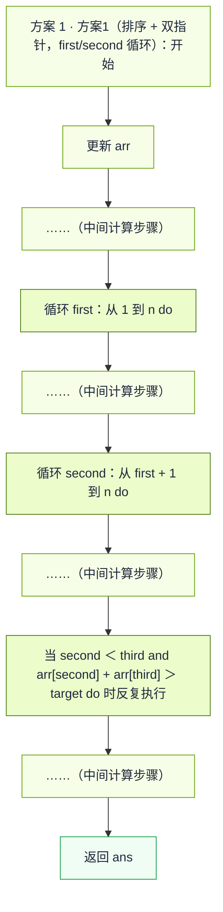

```lua
-- LeetCode 15. 三数之和 — Lua 版（方案1）
local function three_sum(nums) -- local function three_sum(数组)
	local arr = { table.unpack(nums) } -- 把 {table.unpack(数组)} 写入 local arr
	table.sort(arr) -- 排序
	local ans = {} -- 把 {} 写入 local ans
	local n = #arr -- 把 #数组 写入 local n
	for first = 1, n do -- 让 first 从 1 走到 元素个数（Lua 1 基）
		if first == 1 or arr[first] ~= arr[first - 1] then -- 若 first 等于 1 or 数组[first] ~ 赋值为 数组[first 减 1] then
			local third = n -- 把 元素个数 写入 local third
			local target = -arr[first] -- 把 减 数组[first] 写入 local target
			for second = first + 1, n do -- 把 first 加 1, 元素个数 do 写入 for second
				if second == first + 1 or arr[second] ~= arr[second - 1] then
					while second < third and arr[second] + arr[third] > target do
						third = third - 1
					end
					if second == third then
						break
					end -- 若 second 等于 third then break 终点
					if arr[second] + arr[third] == target then -- 若 数组[second] 加 数组[third] 等于 目标值 then
						ans[#ans + 1] = { arr[first], arr[second], arr[third] } -- 把 {数组[first], 数组[second], 数组[third]} 写入 ans[#ans + 1]
					end -- 终点
				end -- 终点
			end -- 终点
		end -- 终点
	end -- 终点
	return ans -- 返回 答案
end -- 终点
local got = three_sum({ -1, 0, 1, 2, -1, -4 }) -- 把 three_sum({ 减 1, 0, 1, 2, 减 1, 减 4}) 写入 local got
table.sort(got, function(a, b)
	return a[1] < b[1] or (a[1] == b[1] and a[2] < b[2])
end) -- 排序
assert(#got == 2) -- 断言校验
assert(got[1][1] == -1 and got[1][2] == -1 and got[1][3] == 2) -- 断言校验
assert(got[2][1] == -1 and got[2][2] == 0 and got[2][3] == 1) -- 断言校验
local g2 = three_sum({ 0, 0, 0 }) -- 把 three_sum({0, 0, 0}) 写入 local g2
assert(#g2 == 1 and g2[1][1] == 0) -- 断言校验
print("PASS") -- 全部用例通过，输出 PASS
```

#### 方案 2：方案2（排序 + 双指针，i/left/right 去重）

**思路与代码分析**：核心是「方案2（排序 + 双指针，i/left/right 去重）」。Lua 版用表与 ipairs 遍历，注意 ipairs 遇 nil 即停的语义。代码里依次做这些事：先排序再处理。**走读**：方案 2 · 方案2（排序 + 双指针，i/left/right 去重）：开始 → 更新 arr → 循环 first：从 1 到 n do → 循环 second：从 first + 1 到 n do → 当 second ＜ third and arr[second] + arr[third] ＞ target do 时反复执行 → 返回 ans。

**运行架构**（真实控制流）：

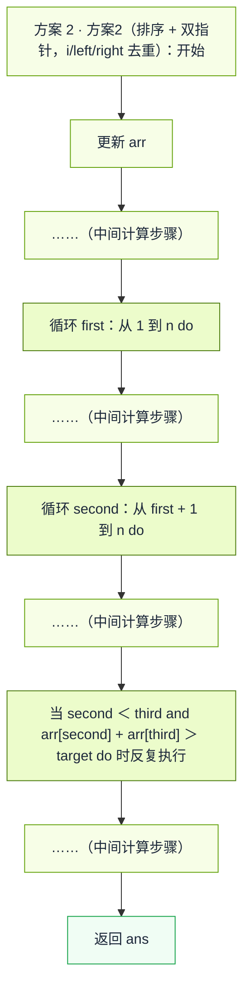

```lua
-- LeetCode 15. 三数之和 — Lua 版（方案2）
local function three_sum(nums) -- local function three_sum(数组)
	local arr = { table.unpack(nums) } -- 把 {table.unpack(数组)} 写入 local arr
	table.sort(arr) -- 排序
	local ans = {} -- 把 {} 写入 local ans
	local n = #arr -- 把 #数组 写入 local n
	for first = 1, n do -- 让 first 从 1 走到 元素个数（Lua 1 基）
		if first == 1 or arr[first] ~= arr[first - 1] then -- 若 first 等于 1 or 数组[first] ~ 赋值为 数组[first 减 1] then
			local third = n -- 把 元素个数 写入 local third
			local target = -arr[first] -- 把 减 数组[first] 写入 local target
			for second = first + 1, n do -- 把 first 加 1, 元素个数 do 写入 for second
				if second == first + 1 or arr[second] ~= arr[second - 1] then
					while second < third and arr[second] + arr[third] > target do
						third = third - 1
					end
					if second == third then
						break
					end -- 若 second 等于 third then break 终点
					if arr[second] + arr[third] == target then -- 若 数组[second] 加 数组[third] 等于 目标值 then
						ans[#ans + 1] = { arr[first], arr[second], arr[third] } -- 把 {数组[first], 数组[second], 数组[third]} 写入 ans[#ans + 1]
					end -- 终点
				end -- 终点
			end -- 终点
		end -- 终点
	end -- 终点
	return ans -- 返回 答案
end -- 终点
local got = three_sum({ -1, 0, 1, 2, -1, -4 }) -- 把 three_sum({ 减 1, 0, 1, 2, 减 1, 减 4}) 写入 local got
table.sort(got, function(a, b)
	return a[1] < b[1] or (a[1] == b[1] and a[2] < b[2])
end) -- 排序
assert(#got == 2) -- 断言校验
assert(got[1][1] == -1 and got[1][2] == -1 and got[1][3] == 2) -- 断言校验
assert(got[2][1] == -1 and got[2][2] == 0 and got[2][3] == 1) -- 断言校验
local g2 = three_sum({ 0, 0, 0 }) -- 把 three_sum({0, 0, 0}) 写入 local g2
assert(#g2 == 1 and g2[1][1] == 0) -- 断言校验
print("PASS") -- 全部用例通过，输出 PASS
```

### C 实现（2 种方案）

C 的全部方案如下，每个方案都内嵌用例自测，可独立运行（老仓库 python/go 文件遵循「打印结果」约定）：

#### 方案 1：方案1（排序 + 双指针，first/second 循环）

**思路与代码分析**：核心是「方案1（排序 + 双指针，first/second 循环）」。C 版手动管理下标与内存，循环边界全部显式写出。代码里依次做这些事：双重循环遍历。**走读**：方案 1 · 方案1（排序 + 双指针，first/second 循环）：开始 → 处理 int arr[4096] → 遍历循环 → 遍历循环 → 遍历循环 → 当 (second ＜ third 且 arr[second] + arr[third] ＞ target) 时反复执行 → 返回 cnt。

**运行架构**（真实控制流）：

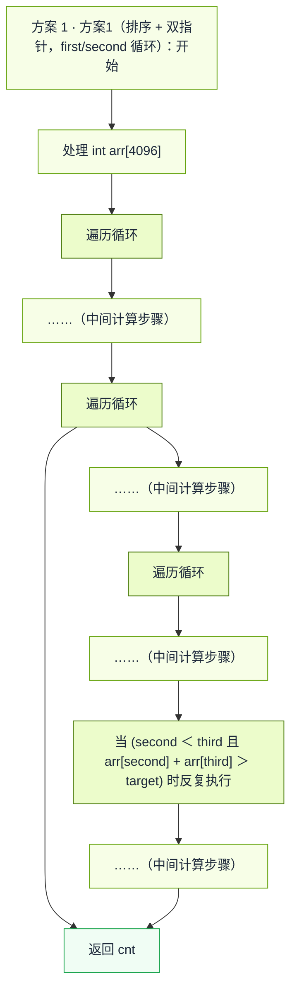

```c
/* LeetCode 15. 三数之和 — C 版（方案1） */
#include <stdio.h>  // 引入头文件
#include <stdlib.h> // 引入头文件
static int cmp_int(const void *a, const void *b) { return *(const int *)a - *(const int *)b; }
static int three_sum(const int *nums, int n, int out[][3]) { // 定义函数/方法 three_sum
    int arr[4096];                                           // int 数组[4096];
    for (int i = 0; i < n; i++)
        arr[i] = nums[i]; // 让 下标 i 从 0 开始计数，下标 i 小于 元素个数 就继续
    qsort(arr, n, sizeof(int), cmp_int);      // qsort(数组, 元素个数, sizeof(int), cmp_int);
    int cnt = 0;                              // 把 0 存入 计数
    for (int first = 0; first < n; first++) { // 让 first 从 0 开始计数，first 小于 元素个数 就继续
        if (first > 0 && arr[first] == arr[first - 1])
            continue;      // 若 first 超过 0 且 数组[first] 等于 数组[first 减 1]) continue;
        int third = n - 1; // 把 元素个数 减 1 存入 third
        int target = -arr[first]; // 把 减 数组[first] 存入 目标值
        for (int second = first + 1; second < n;
             second++) { // 让 second 从 first 加 1 开始计数，second 小于 元素个数 就继续
            if (second > first + 1 && arr[second] == arr[second - 1])
                continue;
            while (second < third && arr[second] + arr[third] > target)
                third--;
            if (second == third)
                break;                                // 若 second 等于 third) break;
            if (arr[second] + arr[third] == target) { // 若 数组[second] 加 数组[third] 等于 目标值
                out[cnt][0] = arr[first];
                out[cnt][1] = arr[second];
                out[cnt][2] = arr[third];
                cnt++; // 计数 加一
            }
        }
    }
    return cnt; // 返回 计数
}
int main(void) {    // 程序入口：跑内嵌自测用例
    int out[64][3]; // int out[64][3];
    int n = three_sum((int[]){-1, 0, 1, 2, -1, -4}, 6,
                      out); // 把 three_sum((int[]){ 减 1,0,1,2, 减 1, 减 4}, 6, out) 存入 元素个数
    /* 期望两组：[-1,-1,2] 与 [-1,0,1]（已按序生成） */
    if (n != 2) {
        printf("FAIL cnt=%d\n", n);
        return 1;
    } // 若 元素个数 不等于 2) { 输出「FAIL 计数 赋值为 对…取模 d 」, 元素个数); return 1; }
    if (out[0][0] != -1 || out[0][1] != -1 || out[0][2] != 2) {
        printf("FAIL t1\n");
        return 1;
    }
    if (out[1][0] != -1 || out[1][1] != 0 || out[1][2] != 1) {
        printf("FAIL t2\n");
        return 1;
    }
    n = three_sum((int[]){0, 0, 0}, 3, out); // 把 three_sum((int[]){0,0,0}, 3, out); 写入 元素个数
    if (n != 1 || out[0][0] != 0) {
        printf("FAIL z\n");
        return 1;
    } // 若 元素个数 不等于 1 或 out[0][0] 不等于 0) { 输出「FAIL z 」); return 1; }
    printf("PASS\n"); // 全部用例通过，输出 PASS
    return 0;         // 返回 0
}
```

#### 方案 2：方案2（排序 + 双指针，i/left/right 去重）

**思路与代码分析**：核心是「方案2（排序 + 双指针，i/left/right 去重）」。C 版手动管理下标与内存，循环边界全部显式写出。代码里依次做这些事：双重循环遍历。**走读**：方案 2 · 方案2（排序 + 双指针，i/left/right 去重）：开始 → 处理 int arr[4096] → 遍历循环 → 遍历循环 → 遍历循环 → 当 (second ＜ third 且 arr[second] + arr[third] ＞ target) 时反复执行 → 返回 cnt。

**运行架构**（真实控制流）：

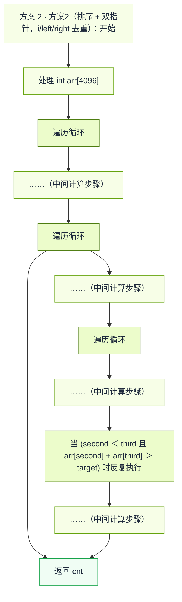

```c
/* LeetCode 15. 三数之和 — C 版（方案2） */
#include <stdio.h>  // 引入头文件
#include <stdlib.h> // 引入头文件
static int cmp_int(const void *a, const void *b) { return *(const int *)a - *(const int *)b; }
static int three_sum(const int *nums, int n, int out[][3]) { // 定义函数/方法 three_sum
    int arr[4096];                                           // int 数组[4096];
    for (int i = 0; i < n; i++)
        arr[i] = nums[i]; // 让 下标 i 从 0 开始计数，下标 i 小于 元素个数 就继续
    qsort(arr, n, sizeof(int), cmp_int);      // qsort(数组, 元素个数, sizeof(int), cmp_int);
    int cnt = 0;                              // 把 0 存入 计数
    for (int first = 0; first < n; first++) { // 让 first 从 0 开始计数，first 小于 元素个数 就继续
        if (first > 0 && arr[first] == arr[first - 1])
            continue;      // 若 first 超过 0 且 数组[first] 等于 数组[first 减 1]) continue;
        int third = n - 1; // 把 元素个数 减 1 存入 third
        int target = -arr[first]; // 把 减 数组[first] 存入 目标值
        for (int second = first + 1; second < n;
             second++) { // 让 second 从 first 加 1 开始计数，second 小于 元素个数 就继续
            if (second > first + 1 && arr[second] == arr[second - 1])
                continue;
            while (second < third && arr[second] + arr[third] > target)
                third--;
            if (second == third)
                break;                                // 若 second 等于 third) break;
            if (arr[second] + arr[third] == target) { // 若 数组[second] 加 数组[third] 等于 目标值
                out[cnt][0] = arr[first];
                out[cnt][1] = arr[second];
                out[cnt][2] = arr[third];
                cnt++; // 计数 加一
            }
        }
    }
    return cnt; // 返回 计数
}
int main(void) {    // 程序入口：跑内嵌自测用例
    int out[64][3]; // int out[64][3];
    int n = three_sum((int[]){-1, 0, 1, 2, -1, -4}, 6,
                      out); // 把 three_sum((int[]){ 减 1,0,1,2, 减 1, 减 4}, 6, out) 存入 元素个数
    /* 期望两组：[-1,-1,2] 与 [-1,0,1]（已按序生成） */
    if (n != 2) {
        printf("FAIL cnt=%d\n", n);
        return 1;
    } // 若 元素个数 不等于 2) { 输出「FAIL 计数 赋值为 对…取模 d 」, 元素个数); return 1; }
    if (out[0][0] != -1 || out[0][1] != -1 || out[0][2] != 2) {
        printf("FAIL t1\n");
        return 1;
    }
    if (out[1][0] != -1 || out[1][1] != 0 || out[1][2] != 1) {
        printf("FAIL t2\n");
        return 1;
    }
    n = three_sum((int[]){0, 0, 0}, 3, out); // 把 three_sum((int[]){0,0,0}, 3, out); 写入 元素个数
    if (n != 1 || out[0][0] != 0) {
        printf("FAIL z\n");
        return 1;
    } // 若 元素个数 不等于 1 或 out[0][0] 不等于 0) { 输出「FAIL z 」); return 1; }
    printf("PASS\n"); // 全部用例通过，输出 PASS
    return 0;         // 返回 0
}
```

### C++ 实现（2 种方案）

C++ 的全部方案如下，每个方案都内嵌用例自测，可独立运行（老仓库 python/go 文件遵循「打印结果」约定）：

#### 方案 1：方案1（排序 + 双指针，first/second 循环）

**思路与代码分析**：核心是「方案1（排序 + 双指针，first/second 循环）」。C++ 版用 STL 容器与迭代器，减少手写下标错误。代码里依次做这些事：双重循环遍历。**走读**：方案 1 · 方案1（排序 + 双指针，first/second 循环）：开始 → 处理 std::sort(nums.begin(), nums → 遍历循环 → 遍历循环 → 当 (second ＜ third 且 nums[second] + nums[third] ＞ target) 时反复执行 → 返回 ans。

**运行架构**（真实控制流）：

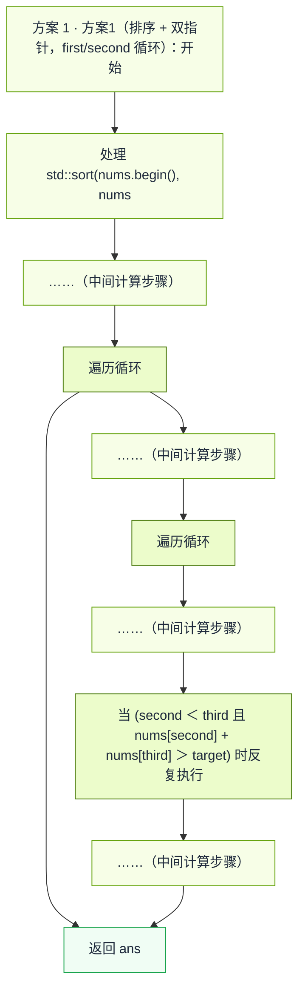

```cpp
// LeetCode 15. 三数之和 — C++ 版（方案1）
#include <algorithm> // 引入头文件
#include <cassert>   // 引入头文件
#include <iostream>  // 引入头文件
#include <vector>    // 引入头文件
static std::vector<std::vector<int>> threeSum(std::vector<int> nums) {
    std::sort(nums.begin(), nums.end()); // std::sort(数组 迭代位置 , 数组.终点());
    std::vector<std::vector<int>> ans;   // std::vector 小于 std::vector 小于 int 超过 超过 答案;
    int n = static_cast<int>(nums.size()); // 把 static_cast 小于 int 超过 (数组.大小()) 存入 元素个数
    for (int first = 0; first < n; ++first) { // 让 first 从 0 开始计数，first 小于 元素个数 就继续
        if (first > 0 && nums[first] == nums[first - 1])
            continue;      // 若 first 超过 0 且 数组[first] 等于 数组[first 减 1]) continue;
        int third = n - 1; // 把 元素个数 减 1 存入 third
        int target = -nums[first]; // 把 减 数组[first] 存入 目标值
        for (int second = first + 1; second < n;
             ++second) { // 让 second 从 first 加 1 开始计数，second 小于 元素个数 就继续
            if (second > first + 1 && nums[second] == nums[second - 1])
                continue;
            while (second < third && nums[second] + nums[third] > target)
                --third;
            if (second == third)
                break;                                  // 若 second 等于 third) break;
            if (nums[second] + nums[third] == target) { // 若 数组[second] 加 数组[third] 等于 目标值
                ans.push_back({nums[first], nums[second],
                               nums[third]}); // 答案 追加 {数组[first], 数组[second], 数组[third]});
            }
        }
    }
    return ans; // 返回 答案
}
int main() {                                    // 程序入口：跑内嵌自测用例
    auto got = threeSum({-1, 0, 1, 2, -1, -4}); // 把 threeSum({ 减 1, 0, 1, 2, 减 1, 减 4}) 存入 got
    std::sort(got.begin(), got.end());          // std::sort(got 迭代位置 , got.终点());
    assert((got == std::vector<std::vector<int>>{{{-1, -1, 2}, {-1, 0, 1}}})); // 断言校验
    auto g2 = threeSum({0, 0, 0});                                  // 把 threeSum({0, 0, 0}) 存入 g2
    assert(g2.size() == 1 && g2[0] == std::vector<int>({0, 0, 0})); // 断言校验
    std::cout << "PASS" << std::endl;                               // 全部用例通过，输出 PASS
    return 0;                                                       // 返回 0
}
```

#### 方案 2：方案2（排序 + 双指针，i/left/right 去重）

**思路与代码分析**：核心是「方案2（排序 + 双指针，i/left/right 去重）」。C++ 版用 STL 容器与迭代器，减少手写下标错误。代码里依次做这些事：双重循环遍历。**走读**：方案 2 · 方案2（排序 + 双指针，i/left/right 去重）：开始 → 处理 std::sort(nums.begin(), nums → 遍历循环 → 遍历循环 → 当 (second ＜ third 且 nums[second] + nums[third] ＞ target) 时反复执行 → 返回 ans。

**运行架构**（真实控制流）：

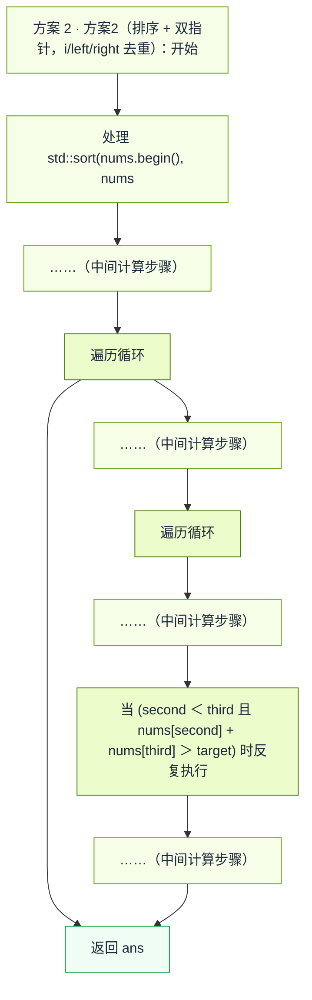

```cpp
// LeetCode 15. 三数之和 — C++ 版（方案2）
#include <algorithm> // 引入头文件
#include <cassert>   // 引入头文件
#include <iostream>  // 引入头文件
#include <vector>    // 引入头文件
static std::vector<std::vector<int>> threeSum(std::vector<int> nums) {
    std::sort(nums.begin(), nums.end()); // std::sort(数组 迭代位置 , 数组.终点());
    std::vector<std::vector<int>> ans;   // std::vector 小于 std::vector 小于 int 超过 超过 答案;
    int n = static_cast<int>(nums.size()); // 把 static_cast 小于 int 超过 (数组.大小()) 存入 元素个数
    for (int first = 0; first < n; ++first) { // 让 first 从 0 开始计数，first 小于 元素个数 就继续
        if (first > 0 && nums[first] == nums[first - 1])
            continue;      // 若 first 超过 0 且 数组[first] 等于 数组[first 减 1]) continue;
        int third = n - 1; // 把 元素个数 减 1 存入 third
        int target = -nums[first]; // 把 减 数组[first] 存入 目标值
        for (int second = first + 1; second < n;
             ++second) { // 让 second 从 first 加 1 开始计数，second 小于 元素个数 就继续
            if (second > first + 1 && nums[second] == nums[second - 1])
                continue;
            while (second < third && nums[second] + nums[third] > target)
                --third;
            if (second == third)
                break;                                  // 若 second 等于 third) break;
            if (nums[second] + nums[third] == target) { // 若 数组[second] 加 数组[third] 等于 目标值
                ans.push_back({nums[first], nums[second],
                               nums[third]}); // 答案 追加 {数组[first], 数组[second], 数组[third]});
            }
        }
    }
    return ans; // 返回 答案
}
int main() {                                    // 程序入口：跑内嵌自测用例
    auto got = threeSum({-1, 0, 1, 2, -1, -4}); // 把 threeSum({ 减 1, 0, 1, 2, 减 1, 减 4}) 存入 got
    std::sort(got.begin(), got.end());          // std::sort(got 迭代位置 , got.终点());
    assert((got == std::vector<std::vector<int>>{{{-1, -1, 2}, {-1, 0, 1}}})); // 断言校验
    auto g2 = threeSum({0, 0, 0});                                  // 把 threeSum({0, 0, 0}) 存入 g2
    assert(g2.size() == 1 && g2[0] == std::vector<int>({0, 0, 0})); // 断言校验
    std::cout << "PASS" << std::endl;                               // 全部用例通过，输出 PASS
    return 0;                                                       // 返回 0
}
```

### R 实现（2 种方案）

R 的全部方案如下，每个方案都内嵌用例自测，可独立运行（老仓库 python/go 文件遵循「打印结果」约定）：

#### 方案 1：方案1（排序 + 双指针，first/second 循环）

**思路与代码分析**：核心是「方案1（排序 + 双指针，first/second 循环）」。R 版用向量化思维与 1 起始下标，注意 1:n 的降序陷阱。代码里依次做这些事：双重循环遍历。**走读**：方案 1 · 方案1（排序 + 双指针，first/second 循环）：开始 → 处理 arr ＜- sort(nums) → 循环 first：遍历 seq_len(n) → 循环 second：遍历 (first + 1):n → 当 (second ＜ third 且 arr[second] + arr[third] ＞ target) third ＜- third - 1L 时反复执行 → 返回结果。

**运行架构**（真实控制流）：

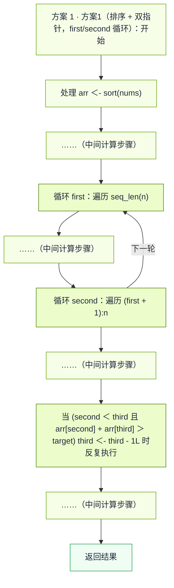

```r
# 版（方案1） 定义函数 three_sum（参数：数组）
three_sum <- function(nums) {
    arr <- sort(nums)  # 把 sort(数组) 存入 数组
    ans <- list()  # 把 列表() 存入 答案
    n <- length(arr)  # 把 长度(数组) 存入 元素个数
    for (first in seq_len(n)) {
        # for (first in seq_len(元素个数)) {
        if (first > 1 && arr[first] == arr[first - 1])
            next  # 若 first 超过 1 且 数组[first] 等于 数组[first 减 1]) 下一个
        third <- n  # 把 元素个数 存入 third
        target <- -arr[first]  # 把 减 数组[first] 存入 目标值
        for (second in (first + 1):n) {
            # for (second in (first 加 1):元素个数) {
            if (second > n)
                break  # 若 second 超过 元素个数) break
            if (second > first + 1 && arr[second] == arr[second - 1])
                next  # 若 second 超过 first 加 1 且 数组[second] 等于 数组[second 减 1]) 下一个
            while (second < third && arr[second] + arr[third] > target) third <- third - 1L
            if (second == third)
                break  # 若 second 等于 third) break
            if (arr[second] + arr[third] == target) {
                # 若 数组[second] 加 数组[third] 等于 目标值
                ans[[length(ans) + 1L]] <- c(arr[first], arr[second], arr[third])  # 答案[[长度(答案) 加 1L]] 小于 减 字符(数组[first], 数组[second], 数组[third])
            }
        }
    }
    ans  # 答案
}
got <- three_sum(c(-1, 0, 1, 2, -1, -4))  # 把 three_sum(字符( 减 1, 0, 1, 2, 减 1, 减 4)) 存入 got
stopifnot(length(got) == 2)  # 断言校验
got <- got[order(vapply(got, function(x) paste(x, collapse = ","), ""))]
stopifnot(identical(got[[1]], c(-1, -1, 2)))  # 断言校验
stopifnot(identical(got[[2]], c(-1, 0, 1)))  # 断言校验
g2 <- three_sum(c(0, 0, 0))  # 把 three_sum(字符(0, 0, 0)) 存入 g2
stopifnot(length(g2) == 1, identical(g2[[1]], c(0, 0, 0)))  # 断言校验
cat("PASS\n")  # 全部用例通过，输出 PASS
```

#### 方案 2：方案2（排序 + 双指针，i/left/right 去重）

**思路与代码分析**：核心是「方案2（排序 + 双指针，i/left/right 去重）」。R 版用向量化思维与 1 起始下标，注意 1:n 的降序陷阱。代码里依次做这些事：双重循环遍历。**走读**：方案 2 · 方案2（排序 + 双指针，i/left/right 去重）：开始 → 处理 arr ＜- sort(nums) → 循环 first：遍历 seq_len(n) → 循环 second：遍历 (first + 1):n → 当 (second ＜ third 且 arr[second] + arr[third] ＞ target) third ＜- third - 1L 时反复执行 → 返回结果。

**运行架构**（真实控制流）：

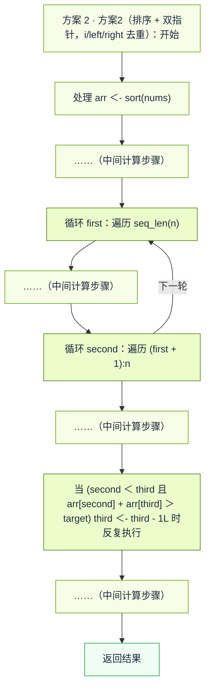

```r
# 版（方案2） 定义函数 three_sum（参数：数组）
three_sum <- function(nums) {
    arr <- sort(nums)  # 把 sort(数组) 存入 数组
    ans <- list()  # 把 列表() 存入 答案
    n <- length(arr)  # 把 长度(数组) 存入 元素个数
    for (first in seq_len(n)) {
        # for (first in seq_len(元素个数)) {
        if (first > 1 && arr[first] == arr[first - 1])
            next  # 若 first 超过 1 且 数组[first] 等于 数组[first 减 1]) 下一个
        third <- n  # 把 元素个数 存入 third
        target <- -arr[first]  # 把 减 数组[first] 存入 目标值
        for (second in (first + 1):n) {
            # for (second in (first 加 1):元素个数) {
            if (second > n)
                break  # 若 second 超过 元素个数) break
            if (second > first + 1 && arr[second] == arr[second - 1])
                next  # 若 second 超过 first 加 1 且 数组[second] 等于 数组[second 减 1]) 下一个
            while (second < third && arr[second] + arr[third] > target) third <- third - 1L
            if (second == third)
                break  # 若 second 等于 third) break
            if (arr[second] + arr[third] == target) {
                # 若 数组[second] 加 数组[third] 等于 目标值
                ans[[length(ans) + 1L]] <- c(arr[first], arr[second], arr[third])  # 答案[[长度(答案) 加 1L]] 小于 减 字符(数组[first], 数组[second], 数组[third])
            }
        }
    }
    ans  # 答案
}
got <- three_sum(c(-1, 0, 1, 2, -1, -4))  # 把 three_sum(字符( 减 1, 0, 1, 2, 减 1, 减 4)) 存入 got
stopifnot(length(got) == 2)  # 断言校验
got <- got[order(vapply(got, function(x) paste(x, collapse = ","), ""))]
stopifnot(identical(got[[1]], c(-1, -1, 2)))  # 断言校验
stopifnot(identical(got[[2]], c(-1, 0, 1)))  # 断言校验
g2 <- three_sum(c(0, 0, 0))  # 把 three_sum(字符(0, 0, 0)) 存入 g2
stopifnot(length(g2) == 1, identical(g2[[1]], c(0, 0, 0)))  # 断言校验
cat("PASS\n")  # 全部用例通过，输出 PASS
```

### Zig 实现（2 种方案）

Zig 的全部方案如下，每个方案都内嵌用例自测，可独立运行（老仓库 python/go 文件遵循「打印结果」约定）：

#### 方案 1：方案1（排序 + 双指针，first/second 循环）

**思路与代码分析**：核心是「方案1（排序 + 双指针，first/second 循环）」。Zig 版显式分配与清零，整型边界处理严格。代码里依次做这些事：单循环线性扫描。**走读**：方案 1 · 方案1（排序 + 双指针，first/second 循环）：开始 → 计算 arr → 处理 std.sort.pdq(i32, arr, → 计算 n → 遍历集合元素 → 若 first ＞ 0 and arr[first] == arr[first - 1]：处理 continue → 计算 third → 计算 target → 计算 second → 当 (second ＜ n) : (second += 1) 时反复执行 → 若 second ＞ first + 1 and arr[second] == arr[second - 1]：处理 continue → 当 (second ＜ third and arr[second] + arr[third] ＞ target) third -= 1 时反复执行 → 若 second == third：处理 break → 若 arr[second] + arr[third] == target 则： → 向 out 追加记录 → 返回结果。

**运行架构**（真实控制流）：

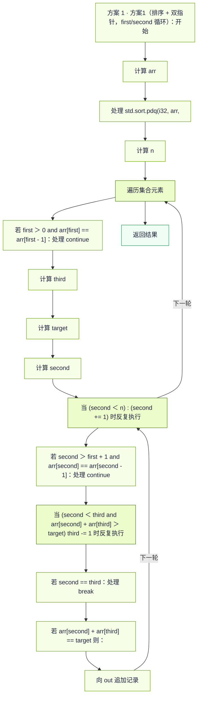

```zig
// LeetCode 15. 三数之和 — Zig 版（方案1）
const std = @import("std"); // 把 @import(「std」) 存入 std
fn threeSum(nums: []const i32, alloc: std.mem.Allocator, out: *std.ArrayList([3]i32)) void { // 定义函数/方法 threeSum
    const arr = alloc.dupe(i32, nums) catch unreachable; // 把 alloc.dupe(i32, 数组) catch unreachable 存入 数组
    std.sort.pdq(i32, arr, {}, std.sort.asc(i32)); // std.sort.pdq(i32, 数组, {}, std.sort.asc(i32));
    const n = arr.len; // 把 数组.长度 存入 元素个数
    for (0..n) |first| { // 让 first 从 0 走到 元素个数 减一
        if (first > 0 and arr[first] == arr[first - 1]) continue; // 若 first 超过 0 and 数组[first] 等于 数组[first 减 1]) continue;
        var third = n - 1; // 把 元素个数 减 1 存入 third
        const target = -arr[first]; // 把 减 数组[first] 存入 目标值
        var second = first + 1; // 把 first 加 1 存入 second
        while (second < n) : (second += 1) { // 循环，直到不满足「second 小于 元素个数) : (second 累加 1」
            if (second > first + 1 and arr[second] == arr[second - 1]) continue;
            while (second < third and arr[second] + arr[third] > target) third -= 1;
            if (second == third) break; // 若 second 等于 third) break;
            if (arr[second] + arr[third] == target) { // 若 数组[second] 加 数组[third] 等于 目标值
                out.append(.{ arr[first], arr[second], arr[third] }) catch unreachable; // 把 { 数组[first], 数组[second], 数组[third] } 追加到列表尾部
            }
        }
    }
}
pub fn main() !void { // 程序入口：跑内嵌自测用例
    var arena = std.heap.ArenaAllocator.init(std.heap.page_allocator); // 把 std.堆.ArenaAllocator.init(std.堆.page_allocator) 存入 arena
    defer arena.deinit(); // defer arena.deinit();
    const alloc = arena.allocator(); // 把 arena.allocator() 存入 alloc
    var out = std.ArrayList([3]i32).init(std.heap.page_allocator); // 把 std.ArrayList([3]i32).init(std.堆.page_allocator) 存入 out
    defer out.deinit(); // defer out.deinit();
    threeSum(&[_]i32{ -1, 0, 1, 2, -1, -4 }, alloc, &out);
    if (out.items.len != 2) return error.TestFailed; // 若 out.items.长度 不等于 2，直接返回 error.TestFailed
    if (out.items[0][0] != -1 or out.items[0][1] != -1 or out.items[0][2] != 2) return error.TestFailed;
    if (out.items[1][0] != -1 or out.items[1][1] != 0 or out.items[1][2] != 1) return error.TestFailed;
    out.clearRetainingCapacity(); // out.clearRetainingCapacity();
    threeSum(&[_]i32{ 0, 0, 0 }, alloc, &out); // threeSum( 按位与 [_]i32{ 0, 0, 0 }, alloc, 按位与 out);
    if (out.items.len != 1 or out.items[0][0] != 0) return error.TestFailed;
    std.debug.print("PASS\n", .{}); // 全部用例通过，输出 PASS
}
```

#### 方案 2：方案2（排序 + 双指针，i/left/right 去重）

**思路与代码分析**：核心是「方案2（排序 + 双指针，i/left/right 去重）」。Zig 版显式分配与清零，整型边界处理严格。代码里依次做这些事：单循环线性扫描。**走读**：方案 2 · 方案2（排序 + 双指针，i/left/right 去重）：开始 → 计算 arr → 处理 std.sort.pdq(i32, arr, → 计算 n → 遍历集合元素 → 若 first ＞ 0 and arr[first] == arr[first - 1]：处理 continue → 计算 third → 计算 target → 计算 second → 当 (second ＜ n) : (second += 1) 时反复执行 → 若 second ＞ first + 1 and arr[second] == arr[second - 1]：处理 continue → 当 (second ＜ third and arr[second] + arr[third] ＞ target) third -= 1 时反复执行 → 若 second == third：处理 break → 若 arr[second] + arr[third] == target 则： → 向 out 追加记录 → 返回结果。

**运行架构**（真实控制流）：

```mermaid
graph TD
    N0["方案 2 · 方案2（排序 + 双指针，i/left/right 去重）：开始"]
    N1["计算 arr"]
    N2["处理 std.sort.pdq(i32, arr,"]
    N3["计算 n"]
    N4["遍历集合元素"]
    N5["若 first ＞ 0 and arr[first] == arr[first - 1]：处理 continue"]
    N6["计算 third"]
    N7["计算 target"]
    N8["计算 second"]
    N9["当 (second ＜ n) : (second += 1) 时反复执行"]
    N10["若 second ＞ first + 1 and arr[second] == arr[second - 1]：处理 continue"]
    N11["当 (second ＜ third and arr[second] + arr[third] ＞ target) third -= 1 时反复执行"]
    N12["若 second == third：处理 break"]
    N13["若 arr[second] + arr[third] == target 则："]
    N14["向 out 追加记录"]
    N15["返回结果"]
    N0 --> N1
    N1 --> N2
    N2 --> N3
    N3 --> N4
    N4 --> N5
    N5 --> N6
    N6 --> N7
    N7 --> N8
    N8 --> N9
    N9 --> N10
    N10 --> N11
    N11 --> N12
    N12 --> N13
    N13 --> N14
    N14 -- 下一轮 --> N9
    N9 -- 下一轮 --> N4
    N4 --> N15
    classDef n fill:#f7fee7,stroke:#65a30d,color:#1e293b;
    classDef lp fill:#ecfccb,stroke:#4d7c0f,color:#1e293b;
    classDef dc fill:#fef9c3,stroke:#ca8a04,color:#1e293b;
    classDef tm fill:#f0fdf4,stroke:#16a34a,color:#1e293b;
    class N0,N1,N2,N3,N5,N6,N7,N8,N10,N12,N13,N14 n;
    class N4,N9,N11 lp;
    class N15 tm;
```

```zig
// LeetCode 15. 三数之和 — Zig 版（方案2）
const std = @import("std"); // 把 @import(「std」) 存入 std
fn threeSum(nums: []const i32, alloc: std.mem.Allocator, out: *std.ArrayList([3]i32)) void { // 定义函数/方法 threeSum
    const arr = alloc.dupe(i32, nums) catch unreachable; // 把 alloc.dupe(i32, 数组) catch unreachable 存入 数组
    std.sort.pdq(i32, arr, {}, std.sort.asc(i32)); // std.sort.pdq(i32, 数组, {}, std.sort.asc(i32));
    const n = arr.len; // 把 数组.长度 存入 元素个数
    for (0..n) |first| { // 让 first 从 0 走到 元素个数 减一
        if (first > 0 and arr[first] == arr[first - 1]) continue; // 若 first 超过 0 and 数组[first] 等于 数组[first 减 1]) continue;
        var third = n - 1; // 把 元素个数 减 1 存入 third
        const target = -arr[first]; // 把 减 数组[first] 存入 目标值
        var second = first + 1; // 把 first 加 1 存入 second
        while (second < n) : (second += 1) { // 循环，直到不满足「second 小于 元素个数) : (second 累加 1」
            if (second > first + 1 and arr[second] == arr[second - 1]) continue;
            while (second < third and arr[second] + arr[third] > target) third -= 1;
            if (second == third) break; // 若 second 等于 third) break;
            if (arr[second] + arr[third] == target) { // 若 数组[second] 加 数组[third] 等于 目标值
                out.append(.{ arr[first], arr[second], arr[third] }) catch unreachable; // 把 { 数组[first], 数组[second], 数组[third] } 追加到列表尾部
            }
        }
    }
}
pub fn main() !void { // 程序入口：跑内嵌自测用例
    var arena = std.heap.ArenaAllocator.init(std.heap.page_allocator); // 把 std.堆.ArenaAllocator.init(std.堆.page_allocator) 存入 arena
    defer arena.deinit(); // defer arena.deinit();
    const alloc = arena.allocator(); // 把 arena.allocator() 存入 alloc
    var out = std.ArrayList([3]i32).init(std.heap.page_allocator); // 把 std.ArrayList([3]i32).init(std.堆.page_allocator) 存入 out
    defer out.deinit(); // defer out.deinit();
    threeSum(&[_]i32{ -1, 0, 1, 2, -1, -4 }, alloc, &out);
    if (out.items.len != 2) return error.TestFailed; // 若 out.items.长度 不等于 2，直接返回 error.TestFailed
    if (out.items[0][0] != -1 or out.items[0][1] != -1 or out.items[0][2] != 2) return error.TestFailed;
    if (out.items[1][0] != -1 or out.items[1][1] != 0 or out.items[1][2] != 1) return error.TestFailed;
    out.clearRetainingCapacity(); // out.clearRetainingCapacity();
    threeSum(&[_]i32{ 0, 0, 0 }, alloc, &out); // threeSum( 按位与 [_]i32{ 0, 0, 0 }, alloc, 按位与 out);
    if (out.items.len != 1 or out.items[0][0] != 0) return error.TestFailed;
    std.debug.print("PASS\n", .{}); // 全部用例通过，输出 PASS
}
```

### Dart 实现（2 种方案）

Dart 的全部方案如下，每个方案都内嵌用例自测，可独立运行（老仓库 python/go 文件遵循「打印结果」约定）：

#### 方案 1：方案1（排序 + 双指针，first/second 循环）

**思路与代码分析**：核心是「方案1（排序 + 双指针，first/second 循环）」。Dart 版用可空类型标注与集合方法，注意空安全。代码里依次做这些事：先排序再处理；双重循环遍历。**走读**：方案 1 · 方案1（排序 + 双指针，first/second 循环）：开始 → 更新 arr → 遍历循环 → 遍历循环 → 当 (second ＜ third 且 arr[second] + arr[third] ＞ target) third-- 时反复执行 → 返回 ans。

**运行架构**（真实控制流）：

```mermaid
graph TD
    N0["方案 1 · 方案1（排序 + 双指针，first/second 循环）：开始"]
    N1["更新 arr"]
    D1["……（中间计算步骤）"]
    N5["遍历循环"]
    D2["……（中间计算步骤）"]
    N9["遍历循环"]
    D3["……（中间计算步骤）"]
    N11["当 (second ＜ third 且 arr[second] + arr[third] ＞ target) third-- 时反复执行"]
    D4["……（中间计算步骤）"]
    N19["返回 ans"]
    N0 --> N1
    N9 -- 下一轮 --> N5
    N5 --> N19
    N1 --> D1
    D1 --> N5
    N5 --> D2
    D2 --> N9
    N9 --> D3
    D3 --> N11
    N11 --> D4
    D4 --> N19
    classDef n fill:#f7fee7,stroke:#65a30d,color:#1e293b;
    classDef lp fill:#ecfccb,stroke:#4d7c0f,color:#1e293b;
    classDef dc fill:#fef9c3,stroke:#ca8a04,color:#1e293b;
    classDef tm fill:#f0fdf4,stroke:#16a34a,color:#1e293b;
    class N0,N1,D1,D2,D3,D4 n;
    class N5,N9,N11 lp;
    class N19 tm;
```

```dart
// LeetCode 15. 三数之和 — Dart 版（方案1）
List<List<int>> threeSum(List<int> nums) {
  // 定义函数/方法 threeSum
  final arr = List<int>.from(nums)
    ..sort(); // 把 List 小于 int 超过 .from(数组). 排序 ) 存入 数组
  final ans = <List<int>>[]; // 把 小于 List 小于 int 超过 超过 [] 存入 答案
  final n = arr.length; // 把 数组.长度 存入 元素个数
  for (var first = 0; first < n; first++) {
    // 让 first 从 0 开始计数，first 小于 元素个数 就继续
    if (first > 0 && arr[first] == arr[first - 1])
      continue; // 若 first 超过 0 且 数组[first] 等于 数组[first 减 1]) continue;
    var third = n - 1; // 把 元素个数 减 1 存入 third
    final target = -arr[first]; // 把 减 数组[first] 存入 目标值
    for (var second = first + 1; second < n; second++) {
      // 让 second 从 first 加 1 开始计数，second 小于 元素个数 就继续
      if (second > first + 1 && arr[second] == arr[second - 1]) continue;
      while (second < third && arr[second] + arr[third] > target) third--;
      if (second == third) break; // 若 second 等于 third) break;
      if (arr[second] + arr[third] == target) {
        // 若 数组[second] 加 数组[third] 等于 目标值
        ans.add([
          arr[first],
          arr[second],
          arr[third],
        ]); // 答案 追加 [数组[first], 数组[second], 数组[third]]);
      }
    }
  }
  return ans; // 返回 答案
}

void main() {
  // 程序入口：跑内嵌自测用例
  final got = threeSum([
    -1,
    0,
    1,
    2,
    -1,
    -4,
  ]); // 把 threeSum([ 减 1, 0, 1, 2, 减 1, 减 4]) 存入 got
  if (got.length != 2)
    throw StateError('cnt'); // 若 got.长度 不等于 2) throw StateError('计数');
  if (got[0].toString() != '[-1, -1, 2]' || got[1].toString() != '[-1, 0, 1]')
    throw StateError('t');
  final g2 = threeSum([0, 0, 0]); // 把 threeSum([0, 0, 0]) 存入 g2
  if (g2.length != 1 || g2[0].toString() != '[0, 0, 0]') throw StateError('z');
  print('PASS'); // 全部用例通过，输出 PASS
}
```

#### 方案 2：方案2（排序 + 双指针，i/left/right 去重）

**思路与代码分析**：核心是「方案2（排序 + 双指针，i/left/right 去重）」。Dart 版用可空类型标注与集合方法，注意空安全。代码里依次做这些事：先排序再处理；双重循环遍历。**走读**：方案 2 · 方案2（排序 + 双指针，i/left/right 去重）：开始 → 更新 arr → 遍历循环 → 遍历循环 → 当 (second ＜ third 且 arr[second] + arr[third] ＞ target) third-- 时反复执行 → 返回 ans。

**运行架构**（真实控制流）：

```mermaid
graph TD
    N0["方案 2 · 方案2（排序 + 双指针，i/left/right 去重）：开始"]
    N1["更新 arr"]
    D1["……（中间计算步骤）"]
    N5["遍历循环"]
    D2["……（中间计算步骤）"]
    N9["遍历循环"]
    D3["……（中间计算步骤）"]
    N11["当 (second ＜ third 且 arr[second] + arr[third] ＞ target) third-- 时反复执行"]
    D4["……（中间计算步骤）"]
    N19["返回 ans"]
    N0 --> N1
    N9 -- 下一轮 --> N5
    N5 --> N19
    N1 --> D1
    D1 --> N5
    N5 --> D2
    D2 --> N9
    N9 --> D3
    D3 --> N11
    N11 --> D4
    D4 --> N19
    classDef n fill:#f7fee7,stroke:#65a30d,color:#1e293b;
    classDef lp fill:#ecfccb,stroke:#4d7c0f,color:#1e293b;
    classDef dc fill:#fef9c3,stroke:#ca8a04,color:#1e293b;
    classDef tm fill:#f0fdf4,stroke:#16a34a,color:#1e293b;
    class N0,N1,D1,D2,D3,D4 n;
    class N5,N9,N11 lp;
    class N19 tm;
```

```dart
// LeetCode 15. 三数之和 — Dart 版（方案2）
List<List<int>> threeSum(List<int> nums) {
  // 定义函数/方法 threeSum
  final arr = List<int>.from(nums)
    ..sort(); // 把 List 小于 int 超过 .from(数组). 排序 ) 存入 数组
  final ans = <List<int>>[]; // 把 小于 List 小于 int 超过 超过 [] 存入 答案
  final n = arr.length; // 把 数组.长度 存入 元素个数
  for (var first = 0; first < n; first++) {
    // 让 first 从 0 开始计数，first 小于 元素个数 就继续
    if (first > 0 && arr[first] == arr[first - 1])
      continue; // 若 first 超过 0 且 数组[first] 等于 数组[first 减 1]) continue;
    var third = n - 1; // 把 元素个数 减 1 存入 third
    final target = -arr[first]; // 把 减 数组[first] 存入 目标值
    for (var second = first + 1; second < n; second++) {
      // 让 second 从 first 加 1 开始计数，second 小于 元素个数 就继续
      if (second > first + 1 && arr[second] == arr[second - 1]) continue;
      while (second < third && arr[second] + arr[third] > target) third--;
      if (second == third) break; // 若 second 等于 third) break;
      if (arr[second] + arr[third] == target) {
        // 若 数组[second] 加 数组[third] 等于 目标值
        ans.add([
          arr[first],
          arr[second],
          arr[third],
        ]); // 答案 追加 [数组[first], 数组[second], 数组[third]]);
      }
    }
  }
  return ans; // 返回 答案
}

void main() {
  // 程序入口：跑内嵌自测用例
  final got = threeSum([
    -1,
    0,
    1,
    2,
    -1,
    -4,
  ]); // 把 threeSum([ 减 1, 0, 1, 2, 减 1, 减 4]) 存入 got
  if (got.length != 2)
    throw StateError('cnt'); // 若 got.长度 不等于 2) throw StateError('计数');
  if (got[0].toString() != '[-1, -1, 2]' || got[1].toString() != '[-1, 0, 1]')
    throw StateError('t');
  final g2 = threeSum([0, 0, 0]); // 把 threeSum([0, 0, 0]) 存入 g2
  if (g2.length != 1 || g2[0].toString() != '[0, 0, 0]') throw StateError('z');
  print('PASS'); // 全部用例通过，输出 PASS
}
```

---

## 内容总结

- **三数之和**（排序 · Medium）：共 2 个方案，主线思路「方案1（排序 + 双指针，first/second 循环）」；时间 O(n²)（两层嵌套扫描）；动画演示冒泡交换过程，附录给出 11 种语言 × 全部方案的可运行实现。
- 来源博客：[https://blog.csdn.net/tyro_java/article/details/145233688](https://blog.csdn.net/tyro_java/article/details/145233688)
- 导航：[📋 总目录](../) ｜ [← 087 寻找旋转排序数组中的最小值](../087_寻找旋转排序数组中的最小值/) ｜ [089 最大间距 →](../089_最大间距/)
