# 089 · 最大间距（第四阶段 · 查找与排序 · Medium）

> **难度**：⭐⭐ Medium ｜ **专题**：排序
> **学习定位**：第四阶段 · 查找与排序第 89 篇 ｜ **解法数**：12
> **内容总结**：**最大间距**（排序 · Medium）：共 12 个方案，主线思路「排序预处理」；时间 O(n)（单趟线性扫描）；动画演示冒泡交换过程，附录给出 11 种语言 × 全部方案的可运行实现。

---

## 题目描述

给定一个无序的数组 `nums`，返回 数组在排序之后，相邻元素之间最大的差值 。如果数组元素个数小于 2，则返回 `0` 。

您必须编写一个在「线性时间」内运行并使用「线性额外空间」的算法。

示例 1:

输入: nums = [3,6,9,1]
输出: 3
解释：排序后的数组是 [1,3,6,9], 其中相邻元素 (3,6) 和 (6,9) 之间都存在最大差值 3。

示例 2:

输入: nums = [10]
输出: 0
解释：数组元素个数小于 2，因此返回 0。

提示：`1 
 `0

- 主函数签名：`function maximumGap(nums: number[]): number`

**用例演示**（摘自主解法内嵌自测，输入到输出一目了然）：

```typescript
  const cases = [
    { in: [1, 2, 3], want: 1 },
    { in: [3, 6, 9, 1], want: 3 },
    { in: [10], want: 0 },
    { in: [], want: 0 },
  ];
```

> 题面与 [leetcode.cn 官方](https://leetcode.cn/problems/maximum-gap/)一致，示例配图取自官方题面。

**数据范围与注意事项**：

- `1 <= nums.length <= 10^5`
- `0 <= nums[i] <= 10^9`
- **易错点**：比较器返回值的正负含义，写反了排序结果直接错。

## 题目分析

**场景是什么**：排序是多数算法的前置工序，这类题练的是比较逻辑与稳定性取舍。本题就是该场景的 Medium 级练习，主线做法是「排序预处理」。

**主线怎么解**：把主解法从头到尾过一遍，它其实在依次做这几件事：先排序再处理 → 单循环线性扫描。

## 解题思路

**方案对比**（共 12 个方案，由浅入深）：

| 方案 | 时间复杂度 | 空间复杂度 |
|---|---|---|
| 方案 1 · 排序预处理 | O(n)（单趟线性扫描） | O(1) 到 O(n)（视辅助结构） |
| 方案 2 · 双重循环枚举 | O(n²)（两层嵌套扫描） | O(1) 到 O(n) |
| 方案 3 · 双重循环枚举 | O(n)（单趟线性扫描） | O(1) 到 O(n)（视辅助结构） |
| 方案 4 · 双重循环枚举 | O(n²)（两层嵌套扫描） | O(1) 到 O(n) |
| 方案 5 · 双重循环枚举 | O(n²)（两层嵌套扫描） | O(1) 到 O(n) |
| 方案 6 · 双重循环枚举 | O(n²)（两层嵌套扫描） | O(1) 到 O(n) |
| 方案 7 · 双重循环枚举 | O(n²)（两层嵌套扫描） | O(1) 到 O(n) |
| 方案 8 · 双重循环枚举 | O(n²)（两层嵌套扫描） | O(1) 到 O(n) |
| 方案 9 · 双重循环枚举 | O(n²)（两层嵌套扫描） | O(1) 到 O(n) |
| 方案 10 · 双重循环枚举 | O(n²)（两层嵌套扫描） | O(1) 到 O(n) |
| 方案 11 · 双重循环枚举 | O(n²)（两层嵌套扫描） | O(1) 到 O(n) |
| 方案 12 · 双重循环枚举 | O(n²)（两层嵌套扫描） | O(1) 到 O(n) |

**由浅入深的路径**：排序预处理 → 双重循环枚举；每往右一步，都在补上一步的短板。

**方案间的取舍**：方案 1（排序预处理）；方案 2（双重循环枚举）；方案 3（双重循环枚举）；方案 4（双重循环枚举）；方案 5（双重循环枚举）；方案 6（双重循环枚举）；方案 7（双重循环枚举）；方案 8（双重循环枚举）；方案 9（双重循环枚举）；方案 10（双重循环枚举）；方案 11（双重循环枚举）；方案 12（双重循环枚举）。数据规模小、可读性优先时选靠前的方案；规模大、性能优先时选靠后的方案。

**怎么读这一篇**：

- 🐣 **新手路线**：把「题目描述」的示例 1 在纸上手推一遍 → 读方案 1（最直观的写法）与它的代码走读 → 按「运行方式」本地跑通看 PASS → 回头对比方案 2 之后的写法差在哪
- 🦅 **大佬路线**：直接锁定最优方案 1（排序预处理，O(n)（单趟线性扫描））→ 跳读该方案代码与走读 → 用「逐步拆解与面试追问」补齐复杂度推导与边界追问

### 动态算法图（冒泡交换，GIF 自动循环）


动画演示排序专题里冒泡交换的典型过程；每个方案在「TypeScript 解题方案」一节还配了专属动画与专属流程图。

### 主解法流程图（真实控制流）

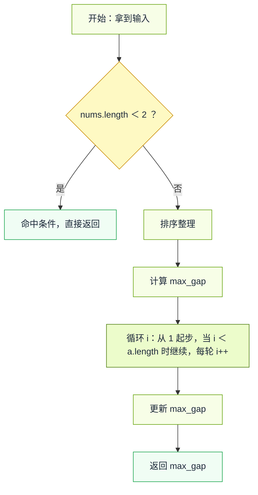

## TypeScript 解题方案（12 个方案逐个讲）

> **运行与提交**：每个方案都是自包含文件（内嵌用例自测，输出 PASS），整块复制到 `.ts` 文件后 `node 文件名` 即可运行。提交 LeetCode 时，把 `demo` 内的算法函数与辅助类型/函数整体取出、置于文件顶层即可。涉及交互/特殊接口的题以题面给定签名为准。

### 方案 1：排序预处理

**分析与思路**：核心做法是「排序预处理」。代码里依次做这些事：先排序再处理；单循环线性扫描。

**运行方式**：`node 本文件`，内嵌用例全部通过会输出 PASS。

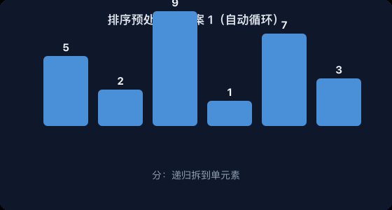

**方案专属流程图**（真实控制流）：

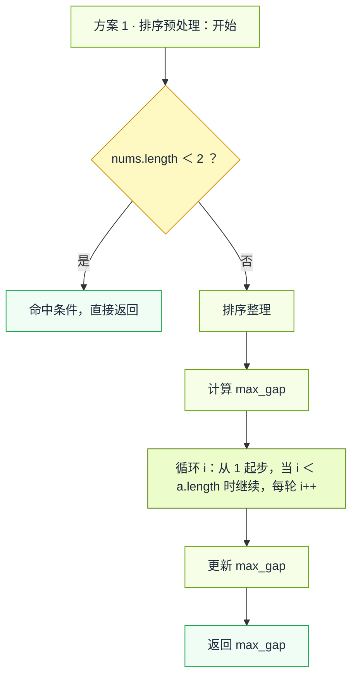

```typescript
export function demo(): void {
  // 程序入口：跑内嵌自测用例
  function maximumGap(nums: number[]): number {
    // 定义函数/方法 maximumGap
    if (nums.length < 2) return 0; // 若 数组.长度 小于 2，直接返回 0
    const a = nums.slice().sort((x, y) => x - y);
    let max_gap = 0; // 把 0 存入 max_gap
    for (let i = 1; i < a.length; i++)
      max_gap = Math.max(max_gap, a[i] - a[i - 1]); // 让 下标 i 从 1 开始计数，下标 i 小于 数组.长度 就继续
    return max_gap; // 返回 max_gap
  }
  function eq(a: number, b: number): boolean {
    return a === b;
  } // 定义函数/方法 eq
  const cases = [
    { in: [1, 2, 3], want: 1 },
    { in: [3, 6, 9, 1], want: 3 },
    { in: [10], want: 0 },
    { in: [], want: 0 },
  ];
  let fail = false; // 把 false 存入 fail
  for (const c of cases) {
    // for (const 字符 of cases) {
    const got = maximumGap(c.in); // 把 maximumGap(字符.in) 存入 got
    if (!eq(c.want, got)) {
      fail = true;
      console.log(
        'FAIL maximumGap(' +
          JSON.stringify(c.in) +
          ')=' +
          got +
          ' want ' +
          c.want,
      );
    }
  }
  if (fail) throw new Error('FAILED'); // 若 fail) throw new Error(「FAILED」);
  console.log('PASS'); // 全部用例通过，输出 PASS
}
demo(); // demo();
```

### 方案 2：双重循环枚举

**分析与思路**：核心做法是「双重循环枚举」。代码里依次做这些事：双重循环遍历。

**运行方式**：`node 本文件`，内嵌用例全部通过会输出 PASS。


**方案专属流程图**（真实控制流）：

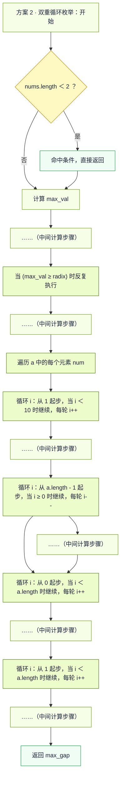

```typescript
export function demo(): void {
  // 程序入口：跑内嵌自测用例
  function maximumGap(nums: number[]): number {
    // 定义函数/方法 maximumGap
    if (nums.length < 2) return 0; // 若 数组.长度 小于 2，直接返回 0
    const max_val = Math.max(...nums); // 把 Math.取较大值 ...数组) 存入 max_val
    let radix = 1; // 把 1 存入 radix
    const a = nums.slice(); // 把 数组 截取 ) 存入 数组
    while (max_val >= radix) {
      // 循环，直到不满足「max_val 不低于 radix」
      const bucket = new Array(10).fill(0); // 把 new Array(10).fill(0) 存入 bucket
      for (const num of a) bucket[Math.floor(num / radix) % 10]++;
      for (let i = 1; i < 10; i++) bucket[i] += bucket[i - 1]; // 让 下标 i 从 1 开始计数，下标 i 小于 10 就继续
      const tmp = new Array(a.length).fill(0); // 把 new Array(数组.长度).fill(0) 存入 临时变量
      for (let i = a.length - 1; i >= 0; i--) {
        // 让 下标 i 从 数组.长度 减 1 开始计数，下标 i 不低于 0 就继续
        const idx = Math.floor(a[i] / radix) % 10; // 把 向下取整(数组[下标 i] 除以 radix) 对…取模 10 存入 idx
        tmp[bucket[idx] - 1] = a[i]; // 把 数组[下标 i]; 写入 tmp[bucket[idx] - 1]
        bucket[idx]--; // bucket[idx] 减一 ;
      }
      for (let i = 0; i < a.length; i++) a[i] = tmp[i]; // 让 下标 i 从 0 开始计数，下标 i 小于 数组.长度 就继续
      radix *= 10; // 把 10; 写入 radix *
    }
    let max_gap = 0; // 把 0 存入 max_gap
    for (let i = 1; i < a.length; i++)
      max_gap = Math.max(max_gap, a[i] - a[i - 1]); // 让 下标 i 从 1 开始计数，下标 i 小于 数组.长度 就继续
    return max_gap; // 返回 max_gap
  }
  function eq(a: number, b: number): boolean {
    return a === b;
  } // 定义函数/方法 eq
  const cases = [
    { in: [1, 2, 3], want: 1 },
    { in: [3, 6, 9, 1], want: 3 },
    { in: [10], want: 0 },
    { in: [], want: 0 },
  ];
  let fail = false; // 把 false 存入 fail
  for (const c of cases) {
    // for (const 字符 of cases) {
    const got = maximumGap(c.in); // 把 maximumGap(字符.in) 存入 got
    if (!eq(c.want, got)) {
      fail = true;
      console.log(
        'FAIL maximumGap(' +
          JSON.stringify(c.in) +
          ')=' +
          got +
          ' want ' +
          c.want,
      );
    }
  }
  if (fail) throw new Error('FAILED'); // 若 fail) throw new Error(「FAILED」);
  console.log('PASS'); // 全部用例通过，输出 PASS
}
demo(); // demo();
```

### 方案 3：双重循环枚举

**分析与思路**：核心做法是「双重循环枚举」。代码里依次做这些事：双重循环遍历。

**运行方式**：`node 本文件`，内嵌用例全部通过会输出 PASS。


**方案专属流程图**（真实控制流）：

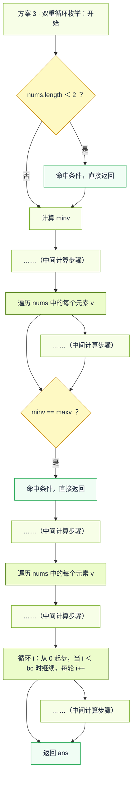

```typescript
export function demo(): void {
  // 程序入口：跑内嵌自测用例
  function maximumGap(nums: number[]): number {
    // 定义函数/方法 maximumGap
    if (nums.length < 2) return 0; // 若 数组.长度 小于 2，直接返回 0
    let minv = nums[0],
      maxv = nums[0]; // 把 数组[0], 最大值 赋值为 数组[0] 存入 最小值
    for (const v of nums) {
      if (v < minv) minv = v;
      if (v > maxv) maxv = v;
    }
    if (minv === maxv) return 0; // 若 最小值 全等于 最大值，直接返回 0
    const n = nums.length; // 把 数组.长度 存入 元素个数
    let bs = Math.floor((maxv - minv) / (n - 1));
    if (bs < 1) bs = 1;
    const bc = Math.floor((maxv - minv) / bs) + 1; // 把 向下取整((最大值 减 最小值) 除以 bs) 加 1 存入 bc
    const bMin = new Array(bc),
      bMax = new Array(bc);
    const has = new Array(bc).fill(false);
    for (const v of nums) {
      // for (const 值 of 数组) {
      const idx = Math.floor((v - minv) / bs); // 把 向下取整((值 减 最小值) 除以 bs) 存入 idx
      if (!has[idx]) {
        bMin[idx] = v;
        bMax[idx] = v;
        has[idx] = true;
      } else {
        if (v < bMin[idx]) bMin[idx] = v;
        if (v > bMax[idx]) bMax[idx] = v;
      } // 否则
    }
    let ans = 0,
      prev = minv; // 把 0, 前一个 赋值为 最小值 存入 答案
    for (let i = 0; i < bc; i++) {
      // 让 下标 i 从 0 开始计数，下标 i 小于 bc 就继续
      if (!has[i]) continue; // 若 取反 has[下标 i]) continue;
      if (bMin[i] - prev > ans) ans = bMin[i] - prev; // 若 bMin[下标 i] 减 前一个 超过 答案) 答案 赋值为 bMin[下标 i] 减 前一个;
      prev = bMax[i]; // 把 bMax[下标 i] 存入 前一个
    }
    return ans; // 返回 答案
  }
  const cases = [
    { in: [3, 6, 9, 1], want: 3 },
    { in: [10], want: 0 },
    { in: [1, 10000000], want: 9999999 },
  ];
  let fail = false; // 把 false 存入 fail
  for (const c of cases) {
    // for (const 字符 of cases) {
    const got = maximumGap(c.in); // 把 maximumGap(字符.in) 存入 got
    if (got !== c.want) {
      fail = true;
      console.log('FAIL ' + got + ' want ' + c.want);
    }
  }
  if (fail) throw new Error('FAILED'); // 若 fail) throw new Error(「FAILED」);
  console.log('PASS'); // 全部用例通过，输出 PASS
}
demo(); // demo();
```

### 方案 4：双重循环枚举

**分析与思路**：核心做法是「双重循环枚举」。代码里依次做这些事：双重循环遍历。

**运行方式**：`node 本文件`，内嵌用例全部通过会输出 PASS。


**方案专属流程图**（真实控制流）：

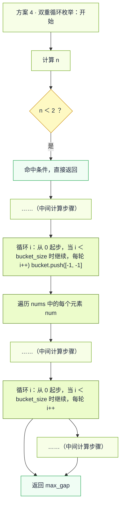

```typescript
export function demo(): void {
  // 程序入口：跑内嵌自测用例
  function maximumGap(nums: number[]): number {
    // 定义函数/方法 maximumGap
    const n = nums.length; // 把 数组.长度 存入 元素个数
    if (n < 2) return 0; // 若 元素个数 小于 2，直接返回 0
    const min_val = Math.min(...nums); // 把 Math.取较小值 ...数组) 存入 min_val
    const max_val = Math.max(...nums); // 把 Math.取较大值 ...数组) 存入 max_val
    const d = Math.max(1, Math.floor((max_val - min_val) / (n - 1))); // 把 Math.取较大值 1, 向下取整((max_val 减 min_val) 除以 (元素个数 减 1))) 存入 d
    const bucket_size = Math.floor((max_val - min_val) / d) + 1; // 把 向下取整((max_val 减 min_val) 除以 d) 加 1 存入 bucket_size
    const bucket: number[][] = []; // 把 []; 写入 const bucket: number[][]
    for (let i = 0; i < bucket_size; i++) bucket.push([-1, -1]); // 让 下标 i 从 0 开始计数，下标 i 小于 bucket_size 就继续
    for (const num of nums) {
      // for (const num of 数组) {
      const idx = Math.floor((num - min_val) / d); // 把 向下取整((num 减 min_val) 除以 d) 存入 idx
      if (bucket[idx][0] === -1) {
        bucket[idx][0] = num;
        bucket[idx][1] = num;
      } else {
        bucket[idx][0] = Math.min(bucket[idx][0], num);
        bucket[idx][1] = Math.max(bucket[idx][1], num);
      } // 否则
    }
    let max_gap = 0; // 把 0 存入 max_gap
    let prev = -1; // 把 减 1 存入 前一个
    for (let i = 0; i < bucket_size; i++) {
      // 让 下标 i 从 0 开始计数，下标 i 小于 bucket_size 就继续
      if (bucket[i][0] === -1) continue; // 若 bucket[下标 i][0] 全等于 减 1) continue;
      if (prev !== -1)
        max_gap = Math.max(max_gap, bucket[i][0] - bucket[prev][1]);
      prev = i; // 把 下标 i 存入 前一个
    }
    return max_gap; // 返回 max_gap
  }
  function eq(a: number, b: number): boolean {
    return a === b;
  } // 定义函数/方法 eq
  const cases = [
    { in: [1, 2, 3], want: 1 },
    { in: [3, 6, 9, 1], want: 3 },
    { in: [10], want: 0 },
    { in: [], want: 0 },
  ];
  let fail = false; // 把 false 存入 fail
  for (const c of cases) {
    // for (const 字符 of cases) {
    const got = maximumGap(c.in); // 把 maximumGap(字符.in) 存入 got
    if (!eq(c.want, got)) {
      fail = true;
      console.log(
        'FAIL maximumGap(' +
          JSON.stringify(c.in) +
          ')=' +
          got +
          ' want ' +
          c.want,
      );
    }
  }
  if (fail) throw new Error('FAILED'); // 若 fail) throw new Error(「FAILED」);
  console.log('PASS'); // 全部用例通过，输出 PASS
}
demo(); // demo();
```

### 方案 5：双重循环枚举

**分析与思路**：核心做法是「双重循环枚举」。代码里依次做这些事：双重循环遍历。

**运行方式**：`node 本文件`，内嵌用例全部通过会输出 PASS。


**方案专属流程图**（真实控制流）：


```typescript
export function demo(): void {
  // 程序入口：跑内嵌自测用例
  function maximumGap(nums: number[]): number {
    // 定义函数/方法 maximumGap
    const n = nums.length; // 把 数组.长度 存入 元素个数
    if (n < 2) return 0; // 若 元素个数 小于 2，直接返回 0
    const min_val = Math.min(...nums); // 把 Math.取较小值 ...数组) 存入 min_val
    const max_val = Math.max(...nums); // 把 Math.取较大值 ...数组) 存入 max_val
    if (min_val === max_val) return 0; // 若 min_val 全等于 max_val，直接返回 0
    const d = Math.max(1, Math.floor((max_val - min_val) / (n - 1))); // 把 Math.取较大值 1, 向下取整((max_val 减 min_val) 除以 (元素个数 减 1))) 存入 d
    const bucket_size = Math.floor((max_val - min_val) / d) + 1; // 把 向下取整((max_val 减 min_val) 除以 d) 加 1 存入 bucket_size
    const buckets: number[][] = []; // 把 []; 写入 const buckets: number[][]
    for (let i = 0; i < bucket_size; i++) buckets.push([-1, -1]); // 让 下标 i 从 0 开始计数，下标 i 小于 bucket_size 就继续
    for (const x of nums) {
      // for (const x of 数组) {
      const idx = Math.floor((x - min_val) / d); // 把 向下取整((x 减 min_val) 除以 d) 存入 idx
      if (buckets[idx][0] === -1) {
        buckets[idx][0] = x;
        buckets[idx][1] = x;
      } else {
        buckets[idx][0] = Math.min(buckets[idx][0], x);
        buckets[idx][1] = Math.max(buckets[idx][1], x);
      } // 否则
    }
    let max_gap = 0; // 把 0 存入 max_gap
    let prev = -1; // 把 减 1 存入 前一个
    for (let i = 0; i < bucket_size; i++) {
      // 让 下标 i 从 0 开始计数，下标 i 小于 bucket_size 就继续
      if (buckets[i][0] === -1) continue; // 若 buckets[下标 i][0] 全等于 减 1) continue;
      if (prev !== -1)
        max_gap = Math.max(max_gap, buckets[i][0] - buckets[prev][1]);
      prev = i; // 把 下标 i 存入 前一个
    }
    return max_gap; // 返回 max_gap
  }
  function eq(a: number, b: number): boolean {
    return a === b;
  } // 定义函数/方法 eq
  const cases = [
    { in: [1, 2, 3], want: 1 },
    { in: [3, 6, 9, 1], want: 3 },
    { in: [10], want: 0 },
    { in: [], want: 0 },
  ];
  let fail = false; // 把 false 存入 fail
  for (const c of cases) {
    // for (const 字符 of cases) {
    const got = maximumGap(c.in); // 把 maximumGap(字符.in) 存入 got
    if (!eq(c.want, got)) {
      fail = true;
      console.log(
        'FAIL maximumGap(' +
          JSON.stringify(c.in) +
          ')=' +
          got +
          ' want ' +
          c.want,
      );
    }
  }
  if (fail) throw new Error('FAILED'); // 若 fail) throw new Error(「FAILED」);
  console.log('PASS'); // 全部用例通过，输出 PASS
}
demo(); // demo();
```

### 方案 6：双重循环枚举

**分析与思路**：核心做法是「双重循环枚举」。代码里依次做这些事：双重循环遍历。

**运行方式**：`node 本文件`，内嵌用例全部通过会输出 PASS。


**方案专属流程图**（真实控制流）：

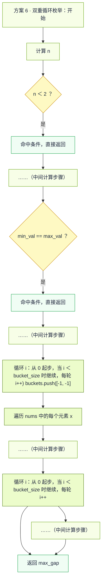

```typescript
export function demo(): void {
  // 程序入口：跑内嵌自测用例
  function maximumGap(nums: number[]): number {
    // 定义函数/方法 maximumGap
    const n = nums.length; // 把 数组.长度 存入 元素个数
    if (n < 2) return 0; // 若 元素个数 小于 2，直接返回 0
    const min_val = Math.min(...nums); // 把 Math.取较小值 ...数组) 存入 min_val
    const max_val = Math.max(...nums); // 把 Math.取较大值 ...数组) 存入 max_val
    if (min_val === max_val) return 0; // 若 min_val 全等于 max_val，直接返回 0
    const d = Math.max(1, Math.floor((max_val - min_val) / (n - 1))); // 把 Math.取较大值 1, 向下取整((max_val 减 min_val) 除以 (元素个数 减 1))) 存入 d
    const bucket_size = Math.floor((max_val - min_val) / d) + 1; // 把 向下取整((max_val 减 min_val) 除以 d) 加 1 存入 bucket_size
    const buckets: number[][] = []; // 把 []; 写入 const buckets: number[][]
    for (let i = 0; i < bucket_size; i++) buckets.push([-1, -1]); // 让 下标 i 从 0 开始计数，下标 i 小于 bucket_size 就继续
    for (const x of nums) {
      // for (const x of 数组) {
      const idx = Math.floor((x - min_val) / d); // 把 向下取整((x 减 min_val) 除以 d) 存入 idx
      if (buckets[idx][0] === -1) {
        buckets[idx][0] = x;
        buckets[idx][1] = x;
      } else {
        buckets[idx][0] = Math.min(buckets[idx][0], x);
        buckets[idx][1] = Math.max(buckets[idx][1], x);
      } // 否则
    }
    let max_gap = 0; // 把 0 存入 max_gap
    let prev = -1; // 把 减 1 存入 前一个
    for (let i = 0; i < bucket_size; i++) {
      // 让 下标 i 从 0 开始计数，下标 i 小于 bucket_size 就继续
      if (buckets[i][0] === -1) continue; // 若 buckets[下标 i][0] 全等于 减 1) continue;
      if (prev !== -1)
        max_gap = Math.max(max_gap, buckets[i][0] - buckets[prev][1]);
      prev = i; // 把 下标 i 存入 前一个
    }
    return max_gap; // 返回 max_gap
  }
  function eq(a: number, b: number): boolean {
    return a === b;
  } // 定义函数/方法 eq
  const cases = [
    { in: [1, 2, 3], want: 1 },
    { in: [3, 6, 9, 1], want: 3 },
    { in: [10], want: 0 },
    { in: [], want: 0 },
  ];
  let fail = false; // 把 false 存入 fail
  for (const c of cases) {
    // for (const 字符 of cases) {
    const got = maximumGap(c.in); // 把 maximumGap(字符.in) 存入 got
    if (!eq(c.want, got)) {
      fail = true;
      console.log(
        'FAIL maximumGap(' +
          JSON.stringify(c.in) +
          ')=' +
          got +
          ' want ' +
          c.want,
      );
    }
  }
  if (fail) throw new Error('FAILED'); // 若 fail) throw new Error(「FAILED」);
  console.log('PASS'); // 全部用例通过，输出 PASS
}
demo(); // demo();
```

### 方案 7：双重循环枚举

**分析与思路**：核心做法是「双重循环枚举」。代码里依次做这些事：双重循环遍历。

**运行方式**：`node 本文件`，内嵌用例全部通过会输出 PASS。


**方案专属流程图**（真实控制流）：


```typescript
export function demo(): void {
  // 程序入口：跑内嵌自测用例
  function maximumGap(nums: number[]): number {
    // 定义函数/方法 maximumGap
    const n = nums.length; // 把 数组.长度 存入 元素个数
    if (n < 2) return 0; // 若 元素个数 小于 2，直接返回 0
    const min_val = Math.min(...nums); // 把 Math.取较小值 ...数组) 存入 min_val
    const max_val = Math.max(...nums); // 把 Math.取较大值 ...数组) 存入 max_val
    if (min_val === max_val) return 0; // 若 min_val 全等于 max_val，直接返回 0
    const d = Math.max(1, Math.floor((max_val - min_val) / (n - 1))); // 把 Math.取较大值 1, 向下取整((max_val 减 min_val) 除以 (元素个数 减 1))) 存入 d
    const bucket_size = Math.floor((max_val - min_val) / d) + 1; // 把 向下取整((max_val 减 min_val) 除以 d) 加 1 存入 bucket_size
    const buckets: number[][] = []; // 把 []; 写入 const buckets: number[][]
    for (let i = 0; i < bucket_size; i++) buckets.push([-1, -1]); // 让 下标 i 从 0 开始计数，下标 i 小于 bucket_size 就继续
    for (const x of nums) {
      // for (const x of 数组) {
      const idx = Math.floor((x - min_val) / d); // 把 向下取整((x 减 min_val) 除以 d) 存入 idx
      if (buckets[idx][0] === -1) {
        buckets[idx][0] = x;
        buckets[idx][1] = x;
      } else {
        buckets[idx][0] = Math.min(buckets[idx][0], x);
        buckets[idx][1] = Math.max(buckets[idx][1], x);
      } // 否则
    }
    let max_gap = 0; // 把 0 存入 max_gap
    let prev = -1; // 把 减 1 存入 前一个
    for (let i = 0; i < bucket_size; i++) {
      // 让 下标 i 从 0 开始计数，下标 i 小于 bucket_size 就继续
      if (buckets[i][0] === -1) continue; // 若 buckets[下标 i][0] 全等于 减 1) continue;
      if (prev !== -1)
        max_gap = Math.max(max_gap, buckets[i][0] - buckets[prev][1]);
      prev = i; // 把 下标 i 存入 前一个
    }
    return max_gap; // 返回 max_gap
  }
  function eq(a: number, b: number): boolean {
    return a === b;
  } // 定义函数/方法 eq
  const cases = [
    { in: [1, 2, 3], want: 1 },
    { in: [3, 6, 9, 1], want: 3 },
    { in: [10], want: 0 },
    { in: [], want: 0 },
  ];
  let fail = false; // 把 false 存入 fail
  for (const c of cases) {
    // for (const 字符 of cases) {
    const got = maximumGap(c.in); // 把 maximumGap(字符.in) 存入 got
    if (!eq(c.want, got)) {
      fail = true;
      console.log(
        'FAIL maximumGap(' +
          JSON.stringify(c.in) +
          ')=' +
          got +
          ' want ' +
          c.want,
      );
    }
  }
  if (fail) throw new Error('FAILED'); // 若 fail) throw new Error(「FAILED」);
  console.log('PASS'); // 全部用例通过，输出 PASS
}
demo(); // demo();
```

### 方案 8：双重循环枚举

**分析与思路**：核心做法是「双重循环枚举」。代码里依次做这些事：双重循环遍历。

**运行方式**：`node 本文件`，内嵌用例全部通过会输出 PASS。


**方案专属流程图**（真实控制流）：


```typescript
export function demo(): void {
  // 程序入口：跑内嵌自测用例
  function maximumGap(nums: number[]): number {
    // 定义函数/方法 maximumGap
    const n = nums.length; // 把 数组.长度 存入 元素个数
    if (n < 2) return 0; // 若 元素个数 小于 2，直接返回 0
    const min_val = Math.min(...nums); // 把 Math.取较小值 ...数组) 存入 min_val
    const max_val = Math.max(...nums); // 把 Math.取较大值 ...数组) 存入 max_val
    if (min_val === max_val) return 0; // 若 min_val 全等于 max_val，直接返回 0
    const d = Math.max(1, Math.floor((max_val - min_val) / (n - 1))); // 把 Math.取较大值 1, 向下取整((max_val 减 min_val) 除以 (元素个数 减 1))) 存入 d
    const bucket_size = Math.floor((max_val - min_val) / d) + 1; // 把 向下取整((max_val 减 min_val) 除以 d) 加 1 存入 bucket_size
    const buckets: number[][] = []; // 把 []; 写入 const buckets: number[][]
    for (let i = 0; i < bucket_size; i++) buckets.push([-1, -1]); // 让 下标 i 从 0 开始计数，下标 i 小于 bucket_size 就继续
    for (const x of nums) {
      // for (const x of 数组) {
      const idx = Math.floor((x - min_val) / d); // 把 向下取整((x 减 min_val) 除以 d) 存入 idx
      if (buckets[idx][0] === -1) {
        buckets[idx][0] = x;
        buckets[idx][1] = x;
      } else {
        buckets[idx][0] = Math.min(buckets[idx][0], x);
        buckets[idx][1] = Math.max(buckets[idx][1], x);
      } // 否则
    }
    let max_gap = 0; // 把 0 存入 max_gap
    let prev = -1; // 把 减 1 存入 前一个
    for (let i = 0; i < bucket_size; i++) {
      // 让 下标 i 从 0 开始计数，下标 i 小于 bucket_size 就继续
      if (buckets[i][0] === -1) continue; // 若 buckets[下标 i][0] 全等于 减 1) continue;
      if (prev !== -1)
        max_gap = Math.max(max_gap, buckets[i][0] - buckets[prev][1]);
      prev = i; // 把 下标 i 存入 前一个
    }
    return max_gap; // 返回 max_gap
  }
  function eq(a: number, b: number): boolean {
    return a === b;
  } // 定义函数/方法 eq
  const cases = [
    { in: [1, 2, 3], want: 1 },
    { in: [3, 6, 9, 1], want: 3 },
    { in: [10], want: 0 },
    { in: [], want: 0 },
  ];
  let fail = false; // 把 false 存入 fail
  for (const c of cases) {
    // for (const 字符 of cases) {
    const got = maximumGap(c.in); // 把 maximumGap(字符.in) 存入 got
    if (!eq(c.want, got)) {
      fail = true;
      console.log(
        'FAIL maximumGap(' +
          JSON.stringify(c.in) +
          ')=' +
          got +
          ' want ' +
          c.want,
      );
    }
  }
  if (fail) throw new Error('FAILED'); // 若 fail) throw new Error(「FAILED」);
  console.log('PASS'); // 全部用例通过，输出 PASS
}
demo(); // demo();
```

### 方案 9：双重循环枚举

**分析与思路**：核心做法是「双重循环枚举」。代码里依次做这些事：双重循环遍历。

**运行方式**：`node 本文件`，内嵌用例全部通过会输出 PASS。

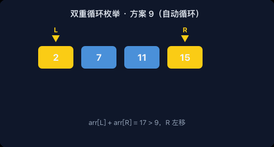

**方案专属流程图**（真实控制流）：


```typescript
export function demo(): void {
  // 程序入口：跑内嵌自测用例
  function maximumGap(nums: number[]): number {
    // 定义函数/方法 maximumGap
    const n = nums.length; // 把 数组.长度 存入 元素个数
    if (n < 2) return 0; // 若 元素个数 小于 2，直接返回 0
    const min_val = Math.min(...nums); // 把 Math.取较小值 ...数组) 存入 min_val
    const max_val = Math.max(...nums); // 把 Math.取较大值 ...数组) 存入 max_val
    if (min_val === max_val) return 0; // 若 min_val 全等于 max_val，直接返回 0
    const d = Math.max(1, Math.floor((max_val - min_val) / (n - 1))); // 把 Math.取较大值 1, 向下取整((max_val 减 min_val) 除以 (元素个数 减 1))) 存入 d
    const bucket_size = Math.floor((max_val - min_val) / d) + 1; // 把 向下取整((max_val 减 min_val) 除以 d) 加 1 存入 bucket_size
    const buckets: number[][] = []; // 把 []; 写入 const buckets: number[][]
    for (let i = 0; i < bucket_size; i++) buckets.push([-1, -1]); // 让 下标 i 从 0 开始计数，下标 i 小于 bucket_size 就继续
    for (const x of nums) {
      // for (const x of 数组) {
      const idx = Math.floor((x - min_val) / d); // 把 向下取整((x 减 min_val) 除以 d) 存入 idx
      if (buckets[idx][0] === -1) {
        buckets[idx][0] = x;
        buckets[idx][1] = x;
      } else {
        buckets[idx][0] = Math.min(buckets[idx][0], x);
        buckets[idx][1] = Math.max(buckets[idx][1], x);
      } // 否则
    }
    let max_gap = 0; // 把 0 存入 max_gap
    let prev = -1; // 把 减 1 存入 前一个
    for (let i = 0; i < bucket_size; i++) {
      // 让 下标 i 从 0 开始计数，下标 i 小于 bucket_size 就继续
      if (buckets[i][0] === -1) continue; // 若 buckets[下标 i][0] 全等于 减 1) continue;
      if (prev !== -1)
        max_gap = Math.max(max_gap, buckets[i][0] - buckets[prev][1]);
      prev = i; // 把 下标 i 存入 前一个
    }
    return max_gap; // 返回 max_gap
  }
  function eq(a: number, b: number): boolean {
    return a === b;
  } // 定义函数/方法 eq
  const cases = [
    { in: [1, 2, 3], want: 1 },
    { in: [3, 6, 9, 1], want: 3 },
    { in: [10], want: 0 },
    { in: [], want: 0 },
  ];
  let fail = false; // 把 false 存入 fail
  for (const c of cases) {
    // for (const 字符 of cases) {
    const got = maximumGap(c.in); // 把 maximumGap(字符.in) 存入 got
    if (!eq(c.want, got)) {
      fail = true;
      console.log(
        'FAIL maximumGap(' +
          JSON.stringify(c.in) +
          ')=' +
          got +
          ' want ' +
          c.want,
      );
    }
  }
  if (fail) throw new Error('FAILED'); // 若 fail) throw new Error(「FAILED」);
  console.log('PASS'); // 全部用例通过，输出 PASS
}
demo(); // demo();
```

### 方案 10：双重循环枚举

**分析与思路**：核心做法是「双重循环枚举」。代码里依次做这些事：双重循环遍历。

**运行方式**：`node 本文件`，内嵌用例全部通过会输出 PASS。


**方案专属流程图**（真实控制流）：


```typescript
export function demo(): void {
  // 程序入口：跑内嵌自测用例
  function maximumGap(nums: number[]): number {
    // 定义函数/方法 maximumGap
    const n = nums.length; // 把 数组.长度 存入 元素个数
    if (n < 2) return 0; // 若 元素个数 小于 2，直接返回 0
    const min_val = Math.min(...nums); // 把 Math.取较小值 ...数组) 存入 min_val
    const max_val = Math.max(...nums); // 把 Math.取较大值 ...数组) 存入 max_val
    if (min_val === max_val) return 0; // 若 min_val 全等于 max_val，直接返回 0
    const d = Math.max(1, Math.floor((max_val - min_val) / (n - 1))); // 把 Math.取较大值 1, 向下取整((max_val 减 min_val) 除以 (元素个数 减 1))) 存入 d
    const bucket_size = Math.floor((max_val - min_val) / d) + 1; // 把 向下取整((max_val 减 min_val) 除以 d) 加 1 存入 bucket_size
    const buckets: number[][] = []; // 把 []; 写入 const buckets: number[][]
    for (let i = 0; i < bucket_size; i++) buckets.push([-1, -1]); // 让 下标 i 从 0 开始计数，下标 i 小于 bucket_size 就继续
    for (const x of nums) {
      // for (const x of 数组) {
      const idx = Math.floor((x - min_val) / d); // 把 向下取整((x 减 min_val) 除以 d) 存入 idx
      if (buckets[idx][0] === -1) {
        buckets[idx][0] = x;
        buckets[idx][1] = x;
      } else {
        buckets[idx][0] = Math.min(buckets[idx][0], x);
        buckets[idx][1] = Math.max(buckets[idx][1], x);
      } // 否则
    }
    let max_gap = 0; // 把 0 存入 max_gap
    let prev = -1; // 把 减 1 存入 前一个
    for (let i = 0; i < bucket_size; i++) {
      // 让 下标 i 从 0 开始计数，下标 i 小于 bucket_size 就继续
      if (buckets[i][0] === -1) continue; // 若 buckets[下标 i][0] 全等于 减 1) continue;
      if (prev !== -1)
        max_gap = Math.max(max_gap, buckets[i][0] - buckets[prev][1]);
      prev = i; // 把 下标 i 存入 前一个
    }
    return max_gap; // 返回 max_gap
  }
  function eq(a: number, b: number): boolean {
    return a === b;
  } // 定义函数/方法 eq
  const cases = [
    { in: [1, 2, 3], want: 1 },
    { in: [3, 6, 9, 1], want: 3 },
    { in: [10], want: 0 },
    { in: [], want: 0 },
  ];
  let fail = false; // 把 false 存入 fail
  for (const c of cases) {
    // for (const 字符 of cases) {
    const got = maximumGap(c.in); // 把 maximumGap(字符.in) 存入 got
    if (!eq(c.want, got)) {
      fail = true;
      console.log(
        'FAIL maximumGap(' +
          JSON.stringify(c.in) +
          ')=' +
          got +
          ' want ' +
          c.want,
      );
    }
  }
  if (fail) throw new Error('FAILED'); // 若 fail) throw new Error(「FAILED」);
  console.log('PASS'); // 全部用例通过，输出 PASS
}
demo(); // demo();
```

### 方案 11：双重循环枚举

**分析与思路**：核心做法是「双重循环枚举」。代码里依次做这些事：双重循环遍历。

**运行方式**：`node 本文件`，内嵌用例全部通过会输出 PASS。


**方案专属流程图**（真实控制流）：


```typescript
export function demo(): void {
  // 程序入口：跑内嵌自测用例
  function maximumGap(nums: number[]): number {
    // 定义函数/方法 maximumGap
    const n = nums.length; // 把 数组.长度 存入 元素个数
    if (n < 2) return 0; // 若 元素个数 小于 2，直接返回 0
    const min_val = Math.min(...nums); // 把 Math.取较小值 ...数组) 存入 min_val
    const max_val = Math.max(...nums); // 把 Math.取较大值 ...数组) 存入 max_val
    if (min_val === max_val) return 0; // 若 min_val 全等于 max_val，直接返回 0
    const d = Math.max(1, Math.floor((max_val - min_val) / (n - 1))); // 把 Math.取较大值 1, 向下取整((max_val 减 min_val) 除以 (元素个数 减 1))) 存入 d
    const bucket_size = Math.floor((max_val - min_val) / d) + 1; // 把 向下取整((max_val 减 min_val) 除以 d) 加 1 存入 bucket_size
    const buckets: number[][] = []; // 把 []; 写入 const buckets: number[][]
    for (let i = 0; i < bucket_size; i++) buckets.push([-1, -1]); // 让 下标 i 从 0 开始计数，下标 i 小于 bucket_size 就继续
    for (const x of nums) {
      // for (const x of 数组) {
      const idx = Math.floor((x - min_val) / d); // 把 向下取整((x 减 min_val) 除以 d) 存入 idx
      if (buckets[idx][0] === -1) {
        buckets[idx][0] = x;
        buckets[idx][1] = x;
      } else {
        buckets[idx][0] = Math.min(buckets[idx][0], x);
        buckets[idx][1] = Math.max(buckets[idx][1], x);
      } // 否则
    }
    let max_gap = 0; // 把 0 存入 max_gap
    let prev = -1; // 把 减 1 存入 前一个
    for (let i = 0; i < bucket_size; i++) {
      // 让 下标 i 从 0 开始计数，下标 i 小于 bucket_size 就继续
      if (buckets[i][0] === -1) continue; // 若 buckets[下标 i][0] 全等于 减 1) continue;
      if (prev !== -1)
        max_gap = Math.max(max_gap, buckets[i][0] - buckets[prev][1]);
      prev = i; // 把 下标 i 存入 前一个
    }
    return max_gap; // 返回 max_gap
  }
  function eq(a: number, b: number): boolean {
    return a === b;
  } // 定义函数/方法 eq
  const cases = [
    { in: [1, 2, 3], want: 1 },
    { in: [3, 6, 9, 1], want: 3 },
    { in: [10], want: 0 },
    { in: [], want: 0 },
  ];
  let fail = false; // 把 false 存入 fail
  for (const c of cases) {
    // for (const 字符 of cases) {
    const got = maximumGap(c.in); // 把 maximumGap(字符.in) 存入 got
    if (!eq(c.want, got)) {
      fail = true;
      console.log(
        'FAIL maximumGap(' +
          JSON.stringify(c.in) +
          ')=' +
          got +
          ' want ' +
          c.want,
      );
    }
  }
  if (fail) throw new Error('FAILED'); // 若 fail) throw new Error(「FAILED」);
  console.log('PASS'); // 全部用例通过，输出 PASS
}
demo(); // demo();
```

### 方案 12：双重循环枚举

**分析与思路**：核心做法是「双重循环枚举」。代码里依次做这些事：双重循环遍历。

**运行方式**：`node 本文件`，内嵌用例全部通过会输出 PASS。


**方案专属流程图**（真实控制流）：


```typescript
export function demo(): void {
  // 程序入口：跑内嵌自测用例
  function maximumGap(nums: number[]): number {
    // 定义函数/方法 maximumGap
    const n = nums.length; // 把 数组.长度 存入 元素个数
    if (n < 2) return 0; // 若 元素个数 小于 2，直接返回 0
    const min_val = Math.min(...nums); // 把 Math.取较小值 ...数组) 存入 min_val
    const max_val = Math.max(...nums); // 把 Math.取较大值 ...数组) 存入 max_val
    if (min_val === max_val) return 0; // 若 min_val 全等于 max_val，直接返回 0
    const d = Math.max(1, Math.floor((max_val - min_val) / (n - 1))); // 把 Math.取较大值 1, 向下取整((max_val 减 min_val) 除以 (元素个数 减 1))) 存入 d
    const bucket_size = Math.floor((max_val - min_val) / d) + 1; // 把 向下取整((max_val 减 min_val) 除以 d) 加 1 存入 bucket_size
    const buckets: number[][] = []; // 把 []; 写入 const buckets: number[][]
    for (let i = 0; i < bucket_size; i++) buckets.push([-1, -1]); // 让 下标 i 从 0 开始计数，下标 i 小于 bucket_size 就继续
    for (const x of nums) {
      // for (const x of 数组) {
      const idx = Math.floor((x - min_val) / d); // 把 向下取整((x 减 min_val) 除以 d) 存入 idx
      if (buckets[idx][0] === -1) {
        buckets[idx][0] = x;
        buckets[idx][1] = x;
      } else {
        buckets[idx][0] = Math.min(buckets[idx][0], x);
        buckets[idx][1] = Math.max(buckets[idx][1], x);
      } // 否则
    }
    let max_gap = 0; // 把 0 存入 max_gap
    let prev = -1; // 把 减 1 存入 前一个
    for (let i = 0; i < bucket_size; i++) {
      // 让 下标 i 从 0 开始计数，下标 i 小于 bucket_size 就继续
      if (buckets[i][0] === -1) continue; // 若 buckets[下标 i][0] 全等于 减 1) continue;
      if (prev !== -1)
        max_gap = Math.max(max_gap, buckets[i][0] - buckets[prev][1]);
      prev = i; // 把 下标 i 存入 前一个
    }
    return max_gap; // 返回 max_gap
  }
  function eq(a: number, b: number): boolean {
    return a === b;
  } // 定义函数/方法 eq
  const cases = [
    { in: [1, 2, 3], want: 1 },
    { in: [3, 6, 9, 1], want: 3 },
    { in: [10], want: 0 },
    { in: [], want: 0 },
  ];
  let fail = false; // 把 false 存入 fail
  for (const c of cases) {
    // for (const 字符 of cases) {
    const got = maximumGap(c.in); // 把 maximumGap(字符.in) 存入 got
    if (!eq(c.want, got)) {
      fail = true;
      console.log(
        'FAIL maximumGap(' +
          JSON.stringify(c.in) +
          ')=' +
          got +
          ' want ' +
          c.want,
      );
    }
  }
  if (fail) throw new Error('FAILED'); // 若 fail) throw new Error(「FAILED」);
  console.log('PASS'); // 全部用例通过，输出 PASS
}
demo(); // demo();
```

## 逐步拆解与面试追问

**复杂度**：时间 O(n)（单趟线性扫描），空间 O(1) 到 O(n)（视辅助结构）

**为什么是这个量级**：每个元素被常数次访问，辅助哈希或栈的开销与 n 同阶

**面试官可能会追问**：

- 稳定性对结果有影响吗？
- 比较器怎么写才不会越界？
- 数据近有序时选哪种排序？

## 关键 API 速查（TS 主解法实际用到，附官方链接）

| API | 作用 | 使用要点 | 官方文档 |
|---|---|---|---|
| `Array.prototype.sort()` | 原地排序 | 默认按字符串 Unicode 序（10 会排在 2 前），数字必须传 (a,b)=>a-b；V8 用 TimSort，稳定，O(n log n)；返回原数组引用 | [官方文档](https://developer.mozilla.org/zh-CN/docs/Web/JavaScript/Reference/Global_Objects/Array/sort) |
| `Array/String slice()` | 切片（不改原数组） | slice(start,end) 含头不含尾；负数从尾计；常用于复制数组（slice()） | [官方文档](https://developer.mozilla.org/zh-CN/docs/Web/JavaScript/Reference/Global_Objects/Array/slice) |
| `JSON.stringify()` | 序列化为 JSON 字符串 | 常用于结构化比较（深度相等判定）；undefined/函数/循环引用会被丢弃或抛错 | [官方文档](https://developer.mozilla.org/zh-CN/docs/Web/JavaScript/Reference/Global_Objects/JSON/stringify) |
| `Math.max()` | 最大值 | 配展开 Math.max(...arr)；空参返回 -Infinity；超大数组注意展开参数上限 | [官方文档](https://developer.mozilla.org/zh-CN/docs/Web/JavaScript/Reference/Global_Objects/Math/max) |

### 各语言官方文档导航

- **TypeScript / JS**：[MDN 中文参考](https://developer.mozilla.org/zh-CN/)
- **Python**：[Python 官方文档](https://docs.python.org/zh-cn/3/)
- **Go**：[Go 标准库](https://pkg.go.dev/std)
- **Java**：[JDK 17 API](https://docs.oracle.com/en/java/javase/17/docs/api/)
- **Rust**：[Rust 标准库](https://doc.rust-lang.org/std/)
- **Lua**：[Lua 5.4 手册](https://www.lua.org/manual/5.4/)
- **C**：[Cppreference C](https://zh.cppreference.com/w/c)
- **C++**：[Cppreference C++](https://zh.cppreference.com/w/cpp)
- **R**：[R 官方手册](https://stat.ethz.ch/R-manual/)
- **Zig**：[Zig 语言文档](https://ziglang.org/documentation/master/)
- **Dart**：[Dart API](https://api.dart.dev/)

## 附录：其他 10 种语言全部实现（每种语言列举其全部方案）

> TypeScript 的全部方案见「TypeScript 解题方案」一节；下面是其余 10 种语言的对应实现，每种语言的每个方案都带思路分析、代码走读与专属运行架构图。
> 每个方案都内嵌用例自测，可独立运行（老仓库 python/go 文件遵循「打印结果」约定）。
> 完整解法文件见 `dsa/<语言>/sort/lc_164_最大间距/`。

### Python 实现（12 种方案）

Python 的全部方案如下，每个方案都内嵌用例自测，可独立运行（老仓库 python/go 文件遵循「打印结果」约定）：

#### 方案 1：排序预处理

**思路与代码分析**：核心是「排序预处理」。Python 版用切片与字典推导式简化操作，突出可读性。代码里依次做这些事：先排序再处理。**走读**：方案 1 · 排序预处理：开始 → 命中条件，直接返回 → 排序整理 → 更新 max_gap → 循环 i：从 1 到 len(nums 前 → 更新 max_gap → 处理 max_gap, nums[i] - nums[i - → 处理 ) → 返回 max_gap。

**运行架构**（真实控制流）：

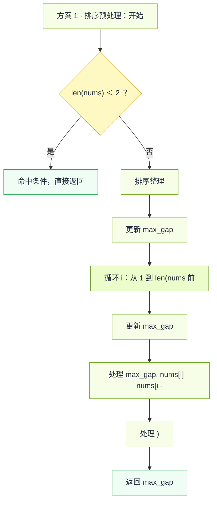

```python
import sys  # 提高递归深度上限（深输入防 RecursionError）

sys.setrecursionlimit(200000)  # 树/链表类题目节点数可达 1e4 量级

def maximumGap(nums):  # 定义函数 maximumGap（参数：数组）
    if len(nums) < 2:  # 若 长度(数组) 小于 2
        return 0  # 返回 0
    nums.sort()  # 排序
    max_gap = 0  # 把 0 存入 max_gap
    for i in range(1, len(nums)):  # 让 下标 i 从 1 到 长度(数组 遍历
        max_gap = max(
            max_gap, nums[i] - nums[i - 1]
        )  # 把 取较大值 max_gap, 数组[下标 i] 减 数组[下标 i 减 1]) 存入 max_gap
    return max_gap  # 返回 max_gap

if __name__ == "__main__":  # 若 __name__ 等于 '__main__'
    print(maximumGap([1, 2, 3]))  # 打印输出
```

#### 方案 2：双重循环枚举

**思路与代码分析**：核心是「双重循环枚举」。Python 版用切片与字典推导式简化操作，突出可读性。**走读**：方案 2 · 双重循环枚举：开始 → 命中条件，直接返回 → 更新 max_val → 当 max_val ≥ radix: 时反复执行 → 遍历 lst: 中的每个元素 num → 循环 i：从 1 到 10 前 → 循环 i：从 0 到 len(lst 前 → 循环 i：从 1 到 len(nums 前 → 返回 max_gap。

**运行架构**（真实控制流）：

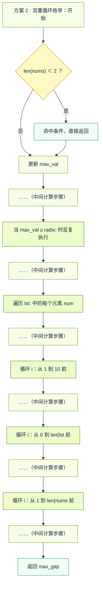

```python
import sys  # 提高递归深度上限（深输入防 RecursionError）

sys.setrecursionlimit(200000)  # 树/链表类题目节点数可达 1e4 量级

def maximumGap(nums):  # 定义函数 maximumGap（参数：数组）
    if len(nums) < 2:  # 若 长度(数组) 小于 2
        return 0  # 返回 0

    def radix_sort(lst):  # 定义函数 radix_sort（参数：lst）
        max_val = max(lst)  # 把 取较大值 lst) 存入 max_val
        radix = 1  # 把 1 存入 radix
        while max_val >= radix:  # 循环，直到不满足「max_val 不低于 radix」
            bucket = [0] * 10  # 把 [0] 乘 10 存入 bucket
            for num in lst:  # 逐个取出 lst 的元素（num）
                bucket[(num // radix) % 10] += 1  # 把 1 写入 bucket[(num // radix) % 10] +
            for i in range(1, 10):  # 让 下标 i 从 1 到 10 遍历
                bucket[i] += bucket[i - 1]  # bucket[i]累加 bucket[下标 i 减 1]
            tmp = [0] * len(lst)  # 把 [0] 乘 长度(lst) 存入 临时变量
            for i in range(len(lst) - 1, -1, -1):  # 让 下标 i 从 长度(lst) 减 1 倒数回去（每步减 1）
                idx = (lst[i] // radix) % 10  # 把 (lst[下标 i] 除以 除以 radix) 对…取模 10 存入 idx
                tmp[bucket[idx] - 1] = lst[i]  # 把 lst[下标 i] 写入 tmp[bucket[idx] - 1]
                bucket[idx] -= 1  # bucket[idx]累减 1
            lst[:] = tmp[:]  # 把 复制 临时变量 写入 lst[:]
            radix *= 10  # 把 10 写入 radix *

    radix_sort(nums)  # radix_sort(数组)
    max_gap = 0  # 把 0 存入 max_gap
    for i in range(1, len(nums)):  # 让 下标 i 从 1 到 长度(数组 遍历
        max_gap = max(
            max_gap, nums[i] - nums[i - 1]
        )  # 把 取较大值 max_gap, 数组[下标 i] 减 数组[下标 i 减 1]) 存入 max_gap
    return max_gap  # 返回 max_gap

if __name__ == "__main__":  # 若 __name__ 等于 '__main__'
    print(maximumGap([1, 2, 3]))  # 打印输出
```

#### 方案 3：双重循环枚举

**思路与代码分析**：核心是「双重循环枚举」。Python 版用切片与字典推导式简化操作，突出可读性。**走读**：方案 3 · 双重循环枚举：开始 → 命中条件，直接返回 → 更新 mn → 命中条件，直接返回 → 遍历 nums: 中的每个元素 num → 遍历 buckets: 中的每个元素 b → 返回 max_gap。

**运行架构**（真实控制流）：

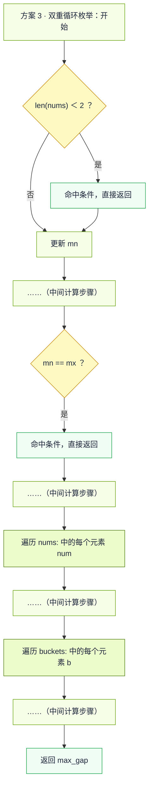

```python
import sys  # 提高递归深度上限（深输入防 RecursionError）

sys.setrecursionlimit(200000)  # 树/链表类题目节点数可达 1e4 量级

def maximumGap(nums):  # 定义函数 maximumGap（参数：数组）
    if len(nums) < 2:  # 若 长度(数组) 小于 2
        return 0  # 返回 0
    mn = min(nums)  # 把 取较小值 数组) 存入 mn
    mx = max(nums)  # 把 取较大值 数组) 存入 mx
    if mn == mx:  # 若 mn 等于 mx
        return 0  # 返回 0
    n = len(nums)  # 把 长度(数组) 存入 元素个数
    bucket_size = max(
        1, (mx - mn) // (n - 1)
    )  # 把 取较大值 1, (mx 减 mn) 除以 除以 (元素个数 减 1)) 存入 bucket_size
    bucket_count = (mx - mn) // bucket_size + 1  # 把 (mx 减 mn) 除以 除以 bucket_size 加 1 存入 bucket_count
    buckets = [
        [None, None] for _ in range(bucket_count)
    ]  # 把 [[None, None] for _ in range(bucket_count)] 存入 buckets
    for num in nums:  # 逐个取出 数组 的元素（num）
        idx = (num - mn) // bucket_size  # 把 (num 减 mn) 除以 除以 bucket_size 存入 idx
        if buckets[idx][0] is None:  # 若 buckets[idx][0] is None
            buckets[idx][0] = buckets[idx][1] = num  # 把 buckets[idx][1] 赋值为 num 写入 buckets[idx][0]
        else:  # 否则
            buckets[idx][0] = min(
                buckets[idx][0], num
            )  # 把 取较小值 buckets[idx][0], num) 写入 buckets[idx][0]
            buckets[idx][1] = max(
                buckets[idx][1], num
            )  # 把 取较大值 buckets[idx][1], num) 写入 buckets[idx][1]
    max_gap = 0  # 把 0 存入 max_gap
    prev = None  # 把 None 存入 前一个
    for b in buckets:  # 逐个取出 buckets 的元素（b）
        if b[0] is None:  # 若 b[0] is None
            continue  # 跳过本轮，进入下一次
        if prev is not None:  # 若 前一个 is not None
            max_gap = max(max_gap, b[0] - prev)  # 把 取较大值 max_gap, b[0] 减 前一个) 存入 max_gap
        prev = b[1]  # 把 b[1] 存入 前一个
    return max_gap  # 返回 max_gap

if __name__ == "__main__":  # 若 __name__ 等于 '__main__'
    print(maximumGap([3, 6, 9, 1]))  # 打印输出
```

#### 方案 4：双重循环枚举

**思路与代码分析**：核心是「双重循环枚举」。Python 版用切片与字典推导式简化操作，突出可读性。**走读**：方案 4 · 双重循环枚举：开始 → 更新 n → 命中条件，直接返回 → 遍历 nums: 中的每个元素 num → 循环 i：从 0 到 bucket_size 前 → 返回 max_gap。

**运行架构**（真实控制流）：

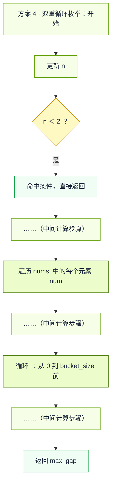

```python
import sys  # 提高递归深度上限（深输入防 RecursionError）

sys.setrecursionlimit(200000)  # 树/链表类题目节点数可达 1e4 量级

def maximumGap(nums):  # 定义函数 maximumGap（参数：数组）
    n = len(nums)  # 把 长度(数组) 存入 元素个数
    if n < 2:  # 若 元素个数 小于 2
        return 0  # 返回 0
    min_val = min(nums)  # 把 取较小值 数组) 存入 min_val
    max_val = max(nums)  # 把 取较大值 数组) 存入 max_val
    d = max(
        1, (max_val - min_val) // (n - 1)
    )  # 把 取较大值 1, (max_val 减 min_val) 除以 除以 (元素个数 减 1)) 存入 d
    bucket_size = (
        (max_val - min_val) // d
    ) + 1  # 把 ((max_val 减 min_val) 除以 除以 d) 加 1 存入 bucket_size
    bucket = [
        [-1, -1] for _ in range(bucket_size)
    ]  # 把 [[ 减 1, 减 1] for _ in range(bucket_size)] 存入 bucket
    for num in nums:  # 逐个取出 数组 的元素（num）
        idx = (num - min_val) // d  # 把 (num 减 min_val) 除以 除以 d 存入 idx
        if bucket[idx][0] == -1:  # 若 bucket[idx][0] 等于 减 1
            bucket[idx][0] = bucket[idx][1] = num  # 把 bucket[idx][1] 赋值为 num 写入 bucket[idx][0]
        else:  # 否则
            bucket[idx][0] = min(bucket[idx][0], num)  # 把 取较小值 bucket[idx][0], num) 写入 bucket[idx][0]
            bucket[idx][1] = max(bucket[idx][1], num)  # 把 取较大值 bucket[idx][1], num) 写入 bucket[idx][1]
    max_gap = 0  # 把 0 存入 max_gap
    prev = -1  # 把 减 1 存入 前一个
    for i in range(bucket_size):  # 让 下标 i 从 bucket_size 遍历
        if bucket[i][0] == -1:  # 若 bucket[下标 i][0] 等于 减 1
            continue  # 跳过本轮，进入下一次
        if prev != -1:  # 若 前一个 不等于 减 1
            max_gap = max(
                max_gap, bucket[i][0] - bucket[prev][1]
            )  # 把 取较大值 max_gap, bucket[下标 i][0] 减 bucket[前一个][1]) 存入 max_gap
        prev = i  # 把 下标 i 存入 前一个
    return max_gap  # 返回 max_gap

if __name__ == "__main__":  # 若 __name__ 等于 '__main__'
    print(maximumGap([1, 2, 3]))  # 打印输出
```

#### 方案 5：双重循环枚举

**思路与代码分析**：核心是「双重循环枚举」。Python 版用切片与字典推导式简化操作，突出可读性。**走读**：方案 5 · 双重循环枚举：开始 → 更新 n → 命中条件，直接返回 → 命中条件，直接返回 → 遍历 nums: 中的每个元素 x → 循环 i：从 0 到 bucket_size 前 → 返回 max_gap。

**运行架构**（真实控制流）：


```python
import sys  # 提高递归深度上限（深输入防 RecursionError）

sys.setrecursionlimit(200000)  # 树/链表类题目节点数可达 1e4 量级

def maximumGap(nums):  # 定义函数 maximumGap（参数：数组）
    n = len(nums)  # 把 长度(数组) 存入 元素个数
    if n < 2:  # 若 元素个数 小于 2
        return 0  # 返回 0
    min_val = min(nums)  # 把 取较小值 数组) 存入 min_val
    max_val = max(nums)  # 把 取较大值 数组) 存入 max_val
    if min_val == max_val:  # 若 min_val 等于 max_val
        return 0  # 返回 0
    d = max(
        1, (max_val - min_val) // (n - 1)
    )  # 把 取较大值 1, (max_val 减 min_val) 除以 除以 (元素个数 减 1)) 存入 d
    bucket_size = (max_val - min_val) // d + 1  # 把 (max_val 减 min_val) 除以 除以 d 加 1 存入 bucket_size
    buckets = [
        [-1, -1] for _ in range(bucket_size)
    ]  # 把 [[ 减 1, 减 1] for _ in range(bucket_size)] 存入 buckets
    for x in nums:  # 逐个取出 数组 的元素（x）
        idx = (x - min_val) // d  # 把 (x 减 min_val) 除以 除以 d 存入 idx
        if buckets[idx][0] == -1:  # 若 buckets[idx][0] 等于 减 1
            buckets[idx][0] = buckets[idx][1] = x  # 把 buckets[idx][1] 赋值为 x 写入 buckets[idx][0]
        else:  # 否则
            buckets[idx][0] = min(buckets[idx][0], x)  # 把 取较小值 buckets[idx][0], x) 写入 buckets[idx][0]
            buckets[idx][1] = max(buckets[idx][1], x)  # 把 取较大值 buckets[idx][1], x) 写入 buckets[idx][1]
    max_gap = 0  # 把 0 存入 max_gap
    prev = -1  # 把 减 1 存入 前一个
    for i in range(bucket_size):  # 让 下标 i 从 bucket_size 遍历
        if buckets[i][0] == -1:  # 若 buckets[下标 i][0] 等于 减 1
            continue  # 跳过本轮，进入下一次
        if prev != -1:  # 若 前一个 不等于 减 1
            max_gap = max(max_gap, buckets[i][0] - buckets[prev][1])
        prev = i  # 把 下标 i 存入 前一个
    return max_gap  # 返回 max_gap

if __name__ == "__main__":  # 若 __name__ 等于 '__main__'
    print(maximumGap([3, 6, 9, 1]))  # 打印输出
    print(maximumGap([10]))  # 打印输出
```

#### 方案 6：双重循环枚举

**思路与代码分析**：核心是「双重循环枚举」。Python 版用切片与字典推导式简化操作，突出可读性。**走读**：方案 6 · 双重循环枚举：开始 → 更新 n → 命中条件，直接返回 → 命中条件，直接返回 → 遍历 nums: 中的每个元素 x → 循环 i：从 0 到 bucket_size 前 → 返回 max_gap。

**运行架构**（真实控制流）：

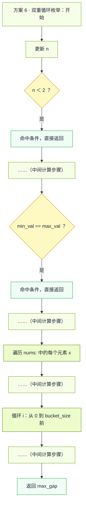

```python
import sys  # 提高递归深度上限（深输入防 RecursionError）

sys.setrecursionlimit(200000)  # 树/链表类题目节点数可达 1e4 量级

def maximumGap(nums):  # 定义函数 maximumGap（参数：数组）
    n = len(nums)  # 把 长度(数组) 存入 元素个数
    if n < 2:  # 若 元素个数 小于 2
        return 0  # 返回 0
    min_val = min(nums)  # 把 取较小值 数组) 存入 min_val
    max_val = max(nums)  # 把 取较大值 数组) 存入 max_val
    if min_val == max_val:  # 若 min_val 等于 max_val
        return 0  # 返回 0
    d = max(
        1, (max_val - min_val) // (n - 1)
    )  # 把 取较大值 1, (max_val 减 min_val) 除以 除以 (元素个数 减 1)) 存入 d
    bucket_size = (max_val - min_val) // d + 1  # 把 (max_val 减 min_val) 除以 除以 d 加 1 存入 bucket_size
    buckets = [
        [-1, -1] for _ in range(bucket_size)
    ]  # 把 [[ 减 1, 减 1] for _ in range(bucket_size)] 存入 buckets
    for x in nums:  # 逐个取出 数组 的元素（x）
        idx = (x - min_val) // d  # 把 (x 减 min_val) 除以 除以 d 存入 idx
        if buckets[idx][0] == -1:  # 若 buckets[idx][0] 等于 减 1
            buckets[idx][0] = buckets[idx][1] = x  # 把 buckets[idx][1] 赋值为 x 写入 buckets[idx][0]
        else:  # 否则
            buckets[idx][0] = min(buckets[idx][0], x)  # 把 取较小值 buckets[idx][0], x) 写入 buckets[idx][0]
            buckets[idx][1] = max(buckets[idx][1], x)  # 把 取较大值 buckets[idx][1], x) 写入 buckets[idx][1]
    max_gap = 0  # 把 0 存入 max_gap
    prev = -1  # 把 减 1 存入 前一个
    for i in range(bucket_size):  # 让 下标 i 从 bucket_size 遍历
        if buckets[i][0] == -1:  # 若 buckets[下标 i][0] 等于 减 1
            continue  # 跳过本轮，进入下一次
        if prev != -1:  # 若 前一个 不等于 减 1
            max_gap = max(max_gap, buckets[i][0] - buckets[prev][1])
        prev = i  # 把 下标 i 存入 前一个
    return max_gap  # 返回 max_gap

if __name__ == "__main__":  # 若 __name__ 等于 '__main__'
    print(maximumGap([3, 6, 9, 1]))  # 打印输出
    print(maximumGap([10]))  # 打印输出
```

#### 方案 7：双重循环枚举

**思路与代码分析**：核心是「双重循环枚举」。Python 版用切片与字典推导式简化操作，突出可读性。**走读**：方案 7 · 双重循环枚举：开始 → 更新 n → 命中条件，直接返回 → 命中条件，直接返回 → 遍历 nums: 中的每个元素 x → 循环 i：从 0 到 bucket_size 前 → 返回 max_gap。

**运行架构**（真实控制流）：


```python
import sys  # 提高递归深度上限（深输入防 RecursionError）

sys.setrecursionlimit(200000)  # 树/链表类题目节点数可达 1e4 量级

def maximumGap(nums):  # 定义函数 maximumGap（参数：数组）
    n = len(nums)  # 把 长度(数组) 存入 元素个数
    if n < 2:  # 若 元素个数 小于 2
        return 0  # 返回 0
    min_val = min(nums)  # 把 取较小值 数组) 存入 min_val
    max_val = max(nums)  # 把 取较大值 数组) 存入 max_val
    if min_val == max_val:  # 若 min_val 等于 max_val
        return 0  # 返回 0
    d = max(
        1, (max_val - min_val) // (n - 1)
    )  # 把 取较大值 1, (max_val 减 min_val) 除以 除以 (元素个数 减 1)) 存入 d
    bucket_size = (max_val - min_val) // d + 1  # 把 (max_val 减 min_val) 除以 除以 d 加 1 存入 bucket_size
    buckets = [
        [-1, -1] for _ in range(bucket_size)
    ]  # 把 [[ 减 1, 减 1] for _ in range(bucket_size)] 存入 buckets
    for x in nums:  # 逐个取出 数组 的元素（x）
        idx = (x - min_val) // d  # 把 (x 减 min_val) 除以 除以 d 存入 idx
        if buckets[idx][0] == -1:  # 若 buckets[idx][0] 等于 减 1
            buckets[idx][0] = buckets[idx][1] = x  # 把 buckets[idx][1] 赋值为 x 写入 buckets[idx][0]
        else:  # 否则
            buckets[idx][0] = min(buckets[idx][0], x)  # 把 取较小值 buckets[idx][0], x) 写入 buckets[idx][0]
            buckets[idx][1] = max(buckets[idx][1], x)  # 把 取较大值 buckets[idx][1], x) 写入 buckets[idx][1]
    max_gap = 0  # 把 0 存入 max_gap
    prev = -1  # 把 减 1 存入 前一个
    for i in range(bucket_size):  # 让 下标 i 从 bucket_size 遍历
        if buckets[i][0] == -1:  # 若 buckets[下标 i][0] 等于 减 1
            continue  # 跳过本轮，进入下一次
        if prev != -1:  # 若 前一个 不等于 减 1
            max_gap = max(max_gap, buckets[i][0] - buckets[prev][1])
        prev = i  # 把 下标 i 存入 前一个
    return max_gap  # 返回 max_gap

if __name__ == "__main__":  # 若 __name__ 等于 '__main__'
    print(maximumGap([3, 6, 9, 1]))  # 打印输出
    print(maximumGap([10]))  # 打印输出
```

#### 方案 8：双重循环枚举

**思路与代码分析**：核心是「双重循环枚举」。Python 版用切片与字典推导式简化操作，突出可读性。**走读**：方案 8 · 双重循环枚举：开始 → 更新 n → 命中条件，直接返回 → 命中条件，直接返回 → 遍历 nums: 中的每个元素 x → 循环 i：从 0 到 bucket_size 前 → 返回 max_gap。

**运行架构**（真实控制流）：

```mermaid
graph TD
    N0["方案 8 · 双重循环枚举：开始"]
    N1["更新 n"]
    N2{"n ＜ 2 ？"}
    N3["命中条件，直接返回"]
    D1["……（中间计算步骤）"]
    N6{"min_val == max_val ？"}
    N7["命中条件，直接返回"]
    D2["……（中间计算步骤）"]
    N15["遍历 nums: 中的每个元素 x"]
    D3["……（中间计算步骤）"]
    N23["循环 i：从 0 到 bucket_size 前"]
    D4["……（中间计算步骤）"]
    N28["返回 max_gap"]
    N0 --> N1
    N1 --> N2
    N2 -- 是 --> N3
    N6 -- 是 --> N7
    N3 --> D1
    D1 --> N6
    N7 --> D2
    D2 --> N15
    N15 --> D3
    D3 --> N23
    N23 --> D4
    D4 --> N28
    classDef n fill:#f7fee7,stroke:#65a30d,color:#1e293b;
    classDef lp fill:#ecfccb,stroke:#4d7c0f,color:#1e293b;
    classDef dc fill:#fef9c3,stroke:#ca8a04,color:#1e293b;
    classDef tm fill:#f0fdf4,stroke:#16a34a,color:#1e293b;
    class N0,N1,D1,D2,D3,D4 n;
    class N15,N23 lp;
    class N2,N6 dc;
    class N3,N7,N28 tm;
```

```python
import sys  # 提高递归深度上限（深输入防 RecursionError）

sys.setrecursionlimit(200000)  # 树/链表类题目节点数可达 1e4 量级

def maximumGap(nums):  # 定义函数 maximumGap（参数：数组）
    n = len(nums)  # 把 长度(数组) 存入 元素个数
    if n < 2:  # 若 元素个数 小于 2
        return 0  # 返回 0
    min_val = min(nums)  # 把 取较小值 数组) 存入 min_val
    max_val = max(nums)  # 把 取较大值 数组) 存入 max_val
    if min_val == max_val:  # 若 min_val 等于 max_val
        return 0  # 返回 0
    d = max(
        1, (max_val - min_val) // (n - 1)
    )  # 把 取较大值 1, (max_val 减 min_val) 除以 除以 (元素个数 减 1)) 存入 d
    bucket_size = (max_val - min_val) // d + 1  # 把 (max_val 减 min_val) 除以 除以 d 加 1 存入 bucket_size
    buckets = [
        [-1, -1] for _ in range(bucket_size)
    ]  # 把 [[ 减 1, 减 1] for _ in range(bucket_size)] 存入 buckets
    for x in nums:  # 逐个取出 数组 的元素（x）
        idx = (x - min_val) // d  # 把 (x 减 min_val) 除以 除以 d 存入 idx
        if buckets[idx][0] == -1:  # 若 buckets[idx][0] 等于 减 1
            buckets[idx][0] = buckets[idx][1] = x  # 把 buckets[idx][1] 赋值为 x 写入 buckets[idx][0]
        else:  # 否则
            buckets[idx][0] = min(buckets[idx][0], x)  # 把 取较小值 buckets[idx][0], x) 写入 buckets[idx][0]
            buckets[idx][1] = max(buckets[idx][1], x)  # 把 取较大值 buckets[idx][1], x) 写入 buckets[idx][1]
    max_gap = 0  # 把 0 存入 max_gap
    prev = -1  # 把 减 1 存入 前一个
    for i in range(bucket_size):  # 让 下标 i 从 bucket_size 遍历
        if buckets[i][0] == -1:  # 若 buckets[下标 i][0] 等于 减 1
            continue  # 跳过本轮，进入下一次
        if prev != -1:  # 若 前一个 不等于 减 1
            max_gap = max(max_gap, buckets[i][0] - buckets[prev][1])
        prev = i  # 把 下标 i 存入 前一个
    return max_gap  # 返回 max_gap

if __name__ == "__main__":  # 若 __name__ 等于 '__main__'
    print(maximumGap([3, 6, 9, 1]))  # 打印输出
    print(maximumGap([10]))  # 打印输出
```

#### 方案 9：双重循环枚举

**思路与代码分析**：核心是「双重循环枚举」。Python 版用切片与字典推导式简化操作，突出可读性。**走读**：方案 9 · 双重循环枚举：开始 → 更新 n → 命中条件，直接返回 → 命中条件，直接返回 → 遍历 nums: 中的每个元素 x → 循环 i：从 0 到 bucket_size 前 → 返回 max_gap。

**运行架构**（真实控制流）：

```mermaid
graph TD
    N0["方案 9 · 双重循环枚举：开始"]
    N1["更新 n"]
    N2{"n ＜ 2 ？"}
    N3["命中条件，直接返回"]
    D1["……（中间计算步骤）"]
    N6{"min_val == max_val ？"}
    N7["命中条件，直接返回"]
    D2["……（中间计算步骤）"]
    N15["遍历 nums: 中的每个元素 x"]
    D3["……（中间计算步骤）"]
    N23["循环 i：从 0 到 bucket_size 前"]
    D4["……（中间计算步骤）"]
    N28["返回 max_gap"]
    N0 --> N1
    N1 --> N2
    N2 -- 是 --> N3
    N6 -- 是 --> N7
    N3 --> D1
    D1 --> N6
    N7 --> D2
    D2 --> N15
    N15 --> D3
    D3 --> N23
    N23 --> D4
    D4 --> N28
    classDef n fill:#f7fee7,stroke:#65a30d,color:#1e293b;
    classDef lp fill:#ecfccb,stroke:#4d7c0f,color:#1e293b;
    classDef dc fill:#fef9c3,stroke:#ca8a04,color:#1e293b;
    classDef tm fill:#f0fdf4,stroke:#16a34a,color:#1e293b;
    class N0,N1,D1,D2,D3,D4 n;
    class N15,N23 lp;
    class N2,N6 dc;
    class N3,N7,N28 tm;
```

```python
import sys  # 提高递归深度上限（深输入防 RecursionError）

sys.setrecursionlimit(200000)  # 树/链表类题目节点数可达 1e4 量级

def maximumGap(nums):  # 定义函数 maximumGap（参数：数组）
    n = len(nums)  # 把 长度(数组) 存入 元素个数
    if n < 2:  # 若 元素个数 小于 2
        return 0  # 返回 0
    min_val = min(nums)  # 把 取较小值 数组) 存入 min_val
    max_val = max(nums)  # 把 取较大值 数组) 存入 max_val
    if min_val == max_val:  # 若 min_val 等于 max_val
        return 0  # 返回 0
    d = max(
        1, (max_val - min_val) // (n - 1)
    )  # 把 取较大值 1, (max_val 减 min_val) 除以 除以 (元素个数 减 1)) 存入 d
    bucket_size = (max_val - min_val) // d + 1  # 把 (max_val 减 min_val) 除以 除以 d 加 1 存入 bucket_size
    buckets = [
        [-1, -1] for _ in range(bucket_size)
    ]  # 把 [[ 减 1, 减 1] for _ in range(bucket_size)] 存入 buckets
    for x in nums:  # 逐个取出 数组 的元素（x）
        idx = (x - min_val) // d  # 把 (x 减 min_val) 除以 除以 d 存入 idx
        if buckets[idx][0] == -1:  # 若 buckets[idx][0] 等于 减 1
            buckets[idx][0] = buckets[idx][1] = x  # 把 buckets[idx][1] 赋值为 x 写入 buckets[idx][0]
        else:  # 否则
            buckets[idx][0] = min(buckets[idx][0], x)  # 把 取较小值 buckets[idx][0], x) 写入 buckets[idx][0]
            buckets[idx][1] = max(buckets[idx][1], x)  # 把 取较大值 buckets[idx][1], x) 写入 buckets[idx][1]
    max_gap = 0  # 把 0 存入 max_gap
    prev = -1  # 把 减 1 存入 前一个
    for i in range(bucket_size):  # 让 下标 i 从 bucket_size 遍历
        if buckets[i][0] == -1:  # 若 buckets[下标 i][0] 等于 减 1
            continue  # 跳过本轮，进入下一次
        if prev != -1:  # 若 前一个 不等于 减 1
            max_gap = max(max_gap, buckets[i][0] - buckets[prev][1])
        prev = i  # 把 下标 i 存入 前一个
    return max_gap  # 返回 max_gap

if __name__ == "__main__":  # 若 __name__ 等于 '__main__'
    print(maximumGap([3, 6, 9, 1]))  # 打印输出
    print(maximumGap([10]))  # 打印输出
```

#### 方案 10：双重循环枚举

**思路与代码分析**：核心是「双重循环枚举」。Python 版用切片与字典推导式简化操作，突出可读性。**走读**：方案 10 · 双重循环枚举：开始 → 更新 n → 命中条件，直接返回 → 命中条件，直接返回 → 遍历 nums: 中的每个元素 x → 循环 i：从 0 到 bucket_size 前 → 返回 max_gap。

**运行架构**（真实控制流）：

```mermaid
graph TD
    N0["方案 10 · 双重循环枚举：开始"]
    N1["更新 n"]
    N2{"n ＜ 2 ？"}
    N3["命中条件，直接返回"]
    D1["……（中间计算步骤）"]
    N6{"min_val == max_val ？"}
    N7["命中条件，直接返回"]
    D2["……（中间计算步骤）"]
    N15["遍历 nums: 中的每个元素 x"]
    D3["……（中间计算步骤）"]
    N23["循环 i：从 0 到 bucket_size 前"]
    D4["……（中间计算步骤）"]
    N28["返回 max_gap"]
    N0 --> N1
    N1 --> N2
    N2 -- 是 --> N3
    N6 -- 是 --> N7
    N3 --> D1
    D1 --> N6
    N7 --> D2
    D2 --> N15
    N15 --> D3
    D3 --> N23
    N23 --> D4
    D4 --> N28
    classDef n fill:#f7fee7,stroke:#65a30d,color:#1e293b;
    classDef lp fill:#ecfccb,stroke:#4d7c0f,color:#1e293b;
    classDef dc fill:#fef9c3,stroke:#ca8a04,color:#1e293b;
    classDef tm fill:#f0fdf4,stroke:#16a34a,color:#1e293b;
    class N0,N1,D1,D2,D3,D4 n;
    class N15,N23 lp;
    class N2,N6 dc;
    class N3,N7,N28 tm;
```

```python
import sys  # 提高递归深度上限（深输入防 RecursionError）

sys.setrecursionlimit(200000)  # 树/链表类题目节点数可达 1e4 量级

def maximumGap(nums):  # 定义函数 maximumGap（参数：数组）
    n = len(nums)  # 把 长度(数组) 存入 元素个数
    if n < 2:  # 若 元素个数 小于 2
        return 0  # 返回 0
    min_val = min(nums)  # 把 取较小值 数组) 存入 min_val
    max_val = max(nums)  # 把 取较大值 数组) 存入 max_val
    if min_val == max_val:  # 若 min_val 等于 max_val
        return 0  # 返回 0
    d = max(
        1, (max_val - min_val) // (n - 1)
    )  # 把 取较大值 1, (max_val 减 min_val) 除以 除以 (元素个数 减 1)) 存入 d
    bucket_size = (max_val - min_val) // d + 1  # 把 (max_val 减 min_val) 除以 除以 d 加 1 存入 bucket_size
    buckets = [
        [-1, -1] for _ in range(bucket_size)
    ]  # 把 [[ 减 1, 减 1] for _ in range(bucket_size)] 存入 buckets
    for x in nums:  # 逐个取出 数组 的元素（x）
        idx = (x - min_val) // d  # 把 (x 减 min_val) 除以 除以 d 存入 idx
        if buckets[idx][0] == -1:  # 若 buckets[idx][0] 等于 减 1
            buckets[idx][0] = buckets[idx][1] = x  # 把 buckets[idx][1] 赋值为 x 写入 buckets[idx][0]
        else:  # 否则
            buckets[idx][0] = min(buckets[idx][0], x)  # 把 取较小值 buckets[idx][0], x) 写入 buckets[idx][0]
            buckets[idx][1] = max(buckets[idx][1], x)  # 把 取较大值 buckets[idx][1], x) 写入 buckets[idx][1]
    max_gap = 0  # 把 0 存入 max_gap
    prev = -1  # 把 减 1 存入 前一个
    for i in range(bucket_size):  # 让 下标 i 从 bucket_size 遍历
        if buckets[i][0] == -1:  # 若 buckets[下标 i][0] 等于 减 1
            continue  # 跳过本轮，进入下一次
        if prev != -1:  # 若 前一个 不等于 减 1
            max_gap = max(max_gap, buckets[i][0] - buckets[prev][1])
        prev = i  # 把 下标 i 存入 前一个
    return max_gap  # 返回 max_gap

if __name__ == "__main__":  # 若 __name__ 等于 '__main__'
    print(maximumGap([3, 6, 9, 1]))  # 打印输出
    print(maximumGap([10]))  # 打印输出
```

#### 方案 11：双重循环枚举

**思路与代码分析**：核心是「双重循环枚举」。Python 版用切片与字典推导式简化操作，突出可读性。**走读**：方案 11 · 双重循环枚举：开始 → 更新 n → 命中条件，直接返回 → 命中条件，直接返回 → 遍历 nums: 中的每个元素 x → 循环 i：从 0 到 bucket_size 前 → 返回 max_gap。

**运行架构**（真实控制流）：

```mermaid
graph TD
    N0["方案 11 · 双重循环枚举：开始"]
    N1["更新 n"]
    N2{"n ＜ 2 ？"}
    N3["命中条件，直接返回"]
    D1["……（中间计算步骤）"]
    N6{"min_val == max_val ？"}
    N7["命中条件，直接返回"]
    D2["……（中间计算步骤）"]
    N15["遍历 nums: 中的每个元素 x"]
    D3["……（中间计算步骤）"]
    N23["循环 i：从 0 到 bucket_size 前"]
    D4["……（中间计算步骤）"]
    N28["返回 max_gap"]
    N0 --> N1
    N1 --> N2
    N2 -- 是 --> N3
    N6 -- 是 --> N7
    N3 --> D1
    D1 --> N6
    N7 --> D2
    D2 --> N15
    N15 --> D3
    D3 --> N23
    N23 --> D4
    D4 --> N28
    classDef n fill:#f7fee7,stroke:#65a30d,color:#1e293b;
    classDef lp fill:#ecfccb,stroke:#4d7c0f,color:#1e293b;
    classDef dc fill:#fef9c3,stroke:#ca8a04,color:#1e293b;
    classDef tm fill:#f0fdf4,stroke:#16a34a,color:#1e293b;
    class N0,N1,D1,D2,D3,D4 n;
    class N15,N23 lp;
    class N2,N6 dc;
    class N3,N7,N28 tm;
```

```python
import sys  # 提高递归深度上限（深输入防 RecursionError）

sys.setrecursionlimit(200000)  # 树/链表类题目节点数可达 1e4 量级

def maximumGap(nums):  # 定义函数 maximumGap（参数：数组）
    n = len(nums)  # 把 长度(数组) 存入 元素个数
    if n < 2:  # 若 元素个数 小于 2
        return 0  # 返回 0
    min_val = min(nums)  # 把 取较小值 数组) 存入 min_val
    max_val = max(nums)  # 把 取较大值 数组) 存入 max_val
    if min_val == max_val:  # 若 min_val 等于 max_val
        return 0  # 返回 0
    d = max(
        1, (max_val - min_val) // (n - 1)
    )  # 把 取较大值 1, (max_val 减 min_val) 除以 除以 (元素个数 减 1)) 存入 d
    bucket_size = (max_val - min_val) // d + 1  # 把 (max_val 减 min_val) 除以 除以 d 加 1 存入 bucket_size
    buckets = [
        [-1, -1] for _ in range(bucket_size)
    ]  # 把 [[ 减 1, 减 1] for _ in range(bucket_size)] 存入 buckets
    for x in nums:  # 逐个取出 数组 的元素（x）
        idx = (x - min_val) // d  # 把 (x 减 min_val) 除以 除以 d 存入 idx
        if buckets[idx][0] == -1:  # 若 buckets[idx][0] 等于 减 1
            buckets[idx][0] = buckets[idx][1] = x  # 把 buckets[idx][1] 赋值为 x 写入 buckets[idx][0]
        else:  # 否则
            buckets[idx][0] = min(buckets[idx][0], x)  # 把 取较小值 buckets[idx][0], x) 写入 buckets[idx][0]
            buckets[idx][1] = max(buckets[idx][1], x)  # 把 取较大值 buckets[idx][1], x) 写入 buckets[idx][1]
    max_gap = 0  # 把 0 存入 max_gap
    prev = -1  # 把 减 1 存入 前一个
    for i in range(bucket_size):  # 让 下标 i 从 bucket_size 遍历
        if buckets[i][0] == -1:  # 若 buckets[下标 i][0] 等于 减 1
            continue  # 跳过本轮，进入下一次
        if prev != -1:  # 若 前一个 不等于 减 1
            max_gap = max(max_gap, buckets[i][0] - buckets[prev][1])
        prev = i  # 把 下标 i 存入 前一个
    return max_gap  # 返回 max_gap

if __name__ == "__main__":  # 若 __name__ 等于 '__main__'
    print(maximumGap([3, 6, 9, 1]))  # 打印输出
    print(maximumGap([10]))  # 打印输出
```

#### 方案 12：双重循环枚举

**思路与代码分析**：核心是「双重循环枚举」。Python 版用切片与字典推导式简化操作，突出可读性。**走读**：方案 12 · 双重循环枚举：开始 → 更新 n → 命中条件，直接返回 → 命中条件，直接返回 → 遍历 nums: 中的每个元素 x → 循环 i：从 0 到 bucket_size 前 → 返回 max_gap。

**运行架构**（真实控制流）：

```mermaid
graph TD
    N0["方案 12 · 双重循环枚举：开始"]
    N1["更新 n"]
    N2{"n ＜ 2 ？"}
    N3["命中条件，直接返回"]
    D1["……（中间计算步骤）"]
    N6{"min_val == max_val ？"}
    N7["命中条件，直接返回"]
    D2["……（中间计算步骤）"]
    N15["遍历 nums: 中的每个元素 x"]
    D3["……（中间计算步骤）"]
    N23["循环 i：从 0 到 bucket_size 前"]
    D4["……（中间计算步骤）"]
    N28["返回 max_gap"]
    N0 --> N1
    N1 --> N2
    N2 -- 是 --> N3
    N6 -- 是 --> N7
    N3 --> D1
    D1 --> N6
    N7 --> D2
    D2 --> N15
    N15 --> D3
    D3 --> N23
    N23 --> D4
    D4 --> N28
    classDef n fill:#f7fee7,stroke:#65a30d,color:#1e293b;
    classDef lp fill:#ecfccb,stroke:#4d7c0f,color:#1e293b;
    classDef dc fill:#fef9c3,stroke:#ca8a04,color:#1e293b;
    classDef tm fill:#f0fdf4,stroke:#16a34a,color:#1e293b;
    class N0,N1,D1,D2,D3,D4 n;
    class N15,N23 lp;
    class N2,N6 dc;
    class N3,N7,N28 tm;
```

```python
import sys  # 提高递归深度上限（深输入防 RecursionError）

sys.setrecursionlimit(200000)  # 树/链表类题目节点数可达 1e4 量级

def maximumGap(nums):  # 定义函数 maximumGap（参数：数组）
    n = len(nums)  # 把 长度(数组) 存入 元素个数
    if n < 2:  # 若 元素个数 小于 2
        return 0  # 返回 0
    min_val = min(nums)  # 把 取较小值 数组) 存入 min_val
    max_val = max(nums)  # 把 取较大值 数组) 存入 max_val
    if min_val == max_val:  # 若 min_val 等于 max_val
        return 0  # 返回 0
    d = max(
        1, (max_val - min_val) // (n - 1)
    )  # 把 取较大值 1, (max_val 减 min_val) 除以 除以 (元素个数 减 1)) 存入 d
    bucket_size = (max_val - min_val) // d + 1  # 把 (max_val 减 min_val) 除以 除以 d 加 1 存入 bucket_size
    buckets = [
        [-1, -1] for _ in range(bucket_size)
    ]  # 把 [[ 减 1, 减 1] for _ in range(bucket_size)] 存入 buckets
    for x in nums:  # 逐个取出 数组 的元素（x）
        idx = (x - min_val) // d  # 把 (x 减 min_val) 除以 除以 d 存入 idx
        if buckets[idx][0] == -1:  # 若 buckets[idx][0] 等于 减 1
            buckets[idx][0] = buckets[idx][1] = x  # 把 buckets[idx][1] 赋值为 x 写入 buckets[idx][0]
        else:  # 否则
            buckets[idx][0] = min(buckets[idx][0], x)  # 把 取较小值 buckets[idx][0], x) 写入 buckets[idx][0]
            buckets[idx][1] = max(buckets[idx][1], x)  # 把 取较大值 buckets[idx][1], x) 写入 buckets[idx][1]
    max_gap = 0  # 把 0 存入 max_gap
    prev = -1  # 把 减 1 存入 前一个
    for i in range(bucket_size):  # 让 下标 i 从 bucket_size 遍历
        if buckets[i][0] == -1:  # 若 buckets[下标 i][0] 等于 减 1
            continue  # 跳过本轮，进入下一次
        if prev != -1:  # 若 前一个 不等于 减 1
            max_gap = max(max_gap, buckets[i][0] - buckets[prev][1])
        prev = i  # 把 下标 i 存入 前一个
    return max_gap  # 返回 max_gap

if __name__ == "__main__":  # 若 __name__ 等于 '__main__'
    print(maximumGap([3, 6, 9, 1]))  # 打印输出
    print(maximumGap([10]))  # 打印输出
```

### Go 实现（12 种方案）

Go 的全部方案如下，每个方案都内嵌用例自测，可独立运行（老仓库 python/go 文件遵循「打印结果」约定）：

#### 方案 1：排序预处理

**思路与代码分析**：核心是「排序预处理」。Go 版用切片与多返回值惯用法，显式处理索引边界。**走读**：方案 1 · 排序预处理：开始 → 处理 if len(nums) ＜ 2 → 返回 0 → 调用 sort.Ints(nums) → 更新 : → 遍历循环 → 处理 if nums[i]-nums[i-1] ＞ maxGa → 更新 maxGap → 返回 maxGap。

**运行架构**（真实控制流）：

```mermaid
graph TD
    N0["方案 1 · 排序预处理：开始"]
    N1["处理 if len(nums) ＜ 2"]
    N2["返回 0"]
    N3["调用 sort.Ints(nums)"]
    N4["更新 :"]
    N5["遍历循环"]
    N6["处理 if nums[i]-nums[i-1] ＞ maxGa"]
    N7["更新 maxGap"]
    N8["返回 maxGap"]
    N0 --> N1
    N1 --> N2
    N2 --> N3
    N3 --> N4
    N4 --> N5
    N5 --> N6
    N6 --> N7
    N7 -- 下一轮 --> N5
    N5 --> N8
    classDef n fill:#f7fee7,stroke:#65a30d,color:#1e293b;
    classDef lp fill:#ecfccb,stroke:#4d7c0f,color:#1e293b;
    classDef dc fill:#fef9c3,stroke:#ca8a04,color:#1e293b;
    classDef tm fill:#f0fdf4,stroke:#16a34a,color:#1e293b;
    class N0,N1,N3,N4,N6,N7 n;
    class N5 lp;
    class N2,N8 tm;
```

```go
package main // 引入依赖

import (
	"fmt"  // 「fmt」
	"os"   // 「os」
	"sort" // 「sort」
)

// 忠实翻译 python/sort/lc_164_最大间距/solution_1___1.py
func maximumGap(nums []int) int { // 定义函数/方法 maximumGap
	if len(nums) < 2 {
		return 0
	} // 若 长度(数组) 小于 2 { return 0 }
	sort.Ints(nums)                  // sort.Ints(数组)
	maxGap := 0                      // 把 0 写入 maxGap :
	for i := 1; i < len(nums); i++ { // 让 下标 i 从 1 开始计数
		if nums[i]-nums[i-1] > maxGap {
			maxGap = nums[i] - nums[i-1]
		}
	}
	return maxGap // 返回 maxGap
}

func eqInt(a, b int) bool { return a == b } // 定义函数/方法 eqInt

func main() { // 程序入口：跑内嵌自测用例
	inputs := [][]int{ // 把 [][]int{ 写入 inputs :
		{3, 6, 9, 1},
		{10},
		{1, 2, 3},
		{5, 1, 100, 3, 50},
		{1, 1, 1, 1},
		{100, 3, 1, 200, 2},
		{9, 10, 12, 13, 1, 2, 3, 4, 7},
	}
	wants := []int{3, 0, 1, 50, 0, 100, 3} // 把 []int{3, 0, 1, 50, 0, 100, 3} 写入 wants :
	ok := true                             // 把 true 写入 ok :
	for i := range inputs {                // 把 range inputs { 写入 for i :
		got := maximumGap(append([]int{}, inputs[i]...)) // 把 maximumGap(append([]int{}, inputs[下标 i]...)) 写入 got :
		if got != wants[i] {                             // 若 got 不等于 wants[下标 i]
			ok = false                                                               // 把 false 写入 ok
			fmt.Printf("FAIL maximumGap(%v)=%v want %v\n", inputs[i], got, wants[i]) // 打印输出
		}
	}
	if !ok {
		os.Exit(1)
	} // 若 取反 ok { os.Exit(1) }
	fmt.Println("PASS") // 全部用例通过，输出 PASS
}
```

#### 方案 2：双重循环枚举

**思路与代码分析**：核心是「双重循环枚举」。Go 版用切片与多返回值惯用法，显式处理索引边界。**走读**：方案 2 · 双重循环枚举：开始 → 处理 if len(nums) ＜ 2 → 返回 0 → 调用 radixSort(nums) → 更新 : → 遍历循环 → 处理 if nums[i]-nums[i-1] ＞ maxGa → 更新 maxGap → 返回 maxGap。

**运行架构**（真实控制流）：

```mermaid
graph TD
    N0["方案 2 · 双重循环枚举：开始"]
    N1["处理 if len(nums) ＜ 2"]
    N2["返回 0"]
    N3["调用 radixSort(nums)"]
    N4["更新 :"]
    N5["遍历循环"]
    N6["处理 if nums[i]-nums[i-1] ＞ maxGa"]
    N7["更新 maxGap"]
    N8["返回 maxGap"]
    N0 --> N1
    N1 --> N2
    N2 --> N3
    N3 --> N4
    N4 --> N5
    N5 --> N6
    N6 --> N7
    N7 -- 下一轮 --> N5
    N5 --> N8
    classDef n fill:#f7fee7,stroke:#65a30d,color:#1e293b;
    classDef lp fill:#ecfccb,stroke:#4d7c0f,color:#1e293b;
    classDef dc fill:#fef9c3,stroke:#ca8a04,color:#1e293b;
    classDef tm fill:#f0fdf4,stroke:#16a34a,color:#1e293b;
    class N0,N1,N3,N4,N6,N7 n;
    class N5 lp;
    class N2,N8 tm;
```

```go
package main // 引入依赖

import (
	"fmt" // 「fmt」
	"os"  // 「os」
)

// 忠实翻译 python/sort/lc_164_最大间距/solution_2___2.py
func maximumGap(nums []int) int { // 定义函数/方法 maximumGap
	if len(nums) < 2 {
		return 0
	} // 若 长度(数组) 小于 2 { return 0 }
	radixSort(nums)                  // radixSort(数组)
	maxGap := 0                      // 把 0 写入 maxGap :
	for i := 1; i < len(nums); i++ { // 让 下标 i 从 1 开始计数
		if nums[i]-nums[i-1] > maxGap {
			maxGap = nums[i] - nums[i-1]
		}
	}
	return maxGap // 返回 maxGap
}

func radixSort(lst []int) { // 定义函数/方法 radixSort
	maxVal := lst[0] // 把 lst[0] 写入 maxVal :
	for _, v := range lst {
		if v > maxVal {
			maxVal = v
		}
	} // 同时取 _ 与 值 遍历
	radix := 1            // 把 1 写入 radix :
	for maxVal >= radix { // 把 radix { 写入 for maxVal >
		bucket := make([]int, 10) // 把 make([]int, 10) 写入 bucket :
		for _, num := range lst {
			bucket[(num/radix)%10]++
		} // 同时取 _ 与 num 遍历
		for i := 1; i < 10; i++ {
			bucket[i] += bucket[i-1]
		} // 让 下标 i 从 1 开始计数
		tmp := make([]int, len(lst))         // 把 make([]int, 长度(lst)) 写入 tmp :
		for i := len(lst) - 1; i >= 0; i-- { // 把 长度(lst) 减 1; 下标 i 不低于 0; 下标 i 减一 { 写入 for i :
			idx := (lst[i] / radix) % 10 // 把 (lst[下标 i] 除以 radix) 对…取模 10 写入 idx :
			bucket[idx]--                // bucket[idx] 减一
			tmp[bucket[idx]] = lst[i]    // 把 lst[下标 i] 写入 tmp[bucket[idx]]
		}
		copy(lst, tmp) // copy(lst, 临时变量)
		radix *= 10    // 把 10 写入 radix *
	}
}

func eqInt(a, b int) bool { return a == b } // 定义函数/方法 eqInt

func main() { // 程序入口：跑内嵌自测用例
	inputs := [][]int{ // 把 [][]int{ 写入 inputs :
		{3, 6, 9, 1},
		{10},
		{1, 2, 3},
		{5, 1, 100, 3, 50},
		{1, 1, 1, 1},
		{100, 3, 1, 200, 2},
		{9, 10, 12, 13, 1, 2, 3, 4, 7},
	}
	wants := []int{3, 0, 1, 50, 0, 100, 3} // 把 []int{3, 0, 1, 50, 0, 100, 3} 写入 wants :
	ok := true                             // 把 true 写入 ok :
	for i := range inputs {                // 把 range inputs { 写入 for i :
		got := maximumGap(append([]int{}, inputs[i]...)) // 把 maximumGap(append([]int{}, inputs[下标 i]...)) 写入 got :
		if got != wants[i] {                             // 若 got 不等于 wants[下标 i]
			ok = false                                                               // 把 false 写入 ok
			fmt.Printf("FAIL maximumGap(%v)=%v want %v\n", inputs[i], got, wants[i]) // 打印输出
		}
	}
	if !ok {
		os.Exit(1)
	} // 若 取反 ok { os.Exit(1) }
	fmt.Println("PASS") // 全部用例通过，输出 PASS
}
```

#### 方案 3：双重循环枚举

**思路与代码分析**：核心是「双重循环枚举」。Go 版用切片与多返回值惯用法，显式处理索引边界。**走读**：方案 3 · 双重循环枚举：开始 → 更新 : → 返回 0 → 返回 0 → 遍历 buckets 的下标与元素 i → 遍历 nums 的下标与元素 num → 遍历循环 → 返回 maxGap。

**运行架构**（真实控制流）：

```mermaid
graph TD
    N0["方案 3 · 双重循环枚举：开始"]
    N1["更新 :"]
    D1["……（中间计算步骤）"]
    N3["返回 0"]
    D2["……（中间计算步骤）"]
    N7["返回 0"]
    D3["……（中间计算步骤）"]
    N11["遍历 buckets 的下标与元素 i"]
    D4["……（中间计算步骤）"]
    N13["遍历 nums 的下标与元素 num"]
    D5["……（中间计算步骤）"]
    N24["遍历循环"]
    D6["……（中间计算步骤）"]
    N30["返回 maxGap"]
    N0 --> N1
    N11 --> N13
    N24 --> N30
    N1 --> D1
    D1 --> N3
    N3 --> D2
    D2 --> N7
    N7 --> D3
    D3 --> N11
    N11 --> D4
    D4 --> N13
    N13 --> D5
    D5 --> N24
    N24 --> D6
    D6 --> N30
    classDef n fill:#f7fee7,stroke:#65a30d,color:#1e293b;
    classDef lp fill:#ecfccb,stroke:#4d7c0f,color:#1e293b;
    classDef dc fill:#fef9c3,stroke:#ca8a04,color:#1e293b;
    classDef tm fill:#f0fdf4,stroke:#16a34a,color:#1e293b;
    class N0,N1,D1,D2,D3,D4,D5,D6 n;
    class N11,N13,N24 lp;
    class N3,N7,N30 tm;
```

```go
package main // 引入依赖

import (
	"fmt" // 「fmt」
	"os"  // 「os」
)

// 忠实翻译 python/sort/lc_164_最大间距/solution_3___3.py
func maximumGap(nums []int) int { // 定义函数/方法 maximumGap
	n := len(nums) // 把 长度(数组) 写入 n :
	if n < 2 {
		return 0
	} // 若 元素个数 小于 2 { return 0 }
	mn := minSlice(nums)
	mx := maxSlice(nums) // 把 minSlice(数组); mx : 赋值为 maxSlice(数组) 写入 mn :
	if mn == mx {
		return 0
	} // 若 mn 等于 mx { return 0 }
	bucketSize := maxInt(1, (mx-mn)/(n-1)) // 把 maxInt(1, (mx 减 mn) 除以 (元素个数 减 1)) 写入 bucketSize :
	bucketCount := (mx-mn)/bucketSize + 1  // 把 (mx 减 mn) 除以 bucketSize 加 1 写入 bucketCount :
	buckets := make([][2]int, bucketCount) // 把 make([][2]int, bucketCount) 写入 buckets :
	for i := range buckets {
		buckets[i] = [2]int{-1, -1}
	}
	for _, num := range nums { // 同时取 _ 与 num 遍历
		idx := (num - mn) / bucketSize // 把 (num 减 mn) 除以 bucketSize 写入 idx :
		if buckets[idx][0] == -1 {
			buckets[idx][0] = num
			buckets[idx][1] = num
		} else {
			if num < buckets[idx][0] {
				buckets[idx][0] = num
			} // 若 num 小于 buckets[idx][0]{buckets[idx][0] 赋值为 num}
			if num > buckets[idx][1] {
				buckets[idx][1] = num
			} // 若 num 超过 buckets[idx][1]{buckets[idx][1] 赋值为 num}
		}
	}
	maxGap := 0
	prev := -1                         // 把 0; 前一个 : 赋值为 减 1 写入 maxGap :
	for i := 0; i < bucketCount; i++ { // 让 下标 i 从 0 开始计数
		if buckets[i][0] == -1 {
			continue
		} // 若 buckets[下标 i][0] 等于 减 1 { continue }
		if prev != -1 { // 若 前一个 不等于 减 1
			if buckets[i][0]-buckets[prev][1] > maxGap {
				maxGap = buckets[i][0] - buckets[prev][1]
			}
		}
		prev = i // 把 下标 i 写入 前一个
	}
	return maxGap // 返回 maxGap
}

func minSlice(a []int) int {
	m := a[0]
	for _, v := range a {
		if v < m {
			m = v
		}
	}
	return m
} // 定义函数/方法 minSlice
func maxSlice(a []int) int {
	m := a[0]
	for _, v := range a {
		if v > m {
			m = v
		}
	}
	return m
} // 定义函数/方法 maxSlice
func maxInt(a, b int) int {
	if a > b {
		return a
	}
	return b
} // 定义函数/方法 maxInt

func eqInt(a, b int) bool { return a == b } // 定义函数/方法 eqInt

func main() { // 程序入口：跑内嵌自测用例
	inputs := [][]int{ // 把 [][]int{ 写入 inputs :
		{3, 6, 9, 1},
		{10},
		{1, 2, 3},
		{5, 1, 100, 3, 50},
		{1, 1, 1, 1},
		{100, 3, 1, 200, 2},
		{9, 10, 12, 13, 1, 2, 3, 4, 7},
	}
	wants := []int{3, 0, 1, 50, 0, 100, 3} // 把 []int{3, 0, 1, 50, 0, 100, 3} 写入 wants :
	ok := true                             // 把 true 写入 ok :
	for i := range inputs {                // 把 range inputs { 写入 for i :
		got := maximumGap(append([]int{}, inputs[i]...)) // 把 maximumGap(append([]int{}, inputs[下标 i]...)) 写入 got :
		if got != wants[i] {                             // 若 got 不等于 wants[下标 i]
			ok = false                                                               // 把 false 写入 ok
			fmt.Printf("FAIL maximumGap(%v)=%v want %v\n", inputs[i], got, wants[i]) // 打印输出
		}
	}
	if !ok {
		os.Exit(1)
	} // 若 取反 ok { os.Exit(1) }
	fmt.Println("PASS") // 全部用例通过，输出 PASS
}
```

#### 方案 4：双重循环枚举

**思路与代码分析**：核心是「双重循环枚举」。Go 版用切片与多返回值惯用法，显式处理索引边界。**走读**：方案 4 · 双重循环枚举：开始 → 更新 : → 返回 0 → 返回 0 → 遍历 buckets 的下标与元素 i → 遍历 nums 的下标与元素 x → 遍历循环 → 返回 maxGap。

**运行架构**（真实控制流）：

```mermaid
graph TD
    N0["方案 4 · 双重循环枚举：开始"]
    N1["更新 :"]
    D1["……（中间计算步骤）"]
    N3["返回 0"]
    D2["……（中间计算步骤）"]
    N7["返回 0"]
    D3["……（中间计算步骤）"]
    N11["遍历 buckets 的下标与元素 i"]
    D4["……（中间计算步骤）"]
    N13["遍历 nums 的下标与元素 x"]
    D5["……（中间计算步骤）"]
    N24["遍历循环"]
    D6["……（中间计算步骤）"]
    N30["返回 maxGap"]
    N0 --> N1
    N11 --> N13
    N24 --> N30
    N1 --> D1
    D1 --> N3
    N3 --> D2
    D2 --> N7
    N7 --> D3
    D3 --> N11
    N11 --> D4
    D4 --> N13
    N13 --> D5
    D5 --> N24
    N24 --> D6
    D6 --> N30
    classDef n fill:#f7fee7,stroke:#65a30d,color:#1e293b;
    classDef lp fill:#ecfccb,stroke:#4d7c0f,color:#1e293b;
    classDef dc fill:#fef9c3,stroke:#ca8a04,color:#1e293b;
    classDef tm fill:#f0fdf4,stroke:#16a34a,color:#1e293b;
    class N0,N1,D1,D2,D3,D4,D5,D6 n;
    class N11,N13,N24 lp;
    class N3,N7,N30 tm;
```

```go
package main // 引入依赖

import (
	"fmt" // 「fmt」
	"os"  // 「os」
)

// 忠实翻译 python/sort/lc_164_最大间距/solution_4___4.py
func maximumGap(nums []int) int { // 定义函数/方法 maximumGap
	n := len(nums) // 把 长度(数组) 写入 n :
	if n < 2 {
		return 0
	} // 若 元素个数 小于 2 { return 0 }
	minVal := minSlice(nums)
	maxVal := maxSlice(nums) // 把 minSlice(数组); maxVal : 赋值为 maxSlice(数组) 写入 minVal :
	if minVal == maxVal {
		return 0
	} // 若 minVal 等于 maxVal { return 0 }
	d := maxInt(1, (maxVal-minVal)/(n-1)) // 把 maxInt(1, (maxVal 减 minVal) 除以 (元素个数 减 1)) 写入 d :
	bucketSize := (maxVal-minVal)/d + 1   // 把 (maxVal 减 minVal) 除以 d 加 1 写入 bucketSize :
	buckets := make([][2]int, bucketSize) // 把 make([][2]int, bucketSize) 写入 buckets :
	for i := range buckets {
		buckets[i] = [2]int{-1, -1}
	}
	for _, x := range nums { // 同时取 _ 与 x 遍历
		idx := (x - minVal) / d // 把 (x 减 minVal) 除以 d 写入 idx :
		if buckets[idx][0] == -1 {
			buckets[idx][0] = x
			buckets[idx][1] = x
		} else {
			if x < buckets[idx][0] {
				buckets[idx][0] = x
			} // 若 x 小于 buckets[idx][0] { buckets[idx][0] 赋值为 x }
			if x > buckets[idx][1] {
				buckets[idx][1] = x
			} // 若 x 超过 buckets[idx][1] { buckets[idx][1] 赋值为 x }
		}
	}
	maxGap := 0
	prev := -1                        // 把 0; 前一个 : 赋值为 减 1 写入 maxGap :
	for i := 0; i < bucketSize; i++ { // 让 下标 i 从 0 开始计数
		if buckets[i][0] == -1 {
			continue
		} // 若 buckets[下标 i][0] 等于 减 1 { continue }
		if prev != -1 { // 若 前一个 不等于 减 1
			if buckets[i][0]-buckets[prev][1] > maxGap {
				maxGap = buckets[i][0] - buckets[prev][1]
			}
		}
		prev = i // 把 下标 i 写入 前一个
	}
	return maxGap // 返回 maxGap
}

func minSlice(a []int) int {
	m := a[0]
	for _, v := range a {
		if v < m {
			m = v
		}
	}
	return m
} // 定义函数/方法 minSlice
func maxSlice(a []int) int {
	m := a[0]
	for _, v := range a {
		if v > m {
			m = v
		}
	}
	return m
} // 定义函数/方法 maxSlice
func maxInt(a, b int) int {
	if a > b {
		return a
	}
	return b
} // 定义函数/方法 maxInt

func eqInt(a, b int) bool { return a == b } // 定义函数/方法 eqInt

func main() { // 程序入口：跑内嵌自测用例
	inputs := [][]int{ // 把 [][]int{ 写入 inputs :
		{3, 6, 9, 1},
		{10},
		{1, 2, 3},
		{5, 1, 100, 3, 50},
		{1, 1, 1, 1},
		{100, 3, 1, 200, 2},
		{9, 10, 12, 13, 1, 2, 3, 4, 7},
	}
	wants := []int{3, 0, 1, 50, 0, 100, 3} // 把 []int{3, 0, 1, 50, 0, 100, 3} 写入 wants :
	ok := true                             // 把 true 写入 ok :
	for i := range inputs {                // 把 range inputs { 写入 for i :
		got := maximumGap(append([]int{}, inputs[i]...)) // 把 maximumGap(append([]int{}, inputs[下标 i]...)) 写入 got :
		if got != wants[i] {                             // 若 got 不等于 wants[下标 i]
			ok = false                                                               // 把 false 写入 ok
			fmt.Printf("FAIL maximumGap(%v)=%v want %v\n", inputs[i], got, wants[i]) // 打印输出
		}
	}
	if !ok {
		os.Exit(1)
	} // 若 取反 ok { os.Exit(1) }
	fmt.Println("PASS") // 全部用例通过，输出 PASS
}
```

#### 方案 5：双重循环枚举

**思路与代码分析**：核心是「双重循环枚举」。Go 版用切片与多返回值惯用法，显式处理索引边界。**走读**：方案 5 · 双重循环枚举：开始 → 更新 : → 返回 0 → 返回 0 → 遍历 buckets 的下标与元素 i → 遍历 nums 的下标与元素 x → 遍历循环 → 返回 maxGap。

**运行架构**（真实控制流）：

```mermaid
graph TD
    N0["方案 5 · 双重循环枚举：开始"]
    N1["更新 :"]
    D1["……（中间计算步骤）"]
    N3["返回 0"]
    D2["……（中间计算步骤）"]
    N7["返回 0"]
    D3["……（中间计算步骤）"]
    N11["遍历 buckets 的下标与元素 i"]
    D4["……（中间计算步骤）"]
    N13["遍历 nums 的下标与元素 x"]
    D5["……（中间计算步骤）"]
    N24["遍历循环"]
    D6["……（中间计算步骤）"]
    N30["返回 maxGap"]
    N0 --> N1
    N11 --> N13
    N24 --> N30
    N1 --> D1
    D1 --> N3
    N3 --> D2
    D2 --> N7
    N7 --> D3
    D3 --> N11
    N11 --> D4
    D4 --> N13
    N13 --> D5
    D5 --> N24
    N24 --> D6
    D6 --> N30
    classDef n fill:#f7fee7,stroke:#65a30d,color:#1e293b;
    classDef lp fill:#ecfccb,stroke:#4d7c0f,color:#1e293b;
    classDef dc fill:#fef9c3,stroke:#ca8a04,color:#1e293b;
    classDef tm fill:#f0fdf4,stroke:#16a34a,color:#1e293b;
    class N0,N1,D1,D2,D3,D4,D5,D6 n;
    class N11,N13,N24 lp;
    class N3,N7,N30 tm;
```

```go
package main // 引入依赖

import (
	"fmt" // 「fmt」
	"os"  // 「os」
)

// 忠实翻译 python/sort/lc_164_最大间距/solution_5___5.py
func maximumGap(nums []int) int { // 定义函数/方法 maximumGap
	n := len(nums) // 把 长度(数组) 写入 n :
	if n < 2 {
		return 0
	} // 若 元素个数 小于 2 { return 0 }
	minVal := minSlice(nums)
	maxVal := maxSlice(nums) // 把 minSlice(数组); maxVal : 赋值为 maxSlice(数组) 写入 minVal :
	if minVal == maxVal {
		return 0
	} // 若 minVal 等于 maxVal { return 0 }
	d := maxInt(1, (maxVal-minVal)/(n-1)) // 把 maxInt(1, (maxVal 减 minVal) 除以 (元素个数 减 1)) 写入 d :
	bucketSize := (maxVal-minVal)/d + 1   // 把 (maxVal 减 minVal) 除以 d 加 1 写入 bucketSize :
	buckets := make([][2]int, bucketSize) // 把 make([][2]int, bucketSize) 写入 buckets :
	for i := range buckets {
		buckets[i] = [2]int{-1, -1}
	}
	for _, x := range nums { // 同时取 _ 与 x 遍历
		idx := (x - minVal) / d // 把 (x 减 minVal) 除以 d 写入 idx :
		if buckets[idx][0] == -1 {
			buckets[idx][0] = x
			buckets[idx][1] = x
		} else {
			if x < buckets[idx][0] {
				buckets[idx][0] = x
			} // 若 x 小于 buckets[idx][0] { buckets[idx][0] 赋值为 x }
			if x > buckets[idx][1] {
				buckets[idx][1] = x
			} // 若 x 超过 buckets[idx][1] { buckets[idx][1] 赋值为 x }
		}
	}
	maxGap := 0
	prev := -1                        // 把 0; 前一个 : 赋值为 减 1 写入 maxGap :
	for i := 0; i < bucketSize; i++ { // 让 下标 i 从 0 开始计数
		if buckets[i][0] == -1 {
			continue
		} // 若 buckets[下标 i][0] 等于 减 1 { continue }
		if prev != -1 { // 若 前一个 不等于 减 1
			if buckets[i][0]-buckets[prev][1] > maxGap {
				maxGap = buckets[i][0] - buckets[prev][1]
			}
		}
		prev = i // 把 下标 i 写入 前一个
	}
	return maxGap // 返回 maxGap
}

func minSlice(a []int) int {
	m := a[0]
	for _, v := range a {
		if v < m {
			m = v
		}
	}
	return m
} // 定义函数/方法 minSlice
func maxSlice(a []int) int {
	m := a[0]
	for _, v := range a {
		if v > m {
			m = v
		}
	}
	return m
} // 定义函数/方法 maxSlice
func maxInt(a, b int) int {
	if a > b {
		return a
	}
	return b
} // 定义函数/方法 maxInt

func eqInt(a, b int) bool { return a == b } // 定义函数/方法 eqInt

func main() { // 程序入口：跑内嵌自测用例
	inputs := [][]int{ // 把 [][]int{ 写入 inputs :
		{3, 6, 9, 1},
		{10},
		{1, 2, 3},
		{5, 1, 100, 3, 50},
		{1, 1, 1, 1},
		{100, 3, 1, 200, 2},
		{9, 10, 12, 13, 1, 2, 3, 4, 7},
	}
	wants := []int{3, 0, 1, 50, 0, 100, 3} // 把 []int{3, 0, 1, 50, 0, 100, 3} 写入 wants :
	ok := true                             // 把 true 写入 ok :
	for i := range inputs {                // 把 range inputs { 写入 for i :
		got := maximumGap(append([]int{}, inputs[i]...)) // 把 maximumGap(append([]int{}, inputs[下标 i]...)) 写入 got :
		if got != wants[i] {                             // 若 got 不等于 wants[下标 i]
			ok = false                                                               // 把 false 写入 ok
			fmt.Printf("FAIL maximumGap(%v)=%v want %v\n", inputs[i], got, wants[i]) // 打印输出
		}
	}
	if !ok {
		os.Exit(1)
	} // 若 取反 ok { os.Exit(1) }
	fmt.Println("PASS") // 全部用例通过，输出 PASS
}
```

#### 方案 6：双重循环枚举

**思路与代码分析**：核心是「双重循环枚举」。Go 版用切片与多返回值惯用法，显式处理索引边界。**走读**：方案 6 · 双重循环枚举：开始 → 更新 : → 返回 0 → 返回 0 → 遍历 buckets 的下标与元素 i → 遍历 nums 的下标与元素 x → 遍历循环 → 返回 maxGap。

**运行架构**（真实控制流）：

```mermaid
graph TD
    N0["方案 6 · 双重循环枚举：开始"]
    N1["更新 :"]
    D1["……（中间计算步骤）"]
    N3["返回 0"]
    D2["……（中间计算步骤）"]
    N7["返回 0"]
    D3["……（中间计算步骤）"]
    N11["遍历 buckets 的下标与元素 i"]
    D4["……（中间计算步骤）"]
    N13["遍历 nums 的下标与元素 x"]
    D5["……（中间计算步骤）"]
    N24["遍历循环"]
    D6["……（中间计算步骤）"]
    N30["返回 maxGap"]
    N0 --> N1
    N11 --> N13
    N24 --> N30
    N1 --> D1
    D1 --> N3
    N3 --> D2
    D2 --> N7
    N7 --> D3
    D3 --> N11
    N11 --> D4
    D4 --> N13
    N13 --> D5
    D5 --> N24
    N24 --> D6
    D6 --> N30
    classDef n fill:#f7fee7,stroke:#65a30d,color:#1e293b;
    classDef lp fill:#ecfccb,stroke:#4d7c0f,color:#1e293b;
    classDef dc fill:#fef9c3,stroke:#ca8a04,color:#1e293b;
    classDef tm fill:#f0fdf4,stroke:#16a34a,color:#1e293b;
    class N0,N1,D1,D2,D3,D4,D5,D6 n;
    class N11,N13,N24 lp;
    class N3,N7,N30 tm;
```

```go
package main // 引入依赖

import (
	"fmt" // 「fmt」
	"os"  // 「os」
)

// 忠实翻译 python/sort/lc_164_最大间距/solution_6___6.py
func maximumGap(nums []int) int { // 定义函数/方法 maximumGap
	n := len(nums) // 把 长度(数组) 写入 n :
	if n < 2 {
		return 0
	} // 若 元素个数 小于 2 { return 0 }
	minVal := minSlice(nums)
	maxVal := maxSlice(nums) // 把 minSlice(数组); maxVal : 赋值为 maxSlice(数组) 写入 minVal :
	if minVal == maxVal {
		return 0
	} // 若 minVal 等于 maxVal { return 0 }
	d := maxInt(1, (maxVal-minVal)/(n-1)) // 把 maxInt(1, (maxVal 减 minVal) 除以 (元素个数 减 1)) 写入 d :
	bucketSize := (maxVal-minVal)/d + 1   // 把 (maxVal 减 minVal) 除以 d 加 1 写入 bucketSize :
	buckets := make([][2]int, bucketSize) // 把 make([][2]int, bucketSize) 写入 buckets :
	for i := range buckets {
		buckets[i] = [2]int{-1, -1}
	}
	for _, x := range nums { // 同时取 _ 与 x 遍历
		idx := (x - minVal) / d // 把 (x 减 minVal) 除以 d 写入 idx :
		if buckets[idx][0] == -1 {
			buckets[idx][0] = x
			buckets[idx][1] = x
		} else {
			if x < buckets[idx][0] {
				buckets[idx][0] = x
			} // 若 x 小于 buckets[idx][0] { buckets[idx][0] 赋值为 x }
			if x > buckets[idx][1] {
				buckets[idx][1] = x
			} // 若 x 超过 buckets[idx][1] { buckets[idx][1] 赋值为 x }
		}
	}
	maxGap := 0
	prev := -1                        // 把 0; 前一个 : 赋值为 减 1 写入 maxGap :
	for i := 0; i < bucketSize; i++ { // 让 下标 i 从 0 开始计数
		if buckets[i][0] == -1 {
			continue
		} // 若 buckets[下标 i][0] 等于 减 1 { continue }
		if prev != -1 { // 若 前一个 不等于 减 1
			if buckets[i][0]-buckets[prev][1] > maxGap {
				maxGap = buckets[i][0] - buckets[prev][1]
			}
		}
		prev = i // 把 下标 i 写入 前一个
	}
	return maxGap // 返回 maxGap
}

func minSlice(a []int) int {
	m := a[0]
	for _, v := range a {
		if v < m {
			m = v
		}
	}
	return m
} // 定义函数/方法 minSlice
func maxSlice(a []int) int {
	m := a[0]
	for _, v := range a {
		if v > m {
			m = v
		}
	}
	return m
} // 定义函数/方法 maxSlice
func maxInt(a, b int) int {
	if a > b {
		return a
	}
	return b
} // 定义函数/方法 maxInt

func eqInt(a, b int) bool { return a == b } // 定义函数/方法 eqInt

func main() { // 程序入口：跑内嵌自测用例
	inputs := [][]int{ // 把 [][]int{ 写入 inputs :
		{3, 6, 9, 1},
		{10},
		{1, 2, 3},
		{5, 1, 100, 3, 50},
		{1, 1, 1, 1},
		{100, 3, 1, 200, 2},
		{9, 10, 12, 13, 1, 2, 3, 4, 7},
	}
	wants := []int{3, 0, 1, 50, 0, 100, 3} // 把 []int{3, 0, 1, 50, 0, 100, 3} 写入 wants :
	ok := true                             // 把 true 写入 ok :
	for i := range inputs {                // 把 range inputs { 写入 for i :
		got := maximumGap(append([]int{}, inputs[i]...)) // 把 maximumGap(append([]int{}, inputs[下标 i]...)) 写入 got :
		if got != wants[i] {                             // 若 got 不等于 wants[下标 i]
			ok = false                                                               // 把 false 写入 ok
			fmt.Printf("FAIL maximumGap(%v)=%v want %v\n", inputs[i], got, wants[i]) // 打印输出
		}
	}
	if !ok {
		os.Exit(1)
	} // 若 取反 ok { os.Exit(1) }
	fmt.Println("PASS") // 全部用例通过，输出 PASS
}
```

#### 方案 7：双重循环枚举

**思路与代码分析**：核心是「双重循环枚举」。Go 版用切片与多返回值惯用法，显式处理索引边界。**走读**：方案 7 · 双重循环枚举：开始 → 更新 : → 返回 0 → 返回 0 → 遍历 buckets 的下标与元素 i → 遍历 nums 的下标与元素 x → 遍历循环 → 返回 maxGap。

**运行架构**（真实控制流）：

```mermaid
graph TD
    N0["方案 7 · 双重循环枚举：开始"]
    N1["更新 :"]
    D1["……（中间计算步骤）"]
    N3["返回 0"]
    D2["……（中间计算步骤）"]
    N7["返回 0"]
    D3["……（中间计算步骤）"]
    N11["遍历 buckets 的下标与元素 i"]
    D4["……（中间计算步骤）"]
    N13["遍历 nums 的下标与元素 x"]
    D5["……（中间计算步骤）"]
    N24["遍历循环"]
    D6["……（中间计算步骤）"]
    N30["返回 maxGap"]
    N0 --> N1
    N11 --> N13
    N24 --> N30
    N1 --> D1
    D1 --> N3
    N3 --> D2
    D2 --> N7
    N7 --> D3
    D3 --> N11
    N11 --> D4
    D4 --> N13
    N13 --> D5
    D5 --> N24
    N24 --> D6
    D6 --> N30
    classDef n fill:#f7fee7,stroke:#65a30d,color:#1e293b;
    classDef lp fill:#ecfccb,stroke:#4d7c0f,color:#1e293b;
    classDef dc fill:#fef9c3,stroke:#ca8a04,color:#1e293b;
    classDef tm fill:#f0fdf4,stroke:#16a34a,color:#1e293b;
    class N0,N1,D1,D2,D3,D4,D5,D6 n;
    class N11,N13,N24 lp;
    class N3,N7,N30 tm;
```

```go
package main // 引入依赖

import (
	"fmt" // 「fmt」
	"os"  // 「os」
)

// 忠实翻译 python/sort/lc_164_最大间距/solution_7___7.py
func maximumGap(nums []int) int { // 定义函数/方法 maximumGap
	n := len(nums) // 把 长度(数组) 写入 n :
	if n < 2 {
		return 0
	} // 若 元素个数 小于 2 { return 0 }
	minVal := minSlice(nums)
	maxVal := maxSlice(nums) // 把 minSlice(数组); maxVal : 赋值为 maxSlice(数组) 写入 minVal :
	if minVal == maxVal {
		return 0
	} // 若 minVal 等于 maxVal { return 0 }
	d := maxInt(1, (maxVal-minVal)/(n-1)) // 把 maxInt(1, (maxVal 减 minVal) 除以 (元素个数 减 1)) 写入 d :
	bucketSize := (maxVal-minVal)/d + 1   // 把 (maxVal 减 minVal) 除以 d 加 1 写入 bucketSize :
	buckets := make([][2]int, bucketSize) // 把 make([][2]int, bucketSize) 写入 buckets :
	for i := range buckets {
		buckets[i] = [2]int{-1, -1}
	}
	for _, x := range nums { // 同时取 _ 与 x 遍历
		idx := (x - minVal) / d // 把 (x 减 minVal) 除以 d 写入 idx :
		if buckets[idx][0] == -1 {
			buckets[idx][0] = x
			buckets[idx][1] = x
		} else {
			if x < buckets[idx][0] {
				buckets[idx][0] = x
			} // 若 x 小于 buckets[idx][0] { buckets[idx][0] 赋值为 x }
			if x > buckets[idx][1] {
				buckets[idx][1] = x
			} // 若 x 超过 buckets[idx][1] { buckets[idx][1] 赋值为 x }
		}
	}
	maxGap := 0
	prev := -1                        // 把 0; 前一个 : 赋值为 减 1 写入 maxGap :
	for i := 0; i < bucketSize; i++ { // 让 下标 i 从 0 开始计数
		if buckets[i][0] == -1 {
			continue
		} // 若 buckets[下标 i][0] 等于 减 1 { continue }
		if prev != -1 { // 若 前一个 不等于 减 1
			if buckets[i][0]-buckets[prev][1] > maxGap {
				maxGap = buckets[i][0] - buckets[prev][1]
			}
		}
		prev = i // 把 下标 i 写入 前一个
	}
	return maxGap // 返回 maxGap
}

func minSlice(a []int) int {
	m := a[0]
	for _, v := range a {
		if v < m {
			m = v
		}
	}
	return m
} // 定义函数/方法 minSlice
func maxSlice(a []int) int {
	m := a[0]
	for _, v := range a {
		if v > m {
			m = v
		}
	}
	return m
} // 定义函数/方法 maxSlice
func maxInt(a, b int) int {
	if a > b {
		return a
	}
	return b
} // 定义函数/方法 maxInt

func eqInt(a, b int) bool { return a == b } // 定义函数/方法 eqInt

func main() { // 程序入口：跑内嵌自测用例
	inputs := [][]int{ // 把 [][]int{ 写入 inputs :
		{3, 6, 9, 1},
		{10},
		{1, 2, 3},
		{5, 1, 100, 3, 50},
		{1, 1, 1, 1},
		{100, 3, 1, 200, 2},
		{9, 10, 12, 13, 1, 2, 3, 4, 7},
	}
	wants := []int{3, 0, 1, 50, 0, 100, 3} // 把 []int{3, 0, 1, 50, 0, 100, 3} 写入 wants :
	ok := true                             // 把 true 写入 ok :
	for i := range inputs {                // 把 range inputs { 写入 for i :
		got := maximumGap(append([]int{}, inputs[i]...)) // 把 maximumGap(append([]int{}, inputs[下标 i]...)) 写入 got :
		if got != wants[i] {                             // 若 got 不等于 wants[下标 i]
			ok = false                                                               // 把 false 写入 ok
			fmt.Printf("FAIL maximumGap(%v)=%v want %v\n", inputs[i], got, wants[i]) // 打印输出
		}
	}
	if !ok {
		os.Exit(1)
	} // 若 取反 ok { os.Exit(1) }
	fmt.Println("PASS") // 全部用例通过，输出 PASS
}
```

#### 方案 8：双重循环枚举

**思路与代码分析**：核心是「双重循环枚举」。Go 版用切片与多返回值惯用法，显式处理索引边界。**走读**：方案 8 · 双重循环枚举：开始 → 处理 if len(nums) ＜ 2 → 返回 0 → 遍历 nums 的下标与元素 v → 返回 0 → 遍历 nums 的下标与元素 v → 遍历循环 → 返回 ans。

**运行架构**（真实控制流）：

```mermaid
graph TD
    N0["方案 8 · 双重循环枚举：开始"]
    N1["处理 if len(nums) ＜ 2"]
    N2["返回 0"]
    D1["……（中间计算步骤）"]
    N4["遍历 nums 的下标与元素 v"]
    D2["……（中间计算步骤）"]
    N10["返回 0"]
    D3["……（中间计算步骤）"]
    N19["遍历 nums 的下标与元素 v"]
    D4["……（中间计算步骤）"]
    N30["遍历循环"]
    D5["……（中间计算步骤）"]
    N35["返回 ans"]
    N0 --> N1
    N1 --> N2
    N30 --> N35
    N2 --> D1
    D1 --> N4
    N4 --> D2
    D2 --> N10
    N10 --> D3
    D3 --> N19
    N19 --> D4
    D4 --> N30
    N30 --> D5
    D5 --> N35
    classDef n fill:#f7fee7,stroke:#65a30d,color:#1e293b;
    classDef lp fill:#ecfccb,stroke:#4d7c0f,color:#1e293b;
    classDef dc fill:#fef9c3,stroke:#ca8a04,color:#1e293b;
    classDef tm fill:#f0fdf4,stroke:#16a34a,color:#1e293b;
    class N0,N1,D1,D2,D3,D4,D5 n;
    class N4,N19,N30 lp;
    class N2,N10,N35 tm;
```

```go
package main // 引入依赖
import (
	"fmt"
	"os"
) // 引入依赖
func maximumGap(nums []int) int { // 定义函数/方法 maximumGap
	if len(nums) < 2 {
		return 0
	} // 若 长度(数组) 小于 2 { return 0 }
	minv, maxv := nums[0], nums[0] // 把 数组[0], 数组[0] 写入 minv, maxv :
	for _, v := range nums {
		if v < minv {
			minv = v
		}
		if v > maxv {
			maxv = v
		}
	} // 同时取 _ 与 值 遍历
	if minv == maxv {
		return 0
	} // 若 最小值 等于 最大值 { return 0 }
	n := len(nums) // 把 长度(数组) 写入 n :
	bucketSize := (maxv - minv) / (n - 1)
	if bucketSize < 1 {
		bucketSize = 1
	}
	bucketCount := (maxv-minv)/bucketSize + 1 // 把 (最大值 减 最小值) 除以 bucketSize 加 1 写入 bucketCount :
	bMin := make([]int, bucketCount)
	bMax := make([]int, bucketCount)
	has := make([]bool, bucketCount)
	for _, v := range nums { // 同时取 _ 与 值 遍历
		idx := (v - minv) / bucketSize // 把 (值 减 最小值) 除以 bucketSize 写入 idx :
		if !has[idx] {
			bMin[idx] = v
			bMax[idx] = v
			has[idx] = true
		} else {
			if v < bMin[idx] {
				bMin[idx] = v
			} // 若 值 小于 bMin[idx] { bMin[idx] 赋值为 值 }
			if v > bMax[idx] {
				bMax[idx] = v
			} // 若 值 超过 bMax[idx] { bMax[idx] 赋值为 值 }
		}
	}
	ans, prev := 0, minv               // 把 0, 最小值 写入 ans, prev :
	for i := 0; i < bucketCount; i++ { // 让 下标 i 从 0 开始计数
		if !has[i] {
			continue
		} // 若 取反 has[下标 i] { continue }
		if bMin[i]-prev > ans {
			ans = bMin[i] - prev
		} // 若 bMin[下标 i] 减 前一个 超过 答案 { 答案 赋值为 bMin[下标 i] 减 前一个 }
		prev = bMax[i] // 把 bMax[下标 i] 写入 前一个
	}
	return ans // 返回 答案
}
func main() { // 程序入口：跑内嵌自测用例
	cases := []struct {
		in   []int
		want int
	}{ // 把 []struct{ in []int; want int }{ 写入 cases :
		{[]int{3, 6, 9, 1}, 3}, {[]int{10}, 0}, {[]int{1, 10000000}, 9999999},
	}
	ok := true                // 把 true 写入 ok :
	for _, c := range cases { // 同时取 _ 与 字符 遍历
		if got := maximumGap(c.in); got != c.want {
			ok = false
			fmt.Printf("FAIL=%v want %v\n", got, c.want)
		}
	}
	if !ok {
		os.Exit(1)
	} // 若 取反 ok { os.Exit(1) }
	fmt.Println("PASS") // 全部用例通过，输出 PASS
}
```

#### 方案 9：双重循环枚举

**思路与代码分析**：核心是「双重循环枚举」。Go 版用切片与多返回值惯用法，显式处理索引边界。**走读**：方案 9 · 双重循环枚举：开始 → 更新 : → 返回 0 → 返回 0 → 遍历 buckets 的下标与元素 i → 遍历 nums 的下标与元素 x → 遍历循环 → 返回 maxGap。

**运行架构**（真实控制流）：

```mermaid
graph TD
    N0["方案 9 · 双重循环枚举：开始"]
    N1["更新 :"]
    D1["……（中间计算步骤）"]
    N3["返回 0"]
    D2["……（中间计算步骤）"]
    N7["返回 0"]
    D3["……（中间计算步骤）"]
    N11["遍历 buckets 的下标与元素 i"]
    D4["……（中间计算步骤）"]
    N13["遍历 nums 的下标与元素 x"]
    D5["……（中间计算步骤）"]
    N24["遍历循环"]
    D6["……（中间计算步骤）"]
    N30["返回 maxGap"]
    N0 --> N1
    N11 --> N13
    N24 --> N30
    N1 --> D1
    D1 --> N3
    N3 --> D2
    D2 --> N7
    N7 --> D3
    D3 --> N11
    N11 --> D4
    D4 --> N13
    N13 --> D5
    D5 --> N24
    N24 --> D6
    D6 --> N30
    classDef n fill:#f7fee7,stroke:#65a30d,color:#1e293b;
    classDef lp fill:#ecfccb,stroke:#4d7c0f,color:#1e293b;
    classDef dc fill:#fef9c3,stroke:#ca8a04,color:#1e293b;
    classDef tm fill:#f0fdf4,stroke:#16a34a,color:#1e293b;
    class N0,N1,D1,D2,D3,D4,D5,D6 n;
    class N11,N13,N24 lp;
    class N3,N7,N30 tm;
```

```go
package main // 引入依赖

import (
	"fmt" // 「fmt」
	"os"  // 「os」
)

// 忠实翻译 python/sort/lc_164_最大间距/solution_9___9.py
func maximumGap(nums []int) int { // 定义函数/方法 maximumGap
	n := len(nums) // 把 长度(数组) 写入 n :
	if n < 2 {
		return 0
	} // 若 元素个数 小于 2 { return 0 }
	minVal := minSlice(nums)
	maxVal := maxSlice(nums) // 把 minSlice(数组); maxVal : 赋值为 maxSlice(数组) 写入 minVal :
	if minVal == maxVal {
		return 0
	} // 若 minVal 等于 maxVal { return 0 }
	d := maxInt(1, (maxVal-minVal)/(n-1)) // 把 maxInt(1, (maxVal 减 minVal) 除以 (元素个数 减 1)) 写入 d :
	bucketSize := (maxVal-minVal)/d + 1   // 把 (maxVal 减 minVal) 除以 d 加 1 写入 bucketSize :
	buckets := make([][2]int, bucketSize) // 把 make([][2]int, bucketSize) 写入 buckets :
	for i := range buckets {
		buckets[i] = [2]int{-1, -1}
	}
	for _, x := range nums { // 同时取 _ 与 x 遍历
		idx := (x - minVal) / d // 把 (x 减 minVal) 除以 d 写入 idx :
		if buckets[idx][0] == -1 {
			buckets[idx][0] = x
			buckets[idx][1] = x
		} else {
			if x < buckets[idx][0] {
				buckets[idx][0] = x
			} // 若 x 小于 buckets[idx][0] { buckets[idx][0] 赋值为 x }
			if x > buckets[idx][1] {
				buckets[idx][1] = x
			} // 若 x 超过 buckets[idx][1] { buckets[idx][1] 赋值为 x }
		}
	}
	maxGap := 0
	prev := -1                        // 把 0; 前一个 : 赋值为 减 1 写入 maxGap :
	for i := 0; i < bucketSize; i++ { // 让 下标 i 从 0 开始计数
		if buckets[i][0] == -1 {
			continue
		} // 若 buckets[下标 i][0] 等于 减 1 { continue }
		if prev != -1 { // 若 前一个 不等于 减 1
			if buckets[i][0]-buckets[prev][1] > maxGap {
				maxGap = buckets[i][0] - buckets[prev][1]
			}
		}
		prev = i // 把 下标 i 写入 前一个
	}
	return maxGap // 返回 maxGap
}

func minSlice(a []int) int {
	m := a[0]
	for _, v := range a {
		if v < m {
			m = v
		}
	}
	return m
} // 定义函数/方法 minSlice
func maxSlice(a []int) int {
	m := a[0]
	for _, v := range a {
		if v > m {
			m = v
		}
	}
	return m
} // 定义函数/方法 maxSlice
func maxInt(a, b int) int {
	if a > b {
		return a
	}
	return b
} // 定义函数/方法 maxInt

func eqInt(a, b int) bool { return a == b } // 定义函数/方法 eqInt

func main() { // 程序入口：跑内嵌自测用例
	inputs := [][]int{ // 把 [][]int{ 写入 inputs :
		{3, 6, 9, 1},
		{10},
		{1, 2, 3},
		{5, 1, 100, 3, 50},
		{1, 1, 1, 1},
		{100, 3, 1, 200, 2},
		{9, 10, 12, 13, 1, 2, 3, 4, 7},
	}
	wants := []int{3, 0, 1, 50, 0, 100, 3} // 把 []int{3, 0, 1, 50, 0, 100, 3} 写入 wants :
	ok := true                             // 把 true 写入 ok :
	for i := range inputs {                // 把 range inputs { 写入 for i :
		got := maximumGap(append([]int{}, inputs[i]...)) // 把 maximumGap(append([]int{}, inputs[下标 i]...)) 写入 got :
		if got != wants[i] {                             // 若 got 不等于 wants[下标 i]
			ok = false                                                               // 把 false 写入 ok
			fmt.Printf("FAIL maximumGap(%v)=%v want %v\n", inputs[i], got, wants[i]) // 打印输出
		}
	}
	if !ok {
		os.Exit(1)
	} // 若 取反 ok { os.Exit(1) }
	fmt.Println("PASS") // 全部用例通过，输出 PASS
}
```

#### 方案 10：双重循环枚举

**思路与代码分析**：核心是「双重循环枚举」。Go 版用切片与多返回值惯用法，显式处理索引边界。**走读**：方案 10 · 双重循环枚举：开始 → 处理 if len(nums) ＜ 2 → 返回 0 → 遍历 nums 的下标与元素 v → 返回 0 → 遍历 nums 的下标与元素 v → 遍历循环 → 返回 ans。

**运行架构**（真实控制流）：

```mermaid
graph TD
    N0["方案 10 · 双重循环枚举：开始"]
    N1["处理 if len(nums) ＜ 2"]
    N2["返回 0"]
    D1["……（中间计算步骤）"]
    N4["遍历 nums 的下标与元素 v"]
    D2["……（中间计算步骤）"]
    N10["返回 0"]
    D3["……（中间计算步骤）"]
    N19["遍历 nums 的下标与元素 v"]
    D4["……（中间计算步骤）"]
    N30["遍历循环"]
    D5["……（中间计算步骤）"]
    N35["返回 ans"]
    N0 --> N1
    N1 --> N2
    N30 --> N35
    N2 --> D1
    D1 --> N4
    N4 --> D2
    D2 --> N10
    N10 --> D3
    D3 --> N19
    N19 --> D4
    D4 --> N30
    N30 --> D5
    D5 --> N35
    classDef n fill:#f7fee7,stroke:#65a30d,color:#1e293b;
    classDef lp fill:#ecfccb,stroke:#4d7c0f,color:#1e293b;
    classDef dc fill:#fef9c3,stroke:#ca8a04,color:#1e293b;
    classDef tm fill:#f0fdf4,stroke:#16a34a,color:#1e293b;
    class N0,N1,D1,D2,D3,D4,D5 n;
    class N4,N19,N30 lp;
    class N2,N10,N35 tm;
```

```go
package main // 引入依赖
import (
	"fmt"
	"os"
) // 引入依赖
func maximumGap(nums []int) int { // 定义函数/方法 maximumGap
	if len(nums) < 2 {
		return 0
	} // 若 长度(数组) 小于 2 { return 0 }
	minv, maxv := nums[0], nums[0] // 把 数组[0], 数组[0] 写入 minv, maxv :
	for _, v := range nums {
		if v < minv {
			minv = v
		}
		if v > maxv {
			maxv = v
		}
	} // 同时取 _ 与 值 遍历
	if minv == maxv {
		return 0
	} // 若 最小值 等于 最大值 { return 0 }
	n := len(nums) // 把 长度(数组) 写入 n :
	bucketSize := (maxv - minv) / (n - 1)
	if bucketSize < 1 {
		bucketSize = 1
	}
	bucketCount := (maxv-minv)/bucketSize + 1 // 把 (最大值 减 最小值) 除以 bucketSize 加 1 写入 bucketCount :
	bMin := make([]int, bucketCount)
	bMax := make([]int, bucketCount)
	has := make([]bool, bucketCount)
	for _, v := range nums { // 同时取 _ 与 值 遍历
		idx := (v - minv) / bucketSize // 把 (值 减 最小值) 除以 bucketSize 写入 idx :
		if !has[idx] {
			bMin[idx] = v
			bMax[idx] = v
			has[idx] = true
		} else {
			if v < bMin[idx] {
				bMin[idx] = v
			} // 若 值 小于 bMin[idx] { bMin[idx] 赋值为 值 }
			if v > bMax[idx] {
				bMax[idx] = v
			} // 若 值 超过 bMax[idx] { bMax[idx] 赋值为 值 }
		}
	}
	ans, prev := 0, minv               // 把 0, 最小值 写入 ans, prev :
	for i := 0; i < bucketCount; i++ { // 让 下标 i 从 0 开始计数
		if !has[i] {
			continue
		} // 若 取反 has[下标 i] { continue }
		if bMin[i]-prev > ans {
			ans = bMin[i] - prev
		} // 若 bMin[下标 i] 减 前一个 超过 答案 { 答案 赋值为 bMin[下标 i] 减 前一个 }
		prev = bMax[i] // 把 bMax[下标 i] 写入 前一个
	}
	return ans // 返回 答案
}
func main() { // 程序入口：跑内嵌自测用例
	cases := []struct {
		in   []int
		want int
	}{ // 把 []struct{ in []int; want int }{ 写入 cases :
		{[]int{3, 6, 9, 1}, 3}, {[]int{10}, 0}, {[]int{1, 10000000}, 9999999},
	}
	ok := true                // 把 true 写入 ok :
	for _, c := range cases { // 同时取 _ 与 字符 遍历
		if got := maximumGap(c.in); got != c.want {
			ok = false
			fmt.Printf("FAIL=%v want %v\n", got, c.want)
		}
	}
	if !ok {
		os.Exit(1)
	} // 若 取反 ok { os.Exit(1) }
	fmt.Println("PASS") // 全部用例通过，输出 PASS
}
```

#### 方案 11：双重循环枚举

**思路与代码分析**：核心是「双重循环枚举」。Go 版用切片与多返回值惯用法，显式处理索引边界。**走读**：方案 11 · 双重循环枚举：开始 → 更新 : → 返回 0 → 返回 0 → 遍历 buckets 的下标与元素 i → 遍历 nums 的下标与元素 x → 遍历循环 → 返回 maxGap。

**运行架构**（真实控制流）：

```mermaid
graph TD
    N0["方案 11 · 双重循环枚举：开始"]
    N1["更新 :"]
    D1["……（中间计算步骤）"]
    N3["返回 0"]
    D2["……（中间计算步骤）"]
    N7["返回 0"]
    D3["……（中间计算步骤）"]
    N11["遍历 buckets 的下标与元素 i"]
    D4["……（中间计算步骤）"]
    N13["遍历 nums 的下标与元素 x"]
    D5["……（中间计算步骤）"]
    N24["遍历循环"]
    D6["……（中间计算步骤）"]
    N30["返回 maxGap"]
    N0 --> N1
    N11 --> N13
    N24 --> N30
    N1 --> D1
    D1 --> N3
    N3 --> D2
    D2 --> N7
    N7 --> D3
    D3 --> N11
    N11 --> D4
    D4 --> N13
    N13 --> D5
    D5 --> N24
    N24 --> D6
    D6 --> N30
    classDef n fill:#f7fee7,stroke:#65a30d,color:#1e293b;
    classDef lp fill:#ecfccb,stroke:#4d7c0f,color:#1e293b;
    classDef dc fill:#fef9c3,stroke:#ca8a04,color:#1e293b;
    classDef tm fill:#f0fdf4,stroke:#16a34a,color:#1e293b;
    class N0,N1,D1,D2,D3,D4,D5,D6 n;
    class N11,N13,N24 lp;
    class N3,N7,N30 tm;
```

```go
package main // 引入依赖

import (
	"fmt" // 「fmt」
	"os"  // 「os」
)

// 忠实翻译 python/sort/lc_164_最大间距/solution_11___11.py
func maximumGap(nums []int) int { // 定义函数/方法 maximumGap
	n := len(nums) // 把 长度(数组) 写入 n :
	if n < 2 {
		return 0
	} // 若 元素个数 小于 2 { return 0 }
	minVal := minSlice(nums)
	maxVal := maxSlice(nums) // 把 minSlice(数组); maxVal : 赋值为 maxSlice(数组) 写入 minVal :
	if minVal == maxVal {
		return 0
	} // 若 minVal 等于 maxVal { return 0 }
	d := maxInt(1, (maxVal-minVal)/(n-1)) // 把 maxInt(1, (maxVal 减 minVal) 除以 (元素个数 减 1)) 写入 d :
	bucketSize := (maxVal-minVal)/d + 1   // 把 (maxVal 减 minVal) 除以 d 加 1 写入 bucketSize :
	buckets := make([][2]int, bucketSize) // 把 make([][2]int, bucketSize) 写入 buckets :
	for i := range buckets {
		buckets[i] = [2]int{-1, -1}
	}
	for _, x := range nums { // 同时取 _ 与 x 遍历
		idx := (x - minVal) / d // 把 (x 减 minVal) 除以 d 写入 idx :
		if buckets[idx][0] == -1 {
			buckets[idx][0] = x
			buckets[idx][1] = x
		} else {
			if x < buckets[idx][0] {
				buckets[idx][0] = x
			} // 若 x 小于 buckets[idx][0] { buckets[idx][0] 赋值为 x }
			if x > buckets[idx][1] {
				buckets[idx][1] = x
			} // 若 x 超过 buckets[idx][1] { buckets[idx][1] 赋值为 x }
		}
	}
	maxGap := 0
	prev := -1                        // 把 0; 前一个 : 赋值为 减 1 写入 maxGap :
	for i := 0; i < bucketSize; i++ { // 让 下标 i 从 0 开始计数
		if buckets[i][0] == -1 {
			continue
		} // 若 buckets[下标 i][0] 等于 减 1 { continue }
		if prev != -1 { // 若 前一个 不等于 减 1
			if buckets[i][0]-buckets[prev][1] > maxGap {
				maxGap = buckets[i][0] - buckets[prev][1]
			}
		}
		prev = i // 把 下标 i 写入 前一个
	}
	return maxGap // 返回 maxGap
}

func minSlice(a []int) int {
	m := a[0]
	for _, v := range a {
		if v < m {
			m = v
		}
	}
	return m
} // 定义函数/方法 minSlice
func maxSlice(a []int) int {
	m := a[0]
	for _, v := range a {
		if v > m {
			m = v
		}
	}
	return m
} // 定义函数/方法 maxSlice
func maxInt(a, b int) int {
	if a > b {
		return a
	}
	return b
} // 定义函数/方法 maxInt

func eqInt(a, b int) bool { return a == b } // 定义函数/方法 eqInt

func main() { // 程序入口：跑内嵌自测用例
	inputs := [][]int{ // 把 [][]int{ 写入 inputs :
		{3, 6, 9, 1},
		{10},
		{1, 2, 3},
		{5, 1, 100, 3, 50},
		{1, 1, 1, 1},
		{100, 3, 1, 200, 2},
		{9, 10, 12, 13, 1, 2, 3, 4, 7},
	}
	wants := []int{3, 0, 1, 50, 0, 100, 3} // 把 []int{3, 0, 1, 50, 0, 100, 3} 写入 wants :
	ok := true                             // 把 true 写入 ok :
	for i := range inputs {                // 把 range inputs { 写入 for i :
		got := maximumGap(append([]int{}, inputs[i]...)) // 把 maximumGap(append([]int{}, inputs[下标 i]...)) 写入 got :
		if got != wants[i] {                             // 若 got 不等于 wants[下标 i]
			ok = false                                                               // 把 false 写入 ok
			fmt.Printf("FAIL maximumGap(%v)=%v want %v\n", inputs[i], got, wants[i]) // 打印输出
		}
	}
	if !ok {
		os.Exit(1)
	} // 若 取反 ok { os.Exit(1) }
	fmt.Println("PASS") // 全部用例通过，输出 PASS
}
```

#### 方案 12：双重循环枚举

**思路与代码分析**：核心是「双重循环枚举」。Go 版用切片与多返回值惯用法，显式处理索引边界。**走读**：方案 12 · 双重循环枚举：开始 → 更新 : → 返回 0 → 返回 0 → 遍历 buckets 的下标与元素 i → 遍历 nums 的下标与元素 x → 遍历循环 → 返回 maxGap。

**运行架构**（真实控制流）：

```mermaid
graph TD
    N0["方案 12 · 双重循环枚举：开始"]
    N1["更新 :"]
    D1["……（中间计算步骤）"]
    N3["返回 0"]
    D2["……（中间计算步骤）"]
    N7["返回 0"]
    D3["……（中间计算步骤）"]
    N11["遍历 buckets 的下标与元素 i"]
    D4["……（中间计算步骤）"]
    N13["遍历 nums 的下标与元素 x"]
    D5["……（中间计算步骤）"]
    N24["遍历循环"]
    D6["……（中间计算步骤）"]
    N30["返回 maxGap"]
    N0 --> N1
    N11 --> N13
    N24 --> N30
    N1 --> D1
    D1 --> N3
    N3 --> D2
    D2 --> N7
    N7 --> D3
    D3 --> N11
    N11 --> D4
    D4 --> N13
    N13 --> D5
    D5 --> N24
    N24 --> D6
    D6 --> N30
    classDef n fill:#f7fee7,stroke:#65a30d,color:#1e293b;
    classDef lp fill:#ecfccb,stroke:#4d7c0f,color:#1e293b;
    classDef dc fill:#fef9c3,stroke:#ca8a04,color:#1e293b;
    classDef tm fill:#f0fdf4,stroke:#16a34a,color:#1e293b;
    class N0,N1,D1,D2,D3,D4,D5,D6 n;
    class N11,N13,N24 lp;
    class N3,N7,N30 tm;
```

```go
package main // 引入依赖

import (
	"fmt" // 「fmt」
	"os"  // 「os」
)

// 忠实翻译 python/sort/lc_164_最大间距/solution_12___12.py
func maximumGap(nums []int) int { // 定义函数/方法 maximumGap
	n := len(nums) // 把 长度(数组) 写入 n :
	if n < 2 {
		return 0
	} // 若 元素个数 小于 2 { return 0 }
	minVal := minSlice(nums)
	maxVal := maxSlice(nums) // 把 minSlice(数组); maxVal : 赋值为 maxSlice(数组) 写入 minVal :
	if minVal == maxVal {
		return 0
	} // 若 minVal 等于 maxVal { return 0 }
	d := maxInt(1, (maxVal-minVal)/(n-1)) // 把 maxInt(1, (maxVal 减 minVal) 除以 (元素个数 减 1)) 写入 d :
	bucketSize := (maxVal-minVal)/d + 1   // 把 (maxVal 减 minVal) 除以 d 加 1 写入 bucketSize :
	buckets := make([][2]int, bucketSize) // 把 make([][2]int, bucketSize) 写入 buckets :
	for i := range buckets {
		buckets[i] = [2]int{-1, -1}
	}
	for _, x := range nums { // 同时取 _ 与 x 遍历
		idx := (x - minVal) / d // 把 (x 减 minVal) 除以 d 写入 idx :
		if buckets[idx][0] == -1 {
			buckets[idx][0] = x
			buckets[idx][1] = x
		} else {
			if x < buckets[idx][0] {
				buckets[idx][0] = x
			} // 若 x 小于 buckets[idx][0] { buckets[idx][0] 赋值为 x }
			if x > buckets[idx][1] {
				buckets[idx][1] = x
			} // 若 x 超过 buckets[idx][1] { buckets[idx][1] 赋值为 x }
		}
	}
	maxGap := 0
	prev := -1                        // 把 0; 前一个 : 赋值为 减 1 写入 maxGap :
	for i := 0; i < bucketSize; i++ { // 让 下标 i 从 0 开始计数
		if buckets[i][0] == -1 {
			continue
		} // 若 buckets[下标 i][0] 等于 减 1 { continue }
		if prev != -1 { // 若 前一个 不等于 减 1
			if buckets[i][0]-buckets[prev][1] > maxGap {
				maxGap = buckets[i][0] - buckets[prev][1]
			}
		}
		prev = i // 把 下标 i 写入 前一个
	}
	return maxGap // 返回 maxGap
}

func minSlice(a []int) int {
	m := a[0]
	for _, v := range a {
		if v < m {
			m = v
		}
	}
	return m
} // 定义函数/方法 minSlice
func maxSlice(a []int) int {
	m := a[0]
	for _, v := range a {
		if v > m {
			m = v
		}
	}
	return m
} // 定义函数/方法 maxSlice
func maxInt(a, b int) int {
	if a > b {
		return a
	}
	return b
} // 定义函数/方法 maxInt

func eqInt(a, b int) bool { return a == b } // 定义函数/方法 eqInt

func main() { // 程序入口：跑内嵌自测用例
	inputs := [][]int{ // 把 [][]int{ 写入 inputs :
		{3, 6, 9, 1},
		{10},
		{1, 2, 3},
		{5, 1, 100, 3, 50},
		{1, 1, 1, 1},
		{100, 3, 1, 200, 2},
		{9, 10, 12, 13, 1, 2, 3, 4, 7},
	}
	wants := []int{3, 0, 1, 50, 0, 100, 3} // 把 []int{3, 0, 1, 50, 0, 100, 3} 写入 wants :
	ok := true                             // 把 true 写入 ok :
	for i := range inputs {                // 把 range inputs { 写入 for i :
		got := maximumGap(append([]int{}, inputs[i]...)) // 把 maximumGap(append([]int{}, inputs[下标 i]...)) 写入 got :
		if got != wants[i] {                             // 若 got 不等于 wants[下标 i]
			ok = false                                                               // 把 false 写入 ok
			fmt.Printf("FAIL maximumGap(%v)=%v want %v\n", inputs[i], got, wants[i]) // 打印输出
		}
	}
	if !ok {
		os.Exit(1)
	} // 若 取反 ok { os.Exit(1) }
	fmt.Println("PASS") // 全部用例通过，输出 PASS
}
```

### Java 实现（12 种方案）

Java 的全部方案如下，每个方案都内嵌用例自测，可独立运行（老仓库 python/go 文件遵循「打印结果」约定）：

#### 方案 1：排序预处理

**思路与代码分析**：核心是「排序预处理」。Java 版用类与静态方法组织，集合操作显式明了。代码里依次做这些事：双重循环遍历。**走读**：方案 1 · 排序预处理：开始 → 更新 n → 命中条件，直接返回 → 遍历循环 → 命中条件，直接返回 → 遍历循环 → 遍历循环 → 遍历循环 → 返回 max_gap。

**运行架构**（真实控制流）：

```mermaid
graph TD
    N0["方案 1 · 排序预处理：开始"]
    N1["更新 n"]
    N2{"n ＜ 2 ？"}
    N3["命中条件，直接返回"]
    D1["……（中间计算步骤）"]
    N5["遍历循环"]
    D2["……（中间计算步骤）"]
    N8{"min_val == max_val ？"}
    N9["命中条件，直接返回"]
    D3["……（中间计算步骤）"]
    N17["遍历循环"]
    D4["……（中间计算步骤）"]
    N20["遍历循环"]
    D5["……（中间计算步骤）"]
    N29["遍历循环"]
    D6["……（中间计算步骤）"]
    N33["返回 max_gap"]
    N0 --> N1
    N1 --> N2
    N2 -- 是 --> N3
    N5 --> N8
    N8 -- 是 --> N9
    N17 --> N20
    N29 --> N33
    N3 --> D1
    D1 --> N5
    N5 --> D2
    D2 --> N8
    N9 --> D3
    D3 --> N17
    N17 --> D4
    D4 --> N20
    N20 --> D5
    D5 --> N29
    N29 --> D6
    D6 --> N33
    classDef n fill:#f7fee7,stroke:#65a30d,color:#1e293b;
    classDef lp fill:#ecfccb,stroke:#4d7c0f,color:#1e293b;
    classDef dc fill:#fef9c3,stroke:#ca8a04,color:#1e293b;
    classDef tm fill:#f0fdf4,stroke:#16a34a,color:#1e293b;
    class N0,N1,D1,D2,D3,D4,D5,D6 n;
    class N5,N17,N20,N29 lp;
    class N2,N8 dc;
    class N3,N9,N33 tm;
```

```java
package com.webfault.dsa; // 引入依赖

class lc164_solution { // 定义类型
  int maximumGap(int[] nums) { // 定义函数/方法 maximumGap
    int n = nums.length; // 把 数组.长度 存入 元素个数
    if (n < 2) return 0; // 若 元素个数 小于 2，直接返回 0
    int min_val = nums[0], max_val = nums[0]; // 把 数组[0], max_val 赋值为 数组[0] 存入 min_val
    for (int x : nums) {
      if (x < min_val) min_val = x;
      if (x > max_val) max_val = x;
    }
    if (min_val == max_val) return 0; // 若 min_val 等于 max_val，直接返回 0
    int d =
        Math.max(
            1,
            (max_val - min_val)
                / (n - 1)); // 把 Math.取较大值 1, (max_val 减 min_val) 除以 (元素个数 减 1)) 存入 d
    int bucket_size = (max_val - min_val) / d + 1; // 把 (max_val 减 min_val) 除以 d 加 1 存入 bucket_size
    int[][] buckets = new int[bucket_size][2]; // 把 new int[bucket_size][2]; 写入 int[][] buckets
    for (int i = 0; i < bucket_size; i++) {
      buckets[i][0] = -1;
      buckets[i][1] = -1;
    } // 让 下标 i 从 0 开始计数，下标 i 小于 bucket_size 就继续
    for (int x : nums) { // for (int x : 数组) {
      int idx = (x - min_val) / d; // 把 (x 减 min_val) 除以 d 存入 idx
      if (buckets[idx][0] == -1) {
        buckets[idx][0] = x;
        buckets[idx][1] = x;
      } else {
        buckets[idx][0] = Math.min(buckets[idx][0], x);
        buckets[idx][1] = Math.max(buckets[idx][1], x);
      } // 否则
    }
    int max_gap = 0;
    int prev = -1; // 把 0; int 前一个 赋值为 减 1 存入 max_gap
    for (int i = 0; i < bucket_size; i++) { // 让 下标 i 从 0 开始计数，下标 i 小于 bucket_size 就继续
      if (buckets[i][0] == -1) continue; // 若 buckets[下标 i][0] 等于 减 1) continue;
      if (prev != -1) max_gap = Math.max(max_gap, buckets[i][0] - buckets[prev][1]);
      prev = i; // 把 下标 i; 写入 前一个
    }
    return max_gap; // 返回 max_gap
  }

  public static void main(String[] args) { // public static void main(String[] args) {
    lc164_solution s = new lc164_solution(); // 把 new lc164_solution(); 写入 lc164_solution s
    int[][][] cases = {
      {{3, 6, 9, 1}}, {{10}}, {{1, 2, 3}}
    }; // 把 {{{3, 6, 9, 1}}, {{10}}, {{1, 2, 3}}}; 写入 int[][][] cases
    int[] wants = {3, 0, 1}; // 把 {3, 0, 1}; 写入 int[] wants
    boolean ok = true; // 把 true; 写入 boolean ok
    for (int i = 0; i < wants.length; i++) { // 让 下标 i 从 0 开始计数，下标 i 小于 wants.长度 就继续
      int got = s.maximumGap(cases[i][0]); // 把 字符串.maximumGap(cases[下标 i][0]) 存入 got
      if (got != wants[i]) {
        ok = false;
        System.out.println("FAIL case " + i + " got " + got + " want " + wants[i]);
      }
    }
    if (!ok) throw new RuntimeException("FAILED"); // 若 取反 ok) throw new RuntimeException(「FAILED」);
    System.out.println("PASS"); // 全部用例通过，输出 PASS
  }
}
```

#### 方案 2：双重循环枚举

**思路与代码分析**：核心是「双重循环枚举」。Java 版用类与静态方法组织，集合操作显式明了。代码里依次做这些事：双重循环遍历。**走读**：方案 2 · 双重循环枚举：开始 → 更新 n → 命中条件，直接返回 → 遍历循环 → 命中条件，直接返回 → 遍历循环 → 遍历循环 → 遍历循环 → 返回 max_gap。

**运行架构**（真实控制流）：

```mermaid
graph TD
    N0["方案 2 · 双重循环枚举：开始"]
    N1["更新 n"]
    N2{"n ＜ 2 ？"}
    N3["命中条件，直接返回"]
    D1["……（中间计算步骤）"]
    N5["遍历循环"]
    D2["……（中间计算步骤）"]
    N8{"min_val == max_val ？"}
    N9["命中条件，直接返回"]
    D3["……（中间计算步骤）"]
    N17["遍历循环"]
    D4["……（中间计算步骤）"]
    N20["遍历循环"]
    D5["……（中间计算步骤）"]
    N29["遍历循环"]
    D6["……（中间计算步骤）"]
    N33["返回 max_gap"]
    N0 --> N1
    N1 --> N2
    N2 -- 是 --> N3
    N5 --> N8
    N8 -- 是 --> N9
    N17 --> N20
    N29 --> N33
    N3 --> D1
    D1 --> N5
    N5 --> D2
    D2 --> N8
    N9 --> D3
    D3 --> N17
    N17 --> D4
    D4 --> N20
    N20 --> D5
    D5 --> N29
    N29 --> D6
    D6 --> N33
    classDef n fill:#f7fee7,stroke:#65a30d,color:#1e293b;
    classDef lp fill:#ecfccb,stroke:#4d7c0f,color:#1e293b;
    classDef dc fill:#fef9c3,stroke:#ca8a04,color:#1e293b;
    classDef tm fill:#f0fdf4,stroke:#16a34a,color:#1e293b;
    class N0,N1,D1,D2,D3,D4,D5,D6 n;
    class N5,N17,N20,N29 lp;
    class N2,N8 dc;
    class N3,N9,N33 tm;
```

```java
package com.webfault.dsa; // 引入依赖

class lc164_solution { // 定义类型
  int maximumGap(int[] nums) { // 定义函数/方法 maximumGap
    int n = nums.length; // 把 数组.长度 存入 元素个数
    if (n < 2) return 0; // 若 元素个数 小于 2，直接返回 0
    int min_val = nums[0], max_val = nums[0]; // 把 数组[0], max_val 赋值为 数组[0] 存入 min_val
    for (int x : nums) {
      if (x < min_val) min_val = x;
      if (x > max_val) max_val = x;
    }
    if (min_val == max_val) return 0; // 若 min_val 等于 max_val，直接返回 0
    int d =
        Math.max(
            1,
            (max_val - min_val)
                / (n - 1)); // 把 Math.取较大值 1, (max_val 减 min_val) 除以 (元素个数 减 1)) 存入 d
    int bucket_size = (max_val - min_val) / d + 1; // 把 (max_val 减 min_val) 除以 d 加 1 存入 bucket_size
    int[][] buckets = new int[bucket_size][2]; // 把 new int[bucket_size][2]; 写入 int[][] buckets
    for (int i = 0; i < bucket_size; i++) {
      buckets[i][0] = -1;
      buckets[i][1] = -1;
    } // 让 下标 i 从 0 开始计数，下标 i 小于 bucket_size 就继续
    for (int x : nums) { // for (int x : 数组) {
      int idx = (x - min_val) / d; // 把 (x 减 min_val) 除以 d 存入 idx
      if (buckets[idx][0] == -1) {
        buckets[idx][0] = x;
        buckets[idx][1] = x;
      } else {
        buckets[idx][0] = Math.min(buckets[idx][0], x);
        buckets[idx][1] = Math.max(buckets[idx][1], x);
      } // 否则
    }
    int max_gap = 0;
    int prev = -1; // 把 0; int 前一个 赋值为 减 1 存入 max_gap
    for (int i = 0; i < bucket_size; i++) { // 让 下标 i 从 0 开始计数，下标 i 小于 bucket_size 就继续
      if (buckets[i][0] == -1) continue; // 若 buckets[下标 i][0] 等于 减 1) continue;
      if (prev != -1) max_gap = Math.max(max_gap, buckets[i][0] - buckets[prev][1]);
      prev = i; // 把 下标 i; 写入 前一个
    }
    return max_gap; // 返回 max_gap
  }

  public static void main(String[] args) { // public static void main(String[] args) {
    lc164_solution s = new lc164_solution(); // 把 new lc164_solution(); 写入 lc164_solution s
    int[][][] cases = {
      {{3, 6, 9, 1}}, {{10}}, {{1, 2, 3}}
    }; // 把 {{{3, 6, 9, 1}}, {{10}}, {{1, 2, 3}}}; 写入 int[][][] cases
    int[] wants = {3, 0, 1}; // 把 {3, 0, 1}; 写入 int[] wants
    boolean ok = true; // 把 true; 写入 boolean ok
    for (int i = 0; i < wants.length; i++) { // 让 下标 i 从 0 开始计数，下标 i 小于 wants.长度 就继续
      int got = s.maximumGap(cases[i][0]); // 把 字符串.maximumGap(cases[下标 i][0]) 存入 got
      if (got != wants[i]) {
        ok = false;
        System.out.println("FAIL case " + i + " got " + got + " want " + wants[i]);
      }
    }
    if (!ok) throw new RuntimeException("FAILED"); // 若 取反 ok) throw new RuntimeException(「FAILED」);
    System.out.println("PASS"); // 全部用例通过，输出 PASS
  }
}
```

#### 方案 3：双重循环枚举

**思路与代码分析**：核心是「双重循环枚举」。Java 版用类与静态方法组织，集合操作显式明了。代码里依次做这些事：双重循环遍历。**走读**：方案 3 · 双重循环枚举：开始 → 更新 n → 命中条件，直接返回 → 遍历循环 → 命中条件，直接返回 → 遍历循环 → 遍历循环 → 遍历循环 → 返回 max_gap。

**运行架构**（真实控制流）：

```mermaid
graph TD
    N0["方案 3 · 双重循环枚举：开始"]
    N1["更新 n"]
    N2{"n ＜ 2 ？"}
    N3["命中条件，直接返回"]
    D1["……（中间计算步骤）"]
    N5["遍历循环"]
    D2["……（中间计算步骤）"]
    N8{"min_val == max_val ？"}
    N9["命中条件，直接返回"]
    D3["……（中间计算步骤）"]
    N17["遍历循环"]
    D4["……（中间计算步骤）"]
    N20["遍历循环"]
    D5["……（中间计算步骤）"]
    N29["遍历循环"]
    D6["……（中间计算步骤）"]
    N33["返回 max_gap"]
    N0 --> N1
    N1 --> N2
    N2 -- 是 --> N3
    N5 --> N8
    N8 -- 是 --> N9
    N17 --> N20
    N29 --> N33
    N3 --> D1
    D1 --> N5
    N5 --> D2
    D2 --> N8
    N9 --> D3
    D3 --> N17
    N17 --> D4
    D4 --> N20
    N20 --> D5
    D5 --> N29
    N29 --> D6
    D6 --> N33
    classDef n fill:#f7fee7,stroke:#65a30d,color:#1e293b;
    classDef lp fill:#ecfccb,stroke:#4d7c0f,color:#1e293b;
    classDef dc fill:#fef9c3,stroke:#ca8a04,color:#1e293b;
    classDef tm fill:#f0fdf4,stroke:#16a34a,color:#1e293b;
    class N0,N1,D1,D2,D3,D4,D5,D6 n;
    class N5,N17,N20,N29 lp;
    class N2,N8 dc;
    class N3,N9,N33 tm;
```

```java
package com.webfault.dsa; // 引入依赖

class lc164_solution { // 定义类型
  int maximumGap(int[] nums) { // 定义函数/方法 maximumGap
    int n = nums.length; // 把 数组.长度 存入 元素个数
    if (n < 2) return 0; // 若 元素个数 小于 2，直接返回 0
    int min_val = nums[0], max_val = nums[0]; // 把 数组[0], max_val 赋值为 数组[0] 存入 min_val
    for (int x : nums) {
      if (x < min_val) min_val = x;
      if (x > max_val) max_val = x;
    }
    if (min_val == max_val) return 0; // 若 min_val 等于 max_val，直接返回 0
    int d =
        Math.max(
            1,
            (max_val - min_val)
                / (n - 1)); // 把 Math.取较大值 1, (max_val 减 min_val) 除以 (元素个数 减 1)) 存入 d
    int bucket_size = (max_val - min_val) / d + 1; // 把 (max_val 减 min_val) 除以 d 加 1 存入 bucket_size
    int[][] buckets = new int[bucket_size][2]; // 把 new int[bucket_size][2]; 写入 int[][] buckets
    for (int i = 0; i < bucket_size; i++) {
      buckets[i][0] = -1;
      buckets[i][1] = -1;
    } // 让 下标 i 从 0 开始计数，下标 i 小于 bucket_size 就继续
    for (int x : nums) { // for (int x : 数组) {
      int idx = (x - min_val) / d; // 把 (x 减 min_val) 除以 d 存入 idx
      if (buckets[idx][0] == -1) {
        buckets[idx][0] = x;
        buckets[idx][1] = x;
      } else {
        buckets[idx][0] = Math.min(buckets[idx][0], x);
        buckets[idx][1] = Math.max(buckets[idx][1], x);
      } // 否则
    }
    int max_gap = 0;
    int prev = -1; // 把 0; int 前一个 赋值为 减 1 存入 max_gap
    for (int i = 0; i < bucket_size; i++) { // 让 下标 i 从 0 开始计数，下标 i 小于 bucket_size 就继续
      if (buckets[i][0] == -1) continue; // 若 buckets[下标 i][0] 等于 减 1) continue;
      if (prev != -1) max_gap = Math.max(max_gap, buckets[i][0] - buckets[prev][1]);
      prev = i; // 把 下标 i; 写入 前一个
    }
    return max_gap; // 返回 max_gap
  }

  public static void main(String[] args) { // public static void main(String[] args) {
    lc164_solution s = new lc164_solution(); // 把 new lc164_solution(); 写入 lc164_solution s
    int[][][] cases = {
      {{3, 6, 9, 1}}, {{10}}, {{1, 2, 3}}
    }; // 把 {{{3, 6, 9, 1}}, {{10}}, {{1, 2, 3}}}; 写入 int[][][] cases
    int[] wants = {3, 0, 1}; // 把 {3, 0, 1}; 写入 int[] wants
    boolean ok = true; // 把 true; 写入 boolean ok
    for (int i = 0; i < wants.length; i++) { // 让 下标 i 从 0 开始计数，下标 i 小于 wants.长度 就继续
      int got = s.maximumGap(cases[i][0]); // 把 字符串.maximumGap(cases[下标 i][0]) 存入 got
      if (got != wants[i]) {
        ok = false;
        System.out.println("FAIL case " + i + " got " + got + " want " + wants[i]);
      }
    }
    if (!ok) throw new RuntimeException("FAILED"); // 若 取反 ok) throw new RuntimeException(「FAILED」);
    System.out.println("PASS"); // 全部用例通过，输出 PASS
  }
}
```

#### 方案 4：双重循环枚举

**思路与代码分析**：核心是「双重循环枚举」。Java 版用类与静态方法组织，集合操作显式明了。代码里依次做这些事：双重循环遍历。**走读**：方案 4 · 双重循环枚举：开始 → 更新 n → 命中条件，直接返回 → 遍历循环 → 命中条件，直接返回 → 遍历循环 → 遍历循环 → 遍历循环 → 返回 max_gap。

**运行架构**（真实控制流）：

```mermaid
graph TD
    N0["方案 4 · 双重循环枚举：开始"]
    N1["更新 n"]
    N2{"n ＜ 2 ？"}
    N3["命中条件，直接返回"]
    D1["……（中间计算步骤）"]
    N5["遍历循环"]
    D2["……（中间计算步骤）"]
    N8{"min_val == max_val ？"}
    N9["命中条件，直接返回"]
    D3["……（中间计算步骤）"]
    N17["遍历循环"]
    D4["……（中间计算步骤）"]
    N20["遍历循环"]
    D5["……（中间计算步骤）"]
    N29["遍历循环"]
    D6["……（中间计算步骤）"]
    N33["返回 max_gap"]
    N0 --> N1
    N1 --> N2
    N2 -- 是 --> N3
    N5 --> N8
    N8 -- 是 --> N9
    N17 --> N20
    N29 --> N33
    N3 --> D1
    D1 --> N5
    N5 --> D2
    D2 --> N8
    N9 --> D3
    D3 --> N17
    N17 --> D4
    D4 --> N20
    N20 --> D5
    D5 --> N29
    N29 --> D6
    D6 --> N33
    classDef n fill:#f7fee7,stroke:#65a30d,color:#1e293b;
    classDef lp fill:#ecfccb,stroke:#4d7c0f,color:#1e293b;
    classDef dc fill:#fef9c3,stroke:#ca8a04,color:#1e293b;
    classDef tm fill:#f0fdf4,stroke:#16a34a,color:#1e293b;
    class N0,N1,D1,D2,D3,D4,D5,D6 n;
    class N5,N17,N20,N29 lp;
    class N2,N8 dc;
    class N3,N9,N33 tm;
```

```java
package com.webfault.dsa; // 引入依赖

class lc164_solution { // 定义类型
  int maximumGap(int[] nums) { // 定义函数/方法 maximumGap
    int n = nums.length; // 把 数组.长度 存入 元素个数
    if (n < 2) return 0; // 若 元素个数 小于 2，直接返回 0
    int min_val = nums[0], max_val = nums[0]; // 把 数组[0], max_val 赋值为 数组[0] 存入 min_val
    for (int x : nums) {
      if (x < min_val) min_val = x;
      if (x > max_val) max_val = x;
    }
    if (min_val == max_val) return 0; // 若 min_val 等于 max_val，直接返回 0
    int d =
        Math.max(
            1,
            (max_val - min_val)
                / (n - 1)); // 把 Math.取较大值 1, (max_val 减 min_val) 除以 (元素个数 减 1)) 存入 d
    int bucket_size = (max_val - min_val) / d + 1; // 把 (max_val 减 min_val) 除以 d 加 1 存入 bucket_size
    int[][] buckets = new int[bucket_size][2]; // 把 new int[bucket_size][2]; 写入 int[][] buckets
    for (int i = 0; i < bucket_size; i++) {
      buckets[i][0] = -1;
      buckets[i][1] = -1;
    } // 让 下标 i 从 0 开始计数，下标 i 小于 bucket_size 就继续
    for (int x : nums) { // for (int x : 数组) {
      int idx = (x - min_val) / d; // 把 (x 减 min_val) 除以 d 存入 idx
      if (buckets[idx][0] == -1) {
        buckets[idx][0] = x;
        buckets[idx][1] = x;
      } else {
        buckets[idx][0] = Math.min(buckets[idx][0], x);
        buckets[idx][1] = Math.max(buckets[idx][1], x);
      } // 否则
    }
    int max_gap = 0;
    int prev = -1; // 把 0; int 前一个 赋值为 减 1 存入 max_gap
    for (int i = 0; i < bucket_size; i++) { // 让 下标 i 从 0 开始计数，下标 i 小于 bucket_size 就继续
      if (buckets[i][0] == -1) continue; // 若 buckets[下标 i][0] 等于 减 1) continue;
      if (prev != -1) max_gap = Math.max(max_gap, buckets[i][0] - buckets[prev][1]);
      prev = i; // 把 下标 i; 写入 前一个
    }
    return max_gap; // 返回 max_gap
  }

  public static void main(String[] args) { // public static void main(String[] args) {
    lc164_solution s = new lc164_solution(); // 把 new lc164_solution(); 写入 lc164_solution s
    int[][][] cases = {
      {{3, 6, 9, 1}}, {{10}}, {{1, 2, 3}}
    }; // 把 {{{3, 6, 9, 1}}, {{10}}, {{1, 2, 3}}}; 写入 int[][][] cases
    int[] wants = {3, 0, 1}; // 把 {3, 0, 1}; 写入 int[] wants
    boolean ok = true; // 把 true; 写入 boolean ok
    for (int i = 0; i < wants.length; i++) { // 让 下标 i 从 0 开始计数，下标 i 小于 wants.长度 就继续
      int got = s.maximumGap(cases[i][0]); // 把 字符串.maximumGap(cases[下标 i][0]) 存入 got
      if (got != wants[i]) {
        ok = false;
        System.out.println("FAIL case " + i + " got " + got + " want " + wants[i]);
      }
    }
    if (!ok) throw new RuntimeException("FAILED"); // 若 取反 ok) throw new RuntimeException(「FAILED」);
    System.out.println("PASS"); // 全部用例通过，输出 PASS
  }
}
```

#### 方案 5：双重循环枚举

**思路与代码分析**：核心是「双重循环枚举」。Java 版用类与静态方法组织，集合操作显式明了。代码里依次做这些事：双重循环遍历。**走读**：方案 5 · 双重循环枚举：开始 → 更新 n → 命中条件，直接返回 → 遍历循环 → 命中条件，直接返回 → 遍历循环 → 遍历循环 → 遍历循环 → 返回 max_gap。

**运行架构**（真实控制流）：

```mermaid
graph TD
    N0["方案 5 · 双重循环枚举：开始"]
    N1["更新 n"]
    N2{"n ＜ 2 ？"}
    N3["命中条件，直接返回"]
    D1["……（中间计算步骤）"]
    N5["遍历循环"]
    D2["……（中间计算步骤）"]
    N8{"min_val == max_val ？"}
    N9["命中条件，直接返回"]
    D3["……（中间计算步骤）"]
    N17["遍历循环"]
    D4["……（中间计算步骤）"]
    N20["遍历循环"]
    D5["……（中间计算步骤）"]
    N29["遍历循环"]
    D6["……（中间计算步骤）"]
    N33["返回 max_gap"]
    N0 --> N1
    N1 --> N2
    N2 -- 是 --> N3
    N5 --> N8
    N8 -- 是 --> N9
    N17 --> N20
    N29 --> N33
    N3 --> D1
    D1 --> N5
    N5 --> D2
    D2 --> N8
    N9 --> D3
    D3 --> N17
    N17 --> D4
    D4 --> N20
    N20 --> D5
    D5 --> N29
    N29 --> D6
    D6 --> N33
    classDef n fill:#f7fee7,stroke:#65a30d,color:#1e293b;
    classDef lp fill:#ecfccb,stroke:#4d7c0f,color:#1e293b;
    classDef dc fill:#fef9c3,stroke:#ca8a04,color:#1e293b;
    classDef tm fill:#f0fdf4,stroke:#16a34a,color:#1e293b;
    class N0,N1,D1,D2,D3,D4,D5,D6 n;
    class N5,N17,N20,N29 lp;
    class N2,N8 dc;
    class N3,N9,N33 tm;
```

```java
package com.webfault.dsa; // 引入依赖

class lc164_solution { // 定义类型
  int maximumGap(int[] nums) { // 定义函数/方法 maximumGap
    int n = nums.length; // 把 数组.长度 存入 元素个数
    if (n < 2) return 0; // 若 元素个数 小于 2，直接返回 0
    int min_val = nums[0], max_val = nums[0]; // 把 数组[0], max_val 赋值为 数组[0] 存入 min_val
    for (int x : nums) {
      if (x < min_val) min_val = x;
      if (x > max_val) max_val = x;
    }
    if (min_val == max_val) return 0; // 若 min_val 等于 max_val，直接返回 0
    int d =
        Math.max(
            1,
            (max_val - min_val)
                / (n - 1)); // 把 Math.取较大值 1, (max_val 减 min_val) 除以 (元素个数 减 1)) 存入 d
    int bucket_size = (max_val - min_val) / d + 1; // 把 (max_val 减 min_val) 除以 d 加 1 存入 bucket_size
    int[][] buckets = new int[bucket_size][2]; // 把 new int[bucket_size][2]; 写入 int[][] buckets
    for (int i = 0; i < bucket_size; i++) {
      buckets[i][0] = -1;
      buckets[i][1] = -1;
    } // 让 下标 i 从 0 开始计数，下标 i 小于 bucket_size 就继续
    for (int x : nums) { // for (int x : 数组) {
      int idx = (x - min_val) / d; // 把 (x 减 min_val) 除以 d 存入 idx
      if (buckets[idx][0] == -1) {
        buckets[idx][0] = x;
        buckets[idx][1] = x;
      } else {
        buckets[idx][0] = Math.min(buckets[idx][0], x);
        buckets[idx][1] = Math.max(buckets[idx][1], x);
      } // 否则
    }
    int max_gap = 0;
    int prev = -1; // 把 0; int 前一个 赋值为 减 1 存入 max_gap
    for (int i = 0; i < bucket_size; i++) { // 让 下标 i 从 0 开始计数，下标 i 小于 bucket_size 就继续
      if (buckets[i][0] == -1) continue; // 若 buckets[下标 i][0] 等于 减 1) continue;
      if (prev != -1) max_gap = Math.max(max_gap, buckets[i][0] - buckets[prev][1]);
      prev = i; // 把 下标 i; 写入 前一个
    }
    return max_gap; // 返回 max_gap
  }

  public static void main(String[] args) { // public static void main(String[] args) {
    lc164_solution s = new lc164_solution(); // 把 new lc164_solution(); 写入 lc164_solution s
    int[][][] cases = {
      {{3, 6, 9, 1}}, {{10}}, {{1, 2, 3}}
    }; // 把 {{{3, 6, 9, 1}}, {{10}}, {{1, 2, 3}}}; 写入 int[][][] cases
    int[] wants = {3, 0, 1}; // 把 {3, 0, 1}; 写入 int[] wants
    boolean ok = true; // 把 true; 写入 boolean ok
    for (int i = 0; i < wants.length; i++) { // 让 下标 i 从 0 开始计数，下标 i 小于 wants.长度 就继续
      int got = s.maximumGap(cases[i][0]); // 把 字符串.maximumGap(cases[下标 i][0]) 存入 got
      if (got != wants[i]) {
        ok = false;
        System.out.println("FAIL case " + i + " got " + got + " want " + wants[i]);
      }
    }
    if (!ok) throw new RuntimeException("FAILED"); // 若 取反 ok) throw new RuntimeException(「FAILED」);
    System.out.println("PASS"); // 全部用例通过，输出 PASS
  }
}
```

#### 方案 6：双重循环枚举

**思路与代码分析**：核心是「双重循环枚举」。Java 版用类与静态方法组织，集合操作显式明了。代码里依次做这些事：双重循环遍历。**走读**：方案 6 · 双重循环枚举：开始 → 更新 n → 命中条件，直接返回 → 遍历循环 → 命中条件，直接返回 → 遍历循环 → 遍历循环 → 遍历循环 → 返回 max_gap。

**运行架构**（真实控制流）：

```mermaid
graph TD
    N0["方案 6 · 双重循环枚举：开始"]
    N1["更新 n"]
    N2{"n ＜ 2 ？"}
    N3["命中条件，直接返回"]
    D1["……（中间计算步骤）"]
    N5["遍历循环"]
    D2["……（中间计算步骤）"]
    N8{"min_val == max_val ？"}
    N9["命中条件，直接返回"]
    D3["……（中间计算步骤）"]
    N17["遍历循环"]
    D4["……（中间计算步骤）"]
    N20["遍历循环"]
    D5["……（中间计算步骤）"]
    N29["遍历循环"]
    D6["……（中间计算步骤）"]
    N33["返回 max_gap"]
    N0 --> N1
    N1 --> N2
    N2 -- 是 --> N3
    N5 --> N8
    N8 -- 是 --> N9
    N17 --> N20
    N29 --> N33
    N3 --> D1
    D1 --> N5
    N5 --> D2
    D2 --> N8
    N9 --> D3
    D3 --> N17
    N17 --> D4
    D4 --> N20
    N20 --> D5
    D5 --> N29
    N29 --> D6
    D6 --> N33
    classDef n fill:#f7fee7,stroke:#65a30d,color:#1e293b;
    classDef lp fill:#ecfccb,stroke:#4d7c0f,color:#1e293b;
    classDef dc fill:#fef9c3,stroke:#ca8a04,color:#1e293b;
    classDef tm fill:#f0fdf4,stroke:#16a34a,color:#1e293b;
    class N0,N1,D1,D2,D3,D4,D5,D6 n;
    class N5,N17,N20,N29 lp;
    class N2,N8 dc;
    class N3,N9,N33 tm;
```

```java
package com.webfault.dsa; // 引入依赖

class lc164_solution { // 定义类型
  int maximumGap(int[] nums) { // 定义函数/方法 maximumGap
    int n = nums.length; // 把 数组.长度 存入 元素个数
    if (n < 2) return 0; // 若 元素个数 小于 2，直接返回 0
    int min_val = nums[0], max_val = nums[0]; // 把 数组[0], max_val 赋值为 数组[0] 存入 min_val
    for (int x : nums) {
      if (x < min_val) min_val = x;
      if (x > max_val) max_val = x;
    }
    if (min_val == max_val) return 0; // 若 min_val 等于 max_val，直接返回 0
    int d =
        Math.max(
            1,
            (max_val - min_val)
                / (n - 1)); // 把 Math.取较大值 1, (max_val 减 min_val) 除以 (元素个数 减 1)) 存入 d
    int bucket_size = (max_val - min_val) / d + 1; // 把 (max_val 减 min_val) 除以 d 加 1 存入 bucket_size
    int[][] buckets = new int[bucket_size][2]; // 把 new int[bucket_size][2]; 写入 int[][] buckets
    for (int i = 0; i < bucket_size; i++) {
      buckets[i][0] = -1;
      buckets[i][1] = -1;
    } // 让 下标 i 从 0 开始计数，下标 i 小于 bucket_size 就继续
    for (int x : nums) { // for (int x : 数组) {
      int idx = (x - min_val) / d; // 把 (x 减 min_val) 除以 d 存入 idx
      if (buckets[idx][0] == -1) {
        buckets[idx][0] = x;
        buckets[idx][1] = x;
      } else {
        buckets[idx][0] = Math.min(buckets[idx][0], x);
        buckets[idx][1] = Math.max(buckets[idx][1], x);
      } // 否则
    }
    int max_gap = 0;
    int prev = -1; // 把 0; int 前一个 赋值为 减 1 存入 max_gap
    for (int i = 0; i < bucket_size; i++) { // 让 下标 i 从 0 开始计数，下标 i 小于 bucket_size 就继续
      if (buckets[i][0] == -1) continue; // 若 buckets[下标 i][0] 等于 减 1) continue;
      if (prev != -1) max_gap = Math.max(max_gap, buckets[i][0] - buckets[prev][1]);
      prev = i; // 把 下标 i; 写入 前一个
    }
    return max_gap; // 返回 max_gap
  }

  public static void main(String[] args) { // public static void main(String[] args) {
    lc164_solution s = new lc164_solution(); // 把 new lc164_solution(); 写入 lc164_solution s
    int[][][] cases = {
      {{3, 6, 9, 1}}, {{10}}, {{1, 2, 3}}
    }; // 把 {{{3, 6, 9, 1}}, {{10}}, {{1, 2, 3}}}; 写入 int[][][] cases
    int[] wants = {3, 0, 1}; // 把 {3, 0, 1}; 写入 int[] wants
    boolean ok = true; // 把 true; 写入 boolean ok
    for (int i = 0; i < wants.length; i++) { // 让 下标 i 从 0 开始计数，下标 i 小于 wants.长度 就继续
      int got = s.maximumGap(cases[i][0]); // 把 字符串.maximumGap(cases[下标 i][0]) 存入 got
      if (got != wants[i]) {
        ok = false;
        System.out.println("FAIL case " + i + " got " + got + " want " + wants[i]);
      }
    }
    if (!ok) throw new RuntimeException("FAILED"); // 若 取反 ok) throw new RuntimeException(「FAILED」);
    System.out.println("PASS"); // 全部用例通过，输出 PASS
  }
}
```

#### 方案 7：双重循环枚举

**思路与代码分析**：核心是「双重循环枚举」。Java 版用类与静态方法组织，集合操作显式明了。代码里依次做这些事：双重循环遍历。**走读**：方案 7 · 双重循环枚举：开始 → 更新 n → 命中条件，直接返回 → 遍历循环 → 命中条件，直接返回 → 遍历循环 → 遍历循环 → 遍历循环 → 返回 max_gap。

**运行架构**（真实控制流）：

```mermaid
graph TD
    N0["方案 7 · 双重循环枚举：开始"]
    N1["更新 n"]
    N2{"n ＜ 2 ？"}
    N3["命中条件，直接返回"]
    D1["……（中间计算步骤）"]
    N5["遍历循环"]
    D2["……（中间计算步骤）"]
    N8{"min_val == max_val ？"}
    N9["命中条件，直接返回"]
    D3["……（中间计算步骤）"]
    N17["遍历循环"]
    D4["……（中间计算步骤）"]
    N20["遍历循环"]
    D5["……（中间计算步骤）"]
    N29["遍历循环"]
    D6["……（中间计算步骤）"]
    N33["返回 max_gap"]
    N0 --> N1
    N1 --> N2
    N2 -- 是 --> N3
    N5 --> N8
    N8 -- 是 --> N9
    N17 --> N20
    N29 --> N33
    N3 --> D1
    D1 --> N5
    N5 --> D2
    D2 --> N8
    N9 --> D3
    D3 --> N17
    N17 --> D4
    D4 --> N20
    N20 --> D5
    D5 --> N29
    N29 --> D6
    D6 --> N33
    classDef n fill:#f7fee7,stroke:#65a30d,color:#1e293b;
    classDef lp fill:#ecfccb,stroke:#4d7c0f,color:#1e293b;
    classDef dc fill:#fef9c3,stroke:#ca8a04,color:#1e293b;
    classDef tm fill:#f0fdf4,stroke:#16a34a,color:#1e293b;
    class N0,N1,D1,D2,D3,D4,D5,D6 n;
    class N5,N17,N20,N29 lp;
    class N2,N8 dc;
    class N3,N9,N33 tm;
```

```java
package com.webfault.dsa; // 引入依赖

class lc164_solution { // 定义类型
  int maximumGap(int[] nums) { // 定义函数/方法 maximumGap
    int n = nums.length; // 把 数组.长度 存入 元素个数
    if (n < 2) return 0; // 若 元素个数 小于 2，直接返回 0
    int min_val = nums[0], max_val = nums[0]; // 把 数组[0], max_val 赋值为 数组[0] 存入 min_val
    for (int x : nums) {
      if (x < min_val) min_val = x;
      if (x > max_val) max_val = x;
    }
    if (min_val == max_val) return 0; // 若 min_val 等于 max_val，直接返回 0
    int d =
        Math.max(
            1,
            (max_val - min_val)
                / (n - 1)); // 把 Math.取较大值 1, (max_val 减 min_val) 除以 (元素个数 减 1)) 存入 d
    int bucket_size = (max_val - min_val) / d + 1; // 把 (max_val 减 min_val) 除以 d 加 1 存入 bucket_size
    int[][] buckets = new int[bucket_size][2]; // 把 new int[bucket_size][2]; 写入 int[][] buckets
    for (int i = 0; i < bucket_size; i++) {
      buckets[i][0] = -1;
      buckets[i][1] = -1;
    } // 让 下标 i 从 0 开始计数，下标 i 小于 bucket_size 就继续
    for (int x : nums) { // for (int x : 数组) {
      int idx = (x - min_val) / d; // 把 (x 减 min_val) 除以 d 存入 idx
      if (buckets[idx][0] == -1) {
        buckets[idx][0] = x;
        buckets[idx][1] = x;
      } else {
        buckets[idx][0] = Math.min(buckets[idx][0], x);
        buckets[idx][1] = Math.max(buckets[idx][1], x);
      } // 否则
    }
    int max_gap = 0;
    int prev = -1; // 把 0; int 前一个 赋值为 减 1 存入 max_gap
    for (int i = 0; i < bucket_size; i++) { // 让 下标 i 从 0 开始计数，下标 i 小于 bucket_size 就继续
      if (buckets[i][0] == -1) continue; // 若 buckets[下标 i][0] 等于 减 1) continue;
      if (prev != -1) max_gap = Math.max(max_gap, buckets[i][0] - buckets[prev][1]);
      prev = i; // 把 下标 i; 写入 前一个
    }
    return max_gap; // 返回 max_gap
  }

  public static void main(String[] args) { // public static void main(String[] args) {
    lc164_solution s = new lc164_solution(); // 把 new lc164_solution(); 写入 lc164_solution s
    int[][][] cases = {
      {{3, 6, 9, 1}}, {{10}}, {{1, 2, 3}}
    }; // 把 {{{3, 6, 9, 1}}, {{10}}, {{1, 2, 3}}}; 写入 int[][][] cases
    int[] wants = {3, 0, 1}; // 把 {3, 0, 1}; 写入 int[] wants
    boolean ok = true; // 把 true; 写入 boolean ok
    for (int i = 0; i < wants.length; i++) { // 让 下标 i 从 0 开始计数，下标 i 小于 wants.长度 就继续
      int got = s.maximumGap(cases[i][0]); // 把 字符串.maximumGap(cases[下标 i][0]) 存入 got
      if (got != wants[i]) {
        ok = false;
        System.out.println("FAIL case " + i + " got " + got + " want " + wants[i]);
      }
    }
    if (!ok) throw new RuntimeException("FAILED"); // 若 取反 ok) throw new RuntimeException(「FAILED」);
    System.out.println("PASS"); // 全部用例通过，输出 PASS
  }
}
```

#### 方案 8：双重循环枚举

**思路与代码分析**：核心是「双重循环枚举」。Java 版用类与静态方法组织，集合操作显式明了。代码里依次做这些事：双重循环遍历。**走读**：方案 8 · 双重循环枚举：开始 → 更新 n → 命中条件，直接返回 → 遍历循环 → 命中条件，直接返回 → 遍历循环 → 遍历循环 → 遍历循环 → 返回 max_gap。

**运行架构**（真实控制流）：

```mermaid
graph TD
    N0["方案 8 · 双重循环枚举：开始"]
    N1["更新 n"]
    N2{"n ＜ 2 ？"}
    N3["命中条件，直接返回"]
    D1["……（中间计算步骤）"]
    N5["遍历循环"]
    D2["……（中间计算步骤）"]
    N8{"min_val == max_val ？"}
    N9["命中条件，直接返回"]
    D3["……（中间计算步骤）"]
    N17["遍历循环"]
    D4["……（中间计算步骤）"]
    N20["遍历循环"]
    D5["……（中间计算步骤）"]
    N29["遍历循环"]
    D6["……（中间计算步骤）"]
    N33["返回 max_gap"]
    N0 --> N1
    N1 --> N2
    N2 -- 是 --> N3
    N5 --> N8
    N8 -- 是 --> N9
    N17 --> N20
    N29 --> N33
    N3 --> D1
    D1 --> N5
    N5 --> D2
    D2 --> N8
    N9 --> D3
    D3 --> N17
    N17 --> D4
    D4 --> N20
    N20 --> D5
    D5 --> N29
    N29 --> D6
    D6 --> N33
    classDef n fill:#f7fee7,stroke:#65a30d,color:#1e293b;
    classDef lp fill:#ecfccb,stroke:#4d7c0f,color:#1e293b;
    classDef dc fill:#fef9c3,stroke:#ca8a04,color:#1e293b;
    classDef tm fill:#f0fdf4,stroke:#16a34a,color:#1e293b;
    class N0,N1,D1,D2,D3,D4,D5,D6 n;
    class N5,N17,N20,N29 lp;
    class N2,N8 dc;
    class N3,N9,N33 tm;
```

```java
package com.webfault.dsa; // 引入依赖

class lc164_solution { // 定义类型
  int maximumGap(int[] nums) { // 定义函数/方法 maximumGap
    int n = nums.length; // 把 数组.长度 存入 元素个数
    if (n < 2) return 0; // 若 元素个数 小于 2，直接返回 0
    int min_val = nums[0], max_val = nums[0]; // 把 数组[0], max_val 赋值为 数组[0] 存入 min_val
    for (int x : nums) {
      if (x < min_val) min_val = x;
      if (x > max_val) max_val = x;
    }
    if (min_val == max_val) return 0; // 若 min_val 等于 max_val，直接返回 0
    int d =
        Math.max(
            1,
            (max_val - min_val)
                / (n - 1)); // 把 Math.取较大值 1, (max_val 减 min_val) 除以 (元素个数 减 1)) 存入 d
    int bucket_size = (max_val - min_val) / d + 1; // 把 (max_val 减 min_val) 除以 d 加 1 存入 bucket_size
    int[][] buckets = new int[bucket_size][2]; // 把 new int[bucket_size][2]; 写入 int[][] buckets
    for (int i = 0; i < bucket_size; i++) {
      buckets[i][0] = -1;
      buckets[i][1] = -1;
    } // 让 下标 i 从 0 开始计数，下标 i 小于 bucket_size 就继续
    for (int x : nums) { // for (int x : 数组) {
      int idx = (x - min_val) / d; // 把 (x 减 min_val) 除以 d 存入 idx
      if (buckets[idx][0] == -1) {
        buckets[idx][0] = x;
        buckets[idx][1] = x;
      } else {
        buckets[idx][0] = Math.min(buckets[idx][0], x);
        buckets[idx][1] = Math.max(buckets[idx][1], x);
      } // 否则
    }
    int max_gap = 0;
    int prev = -1; // 把 0; int 前一个 赋值为 减 1 存入 max_gap
    for (int i = 0; i < bucket_size; i++) { // 让 下标 i 从 0 开始计数，下标 i 小于 bucket_size 就继续
      if (buckets[i][0] == -1) continue; // 若 buckets[下标 i][0] 等于 减 1) continue;
      if (prev != -1) max_gap = Math.max(max_gap, buckets[i][0] - buckets[prev][1]);
      prev = i; // 把 下标 i; 写入 前一个
    }
    return max_gap; // 返回 max_gap
  }

  public static void main(String[] args) { // public static void main(String[] args) {
    lc164_solution s = new lc164_solution(); // 把 new lc164_solution(); 写入 lc164_solution s
    int[][][] cases = {
      {{3, 6, 9, 1}}, {{10}}, {{1, 2, 3}}
    }; // 把 {{{3, 6, 9, 1}}, {{10}}, {{1, 2, 3}}}; 写入 int[][][] cases
    int[] wants = {3, 0, 1}; // 把 {3, 0, 1}; 写入 int[] wants
    boolean ok = true; // 把 true; 写入 boolean ok
    for (int i = 0; i < wants.length; i++) { // 让 下标 i 从 0 开始计数，下标 i 小于 wants.长度 就继续
      int got = s.maximumGap(cases[i][0]); // 把 字符串.maximumGap(cases[下标 i][0]) 存入 got
      if (got != wants[i]) {
        ok = false;
        System.out.println("FAIL case " + i + " got " + got + " want " + wants[i]);
      }
    }
    if (!ok) throw new RuntimeException("FAILED"); // 若 取反 ok) throw new RuntimeException(「FAILED」);
    System.out.println("PASS"); // 全部用例通过，输出 PASS
  }
}
```

#### 方案 9：双重循环枚举

**思路与代码分析**：核心是「双重循环枚举」。Java 版用类与静态方法组织，集合操作显式明了。代码里依次做这些事：双重循环遍历。**走读**：方案 9 · 双重循环枚举：开始 → 更新 n → 命中条件，直接返回 → 遍历循环 → 命中条件，直接返回 → 遍历循环 → 遍历循环 → 遍历循环 → 返回 max_gap。

**运行架构**（真实控制流）：

```mermaid
graph TD
    N0["方案 9 · 双重循环枚举：开始"]
    N1["更新 n"]
    N2{"n ＜ 2 ？"}
    N3["命中条件，直接返回"]
    D1["……（中间计算步骤）"]
    N5["遍历循环"]
    D2["……（中间计算步骤）"]
    N8{"min_val == max_val ？"}
    N9["命中条件，直接返回"]
    D3["……（中间计算步骤）"]
    N17["遍历循环"]
    D4["……（中间计算步骤）"]
    N20["遍历循环"]
    D5["……（中间计算步骤）"]
    N29["遍历循环"]
    D6["……（中间计算步骤）"]
    N33["返回 max_gap"]
    N0 --> N1
    N1 --> N2
    N2 -- 是 --> N3
    N5 --> N8
    N8 -- 是 --> N9
    N17 --> N20
    N29 --> N33
    N3 --> D1
    D1 --> N5
    N5 --> D2
    D2 --> N8
    N9 --> D3
    D3 --> N17
    N17 --> D4
    D4 --> N20
    N20 --> D5
    D5 --> N29
    N29 --> D6
    D6 --> N33
    classDef n fill:#f7fee7,stroke:#65a30d,color:#1e293b;
    classDef lp fill:#ecfccb,stroke:#4d7c0f,color:#1e293b;
    classDef dc fill:#fef9c3,stroke:#ca8a04,color:#1e293b;
    classDef tm fill:#f0fdf4,stroke:#16a34a,color:#1e293b;
    class N0,N1,D1,D2,D3,D4,D5,D6 n;
    class N5,N17,N20,N29 lp;
    class N2,N8 dc;
    class N3,N9,N33 tm;
```

```java
package com.webfault.dsa; // 引入依赖

class lc164_solution { // 定义类型
  int maximumGap(int[] nums) { // 定义函数/方法 maximumGap
    int n = nums.length; // 把 数组.长度 存入 元素个数
    if (n < 2) return 0; // 若 元素个数 小于 2，直接返回 0
    int min_val = nums[0], max_val = nums[0]; // 把 数组[0], max_val 赋值为 数组[0] 存入 min_val
    for (int x : nums) {
      if (x < min_val) min_val = x;
      if (x > max_val) max_val = x;
    }
    if (min_val == max_val) return 0; // 若 min_val 等于 max_val，直接返回 0
    int d =
        Math.max(
            1,
            (max_val - min_val)
                / (n - 1)); // 把 Math.取较大值 1, (max_val 减 min_val) 除以 (元素个数 减 1)) 存入 d
    int bucket_size = (max_val - min_val) / d + 1; // 把 (max_val 减 min_val) 除以 d 加 1 存入 bucket_size
    int[][] buckets = new int[bucket_size][2]; // 把 new int[bucket_size][2]; 写入 int[][] buckets
    for (int i = 0; i < bucket_size; i++) {
      buckets[i][0] = -1;
      buckets[i][1] = -1;
    } // 让 下标 i 从 0 开始计数，下标 i 小于 bucket_size 就继续
    for (int x : nums) { // for (int x : 数组) {
      int idx = (x - min_val) / d; // 把 (x 减 min_val) 除以 d 存入 idx
      if (buckets[idx][0] == -1) {
        buckets[idx][0] = x;
        buckets[idx][1] = x;
      } else {
        buckets[idx][0] = Math.min(buckets[idx][0], x);
        buckets[idx][1] = Math.max(buckets[idx][1], x);
      } // 否则
    }
    int max_gap = 0;
    int prev = -1; // 把 0; int 前一个 赋值为 减 1 存入 max_gap
    for (int i = 0; i < bucket_size; i++) { // 让 下标 i 从 0 开始计数，下标 i 小于 bucket_size 就继续
      if (buckets[i][0] == -1) continue; // 若 buckets[下标 i][0] 等于 减 1) continue;
      if (prev != -1) max_gap = Math.max(max_gap, buckets[i][0] - buckets[prev][1]);
      prev = i; // 把 下标 i; 写入 前一个
    }
    return max_gap; // 返回 max_gap
  }

  public static void main(String[] args) { // public static void main(String[] args) {
    lc164_solution s = new lc164_solution(); // 把 new lc164_solution(); 写入 lc164_solution s
    int[][][] cases = {
      {{3, 6, 9, 1}}, {{10}}, {{1, 2, 3}}
    }; // 把 {{{3, 6, 9, 1}}, {{10}}, {{1, 2, 3}}}; 写入 int[][][] cases
    int[] wants = {3, 0, 1}; // 把 {3, 0, 1}; 写入 int[] wants
    boolean ok = true; // 把 true; 写入 boolean ok
    for (int i = 0; i < wants.length; i++) { // 让 下标 i 从 0 开始计数，下标 i 小于 wants.长度 就继续
      int got = s.maximumGap(cases[i][0]); // 把 字符串.maximumGap(cases[下标 i][0]) 存入 got
      if (got != wants[i]) {
        ok = false;
        System.out.println("FAIL case " + i + " got " + got + " want " + wants[i]);
      }
    }
    if (!ok) throw new RuntimeException("FAILED"); // 若 取反 ok) throw new RuntimeException(「FAILED」);
    System.out.println("PASS"); // 全部用例通过，输出 PASS
  }
}
```

#### 方案 10：双重循环枚举

**思路与代码分析**：核心是「双重循环枚举」。Java 版用类与静态方法组织，集合操作显式明了。代码里依次做这些事：双重循环遍历。**走读**：方案 10 · 双重循环枚举：开始 → 更新 n → 命中条件，直接返回 → 遍历循环 → 命中条件，直接返回 → 遍历循环 → 遍历循环 → 遍历循环 → 返回 max_gap。

**运行架构**（真实控制流）：

```mermaid
graph TD
    N0["方案 10 · 双重循环枚举：开始"]
    N1["更新 n"]
    N2{"n ＜ 2 ？"}
    N3["命中条件，直接返回"]
    D1["……（中间计算步骤）"]
    N5["遍历循环"]
    D2["……（中间计算步骤）"]
    N8{"min_val == max_val ？"}
    N9["命中条件，直接返回"]
    D3["……（中间计算步骤）"]
    N17["遍历循环"]
    D4["……（中间计算步骤）"]
    N20["遍历循环"]
    D5["……（中间计算步骤）"]
    N29["遍历循环"]
    D6["……（中间计算步骤）"]
    N33["返回 max_gap"]
    N0 --> N1
    N1 --> N2
    N2 -- 是 --> N3
    N5 --> N8
    N8 -- 是 --> N9
    N17 --> N20
    N29 --> N33
    N3 --> D1
    D1 --> N5
    N5 --> D2
    D2 --> N8
    N9 --> D3
    D3 --> N17
    N17 --> D4
    D4 --> N20
    N20 --> D5
    D5 --> N29
    N29 --> D6
    D6 --> N33
    classDef n fill:#f7fee7,stroke:#65a30d,color:#1e293b;
    classDef lp fill:#ecfccb,stroke:#4d7c0f,color:#1e293b;
    classDef dc fill:#fef9c3,stroke:#ca8a04,color:#1e293b;
    classDef tm fill:#f0fdf4,stroke:#16a34a,color:#1e293b;
    class N0,N1,D1,D2,D3,D4,D5,D6 n;
    class N5,N17,N20,N29 lp;
    class N2,N8 dc;
    class N3,N9,N33 tm;
```

```java
package com.webfault.dsa; // 引入依赖

class lc164_solution { // 定义类型
  int maximumGap(int[] nums) { // 定义函数/方法 maximumGap
    int n = nums.length; // 把 数组.长度 存入 元素个数
    if (n < 2) return 0; // 若 元素个数 小于 2，直接返回 0
    int min_val = nums[0], max_val = nums[0]; // 把 数组[0], max_val 赋值为 数组[0] 存入 min_val
    for (int x : nums) {
      if (x < min_val) min_val = x;
      if (x > max_val) max_val = x;
    }
    if (min_val == max_val) return 0; // 若 min_val 等于 max_val，直接返回 0
    int d =
        Math.max(
            1,
            (max_val - min_val)
                / (n - 1)); // 把 Math.取较大值 1, (max_val 减 min_val) 除以 (元素个数 减 1)) 存入 d
    int bucket_size = (max_val - min_val) / d + 1; // 把 (max_val 减 min_val) 除以 d 加 1 存入 bucket_size
    int[][] buckets = new int[bucket_size][2]; // 把 new int[bucket_size][2]; 写入 int[][] buckets
    for (int i = 0; i < bucket_size; i++) {
      buckets[i][0] = -1;
      buckets[i][1] = -1;
    } // 让 下标 i 从 0 开始计数，下标 i 小于 bucket_size 就继续
    for (int x : nums) { // for (int x : 数组) {
      int idx = (x - min_val) / d; // 把 (x 减 min_val) 除以 d 存入 idx
      if (buckets[idx][0] == -1) {
        buckets[idx][0] = x;
        buckets[idx][1] = x;
      } else {
        buckets[idx][0] = Math.min(buckets[idx][0], x);
        buckets[idx][1] = Math.max(buckets[idx][1], x);
      } // 否则
    }
    int max_gap = 0;
    int prev = -1; // 把 0; int 前一个 赋值为 减 1 存入 max_gap
    for (int i = 0; i < bucket_size; i++) { // 让 下标 i 从 0 开始计数，下标 i 小于 bucket_size 就继续
      if (buckets[i][0] == -1) continue; // 若 buckets[下标 i][0] 等于 减 1) continue;
      if (prev != -1) max_gap = Math.max(max_gap, buckets[i][0] - buckets[prev][1]);
      prev = i; // 把 下标 i; 写入 前一个
    }
    return max_gap; // 返回 max_gap
  }

  public static void main(String[] args) { // public static void main(String[] args) {
    lc164_solution s = new lc164_solution(); // 把 new lc164_solution(); 写入 lc164_solution s
    int[][][] cases = {
      {{3, 6, 9, 1}}, {{10}}, {{1, 2, 3}}
    }; // 把 {{{3, 6, 9, 1}}, {{10}}, {{1, 2, 3}}}; 写入 int[][][] cases
    int[] wants = {3, 0, 1}; // 把 {3, 0, 1}; 写入 int[] wants
    boolean ok = true; // 把 true; 写入 boolean ok
    for (int i = 0; i < wants.length; i++) { // 让 下标 i 从 0 开始计数，下标 i 小于 wants.长度 就继续
      int got = s.maximumGap(cases[i][0]); // 把 字符串.maximumGap(cases[下标 i][0]) 存入 got
      if (got != wants[i]) {
        ok = false;
        System.out.println("FAIL case " + i + " got " + got + " want " + wants[i]);
      }
    }
    if (!ok) throw new RuntimeException("FAILED"); // 若 取反 ok) throw new RuntimeException(「FAILED」);
    System.out.println("PASS"); // 全部用例通过，输出 PASS
  }
}
```

#### 方案 11：双重循环枚举

**思路与代码分析**：核心是「双重循环枚举」。Java 版用类与静态方法组织，集合操作显式明了。代码里依次做这些事：双重循环遍历。**走读**：方案 11 · 双重循环枚举：开始 → 更新 n → 命中条件，直接返回 → 遍历循环 → 命中条件，直接返回 → 遍历循环 → 遍历循环 → 遍历循环 → 返回 max_gap。

**运行架构**（真实控制流）：

```mermaid
graph TD
    N0["方案 11 · 双重循环枚举：开始"]
    N1["更新 n"]
    N2{"n ＜ 2 ？"}
    N3["命中条件，直接返回"]
    D1["……（中间计算步骤）"]
    N5["遍历循环"]
    D2["……（中间计算步骤）"]
    N8{"min_val == max_val ？"}
    N9["命中条件，直接返回"]
    D3["……（中间计算步骤）"]
    N17["遍历循环"]
    D4["……（中间计算步骤）"]
    N20["遍历循环"]
    D5["……（中间计算步骤）"]
    N29["遍历循环"]
    D6["……（中间计算步骤）"]
    N33["返回 max_gap"]
    N0 --> N1
    N1 --> N2
    N2 -- 是 --> N3
    N5 --> N8
    N8 -- 是 --> N9
    N17 --> N20
    N29 --> N33
    N3 --> D1
    D1 --> N5
    N5 --> D2
    D2 --> N8
    N9 --> D3
    D3 --> N17
    N17 --> D4
    D4 --> N20
    N20 --> D5
    D5 --> N29
    N29 --> D6
    D6 --> N33
    classDef n fill:#f7fee7,stroke:#65a30d,color:#1e293b;
    classDef lp fill:#ecfccb,stroke:#4d7c0f,color:#1e293b;
    classDef dc fill:#fef9c3,stroke:#ca8a04,color:#1e293b;
    classDef tm fill:#f0fdf4,stroke:#16a34a,color:#1e293b;
    class N0,N1,D1,D2,D3,D4,D5,D6 n;
    class N5,N17,N20,N29 lp;
    class N2,N8 dc;
    class N3,N9,N33 tm;
```

```java
package com.webfault.dsa; // 引入依赖

class lc164_solution { // 定义类型
  int maximumGap(int[] nums) { // 定义函数/方法 maximumGap
    int n = nums.length; // 把 数组.长度 存入 元素个数
    if (n < 2) return 0; // 若 元素个数 小于 2，直接返回 0
    int min_val = nums[0], max_val = nums[0]; // 把 数组[0], max_val 赋值为 数组[0] 存入 min_val
    for (int x : nums) {
      if (x < min_val) min_val = x;
      if (x > max_val) max_val = x;
    }
    if (min_val == max_val) return 0; // 若 min_val 等于 max_val，直接返回 0
    int d =
        Math.max(
            1,
            (max_val - min_val)
                / (n - 1)); // 把 Math.取较大值 1, (max_val 减 min_val) 除以 (元素个数 减 1)) 存入 d
    int bucket_size = (max_val - min_val) / d + 1; // 把 (max_val 减 min_val) 除以 d 加 1 存入 bucket_size
    int[][] buckets = new int[bucket_size][2]; // 把 new int[bucket_size][2]; 写入 int[][] buckets
    for (int i = 0; i < bucket_size; i++) {
      buckets[i][0] = -1;
      buckets[i][1] = -1;
    } // 让 下标 i 从 0 开始计数，下标 i 小于 bucket_size 就继续
    for (int x : nums) { // for (int x : 数组) {
      int idx = (x - min_val) / d; // 把 (x 减 min_val) 除以 d 存入 idx
      if (buckets[idx][0] == -1) {
        buckets[idx][0] = x;
        buckets[idx][1] = x;
      } else {
        buckets[idx][0] = Math.min(buckets[idx][0], x);
        buckets[idx][1] = Math.max(buckets[idx][1], x);
      } // 否则
    }
    int max_gap = 0;
    int prev = -1; // 把 0; int 前一个 赋值为 减 1 存入 max_gap
    for (int i = 0; i < bucket_size; i++) { // 让 下标 i 从 0 开始计数，下标 i 小于 bucket_size 就继续
      if (buckets[i][0] == -1) continue; // 若 buckets[下标 i][0] 等于 减 1) continue;
      if (prev != -1) max_gap = Math.max(max_gap, buckets[i][0] - buckets[prev][1]);
      prev = i; // 把 下标 i; 写入 前一个
    }
    return max_gap; // 返回 max_gap
  }

  public static void main(String[] args) { // public static void main(String[] args) {
    lc164_solution s = new lc164_solution(); // 把 new lc164_solution(); 写入 lc164_solution s
    int[][][] cases = {
      {{3, 6, 9, 1}}, {{10}}, {{1, 2, 3}}
    }; // 把 {{{3, 6, 9, 1}}, {{10}}, {{1, 2, 3}}}; 写入 int[][][] cases
    int[] wants = {3, 0, 1}; // 把 {3, 0, 1}; 写入 int[] wants
    boolean ok = true; // 把 true; 写入 boolean ok
    for (int i = 0; i < wants.length; i++) { // 让 下标 i 从 0 开始计数，下标 i 小于 wants.长度 就继续
      int got = s.maximumGap(cases[i][0]); // 把 字符串.maximumGap(cases[下标 i][0]) 存入 got
      if (got != wants[i]) {
        ok = false;
        System.out.println("FAIL case " + i + " got " + got + " want " + wants[i]);
      }
    }
    if (!ok) throw new RuntimeException("FAILED"); // 若 取反 ok) throw new RuntimeException(「FAILED」);
    System.out.println("PASS"); // 全部用例通过，输出 PASS
  }
}
```

#### 方案 12：双重循环枚举

**思路与代码分析**：核心是「双重循环枚举」。Java 版用类与静态方法组织，集合操作显式明了。代码里依次做这些事：双重循环遍历。**走读**：方案 12 · 双重循环枚举：开始 → 命中条件，直接返回 → 更新 minv → 遍历循环 → 命中条件，直接返回 → 遍历循环 → 遍历循环 → 返回 ans。

**运行架构**（真实控制流）：

```mermaid
graph TD
    N0["方案 12 · 双重循环枚举：开始"]
    N1{"nums.length ＜ 2 ？"}
    N2["命中条件，直接返回"]
    N3["更新 minv"]
    N4["遍历循环"]
    D1["……（中间计算步骤）"]
    N7{"minv == maxv ？"}
    N8["命中条件，直接返回"]
    D2["……（中间计算步骤）"]
    N16["遍历循环"]
    D3["……（中间计算步骤）"]
    N25["遍历循环"]
    D4["……（中间计算步骤）"]
    N30["返回 ans"]
    N0 --> N1
    N1 -- 是 --> N2
    N1 -- 否 --> N3
    N3 --> N4
    N4 --> N7
    N7 -- 是 --> N8
    N25 --> N30
    N2 --> N3
    N4 --> D1
    D1 --> N7
    N8 --> D2
    D2 --> N16
    N16 --> D3
    D3 --> N25
    N25 --> D4
    D4 --> N30
    classDef n fill:#f7fee7,stroke:#65a30d,color:#1e293b;
    classDef lp fill:#ecfccb,stroke:#4d7c0f,color:#1e293b;
    classDef dc fill:#fef9c3,stroke:#ca8a04,color:#1e293b;
    classDef tm fill:#f0fdf4,stroke:#16a34a,color:#1e293b;
    class N0,N3,D1,D2,D3,D4 n;
    class N4,N16,N25 lp;
    class N1,N7 dc;
    class N2,N8,N30 tm;
```

```java
package com.webfault.dsa; // 引入依赖

class Main { // 定义类型
  static int maximumGap(int[] nums) { // 定义函数/方法 maximumGap
    if (nums.length < 2) return 0; // 若 数组.长度 小于 2，直接返回 0
    int minv = nums[0], maxv = nums[0]; // 把 数组[0], 最大值 赋值为 数组[0] 存入 最小值
    for (int v : nums) {
      if (v < minv) minv = v;
      if (v > maxv) maxv = v;
    }
    if (minv == maxv) return 0; // 若 最小值 等于 最大值，直接返回 0
    int n = nums.length; // 把 数组.长度 存入 元素个数
    int bs = (maxv - minv) / (n - 1);
    if (bs < 1) bs = 1; // 把 (最大值 减 最小值) 除以 (元素个数 减 1); if (bs 小于 1) bs 赋值为 1 存入 bs
    int bc = (maxv - minv) / bs + 1; // 把 (最大值 减 最小值) 除以 bs 加 1 存入 bc
    int[] bMin = new int[bc];
    int[] bMax = new int[bc];
    boolean[] has = new boolean[bc];
    for (int v : nums) { // for (int 值 : 数组) {
      int idx = (v - minv) / bs; // 把 (值 减 最小值) 除以 bs 存入 idx
      if (!has[idx]) {
        bMin[idx] = v;
        bMax[idx] = v;
        has[idx] = true;
      } else {
        if (v < bMin[idx]) bMin[idx] = v;
        if (v > bMax[idx]) bMax[idx] = v;
      } // 否则
    }
    int ans = 0, prev = minv; // 把 0, 前一个 赋值为 最小值 存入 答案
    for (int i = 0; i < bc; i++) { // 让 下标 i 从 0 开始计数，下标 i 小于 bc 就继续
      if (!has[i]) continue; // 若 取反 has[下标 i]) continue;
      if (bMin[i] - prev > ans)
        ans = bMin[i] - prev; // 若 bMin[下标 i] 减 前一个 超过 答案) 答案 赋值为 bMin[下标 i] 减 前一个;
      prev = bMax[i]; // 把 bMax[下标 i]; 写入 前一个
    }
    return ans; // 返回 答案
  }

  public static void main(String[] args) { // public static void main(String[] args) {
    int[][] ins = {{3, 6, 9, 1}, {10}, {1, 10000000}};
    int[] ws = {3, 0, 9999999};
    boolean ok = true; // 把 true; 写入 boolean ok
    for (int i = 0; i < ins.length; i++) { // 让 下标 i 从 0 开始计数，下标 i 小于 ins.长度 就继续
      int got = maximumGap(ins[i]); // 把 maximumGap(ins[下标 i]) 存入 got
      if (got != ws[i]) {
        ok = false;
        System.out.println("FAIL " + got + " want " + ws[i]);
      }
    }
    if (!ok) throw new RuntimeException("FAILED"); // 若 取反 ok) throw new RuntimeException(「FAILED」);
    System.out.println("PASS"); // 全部用例通过，输出 PASS
  }
}
```

### Rust 实现（12 种方案）

Rust 的全部方案如下，每个方案都内嵌用例自测，可独立运行（老仓库 python/go 文件遵循「打印结果」约定）：

#### 方案 1：排序预处理

**思路与代码分析**：核心是「排序预处理」。Rust 版用所有权移动与切片借用改写同一逻辑，注意 Option 与引用边界。**走读**：方案 1 · 排序预处理：开始 → 计算 n → 返回 0 → 返回 0 → 遍历 &nums 中的每个元素 x → 遍历 buckets 中的每个元素 b。

**运行架构**（真实控制流）：

```mermaid
graph TD
    N0["方案 1 · 排序预处理：开始"]
    N1["计算 n"]
    D1["……（中间计算步骤）"]
    N3["返回 0"]
    D2["……（中间计算步骤）"]
    N7["返回 0"]
    D3["……（中间计算步骤）"]
    N11["遍历 &nums 中的每个元素 x"]
    D4["……（中间计算步骤）"]
    N19["遍历 buckets 中的每个元素 b"]
    Dend["……（中间计算步骤）"]
    N0 --> N1
    N1 --> D1
    D1 --> N3
    N3 --> D2
    D2 --> N7
    N7 --> D3
    D3 --> N11
    N11 --> D4
    D4 --> N19
    N19 --> Dend
    classDef n fill:#f7fee7,stroke:#65a30d,color:#1e293b;
    classDef lp fill:#ecfccb,stroke:#4d7c0f,color:#1e293b;
    classDef dc fill:#fef9c3,stroke:#ca8a04,color:#1e293b;
    classDef tm fill:#f0fdf4,stroke:#16a34a,color:#1e293b;
    class N0,N1,D1,D2,D3,D4,Dend n;
    class N11,N19 lp;
    class N3,N7 tm;
```

```rust
// LeetCode 164. 最大间距 — Rust 版（方案1）
fn maximum_gap(nums: Vec<i32>) -> i32 {
    // 定义函数/方法 maximum_gap
    let n = nums.len(); // 把 数组.长度() 存入 元素个数
    if n < 2 {
        return 0;
    } // 若 元素个数 小于 2 { return 0; }
    let min_val = *nums.iter().min().unwrap(); // 把 乘 数组.iter().取较小值 ).unwrap() 存入 min_val
    let max_val = *nums.iter().max().unwrap(); // 把 乘 数组.iter().取较大值 ).unwrap() 存入 max_val
    if min_val == max_val {
        return 0;
    } // 若 min_val 等于 max_val { return 0; }
    let d = std::cmp::max(1, (max_val - min_val) / (n as i32 - 1));
    let bucket_size = ((max_val - min_val) / d) as usize + 1; // 把 ((max_val 减 min_val) 除以 d) as usize 加 1 存入 bucket_size
    let mut buckets: Vec<(i32, i32)> = vec![(-1, -1); bucket_size];
    for &x in &nums {
        // for 按位与 x in 按位与 数组 {
        let idx = ((x - min_val) / d) as usize; // 把 ((x 减 min_val) 除以 d) as usize 存入 idx
        if buckets[idx].0 == -1 {
            buckets[idx] = (x, x);
        }
        // 若 buckets[idx].0 等于 减 1 { buckets[idx] 赋值为 (x, x); }
        else {
            // 否则
            buckets[idx].0 = buckets[idx].0.min(x); // 把 buckets[idx].0.取较小值 x); 写入 buckets[idx].0
            buckets[idx].1 = buckets[idx].1.max(x); // 把 buckets[idx].1.取较大值 x); 写入 buckets[idx].1
        }
    }
    let mut ans = 0; // 把 0; 写入 let mut ans
    let mut prev_max = -1i32; // 把 减 1i32; 写入 let mut prev_max
    for b in buckets {
        // 逐个取出 buckets 的元素（b）
        if b.0 == -1 {
            continue;
        } // 若 b.0 等于 减 1 { continue; }
        if prev_max != -1 {
            ans = ans.max(b.0 - prev_max);
        } // 若 prev_max 不等于 减 1 { 答案 赋值为 答案.取较大值 b.0 减 prev_max); }
        prev_max = b.1; // 把 b.1; 写入 prev_max
    }
    ans // 答案
}
fn main() {
    // 程序入口：跑内嵌自测用例
    assert_eq!(maximum_gap(vec![1, 2, 3]), 1); // 断言校验
    assert_eq!(maximum_gap(vec![3, 6, 9, 1]), 3); // 断言校验
    assert_eq!(maximum_gap(vec![10]), 0); // 断言校验
    assert_eq!(maximum_gap(vec![]), 0); // 断言校验
    assert_eq!(maximum_gap(vec![1, 10000000]), 9999999); // 断言校验
    println!("PASS"); // 全部用例通过，输出 PASS
}
```

#### 方案 2：双重循环枚举

**思路与代码分析**：核心是「双重循环枚举」。Rust 版用所有权移动与切片借用改写同一逻辑，注意 Option 与引用边界。**走读**：方案 2 · 双重循环枚举：开始 → 计算 n → 返回 0 → 返回 0 → 遍历 &nums 中的每个元素 x → 遍历 buckets 中的每个元素 b。

**运行架构**（真实控制流）：

```mermaid
graph TD
    N0["方案 2 · 双重循环枚举：开始"]
    N1["计算 n"]
    D1["……（中间计算步骤）"]
    N3["返回 0"]
    D2["……（中间计算步骤）"]
    N7["返回 0"]
    D3["……（中间计算步骤）"]
    N11["遍历 &nums 中的每个元素 x"]
    D4["……（中间计算步骤）"]
    N19["遍历 buckets 中的每个元素 b"]
    Dend["……（中间计算步骤）"]
    N0 --> N1
    N1 --> D1
    D1 --> N3
    N3 --> D2
    D2 --> N7
    N7 --> D3
    D3 --> N11
    N11 --> D4
    D4 --> N19
    N19 --> Dend
    classDef n fill:#f7fee7,stroke:#65a30d,color:#1e293b;
    classDef lp fill:#ecfccb,stroke:#4d7c0f,color:#1e293b;
    classDef dc fill:#fef9c3,stroke:#ca8a04,color:#1e293b;
    classDef tm fill:#f0fdf4,stroke:#16a34a,color:#1e293b;
    class N0,N1,D1,D2,D3,D4,Dend n;
    class N11,N19 lp;
    class N3,N7 tm;
```

```rust
// LeetCode 164. 最大间距 — Rust 版（方案2）
fn maximum_gap(nums: Vec<i32>) -> i32 {
    // 定义函数/方法 maximum_gap
    let n = nums.len(); // 把 数组.长度() 存入 元素个数
    if n < 2 {
        return 0;
    } // 若 元素个数 小于 2 { return 0; }
    let min_val = *nums.iter().min().unwrap(); // 把 乘 数组.iter().取较小值 ).unwrap() 存入 min_val
    let max_val = *nums.iter().max().unwrap(); // 把 乘 数组.iter().取较大值 ).unwrap() 存入 max_val
    if min_val == max_val {
        return 0;
    } // 若 min_val 等于 max_val { return 0; }
    let d = std::cmp::max(1, (max_val - min_val) / (n as i32 - 1));
    let bucket_size = ((max_val - min_val) / d) as usize + 1; // 把 ((max_val 减 min_val) 除以 d) as usize 加 1 存入 bucket_size
    let mut buckets: Vec<(i32, i32)> = vec![(-1, -1); bucket_size];
    for &x in &nums {
        // for 按位与 x in 按位与 数组 {
        let idx = ((x - min_val) / d) as usize; // 把 ((x 减 min_val) 除以 d) as usize 存入 idx
        if buckets[idx].0 == -1 {
            buckets[idx] = (x, x);
        }
        // 若 buckets[idx].0 等于 减 1 { buckets[idx] 赋值为 (x, x); }
        else {
            // 否则
            buckets[idx].0 = buckets[idx].0.min(x); // 把 buckets[idx].0.取较小值 x); 写入 buckets[idx].0
            buckets[idx].1 = buckets[idx].1.max(x); // 把 buckets[idx].1.取较大值 x); 写入 buckets[idx].1
        }
    }
    let mut ans = 0; // 把 0; 写入 let mut ans
    let mut prev_max = -1i32; // 把 减 1i32; 写入 let mut prev_max
    for b in buckets {
        // 逐个取出 buckets 的元素（b）
        if b.0 == -1 {
            continue;
        } // 若 b.0 等于 减 1 { continue; }
        if prev_max != -1 {
            ans = ans.max(b.0 - prev_max);
        } // 若 prev_max 不等于 减 1 { 答案 赋值为 答案.取较大值 b.0 减 prev_max); }
        prev_max = b.1; // 把 b.1; 写入 prev_max
    }
    ans // 答案
}
fn main() {
    // 程序入口：跑内嵌自测用例
    assert_eq!(maximum_gap(vec![1, 2, 3]), 1); // 断言校验
    assert_eq!(maximum_gap(vec![3, 6, 9, 1]), 3); // 断言校验
    assert_eq!(maximum_gap(vec![10]), 0); // 断言校验
    assert_eq!(maximum_gap(vec![]), 0); // 断言校验
    assert_eq!(maximum_gap(vec![1, 10000000]), 9999999); // 断言校验
    println!("PASS"); // 全部用例通过，输出 PASS
}
```

#### 方案 3：双重循环枚举

**思路与代码分析**：核心是「双重循环枚举」。Rust 版用所有权移动与切片借用改写同一逻辑，注意 Option 与引用边界。**走读**：方案 3 · 双重循环枚举：开始 → 计算 n → 返回 0 → 返回 0 → 遍历 &nums 中的每个元素 x → 遍历 buckets 中的每个元素 b。

**运行架构**（真实控制流）：

```mermaid
graph TD
    N0["方案 3 · 双重循环枚举：开始"]
    N1["计算 n"]
    D1["……（中间计算步骤）"]
    N3["返回 0"]
    D2["……（中间计算步骤）"]
    N7["返回 0"]
    D3["……（中间计算步骤）"]
    N11["遍历 &nums 中的每个元素 x"]
    D4["……（中间计算步骤）"]
    N19["遍历 buckets 中的每个元素 b"]
    Dend["……（中间计算步骤）"]
    N0 --> N1
    N1 --> D1
    D1 --> N3
    N3 --> D2
    D2 --> N7
    N7 --> D3
    D3 --> N11
    N11 --> D4
    D4 --> N19
    N19 --> Dend
    classDef n fill:#f7fee7,stroke:#65a30d,color:#1e293b;
    classDef lp fill:#ecfccb,stroke:#4d7c0f,color:#1e293b;
    classDef dc fill:#fef9c3,stroke:#ca8a04,color:#1e293b;
    classDef tm fill:#f0fdf4,stroke:#16a34a,color:#1e293b;
    class N0,N1,D1,D2,D3,D4,Dend n;
    class N11,N19 lp;
    class N3,N7 tm;
```

```rust
// LeetCode 164. 最大间距 — Rust 版（方案3）
fn maximum_gap(nums: Vec<i32>) -> i32 {
    // 定义函数/方法 maximum_gap
    let n = nums.len(); // 把 数组.长度() 存入 元素个数
    if n < 2 {
        return 0;
    } // 若 元素个数 小于 2 { return 0; }
    let min_val = *nums.iter().min().unwrap(); // 把 乘 数组.iter().取较小值 ).unwrap() 存入 min_val
    let max_val = *nums.iter().max().unwrap(); // 把 乘 数组.iter().取较大值 ).unwrap() 存入 max_val
    if min_val == max_val {
        return 0;
    } // 若 min_val 等于 max_val { return 0; }
    let d = std::cmp::max(1, (max_val - min_val) / (n as i32 - 1));
    let bucket_size = ((max_val - min_val) / d) as usize + 1; // 把 ((max_val 减 min_val) 除以 d) as usize 加 1 存入 bucket_size
    let mut buckets: Vec<(i32, i32)> = vec![(-1, -1); bucket_size];
    for &x in &nums {
        // for 按位与 x in 按位与 数组 {
        let idx = ((x - min_val) / d) as usize; // 把 ((x 减 min_val) 除以 d) as usize 存入 idx
        if buckets[idx].0 == -1 {
            buckets[idx] = (x, x);
        }
        // 若 buckets[idx].0 等于 减 1 { buckets[idx] 赋值为 (x, x); }
        else {
            // 否则
            buckets[idx].0 = buckets[idx].0.min(x); // 把 buckets[idx].0.取较小值 x); 写入 buckets[idx].0
            buckets[idx].1 = buckets[idx].1.max(x); // 把 buckets[idx].1.取较大值 x); 写入 buckets[idx].1
        }
    }
    let mut ans = 0; // 把 0; 写入 let mut ans
    let mut prev_max = -1i32; // 把 减 1i32; 写入 let mut prev_max
    for b in buckets {
        // 逐个取出 buckets 的元素（b）
        if b.0 == -1 {
            continue;
        } // 若 b.0 等于 减 1 { continue; }
        if prev_max != -1 {
            ans = ans.max(b.0 - prev_max);
        } // 若 prev_max 不等于 减 1 { 答案 赋值为 答案.取较大值 b.0 减 prev_max); }
        prev_max = b.1; // 把 b.1; 写入 prev_max
    }
    ans // 答案
}
fn main() {
    // 程序入口：跑内嵌自测用例
    assert_eq!(maximum_gap(vec![1, 2, 3]), 1); // 断言校验
    assert_eq!(maximum_gap(vec![3, 6, 9, 1]), 3); // 断言校验
    assert_eq!(maximum_gap(vec![10]), 0); // 断言校验
    assert_eq!(maximum_gap(vec![]), 0); // 断言校验
    assert_eq!(maximum_gap(vec![1, 10000000]), 9999999); // 断言校验
    println!("PASS"); // 全部用例通过，输出 PASS
}
```

#### 方案 4：双重循环枚举

**思路与代码分析**：核心是「双重循环枚举」。Rust 版用所有权移动与切片借用改写同一逻辑，注意 Option 与引用边界。**走读**：方案 4 · 双重循环枚举：开始 → 计算 n → 返回 0 → 返回 0 → 遍历 &nums 中的每个元素 x → 遍历 buckets 中的每个元素 b。

**运行架构**（真实控制流）：

```mermaid
graph TD
    N0["方案 4 · 双重循环枚举：开始"]
    N1["计算 n"]
    D1["……（中间计算步骤）"]
    N3["返回 0"]
    D2["……（中间计算步骤）"]
    N7["返回 0"]
    D3["……（中间计算步骤）"]
    N11["遍历 &nums 中的每个元素 x"]
    D4["……（中间计算步骤）"]
    N19["遍历 buckets 中的每个元素 b"]
    Dend["……（中间计算步骤）"]
    N0 --> N1
    N1 --> D1
    D1 --> N3
    N3 --> D2
    D2 --> N7
    N7 --> D3
    D3 --> N11
    N11 --> D4
    D4 --> N19
    N19 --> Dend
    classDef n fill:#f7fee7,stroke:#65a30d,color:#1e293b;
    classDef lp fill:#ecfccb,stroke:#4d7c0f,color:#1e293b;
    classDef dc fill:#fef9c3,stroke:#ca8a04,color:#1e293b;
    classDef tm fill:#f0fdf4,stroke:#16a34a,color:#1e293b;
    class N0,N1,D1,D2,D3,D4,Dend n;
    class N11,N19 lp;
    class N3,N7 tm;
```

```rust
// LeetCode 164. 最大间距 — Rust 版（方案4）
fn maximum_gap(nums: Vec<i32>) -> i32 {
    // 定义函数/方法 maximum_gap
    let n = nums.len(); // 把 数组.长度() 存入 元素个数
    if n < 2 {
        return 0;
    } // 若 元素个数 小于 2 { return 0; }
    let min_val = *nums.iter().min().unwrap(); // 把 乘 数组.iter().取较小值 ).unwrap() 存入 min_val
    let max_val = *nums.iter().max().unwrap(); // 把 乘 数组.iter().取较大值 ).unwrap() 存入 max_val
    if min_val == max_val {
        return 0;
    } // 若 min_val 等于 max_val { return 0; }
    let d = std::cmp::max(1, (max_val - min_val) / (n as i32 - 1));
    let bucket_size = ((max_val - min_val) / d) as usize + 1; // 把 ((max_val 减 min_val) 除以 d) as usize 加 1 存入 bucket_size
    let mut buckets: Vec<(i32, i32)> = vec![(-1, -1); bucket_size];
    for &x in &nums {
        // for 按位与 x in 按位与 数组 {
        let idx = ((x - min_val) / d) as usize; // 把 ((x 减 min_val) 除以 d) as usize 存入 idx
        if buckets[idx].0 == -1 {
            buckets[idx] = (x, x);
        }
        // 若 buckets[idx].0 等于 减 1 { buckets[idx] 赋值为 (x, x); }
        else {
            // 否则
            buckets[idx].0 = buckets[idx].0.min(x); // 把 buckets[idx].0.取较小值 x); 写入 buckets[idx].0
            buckets[idx].1 = buckets[idx].1.max(x); // 把 buckets[idx].1.取较大值 x); 写入 buckets[idx].1
        }
    }
    let mut ans = 0; // 把 0; 写入 let mut ans
    let mut prev_max = -1i32; // 把 减 1i32; 写入 let mut prev_max
    for b in buckets {
        // 逐个取出 buckets 的元素（b）
        if b.0 == -1 {
            continue;
        } // 若 b.0 等于 减 1 { continue; }
        if prev_max != -1 {
            ans = ans.max(b.0 - prev_max);
        } // 若 prev_max 不等于 减 1 { 答案 赋值为 答案.取较大值 b.0 减 prev_max); }
        prev_max = b.1; // 把 b.1; 写入 prev_max
    }
    ans // 答案
}
fn main() {
    // 程序入口：跑内嵌自测用例
    assert_eq!(maximum_gap(vec![1, 2, 3]), 1); // 断言校验
    assert_eq!(maximum_gap(vec![3, 6, 9, 1]), 3); // 断言校验
    assert_eq!(maximum_gap(vec![10]), 0); // 断言校验
    assert_eq!(maximum_gap(vec![]), 0); // 断言校验
    assert_eq!(maximum_gap(vec![1, 10000000]), 9999999); // 断言校验
    println!("PASS"); // 全部用例通过，输出 PASS
}
```

#### 方案 5：双重循环枚举

**思路与代码分析**：核心是「双重循环枚举」。Rust 版用所有权移动与切片借用改写同一逻辑，注意 Option 与引用边界。**走读**：方案 5 · 双重循环枚举：开始 → 计算 n → 返回 0 → 返回 0 → 遍历 &nums 中的每个元素 x → 遍历 buckets 中的每个元素 b。

**运行架构**（真实控制流）：

```mermaid
graph TD
    N0["方案 5 · 双重循环枚举：开始"]
    N1["计算 n"]
    D1["……（中间计算步骤）"]
    N3["返回 0"]
    D2["……（中间计算步骤）"]
    N7["返回 0"]
    D3["……（中间计算步骤）"]
    N11["遍历 &nums 中的每个元素 x"]
    D4["……（中间计算步骤）"]
    N19["遍历 buckets 中的每个元素 b"]
    Dend["……（中间计算步骤）"]
    N0 --> N1
    N1 --> D1
    D1 --> N3
    N3 --> D2
    D2 --> N7
    N7 --> D3
    D3 --> N11
    N11 --> D4
    D4 --> N19
    N19 --> Dend
    classDef n fill:#f7fee7,stroke:#65a30d,color:#1e293b;
    classDef lp fill:#ecfccb,stroke:#4d7c0f,color:#1e293b;
    classDef dc fill:#fef9c3,stroke:#ca8a04,color:#1e293b;
    classDef tm fill:#f0fdf4,stroke:#16a34a,color:#1e293b;
    class N0,N1,D1,D2,D3,D4,Dend n;
    class N11,N19 lp;
    class N3,N7 tm;
```

```rust
// LeetCode 164. 最大间距 — Rust 版（方案5）
fn maximum_gap(nums: Vec<i32>) -> i32 {
    // 定义函数/方法 maximum_gap
    let n = nums.len(); // 把 数组.长度() 存入 元素个数
    if n < 2 {
        return 0;
    } // 若 元素个数 小于 2 { return 0; }
    let min_val = *nums.iter().min().unwrap(); // 把 乘 数组.iter().取较小值 ).unwrap() 存入 min_val
    let max_val = *nums.iter().max().unwrap(); // 把 乘 数组.iter().取较大值 ).unwrap() 存入 max_val
    if min_val == max_val {
        return 0;
    } // 若 min_val 等于 max_val { return 0; }
    let d = std::cmp::max(1, (max_val - min_val) / (n as i32 - 1));
    let bucket_size = ((max_val - min_val) / d) as usize + 1; // 把 ((max_val 减 min_val) 除以 d) as usize 加 1 存入 bucket_size
    let mut buckets: Vec<(i32, i32)> = vec![(-1, -1); bucket_size];
    for &x in &nums {
        // for 按位与 x in 按位与 数组 {
        let idx = ((x - min_val) / d) as usize; // 把 ((x 减 min_val) 除以 d) as usize 存入 idx
        if buckets[idx].0 == -1 {
            buckets[idx] = (x, x);
        }
        // 若 buckets[idx].0 等于 减 1 { buckets[idx] 赋值为 (x, x); }
        else {
            // 否则
            buckets[idx].0 = buckets[idx].0.min(x); // 把 buckets[idx].0.取较小值 x); 写入 buckets[idx].0
            buckets[idx].1 = buckets[idx].1.max(x); // 把 buckets[idx].1.取较大值 x); 写入 buckets[idx].1
        }
    }
    let mut ans = 0; // 把 0; 写入 let mut ans
    let mut prev_max = -1i32; // 把 减 1i32; 写入 let mut prev_max
    for b in buckets {
        // 逐个取出 buckets 的元素（b）
        if b.0 == -1 {
            continue;
        } // 若 b.0 等于 减 1 { continue; }
        if prev_max != -1 {
            ans = ans.max(b.0 - prev_max);
        } // 若 prev_max 不等于 减 1 { 答案 赋值为 答案.取较大值 b.0 减 prev_max); }
        prev_max = b.1; // 把 b.1; 写入 prev_max
    }
    ans // 答案
}
fn main() {
    // 程序入口：跑内嵌自测用例
    assert_eq!(maximum_gap(vec![1, 2, 3]), 1); // 断言校验
    assert_eq!(maximum_gap(vec![3, 6, 9, 1]), 3); // 断言校验
    assert_eq!(maximum_gap(vec![10]), 0); // 断言校验
    assert_eq!(maximum_gap(vec![]), 0); // 断言校验
    assert_eq!(maximum_gap(vec![1, 10000000]), 9999999); // 断言校验
    println!("PASS"); // 全部用例通过，输出 PASS
}
```

#### 方案 6：双重循环枚举

**思路与代码分析**：核心是「双重循环枚举」。Rust 版用所有权移动与切片借用改写同一逻辑，注意 Option 与引用边界。**走读**：方案 6 · 双重循环枚举：开始 → 计算 n → 返回 0 → 返回 0 → 遍历 &nums 中的每个元素 x → 遍历 buckets 中的每个元素 b。

**运行架构**（真实控制流）：

```mermaid
graph TD
    N0["方案 6 · 双重循环枚举：开始"]
    N1["计算 n"]
    D1["……（中间计算步骤）"]
    N3["返回 0"]
    D2["……（中间计算步骤）"]
    N7["返回 0"]
    D3["……（中间计算步骤）"]
    N11["遍历 &nums 中的每个元素 x"]
    D4["……（中间计算步骤）"]
    N19["遍历 buckets 中的每个元素 b"]
    Dend["……（中间计算步骤）"]
    N0 --> N1
    N1 --> D1
    D1 --> N3
    N3 --> D2
    D2 --> N7
    N7 --> D3
    D3 --> N11
    N11 --> D4
    D4 --> N19
    N19 --> Dend
    classDef n fill:#f7fee7,stroke:#65a30d,color:#1e293b;
    classDef lp fill:#ecfccb,stroke:#4d7c0f,color:#1e293b;
    classDef dc fill:#fef9c3,stroke:#ca8a04,color:#1e293b;
    classDef tm fill:#f0fdf4,stroke:#16a34a,color:#1e293b;
    class N0,N1,D1,D2,D3,D4,Dend n;
    class N11,N19 lp;
    class N3,N7 tm;
```

```rust
// LeetCode 164. 最大间距 — Rust 版（方案6）
fn maximum_gap(nums: Vec<i32>) -> i32 {
    // 定义函数/方法 maximum_gap
    let n = nums.len(); // 把 数组.长度() 存入 元素个数
    if n < 2 {
        return 0;
    } // 若 元素个数 小于 2 { return 0; }
    let min_val = *nums.iter().min().unwrap(); // 把 乘 数组.iter().取较小值 ).unwrap() 存入 min_val
    let max_val = *nums.iter().max().unwrap(); // 把 乘 数组.iter().取较大值 ).unwrap() 存入 max_val
    if min_val == max_val {
        return 0;
    } // 若 min_val 等于 max_val { return 0; }
    let d = std::cmp::max(1, (max_val - min_val) / (n as i32 - 1));
    let bucket_size = ((max_val - min_val) / d) as usize + 1; // 把 ((max_val 减 min_val) 除以 d) as usize 加 1 存入 bucket_size
    let mut buckets: Vec<(i32, i32)> = vec![(-1, -1); bucket_size];
    for &x in &nums {
        // for 按位与 x in 按位与 数组 {
        let idx = ((x - min_val) / d) as usize; // 把 ((x 减 min_val) 除以 d) as usize 存入 idx
        if buckets[idx].0 == -1 {
            buckets[idx] = (x, x);
        }
        // 若 buckets[idx].0 等于 减 1 { buckets[idx] 赋值为 (x, x); }
        else {
            // 否则
            buckets[idx].0 = buckets[idx].0.min(x); // 把 buckets[idx].0.取较小值 x); 写入 buckets[idx].0
            buckets[idx].1 = buckets[idx].1.max(x); // 把 buckets[idx].1.取较大值 x); 写入 buckets[idx].1
        }
    }
    let mut ans = 0; // 把 0; 写入 let mut ans
    let mut prev_max = -1i32; // 把 减 1i32; 写入 let mut prev_max
    for b in buckets {
        // 逐个取出 buckets 的元素（b）
        if b.0 == -1 {
            continue;
        } // 若 b.0 等于 减 1 { continue; }
        if prev_max != -1 {
            ans = ans.max(b.0 - prev_max);
        } // 若 prev_max 不等于 减 1 { 答案 赋值为 答案.取较大值 b.0 减 prev_max); }
        prev_max = b.1; // 把 b.1; 写入 prev_max
    }
    ans // 答案
}
fn main() {
    // 程序入口：跑内嵌自测用例
    assert_eq!(maximum_gap(vec![1, 2, 3]), 1); // 断言校验
    assert_eq!(maximum_gap(vec![3, 6, 9, 1]), 3); // 断言校验
    assert_eq!(maximum_gap(vec![10]), 0); // 断言校验
    assert_eq!(maximum_gap(vec![]), 0); // 断言校验
    assert_eq!(maximum_gap(vec![1, 10000000]), 9999999); // 断言校验
    println!("PASS"); // 全部用例通过，输出 PASS
}
```

#### 方案 7：双重循环枚举

**思路与代码分析**：核心是「双重循环枚举」。Rust 版用所有权移动与切片借用改写同一逻辑，注意 Option 与引用边界。**走读**：方案 7 · 双重循环枚举：开始 → 计算 n → 返回 0 → 返回 0 → 遍历 &nums 中的每个元素 x → 遍历 buckets 中的每个元素 b。

**运行架构**（真实控制流）：

```mermaid
graph TD
    N0["方案 7 · 双重循环枚举：开始"]
    N1["计算 n"]
    D1["……（中间计算步骤）"]
    N3["返回 0"]
    D2["……（中间计算步骤）"]
    N7["返回 0"]
    D3["……（中间计算步骤）"]
    N11["遍历 &nums 中的每个元素 x"]
    D4["……（中间计算步骤）"]
    N19["遍历 buckets 中的每个元素 b"]
    Dend["……（中间计算步骤）"]
    N0 --> N1
    N1 --> D1
    D1 --> N3
    N3 --> D2
    D2 --> N7
    N7 --> D3
    D3 --> N11
    N11 --> D4
    D4 --> N19
    N19 --> Dend
    classDef n fill:#f7fee7,stroke:#65a30d,color:#1e293b;
    classDef lp fill:#ecfccb,stroke:#4d7c0f,color:#1e293b;
    classDef dc fill:#fef9c3,stroke:#ca8a04,color:#1e293b;
    classDef tm fill:#f0fdf4,stroke:#16a34a,color:#1e293b;
    class N0,N1,D1,D2,D3,D4,Dend n;
    class N11,N19 lp;
    class N3,N7 tm;
```

```rust
// LeetCode 164. 最大间距 — Rust 版（方案7）
fn maximum_gap(nums: Vec<i32>) -> i32 {
    // 定义函数/方法 maximum_gap
    let n = nums.len(); // 把 数组.长度() 存入 元素个数
    if n < 2 {
        return 0;
    } // 若 元素个数 小于 2 { return 0; }
    let min_val = *nums.iter().min().unwrap(); // 把 乘 数组.iter().取较小值 ).unwrap() 存入 min_val
    let max_val = *nums.iter().max().unwrap(); // 把 乘 数组.iter().取较大值 ).unwrap() 存入 max_val
    if min_val == max_val {
        return 0;
    } // 若 min_val 等于 max_val { return 0; }
    let d = std::cmp::max(1, (max_val - min_val) / (n as i32 - 1));
    let bucket_size = ((max_val - min_val) / d) as usize + 1; // 把 ((max_val 减 min_val) 除以 d) as usize 加 1 存入 bucket_size
    let mut buckets: Vec<(i32, i32)> = vec![(-1, -1); bucket_size];
    for &x in &nums {
        // for 按位与 x in 按位与 数组 {
        let idx = ((x - min_val) / d) as usize; // 把 ((x 减 min_val) 除以 d) as usize 存入 idx
        if buckets[idx].0 == -1 {
            buckets[idx] = (x, x);
        }
        // 若 buckets[idx].0 等于 减 1 { buckets[idx] 赋值为 (x, x); }
        else {
            // 否则
            buckets[idx].0 = buckets[idx].0.min(x); // 把 buckets[idx].0.取较小值 x); 写入 buckets[idx].0
            buckets[idx].1 = buckets[idx].1.max(x); // 把 buckets[idx].1.取较大值 x); 写入 buckets[idx].1
        }
    }
    let mut ans = 0; // 把 0; 写入 let mut ans
    let mut prev_max = -1i32; // 把 减 1i32; 写入 let mut prev_max
    for b in buckets {
        // 逐个取出 buckets 的元素（b）
        if b.0 == -1 {
            continue;
        } // 若 b.0 等于 减 1 { continue; }
        if prev_max != -1 {
            ans = ans.max(b.0 - prev_max);
        } // 若 prev_max 不等于 减 1 { 答案 赋值为 答案.取较大值 b.0 减 prev_max); }
        prev_max = b.1; // 把 b.1; 写入 prev_max
    }
    ans // 答案
}
fn main() {
    // 程序入口：跑内嵌自测用例
    assert_eq!(maximum_gap(vec![1, 2, 3]), 1); // 断言校验
    assert_eq!(maximum_gap(vec![3, 6, 9, 1]), 3); // 断言校验
    assert_eq!(maximum_gap(vec![10]), 0); // 断言校验
    assert_eq!(maximum_gap(vec![]), 0); // 断言校验
    assert_eq!(maximum_gap(vec![1, 10000000]), 9999999); // 断言校验
    println!("PASS"); // 全部用例通过，输出 PASS
}
```

#### 方案 8：双重循环枚举

**思路与代码分析**：核心是「双重循环枚举」。Rust 版用所有权移动与切片借用改写同一逻辑，注意 Option 与引用边界。**走读**：方案 8 · 双重循环枚举：开始 → 计算 n → 返回 0 → 返回 0 → 遍历 &nums 中的每个元素 x → 遍历 buckets 中的每个元素 b。

**运行架构**（真实控制流）：

```mermaid
graph TD
    N0["方案 8 · 双重循环枚举：开始"]
    N1["计算 n"]
    D1["……（中间计算步骤）"]
    N3["返回 0"]
    D2["……（中间计算步骤）"]
    N7["返回 0"]
    D3["……（中间计算步骤）"]
    N11["遍历 &nums 中的每个元素 x"]
    D4["……（中间计算步骤）"]
    N19["遍历 buckets 中的每个元素 b"]
    Dend["……（中间计算步骤）"]
    N0 --> N1
    N1 --> D1
    D1 --> N3
    N3 --> D2
    D2 --> N7
    N7 --> D3
    D3 --> N11
    N11 --> D4
    D4 --> N19
    N19 --> Dend
    classDef n fill:#f7fee7,stroke:#65a30d,color:#1e293b;
    classDef lp fill:#ecfccb,stroke:#4d7c0f,color:#1e293b;
    classDef dc fill:#fef9c3,stroke:#ca8a04,color:#1e293b;
    classDef tm fill:#f0fdf4,stroke:#16a34a,color:#1e293b;
    class N0,N1,D1,D2,D3,D4,Dend n;
    class N11,N19 lp;
    class N3,N7 tm;
```

```rust
// LeetCode 164. 最大间距 — Rust 版（方案8）
fn maximum_gap(nums: Vec<i32>) -> i32 {
    // 定义函数/方法 maximum_gap
    let n = nums.len(); // 把 数组.长度() 存入 元素个数
    if n < 2 {
        return 0;
    } // 若 元素个数 小于 2 { return 0; }
    let min_val = *nums.iter().min().unwrap(); // 把 乘 数组.iter().取较小值 ).unwrap() 存入 min_val
    let max_val = *nums.iter().max().unwrap(); // 把 乘 数组.iter().取较大值 ).unwrap() 存入 max_val
    if min_val == max_val {
        return 0;
    } // 若 min_val 等于 max_val { return 0; }
    let d = std::cmp::max(1, (max_val - min_val) / (n as i32 - 1));
    let bucket_size = ((max_val - min_val) / d) as usize + 1; // 把 ((max_val 减 min_val) 除以 d) as usize 加 1 存入 bucket_size
    let mut buckets: Vec<(i32, i32)> = vec![(-1, -1); bucket_size];
    for &x in &nums {
        // for 按位与 x in 按位与 数组 {
        let idx = ((x - min_val) / d) as usize; // 把 ((x 减 min_val) 除以 d) as usize 存入 idx
        if buckets[idx].0 == -1 {
            buckets[idx] = (x, x);
        }
        // 若 buckets[idx].0 等于 减 1 { buckets[idx] 赋值为 (x, x); }
        else {
            // 否则
            buckets[idx].0 = buckets[idx].0.min(x); // 把 buckets[idx].0.取较小值 x); 写入 buckets[idx].0
            buckets[idx].1 = buckets[idx].1.max(x); // 把 buckets[idx].1.取较大值 x); 写入 buckets[idx].1
        }
    }
    let mut ans = 0; // 把 0; 写入 let mut ans
    let mut prev_max = -1i32; // 把 减 1i32; 写入 let mut prev_max
    for b in buckets {
        // 逐个取出 buckets 的元素（b）
        if b.0 == -1 {
            continue;
        } // 若 b.0 等于 减 1 { continue; }
        if prev_max != -1 {
            ans = ans.max(b.0 - prev_max);
        } // 若 prev_max 不等于 减 1 { 答案 赋值为 答案.取较大值 b.0 减 prev_max); }
        prev_max = b.1; // 把 b.1; 写入 prev_max
    }
    ans // 答案
}
fn main() {
    // 程序入口：跑内嵌自测用例
    assert_eq!(maximum_gap(vec![1, 2, 3]), 1); // 断言校验
    assert_eq!(maximum_gap(vec![3, 6, 9, 1]), 3); // 断言校验
    assert_eq!(maximum_gap(vec![10]), 0); // 断言校验
    assert_eq!(maximum_gap(vec![]), 0); // 断言校验
    assert_eq!(maximum_gap(vec![1, 10000000]), 9999999); // 断言校验
    println!("PASS"); // 全部用例通过，输出 PASS
}
```

#### 方案 9：双重循环枚举

**思路与代码分析**：核心是「双重循环枚举」。Rust 版用所有权移动与切片借用改写同一逻辑，注意 Option 与引用边界。**走读**：方案 9 · 双重循环枚举：开始 → 计算 n → 返回 0 → 返回 0 → 遍历 &nums 中的每个元素 x → 遍历 buckets 中的每个元素 b。

**运行架构**（真实控制流）：

```mermaid
graph TD
    N0["方案 9 · 双重循环枚举：开始"]
    N1["计算 n"]
    D1["……（中间计算步骤）"]
    N3["返回 0"]
    D2["……（中间计算步骤）"]
    N7["返回 0"]
    D3["……（中间计算步骤）"]
    N11["遍历 &nums 中的每个元素 x"]
    D4["……（中间计算步骤）"]
    N19["遍历 buckets 中的每个元素 b"]
    Dend["……（中间计算步骤）"]
    N0 --> N1
    N1 --> D1
    D1 --> N3
    N3 --> D2
    D2 --> N7
    N7 --> D3
    D3 --> N11
    N11 --> D4
    D4 --> N19
    N19 --> Dend
    classDef n fill:#f7fee7,stroke:#65a30d,color:#1e293b;
    classDef lp fill:#ecfccb,stroke:#4d7c0f,color:#1e293b;
    classDef dc fill:#fef9c3,stroke:#ca8a04,color:#1e293b;
    classDef tm fill:#f0fdf4,stroke:#16a34a,color:#1e293b;
    class N0,N1,D1,D2,D3,D4,Dend n;
    class N11,N19 lp;
    class N3,N7 tm;
```

```rust
// LeetCode 164. 最大间距 — Rust 版（方案9）
fn maximum_gap(nums: Vec<i32>) -> i32 {
    // 定义函数/方法 maximum_gap
    let n = nums.len(); // 把 数组.长度() 存入 元素个数
    if n < 2 {
        return 0;
    } // 若 元素个数 小于 2 { return 0; }
    let min_val = *nums.iter().min().unwrap(); // 把 乘 数组.iter().取较小值 ).unwrap() 存入 min_val
    let max_val = *nums.iter().max().unwrap(); // 把 乘 数组.iter().取较大值 ).unwrap() 存入 max_val
    if min_val == max_val {
        return 0;
    } // 若 min_val 等于 max_val { return 0; }
    let d = std::cmp::max(1, (max_val - min_val) / (n as i32 - 1));
    let bucket_size = ((max_val - min_val) / d) as usize + 1; // 把 ((max_val 减 min_val) 除以 d) as usize 加 1 存入 bucket_size
    let mut buckets: Vec<(i32, i32)> = vec![(-1, -1); bucket_size];
    for &x in &nums {
        // for 按位与 x in 按位与 数组 {
        let idx = ((x - min_val) / d) as usize; // 把 ((x 减 min_val) 除以 d) as usize 存入 idx
        if buckets[idx].0 == -1 {
            buckets[idx] = (x, x);
        }
        // 若 buckets[idx].0 等于 减 1 { buckets[idx] 赋值为 (x, x); }
        else {
            // 否则
            buckets[idx].0 = buckets[idx].0.min(x); // 把 buckets[idx].0.取较小值 x); 写入 buckets[idx].0
            buckets[idx].1 = buckets[idx].1.max(x); // 把 buckets[idx].1.取较大值 x); 写入 buckets[idx].1
        }
    }
    let mut ans = 0; // 把 0; 写入 let mut ans
    let mut prev_max = -1i32; // 把 减 1i32; 写入 let mut prev_max
    for b in buckets {
        // 逐个取出 buckets 的元素（b）
        if b.0 == -1 {
            continue;
        } // 若 b.0 等于 减 1 { continue; }
        if prev_max != -1 {
            ans = ans.max(b.0 - prev_max);
        } // 若 prev_max 不等于 减 1 { 答案 赋值为 答案.取较大值 b.0 减 prev_max); }
        prev_max = b.1; // 把 b.1; 写入 prev_max
    }
    ans // 答案
}
fn main() {
    // 程序入口：跑内嵌自测用例
    assert_eq!(maximum_gap(vec![1, 2, 3]), 1); // 断言校验
    assert_eq!(maximum_gap(vec![3, 6, 9, 1]), 3); // 断言校验
    assert_eq!(maximum_gap(vec![10]), 0); // 断言校验
    assert_eq!(maximum_gap(vec![]), 0); // 断言校验
    assert_eq!(maximum_gap(vec![1, 10000000]), 9999999); // 断言校验
    println!("PASS"); // 全部用例通过，输出 PASS
}
```

#### 方案 10：双重循环枚举

**思路与代码分析**：核心是「双重循环枚举」。Rust 版用所有权移动与切片借用改写同一逻辑，注意 Option 与引用边界。**走读**：方案 10 · 双重循环枚举：开始 → 计算 n → 返回 0 → 返回 0 → 遍历 &nums 中的每个元素 x → 遍历 buckets 中的每个元素 b。

**运行架构**（真实控制流）：

```mermaid
graph TD
    N0["方案 10 · 双重循环枚举：开始"]
    N1["计算 n"]
    D1["……（中间计算步骤）"]
    N3["返回 0"]
    D2["……（中间计算步骤）"]
    N7["返回 0"]
    D3["……（中间计算步骤）"]
    N11["遍历 &nums 中的每个元素 x"]
    D4["……（中间计算步骤）"]
    N19["遍历 buckets 中的每个元素 b"]
    Dend["……（中间计算步骤）"]
    N0 --> N1
    N1 --> D1
    D1 --> N3
    N3 --> D2
    D2 --> N7
    N7 --> D3
    D3 --> N11
    N11 --> D4
    D4 --> N19
    N19 --> Dend
    classDef n fill:#f7fee7,stroke:#65a30d,color:#1e293b;
    classDef lp fill:#ecfccb,stroke:#4d7c0f,color:#1e293b;
    classDef dc fill:#fef9c3,stroke:#ca8a04,color:#1e293b;
    classDef tm fill:#f0fdf4,stroke:#16a34a,color:#1e293b;
    class N0,N1,D1,D2,D3,D4,Dend n;
    class N11,N19 lp;
    class N3,N7 tm;
```

```rust
// LeetCode 164. 最大间距 — Rust 版（方案10）
fn maximum_gap(nums: Vec<i32>) -> i32 {
    // 定义函数/方法 maximum_gap
    let n = nums.len(); // 把 数组.长度() 存入 元素个数
    if n < 2 {
        return 0;
    } // 若 元素个数 小于 2 { return 0; }
    let min_val = *nums.iter().min().unwrap(); // 把 乘 数组.iter().取较小值 ).unwrap() 存入 min_val
    let max_val = *nums.iter().max().unwrap(); // 把 乘 数组.iter().取较大值 ).unwrap() 存入 max_val
    if min_val == max_val {
        return 0;
    } // 若 min_val 等于 max_val { return 0; }
    let d = std::cmp::max(1, (max_val - min_val) / (n as i32 - 1));
    let bucket_size = ((max_val - min_val) / d) as usize + 1; // 把 ((max_val 减 min_val) 除以 d) as usize 加 1 存入 bucket_size
    let mut buckets: Vec<(i32, i32)> = vec![(-1, -1); bucket_size];
    for &x in &nums {
        // for 按位与 x in 按位与 数组 {
        let idx = ((x - min_val) / d) as usize; // 把 ((x 减 min_val) 除以 d) as usize 存入 idx
        if buckets[idx].0 == -1 {
            buckets[idx] = (x, x);
        }
        // 若 buckets[idx].0 等于 减 1 { buckets[idx] 赋值为 (x, x); }
        else {
            // 否则
            buckets[idx].0 = buckets[idx].0.min(x); // 把 buckets[idx].0.取较小值 x); 写入 buckets[idx].0
            buckets[idx].1 = buckets[idx].1.max(x); // 把 buckets[idx].1.取较大值 x); 写入 buckets[idx].1
        }
    }
    let mut ans = 0; // 把 0; 写入 let mut ans
    let mut prev_max = -1i32; // 把 减 1i32; 写入 let mut prev_max
    for b in buckets {
        // 逐个取出 buckets 的元素（b）
        if b.0 == -1 {
            continue;
        } // 若 b.0 等于 减 1 { continue; }
        if prev_max != -1 {
            ans = ans.max(b.0 - prev_max);
        } // 若 prev_max 不等于 减 1 { 答案 赋值为 答案.取较大值 b.0 减 prev_max); }
        prev_max = b.1; // 把 b.1; 写入 prev_max
    }
    ans // 答案
}
fn main() {
    // 程序入口：跑内嵌自测用例
    assert_eq!(maximum_gap(vec![1, 2, 3]), 1); // 断言校验
    assert_eq!(maximum_gap(vec![3, 6, 9, 1]), 3); // 断言校验
    assert_eq!(maximum_gap(vec![10]), 0); // 断言校验
    assert_eq!(maximum_gap(vec![]), 0); // 断言校验
    assert_eq!(maximum_gap(vec![1, 10000000]), 9999999); // 断言校验
    println!("PASS"); // 全部用例通过，输出 PASS
}
```

#### 方案 11：双重循环枚举

**思路与代码分析**：核心是「双重循环枚举」。Rust 版用所有权移动与切片借用改写同一逻辑，注意 Option 与引用边界。**走读**：方案 11 · 双重循环枚举：开始 → 计算 n → 返回 0 → 返回 0 → 遍历 &nums 中的每个元素 x → 遍历 buckets 中的每个元素 b。

**运行架构**（真实控制流）：

```mermaid
graph TD
    N0["方案 11 · 双重循环枚举：开始"]
    N1["计算 n"]
    D1["……（中间计算步骤）"]
    N3["返回 0"]
    D2["……（中间计算步骤）"]
    N7["返回 0"]
    D3["……（中间计算步骤）"]
    N11["遍历 &nums 中的每个元素 x"]
    D4["……（中间计算步骤）"]
    N19["遍历 buckets 中的每个元素 b"]
    Dend["……（中间计算步骤）"]
    N0 --> N1
    N1 --> D1
    D1 --> N3
    N3 --> D2
    D2 --> N7
    N7 --> D3
    D3 --> N11
    N11 --> D4
    D4 --> N19
    N19 --> Dend
    classDef n fill:#f7fee7,stroke:#65a30d,color:#1e293b;
    classDef lp fill:#ecfccb,stroke:#4d7c0f,color:#1e293b;
    classDef dc fill:#fef9c3,stroke:#ca8a04,color:#1e293b;
    classDef tm fill:#f0fdf4,stroke:#16a34a,color:#1e293b;
    class N0,N1,D1,D2,D3,D4,Dend n;
    class N11,N19 lp;
    class N3,N7 tm;
```

```rust
// LeetCode 164. 最大间距 — Rust 版（方案11）
fn maximum_gap(nums: Vec<i32>) -> i32 {
    // 定义函数/方法 maximum_gap
    let n = nums.len(); // 把 数组.长度() 存入 元素个数
    if n < 2 {
        return 0;
    } // 若 元素个数 小于 2 { return 0; }
    let min_val = *nums.iter().min().unwrap(); // 把 乘 数组.iter().取较小值 ).unwrap() 存入 min_val
    let max_val = *nums.iter().max().unwrap(); // 把 乘 数组.iter().取较大值 ).unwrap() 存入 max_val
    if min_val == max_val {
        return 0;
    } // 若 min_val 等于 max_val { return 0; }
    let d = std::cmp::max(1, (max_val - min_val) / (n as i32 - 1));
    let bucket_size = ((max_val - min_val) / d) as usize + 1; // 把 ((max_val 减 min_val) 除以 d) as usize 加 1 存入 bucket_size
    let mut buckets: Vec<(i32, i32)> = vec![(-1, -1); bucket_size];
    for &x in &nums {
        // for 按位与 x in 按位与 数组 {
        let idx = ((x - min_val) / d) as usize; // 把 ((x 减 min_val) 除以 d) as usize 存入 idx
        if buckets[idx].0 == -1 {
            buckets[idx] = (x, x);
        }
        // 若 buckets[idx].0 等于 减 1 { buckets[idx] 赋值为 (x, x); }
        else {
            // 否则
            buckets[idx].0 = buckets[idx].0.min(x); // 把 buckets[idx].0.取较小值 x); 写入 buckets[idx].0
            buckets[idx].1 = buckets[idx].1.max(x); // 把 buckets[idx].1.取较大值 x); 写入 buckets[idx].1
        }
    }
    let mut ans = 0; // 把 0; 写入 let mut ans
    let mut prev_max = -1i32; // 把 减 1i32; 写入 let mut prev_max
    for b in buckets {
        // 逐个取出 buckets 的元素（b）
        if b.0 == -1 {
            continue;
        } // 若 b.0 等于 减 1 { continue; }
        if prev_max != -1 {
            ans = ans.max(b.0 - prev_max);
        } // 若 prev_max 不等于 减 1 { 答案 赋值为 答案.取较大值 b.0 减 prev_max); }
        prev_max = b.1; // 把 b.1; 写入 prev_max
    }
    ans // 答案
}
fn main() {
    // 程序入口：跑内嵌自测用例
    assert_eq!(maximum_gap(vec![1, 2, 3]), 1); // 断言校验
    assert_eq!(maximum_gap(vec![3, 6, 9, 1]), 3); // 断言校验
    assert_eq!(maximum_gap(vec![10]), 0); // 断言校验
    assert_eq!(maximum_gap(vec![]), 0); // 断言校验
    assert_eq!(maximum_gap(vec![1, 10000000]), 9999999); // 断言校验
    println!("PASS"); // 全部用例通过，输出 PASS
}
```

#### 方案 12：双重循环枚举

**思路与代码分析**：核心是「双重循环枚举」。Rust 版用所有权移动与切片借用改写同一逻辑，注意 Option 与引用边界。**走读**：方案 12 · 双重循环枚举：开始 → 计算 n → 返回 0 → 返回 0 → 遍历 &nums 中的每个元素 x → 遍历 buckets 中的每个元素 b。

**运行架构**（真实控制流）：

```mermaid
graph TD
    N0["方案 12 · 双重循环枚举：开始"]
    N1["计算 n"]
    D1["……（中间计算步骤）"]
    N3["返回 0"]
    D2["……（中间计算步骤）"]
    N7["返回 0"]
    D3["……（中间计算步骤）"]
    N11["遍历 &nums 中的每个元素 x"]
    D4["……（中间计算步骤）"]
    N19["遍历 buckets 中的每个元素 b"]
    Dend["……（中间计算步骤）"]
    N0 --> N1
    N1 --> D1
    D1 --> N3
    N3 --> D2
    D2 --> N7
    N7 --> D3
    D3 --> N11
    N11 --> D4
    D4 --> N19
    N19 --> Dend
    classDef n fill:#f7fee7,stroke:#65a30d,color:#1e293b;
    classDef lp fill:#ecfccb,stroke:#4d7c0f,color:#1e293b;
    classDef dc fill:#fef9c3,stroke:#ca8a04,color:#1e293b;
    classDef tm fill:#f0fdf4,stroke:#16a34a,color:#1e293b;
    class N0,N1,D1,D2,D3,D4,Dend n;
    class N11,N19 lp;
    class N3,N7 tm;
```

```rust
// LeetCode 164. 最大间距 — Rust 版（方案12）
fn maximum_gap(nums: Vec<i32>) -> i32 {
    // 定义函数/方法 maximum_gap
    let n = nums.len(); // 把 数组.长度() 存入 元素个数
    if n < 2 {
        return 0;
    } // 若 元素个数 小于 2 { return 0; }
    let min_val = *nums.iter().min().unwrap(); // 把 乘 数组.iter().取较小值 ).unwrap() 存入 min_val
    let max_val = *nums.iter().max().unwrap(); // 把 乘 数组.iter().取较大值 ).unwrap() 存入 max_val
    if min_val == max_val {
        return 0;
    } // 若 min_val 等于 max_val { return 0; }
    let d = std::cmp::max(1, (max_val - min_val) / (n as i32 - 1));
    let bucket_size = ((max_val - min_val) / d) as usize + 1; // 把 ((max_val 减 min_val) 除以 d) as usize 加 1 存入 bucket_size
    let mut buckets: Vec<(i32, i32)> = vec![(-1, -1); bucket_size];
    for &x in &nums {
        // for 按位与 x in 按位与 数组 {
        let idx = ((x - min_val) / d) as usize; // 把 ((x 减 min_val) 除以 d) as usize 存入 idx
        if buckets[idx].0 == -1 {
            buckets[idx] = (x, x);
        }
        // 若 buckets[idx].0 等于 减 1 { buckets[idx] 赋值为 (x, x); }
        else {
            // 否则
            buckets[idx].0 = buckets[idx].0.min(x); // 把 buckets[idx].0.取较小值 x); 写入 buckets[idx].0
            buckets[idx].1 = buckets[idx].1.max(x); // 把 buckets[idx].1.取较大值 x); 写入 buckets[idx].1
        }
    }
    let mut ans = 0; // 把 0; 写入 let mut ans
    let mut prev_max = -1i32; // 把 减 1i32; 写入 let mut prev_max
    for b in buckets {
        // 逐个取出 buckets 的元素（b）
        if b.0 == -1 {
            continue;
        } // 若 b.0 等于 减 1 { continue; }
        if prev_max != -1 {
            ans = ans.max(b.0 - prev_max);
        } // 若 prev_max 不等于 减 1 { 答案 赋值为 答案.取较大值 b.0 减 prev_max); }
        prev_max = b.1; // 把 b.1; 写入 prev_max
    }
    ans // 答案
}
fn main() {
    // 程序入口：跑内嵌自测用例
    assert_eq!(maximum_gap(vec![1, 2, 3]), 1); // 断言校验
    assert_eq!(maximum_gap(vec![3, 6, 9, 1]), 3); // 断言校验
    assert_eq!(maximum_gap(vec![10]), 0); // 断言校验
    assert_eq!(maximum_gap(vec![]), 0); // 断言校验
    assert_eq!(maximum_gap(vec![1, 10000000]), 9999999); // 断言校验
    println!("PASS"); // 全部用例通过，输出 PASS
}
```

### Lua 实现（12 种方案）

Lua 的全部方案如下，每个方案都内嵌用例自测，可独立运行（老仓库 python/go 文件遵循「打印结果」约定）：

#### 方案 1：排序预处理

**思路与代码分析**：核心是「排序预处理」。Lua 版用表与 ipairs 遍历，注意 ipairs 遇 nil 即停的语义。**走读**：方案 1 · 排序预处理：开始 → 更新 n → 返回 0 → 遍历 ipairs(nums) do 中的每个元素 x → 返回 0 → 循环 i：从 1 到 bucket_size do → 遍历 ipairs(nums) do 中的每个元素 x → 遍历 ipairs(buckets) do 中的每个元素 b → 返回 ans。

**运行架构**（真实控制流）：

```mermaid
graph TD
    N0["方案 1 · 排序预处理：开始"]
    N1["更新 n"]
    D1["……（中间计算步骤）"]
    N3["返回 0"]
    D2["……（中间计算步骤）"]
    N5["遍历 ipairs(nums) do 中的每个元素 x"]
    D3["……（中间计算步骤）"]
    N11["返回 0"]
    D4["……（中间计算步骤）"]
    N15["循环 i：从 1 到 bucket_size do"]
    D5["……（中间计算步骤）"]
    N17["遍历 ipairs(nums) do 中的每个元素 x"]
    D6["……（中间计算步骤）"]
    N26["遍历 ipairs(buckets) do 中的每个元素 b"]
    D7["……（中间计算步骤）"]
    N31["返回 ans"]
    N0 --> N1
    N1 --> D1
    D1 --> N3
    N3 --> D2
    D2 --> N5
    N5 --> D3
    D3 --> N11
    N11 --> D4
    D4 --> N15
    N15 --> D5
    D5 --> N17
    N17 --> D6
    D6 --> N26
    N26 --> D7
    D7 --> N31
    classDef n fill:#f7fee7,stroke:#65a30d,color:#1e293b;
    classDef lp fill:#ecfccb,stroke:#4d7c0f,color:#1e293b;
    classDef dc fill:#fef9c3,stroke:#ca8a04,color:#1e293b;
    classDef tm fill:#f0fdf4,stroke:#16a34a,color:#1e293b;
    class N0,N1,D1,D2,D3,D4,D5,D6,D7 n;
    class N5,N15,N17,N26 lp;
    class N3,N11,N31 tm;
```

```lua
-- LeetCode 164. 最大间距 — Lua 版（方案1）
local function maximum_gap(nums) -- local function maximum_gap(数组)
	local n = #nums -- 把 #数组 写入 local n
	if n < 2 then
		return 0
	end -- 若 元素个数 小于 2 then return 0 终点
	local min_val, max_val = math.huge, -math.huge -- 把 math.huge, 减 math.huge 写入 local min_val, max_val
	for _, x in ipairs(nums) do -- 遍历取 x
		if x < min_val then
			min_val = x
		end -- 若 x 小于 min_val then min_val 赋值为 x 终点
		if x > max_val then
			max_val = x
		end -- 若 x 超过 max_val then max_val 赋值为 x 终点
	end -- 终点
	if min_val == max_val then
		return 0
	end -- 若 min_val 等于 max_val then return 0 终点
	local d = math.max(1, math.floor((max_val - min_val) / (n - 1)))
	local bucket_size = math.floor((max_val - min_val) / d) + 1
	local buckets = {} -- 把 {} 写入 local buckets
	for i = 1, bucket_size do
		buckets[i] = { -1, -1 }
	end -- 让 下标 i 从 1 走到 bucket_size（Lua 1 基）
	for _, x in ipairs(nums) do -- 遍历取 x
		local idx = math.floor((x - min_val) / d) + 1 -- 把 math.floor((x 减 min_val) 除以 d) 加 1 写入 local idx
		if buckets[idx][1] == -1 then
			buckets[idx] = { x, x } -- 若 buckets[idx][1] 等于 减 1 then buckets[idx] 赋值为 {x, x}
		else -- 否则
			if x < buckets[idx][1] then
				buckets[idx][1] = x
			end -- 若 x 小于 buckets[idx][1] then buckets[idx][1] 赋值为 x 终点
			if x > buckets[idx][2] then
				buckets[idx][2] = x
			end -- 若 x 超过 buckets[idx][2] then buckets[idx][2] 赋值为 x 终点
		end -- 终点
	end -- 终点
	local ans, prev_max = 0, -1 -- 把 0, 减 1 写入 local ans, prev_max
	for _, b in ipairs(buckets) do -- 遍历取 b
		if b[1] ~= -1 then -- 若 b[1] ~ 赋值为 减 1 then
			if prev_max ~= -1 and b[1] - prev_max > ans then
				ans = b[1] - prev_max
			end
			prev_max = b[2] -- 把 b[2] 存入 prev_max
		end -- 终点
	end -- 终点
	return ans -- 返回 答案
end -- 终点
assert(maximum_gap({ 1, 2, 3 }) == 1) -- 断言校验
assert(maximum_gap({ 3, 6, 9, 1 }) == 3) -- 断言校验
assert(maximum_gap({ 10 }) == 0) -- 断言校验
assert(maximum_gap({}) == 0) -- 断言校验
assert(maximum_gap({ 1, 10000000 }) == 9999999) -- 断言校验
print("PASS") -- 全部用例通过，输出 PASS
```

#### 方案 2：双重循环枚举

**思路与代码分析**：核心是「双重循环枚举」。Lua 版用表与 ipairs 遍历，注意 ipairs 遇 nil 即停的语义。**走读**：方案 2 · 双重循环枚举：开始 → 更新 n → 返回 0 → 遍历 ipairs(nums) do 中的每个元素 x → 返回 0 → 循环 i：从 1 到 bucket_size do → 遍历 ipairs(nums) do 中的每个元素 x → 遍历 ipairs(buckets) do 中的每个元素 b → 返回 ans。

**运行架构**（真实控制流）：

```mermaid
graph TD
    N0["方案 2 · 双重循环枚举：开始"]
    N1["更新 n"]
    D1["……（中间计算步骤）"]
    N3["返回 0"]
    D2["……（中间计算步骤）"]
    N5["遍历 ipairs(nums) do 中的每个元素 x"]
    D3["……（中间计算步骤）"]
    N11["返回 0"]
    D4["……（中间计算步骤）"]
    N15["循环 i：从 1 到 bucket_size do"]
    D5["……（中间计算步骤）"]
    N17["遍历 ipairs(nums) do 中的每个元素 x"]
    D6["……（中间计算步骤）"]
    N26["遍历 ipairs(buckets) do 中的每个元素 b"]
    D7["……（中间计算步骤）"]
    N31["返回 ans"]
    N0 --> N1
    N1 --> D1
    D1 --> N3
    N3 --> D2
    D2 --> N5
    N5 --> D3
    D3 --> N11
    N11 --> D4
    D4 --> N15
    N15 --> D5
    D5 --> N17
    N17 --> D6
    D6 --> N26
    N26 --> D7
    D7 --> N31
    classDef n fill:#f7fee7,stroke:#65a30d,color:#1e293b;
    classDef lp fill:#ecfccb,stroke:#4d7c0f,color:#1e293b;
    classDef dc fill:#fef9c3,stroke:#ca8a04,color:#1e293b;
    classDef tm fill:#f0fdf4,stroke:#16a34a,color:#1e293b;
    class N0,N1,D1,D2,D3,D4,D5,D6,D7 n;
    class N5,N15,N17,N26 lp;
    class N3,N11,N31 tm;
```

```lua
-- LeetCode 164. 最大间距 — Lua 版（方案2）
local function maximum_gap(nums) -- local function maximum_gap(数组)
	local n = #nums -- 把 #数组 写入 local n
	if n < 2 then
		return 0
	end -- 若 元素个数 小于 2 then return 0 终点
	local min_val, max_val = math.huge, -math.huge -- 把 math.huge, 减 math.huge 写入 local min_val, max_val
	for _, x in ipairs(nums) do -- 遍历取 x
		if x < min_val then
			min_val = x
		end -- 若 x 小于 min_val then min_val 赋值为 x 终点
		if x > max_val then
			max_val = x
		end -- 若 x 超过 max_val then max_val 赋值为 x 终点
	end -- 终点
	if min_val == max_val then
		return 0
	end -- 若 min_val 等于 max_val then return 0 终点
	local d = math.max(1, math.floor((max_val - min_val) / (n - 1)))
	local bucket_size = math.floor((max_val - min_val) / d) + 1
	local buckets = {} -- 把 {} 写入 local buckets
	for i = 1, bucket_size do
		buckets[i] = { -1, -1 }
	end -- 让 下标 i 从 1 走到 bucket_size（Lua 1 基）
	for _, x in ipairs(nums) do -- 遍历取 x
		local idx = math.floor((x - min_val) / d) + 1 -- 把 math.floor((x 减 min_val) 除以 d) 加 1 写入 local idx
		if buckets[idx][1] == -1 then
			buckets[idx] = { x, x } -- 若 buckets[idx][1] 等于 减 1 then buckets[idx] 赋值为 {x, x}
		else -- 否则
			if x < buckets[idx][1] then
				buckets[idx][1] = x
			end -- 若 x 小于 buckets[idx][1] then buckets[idx][1] 赋值为 x 终点
			if x > buckets[idx][2] then
				buckets[idx][2] = x
			end -- 若 x 超过 buckets[idx][2] then buckets[idx][2] 赋值为 x 终点
		end -- 终点
	end -- 终点
	local ans, prev_max = 0, -1 -- 把 0, 减 1 写入 local ans, prev_max
	for _, b in ipairs(buckets) do -- 遍历取 b
		if b[1] ~= -1 then -- 若 b[1] ~ 赋值为 减 1 then
			if prev_max ~= -1 and b[1] - prev_max > ans then
				ans = b[1] - prev_max
			end
			prev_max = b[2] -- 把 b[2] 存入 prev_max
		end -- 终点
	end -- 终点
	return ans -- 返回 答案
end -- 终点
assert(maximum_gap({ 1, 2, 3 }) == 1) -- 断言校验
assert(maximum_gap({ 3, 6, 9, 1 }) == 3) -- 断言校验
assert(maximum_gap({ 10 }) == 0) -- 断言校验
assert(maximum_gap({}) == 0) -- 断言校验
assert(maximum_gap({ 1, 10000000 }) == 9999999) -- 断言校验
print("PASS") -- 全部用例通过，输出 PASS
```

#### 方案 3：双重循环枚举

**思路与代码分析**：核心是「双重循环枚举」。Lua 版用表与 ipairs 遍历，注意 ipairs 遇 nil 即停的语义。**走读**：方案 3 · 双重循环枚举：开始 → 更新 n → 返回 0 → 遍历 ipairs(nums) do 中的每个元素 x → 返回 0 → 循环 i：从 1 到 bucket_size do → 遍历 ipairs(nums) do 中的每个元素 x → 遍历 ipairs(buckets) do 中的每个元素 b → 返回 ans。

**运行架构**（真实控制流）：

```mermaid
graph TD
    N0["方案 3 · 双重循环枚举：开始"]
    N1["更新 n"]
    D1["……（中间计算步骤）"]
    N3["返回 0"]
    D2["……（中间计算步骤）"]
    N5["遍历 ipairs(nums) do 中的每个元素 x"]
    D3["……（中间计算步骤）"]
    N11["返回 0"]
    D4["……（中间计算步骤）"]
    N15["循环 i：从 1 到 bucket_size do"]
    D5["……（中间计算步骤）"]
    N17["遍历 ipairs(nums) do 中的每个元素 x"]
    D6["……（中间计算步骤）"]
    N26["遍历 ipairs(buckets) do 中的每个元素 b"]
    D7["……（中间计算步骤）"]
    N31["返回 ans"]
    N0 --> N1
    N1 --> D1
    D1 --> N3
    N3 --> D2
    D2 --> N5
    N5 --> D3
    D3 --> N11
    N11 --> D4
    D4 --> N15
    N15 --> D5
    D5 --> N17
    N17 --> D6
    D6 --> N26
    N26 --> D7
    D7 --> N31
    classDef n fill:#f7fee7,stroke:#65a30d,color:#1e293b;
    classDef lp fill:#ecfccb,stroke:#4d7c0f,color:#1e293b;
    classDef dc fill:#fef9c3,stroke:#ca8a04,color:#1e293b;
    classDef tm fill:#f0fdf4,stroke:#16a34a,color:#1e293b;
    class N0,N1,D1,D2,D3,D4,D5,D6,D7 n;
    class N5,N15,N17,N26 lp;
    class N3,N11,N31 tm;
```

```lua
-- LeetCode 164. 最大间距 — Lua 版（方案3）
local function maximum_gap(nums) -- local function maximum_gap(数组)
	local n = #nums -- 把 #数组 写入 local n
	if n < 2 then
		return 0
	end -- 若 元素个数 小于 2 then return 0 终点
	local min_val, max_val = math.huge, -math.huge -- 把 math.huge, 减 math.huge 写入 local min_val, max_val
	for _, x in ipairs(nums) do -- 遍历取 x
		if x < min_val then
			min_val = x
		end -- 若 x 小于 min_val then min_val 赋值为 x 终点
		if x > max_val then
			max_val = x
		end -- 若 x 超过 max_val then max_val 赋值为 x 终点
	end -- 终点
	if min_val == max_val then
		return 0
	end -- 若 min_val 等于 max_val then return 0 终点
	local d = math.max(1, math.floor((max_val - min_val) / (n - 1)))
	local bucket_size = math.floor((max_val - min_val) / d) + 1
	local buckets = {} -- 把 {} 写入 local buckets
	for i = 1, bucket_size do
		buckets[i] = { -1, -1 }
	end -- 让 下标 i 从 1 走到 bucket_size（Lua 1 基）
	for _, x in ipairs(nums) do -- 遍历取 x
		local idx = math.floor((x - min_val) / d) + 1 -- 把 math.floor((x 减 min_val) 除以 d) 加 1 写入 local idx
		if buckets[idx][1] == -1 then
			buckets[idx] = { x, x } -- 若 buckets[idx][1] 等于 减 1 then buckets[idx] 赋值为 {x, x}
		else -- 否则
			if x < buckets[idx][1] then
				buckets[idx][1] = x
			end -- 若 x 小于 buckets[idx][1] then buckets[idx][1] 赋值为 x 终点
			if x > buckets[idx][2] then
				buckets[idx][2] = x
			end -- 若 x 超过 buckets[idx][2] then buckets[idx][2] 赋值为 x 终点
		end -- 终点
	end -- 终点
	local ans, prev_max = 0, -1 -- 把 0, 减 1 写入 local ans, prev_max
	for _, b in ipairs(buckets) do -- 遍历取 b
		if b[1] ~= -1 then -- 若 b[1] ~ 赋值为 减 1 then
			if prev_max ~= -1 and b[1] - prev_max > ans then
				ans = b[1] - prev_max
			end
			prev_max = b[2] -- 把 b[2] 存入 prev_max
		end -- 终点
	end -- 终点
	return ans -- 返回 答案
end -- 终点
assert(maximum_gap({ 1, 2, 3 }) == 1) -- 断言校验
assert(maximum_gap({ 3, 6, 9, 1 }) == 3) -- 断言校验
assert(maximum_gap({ 10 }) == 0) -- 断言校验
assert(maximum_gap({}) == 0) -- 断言校验
assert(maximum_gap({ 1, 10000000 }) == 9999999) -- 断言校验
print("PASS") -- 全部用例通过，输出 PASS
```

#### 方案 4：双重循环枚举

**思路与代码分析**：核心是「双重循环枚举」。Lua 版用表与 ipairs 遍历，注意 ipairs 遇 nil 即停的语义。**走读**：方案 4 · 双重循环枚举：开始 → 更新 n → 返回 0 → 遍历 ipairs(nums) do 中的每个元素 x → 返回 0 → 循环 i：从 1 到 bucket_size do → 遍历 ipairs(nums) do 中的每个元素 x → 遍历 ipairs(buckets) do 中的每个元素 b → 返回 ans。

**运行架构**（真实控制流）：

```mermaid
graph TD
    N0["方案 4 · 双重循环枚举：开始"]
    N1["更新 n"]
    D1["……（中间计算步骤）"]
    N3["返回 0"]
    D2["……（中间计算步骤）"]
    N5["遍历 ipairs(nums) do 中的每个元素 x"]
    D3["……（中间计算步骤）"]
    N11["返回 0"]
    D4["……（中间计算步骤）"]
    N15["循环 i：从 1 到 bucket_size do"]
    D5["……（中间计算步骤）"]
    N17["遍历 ipairs(nums) do 中的每个元素 x"]
    D6["……（中间计算步骤）"]
    N26["遍历 ipairs(buckets) do 中的每个元素 b"]
    D7["……（中间计算步骤）"]
    N31["返回 ans"]
    N0 --> N1
    N1 --> D1
    D1 --> N3
    N3 --> D2
    D2 --> N5
    N5 --> D3
    D3 --> N11
    N11 --> D4
    D4 --> N15
    N15 --> D5
    D5 --> N17
    N17 --> D6
    D6 --> N26
    N26 --> D7
    D7 --> N31
    classDef n fill:#f7fee7,stroke:#65a30d,color:#1e293b;
    classDef lp fill:#ecfccb,stroke:#4d7c0f,color:#1e293b;
    classDef dc fill:#fef9c3,stroke:#ca8a04,color:#1e293b;
    classDef tm fill:#f0fdf4,stroke:#16a34a,color:#1e293b;
    class N0,N1,D1,D2,D3,D4,D5,D6,D7 n;
    class N5,N15,N17,N26 lp;
    class N3,N11,N31 tm;
```

```lua
-- LeetCode 164. 最大间距 — Lua 版（方案4）
local function maximum_gap(nums) -- local function maximum_gap(数组)
	local n = #nums -- 把 #数组 写入 local n
	if n < 2 then
		return 0
	end -- 若 元素个数 小于 2 then return 0 终点
	local min_val, max_val = math.huge, -math.huge -- 把 math.huge, 减 math.huge 写入 local min_val, max_val
	for _, x in ipairs(nums) do -- 遍历取 x
		if x < min_val then
			min_val = x
		end -- 若 x 小于 min_val then min_val 赋值为 x 终点
		if x > max_val then
			max_val = x
		end -- 若 x 超过 max_val then max_val 赋值为 x 终点
	end -- 终点
	if min_val == max_val then
		return 0
	end -- 若 min_val 等于 max_val then return 0 终点
	local d = math.max(1, math.floor((max_val - min_val) / (n - 1)))
	local bucket_size = math.floor((max_val - min_val) / d) + 1
	local buckets = {} -- 把 {} 写入 local buckets
	for i = 1, bucket_size do
		buckets[i] = { -1, -1 }
	end -- 让 下标 i 从 1 走到 bucket_size（Lua 1 基）
	for _, x in ipairs(nums) do -- 遍历取 x
		local idx = math.floor((x - min_val) / d) + 1 -- 把 math.floor((x 减 min_val) 除以 d) 加 1 写入 local idx
		if buckets[idx][1] == -1 then
			buckets[idx] = { x, x } -- 若 buckets[idx][1] 等于 减 1 then buckets[idx] 赋值为 {x, x}
		else -- 否则
			if x < buckets[idx][1] then
				buckets[idx][1] = x
			end -- 若 x 小于 buckets[idx][1] then buckets[idx][1] 赋值为 x 终点
			if x > buckets[idx][2] then
				buckets[idx][2] = x
			end -- 若 x 超过 buckets[idx][2] then buckets[idx][2] 赋值为 x 终点
		end -- 终点
	end -- 终点
	local ans, prev_max = 0, -1 -- 把 0, 减 1 写入 local ans, prev_max
	for _, b in ipairs(buckets) do -- 遍历取 b
		if b[1] ~= -1 then -- 若 b[1] ~ 赋值为 减 1 then
			if prev_max ~= -1 and b[1] - prev_max > ans then
				ans = b[1] - prev_max
			end
			prev_max = b[2] -- 把 b[2] 存入 prev_max
		end -- 终点
	end -- 终点
	return ans -- 返回 答案
end -- 终点
assert(maximum_gap({ 1, 2, 3 }) == 1) -- 断言校验
assert(maximum_gap({ 3, 6, 9, 1 }) == 3) -- 断言校验
assert(maximum_gap({ 10 }) == 0) -- 断言校验
assert(maximum_gap({}) == 0) -- 断言校验
assert(maximum_gap({ 1, 10000000 }) == 9999999) -- 断言校验
print("PASS") -- 全部用例通过，输出 PASS
```

#### 方案 5：双重循环枚举

**思路与代码分析**：核心是「双重循环枚举」。Lua 版用表与 ipairs 遍历，注意 ipairs 遇 nil 即停的语义。**走读**：方案 5 · 双重循环枚举：开始 → 更新 n → 返回 0 → 遍历 ipairs(nums) do 中的每个元素 x → 返回 0 → 循环 i：从 1 到 bucket_size do → 遍历 ipairs(nums) do 中的每个元素 x → 遍历 ipairs(buckets) do 中的每个元素 b → 返回 ans。

**运行架构**（真实控制流）：

```mermaid
graph TD
    N0["方案 5 · 双重循环枚举：开始"]
    N1["更新 n"]
    D1["……（中间计算步骤）"]
    N3["返回 0"]
    D2["……（中间计算步骤）"]
    N5["遍历 ipairs(nums) do 中的每个元素 x"]
    D3["……（中间计算步骤）"]
    N11["返回 0"]
    D4["……（中间计算步骤）"]
    N15["循环 i：从 1 到 bucket_size do"]
    D5["……（中间计算步骤）"]
    N17["遍历 ipairs(nums) do 中的每个元素 x"]
    D6["……（中间计算步骤）"]
    N26["遍历 ipairs(buckets) do 中的每个元素 b"]
    D7["……（中间计算步骤）"]
    N31["返回 ans"]
    N0 --> N1
    N1 --> D1
    D1 --> N3
    N3 --> D2
    D2 --> N5
    N5 --> D3
    D3 --> N11
    N11 --> D4
    D4 --> N15
    N15 --> D5
    D5 --> N17
    N17 --> D6
    D6 --> N26
    N26 --> D7
    D7 --> N31
    classDef n fill:#f7fee7,stroke:#65a30d,color:#1e293b;
    classDef lp fill:#ecfccb,stroke:#4d7c0f,color:#1e293b;
    classDef dc fill:#fef9c3,stroke:#ca8a04,color:#1e293b;
    classDef tm fill:#f0fdf4,stroke:#16a34a,color:#1e293b;
    class N0,N1,D1,D2,D3,D4,D5,D6,D7 n;
    class N5,N15,N17,N26 lp;
    class N3,N11,N31 tm;
```

```lua
-- LeetCode 164. 最大间距 — Lua 版（方案5）
local function maximum_gap(nums) -- local function maximum_gap(数组)
	local n = #nums -- 把 #数组 写入 local n
	if n < 2 then
		return 0
	end -- 若 元素个数 小于 2 then return 0 终点
	local min_val, max_val = math.huge, -math.huge -- 把 math.huge, 减 math.huge 写入 local min_val, max_val
	for _, x in ipairs(nums) do -- 遍历取 x
		if x < min_val then
			min_val = x
		end -- 若 x 小于 min_val then min_val 赋值为 x 终点
		if x > max_val then
			max_val = x
		end -- 若 x 超过 max_val then max_val 赋值为 x 终点
	end -- 终点
	if min_val == max_val then
		return 0
	end -- 若 min_val 等于 max_val then return 0 终点
	local d = math.max(1, math.floor((max_val - min_val) / (n - 1)))
	local bucket_size = math.floor((max_val - min_val) / d) + 1
	local buckets = {} -- 把 {} 写入 local buckets
	for i = 1, bucket_size do
		buckets[i] = { -1, -1 }
	end -- 让 下标 i 从 1 走到 bucket_size（Lua 1 基）
	for _, x in ipairs(nums) do -- 遍历取 x
		local idx = math.floor((x - min_val) / d) + 1 -- 把 math.floor((x 减 min_val) 除以 d) 加 1 写入 local idx
		if buckets[idx][1] == -1 then
			buckets[idx] = { x, x } -- 若 buckets[idx][1] 等于 减 1 then buckets[idx] 赋值为 {x, x}
		else -- 否则
			if x < buckets[idx][1] then
				buckets[idx][1] = x
			end -- 若 x 小于 buckets[idx][1] then buckets[idx][1] 赋值为 x 终点
			if x > buckets[idx][2] then
				buckets[idx][2] = x
			end -- 若 x 超过 buckets[idx][2] then buckets[idx][2] 赋值为 x 终点
		end -- 终点
	end -- 终点
	local ans, prev_max = 0, -1 -- 把 0, 减 1 写入 local ans, prev_max
	for _, b in ipairs(buckets) do -- 遍历取 b
		if b[1] ~= -1 then -- 若 b[1] ~ 赋值为 减 1 then
			if prev_max ~= -1 and b[1] - prev_max > ans then
				ans = b[1] - prev_max
			end
			prev_max = b[2] -- 把 b[2] 存入 prev_max
		end -- 终点
	end -- 终点
	return ans -- 返回 答案
end -- 终点
assert(maximum_gap({ 1, 2, 3 }) == 1) -- 断言校验
assert(maximum_gap({ 3, 6, 9, 1 }) == 3) -- 断言校验
assert(maximum_gap({ 10 }) == 0) -- 断言校验
assert(maximum_gap({}) == 0) -- 断言校验
assert(maximum_gap({ 1, 10000000 }) == 9999999) -- 断言校验
print("PASS") -- 全部用例通过，输出 PASS
```

#### 方案 6：双重循环枚举

**思路与代码分析**：核心是「双重循环枚举」。Lua 版用表与 ipairs 遍历，注意 ipairs 遇 nil 即停的语义。**走读**：方案 6 · 双重循环枚举：开始 → 更新 n → 返回 0 → 遍历 ipairs(nums) do 中的每个元素 x → 返回 0 → 循环 i：从 1 到 bucket_size do → 遍历 ipairs(nums) do 中的每个元素 x → 遍历 ipairs(buckets) do 中的每个元素 b → 返回 ans。

**运行架构**（真实控制流）：

```mermaid
graph TD
    N0["方案 6 · 双重循环枚举：开始"]
    N1["更新 n"]
    D1["……（中间计算步骤）"]
    N3["返回 0"]
    D2["……（中间计算步骤）"]
    N5["遍历 ipairs(nums) do 中的每个元素 x"]
    D3["……（中间计算步骤）"]
    N11["返回 0"]
    D4["……（中间计算步骤）"]
    N15["循环 i：从 1 到 bucket_size do"]
    D5["……（中间计算步骤）"]
    N17["遍历 ipairs(nums) do 中的每个元素 x"]
    D6["……（中间计算步骤）"]
    N26["遍历 ipairs(buckets) do 中的每个元素 b"]
    D7["……（中间计算步骤）"]
    N31["返回 ans"]
    N0 --> N1
    N1 --> D1
    D1 --> N3
    N3 --> D2
    D2 --> N5
    N5 --> D3
    D3 --> N11
    N11 --> D4
    D4 --> N15
    N15 --> D5
    D5 --> N17
    N17 --> D6
    D6 --> N26
    N26 --> D7
    D7 --> N31
    classDef n fill:#f7fee7,stroke:#65a30d,color:#1e293b;
    classDef lp fill:#ecfccb,stroke:#4d7c0f,color:#1e293b;
    classDef dc fill:#fef9c3,stroke:#ca8a04,color:#1e293b;
    classDef tm fill:#f0fdf4,stroke:#16a34a,color:#1e293b;
    class N0,N1,D1,D2,D3,D4,D5,D6,D7 n;
    class N5,N15,N17,N26 lp;
    class N3,N11,N31 tm;
```

```lua
-- LeetCode 164. 最大间距 — Lua 版（方案6）
local function maximum_gap(nums) -- local function maximum_gap(数组)
	local n = #nums -- 把 #数组 写入 local n
	if n < 2 then
		return 0
	end -- 若 元素个数 小于 2 then return 0 终点
	local min_val, max_val = math.huge, -math.huge -- 把 math.huge, 减 math.huge 写入 local min_val, max_val
	for _, x in ipairs(nums) do -- 遍历取 x
		if x < min_val then
			min_val = x
		end -- 若 x 小于 min_val then min_val 赋值为 x 终点
		if x > max_val then
			max_val = x
		end -- 若 x 超过 max_val then max_val 赋值为 x 终点
	end -- 终点
	if min_val == max_val then
		return 0
	end -- 若 min_val 等于 max_val then return 0 终点
	local d = math.max(1, math.floor((max_val - min_val) / (n - 1)))
	local bucket_size = math.floor((max_val - min_val) / d) + 1
	local buckets = {} -- 把 {} 写入 local buckets
	for i = 1, bucket_size do
		buckets[i] = { -1, -1 }
	end -- 让 下标 i 从 1 走到 bucket_size（Lua 1 基）
	for _, x in ipairs(nums) do -- 遍历取 x
		local idx = math.floor((x - min_val) / d) + 1 -- 把 math.floor((x 减 min_val) 除以 d) 加 1 写入 local idx
		if buckets[idx][1] == -1 then
			buckets[idx] = { x, x } -- 若 buckets[idx][1] 等于 减 1 then buckets[idx] 赋值为 {x, x}
		else -- 否则
			if x < buckets[idx][1] then
				buckets[idx][1] = x
			end -- 若 x 小于 buckets[idx][1] then buckets[idx][1] 赋值为 x 终点
			if x > buckets[idx][2] then
				buckets[idx][2] = x
			end -- 若 x 超过 buckets[idx][2] then buckets[idx][2] 赋值为 x 终点
		end -- 终点
	end -- 终点
	local ans, prev_max = 0, -1 -- 把 0, 减 1 写入 local ans, prev_max
	for _, b in ipairs(buckets) do -- 遍历取 b
		if b[1] ~= -1 then -- 若 b[1] ~ 赋值为 减 1 then
			if prev_max ~= -1 and b[1] - prev_max > ans then
				ans = b[1] - prev_max
			end
			prev_max = b[2] -- 把 b[2] 存入 prev_max
		end -- 终点
	end -- 终点
	return ans -- 返回 答案
end -- 终点
assert(maximum_gap({ 1, 2, 3 }) == 1) -- 断言校验
assert(maximum_gap({ 3, 6, 9, 1 }) == 3) -- 断言校验
assert(maximum_gap({ 10 }) == 0) -- 断言校验
assert(maximum_gap({}) == 0) -- 断言校验
assert(maximum_gap({ 1, 10000000 }) == 9999999) -- 断言校验
print("PASS") -- 全部用例通过，输出 PASS
```

#### 方案 7：双重循环枚举

**思路与代码分析**：核心是「双重循环枚举」。Lua 版用表与 ipairs 遍历，注意 ipairs 遇 nil 即停的语义。**走读**：方案 7 · 双重循环枚举：开始 → 更新 n → 返回 0 → 遍历 ipairs(nums) do 中的每个元素 x → 返回 0 → 循环 i：从 1 到 bucket_size do → 遍历 ipairs(nums) do 中的每个元素 x → 遍历 ipairs(buckets) do 中的每个元素 b → 返回 ans。

**运行架构**（真实控制流）：

```mermaid
graph TD
    N0["方案 7 · 双重循环枚举：开始"]
    N1["更新 n"]
    D1["……（中间计算步骤）"]
    N3["返回 0"]
    D2["……（中间计算步骤）"]
    N5["遍历 ipairs(nums) do 中的每个元素 x"]
    D3["……（中间计算步骤）"]
    N11["返回 0"]
    D4["……（中间计算步骤）"]
    N15["循环 i：从 1 到 bucket_size do"]
    D5["……（中间计算步骤）"]
    N17["遍历 ipairs(nums) do 中的每个元素 x"]
    D6["……（中间计算步骤）"]
    N26["遍历 ipairs(buckets) do 中的每个元素 b"]
    D7["……（中间计算步骤）"]
    N31["返回 ans"]
    N0 --> N1
    N1 --> D1
    D1 --> N3
    N3 --> D2
    D2 --> N5
    N5 --> D3
    D3 --> N11
    N11 --> D4
    D4 --> N15
    N15 --> D5
    D5 --> N17
    N17 --> D6
    D6 --> N26
    N26 --> D7
    D7 --> N31
    classDef n fill:#f7fee7,stroke:#65a30d,color:#1e293b;
    classDef lp fill:#ecfccb,stroke:#4d7c0f,color:#1e293b;
    classDef dc fill:#fef9c3,stroke:#ca8a04,color:#1e293b;
    classDef tm fill:#f0fdf4,stroke:#16a34a,color:#1e293b;
    class N0,N1,D1,D2,D3,D4,D5,D6,D7 n;
    class N5,N15,N17,N26 lp;
    class N3,N11,N31 tm;
```

```lua
-- LeetCode 164. 最大间距 — Lua 版（方案7）
local function maximum_gap(nums) -- local function maximum_gap(数组)
	local n = #nums -- 把 #数组 写入 local n
	if n < 2 then
		return 0
	end -- 若 元素个数 小于 2 then return 0 终点
	local min_val, max_val = math.huge, -math.huge -- 把 math.huge, 减 math.huge 写入 local min_val, max_val
	for _, x in ipairs(nums) do -- 遍历取 x
		if x < min_val then
			min_val = x
		end -- 若 x 小于 min_val then min_val 赋值为 x 终点
		if x > max_val then
			max_val = x
		end -- 若 x 超过 max_val then max_val 赋值为 x 终点
	end -- 终点
	if min_val == max_val then
		return 0
	end -- 若 min_val 等于 max_val then return 0 终点
	local d = math.max(1, math.floor((max_val - min_val) / (n - 1)))
	local bucket_size = math.floor((max_val - min_val) / d) + 1
	local buckets = {} -- 把 {} 写入 local buckets
	for i = 1, bucket_size do
		buckets[i] = { -1, -1 }
	end -- 让 下标 i 从 1 走到 bucket_size（Lua 1 基）
	for _, x in ipairs(nums) do -- 遍历取 x
		local idx = math.floor((x - min_val) / d) + 1 -- 把 math.floor((x 减 min_val) 除以 d) 加 1 写入 local idx
		if buckets[idx][1] == -1 then
			buckets[idx] = { x, x } -- 若 buckets[idx][1] 等于 减 1 then buckets[idx] 赋值为 {x, x}
		else -- 否则
			if x < buckets[idx][1] then
				buckets[idx][1] = x
			end -- 若 x 小于 buckets[idx][1] then buckets[idx][1] 赋值为 x 终点
			if x > buckets[idx][2] then
				buckets[idx][2] = x
			end -- 若 x 超过 buckets[idx][2] then buckets[idx][2] 赋值为 x 终点
		end -- 终点
	end -- 终点
	local ans, prev_max = 0, -1 -- 把 0, 减 1 写入 local ans, prev_max
	for _, b in ipairs(buckets) do -- 遍历取 b
		if b[1] ~= -1 then -- 若 b[1] ~ 赋值为 减 1 then
			if prev_max ~= -1 and b[1] - prev_max > ans then
				ans = b[1] - prev_max
			end
			prev_max = b[2] -- 把 b[2] 存入 prev_max
		end -- 终点
	end -- 终点
	return ans -- 返回 答案
end -- 终点
assert(maximum_gap({ 1, 2, 3 }) == 1) -- 断言校验
assert(maximum_gap({ 3, 6, 9, 1 }) == 3) -- 断言校验
assert(maximum_gap({ 10 }) == 0) -- 断言校验
assert(maximum_gap({}) == 0) -- 断言校验
assert(maximum_gap({ 1, 10000000 }) == 9999999) -- 断言校验
print("PASS") -- 全部用例通过，输出 PASS
```

#### 方案 8：双重循环枚举

**思路与代码分析**：核心是「双重循环枚举」。Lua 版用表与 ipairs 遍历，注意 ipairs 遇 nil 即停的语义。**走读**：方案 8 · 双重循环枚举：开始 → 更新 n → 返回 0 → 遍历 ipairs(nums) do 中的每个元素 x → 返回 0 → 循环 i：从 1 到 bucket_size do → 遍历 ipairs(nums) do 中的每个元素 x → 遍历 ipairs(buckets) do 中的每个元素 b → 返回 ans。

**运行架构**（真实控制流）：

```mermaid
graph TD
    N0["方案 8 · 双重循环枚举：开始"]
    N1["更新 n"]
    D1["……（中间计算步骤）"]
    N3["返回 0"]
    D2["……（中间计算步骤）"]
    N5["遍历 ipairs(nums) do 中的每个元素 x"]
    D3["……（中间计算步骤）"]
    N11["返回 0"]
    D4["……（中间计算步骤）"]
    N15["循环 i：从 1 到 bucket_size do"]
    D5["……（中间计算步骤）"]
    N17["遍历 ipairs(nums) do 中的每个元素 x"]
    D6["……（中间计算步骤）"]
    N26["遍历 ipairs(buckets) do 中的每个元素 b"]
    D7["……（中间计算步骤）"]
    N31["返回 ans"]
    N0 --> N1
    N1 --> D1
    D1 --> N3
    N3 --> D2
    D2 --> N5
    N5 --> D3
    D3 --> N11
    N11 --> D4
    D4 --> N15
    N15 --> D5
    D5 --> N17
    N17 --> D6
    D6 --> N26
    N26 --> D7
    D7 --> N31
    classDef n fill:#f7fee7,stroke:#65a30d,color:#1e293b;
    classDef lp fill:#ecfccb,stroke:#4d7c0f,color:#1e293b;
    classDef dc fill:#fef9c3,stroke:#ca8a04,color:#1e293b;
    classDef tm fill:#f0fdf4,stroke:#16a34a,color:#1e293b;
    class N0,N1,D1,D2,D3,D4,D5,D6,D7 n;
    class N5,N15,N17,N26 lp;
    class N3,N11,N31 tm;
```

```lua
-- LeetCode 164. 最大间距 — Lua 版（方案8）
local function maximum_gap(nums) -- local function maximum_gap(数组)
	local n = #nums -- 把 #数组 写入 local n
	if n < 2 then
		return 0
	end -- 若 元素个数 小于 2 then return 0 终点
	local min_val, max_val = math.huge, -math.huge -- 把 math.huge, 减 math.huge 写入 local min_val, max_val
	for _, x in ipairs(nums) do -- 遍历取 x
		if x < min_val then
			min_val = x
		end -- 若 x 小于 min_val then min_val 赋值为 x 终点
		if x > max_val then
			max_val = x
		end -- 若 x 超过 max_val then max_val 赋值为 x 终点
	end -- 终点
	if min_val == max_val then
		return 0
	end -- 若 min_val 等于 max_val then return 0 终点
	local d = math.max(1, math.floor((max_val - min_val) / (n - 1)))
	local bucket_size = math.floor((max_val - min_val) / d) + 1
	local buckets = {} -- 把 {} 写入 local buckets
	for i = 1, bucket_size do
		buckets[i] = { -1, -1 }
	end -- 让 下标 i 从 1 走到 bucket_size（Lua 1 基）
	for _, x in ipairs(nums) do -- 遍历取 x
		local idx = math.floor((x - min_val) / d) + 1 -- 把 math.floor((x 减 min_val) 除以 d) 加 1 写入 local idx
		if buckets[idx][1] == -1 then
			buckets[idx] = { x, x } -- 若 buckets[idx][1] 等于 减 1 then buckets[idx] 赋值为 {x, x}
		else -- 否则
			if x < buckets[idx][1] then
				buckets[idx][1] = x
			end -- 若 x 小于 buckets[idx][1] then buckets[idx][1] 赋值为 x 终点
			if x > buckets[idx][2] then
				buckets[idx][2] = x
			end -- 若 x 超过 buckets[idx][2] then buckets[idx][2] 赋值为 x 终点
		end -- 终点
	end -- 终点
	local ans, prev_max = 0, -1 -- 把 0, 减 1 写入 local ans, prev_max
	for _, b in ipairs(buckets) do -- 遍历取 b
		if b[1] ~= -1 then -- 若 b[1] ~ 赋值为 减 1 then
			if prev_max ~= -1 and b[1] - prev_max > ans then
				ans = b[1] - prev_max
			end
			prev_max = b[2] -- 把 b[2] 存入 prev_max
		end -- 终点
	end -- 终点
	return ans -- 返回 答案
end -- 终点
assert(maximum_gap({ 1, 2, 3 }) == 1) -- 断言校验
assert(maximum_gap({ 3, 6, 9, 1 }) == 3) -- 断言校验
assert(maximum_gap({ 10 }) == 0) -- 断言校验
assert(maximum_gap({}) == 0) -- 断言校验
assert(maximum_gap({ 1, 10000000 }) == 9999999) -- 断言校验
print("PASS") -- 全部用例通过，输出 PASS
```

#### 方案 9：双重循环枚举

**思路与代码分析**：核心是「双重循环枚举」。Lua 版用表与 ipairs 遍历，注意 ipairs 遇 nil 即停的语义。**走读**：方案 9 · 双重循环枚举：开始 → 更新 n → 返回 0 → 遍历 ipairs(nums) do 中的每个元素 x → 返回 0 → 循环 i：从 1 到 bucket_size do → 遍历 ipairs(nums) do 中的每个元素 x → 遍历 ipairs(buckets) do 中的每个元素 b → 返回 ans。

**运行架构**（真实控制流）：

```mermaid
graph TD
    N0["方案 9 · 双重循环枚举：开始"]
    N1["更新 n"]
    D1["……（中间计算步骤）"]
    N3["返回 0"]
    D2["……（中间计算步骤）"]
    N5["遍历 ipairs(nums) do 中的每个元素 x"]
    D3["……（中间计算步骤）"]
    N11["返回 0"]
    D4["……（中间计算步骤）"]
    N15["循环 i：从 1 到 bucket_size do"]
    D5["……（中间计算步骤）"]
    N17["遍历 ipairs(nums) do 中的每个元素 x"]
    D6["……（中间计算步骤）"]
    N26["遍历 ipairs(buckets) do 中的每个元素 b"]
    D7["……（中间计算步骤）"]
    N31["返回 ans"]
    N0 --> N1
    N1 --> D1
    D1 --> N3
    N3 --> D2
    D2 --> N5
    N5 --> D3
    D3 --> N11
    N11 --> D4
    D4 --> N15
    N15 --> D5
    D5 --> N17
    N17 --> D6
    D6 --> N26
    N26 --> D7
    D7 --> N31
    classDef n fill:#f7fee7,stroke:#65a30d,color:#1e293b;
    classDef lp fill:#ecfccb,stroke:#4d7c0f,color:#1e293b;
    classDef dc fill:#fef9c3,stroke:#ca8a04,color:#1e293b;
    classDef tm fill:#f0fdf4,stroke:#16a34a,color:#1e293b;
    class N0,N1,D1,D2,D3,D4,D5,D6,D7 n;
    class N5,N15,N17,N26 lp;
    class N3,N11,N31 tm;
```

```lua
-- LeetCode 164. 最大间距 — Lua 版（方案9）
local function maximum_gap(nums) -- local function maximum_gap(数组)
	local n = #nums -- 把 #数组 写入 local n
	if n < 2 then
		return 0
	end -- 若 元素个数 小于 2 then return 0 终点
	local min_val, max_val = math.huge, -math.huge -- 把 math.huge, 减 math.huge 写入 local min_val, max_val
	for _, x in ipairs(nums) do -- 遍历取 x
		if x < min_val then
			min_val = x
		end -- 若 x 小于 min_val then min_val 赋值为 x 终点
		if x > max_val then
			max_val = x
		end -- 若 x 超过 max_val then max_val 赋值为 x 终点
	end -- 终点
	if min_val == max_val then
		return 0
	end -- 若 min_val 等于 max_val then return 0 终点
	local d = math.max(1, math.floor((max_val - min_val) / (n - 1)))
	local bucket_size = math.floor((max_val - min_val) / d) + 1
	local buckets = {} -- 把 {} 写入 local buckets
	for i = 1, bucket_size do
		buckets[i] = { -1, -1 }
	end -- 让 下标 i 从 1 走到 bucket_size（Lua 1 基）
	for _, x in ipairs(nums) do -- 遍历取 x
		local idx = math.floor((x - min_val) / d) + 1 -- 把 math.floor((x 减 min_val) 除以 d) 加 1 写入 local idx
		if buckets[idx][1] == -1 then
			buckets[idx] = { x, x } -- 若 buckets[idx][1] 等于 减 1 then buckets[idx] 赋值为 {x, x}
		else -- 否则
			if x < buckets[idx][1] then
				buckets[idx][1] = x
			end -- 若 x 小于 buckets[idx][1] then buckets[idx][1] 赋值为 x 终点
			if x > buckets[idx][2] then
				buckets[idx][2] = x
			end -- 若 x 超过 buckets[idx][2] then buckets[idx][2] 赋值为 x 终点
		end -- 终点
	end -- 终点
	local ans, prev_max = 0, -1 -- 把 0, 减 1 写入 local ans, prev_max
	for _, b in ipairs(buckets) do -- 遍历取 b
		if b[1] ~= -1 then -- 若 b[1] ~ 赋值为 减 1 then
			if prev_max ~= -1 and b[1] - prev_max > ans then
				ans = b[1] - prev_max
			end
			prev_max = b[2] -- 把 b[2] 存入 prev_max
		end -- 终点
	end -- 终点
	return ans -- 返回 答案
end -- 终点
assert(maximum_gap({ 1, 2, 3 }) == 1) -- 断言校验
assert(maximum_gap({ 3, 6, 9, 1 }) == 3) -- 断言校验
assert(maximum_gap({ 10 }) == 0) -- 断言校验
assert(maximum_gap({}) == 0) -- 断言校验
assert(maximum_gap({ 1, 10000000 }) == 9999999) -- 断言校验
print("PASS") -- 全部用例通过，输出 PASS
```

#### 方案 10：双重循环枚举

**思路与代码分析**：核心是「双重循环枚举」。Lua 版用表与 ipairs 遍历，注意 ipairs 遇 nil 即停的语义。**走读**：方案 10 · 双重循环枚举：开始 → 更新 n → 返回 0 → 遍历 ipairs(nums) do 中的每个元素 x → 返回 0 → 循环 i：从 1 到 bucket_size do → 遍历 ipairs(nums) do 中的每个元素 x → 遍历 ipairs(buckets) do 中的每个元素 b → 返回 ans。

**运行架构**（真实控制流）：

```mermaid
graph TD
    N0["方案 10 · 双重循环枚举：开始"]
    N1["更新 n"]
    D1["……（中间计算步骤）"]
    N3["返回 0"]
    D2["……（中间计算步骤）"]
    N5["遍历 ipairs(nums) do 中的每个元素 x"]
    D3["……（中间计算步骤）"]
    N11["返回 0"]
    D4["……（中间计算步骤）"]
    N15["循环 i：从 1 到 bucket_size do"]
    D5["……（中间计算步骤）"]
    N17["遍历 ipairs(nums) do 中的每个元素 x"]
    D6["……（中间计算步骤）"]
    N26["遍历 ipairs(buckets) do 中的每个元素 b"]
    D7["……（中间计算步骤）"]
    N31["返回 ans"]
    N0 --> N1
    N1 --> D1
    D1 --> N3
    N3 --> D2
    D2 --> N5
    N5 --> D3
    D3 --> N11
    N11 --> D4
    D4 --> N15
    N15 --> D5
    D5 --> N17
    N17 --> D6
    D6 --> N26
    N26 --> D7
    D7 --> N31
    classDef n fill:#f7fee7,stroke:#65a30d,color:#1e293b;
    classDef lp fill:#ecfccb,stroke:#4d7c0f,color:#1e293b;
    classDef dc fill:#fef9c3,stroke:#ca8a04,color:#1e293b;
    classDef tm fill:#f0fdf4,stroke:#16a34a,color:#1e293b;
    class N0,N1,D1,D2,D3,D4,D5,D6,D7 n;
    class N5,N15,N17,N26 lp;
    class N3,N11,N31 tm;
```

```lua
-- LeetCode 164. 最大间距 — Lua 版（方案10）
local function maximum_gap(nums) -- local function maximum_gap(数组)
	local n = #nums -- 把 #数组 写入 local n
	if n < 2 then
		return 0
	end -- 若 元素个数 小于 2 then return 0 终点
	local min_val, max_val = math.huge, -math.huge -- 把 math.huge, 减 math.huge 写入 local min_val, max_val
	for _, x in ipairs(nums) do -- 遍历取 x
		if x < min_val then
			min_val = x
		end -- 若 x 小于 min_val then min_val 赋值为 x 终点
		if x > max_val then
			max_val = x
		end -- 若 x 超过 max_val then max_val 赋值为 x 终点
	end -- 终点
	if min_val == max_val then
		return 0
	end -- 若 min_val 等于 max_val then return 0 终点
	local d = math.max(1, math.floor((max_val - min_val) / (n - 1)))
	local bucket_size = math.floor((max_val - min_val) / d) + 1
	local buckets = {} -- 把 {} 写入 local buckets
	for i = 1, bucket_size do
		buckets[i] = { -1, -1 }
	end -- 让 下标 i 从 1 走到 bucket_size（Lua 1 基）
	for _, x in ipairs(nums) do -- 遍历取 x
		local idx = math.floor((x - min_val) / d) + 1 -- 把 math.floor((x 减 min_val) 除以 d) 加 1 写入 local idx
		if buckets[idx][1] == -1 then
			buckets[idx] = { x, x } -- 若 buckets[idx][1] 等于 减 1 then buckets[idx] 赋值为 {x, x}
		else -- 否则
			if x < buckets[idx][1] then
				buckets[idx][1] = x
			end -- 若 x 小于 buckets[idx][1] then buckets[idx][1] 赋值为 x 终点
			if x > buckets[idx][2] then
				buckets[idx][2] = x
			end -- 若 x 超过 buckets[idx][2] then buckets[idx][2] 赋值为 x 终点
		end -- 终点
	end -- 终点
	local ans, prev_max = 0, -1 -- 把 0, 减 1 写入 local ans, prev_max
	for _, b in ipairs(buckets) do -- 遍历取 b
		if b[1] ~= -1 then -- 若 b[1] ~ 赋值为 减 1 then
			if prev_max ~= -1 and b[1] - prev_max > ans then
				ans = b[1] - prev_max
			end
			prev_max = b[2] -- 把 b[2] 存入 prev_max
		end -- 终点
	end -- 终点
	return ans -- 返回 答案
end -- 终点
assert(maximum_gap({ 1, 2, 3 }) == 1) -- 断言校验
assert(maximum_gap({ 3, 6, 9, 1 }) == 3) -- 断言校验
assert(maximum_gap({ 10 }) == 0) -- 断言校验
assert(maximum_gap({}) == 0) -- 断言校验
assert(maximum_gap({ 1, 10000000 }) == 9999999) -- 断言校验
print("PASS") -- 全部用例通过，输出 PASS
```

#### 方案 11：双重循环枚举

**思路与代码分析**：核心是「双重循环枚举」。Lua 版用表与 ipairs 遍历，注意 ipairs 遇 nil 即停的语义。**走读**：方案 11 · 双重循环枚举：开始 → 更新 n → 返回 0 → 遍历 ipairs(nums) do 中的每个元素 x → 返回 0 → 循环 i：从 1 到 bucket_size do → 遍历 ipairs(nums) do 中的每个元素 x → 遍历 ipairs(buckets) do 中的每个元素 b → 返回 ans。

**运行架构**（真实控制流）：

```mermaid
graph TD
    N0["方案 11 · 双重循环枚举：开始"]
    N1["更新 n"]
    D1["……（中间计算步骤）"]
    N3["返回 0"]
    D2["……（中间计算步骤）"]
    N5["遍历 ipairs(nums) do 中的每个元素 x"]
    D3["……（中间计算步骤）"]
    N11["返回 0"]
    D4["……（中间计算步骤）"]
    N15["循环 i：从 1 到 bucket_size do"]
    D5["……（中间计算步骤）"]
    N17["遍历 ipairs(nums) do 中的每个元素 x"]
    D6["……（中间计算步骤）"]
    N26["遍历 ipairs(buckets) do 中的每个元素 b"]
    D7["……（中间计算步骤）"]
    N31["返回 ans"]
    N0 --> N1
    N1 --> D1
    D1 --> N3
    N3 --> D2
    D2 --> N5
    N5 --> D3
    D3 --> N11
    N11 --> D4
    D4 --> N15
    N15 --> D5
    D5 --> N17
    N17 --> D6
    D6 --> N26
    N26 --> D7
    D7 --> N31
    classDef n fill:#f7fee7,stroke:#65a30d,color:#1e293b;
    classDef lp fill:#ecfccb,stroke:#4d7c0f,color:#1e293b;
    classDef dc fill:#fef9c3,stroke:#ca8a04,color:#1e293b;
    classDef tm fill:#f0fdf4,stroke:#16a34a,color:#1e293b;
    class N0,N1,D1,D2,D3,D4,D5,D6,D7 n;
    class N5,N15,N17,N26 lp;
    class N3,N11,N31 tm;
```

```lua
-- LeetCode 164. 最大间距 — Lua 版（方案11）
local function maximum_gap(nums) -- local function maximum_gap(数组)
	local n = #nums -- 把 #数组 写入 local n
	if n < 2 then
		return 0
	end -- 若 元素个数 小于 2 then return 0 终点
	local min_val, max_val = math.huge, -math.huge -- 把 math.huge, 减 math.huge 写入 local min_val, max_val
	for _, x in ipairs(nums) do -- 遍历取 x
		if x < min_val then
			min_val = x
		end -- 若 x 小于 min_val then min_val 赋值为 x 终点
		if x > max_val then
			max_val = x
		end -- 若 x 超过 max_val then max_val 赋值为 x 终点
	end -- 终点
	if min_val == max_val then
		return 0
	end -- 若 min_val 等于 max_val then return 0 终点
	local d = math.max(1, math.floor((max_val - min_val) / (n - 1)))
	local bucket_size = math.floor((max_val - min_val) / d) + 1
	local buckets = {} -- 把 {} 写入 local buckets
	for i = 1, bucket_size do
		buckets[i] = { -1, -1 }
	end -- 让 下标 i 从 1 走到 bucket_size（Lua 1 基）
	for _, x in ipairs(nums) do -- 遍历取 x
		local idx = math.floor((x - min_val) / d) + 1 -- 把 math.floor((x 减 min_val) 除以 d) 加 1 写入 local idx
		if buckets[idx][1] == -1 then
			buckets[idx] = { x, x } -- 若 buckets[idx][1] 等于 减 1 then buckets[idx] 赋值为 {x, x}
		else -- 否则
			if x < buckets[idx][1] then
				buckets[idx][1] = x
			end -- 若 x 小于 buckets[idx][1] then buckets[idx][1] 赋值为 x 终点
			if x > buckets[idx][2] then
				buckets[idx][2] = x
			end -- 若 x 超过 buckets[idx][2] then buckets[idx][2] 赋值为 x 终点
		end -- 终点
	end -- 终点
	local ans, prev_max = 0, -1 -- 把 0, 减 1 写入 local ans, prev_max
	for _, b in ipairs(buckets) do -- 遍历取 b
		if b[1] ~= -1 then -- 若 b[1] ~ 赋值为 减 1 then
			if prev_max ~= -1 and b[1] - prev_max > ans then
				ans = b[1] - prev_max
			end
			prev_max = b[2] -- 把 b[2] 存入 prev_max
		end -- 终点
	end -- 终点
	return ans -- 返回 答案
end -- 终点
assert(maximum_gap({ 1, 2, 3 }) == 1) -- 断言校验
assert(maximum_gap({ 3, 6, 9, 1 }) == 3) -- 断言校验
assert(maximum_gap({ 10 }) == 0) -- 断言校验
assert(maximum_gap({}) == 0) -- 断言校验
assert(maximum_gap({ 1, 10000000 }) == 9999999) -- 断言校验
print("PASS") -- 全部用例通过，输出 PASS
```

#### 方案 12：双重循环枚举

**思路与代码分析**：核心是「双重循环枚举」。Lua 版用表与 ipairs 遍历，注意 ipairs 遇 nil 即停的语义。**走读**：方案 12 · 双重循环枚举：开始 → 更新 n → 返回 0 → 遍历 ipairs(nums) do 中的每个元素 x → 返回 0 → 循环 i：从 1 到 bucket_size do → 遍历 ipairs(nums) do 中的每个元素 x → 遍历 ipairs(buckets) do 中的每个元素 b → 返回 ans。

**运行架构**（真实控制流）：

```mermaid
graph TD
    N0["方案 12 · 双重循环枚举：开始"]
    N1["更新 n"]
    D1["……（中间计算步骤）"]
    N3["返回 0"]
    D2["……（中间计算步骤）"]
    N5["遍历 ipairs(nums) do 中的每个元素 x"]
    D3["……（中间计算步骤）"]
    N11["返回 0"]
    D4["……（中间计算步骤）"]
    N15["循环 i：从 1 到 bucket_size do"]
    D5["……（中间计算步骤）"]
    N17["遍历 ipairs(nums) do 中的每个元素 x"]
    D6["……（中间计算步骤）"]
    N26["遍历 ipairs(buckets) do 中的每个元素 b"]
    D7["……（中间计算步骤）"]
    N31["返回 ans"]
    N0 --> N1
    N1 --> D1
    D1 --> N3
    N3 --> D2
    D2 --> N5
    N5 --> D3
    D3 --> N11
    N11 --> D4
    D4 --> N15
    N15 --> D5
    D5 --> N17
    N17 --> D6
    D6 --> N26
    N26 --> D7
    D7 --> N31
    classDef n fill:#f7fee7,stroke:#65a30d,color:#1e293b;
    classDef lp fill:#ecfccb,stroke:#4d7c0f,color:#1e293b;
    classDef dc fill:#fef9c3,stroke:#ca8a04,color:#1e293b;
    classDef tm fill:#f0fdf4,stroke:#16a34a,color:#1e293b;
    class N0,N1,D1,D2,D3,D4,D5,D6,D7 n;
    class N5,N15,N17,N26 lp;
    class N3,N11,N31 tm;
```

```lua
-- LeetCode 164. 最大间距 — Lua 版（方案12）
local function maximum_gap(nums) -- local function maximum_gap(数组)
	local n = #nums -- 把 #数组 写入 local n
	if n < 2 then
		return 0
	end -- 若 元素个数 小于 2 then return 0 终点
	local min_val, max_val = math.huge, -math.huge -- 把 math.huge, 减 math.huge 写入 local min_val, max_val
	for _, x in ipairs(nums) do -- 遍历取 x
		if x < min_val then
			min_val = x
		end -- 若 x 小于 min_val then min_val 赋值为 x 终点
		if x > max_val then
			max_val = x
		end -- 若 x 超过 max_val then max_val 赋值为 x 终点
	end -- 终点
	if min_val == max_val then
		return 0
	end -- 若 min_val 等于 max_val then return 0 终点
	local d = math.max(1, math.floor((max_val - min_val) / (n - 1)))
	local bucket_size = math.floor((max_val - min_val) / d) + 1
	local buckets = {} -- 把 {} 写入 local buckets
	for i = 1, bucket_size do
		buckets[i] = { -1, -1 }
	end -- 让 下标 i 从 1 走到 bucket_size（Lua 1 基）
	for _, x in ipairs(nums) do -- 遍历取 x
		local idx = math.floor((x - min_val) / d) + 1 -- 把 math.floor((x 减 min_val) 除以 d) 加 1 写入 local idx
		if buckets[idx][1] == -1 then
			buckets[idx] = { x, x } -- 若 buckets[idx][1] 等于 减 1 then buckets[idx] 赋值为 {x, x}
		else -- 否则
			if x < buckets[idx][1] then
				buckets[idx][1] = x
			end -- 若 x 小于 buckets[idx][1] then buckets[idx][1] 赋值为 x 终点
			if x > buckets[idx][2] then
				buckets[idx][2] = x
			end -- 若 x 超过 buckets[idx][2] then buckets[idx][2] 赋值为 x 终点
		end -- 终点
	end -- 终点
	local ans, prev_max = 0, -1 -- 把 0, 减 1 写入 local ans, prev_max
	for _, b in ipairs(buckets) do -- 遍历取 b
		if b[1] ~= -1 then -- 若 b[1] ~ 赋值为 减 1 then
			if prev_max ~= -1 and b[1] - prev_max > ans then
				ans = b[1] - prev_max
			end
			prev_max = b[2] -- 把 b[2] 存入 prev_max
		end -- 终点
	end -- 终点
	return ans -- 返回 答案
end -- 终点
assert(maximum_gap({ 1, 2, 3 }) == 1) -- 断言校验
assert(maximum_gap({ 3, 6, 9, 1 }) == 3) -- 断言校验
assert(maximum_gap({ 10 }) == 0) -- 断言校验
assert(maximum_gap({}) == 0) -- 断言校验
assert(maximum_gap({ 1, 10000000 }) == 9999999) -- 断言校验
print("PASS") -- 全部用例通过，输出 PASS
```

### C 实现（12 种方案）

C 的全部方案如下，每个方案都内嵌用例自测，可独立运行（老仓库 python/go 文件遵循「打印结果」约定）：

#### 方案 1：排序预处理

**思路与代码分析**：核心是「排序预处理」。C 版手动管理下标与内存，循环边界全部显式写出。代码里依次做这些事：双重循环遍历。**走读**：方案 1 · 排序预处理：开始 → 命中条件，直接返回 → 更新 min_val → 遍历循环 → 命中条件，直接返回 → 遍历循环 → 遍历循环 → 遍历循环 → 返回 ans。

**运行架构**（真实控制流）：

```mermaid
graph TD
    N0["方案 1 · 排序预处理：开始"]
    N1{"n ＜ 2 ？"}
    N2["命中条件，直接返回"]
    N3["更新 min_val"]
    N4["遍历循环"]
    D1["……（中间计算步骤）"]
    N9{"min_val == max_val ？"}
    N10["命中条件，直接返回"]
    D2["……（中间计算步骤）"]
    N16["遍历循环"]
    D3["……（中间计算步骤）"]
    N19["遍历循环"]
    D4["……（中间计算步骤）"]
    N31["遍历循环"]
    D5["……（中间计算步骤）"]
    N37["返回 ans"]
    N0 --> N1
    N1 -- 是 --> N2
    N1 -- 否 --> N3
    N3 --> N4
    N4 --> N9
    N9 -- 是 --> N10
    N16 --> N19
    N2 --> N3
    N4 --> D1
    D1 --> N9
    N10 --> D2
    D2 --> N16
    N16 --> D3
    D3 --> N19
    N19 --> D4
    D4 --> N31
    N31 --> D5
    D5 --> N37
    classDef n fill:#f7fee7,stroke:#65a30d,color:#1e293b;
    classDef lp fill:#ecfccb,stroke:#4d7c0f,color:#1e293b;
    classDef dc fill:#fef9c3,stroke:#ca8a04,color:#1e293b;
    classDef tm fill:#f0fdf4,stroke:#16a34a,color:#1e293b;
    class N0,N3,D1,D2,D3,D4,D5 n;
    class N4,N16,N19,N31 lp;
    class N1,N9 dc;
    class N2,N10,N37 tm;
```

```c
/* LeetCode 164. 最大间距 — C 版（方案1） */
#include <stdio.h>                               // 引入头文件
#include <stdlib.h>                              // 引入头文件
static int maximum_gap(const int *nums, int n) { // 定义函数/方法 maximum_gap
    if (n < 2)
        return 0;                             // 若 元素个数 小于 2，直接返回 0
    int min_val = nums[0], max_val = nums[0]; // 把 数组[0], max_val 赋值为 数组[0] 存入 min_val
    for (int i = 1; i < n; i++) { // 让 下标 i 从 1 开始计数，下标 i 小于 元素个数 就继续
        if (nums[i] < min_val)
            min_val = nums[i]; // 若 数组[下标 i] 小于 min_val) min_val 赋值为 数组[下标 i];
        if (nums[i] > max_val)
            max_val = nums[i]; // 若 数组[下标 i] 超过 max_val) max_val 赋值为 数组[下标 i];
    }
    if (min_val == max_val)
        return 0;                          // 若 min_val 等于 max_val，直接返回 0
    int d = (max_val - min_val) / (n - 1); // 把 (max_val 减 min_val) 除以 (元素个数 减 1) 存入 d
    if (d < 1)
        d = 1;                                     // 若 d 小于 1) d 赋值为 1;
    int bucket_size = (max_val - min_val) / d + 1; // 把 (max_val 减 min_val) 除以 d 加 1 存入 bucket_size
    int(*buckets)[2] = malloc(sizeof(int) * 2 * bucket_size);
    for (int i = 0; i < bucket_size; i++) {
        buckets[i][0] = -1;
        buckets[i][1] = -1;
    }                             // 让 下标 i 从 0 开始计数，下标 i 小于 bucket_size 就继续
    for (int i = 0; i < n; i++) { // 让 下标 i 从 0 开始计数，下标 i 小于 元素个数 就继续
        int idx = (nums[i] - min_val) / d; // 把 (数组[下标 i] 减 min_val) 除以 d 存入 idx
        if (buckets[idx][0] == -1) {
            buckets[idx][0] = nums[i];
            buckets[idx][1] = nums[i];
        } else { // 否则
            if (nums[i] < buckets[idx][0])
                buckets[idx][0] =
                    nums[i]; // 若 数组[下标 i] 小于 buckets[idx][0]) buckets[idx][0] 赋值为 数组[下标 i];
            if (nums[i] > buckets[idx][1])
                buckets[idx][1] =
                    nums[i]; // 若 数组[下标 i] 超过 buckets[idx][1]) buckets[idx][1] 赋值为 数组[下标 i];
        }
    }
    int ans = 0, prev_max = -1;             // 把 0, prev_max 赋值为 减 1 存入 答案
    for (int i = 0; i < bucket_size; i++) { // 让 下标 i 从 0 开始计数，下标 i 小于 bucket_size 就继续
        if (buckets[i][0] == -1)
            continue; // 若 buckets[下标 i][0] 等于 减 1) continue;
        if (prev_max != -1 && buckets[i][0] - prev_max > ans)
            ans = buckets[i][0] - prev_max;
        prev_max = buckets[i][1]; // 把 buckets[下标 i][1]; 写入 prev_max
    }
    free(buckets); // free(buckets);
    return ans;    // 返回 答案
}
int main(void) { // 程序入口：跑内嵌自测用例
    if (maximum_gap((int[]){1, 2, 3}, 3) != 1) {
        printf("FAIL 1\n");
        return 1;
    }
    if (maximum_gap((int[]){3, 6, 9, 1}, 4) != 3) {
        printf("FAIL 2\n");
        return 1;
    }
    if (maximum_gap((int[]){10}, 1) != 0) {
        printf("FAIL 3\n");
        return 1;
    }
    if (maximum_gap(NULL, 0) != 0) {
        printf("FAIL 4\n");
        return 1;
    } // 若 maximum_gap(NULL, 0) 不等于 0) { 输出「FAIL 4 」); return 1; }
    if (maximum_gap((int[]){1, 10000000}, 2) != 9999999) {
        printf("FAIL 5\n");
        return 1;
    }
    printf("PASS\n"); // 全部用例通过，输出 PASS
    return 0;         // 返回 0
}
```

#### 方案 2：双重循环枚举

**思路与代码分析**：核心是「双重循环枚举」。C 版手动管理下标与内存，循环边界全部显式写出。代码里依次做这些事：双重循环遍历。**走读**：方案 2 · 双重循环枚举：开始 → 命中条件，直接返回 → 更新 min_val → 遍历循环 → 命中条件，直接返回 → 遍历循环 → 遍历循环 → 遍历循环 → 返回 ans。

**运行架构**（真实控制流）：

```mermaid
graph TD
    N0["方案 2 · 双重循环枚举：开始"]
    N1{"n ＜ 2 ？"}
    N2["命中条件，直接返回"]
    N3["更新 min_val"]
    N4["遍历循环"]
    D1["……（中间计算步骤）"]
    N9{"min_val == max_val ？"}
    N10["命中条件，直接返回"]
    D2["……（中间计算步骤）"]
    N16["遍历循环"]
    D3["……（中间计算步骤）"]
    N19["遍历循环"]
    D4["……（中间计算步骤）"]
    N31["遍历循环"]
    D5["……（中间计算步骤）"]
    N37["返回 ans"]
    N0 --> N1
    N1 -- 是 --> N2
    N1 -- 否 --> N3
    N3 --> N4
    N4 --> N9
    N9 -- 是 --> N10
    N16 --> N19
    N2 --> N3
    N4 --> D1
    D1 --> N9
    N10 --> D2
    D2 --> N16
    N16 --> D3
    D3 --> N19
    N19 --> D4
    D4 --> N31
    N31 --> D5
    D5 --> N37
    classDef n fill:#f7fee7,stroke:#65a30d,color:#1e293b;
    classDef lp fill:#ecfccb,stroke:#4d7c0f,color:#1e293b;
    classDef dc fill:#fef9c3,stroke:#ca8a04,color:#1e293b;
    classDef tm fill:#f0fdf4,stroke:#16a34a,color:#1e293b;
    class N0,N3,D1,D2,D3,D4,D5 n;
    class N4,N16,N19,N31 lp;
    class N1,N9 dc;
    class N2,N10,N37 tm;
```

```c
/* LeetCode 164. 最大间距 — C 版（方案2） */
#include <stdio.h>                               // 引入头文件
#include <stdlib.h>                              // 引入头文件
static int maximum_gap(const int *nums, int n) { // 定义函数/方法 maximum_gap
    if (n < 2)
        return 0;                             // 若 元素个数 小于 2，直接返回 0
    int min_val = nums[0], max_val = nums[0]; // 把 数组[0], max_val 赋值为 数组[0] 存入 min_val
    for (int i = 1; i < n; i++) { // 让 下标 i 从 1 开始计数，下标 i 小于 元素个数 就继续
        if (nums[i] < min_val)
            min_val = nums[i]; // 若 数组[下标 i] 小于 min_val) min_val 赋值为 数组[下标 i];
        if (nums[i] > max_val)
            max_val = nums[i]; // 若 数组[下标 i] 超过 max_val) max_val 赋值为 数组[下标 i];
    }
    if (min_val == max_val)
        return 0;                          // 若 min_val 等于 max_val，直接返回 0
    int d = (max_val - min_val) / (n - 1); // 把 (max_val 减 min_val) 除以 (元素个数 减 1) 存入 d
    if (d < 1)
        d = 1;                                     // 若 d 小于 1) d 赋值为 1;
    int bucket_size = (max_val - min_val) / d + 1; // 把 (max_val 减 min_val) 除以 d 加 1 存入 bucket_size
    int(*buckets)[2] = malloc(sizeof(int) * 2 * bucket_size);
    for (int i = 0; i < bucket_size; i++) {
        buckets[i][0] = -1;
        buckets[i][1] = -1;
    }                             // 让 下标 i 从 0 开始计数，下标 i 小于 bucket_size 就继续
    for (int i = 0; i < n; i++) { // 让 下标 i 从 0 开始计数，下标 i 小于 元素个数 就继续
        int idx = (nums[i] - min_val) / d; // 把 (数组[下标 i] 减 min_val) 除以 d 存入 idx
        if (buckets[idx][0] == -1) {
            buckets[idx][0] = nums[i];
            buckets[idx][1] = nums[i];
        } else { // 否则
            if (nums[i] < buckets[idx][0])
                buckets[idx][0] =
                    nums[i]; // 若 数组[下标 i] 小于 buckets[idx][0]) buckets[idx][0] 赋值为 数组[下标 i];
            if (nums[i] > buckets[idx][1])
                buckets[idx][1] =
                    nums[i]; // 若 数组[下标 i] 超过 buckets[idx][1]) buckets[idx][1] 赋值为 数组[下标 i];
        }
    }
    int ans = 0, prev_max = -1;             // 把 0, prev_max 赋值为 减 1 存入 答案
    for (int i = 0; i < bucket_size; i++) { // 让 下标 i 从 0 开始计数，下标 i 小于 bucket_size 就继续
        if (buckets[i][0] == -1)
            continue; // 若 buckets[下标 i][0] 等于 减 1) continue;
        if (prev_max != -1 && buckets[i][0] - prev_max > ans)
            ans = buckets[i][0] - prev_max;
        prev_max = buckets[i][1]; // 把 buckets[下标 i][1]; 写入 prev_max
    }
    free(buckets); // free(buckets);
    return ans;    // 返回 答案
}
int main(void) { // 程序入口：跑内嵌自测用例
    if (maximum_gap((int[]){1, 2, 3}, 3) != 1) {
        printf("FAIL 1\n");
        return 1;
    }
    if (maximum_gap((int[]){3, 6, 9, 1}, 4) != 3) {
        printf("FAIL 2\n");
        return 1;
    }
    if (maximum_gap((int[]){10}, 1) != 0) {
        printf("FAIL 3\n");
        return 1;
    }
    if (maximum_gap(NULL, 0) != 0) {
        printf("FAIL 4\n");
        return 1;
    } // 若 maximum_gap(NULL, 0) 不等于 0) { 输出「FAIL 4 」); return 1; }
    if (maximum_gap((int[]){1, 10000000}, 2) != 9999999) {
        printf("FAIL 5\n");
        return 1;
    }
    printf("PASS\n"); // 全部用例通过，输出 PASS
    return 0;         // 返回 0
}
```

#### 方案 3：双重循环枚举

**思路与代码分析**：核心是「双重循环枚举」。C 版手动管理下标与内存，循环边界全部显式写出。代码里依次做这些事：双重循环遍历。**走读**：方案 3 · 双重循环枚举：开始 → 命中条件，直接返回 → 更新 min_val → 遍历循环 → 命中条件，直接返回 → 遍历循环 → 遍历循环 → 遍历循环 → 返回 ans。

**运行架构**（真实控制流）：

```mermaid
graph TD
    N0["方案 3 · 双重循环枚举：开始"]
    N1{"n ＜ 2 ？"}
    N2["命中条件，直接返回"]
    N3["更新 min_val"]
    N4["遍历循环"]
    D1["……（中间计算步骤）"]
    N9{"min_val == max_val ？"}
    N10["命中条件，直接返回"]
    D2["……（中间计算步骤）"]
    N16["遍历循环"]
    D3["……（中间计算步骤）"]
    N19["遍历循环"]
    D4["……（中间计算步骤）"]
    N31["遍历循环"]
    D5["……（中间计算步骤）"]
    N37["返回 ans"]
    N0 --> N1
    N1 -- 是 --> N2
    N1 -- 否 --> N3
    N3 --> N4
    N4 --> N9
    N9 -- 是 --> N10
    N16 --> N19
    N2 --> N3
    N4 --> D1
    D1 --> N9
    N10 --> D2
    D2 --> N16
    N16 --> D3
    D3 --> N19
    N19 --> D4
    D4 --> N31
    N31 --> D5
    D5 --> N37
    classDef n fill:#f7fee7,stroke:#65a30d,color:#1e293b;
    classDef lp fill:#ecfccb,stroke:#4d7c0f,color:#1e293b;
    classDef dc fill:#fef9c3,stroke:#ca8a04,color:#1e293b;
    classDef tm fill:#f0fdf4,stroke:#16a34a,color:#1e293b;
    class N0,N3,D1,D2,D3,D4,D5 n;
    class N4,N16,N19,N31 lp;
    class N1,N9 dc;
    class N2,N10,N37 tm;
```

```c
/* LeetCode 164. 最大间距 — C 版（方案3） */
#include <stdio.h>                               // 引入头文件
#include <stdlib.h>                              // 引入头文件
static int maximum_gap(const int *nums, int n) { // 定义函数/方法 maximum_gap
    if (n < 2)
        return 0;                             // 若 元素个数 小于 2，直接返回 0
    int min_val = nums[0], max_val = nums[0]; // 把 数组[0], max_val 赋值为 数组[0] 存入 min_val
    for (int i = 1; i < n; i++) { // 让 下标 i 从 1 开始计数，下标 i 小于 元素个数 就继续
        if (nums[i] < min_val)
            min_val = nums[i]; // 若 数组[下标 i] 小于 min_val) min_val 赋值为 数组[下标 i];
        if (nums[i] > max_val)
            max_val = nums[i]; // 若 数组[下标 i] 超过 max_val) max_val 赋值为 数组[下标 i];
    }
    if (min_val == max_val)
        return 0;                          // 若 min_val 等于 max_val，直接返回 0
    int d = (max_val - min_val) / (n - 1); // 把 (max_val 减 min_val) 除以 (元素个数 减 1) 存入 d
    if (d < 1)
        d = 1;                                     // 若 d 小于 1) d 赋值为 1;
    int bucket_size = (max_val - min_val) / d + 1; // 把 (max_val 减 min_val) 除以 d 加 1 存入 bucket_size
    int(*buckets)[2] = malloc(sizeof(int) * 2 * bucket_size);
    for (int i = 0; i < bucket_size; i++) {
        buckets[i][0] = -1;
        buckets[i][1] = -1;
    }                             // 让 下标 i 从 0 开始计数，下标 i 小于 bucket_size 就继续
    for (int i = 0; i < n; i++) { // 让 下标 i 从 0 开始计数，下标 i 小于 元素个数 就继续
        int idx = (nums[i] - min_val) / d; // 把 (数组[下标 i] 减 min_val) 除以 d 存入 idx
        if (buckets[idx][0] == -1) {
            buckets[idx][0] = nums[i];
            buckets[idx][1] = nums[i];
        } else { // 否则
            if (nums[i] < buckets[idx][0])
                buckets[idx][0] =
                    nums[i]; // 若 数组[下标 i] 小于 buckets[idx][0]) buckets[idx][0] 赋值为 数组[下标 i];
            if (nums[i] > buckets[idx][1])
                buckets[idx][1] =
                    nums[i]; // 若 数组[下标 i] 超过 buckets[idx][1]) buckets[idx][1] 赋值为 数组[下标 i];
        }
    }
    int ans = 0, prev_max = -1;             // 把 0, prev_max 赋值为 减 1 存入 答案
    for (int i = 0; i < bucket_size; i++) { // 让 下标 i 从 0 开始计数，下标 i 小于 bucket_size 就继续
        if (buckets[i][0] == -1)
            continue; // 若 buckets[下标 i][0] 等于 减 1) continue;
        if (prev_max != -1 && buckets[i][0] - prev_max > ans)
            ans = buckets[i][0] - prev_max;
        prev_max = buckets[i][1]; // 把 buckets[下标 i][1]; 写入 prev_max
    }
    free(buckets); // free(buckets);
    return ans;    // 返回 答案
}
int main(void) { // 程序入口：跑内嵌自测用例
    if (maximum_gap((int[]){1, 2, 3}, 3) != 1) {
        printf("FAIL 1\n");
        return 1;
    }
    if (maximum_gap((int[]){3, 6, 9, 1}, 4) != 3) {
        printf("FAIL 2\n");
        return 1;
    }
    if (maximum_gap((int[]){10}, 1) != 0) {
        printf("FAIL 3\n");
        return 1;
    }
    if (maximum_gap(NULL, 0) != 0) {
        printf("FAIL 4\n");
        return 1;
    } // 若 maximum_gap(NULL, 0) 不等于 0) { 输出「FAIL 4 」); return 1; }
    if (maximum_gap((int[]){1, 10000000}, 2) != 9999999) {
        printf("FAIL 5\n");
        return 1;
    }
    printf("PASS\n"); // 全部用例通过，输出 PASS
    return 0;         // 返回 0
}
```

#### 方案 4：双重循环枚举

**思路与代码分析**：核心是「双重循环枚举」。C 版手动管理下标与内存，循环边界全部显式写出。代码里依次做这些事：双重循环遍历。**走读**：方案 4 · 双重循环枚举：开始 → 命中条件，直接返回 → 更新 min_val → 遍历循环 → 命中条件，直接返回 → 遍历循环 → 遍历循环 → 遍历循环 → 返回 ans。

**运行架构**（真实控制流）：

```mermaid
graph TD
    N0["方案 4 · 双重循环枚举：开始"]
    N1{"n ＜ 2 ？"}
    N2["命中条件，直接返回"]
    N3["更新 min_val"]
    N4["遍历循环"]
    D1["……（中间计算步骤）"]
    N9{"min_val == max_val ？"}
    N10["命中条件，直接返回"]
    D2["……（中间计算步骤）"]
    N16["遍历循环"]
    D3["……（中间计算步骤）"]
    N19["遍历循环"]
    D4["……（中间计算步骤）"]
    N31["遍历循环"]
    D5["……（中间计算步骤）"]
    N37["返回 ans"]
    N0 --> N1
    N1 -- 是 --> N2
    N1 -- 否 --> N3
    N3 --> N4
    N4 --> N9
    N9 -- 是 --> N10
    N16 --> N19
    N2 --> N3
    N4 --> D1
    D1 --> N9
    N10 --> D2
    D2 --> N16
    N16 --> D3
    D3 --> N19
    N19 --> D4
    D4 --> N31
    N31 --> D5
    D5 --> N37
    classDef n fill:#f7fee7,stroke:#65a30d,color:#1e293b;
    classDef lp fill:#ecfccb,stroke:#4d7c0f,color:#1e293b;
    classDef dc fill:#fef9c3,stroke:#ca8a04,color:#1e293b;
    classDef tm fill:#f0fdf4,stroke:#16a34a,color:#1e293b;
    class N0,N3,D1,D2,D3,D4,D5 n;
    class N4,N16,N19,N31 lp;
    class N1,N9 dc;
    class N2,N10,N37 tm;
```

```c
/* LeetCode 164. 最大间距 — C 版（方案4） */
#include <stdio.h>                               // 引入头文件
#include <stdlib.h>                              // 引入头文件
static int maximum_gap(const int *nums, int n) { // 定义函数/方法 maximum_gap
    if (n < 2)
        return 0;                             // 若 元素个数 小于 2，直接返回 0
    int min_val = nums[0], max_val = nums[0]; // 把 数组[0], max_val 赋值为 数组[0] 存入 min_val
    for (int i = 1; i < n; i++) { // 让 下标 i 从 1 开始计数，下标 i 小于 元素个数 就继续
        if (nums[i] < min_val)
            min_val = nums[i]; // 若 数组[下标 i] 小于 min_val) min_val 赋值为 数组[下标 i];
        if (nums[i] > max_val)
            max_val = nums[i]; // 若 数组[下标 i] 超过 max_val) max_val 赋值为 数组[下标 i];
    }
    if (min_val == max_val)
        return 0;                          // 若 min_val 等于 max_val，直接返回 0
    int d = (max_val - min_val) / (n - 1); // 把 (max_val 减 min_val) 除以 (元素个数 减 1) 存入 d
    if (d < 1)
        d = 1;                                     // 若 d 小于 1) d 赋值为 1;
    int bucket_size = (max_val - min_val) / d + 1; // 把 (max_val 减 min_val) 除以 d 加 1 存入 bucket_size
    int(*buckets)[2] = malloc(sizeof(int) * 2 * bucket_size);
    for (int i = 0; i < bucket_size; i++) {
        buckets[i][0] = -1;
        buckets[i][1] = -1;
    }                             // 让 下标 i 从 0 开始计数，下标 i 小于 bucket_size 就继续
    for (int i = 0; i < n; i++) { // 让 下标 i 从 0 开始计数，下标 i 小于 元素个数 就继续
        int idx = (nums[i] - min_val) / d; // 把 (数组[下标 i] 减 min_val) 除以 d 存入 idx
        if (buckets[idx][0] == -1) {
            buckets[idx][0] = nums[i];
            buckets[idx][1] = nums[i];
        } else { // 否则
            if (nums[i] < buckets[idx][0])
                buckets[idx][0] =
                    nums[i]; // 若 数组[下标 i] 小于 buckets[idx][0]) buckets[idx][0] 赋值为 数组[下标 i];
            if (nums[i] > buckets[idx][1])
                buckets[idx][1] =
                    nums[i]; // 若 数组[下标 i] 超过 buckets[idx][1]) buckets[idx][1] 赋值为 数组[下标 i];
        }
    }
    int ans = 0, prev_max = -1;             // 把 0, prev_max 赋值为 减 1 存入 答案
    for (int i = 0; i < bucket_size; i++) { // 让 下标 i 从 0 开始计数，下标 i 小于 bucket_size 就继续
        if (buckets[i][0] == -1)
            continue; // 若 buckets[下标 i][0] 等于 减 1) continue;
        if (prev_max != -1 && buckets[i][0] - prev_max > ans)
            ans = buckets[i][0] - prev_max;
        prev_max = buckets[i][1]; // 把 buckets[下标 i][1]; 写入 prev_max
    }
    free(buckets); // free(buckets);
    return ans;    // 返回 答案
}
int main(void) { // 程序入口：跑内嵌自测用例
    if (maximum_gap((int[]){1, 2, 3}, 3) != 1) {
        printf("FAIL 1\n");
        return 1;
    }
    if (maximum_gap((int[]){3, 6, 9, 1}, 4) != 3) {
        printf("FAIL 2\n");
        return 1;
    }
    if (maximum_gap((int[]){10}, 1) != 0) {
        printf("FAIL 3\n");
        return 1;
    }
    if (maximum_gap(NULL, 0) != 0) {
        printf("FAIL 4\n");
        return 1;
    } // 若 maximum_gap(NULL, 0) 不等于 0) { 输出「FAIL 4 」); return 1; }
    if (maximum_gap((int[]){1, 10000000}, 2) != 9999999) {
        printf("FAIL 5\n");
        return 1;
    }
    printf("PASS\n"); // 全部用例通过，输出 PASS
    return 0;         // 返回 0
}
```

#### 方案 5：双重循环枚举

**思路与代码分析**：核心是「双重循环枚举」。C 版手动管理下标与内存，循环边界全部显式写出。代码里依次做这些事：双重循环遍历。**走读**：方案 5 · 双重循环枚举：开始 → 命中条件，直接返回 → 更新 min_val → 遍历循环 → 命中条件，直接返回 → 遍历循环 → 遍历循环 → 遍历循环 → 返回 ans。

**运行架构**（真实控制流）：

```mermaid
graph TD
    N0["方案 5 · 双重循环枚举：开始"]
    N1{"n ＜ 2 ？"}
    N2["命中条件，直接返回"]
    N3["更新 min_val"]
    N4["遍历循环"]
    D1["……（中间计算步骤）"]
    N9{"min_val == max_val ？"}
    N10["命中条件，直接返回"]
    D2["……（中间计算步骤）"]
    N16["遍历循环"]
    D3["……（中间计算步骤）"]
    N19["遍历循环"]
    D4["……（中间计算步骤）"]
    N31["遍历循环"]
    D5["……（中间计算步骤）"]
    N37["返回 ans"]
    N0 --> N1
    N1 -- 是 --> N2
    N1 -- 否 --> N3
    N3 --> N4
    N4 --> N9
    N9 -- 是 --> N10
    N16 --> N19
    N2 --> N3
    N4 --> D1
    D1 --> N9
    N10 --> D2
    D2 --> N16
    N16 --> D3
    D3 --> N19
    N19 --> D4
    D4 --> N31
    N31 --> D5
    D5 --> N37
    classDef n fill:#f7fee7,stroke:#65a30d,color:#1e293b;
    classDef lp fill:#ecfccb,stroke:#4d7c0f,color:#1e293b;
    classDef dc fill:#fef9c3,stroke:#ca8a04,color:#1e293b;
    classDef tm fill:#f0fdf4,stroke:#16a34a,color:#1e293b;
    class N0,N3,D1,D2,D3,D4,D5 n;
    class N4,N16,N19,N31 lp;
    class N1,N9 dc;
    class N2,N10,N37 tm;
```

```c
/* LeetCode 164. 最大间距 — C 版（方案5） */
#include <stdio.h>                               // 引入头文件
#include <stdlib.h>                              // 引入头文件
static int maximum_gap(const int *nums, int n) { // 定义函数/方法 maximum_gap
    if (n < 2)
        return 0;                             // 若 元素个数 小于 2，直接返回 0
    int min_val = nums[0], max_val = nums[0]; // 把 数组[0], max_val 赋值为 数组[0] 存入 min_val
    for (int i = 1; i < n; i++) { // 让 下标 i 从 1 开始计数，下标 i 小于 元素个数 就继续
        if (nums[i] < min_val)
            min_val = nums[i]; // 若 数组[下标 i] 小于 min_val) min_val 赋值为 数组[下标 i];
        if (nums[i] > max_val)
            max_val = nums[i]; // 若 数组[下标 i] 超过 max_val) max_val 赋值为 数组[下标 i];
    }
    if (min_val == max_val)
        return 0;                          // 若 min_val 等于 max_val，直接返回 0
    int d = (max_val - min_val) / (n - 1); // 把 (max_val 减 min_val) 除以 (元素个数 减 1) 存入 d
    if (d < 1)
        d = 1;                                     // 若 d 小于 1) d 赋值为 1;
    int bucket_size = (max_val - min_val) / d + 1; // 把 (max_val 减 min_val) 除以 d 加 1 存入 bucket_size
    int(*buckets)[2] = malloc(sizeof(int) * 2 * bucket_size);
    for (int i = 0; i < bucket_size; i++) {
        buckets[i][0] = -1;
        buckets[i][1] = -1;
    }                             // 让 下标 i 从 0 开始计数，下标 i 小于 bucket_size 就继续
    for (int i = 0; i < n; i++) { // 让 下标 i 从 0 开始计数，下标 i 小于 元素个数 就继续
        int idx = (nums[i] - min_val) / d; // 把 (数组[下标 i] 减 min_val) 除以 d 存入 idx
        if (buckets[idx][0] == -1) {
            buckets[idx][0] = nums[i];
            buckets[idx][1] = nums[i];
        } else { // 否则
            if (nums[i] < buckets[idx][0])
                buckets[idx][0] =
                    nums[i]; // 若 数组[下标 i] 小于 buckets[idx][0]) buckets[idx][0] 赋值为 数组[下标 i];
            if (nums[i] > buckets[idx][1])
                buckets[idx][1] =
                    nums[i]; // 若 数组[下标 i] 超过 buckets[idx][1]) buckets[idx][1] 赋值为 数组[下标 i];
        }
    }
    int ans = 0, prev_max = -1;             // 把 0, prev_max 赋值为 减 1 存入 答案
    for (int i = 0; i < bucket_size; i++) { // 让 下标 i 从 0 开始计数，下标 i 小于 bucket_size 就继续
        if (buckets[i][0] == -1)
            continue; // 若 buckets[下标 i][0] 等于 减 1) continue;
        if (prev_max != -1 && buckets[i][0] - prev_max > ans)
            ans = buckets[i][0] - prev_max;
        prev_max = buckets[i][1]; // 把 buckets[下标 i][1]; 写入 prev_max
    }
    free(buckets); // free(buckets);
    return ans;    // 返回 答案
}
int main(void) { // 程序入口：跑内嵌自测用例
    if (maximum_gap((int[]){1, 2, 3}, 3) != 1) {
        printf("FAIL 1\n");
        return 1;
    }
    if (maximum_gap((int[]){3, 6, 9, 1}, 4) != 3) {
        printf("FAIL 2\n");
        return 1;
    }
    if (maximum_gap((int[]){10}, 1) != 0) {
        printf("FAIL 3\n");
        return 1;
    }
    if (maximum_gap(NULL, 0) != 0) {
        printf("FAIL 4\n");
        return 1;
    } // 若 maximum_gap(NULL, 0) 不等于 0) { 输出「FAIL 4 」); return 1; }
    if (maximum_gap((int[]){1, 10000000}, 2) != 9999999) {
        printf("FAIL 5\n");
        return 1;
    }
    printf("PASS\n"); // 全部用例通过，输出 PASS
    return 0;         // 返回 0
}
```

#### 方案 6：双重循环枚举

**思路与代码分析**：核心是「双重循环枚举」。C 版手动管理下标与内存，循环边界全部显式写出。代码里依次做这些事：双重循环遍历。**走读**：方案 6 · 双重循环枚举：开始 → 命中条件，直接返回 → 更新 min_val → 遍历循环 → 命中条件，直接返回 → 遍历循环 → 遍历循环 → 遍历循环 → 返回 ans。

**运行架构**（真实控制流）：

```mermaid
graph TD
    N0["方案 6 · 双重循环枚举：开始"]
    N1{"n ＜ 2 ？"}
    N2["命中条件，直接返回"]
    N3["更新 min_val"]
    N4["遍历循环"]
    D1["……（中间计算步骤）"]
    N9{"min_val == max_val ？"}
    N10["命中条件，直接返回"]
    D2["……（中间计算步骤）"]
    N16["遍历循环"]
    D3["……（中间计算步骤）"]
    N19["遍历循环"]
    D4["……（中间计算步骤）"]
    N31["遍历循环"]
    D5["……（中间计算步骤）"]
    N37["返回 ans"]
    N0 --> N1
    N1 -- 是 --> N2
    N1 -- 否 --> N3
    N3 --> N4
    N4 --> N9
    N9 -- 是 --> N10
    N16 --> N19
    N2 --> N3
    N4 --> D1
    D1 --> N9
    N10 --> D2
    D2 --> N16
    N16 --> D3
    D3 --> N19
    N19 --> D4
    D4 --> N31
    N31 --> D5
    D5 --> N37
    classDef n fill:#f7fee7,stroke:#65a30d,color:#1e293b;
    classDef lp fill:#ecfccb,stroke:#4d7c0f,color:#1e293b;
    classDef dc fill:#fef9c3,stroke:#ca8a04,color:#1e293b;
    classDef tm fill:#f0fdf4,stroke:#16a34a,color:#1e293b;
    class N0,N3,D1,D2,D3,D4,D5 n;
    class N4,N16,N19,N31 lp;
    class N1,N9 dc;
    class N2,N10,N37 tm;
```

```c
/* LeetCode 164. 最大间距 — C 版（方案6） */
#include <stdio.h>                               // 引入头文件
#include <stdlib.h>                              // 引入头文件
static int maximum_gap(const int *nums, int n) { // 定义函数/方法 maximum_gap
    if (n < 2)
        return 0;                             // 若 元素个数 小于 2，直接返回 0
    int min_val = nums[0], max_val = nums[0]; // 把 数组[0], max_val 赋值为 数组[0] 存入 min_val
    for (int i = 1; i < n; i++) { // 让 下标 i 从 1 开始计数，下标 i 小于 元素个数 就继续
        if (nums[i] < min_val)
            min_val = nums[i]; // 若 数组[下标 i] 小于 min_val) min_val 赋值为 数组[下标 i];
        if (nums[i] > max_val)
            max_val = nums[i]; // 若 数组[下标 i] 超过 max_val) max_val 赋值为 数组[下标 i];
    }
    if (min_val == max_val)
        return 0;                          // 若 min_val 等于 max_val，直接返回 0
    int d = (max_val - min_val) / (n - 1); // 把 (max_val 减 min_val) 除以 (元素个数 减 1) 存入 d
    if (d < 1)
        d = 1;                                     // 若 d 小于 1) d 赋值为 1;
    int bucket_size = (max_val - min_val) / d + 1; // 把 (max_val 减 min_val) 除以 d 加 1 存入 bucket_size
    int(*buckets)[2] = malloc(sizeof(int) * 2 * bucket_size);
    for (int i = 0; i < bucket_size; i++) {
        buckets[i][0] = -1;
        buckets[i][1] = -1;
    }                             // 让 下标 i 从 0 开始计数，下标 i 小于 bucket_size 就继续
    for (int i = 0; i < n; i++) { // 让 下标 i 从 0 开始计数，下标 i 小于 元素个数 就继续
        int idx = (nums[i] - min_val) / d; // 把 (数组[下标 i] 减 min_val) 除以 d 存入 idx
        if (buckets[idx][0] == -1) {
            buckets[idx][0] = nums[i];
            buckets[idx][1] = nums[i];
        } else { // 否则
            if (nums[i] < buckets[idx][0])
                buckets[idx][0] =
                    nums[i]; // 若 数组[下标 i] 小于 buckets[idx][0]) buckets[idx][0] 赋值为 数组[下标 i];
            if (nums[i] > buckets[idx][1])
                buckets[idx][1] =
                    nums[i]; // 若 数组[下标 i] 超过 buckets[idx][1]) buckets[idx][1] 赋值为 数组[下标 i];
        }
    }
    int ans = 0, prev_max = -1;             // 把 0, prev_max 赋值为 减 1 存入 答案
    for (int i = 0; i < bucket_size; i++) { // 让 下标 i 从 0 开始计数，下标 i 小于 bucket_size 就继续
        if (buckets[i][0] == -1)
            continue; // 若 buckets[下标 i][0] 等于 减 1) continue;
        if (prev_max != -1 && buckets[i][0] - prev_max > ans)
            ans = buckets[i][0] - prev_max;
        prev_max = buckets[i][1]; // 把 buckets[下标 i][1]; 写入 prev_max
    }
    free(buckets); // free(buckets);
    return ans;    // 返回 答案
}
int main(void) { // 程序入口：跑内嵌自测用例
    if (maximum_gap((int[]){1, 2, 3}, 3) != 1) {
        printf("FAIL 1\n");
        return 1;
    }
    if (maximum_gap((int[]){3, 6, 9, 1}, 4) != 3) {
        printf("FAIL 2\n");
        return 1;
    }
    if (maximum_gap((int[]){10}, 1) != 0) {
        printf("FAIL 3\n");
        return 1;
    }
    if (maximum_gap(NULL, 0) != 0) {
        printf("FAIL 4\n");
        return 1;
    } // 若 maximum_gap(NULL, 0) 不等于 0) { 输出「FAIL 4 」); return 1; }
    if (maximum_gap((int[]){1, 10000000}, 2) != 9999999) {
        printf("FAIL 5\n");
        return 1;
    }
    printf("PASS\n"); // 全部用例通过，输出 PASS
    return 0;         // 返回 0
}
```

#### 方案 7：双重循环枚举

**思路与代码分析**：核心是「双重循环枚举」。C 版手动管理下标与内存，循环边界全部显式写出。代码里依次做这些事：双重循环遍历。**走读**：方案 7 · 双重循环枚举：开始 → 命中条件，直接返回 → 更新 min_val → 遍历循环 → 命中条件，直接返回 → 遍历循环 → 遍历循环 → 遍历循环 → 返回 ans。

**运行架构**（真实控制流）：

```mermaid
graph TD
    N0["方案 7 · 双重循环枚举：开始"]
    N1{"n ＜ 2 ？"}
    N2["命中条件，直接返回"]
    N3["更新 min_val"]
    N4["遍历循环"]
    D1["……（中间计算步骤）"]
    N9{"min_val == max_val ？"}
    N10["命中条件，直接返回"]
    D2["……（中间计算步骤）"]
    N16["遍历循环"]
    D3["……（中间计算步骤）"]
    N19["遍历循环"]
    D4["……（中间计算步骤）"]
    N31["遍历循环"]
    D5["……（中间计算步骤）"]
    N37["返回 ans"]
    N0 --> N1
    N1 -- 是 --> N2
    N1 -- 否 --> N3
    N3 --> N4
    N4 --> N9
    N9 -- 是 --> N10
    N16 --> N19
    N2 --> N3
    N4 --> D1
    D1 --> N9
    N10 --> D2
    D2 --> N16
    N16 --> D3
    D3 --> N19
    N19 --> D4
    D4 --> N31
    N31 --> D5
    D5 --> N37
    classDef n fill:#f7fee7,stroke:#65a30d,color:#1e293b;
    classDef lp fill:#ecfccb,stroke:#4d7c0f,color:#1e293b;
    classDef dc fill:#fef9c3,stroke:#ca8a04,color:#1e293b;
    classDef tm fill:#f0fdf4,stroke:#16a34a,color:#1e293b;
    class N0,N3,D1,D2,D3,D4,D5 n;
    class N4,N16,N19,N31 lp;
    class N1,N9 dc;
    class N2,N10,N37 tm;
```

```c
/* LeetCode 164. 最大间距 — C 版（方案7） */
#include <stdio.h>                               // 引入头文件
#include <stdlib.h>                              // 引入头文件
static int maximum_gap(const int *nums, int n) { // 定义函数/方法 maximum_gap
    if (n < 2)
        return 0;                             // 若 元素个数 小于 2，直接返回 0
    int min_val = nums[0], max_val = nums[0]; // 把 数组[0], max_val 赋值为 数组[0] 存入 min_val
    for (int i = 1; i < n; i++) { // 让 下标 i 从 1 开始计数，下标 i 小于 元素个数 就继续
        if (nums[i] < min_val)
            min_val = nums[i]; // 若 数组[下标 i] 小于 min_val) min_val 赋值为 数组[下标 i];
        if (nums[i] > max_val)
            max_val = nums[i]; // 若 数组[下标 i] 超过 max_val) max_val 赋值为 数组[下标 i];
    }
    if (min_val == max_val)
        return 0;                          // 若 min_val 等于 max_val，直接返回 0
    int d = (max_val - min_val) / (n - 1); // 把 (max_val 减 min_val) 除以 (元素个数 减 1) 存入 d
    if (d < 1)
        d = 1;                                     // 若 d 小于 1) d 赋值为 1;
    int bucket_size = (max_val - min_val) / d + 1; // 把 (max_val 减 min_val) 除以 d 加 1 存入 bucket_size
    int(*buckets)[2] = malloc(sizeof(int) * 2 * bucket_size);
    for (int i = 0; i < bucket_size; i++) {
        buckets[i][0] = -1;
        buckets[i][1] = -1;
    }                             // 让 下标 i 从 0 开始计数，下标 i 小于 bucket_size 就继续
    for (int i = 0; i < n; i++) { // 让 下标 i 从 0 开始计数，下标 i 小于 元素个数 就继续
        int idx = (nums[i] - min_val) / d; // 把 (数组[下标 i] 减 min_val) 除以 d 存入 idx
        if (buckets[idx][0] == -1) {
            buckets[idx][0] = nums[i];
            buckets[idx][1] = nums[i];
        } else { // 否则
            if (nums[i] < buckets[idx][0])
                buckets[idx][0] =
                    nums[i]; // 若 数组[下标 i] 小于 buckets[idx][0]) buckets[idx][0] 赋值为 数组[下标 i];
            if (nums[i] > buckets[idx][1])
                buckets[idx][1] =
                    nums[i]; // 若 数组[下标 i] 超过 buckets[idx][1]) buckets[idx][1] 赋值为 数组[下标 i];
        }
    }
    int ans = 0, prev_max = -1;             // 把 0, prev_max 赋值为 减 1 存入 答案
    for (int i = 0; i < bucket_size; i++) { // 让 下标 i 从 0 开始计数，下标 i 小于 bucket_size 就继续
        if (buckets[i][0] == -1)
            continue; // 若 buckets[下标 i][0] 等于 减 1) continue;
        if (prev_max != -1 && buckets[i][0] - prev_max > ans)
            ans = buckets[i][0] - prev_max;
        prev_max = buckets[i][1]; // 把 buckets[下标 i][1]; 写入 prev_max
    }
    free(buckets); // free(buckets);
    return ans;    // 返回 答案
}
int main(void) { // 程序入口：跑内嵌自测用例
    if (maximum_gap((int[]){1, 2, 3}, 3) != 1) {
        printf("FAIL 1\n");
        return 1;
    }
    if (maximum_gap((int[]){3, 6, 9, 1}, 4) != 3) {
        printf("FAIL 2\n");
        return 1;
    }
    if (maximum_gap((int[]){10}, 1) != 0) {
        printf("FAIL 3\n");
        return 1;
    }
    if (maximum_gap(NULL, 0) != 0) {
        printf("FAIL 4\n");
        return 1;
    } // 若 maximum_gap(NULL, 0) 不等于 0) { 输出「FAIL 4 」); return 1; }
    if (maximum_gap((int[]){1, 10000000}, 2) != 9999999) {
        printf("FAIL 5\n");
        return 1;
    }
    printf("PASS\n"); // 全部用例通过，输出 PASS
    return 0;         // 返回 0
}
```

#### 方案 8：双重循环枚举

**思路与代码分析**：核心是「双重循环枚举」。C 版手动管理下标与内存，循环边界全部显式写出。代码里依次做这些事：双重循环遍历。**走读**：方案 8 · 双重循环枚举：开始 → 命中条件，直接返回 → 更新 min_val → 遍历循环 → 命中条件，直接返回 → 遍历循环 → 遍历循环 → 遍历循环 → 返回 ans。

**运行架构**（真实控制流）：

```mermaid
graph TD
    N0["方案 8 · 双重循环枚举：开始"]
    N1{"n ＜ 2 ？"}
    N2["命中条件，直接返回"]
    N3["更新 min_val"]
    N4["遍历循环"]
    D1["……（中间计算步骤）"]
    N9{"min_val == max_val ？"}
    N10["命中条件，直接返回"]
    D2["……（中间计算步骤）"]
    N16["遍历循环"]
    D3["……（中间计算步骤）"]
    N19["遍历循环"]
    D4["……（中间计算步骤）"]
    N31["遍历循环"]
    D5["……（中间计算步骤）"]
    N37["返回 ans"]
    N0 --> N1
    N1 -- 是 --> N2
    N1 -- 否 --> N3
    N3 --> N4
    N4 --> N9
    N9 -- 是 --> N10
    N16 --> N19
    N2 --> N3
    N4 --> D1
    D1 --> N9
    N10 --> D2
    D2 --> N16
    N16 --> D3
    D3 --> N19
    N19 --> D4
    D4 --> N31
    N31 --> D5
    D5 --> N37
    classDef n fill:#f7fee7,stroke:#65a30d,color:#1e293b;
    classDef lp fill:#ecfccb,stroke:#4d7c0f,color:#1e293b;
    classDef dc fill:#fef9c3,stroke:#ca8a04,color:#1e293b;
    classDef tm fill:#f0fdf4,stroke:#16a34a,color:#1e293b;
    class N0,N3,D1,D2,D3,D4,D5 n;
    class N4,N16,N19,N31 lp;
    class N1,N9 dc;
    class N2,N10,N37 tm;
```

```c
/* LeetCode 164. 最大间距 — C 版（方案8） */
#include <stdio.h>                               // 引入头文件
#include <stdlib.h>                              // 引入头文件
static int maximum_gap(const int *nums, int n) { // 定义函数/方法 maximum_gap
    if (n < 2)
        return 0;                             // 若 元素个数 小于 2，直接返回 0
    int min_val = nums[0], max_val = nums[0]; // 把 数组[0], max_val 赋值为 数组[0] 存入 min_val
    for (int i = 1; i < n; i++) { // 让 下标 i 从 1 开始计数，下标 i 小于 元素个数 就继续
        if (nums[i] < min_val)
            min_val = nums[i]; // 若 数组[下标 i] 小于 min_val) min_val 赋值为 数组[下标 i];
        if (nums[i] > max_val)
            max_val = nums[i]; // 若 数组[下标 i] 超过 max_val) max_val 赋值为 数组[下标 i];
    }
    if (min_val == max_val)
        return 0;                          // 若 min_val 等于 max_val，直接返回 0
    int d = (max_val - min_val) / (n - 1); // 把 (max_val 减 min_val) 除以 (元素个数 减 1) 存入 d
    if (d < 1)
        d = 1;                                     // 若 d 小于 1) d 赋值为 1;
    int bucket_size = (max_val - min_val) / d + 1; // 把 (max_val 减 min_val) 除以 d 加 1 存入 bucket_size
    int(*buckets)[2] = malloc(sizeof(int) * 2 * bucket_size);
    for (int i = 0; i < bucket_size; i++) {
        buckets[i][0] = -1;
        buckets[i][1] = -1;
    }                             // 让 下标 i 从 0 开始计数，下标 i 小于 bucket_size 就继续
    for (int i = 0; i < n; i++) { // 让 下标 i 从 0 开始计数，下标 i 小于 元素个数 就继续
        int idx = (nums[i] - min_val) / d; // 把 (数组[下标 i] 减 min_val) 除以 d 存入 idx
        if (buckets[idx][0] == -1) {
            buckets[idx][0] = nums[i];
            buckets[idx][1] = nums[i];
        } else { // 否则
            if (nums[i] < buckets[idx][0])
                buckets[idx][0] =
                    nums[i]; // 若 数组[下标 i] 小于 buckets[idx][0]) buckets[idx][0] 赋值为 数组[下标 i];
            if (nums[i] > buckets[idx][1])
                buckets[idx][1] =
                    nums[i]; // 若 数组[下标 i] 超过 buckets[idx][1]) buckets[idx][1] 赋值为 数组[下标 i];
        }
    }
    int ans = 0, prev_max = -1;             // 把 0, prev_max 赋值为 减 1 存入 答案
    for (int i = 0; i < bucket_size; i++) { // 让 下标 i 从 0 开始计数，下标 i 小于 bucket_size 就继续
        if (buckets[i][0] == -1)
            continue; // 若 buckets[下标 i][0] 等于 减 1) continue;
        if (prev_max != -1 && buckets[i][0] - prev_max > ans)
            ans = buckets[i][0] - prev_max;
        prev_max = buckets[i][1]; // 把 buckets[下标 i][1]; 写入 prev_max
    }
    free(buckets); // free(buckets);
    return ans;    // 返回 答案
}
int main(void) { // 程序入口：跑内嵌自测用例
    if (maximum_gap((int[]){1, 2, 3}, 3) != 1) {
        printf("FAIL 1\n");
        return 1;
    }
    if (maximum_gap((int[]){3, 6, 9, 1}, 4) != 3) {
        printf("FAIL 2\n");
        return 1;
    }
    if (maximum_gap((int[]){10}, 1) != 0) {
        printf("FAIL 3\n");
        return 1;
    }
    if (maximum_gap(NULL, 0) != 0) {
        printf("FAIL 4\n");
        return 1;
    } // 若 maximum_gap(NULL, 0) 不等于 0) { 输出「FAIL 4 」); return 1; }
    if (maximum_gap((int[]){1, 10000000}, 2) != 9999999) {
        printf("FAIL 5\n");
        return 1;
    }
    printf("PASS\n"); // 全部用例通过，输出 PASS
    return 0;         // 返回 0
}
```

#### 方案 9：双重循环枚举

**思路与代码分析**：核心是「双重循环枚举」。C 版手动管理下标与内存，循环边界全部显式写出。代码里依次做这些事：双重循环遍历。**走读**：方案 9 · 双重循环枚举：开始 → 命中条件，直接返回 → 更新 min_val → 遍历循环 → 命中条件，直接返回 → 遍历循环 → 遍历循环 → 遍历循环 → 返回 ans。

**运行架构**（真实控制流）：

```mermaid
graph TD
    N0["方案 9 · 双重循环枚举：开始"]
    N1{"n ＜ 2 ？"}
    N2["命中条件，直接返回"]
    N3["更新 min_val"]
    N4["遍历循环"]
    D1["……（中间计算步骤）"]
    N9{"min_val == max_val ？"}
    N10["命中条件，直接返回"]
    D2["……（中间计算步骤）"]
    N16["遍历循环"]
    D3["……（中间计算步骤）"]
    N19["遍历循环"]
    D4["……（中间计算步骤）"]
    N31["遍历循环"]
    D5["……（中间计算步骤）"]
    N37["返回 ans"]
    N0 --> N1
    N1 -- 是 --> N2
    N1 -- 否 --> N3
    N3 --> N4
    N4 --> N9
    N9 -- 是 --> N10
    N16 --> N19
    N2 --> N3
    N4 --> D1
    D1 --> N9
    N10 --> D2
    D2 --> N16
    N16 --> D3
    D3 --> N19
    N19 --> D4
    D4 --> N31
    N31 --> D5
    D5 --> N37
    classDef n fill:#f7fee7,stroke:#65a30d,color:#1e293b;
    classDef lp fill:#ecfccb,stroke:#4d7c0f,color:#1e293b;
    classDef dc fill:#fef9c3,stroke:#ca8a04,color:#1e293b;
    classDef tm fill:#f0fdf4,stroke:#16a34a,color:#1e293b;
    class N0,N3,D1,D2,D3,D4,D5 n;
    class N4,N16,N19,N31 lp;
    class N1,N9 dc;
    class N2,N10,N37 tm;
```

```c
/* LeetCode 164. 最大间距 — C 版（方案9） */
#include <stdio.h>                               // 引入头文件
#include <stdlib.h>                              // 引入头文件
static int maximum_gap(const int *nums, int n) { // 定义函数/方法 maximum_gap
    if (n < 2)
        return 0;                             // 若 元素个数 小于 2，直接返回 0
    int min_val = nums[0], max_val = nums[0]; // 把 数组[0], max_val 赋值为 数组[0] 存入 min_val
    for (int i = 1; i < n; i++) { // 让 下标 i 从 1 开始计数，下标 i 小于 元素个数 就继续
        if (nums[i] < min_val)
            min_val = nums[i]; // 若 数组[下标 i] 小于 min_val) min_val 赋值为 数组[下标 i];
        if (nums[i] > max_val)
            max_val = nums[i]; // 若 数组[下标 i] 超过 max_val) max_val 赋值为 数组[下标 i];
    }
    if (min_val == max_val)
        return 0;                          // 若 min_val 等于 max_val，直接返回 0
    int d = (max_val - min_val) / (n - 1); // 把 (max_val 减 min_val) 除以 (元素个数 减 1) 存入 d
    if (d < 1)
        d = 1;                                     // 若 d 小于 1) d 赋值为 1;
    int bucket_size = (max_val - min_val) / d + 1; // 把 (max_val 减 min_val) 除以 d 加 1 存入 bucket_size
    int(*buckets)[2] = malloc(sizeof(int) * 2 * bucket_size);
    for (int i = 0; i < bucket_size; i++) {
        buckets[i][0] = -1;
        buckets[i][1] = -1;
    }                             // 让 下标 i 从 0 开始计数，下标 i 小于 bucket_size 就继续
    for (int i = 0; i < n; i++) { // 让 下标 i 从 0 开始计数，下标 i 小于 元素个数 就继续
        int idx = (nums[i] - min_val) / d; // 把 (数组[下标 i] 减 min_val) 除以 d 存入 idx
        if (buckets[idx][0] == -1) {
            buckets[idx][0] = nums[i];
            buckets[idx][1] = nums[i];
        } else { // 否则
            if (nums[i] < buckets[idx][0])
                buckets[idx][0] =
                    nums[i]; // 若 数组[下标 i] 小于 buckets[idx][0]) buckets[idx][0] 赋值为 数组[下标 i];
            if (nums[i] > buckets[idx][1])
                buckets[idx][1] =
                    nums[i]; // 若 数组[下标 i] 超过 buckets[idx][1]) buckets[idx][1] 赋值为 数组[下标 i];
        }
    }
    int ans = 0, prev_max = -1;             // 把 0, prev_max 赋值为 减 1 存入 答案
    for (int i = 0; i < bucket_size; i++) { // 让 下标 i 从 0 开始计数，下标 i 小于 bucket_size 就继续
        if (buckets[i][0] == -1)
            continue; // 若 buckets[下标 i][0] 等于 减 1) continue;
        if (prev_max != -1 && buckets[i][0] - prev_max > ans)
            ans = buckets[i][0] - prev_max;
        prev_max = buckets[i][1]; // 把 buckets[下标 i][1]; 写入 prev_max
    }
    free(buckets); // free(buckets);
    return ans;    // 返回 答案
}
int main(void) { // 程序入口：跑内嵌自测用例
    if (maximum_gap((int[]){1, 2, 3}, 3) != 1) {
        printf("FAIL 1\n");
        return 1;
    }
    if (maximum_gap((int[]){3, 6, 9, 1}, 4) != 3) {
        printf("FAIL 2\n");
        return 1;
    }
    if (maximum_gap((int[]){10}, 1) != 0) {
        printf("FAIL 3\n");
        return 1;
    }
    if (maximum_gap(NULL, 0) != 0) {
        printf("FAIL 4\n");
        return 1;
    } // 若 maximum_gap(NULL, 0) 不等于 0) { 输出「FAIL 4 」); return 1; }
    if (maximum_gap((int[]){1, 10000000}, 2) != 9999999) {
        printf("FAIL 5\n");
        return 1;
    }
    printf("PASS\n"); // 全部用例通过，输出 PASS
    return 0;         // 返回 0
}
```

#### 方案 10：双重循环枚举

**思路与代码分析**：核心是「双重循环枚举」。C 版手动管理下标与内存，循环边界全部显式写出。代码里依次做这些事：双重循环遍历。**走读**：方案 10 · 双重循环枚举：开始 → 命中条件，直接返回 → 更新 min_val → 遍历循环 → 命中条件，直接返回 → 遍历循环 → 遍历循环 → 遍历循环 → 返回 ans。

**运行架构**（真实控制流）：

```mermaid
graph TD
    N0["方案 10 · 双重循环枚举：开始"]
    N1{"n ＜ 2 ？"}
    N2["命中条件，直接返回"]
    N3["更新 min_val"]
    N4["遍历循环"]
    D1["……（中间计算步骤）"]
    N9{"min_val == max_val ？"}
    N10["命中条件，直接返回"]
    D2["……（中间计算步骤）"]
    N16["遍历循环"]
    D3["……（中间计算步骤）"]
    N19["遍历循环"]
    D4["……（中间计算步骤）"]
    N31["遍历循环"]
    D5["……（中间计算步骤）"]
    N37["返回 ans"]
    N0 --> N1
    N1 -- 是 --> N2
    N1 -- 否 --> N3
    N3 --> N4
    N4 --> N9
    N9 -- 是 --> N10
    N16 --> N19
    N2 --> N3
    N4 --> D1
    D1 --> N9
    N10 --> D2
    D2 --> N16
    N16 --> D3
    D3 --> N19
    N19 --> D4
    D4 --> N31
    N31 --> D5
    D5 --> N37
    classDef n fill:#f7fee7,stroke:#65a30d,color:#1e293b;
    classDef lp fill:#ecfccb,stroke:#4d7c0f,color:#1e293b;
    classDef dc fill:#fef9c3,stroke:#ca8a04,color:#1e293b;
    classDef tm fill:#f0fdf4,stroke:#16a34a,color:#1e293b;
    class N0,N3,D1,D2,D3,D4,D5 n;
    class N4,N16,N19,N31 lp;
    class N1,N9 dc;
    class N2,N10,N37 tm;
```

```c
/* LeetCode 164. 最大间距 — C 版（方案10） */
#include <stdio.h>                               // 引入头文件
#include <stdlib.h>                              // 引入头文件
static int maximum_gap(const int *nums, int n) { // 定义函数/方法 maximum_gap
    if (n < 2)
        return 0;                             // 若 元素个数 小于 2，直接返回 0
    int min_val = nums[0], max_val = nums[0]; // 把 数组[0], max_val 赋值为 数组[0] 存入 min_val
    for (int i = 1; i < n; i++) { // 让 下标 i 从 1 开始计数，下标 i 小于 元素个数 就继续
        if (nums[i] < min_val)
            min_val = nums[i]; // 若 数组[下标 i] 小于 min_val) min_val 赋值为 数组[下标 i];
        if (nums[i] > max_val)
            max_val = nums[i]; // 若 数组[下标 i] 超过 max_val) max_val 赋值为 数组[下标 i];
    }
    if (min_val == max_val)
        return 0;                          // 若 min_val 等于 max_val，直接返回 0
    int d = (max_val - min_val) / (n - 1); // 把 (max_val 减 min_val) 除以 (元素个数 减 1) 存入 d
    if (d < 1)
        d = 1;                                     // 若 d 小于 1) d 赋值为 1;
    int bucket_size = (max_val - min_val) / d + 1; // 把 (max_val 减 min_val) 除以 d 加 1 存入 bucket_size
    int(*buckets)[2] = malloc(sizeof(int) * 2 * bucket_size);
    for (int i = 0; i < bucket_size; i++) {
        buckets[i][0] = -1;
        buckets[i][1] = -1;
    }                             // 让 下标 i 从 0 开始计数，下标 i 小于 bucket_size 就继续
    for (int i = 0; i < n; i++) { // 让 下标 i 从 0 开始计数，下标 i 小于 元素个数 就继续
        int idx = (nums[i] - min_val) / d; // 把 (数组[下标 i] 减 min_val) 除以 d 存入 idx
        if (buckets[idx][0] == -1) {
            buckets[idx][0] = nums[i];
            buckets[idx][1] = nums[i];
        } else { // 否则
            if (nums[i] < buckets[idx][0])
                buckets[idx][0] =
                    nums[i]; // 若 数组[下标 i] 小于 buckets[idx][0]) buckets[idx][0] 赋值为 数组[下标 i];
            if (nums[i] > buckets[idx][1])
                buckets[idx][1] =
                    nums[i]; // 若 数组[下标 i] 超过 buckets[idx][1]) buckets[idx][1] 赋值为 数组[下标 i];
        }
    }
    int ans = 0, prev_max = -1;             // 把 0, prev_max 赋值为 减 1 存入 答案
    for (int i = 0; i < bucket_size; i++) { // 让 下标 i 从 0 开始计数，下标 i 小于 bucket_size 就继续
        if (buckets[i][0] == -1)
            continue; // 若 buckets[下标 i][0] 等于 减 1) continue;
        if (prev_max != -1 && buckets[i][0] - prev_max > ans)
            ans = buckets[i][0] - prev_max;
        prev_max = buckets[i][1]; // 把 buckets[下标 i][1]; 写入 prev_max
    }
    free(buckets); // free(buckets);
    return ans;    // 返回 答案
}
int main(void) { // 程序入口：跑内嵌自测用例
    if (maximum_gap((int[]){1, 2, 3}, 3) != 1) {
        printf("FAIL 1\n");
        return 1;
    }
    if (maximum_gap((int[]){3, 6, 9, 1}, 4) != 3) {
        printf("FAIL 2\n");
        return 1;
    }
    if (maximum_gap((int[]){10}, 1) != 0) {
        printf("FAIL 3\n");
        return 1;
    }
    if (maximum_gap(NULL, 0) != 0) {
        printf("FAIL 4\n");
        return 1;
    } // 若 maximum_gap(NULL, 0) 不等于 0) { 输出「FAIL 4 」); return 1; }
    if (maximum_gap((int[]){1, 10000000}, 2) != 9999999) {
        printf("FAIL 5\n");
        return 1;
    }
    printf("PASS\n"); // 全部用例通过，输出 PASS
    return 0;         // 返回 0
}
```

#### 方案 11：双重循环枚举

**思路与代码分析**：核心是「双重循环枚举」。C 版手动管理下标与内存，循环边界全部显式写出。代码里依次做这些事：双重循环遍历。**走读**：方案 11 · 双重循环枚举：开始 → 命中条件，直接返回 → 更新 min_val → 遍历循环 → 命中条件，直接返回 → 遍历循环 → 遍历循环 → 遍历循环 → 返回 ans。

**运行架构**（真实控制流）：

```mermaid
graph TD
    N0["方案 11 · 双重循环枚举：开始"]
    N1{"n ＜ 2 ？"}
    N2["命中条件，直接返回"]
    N3["更新 min_val"]
    N4["遍历循环"]
    D1["……（中间计算步骤）"]
    N9{"min_val == max_val ？"}
    N10["命中条件，直接返回"]
    D2["……（中间计算步骤）"]
    N16["遍历循环"]
    D3["……（中间计算步骤）"]
    N19["遍历循环"]
    D4["……（中间计算步骤）"]
    N31["遍历循环"]
    D5["……（中间计算步骤）"]
    N37["返回 ans"]
    N0 --> N1
    N1 -- 是 --> N2
    N1 -- 否 --> N3
    N3 --> N4
    N4 --> N9
    N9 -- 是 --> N10
    N16 --> N19
    N2 --> N3
    N4 --> D1
    D1 --> N9
    N10 --> D2
    D2 --> N16
    N16 --> D3
    D3 --> N19
    N19 --> D4
    D4 --> N31
    N31 --> D5
    D5 --> N37
    classDef n fill:#f7fee7,stroke:#65a30d,color:#1e293b;
    classDef lp fill:#ecfccb,stroke:#4d7c0f,color:#1e293b;
    classDef dc fill:#fef9c3,stroke:#ca8a04,color:#1e293b;
    classDef tm fill:#f0fdf4,stroke:#16a34a,color:#1e293b;
    class N0,N3,D1,D2,D3,D4,D5 n;
    class N4,N16,N19,N31 lp;
    class N1,N9 dc;
    class N2,N10,N37 tm;
```

```c
/* LeetCode 164. 最大间距 — C 版（方案11） */
#include <stdio.h>                               // 引入头文件
#include <stdlib.h>                              // 引入头文件
static int maximum_gap(const int *nums, int n) { // 定义函数/方法 maximum_gap
    if (n < 2)
        return 0;                             // 若 元素个数 小于 2，直接返回 0
    int min_val = nums[0], max_val = nums[0]; // 把 数组[0], max_val 赋值为 数组[0] 存入 min_val
    for (int i = 1; i < n; i++) { // 让 下标 i 从 1 开始计数，下标 i 小于 元素个数 就继续
        if (nums[i] < min_val)
            min_val = nums[i]; // 若 数组[下标 i] 小于 min_val) min_val 赋值为 数组[下标 i];
        if (nums[i] > max_val)
            max_val = nums[i]; // 若 数组[下标 i] 超过 max_val) max_val 赋值为 数组[下标 i];
    }
    if (min_val == max_val)
        return 0;                          // 若 min_val 等于 max_val，直接返回 0
    int d = (max_val - min_val) / (n - 1); // 把 (max_val 减 min_val) 除以 (元素个数 减 1) 存入 d
    if (d < 1)
        d = 1;                                     // 若 d 小于 1) d 赋值为 1;
    int bucket_size = (max_val - min_val) / d + 1; // 把 (max_val 减 min_val) 除以 d 加 1 存入 bucket_size
    int(*buckets)[2] = malloc(sizeof(int) * 2 * bucket_size);
    for (int i = 0; i < bucket_size; i++) {
        buckets[i][0] = -1;
        buckets[i][1] = -1;
    }                             // 让 下标 i 从 0 开始计数，下标 i 小于 bucket_size 就继续
    for (int i = 0; i < n; i++) { // 让 下标 i 从 0 开始计数，下标 i 小于 元素个数 就继续
        int idx = (nums[i] - min_val) / d; // 把 (数组[下标 i] 减 min_val) 除以 d 存入 idx
        if (buckets[idx][0] == -1) {
            buckets[idx][0] = nums[i];
            buckets[idx][1] = nums[i];
        } else { // 否则
            if (nums[i] < buckets[idx][0])
                buckets[idx][0] =
                    nums[i]; // 若 数组[下标 i] 小于 buckets[idx][0]) buckets[idx][0] 赋值为 数组[下标 i];
            if (nums[i] > buckets[idx][1])
                buckets[idx][1] =
                    nums[i]; // 若 数组[下标 i] 超过 buckets[idx][1]) buckets[idx][1] 赋值为 数组[下标 i];
        }
    }
    int ans = 0, prev_max = -1;             // 把 0, prev_max 赋值为 减 1 存入 答案
    for (int i = 0; i < bucket_size; i++) { // 让 下标 i 从 0 开始计数，下标 i 小于 bucket_size 就继续
        if (buckets[i][0] == -1)
            continue; // 若 buckets[下标 i][0] 等于 减 1) continue;
        if (prev_max != -1 && buckets[i][0] - prev_max > ans)
            ans = buckets[i][0] - prev_max;
        prev_max = buckets[i][1]; // 把 buckets[下标 i][1]; 写入 prev_max
    }
    free(buckets); // free(buckets);
    return ans;    // 返回 答案
}
int main(void) { // 程序入口：跑内嵌自测用例
    if (maximum_gap((int[]){1, 2, 3}, 3) != 1) {
        printf("FAIL 1\n");
        return 1;
    }
    if (maximum_gap((int[]){3, 6, 9, 1}, 4) != 3) {
        printf("FAIL 2\n");
        return 1;
    }
    if (maximum_gap((int[]){10}, 1) != 0) {
        printf("FAIL 3\n");
        return 1;
    }
    if (maximum_gap(NULL, 0) != 0) {
        printf("FAIL 4\n");
        return 1;
    } // 若 maximum_gap(NULL, 0) 不等于 0) { 输出「FAIL 4 」); return 1; }
    if (maximum_gap((int[]){1, 10000000}, 2) != 9999999) {
        printf("FAIL 5\n");
        return 1;
    }
    printf("PASS\n"); // 全部用例通过，输出 PASS
    return 0;         // 返回 0
}
```

#### 方案 12：双重循环枚举

**思路与代码分析**：核心是「双重循环枚举」。C 版手动管理下标与内存，循环边界全部显式写出。代码里依次做这些事：双重循环遍历。**走读**：方案 12 · 双重循环枚举：开始 → 命中条件，直接返回 → 更新 min_val → 遍历循环 → 命中条件，直接返回 → 遍历循环 → 遍历循环 → 遍历循环 → 返回 ans。

**运行架构**（真实控制流）：

```mermaid
graph TD
    N0["方案 12 · 双重循环枚举：开始"]
    N1{"n ＜ 2 ？"}
    N2["命中条件，直接返回"]
    N3["更新 min_val"]
    N4["遍历循环"]
    D1["……（中间计算步骤）"]
    N9{"min_val == max_val ？"}
    N10["命中条件，直接返回"]
    D2["……（中间计算步骤）"]
    N16["遍历循环"]
    D3["……（中间计算步骤）"]
    N19["遍历循环"]
    D4["……（中间计算步骤）"]
    N31["遍历循环"]
    D5["……（中间计算步骤）"]
    N37["返回 ans"]
    N0 --> N1
    N1 -- 是 --> N2
    N1 -- 否 --> N3
    N3 --> N4
    N4 --> N9
    N9 -- 是 --> N10
    N16 --> N19
    N2 --> N3
    N4 --> D1
    D1 --> N9
    N10 --> D2
    D2 --> N16
    N16 --> D3
    D3 --> N19
    N19 --> D4
    D4 --> N31
    N31 --> D5
    D5 --> N37
    classDef n fill:#f7fee7,stroke:#65a30d,color:#1e293b;
    classDef lp fill:#ecfccb,stroke:#4d7c0f,color:#1e293b;
    classDef dc fill:#fef9c3,stroke:#ca8a04,color:#1e293b;
    classDef tm fill:#f0fdf4,stroke:#16a34a,color:#1e293b;
    class N0,N3,D1,D2,D3,D4,D5 n;
    class N4,N16,N19,N31 lp;
    class N1,N9 dc;
    class N2,N10,N37 tm;
```

```c
/* LeetCode 164. 最大间距 — C 版（方案12） */
#include <stdio.h>                               // 引入头文件
#include <stdlib.h>                              // 引入头文件
static int maximum_gap(const int *nums, int n) { // 定义函数/方法 maximum_gap
    if (n < 2)
        return 0;                             // 若 元素个数 小于 2，直接返回 0
    int min_val = nums[0], max_val = nums[0]; // 把 数组[0], max_val 赋值为 数组[0] 存入 min_val
    for (int i = 1; i < n; i++) { // 让 下标 i 从 1 开始计数，下标 i 小于 元素个数 就继续
        if (nums[i] < min_val)
            min_val = nums[i]; // 若 数组[下标 i] 小于 min_val) min_val 赋值为 数组[下标 i];
        if (nums[i] > max_val)
            max_val = nums[i]; // 若 数组[下标 i] 超过 max_val) max_val 赋值为 数组[下标 i];
    }
    if (min_val == max_val)
        return 0;                          // 若 min_val 等于 max_val，直接返回 0
    int d = (max_val - min_val) / (n - 1); // 把 (max_val 减 min_val) 除以 (元素个数 减 1) 存入 d
    if (d < 1)
        d = 1;                                     // 若 d 小于 1) d 赋值为 1;
    int bucket_size = (max_val - min_val) / d + 1; // 把 (max_val 减 min_val) 除以 d 加 1 存入 bucket_size
    int(*buckets)[2] = malloc(sizeof(int) * 2 * bucket_size);
    for (int i = 0; i < bucket_size; i++) {
        buckets[i][0] = -1;
        buckets[i][1] = -1;
    }                             // 让 下标 i 从 0 开始计数，下标 i 小于 bucket_size 就继续
    for (int i = 0; i < n; i++) { // 让 下标 i 从 0 开始计数，下标 i 小于 元素个数 就继续
        int idx = (nums[i] - min_val) / d; // 把 (数组[下标 i] 减 min_val) 除以 d 存入 idx
        if (buckets[idx][0] == -1) {
            buckets[idx][0] = nums[i];
            buckets[idx][1] = nums[i];
        } else { // 否则
            if (nums[i] < buckets[idx][0])
                buckets[idx][0] =
                    nums[i]; // 若 数组[下标 i] 小于 buckets[idx][0]) buckets[idx][0] 赋值为 数组[下标 i];
            if (nums[i] > buckets[idx][1])
                buckets[idx][1] =
                    nums[i]; // 若 数组[下标 i] 超过 buckets[idx][1]) buckets[idx][1] 赋值为 数组[下标 i];
        }
    }
    int ans = 0, prev_max = -1;             // 把 0, prev_max 赋值为 减 1 存入 答案
    for (int i = 0; i < bucket_size; i++) { // 让 下标 i 从 0 开始计数，下标 i 小于 bucket_size 就继续
        if (buckets[i][0] == -1)
            continue; // 若 buckets[下标 i][0] 等于 减 1) continue;
        if (prev_max != -1 && buckets[i][0] - prev_max > ans)
            ans = buckets[i][0] - prev_max;
        prev_max = buckets[i][1]; // 把 buckets[下标 i][1]; 写入 prev_max
    }
    free(buckets); // free(buckets);
    return ans;    // 返回 答案
}
int main(void) { // 程序入口：跑内嵌自测用例
    if (maximum_gap((int[]){1, 2, 3}, 3) != 1) {
        printf("FAIL 1\n");
        return 1;
    }
    if (maximum_gap((int[]){3, 6, 9, 1}, 4) != 3) {
        printf("FAIL 2\n");
        return 1;
    }
    if (maximum_gap((int[]){10}, 1) != 0) {
        printf("FAIL 3\n");
        return 1;
    }
    if (maximum_gap(NULL, 0) != 0) {
        printf("FAIL 4\n");
        return 1;
    } // 若 maximum_gap(NULL, 0) 不等于 0) { 输出「FAIL 4 」); return 1; }
    if (maximum_gap((int[]){1, 10000000}, 2) != 9999999) {
        printf("FAIL 5\n");
        return 1;
    }
    printf("PASS\n"); // 全部用例通过，输出 PASS
    return 0;         // 返回 0
}
```

### C++ 实现（12 种方案）

C++ 的全部方案如下，每个方案都内嵌用例自测，可独立运行（老仓库 python/go 文件遵循「打印结果」约定）：

#### 方案 1：排序预处理

**思路与代码分析**：核心是「排序预处理」。C++ 版用 STL 容器与迭代器，减少手写下标错误。代码里依次做这些事：双重循环遍历。**走读**：方案 1 · 排序预处理：开始 → 更新 n → 命中条件，直接返回 → 遍历循环 → 命中条件，直接返回 → 遍历循环 → 遍历循环 → 返回 ans。

**运行架构**（真实控制流）：

```mermaid
graph TD
    N0["方案 1 · 排序预处理：开始"]
    N1["更新 n"]
    N2{"n ＜ 2 ？"}
    N3["命中条件，直接返回"]
    D1["……（中间计算步骤）"]
    N5["遍历循环"]
    D2["……（中间计算步骤）"]
    N8{"minVal == maxVal ？"}
    N9["命中条件，直接返回"]
    D3["……（中间计算步骤）"]
    N14["遍历循环"]
    D4["……（中间计算步骤）"]
    N24["遍历循环"]
    D5["……（中间计算步骤）"]
    N31["返回 ans"]
    N0 --> N1
    N1 --> N2
    N2 -- 是 --> N3
    N5 --> N8
    N8 -- 是 --> N9
    N24 --> N31
    N3 --> D1
    D1 --> N5
    N5 --> D2
    D2 --> N8
    N9 --> D3
    D3 --> N14
    N14 --> D4
    D4 --> N24
    N24 --> D5
    D5 --> N31
    classDef n fill:#f7fee7,stroke:#65a30d,color:#1e293b;
    classDef lp fill:#ecfccb,stroke:#4d7c0f,color:#1e293b;
    classDef dc fill:#fef9c3,stroke:#ca8a04,color:#1e293b;
    classDef tm fill:#f0fdf4,stroke:#16a34a,color:#1e293b;
    class N0,N1,D1,D2,D3,D4,D5 n;
    class N5,N14,N24 lp;
    class N2,N8 dc;
    class N3,N9,N31 tm;
```

```cpp
// LeetCode 164. 最大间距 — C++ 版（方案1）
#include <cassert>                                    // 引入头文件
#include <iostream>                                   // 引入头文件
#include <vector>                                     // 引入头文件
static int maximumGap(const std::vector<int> &nums) { // 定义函数/方法 maximumGap
    int n = static_cast<int>(nums.size()); // 把 static_cast 小于 int 超过 (数组.大小()) 存入 元素个数
    if (n < 2)
        return 0;                           // 若 元素个数 小于 2，直接返回 0
    int minVal = nums[0], maxVal = nums[0]; // 把 数组[0], maxVal 赋值为 数组[0] 存入 minVal
    for (int v : nums) {                    // for (int 值 : 数组) {
        minVal = std::min(minVal, v);       // 把 std::取较小值 minVal, 值); 写入 minVal
        maxVal = std::max(maxVal, v);       // 把 std::取较大值 maxVal, 值); 写入 maxVal
    }
    if (minVal == maxVal)
        return 0; // 若 minVal 等于 maxVal，直接返回 0
    int d = std::max(1, (maxVal - minVal) /
                            (n - 1)); // 把 std::取较大值 1, (maxVal 减 minVal) 除以 (元素个数 减 1)) 存入 d
    int bucketSize = (maxVal - minVal) / d + 1; // 把 (maxVal 减 minVal) 除以 d 加 1 存入 bucketSize
    std::vector<std::pair<int, int>> buckets(bucketSize, {-1, -1});
    for (int v : nums) {            // for (int 值 : 数组) {
        int idx = (v - minVal) / d; // 把 (值 减 minVal) 除以 d 存入 idx
        if (buckets[idx].first == -1)
            buckets[idx] = {v, v}; // 若 buckets[idx].first 等于 减 1) buckets[idx] 赋值为 {值, 值};
        else {                     // 否则
            buckets[idx].first = std::min(
                buckets[idx].first, v); // 把 std::取较小值 buckets[idx].first, 值); 写入 buckets[idx].first
            buckets[idx].second =
                std::max(buckets[idx].second,
                         v); // 把 std::取较大值 buckets[idx].second, 值); 写入 buckets[idx].second
        }
    }
    int ans = 0, prevMax = -1;       // 把 0, prevMax 赋值为 减 1 存入 答案
    for (auto &[lo, hi] : buckets) { // for (auto 按位与 [左边界, 右边界] : buckets) {
        if (lo == -1)
            continue; // 若 左边界 等于 减 1) continue;
        if (prevMax != -1)
            ans = std::max(
                ans,
                lo - prevMax); // 若 prevMax 不等于 减 1) 答案 赋值为 std::取较大值 答案, 左边界 减 prevMax);
        prevMax = hi; // 把 右边界; 写入 prevMax
    }
    return ans; // 返回 答案
}
int main() {                                      // 程序入口：跑内嵌自测用例
    assert(maximumGap({1, 2, 3}) == 1);           // 断言校验
    assert(maximumGap({3, 6, 9, 1}) == 3);        // 断言校验
    assert(maximumGap({10}) == 0);                // 断言校验
    assert(maximumGap({}) == 0);                  // 断言校验
    assert(maximumGap({1, 10000000}) == 9999999); // 断言校验
    std::cout << "PASS" << std::endl;             // 全部用例通过，输出 PASS
    return 0;                                     // 返回 0
}
```

#### 方案 2：双重循环枚举

**思路与代码分析**：核心是「双重循环枚举」。C++ 版用 STL 容器与迭代器，减少手写下标错误。代码里依次做这些事：双重循环遍历。**走读**：方案 2 · 双重循环枚举：开始 → 更新 n → 命中条件，直接返回 → 遍历循环 → 命中条件，直接返回 → 遍历循环 → 遍历循环 → 返回 ans。

**运行架构**（真实控制流）：

```mermaid
graph TD
    N0["方案 2 · 双重循环枚举：开始"]
    N1["更新 n"]
    N2{"n ＜ 2 ？"}
    N3["命中条件，直接返回"]
    D1["……（中间计算步骤）"]
    N5["遍历循环"]
    D2["……（中间计算步骤）"]
    N8{"minVal == maxVal ？"}
    N9["命中条件，直接返回"]
    D3["……（中间计算步骤）"]
    N14["遍历循环"]
    D4["……（中间计算步骤）"]
    N24["遍历循环"]
    D5["……（中间计算步骤）"]
    N31["返回 ans"]
    N0 --> N1
    N1 --> N2
    N2 -- 是 --> N3
    N5 --> N8
    N8 -- 是 --> N9
    N24 --> N31
    N3 --> D1
    D1 --> N5
    N5 --> D2
    D2 --> N8
    N9 --> D3
    D3 --> N14
    N14 --> D4
    D4 --> N24
    N24 --> D5
    D5 --> N31
    classDef n fill:#f7fee7,stroke:#65a30d,color:#1e293b;
    classDef lp fill:#ecfccb,stroke:#4d7c0f,color:#1e293b;
    classDef dc fill:#fef9c3,stroke:#ca8a04,color:#1e293b;
    classDef tm fill:#f0fdf4,stroke:#16a34a,color:#1e293b;
    class N0,N1,D1,D2,D3,D4,D5 n;
    class N5,N14,N24 lp;
    class N2,N8 dc;
    class N3,N9,N31 tm;
```

```cpp
// LeetCode 164. 最大间距 — C++ 版（方案2）
#include <cassert>                                    // 引入头文件
#include <iostream>                                   // 引入头文件
#include <vector>                                     // 引入头文件
static int maximumGap(const std::vector<int> &nums) { // 定义函数/方法 maximumGap
    int n = static_cast<int>(nums.size()); // 把 static_cast 小于 int 超过 (数组.大小()) 存入 元素个数
    if (n < 2)
        return 0;                           // 若 元素个数 小于 2，直接返回 0
    int minVal = nums[0], maxVal = nums[0]; // 把 数组[0], maxVal 赋值为 数组[0] 存入 minVal
    for (int v : nums) {                    // for (int 值 : 数组) {
        minVal = std::min(minVal, v);       // 把 std::取较小值 minVal, 值); 写入 minVal
        maxVal = std::max(maxVal, v);       // 把 std::取较大值 maxVal, 值); 写入 maxVal
    }
    if (minVal == maxVal)
        return 0; // 若 minVal 等于 maxVal，直接返回 0
    int d = std::max(1, (maxVal - minVal) /
                            (n - 1)); // 把 std::取较大值 1, (maxVal 减 minVal) 除以 (元素个数 减 1)) 存入 d
    int bucketSize = (maxVal - minVal) / d + 1; // 把 (maxVal 减 minVal) 除以 d 加 1 存入 bucketSize
    std::vector<std::pair<int, int>> buckets(bucketSize, {-1, -1});
    for (int v : nums) {            // for (int 值 : 数组) {
        int idx = (v - minVal) / d; // 把 (值 减 minVal) 除以 d 存入 idx
        if (buckets[idx].first == -1)
            buckets[idx] = {v, v}; // 若 buckets[idx].first 等于 减 1) buckets[idx] 赋值为 {值, 值};
        else {                     // 否则
            buckets[idx].first = std::min(
                buckets[idx].first, v); // 把 std::取较小值 buckets[idx].first, 值); 写入 buckets[idx].first
            buckets[idx].second =
                std::max(buckets[idx].second,
                         v); // 把 std::取较大值 buckets[idx].second, 值); 写入 buckets[idx].second
        }
    }
    int ans = 0, prevMax = -1;       // 把 0, prevMax 赋值为 减 1 存入 答案
    for (auto &[lo, hi] : buckets) { // for (auto 按位与 [左边界, 右边界] : buckets) {
        if (lo == -1)
            continue; // 若 左边界 等于 减 1) continue;
        if (prevMax != -1)
            ans = std::max(
                ans,
                lo - prevMax); // 若 prevMax 不等于 减 1) 答案 赋值为 std::取较大值 答案, 左边界 减 prevMax);
        prevMax = hi; // 把 右边界; 写入 prevMax
    }
    return ans; // 返回 答案
}
int main() {                                      // 程序入口：跑内嵌自测用例
    assert(maximumGap({1, 2, 3}) == 1);           // 断言校验
    assert(maximumGap({3, 6, 9, 1}) == 3);        // 断言校验
    assert(maximumGap({10}) == 0);                // 断言校验
    assert(maximumGap({}) == 0);                  // 断言校验
    assert(maximumGap({1, 10000000}) == 9999999); // 断言校验
    std::cout << "PASS" << std::endl;             // 全部用例通过，输出 PASS
    return 0;                                     // 返回 0
}
```

#### 方案 3：双重循环枚举

**思路与代码分析**：核心是「双重循环枚举」。C++ 版用 STL 容器与迭代器，减少手写下标错误。代码里依次做这些事：双重循环遍历。**走读**：方案 3 · 双重循环枚举：开始 → 更新 n → 命中条件，直接返回 → 遍历循环 → 命中条件，直接返回 → 遍历循环 → 遍历循环 → 返回 ans。

**运行架构**（真实控制流）：

```mermaid
graph TD
    N0["方案 3 · 双重循环枚举：开始"]
    N1["更新 n"]
    N2{"n ＜ 2 ？"}
    N3["命中条件，直接返回"]
    D1["……（中间计算步骤）"]
    N5["遍历循环"]
    D2["……（中间计算步骤）"]
    N8{"minVal == maxVal ？"}
    N9["命中条件，直接返回"]
    D3["……（中间计算步骤）"]
    N14["遍历循环"]
    D4["……（中间计算步骤）"]
    N24["遍历循环"]
    D5["……（中间计算步骤）"]
    N31["返回 ans"]
    N0 --> N1
    N1 --> N2
    N2 -- 是 --> N3
    N5 --> N8
    N8 -- 是 --> N9
    N24 --> N31
    N3 --> D1
    D1 --> N5
    N5 --> D2
    D2 --> N8
    N9 --> D3
    D3 --> N14
    N14 --> D4
    D4 --> N24
    N24 --> D5
    D5 --> N31
    classDef n fill:#f7fee7,stroke:#65a30d,color:#1e293b;
    classDef lp fill:#ecfccb,stroke:#4d7c0f,color:#1e293b;
    classDef dc fill:#fef9c3,stroke:#ca8a04,color:#1e293b;
    classDef tm fill:#f0fdf4,stroke:#16a34a,color:#1e293b;
    class N0,N1,D1,D2,D3,D4,D5 n;
    class N5,N14,N24 lp;
    class N2,N8 dc;
    class N3,N9,N31 tm;
```

```cpp
// LeetCode 164. 最大间距 — C++ 版（方案3）
#include <cassert>                                    // 引入头文件
#include <iostream>                                   // 引入头文件
#include <vector>                                     // 引入头文件
static int maximumGap(const std::vector<int> &nums) { // 定义函数/方法 maximumGap
    int n = static_cast<int>(nums.size()); // 把 static_cast 小于 int 超过 (数组.大小()) 存入 元素个数
    if (n < 2)
        return 0;                           // 若 元素个数 小于 2，直接返回 0
    int minVal = nums[0], maxVal = nums[0]; // 把 数组[0], maxVal 赋值为 数组[0] 存入 minVal
    for (int v : nums) {                    // for (int 值 : 数组) {
        minVal = std::min(minVal, v);       // 把 std::取较小值 minVal, 值); 写入 minVal
        maxVal = std::max(maxVal, v);       // 把 std::取较大值 maxVal, 值); 写入 maxVal
    }
    if (minVal == maxVal)
        return 0; // 若 minVal 等于 maxVal，直接返回 0
    int d = std::max(1, (maxVal - minVal) /
                            (n - 1)); // 把 std::取较大值 1, (maxVal 减 minVal) 除以 (元素个数 减 1)) 存入 d
    int bucketSize = (maxVal - minVal) / d + 1; // 把 (maxVal 减 minVal) 除以 d 加 1 存入 bucketSize
    std::vector<std::pair<int, int>> buckets(bucketSize, {-1, -1});
    for (int v : nums) {            // for (int 值 : 数组) {
        int idx = (v - minVal) / d; // 把 (值 减 minVal) 除以 d 存入 idx
        if (buckets[idx].first == -1)
            buckets[idx] = {v, v}; // 若 buckets[idx].first 等于 减 1) buckets[idx] 赋值为 {值, 值};
        else {                     // 否则
            buckets[idx].first = std::min(
                buckets[idx].first, v); // 把 std::取较小值 buckets[idx].first, 值); 写入 buckets[idx].first
            buckets[idx].second =
                std::max(buckets[idx].second,
                         v); // 把 std::取较大值 buckets[idx].second, 值); 写入 buckets[idx].second
        }
    }
    int ans = 0, prevMax = -1;       // 把 0, prevMax 赋值为 减 1 存入 答案
    for (auto &[lo, hi] : buckets) { // for (auto 按位与 [左边界, 右边界] : buckets) {
        if (lo == -1)
            continue; // 若 左边界 等于 减 1) continue;
        if (prevMax != -1)
            ans = std::max(
                ans,
                lo - prevMax); // 若 prevMax 不等于 减 1) 答案 赋值为 std::取较大值 答案, 左边界 减 prevMax);
        prevMax = hi; // 把 右边界; 写入 prevMax
    }
    return ans; // 返回 答案
}
int main() {                                      // 程序入口：跑内嵌自测用例
    assert(maximumGap({1, 2, 3}) == 1);           // 断言校验
    assert(maximumGap({3, 6, 9, 1}) == 3);        // 断言校验
    assert(maximumGap({10}) == 0);                // 断言校验
    assert(maximumGap({}) == 0);                  // 断言校验
    assert(maximumGap({1, 10000000}) == 9999999); // 断言校验
    std::cout << "PASS" << std::endl;             // 全部用例通过，输出 PASS
    return 0;                                     // 返回 0
}
```

#### 方案 4：双重循环枚举

**思路与代码分析**：核心是「双重循环枚举」。C++ 版用 STL 容器与迭代器，减少手写下标错误。代码里依次做这些事：双重循环遍历。**走读**：方案 4 · 双重循环枚举：开始 → 更新 n → 命中条件，直接返回 → 遍历循环 → 命中条件，直接返回 → 遍历循环 → 遍历循环 → 返回 ans。

**运行架构**（真实控制流）：

```mermaid
graph TD
    N0["方案 4 · 双重循环枚举：开始"]
    N1["更新 n"]
    N2{"n ＜ 2 ？"}
    N3["命中条件，直接返回"]
    D1["……（中间计算步骤）"]
    N5["遍历循环"]
    D2["……（中间计算步骤）"]
    N8{"minVal == maxVal ？"}
    N9["命中条件，直接返回"]
    D3["……（中间计算步骤）"]
    N14["遍历循环"]
    D4["……（中间计算步骤）"]
    N24["遍历循环"]
    D5["……（中间计算步骤）"]
    N31["返回 ans"]
    N0 --> N1
    N1 --> N2
    N2 -- 是 --> N3
    N5 --> N8
    N8 -- 是 --> N9
    N24 --> N31
    N3 --> D1
    D1 --> N5
    N5 --> D2
    D2 --> N8
    N9 --> D3
    D3 --> N14
    N14 --> D4
    D4 --> N24
    N24 --> D5
    D5 --> N31
    classDef n fill:#f7fee7,stroke:#65a30d,color:#1e293b;
    classDef lp fill:#ecfccb,stroke:#4d7c0f,color:#1e293b;
    classDef dc fill:#fef9c3,stroke:#ca8a04,color:#1e293b;
    classDef tm fill:#f0fdf4,stroke:#16a34a,color:#1e293b;
    class N0,N1,D1,D2,D3,D4,D5 n;
    class N5,N14,N24 lp;
    class N2,N8 dc;
    class N3,N9,N31 tm;
```

```cpp
// LeetCode 164. 最大间距 — C++ 版（方案4）
#include <cassert>                                    // 引入头文件
#include <iostream>                                   // 引入头文件
#include <vector>                                     // 引入头文件
static int maximumGap(const std::vector<int> &nums) { // 定义函数/方法 maximumGap
    int n = static_cast<int>(nums.size()); // 把 static_cast 小于 int 超过 (数组.大小()) 存入 元素个数
    if (n < 2)
        return 0;                           // 若 元素个数 小于 2，直接返回 0
    int minVal = nums[0], maxVal = nums[0]; // 把 数组[0], maxVal 赋值为 数组[0] 存入 minVal
    for (int v : nums) {                    // for (int 值 : 数组) {
        minVal = std::min(minVal, v);       // 把 std::取较小值 minVal, 值); 写入 minVal
        maxVal = std::max(maxVal, v);       // 把 std::取较大值 maxVal, 值); 写入 maxVal
    }
    if (minVal == maxVal)
        return 0; // 若 minVal 等于 maxVal，直接返回 0
    int d = std::max(1, (maxVal - minVal) /
                            (n - 1)); // 把 std::取较大值 1, (maxVal 减 minVal) 除以 (元素个数 减 1)) 存入 d
    int bucketSize = (maxVal - minVal) / d + 1; // 把 (maxVal 减 minVal) 除以 d 加 1 存入 bucketSize
    std::vector<std::pair<int, int>> buckets(bucketSize, {-1, -1});
    for (int v : nums) {            // for (int 值 : 数组) {
        int idx = (v - minVal) / d; // 把 (值 减 minVal) 除以 d 存入 idx
        if (buckets[idx].first == -1)
            buckets[idx] = {v, v}; // 若 buckets[idx].first 等于 减 1) buckets[idx] 赋值为 {值, 值};
        else {                     // 否则
            buckets[idx].first = std::min(
                buckets[idx].first, v); // 把 std::取较小值 buckets[idx].first, 值); 写入 buckets[idx].first
            buckets[idx].second =
                std::max(buckets[idx].second,
                         v); // 把 std::取较大值 buckets[idx].second, 值); 写入 buckets[idx].second
        }
    }
    int ans = 0, prevMax = -1;       // 把 0, prevMax 赋值为 减 1 存入 答案
    for (auto &[lo, hi] : buckets) { // for (auto 按位与 [左边界, 右边界] : buckets) {
        if (lo == -1)
            continue; // 若 左边界 等于 减 1) continue;
        if (prevMax != -1)
            ans = std::max(
                ans,
                lo - prevMax); // 若 prevMax 不等于 减 1) 答案 赋值为 std::取较大值 答案, 左边界 减 prevMax);
        prevMax = hi; // 把 右边界; 写入 prevMax
    }
    return ans; // 返回 答案
}
int main() {                                      // 程序入口：跑内嵌自测用例
    assert(maximumGap({1, 2, 3}) == 1);           // 断言校验
    assert(maximumGap({3, 6, 9, 1}) == 3);        // 断言校验
    assert(maximumGap({10}) == 0);                // 断言校验
    assert(maximumGap({}) == 0);                  // 断言校验
    assert(maximumGap({1, 10000000}) == 9999999); // 断言校验
    std::cout << "PASS" << std::endl;             // 全部用例通过，输出 PASS
    return 0;                                     // 返回 0
}
```

#### 方案 5：双重循环枚举

**思路与代码分析**：核心是「双重循环枚举」。C++ 版用 STL 容器与迭代器，减少手写下标错误。代码里依次做这些事：双重循环遍历。**走读**：方案 5 · 双重循环枚举：开始 → 更新 n → 命中条件，直接返回 → 遍历循环 → 命中条件，直接返回 → 遍历循环 → 遍历循环 → 返回 ans。

**运行架构**（真实控制流）：

```mermaid
graph TD
    N0["方案 5 · 双重循环枚举：开始"]
    N1["更新 n"]
    N2{"n ＜ 2 ？"}
    N3["命中条件，直接返回"]
    D1["……（中间计算步骤）"]
    N5["遍历循环"]
    D2["……（中间计算步骤）"]
    N8{"minVal == maxVal ？"}
    N9["命中条件，直接返回"]
    D3["……（中间计算步骤）"]
    N14["遍历循环"]
    D4["……（中间计算步骤）"]
    N24["遍历循环"]
    D5["……（中间计算步骤）"]
    N31["返回 ans"]
    N0 --> N1
    N1 --> N2
    N2 -- 是 --> N3
    N5 --> N8
    N8 -- 是 --> N9
    N24 --> N31
    N3 --> D1
    D1 --> N5
    N5 --> D2
    D2 --> N8
    N9 --> D3
    D3 --> N14
    N14 --> D4
    D4 --> N24
    N24 --> D5
    D5 --> N31
    classDef n fill:#f7fee7,stroke:#65a30d,color:#1e293b;
    classDef lp fill:#ecfccb,stroke:#4d7c0f,color:#1e293b;
    classDef dc fill:#fef9c3,stroke:#ca8a04,color:#1e293b;
    classDef tm fill:#f0fdf4,stroke:#16a34a,color:#1e293b;
    class N0,N1,D1,D2,D3,D4,D5 n;
    class N5,N14,N24 lp;
    class N2,N8 dc;
    class N3,N9,N31 tm;
```

```cpp
// LeetCode 164. 最大间距 — C++ 版（方案5）
#include <cassert>                                    // 引入头文件
#include <iostream>                                   // 引入头文件
#include <vector>                                     // 引入头文件
static int maximumGap(const std::vector<int> &nums) { // 定义函数/方法 maximumGap
    int n = static_cast<int>(nums.size()); // 把 static_cast 小于 int 超过 (数组.大小()) 存入 元素个数
    if (n < 2)
        return 0;                           // 若 元素个数 小于 2，直接返回 0
    int minVal = nums[0], maxVal = nums[0]; // 把 数组[0], maxVal 赋值为 数组[0] 存入 minVal
    for (int v : nums) {                    // for (int 值 : 数组) {
        minVal = std::min(minVal, v);       // 把 std::取较小值 minVal, 值); 写入 minVal
        maxVal = std::max(maxVal, v);       // 把 std::取较大值 maxVal, 值); 写入 maxVal
    }
    if (minVal == maxVal)
        return 0; // 若 minVal 等于 maxVal，直接返回 0
    int d = std::max(1, (maxVal - minVal) /
                            (n - 1)); // 把 std::取较大值 1, (maxVal 减 minVal) 除以 (元素个数 减 1)) 存入 d
    int bucketSize = (maxVal - minVal) / d + 1; // 把 (maxVal 减 minVal) 除以 d 加 1 存入 bucketSize
    std::vector<std::pair<int, int>> buckets(bucketSize, {-1, -1});
    for (int v : nums) {            // for (int 值 : 数组) {
        int idx = (v - minVal) / d; // 把 (值 减 minVal) 除以 d 存入 idx
        if (buckets[idx].first == -1)
            buckets[idx] = {v, v}; // 若 buckets[idx].first 等于 减 1) buckets[idx] 赋值为 {值, 值};
        else {                     // 否则
            buckets[idx].first = std::min(
                buckets[idx].first, v); // 把 std::取较小值 buckets[idx].first, 值); 写入 buckets[idx].first
            buckets[idx].second =
                std::max(buckets[idx].second,
                         v); // 把 std::取较大值 buckets[idx].second, 值); 写入 buckets[idx].second
        }
    }
    int ans = 0, prevMax = -1;       // 把 0, prevMax 赋值为 减 1 存入 答案
    for (auto &[lo, hi] : buckets) { // for (auto 按位与 [左边界, 右边界] : buckets) {
        if (lo == -1)
            continue; // 若 左边界 等于 减 1) continue;
        if (prevMax != -1)
            ans = std::max(
                ans,
                lo - prevMax); // 若 prevMax 不等于 减 1) 答案 赋值为 std::取较大值 答案, 左边界 减 prevMax);
        prevMax = hi; // 把 右边界; 写入 prevMax
    }
    return ans; // 返回 答案
}
int main() {                                      // 程序入口：跑内嵌自测用例
    assert(maximumGap({1, 2, 3}) == 1);           // 断言校验
    assert(maximumGap({3, 6, 9, 1}) == 3);        // 断言校验
    assert(maximumGap({10}) == 0);                // 断言校验
    assert(maximumGap({}) == 0);                  // 断言校验
    assert(maximumGap({1, 10000000}) == 9999999); // 断言校验
    std::cout << "PASS" << std::endl;             // 全部用例通过，输出 PASS
    return 0;                                     // 返回 0
}
```

#### 方案 6：双重循环枚举

**思路与代码分析**：核心是「双重循环枚举」。C++ 版用 STL 容器与迭代器，减少手写下标错误。代码里依次做这些事：双重循环遍历。**走读**：方案 6 · 双重循环枚举：开始 → 更新 n → 命中条件，直接返回 → 遍历循环 → 命中条件，直接返回 → 遍历循环 → 遍历循环 → 返回 ans。

**运行架构**（真实控制流）：

```mermaid
graph TD
    N0["方案 6 · 双重循环枚举：开始"]
    N1["更新 n"]
    N2{"n ＜ 2 ？"}
    N3["命中条件，直接返回"]
    D1["……（中间计算步骤）"]
    N5["遍历循环"]
    D2["……（中间计算步骤）"]
    N8{"minVal == maxVal ？"}
    N9["命中条件，直接返回"]
    D3["……（中间计算步骤）"]
    N14["遍历循环"]
    D4["……（中间计算步骤）"]
    N24["遍历循环"]
    D5["……（中间计算步骤）"]
    N31["返回 ans"]
    N0 --> N1
    N1 --> N2
    N2 -- 是 --> N3
    N5 --> N8
    N8 -- 是 --> N9
    N24 --> N31
    N3 --> D1
    D1 --> N5
    N5 --> D2
    D2 --> N8
    N9 --> D3
    D3 --> N14
    N14 --> D4
    D4 --> N24
    N24 --> D5
    D5 --> N31
    classDef n fill:#f7fee7,stroke:#65a30d,color:#1e293b;
    classDef lp fill:#ecfccb,stroke:#4d7c0f,color:#1e293b;
    classDef dc fill:#fef9c3,stroke:#ca8a04,color:#1e293b;
    classDef tm fill:#f0fdf4,stroke:#16a34a,color:#1e293b;
    class N0,N1,D1,D2,D3,D4,D5 n;
    class N5,N14,N24 lp;
    class N2,N8 dc;
    class N3,N9,N31 tm;
```

```cpp
// LeetCode 164. 最大间距 — C++ 版（方案6）
#include <cassert>                                    // 引入头文件
#include <iostream>                                   // 引入头文件
#include <vector>                                     // 引入头文件
static int maximumGap(const std::vector<int> &nums) { // 定义函数/方法 maximumGap
    int n = static_cast<int>(nums.size()); // 把 static_cast 小于 int 超过 (数组.大小()) 存入 元素个数
    if (n < 2)
        return 0;                           // 若 元素个数 小于 2，直接返回 0
    int minVal = nums[0], maxVal = nums[0]; // 把 数组[0], maxVal 赋值为 数组[0] 存入 minVal
    for (int v : nums) {                    // for (int 值 : 数组) {
        minVal = std::min(minVal, v);       // 把 std::取较小值 minVal, 值); 写入 minVal
        maxVal = std::max(maxVal, v);       // 把 std::取较大值 maxVal, 值); 写入 maxVal
    }
    if (minVal == maxVal)
        return 0; // 若 minVal 等于 maxVal，直接返回 0
    int d = std::max(1, (maxVal - minVal) /
                            (n - 1)); // 把 std::取较大值 1, (maxVal 减 minVal) 除以 (元素个数 减 1)) 存入 d
    int bucketSize = (maxVal - minVal) / d + 1; // 把 (maxVal 减 minVal) 除以 d 加 1 存入 bucketSize
    std::vector<std::pair<int, int>> buckets(bucketSize, {-1, -1});
    for (int v : nums) {            // for (int 值 : 数组) {
        int idx = (v - minVal) / d; // 把 (值 减 minVal) 除以 d 存入 idx
        if (buckets[idx].first == -1)
            buckets[idx] = {v, v}; // 若 buckets[idx].first 等于 减 1) buckets[idx] 赋值为 {值, 值};
        else {                     // 否则
            buckets[idx].first = std::min(
                buckets[idx].first, v); // 把 std::取较小值 buckets[idx].first, 值); 写入 buckets[idx].first
            buckets[idx].second =
                std::max(buckets[idx].second,
                         v); // 把 std::取较大值 buckets[idx].second, 值); 写入 buckets[idx].second
        }
    }
    int ans = 0, prevMax = -1;       // 把 0, prevMax 赋值为 减 1 存入 答案
    for (auto &[lo, hi] : buckets) { // for (auto 按位与 [左边界, 右边界] : buckets) {
        if (lo == -1)
            continue; // 若 左边界 等于 减 1) continue;
        if (prevMax != -1)
            ans = std::max(
                ans,
                lo - prevMax); // 若 prevMax 不等于 减 1) 答案 赋值为 std::取较大值 答案, 左边界 减 prevMax);
        prevMax = hi; // 把 右边界; 写入 prevMax
    }
    return ans; // 返回 答案
}
int main() {                                      // 程序入口：跑内嵌自测用例
    assert(maximumGap({1, 2, 3}) == 1);           // 断言校验
    assert(maximumGap({3, 6, 9, 1}) == 3);        // 断言校验
    assert(maximumGap({10}) == 0);                // 断言校验
    assert(maximumGap({}) == 0);                  // 断言校验
    assert(maximumGap({1, 10000000}) == 9999999); // 断言校验
    std::cout << "PASS" << std::endl;             // 全部用例通过，输出 PASS
    return 0;                                     // 返回 0
}
```

#### 方案 7：双重循环枚举

**思路与代码分析**：核心是「双重循环枚举」。C++ 版用 STL 容器与迭代器，减少手写下标错误。代码里依次做这些事：双重循环遍历。**走读**：方案 7 · 双重循环枚举：开始 → 更新 n → 命中条件，直接返回 → 遍历循环 → 命中条件，直接返回 → 遍历循环 → 遍历循环 → 返回 ans。

**运行架构**（真实控制流）：

```mermaid
graph TD
    N0["方案 7 · 双重循环枚举：开始"]
    N1["更新 n"]
    N2{"n ＜ 2 ？"}
    N3["命中条件，直接返回"]
    D1["……（中间计算步骤）"]
    N5["遍历循环"]
    D2["……（中间计算步骤）"]
    N8{"minVal == maxVal ？"}
    N9["命中条件，直接返回"]
    D3["……（中间计算步骤）"]
    N14["遍历循环"]
    D4["……（中间计算步骤）"]
    N24["遍历循环"]
    D5["……（中间计算步骤）"]
    N31["返回 ans"]
    N0 --> N1
    N1 --> N2
    N2 -- 是 --> N3
    N5 --> N8
    N8 -- 是 --> N9
    N24 --> N31
    N3 --> D1
    D1 --> N5
    N5 --> D2
    D2 --> N8
    N9 --> D3
    D3 --> N14
    N14 --> D4
    D4 --> N24
    N24 --> D5
    D5 --> N31
    classDef n fill:#f7fee7,stroke:#65a30d,color:#1e293b;
    classDef lp fill:#ecfccb,stroke:#4d7c0f,color:#1e293b;
    classDef dc fill:#fef9c3,stroke:#ca8a04,color:#1e293b;
    classDef tm fill:#f0fdf4,stroke:#16a34a,color:#1e293b;
    class N0,N1,D1,D2,D3,D4,D5 n;
    class N5,N14,N24 lp;
    class N2,N8 dc;
    class N3,N9,N31 tm;
```

```cpp
// LeetCode 164. 最大间距 — C++ 版（方案7）
#include <cassert>                                    // 引入头文件
#include <iostream>                                   // 引入头文件
#include <vector>                                     // 引入头文件
static int maximumGap(const std::vector<int> &nums) { // 定义函数/方法 maximumGap
    int n = static_cast<int>(nums.size()); // 把 static_cast 小于 int 超过 (数组.大小()) 存入 元素个数
    if (n < 2)
        return 0;                           // 若 元素个数 小于 2，直接返回 0
    int minVal = nums[0], maxVal = nums[0]; // 把 数组[0], maxVal 赋值为 数组[0] 存入 minVal
    for (int v : nums) {                    // for (int 值 : 数组) {
        minVal = std::min(minVal, v);       // 把 std::取较小值 minVal, 值); 写入 minVal
        maxVal = std::max(maxVal, v);       // 把 std::取较大值 maxVal, 值); 写入 maxVal
    }
    if (minVal == maxVal)
        return 0; // 若 minVal 等于 maxVal，直接返回 0
    int d = std::max(1, (maxVal - minVal) /
                            (n - 1)); // 把 std::取较大值 1, (maxVal 减 minVal) 除以 (元素个数 减 1)) 存入 d
    int bucketSize = (maxVal - minVal) / d + 1; // 把 (maxVal 减 minVal) 除以 d 加 1 存入 bucketSize
    std::vector<std::pair<int, int>> buckets(bucketSize, {-1, -1});
    for (int v : nums) {            // for (int 值 : 数组) {
        int idx = (v - minVal) / d; // 把 (值 减 minVal) 除以 d 存入 idx
        if (buckets[idx].first == -1)
            buckets[idx] = {v, v}; // 若 buckets[idx].first 等于 减 1) buckets[idx] 赋值为 {值, 值};
        else {                     // 否则
            buckets[idx].first = std::min(
                buckets[idx].first, v); // 把 std::取较小值 buckets[idx].first, 值); 写入 buckets[idx].first
            buckets[idx].second =
                std::max(buckets[idx].second,
                         v); // 把 std::取较大值 buckets[idx].second, 值); 写入 buckets[idx].second
        }
    }
    int ans = 0, prevMax = -1;       // 把 0, prevMax 赋值为 减 1 存入 答案
    for (auto &[lo, hi] : buckets) { // for (auto 按位与 [左边界, 右边界] : buckets) {
        if (lo == -1)
            continue; // 若 左边界 等于 减 1) continue;
        if (prevMax != -1)
            ans = std::max(
                ans,
                lo - prevMax); // 若 prevMax 不等于 减 1) 答案 赋值为 std::取较大值 答案, 左边界 减 prevMax);
        prevMax = hi; // 把 右边界; 写入 prevMax
    }
    return ans; // 返回 答案
}
int main() {                                      // 程序入口：跑内嵌自测用例
    assert(maximumGap({1, 2, 3}) == 1);           // 断言校验
    assert(maximumGap({3, 6, 9, 1}) == 3);        // 断言校验
    assert(maximumGap({10}) == 0);                // 断言校验
    assert(maximumGap({}) == 0);                  // 断言校验
    assert(maximumGap({1, 10000000}) == 9999999); // 断言校验
    std::cout << "PASS" << std::endl;             // 全部用例通过，输出 PASS
    return 0;                                     // 返回 0
}
```

#### 方案 8：双重循环枚举

**思路与代码分析**：核心是「双重循环枚举」。C++ 版用 STL 容器与迭代器，减少手写下标错误。代码里依次做这些事：双重循环遍历。**走读**：方案 8 · 双重循环枚举：开始 → 更新 n → 命中条件，直接返回 → 遍历循环 → 命中条件，直接返回 → 遍历循环 → 遍历循环 → 返回 ans。

**运行架构**（真实控制流）：

```mermaid
graph TD
    N0["方案 8 · 双重循环枚举：开始"]
    N1["更新 n"]
    N2{"n ＜ 2 ？"}
    N3["命中条件，直接返回"]
    D1["……（中间计算步骤）"]
    N5["遍历循环"]
    D2["……（中间计算步骤）"]
    N8{"minVal == maxVal ？"}
    N9["命中条件，直接返回"]
    D3["……（中间计算步骤）"]
    N14["遍历循环"]
    D4["……（中间计算步骤）"]
    N24["遍历循环"]
    D5["……（中间计算步骤）"]
    N31["返回 ans"]
    N0 --> N1
    N1 --> N2
    N2 -- 是 --> N3
    N5 --> N8
    N8 -- 是 --> N9
    N24 --> N31
    N3 --> D1
    D1 --> N5
    N5 --> D2
    D2 --> N8
    N9 --> D3
    D3 --> N14
    N14 --> D4
    D4 --> N24
    N24 --> D5
    D5 --> N31
    classDef n fill:#f7fee7,stroke:#65a30d,color:#1e293b;
    classDef lp fill:#ecfccb,stroke:#4d7c0f,color:#1e293b;
    classDef dc fill:#fef9c3,stroke:#ca8a04,color:#1e293b;
    classDef tm fill:#f0fdf4,stroke:#16a34a,color:#1e293b;
    class N0,N1,D1,D2,D3,D4,D5 n;
    class N5,N14,N24 lp;
    class N2,N8 dc;
    class N3,N9,N31 tm;
```

```cpp
// LeetCode 164. 最大间距 — C++ 版（方案8）
#include <cassert>                                    // 引入头文件
#include <iostream>                                   // 引入头文件
#include <vector>                                     // 引入头文件
static int maximumGap(const std::vector<int> &nums) { // 定义函数/方法 maximumGap
    int n = static_cast<int>(nums.size()); // 把 static_cast 小于 int 超过 (数组.大小()) 存入 元素个数
    if (n < 2)
        return 0;                           // 若 元素个数 小于 2，直接返回 0
    int minVal = nums[0], maxVal = nums[0]; // 把 数组[0], maxVal 赋值为 数组[0] 存入 minVal
    for (int v : nums) {                    // for (int 值 : 数组) {
        minVal = std::min(minVal, v);       // 把 std::取较小值 minVal, 值); 写入 minVal
        maxVal = std::max(maxVal, v);       // 把 std::取较大值 maxVal, 值); 写入 maxVal
    }
    if (minVal == maxVal)
        return 0; // 若 minVal 等于 maxVal，直接返回 0
    int d = std::max(1, (maxVal - minVal) /
                            (n - 1)); // 把 std::取较大值 1, (maxVal 减 minVal) 除以 (元素个数 减 1)) 存入 d
    int bucketSize = (maxVal - minVal) / d + 1; // 把 (maxVal 减 minVal) 除以 d 加 1 存入 bucketSize
    std::vector<std::pair<int, int>> buckets(bucketSize, {-1, -1});
    for (int v : nums) {            // for (int 值 : 数组) {
        int idx = (v - minVal) / d; // 把 (值 减 minVal) 除以 d 存入 idx
        if (buckets[idx].first == -1)
            buckets[idx] = {v, v}; // 若 buckets[idx].first 等于 减 1) buckets[idx] 赋值为 {值, 值};
        else {                     // 否则
            buckets[idx].first = std::min(
                buckets[idx].first, v); // 把 std::取较小值 buckets[idx].first, 值); 写入 buckets[idx].first
            buckets[idx].second =
                std::max(buckets[idx].second,
                         v); // 把 std::取较大值 buckets[idx].second, 值); 写入 buckets[idx].second
        }
    }
    int ans = 0, prevMax = -1;       // 把 0, prevMax 赋值为 减 1 存入 答案
    for (auto &[lo, hi] : buckets) { // for (auto 按位与 [左边界, 右边界] : buckets) {
        if (lo == -1)
            continue; // 若 左边界 等于 减 1) continue;
        if (prevMax != -1)
            ans = std::max(
                ans,
                lo - prevMax); // 若 prevMax 不等于 减 1) 答案 赋值为 std::取较大值 答案, 左边界 减 prevMax);
        prevMax = hi; // 把 右边界; 写入 prevMax
    }
    return ans; // 返回 答案
}
int main() {                                      // 程序入口：跑内嵌自测用例
    assert(maximumGap({1, 2, 3}) == 1);           // 断言校验
    assert(maximumGap({3, 6, 9, 1}) == 3);        // 断言校验
    assert(maximumGap({10}) == 0);                // 断言校验
    assert(maximumGap({}) == 0);                  // 断言校验
    assert(maximumGap({1, 10000000}) == 9999999); // 断言校验
    std::cout << "PASS" << std::endl;             // 全部用例通过，输出 PASS
    return 0;                                     // 返回 0
}
```

#### 方案 9：双重循环枚举

**思路与代码分析**：核心是「双重循环枚举」。C++ 版用 STL 容器与迭代器，减少手写下标错误。代码里依次做这些事：双重循环遍历。**走读**：方案 9 · 双重循环枚举：开始 → 更新 n → 命中条件，直接返回 → 遍历循环 → 命中条件，直接返回 → 遍历循环 → 遍历循环 → 返回 ans。

**运行架构**（真实控制流）：

```mermaid
graph TD
    N0["方案 9 · 双重循环枚举：开始"]
    N1["更新 n"]
    N2{"n ＜ 2 ？"}
    N3["命中条件，直接返回"]
    D1["……（中间计算步骤）"]
    N5["遍历循环"]
    D2["……（中间计算步骤）"]
    N8{"minVal == maxVal ？"}
    N9["命中条件，直接返回"]
    D3["……（中间计算步骤）"]
    N14["遍历循环"]
    D4["……（中间计算步骤）"]
    N24["遍历循环"]
    D5["……（中间计算步骤）"]
    N31["返回 ans"]
    N0 --> N1
    N1 --> N2
    N2 -- 是 --> N3
    N5 --> N8
    N8 -- 是 --> N9
    N24 --> N31
    N3 --> D1
    D1 --> N5
    N5 --> D2
    D2 --> N8
    N9 --> D3
    D3 --> N14
    N14 --> D4
    D4 --> N24
    N24 --> D5
    D5 --> N31
    classDef n fill:#f7fee7,stroke:#65a30d,color:#1e293b;
    classDef lp fill:#ecfccb,stroke:#4d7c0f,color:#1e293b;
    classDef dc fill:#fef9c3,stroke:#ca8a04,color:#1e293b;
    classDef tm fill:#f0fdf4,stroke:#16a34a,color:#1e293b;
    class N0,N1,D1,D2,D3,D4,D5 n;
    class N5,N14,N24 lp;
    class N2,N8 dc;
    class N3,N9,N31 tm;
```

```cpp
// LeetCode 164. 最大间距 — C++ 版（方案9）
#include <cassert>                                    // 引入头文件
#include <iostream>                                   // 引入头文件
#include <vector>                                     // 引入头文件
static int maximumGap(const std::vector<int> &nums) { // 定义函数/方法 maximumGap
    int n = static_cast<int>(nums.size()); // 把 static_cast 小于 int 超过 (数组.大小()) 存入 元素个数
    if (n < 2)
        return 0;                           // 若 元素个数 小于 2，直接返回 0
    int minVal = nums[0], maxVal = nums[0]; // 把 数组[0], maxVal 赋值为 数组[0] 存入 minVal
    for (int v : nums) {                    // for (int 值 : 数组) {
        minVal = std::min(minVal, v);       // 把 std::取较小值 minVal, 值); 写入 minVal
        maxVal = std::max(maxVal, v);       // 把 std::取较大值 maxVal, 值); 写入 maxVal
    }
    if (minVal == maxVal)
        return 0; // 若 minVal 等于 maxVal，直接返回 0
    int d = std::max(1, (maxVal - minVal) /
                            (n - 1)); // 把 std::取较大值 1, (maxVal 减 minVal) 除以 (元素个数 减 1)) 存入 d
    int bucketSize = (maxVal - minVal) / d + 1; // 把 (maxVal 减 minVal) 除以 d 加 1 存入 bucketSize
    std::vector<std::pair<int, int>> buckets(bucketSize, {-1, -1});
    for (int v : nums) {            // for (int 值 : 数组) {
        int idx = (v - minVal) / d; // 把 (值 减 minVal) 除以 d 存入 idx
        if (buckets[idx].first == -1)
            buckets[idx] = {v, v}; // 若 buckets[idx].first 等于 减 1) buckets[idx] 赋值为 {值, 值};
        else {                     // 否则
            buckets[idx].first = std::min(
                buckets[idx].first, v); // 把 std::取较小值 buckets[idx].first, 值); 写入 buckets[idx].first
            buckets[idx].second =
                std::max(buckets[idx].second,
                         v); // 把 std::取较大值 buckets[idx].second, 值); 写入 buckets[idx].second
        }
    }
    int ans = 0, prevMax = -1;       // 把 0, prevMax 赋值为 减 1 存入 答案
    for (auto &[lo, hi] : buckets) { // for (auto 按位与 [左边界, 右边界] : buckets) {
        if (lo == -1)
            continue; // 若 左边界 等于 减 1) continue;
        if (prevMax != -1)
            ans = std::max(
                ans,
                lo - prevMax); // 若 prevMax 不等于 减 1) 答案 赋值为 std::取较大值 答案, 左边界 减 prevMax);
        prevMax = hi; // 把 右边界; 写入 prevMax
    }
    return ans; // 返回 答案
}
int main() {                                      // 程序入口：跑内嵌自测用例
    assert(maximumGap({1, 2, 3}) == 1);           // 断言校验
    assert(maximumGap({3, 6, 9, 1}) == 3);        // 断言校验
    assert(maximumGap({10}) == 0);                // 断言校验
    assert(maximumGap({}) == 0);                  // 断言校验
    assert(maximumGap({1, 10000000}) == 9999999); // 断言校验
    std::cout << "PASS" << std::endl;             // 全部用例通过，输出 PASS
    return 0;                                     // 返回 0
}
```

#### 方案 10：双重循环枚举

**思路与代码分析**：核心是「双重循环枚举」。C++ 版用 STL 容器与迭代器，减少手写下标错误。代码里依次做这些事：双重循环遍历。**走读**：方案 10 · 双重循环枚举：开始 → 更新 n → 命中条件，直接返回 → 遍历循环 → 命中条件，直接返回 → 遍历循环 → 遍历循环 → 返回 ans。

**运行架构**（真实控制流）：

```mermaid
graph TD
    N0["方案 10 · 双重循环枚举：开始"]
    N1["更新 n"]
    N2{"n ＜ 2 ？"}
    N3["命中条件，直接返回"]
    D1["……（中间计算步骤）"]
    N5["遍历循环"]
    D2["……（中间计算步骤）"]
    N8{"minVal == maxVal ？"}
    N9["命中条件，直接返回"]
    D3["……（中间计算步骤）"]
    N14["遍历循环"]
    D4["……（中间计算步骤）"]
    N24["遍历循环"]
    D5["……（中间计算步骤）"]
    N31["返回 ans"]
    N0 --> N1
    N1 --> N2
    N2 -- 是 --> N3
    N5 --> N8
    N8 -- 是 --> N9
    N24 --> N31
    N3 --> D1
    D1 --> N5
    N5 --> D2
    D2 --> N8
    N9 --> D3
    D3 --> N14
    N14 --> D4
    D4 --> N24
    N24 --> D5
    D5 --> N31
    classDef n fill:#f7fee7,stroke:#65a30d,color:#1e293b;
    classDef lp fill:#ecfccb,stroke:#4d7c0f,color:#1e293b;
    classDef dc fill:#fef9c3,stroke:#ca8a04,color:#1e293b;
    classDef tm fill:#f0fdf4,stroke:#16a34a,color:#1e293b;
    class N0,N1,D1,D2,D3,D4,D5 n;
    class N5,N14,N24 lp;
    class N2,N8 dc;
    class N3,N9,N31 tm;
```

```cpp
// LeetCode 164. 最大间距 — C++ 版（方案10）
#include <cassert>                                    // 引入头文件
#include <iostream>                                   // 引入头文件
#include <vector>                                     // 引入头文件
static int maximumGap(const std::vector<int> &nums) { // 定义函数/方法 maximumGap
    int n = static_cast<int>(nums.size()); // 把 static_cast 小于 int 超过 (数组.大小()) 存入 元素个数
    if (n < 2)
        return 0;                           // 若 元素个数 小于 2，直接返回 0
    int minVal = nums[0], maxVal = nums[0]; // 把 数组[0], maxVal 赋值为 数组[0] 存入 minVal
    for (int v : nums) {                    // for (int 值 : 数组) {
        minVal = std::min(minVal, v);       // 把 std::取较小值 minVal, 值); 写入 minVal
        maxVal = std::max(maxVal, v);       // 把 std::取较大值 maxVal, 值); 写入 maxVal
    }
    if (minVal == maxVal)
        return 0; // 若 minVal 等于 maxVal，直接返回 0
    int d = std::max(1, (maxVal - minVal) /
                            (n - 1)); // 把 std::取较大值 1, (maxVal 减 minVal) 除以 (元素个数 减 1)) 存入 d
    int bucketSize = (maxVal - minVal) / d + 1; // 把 (maxVal 减 minVal) 除以 d 加 1 存入 bucketSize
    std::vector<std::pair<int, int>> buckets(bucketSize, {-1, -1});
    for (int v : nums) {            // for (int 值 : 数组) {
        int idx = (v - minVal) / d; // 把 (值 减 minVal) 除以 d 存入 idx
        if (buckets[idx].first == -1)
            buckets[idx] = {v, v}; // 若 buckets[idx].first 等于 减 1) buckets[idx] 赋值为 {值, 值};
        else {                     // 否则
            buckets[idx].first = std::min(
                buckets[idx].first, v); // 把 std::取较小值 buckets[idx].first, 值); 写入 buckets[idx].first
            buckets[idx].second =
                std::max(buckets[idx].second,
                         v); // 把 std::取较大值 buckets[idx].second, 值); 写入 buckets[idx].second
        }
    }
    int ans = 0, prevMax = -1;       // 把 0, prevMax 赋值为 减 1 存入 答案
    for (auto &[lo, hi] : buckets) { // for (auto 按位与 [左边界, 右边界] : buckets) {
        if (lo == -1)
            continue; // 若 左边界 等于 减 1) continue;
        if (prevMax != -1)
            ans = std::max(
                ans,
                lo - prevMax); // 若 prevMax 不等于 减 1) 答案 赋值为 std::取较大值 答案, 左边界 减 prevMax);
        prevMax = hi; // 把 右边界; 写入 prevMax
    }
    return ans; // 返回 答案
}
int main() {                                      // 程序入口：跑内嵌自测用例
    assert(maximumGap({1, 2, 3}) == 1);           // 断言校验
    assert(maximumGap({3, 6, 9, 1}) == 3);        // 断言校验
    assert(maximumGap({10}) == 0);                // 断言校验
    assert(maximumGap({}) == 0);                  // 断言校验
    assert(maximumGap({1, 10000000}) == 9999999); // 断言校验
    std::cout << "PASS" << std::endl;             // 全部用例通过，输出 PASS
    return 0;                                     // 返回 0
}
```

#### 方案 11：双重循环枚举

**思路与代码分析**：核心是「双重循环枚举」。C++ 版用 STL 容器与迭代器，减少手写下标错误。代码里依次做这些事：双重循环遍历。**走读**：方案 11 · 双重循环枚举：开始 → 更新 n → 命中条件，直接返回 → 遍历循环 → 命中条件，直接返回 → 遍历循环 → 遍历循环 → 返回 ans。

**运行架构**（真实控制流）：

```mermaid
graph TD
    N0["方案 11 · 双重循环枚举：开始"]
    N1["更新 n"]
    N2{"n ＜ 2 ？"}
    N3["命中条件，直接返回"]
    D1["……（中间计算步骤）"]
    N5["遍历循环"]
    D2["……（中间计算步骤）"]
    N8{"minVal == maxVal ？"}
    N9["命中条件，直接返回"]
    D3["……（中间计算步骤）"]
    N14["遍历循环"]
    D4["……（中间计算步骤）"]
    N24["遍历循环"]
    D5["……（中间计算步骤）"]
    N31["返回 ans"]
    N0 --> N1
    N1 --> N2
    N2 -- 是 --> N3
    N5 --> N8
    N8 -- 是 --> N9
    N24 --> N31
    N3 --> D1
    D1 --> N5
    N5 --> D2
    D2 --> N8
    N9 --> D3
    D3 --> N14
    N14 --> D4
    D4 --> N24
    N24 --> D5
    D5 --> N31
    classDef n fill:#f7fee7,stroke:#65a30d,color:#1e293b;
    classDef lp fill:#ecfccb,stroke:#4d7c0f,color:#1e293b;
    classDef dc fill:#fef9c3,stroke:#ca8a04,color:#1e293b;
    classDef tm fill:#f0fdf4,stroke:#16a34a,color:#1e293b;
    class N0,N1,D1,D2,D3,D4,D5 n;
    class N5,N14,N24 lp;
    class N2,N8 dc;
    class N3,N9,N31 tm;
```

```cpp
// LeetCode 164. 最大间距 — C++ 版（方案11）
#include <cassert>                                    // 引入头文件
#include <iostream>                                   // 引入头文件
#include <vector>                                     // 引入头文件
static int maximumGap(const std::vector<int> &nums) { // 定义函数/方法 maximumGap
    int n = static_cast<int>(nums.size()); // 把 static_cast 小于 int 超过 (数组.大小()) 存入 元素个数
    if (n < 2)
        return 0;                           // 若 元素个数 小于 2，直接返回 0
    int minVal = nums[0], maxVal = nums[0]; // 把 数组[0], maxVal 赋值为 数组[0] 存入 minVal
    for (int v : nums) {                    // for (int 值 : 数组) {
        minVal = std::min(minVal, v);       // 把 std::取较小值 minVal, 值); 写入 minVal
        maxVal = std::max(maxVal, v);       // 把 std::取较大值 maxVal, 值); 写入 maxVal
    }
    if (minVal == maxVal)
        return 0; // 若 minVal 等于 maxVal，直接返回 0
    int d = std::max(1, (maxVal - minVal) /
                            (n - 1)); // 把 std::取较大值 1, (maxVal 减 minVal) 除以 (元素个数 减 1)) 存入 d
    int bucketSize = (maxVal - minVal) / d + 1; // 把 (maxVal 减 minVal) 除以 d 加 1 存入 bucketSize
    std::vector<std::pair<int, int>> buckets(bucketSize, {-1, -1});
    for (int v : nums) {            // for (int 值 : 数组) {
        int idx = (v - minVal) / d; // 把 (值 减 minVal) 除以 d 存入 idx
        if (buckets[idx].first == -1)
            buckets[idx] = {v, v}; // 若 buckets[idx].first 等于 减 1) buckets[idx] 赋值为 {值, 值};
        else {                     // 否则
            buckets[idx].first = std::min(
                buckets[idx].first, v); // 把 std::取较小值 buckets[idx].first, 值); 写入 buckets[idx].first
            buckets[idx].second =
                std::max(buckets[idx].second,
                         v); // 把 std::取较大值 buckets[idx].second, 值); 写入 buckets[idx].second
        }
    }
    int ans = 0, prevMax = -1;       // 把 0, prevMax 赋值为 减 1 存入 答案
    for (auto &[lo, hi] : buckets) { // for (auto 按位与 [左边界, 右边界] : buckets) {
        if (lo == -1)
            continue; // 若 左边界 等于 减 1) continue;
        if (prevMax != -1)
            ans = std::max(
                ans,
                lo - prevMax); // 若 prevMax 不等于 减 1) 答案 赋值为 std::取较大值 答案, 左边界 减 prevMax);
        prevMax = hi; // 把 右边界; 写入 prevMax
    }
    return ans; // 返回 答案
}
int main() {                                      // 程序入口：跑内嵌自测用例
    assert(maximumGap({1, 2, 3}) == 1);           // 断言校验
    assert(maximumGap({3, 6, 9, 1}) == 3);        // 断言校验
    assert(maximumGap({10}) == 0);                // 断言校验
    assert(maximumGap({}) == 0);                  // 断言校验
    assert(maximumGap({1, 10000000}) == 9999999); // 断言校验
    std::cout << "PASS" << std::endl;             // 全部用例通过，输出 PASS
    return 0;                                     // 返回 0
}
```

#### 方案 12：双重循环枚举

**思路与代码分析**：核心是「双重循环枚举」。C++ 版用 STL 容器与迭代器，减少手写下标错误。代码里依次做这些事：双重循环遍历。**走读**：方案 12 · 双重循环枚举：开始 → 更新 n → 命中条件，直接返回 → 遍历循环 → 命中条件，直接返回 → 遍历循环 → 遍历循环 → 返回 ans。

**运行架构**（真实控制流）：

```mermaid
graph TD
    N0["方案 12 · 双重循环枚举：开始"]
    N1["更新 n"]
    N2{"n ＜ 2 ？"}
    N3["命中条件，直接返回"]
    D1["……（中间计算步骤）"]
    N5["遍历循环"]
    D2["……（中间计算步骤）"]
    N8{"minVal == maxVal ？"}
    N9["命中条件，直接返回"]
    D3["……（中间计算步骤）"]
    N14["遍历循环"]
    D4["……（中间计算步骤）"]
    N24["遍历循环"]
    D5["……（中间计算步骤）"]
    N31["返回 ans"]
    N0 --> N1
    N1 --> N2
    N2 -- 是 --> N3
    N5 --> N8
    N8 -- 是 --> N9
    N24 --> N31
    N3 --> D1
    D1 --> N5
    N5 --> D2
    D2 --> N8
    N9 --> D3
    D3 --> N14
    N14 --> D4
    D4 --> N24
    N24 --> D5
    D5 --> N31
    classDef n fill:#f7fee7,stroke:#65a30d,color:#1e293b;
    classDef lp fill:#ecfccb,stroke:#4d7c0f,color:#1e293b;
    classDef dc fill:#fef9c3,stroke:#ca8a04,color:#1e293b;
    classDef tm fill:#f0fdf4,stroke:#16a34a,color:#1e293b;
    class N0,N1,D1,D2,D3,D4,D5 n;
    class N5,N14,N24 lp;
    class N2,N8 dc;
    class N3,N9,N31 tm;
```

```cpp
// LeetCode 164. 最大间距 — C++ 版（方案12）
#include <cassert>                                    // 引入头文件
#include <iostream>                                   // 引入头文件
#include <vector>                                     // 引入头文件
static int maximumGap(const std::vector<int> &nums) { // 定义函数/方法 maximumGap
    int n = static_cast<int>(nums.size()); // 把 static_cast 小于 int 超过 (数组.大小()) 存入 元素个数
    if (n < 2)
        return 0;                           // 若 元素个数 小于 2，直接返回 0
    int minVal = nums[0], maxVal = nums[0]; // 把 数组[0], maxVal 赋值为 数组[0] 存入 minVal
    for (int v : nums) {                    // for (int 值 : 数组) {
        minVal = std::min(minVal, v);       // 把 std::取较小值 minVal, 值); 写入 minVal
        maxVal = std::max(maxVal, v);       // 把 std::取较大值 maxVal, 值); 写入 maxVal
    }
    if (minVal == maxVal)
        return 0; // 若 minVal 等于 maxVal，直接返回 0
    int d = std::max(1, (maxVal - minVal) /
                            (n - 1)); // 把 std::取较大值 1, (maxVal 减 minVal) 除以 (元素个数 减 1)) 存入 d
    int bucketSize = (maxVal - minVal) / d + 1; // 把 (maxVal 减 minVal) 除以 d 加 1 存入 bucketSize
    std::vector<std::pair<int, int>> buckets(bucketSize, {-1, -1});
    for (int v : nums) {            // for (int 值 : 数组) {
        int idx = (v - minVal) / d; // 把 (值 减 minVal) 除以 d 存入 idx
        if (buckets[idx].first == -1)
            buckets[idx] = {v, v}; // 若 buckets[idx].first 等于 减 1) buckets[idx] 赋值为 {值, 值};
        else {                     // 否则
            buckets[idx].first = std::min(
                buckets[idx].first, v); // 把 std::取较小值 buckets[idx].first, 值); 写入 buckets[idx].first
            buckets[idx].second =
                std::max(buckets[idx].second,
                         v); // 把 std::取较大值 buckets[idx].second, 值); 写入 buckets[idx].second
        }
    }
    int ans = 0, prevMax = -1;       // 把 0, prevMax 赋值为 减 1 存入 答案
    for (auto &[lo, hi] : buckets) { // for (auto 按位与 [左边界, 右边界] : buckets) {
        if (lo == -1)
            continue; // 若 左边界 等于 减 1) continue;
        if (prevMax != -1)
            ans = std::max(
                ans,
                lo - prevMax); // 若 prevMax 不等于 减 1) 答案 赋值为 std::取较大值 答案, 左边界 减 prevMax);
        prevMax = hi; // 把 右边界; 写入 prevMax
    }
    return ans; // 返回 答案
}
int main() {                                      // 程序入口：跑内嵌自测用例
    assert(maximumGap({1, 2, 3}) == 1);           // 断言校验
    assert(maximumGap({3, 6, 9, 1}) == 3);        // 断言校验
    assert(maximumGap({10}) == 0);                // 断言校验
    assert(maximumGap({}) == 0);                  // 断言校验
    assert(maximumGap({1, 10000000}) == 9999999); // 断言校验
    std::cout << "PASS" << std::endl;             // 全部用例通过，输出 PASS
    return 0;                                     // 返回 0
}
```

### R 实现（12 种方案）

R 的全部方案如下，每个方案都内嵌用例自测，可独立运行（老仓库 python/go 文件遵循「打印结果」约定）：

#### 方案 1：排序预处理

**思路与代码分析**：核心是「排序预处理」。R 版用向量化思维与 1 起始下标，注意 1:n 的降序陷阱。代码里依次做这些事：双重循环遍历。**走读**：方案 1 · 排序预处理：开始 → 处理 n ＜- length(nums) → 命中条件，直接返回 → 命中条件，直接返回 → 循环 x：遍历 nums → 循环 i：遍历 seq_len(bucket_size)。

**运行架构**（真实控制流）：

```mermaid
graph TD
    N0["方案 1 · 排序预处理：开始"]
    N1["处理 n ＜- length(nums)"]
    N2{"n ＜ 2L ？"}
    N3["命中条件，直接返回"]
    D1["……（中间计算步骤）"]
    N6{"min_val == max_val ？"}
    N7["命中条件，直接返回"]
    D2["……（中间计算步骤）"]
    N11["循环 x：遍历 nums"]
    D3["……（中间计算步骤）"]
    N22["循环 i：遍历 seq_len(bucket_size)"]
    Dend["……（中间计算步骤）"]
    N0 --> N1
    N1 --> N2
    N2 -- 是 --> N3
    N6 -- 是 --> N7
    N3 --> D1
    D1 --> N6
    N7 --> D2
    D2 --> N11
    N11 --> D3
    D3 --> N22
    N22 --> Dend
    classDef n fill:#f7fee7,stroke:#65a30d,color:#1e293b;
    classDef lp fill:#ecfccb,stroke:#4d7c0f,color:#1e293b;
    classDef dc fill:#fef9c3,stroke:#ca8a04,color:#1e293b;
    classDef tm fill:#f0fdf4,stroke:#16a34a,color:#1e293b;
    class N0,N1,D1,D2,D3,Dend n;
    class N11,N22 lp;
    class N2,N6 dc;
    class N3,N7 tm;
```

```r
# 版（方案1） 定义函数 maximum_gap（参数：数组）
maximum_gap <- function(nums) {
    n <- length(nums)  # 把 长度(数组) 存入 元素个数
    if (n < 2L)
        return(0L)  # 若 元素个数 小于 2L) return(0L
    min_val <- min(nums)
    max_val <- max(nums)  # 把 取较小值 数组); max_val 小于 减 取较大值 数组) 存入 min_val
    if (min_val == max_val)
        return(0L)  # 若 min_val 等于 max_val) return(0L
    d <- max(1, (max_val - min_val)%/%(n - 1L))  # 把 取较大值 1, (max_val 减 min_val) 对…取模 除以 对…取模 (元素个数 减 1L)) 存入 d
    bucket_size <- (max_val - min_val)%/%d + 1L  # 把 (max_val 减 min_val) 对…取模 除以 对…取模 d 加 1L 存入 bucket_size
    buckets <- matrix(-1L, nrow = bucket_size, ncol = 2)  # 把 矩阵( 减 1L, nrow 赋值为 bucket_size, ncol 赋值为 2) 存入 buckets
    for (x in nums) {
        # for (x in 数组) {
        idx <- (x - min_val)%/%d + 1L  # 把 (x 减 min_val) 对…取模 除以 对…取模 d 加 1L 存入 idx
        if (buckets[idx, 1] == -1L) {
            # 若 buckets[idx, 1] 等于 减 1L
            buckets[idx, 1] <- x
            buckets[idx, 2] <- x  # buckets[idx, 1] 小于 减 x; buckets[idx, 2] 小于 减 x
        } else {
            # 否则
            if (x < buckets[idx, 1])
                buckets[idx, 1] <- x  # 若 x 小于 buckets[idx, 1]) buckets[idx, 1] 小于 减 x
            if (x > buckets[idx, 2])
                buckets[idx, 2] <- x  # 若 x 超过 buckets[idx, 2]) buckets[idx, 2] 小于 减 x
        }
    }
    ans <- 0L
    prev_max <- -1L  # 把 0L; prev_max 小于 减 减 1L 存入 答案
    for (i in seq_len(bucket_size)) {
        # for (下标 i in seq_len(bucket_size)) {
        if (buckets[i, 1] == -1L)
            next  # 若 buckets[下标 i, 1] 等于 减 1L) 下一个
        if (prev_max != -1L && buckets[i, 1] - prev_max > ans)
            ans <- buckets[i, 1] - prev_max
        prev_max <- buckets[i, 2]  # 把 buckets[下标 i, 2] 存入 prev_max
    }
    ans  # 答案
}
stopifnot(maximum_gap(c(1, 2, 3)) == 1)  # 断言校验
stopifnot(maximum_gap(c(3, 6, 9, 1)) == 3)  # 断言校验
stopifnot(maximum_gap(c(10)) == 0)  # 断言校验
stopifnot(maximum_gap(integer(0)) == 0)  # 断言校验
stopifnot(maximum_gap(c(1, 1e+07)) == 9999999)  # 断言校验
cat("PASS\n")  # 全部用例通过，输出 PASS
```

#### 方案 2：双重循环枚举

**思路与代码分析**：核心是「双重循环枚举」。R 版用向量化思维与 1 起始下标，注意 1:n 的降序陷阱。代码里依次做这些事：双重循环遍历。**走读**：方案 2 · 双重循环枚举：开始 → 处理 n ＜- length(nums) → 命中条件，直接返回 → 命中条件，直接返回 → 循环 x：遍历 nums → 循环 i：遍历 seq_len(bucket_size)。

**运行架构**（真实控制流）：

```mermaid
graph TD
    N0["方案 2 · 双重循环枚举：开始"]
    N1["处理 n ＜- length(nums)"]
    N2{"n ＜ 2L ？"}
    N3["命中条件，直接返回"]
    D1["……（中间计算步骤）"]
    N6{"min_val == max_val ？"}
    N7["命中条件，直接返回"]
    D2["……（中间计算步骤）"]
    N11["循环 x：遍历 nums"]
    D3["……（中间计算步骤）"]
    N22["循环 i：遍历 seq_len(bucket_size)"]
    Dend["……（中间计算步骤）"]
    N0 --> N1
    N1 --> N2
    N2 -- 是 --> N3
    N6 -- 是 --> N7
    N3 --> D1
    D1 --> N6
    N7 --> D2
    D2 --> N11
    N11 --> D3
    D3 --> N22
    N22 --> Dend
    classDef n fill:#f7fee7,stroke:#65a30d,color:#1e293b;
    classDef lp fill:#ecfccb,stroke:#4d7c0f,color:#1e293b;
    classDef dc fill:#fef9c3,stroke:#ca8a04,color:#1e293b;
    classDef tm fill:#f0fdf4,stroke:#16a34a,color:#1e293b;
    class N0,N1,D1,D2,D3,Dend n;
    class N11,N22 lp;
    class N2,N6 dc;
    class N3,N7 tm;
```

```r
# 版（方案2） 定义函数 maximum_gap（参数：数组）
maximum_gap <- function(nums) {
    n <- length(nums)  # 把 长度(数组) 存入 元素个数
    if (n < 2L)
        return(0L)  # 若 元素个数 小于 2L) return(0L
    min_val <- min(nums)
    max_val <- max(nums)  # 把 取较小值 数组); max_val 小于 减 取较大值 数组) 存入 min_val
    if (min_val == max_val)
        return(0L)  # 若 min_val 等于 max_val) return(0L
    d <- max(1, (max_val - min_val)%/%(n - 1L))  # 把 取较大值 1, (max_val 减 min_val) 对…取模 除以 对…取模 (元素个数 减 1L)) 存入 d
    bucket_size <- (max_val - min_val)%/%d + 1L  # 把 (max_val 减 min_val) 对…取模 除以 对…取模 d 加 1L 存入 bucket_size
    buckets <- matrix(-1L, nrow = bucket_size, ncol = 2)  # 把 矩阵( 减 1L, nrow 赋值为 bucket_size, ncol 赋值为 2) 存入 buckets
    for (x in nums) {
        # for (x in 数组) {
        idx <- (x - min_val)%/%d + 1L  # 把 (x 减 min_val) 对…取模 除以 对…取模 d 加 1L 存入 idx
        if (buckets[idx, 1] == -1L) {
            # 若 buckets[idx, 1] 等于 减 1L
            buckets[idx, 1] <- x
            buckets[idx, 2] <- x  # buckets[idx, 1] 小于 减 x; buckets[idx, 2] 小于 减 x
        } else {
            # 否则
            if (x < buckets[idx, 1])
                buckets[idx, 1] <- x  # 若 x 小于 buckets[idx, 1]) buckets[idx, 1] 小于 减 x
            if (x > buckets[idx, 2])
                buckets[idx, 2] <- x  # 若 x 超过 buckets[idx, 2]) buckets[idx, 2] 小于 减 x
        }
    }
    ans <- 0L
    prev_max <- -1L  # 把 0L; prev_max 小于 减 减 1L 存入 答案
    for (i in seq_len(bucket_size)) {
        # for (下标 i in seq_len(bucket_size)) {
        if (buckets[i, 1] == -1L)
            next  # 若 buckets[下标 i, 1] 等于 减 1L) 下一个
        if (prev_max != -1L && buckets[i, 1] - prev_max > ans)
            ans <- buckets[i, 1] - prev_max
        prev_max <- buckets[i, 2]  # 把 buckets[下标 i, 2] 存入 prev_max
    }
    ans  # 答案
}
stopifnot(maximum_gap(c(1, 2, 3)) == 1)  # 断言校验
stopifnot(maximum_gap(c(3, 6, 9, 1)) == 3)  # 断言校验
stopifnot(maximum_gap(c(10)) == 0)  # 断言校验
stopifnot(maximum_gap(integer(0)) == 0)  # 断言校验
stopifnot(maximum_gap(c(1, 1e+07)) == 9999999)  # 断言校验
cat("PASS\n")  # 全部用例通过，输出 PASS
```

#### 方案 3：双重循环枚举

**思路与代码分析**：核心是「双重循环枚举」。R 版用向量化思维与 1 起始下标，注意 1:n 的降序陷阱。代码里依次做这些事：双重循环遍历。**走读**：方案 3 · 双重循环枚举：开始 → 处理 n ＜- length(nums) → 命中条件，直接返回 → 命中条件，直接返回 → 循环 x：遍历 nums → 循环 i：遍历 seq_len(bucket_size)。

**运行架构**（真实控制流）：

```mermaid
graph TD
    N0["方案 3 · 双重循环枚举：开始"]
    N1["处理 n ＜- length(nums)"]
    N2{"n ＜ 2L ？"}
    N3["命中条件，直接返回"]
    D1["……（中间计算步骤）"]
    N6{"min_val == max_val ？"}
    N7["命中条件，直接返回"]
    D2["……（中间计算步骤）"]
    N11["循环 x：遍历 nums"]
    D3["……（中间计算步骤）"]
    N22["循环 i：遍历 seq_len(bucket_size)"]
    Dend["……（中间计算步骤）"]
    N0 --> N1
    N1 --> N2
    N2 -- 是 --> N3
    N6 -- 是 --> N7
    N3 --> D1
    D1 --> N6
    N7 --> D2
    D2 --> N11
    N11 --> D3
    D3 --> N22
    N22 --> Dend
    classDef n fill:#f7fee7,stroke:#65a30d,color:#1e293b;
    classDef lp fill:#ecfccb,stroke:#4d7c0f,color:#1e293b;
    classDef dc fill:#fef9c3,stroke:#ca8a04,color:#1e293b;
    classDef tm fill:#f0fdf4,stroke:#16a34a,color:#1e293b;
    class N0,N1,D1,D2,D3,Dend n;
    class N11,N22 lp;
    class N2,N6 dc;
    class N3,N7 tm;
```

```r
# 版（方案3） 定义函数 maximum_gap（参数：数组）
maximum_gap <- function(nums) {
    n <- length(nums)  # 把 长度(数组) 存入 元素个数
    if (n < 2L)
        return(0L)  # 若 元素个数 小于 2L) return(0L
    min_val <- min(nums)
    max_val <- max(nums)  # 把 取较小值 数组); max_val 小于 减 取较大值 数组) 存入 min_val
    if (min_val == max_val)
        return(0L)  # 若 min_val 等于 max_val) return(0L
    d <- max(1, (max_val - min_val)%/%(n - 1L))  # 把 取较大值 1, (max_val 减 min_val) 对…取模 除以 对…取模 (元素个数 减 1L)) 存入 d
    bucket_size <- (max_val - min_val)%/%d + 1L  # 把 (max_val 减 min_val) 对…取模 除以 对…取模 d 加 1L 存入 bucket_size
    buckets <- matrix(-1L, nrow = bucket_size, ncol = 2)  # 把 矩阵( 减 1L, nrow 赋值为 bucket_size, ncol 赋值为 2) 存入 buckets
    for (x in nums) {
        # for (x in 数组) {
        idx <- (x - min_val)%/%d + 1L  # 把 (x 减 min_val) 对…取模 除以 对…取模 d 加 1L 存入 idx
        if (buckets[idx, 1] == -1L) {
            # 若 buckets[idx, 1] 等于 减 1L
            buckets[idx, 1] <- x
            buckets[idx, 2] <- x  # buckets[idx, 1] 小于 减 x; buckets[idx, 2] 小于 减 x
        } else {
            # 否则
            if (x < buckets[idx, 1])
                buckets[idx, 1] <- x  # 若 x 小于 buckets[idx, 1]) buckets[idx, 1] 小于 减 x
            if (x > buckets[idx, 2])
                buckets[idx, 2] <- x  # 若 x 超过 buckets[idx, 2]) buckets[idx, 2] 小于 减 x
        }
    }
    ans <- 0L
    prev_max <- -1L  # 把 0L; prev_max 小于 减 减 1L 存入 答案
    for (i in seq_len(bucket_size)) {
        # for (下标 i in seq_len(bucket_size)) {
        if (buckets[i, 1] == -1L)
            next  # 若 buckets[下标 i, 1] 等于 减 1L) 下一个
        if (prev_max != -1L && buckets[i, 1] - prev_max > ans)
            ans <- buckets[i, 1] - prev_max
        prev_max <- buckets[i, 2]  # 把 buckets[下标 i, 2] 存入 prev_max
    }
    ans  # 答案
}
stopifnot(maximum_gap(c(1, 2, 3)) == 1)  # 断言校验
stopifnot(maximum_gap(c(3, 6, 9, 1)) == 3)  # 断言校验
stopifnot(maximum_gap(c(10)) == 0)  # 断言校验
stopifnot(maximum_gap(integer(0)) == 0)  # 断言校验
stopifnot(maximum_gap(c(1, 1e+07)) == 9999999)  # 断言校验
cat("PASS\n")  # 全部用例通过，输出 PASS
```

#### 方案 4：双重循环枚举

**思路与代码分析**：核心是「双重循环枚举」。R 版用向量化思维与 1 起始下标，注意 1:n 的降序陷阱。代码里依次做这些事：双重循环遍历。**走读**：方案 4 · 双重循环枚举：开始 → 处理 n ＜- length(nums) → 命中条件，直接返回 → 命中条件，直接返回 → 循环 x：遍历 nums → 循环 i：遍历 seq_len(bucket_size)。

**运行架构**（真实控制流）：

```mermaid
graph TD
    N0["方案 4 · 双重循环枚举：开始"]
    N1["处理 n ＜- length(nums)"]
    N2{"n ＜ 2L ？"}
    N3["命中条件，直接返回"]
    D1["……（中间计算步骤）"]
    N6{"min_val == max_val ？"}
    N7["命中条件，直接返回"]
    D2["……（中间计算步骤）"]
    N11["循环 x：遍历 nums"]
    D3["……（中间计算步骤）"]
    N22["循环 i：遍历 seq_len(bucket_size)"]
    Dend["……（中间计算步骤）"]
    N0 --> N1
    N1 --> N2
    N2 -- 是 --> N3
    N6 -- 是 --> N7
    N3 --> D1
    D1 --> N6
    N7 --> D2
    D2 --> N11
    N11 --> D3
    D3 --> N22
    N22 --> Dend
    classDef n fill:#f7fee7,stroke:#65a30d,color:#1e293b;
    classDef lp fill:#ecfccb,stroke:#4d7c0f,color:#1e293b;
    classDef dc fill:#fef9c3,stroke:#ca8a04,color:#1e293b;
    classDef tm fill:#f0fdf4,stroke:#16a34a,color:#1e293b;
    class N0,N1,D1,D2,D3,Dend n;
    class N11,N22 lp;
    class N2,N6 dc;
    class N3,N7 tm;
```

```r
# 版（方案4） 定义函数 maximum_gap（参数：数组）
maximum_gap <- function(nums) {
    n <- length(nums)  # 把 长度(数组) 存入 元素个数
    if (n < 2L)
        return(0L)  # 若 元素个数 小于 2L) return(0L
    min_val <- min(nums)
    max_val <- max(nums)  # 把 取较小值 数组); max_val 小于 减 取较大值 数组) 存入 min_val
    if (min_val == max_val)
        return(0L)  # 若 min_val 等于 max_val) return(0L
    d <- max(1, (max_val - min_val)%/%(n - 1L))  # 把 取较大值 1, (max_val 减 min_val) 对…取模 除以 对…取模 (元素个数 减 1L)) 存入 d
    bucket_size <- (max_val - min_val)%/%d + 1L  # 把 (max_val 减 min_val) 对…取模 除以 对…取模 d 加 1L 存入 bucket_size
    buckets <- matrix(-1L, nrow = bucket_size, ncol = 2)  # 把 矩阵( 减 1L, nrow 赋值为 bucket_size, ncol 赋值为 2) 存入 buckets
    for (x in nums) {
        # for (x in 数组) {
        idx <- (x - min_val)%/%d + 1L  # 把 (x 减 min_val) 对…取模 除以 对…取模 d 加 1L 存入 idx
        if (buckets[idx, 1] == -1L) {
            # 若 buckets[idx, 1] 等于 减 1L
            buckets[idx, 1] <- x
            buckets[idx, 2] <- x  # buckets[idx, 1] 小于 减 x; buckets[idx, 2] 小于 减 x
        } else {
            # 否则
            if (x < buckets[idx, 1])
                buckets[idx, 1] <- x  # 若 x 小于 buckets[idx, 1]) buckets[idx, 1] 小于 减 x
            if (x > buckets[idx, 2])
                buckets[idx, 2] <- x  # 若 x 超过 buckets[idx, 2]) buckets[idx, 2] 小于 减 x
        }
    }
    ans <- 0L
    prev_max <- -1L  # 把 0L; prev_max 小于 减 减 1L 存入 答案
    for (i in seq_len(bucket_size)) {
        # for (下标 i in seq_len(bucket_size)) {
        if (buckets[i, 1] == -1L)
            next  # 若 buckets[下标 i, 1] 等于 减 1L) 下一个
        if (prev_max != -1L && buckets[i, 1] - prev_max > ans)
            ans <- buckets[i, 1] - prev_max
        prev_max <- buckets[i, 2]  # 把 buckets[下标 i, 2] 存入 prev_max
    }
    ans  # 答案
}
stopifnot(maximum_gap(c(1, 2, 3)) == 1)  # 断言校验
stopifnot(maximum_gap(c(3, 6, 9, 1)) == 3)  # 断言校验
stopifnot(maximum_gap(c(10)) == 0)  # 断言校验
stopifnot(maximum_gap(integer(0)) == 0)  # 断言校验
stopifnot(maximum_gap(c(1, 1e+07)) == 9999999)  # 断言校验
cat("PASS\n")  # 全部用例通过，输出 PASS
```

#### 方案 5：双重循环枚举

**思路与代码分析**：核心是「双重循环枚举」。R 版用向量化思维与 1 起始下标，注意 1:n 的降序陷阱。代码里依次做这些事：双重循环遍历。**走读**：方案 5 · 双重循环枚举：开始 → 处理 n ＜- length(nums) → 命中条件，直接返回 → 命中条件，直接返回 → 循环 x：遍历 nums → 循环 i：遍历 seq_len(bucket_size)。

**运行架构**（真实控制流）：

```mermaid
graph TD
    N0["方案 5 · 双重循环枚举：开始"]
    N1["处理 n ＜- length(nums)"]
    N2{"n ＜ 2L ？"}
    N3["命中条件，直接返回"]
    D1["……（中间计算步骤）"]
    N6{"min_val == max_val ？"}
    N7["命中条件，直接返回"]
    D2["……（中间计算步骤）"]
    N11["循环 x：遍历 nums"]
    D3["……（中间计算步骤）"]
    N22["循环 i：遍历 seq_len(bucket_size)"]
    Dend["……（中间计算步骤）"]
    N0 --> N1
    N1 --> N2
    N2 -- 是 --> N3
    N6 -- 是 --> N7
    N3 --> D1
    D1 --> N6
    N7 --> D2
    D2 --> N11
    N11 --> D3
    D3 --> N22
    N22 --> Dend
    classDef n fill:#f7fee7,stroke:#65a30d,color:#1e293b;
    classDef lp fill:#ecfccb,stroke:#4d7c0f,color:#1e293b;
    classDef dc fill:#fef9c3,stroke:#ca8a04,color:#1e293b;
    classDef tm fill:#f0fdf4,stroke:#16a34a,color:#1e293b;
    class N0,N1,D1,D2,D3,Dend n;
    class N11,N22 lp;
    class N2,N6 dc;
    class N3,N7 tm;
```

```r
# 版（方案5） 定义函数 maximum_gap（参数：数组）
maximum_gap <- function(nums) {
    n <- length(nums)  # 把 长度(数组) 存入 元素个数
    if (n < 2L)
        return(0L)  # 若 元素个数 小于 2L) return(0L
    min_val <- min(nums)
    max_val <- max(nums)  # 把 取较小值 数组); max_val 小于 减 取较大值 数组) 存入 min_val
    if (min_val == max_val)
        return(0L)  # 若 min_val 等于 max_val) return(0L
    d <- max(1, (max_val - min_val)%/%(n - 1L))  # 把 取较大值 1, (max_val 减 min_val) 对…取模 除以 对…取模 (元素个数 减 1L)) 存入 d
    bucket_size <- (max_val - min_val)%/%d + 1L  # 把 (max_val 减 min_val) 对…取模 除以 对…取模 d 加 1L 存入 bucket_size
    buckets <- matrix(-1L, nrow = bucket_size, ncol = 2)  # 把 矩阵( 减 1L, nrow 赋值为 bucket_size, ncol 赋值为 2) 存入 buckets
    for (x in nums) {
        # for (x in 数组) {
        idx <- (x - min_val)%/%d + 1L  # 把 (x 减 min_val) 对…取模 除以 对…取模 d 加 1L 存入 idx
        if (buckets[idx, 1] == -1L) {
            # 若 buckets[idx, 1] 等于 减 1L
            buckets[idx, 1] <- x
            buckets[idx, 2] <- x  # buckets[idx, 1] 小于 减 x; buckets[idx, 2] 小于 减 x
        } else {
            # 否则
            if (x < buckets[idx, 1])
                buckets[idx, 1] <- x  # 若 x 小于 buckets[idx, 1]) buckets[idx, 1] 小于 减 x
            if (x > buckets[idx, 2])
                buckets[idx, 2] <- x  # 若 x 超过 buckets[idx, 2]) buckets[idx, 2] 小于 减 x
        }
    }
    ans <- 0L
    prev_max <- -1L  # 把 0L; prev_max 小于 减 减 1L 存入 答案
    for (i in seq_len(bucket_size)) {
        # for (下标 i in seq_len(bucket_size)) {
        if (buckets[i, 1] == -1L)
            next  # 若 buckets[下标 i, 1] 等于 减 1L) 下一个
        if (prev_max != -1L && buckets[i, 1] - prev_max > ans)
            ans <- buckets[i, 1] - prev_max
        prev_max <- buckets[i, 2]  # 把 buckets[下标 i, 2] 存入 prev_max
    }
    ans  # 答案
}
stopifnot(maximum_gap(c(1, 2, 3)) == 1)  # 断言校验
stopifnot(maximum_gap(c(3, 6, 9, 1)) == 3)  # 断言校验
stopifnot(maximum_gap(c(10)) == 0)  # 断言校验
stopifnot(maximum_gap(integer(0)) == 0)  # 断言校验
stopifnot(maximum_gap(c(1, 1e+07)) == 9999999)  # 断言校验
cat("PASS\n")  # 全部用例通过，输出 PASS
```

#### 方案 6：双重循环枚举

**思路与代码分析**：核心是「双重循环枚举」。R 版用向量化思维与 1 起始下标，注意 1:n 的降序陷阱。代码里依次做这些事：双重循环遍历。**走读**：方案 6 · 双重循环枚举：开始 → 处理 n ＜- length(nums) → 命中条件，直接返回 → 命中条件，直接返回 → 循环 x：遍历 nums → 循环 i：遍历 seq_len(bucket_size)。

**运行架构**（真实控制流）：

```mermaid
graph TD
    N0["方案 6 · 双重循环枚举：开始"]
    N1["处理 n ＜- length(nums)"]
    N2{"n ＜ 2L ？"}
    N3["命中条件，直接返回"]
    D1["……（中间计算步骤）"]
    N6{"min_val == max_val ？"}
    N7["命中条件，直接返回"]
    D2["……（中间计算步骤）"]
    N11["循环 x：遍历 nums"]
    D3["……（中间计算步骤）"]
    N22["循环 i：遍历 seq_len(bucket_size)"]
    Dend["……（中间计算步骤）"]
    N0 --> N1
    N1 --> N2
    N2 -- 是 --> N3
    N6 -- 是 --> N7
    N3 --> D1
    D1 --> N6
    N7 --> D2
    D2 --> N11
    N11 --> D3
    D3 --> N22
    N22 --> Dend
    classDef n fill:#f7fee7,stroke:#65a30d,color:#1e293b;
    classDef lp fill:#ecfccb,stroke:#4d7c0f,color:#1e293b;
    classDef dc fill:#fef9c3,stroke:#ca8a04,color:#1e293b;
    classDef tm fill:#f0fdf4,stroke:#16a34a,color:#1e293b;
    class N0,N1,D1,D2,D3,Dend n;
    class N11,N22 lp;
    class N2,N6 dc;
    class N3,N7 tm;
```

```r
# 版（方案6） 定义函数 maximum_gap（参数：数组）
maximum_gap <- function(nums) {
    n <- length(nums)  # 把 长度(数组) 存入 元素个数
    if (n < 2L)
        return(0L)  # 若 元素个数 小于 2L) return(0L
    min_val <- min(nums)
    max_val <- max(nums)  # 把 取较小值 数组); max_val 小于 减 取较大值 数组) 存入 min_val
    if (min_val == max_val)
        return(0L)  # 若 min_val 等于 max_val) return(0L
    d <- max(1, (max_val - min_val)%/%(n - 1L))  # 把 取较大值 1, (max_val 减 min_val) 对…取模 除以 对…取模 (元素个数 减 1L)) 存入 d
    bucket_size <- (max_val - min_val)%/%d + 1L  # 把 (max_val 减 min_val) 对…取模 除以 对…取模 d 加 1L 存入 bucket_size
    buckets <- matrix(-1L, nrow = bucket_size, ncol = 2)  # 把 矩阵( 减 1L, nrow 赋值为 bucket_size, ncol 赋值为 2) 存入 buckets
    for (x in nums) {
        # for (x in 数组) {
        idx <- (x - min_val)%/%d + 1L  # 把 (x 减 min_val) 对…取模 除以 对…取模 d 加 1L 存入 idx
        if (buckets[idx, 1] == -1L) {
            # 若 buckets[idx, 1] 等于 减 1L
            buckets[idx, 1] <- x
            buckets[idx, 2] <- x  # buckets[idx, 1] 小于 减 x; buckets[idx, 2] 小于 减 x
        } else {
            # 否则
            if (x < buckets[idx, 1])
                buckets[idx, 1] <- x  # 若 x 小于 buckets[idx, 1]) buckets[idx, 1] 小于 减 x
            if (x > buckets[idx, 2])
                buckets[idx, 2] <- x  # 若 x 超过 buckets[idx, 2]) buckets[idx, 2] 小于 减 x
        }
    }
    ans <- 0L
    prev_max <- -1L  # 把 0L; prev_max 小于 减 减 1L 存入 答案
    for (i in seq_len(bucket_size)) {
        # for (下标 i in seq_len(bucket_size)) {
        if (buckets[i, 1] == -1L)
            next  # 若 buckets[下标 i, 1] 等于 减 1L) 下一个
        if (prev_max != -1L && buckets[i, 1] - prev_max > ans)
            ans <- buckets[i, 1] - prev_max
        prev_max <- buckets[i, 2]  # 把 buckets[下标 i, 2] 存入 prev_max
    }
    ans  # 答案
}
stopifnot(maximum_gap(c(1, 2, 3)) == 1)  # 断言校验
stopifnot(maximum_gap(c(3, 6, 9, 1)) == 3)  # 断言校验
stopifnot(maximum_gap(c(10)) == 0)  # 断言校验
stopifnot(maximum_gap(integer(0)) == 0)  # 断言校验
stopifnot(maximum_gap(c(1, 1e+07)) == 9999999)  # 断言校验
cat("PASS\n")  # 全部用例通过，输出 PASS
```

#### 方案 7：双重循环枚举

**思路与代码分析**：核心是「双重循环枚举」。R 版用向量化思维与 1 起始下标，注意 1:n 的降序陷阱。代码里依次做这些事：双重循环遍历。**走读**：方案 7 · 双重循环枚举：开始 → 处理 n ＜- length(nums) → 命中条件，直接返回 → 命中条件，直接返回 → 循环 x：遍历 nums → 循环 i：遍历 seq_len(bucket_size)。

**运行架构**（真实控制流）：

```mermaid
graph TD
    N0["方案 7 · 双重循环枚举：开始"]
    N1["处理 n ＜- length(nums)"]
    N2{"n ＜ 2L ？"}
    N3["命中条件，直接返回"]
    D1["……（中间计算步骤）"]
    N6{"min_val == max_val ？"}
    N7["命中条件，直接返回"]
    D2["……（中间计算步骤）"]
    N11["循环 x：遍历 nums"]
    D3["……（中间计算步骤）"]
    N22["循环 i：遍历 seq_len(bucket_size)"]
    Dend["……（中间计算步骤）"]
    N0 --> N1
    N1 --> N2
    N2 -- 是 --> N3
    N6 -- 是 --> N7
    N3 --> D1
    D1 --> N6
    N7 --> D2
    D2 --> N11
    N11 --> D3
    D3 --> N22
    N22 --> Dend
    classDef n fill:#f7fee7,stroke:#65a30d,color:#1e293b;
    classDef lp fill:#ecfccb,stroke:#4d7c0f,color:#1e293b;
    classDef dc fill:#fef9c3,stroke:#ca8a04,color:#1e293b;
    classDef tm fill:#f0fdf4,stroke:#16a34a,color:#1e293b;
    class N0,N1,D1,D2,D3,Dend n;
    class N11,N22 lp;
    class N2,N6 dc;
    class N3,N7 tm;
```

```r
# 版（方案7） 定义函数 maximum_gap（参数：数组）
maximum_gap <- function(nums) {
    n <- length(nums)  # 把 长度(数组) 存入 元素个数
    if (n < 2L)
        return(0L)  # 若 元素个数 小于 2L) return(0L
    min_val <- min(nums)
    max_val <- max(nums)  # 把 取较小值 数组); max_val 小于 减 取较大值 数组) 存入 min_val
    if (min_val == max_val)
        return(0L)  # 若 min_val 等于 max_val) return(0L
    d <- max(1, (max_val - min_val)%/%(n - 1L))  # 把 取较大值 1, (max_val 减 min_val) 对…取模 除以 对…取模 (元素个数 减 1L)) 存入 d
    bucket_size <- (max_val - min_val)%/%d + 1L  # 把 (max_val 减 min_val) 对…取模 除以 对…取模 d 加 1L 存入 bucket_size
    buckets <- matrix(-1L, nrow = bucket_size, ncol = 2)  # 把 矩阵( 减 1L, nrow 赋值为 bucket_size, ncol 赋值为 2) 存入 buckets
    for (x in nums) {
        # for (x in 数组) {
        idx <- (x - min_val)%/%d + 1L  # 把 (x 减 min_val) 对…取模 除以 对…取模 d 加 1L 存入 idx
        if (buckets[idx, 1] == -1L) {
            # 若 buckets[idx, 1] 等于 减 1L
            buckets[idx, 1] <- x
            buckets[idx, 2] <- x  # buckets[idx, 1] 小于 减 x; buckets[idx, 2] 小于 减 x
        } else {
            # 否则
            if (x < buckets[idx, 1])
                buckets[idx, 1] <- x  # 若 x 小于 buckets[idx, 1]) buckets[idx, 1] 小于 减 x
            if (x > buckets[idx, 2])
                buckets[idx, 2] <- x  # 若 x 超过 buckets[idx, 2]) buckets[idx, 2] 小于 减 x
        }
    }
    ans <- 0L
    prev_max <- -1L  # 把 0L; prev_max 小于 减 减 1L 存入 答案
    for (i in seq_len(bucket_size)) {
        # for (下标 i in seq_len(bucket_size)) {
        if (buckets[i, 1] == -1L)
            next  # 若 buckets[下标 i, 1] 等于 减 1L) 下一个
        if (prev_max != -1L && buckets[i, 1] - prev_max > ans)
            ans <- buckets[i, 1] - prev_max
        prev_max <- buckets[i, 2]  # 把 buckets[下标 i, 2] 存入 prev_max
    }
    ans  # 答案
}
stopifnot(maximum_gap(c(1, 2, 3)) == 1)  # 断言校验
stopifnot(maximum_gap(c(3, 6, 9, 1)) == 3)  # 断言校验
stopifnot(maximum_gap(c(10)) == 0)  # 断言校验
stopifnot(maximum_gap(integer(0)) == 0)  # 断言校验
stopifnot(maximum_gap(c(1, 1e+07)) == 9999999)  # 断言校验
cat("PASS\n")  # 全部用例通过，输出 PASS
```

#### 方案 8：双重循环枚举

**思路与代码分析**：核心是「双重循环枚举」。R 版用向量化思维与 1 起始下标，注意 1:n 的降序陷阱。代码里依次做这些事：双重循环遍历。**走读**：方案 8 · 双重循环枚举：开始 → 处理 n ＜- length(nums) → 命中条件，直接返回 → 命中条件，直接返回 → 循环 x：遍历 nums → 循环 i：遍历 seq_len(bucket_size)。

**运行架构**（真实控制流）：

```mermaid
graph TD
    N0["方案 8 · 双重循环枚举：开始"]
    N1["处理 n ＜- length(nums)"]
    N2{"n ＜ 2L ？"}
    N3["命中条件，直接返回"]
    D1["……（中间计算步骤）"]
    N6{"min_val == max_val ？"}
    N7["命中条件，直接返回"]
    D2["……（中间计算步骤）"]
    N11["循环 x：遍历 nums"]
    D3["……（中间计算步骤）"]
    N22["循环 i：遍历 seq_len(bucket_size)"]
    Dend["……（中间计算步骤）"]
    N0 --> N1
    N1 --> N2
    N2 -- 是 --> N3
    N6 -- 是 --> N7
    N3 --> D1
    D1 --> N6
    N7 --> D2
    D2 --> N11
    N11 --> D3
    D3 --> N22
    N22 --> Dend
    classDef n fill:#f7fee7,stroke:#65a30d,color:#1e293b;
    classDef lp fill:#ecfccb,stroke:#4d7c0f,color:#1e293b;
    classDef dc fill:#fef9c3,stroke:#ca8a04,color:#1e293b;
    classDef tm fill:#f0fdf4,stroke:#16a34a,color:#1e293b;
    class N0,N1,D1,D2,D3,Dend n;
    class N11,N22 lp;
    class N2,N6 dc;
    class N3,N7 tm;
```

```r
# 版（方案8） 定义函数 maximum_gap（参数：数组）
maximum_gap <- function(nums) {
    n <- length(nums)  # 把 长度(数组) 存入 元素个数
    if (n < 2L)
        return(0L)  # 若 元素个数 小于 2L) return(0L
    min_val <- min(nums)
    max_val <- max(nums)  # 把 取较小值 数组); max_val 小于 减 取较大值 数组) 存入 min_val
    if (min_val == max_val)
        return(0L)  # 若 min_val 等于 max_val) return(0L
    d <- max(1, (max_val - min_val)%/%(n - 1L))  # 把 取较大值 1, (max_val 减 min_val) 对…取模 除以 对…取模 (元素个数 减 1L)) 存入 d
    bucket_size <- (max_val - min_val)%/%d + 1L  # 把 (max_val 减 min_val) 对…取模 除以 对…取模 d 加 1L 存入 bucket_size
    buckets <- matrix(-1L, nrow = bucket_size, ncol = 2)  # 把 矩阵( 减 1L, nrow 赋值为 bucket_size, ncol 赋值为 2) 存入 buckets
    for (x in nums) {
        # for (x in 数组) {
        idx <- (x - min_val)%/%d + 1L  # 把 (x 减 min_val) 对…取模 除以 对…取模 d 加 1L 存入 idx
        if (buckets[idx, 1] == -1L) {
            # 若 buckets[idx, 1] 等于 减 1L
            buckets[idx, 1] <- x
            buckets[idx, 2] <- x  # buckets[idx, 1] 小于 减 x; buckets[idx, 2] 小于 减 x
        } else {
            # 否则
            if (x < buckets[idx, 1])
                buckets[idx, 1] <- x  # 若 x 小于 buckets[idx, 1]) buckets[idx, 1] 小于 减 x
            if (x > buckets[idx, 2])
                buckets[idx, 2] <- x  # 若 x 超过 buckets[idx, 2]) buckets[idx, 2] 小于 减 x
        }
    }
    ans <- 0L
    prev_max <- -1L  # 把 0L; prev_max 小于 减 减 1L 存入 答案
    for (i in seq_len(bucket_size)) {
        # for (下标 i in seq_len(bucket_size)) {
        if (buckets[i, 1] == -1L)
            next  # 若 buckets[下标 i, 1] 等于 减 1L) 下一个
        if (prev_max != -1L && buckets[i, 1] - prev_max > ans)
            ans <- buckets[i, 1] - prev_max
        prev_max <- buckets[i, 2]  # 把 buckets[下标 i, 2] 存入 prev_max
    }
    ans  # 答案
}
stopifnot(maximum_gap(c(1, 2, 3)) == 1)  # 断言校验
stopifnot(maximum_gap(c(3, 6, 9, 1)) == 3)  # 断言校验
stopifnot(maximum_gap(c(10)) == 0)  # 断言校验
stopifnot(maximum_gap(integer(0)) == 0)  # 断言校验
stopifnot(maximum_gap(c(1, 1e+07)) == 9999999)  # 断言校验
cat("PASS\n")  # 全部用例通过，输出 PASS
```

#### 方案 9：双重循环枚举

**思路与代码分析**：核心是「双重循环枚举」。R 版用向量化思维与 1 起始下标，注意 1:n 的降序陷阱。代码里依次做这些事：双重循环遍历。**走读**：方案 9 · 双重循环枚举：开始 → 处理 n ＜- length(nums) → 命中条件，直接返回 → 命中条件，直接返回 → 循环 x：遍历 nums → 循环 i：遍历 seq_len(bucket_size)。

**运行架构**（真实控制流）：

```mermaid
graph TD
    N0["方案 9 · 双重循环枚举：开始"]
    N1["处理 n ＜- length(nums)"]
    N2{"n ＜ 2L ？"}
    N3["命中条件，直接返回"]
    D1["……（中间计算步骤）"]
    N6{"min_val == max_val ？"}
    N7["命中条件，直接返回"]
    D2["……（中间计算步骤）"]
    N11["循环 x：遍历 nums"]
    D3["……（中间计算步骤）"]
    N22["循环 i：遍历 seq_len(bucket_size)"]
    Dend["……（中间计算步骤）"]
    N0 --> N1
    N1 --> N2
    N2 -- 是 --> N3
    N6 -- 是 --> N7
    N3 --> D1
    D1 --> N6
    N7 --> D2
    D2 --> N11
    N11 --> D3
    D3 --> N22
    N22 --> Dend
    classDef n fill:#f7fee7,stroke:#65a30d,color:#1e293b;
    classDef lp fill:#ecfccb,stroke:#4d7c0f,color:#1e293b;
    classDef dc fill:#fef9c3,stroke:#ca8a04,color:#1e293b;
    classDef tm fill:#f0fdf4,stroke:#16a34a,color:#1e293b;
    class N0,N1,D1,D2,D3,Dend n;
    class N11,N22 lp;
    class N2,N6 dc;
    class N3,N7 tm;
```

```r
# 版（方案9） 定义函数 maximum_gap（参数：数组）
maximum_gap <- function(nums) {
    n <- length(nums)  # 把 长度(数组) 存入 元素个数
    if (n < 2L)
        return(0L)  # 若 元素个数 小于 2L) return(0L
    min_val <- min(nums)
    max_val <- max(nums)  # 把 取较小值 数组); max_val 小于 减 取较大值 数组) 存入 min_val
    if (min_val == max_val)
        return(0L)  # 若 min_val 等于 max_val) return(0L
    d <- max(1, (max_val - min_val)%/%(n - 1L))  # 把 取较大值 1, (max_val 减 min_val) 对…取模 除以 对…取模 (元素个数 减 1L)) 存入 d
    bucket_size <- (max_val - min_val)%/%d + 1L  # 把 (max_val 减 min_val) 对…取模 除以 对…取模 d 加 1L 存入 bucket_size
    buckets <- matrix(-1L, nrow = bucket_size, ncol = 2)  # 把 矩阵( 减 1L, nrow 赋值为 bucket_size, ncol 赋值为 2) 存入 buckets
    for (x in nums) {
        # for (x in 数组) {
        idx <- (x - min_val)%/%d + 1L  # 把 (x 减 min_val) 对…取模 除以 对…取模 d 加 1L 存入 idx
        if (buckets[idx, 1] == -1L) {
            # 若 buckets[idx, 1] 等于 减 1L
            buckets[idx, 1] <- x
            buckets[idx, 2] <- x  # buckets[idx, 1] 小于 减 x; buckets[idx, 2] 小于 减 x
        } else {
            # 否则
            if (x < buckets[idx, 1])
                buckets[idx, 1] <- x  # 若 x 小于 buckets[idx, 1]) buckets[idx, 1] 小于 减 x
            if (x > buckets[idx, 2])
                buckets[idx, 2] <- x  # 若 x 超过 buckets[idx, 2]) buckets[idx, 2] 小于 减 x
        }
    }
    ans <- 0L
    prev_max <- -1L  # 把 0L; prev_max 小于 减 减 1L 存入 答案
    for (i in seq_len(bucket_size)) {
        # for (下标 i in seq_len(bucket_size)) {
        if (buckets[i, 1] == -1L)
            next  # 若 buckets[下标 i, 1] 等于 减 1L) 下一个
        if (prev_max != -1L && buckets[i, 1] - prev_max > ans)
            ans <- buckets[i, 1] - prev_max
        prev_max <- buckets[i, 2]  # 把 buckets[下标 i, 2] 存入 prev_max
    }
    ans  # 答案
}
stopifnot(maximum_gap(c(1, 2, 3)) == 1)  # 断言校验
stopifnot(maximum_gap(c(3, 6, 9, 1)) == 3)  # 断言校验
stopifnot(maximum_gap(c(10)) == 0)  # 断言校验
stopifnot(maximum_gap(integer(0)) == 0)  # 断言校验
stopifnot(maximum_gap(c(1, 1e+07)) == 9999999)  # 断言校验
cat("PASS\n")  # 全部用例通过，输出 PASS
```

#### 方案 10：双重循环枚举

**思路与代码分析**：核心是「双重循环枚举」。R 版用向量化思维与 1 起始下标，注意 1:n 的降序陷阱。代码里依次做这些事：双重循环遍历。**走读**：方案 10 · 双重循环枚举：开始 → 处理 n ＜- length(nums) → 命中条件，直接返回 → 命中条件，直接返回 → 循环 x：遍历 nums → 循环 i：遍历 seq_len(bucket_size)。

**运行架构**（真实控制流）：

```mermaid
graph TD
    N0["方案 10 · 双重循环枚举：开始"]
    N1["处理 n ＜- length(nums)"]
    N2{"n ＜ 2L ？"}
    N3["命中条件，直接返回"]
    D1["……（中间计算步骤）"]
    N6{"min_val == max_val ？"}
    N7["命中条件，直接返回"]
    D2["……（中间计算步骤）"]
    N11["循环 x：遍历 nums"]
    D3["……（中间计算步骤）"]
    N22["循环 i：遍历 seq_len(bucket_size)"]
    Dend["……（中间计算步骤）"]
    N0 --> N1
    N1 --> N2
    N2 -- 是 --> N3
    N6 -- 是 --> N7
    N3 --> D1
    D1 --> N6
    N7 --> D2
    D2 --> N11
    N11 --> D3
    D3 --> N22
    N22 --> Dend
    classDef n fill:#f7fee7,stroke:#65a30d,color:#1e293b;
    classDef lp fill:#ecfccb,stroke:#4d7c0f,color:#1e293b;
    classDef dc fill:#fef9c3,stroke:#ca8a04,color:#1e293b;
    classDef tm fill:#f0fdf4,stroke:#16a34a,color:#1e293b;
    class N0,N1,D1,D2,D3,Dend n;
    class N11,N22 lp;
    class N2,N6 dc;
    class N3,N7 tm;
```

```r
# 版（方案10） 定义函数 maximum_gap（参数：数组）
maximum_gap <- function(nums) {
    n <- length(nums)  # 把 长度(数组) 存入 元素个数
    if (n < 2L)
        return(0L)  # 若 元素个数 小于 2L) return(0L
    min_val <- min(nums)
    max_val <- max(nums)  # 把 取较小值 数组); max_val 小于 减 取较大值 数组) 存入 min_val
    if (min_val == max_val)
        return(0L)  # 若 min_val 等于 max_val) return(0L
    d <- max(1, (max_val - min_val)%/%(n - 1L))  # 把 取较大值 1, (max_val 减 min_val) 对…取模 除以 对…取模 (元素个数 减 1L)) 存入 d
    bucket_size <- (max_val - min_val)%/%d + 1L  # 把 (max_val 减 min_val) 对…取模 除以 对…取模 d 加 1L 存入 bucket_size
    buckets <- matrix(-1L, nrow = bucket_size, ncol = 2)  # 把 矩阵( 减 1L, nrow 赋值为 bucket_size, ncol 赋值为 2) 存入 buckets
    for (x in nums) {
        # for (x in 数组) {
        idx <- (x - min_val)%/%d + 1L  # 把 (x 减 min_val) 对…取模 除以 对…取模 d 加 1L 存入 idx
        if (buckets[idx, 1] == -1L) {
            # 若 buckets[idx, 1] 等于 减 1L
            buckets[idx, 1] <- x
            buckets[idx, 2] <- x  # buckets[idx, 1] 小于 减 x; buckets[idx, 2] 小于 减 x
        } else {
            # 否则
            if (x < buckets[idx, 1])
                buckets[idx, 1] <- x  # 若 x 小于 buckets[idx, 1]) buckets[idx, 1] 小于 减 x
            if (x > buckets[idx, 2])
                buckets[idx, 2] <- x  # 若 x 超过 buckets[idx, 2]) buckets[idx, 2] 小于 减 x
        }
    }
    ans <- 0L
    prev_max <- -1L  # 把 0L; prev_max 小于 减 减 1L 存入 答案
    for (i in seq_len(bucket_size)) {
        # for (下标 i in seq_len(bucket_size)) {
        if (buckets[i, 1] == -1L)
            next  # 若 buckets[下标 i, 1] 等于 减 1L) 下一个
        if (prev_max != -1L && buckets[i, 1] - prev_max > ans)
            ans <- buckets[i, 1] - prev_max
        prev_max <- buckets[i, 2]  # 把 buckets[下标 i, 2] 存入 prev_max
    }
    ans  # 答案
}
stopifnot(maximum_gap(c(1, 2, 3)) == 1)  # 断言校验
stopifnot(maximum_gap(c(3, 6, 9, 1)) == 3)  # 断言校验
stopifnot(maximum_gap(c(10)) == 0)  # 断言校验
stopifnot(maximum_gap(integer(0)) == 0)  # 断言校验
stopifnot(maximum_gap(c(1, 1e+07)) == 9999999)  # 断言校验
cat("PASS\n")  # 全部用例通过，输出 PASS
```

#### 方案 11：双重循环枚举

**思路与代码分析**：核心是「双重循环枚举」。R 版用向量化思维与 1 起始下标，注意 1:n 的降序陷阱。代码里依次做这些事：双重循环遍历。**走读**：方案 11 · 双重循环枚举：开始 → 处理 n ＜- length(nums) → 命中条件，直接返回 → 命中条件，直接返回 → 循环 x：遍历 nums → 循环 i：遍历 seq_len(bucket_size)。

**运行架构**（真实控制流）：

```mermaid
graph TD
    N0["方案 11 · 双重循环枚举：开始"]
    N1["处理 n ＜- length(nums)"]
    N2{"n ＜ 2L ？"}
    N3["命中条件，直接返回"]
    D1["……（中间计算步骤）"]
    N6{"min_val == max_val ？"}
    N7["命中条件，直接返回"]
    D2["……（中间计算步骤）"]
    N11["循环 x：遍历 nums"]
    D3["……（中间计算步骤）"]
    N22["循环 i：遍历 seq_len(bucket_size)"]
    Dend["……（中间计算步骤）"]
    N0 --> N1
    N1 --> N2
    N2 -- 是 --> N3
    N6 -- 是 --> N7
    N3 --> D1
    D1 --> N6
    N7 --> D2
    D2 --> N11
    N11 --> D3
    D3 --> N22
    N22 --> Dend
    classDef n fill:#f7fee7,stroke:#65a30d,color:#1e293b;
    classDef lp fill:#ecfccb,stroke:#4d7c0f,color:#1e293b;
    classDef dc fill:#fef9c3,stroke:#ca8a04,color:#1e293b;
    classDef tm fill:#f0fdf4,stroke:#16a34a,color:#1e293b;
    class N0,N1,D1,D2,D3,Dend n;
    class N11,N22 lp;
    class N2,N6 dc;
    class N3,N7 tm;
```

```r
# 版（方案11） 定义函数 maximum_gap（参数：数组）
maximum_gap <- function(nums) {
    n <- length(nums)  # 把 长度(数组) 存入 元素个数
    if (n < 2L)
        return(0L)  # 若 元素个数 小于 2L) return(0L
    min_val <- min(nums)
    max_val <- max(nums)  # 把 取较小值 数组); max_val 小于 减 取较大值 数组) 存入 min_val
    if (min_val == max_val)
        return(0L)  # 若 min_val 等于 max_val) return(0L
    d <- max(1, (max_val - min_val)%/%(n - 1L))  # 把 取较大值 1, (max_val 减 min_val) 对…取模 除以 对…取模 (元素个数 减 1L)) 存入 d
    bucket_size <- (max_val - min_val)%/%d + 1L  # 把 (max_val 减 min_val) 对…取模 除以 对…取模 d 加 1L 存入 bucket_size
    buckets <- matrix(-1L, nrow = bucket_size, ncol = 2)  # 把 矩阵( 减 1L, nrow 赋值为 bucket_size, ncol 赋值为 2) 存入 buckets
    for (x in nums) {
        # for (x in 数组) {
        idx <- (x - min_val)%/%d + 1L  # 把 (x 减 min_val) 对…取模 除以 对…取模 d 加 1L 存入 idx
        if (buckets[idx, 1] == -1L) {
            # 若 buckets[idx, 1] 等于 减 1L
            buckets[idx, 1] <- x
            buckets[idx, 2] <- x  # buckets[idx, 1] 小于 减 x; buckets[idx, 2] 小于 减 x
        } else {
            # 否则
            if (x < buckets[idx, 1])
                buckets[idx, 1] <- x  # 若 x 小于 buckets[idx, 1]) buckets[idx, 1] 小于 减 x
            if (x > buckets[idx, 2])
                buckets[idx, 2] <- x  # 若 x 超过 buckets[idx, 2]) buckets[idx, 2] 小于 减 x
        }
    }
    ans <- 0L
    prev_max <- -1L  # 把 0L; prev_max 小于 减 减 1L 存入 答案
    for (i in seq_len(bucket_size)) {
        # for (下标 i in seq_len(bucket_size)) {
        if (buckets[i, 1] == -1L)
            next  # 若 buckets[下标 i, 1] 等于 减 1L) 下一个
        if (prev_max != -1L && buckets[i, 1] - prev_max > ans)
            ans <- buckets[i, 1] - prev_max
        prev_max <- buckets[i, 2]  # 把 buckets[下标 i, 2] 存入 prev_max
    }
    ans  # 答案
}
stopifnot(maximum_gap(c(1, 2, 3)) == 1)  # 断言校验
stopifnot(maximum_gap(c(3, 6, 9, 1)) == 3)  # 断言校验
stopifnot(maximum_gap(c(10)) == 0)  # 断言校验
stopifnot(maximum_gap(integer(0)) == 0)  # 断言校验
stopifnot(maximum_gap(c(1, 1e+07)) == 9999999)  # 断言校验
cat("PASS\n")  # 全部用例通过，输出 PASS
```

#### 方案 12：双重循环枚举

**思路与代码分析**：核心是「双重循环枚举」。R 版用向量化思维与 1 起始下标，注意 1:n 的降序陷阱。代码里依次做这些事：双重循环遍历。**走读**：方案 12 · 双重循环枚举：开始 → 处理 n ＜- length(nums) → 命中条件，直接返回 → 命中条件，直接返回 → 循环 x：遍历 nums → 循环 i：遍历 seq_len(bucket_size)。

**运行架构**（真实控制流）：

```mermaid
graph TD
    N0["方案 12 · 双重循环枚举：开始"]
    N1["处理 n ＜- length(nums)"]
    N2{"n ＜ 2L ？"}
    N3["命中条件，直接返回"]
    D1["……（中间计算步骤）"]
    N6{"min_val == max_val ？"}
    N7["命中条件，直接返回"]
    D2["……（中间计算步骤）"]
    N11["循环 x：遍历 nums"]
    D3["……（中间计算步骤）"]
    N22["循环 i：遍历 seq_len(bucket_size)"]
    Dend["……（中间计算步骤）"]
    N0 --> N1
    N1 --> N2
    N2 -- 是 --> N3
    N6 -- 是 --> N7
    N3 --> D1
    D1 --> N6
    N7 --> D2
    D2 --> N11
    N11 --> D3
    D3 --> N22
    N22 --> Dend
    classDef n fill:#f7fee7,stroke:#65a30d,color:#1e293b;
    classDef lp fill:#ecfccb,stroke:#4d7c0f,color:#1e293b;
    classDef dc fill:#fef9c3,stroke:#ca8a04,color:#1e293b;
    classDef tm fill:#f0fdf4,stroke:#16a34a,color:#1e293b;
    class N0,N1,D1,D2,D3,Dend n;
    class N11,N22 lp;
    class N2,N6 dc;
    class N3,N7 tm;
```

```r
# 版（方案12） 定义函数 maximum_gap（参数：数组）
maximum_gap <- function(nums) {
    n <- length(nums)  # 把 长度(数组) 存入 元素个数
    if (n < 2L)
        return(0L)  # 若 元素个数 小于 2L) return(0L
    min_val <- min(nums)
    max_val <- max(nums)  # 把 取较小值 数组); max_val 小于 减 取较大值 数组) 存入 min_val
    if (min_val == max_val)
        return(0L)  # 若 min_val 等于 max_val) return(0L
    d <- max(1, (max_val - min_val)%/%(n - 1L))  # 把 取较大值 1, (max_val 减 min_val) 对…取模 除以 对…取模 (元素个数 减 1L)) 存入 d
    bucket_size <- (max_val - min_val)%/%d + 1L  # 把 (max_val 减 min_val) 对…取模 除以 对…取模 d 加 1L 存入 bucket_size
    buckets <- matrix(-1L, nrow = bucket_size, ncol = 2)  # 把 矩阵( 减 1L, nrow 赋值为 bucket_size, ncol 赋值为 2) 存入 buckets
    for (x in nums) {
        # for (x in 数组) {
        idx <- (x - min_val)%/%d + 1L  # 把 (x 减 min_val) 对…取模 除以 对…取模 d 加 1L 存入 idx
        if (buckets[idx, 1] == -1L) {
            # 若 buckets[idx, 1] 等于 减 1L
            buckets[idx, 1] <- x
            buckets[idx, 2] <- x  # buckets[idx, 1] 小于 减 x; buckets[idx, 2] 小于 减 x
        } else {
            # 否则
            if (x < buckets[idx, 1])
                buckets[idx, 1] <- x  # 若 x 小于 buckets[idx, 1]) buckets[idx, 1] 小于 减 x
            if (x > buckets[idx, 2])
                buckets[idx, 2] <- x  # 若 x 超过 buckets[idx, 2]) buckets[idx, 2] 小于 减 x
        }
    }
    ans <- 0L
    prev_max <- -1L  # 把 0L; prev_max 小于 减 减 1L 存入 答案
    for (i in seq_len(bucket_size)) {
        # for (下标 i in seq_len(bucket_size)) {
        if (buckets[i, 1] == -1L)
            next  # 若 buckets[下标 i, 1] 等于 减 1L) 下一个
        if (prev_max != -1L && buckets[i, 1] - prev_max > ans)
            ans <- buckets[i, 1] - prev_max
        prev_max <- buckets[i, 2]  # 把 buckets[下标 i, 2] 存入 prev_max
    }
    ans  # 答案
}
stopifnot(maximum_gap(c(1, 2, 3)) == 1)  # 断言校验
stopifnot(maximum_gap(c(3, 6, 9, 1)) == 3)  # 断言校验
stopifnot(maximum_gap(c(10)) == 0)  # 断言校验
stopifnot(maximum_gap(integer(0)) == 0)  # 断言校验
stopifnot(maximum_gap(c(1, 1e+07)) == 9999999)  # 断言校验
cat("PASS\n")  # 全部用例通过，输出 PASS
```

### Zig 实现（12 种方案）

Zig 的全部方案如下，每个方案都内嵌用例自测，可独立运行（老仓库 python/go 文件遵循「打印结果」约定）：

#### 方案 1：排序预处理

**思路与代码分析**：核心是「排序预处理」。Zig 版显式分配与清零，整型边界处理严格。代码里依次做这些事：双重循环遍历。**走读**：方案 1 · 排序预处理：开始 → 计算 n → 命中条件，直接返回 → 遍历集合元素 → 命中条件，直接返回 → 遍历集合元素 → 遍历集合元素 → 遍历集合元素 → 返回 ans。

**运行架构**（真实控制流）：

```mermaid
graph TD
    N0["方案 1 · 排序预处理：开始"]
    N1["计算 n"]
    N2{"n ＜ 2 ？"}
    N3["命中条件，直接返回"]
    D1["……（中间计算步骤）"]
    N6["遍历集合元素"]
    D2["……（中间计算步骤）"]
    N9{"min_val == max_val ？"}
    N10["命中条件，直接返回"]
    D3["……（中间计算步骤）"]
    N15["遍历集合元素"]
    N16["遍历集合元素"]
    D4["……（中间计算步骤）"]
    N24["遍历集合元素"]
    D5["……（中间计算步骤）"]
    N28["返回 ans"]
    N0 --> N1
    N1 --> N2
    N2 -- 是 --> N3
    N6 --> N9
    N9 -- 是 --> N10
    N15 --> N16
    N24 --> N28
    N3 --> D1
    D1 --> N6
    N6 --> D2
    D2 --> N9
    N10 --> D3
    D3 --> N15
    N16 --> D4
    D4 --> N24
    N24 --> D5
    D5 --> N28
    classDef n fill:#f7fee7,stroke:#65a30d,color:#1e293b;
    classDef lp fill:#ecfccb,stroke:#4d7c0f,color:#1e293b;
    classDef dc fill:#fef9c3,stroke:#ca8a04,color:#1e293b;
    classDef tm fill:#f0fdf4,stroke:#16a34a,color:#1e293b;
    class N0,N1,D1,D2,D3,D4,D5 n;
    class N6,N15,N16,N24 lp;
    class N2,N9 dc;
    class N3,N10,N28 tm;
```

```zig
// LeetCode 164. 最大间距 — Zig 版（方案1）
const std = @import("std"); // 把 @import(「std」) 存入 std
fn maximumGap(nums: []const i32, alloc: std.mem.Allocator) i32 { // 定义函数/方法 maximumGap
    const n = nums.len; // 把 数组.长度 存入 元素个数
    if (n < 2) return 0; // 若 元素个数 小于 2，直接返回 0
    var min_val = nums[0]; // 把 数组[0] 存入 min_val
    var max_val = nums[0]; // 把 数组[0] 存入 max_val
    for (nums) |x| { // 逐个取出 数组 的元素（x）
        if (x < min_val) min_val = x; // 若 x 小于 min_val) min_val 赋值为 x;
        if (x > max_val) max_val = x; // 若 x 超过 max_val) max_val 赋值为 x;
    }
    if (min_val == max_val) return 0; // 若 min_val 等于 max_val，直接返回 0
    var d = @divTrunc(max_val - min_val, @as(i32, @intCast(n)) - 1);
    if (d < 1) d = 1; // 若 d 小于 1) d 赋值为 1;
    const bucket_size: usize = @intCast(@divTrunc(max_val - min_val, d) + 1);
    const buckets = alloc.alloc([2]i32, bucket_size) catch unreachable;
    for (buckets) |*b| b.* = .{ -1, -1 }; // 把 { 减 1, 减 1 }; 写入 for (buckets) |*b| b.*
    for (nums) |x| { // 逐个取出 数组 的元素（x）
        const idx: usize = @intCast(@divTrunc(x - min_val, d)); // 把 @intCast(@divTrunc(x 减 min_val, d)); 写入 const idx: usize
        if (buckets[idx][0] == -1) { // 若 buckets[idx][0] 等于 减 1
            buckets[idx] = .{ x, x }; // 把 { x, x }; 写入 buckets[idx]
        } else { // 否则
            if (x < buckets[idx][0]) buckets[idx][0] = x; // 若 x 小于 buckets[idx][0]) buckets[idx][0] 赋值为 x;
            if (x > buckets[idx][1]) buckets[idx][1] = x; // 若 x 超过 buckets[idx][1]) buckets[idx][1] 赋值为 x;
        }
    }
    var ans: i32 = 0; // 把 0; 写入 var ans: i32
    var prev_max: i32 = -1; // 把 减 1; 写入 var prev_max: i32
    for (buckets) |b| { // 逐个取出 buckets 的元素（b）
        if (b[0] == -1) continue; // 若 b[0] 等于 减 1) continue;
        if (prev_max != -1 and b[0] - prev_max > ans) ans = b[0] - prev_max;
        prev_max = b[1]; // 把 b[1]; 写入 prev_max
    }
    return ans; // 返回 答案
}
pub fn main() !void { // 程序入口：跑内嵌自测用例
    var arena = std.heap.ArenaAllocator.init(std.heap.page_allocator); // 把 std.堆.ArenaAllocator.init(std.堆.page_allocator) 存入 arena
    defer arena.deinit(); // defer arena.deinit();
    const alloc = arena.allocator(); // 把 arena.allocator() 存入 alloc
    if (maximumGap(&[_]i32{ 1, 2, 3 }, alloc) != 1) return error.TestFailed;
    if (maximumGap(&[_]i32{ 3, 6, 9, 1 }, alloc) != 3) return error.TestFailed;
    if (maximumGap(&[_]i32{10}, alloc) != 0) return error.TestFailed;
    if (maximumGap(&[_]i32{}, alloc) != 0) return error.TestFailed;
    if (maximumGap(&[_]i32{ 1, 10000000 }, alloc) != 9999999) return error.TestFailed;
    std.debug.print("PASS\n", .{}); // 全部用例通过，输出 PASS
}
```

#### 方案 2：双重循环枚举

**思路与代码分析**：核心是「双重循环枚举」。Zig 版显式分配与清零，整型边界处理严格。代码里依次做这些事：双重循环遍历。**走读**：方案 2 · 双重循环枚举：开始 → 计算 n → 命中条件，直接返回 → 遍历集合元素 → 命中条件，直接返回 → 遍历集合元素 → 遍历集合元素 → 遍历集合元素 → 返回 ans。

**运行架构**（真实控制流）：

```mermaid
graph TD
    N0["方案 2 · 双重循环枚举：开始"]
    N1["计算 n"]
    N2{"n ＜ 2 ？"}
    N3["命中条件，直接返回"]
    D1["……（中间计算步骤）"]
    N6["遍历集合元素"]
    D2["……（中间计算步骤）"]
    N9{"min_val == max_val ？"}
    N10["命中条件，直接返回"]
    D3["……（中间计算步骤）"]
    N15["遍历集合元素"]
    N16["遍历集合元素"]
    D4["……（中间计算步骤）"]
    N24["遍历集合元素"]
    D5["……（中间计算步骤）"]
    N28["返回 ans"]
    N0 --> N1
    N1 --> N2
    N2 -- 是 --> N3
    N6 --> N9
    N9 -- 是 --> N10
    N15 --> N16
    N24 --> N28
    N3 --> D1
    D1 --> N6
    N6 --> D2
    D2 --> N9
    N10 --> D3
    D3 --> N15
    N16 --> D4
    D4 --> N24
    N24 --> D5
    D5 --> N28
    classDef n fill:#f7fee7,stroke:#65a30d,color:#1e293b;
    classDef lp fill:#ecfccb,stroke:#4d7c0f,color:#1e293b;
    classDef dc fill:#fef9c3,stroke:#ca8a04,color:#1e293b;
    classDef tm fill:#f0fdf4,stroke:#16a34a,color:#1e293b;
    class N0,N1,D1,D2,D3,D4,D5 n;
    class N6,N15,N16,N24 lp;
    class N2,N9 dc;
    class N3,N10,N28 tm;
```

```zig
// LeetCode 164. 最大间距 — Zig 版（方案2）
const std = @import("std"); // 把 @import(「std」) 存入 std
fn maximumGap(nums: []const i32, alloc: std.mem.Allocator) i32 { // 定义函数/方法 maximumGap
    const n = nums.len; // 把 数组.长度 存入 元素个数
    if (n < 2) return 0; // 若 元素个数 小于 2，直接返回 0
    var min_val = nums[0]; // 把 数组[0] 存入 min_val
    var max_val = nums[0]; // 把 数组[0] 存入 max_val
    for (nums) |x| { // 逐个取出 数组 的元素（x）
        if (x < min_val) min_val = x; // 若 x 小于 min_val) min_val 赋值为 x;
        if (x > max_val) max_val = x; // 若 x 超过 max_val) max_val 赋值为 x;
    }
    if (min_val == max_val) return 0; // 若 min_val 等于 max_val，直接返回 0
    var d = @divTrunc(max_val - min_val, @as(i32, @intCast(n)) - 1);
    if (d < 1) d = 1; // 若 d 小于 1) d 赋值为 1;
    const bucket_size: usize = @intCast(@divTrunc(max_val - min_val, d) + 1);
    const buckets = alloc.alloc([2]i32, bucket_size) catch unreachable;
    for (buckets) |*b| b.* = .{ -1, -1 }; // 把 { 减 1, 减 1 }; 写入 for (buckets) |*b| b.*
    for (nums) |x| { // 逐个取出 数组 的元素（x）
        const idx: usize = @intCast(@divTrunc(x - min_val, d)); // 把 @intCast(@divTrunc(x 减 min_val, d)); 写入 const idx: usize
        if (buckets[idx][0] == -1) { // 若 buckets[idx][0] 等于 减 1
            buckets[idx] = .{ x, x }; // 把 { x, x }; 写入 buckets[idx]
        } else { // 否则
            if (x < buckets[idx][0]) buckets[idx][0] = x; // 若 x 小于 buckets[idx][0]) buckets[idx][0] 赋值为 x;
            if (x > buckets[idx][1]) buckets[idx][1] = x; // 若 x 超过 buckets[idx][1]) buckets[idx][1] 赋值为 x;
        }
    }
    var ans: i32 = 0; // 把 0; 写入 var ans: i32
    var prev_max: i32 = -1; // 把 减 1; 写入 var prev_max: i32
    for (buckets) |b| { // 逐个取出 buckets 的元素（b）
        if (b[0] == -1) continue; // 若 b[0] 等于 减 1) continue;
        if (prev_max != -1 and b[0] - prev_max > ans) ans = b[0] - prev_max;
        prev_max = b[1]; // 把 b[1]; 写入 prev_max
    }
    return ans; // 返回 答案
}
pub fn main() !void { // 程序入口：跑内嵌自测用例
    var arena = std.heap.ArenaAllocator.init(std.heap.page_allocator); // 把 std.堆.ArenaAllocator.init(std.堆.page_allocator) 存入 arena
    defer arena.deinit(); // defer arena.deinit();
    const alloc = arena.allocator(); // 把 arena.allocator() 存入 alloc
    if (maximumGap(&[_]i32{ 1, 2, 3 }, alloc) != 1) return error.TestFailed;
    if (maximumGap(&[_]i32{ 3, 6, 9, 1 }, alloc) != 3) return error.TestFailed;
    if (maximumGap(&[_]i32{10}, alloc) != 0) return error.TestFailed;
    if (maximumGap(&[_]i32{}, alloc) != 0) return error.TestFailed;
    if (maximumGap(&[_]i32{ 1, 10000000 }, alloc) != 9999999) return error.TestFailed;
    std.debug.print("PASS\n", .{}); // 全部用例通过，输出 PASS
}
```

#### 方案 3：双重循环枚举

**思路与代码分析**：核心是「双重循环枚举」。Zig 版显式分配与清零，整型边界处理严格。代码里依次做这些事：双重循环遍历。**走读**：方案 3 · 双重循环枚举：开始 → 计算 n → 命中条件，直接返回 → 遍历集合元素 → 命中条件，直接返回 → 遍历集合元素 → 遍历集合元素 → 遍历集合元素 → 返回 ans。

**运行架构**（真实控制流）：

```mermaid
graph TD
    N0["方案 3 · 双重循环枚举：开始"]
    N1["计算 n"]
    N2{"n ＜ 2 ？"}
    N3["命中条件，直接返回"]
    D1["……（中间计算步骤）"]
    N6["遍历集合元素"]
    D2["……（中间计算步骤）"]
    N9{"min_val == max_val ？"}
    N10["命中条件，直接返回"]
    D3["……（中间计算步骤）"]
    N15["遍历集合元素"]
    N16["遍历集合元素"]
    D4["……（中间计算步骤）"]
    N24["遍历集合元素"]
    D5["……（中间计算步骤）"]
    N28["返回 ans"]
    N0 --> N1
    N1 --> N2
    N2 -- 是 --> N3
    N6 --> N9
    N9 -- 是 --> N10
    N15 --> N16
    N24 --> N28
    N3 --> D1
    D1 --> N6
    N6 --> D2
    D2 --> N9
    N10 --> D3
    D3 --> N15
    N16 --> D4
    D4 --> N24
    N24 --> D5
    D5 --> N28
    classDef n fill:#f7fee7,stroke:#65a30d,color:#1e293b;
    classDef lp fill:#ecfccb,stroke:#4d7c0f,color:#1e293b;
    classDef dc fill:#fef9c3,stroke:#ca8a04,color:#1e293b;
    classDef tm fill:#f0fdf4,stroke:#16a34a,color:#1e293b;
    class N0,N1,D1,D2,D3,D4,D5 n;
    class N6,N15,N16,N24 lp;
    class N2,N9 dc;
    class N3,N10,N28 tm;
```

```zig
// LeetCode 164. 最大间距 — Zig 版（方案3）
const std = @import("std"); // 把 @import(「std」) 存入 std
fn maximumGap(nums: []const i32, alloc: std.mem.Allocator) i32 { // 定义函数/方法 maximumGap
    const n = nums.len; // 把 数组.长度 存入 元素个数
    if (n < 2) return 0; // 若 元素个数 小于 2，直接返回 0
    var min_val = nums[0]; // 把 数组[0] 存入 min_val
    var max_val = nums[0]; // 把 数组[0] 存入 max_val
    for (nums) |x| { // 逐个取出 数组 的元素（x）
        if (x < min_val) min_val = x; // 若 x 小于 min_val) min_val 赋值为 x;
        if (x > max_val) max_val = x; // 若 x 超过 max_val) max_val 赋值为 x;
    }
    if (min_val == max_val) return 0; // 若 min_val 等于 max_val，直接返回 0
    var d = @divTrunc(max_val - min_val, @as(i32, @intCast(n)) - 1);
    if (d < 1) d = 1; // 若 d 小于 1) d 赋值为 1;
    const bucket_size: usize = @intCast(@divTrunc(max_val - min_val, d) + 1);
    const buckets = alloc.alloc([2]i32, bucket_size) catch unreachable;
    for (buckets) |*b| b.* = .{ -1, -1 }; // 把 { 减 1, 减 1 }; 写入 for (buckets) |*b| b.*
    for (nums) |x| { // 逐个取出 数组 的元素（x）
        const idx: usize = @intCast(@divTrunc(x - min_val, d)); // 把 @intCast(@divTrunc(x 减 min_val, d)); 写入 const idx: usize
        if (buckets[idx][0] == -1) { // 若 buckets[idx][0] 等于 减 1
            buckets[idx] = .{ x, x }; // 把 { x, x }; 写入 buckets[idx]
        } else { // 否则
            if (x < buckets[idx][0]) buckets[idx][0] = x; // 若 x 小于 buckets[idx][0]) buckets[idx][0] 赋值为 x;
            if (x > buckets[idx][1]) buckets[idx][1] = x; // 若 x 超过 buckets[idx][1]) buckets[idx][1] 赋值为 x;
        }
    }
    var ans: i32 = 0; // 把 0; 写入 var ans: i32
    var prev_max: i32 = -1; // 把 减 1; 写入 var prev_max: i32
    for (buckets) |b| { // 逐个取出 buckets 的元素（b）
        if (b[0] == -1) continue; // 若 b[0] 等于 减 1) continue;
        if (prev_max != -1 and b[0] - prev_max > ans) ans = b[0] - prev_max;
        prev_max = b[1]; // 把 b[1]; 写入 prev_max
    }
    return ans; // 返回 答案
}
pub fn main() !void { // 程序入口：跑内嵌自测用例
    var arena = std.heap.ArenaAllocator.init(std.heap.page_allocator); // 把 std.堆.ArenaAllocator.init(std.堆.page_allocator) 存入 arena
    defer arena.deinit(); // defer arena.deinit();
    const alloc = arena.allocator(); // 把 arena.allocator() 存入 alloc
    if (maximumGap(&[_]i32{ 1, 2, 3 }, alloc) != 1) return error.TestFailed;
    if (maximumGap(&[_]i32{ 3, 6, 9, 1 }, alloc) != 3) return error.TestFailed;
    if (maximumGap(&[_]i32{10}, alloc) != 0) return error.TestFailed;
    if (maximumGap(&[_]i32{}, alloc) != 0) return error.TestFailed;
    if (maximumGap(&[_]i32{ 1, 10000000 }, alloc) != 9999999) return error.TestFailed;
    std.debug.print("PASS\n", .{}); // 全部用例通过，输出 PASS
}
```

#### 方案 4：双重循环枚举

**思路与代码分析**：核心是「双重循环枚举」。Zig 版显式分配与清零，整型边界处理严格。代码里依次做这些事：双重循环遍历。**走读**：方案 4 · 双重循环枚举：开始 → 计算 n → 命中条件，直接返回 → 遍历集合元素 → 命中条件，直接返回 → 遍历集合元素 → 遍历集合元素 → 遍历集合元素 → 返回 ans。

**运行架构**（真实控制流）：

```mermaid
graph TD
    N0["方案 4 · 双重循环枚举：开始"]
    N1["计算 n"]
    N2{"n ＜ 2 ？"}
    N3["命中条件，直接返回"]
    D1["……（中间计算步骤）"]
    N6["遍历集合元素"]
    D2["……（中间计算步骤）"]
    N9{"min_val == max_val ？"}
    N10["命中条件，直接返回"]
    D3["……（中间计算步骤）"]
    N15["遍历集合元素"]
    N16["遍历集合元素"]
    D4["……（中间计算步骤）"]
    N24["遍历集合元素"]
    D5["……（中间计算步骤）"]
    N28["返回 ans"]
    N0 --> N1
    N1 --> N2
    N2 -- 是 --> N3
    N6 --> N9
    N9 -- 是 --> N10
    N15 --> N16
    N24 --> N28
    N3 --> D1
    D1 --> N6
    N6 --> D2
    D2 --> N9
    N10 --> D3
    D3 --> N15
    N16 --> D4
    D4 --> N24
    N24 --> D5
    D5 --> N28
    classDef n fill:#f7fee7,stroke:#65a30d,color:#1e293b;
    classDef lp fill:#ecfccb,stroke:#4d7c0f,color:#1e293b;
    classDef dc fill:#fef9c3,stroke:#ca8a04,color:#1e293b;
    classDef tm fill:#f0fdf4,stroke:#16a34a,color:#1e293b;
    class N0,N1,D1,D2,D3,D4,D5 n;
    class N6,N15,N16,N24 lp;
    class N2,N9 dc;
    class N3,N10,N28 tm;
```

```zig
// LeetCode 164. 最大间距 — Zig 版（方案4）
const std = @import("std"); // 把 @import(「std」) 存入 std
fn maximumGap(nums: []const i32, alloc: std.mem.Allocator) i32 { // 定义函数/方法 maximumGap
    const n = nums.len; // 把 数组.长度 存入 元素个数
    if (n < 2) return 0; // 若 元素个数 小于 2，直接返回 0
    var min_val = nums[0]; // 把 数组[0] 存入 min_val
    var max_val = nums[0]; // 把 数组[0] 存入 max_val
    for (nums) |x| { // 逐个取出 数组 的元素（x）
        if (x < min_val) min_val = x; // 若 x 小于 min_val) min_val 赋值为 x;
        if (x > max_val) max_val = x; // 若 x 超过 max_val) max_val 赋值为 x;
    }
    if (min_val == max_val) return 0; // 若 min_val 等于 max_val，直接返回 0
    var d = @divTrunc(max_val - min_val, @as(i32, @intCast(n)) - 1);
    if (d < 1) d = 1; // 若 d 小于 1) d 赋值为 1;
    const bucket_size: usize = @intCast(@divTrunc(max_val - min_val, d) + 1);
    const buckets = alloc.alloc([2]i32, bucket_size) catch unreachable;
    for (buckets) |*b| b.* = .{ -1, -1 }; // 把 { 减 1, 减 1 }; 写入 for (buckets) |*b| b.*
    for (nums) |x| { // 逐个取出 数组 的元素（x）
        const idx: usize = @intCast(@divTrunc(x - min_val, d)); // 把 @intCast(@divTrunc(x 减 min_val, d)); 写入 const idx: usize
        if (buckets[idx][0] == -1) { // 若 buckets[idx][0] 等于 减 1
            buckets[idx] = .{ x, x }; // 把 { x, x }; 写入 buckets[idx]
        } else { // 否则
            if (x < buckets[idx][0]) buckets[idx][0] = x; // 若 x 小于 buckets[idx][0]) buckets[idx][0] 赋值为 x;
            if (x > buckets[idx][1]) buckets[idx][1] = x; // 若 x 超过 buckets[idx][1]) buckets[idx][1] 赋值为 x;
        }
    }
    var ans: i32 = 0; // 把 0; 写入 var ans: i32
    var prev_max: i32 = -1; // 把 减 1; 写入 var prev_max: i32
    for (buckets) |b| { // 逐个取出 buckets 的元素（b）
        if (b[0] == -1) continue; // 若 b[0] 等于 减 1) continue;
        if (prev_max != -1 and b[0] - prev_max > ans) ans = b[0] - prev_max;
        prev_max = b[1]; // 把 b[1]; 写入 prev_max
    }
    return ans; // 返回 答案
}
pub fn main() !void { // 程序入口：跑内嵌自测用例
    var arena = std.heap.ArenaAllocator.init(std.heap.page_allocator); // 把 std.堆.ArenaAllocator.init(std.堆.page_allocator) 存入 arena
    defer arena.deinit(); // defer arena.deinit();
    const alloc = arena.allocator(); // 把 arena.allocator() 存入 alloc
    if (maximumGap(&[_]i32{ 1, 2, 3 }, alloc) != 1) return error.TestFailed;
    if (maximumGap(&[_]i32{ 3, 6, 9, 1 }, alloc) != 3) return error.TestFailed;
    if (maximumGap(&[_]i32{10}, alloc) != 0) return error.TestFailed;
    if (maximumGap(&[_]i32{}, alloc) != 0) return error.TestFailed;
    if (maximumGap(&[_]i32{ 1, 10000000 }, alloc) != 9999999) return error.TestFailed;
    std.debug.print("PASS\n", .{}); // 全部用例通过，输出 PASS
}
```

#### 方案 5：双重循环枚举

**思路与代码分析**：核心是「双重循环枚举」。Zig 版显式分配与清零，整型边界处理严格。代码里依次做这些事：双重循环遍历。**走读**：方案 5 · 双重循环枚举：开始 → 计算 n → 命中条件，直接返回 → 遍历集合元素 → 命中条件，直接返回 → 遍历集合元素 → 遍历集合元素 → 遍历集合元素 → 返回 ans。

**运行架构**（真实控制流）：

```mermaid
graph TD
    N0["方案 5 · 双重循环枚举：开始"]
    N1["计算 n"]
    N2{"n ＜ 2 ？"}
    N3["命中条件，直接返回"]
    D1["……（中间计算步骤）"]
    N6["遍历集合元素"]
    D2["……（中间计算步骤）"]
    N9{"min_val == max_val ？"}
    N10["命中条件，直接返回"]
    D3["……（中间计算步骤）"]
    N15["遍历集合元素"]
    N16["遍历集合元素"]
    D4["……（中间计算步骤）"]
    N24["遍历集合元素"]
    D5["……（中间计算步骤）"]
    N28["返回 ans"]
    N0 --> N1
    N1 --> N2
    N2 -- 是 --> N3
    N6 --> N9
    N9 -- 是 --> N10
    N15 --> N16
    N24 --> N28
    N3 --> D1
    D1 --> N6
    N6 --> D2
    D2 --> N9
    N10 --> D3
    D3 --> N15
    N16 --> D4
    D4 --> N24
    N24 --> D5
    D5 --> N28
    classDef n fill:#f7fee7,stroke:#65a30d,color:#1e293b;
    classDef lp fill:#ecfccb,stroke:#4d7c0f,color:#1e293b;
    classDef dc fill:#fef9c3,stroke:#ca8a04,color:#1e293b;
    classDef tm fill:#f0fdf4,stroke:#16a34a,color:#1e293b;
    class N0,N1,D1,D2,D3,D4,D5 n;
    class N6,N15,N16,N24 lp;
    class N2,N9 dc;
    class N3,N10,N28 tm;
```

```zig
// LeetCode 164. 最大间距 — Zig 版（方案5）
const std = @import("std"); // 把 @import(「std」) 存入 std
fn maximumGap(nums: []const i32, alloc: std.mem.Allocator) i32 { // 定义函数/方法 maximumGap
    const n = nums.len; // 把 数组.长度 存入 元素个数
    if (n < 2) return 0; // 若 元素个数 小于 2，直接返回 0
    var min_val = nums[0]; // 把 数组[0] 存入 min_val
    var max_val = nums[0]; // 把 数组[0] 存入 max_val
    for (nums) |x| { // 逐个取出 数组 的元素（x）
        if (x < min_val) min_val = x; // 若 x 小于 min_val) min_val 赋值为 x;
        if (x > max_val) max_val = x; // 若 x 超过 max_val) max_val 赋值为 x;
    }
    if (min_val == max_val) return 0; // 若 min_val 等于 max_val，直接返回 0
    var d = @divTrunc(max_val - min_val, @as(i32, @intCast(n)) - 1);
    if (d < 1) d = 1; // 若 d 小于 1) d 赋值为 1;
    const bucket_size: usize = @intCast(@divTrunc(max_val - min_val, d) + 1);
    const buckets = alloc.alloc([2]i32, bucket_size) catch unreachable;
    for (buckets) |*b| b.* = .{ -1, -1 }; // 把 { 减 1, 减 1 }; 写入 for (buckets) |*b| b.*
    for (nums) |x| { // 逐个取出 数组 的元素（x）
        const idx: usize = @intCast(@divTrunc(x - min_val, d)); // 把 @intCast(@divTrunc(x 减 min_val, d)); 写入 const idx: usize
        if (buckets[idx][0] == -1) { // 若 buckets[idx][0] 等于 减 1
            buckets[idx] = .{ x, x }; // 把 { x, x }; 写入 buckets[idx]
        } else { // 否则
            if (x < buckets[idx][0]) buckets[idx][0] = x; // 若 x 小于 buckets[idx][0]) buckets[idx][0] 赋值为 x;
            if (x > buckets[idx][1]) buckets[idx][1] = x; // 若 x 超过 buckets[idx][1]) buckets[idx][1] 赋值为 x;
        }
    }
    var ans: i32 = 0; // 把 0; 写入 var ans: i32
    var prev_max: i32 = -1; // 把 减 1; 写入 var prev_max: i32
    for (buckets) |b| { // 逐个取出 buckets 的元素（b）
        if (b[0] == -1) continue; // 若 b[0] 等于 减 1) continue;
        if (prev_max != -1 and b[0] - prev_max > ans) ans = b[0] - prev_max;
        prev_max = b[1]; // 把 b[1]; 写入 prev_max
    }
    return ans; // 返回 答案
}
pub fn main() !void { // 程序入口：跑内嵌自测用例
    var arena = std.heap.ArenaAllocator.init(std.heap.page_allocator); // 把 std.堆.ArenaAllocator.init(std.堆.page_allocator) 存入 arena
    defer arena.deinit(); // defer arena.deinit();
    const alloc = arena.allocator(); // 把 arena.allocator() 存入 alloc
    if (maximumGap(&[_]i32{ 1, 2, 3 }, alloc) != 1) return error.TestFailed;
    if (maximumGap(&[_]i32{ 3, 6, 9, 1 }, alloc) != 3) return error.TestFailed;
    if (maximumGap(&[_]i32{10}, alloc) != 0) return error.TestFailed;
    if (maximumGap(&[_]i32{}, alloc) != 0) return error.TestFailed;
    if (maximumGap(&[_]i32{ 1, 10000000 }, alloc) != 9999999) return error.TestFailed;
    std.debug.print("PASS\n", .{}); // 全部用例通过，输出 PASS
}
```

#### 方案 6：双重循环枚举

**思路与代码分析**：核心是「双重循环枚举」。Zig 版显式分配与清零，整型边界处理严格。代码里依次做这些事：双重循环遍历。**走读**：方案 6 · 双重循环枚举：开始 → 计算 n → 命中条件，直接返回 → 遍历集合元素 → 命中条件，直接返回 → 遍历集合元素 → 遍历集合元素 → 遍历集合元素 → 返回 ans。

**运行架构**（真实控制流）：

```mermaid
graph TD
    N0["方案 6 · 双重循环枚举：开始"]
    N1["计算 n"]
    N2{"n ＜ 2 ？"}
    N3["命中条件，直接返回"]
    D1["……（中间计算步骤）"]
    N6["遍历集合元素"]
    D2["……（中间计算步骤）"]
    N9{"min_val == max_val ？"}
    N10["命中条件，直接返回"]
    D3["……（中间计算步骤）"]
    N15["遍历集合元素"]
    N16["遍历集合元素"]
    D4["……（中间计算步骤）"]
    N24["遍历集合元素"]
    D5["……（中间计算步骤）"]
    N28["返回 ans"]
    N0 --> N1
    N1 --> N2
    N2 -- 是 --> N3
    N6 --> N9
    N9 -- 是 --> N10
    N15 --> N16
    N24 --> N28
    N3 --> D1
    D1 --> N6
    N6 --> D2
    D2 --> N9
    N10 --> D3
    D3 --> N15
    N16 --> D4
    D4 --> N24
    N24 --> D5
    D5 --> N28
    classDef n fill:#f7fee7,stroke:#65a30d,color:#1e293b;
    classDef lp fill:#ecfccb,stroke:#4d7c0f,color:#1e293b;
    classDef dc fill:#fef9c3,stroke:#ca8a04,color:#1e293b;
    classDef tm fill:#f0fdf4,stroke:#16a34a,color:#1e293b;
    class N0,N1,D1,D2,D3,D4,D5 n;
    class N6,N15,N16,N24 lp;
    class N2,N9 dc;
    class N3,N10,N28 tm;
```

```zig
// LeetCode 164. 最大间距 — Zig 版（方案6）
const std = @import("std"); // 把 @import(「std」) 存入 std
fn maximumGap(nums: []const i32, alloc: std.mem.Allocator) i32 { // 定义函数/方法 maximumGap
    const n = nums.len; // 把 数组.长度 存入 元素个数
    if (n < 2) return 0; // 若 元素个数 小于 2，直接返回 0
    var min_val = nums[0]; // 把 数组[0] 存入 min_val
    var max_val = nums[0]; // 把 数组[0] 存入 max_val
    for (nums) |x| { // 逐个取出 数组 的元素（x）
        if (x < min_val) min_val = x; // 若 x 小于 min_val) min_val 赋值为 x;
        if (x > max_val) max_val = x; // 若 x 超过 max_val) max_val 赋值为 x;
    }
    if (min_val == max_val) return 0; // 若 min_val 等于 max_val，直接返回 0
    var d = @divTrunc(max_val - min_val, @as(i32, @intCast(n)) - 1);
    if (d < 1) d = 1; // 若 d 小于 1) d 赋值为 1;
    const bucket_size: usize = @intCast(@divTrunc(max_val - min_val, d) + 1);
    const buckets = alloc.alloc([2]i32, bucket_size) catch unreachable;
    for (buckets) |*b| b.* = .{ -1, -1 }; // 把 { 减 1, 减 1 }; 写入 for (buckets) |*b| b.*
    for (nums) |x| { // 逐个取出 数组 的元素（x）
        const idx: usize = @intCast(@divTrunc(x - min_val, d)); // 把 @intCast(@divTrunc(x 减 min_val, d)); 写入 const idx: usize
        if (buckets[idx][0] == -1) { // 若 buckets[idx][0] 等于 减 1
            buckets[idx] = .{ x, x }; // 把 { x, x }; 写入 buckets[idx]
        } else { // 否则
            if (x < buckets[idx][0]) buckets[idx][0] = x; // 若 x 小于 buckets[idx][0]) buckets[idx][0] 赋值为 x;
            if (x > buckets[idx][1]) buckets[idx][1] = x; // 若 x 超过 buckets[idx][1]) buckets[idx][1] 赋值为 x;
        }
    }
    var ans: i32 = 0; // 把 0; 写入 var ans: i32
    var prev_max: i32 = -1; // 把 减 1; 写入 var prev_max: i32
    for (buckets) |b| { // 逐个取出 buckets 的元素（b）
        if (b[0] == -1) continue; // 若 b[0] 等于 减 1) continue;
        if (prev_max != -1 and b[0] - prev_max > ans) ans = b[0] - prev_max;
        prev_max = b[1]; // 把 b[1]; 写入 prev_max
    }
    return ans; // 返回 答案
}
pub fn main() !void { // 程序入口：跑内嵌自测用例
    var arena = std.heap.ArenaAllocator.init(std.heap.page_allocator); // 把 std.堆.ArenaAllocator.init(std.堆.page_allocator) 存入 arena
    defer arena.deinit(); // defer arena.deinit();
    const alloc = arena.allocator(); // 把 arena.allocator() 存入 alloc
    if (maximumGap(&[_]i32{ 1, 2, 3 }, alloc) != 1) return error.TestFailed;
    if (maximumGap(&[_]i32{ 3, 6, 9, 1 }, alloc) != 3) return error.TestFailed;
    if (maximumGap(&[_]i32{10}, alloc) != 0) return error.TestFailed;
    if (maximumGap(&[_]i32{}, alloc) != 0) return error.TestFailed;
    if (maximumGap(&[_]i32{ 1, 10000000 }, alloc) != 9999999) return error.TestFailed;
    std.debug.print("PASS\n", .{}); // 全部用例通过，输出 PASS
}
```

#### 方案 7：双重循环枚举

**思路与代码分析**：核心是「双重循环枚举」。Zig 版显式分配与清零，整型边界处理严格。代码里依次做这些事：双重循环遍历。**走读**：方案 7 · 双重循环枚举：开始 → 计算 n → 命中条件，直接返回 → 遍历集合元素 → 命中条件，直接返回 → 遍历集合元素 → 遍历集合元素 → 遍历集合元素 → 返回 ans。

**运行架构**（真实控制流）：

```mermaid
graph TD
    N0["方案 7 · 双重循环枚举：开始"]
    N1["计算 n"]
    N2{"n ＜ 2 ？"}
    N3["命中条件，直接返回"]
    D1["……（中间计算步骤）"]
    N6["遍历集合元素"]
    D2["……（中间计算步骤）"]
    N9{"min_val == max_val ？"}
    N10["命中条件，直接返回"]
    D3["……（中间计算步骤）"]
    N15["遍历集合元素"]
    N16["遍历集合元素"]
    D4["……（中间计算步骤）"]
    N24["遍历集合元素"]
    D5["……（中间计算步骤）"]
    N28["返回 ans"]
    N0 --> N1
    N1 --> N2
    N2 -- 是 --> N3
    N6 --> N9
    N9 -- 是 --> N10
    N15 --> N16
    N24 --> N28
    N3 --> D1
    D1 --> N6
    N6 --> D2
    D2 --> N9
    N10 --> D3
    D3 --> N15
    N16 --> D4
    D4 --> N24
    N24 --> D5
    D5 --> N28
    classDef n fill:#f7fee7,stroke:#65a30d,color:#1e293b;
    classDef lp fill:#ecfccb,stroke:#4d7c0f,color:#1e293b;
    classDef dc fill:#fef9c3,stroke:#ca8a04,color:#1e293b;
    classDef tm fill:#f0fdf4,stroke:#16a34a,color:#1e293b;
    class N0,N1,D1,D2,D3,D4,D5 n;
    class N6,N15,N16,N24 lp;
    class N2,N9 dc;
    class N3,N10,N28 tm;
```

```zig
// LeetCode 164. 最大间距 — Zig 版（方案7）
const std = @import("std"); // 把 @import(「std」) 存入 std
fn maximumGap(nums: []const i32, alloc: std.mem.Allocator) i32 { // 定义函数/方法 maximumGap
    const n = nums.len; // 把 数组.长度 存入 元素个数
    if (n < 2) return 0; // 若 元素个数 小于 2，直接返回 0
    var min_val = nums[0]; // 把 数组[0] 存入 min_val
    var max_val = nums[0]; // 把 数组[0] 存入 max_val
    for (nums) |x| { // 逐个取出 数组 的元素（x）
        if (x < min_val) min_val = x; // 若 x 小于 min_val) min_val 赋值为 x;
        if (x > max_val) max_val = x; // 若 x 超过 max_val) max_val 赋值为 x;
    }
    if (min_val == max_val) return 0; // 若 min_val 等于 max_val，直接返回 0
    var d = @divTrunc(max_val - min_val, @as(i32, @intCast(n)) - 1);
    if (d < 1) d = 1; // 若 d 小于 1) d 赋值为 1;
    const bucket_size: usize = @intCast(@divTrunc(max_val - min_val, d) + 1);
    const buckets = alloc.alloc([2]i32, bucket_size) catch unreachable;
    for (buckets) |*b| b.* = .{ -1, -1 }; // 把 { 减 1, 减 1 }; 写入 for (buckets) |*b| b.*
    for (nums) |x| { // 逐个取出 数组 的元素（x）
        const idx: usize = @intCast(@divTrunc(x - min_val, d)); // 把 @intCast(@divTrunc(x 减 min_val, d)); 写入 const idx: usize
        if (buckets[idx][0] == -1) { // 若 buckets[idx][0] 等于 减 1
            buckets[idx] = .{ x, x }; // 把 { x, x }; 写入 buckets[idx]
        } else { // 否则
            if (x < buckets[idx][0]) buckets[idx][0] = x; // 若 x 小于 buckets[idx][0]) buckets[idx][0] 赋值为 x;
            if (x > buckets[idx][1]) buckets[idx][1] = x; // 若 x 超过 buckets[idx][1]) buckets[idx][1] 赋值为 x;
        }
    }
    var ans: i32 = 0; // 把 0; 写入 var ans: i32
    var prev_max: i32 = -1; // 把 减 1; 写入 var prev_max: i32
    for (buckets) |b| { // 逐个取出 buckets 的元素（b）
        if (b[0] == -1) continue; // 若 b[0] 等于 减 1) continue;
        if (prev_max != -1 and b[0] - prev_max > ans) ans = b[0] - prev_max;
        prev_max = b[1]; // 把 b[1]; 写入 prev_max
    }
    return ans; // 返回 答案
}
pub fn main() !void { // 程序入口：跑内嵌自测用例
    var arena = std.heap.ArenaAllocator.init(std.heap.page_allocator); // 把 std.堆.ArenaAllocator.init(std.堆.page_allocator) 存入 arena
    defer arena.deinit(); // defer arena.deinit();
    const alloc = arena.allocator(); // 把 arena.allocator() 存入 alloc
    if (maximumGap(&[_]i32{ 1, 2, 3 }, alloc) != 1) return error.TestFailed;
    if (maximumGap(&[_]i32{ 3, 6, 9, 1 }, alloc) != 3) return error.TestFailed;
    if (maximumGap(&[_]i32{10}, alloc) != 0) return error.TestFailed;
    if (maximumGap(&[_]i32{}, alloc) != 0) return error.TestFailed;
    if (maximumGap(&[_]i32{ 1, 10000000 }, alloc) != 9999999) return error.TestFailed;
    std.debug.print("PASS\n", .{}); // 全部用例通过，输出 PASS
}
```

#### 方案 8：双重循环枚举

**思路与代码分析**：核心是「双重循环枚举」。Zig 版显式分配与清零，整型边界处理严格。代码里依次做这些事：双重循环遍历。**走读**：方案 8 · 双重循环枚举：开始 → 计算 n → 命中条件，直接返回 → 遍历集合元素 → 命中条件，直接返回 → 遍历集合元素 → 遍历集合元素 → 遍历集合元素 → 返回 ans。

**运行架构**（真实控制流）：

```mermaid
graph TD
    N0["方案 8 · 双重循环枚举：开始"]
    N1["计算 n"]
    N2{"n ＜ 2 ？"}
    N3["命中条件，直接返回"]
    D1["……（中间计算步骤）"]
    N6["遍历集合元素"]
    D2["……（中间计算步骤）"]
    N9{"min_val == max_val ？"}
    N10["命中条件，直接返回"]
    D3["……（中间计算步骤）"]
    N15["遍历集合元素"]
    N16["遍历集合元素"]
    D4["……（中间计算步骤）"]
    N24["遍历集合元素"]
    D5["……（中间计算步骤）"]
    N28["返回 ans"]
    N0 --> N1
    N1 --> N2
    N2 -- 是 --> N3
    N6 --> N9
    N9 -- 是 --> N10
    N15 --> N16
    N24 --> N28
    N3 --> D1
    D1 --> N6
    N6 --> D2
    D2 --> N9
    N10 --> D3
    D3 --> N15
    N16 --> D4
    D4 --> N24
    N24 --> D5
    D5 --> N28
    classDef n fill:#f7fee7,stroke:#65a30d,color:#1e293b;
    classDef lp fill:#ecfccb,stroke:#4d7c0f,color:#1e293b;
    classDef dc fill:#fef9c3,stroke:#ca8a04,color:#1e293b;
    classDef tm fill:#f0fdf4,stroke:#16a34a,color:#1e293b;
    class N0,N1,D1,D2,D3,D4,D5 n;
    class N6,N15,N16,N24 lp;
    class N2,N9 dc;
    class N3,N10,N28 tm;
```

```zig
// LeetCode 164. 最大间距 — Zig 版（方案8）
const std = @import("std"); // 把 @import(「std」) 存入 std
fn maximumGap(nums: []const i32, alloc: std.mem.Allocator) i32 { // 定义函数/方法 maximumGap
    const n = nums.len; // 把 数组.长度 存入 元素个数
    if (n < 2) return 0; // 若 元素个数 小于 2，直接返回 0
    var min_val = nums[0]; // 把 数组[0] 存入 min_val
    var max_val = nums[0]; // 把 数组[0] 存入 max_val
    for (nums) |x| { // 逐个取出 数组 的元素（x）
        if (x < min_val) min_val = x; // 若 x 小于 min_val) min_val 赋值为 x;
        if (x > max_val) max_val = x; // 若 x 超过 max_val) max_val 赋值为 x;
    }
    if (min_val == max_val) return 0; // 若 min_val 等于 max_val，直接返回 0
    var d = @divTrunc(max_val - min_val, @as(i32, @intCast(n)) - 1);
    if (d < 1) d = 1; // 若 d 小于 1) d 赋值为 1;
    const bucket_size: usize = @intCast(@divTrunc(max_val - min_val, d) + 1);
    const buckets = alloc.alloc([2]i32, bucket_size) catch unreachable;
    for (buckets) |*b| b.* = .{ -1, -1 }; // 把 { 减 1, 减 1 }; 写入 for (buckets) |*b| b.*
    for (nums) |x| { // 逐个取出 数组 的元素（x）
        const idx: usize = @intCast(@divTrunc(x - min_val, d)); // 把 @intCast(@divTrunc(x 减 min_val, d)); 写入 const idx: usize
        if (buckets[idx][0] == -1) { // 若 buckets[idx][0] 等于 减 1
            buckets[idx] = .{ x, x }; // 把 { x, x }; 写入 buckets[idx]
        } else { // 否则
            if (x < buckets[idx][0]) buckets[idx][0] = x; // 若 x 小于 buckets[idx][0]) buckets[idx][0] 赋值为 x;
            if (x > buckets[idx][1]) buckets[idx][1] = x; // 若 x 超过 buckets[idx][1]) buckets[idx][1] 赋值为 x;
        }
    }
    var ans: i32 = 0; // 把 0; 写入 var ans: i32
    var prev_max: i32 = -1; // 把 减 1; 写入 var prev_max: i32
    for (buckets) |b| { // 逐个取出 buckets 的元素（b）
        if (b[0] == -1) continue; // 若 b[0] 等于 减 1) continue;
        if (prev_max != -1 and b[0] - prev_max > ans) ans = b[0] - prev_max;
        prev_max = b[1]; // 把 b[1]; 写入 prev_max
    }
    return ans; // 返回 答案
}
pub fn main() !void { // 程序入口：跑内嵌自测用例
    var arena = std.heap.ArenaAllocator.init(std.heap.page_allocator); // 把 std.堆.ArenaAllocator.init(std.堆.page_allocator) 存入 arena
    defer arena.deinit(); // defer arena.deinit();
    const alloc = arena.allocator(); // 把 arena.allocator() 存入 alloc
    if (maximumGap(&[_]i32{ 1, 2, 3 }, alloc) != 1) return error.TestFailed;
    if (maximumGap(&[_]i32{ 3, 6, 9, 1 }, alloc) != 3) return error.TestFailed;
    if (maximumGap(&[_]i32{10}, alloc) != 0) return error.TestFailed;
    if (maximumGap(&[_]i32{}, alloc) != 0) return error.TestFailed;
    if (maximumGap(&[_]i32{ 1, 10000000 }, alloc) != 9999999) return error.TestFailed;
    std.debug.print("PASS\n", .{}); // 全部用例通过，输出 PASS
}
```

#### 方案 9：双重循环枚举

**思路与代码分析**：核心是「双重循环枚举」。Zig 版显式分配与清零，整型边界处理严格。代码里依次做这些事：双重循环遍历。**走读**：方案 9 · 双重循环枚举：开始 → 计算 n → 命中条件，直接返回 → 遍历集合元素 → 命中条件，直接返回 → 遍历集合元素 → 遍历集合元素 → 遍历集合元素 → 返回 ans。

**运行架构**（真实控制流）：

```mermaid
graph TD
    N0["方案 9 · 双重循环枚举：开始"]
    N1["计算 n"]
    N2{"n ＜ 2 ？"}
    N3["命中条件，直接返回"]
    D1["……（中间计算步骤）"]
    N6["遍历集合元素"]
    D2["……（中间计算步骤）"]
    N9{"min_val == max_val ？"}
    N10["命中条件，直接返回"]
    D3["……（中间计算步骤）"]
    N15["遍历集合元素"]
    N16["遍历集合元素"]
    D4["……（中间计算步骤）"]
    N24["遍历集合元素"]
    D5["……（中间计算步骤）"]
    N28["返回 ans"]
    N0 --> N1
    N1 --> N2
    N2 -- 是 --> N3
    N6 --> N9
    N9 -- 是 --> N10
    N15 --> N16
    N24 --> N28
    N3 --> D1
    D1 --> N6
    N6 --> D2
    D2 --> N9
    N10 --> D3
    D3 --> N15
    N16 --> D4
    D4 --> N24
    N24 --> D5
    D5 --> N28
    classDef n fill:#f7fee7,stroke:#65a30d,color:#1e293b;
    classDef lp fill:#ecfccb,stroke:#4d7c0f,color:#1e293b;
    classDef dc fill:#fef9c3,stroke:#ca8a04,color:#1e293b;
    classDef tm fill:#f0fdf4,stroke:#16a34a,color:#1e293b;
    class N0,N1,D1,D2,D3,D4,D5 n;
    class N6,N15,N16,N24 lp;
    class N2,N9 dc;
    class N3,N10,N28 tm;
```

```zig
// LeetCode 164. 最大间距 — Zig 版（方案9）
const std = @import("std"); // 把 @import(「std」) 存入 std
fn maximumGap(nums: []const i32, alloc: std.mem.Allocator) i32 { // 定义函数/方法 maximumGap
    const n = nums.len; // 把 数组.长度 存入 元素个数
    if (n < 2) return 0; // 若 元素个数 小于 2，直接返回 0
    var min_val = nums[0]; // 把 数组[0] 存入 min_val
    var max_val = nums[0]; // 把 数组[0] 存入 max_val
    for (nums) |x| { // 逐个取出 数组 的元素（x）
        if (x < min_val) min_val = x; // 若 x 小于 min_val) min_val 赋值为 x;
        if (x > max_val) max_val = x; // 若 x 超过 max_val) max_val 赋值为 x;
    }
    if (min_val == max_val) return 0; // 若 min_val 等于 max_val，直接返回 0
    var d = @divTrunc(max_val - min_val, @as(i32, @intCast(n)) - 1);
    if (d < 1) d = 1; // 若 d 小于 1) d 赋值为 1;
    const bucket_size: usize = @intCast(@divTrunc(max_val - min_val, d) + 1);
    const buckets = alloc.alloc([2]i32, bucket_size) catch unreachable;
    for (buckets) |*b| b.* = .{ -1, -1 }; // 把 { 减 1, 减 1 }; 写入 for (buckets) |*b| b.*
    for (nums) |x| { // 逐个取出 数组 的元素（x）
        const idx: usize = @intCast(@divTrunc(x - min_val, d)); // 把 @intCast(@divTrunc(x 减 min_val, d)); 写入 const idx: usize
        if (buckets[idx][0] == -1) { // 若 buckets[idx][0] 等于 减 1
            buckets[idx] = .{ x, x }; // 把 { x, x }; 写入 buckets[idx]
        } else { // 否则
            if (x < buckets[idx][0]) buckets[idx][0] = x; // 若 x 小于 buckets[idx][0]) buckets[idx][0] 赋值为 x;
            if (x > buckets[idx][1]) buckets[idx][1] = x; // 若 x 超过 buckets[idx][1]) buckets[idx][1] 赋值为 x;
        }
    }
    var ans: i32 = 0; // 把 0; 写入 var ans: i32
    var prev_max: i32 = -1; // 把 减 1; 写入 var prev_max: i32
    for (buckets) |b| { // 逐个取出 buckets 的元素（b）
        if (b[0] == -1) continue; // 若 b[0] 等于 减 1) continue;
        if (prev_max != -1 and b[0] - prev_max > ans) ans = b[0] - prev_max;
        prev_max = b[1]; // 把 b[1]; 写入 prev_max
    }
    return ans; // 返回 答案
}
pub fn main() !void { // 程序入口：跑内嵌自测用例
    var arena = std.heap.ArenaAllocator.init(std.heap.page_allocator); // 把 std.堆.ArenaAllocator.init(std.堆.page_allocator) 存入 arena
    defer arena.deinit(); // defer arena.deinit();
    const alloc = arena.allocator(); // 把 arena.allocator() 存入 alloc
    if (maximumGap(&[_]i32{ 1, 2, 3 }, alloc) != 1) return error.TestFailed;
    if (maximumGap(&[_]i32{ 3, 6, 9, 1 }, alloc) != 3) return error.TestFailed;
    if (maximumGap(&[_]i32{10}, alloc) != 0) return error.TestFailed;
    if (maximumGap(&[_]i32{}, alloc) != 0) return error.TestFailed;
    if (maximumGap(&[_]i32{ 1, 10000000 }, alloc) != 9999999) return error.TestFailed;
    std.debug.print("PASS\n", .{}); // 全部用例通过，输出 PASS
}
```

#### 方案 10：双重循环枚举

**思路与代码分析**：核心是「双重循环枚举」。Zig 版显式分配与清零，整型边界处理严格。代码里依次做这些事：双重循环遍历。**走读**：方案 10 · 双重循环枚举：开始 → 计算 n → 命中条件，直接返回 → 遍历集合元素 → 命中条件，直接返回 → 遍历集合元素 → 遍历集合元素 → 遍历集合元素 → 返回 ans。

**运行架构**（真实控制流）：

```mermaid
graph TD
    N0["方案 10 · 双重循环枚举：开始"]
    N1["计算 n"]
    N2{"n ＜ 2 ？"}
    N3["命中条件，直接返回"]
    D1["……（中间计算步骤）"]
    N6["遍历集合元素"]
    D2["……（中间计算步骤）"]
    N9{"min_val == max_val ？"}
    N10["命中条件，直接返回"]
    D3["……（中间计算步骤）"]
    N15["遍历集合元素"]
    N16["遍历集合元素"]
    D4["……（中间计算步骤）"]
    N24["遍历集合元素"]
    D5["……（中间计算步骤）"]
    N28["返回 ans"]
    N0 --> N1
    N1 --> N2
    N2 -- 是 --> N3
    N6 --> N9
    N9 -- 是 --> N10
    N15 --> N16
    N24 --> N28
    N3 --> D1
    D1 --> N6
    N6 --> D2
    D2 --> N9
    N10 --> D3
    D3 --> N15
    N16 --> D4
    D4 --> N24
    N24 --> D5
    D5 --> N28
    classDef n fill:#f7fee7,stroke:#65a30d,color:#1e293b;
    classDef lp fill:#ecfccb,stroke:#4d7c0f,color:#1e293b;
    classDef dc fill:#fef9c3,stroke:#ca8a04,color:#1e293b;
    classDef tm fill:#f0fdf4,stroke:#16a34a,color:#1e293b;
    class N0,N1,D1,D2,D3,D4,D5 n;
    class N6,N15,N16,N24 lp;
    class N2,N9 dc;
    class N3,N10,N28 tm;
```

```zig
// LeetCode 164. 最大间距 — Zig 版（方案10）
const std = @import("std"); // 把 @import(「std」) 存入 std
fn maximumGap(nums: []const i32, alloc: std.mem.Allocator) i32 { // 定义函数/方法 maximumGap
    const n = nums.len; // 把 数组.长度 存入 元素个数
    if (n < 2) return 0; // 若 元素个数 小于 2，直接返回 0
    var min_val = nums[0]; // 把 数组[0] 存入 min_val
    var max_val = nums[0]; // 把 数组[0] 存入 max_val
    for (nums) |x| { // 逐个取出 数组 的元素（x）
        if (x < min_val) min_val = x; // 若 x 小于 min_val) min_val 赋值为 x;
        if (x > max_val) max_val = x; // 若 x 超过 max_val) max_val 赋值为 x;
    }
    if (min_val == max_val) return 0; // 若 min_val 等于 max_val，直接返回 0
    var d = @divTrunc(max_val - min_val, @as(i32, @intCast(n)) - 1);
    if (d < 1) d = 1; // 若 d 小于 1) d 赋值为 1;
    const bucket_size: usize = @intCast(@divTrunc(max_val - min_val, d) + 1);
    const buckets = alloc.alloc([2]i32, bucket_size) catch unreachable;
    for (buckets) |*b| b.* = .{ -1, -1 }; // 把 { 减 1, 减 1 }; 写入 for (buckets) |*b| b.*
    for (nums) |x| { // 逐个取出 数组 的元素（x）
        const idx: usize = @intCast(@divTrunc(x - min_val, d)); // 把 @intCast(@divTrunc(x 减 min_val, d)); 写入 const idx: usize
        if (buckets[idx][0] == -1) { // 若 buckets[idx][0] 等于 减 1
            buckets[idx] = .{ x, x }; // 把 { x, x }; 写入 buckets[idx]
        } else { // 否则
            if (x < buckets[idx][0]) buckets[idx][0] = x; // 若 x 小于 buckets[idx][0]) buckets[idx][0] 赋值为 x;
            if (x > buckets[idx][1]) buckets[idx][1] = x; // 若 x 超过 buckets[idx][1]) buckets[idx][1] 赋值为 x;
        }
    }
    var ans: i32 = 0; // 把 0; 写入 var ans: i32
    var prev_max: i32 = -1; // 把 减 1; 写入 var prev_max: i32
    for (buckets) |b| { // 逐个取出 buckets 的元素（b）
        if (b[0] == -1) continue; // 若 b[0] 等于 减 1) continue;
        if (prev_max != -1 and b[0] - prev_max > ans) ans = b[0] - prev_max;
        prev_max = b[1]; // 把 b[1]; 写入 prev_max
    }
    return ans; // 返回 答案
}
pub fn main() !void { // 程序入口：跑内嵌自测用例
    var arena = std.heap.ArenaAllocator.init(std.heap.page_allocator); // 把 std.堆.ArenaAllocator.init(std.堆.page_allocator) 存入 arena
    defer arena.deinit(); // defer arena.deinit();
    const alloc = arena.allocator(); // 把 arena.allocator() 存入 alloc
    if (maximumGap(&[_]i32{ 1, 2, 3 }, alloc) != 1) return error.TestFailed;
    if (maximumGap(&[_]i32{ 3, 6, 9, 1 }, alloc) != 3) return error.TestFailed;
    if (maximumGap(&[_]i32{10}, alloc) != 0) return error.TestFailed;
    if (maximumGap(&[_]i32{}, alloc) != 0) return error.TestFailed;
    if (maximumGap(&[_]i32{ 1, 10000000 }, alloc) != 9999999) return error.TestFailed;
    std.debug.print("PASS\n", .{}); // 全部用例通过，输出 PASS
}
```

#### 方案 11：双重循环枚举

**思路与代码分析**：核心是「双重循环枚举」。Zig 版显式分配与清零，整型边界处理严格。代码里依次做这些事：双重循环遍历。**走读**：方案 11 · 双重循环枚举：开始 → 计算 n → 命中条件，直接返回 → 遍历集合元素 → 命中条件，直接返回 → 遍历集合元素 → 遍历集合元素 → 遍历集合元素 → 返回 ans。

**运行架构**（真实控制流）：

```mermaid
graph TD
    N0["方案 11 · 双重循环枚举：开始"]
    N1["计算 n"]
    N2{"n ＜ 2 ？"}
    N3["命中条件，直接返回"]
    D1["……（中间计算步骤）"]
    N6["遍历集合元素"]
    D2["……（中间计算步骤）"]
    N9{"min_val == max_val ？"}
    N10["命中条件，直接返回"]
    D3["……（中间计算步骤）"]
    N15["遍历集合元素"]
    N16["遍历集合元素"]
    D4["……（中间计算步骤）"]
    N24["遍历集合元素"]
    D5["……（中间计算步骤）"]
    N28["返回 ans"]
    N0 --> N1
    N1 --> N2
    N2 -- 是 --> N3
    N6 --> N9
    N9 -- 是 --> N10
    N15 --> N16
    N24 --> N28
    N3 --> D1
    D1 --> N6
    N6 --> D2
    D2 --> N9
    N10 --> D3
    D3 --> N15
    N16 --> D4
    D4 --> N24
    N24 --> D5
    D5 --> N28
    classDef n fill:#f7fee7,stroke:#65a30d,color:#1e293b;
    classDef lp fill:#ecfccb,stroke:#4d7c0f,color:#1e293b;
    classDef dc fill:#fef9c3,stroke:#ca8a04,color:#1e293b;
    classDef tm fill:#f0fdf4,stroke:#16a34a,color:#1e293b;
    class N0,N1,D1,D2,D3,D4,D5 n;
    class N6,N15,N16,N24 lp;
    class N2,N9 dc;
    class N3,N10,N28 tm;
```

```zig
// LeetCode 164. 最大间距 — Zig 版（方案11）
const std = @import("std"); // 把 @import(「std」) 存入 std
fn maximumGap(nums: []const i32, alloc: std.mem.Allocator) i32 { // 定义函数/方法 maximumGap
    const n = nums.len; // 把 数组.长度 存入 元素个数
    if (n < 2) return 0; // 若 元素个数 小于 2，直接返回 0
    var min_val = nums[0]; // 把 数组[0] 存入 min_val
    var max_val = nums[0]; // 把 数组[0] 存入 max_val
    for (nums) |x| { // 逐个取出 数组 的元素（x）
        if (x < min_val) min_val = x; // 若 x 小于 min_val) min_val 赋值为 x;
        if (x > max_val) max_val = x; // 若 x 超过 max_val) max_val 赋值为 x;
    }
    if (min_val == max_val) return 0; // 若 min_val 等于 max_val，直接返回 0
    var d = @divTrunc(max_val - min_val, @as(i32, @intCast(n)) - 1);
    if (d < 1) d = 1; // 若 d 小于 1) d 赋值为 1;
    const bucket_size: usize = @intCast(@divTrunc(max_val - min_val, d) + 1);
    const buckets = alloc.alloc([2]i32, bucket_size) catch unreachable;
    for (buckets) |*b| b.* = .{ -1, -1 }; // 把 { 减 1, 减 1 }; 写入 for (buckets) |*b| b.*
    for (nums) |x| { // 逐个取出 数组 的元素（x）
        const idx: usize = @intCast(@divTrunc(x - min_val, d)); // 把 @intCast(@divTrunc(x 减 min_val, d)); 写入 const idx: usize
        if (buckets[idx][0] == -1) { // 若 buckets[idx][0] 等于 减 1
            buckets[idx] = .{ x, x }; // 把 { x, x }; 写入 buckets[idx]
        } else { // 否则
            if (x < buckets[idx][0]) buckets[idx][0] = x; // 若 x 小于 buckets[idx][0]) buckets[idx][0] 赋值为 x;
            if (x > buckets[idx][1]) buckets[idx][1] = x; // 若 x 超过 buckets[idx][1]) buckets[idx][1] 赋值为 x;
        }
    }
    var ans: i32 = 0; // 把 0; 写入 var ans: i32
    var prev_max: i32 = -1; // 把 减 1; 写入 var prev_max: i32
    for (buckets) |b| { // 逐个取出 buckets 的元素（b）
        if (b[0] == -1) continue; // 若 b[0] 等于 减 1) continue;
        if (prev_max != -1 and b[0] - prev_max > ans) ans = b[0] - prev_max;
        prev_max = b[1]; // 把 b[1]; 写入 prev_max
    }
    return ans; // 返回 答案
}
pub fn main() !void { // 程序入口：跑内嵌自测用例
    var arena = std.heap.ArenaAllocator.init(std.heap.page_allocator); // 把 std.堆.ArenaAllocator.init(std.堆.page_allocator) 存入 arena
    defer arena.deinit(); // defer arena.deinit();
    const alloc = arena.allocator(); // 把 arena.allocator() 存入 alloc
    if (maximumGap(&[_]i32{ 1, 2, 3 }, alloc) != 1) return error.TestFailed;
    if (maximumGap(&[_]i32{ 3, 6, 9, 1 }, alloc) != 3) return error.TestFailed;
    if (maximumGap(&[_]i32{10}, alloc) != 0) return error.TestFailed;
    if (maximumGap(&[_]i32{}, alloc) != 0) return error.TestFailed;
    if (maximumGap(&[_]i32{ 1, 10000000 }, alloc) != 9999999) return error.TestFailed;
    std.debug.print("PASS\n", .{}); // 全部用例通过，输出 PASS
}
```

#### 方案 12：双重循环枚举

**思路与代码分析**：核心是「双重循环枚举」。Zig 版显式分配与清零，整型边界处理严格。代码里依次做这些事：双重循环遍历。**走读**：方案 12 · 双重循环枚举：开始 → 计算 n → 命中条件，直接返回 → 遍历集合元素 → 命中条件，直接返回 → 遍历集合元素 → 遍历集合元素 → 遍历集合元素 → 返回 ans。

**运行架构**（真实控制流）：

```mermaid
graph TD
    N0["方案 12 · 双重循环枚举：开始"]
    N1["计算 n"]
    N2{"n ＜ 2 ？"}
    N3["命中条件，直接返回"]
    D1["……（中间计算步骤）"]
    N6["遍历集合元素"]
    D2["……（中间计算步骤）"]
    N9{"min_val == max_val ？"}
    N10["命中条件，直接返回"]
    D3["……（中间计算步骤）"]
    N15["遍历集合元素"]
    N16["遍历集合元素"]
    D4["……（中间计算步骤）"]
    N24["遍历集合元素"]
    D5["……（中间计算步骤）"]
    N28["返回 ans"]
    N0 --> N1
    N1 --> N2
    N2 -- 是 --> N3
    N6 --> N9
    N9 -- 是 --> N10
    N15 --> N16
    N24 --> N28
    N3 --> D1
    D1 --> N6
    N6 --> D2
    D2 --> N9
    N10 --> D3
    D3 --> N15
    N16 --> D4
    D4 --> N24
    N24 --> D5
    D5 --> N28
    classDef n fill:#f7fee7,stroke:#65a30d,color:#1e293b;
    classDef lp fill:#ecfccb,stroke:#4d7c0f,color:#1e293b;
    classDef dc fill:#fef9c3,stroke:#ca8a04,color:#1e293b;
    classDef tm fill:#f0fdf4,stroke:#16a34a,color:#1e293b;
    class N0,N1,D1,D2,D3,D4,D5 n;
    class N6,N15,N16,N24 lp;
    class N2,N9 dc;
    class N3,N10,N28 tm;
```

```zig
// LeetCode 164. 最大间距 — Zig 版（方案12）
const std = @import("std"); // 把 @import(「std」) 存入 std
fn maximumGap(nums: []const i32, alloc: std.mem.Allocator) i32 { // 定义函数/方法 maximumGap
    const n = nums.len; // 把 数组.长度 存入 元素个数
    if (n < 2) return 0; // 若 元素个数 小于 2，直接返回 0
    var min_val = nums[0]; // 把 数组[0] 存入 min_val
    var max_val = nums[0]; // 把 数组[0] 存入 max_val
    for (nums) |x| { // 逐个取出 数组 的元素（x）
        if (x < min_val) min_val = x; // 若 x 小于 min_val) min_val 赋值为 x;
        if (x > max_val) max_val = x; // 若 x 超过 max_val) max_val 赋值为 x;
    }
    if (min_val == max_val) return 0; // 若 min_val 等于 max_val，直接返回 0
    var d = @divTrunc(max_val - min_val, @as(i32, @intCast(n)) - 1);
    if (d < 1) d = 1; // 若 d 小于 1) d 赋值为 1;
    const bucket_size: usize = @intCast(@divTrunc(max_val - min_val, d) + 1);
    const buckets = alloc.alloc([2]i32, bucket_size) catch unreachable;
    for (buckets) |*b| b.* = .{ -1, -1 }; // 把 { 减 1, 减 1 }; 写入 for (buckets) |*b| b.*
    for (nums) |x| { // 逐个取出 数组 的元素（x）
        const idx: usize = @intCast(@divTrunc(x - min_val, d)); // 把 @intCast(@divTrunc(x 减 min_val, d)); 写入 const idx: usize
        if (buckets[idx][0] == -1) { // 若 buckets[idx][0] 等于 减 1
            buckets[idx] = .{ x, x }; // 把 { x, x }; 写入 buckets[idx]
        } else { // 否则
            if (x < buckets[idx][0]) buckets[idx][0] = x; // 若 x 小于 buckets[idx][0]) buckets[idx][0] 赋值为 x;
            if (x > buckets[idx][1]) buckets[idx][1] = x; // 若 x 超过 buckets[idx][1]) buckets[idx][1] 赋值为 x;
        }
    }
    var ans: i32 = 0; // 把 0; 写入 var ans: i32
    var prev_max: i32 = -1; // 把 减 1; 写入 var prev_max: i32
    for (buckets) |b| { // 逐个取出 buckets 的元素（b）
        if (b[0] == -1) continue; // 若 b[0] 等于 减 1) continue;
        if (prev_max != -1 and b[0] - prev_max > ans) ans = b[0] - prev_max;
        prev_max = b[1]; // 把 b[1]; 写入 prev_max
    }
    return ans; // 返回 答案
}
pub fn main() !void { // 程序入口：跑内嵌自测用例
    var arena = std.heap.ArenaAllocator.init(std.heap.page_allocator); // 把 std.堆.ArenaAllocator.init(std.堆.page_allocator) 存入 arena
    defer arena.deinit(); // defer arena.deinit();
    const alloc = arena.allocator(); // 把 arena.allocator() 存入 alloc
    if (maximumGap(&[_]i32{ 1, 2, 3 }, alloc) != 1) return error.TestFailed;
    if (maximumGap(&[_]i32{ 3, 6, 9, 1 }, alloc) != 3) return error.TestFailed;
    if (maximumGap(&[_]i32{10}, alloc) != 0) return error.TestFailed;
    if (maximumGap(&[_]i32{}, alloc) != 0) return error.TestFailed;
    if (maximumGap(&[_]i32{ 1, 10000000 }, alloc) != 9999999) return error.TestFailed;
    std.debug.print("PASS\n", .{}); // 全部用例通过，输出 PASS
}
```

### Dart 实现（12 种方案）

Dart 的全部方案如下，每个方案都内嵌用例自测，可独立运行（老仓库 python/go 文件遵循「打印结果」约定）：

#### 方案 1：排序预处理

**思路与代码分析**：核心是「排序预处理」。Dart 版用可空类型标注与集合方法，注意空安全。代码里依次做这些事：双重循环遍历。**走读**：方案 1 · 排序预处理：开始 → 更新 n → 命中条件，直接返回 → 遍历循环 → 命中条件，直接返回 → 遍历循环 → 遍历循环 → 返回 ans。

**运行架构**（真实控制流）：

```mermaid
graph TD
    N0["方案 1 · 排序预处理：开始"]
    N1["更新 n"]
    N2{"n ＜ 2 ？"}
    N3["命中条件，直接返回"]
    D1["……（中间计算步骤）"]
    N5["遍历循环"]
    D2["……（中间计算步骤）"]
    N8{"minVal == maxVal ？"}
    N9["命中条件，直接返回"]
    D3["……（中间计算步骤）"]
    N17["遍历循环"]
    D4["……（中间计算步骤）"]
    N28["遍历循环"]
    D5["……（中间计算步骤）"]
    N32["返回 ans"]
    N0 --> N1
    N1 --> N2
    N2 -- 是 --> N3
    N5 --> N8
    N8 -- 是 --> N9
    N28 --> N32
    N3 --> D1
    D1 --> N5
    N5 --> D2
    D2 --> N8
    N9 --> D3
    D3 --> N17
    N17 --> D4
    D4 --> N28
    N28 --> D5
    D5 --> N32
    classDef n fill:#f7fee7,stroke:#65a30d,color:#1e293b;
    classDef lp fill:#ecfccb,stroke:#4d7c0f,color:#1e293b;
    classDef dc fill:#fef9c3,stroke:#ca8a04,color:#1e293b;
    classDef tm fill:#f0fdf4,stroke:#16a34a,color:#1e293b;
    class N0,N1,D1,D2,D3,D4,D5 n;
    class N5,N17,N28 lp;
    class N2,N8 dc;
    class N3,N9,N32 tm;
```

```dart
// LeetCode 164. 最大间距 — Dart 版（方案1）
int maximumGap(List<int> nums) {
  // 定义函数/方法 maximumGap
  final n = nums.length; // 把 数组.长度 存入 元素个数
  if (n < 2) return 0; // 若 元素个数 小于 2，直接返回 0
  var minVal = nums[0], maxVal = nums[0]; // 把 数组[0], maxVal 赋值为 数组[0] 存入 minVal
  for (final x in nums) {
    // for (final x in 数组) {
    if (x < minVal) minVal = x; // 若 x 小于 minVal) minVal 赋值为 x;
    if (x > maxVal) maxVal = x; // 若 x 超过 maxVal) maxVal 赋值为 x;
  }
  if (minVal == maxVal) return 0; // 若 minVal 等于 maxVal，直接返回 0
  var d =
      (maxVal - minVal) ~/ (n - 1); // 把 (maxVal 减 minVal) ~ 除以 (元素个数 减 1) 存入 d
  if (d < 1) d = 1; // 若 d 小于 1) d 赋值为 1;
  final bucketSize =
      (maxVal - minVal) ~/ d +
      1; // 把 (maxVal 减 minVal) ~ 除以 d 加 1 存入 bucketSize
  final buckets = List.generate(bucketSize, (_) => <int>[-1, -1]);
  for (final x in nums) {
    // for (final x in 数组) {
    final idx = (x - minVal) ~/ d; // 把 (x 减 minVal) ~ 除以 d 存入 idx
    if (buckets[idx][0] == -1) {
      // 若 buckets[idx][0] 等于 减 1
      buckets[idx][0] = x; // 把 x; 写入 buckets[idx][0]
      buckets[idx][1] = x; // 把 x; 写入 buckets[idx][1]
    } else {
      // 否则
      if (x < buckets[idx][0])
        buckets[idx][0] = x; // 若 x 小于 buckets[idx][0]) buckets[idx][0] 赋值为 x;
      if (x > buckets[idx][1])
        buckets[idx][1] = x; // 若 x 超过 buckets[idx][1]) buckets[idx][1] 赋值为 x;
    }
  }
  var ans = 0; // 把 0 存入 答案
  var prevMax = -1; // 把 减 1 存入 prevMax
  for (final b in buckets) {
    // for (final b in buckets) {
    if (b[0] == -1) continue; // 若 b[0] 等于 减 1) continue;
    if (prevMax != -1 && b[0] - prevMax > ans) ans = b[0] - prevMax;
    prevMax = b[1]; // 把 b[1] 存入 prevMax
  }
  return ans; // 返回 答案
}

void main() {
  // 程序入口：跑内嵌自测用例
  if (maximumGap([1, 2, 3]) != 1)
    throw StateError(
      'c1',
    ); // 若 maximumGap([1, 2, 3]) 不等于 1) throw StateError('c1');
  if (maximumGap([3, 6, 9, 1]) != 3)
    throw StateError(
      'c2',
    ); // 若 maximumGap([3, 6, 9, 1]) 不等于 3) throw StateError('c2');
  if (maximumGap([10]) != 0)
    throw StateError('c3'); // 若 maximumGap([10]) 不等于 0) throw StateError('c3');
  if (maximumGap([]) != 0)
    throw StateError('c4'); // 若 maximumGap([]) 不等于 0) throw StateError('c4');
  if (maximumGap([1, 10000000]) != 9999999) throw StateError('c5');
  print('PASS'); // 全部用例通过，输出 PASS
}
```

#### 方案 2：双重循环枚举

**思路与代码分析**：核心是「双重循环枚举」。Dart 版用可空类型标注与集合方法，注意空安全。代码里依次做这些事：双重循环遍历。**走读**：方案 2 · 双重循环枚举：开始 → 更新 n → 命中条件，直接返回 → 遍历循环 → 命中条件，直接返回 → 遍历循环 → 遍历循环 → 返回 ans。

**运行架构**（真实控制流）：

```mermaid
graph TD
    N0["方案 2 · 双重循环枚举：开始"]
    N1["更新 n"]
    N2{"n ＜ 2 ？"}
    N3["命中条件，直接返回"]
    D1["……（中间计算步骤）"]
    N5["遍历循环"]
    D2["……（中间计算步骤）"]
    N8{"minVal == maxVal ？"}
    N9["命中条件，直接返回"]
    D3["……（中间计算步骤）"]
    N17["遍历循环"]
    D4["……（中间计算步骤）"]
    N28["遍历循环"]
    D5["……（中间计算步骤）"]
    N32["返回 ans"]
    N0 --> N1
    N1 --> N2
    N2 -- 是 --> N3
    N5 --> N8
    N8 -- 是 --> N9
    N28 --> N32
    N3 --> D1
    D1 --> N5
    N5 --> D2
    D2 --> N8
    N9 --> D3
    D3 --> N17
    N17 --> D4
    D4 --> N28
    N28 --> D5
    D5 --> N32
    classDef n fill:#f7fee7,stroke:#65a30d,color:#1e293b;
    classDef lp fill:#ecfccb,stroke:#4d7c0f,color:#1e293b;
    classDef dc fill:#fef9c3,stroke:#ca8a04,color:#1e293b;
    classDef tm fill:#f0fdf4,stroke:#16a34a,color:#1e293b;
    class N0,N1,D1,D2,D3,D4,D5 n;
    class N5,N17,N28 lp;
    class N2,N8 dc;
    class N3,N9,N32 tm;
```

```dart
// LeetCode 164. 最大间距 — Dart 版（方案2）
int maximumGap(List<int> nums) {
  // 定义函数/方法 maximumGap
  final n = nums.length; // 把 数组.长度 存入 元素个数
  if (n < 2) return 0; // 若 元素个数 小于 2，直接返回 0
  var minVal = nums[0], maxVal = nums[0]; // 把 数组[0], maxVal 赋值为 数组[0] 存入 minVal
  for (final x in nums) {
    // for (final x in 数组) {
    if (x < minVal) minVal = x; // 若 x 小于 minVal) minVal 赋值为 x;
    if (x > maxVal) maxVal = x; // 若 x 超过 maxVal) maxVal 赋值为 x;
  }
  if (minVal == maxVal) return 0; // 若 minVal 等于 maxVal，直接返回 0
  var d =
      (maxVal - minVal) ~/ (n - 1); // 把 (maxVal 减 minVal) ~ 除以 (元素个数 减 1) 存入 d
  if (d < 1) d = 1; // 若 d 小于 1) d 赋值为 1;
  final bucketSize =
      (maxVal - minVal) ~/ d +
      1; // 把 (maxVal 减 minVal) ~ 除以 d 加 1 存入 bucketSize
  final buckets = List.generate(bucketSize, (_) => <int>[-1, -1]);
  for (final x in nums) {
    // for (final x in 数组) {
    final idx = (x - minVal) ~/ d; // 把 (x 减 minVal) ~ 除以 d 存入 idx
    if (buckets[idx][0] == -1) {
      // 若 buckets[idx][0] 等于 减 1
      buckets[idx][0] = x; // 把 x; 写入 buckets[idx][0]
      buckets[idx][1] = x; // 把 x; 写入 buckets[idx][1]
    } else {
      // 否则
      if (x < buckets[idx][0])
        buckets[idx][0] = x; // 若 x 小于 buckets[idx][0]) buckets[idx][0] 赋值为 x;
      if (x > buckets[idx][1])
        buckets[idx][1] = x; // 若 x 超过 buckets[idx][1]) buckets[idx][1] 赋值为 x;
    }
  }
  var ans = 0; // 把 0 存入 答案
  var prevMax = -1; // 把 减 1 存入 prevMax
  for (final b in buckets) {
    // for (final b in buckets) {
    if (b[0] == -1) continue; // 若 b[0] 等于 减 1) continue;
    if (prevMax != -1 && b[0] - prevMax > ans) ans = b[0] - prevMax;
    prevMax = b[1]; // 把 b[1] 存入 prevMax
  }
  return ans; // 返回 答案
}

void main() {
  // 程序入口：跑内嵌自测用例
  if (maximumGap([1, 2, 3]) != 1)
    throw StateError(
      'c1',
    ); // 若 maximumGap([1, 2, 3]) 不等于 1) throw StateError('c1');
  if (maximumGap([3, 6, 9, 1]) != 3)
    throw StateError(
      'c2',
    ); // 若 maximumGap([3, 6, 9, 1]) 不等于 3) throw StateError('c2');
  if (maximumGap([10]) != 0)
    throw StateError('c3'); // 若 maximumGap([10]) 不等于 0) throw StateError('c3');
  if (maximumGap([]) != 0)
    throw StateError('c4'); // 若 maximumGap([]) 不等于 0) throw StateError('c4');
  if (maximumGap([1, 10000000]) != 9999999) throw StateError('c5');
  print('PASS'); // 全部用例通过，输出 PASS
}
```

#### 方案 3：双重循环枚举

**思路与代码分析**：核心是「双重循环枚举」。Dart 版用可空类型标注与集合方法，注意空安全。代码里依次做这些事：双重循环遍历。**走读**：方案 3 · 双重循环枚举：开始 → 更新 n → 命中条件，直接返回 → 遍历循环 → 命中条件，直接返回 → 遍历循环 → 遍历循环 → 返回 ans。

**运行架构**（真实控制流）：

```mermaid
graph TD
    N0["方案 3 · 双重循环枚举：开始"]
    N1["更新 n"]
    N2{"n ＜ 2 ？"}
    N3["命中条件，直接返回"]
    D1["……（中间计算步骤）"]
    N5["遍历循环"]
    D2["……（中间计算步骤）"]
    N8{"minVal == maxVal ？"}
    N9["命中条件，直接返回"]
    D3["……（中间计算步骤）"]
    N17["遍历循环"]
    D4["……（中间计算步骤）"]
    N28["遍历循环"]
    D5["……（中间计算步骤）"]
    N32["返回 ans"]
    N0 --> N1
    N1 --> N2
    N2 -- 是 --> N3
    N5 --> N8
    N8 -- 是 --> N9
    N28 --> N32
    N3 --> D1
    D1 --> N5
    N5 --> D2
    D2 --> N8
    N9 --> D3
    D3 --> N17
    N17 --> D4
    D4 --> N28
    N28 --> D5
    D5 --> N32
    classDef n fill:#f7fee7,stroke:#65a30d,color:#1e293b;
    classDef lp fill:#ecfccb,stroke:#4d7c0f,color:#1e293b;
    classDef dc fill:#fef9c3,stroke:#ca8a04,color:#1e293b;
    classDef tm fill:#f0fdf4,stroke:#16a34a,color:#1e293b;
    class N0,N1,D1,D2,D3,D4,D5 n;
    class N5,N17,N28 lp;
    class N2,N8 dc;
    class N3,N9,N32 tm;
```

```dart
// LeetCode 164. 最大间距 — Dart 版（方案3）
int maximumGap(List<int> nums) {
  // 定义函数/方法 maximumGap
  final n = nums.length; // 把 数组.长度 存入 元素个数
  if (n < 2) return 0; // 若 元素个数 小于 2，直接返回 0
  var minVal = nums[0], maxVal = nums[0]; // 把 数组[0], maxVal 赋值为 数组[0] 存入 minVal
  for (final x in nums) {
    // for (final x in 数组) {
    if (x < minVal) minVal = x; // 若 x 小于 minVal) minVal 赋值为 x;
    if (x > maxVal) maxVal = x; // 若 x 超过 maxVal) maxVal 赋值为 x;
  }
  if (minVal == maxVal) return 0; // 若 minVal 等于 maxVal，直接返回 0
  var d =
      (maxVal - minVal) ~/ (n - 1); // 把 (maxVal 减 minVal) ~ 除以 (元素个数 减 1) 存入 d
  if (d < 1) d = 1; // 若 d 小于 1) d 赋值为 1;
  final bucketSize =
      (maxVal - minVal) ~/ d +
      1; // 把 (maxVal 减 minVal) ~ 除以 d 加 1 存入 bucketSize
  final buckets = List.generate(bucketSize, (_) => <int>[-1, -1]);
  for (final x in nums) {
    // for (final x in 数组) {
    final idx = (x - minVal) ~/ d; // 把 (x 减 minVal) ~ 除以 d 存入 idx
    if (buckets[idx][0] == -1) {
      // 若 buckets[idx][0] 等于 减 1
      buckets[idx][0] = x; // 把 x; 写入 buckets[idx][0]
      buckets[idx][1] = x; // 把 x; 写入 buckets[idx][1]
    } else {
      // 否则
      if (x < buckets[idx][0])
        buckets[idx][0] = x; // 若 x 小于 buckets[idx][0]) buckets[idx][0] 赋值为 x;
      if (x > buckets[idx][1])
        buckets[idx][1] = x; // 若 x 超过 buckets[idx][1]) buckets[idx][1] 赋值为 x;
    }
  }
  var ans = 0; // 把 0 存入 答案
  var prevMax = -1; // 把 减 1 存入 prevMax
  for (final b in buckets) {
    // for (final b in buckets) {
    if (b[0] == -1) continue; // 若 b[0] 等于 减 1) continue;
    if (prevMax != -1 && b[0] - prevMax > ans) ans = b[0] - prevMax;
    prevMax = b[1]; // 把 b[1] 存入 prevMax
  }
  return ans; // 返回 答案
}

void main() {
  // 程序入口：跑内嵌自测用例
  if (maximumGap([1, 2, 3]) != 1)
    throw StateError(
      'c1',
    ); // 若 maximumGap([1, 2, 3]) 不等于 1) throw StateError('c1');
  if (maximumGap([3, 6, 9, 1]) != 3)
    throw StateError(
      'c2',
    ); // 若 maximumGap([3, 6, 9, 1]) 不等于 3) throw StateError('c2');
  if (maximumGap([10]) != 0)
    throw StateError('c3'); // 若 maximumGap([10]) 不等于 0) throw StateError('c3');
  if (maximumGap([]) != 0)
    throw StateError('c4'); // 若 maximumGap([]) 不等于 0) throw StateError('c4');
  if (maximumGap([1, 10000000]) != 9999999) throw StateError('c5');
  print('PASS'); // 全部用例通过，输出 PASS
}
```

#### 方案 4：双重循环枚举

**思路与代码分析**：核心是「双重循环枚举」。Dart 版用可空类型标注与集合方法，注意空安全。代码里依次做这些事：双重循环遍历。**走读**：方案 4 · 双重循环枚举：开始 → 更新 n → 命中条件，直接返回 → 遍历循环 → 命中条件，直接返回 → 遍历循环 → 遍历循环 → 返回 ans。

**运行架构**（真实控制流）：

```mermaid
graph TD
    N0["方案 4 · 双重循环枚举：开始"]
    N1["更新 n"]
    N2{"n ＜ 2 ？"}
    N3["命中条件，直接返回"]
    D1["……（中间计算步骤）"]
    N5["遍历循环"]
    D2["……（中间计算步骤）"]
    N8{"minVal == maxVal ？"}
    N9["命中条件，直接返回"]
    D3["……（中间计算步骤）"]
    N17["遍历循环"]
    D4["……（中间计算步骤）"]
    N28["遍历循环"]
    D5["……（中间计算步骤）"]
    N32["返回 ans"]
    N0 --> N1
    N1 --> N2
    N2 -- 是 --> N3
    N5 --> N8
    N8 -- 是 --> N9
    N28 --> N32
    N3 --> D1
    D1 --> N5
    N5 --> D2
    D2 --> N8
    N9 --> D3
    D3 --> N17
    N17 --> D4
    D4 --> N28
    N28 --> D5
    D5 --> N32
    classDef n fill:#f7fee7,stroke:#65a30d,color:#1e293b;
    classDef lp fill:#ecfccb,stroke:#4d7c0f,color:#1e293b;
    classDef dc fill:#fef9c3,stroke:#ca8a04,color:#1e293b;
    classDef tm fill:#f0fdf4,stroke:#16a34a,color:#1e293b;
    class N0,N1,D1,D2,D3,D4,D5 n;
    class N5,N17,N28 lp;
    class N2,N8 dc;
    class N3,N9,N32 tm;
```

```dart
// LeetCode 164. 最大间距 — Dart 版（方案4）
int maximumGap(List<int> nums) {
  // 定义函数/方法 maximumGap
  final n = nums.length; // 把 数组.长度 存入 元素个数
  if (n < 2) return 0; // 若 元素个数 小于 2，直接返回 0
  var minVal = nums[0], maxVal = nums[0]; // 把 数组[0], maxVal 赋值为 数组[0] 存入 minVal
  for (final x in nums) {
    // for (final x in 数组) {
    if (x < minVal) minVal = x; // 若 x 小于 minVal) minVal 赋值为 x;
    if (x > maxVal) maxVal = x; // 若 x 超过 maxVal) maxVal 赋值为 x;
  }
  if (minVal == maxVal) return 0; // 若 minVal 等于 maxVal，直接返回 0
  var d =
      (maxVal - minVal) ~/ (n - 1); // 把 (maxVal 减 minVal) ~ 除以 (元素个数 减 1) 存入 d
  if (d < 1) d = 1; // 若 d 小于 1) d 赋值为 1;
  final bucketSize =
      (maxVal - minVal) ~/ d +
      1; // 把 (maxVal 减 minVal) ~ 除以 d 加 1 存入 bucketSize
  final buckets = List.generate(bucketSize, (_) => <int>[-1, -1]);
  for (final x in nums) {
    // for (final x in 数组) {
    final idx = (x - minVal) ~/ d; // 把 (x 减 minVal) ~ 除以 d 存入 idx
    if (buckets[idx][0] == -1) {
      // 若 buckets[idx][0] 等于 减 1
      buckets[idx][0] = x; // 把 x; 写入 buckets[idx][0]
      buckets[idx][1] = x; // 把 x; 写入 buckets[idx][1]
    } else {
      // 否则
      if (x < buckets[idx][0])
        buckets[idx][0] = x; // 若 x 小于 buckets[idx][0]) buckets[idx][0] 赋值为 x;
      if (x > buckets[idx][1])
        buckets[idx][1] = x; // 若 x 超过 buckets[idx][1]) buckets[idx][1] 赋值为 x;
    }
  }
  var ans = 0; // 把 0 存入 答案
  var prevMax = -1; // 把 减 1 存入 prevMax
  for (final b in buckets) {
    // for (final b in buckets) {
    if (b[0] == -1) continue; // 若 b[0] 等于 减 1) continue;
    if (prevMax != -1 && b[0] - prevMax > ans) ans = b[0] - prevMax;
    prevMax = b[1]; // 把 b[1] 存入 prevMax
  }
  return ans; // 返回 答案
}

void main() {
  // 程序入口：跑内嵌自测用例
  if (maximumGap([1, 2, 3]) != 1)
    throw StateError(
      'c1',
    ); // 若 maximumGap([1, 2, 3]) 不等于 1) throw StateError('c1');
  if (maximumGap([3, 6, 9, 1]) != 3)
    throw StateError(
      'c2',
    ); // 若 maximumGap([3, 6, 9, 1]) 不等于 3) throw StateError('c2');
  if (maximumGap([10]) != 0)
    throw StateError('c3'); // 若 maximumGap([10]) 不等于 0) throw StateError('c3');
  if (maximumGap([]) != 0)
    throw StateError('c4'); // 若 maximumGap([]) 不等于 0) throw StateError('c4');
  if (maximumGap([1, 10000000]) != 9999999) throw StateError('c5');
  print('PASS'); // 全部用例通过，输出 PASS
}
```

#### 方案 5：双重循环枚举

**思路与代码分析**：核心是「双重循环枚举」。Dart 版用可空类型标注与集合方法，注意空安全。代码里依次做这些事：双重循环遍历。**走读**：方案 5 · 双重循环枚举：开始 → 更新 n → 命中条件，直接返回 → 遍历循环 → 命中条件，直接返回 → 遍历循环 → 遍历循环 → 返回 ans。

**运行架构**（真实控制流）：

```mermaid
graph TD
    N0["方案 5 · 双重循环枚举：开始"]
    N1["更新 n"]
    N2{"n ＜ 2 ？"}
    N3["命中条件，直接返回"]
    D1["……（中间计算步骤）"]
    N5["遍历循环"]
    D2["……（中间计算步骤）"]
    N8{"minVal == maxVal ？"}
    N9["命中条件，直接返回"]
    D3["……（中间计算步骤）"]
    N17["遍历循环"]
    D4["……（中间计算步骤）"]
    N28["遍历循环"]
    D5["……（中间计算步骤）"]
    N32["返回 ans"]
    N0 --> N1
    N1 --> N2
    N2 -- 是 --> N3
    N5 --> N8
    N8 -- 是 --> N9
    N28 --> N32
    N3 --> D1
    D1 --> N5
    N5 --> D2
    D2 --> N8
    N9 --> D3
    D3 --> N17
    N17 --> D4
    D4 --> N28
    N28 --> D5
    D5 --> N32
    classDef n fill:#f7fee7,stroke:#65a30d,color:#1e293b;
    classDef lp fill:#ecfccb,stroke:#4d7c0f,color:#1e293b;
    classDef dc fill:#fef9c3,stroke:#ca8a04,color:#1e293b;
    classDef tm fill:#f0fdf4,stroke:#16a34a,color:#1e293b;
    class N0,N1,D1,D2,D3,D4,D5 n;
    class N5,N17,N28 lp;
    class N2,N8 dc;
    class N3,N9,N32 tm;
```

```dart
// LeetCode 164. 最大间距 — Dart 版（方案5）
int maximumGap(List<int> nums) {
  // 定义函数/方法 maximumGap
  final n = nums.length; // 把 数组.长度 存入 元素个数
  if (n < 2) return 0; // 若 元素个数 小于 2，直接返回 0
  var minVal = nums[0], maxVal = nums[0]; // 把 数组[0], maxVal 赋值为 数组[0] 存入 minVal
  for (final x in nums) {
    // for (final x in 数组) {
    if (x < minVal) minVal = x; // 若 x 小于 minVal) minVal 赋值为 x;
    if (x > maxVal) maxVal = x; // 若 x 超过 maxVal) maxVal 赋值为 x;
  }
  if (minVal == maxVal) return 0; // 若 minVal 等于 maxVal，直接返回 0
  var d =
      (maxVal - minVal) ~/ (n - 1); // 把 (maxVal 减 minVal) ~ 除以 (元素个数 减 1) 存入 d
  if (d < 1) d = 1; // 若 d 小于 1) d 赋值为 1;
  final bucketSize =
      (maxVal - minVal) ~/ d +
      1; // 把 (maxVal 减 minVal) ~ 除以 d 加 1 存入 bucketSize
  final buckets = List.generate(bucketSize, (_) => <int>[-1, -1]);
  for (final x in nums) {
    // for (final x in 数组) {
    final idx = (x - minVal) ~/ d; // 把 (x 减 minVal) ~ 除以 d 存入 idx
    if (buckets[idx][0] == -1) {
      // 若 buckets[idx][0] 等于 减 1
      buckets[idx][0] = x; // 把 x; 写入 buckets[idx][0]
      buckets[idx][1] = x; // 把 x; 写入 buckets[idx][1]
    } else {
      // 否则
      if (x < buckets[idx][0])
        buckets[idx][0] = x; // 若 x 小于 buckets[idx][0]) buckets[idx][0] 赋值为 x;
      if (x > buckets[idx][1])
        buckets[idx][1] = x; // 若 x 超过 buckets[idx][1]) buckets[idx][1] 赋值为 x;
    }
  }
  var ans = 0; // 把 0 存入 答案
  var prevMax = -1; // 把 减 1 存入 prevMax
  for (final b in buckets) {
    // for (final b in buckets) {
    if (b[0] == -1) continue; // 若 b[0] 等于 减 1) continue;
    if (prevMax != -1 && b[0] - prevMax > ans) ans = b[0] - prevMax;
    prevMax = b[1]; // 把 b[1] 存入 prevMax
  }
  return ans; // 返回 答案
}

void main() {
  // 程序入口：跑内嵌自测用例
  if (maximumGap([1, 2, 3]) != 1)
    throw StateError(
      'c1',
    ); // 若 maximumGap([1, 2, 3]) 不等于 1) throw StateError('c1');
  if (maximumGap([3, 6, 9, 1]) != 3)
    throw StateError(
      'c2',
    ); // 若 maximumGap([3, 6, 9, 1]) 不等于 3) throw StateError('c2');
  if (maximumGap([10]) != 0)
    throw StateError('c3'); // 若 maximumGap([10]) 不等于 0) throw StateError('c3');
  if (maximumGap([]) != 0)
    throw StateError('c4'); // 若 maximumGap([]) 不等于 0) throw StateError('c4');
  if (maximumGap([1, 10000000]) != 9999999) throw StateError('c5');
  print('PASS'); // 全部用例通过，输出 PASS
}
```

#### 方案 6：双重循环枚举

**思路与代码分析**：核心是「双重循环枚举」。Dart 版用可空类型标注与集合方法，注意空安全。代码里依次做这些事：双重循环遍历。**走读**：方案 6 · 双重循环枚举：开始 → 更新 n → 命中条件，直接返回 → 遍历循环 → 命中条件，直接返回 → 遍历循环 → 遍历循环 → 返回 ans。

**运行架构**（真实控制流）：

```mermaid
graph TD
    N0["方案 6 · 双重循环枚举：开始"]
    N1["更新 n"]
    N2{"n ＜ 2 ？"}
    N3["命中条件，直接返回"]
    D1["……（中间计算步骤）"]
    N5["遍历循环"]
    D2["……（中间计算步骤）"]
    N8{"minVal == maxVal ？"}
    N9["命中条件，直接返回"]
    D3["……（中间计算步骤）"]
    N17["遍历循环"]
    D4["……（中间计算步骤）"]
    N28["遍历循环"]
    D5["……（中间计算步骤）"]
    N32["返回 ans"]
    N0 --> N1
    N1 --> N2
    N2 -- 是 --> N3
    N5 --> N8
    N8 -- 是 --> N9
    N28 --> N32
    N3 --> D1
    D1 --> N5
    N5 --> D2
    D2 --> N8
    N9 --> D3
    D3 --> N17
    N17 --> D4
    D4 --> N28
    N28 --> D5
    D5 --> N32
    classDef n fill:#f7fee7,stroke:#65a30d,color:#1e293b;
    classDef lp fill:#ecfccb,stroke:#4d7c0f,color:#1e293b;
    classDef dc fill:#fef9c3,stroke:#ca8a04,color:#1e293b;
    classDef tm fill:#f0fdf4,stroke:#16a34a,color:#1e293b;
    class N0,N1,D1,D2,D3,D4,D5 n;
    class N5,N17,N28 lp;
    class N2,N8 dc;
    class N3,N9,N32 tm;
```

```dart
// LeetCode 164. 最大间距 — Dart 版（方案6）
int maximumGap(List<int> nums) {
  // 定义函数/方法 maximumGap
  final n = nums.length; // 把 数组.长度 存入 元素个数
  if (n < 2) return 0; // 若 元素个数 小于 2，直接返回 0
  var minVal = nums[0], maxVal = nums[0]; // 把 数组[0], maxVal 赋值为 数组[0] 存入 minVal
  for (final x in nums) {
    // for (final x in 数组) {
    if (x < minVal) minVal = x; // 若 x 小于 minVal) minVal 赋值为 x;
    if (x > maxVal) maxVal = x; // 若 x 超过 maxVal) maxVal 赋值为 x;
  }
  if (minVal == maxVal) return 0; // 若 minVal 等于 maxVal，直接返回 0
  var d =
      (maxVal - minVal) ~/ (n - 1); // 把 (maxVal 减 minVal) ~ 除以 (元素个数 减 1) 存入 d
  if (d < 1) d = 1; // 若 d 小于 1) d 赋值为 1;
  final bucketSize =
      (maxVal - minVal) ~/ d +
      1; // 把 (maxVal 减 minVal) ~ 除以 d 加 1 存入 bucketSize
  final buckets = List.generate(bucketSize, (_) => <int>[-1, -1]);
  for (final x in nums) {
    // for (final x in 数组) {
    final idx = (x - minVal) ~/ d; // 把 (x 减 minVal) ~ 除以 d 存入 idx
    if (buckets[idx][0] == -1) {
      // 若 buckets[idx][0] 等于 减 1
      buckets[idx][0] = x; // 把 x; 写入 buckets[idx][0]
      buckets[idx][1] = x; // 把 x; 写入 buckets[idx][1]
    } else {
      // 否则
      if (x < buckets[idx][0])
        buckets[idx][0] = x; // 若 x 小于 buckets[idx][0]) buckets[idx][0] 赋值为 x;
      if (x > buckets[idx][1])
        buckets[idx][1] = x; // 若 x 超过 buckets[idx][1]) buckets[idx][1] 赋值为 x;
    }
  }
  var ans = 0; // 把 0 存入 答案
  var prevMax = -1; // 把 减 1 存入 prevMax
  for (final b in buckets) {
    // for (final b in buckets) {
    if (b[0] == -1) continue; // 若 b[0] 等于 减 1) continue;
    if (prevMax != -1 && b[0] - prevMax > ans) ans = b[0] - prevMax;
    prevMax = b[1]; // 把 b[1] 存入 prevMax
  }
  return ans; // 返回 答案
}

void main() {
  // 程序入口：跑内嵌自测用例
  if (maximumGap([1, 2, 3]) != 1)
    throw StateError(
      'c1',
    ); // 若 maximumGap([1, 2, 3]) 不等于 1) throw StateError('c1');
  if (maximumGap([3, 6, 9, 1]) != 3)
    throw StateError(
      'c2',
    ); // 若 maximumGap([3, 6, 9, 1]) 不等于 3) throw StateError('c2');
  if (maximumGap([10]) != 0)
    throw StateError('c3'); // 若 maximumGap([10]) 不等于 0) throw StateError('c3');
  if (maximumGap([]) != 0)
    throw StateError('c4'); // 若 maximumGap([]) 不等于 0) throw StateError('c4');
  if (maximumGap([1, 10000000]) != 9999999) throw StateError('c5');
  print('PASS'); // 全部用例通过，输出 PASS
}
```

#### 方案 7：双重循环枚举

**思路与代码分析**：核心是「双重循环枚举」。Dart 版用可空类型标注与集合方法，注意空安全。代码里依次做这些事：双重循环遍历。**走读**：方案 7 · 双重循环枚举：开始 → 更新 n → 命中条件，直接返回 → 遍历循环 → 命中条件，直接返回 → 遍历循环 → 遍历循环 → 返回 ans。

**运行架构**（真实控制流）：

```mermaid
graph TD
    N0["方案 7 · 双重循环枚举：开始"]
    N1["更新 n"]
    N2{"n ＜ 2 ？"}
    N3["命中条件，直接返回"]
    D1["……（中间计算步骤）"]
    N5["遍历循环"]
    D2["……（中间计算步骤）"]
    N8{"minVal == maxVal ？"}
    N9["命中条件，直接返回"]
    D3["……（中间计算步骤）"]
    N17["遍历循环"]
    D4["……（中间计算步骤）"]
    N28["遍历循环"]
    D5["……（中间计算步骤）"]
    N32["返回 ans"]
    N0 --> N1
    N1 --> N2
    N2 -- 是 --> N3
    N5 --> N8
    N8 -- 是 --> N9
    N28 --> N32
    N3 --> D1
    D1 --> N5
    N5 --> D2
    D2 --> N8
    N9 --> D3
    D3 --> N17
    N17 --> D4
    D4 --> N28
    N28 --> D5
    D5 --> N32
    classDef n fill:#f7fee7,stroke:#65a30d,color:#1e293b;
    classDef lp fill:#ecfccb,stroke:#4d7c0f,color:#1e293b;
    classDef dc fill:#fef9c3,stroke:#ca8a04,color:#1e293b;
    classDef tm fill:#f0fdf4,stroke:#16a34a,color:#1e293b;
    class N0,N1,D1,D2,D3,D4,D5 n;
    class N5,N17,N28 lp;
    class N2,N8 dc;
    class N3,N9,N32 tm;
```

```dart
// LeetCode 164. 最大间距 — Dart 版（方案7）
int maximumGap(List<int> nums) {
  // 定义函数/方法 maximumGap
  final n = nums.length; // 把 数组.长度 存入 元素个数
  if (n < 2) return 0; // 若 元素个数 小于 2，直接返回 0
  var minVal = nums[0], maxVal = nums[0]; // 把 数组[0], maxVal 赋值为 数组[0] 存入 minVal
  for (final x in nums) {
    // for (final x in 数组) {
    if (x < minVal) minVal = x; // 若 x 小于 minVal) minVal 赋值为 x;
    if (x > maxVal) maxVal = x; // 若 x 超过 maxVal) maxVal 赋值为 x;
  }
  if (minVal == maxVal) return 0; // 若 minVal 等于 maxVal，直接返回 0
  var d =
      (maxVal - minVal) ~/ (n - 1); // 把 (maxVal 减 minVal) ~ 除以 (元素个数 减 1) 存入 d
  if (d < 1) d = 1; // 若 d 小于 1) d 赋值为 1;
  final bucketSize =
      (maxVal - minVal) ~/ d +
      1; // 把 (maxVal 减 minVal) ~ 除以 d 加 1 存入 bucketSize
  final buckets = List.generate(bucketSize, (_) => <int>[-1, -1]);
  for (final x in nums) {
    // for (final x in 数组) {
    final idx = (x - minVal) ~/ d; // 把 (x 减 minVal) ~ 除以 d 存入 idx
    if (buckets[idx][0] == -1) {
      // 若 buckets[idx][0] 等于 减 1
      buckets[idx][0] = x; // 把 x; 写入 buckets[idx][0]
      buckets[idx][1] = x; // 把 x; 写入 buckets[idx][1]
    } else {
      // 否则
      if (x < buckets[idx][0])
        buckets[idx][0] = x; // 若 x 小于 buckets[idx][0]) buckets[idx][0] 赋值为 x;
      if (x > buckets[idx][1])
        buckets[idx][1] = x; // 若 x 超过 buckets[idx][1]) buckets[idx][1] 赋值为 x;
    }
  }
  var ans = 0; // 把 0 存入 答案
  var prevMax = -1; // 把 减 1 存入 prevMax
  for (final b in buckets) {
    // for (final b in buckets) {
    if (b[0] == -1) continue; // 若 b[0] 等于 减 1) continue;
    if (prevMax != -1 && b[0] - prevMax > ans) ans = b[0] - prevMax;
    prevMax = b[1]; // 把 b[1] 存入 prevMax
  }
  return ans; // 返回 答案
}

void main() {
  // 程序入口：跑内嵌自测用例
  if (maximumGap([1, 2, 3]) != 1)
    throw StateError(
      'c1',
    ); // 若 maximumGap([1, 2, 3]) 不等于 1) throw StateError('c1');
  if (maximumGap([3, 6, 9, 1]) != 3)
    throw StateError(
      'c2',
    ); // 若 maximumGap([3, 6, 9, 1]) 不等于 3) throw StateError('c2');
  if (maximumGap([10]) != 0)
    throw StateError('c3'); // 若 maximumGap([10]) 不等于 0) throw StateError('c3');
  if (maximumGap([]) != 0)
    throw StateError('c4'); // 若 maximumGap([]) 不等于 0) throw StateError('c4');
  if (maximumGap([1, 10000000]) != 9999999) throw StateError('c5');
  print('PASS'); // 全部用例通过，输出 PASS
}
```

#### 方案 8：双重循环枚举

**思路与代码分析**：核心是「双重循环枚举」。Dart 版用可空类型标注与集合方法，注意空安全。代码里依次做这些事：双重循环遍历。**走读**：方案 8 · 双重循环枚举：开始 → 更新 n → 命中条件，直接返回 → 遍历循环 → 命中条件，直接返回 → 遍历循环 → 遍历循环 → 返回 ans。

**运行架构**（真实控制流）：

```mermaid
graph TD
    N0["方案 8 · 双重循环枚举：开始"]
    N1["更新 n"]
    N2{"n ＜ 2 ？"}
    N3["命中条件，直接返回"]
    D1["……（中间计算步骤）"]
    N5["遍历循环"]
    D2["……（中间计算步骤）"]
    N8{"minVal == maxVal ？"}
    N9["命中条件，直接返回"]
    D3["……（中间计算步骤）"]
    N17["遍历循环"]
    D4["……（中间计算步骤）"]
    N28["遍历循环"]
    D5["……（中间计算步骤）"]
    N32["返回 ans"]
    N0 --> N1
    N1 --> N2
    N2 -- 是 --> N3
    N5 --> N8
    N8 -- 是 --> N9
    N28 --> N32
    N3 --> D1
    D1 --> N5
    N5 --> D2
    D2 --> N8
    N9 --> D3
    D3 --> N17
    N17 --> D4
    D4 --> N28
    N28 --> D5
    D5 --> N32
    classDef n fill:#f7fee7,stroke:#65a30d,color:#1e293b;
    classDef lp fill:#ecfccb,stroke:#4d7c0f,color:#1e293b;
    classDef dc fill:#fef9c3,stroke:#ca8a04,color:#1e293b;
    classDef tm fill:#f0fdf4,stroke:#16a34a,color:#1e293b;
    class N0,N1,D1,D2,D3,D4,D5 n;
    class N5,N17,N28 lp;
    class N2,N8 dc;
    class N3,N9,N32 tm;
```

```dart
// LeetCode 164. 最大间距 — Dart 版（方案8）
int maximumGap(List<int> nums) {
  // 定义函数/方法 maximumGap
  final n = nums.length; // 把 数组.长度 存入 元素个数
  if (n < 2) return 0; // 若 元素个数 小于 2，直接返回 0
  var minVal = nums[0], maxVal = nums[0]; // 把 数组[0], maxVal 赋值为 数组[0] 存入 minVal
  for (final x in nums) {
    // for (final x in 数组) {
    if (x < minVal) minVal = x; // 若 x 小于 minVal) minVal 赋值为 x;
    if (x > maxVal) maxVal = x; // 若 x 超过 maxVal) maxVal 赋值为 x;
  }
  if (minVal == maxVal) return 0; // 若 minVal 等于 maxVal，直接返回 0
  var d =
      (maxVal - minVal) ~/ (n - 1); // 把 (maxVal 减 minVal) ~ 除以 (元素个数 减 1) 存入 d
  if (d < 1) d = 1; // 若 d 小于 1) d 赋值为 1;
  final bucketSize =
      (maxVal - minVal) ~/ d +
      1; // 把 (maxVal 减 minVal) ~ 除以 d 加 1 存入 bucketSize
  final buckets = List.generate(bucketSize, (_) => <int>[-1, -1]);
  for (final x in nums) {
    // for (final x in 数组) {
    final idx = (x - minVal) ~/ d; // 把 (x 减 minVal) ~ 除以 d 存入 idx
    if (buckets[idx][0] == -1) {
      // 若 buckets[idx][0] 等于 减 1
      buckets[idx][0] = x; // 把 x; 写入 buckets[idx][0]
      buckets[idx][1] = x; // 把 x; 写入 buckets[idx][1]
    } else {
      // 否则
      if (x < buckets[idx][0])
        buckets[idx][0] = x; // 若 x 小于 buckets[idx][0]) buckets[idx][0] 赋值为 x;
      if (x > buckets[idx][1])
        buckets[idx][1] = x; // 若 x 超过 buckets[idx][1]) buckets[idx][1] 赋值为 x;
    }
  }
  var ans = 0; // 把 0 存入 答案
  var prevMax = -1; // 把 减 1 存入 prevMax
  for (final b in buckets) {
    // for (final b in buckets) {
    if (b[0] == -1) continue; // 若 b[0] 等于 减 1) continue;
    if (prevMax != -1 && b[0] - prevMax > ans) ans = b[0] - prevMax;
    prevMax = b[1]; // 把 b[1] 存入 prevMax
  }
  return ans; // 返回 答案
}

void main() {
  // 程序入口：跑内嵌自测用例
  if (maximumGap([1, 2, 3]) != 1)
    throw StateError(
      'c1',
    ); // 若 maximumGap([1, 2, 3]) 不等于 1) throw StateError('c1');
  if (maximumGap([3, 6, 9, 1]) != 3)
    throw StateError(
      'c2',
    ); // 若 maximumGap([3, 6, 9, 1]) 不等于 3) throw StateError('c2');
  if (maximumGap([10]) != 0)
    throw StateError('c3'); // 若 maximumGap([10]) 不等于 0) throw StateError('c3');
  if (maximumGap([]) != 0)
    throw StateError('c4'); // 若 maximumGap([]) 不等于 0) throw StateError('c4');
  if (maximumGap([1, 10000000]) != 9999999) throw StateError('c5');
  print('PASS'); // 全部用例通过，输出 PASS
}
```

#### 方案 9：双重循环枚举

**思路与代码分析**：核心是「双重循环枚举」。Dart 版用可空类型标注与集合方法，注意空安全。代码里依次做这些事：双重循环遍历。**走读**：方案 9 · 双重循环枚举：开始 → 更新 n → 命中条件，直接返回 → 遍历循环 → 命中条件，直接返回 → 遍历循环 → 遍历循环 → 返回 ans。

**运行架构**（真实控制流）：

```mermaid
graph TD
    N0["方案 9 · 双重循环枚举：开始"]
    N1["更新 n"]
    N2{"n ＜ 2 ？"}
    N3["命中条件，直接返回"]
    D1["……（中间计算步骤）"]
    N5["遍历循环"]
    D2["……（中间计算步骤）"]
    N8{"minVal == maxVal ？"}
    N9["命中条件，直接返回"]
    D3["……（中间计算步骤）"]
    N17["遍历循环"]
    D4["……（中间计算步骤）"]
    N28["遍历循环"]
    D5["……（中间计算步骤）"]
    N32["返回 ans"]
    N0 --> N1
    N1 --> N2
    N2 -- 是 --> N3
    N5 --> N8
    N8 -- 是 --> N9
    N28 --> N32
    N3 --> D1
    D1 --> N5
    N5 --> D2
    D2 --> N8
    N9 --> D3
    D3 --> N17
    N17 --> D4
    D4 --> N28
    N28 --> D5
    D5 --> N32
    classDef n fill:#f7fee7,stroke:#65a30d,color:#1e293b;
    classDef lp fill:#ecfccb,stroke:#4d7c0f,color:#1e293b;
    classDef dc fill:#fef9c3,stroke:#ca8a04,color:#1e293b;
    classDef tm fill:#f0fdf4,stroke:#16a34a,color:#1e293b;
    class N0,N1,D1,D2,D3,D4,D5 n;
    class N5,N17,N28 lp;
    class N2,N8 dc;
    class N3,N9,N32 tm;
```

```dart
// LeetCode 164. 最大间距 — Dart 版（方案9）
int maximumGap(List<int> nums) {
  // 定义函数/方法 maximumGap
  final n = nums.length; // 把 数组.长度 存入 元素个数
  if (n < 2) return 0; // 若 元素个数 小于 2，直接返回 0
  var minVal = nums[0], maxVal = nums[0]; // 把 数组[0], maxVal 赋值为 数组[0] 存入 minVal
  for (final x in nums) {
    // for (final x in 数组) {
    if (x < minVal) minVal = x; // 若 x 小于 minVal) minVal 赋值为 x;
    if (x > maxVal) maxVal = x; // 若 x 超过 maxVal) maxVal 赋值为 x;
  }
  if (minVal == maxVal) return 0; // 若 minVal 等于 maxVal，直接返回 0
  var d =
      (maxVal - minVal) ~/ (n - 1); // 把 (maxVal 减 minVal) ~ 除以 (元素个数 减 1) 存入 d
  if (d < 1) d = 1; // 若 d 小于 1) d 赋值为 1;
  final bucketSize =
      (maxVal - minVal) ~/ d +
      1; // 把 (maxVal 减 minVal) ~ 除以 d 加 1 存入 bucketSize
  final buckets = List.generate(bucketSize, (_) => <int>[-1, -1]);
  for (final x in nums) {
    // for (final x in 数组) {
    final idx = (x - minVal) ~/ d; // 把 (x 减 minVal) ~ 除以 d 存入 idx
    if (buckets[idx][0] == -1) {
      // 若 buckets[idx][0] 等于 减 1
      buckets[idx][0] = x; // 把 x; 写入 buckets[idx][0]
      buckets[idx][1] = x; // 把 x; 写入 buckets[idx][1]
    } else {
      // 否则
      if (x < buckets[idx][0])
        buckets[idx][0] = x; // 若 x 小于 buckets[idx][0]) buckets[idx][0] 赋值为 x;
      if (x > buckets[idx][1])
        buckets[idx][1] = x; // 若 x 超过 buckets[idx][1]) buckets[idx][1] 赋值为 x;
    }
  }
  var ans = 0; // 把 0 存入 答案
  var prevMax = -1; // 把 减 1 存入 prevMax
  for (final b in buckets) {
    // for (final b in buckets) {
    if (b[0] == -1) continue; // 若 b[0] 等于 减 1) continue;
    if (prevMax != -1 && b[0] - prevMax > ans) ans = b[0] - prevMax;
    prevMax = b[1]; // 把 b[1] 存入 prevMax
  }
  return ans; // 返回 答案
}

void main() {
  // 程序入口：跑内嵌自测用例
  if (maximumGap([1, 2, 3]) != 1)
    throw StateError(
      'c1',
    ); // 若 maximumGap([1, 2, 3]) 不等于 1) throw StateError('c1');
  if (maximumGap([3, 6, 9, 1]) != 3)
    throw StateError(
      'c2',
    ); // 若 maximumGap([3, 6, 9, 1]) 不等于 3) throw StateError('c2');
  if (maximumGap([10]) != 0)
    throw StateError('c3'); // 若 maximumGap([10]) 不等于 0) throw StateError('c3');
  if (maximumGap([]) != 0)
    throw StateError('c4'); // 若 maximumGap([]) 不等于 0) throw StateError('c4');
  if (maximumGap([1, 10000000]) != 9999999) throw StateError('c5');
  print('PASS'); // 全部用例通过，输出 PASS
}
```

#### 方案 10：双重循环枚举

**思路与代码分析**：核心是「双重循环枚举」。Dart 版用可空类型标注与集合方法，注意空安全。代码里依次做这些事：双重循环遍历。**走读**：方案 10 · 双重循环枚举：开始 → 更新 n → 命中条件，直接返回 → 遍历循环 → 命中条件，直接返回 → 遍历循环 → 遍历循环 → 返回 ans。

**运行架构**（真实控制流）：

```mermaid
graph TD
    N0["方案 10 · 双重循环枚举：开始"]
    N1["更新 n"]
    N2{"n ＜ 2 ？"}
    N3["命中条件，直接返回"]
    D1["……（中间计算步骤）"]
    N5["遍历循环"]
    D2["……（中间计算步骤）"]
    N8{"minVal == maxVal ？"}
    N9["命中条件，直接返回"]
    D3["……（中间计算步骤）"]
    N17["遍历循环"]
    D4["……（中间计算步骤）"]
    N28["遍历循环"]
    D5["……（中间计算步骤）"]
    N32["返回 ans"]
    N0 --> N1
    N1 --> N2
    N2 -- 是 --> N3
    N5 --> N8
    N8 -- 是 --> N9
    N28 --> N32
    N3 --> D1
    D1 --> N5
    N5 --> D2
    D2 --> N8
    N9 --> D3
    D3 --> N17
    N17 --> D4
    D4 --> N28
    N28 --> D5
    D5 --> N32
    classDef n fill:#f7fee7,stroke:#65a30d,color:#1e293b;
    classDef lp fill:#ecfccb,stroke:#4d7c0f,color:#1e293b;
    classDef dc fill:#fef9c3,stroke:#ca8a04,color:#1e293b;
    classDef tm fill:#f0fdf4,stroke:#16a34a,color:#1e293b;
    class N0,N1,D1,D2,D3,D4,D5 n;
    class N5,N17,N28 lp;
    class N2,N8 dc;
    class N3,N9,N32 tm;
```

```dart
// LeetCode 164. 最大间距 — Dart 版（方案10）
int maximumGap(List<int> nums) {
  // 定义函数/方法 maximumGap
  final n = nums.length; // 把 数组.长度 存入 元素个数
  if (n < 2) return 0; // 若 元素个数 小于 2，直接返回 0
  var minVal = nums[0], maxVal = nums[0]; // 把 数组[0], maxVal 赋值为 数组[0] 存入 minVal
  for (final x in nums) {
    // for (final x in 数组) {
    if (x < minVal) minVal = x; // 若 x 小于 minVal) minVal 赋值为 x;
    if (x > maxVal) maxVal = x; // 若 x 超过 maxVal) maxVal 赋值为 x;
  }
  if (minVal == maxVal) return 0; // 若 minVal 等于 maxVal，直接返回 0
  var d =
      (maxVal - minVal) ~/ (n - 1); // 把 (maxVal 减 minVal) ~ 除以 (元素个数 减 1) 存入 d
  if (d < 1) d = 1; // 若 d 小于 1) d 赋值为 1;
  final bucketSize =
      (maxVal - minVal) ~/ d +
      1; // 把 (maxVal 减 minVal) ~ 除以 d 加 1 存入 bucketSize
  final buckets = List.generate(bucketSize, (_) => <int>[-1, -1]);
  for (final x in nums) {
    // for (final x in 数组) {
    final idx = (x - minVal) ~/ d; // 把 (x 减 minVal) ~ 除以 d 存入 idx
    if (buckets[idx][0] == -1) {
      // 若 buckets[idx][0] 等于 减 1
      buckets[idx][0] = x; // 把 x; 写入 buckets[idx][0]
      buckets[idx][1] = x; // 把 x; 写入 buckets[idx][1]
    } else {
      // 否则
      if (x < buckets[idx][0])
        buckets[idx][0] = x; // 若 x 小于 buckets[idx][0]) buckets[idx][0] 赋值为 x;
      if (x > buckets[idx][1])
        buckets[idx][1] = x; // 若 x 超过 buckets[idx][1]) buckets[idx][1] 赋值为 x;
    }
  }
  var ans = 0; // 把 0 存入 答案
  var prevMax = -1; // 把 减 1 存入 prevMax
  for (final b in buckets) {
    // for (final b in buckets) {
    if (b[0] == -1) continue; // 若 b[0] 等于 减 1) continue;
    if (prevMax != -1 && b[0] - prevMax > ans) ans = b[0] - prevMax;
    prevMax = b[1]; // 把 b[1] 存入 prevMax
  }
  return ans; // 返回 答案
}

void main() {
  // 程序入口：跑内嵌自测用例
  if (maximumGap([1, 2, 3]) != 1)
    throw StateError(
      'c1',
    ); // 若 maximumGap([1, 2, 3]) 不等于 1) throw StateError('c1');
  if (maximumGap([3, 6, 9, 1]) != 3)
    throw StateError(
      'c2',
    ); // 若 maximumGap([3, 6, 9, 1]) 不等于 3) throw StateError('c2');
  if (maximumGap([10]) != 0)
    throw StateError('c3'); // 若 maximumGap([10]) 不等于 0) throw StateError('c3');
  if (maximumGap([]) != 0)
    throw StateError('c4'); // 若 maximumGap([]) 不等于 0) throw StateError('c4');
  if (maximumGap([1, 10000000]) != 9999999) throw StateError('c5');
  print('PASS'); // 全部用例通过，输出 PASS
}
```

#### 方案 11：双重循环枚举

**思路与代码分析**：核心是「双重循环枚举」。Dart 版用可空类型标注与集合方法，注意空安全。代码里依次做这些事：双重循环遍历。**走读**：方案 11 · 双重循环枚举：开始 → 更新 n → 命中条件，直接返回 → 遍历循环 → 命中条件，直接返回 → 遍历循环 → 遍历循环 → 返回 ans。

**运行架构**（真实控制流）：

```mermaid
graph TD
    N0["方案 11 · 双重循环枚举：开始"]
    N1["更新 n"]
    N2{"n ＜ 2 ？"}
    N3["命中条件，直接返回"]
    D1["……（中间计算步骤）"]
    N5["遍历循环"]
    D2["……（中间计算步骤）"]
    N8{"minVal == maxVal ？"}
    N9["命中条件，直接返回"]
    D3["……（中间计算步骤）"]
    N17["遍历循环"]
    D4["……（中间计算步骤）"]
    N28["遍历循环"]
    D5["……（中间计算步骤）"]
    N32["返回 ans"]
    N0 --> N1
    N1 --> N2
    N2 -- 是 --> N3
    N5 --> N8
    N8 -- 是 --> N9
    N28 --> N32
    N3 --> D1
    D1 --> N5
    N5 --> D2
    D2 --> N8
    N9 --> D3
    D3 --> N17
    N17 --> D4
    D4 --> N28
    N28 --> D5
    D5 --> N32
    classDef n fill:#f7fee7,stroke:#65a30d,color:#1e293b;
    classDef lp fill:#ecfccb,stroke:#4d7c0f,color:#1e293b;
    classDef dc fill:#fef9c3,stroke:#ca8a04,color:#1e293b;
    classDef tm fill:#f0fdf4,stroke:#16a34a,color:#1e293b;
    class N0,N1,D1,D2,D3,D4,D5 n;
    class N5,N17,N28 lp;
    class N2,N8 dc;
    class N3,N9,N32 tm;
```

```dart
// LeetCode 164. 最大间距 — Dart 版（方案11）
int maximumGap(List<int> nums) {
  // 定义函数/方法 maximumGap
  final n = nums.length; // 把 数组.长度 存入 元素个数
  if (n < 2) return 0; // 若 元素个数 小于 2，直接返回 0
  var minVal = nums[0], maxVal = nums[0]; // 把 数组[0], maxVal 赋值为 数组[0] 存入 minVal
  for (final x in nums) {
    // for (final x in 数组) {
    if (x < minVal) minVal = x; // 若 x 小于 minVal) minVal 赋值为 x;
    if (x > maxVal) maxVal = x; // 若 x 超过 maxVal) maxVal 赋值为 x;
  }
  if (minVal == maxVal) return 0; // 若 minVal 等于 maxVal，直接返回 0
  var d =
      (maxVal - minVal) ~/ (n - 1); // 把 (maxVal 减 minVal) ~ 除以 (元素个数 减 1) 存入 d
  if (d < 1) d = 1; // 若 d 小于 1) d 赋值为 1;
  final bucketSize =
      (maxVal - minVal) ~/ d +
      1; // 把 (maxVal 减 minVal) ~ 除以 d 加 1 存入 bucketSize
  final buckets = List.generate(bucketSize, (_) => <int>[-1, -1]);
  for (final x in nums) {
    // for (final x in 数组) {
    final idx = (x - minVal) ~/ d; // 把 (x 减 minVal) ~ 除以 d 存入 idx
    if (buckets[idx][0] == -1) {
      // 若 buckets[idx][0] 等于 减 1
      buckets[idx][0] = x; // 把 x; 写入 buckets[idx][0]
      buckets[idx][1] = x; // 把 x; 写入 buckets[idx][1]
    } else {
      // 否则
      if (x < buckets[idx][0])
        buckets[idx][0] = x; // 若 x 小于 buckets[idx][0]) buckets[idx][0] 赋值为 x;
      if (x > buckets[idx][1])
        buckets[idx][1] = x; // 若 x 超过 buckets[idx][1]) buckets[idx][1] 赋值为 x;
    }
  }
  var ans = 0; // 把 0 存入 答案
  var prevMax = -1; // 把 减 1 存入 prevMax
  for (final b in buckets) {
    // for (final b in buckets) {
    if (b[0] == -1) continue; // 若 b[0] 等于 减 1) continue;
    if (prevMax != -1 && b[0] - prevMax > ans) ans = b[0] - prevMax;
    prevMax = b[1]; // 把 b[1] 存入 prevMax
  }
  return ans; // 返回 答案
}

void main() {
  // 程序入口：跑内嵌自测用例
  if (maximumGap([1, 2, 3]) != 1)
    throw StateError(
      'c1',
    ); // 若 maximumGap([1, 2, 3]) 不等于 1) throw StateError('c1');
  if (maximumGap([3, 6, 9, 1]) != 3)
    throw StateError(
      'c2',
    ); // 若 maximumGap([3, 6, 9, 1]) 不等于 3) throw StateError('c2');
  if (maximumGap([10]) != 0)
    throw StateError('c3'); // 若 maximumGap([10]) 不等于 0) throw StateError('c3');
  if (maximumGap([]) != 0)
    throw StateError('c4'); // 若 maximumGap([]) 不等于 0) throw StateError('c4');
  if (maximumGap([1, 10000000]) != 9999999) throw StateError('c5');
  print('PASS'); // 全部用例通过，输出 PASS
}
```

#### 方案 12：双重循环枚举

**思路与代码分析**：核心是「双重循环枚举」。Dart 版用可空类型标注与集合方法，注意空安全。代码里依次做这些事：双重循环遍历。**走读**：方案 12 · 双重循环枚举：开始 → 更新 n → 命中条件，直接返回 → 遍历循环 → 命中条件，直接返回 → 遍历循环 → 遍历循环 → 返回 ans。

**运行架构**（真实控制流）：

```mermaid
graph TD
    N0["方案 12 · 双重循环枚举：开始"]
    N1["更新 n"]
    N2{"n ＜ 2 ？"}
    N3["命中条件，直接返回"]
    D1["……（中间计算步骤）"]
    N5["遍历循环"]
    D2["……（中间计算步骤）"]
    N8{"minVal == maxVal ？"}
    N9["命中条件，直接返回"]
    D3["……（中间计算步骤）"]
    N17["遍历循环"]
    D4["……（中间计算步骤）"]
    N28["遍历循环"]
    D5["……（中间计算步骤）"]
    N32["返回 ans"]
    N0 --> N1
    N1 --> N2
    N2 -- 是 --> N3
    N5 --> N8
    N8 -- 是 --> N9
    N28 --> N32
    N3 --> D1
    D1 --> N5
    N5 --> D2
    D2 --> N8
    N9 --> D3
    D3 --> N17
    N17 --> D4
    D4 --> N28
    N28 --> D5
    D5 --> N32
    classDef n fill:#f7fee7,stroke:#65a30d,color:#1e293b;
    classDef lp fill:#ecfccb,stroke:#4d7c0f,color:#1e293b;
    classDef dc fill:#fef9c3,stroke:#ca8a04,color:#1e293b;
    classDef tm fill:#f0fdf4,stroke:#16a34a,color:#1e293b;
    class N0,N1,D1,D2,D3,D4,D5 n;
    class N5,N17,N28 lp;
    class N2,N8 dc;
    class N3,N9,N32 tm;
```

```dart
// LeetCode 164. 最大间距 — Dart 版（方案12）
int maximumGap(List<int> nums) {
  // 定义函数/方法 maximumGap
  final n = nums.length; // 把 数组.长度 存入 元素个数
  if (n < 2) return 0; // 若 元素个数 小于 2，直接返回 0
  var minVal = nums[0], maxVal = nums[0]; // 把 数组[0], maxVal 赋值为 数组[0] 存入 minVal
  for (final x in nums) {
    // for (final x in 数组) {
    if (x < minVal) minVal = x; // 若 x 小于 minVal) minVal 赋值为 x;
    if (x > maxVal) maxVal = x; // 若 x 超过 maxVal) maxVal 赋值为 x;
  }
  if (minVal == maxVal) return 0; // 若 minVal 等于 maxVal，直接返回 0
  var d =
      (maxVal - minVal) ~/ (n - 1); // 把 (maxVal 减 minVal) ~ 除以 (元素个数 减 1) 存入 d
  if (d < 1) d = 1; // 若 d 小于 1) d 赋值为 1;
  final bucketSize =
      (maxVal - minVal) ~/ d +
      1; // 把 (maxVal 减 minVal) ~ 除以 d 加 1 存入 bucketSize
  final buckets = List.generate(bucketSize, (_) => <int>[-1, -1]);
  for (final x in nums) {
    // for (final x in 数组) {
    final idx = (x - minVal) ~/ d; // 把 (x 减 minVal) ~ 除以 d 存入 idx
    if (buckets[idx][0] == -1) {
      // 若 buckets[idx][0] 等于 减 1
      buckets[idx][0] = x; // 把 x; 写入 buckets[idx][0]
      buckets[idx][1] = x; // 把 x; 写入 buckets[idx][1]
    } else {
      // 否则
      if (x < buckets[idx][0])
        buckets[idx][0] = x; // 若 x 小于 buckets[idx][0]) buckets[idx][0] 赋值为 x;
      if (x > buckets[idx][1])
        buckets[idx][1] = x; // 若 x 超过 buckets[idx][1]) buckets[idx][1] 赋值为 x;
    }
  }
  var ans = 0; // 把 0 存入 答案
  var prevMax = -1; // 把 减 1 存入 prevMax
  for (final b in buckets) {
    // for (final b in buckets) {
    if (b[0] == -1) continue; // 若 b[0] 等于 减 1) continue;
    if (prevMax != -1 && b[0] - prevMax > ans) ans = b[0] - prevMax;
    prevMax = b[1]; // 把 b[1] 存入 prevMax
  }
  return ans; // 返回 答案
}

void main() {
  // 程序入口：跑内嵌自测用例
  if (maximumGap([1, 2, 3]) != 1)
    throw StateError(
      'c1',
    ); // 若 maximumGap([1, 2, 3]) 不等于 1) throw StateError('c1');
  if (maximumGap([3, 6, 9, 1]) != 3)
    throw StateError(
      'c2',
    ); // 若 maximumGap([3, 6, 9, 1]) 不等于 3) throw StateError('c2');
  if (maximumGap([10]) != 0)
    throw StateError('c3'); // 若 maximumGap([10]) 不等于 0) throw StateError('c3');
  if (maximumGap([]) != 0)
    throw StateError('c4'); // 若 maximumGap([]) 不等于 0) throw StateError('c4');
  if (maximumGap([1, 10000000]) != 9999999) throw StateError('c5');
  print('PASS'); // 全部用例通过，输出 PASS
}
```

---

## 内容总结

- **最大间距**（排序 · Medium）：共 12 个方案，主线思路「排序预处理」；时间 O(n)（单趟线性扫描）；动画演示冒泡交换过程，附录给出 11 种语言 × 全部方案的可运行实现。
- 来源博客：[https://blog.csdn.net/tyro_java/article/details/134379497](https://blog.csdn.net/tyro_java/article/details/134379497)
- 导航：[📋 总目录](../) ｜ [← 088 三数之和](../088_三数之和/) ｜ [090 最大数 →](../090_最大数/)
