# 090 · 最大数（第四阶段 · 查找与排序 · Medium）

> **难度**：⭐⭐ Medium ｜ **专题**：排序
> **学习定位**：第四阶段 · 查找与排序第 90 篇 ｜ **解法数**：3
> **内容总结**：**最大数**（排序 · Medium）：共 3 个方案，主线思路「方案1（自定义比较排序）」；时间 O(n) 量级；动画演示冒泡交换过程，附录给出 11 种语言 × 全部方案的可运行实现。

---

## 题目描述

给定一组非负整数 `nums`，重新排列每个数的顺序（每个数不可拆分）使之组成一个最大的整数。

注意：输出结果可能非常大，所以你需要返回一个字符串而不是整数。

- 主函数签名：`function largestNumber(nums: number[]): string`

**用例（来自原题）**：

**示例 1**

```text
输入：nums = [10,2]
输出："210"
```
> ✅ **官方验证**：全部 TypeScript 解法已通过 leetcode.cn 官方示例用例验证（自动注入运行，全部 PASS）。题面与 [leetcode.cn 官方](https://leetcode.cn/problems/largest-number/)一致，示例配图取自官方题面。

**数据范围与注意事项**：

- `1 <= nums.length <= 100`
- `0 <= nums[i] <= 10^9`
- **易错点**：比较器返回值的正负含义，写反了排序结果直接错。

## 题目分析

**场景是什么**：排序是多数算法的前置工序，这类题练的是比较逻辑与稳定性取舍。本题就是该场景的 Medium 级练习，主线做法是「方案1（自定义比较排序）」。

**主线怎么解**：把主解法从头到尾过一遍，它其实在依次做这几件事：先排序再处理。

## 解题思路

**方案对比**（共 3 个方案，由浅入深）：

| 方案 | 时间复杂度 | 空间复杂度 |
|---|---|---|
| 方案 1 · 方案1（自定义比较排序） | O(n) 量级 | O(n) |
| 方案 2 · 方案2（自定义比较排序-优化） | O(n) 量级 | O(n) |
| 方案 3 · 方案3（自定义比较排序-改造快排） | O(n) 量级 | O(n) |

**由浅入深的路径**：方案1（自定义比较排序） → 方案2（自定义比较排序-优化） → 方案3（自定义比较排序-改造快排）；每往右一步，都在补上一步的短板。

**方案间的取舍**：方案 1（方案1（自定义比较排序））；方案 2（方案2（自定义比较排序-优化））；方案 3（方案3（自定义比较排序-改造快排））。数据规模小、可读性优先时选靠前的方案；规模大、性能优先时选靠后的方案。

**怎么读这一篇**：

- 🐣 **新手路线**：把「题目描述」的示例 1 在纸上手推一遍 → 读方案 1（最直观的写法）与它的代码走读 → 按「运行方式」本地跑通看 PASS → 回头对比方案 2 之后的写法差在哪
- 🦅 **大佬路线**：直接锁定最优方案 1（方案1（自定义比较排序），O(n) 量级）→ 跳读该方案代码与走读 → 用「逐步拆解与面试追问」补齐复杂度推导与边界追问

### 动态算法图（冒泡交换，GIF 自动循环）


动画演示排序专题里冒泡交换的典型过程；每个方案在「TypeScript 解题方案」一节还配了专属动画与专属流程图。

### 主解法流程图（真实控制流）

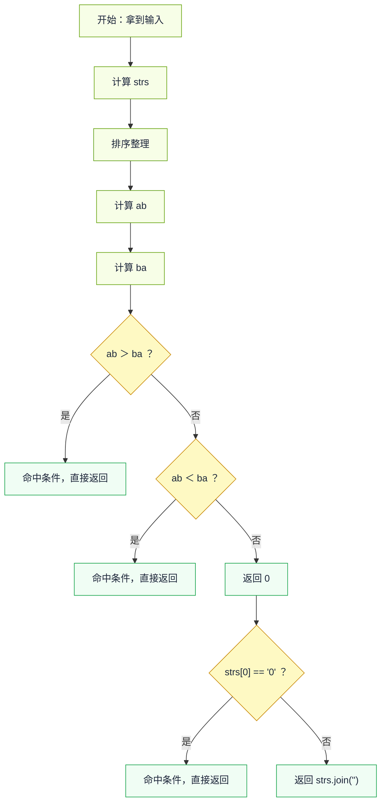

## TypeScript 解题方案（3 个方案逐个讲）

> **运行与提交**：每个方案都是自包含文件（内嵌用例自测，输出 PASS），整块复制到 `.ts` 文件后 `node 文件名` 即可运行。提交 LeetCode 时，把 `demo` 内的算法函数与辅助类型/函数整体取出、置于文件顶层即可。涉及交互/特殊接口的题以题面给定签名为准。

### 方案 1：方案1（自定义比较排序）

**分析与思路**：核心做法是「方案1（自定义比较排序）」。代码里依次做这些事：先排序再处理。

**运行方式**：`node 本文件`，内嵌用例全部通过会输出 PASS。

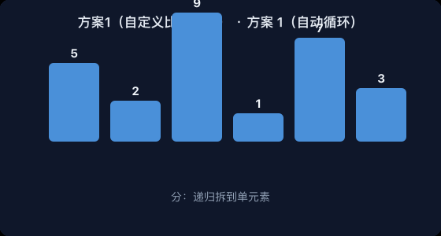

**方案专属流程图**（真实控制流）：

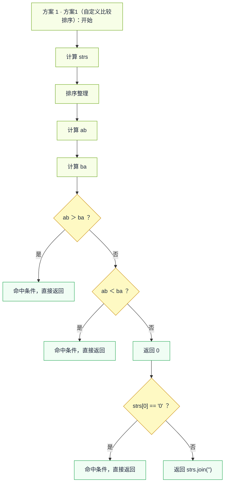

```typescript
/**
 ** LeetCode 179. 最大数
 ** 方案：方案1（自定义比较排序）
 */

function largestNumber(nums: number[]): string {
  // 定义函数/方法 largestNumber
  const strs = nums.map(String); // 把 数组.映射表(String) 存入 strs
  strs.sort((a, b) => {
    const ab = a + b; // 把 数组 加 b 存入 ab
    const ba = b + a; // 把 b 加 数组 存入 ba
    if (ab > ba) return -1; // 若 ab 超过 ba，直接返回 减 1
    if (ab < ba) return 1; // 若 ab 小于 ba，直接返回 1
    return 0; // 返回 0
  }); // });
  if (strs[0] === '0') return '0'; // 若 strs[0] 全等于 「0」，直接返回 「0」
  return strs.join(''); // 返回 strs.join(「」)
}

export function demo(): void {
  // 程序入口：跑内嵌自测用例
  if (largestNumber([1, 2, 3]) !== '321')
    // 若 largestNumber([1, 2, 3]) 不等于 「321」
    throw new Error("largestNumber([1,2,3]) should be '321'"); // throw new Error(「largestNumber([1,2,3]) should be '321'」);
  console.log('PASS'); // 全部用例通过，输出 PASS
}

demo(); // demo();
```

### 方案 2：方案2（自定义比较排序-优化）

**分析与思路**：核心做法是「方案2（自定义比较排序-优化）」。代码里依次做这些事：先排序再处理。

**运行方式**：`node 本文件`，内嵌用例全部通过会输出 PASS。

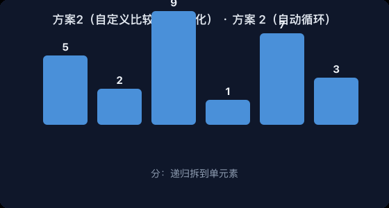

**方案专属流程图**（真实控制流）：

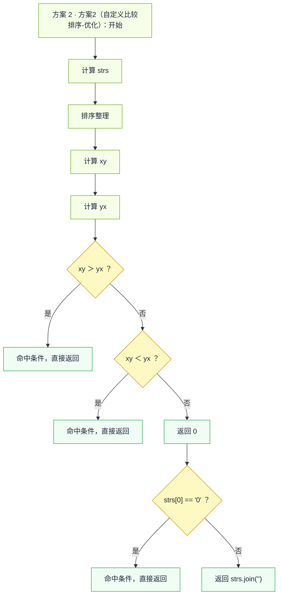

```typescript
/**
 ** LeetCode 179. 最大数
 ** 方案：方案2（自定义比较排序-优化）
 */

function largestNumber(nums: number[]): string {
  // 定义函数/方法 largestNumber
  const strs = nums.map(String); // 把 数组.映射表(String) 存入 strs
  strs.sort((x, y) => {
    const xy = x + y; // 把 x 加 y 存入 xy
    const yx = y + x; // 把 y 加 x 存入 yx
    if (xy > yx) return -1; // 若 xy 超过 yx，直接返回 减 1
    if (xy < yx) return 1; // 若 xy 小于 yx，直接返回 1
    return 0; // 返回 0
  }); // });
  if (strs[0] === '0') return '0'; // 若 strs[0] 全等于 「0」，直接返回 「0」
  return strs.join(''); // 返回 strs.join(「」)
}

export function demo(): void {
  // 程序入口：跑内嵌自测用例
  if (largestNumber([1, 2, 3]) !== '321')
    // 若 largestNumber([1, 2, 3]) 不等于 「321」
    throw new Error("largestNumber([1,2,3]) should be '321'"); // throw new Error(「largestNumber([1,2,3]) should be '321'」);
  console.log('PASS'); // 全部用例通过，输出 PASS
}

demo(); // demo();
```

### 方案 3：方案3（自定义比较排序-改造快排）

**分析与思路**：核心做法是「方案3（自定义比较排序-改造快排）」。代码里依次做这些事：先排序再处理。

**运行方式**：`node 本文件`，内嵌用例全部通过会输出 PASS。

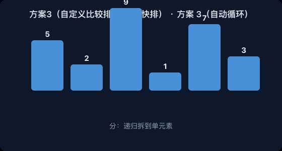

**方案专属流程图**（真实控制流）：

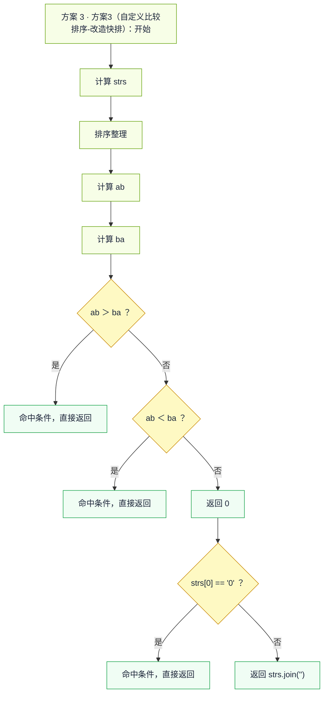

```typescript
/**
 ** LeetCode 179. 最大数
 ** 方案：方案3（自定义比较排序-改造快排）
 */

function largestNumber(nums: number[]): string {
  // 定义函数/方法 largestNumber
  const strs = nums.map(String); // 把 数组.映射表(String) 存入 strs
  strs.sort((a, b) => {
    const ab = a + b; // 把 数组 加 b 存入 ab
    const ba = b + a; // 把 b 加 数组 存入 ba
    if (ab > ba) return -1; // 若 ab 超过 ba，直接返回 减 1
    if (ab < ba) return 1; // 若 ab 小于 ba，直接返回 1
    return 0; // 返回 0
  }); // });
  if (strs[0] === '0') return '0'; // 若 strs[0] 全等于 「0」，直接返回 「0」
  return strs.join(''); // 返回 strs.join(「」)
}

export function demo(): void {
  // 程序入口：跑内嵌自测用例
  if (largestNumber([10, 2]) !== '210')
    // 若 largestNumber([10, 2]) 不等于 「210」
    throw new Error("largestNumber([10,2]) should be '210'"); // throw new Error(「largestNumber([10,2]) should be '210'」);
  if (largestNumber([3, 30, 34, 5, 9]) !== '9534330')
    // 若 largestNumber([3, 30, 34, 5, 9]) 不等于 「9534330」
    throw new Error("largestNumber([3,30,34,5,9]) should be '9534330'");
  console.log('PASS'); // 全部用例通过，输出 PASS
}

demo(); // demo();
```

## 逐步拆解与面试追问

**复杂度**：时间 O(n) 量级，空间 O(n)

**为什么是这个量级**：整体只对数据做有限趟处理

**面试官可能会追问**：

- 稳定性对结果有影响吗？
- 比较器怎么写才不会越界？
- 数据近有序时选哪种排序？

## 关键 API 速查（TS 主解法实际用到，附官方链接）

| API | 作用 | 使用要点 | 官方文档 |
|---|---|---|---|
| `Array.prototype.sort()` | 原地排序 | 默认按字符串 Unicode 序（10 会排在 2 前），数字必须传 (a,b)=>a-b；V8 用 TimSort，稳定，O(n log n)；返回原数组引用 | [官方文档](https://developer.mozilla.org/zh-CN/docs/Web/JavaScript/Reference/Global_Objects/Array/sort) |
| `Array.prototype.map()` | 逐元素映射为新数组 | 回调 (v,i,arr)；返回等长新数组，不改变原数组；稀疏位跳过；链式调用注意中间数组开销 | [官方文档](https://developer.mozilla.org/zh-CN/docs/Web/JavaScript/Reference/Global_Objects/Array/map) |
| `Array.prototype.join()` | 数组拼接为字符串 | undefined/null 转空串；嵌套数组会展平一层；join('') 用于字符数组还原 | [官方文档](https://developer.mozilla.org/zh-CN/docs/Web/JavaScript/Reference/Global_Objects/Array/join) |

### 各语言官方文档导航

- **TypeScript / JS**：[MDN 中文参考](https://developer.mozilla.org/zh-CN/)
- **Python**：[Python 官方文档](https://docs.python.org/zh-cn/3/)
- **Go**：[Go 标准库](https://pkg.go.dev/std)
- **Java**：[JDK 17 API](https://docs.oracle.com/en/java/javase/17/docs/api/)
- **Rust**：[Rust 标准库](https://doc.rust-lang.org/std/)
- **Lua**：[Lua 5.4 手册](https://www.lua.org/manual/5.4/)
- **C**：[Cppreference C](https://zh.cppreference.com/w/c)
- **C++**：[Cppreference C++](https://zh.cppreference.com/w/cpp)
- **R**：[R 官方手册](https://stat.ethz.ch/R-manual/)
- **Zig**：[Zig 语言文档](https://ziglang.org/documentation/master/)
- **Dart**：[Dart API](https://api.dart.dev/)

## 附录：其他 10 种语言全部实现（每种语言列举其全部方案）

> TypeScript 的全部方案见「TypeScript 解题方案」一节；下面是其余 10 种语言的对应实现，每种语言的每个方案都带思路分析、代码走读与专属运行架构图。
> 每个方案都内嵌用例自测，可独立运行（老仓库 python/go 文件遵循「打印结果」约定）。
> 完整解法文件见 `dsa/<语言>/sort/lc_179_最大数/`。

### Python 实现（3 种方案）

Python 的全部方案如下，每个方案都内嵌用例自测，可独立运行（老仓库 python/go 文件遵循「打印结果」约定）：

#### 方案 1：方案1（自定义比较排序）

**思路与代码分析**：核心是「方案1（自定义比较排序）」。Python 版用切片与字典推导式简化操作，突出可读性。代码里依次做这些事：先排序再处理。**走读**：方案 1 · 方案1（自定义比较排序）：开始 → 处理 from functools import cmp_to → 更新 xy → 更新 yx → 命中条件，直接返回 → 处理 elif xy ＜ yx: → 返回 1 → 返回 0 → 排序整理 → 更新 key → 处理 ) → 命中条件，直接返回 → 返回 .join(strs)。

**运行架构**（真实控制流）：

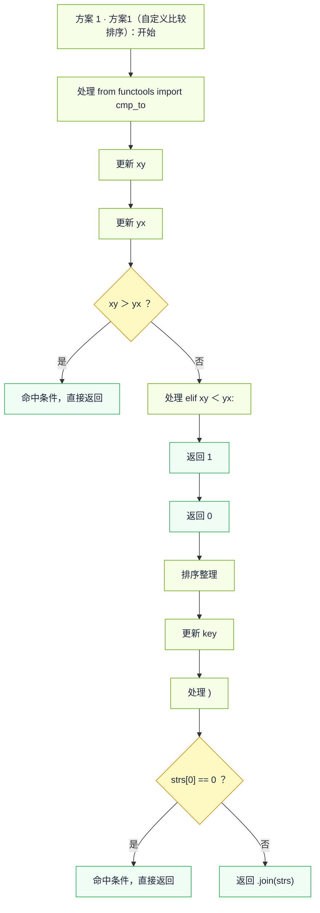

```python
import sys  # 提高递归深度上限（深输入防 RecursionError）

sys.setrecursionlimit(200000)  # 树/链表类题目节点数可达 1e4 量级

def largestNumber(nums):  # 定义函数 largestNumber（参数：数组）
    from functools import cmp_to_key  # from functools import cmp_to_key

    def compare(x, y):  # 定义函数 compare（参数：x, y）
        xy = str(x) + str(y)  # 把 str(x) 加 str(y) 存入 xy
        yx = str(y) + str(x)  # 把 str(y) 加 str(x) 存入 yx
        if xy > yx:  # 若 xy 超过 yx
            return -1  # 返回 减 1
        elif xy < yx:  # 否则，若 xy 小于 yx
            return 1  # 返回 1
        else:  # 否则
            return 0  # 返回 0

    strs = sorted(
        map(str, nums), key=cmp_to_key(compare)
    )  # 把 sorted(映射表(str, 数组), key 赋值为 cmp_to_key(compare)) 存入 strs
    if strs[0] == "0":  # 若 strs[0] 等于 '0'
        return "0"  # 返回 '0'
    return "".join(strs)  # 返回 ''.join(strs)

if __name__ == "__main__":  # 若 __name__ 等于 '__main__'
    print(largestNumber([1, 2, 3]))  # 打印输出
```

#### 方案 2：方案2（自定义比较排序-优化）

**思路与代码分析**：核心是「方案2（自定义比较排序-优化）」。Python 版用切片与字典推导式简化操作，突出可读性。代码里依次做这些事：先排序再处理。**走读**：方案 2 · 方案2（自定义比较排序-优化）：开始 → 处理 from functools import cmp_to → 更新 xy → 更新 yx → 返回 ( → 处理 -1 if xy ＞ yx else (1 if xy → 处理 ) → 更新 strs → 排序整理 → 命中条件，直接返回 → 返回 .join(strs)。

**运行架构**（真实控制流）：

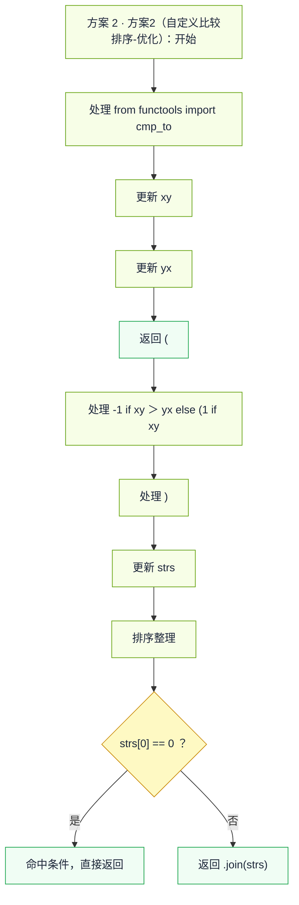

```python
import sys  # 提高递归深度上限（深输入防 RecursionError）

sys.setrecursionlimit(200000)  # 树/链表类题目节点数可达 1e4 量级

def largestNumber(nums):  # 定义函数 largestNumber（参数：数组）
    from functools import cmp_to_key  # from functools import cmp_to_key

    def compare(x, y):  # 定义函数 compare（参数：x, y）
        xy = str(x) + str(y)  # 把 str(x) 加 str(y) 存入 xy
        yx = str(y) + str(x)  # 把 str(y) 加 str(x) 存入 yx
        return (
            -1 if xy > yx else (1 if xy < yx else 0)
        )  # 返回 减 1 if xy 超过 yx else (1 if xy 小于 yx else 0)

    strs = [str(num) for num in nums]  # 把 [str(num) for num in 数组] 存入 strs
    strs.sort(key=cmp_to_key(compare))  # 排序
    if strs[0] == "0":  # 若 strs[0] 等于 '0'
        return "0"  # 返回 '0'
    return "".join(strs)  # 返回 ''.join(strs)

if __name__ == "__main__":  # 若 __name__ 等于 '__main__'
    print(largestNumber([1, 2, 3]))  # 打印输出
```

#### 方案 3：方案3（自定义比较排序-改造快排）

**思路与代码分析**：核心是「方案3（自定义比较排序-改造快排）」。Python 版用切片与字典推导式简化操作，突出可读性。代码里依次做这些事：先排序再处理。**走读**：方案 3 · 方案3（自定义比较排序-改造快排）：开始 → 更新 strs → 命中条件，直接返回 → 处理 elif a + b ＜ b + a: → 返回 1 → 返回 0 → 排序整理 → 命中条件，直接返回 → 返回 .join(strs)。

**运行架构**（真实控制流）：

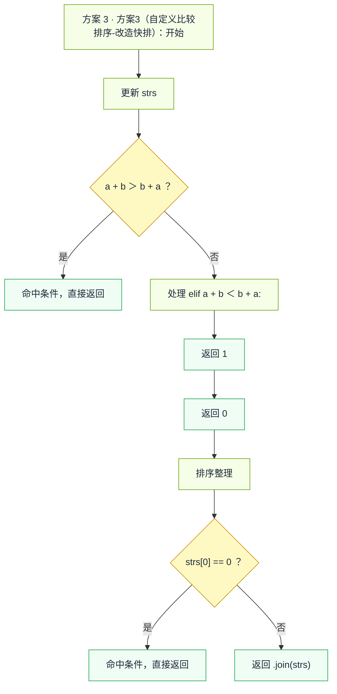

```python
import sys  # 提高递归深度上限（深输入防 RecursionError）

sys.setrecursionlimit(200000)  # 树/链表类题目节点数可达 1e4 量级
from functools import cmp_to_key  # from functools import cmp_to_key

def largestNumber(nums):  # 定义函数 largestNumber（参数：数组）
    strs = list(map(str, nums))  # 把 列表(映射表(str, 数组)) 存入 strs

    def cmp(a, b):  # 定义函数 cmp（参数：数组, b）
        if a + b > b + a:  # 若 数组 加 b 超过 b 加 数组
            return -1  # 返回 减 1
        elif a + b < b + a:  # 否则，若 数组 加 b 小于 b 加 数组
            return 1  # 返回 1
        return 0  # 返回 0

    strs.sort(key=cmp_to_key(cmp))  # 排序
    if strs[0] == "0":  # 若 strs[0] 等于 '0'
        return "0"  # 返回 '0'
    return "".join(strs)  # 返回 ''.join(strs)

if __name__ == "__main__":  # 若 __name__ 等于 '__main__'
    print(largestNumber([10, 2]))  # 打印输出
    print(largestNumber([3, 30, 34, 5, 9]))  # 打印输出
```

### Go 实现（3 种方案）

Go 的全部方案如下，每个方案都内嵌用例自测，可独立运行（老仓库 python/go 文件遵循「打印结果」约定）：

#### 方案 1：方案1（自定义比较排序）

**思路与代码分析**：核心是「方案1（自定义比较排序）」。Go 版用切片与多返回值惯用法，显式处理索引边界。**走读**：方案 1 · 方案1（自定义比较排序）：开始 → 更新 : → 遍历 nums 的下标与元素 v → 更新 strs[i] → 调用 sort.SliceStable(strs, func( → 返回 strs[i]+strs[j] ＞ strs[j]+strs[i] → 处理 if len(strs) ＞ 0 且 strs[0] → 返回 0 → 返回 strings.Join(strs, )。

**运行架构**（真实控制流）：


```go
package main // 引入依赖

import (
	"fmt"
	"os"
	"sort"
	"strconv"
	"strings"
) // 引入依赖

func largestNumber(nums []int) string { // 定义函数/方法 largestNumber
	strs := make([]string, len(nums)) // 把 make([]string, 长度(数组)) 写入 strs :
	for i, v := range nums {          // 同时取 下标 i 与 值 遍历
		strs[i] = strconv.Itoa(v) // 把 strconv.Itoa(值) 写入 strs[i]
	}
	sort.SliceStable(strs, func(i, j int) bool { // sort.SliceStable(strs, func(下标 i, 下标 j int) bool {
		return strs[i]+strs[j] > strs[j]+strs[i] // 返回 strs[下标 i] 加 strs[下标 j] 超过 strs[下标 j] 加 strs[下标 i]
	}) // })
	if len(strs) > 0 && strs[0] == "0" { // 若 长度(strs) 超过 0 且 strs[0] 等于 「0」
		return "0" // 返回 「0」
	}
	return strings.Join(strs, "") // 返回 strings.Join(strs, 「」)
}

func main() { // 程序入口：跑内嵌自测用例
	cases := []struct { // 把 []struct { 写入 cases :
		in   []int  // in []int
		want string // want string
	}{ // }{
		{[]int{1, 2, 3}, "321"},
		{[]int{10, 2}, "210"},
		{[]int{3, 30, 34, 5, 9}, "9534330"},
		{[]int{0, 0}, "0"},
		{[]int{30, 3, 34, 5, 9}, "9534330"},
	}
	ok := true                // 把 true 写入 ok :
	for _, c := range cases { // 同时取 _ 与 字符 遍历
		if got := largestNumber(c.in); got != c.want { // 若 got : 赋值为 largestNumber(字符.in); got 不等于 字符.want
			ok = false                                                           // 把 false 写入 ok
			fmt.Printf("FAIL largestNumber(%v)=%q want %q\n", c.in, got, c.want) // 打印输出
		}
	}
	if !ok { // 若 取反 ok
		os.Exit(1) // os.Exit(1)
	}
	fmt.Println("PASS") // 全部用例通过，输出 PASS
}
```

#### 方案 2：方案2（自定义比较排序-优化）

**思路与代码分析**：核心是「方案2（自定义比较排序-优化）」。Go 版用切片与多返回值惯用法，显式处理索引边界。**走读**：方案 2 · 方案2（自定义比较排序-优化）：开始 → 更新 : → 遍历 nums 的下标与元素 v → 更新 strs[i] → 调用 sort.SliceStable(strs, func( → 返回 strs[i]+strs[j] ＞ strs[j]+strs[i] → 处理 if len(strs) ＞ 0 且 strs[0] → 返回 0 → 返回 strings.Join(strs, )。

**运行架构**（真实控制流）：

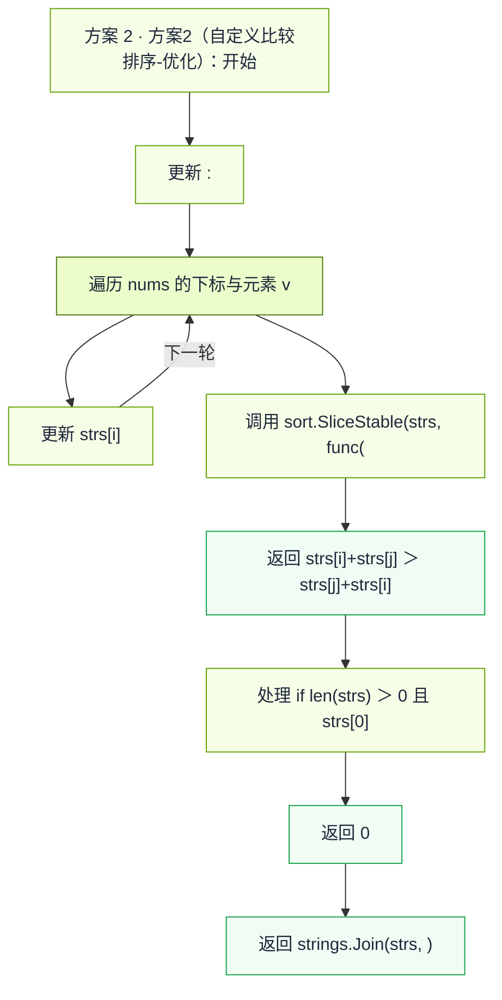

```go
package main // 引入依赖

import (
	"fmt"
	"os"
	"sort"
	"strconv"
	"strings"
) // 引入依赖

func largestNumber(nums []int) string { // 定义函数/方法 largestNumber
	strs := make([]string, len(nums)) // 把 make([]string, 长度(数组)) 写入 strs :
	for i, v := range nums {          // 同时取 下标 i 与 值 遍历
		strs[i] = strconv.Itoa(v) // 把 strconv.Itoa(值) 写入 strs[i]
	}
	sort.SliceStable(strs, func(i, j int) bool { // sort.SliceStable(strs, func(下标 i, 下标 j int) bool {
		return strs[i]+strs[j] > strs[j]+strs[i] // 返回 strs[下标 i] 加 strs[下标 j] 超过 strs[下标 j] 加 strs[下标 i]
	}) // })
	if len(strs) > 0 && strs[0] == "0" { // 若 长度(strs) 超过 0 且 strs[0] 等于 「0」
		return "0" // 返回 「0」
	}
	return strings.Join(strs, "") // 返回 strings.Join(strs, 「」)
}

func main() { // 程序入口：跑内嵌自测用例
	cases := []struct { // 把 []struct { 写入 cases :
		in   []int  // in []int
		want string // want string
	}{ // }{
		{[]int{1, 2, 3}, "321"},
		{[]int{10, 2}, "210"},
		{[]int{3, 30, 34, 5, 9}, "9534330"},
		{[]int{0, 0}, "0"},
		{[]int{30, 3, 34, 5, 9}, "9534330"},
	}
	ok := true                // 把 true 写入 ok :
	for _, c := range cases { // 同时取 _ 与 字符 遍历
		if got := largestNumber(c.in); got != c.want { // 若 got : 赋值为 largestNumber(字符.in); got 不等于 字符.want
			ok = false                                                           // 把 false 写入 ok
			fmt.Printf("FAIL largestNumber(%v)=%q want %q\n", c.in, got, c.want) // 打印输出
		}
	}
	if !ok { // 若 取反 ok
		os.Exit(1) // os.Exit(1)
	}
	fmt.Println("PASS") // 全部用例通过，输出 PASS
}
```

#### 方案 3：方案3（自定义比较排序-改造快排）

**思路与代码分析**：核心是「方案3（自定义比较排序-改造快排）」。Go 版用切片与多返回值惯用法，显式处理索引边界。**走读**：方案 3 · 方案3（自定义比较排序-改造快排）：开始 → 更新 : → 遍历 nums 的下标与元素 v → 更新 strs[i] → 调用 sort.SliceStable(strs, func( → 返回 strs[i]+strs[j] ＞ strs[j]+strs[i] → 处理 if len(strs) ＞ 0 且 strs[0] → 返回 0 → 返回 strings.Join(strs, )。

**运行架构**（真实控制流）：

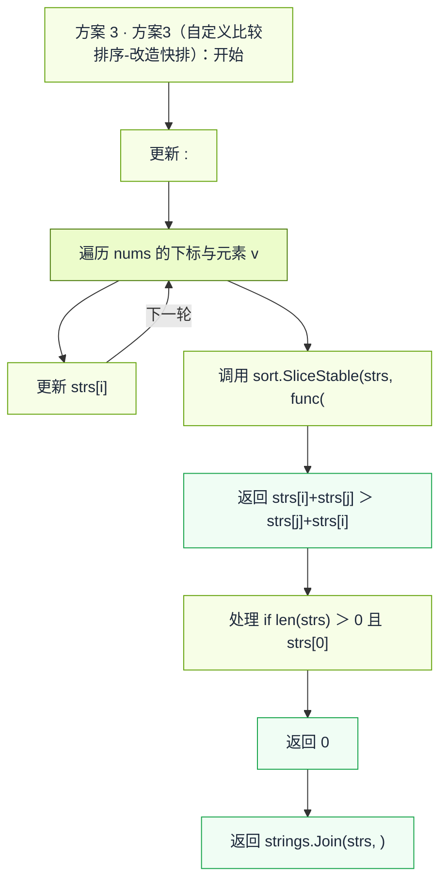

```go
package main // 引入依赖

import (
	"fmt"
	"os"
	"sort"
	"strconv"
	"strings"
) // 引入依赖

func largestNumber(nums []int) string { // 定义函数/方法 largestNumber
	strs := make([]string, len(nums)) // 把 make([]string, 长度(数组)) 写入 strs :
	for i, v := range nums {          // 同时取 下标 i 与 值 遍历
		strs[i] = strconv.Itoa(v) // 把 strconv.Itoa(值) 写入 strs[i]
	}
	sort.SliceStable(strs, func(i, j int) bool { // sort.SliceStable(strs, func(下标 i, 下标 j int) bool {
		return strs[i]+strs[j] > strs[j]+strs[i] // 返回 strs[下标 i] 加 strs[下标 j] 超过 strs[下标 j] 加 strs[下标 i]
	}) // })
	if len(strs) > 0 && strs[0] == "0" { // 若 长度(strs) 超过 0 且 strs[0] 等于 「0」
		return "0" // 返回 「0」
	}
	return strings.Join(strs, "") // 返回 strings.Join(strs, 「」)
}

func main() { // 程序入口：跑内嵌自测用例
	cases := []struct { // 把 []struct { 写入 cases :
		in   []int  // in []int
		want string // want string
	}{ // }{
		{[]int{1, 2, 3}, "321"},
		{[]int{10, 2}, "210"},
		{[]int{3, 30, 34, 5, 9}, "9534330"},
		{[]int{0, 0}, "0"},
		{[]int{30, 3, 34, 5, 9}, "9534330"},
	}
	ok := true                // 把 true 写入 ok :
	for _, c := range cases { // 同时取 _ 与 字符 遍历
		if got := largestNumber(c.in); got != c.want { // 若 got : 赋值为 largestNumber(字符.in); got 不等于 字符.want
			ok = false                                                           // 把 false 写入 ok
			fmt.Printf("FAIL largestNumber(%v)=%q want %q\n", c.in, got, c.want) // 打印输出
		}
	}
	if !ok { // 若 取反 ok
		os.Exit(1) // os.Exit(1)
	}
	fmt.Println("PASS") // 全部用例通过，输出 PASS
}
```

### Java 实现（3 种方案）

Java 的全部方案如下，每个方案都内嵌用例自测，可独立运行（老仓库 python/go 文件遵循「打印结果」约定）：

#### 方案 1：方案1（自定义比较排序）

**思路与代码分析**：核心是「方案1（自定义比较排序）」。Java 版用类与静态方法组织，集合操作显式明了。代码里依次做这些事：先排序再处理；双重循环遍历。**走读**：方案 1 · 方案1（自定义比较排序）：开始 → 更新 strs → 遍历循环 → 命中条件，直接返回 → 命中条件，直接返回 → 遍历循环 → 返回 sb.toString()。

**运行架构**（真实控制流）：

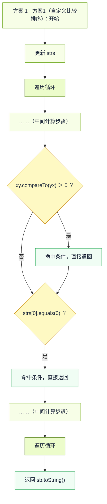

```java
package com.webfault.dsa; // 引入依赖

import java.util.*; // 引入依赖

class Main { // 定义类型
  // faithful translation of python solution_1_1_____1___.py (cmp_to_key: xy>yx => -1)
  static String largestNumber(int[] nums) { // 定义函数/方法 largestNumber
    String[] strs = new String[nums.length]; // 把 new String[数组.长度]; 写入 String[] strs
    for (int i = 0; i < nums.length; i++)
      strs[i] = String.valueOf(nums[i]); // 让 下标 i 从 0 开始计数，下标 i 小于 数组.长度 就继续
    Arrays.sort(
        strs,
        new Comparator<String>() { // 排序
          public int compare(String x, String y) { // 定义函数/方法 compare
            String xy = x + y; // 把 x 加 y 存入 xy
            String yx = y + x; // 把 y 加 x 存入 yx
            if (xy.compareTo(yx) > 0) return -1; // 若 xy.compareTo(yx) 超过 0，直接返回 减 1
            else if (xy.compareTo(yx) < 0) return 1; // 否则，若 xy.compareTo(yx) 小于 0) return 1;
            else return 0; // 否则
          }
        }); // });
    if (strs[0].equals("0")) return "0"; // 若 strs[0].equals(「0」)，直接返回 「0」
    StringBuilder sb = new StringBuilder(); // 把 new StringBuilder(); 写入 StringBuilder sb
    for (String s : strs) sb.append(s); // 把 字符串 追加到列表尾部
    return sb.toString(); // 返回 sb.toString()
  }

  public static void main(String[] args) { // public static void main(String[] args) {
    int[][] cases = { // 把 { 写入 int[][] cases
      {10, 2},
      {3, 30, 34, 5, 9},
      {0, 0},
      {1},
    };
    String[] wants = {
      "210", "9534330", "0", "1"
    }; // 把 {「210」, 「210」, 「210」, 「210」}; 写入 String[] wants
    boolean ok = true; // 把 true; 写入 boolean ok
    for (int ci = 0; ci < cases.length; ci++) { // 让 ci 从 0 开始计数，ci 小于 cases.长度 就继续
      String got = largestNumber(cases[ci]); // 把 largestNumber(cases[ci]) 存入 got
      if (!got.equals(wants[ci])) { // 若 取反 got.equals(wants[ci]
        ok = false; // 把 false; 写入 ok
        System.out.println(
            "FAIL largestNumber("
                + Arrays.toString(cases[ci])
                + ")=\""
                + got
                + "\" want \""
                + wants[ci]
                + "\""); // 打印输出
      }
    }
    if (!ok) throw new RuntimeException("FAILED"); // 若 取反 ok) throw new RuntimeException(「FAILED」);
    System.out.println("PASS"); // 全部用例通过，输出 PASS
  }
}
```

#### 方案 2：方案2（自定义比较排序-优化）

**思路与代码分析**：核心是「方案2（自定义比较排序-优化）」。Java 版用类与静态方法组织，集合操作显式明了。代码里依次做这些事：先排序再处理；双重循环遍历。**走读**：方案 2 · 方案2（自定义比较排序-优化）：开始 → 更新 strs → 遍历循环 → 更新 strs[i] → 排序整理 → 处理 strs, → 处理 new Comparator＜String＞() → 处理 public int compare(String x, → 更新 xy → 更新 yx → 返回 xy.compareTo(yx) ＞ 0 ? -1 : (xy.compareTo(yx) ＜ 0 ? 1 : 0) → 命中条件，直接返回 → 更新 sb → 遍历循环 → 返回 sb.toString()。

**运行架构**（真实控制流）：

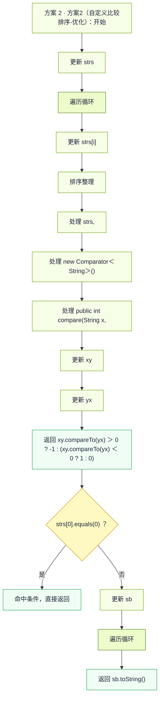

```java
package com.webfault.dsa; // 引入依赖

import java.util.*; // 引入依赖

class Main { // 定义类型
  // faithful translation of python solution_2_2_____2___-__.py (cmp_to_key one-liner)
  static String largestNumber(int[] nums) { // 定义函数/方法 largestNumber
    String[] strs = new String[nums.length]; // 把 new String[数组.长度]; 写入 String[] strs
    for (int i = 0; i < nums.length; i++)
      strs[i] = String.valueOf(nums[i]); // 让 下标 i 从 0 开始计数，下标 i 小于 数组.长度 就继续
    Arrays.sort(
        strs,
        new Comparator<String>() { // 排序
          public int compare(String x, String y) { // 定义函数/方法 compare
            String xy = x + y; // 把 x 加 y 存入 xy
            String yx = y + x; // 把 y 加 x 存入 yx
            return xy.compareTo(yx) > 0 ? -1 : (xy.compareTo(yx) < 0 ? 1 : 0);
          }
        }); // });
    if (strs[0].equals("0")) return "0"; // 若 strs[0].equals(「0」)，直接返回 「0」
    StringBuilder sb = new StringBuilder(); // 把 new StringBuilder(); 写入 StringBuilder sb
    for (String s : strs) sb.append(s); // 把 字符串 追加到列表尾部
    return sb.toString(); // 返回 sb.toString()
  }

  public static void main(String[] args) { // public static void main(String[] args) {
    int[][] cases = { // 把 { 写入 int[][] cases
      {10, 2},
      {3, 30, 34, 5, 9},
      {0, 0},
      {1},
    };
    String[] wants = {
      "210", "9534330", "0", "1"
    }; // 把 {「210」, 「210」, 「210」, 「210」}; 写入 String[] wants
    boolean ok = true; // 把 true; 写入 boolean ok
    for (int ci = 0; ci < cases.length; ci++) { // 让 ci 从 0 开始计数，ci 小于 cases.长度 就继续
      String got = largestNumber(cases[ci]); // 把 largestNumber(cases[ci]) 存入 got
      if (!got.equals(wants[ci])) { // 若 取反 got.equals(wants[ci]
        ok = false; // 把 false; 写入 ok
        System.out.println(
            "FAIL largestNumber("
                + Arrays.toString(cases[ci])
                + ")=\""
                + got
                + "\" want \""
                + wants[ci]
                + "\""); // 打印输出
      }
    }
    if (!ok) throw new RuntimeException("FAILED"); // 若 取反 ok) throw new RuntimeException(「FAILED」);
    System.out.println("PASS"); // 全部用例通过，输出 PASS
  }
}
```

#### 方案 3：方案3（自定义比较排序-改造快排）

**思路与代码分析**：核心是「方案3（自定义比较排序-改造快排）」。Java 版用类与静态方法组织，集合操作显式明了。代码里依次做这些事：双重循环遍历。**走读**：方案 3 · 方案3（自定义比较排序-改造快排）：开始 → 更新 strs → 遍历循环 → 更新 strs[i] → 调用 quickSort(strs, 0, strs.leng → 更新 sb → 遍历循环 → 更新 res → 命中条件，直接返回 → 返回 res。

**运行架构**（真实控制流）：

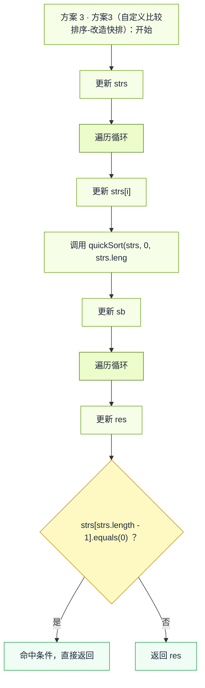

```java
package com.webfault.dsa; // 引入依赖

import java.util.*; // 引入依赖

class Main { // 定义类型
  // faithful translation of python solution_3_3_____3___-____.py (cmp sort via quickSort)
  static String largestNumber(int[] nums) { // 定义函数/方法 largestNumber
    String[] strs = new String[nums.length]; // 把 new String[数组.长度]; 写入 String[] strs
    for (int i = 0; i < nums.length; i++)
      strs[i] = String.valueOf(nums[i]); // 让 下标 i 从 0 开始计数，下标 i 小于 数组.长度 就继续
    quickSort(strs, 0, strs.length - 1); // quickSort(strs, 0, strs.长度 减 1);
    StringBuilder sb = new StringBuilder(); // 把 new StringBuilder(); 写入 StringBuilder sb
    for (String s : strs) sb.append(s); // 把 字符串 追加到列表尾部
    String res = sb.toString(); // 把 sb.toString() 存入 结果
    if (strs[strs.length - 1].equals("0")) return "0"; // 若 strs[strs.长度 减 1].equals(「0」)，直接返回 「0」
    return res; // 返回 结果
  }

  static void quickSort(String[] strs, int l, int r) { // 定义函数/方法 quickSort
    if (l >= r) return; // 若 左指针 不低于 右指针) return;
    int i = l, j = r; // 把 左指针, 下标 j 赋值为 右指针 存入 下标 i
    String pivot = strs[l + (r - l) / 2]; // 把 strs[(左指针 加 右指针) 除以 2] 存入 pivot
    while (i <= j) { // 循环，直到不满足「下标 i 不超过 下标 j」
      while ((strs[i] + pivot).compareTo(pivot + strs[i]) > 0) i++;
      while ((strs[j] + pivot).compareTo(pivot + strs[j]) < 0) j--;
      if (i <= j) { // 若 下标 i 不超过 下标 j
        String tmp = strs[i]; // 把 strs[下标 i] 存入 临时变量
        strs[i] = strs[j]; // 把 strs[下标 j]; 写入 strs[i]
        strs[j] = tmp; // 把 临时变量; 写入 strs[j]
        i++; // 下标 i 加一
        j--; // 下标 j 减一
      }
    }
    if (l < j) quickSort(strs, l, j); // 若 左指针 小于 下标 j) quickSort(strs, 左指针, 下标 j);
    if (r > i) quickSort(strs, i, r); // 若 右指针 超过 下标 i) quickSort(strs, 下标 i, 右指针);
  }

  public static void main(String[] args) { // public static void main(String[] args) {
    int[][] cases = { // 把 { 写入 int[][] cases
      {10, 2},
      {3, 30, 34, 5, 9},
      {0, 0},
      {1},
    };
    String[] wants = {
      "210", "9534330", "0", "1"
    }; // 把 {「210」, 「210」, 「210」, 「210」}; 写入 String[] wants
    boolean ok = true; // 把 true; 写入 boolean ok
    for (int ci = 0; ci < cases.length; ci++) { // 让 ci 从 0 开始计数，ci 小于 cases.长度 就继续
      String got = largestNumber(cases[ci]); // 把 largestNumber(cases[ci]) 存入 got
      if (!got.equals(wants[ci])) { // 若 取反 got.equals(wants[ci]
        ok = false; // 把 false; 写入 ok
        System.out.println(
            "FAIL largestNumber("
                + Arrays.toString(cases[ci])
                + ")=\""
                + got
                + "\" want \""
                + wants[ci]
                + "\""); // 打印输出
      }
    }
    if (!ok) throw new RuntimeException("FAILED"); // 若 取反 ok) throw new RuntimeException(「FAILED」);
    System.out.println("PASS"); // 全部用例通过，输出 PASS
  }
}
```

### Rust 实现（3 种方案）

Rust 的全部方案如下，每个方案都内嵌用例自测，可独立运行（老仓库 python/go 文件遵循「打印结果」约定）：

#### 方案 1：方案1（自定义比较排序）

**思路与代码分析**：核心是「方案1（自定义比较排序）」。Rust 版用所有权移动与切片借用改写同一逻辑，注意 Option 与引用边界。**走读**：方案 1 · 方案1（自定义比较排序）：开始 → 计算 strs → 调用 strs.sort_by(｜a, b｜ → 计算 ab → 计算 ba → 调用 ba.cmp(&ab) → 处理 if strs[0] == 0 → 返回 0.to_string() → 调用 strs.concat()。

**运行架构**（真实控制流）：

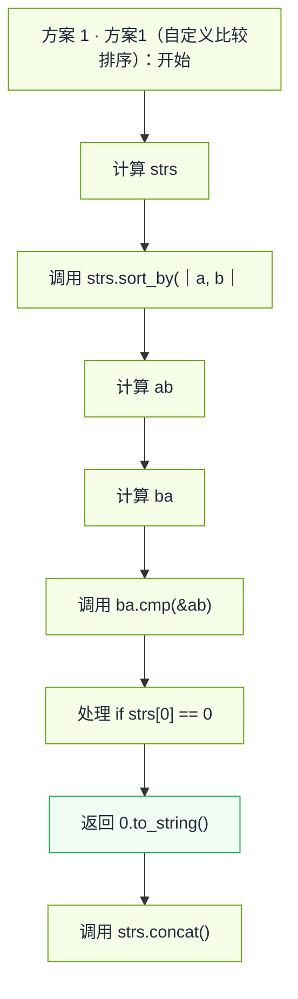

```rust
// LeetCode 179. 最大数 — Rust 版（方案1）
fn largest_number(nums: Vec<i32>) -> String {
    // 定义函数/方法 largest_number
    let mut strs: Vec<String> = nums.iter().map(|x| x.to_string()).collect();
    strs.sort_by(|a, b| {
        // strs.sort_by( 按位或 数组, b 按位或 {
        let ab = format!("{}{}", a, b); // 把 format取反 (「{}{}」, 数组, b) 存入 ab
        let ba = format!("{}{}", b, a); // 把 format取反 (「{}{}」, b, 数组) 存入 ba
        ba.cmp(&ab) // ba.cmp( 按位与 ab)
    }); // });
    if strs[0] == "0" {
        return "0".to_string();
    } // 若 strs[0] 等于 「0」 { return 「0」.to_string(); }
    strs.concat() // 打印输出
}
fn main() {
    // 程序入口：跑内嵌自测用例
    assert_eq!(largest_number(vec![10, 2]), "210"); // 断言校验
    assert_eq!(largest_number(vec![3, 30, 34, 5, 9]), "9534330"); // 断言校验
    assert_eq!(largest_number(vec![0, 0]), "0"); // 断言校验
    println!("PASS"); // 全部用例通过，输出 PASS
}
```

#### 方案 2：方案2（自定义比较排序-优化）

**思路与代码分析**：核心是「方案2（自定义比较排序-优化）」。Rust 版用所有权移动与切片借用改写同一逻辑，注意 Option 与引用边界。**走读**：方案 2 · 方案2（自定义比较排序-优化）：开始 → 计算 strs → 调用 strs.sort_by(｜a, b｜ → 计算 ab → 计算 ba → 调用 ba.cmp(&ab) → 处理 if strs[0] == 0 → 返回 0.to_string() → 调用 strs.concat()。

**运行架构**（真实控制流）：

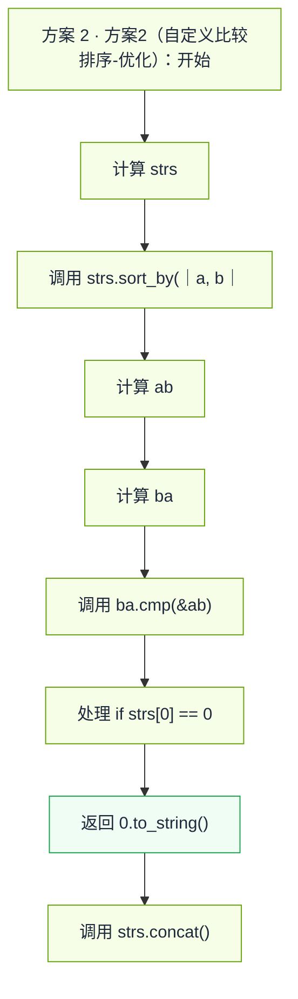

```rust
// LeetCode 179. 最大数 — Rust 版（方案2）
fn largest_number(nums: Vec<i32>) -> String {
    // 定义函数/方法 largest_number
    let mut strs: Vec<String> = nums.iter().map(|x| x.to_string()).collect();
    strs.sort_by(|a, b| {
        // strs.sort_by( 按位或 数组, b 按位或 {
        let ab = format!("{}{}", a, b); // 把 format取反 (「{}{}」, 数组, b) 存入 ab
        let ba = format!("{}{}", b, a); // 把 format取反 (「{}{}」, b, 数组) 存入 ba
        ba.cmp(&ab) // ba.cmp( 按位与 ab)
    }); // });
    if strs[0] == "0" {
        return "0".to_string();
    } // 若 strs[0] 等于 「0」 { return 「0」.to_string(); }
    strs.concat() // 打印输出
}
fn main() {
    // 程序入口：跑内嵌自测用例
    assert_eq!(largest_number(vec![10, 2]), "210"); // 断言校验
    assert_eq!(largest_number(vec![3, 30, 34, 5, 9]), "9534330"); // 断言校验
    assert_eq!(largest_number(vec![0, 0]), "0"); // 断言校验
    println!("PASS"); // 全部用例通过，输出 PASS
}
```

#### 方案 3：方案3（自定义比较排序-改造快排）

**思路与代码分析**：核心是「方案3（自定义比较排序-改造快排）」。Rust 版用所有权移动与切片借用改写同一逻辑，注意 Option 与引用边界。**走读**：方案 3 · 方案3（自定义比较排序-改造快排）：开始 → 计算 strs → 调用 strs.sort_by(｜a, b｜ → 计算 ab → 计算 ba → 调用 ba.cmp(&ab) → 处理 if strs[0] == 0 → 返回 0.to_string() → 调用 strs.concat()。

**运行架构**（真实控制流）：

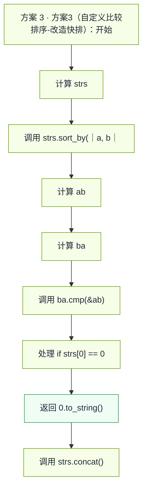

```rust
// LeetCode 179. 最大数 — Rust 版（方案3）
fn largest_number(nums: Vec<i32>) -> String {
    // 定义函数/方法 largest_number
    let mut strs: Vec<String> = nums.iter().map(|x| x.to_string()).collect();
    strs.sort_by(|a, b| {
        // strs.sort_by( 按位或 数组, b 按位或 {
        let ab = format!("{}{}", a, b); // 把 format取反 (「{}{}」, 数组, b) 存入 ab
        let ba = format!("{}{}", b, a); // 把 format取反 (「{}{}」, b, 数组) 存入 ba
        ba.cmp(&ab) // ba.cmp( 按位与 ab)
    }); // });
    if strs[0] == "0" {
        return "0".to_string();
    } // 若 strs[0] 等于 「0」 { return 「0」.to_string(); }
    strs.concat() // 打印输出
}
fn main() {
    // 程序入口：跑内嵌自测用例
    assert_eq!(largest_number(vec![10, 2]), "210"); // 断言校验
    assert_eq!(largest_number(vec![3, 30, 34, 5, 9]), "9534330"); // 断言校验
    assert_eq!(largest_number(vec![0, 0]), "0"); // 断言校验
    println!("PASS"); // 全部用例通过，输出 PASS
}
```

### Lua 实现（3 种方案）

Lua 的全部方案如下，每个方案都内嵌用例自测，可独立运行（老仓库 python/go 文件遵循「打印结果」约定）：

#### 方案 1：方案1（自定义比较排序）

**思路与代码分析**：核心是「方案1（自定义比较排序）」。Lua 版用表与 ipairs 遍历，注意 ipairs 遇 nil 即停的语义。代码里依次做这些事：先排序再处理。**走读**：方案 1 · 方案1（自定义比较排序）：开始 → 更新 strs → 遍历 ipairs(nums) do 中的每个元素 v → 更新 strs[i] → 排序整理 → 返回 a .. b ＞ b .. a → 处理 if strs[1] == 0 then → 返回 0 → 返回 table.concat(strs)。

**运行架构**（真实控制流）：

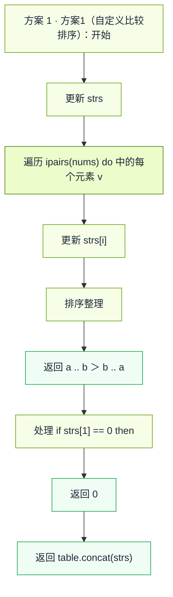

```lua
-- LeetCode 179. 最大数 — Lua 版（方案1）
local function largest_number(nums) -- local function largest_number(数组)
	local strs = {} -- 把 {} 写入 local strs
	for i, v in ipairs(nums) do
		strs[i] = tostring(v)
	end -- 遍历取 值
	table.sort(strs, function(a, b) -- 排序
		return a .. b > b .. a -- 返回 数组 .. b 超过 b .. 数组
	end) -- 终点)
	if strs[1] == "0" then
		return "0"
	end -- 若 strs[1] 等于 「0」 then return 「0」 终点
	return table.concat(strs) -- 返回 table.concat(strs)
end -- 终点
assert(largest_number({ 10, 2 }) == "210") -- 断言校验
assert(largest_number({ 3, 30, 34, 5, 9 }) == "9534330") -- 断言校验
assert(largest_number({ 0, 0 }) == "0") -- 断言校验
print("PASS") -- 全部用例通过，输出 PASS
```

#### 方案 2：方案2（自定义比较排序-优化）

**思路与代码分析**：核心是「方案2（自定义比较排序-优化）」。Lua 版用表与 ipairs 遍历，注意 ipairs 遇 nil 即停的语义。代码里依次做这些事：先排序再处理。**走读**：方案 2 · 方案2（自定义比较排序-优化）：开始 → 更新 strs → 遍历 ipairs(nums) do 中的每个元素 v → 更新 strs[i] → 排序整理 → 返回 a .. b ＞ b .. a → 处理 if strs[1] == 0 then → 返回 0 → 返回 table.concat(strs)。

**运行架构**（真实控制流）：

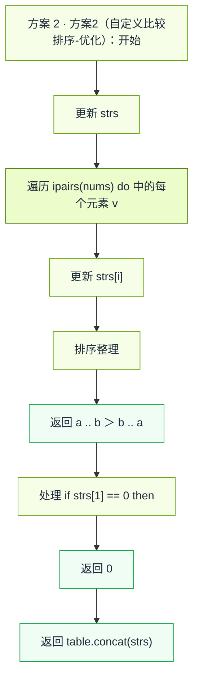

```lua
-- LeetCode 179. 最大数 — Lua 版（方案2）
local function largest_number(nums) -- local function largest_number(数组)
	local strs = {} -- 把 {} 写入 local strs
	for i, v in ipairs(nums) do
		strs[i] = tostring(v)
	end -- 遍历取 值
	table.sort(strs, function(a, b) -- 排序
		return a .. b > b .. a -- 返回 数组 .. b 超过 b .. 数组
	end) -- 终点)
	if strs[1] == "0" then
		return "0"
	end -- 若 strs[1] 等于 「0」 then return 「0」 终点
	return table.concat(strs) -- 返回 table.concat(strs)
end -- 终点
assert(largest_number({ 10, 2 }) == "210") -- 断言校验
assert(largest_number({ 3, 30, 34, 5, 9 }) == "9534330") -- 断言校验
assert(largest_number({ 0, 0 }) == "0") -- 断言校验
print("PASS") -- 全部用例通过，输出 PASS
```

#### 方案 3：方案3（自定义比较排序-改造快排）

**思路与代码分析**：核心是「方案3（自定义比较排序-改造快排）」。Lua 版用表与 ipairs 遍历，注意 ipairs 遇 nil 即停的语义。代码里依次做这些事：先排序再处理。**走读**：方案 3 · 方案3（自定义比较排序-改造快排）：开始 → 更新 strs → 遍历 ipairs(nums) do 中的每个元素 v → 更新 strs[i] → 排序整理 → 返回 a .. b ＞ b .. a → 处理 if strs[1] == 0 then → 返回 0 → 返回 table.concat(strs)。

**运行架构**（真实控制流）：

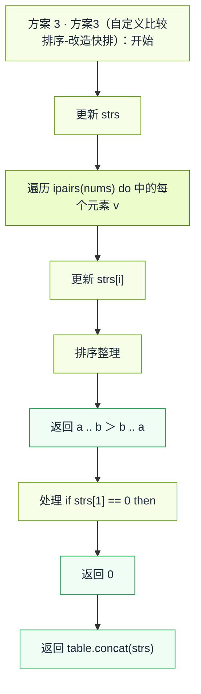

```lua
-- LeetCode 179. 最大数 — Lua 版（方案3）
local function largest_number(nums) -- local function largest_number(数组)
	local strs = {} -- 把 {} 写入 local strs
	for i, v in ipairs(nums) do
		strs[i] = tostring(v)
	end -- 遍历取 值
	table.sort(strs, function(a, b) -- 排序
		return a .. b > b .. a -- 返回 数组 .. b 超过 b .. 数组
	end) -- 终点)
	if strs[1] == "0" then
		return "0"
	end -- 若 strs[1] 等于 「0」 then return 「0」 终点
	return table.concat(strs) -- 返回 table.concat(strs)
end -- 终点
assert(largest_number({ 10, 2 }) == "210") -- 断言校验
assert(largest_number({ 3, 30, 34, 5, 9 }) == "9534330") -- 断言校验
assert(largest_number({ 0, 0 }) == "0") -- 断言校验
print("PASS") -- 全部用例通过，输出 PASS
```

### C 实现（3 种方案）

C 的全部方案如下，每个方案都内嵌用例自测，可独立运行（老仓库 python/go 文件遵循「打印结果」约定）：

#### 方案 1：方案1（自定义比较排序）

**思路与代码分析**：核心是「方案1（自定义比较排序）」。C 版手动管理下标与内存，循环边界全部显式写出。代码里依次做这些事：双重循环遍历。**走读**：方案 1 · 方案1（自定义比较排序）：开始 → 处理 char strs[64][16] → 计算 char → 遍历循环 → 调用 snprintf(strs[i], sizeof(str → 更新 ptrs[i] → 调用 qsort(ptrs, n, sizeof(char * → 若 n ＞ 0 且 strcmp(ptrs[0], 0) == 0 则： → 调用 strcpy(out, 0) → 返回  → 更新 out[0] → 遍历循环 → 调用 strcat(out, ptrs[i])。

**运行架构**（真实控制流）：

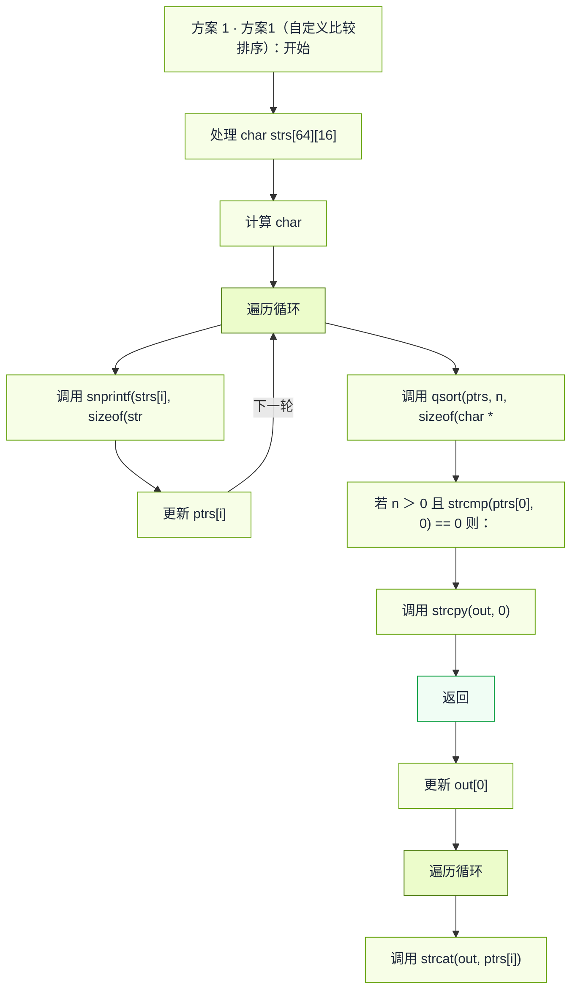

```c
/* LeetCode 179. 最大数 — C 版（方案1） */
#include <stdio.h>                                                          // 引入头文件
#include <stdlib.h>                                                         // 引入头文件
#include <string.h>                                                         // 引入头文件
static int cmp_str(const void *a, const void *b) {                          // 定义函数/方法 cmp_str
    char ab[64], ba[64];                                                    // char ab[64], ba[64];
    snprintf(ab, sizeof(ab), "%s%s", *(const char **)a, *(const char **)b); // 打印输出
    snprintf(ba, sizeof(ba), "%s%s", *(const char **)b, *(const char **)a); // 打印输出
    return strcmp(ba, ab);                                                  // 返回 strcmp(ba, ab)
}
static void largest_number(const int *nums, int n, char out[]) { // 定义函数/方法 largest_number
    char strs[64][16];                                           // char strs[64][16];
    const char *ptrs[64];                                        // const char 乘 ptrs[64];
    for (int i = 0; i < n; i++) { // 让 下标 i 从 0 开始计数，下标 i 小于 元素个数 就继续
        snprintf(strs[i], sizeof(strs[i]), "%d", nums[i]); // 打印输出
        ptrs[i] = strs[i];                                 // 把 strs[下标 i]; 写入 ptrs[i]
    }
    qsort(ptrs, n, sizeof(char *), cmp_str); // qsort(ptrs, 元素个数, sizeof(char 乘 ), cmp_str);
    if (n > 0 && strcmp(ptrs[0], "0") == 0) {
        strcpy(out, "0");
        return;
    }
    out[0] = '\0'; // 把 '\0'; 写入 out[0]
    for (int i = 0; i < n; i++)
        strcat(out, ptrs[i]); // 让 下标 i 从 0 开始计数，下标 i 小于 元素个数 就继续
}
int main(void) {                            // 程序入口：跑内嵌自测用例
    char out[4096];                         // char out[4096];
    largest_number((int[]){10, 2}, 2, out); // largest_number((int[]){10,2}, 2, out);
    if (strcmp(out, "210") != 0) {
        printf("FAIL 1 %s\n", out);
        return 1;
    } // 若 strcmp(out, 「210」) 不等于 0) { 输出「210」, out); return 1; }
    largest_number((int[]){3, 30, 34, 5, 9}, 5, out); // largest_number((int[]){3,30,34,5,9}, 5, out);
    if (strcmp(out, "9534330") != 0) {
        printf("FAIL 2 %s\n", out);
        return 1;
    }
    largest_number((int[]){0, 0}, 2, out); // largest_number((int[]){0,0}, 2, out);
    if (strcmp(out, "0") != 0) {
        printf("FAIL 3 %s\n", out);
        return 1;
    }                 // 若 strcmp(out, 「0」) 不等于 0) { 输出「0」, out); return 1; }
    printf("PASS\n"); // 全部用例通过，输出 PASS
    return 0;         // 返回 0
}
```

#### 方案 2：方案2（自定义比较排序-优化）

**思路与代码分析**：核心是「方案2（自定义比较排序-优化）」。C 版手动管理下标与内存，循环边界全部显式写出。代码里依次做这些事：双重循环遍历。**走读**：方案 2 · 方案2（自定义比较排序-优化）：开始 → 处理 char strs[64][16] → 计算 char → 遍历循环 → 调用 snprintf(strs[i], sizeof(str → 更新 ptrs[i] → 调用 qsort(ptrs, n, sizeof(char * → 若 n ＞ 0 且 strcmp(ptrs[0], 0) == 0 则： → 调用 strcpy(out, 0) → 返回  → 更新 out[0] → 遍历循环 → 调用 strcat(out, ptrs[i])。

**运行架构**（真实控制流）：

```mermaid
graph TD
    N0["方案 2 · 方案2（自定义比较排序-优化）：开始"]
    N1["处理 char strs[64][16]"]
    N2["计算 char"]
    N3["遍历循环"]
    N4["调用 snprintf(strs[i], sizeof(str"]
    N5["更新 ptrs[i]"]
    N6["调用 qsort(ptrs, n, sizeof(char *"]
    N7["若 n ＞ 0 且 strcmp(ptrs[0], 0) == 0 则："]
    N8["调用 strcpy(out, 0)"]
    N9["返回 "]
    N10["更新 out[0]"]
    N11["遍历循环"]
    N12["调用 strcat(out, ptrs[i])"]
    N0 --> N1
    N1 --> N2
    N2 --> N3
    N3 --> N4
    N4 --> N5
    N5 -- 下一轮 --> N3
    N3 --> N6
    N6 --> N7
    N7 --> N8
    N8 --> N9
    N9 --> N10
    N10 --> N11
    N11 --> N12
    classDef n fill:#f7fee7,stroke:#65a30d,color:#1e293b;
    classDef lp fill:#ecfccb,stroke:#4d7c0f,color:#1e293b;
    classDef dc fill:#fef9c3,stroke:#ca8a04,color:#1e293b;
    classDef tm fill:#f0fdf4,stroke:#16a34a,color:#1e293b;
    class N0,N1,N2,N4,N5,N6,N7,N8,N10,N12 n;
    class N3,N11 lp;
    class N9 tm;
```

```c
/* LeetCode 179. 最大数 — C 版（方案2） */
#include <stdio.h>                                                          // 引入头文件
#include <stdlib.h>                                                         // 引入头文件
#include <string.h>                                                         // 引入头文件
static int cmp_str(const void *a, const void *b) {                          // 定义函数/方法 cmp_str
    char ab[64], ba[64];                                                    // char ab[64], ba[64];
    snprintf(ab, sizeof(ab), "%s%s", *(const char **)a, *(const char **)b); // 打印输出
    snprintf(ba, sizeof(ba), "%s%s", *(const char **)b, *(const char **)a); // 打印输出
    return strcmp(ba, ab);                                                  // 返回 strcmp(ba, ab)
}
static void largest_number(const int *nums, int n, char out[]) { // 定义函数/方法 largest_number
    char strs[64][16];                                           // char strs[64][16];
    const char *ptrs[64];                                        // const char 乘 ptrs[64];
    for (int i = 0; i < n; i++) { // 让 下标 i 从 0 开始计数，下标 i 小于 元素个数 就继续
        snprintf(strs[i], sizeof(strs[i]), "%d", nums[i]); // 打印输出
        ptrs[i] = strs[i];                                 // 把 strs[下标 i]; 写入 ptrs[i]
    }
    qsort(ptrs, n, sizeof(char *), cmp_str); // qsort(ptrs, 元素个数, sizeof(char 乘 ), cmp_str);
    if (n > 0 && strcmp(ptrs[0], "0") == 0) {
        strcpy(out, "0");
        return;
    }
    out[0] = '\0'; // 把 '\0'; 写入 out[0]
    for (int i = 0; i < n; i++)
        strcat(out, ptrs[i]); // 让 下标 i 从 0 开始计数，下标 i 小于 元素个数 就继续
}
int main(void) {                            // 程序入口：跑内嵌自测用例
    char out[4096];                         // char out[4096];
    largest_number((int[]){10, 2}, 2, out); // largest_number((int[]){10,2}, 2, out);
    if (strcmp(out, "210") != 0) {
        printf("FAIL 1 %s\n", out);
        return 1;
    } // 若 strcmp(out, 「210」) 不等于 0) { 输出「210」, out); return 1; }
    largest_number((int[]){3, 30, 34, 5, 9}, 5, out); // largest_number((int[]){3,30,34,5,9}, 5, out);
    if (strcmp(out, "9534330") != 0) {
        printf("FAIL 2 %s\n", out);
        return 1;
    }
    largest_number((int[]){0, 0}, 2, out); // largest_number((int[]){0,0}, 2, out);
    if (strcmp(out, "0") != 0) {
        printf("FAIL 3 %s\n", out);
        return 1;
    }                 // 若 strcmp(out, 「0」) 不等于 0) { 输出「0」, out); return 1; }
    printf("PASS\n"); // 全部用例通过，输出 PASS
    return 0;         // 返回 0
}
```

#### 方案 3：方案3（自定义比较排序-改造快排）

**思路与代码分析**：核心是「方案3（自定义比较排序-改造快排）」。C 版手动管理下标与内存，循环边界全部显式写出。代码里依次做这些事：双重循环遍历。**走读**：方案 3 · 方案3（自定义比较排序-改造快排）：开始 → 处理 char strs[64][16] → 计算 char → 遍历循环 → 调用 snprintf(strs[i], sizeof(str → 更新 ptrs[i] → 调用 qsort(ptrs, n, sizeof(char * → 若 n ＞ 0 且 strcmp(ptrs[0], 0) == 0 则： → 调用 strcpy(out, 0) → 返回  → 更新 out[0] → 遍历循环 → 调用 strcat(out, ptrs[i])。

**运行架构**（真实控制流）：

```mermaid
graph TD
    N0["方案 3 · 方案3（自定义比较排序-改造快排）：开始"]
    N1["处理 char strs[64][16]"]
    N2["计算 char"]
    N3["遍历循环"]
    N4["调用 snprintf(strs[i], sizeof(str"]
    N5["更新 ptrs[i]"]
    N6["调用 qsort(ptrs, n, sizeof(char *"]
    N7["若 n ＞ 0 且 strcmp(ptrs[0], 0) == 0 则："]
    N8["调用 strcpy(out, 0)"]
    N9["返回 "]
    N10["更新 out[0]"]
    N11["遍历循环"]
    N12["调用 strcat(out, ptrs[i])"]
    N0 --> N1
    N1 --> N2
    N2 --> N3
    N3 --> N4
    N4 --> N5
    N5 -- 下一轮 --> N3
    N3 --> N6
    N6 --> N7
    N7 --> N8
    N8 --> N9
    N9 --> N10
    N10 --> N11
    N11 --> N12
    classDef n fill:#f7fee7,stroke:#65a30d,color:#1e293b;
    classDef lp fill:#ecfccb,stroke:#4d7c0f,color:#1e293b;
    classDef dc fill:#fef9c3,stroke:#ca8a04,color:#1e293b;
    classDef tm fill:#f0fdf4,stroke:#16a34a,color:#1e293b;
    class N0,N1,N2,N4,N5,N6,N7,N8,N10,N12 n;
    class N3,N11 lp;
    class N9 tm;
```

```c
/* LeetCode 179. 最大数 — C 版（方案3） */
#include <stdio.h>                                                          // 引入头文件
#include <stdlib.h>                                                         // 引入头文件
#include <string.h>                                                         // 引入头文件
static int cmp_str(const void *a, const void *b) {                          // 定义函数/方法 cmp_str
    char ab[64], ba[64];                                                    // char ab[64], ba[64];
    snprintf(ab, sizeof(ab), "%s%s", *(const char **)a, *(const char **)b); // 打印输出
    snprintf(ba, sizeof(ba), "%s%s", *(const char **)b, *(const char **)a); // 打印输出
    return strcmp(ba, ab);                                                  // 返回 strcmp(ba, ab)
}
static void largest_number(const int *nums, int n, char out[]) { // 定义函数/方法 largest_number
    char strs[64][16];                                           // char strs[64][16];
    const char *ptrs[64];                                        // const char 乘 ptrs[64];
    for (int i = 0; i < n; i++) { // 让 下标 i 从 0 开始计数，下标 i 小于 元素个数 就继续
        snprintf(strs[i], sizeof(strs[i]), "%d", nums[i]); // 打印输出
        ptrs[i] = strs[i];                                 // 把 strs[下标 i]; 写入 ptrs[i]
    }
    qsort(ptrs, n, sizeof(char *), cmp_str); // qsort(ptrs, 元素个数, sizeof(char 乘 ), cmp_str);
    if (n > 0 && strcmp(ptrs[0], "0") == 0) {
        strcpy(out, "0");
        return;
    }
    out[0] = '\0'; // 把 '\0'; 写入 out[0]
    for (int i = 0; i < n; i++)
        strcat(out, ptrs[i]); // 让 下标 i 从 0 开始计数，下标 i 小于 元素个数 就继续
}
int main(void) {                            // 程序入口：跑内嵌自测用例
    char out[4096];                         // char out[4096];
    largest_number((int[]){10, 2}, 2, out); // largest_number((int[]){10,2}, 2, out);
    if (strcmp(out, "210") != 0) {
        printf("FAIL 1 %s\n", out);
        return 1;
    } // 若 strcmp(out, 「210」) 不等于 0) { 输出「210」, out); return 1; }
    largest_number((int[]){3, 30, 34, 5, 9}, 5, out); // largest_number((int[]){3,30,34,5,9}, 5, out);
    if (strcmp(out, "9534330") != 0) {
        printf("FAIL 2 %s\n", out);
        return 1;
    }
    largest_number((int[]){0, 0}, 2, out); // largest_number((int[]){0,0}, 2, out);
    if (strcmp(out, "0") != 0) {
        printf("FAIL 3 %s\n", out);
        return 1;
    }                 // 若 strcmp(out, 「0」) 不等于 0) { 输出「0」, out); return 1; }
    printf("PASS\n"); // 全部用例通过，输出 PASS
    return 0;         // 返回 0
}
```

### C++ 实现（3 种方案）

C++ 的全部方案如下，每个方案都内嵌用例自测，可独立运行（老仓库 python/go 文件遵循「打印结果」约定）：

#### 方案 1：方案1（自定义比较排序）

**思路与代码分析**：核心是「方案1（自定义比较排序）」。C++ 版用 STL 容器与迭代器，减少手写下标错误。代码里依次做这些事：双重循环遍历。**走读**：方案 1 · 方案1（自定义比较排序）：开始 → 处理 std::vector＜std::string＞ str → 遍历循环 → 调用 strs.push_back(std::to_strin → 处理 std::sort(strs.begin(), strs → 返回 a + b ＞ b + a → 命中条件，直接返回 → 处理 std::string res → 遍历循环 → 更新 + → 返回 res。

**运行架构**（真实控制流）：

```mermaid
graph TD
    N0["方案 1 · 方案1（自定义比较排序）：开始"]
    N1["处理 std::vector＜std::string＞ str"]
    N2["遍历循环"]
    N3["调用 strs.push_back(std::to_strin"]
    N4["处理 std::sort(strs.begin(), strs"]
    N5["返回 a + b ＞ b + a"]
    N6{"strs[0] == 0 ？"}
    N7["命中条件，直接返回"]
    N8["处理 std::string res"]
    N9["遍历循环"]
    N10["更新 +"]
    N11["返回 res"]
    N0 --> N1
    N1 --> N2
    N2 --> N3
    N3 --> N4
    N4 --> N5
    N5 --> N6
    N6 -- 是 --> N7
    N6 -- 否 --> N8
    N8 --> N9
    N9 --> N10
    N10 --> N11
    classDef n fill:#f7fee7,stroke:#65a30d,color:#1e293b;
    classDef lp fill:#ecfccb,stroke:#4d7c0f,color:#1e293b;
    classDef dc fill:#fef9c3,stroke:#ca8a04,color:#1e293b;
    classDef tm fill:#f0fdf4,stroke:#16a34a,color:#1e293b;
    class N0,N1,N3,N4,N8,N10 n;
    class N2,N9 lp;
    class N6 dc;
    class N5,N7,N11 tm;
```

```cpp
// LeetCode 179. 最大数 — C++ 版（方案1）
#include <algorithm> // 引入头文件
#include <cassert>   // 引入头文件
#include <iostream>  // 引入头文件
#include <string>    // 引入头文件
#include <vector>    // 引入头文件
static std::string largestNumber(const std::vector<int> &nums) {
    std::vector<std::string> strs; // std::vector 小于 std::string 超过 strs;
    for (int v : nums)
        strs.push_back(std::to_string(v)); // for (int 值 : 数组) strs 追加 std::to_string(值));
    std::sort(strs.begin(), strs.end(), [](const std::string &a, const std::string &b) {
        return a + b > b + a; // 返回 数组 加 b 超过 b 加 数组
    });                       // });
    if (strs[0] == "0")
        return "0";  // 若 strs[0] 等于 「0」，直接返回 「0」
    std::string res; // std::string 结果;
    for (auto &s : strs)
        res += s; // 逐个取出 strs 的元素（字符串）
    return res;   // 返回 结果
}
int main() {                                               // 程序入口：跑内嵌自测用例
    assert(largestNumber({10, 2}) == "210");               // 断言校验
    assert(largestNumber({3, 30, 34, 5, 9}) == "9534330"); // 断言校验
    assert(largestNumber({0, 0}) == "0");                  // 断言校验
    std::cout << "PASS" << std::endl;                      // 全部用例通过，输出 PASS
    return 0;                                              // 返回 0
}
```

#### 方案 2：方案2（自定义比较排序-优化）

**思路与代码分析**：核心是「方案2（自定义比较排序-优化）」。C++ 版用 STL 容器与迭代器，减少手写下标错误。代码里依次做这些事：双重循环遍历。**走读**：方案 2 · 方案2（自定义比较排序-优化）：开始 → 处理 std::vector＜std::string＞ str → 遍历循环 → 调用 strs.push_back(std::to_strin → 处理 std::sort(strs.begin(), strs → 返回 a + b ＞ b + a → 命中条件，直接返回 → 处理 std::string res → 遍历循环 → 更新 + → 返回 res。

**运行架构**（真实控制流）：

```mermaid
graph TD
    N0["方案 2 · 方案2（自定义比较排序-优化）：开始"]
    N1["处理 std::vector＜std::string＞ str"]
    N2["遍历循环"]
    N3["调用 strs.push_back(std::to_strin"]
    N4["处理 std::sort(strs.begin(), strs"]
    N5["返回 a + b ＞ b + a"]
    N6{"strs[0] == 0 ？"}
    N7["命中条件，直接返回"]
    N8["处理 std::string res"]
    N9["遍历循环"]
    N10["更新 +"]
    N11["返回 res"]
    N0 --> N1
    N1 --> N2
    N2 --> N3
    N3 --> N4
    N4 --> N5
    N5 --> N6
    N6 -- 是 --> N7
    N6 -- 否 --> N8
    N8 --> N9
    N9 --> N10
    N10 --> N11
    classDef n fill:#f7fee7,stroke:#65a30d,color:#1e293b;
    classDef lp fill:#ecfccb,stroke:#4d7c0f,color:#1e293b;
    classDef dc fill:#fef9c3,stroke:#ca8a04,color:#1e293b;
    classDef tm fill:#f0fdf4,stroke:#16a34a,color:#1e293b;
    class N0,N1,N3,N4,N8,N10 n;
    class N2,N9 lp;
    class N6 dc;
    class N5,N7,N11 tm;
```

```cpp
// LeetCode 179. 最大数 — C++ 版（方案2）
#include <algorithm> // 引入头文件
#include <cassert>   // 引入头文件
#include <iostream>  // 引入头文件
#include <string>    // 引入头文件
#include <vector>    // 引入头文件
static std::string largestNumber(const std::vector<int> &nums) {
    std::vector<std::string> strs; // std::vector 小于 std::string 超过 strs;
    for (int v : nums)
        strs.push_back(std::to_string(v)); // for (int 值 : 数组) strs 追加 std::to_string(值));
    std::sort(strs.begin(), strs.end(), [](const std::string &a, const std::string &b) {
        return a + b > b + a; // 返回 数组 加 b 超过 b 加 数组
    });                       // });
    if (strs[0] == "0")
        return "0";  // 若 strs[0] 等于 「0」，直接返回 「0」
    std::string res; // std::string 结果;
    for (auto &s : strs)
        res += s; // 逐个取出 strs 的元素（字符串）
    return res;   // 返回 结果
}
int main() {                                               // 程序入口：跑内嵌自测用例
    assert(largestNumber({10, 2}) == "210");               // 断言校验
    assert(largestNumber({3, 30, 34, 5, 9}) == "9534330"); // 断言校验
    assert(largestNumber({0, 0}) == "0");                  // 断言校验
    std::cout << "PASS" << std::endl;                      // 全部用例通过，输出 PASS
    return 0;                                              // 返回 0
}
```

#### 方案 3：方案3（自定义比较排序-改造快排）

**思路与代码分析**：核心是「方案3（自定义比较排序-改造快排）」。C++ 版用 STL 容器与迭代器，减少手写下标错误。代码里依次做这些事：双重循环遍历。**走读**：方案 3 · 方案3（自定义比较排序-改造快排）：开始 → 处理 std::vector＜std::string＞ str → 遍历循环 → 调用 strs.push_back(std::to_strin → 处理 std::sort(strs.begin(), strs → 返回 a + b ＞ b + a → 命中条件，直接返回 → 处理 std::string res → 遍历循环 → 更新 + → 返回 res。

**运行架构**（真实控制流）：

```mermaid
graph TD
    N0["方案 3 · 方案3（自定义比较排序-改造快排）：开始"]
    N1["处理 std::vector＜std::string＞ str"]
    N2["遍历循环"]
    N3["调用 strs.push_back(std::to_strin"]
    N4["处理 std::sort(strs.begin(), strs"]
    N5["返回 a + b ＞ b + a"]
    N6{"strs[0] == 0 ？"}
    N7["命中条件，直接返回"]
    N8["处理 std::string res"]
    N9["遍历循环"]
    N10["更新 +"]
    N11["返回 res"]
    N0 --> N1
    N1 --> N2
    N2 --> N3
    N3 --> N4
    N4 --> N5
    N5 --> N6
    N6 -- 是 --> N7
    N6 -- 否 --> N8
    N8 --> N9
    N9 --> N10
    N10 --> N11
    classDef n fill:#f7fee7,stroke:#65a30d,color:#1e293b;
    classDef lp fill:#ecfccb,stroke:#4d7c0f,color:#1e293b;
    classDef dc fill:#fef9c3,stroke:#ca8a04,color:#1e293b;
    classDef tm fill:#f0fdf4,stroke:#16a34a,color:#1e293b;
    class N0,N1,N3,N4,N8,N10 n;
    class N2,N9 lp;
    class N6 dc;
    class N5,N7,N11 tm;
```

```cpp
// LeetCode 179. 最大数 — C++ 版（方案3）
#include <algorithm> // 引入头文件
#include <cassert>   // 引入头文件
#include <iostream>  // 引入头文件
#include <string>    // 引入头文件
#include <vector>    // 引入头文件
static std::string largestNumber(const std::vector<int> &nums) {
    std::vector<std::string> strs; // std::vector 小于 std::string 超过 strs;
    for (int v : nums)
        strs.push_back(std::to_string(v)); // for (int 值 : 数组) strs 追加 std::to_string(值));
    std::sort(strs.begin(), strs.end(), [](const std::string &a, const std::string &b) {
        return a + b > b + a; // 返回 数组 加 b 超过 b 加 数组
    });                       // });
    if (strs[0] == "0")
        return "0";  // 若 strs[0] 等于 「0」，直接返回 「0」
    std::string res; // std::string 结果;
    for (auto &s : strs)
        res += s; // 逐个取出 strs 的元素（字符串）
    return res;   // 返回 结果
}
int main() {                                               // 程序入口：跑内嵌自测用例
    assert(largestNumber({10, 2}) == "210");               // 断言校验
    assert(largestNumber({3, 30, 34, 5, 9}) == "9534330"); // 断言校验
    assert(largestNumber({0, 0}) == "0");                  // 断言校验
    std::cout << "PASS" << std::endl;                      // 全部用例通过，输出 PASS
    return 0;                                              // 返回 0
}
```

### R 实现（3 种方案）

R 的全部方案如下，每个方案都内嵌用例自测，可独立运行（老仓库 python/go 文件遵循「打印结果」约定）：

#### 方案 1：方案1（自定义比较排序）

**思路与代码分析**：核心是「方案1（自定义比较排序）」。R 版用向量化思维与 1 起始下标，注意 1:n 的降序陷阱。代码里依次做这些事：单循环线性扫描。**走读**：方案 1 · 方案1（自定义比较排序）：开始 → 处理 ab ＜- utf8ToInt(paste0(a, b) → 处理 ba ＜- utf8ToInt(paste0(b, a) → 循环 i：遍历 seq_along(ab) → 命中条件，直接返回 → 处理 FALSE。

**运行架构**（真实控制流）：

```mermaid
graph TD
    N0["方案 1 · 方案1（自定义比较排序）：开始"]
    N1["处理 ab ＜- utf8ToInt(paste0(a, b)"]
    N2["处理 ba ＜- utf8ToInt(paste0(b, a)"]
    N3["循环 i：遍历 seq_along(ab)"]
    N4{"ab[i] ≠ ba[i] ？"}
    N5["命中条件，直接返回"]
    N6["处理 FALSE"]
    N0 --> N1
    N1 --> N2
    N2 --> N3
    N3 --> N4
    N4 -- 是 --> N5
    N4 -- 下一轮 --> N3
    N3 --> N6
    classDef n fill:#f7fee7,stroke:#65a30d,color:#1e293b;
    classDef lp fill:#ecfccb,stroke:#4d7c0f,color:#1e293b;
    classDef dc fill:#fef9c3,stroke:#ca8a04,color:#1e293b;
    classDef tm fill:#f0fdf4,stroke:#16a34a,color:#1e293b;
    class N0,N1,N2,N6 n;
    class N3 lp;
    class N4 dc;
    class N5 tm;
```

```r
# 版（方案1） 定义函数 cmp_concat_gt（参数：数组, b） a+b 是否大于 b+a（字节序，免 locale 影响）
cmp_concat_gt <- function(a, b) {
    ab <- utf8ToInt(paste0(a, b))  # 把 utf8ToInt(paste0(数组, b)) 存入 ab
    ba <- utf8ToInt(paste0(b, a))  # 把 utf8ToInt(paste0(b, 数组)) 存入 ba
    for (i in seq_along(ab)) {
        # for (下标 i in seq_along(ab)) {
        if (ab[i] != ba[i])
            return(ab[i] > ba[i])  # 若 ab[下标 i] 不等于 ba[下标 i]) return(ab[下标 i] 超过 ba[下标 i]
    }
    FALSE  # FALSE
}
largest_number <- function(nums) {
    # 定义函数 largest_number（参数：数组）
    strs <- as.character(nums)  # 把 as.character(数组) 存入 strs
    n <- length(strs)  # 把 长度(strs) 存入 元素个数
    repeat {
        # repeat {
        changed <- FALSE  # 把 FALSE 存入 changed
        for (i in 1:(n - 1)) {
            # for (下标 i in 1:(元素个数 减 1)) { 若 cmp_concat_gt(strs[下标 i 加 1], strs[下标 i]
            if (cmp_concat_gt(strs[i + 1], strs[i])) {
                t <- strs[i]
                strs[i] <- strs[i + 1]
                strs[i + 1] <- t
                changed <- TRUE  # 把 TRUE 存入 changed
            }
        }
        if (!changed)
            break  # 若 取反 changed) break
    }
    if (strs[1] == "0")
        return("0")  # 若 strs[1] 等于 「0」) return(「0」
    paste0(strs, collapse = "")  # 把 「」) 写入 paste0(strs, collapse
}
stopifnot(largest_number(c(10, 2)) == "210")  # 断言校验
stopifnot(largest_number(c(3, 30, 34, 5, 9)) == "9534330")  # 断言校验
stopifnot(largest_number(c(0, 0)) == "0")  # 断言校验
cat("PASS\n")  # 全部用例通过，输出 PASS
```

#### 方案 2：方案2（自定义比较排序-优化）

**思路与代码分析**：核心是「方案2（自定义比较排序-优化）」。R 版用向量化思维与 1 起始下标，注意 1:n 的降序陷阱。代码里依次做这些事：单循环线性扫描。**走读**：方案 2 · 方案2（自定义比较排序-优化）：开始 → 处理 ab ＜- utf8ToInt(paste0(a, b) → 处理 ba ＜- utf8ToInt(paste0(b, a) → 循环 i：遍历 seq_along(ab) → 命中条件，直接返回 → 处理 FALSE。

**运行架构**（真实控制流）：

```mermaid
graph TD
    N0["方案 2 · 方案2（自定义比较排序-优化）：开始"]
    N1["处理 ab ＜- utf8ToInt(paste0(a, b)"]
    N2["处理 ba ＜- utf8ToInt(paste0(b, a)"]
    N3["循环 i：遍历 seq_along(ab)"]
    N4{"ab[i] ≠ ba[i] ？"}
    N5["命中条件，直接返回"]
    N6["处理 FALSE"]
    N0 --> N1
    N1 --> N2
    N2 --> N3
    N3 --> N4
    N4 -- 是 --> N5
    N4 -- 下一轮 --> N3
    N3 --> N6
    classDef n fill:#f7fee7,stroke:#65a30d,color:#1e293b;
    classDef lp fill:#ecfccb,stroke:#4d7c0f,color:#1e293b;
    classDef dc fill:#fef9c3,stroke:#ca8a04,color:#1e293b;
    classDef tm fill:#f0fdf4,stroke:#16a34a,color:#1e293b;
    class N0,N1,N2,N6 n;
    class N3 lp;
    class N4 dc;
    class N5 tm;
```

```r
# 版（方案2） 定义函数 cmp_concat_gt（参数：数组, b） a+b 是否大于 b+a（字节序，免 locale 影响）
cmp_concat_gt <- function(a, b) {
    ab <- utf8ToInt(paste0(a, b))  # 把 utf8ToInt(paste0(数组, b)) 存入 ab
    ba <- utf8ToInt(paste0(b, a))  # 把 utf8ToInt(paste0(b, 数组)) 存入 ba
    for (i in seq_along(ab)) {
        # for (下标 i in seq_along(ab)) {
        if (ab[i] != ba[i])
            return(ab[i] > ba[i])  # 若 ab[下标 i] 不等于 ba[下标 i]) return(ab[下标 i] 超过 ba[下标 i]
    }
    FALSE  # FALSE
}
largest_number <- function(nums) {
    # 定义函数 largest_number（参数：数组）
    strs <- as.character(nums)  # 把 as.character(数组) 存入 strs
    n <- length(strs)  # 把 长度(strs) 存入 元素个数
    repeat {
        # repeat {
        changed <- FALSE  # 把 FALSE 存入 changed
        for (i in 1:(n - 1)) {
            # for (下标 i in 1:(元素个数 减 1)) { 若 cmp_concat_gt(strs[下标 i 加 1], strs[下标 i]
            if (cmp_concat_gt(strs[i + 1], strs[i])) {
                t <- strs[i]
                strs[i] <- strs[i + 1]
                strs[i + 1] <- t
                changed <- TRUE  # 把 TRUE 存入 changed
            }
        }
        if (!changed)
            break  # 若 取反 changed) break
    }
    if (strs[1] == "0")
        return("0")  # 若 strs[1] 等于 「0」) return(「0」
    paste0(strs, collapse = "")  # 把 「」) 写入 paste0(strs, collapse
}
stopifnot(largest_number(c(10, 2)) == "210")  # 断言校验
stopifnot(largest_number(c(3, 30, 34, 5, 9)) == "9534330")  # 断言校验
stopifnot(largest_number(c(0, 0)) == "0")  # 断言校验
cat("PASS\n")  # 全部用例通过，输出 PASS
```

#### 方案 3：方案3（自定义比较排序-改造快排）

**思路与代码分析**：核心是「方案3（自定义比较排序-改造快排）」。R 版用向量化思维与 1 起始下标，注意 1:n 的降序陷阱。代码里依次做这些事：单循环线性扫描。**走读**：方案 3 · 方案3（自定义比较排序-改造快排）：开始 → 处理 ab ＜- utf8ToInt(paste0(a, b) → 处理 ba ＜- utf8ToInt(paste0(b, a) → 循环 i：遍历 seq_along(ab) → 命中条件，直接返回 → 处理 FALSE。

**运行架构**（真实控制流）：

```mermaid
graph TD
    N0["方案 3 · 方案3（自定义比较排序-改造快排）：开始"]
    N1["处理 ab ＜- utf8ToInt(paste0(a, b)"]
    N2["处理 ba ＜- utf8ToInt(paste0(b, a)"]
    N3["循环 i：遍历 seq_along(ab)"]
    N4{"ab[i] ≠ ba[i] ？"}
    N5["命中条件，直接返回"]
    N6["处理 FALSE"]
    N0 --> N1
    N1 --> N2
    N2 --> N3
    N3 --> N4
    N4 -- 是 --> N5
    N4 -- 下一轮 --> N3
    N3 --> N6
    classDef n fill:#f7fee7,stroke:#65a30d,color:#1e293b;
    classDef lp fill:#ecfccb,stroke:#4d7c0f,color:#1e293b;
    classDef dc fill:#fef9c3,stroke:#ca8a04,color:#1e293b;
    classDef tm fill:#f0fdf4,stroke:#16a34a,color:#1e293b;
    class N0,N1,N2,N6 n;
    class N3 lp;
    class N4 dc;
    class N5 tm;
```

```r
# 版（方案3） 定义函数 cmp_concat_gt（参数：数组, b） a+b 是否大于 b+a（字节序，免 locale 影响）
cmp_concat_gt <- function(a, b) {
    ab <- utf8ToInt(paste0(a, b))  # 把 utf8ToInt(paste0(数组, b)) 存入 ab
    ba <- utf8ToInt(paste0(b, a))  # 把 utf8ToInt(paste0(b, 数组)) 存入 ba
    for (i in seq_along(ab)) {
        # for (下标 i in seq_along(ab)) {
        if (ab[i] != ba[i])
            return(ab[i] > ba[i])  # 若 ab[下标 i] 不等于 ba[下标 i]) return(ab[下标 i] 超过 ba[下标 i]
    }
    FALSE  # FALSE
}
largest_number <- function(nums) {
    # 定义函数 largest_number（参数：数组）
    strs <- as.character(nums)  # 把 as.character(数组) 存入 strs
    n <- length(strs)  # 把 长度(strs) 存入 元素个数
    repeat {
        # repeat {
        changed <- FALSE  # 把 FALSE 存入 changed
        for (i in 1:(n - 1)) {
            # for (下标 i in 1:(元素个数 减 1)) { 若 cmp_concat_gt(strs[下标 i 加 1], strs[下标 i]
            if (cmp_concat_gt(strs[i + 1], strs[i])) {
                t <- strs[i]
                strs[i] <- strs[i + 1]
                strs[i + 1] <- t
                changed <- TRUE  # 把 TRUE 存入 changed
            }
        }
        if (!changed)
            break  # 若 取反 changed) break
    }
    if (strs[1] == "0")
        return("0")  # 若 strs[1] 等于 「0」) return(「0」
    paste0(strs, collapse = "")  # 把 「」) 写入 paste0(strs, collapse
}
stopifnot(largest_number(c(10, 2)) == "210")  # 断言校验
stopifnot(largest_number(c(3, 30, 34, 5, 9)) == "9534330")  # 断言校验
stopifnot(largest_number(c(0, 0)) == "0")  # 断言校验
cat("PASS\n")  # 全部用例通过，输出 PASS
```

### Zig 实现（3 种方案）

Zig 的全部方案如下，每个方案都内嵌用例自测，可独立运行（老仓库 python/go 文件遵循「打印结果」约定）：

#### 方案 1：方案1（自定义比较排序）

**思路与代码分析**：核心是「方案1（自定义比较排序）」。Zig 版显式分配与清零，整型边界处理严格。代码里依次做这些事：双重循环遍历。**走读**：方案 1 · 方案1（自定义比较排序）：开始 → 计算 strs → 遍历集合元素 → 返回 std.mem.order(u8, ablen, balen) == .gt → 返回  → 遍历集合元素。

**运行架构**（真实控制流）：

```mermaid
graph TD
    N0["方案 1 · 方案1（自定义比较排序）：开始"]
    N1["计算 strs"]
    N2["遍历集合元素"]
    D1["……（中间计算步骤）"]
    N11["返回 std.mem.order(u8, ablen, balen) == .gt"]
    D2["……（中间计算步骤）"]
    N15["返回 "]
    N16["遍历集合元素"]
    N0 --> N1
    N1 --> N2
    N15 --> N16
    N2 --> D1
    D1 --> N11
    N11 --> D2
    D2 --> N15
    classDef n fill:#f7fee7,stroke:#65a30d,color:#1e293b;
    classDef lp fill:#ecfccb,stroke:#4d7c0f,color:#1e293b;
    classDef dc fill:#fef9c3,stroke:#ca8a04,color:#1e293b;
    classDef tm fill:#f0fdf4,stroke:#16a34a,color:#1e293b;
    class N0,N1,D1,D2 n;
    class N2,N16 lp;
    class N11,N15 tm;
```

```zig
// LeetCode 179. 最大数 — Zig 版（方案1）
const std = @import("std"); // 把 @import(「std」) 存入 std
fn largestNumber(nums: []const i32, alloc: std.mem.Allocator, out: *std.ArrayList(u8)) void { // 定义函数/方法 largestNumber
    var strs = std.ArrayList([]const u8).init(alloc); // 把 std.ArrayList([]const u8).init(alloc) 存入 strs
    for (nums) |v| { // 逐个取出 数组 的元素（值）
        var buf: [16]u8 = undefined; // 把 undefined; 写入 var buf: [16]u8
        const s = std.fmt.bufPrint(&buf, "{d}", .{v}) catch unreachable;
        strs.append(alloc.dupe(u8, s) catch unreachable) catch unreachable; // 把 alloc.dupe(u8, 字符串 追加到列表尾部
    }
    const S = struct { // 把 struct { 存入 S
        fn lt(_: void, a: []const u8, b: []const u8) bool { // 定义函数/方法 lt
            var ab: [64]u8 = undefined; // 把 undefined; 写入 var ab: [64]u8
            var ba: [64]u8 = undefined; // 把 undefined; 写入 var ba: [64]u8
            const ablen = std.fmt.bufPrint(&ab, "{s}{s}", .{ a, b }) catch unreachable;
            const balen = std.fmt.bufPrint(&ba, "{s}{s}", .{ b, a }) catch unreachable;
            return std.mem.order(u8, ablen, balen) == .gt; // 返回 std.mem.order(u8, ablen, balen) 等于 .gt
        }
    };
    std.sort.pdq([]const u8, strs.items, {}, S.lt); // std.sort.pdq([]const u8, strs.items, {}, S.lt);
    if (strs.items.len > 0 and std.mem.eql(u8, strs.items[0], "0")) { // 若 strs.items.长度 超过 0 and std.mem.eql(u8, strs.items[0], 「0」
        out.appendSlice("0") catch unreachable; // out.appendSlice(「0」) catch unreachable;
        return; // return;
    }
    for (strs.items) |s| out.appendSlice(s) catch unreachable; // 逐个取出 strs.items 的元素（字符串）
}
pub fn main() !void { // 程序入口：跑内嵌自测用例
    var arena = std.heap.ArenaAllocator.init(std.heap.page_allocator); // 把 std.堆.ArenaAllocator.init(std.堆.page_allocator) 存入 arena
    defer arena.deinit(); // defer arena.deinit();
    const alloc = arena.allocator(); // 把 arena.allocator() 存入 alloc
    var out = std.ArrayList(u8).init(std.heap.page_allocator); // 把 std.ArrayList(u8).init(std.堆.page_allocator) 存入 out
    defer out.deinit(); // defer out.deinit();
    largestNumber(&[_]i32{ 10, 2 }, alloc, &out); // largestNumber( 按位与 [_]i32{ 10, 2 }, alloc, 按位与 out);
    if (!std.mem.eql(u8, out.items, "210")) return error.TestFailed; // 若 取反 std.mem.eql(u8, out.items, 「210」)，直接返回 error.TestFailed
    out.clearRetainingCapacity(); // out.clearRetainingCapacity();
    largestNumber(&[_]i32{ 3, 30, 34, 5, 9 }, alloc, &out);
    if (!std.mem.eql(u8, out.items, "9534330")) return error.TestFailed;
    out.clearRetainingCapacity(); // out.clearRetainingCapacity();
    largestNumber(&[_]i32{ 0, 0 }, alloc, &out); // largestNumber( 按位与 [_]i32{ 0, 0 }, alloc, 按位与 out);
    if (!std.mem.eql(u8, out.items, "0")) return error.TestFailed; // 若 取反 std.mem.eql(u8, out.items, 「0」)，直接返回 error.TestFailed
    std.debug.print("PASS\n", .{}); // 全部用例通过，输出 PASS
}
```

#### 方案 2：方案2（自定义比较排序-优化）

**思路与代码分析**：核心是「方案2（自定义比较排序-优化）」。Zig 版显式分配与清零，整型边界处理严格。代码里依次做这些事：双重循环遍历。**走读**：方案 2 · 方案2（自定义比较排序-优化）：开始 → 计算 strs → 遍历集合元素 → 返回 std.mem.order(u8, ablen, balen) == .gt → 返回  → 遍历集合元素。

**运行架构**（真实控制流）：

```mermaid
graph TD
    N0["方案 2 · 方案2（自定义比较排序-优化）：开始"]
    N1["计算 strs"]
    N2["遍历集合元素"]
    D1["……（中间计算步骤）"]
    N11["返回 std.mem.order(u8, ablen, balen) == .gt"]
    D2["……（中间计算步骤）"]
    N15["返回 "]
    N16["遍历集合元素"]
    N0 --> N1
    N1 --> N2
    N15 --> N16
    N2 --> D1
    D1 --> N11
    N11 --> D2
    D2 --> N15
    classDef n fill:#f7fee7,stroke:#65a30d,color:#1e293b;
    classDef lp fill:#ecfccb,stroke:#4d7c0f,color:#1e293b;
    classDef dc fill:#fef9c3,stroke:#ca8a04,color:#1e293b;
    classDef tm fill:#f0fdf4,stroke:#16a34a,color:#1e293b;
    class N0,N1,D1,D2 n;
    class N2,N16 lp;
    class N11,N15 tm;
```

```zig
// LeetCode 179. 最大数 — Zig 版（方案2）
const std = @import("std"); // 把 @import(「std」) 存入 std
fn largestNumber(nums: []const i32, alloc: std.mem.Allocator, out: *std.ArrayList(u8)) void { // 定义函数/方法 largestNumber
    var strs = std.ArrayList([]const u8).init(alloc); // 把 std.ArrayList([]const u8).init(alloc) 存入 strs
    for (nums) |v| { // 逐个取出 数组 的元素（值）
        var buf: [16]u8 = undefined; // 把 undefined; 写入 var buf: [16]u8
        const s = std.fmt.bufPrint(&buf, "{d}", .{v}) catch unreachable;
        strs.append(alloc.dupe(u8, s) catch unreachable) catch unreachable; // 把 alloc.dupe(u8, 字符串 追加到列表尾部
    }
    const S = struct { // 把 struct { 存入 S
        fn lt(_: void, a: []const u8, b: []const u8) bool { // 定义函数/方法 lt
            var ab: [64]u8 = undefined; // 把 undefined; 写入 var ab: [64]u8
            var ba: [64]u8 = undefined; // 把 undefined; 写入 var ba: [64]u8
            const ablen = std.fmt.bufPrint(&ab, "{s}{s}", .{ a, b }) catch unreachable;
            const balen = std.fmt.bufPrint(&ba, "{s}{s}", .{ b, a }) catch unreachable;
            return std.mem.order(u8, ablen, balen) == .gt; // 返回 std.mem.order(u8, ablen, balen) 等于 .gt
        }
    };
    std.sort.pdq([]const u8, strs.items, {}, S.lt); // std.sort.pdq([]const u8, strs.items, {}, S.lt);
    if (strs.items.len > 0 and std.mem.eql(u8, strs.items[0], "0")) { // 若 strs.items.长度 超过 0 and std.mem.eql(u8, strs.items[0], 「0」
        out.appendSlice("0") catch unreachable; // out.appendSlice(「0」) catch unreachable;
        return; // return;
    }
    for (strs.items) |s| out.appendSlice(s) catch unreachable; // 逐个取出 strs.items 的元素（字符串）
}
pub fn main() !void { // 程序入口：跑内嵌自测用例
    var arena = std.heap.ArenaAllocator.init(std.heap.page_allocator); // 把 std.堆.ArenaAllocator.init(std.堆.page_allocator) 存入 arena
    defer arena.deinit(); // defer arena.deinit();
    const alloc = arena.allocator(); // 把 arena.allocator() 存入 alloc
    var out = std.ArrayList(u8).init(std.heap.page_allocator); // 把 std.ArrayList(u8).init(std.堆.page_allocator) 存入 out
    defer out.deinit(); // defer out.deinit();
    largestNumber(&[_]i32{ 10, 2 }, alloc, &out); // largestNumber( 按位与 [_]i32{ 10, 2 }, alloc, 按位与 out);
    if (!std.mem.eql(u8, out.items, "210")) return error.TestFailed; // 若 取反 std.mem.eql(u8, out.items, 「210」)，直接返回 error.TestFailed
    out.clearRetainingCapacity(); // out.clearRetainingCapacity();
    largestNumber(&[_]i32{ 3, 30, 34, 5, 9 }, alloc, &out);
    if (!std.mem.eql(u8, out.items, "9534330")) return error.TestFailed;
    out.clearRetainingCapacity(); // out.clearRetainingCapacity();
    largestNumber(&[_]i32{ 0, 0 }, alloc, &out); // largestNumber( 按位与 [_]i32{ 0, 0 }, alloc, 按位与 out);
    if (!std.mem.eql(u8, out.items, "0")) return error.TestFailed; // 若 取反 std.mem.eql(u8, out.items, 「0」)，直接返回 error.TestFailed
    std.debug.print("PASS\n", .{}); // 全部用例通过，输出 PASS
}
```

#### 方案 3：方案3（自定义比较排序-改造快排）

**思路与代码分析**：核心是「方案3（自定义比较排序-改造快排）」。Zig 版显式分配与清零，整型边界处理严格。代码里依次做这些事：双重循环遍历。**走读**：方案 3 · 方案3（自定义比较排序-改造快排）：开始 → 计算 strs → 遍历集合元素 → 返回 std.mem.order(u8, ablen, balen) == .gt → 返回  → 遍历集合元素。

**运行架构**（真实控制流）：

```mermaid
graph TD
    N0["方案 3 · 方案3（自定义比较排序-改造快排）：开始"]
    N1["计算 strs"]
    N2["遍历集合元素"]
    D1["……（中间计算步骤）"]
    N11["返回 std.mem.order(u8, ablen, balen) == .gt"]
    D2["……（中间计算步骤）"]
    N15["返回 "]
    N16["遍历集合元素"]
    N0 --> N1
    N1 --> N2
    N15 --> N16
    N2 --> D1
    D1 --> N11
    N11 --> D2
    D2 --> N15
    classDef n fill:#f7fee7,stroke:#65a30d,color:#1e293b;
    classDef lp fill:#ecfccb,stroke:#4d7c0f,color:#1e293b;
    classDef dc fill:#fef9c3,stroke:#ca8a04,color:#1e293b;
    classDef tm fill:#f0fdf4,stroke:#16a34a,color:#1e293b;
    class N0,N1,D1,D2 n;
    class N2,N16 lp;
    class N11,N15 tm;
```

```zig
// LeetCode 179. 最大数 — Zig 版（方案3）
const std = @import("std"); // 把 @import(「std」) 存入 std
fn largestNumber(nums: []const i32, alloc: std.mem.Allocator, out: *std.ArrayList(u8)) void { // 定义函数/方法 largestNumber
    var strs = std.ArrayList([]const u8).init(alloc); // 把 std.ArrayList([]const u8).init(alloc) 存入 strs
    for (nums) |v| { // 逐个取出 数组 的元素（值）
        var buf: [16]u8 = undefined; // 把 undefined; 写入 var buf: [16]u8
        const s = std.fmt.bufPrint(&buf, "{d}", .{v}) catch unreachable;
        strs.append(alloc.dupe(u8, s) catch unreachable) catch unreachable; // 把 alloc.dupe(u8, 字符串 追加到列表尾部
    }
    const S = struct { // 把 struct { 存入 S
        fn lt(_: void, a: []const u8, b: []const u8) bool { // 定义函数/方法 lt
            var ab: [64]u8 = undefined; // 把 undefined; 写入 var ab: [64]u8
            var ba: [64]u8 = undefined; // 把 undefined; 写入 var ba: [64]u8
            const ablen = std.fmt.bufPrint(&ab, "{s}{s}", .{ a, b }) catch unreachable;
            const balen = std.fmt.bufPrint(&ba, "{s}{s}", .{ b, a }) catch unreachable;
            return std.mem.order(u8, ablen, balen) == .gt; // 返回 std.mem.order(u8, ablen, balen) 等于 .gt
        }
    };
    std.sort.pdq([]const u8, strs.items, {}, S.lt); // std.sort.pdq([]const u8, strs.items, {}, S.lt);
    if (strs.items.len > 0 and std.mem.eql(u8, strs.items[0], "0")) { // 若 strs.items.长度 超过 0 and std.mem.eql(u8, strs.items[0], 「0」
        out.appendSlice("0") catch unreachable; // out.appendSlice(「0」) catch unreachable;
        return; // return;
    }
    for (strs.items) |s| out.appendSlice(s) catch unreachable; // 逐个取出 strs.items 的元素（字符串）
}
pub fn main() !void { // 程序入口：跑内嵌自测用例
    var arena = std.heap.ArenaAllocator.init(std.heap.page_allocator); // 把 std.堆.ArenaAllocator.init(std.堆.page_allocator) 存入 arena
    defer arena.deinit(); // defer arena.deinit();
    const alloc = arena.allocator(); // 把 arena.allocator() 存入 alloc
    var out = std.ArrayList(u8).init(std.heap.page_allocator); // 把 std.ArrayList(u8).init(std.堆.page_allocator) 存入 out
    defer out.deinit(); // defer out.deinit();
    largestNumber(&[_]i32{ 10, 2 }, alloc, &out); // largestNumber( 按位与 [_]i32{ 10, 2 }, alloc, 按位与 out);
    if (!std.mem.eql(u8, out.items, "210")) return error.TestFailed; // 若 取反 std.mem.eql(u8, out.items, 「210」)，直接返回 error.TestFailed
    out.clearRetainingCapacity(); // out.clearRetainingCapacity();
    largestNumber(&[_]i32{ 3, 30, 34, 5, 9 }, alloc, &out);
    if (!std.mem.eql(u8, out.items, "9534330")) return error.TestFailed;
    out.clearRetainingCapacity(); // out.clearRetainingCapacity();
    largestNumber(&[_]i32{ 0, 0 }, alloc, &out); // largestNumber( 按位与 [_]i32{ 0, 0 }, alloc, 按位与 out);
    if (!std.mem.eql(u8, out.items, "0")) return error.TestFailed; // 若 取反 std.mem.eql(u8, out.items, 「0」)，直接返回 error.TestFailed
    std.debug.print("PASS\n", .{}); // 全部用例通过，输出 PASS
}
```

### Dart 实现（3 种方案）

Dart 的全部方案如下，每个方案都内嵌用例自测，可独立运行（老仓库 python/go 文件遵循「打印结果」约定）：

#### 方案 1：方案1（自定义比较排序）

**思路与代码分析**：核心是「方案1（自定义比较排序）」。Dart 版用可空类型标注与集合方法，注意空安全。代码里依次做这些事：先排序再处理。**走读**：方案 1 · 方案1（自定义比较排序）：开始 → 更新 strs → 排序整理 → 命中条件，直接返回 → 返回 strs.join()。

**运行架构**（真实控制流）：

```mermaid
graph TD
    N0["方案 1 · 方案1（自定义比较排序）：开始"]
    N1["更新 strs"]
    N2["排序整理"]
    N3{"strs[0] == '0' ？"}
    N4["命中条件，直接返回"]
    N5["返回 strs.join()"]
    N0 --> N1
    N1 --> N2
    N2 --> N3
    N3 -- 是 --> N4
    N3 -- 否 --> N5
    classDef n fill:#f7fee7,stroke:#65a30d,color:#1e293b;
    classDef lp fill:#ecfccb,stroke:#4d7c0f,color:#1e293b;
    classDef dc fill:#fef9c3,stroke:#ca8a04,color:#1e293b;
    classDef tm fill:#f0fdf4,stroke:#16a34a,color:#1e293b;
    class N0,N1,N2 n;
    class N3 dc;
    class N4,N5 tm;
```

```dart
// LeetCode 179. 最大数 — Dart 版（方案1）
String largestNumber(List<int> nums) {
  // 定义函数/方法 largestNumber
  final strs = nums.map((v) => v.toString()).toList();
  strs.sort((a, b) => (b + a).compareTo(a + b));
  if (strs[0] == '0') return '0'; // 若 strs[0] 等于 '0'，直接返回 '0'
  return strs.join(); // 返回 strs.join()
}

void main() {
  // 程序入口：跑内嵌自测用例
  if (largestNumber([10, 2]) != '210')
    throw StateError(
      'c1',
    ); // 若 largestNumber([10, 2]) 不等于 '210') throw StateError('c1');
  if (largestNumber([3, 30, 34, 5, 9]) != '9534330') throw StateError('c2');
  if (largestNumber([0, 0]) != '0')
    throw StateError(
      'c3',
    ); // 若 largestNumber([0, 0]) 不等于 '0') throw StateError('c3');
  print('PASS'); // 全部用例通过，输出 PASS
}
```

#### 方案 2：方案2（自定义比较排序-优化）

**思路与代码分析**：核心是「方案2（自定义比较排序-优化）」。Dart 版用可空类型标注与集合方法，注意空安全。代码里依次做这些事：先排序再处理。**走读**：方案 2 · 方案2（自定义比较排序-优化）：开始 → 更新 strs → 排序整理 → 命中条件，直接返回 → 返回 strs.join()。

**运行架构**（真实控制流）：

```mermaid
graph TD
    N0["方案 2 · 方案2（自定义比较排序-优化）：开始"]
    N1["更新 strs"]
    N2["排序整理"]
    N3{"strs[0] == '0' ？"}
    N4["命中条件，直接返回"]
    N5["返回 strs.join()"]
    N0 --> N1
    N1 --> N2
    N2 --> N3
    N3 -- 是 --> N4
    N3 -- 否 --> N5
    classDef n fill:#f7fee7,stroke:#65a30d,color:#1e293b;
    classDef lp fill:#ecfccb,stroke:#4d7c0f,color:#1e293b;
    classDef dc fill:#fef9c3,stroke:#ca8a04,color:#1e293b;
    classDef tm fill:#f0fdf4,stroke:#16a34a,color:#1e293b;
    class N0,N1,N2 n;
    class N3 dc;
    class N4,N5 tm;
```

```dart
// LeetCode 179. 最大数 — Dart 版（方案2）
String largestNumber(List<int> nums) {
  // 定义函数/方法 largestNumber
  final strs = nums.map((v) => v.toString()).toList();
  strs.sort((a, b) => (b + a).compareTo(a + b));
  if (strs[0] == '0') return '0'; // 若 strs[0] 等于 '0'，直接返回 '0'
  return strs.join(); // 返回 strs.join()
}

void main() {
  // 程序入口：跑内嵌自测用例
  if (largestNumber([10, 2]) != '210')
    throw StateError(
      'c1',
    ); // 若 largestNumber([10, 2]) 不等于 '210') throw StateError('c1');
  if (largestNumber([3, 30, 34, 5, 9]) != '9534330') throw StateError('c2');
  if (largestNumber([0, 0]) != '0')
    throw StateError(
      'c3',
    ); // 若 largestNumber([0, 0]) 不等于 '0') throw StateError('c3');
  print('PASS'); // 全部用例通过，输出 PASS
}
```

#### 方案 3：方案3（自定义比较排序-改造快排）

**思路与代码分析**：核心是「方案3（自定义比较排序-改造快排）」。Dart 版用可空类型标注与集合方法，注意空安全。代码里依次做这些事：先排序再处理。**走读**：方案 3 · 方案3（自定义比较排序-改造快排）：开始 → 更新 strs → 排序整理 → 命中条件，直接返回 → 返回 strs.join()。

**运行架构**（真实控制流）：

```mermaid
graph TD
    N0["方案 3 · 方案3（自定义比较排序-改造快排）：开始"]
    N1["更新 strs"]
    N2["排序整理"]
    N3{"strs[0] == '0' ？"}
    N4["命中条件，直接返回"]
    N5["返回 strs.join()"]
    N0 --> N1
    N1 --> N2
    N2 --> N3
    N3 -- 是 --> N4
    N3 -- 否 --> N5
    classDef n fill:#f7fee7,stroke:#65a30d,color:#1e293b;
    classDef lp fill:#ecfccb,stroke:#4d7c0f,color:#1e293b;
    classDef dc fill:#fef9c3,stroke:#ca8a04,color:#1e293b;
    classDef tm fill:#f0fdf4,stroke:#16a34a,color:#1e293b;
    class N0,N1,N2 n;
    class N3 dc;
    class N4,N5 tm;
```

```dart
// LeetCode 179. 最大数 — Dart 版（方案3）
String largestNumber(List<int> nums) {
  // 定义函数/方法 largestNumber
  final strs = nums.map((v) => v.toString()).toList();
  strs.sort((a, b) => (b + a).compareTo(a + b));
  if (strs[0] == '0') return '0'; // 若 strs[0] 等于 '0'，直接返回 '0'
  return strs.join(); // 返回 strs.join()
}

void main() {
  // 程序入口：跑内嵌自测用例
  if (largestNumber([10, 2]) != '210')
    throw StateError(
      'c1',
    ); // 若 largestNumber([10, 2]) 不等于 '210') throw StateError('c1');
  if (largestNumber([3, 30, 34, 5, 9]) != '9534330') throw StateError('c2');
  if (largestNumber([0, 0]) != '0')
    throw StateError(
      'c3',
    ); // 若 largestNumber([0, 0]) 不等于 '0') throw StateError('c3');
  print('PASS'); // 全部用例通过，输出 PASS
}
```

---

## 内容总结

- **最大数**（排序 · Medium）：共 3 个方案，主线思路「方案1（自定义比较排序）」；时间 O(n) 量级；动画演示冒泡交换过程，附录给出 11 种语言 × 全部方案的可运行实现。
- 来源博客：[https://blog.csdn.net/tyro_java/article/details/145369843](https://blog.csdn.net/tyro_java/article/details/145369843)
- 导航：[📋 总目录](../) ｜ [← 089 最大间距](../089_最大间距/) ｜ [091 四数之和 →](../091_四数之和/)
