# 091 · 四数之和（第四阶段 · 查找与排序 · Medium）

> **难度**：⭐⭐ Medium ｜ **专题**：排序
> **学习定位**：第四阶段 · 查找与排序第 91 篇 ｜ **解法数**：2
> **内容总结**：**四数之和**（排序 · Medium）：共 2 个方案，主线思路「方案1（排序 + 双指针）」；时间 O(n²)（两层嵌套扫描）；动画演示冒泡交换过程，附录给出 11 种语言 × 全部方案的可运行实现。

---

## 题目描述

给你一个由 `n` 个整数组成的数组 `nums` ，和一个目标值 `target` 。请你找出并返回满足下述全部条件且不重复的四元组 `[nums[a], nums[b], nums[c], nums[d]]` （若两个四元组元素一一对应，则认为两个四元组重复）：

 `0 
 `a`、`b`、`c` 和 `d` 互不相同
 `nums[a] + nums[b] + nums[c] + nums[d] == target`

你可以按 任意顺序 返回答案 。

- 主函数签名：`function fourSum(nums: number[], target: number): number[][]`

**用例（来自原题）**：

**示例 1**

```text
输入：nums = [1,0,-1,0,-2,2], target = 0
输出：[[-2,-1,1,2],[-2,0,0,2],[-1,0,0,1]]
```

**示例 2**

```text
输入：nums = [2,2,2,2,2], target = 8
输出：[[2,2,2,2]]
```
> ✅ **官方验证**：全部 TypeScript 解法已通过 leetcode.cn 官方示例用例验证（自动注入运行，全部 PASS）。题面与 [leetcode.cn 官方](https://leetcode.cn/problems/4sum/)一致，示例配图取自官方题面。

**数据范围与注意事项**：

- `1 <= nums.length <= 200`
- `-10^9 <= nums[i] <= 10^9`
- `-10^9 <= target <= 10^9`
- **易错点**：比较器返回值的正负含义，写反了排序结果直接错。

## 题目分析

**场景是什么**：排序是多数算法的前置工序，这类题练的是比较逻辑与稳定性取舍。本题就是该场景的 Medium 级练习，主线做法是「方案1（排序 + 双指针）」。

**主线怎么解**：把主解法从头到尾过一遍，它其实在依次做这几件事：先排序再处理 → 双重循环遍历。

## 解题思路

**方案对比**（共 2 个方案，由浅入深）：

| 方案 | 时间复杂度 | 空间复杂度 |
|---|---|---|
| 方案 1 · 方案1（排序 + 双指针） | O(n²)（两层嵌套扫描） | O(1) 到 O(n) |
| 方案 2 · 方案2（排序 + 深度优先搜索） | O(n)（单趟线性扫描） | O(1) 到 O(n)（视辅助结构） |

**由浅入深的路径**：方案1（排序 + 双指针） → 方案2（排序 + 深度优先搜索）；每往右一步，都在补上一步的短板。

**方案间的取舍**：方案 1（方案1（排序 + 双指针））；方案 2（方案2（排序 + 深度优先搜索））。数据规模小、可读性优先时选靠前的方案；规模大、性能优先时选靠后的方案。

**怎么读这一篇**：

- 🐣 **新手路线**：把「题目描述」的示例 1 在纸上手推一遍 → 读方案 1（最直观的写法）与它的代码走读 → 按「运行方式」本地跑通看 PASS → 回头对比方案 2 之后的写法差在哪
- 🦅 **大佬路线**：直接锁定最优方案 2（方案2（排序 + 深度优先搜索），O(n)（单趟线性扫描））→ 跳读该方案代码与走读 → 用「逐步拆解与面试追问」补齐复杂度推导与边界追问

### 动态算法图（冒泡交换，GIF 自动循环）


动画演示排序专题里冒泡交换的典型过程；每个方案在「TypeScript 解题方案」一节还配了专属动画与专属流程图。

### 主解法流程图（真实控制流）

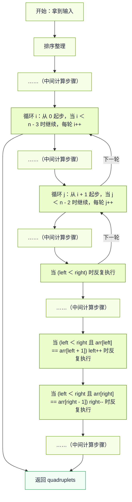

## TypeScript 解题方案（2 个方案逐个讲）

> **运行与提交**：每个方案都是自包含文件（内嵌用例自测，输出 PASS），整块复制到 `.ts` 文件后 `node 文件名` 即可运行。提交 LeetCode 时，把 `demo` 内的算法函数与辅助类型/函数整体取出、置于文件顶层即可。涉及交互/特殊接口的题以题面给定签名为准。

### 方案 1：方案1（排序 + 双指针）

**分析与思路**：核心做法是「方案1（排序 + 双指针）」。代码里依次做这些事：先排序再处理；双重循环遍历。

**运行方式**：`node 本文件`，内嵌用例全部通过会输出 PASS。

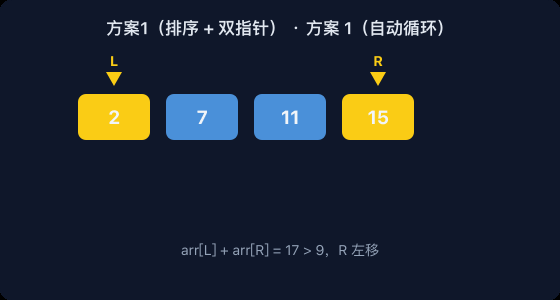

**方案专属流程图**（真实控制流）：

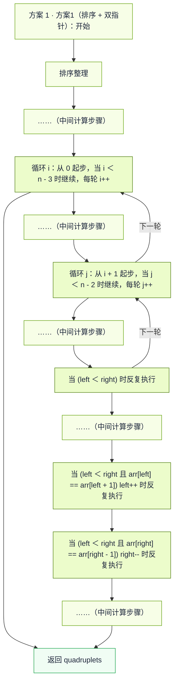

```typescript
/**
 ** LeetCode 18. 四数之和
 ** 方案：方案1（排序 + 双指针）
 */

function fourSum(nums: number[], target: number): number[][] {
  // 定义函数/方法 fourSum
  const arr = nums.slice().sort((a, b) => a - b);
  const quadruplets: number[][] = []; // 把 []; 写入 const quadruplets: number[][]
  const n = arr.length; // 把 数组.长度 存入 元素个数
  for (let i = 0; i < n - 3; i++) {
    // 让 下标 i 从 0 开始计数，下标 i 小于 元素个数 减 3 就继续
    if (i > 0 && arr[i] === arr[i - 1]) continue; // 若 下标 i 超过 0 且 数组[下标 i] 全等于 数组[下标 i 减 1]) continue;
    if (arr[i] + arr[i + 1] + arr[i + 2] + arr[i + 3] > target) break;
    if (arr[i] + arr[n - 3] + arr[n - 2] + arr[n - 1] < target) continue;
    for (let j = i + 1; j < n - 2; j++) {
      // 让 下标 j 从 下标 i 加 1 开始计数，下标 j 小于 元素个数 减 2 就继续
      if (j > i + 1 && arr[j] === arr[j - 1]) continue; // 若 下标 j 超过 下标 i 加 1 且 数组[下标 j] 全等于 数组[下标 j 减 1]) continue;
      if (arr[i] + arr[j] + arr[j + 1] + arr[j + 2] > target) break;
      if (arr[i] + arr[j] + arr[n - 2] + arr[n - 1] < target) continue;
      let left = j + 1; // 把 下标 j 加 1 存入 左边界
      let right = n - 1; // 把 元素个数 减 1 存入 右边界
      while (left < right) {
        // 循环，直到不满足「左边界 小于 右边界」
        const s = arr[i] + arr[j] + arr[left] + arr[right]; // 把 数组[下标 i] 加 数组[下标 j] 加 数组[左边界] 加 数组[右边界] 存入 字符串
        if (s === target) {
          // 若 字符串 全等于 目标值
          quadruplets.push([arr[i], arr[j], arr[left], arr[right]]); // 把 [数组[下标 i], 数组[下标 j], 数组[左边界], 数组[右边界]] 压入栈/数组尾部
          while (left < right && arr[left] === arr[left + 1]) left++; // 循环，直到不满足「左边界 小于 右边界 且 数组[左边界] 全等于 数组[左边界 加 1]) 左边界 加一 ;」
          while (left < right && arr[right] === arr[right - 1]) right--; // 循环，直到不满足「左边界 小于 右边界 且 数组[右边界] 全等于 数组[右边界 减 1]) 右边界 减一 ;」
          left++; // 左边界 加一
          right--; // 右边界 减一
        } else if (s < target) {
          // 否则，若 字符串 小于 目标值
          left++; // 左边界 加一
        } else {
          // 否则
          right--; // 右边界 减一
        }
      }
    }
  }
  return quadruplets; // 返回 quadruplets
}

export function demo(): void {
  // 程序入口：跑内嵌自测用例
  const got = fourSum([1, 2, 3], 1); // 把 fourSum([1, 2, 3], 1) 存入 got
  if (got.length !== 0) throw new Error('fourSum([1,2,3],1) should be []');
  console.log('PASS'); // 全部用例通过，输出 PASS
}

demo(); // demo();
```

### 方案 2：方案2（排序 + 深度优先搜索）

**分析与思路**：核心做法是「方案2（排序 + 深度优先搜索）」。代码里依次做这些事：先排序再处理；单循环线性扫描；栈的后进先出操作。

**运行方式**：`node 本文件`，内嵌用例全部通过会输出 PASS。


**方案专属流程图**（真实控制流）：

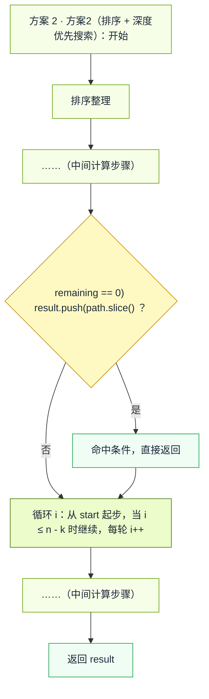

```typescript
/**
 ** LeetCode 18. 四数之和
 ** 方案：方案2（排序 + 深度优先搜索）
 */

function fourSum(nums: number[], target: number): number[][] {
  // 定义函数/方法 fourSum
  const arr = nums.slice().sort((a, b) => a - b);
  const result: number[][] = []; // 把 []; 写入 const result: number[][]
  const n = arr.length; // 把 数组.长度 存入 元素个数
  function dfs(
    start: number,
    k: number,
    remaining: number,
    path: number[],
  ): void {
    // 定义函数/方法 dfs
    if (k === 0) {
      // 若 下标 k 全等于 0
      if (remaining === 0) result.push(path.slice()); // 若 remaining 全等于 0) 结果 追加 当前路径 截取 ));
      return; // return;
    }
    for (let i = start; i <= n - k; i++) {
      // 让 下标 i 从 起点 开始计数，下标 i 不超过 元素个数 减 下标 k 就继续
      if (i > start && arr[i] === arr[i - 1]) continue; // 若 下标 i 超过 起点 且 数组[下标 i] 全等于 数组[下标 i 减 1]) continue;
      if (arr[i] * k > remaining) break; // 若 数组[下标 i] 乘 下标 k 超过 remaining) break;
      if (i + 1 < n && arr[i] + arr[i + 1] * (k - 1) > remaining) break; // 最小补全都超，后面只会更大
      if (arr[i] + arr[n - 1] * (k - 1) < remaining) continue; // 最大补都不足，跳过当前
      path.push(arr[i]); // 把 数组[下标 i] 压入栈/数组尾部
      dfs(i + 1, k - 1, remaining - arr[i], path); // dfs(下标 i 加 1, 下标 k 减 1, remaining 减 数组[下标 i], 当前路径);
      path.pop(); // 弹出栈顶元素
    }
  }
  dfs(0, 4, target, []); // dfs(0, 4, 目标值, []);
  return result; // 返回 结果
}

export function demo(): void {
  // 程序入口：跑内嵌自测用例
  const got = fourSum([1, 2, 3], 1); // 把 fourSum([1, 2, 3], 1) 存入 got
  if (got.length !== 0) throw new Error('fourSum([1,2,3],1) should be []');
  console.log('PASS'); // 全部用例通过，输出 PASS
}

demo(); // demo();
```

## 逐步拆解与面试追问

**复杂度**：时间 O(n²)（两层嵌套扫描），空间 O(1) 到 O(n)

**为什么是这个量级**：外层定起点、内层扫终点，n 个起点各扫 n 次

**面试官可能会追问**：

- 稳定性对结果有影响吗？
- 比较器怎么写才不会越界？
- 数据近有序时选哪种排序？

## 关键 API 速查（TS 主解法实际用到，附官方链接）

| API | 作用 | 使用要点 | 官方文档 |
|---|---|---|---|
| `Array.prototype.sort()` | 原地排序 | 默认按字符串 Unicode 序（10 会排在 2 前），数字必须传 (a,b)=>a-b；V8 用 TimSort，稳定，O(n log n)；返回原数组引用 | [官方文档](https://developer.mozilla.org/zh-CN/docs/Web/JavaScript/Reference/Global_Objects/Array/sort) |
| `Array.prototype.push()` | 尾部追加 | 返回新长度；可一次多个；均摊 O(1)；会改变原数组 | [官方文档](https://developer.mozilla.org/zh-CN/docs/Web/JavaScript/Reference/Global_Objects/Array/push) |
| `Array/String slice()` | 切片（不改原数组） | slice(start,end) 含头不含尾；负数从尾计；常用于复制数组（slice()） | [官方文档](https://developer.mozilla.org/zh-CN/docs/Web/JavaScript/Reference/Global_Objects/Array/slice) |

### 各语言官方文档导航

- **TypeScript / JS**：[MDN 中文参考](https://developer.mozilla.org/zh-CN/)
- **Python**：[Python 官方文档](https://docs.python.org/zh-cn/3/)
- **Go**：[Go 标准库](https://pkg.go.dev/std)
- **Java**：[JDK 17 API](https://docs.oracle.com/en/java/javase/17/docs/api/)
- **Rust**：[Rust 标准库](https://doc.rust-lang.org/std/)
- **Lua**：[Lua 5.4 手册](https://www.lua.org/manual/5.4/)
- **C**：[Cppreference C](https://zh.cppreference.com/w/c)
- **C++**：[Cppreference C++](https://zh.cppreference.com/w/cpp)
- **R**：[R 官方手册](https://stat.ethz.ch/R-manual/)
- **Zig**：[Zig 语言文档](https://ziglang.org/documentation/master/)
- **Dart**：[Dart API](https://api.dart.dev/)

## 附录：其他 10 种语言全部实现（每种语言列举其全部方案）

> TypeScript 的全部方案见「TypeScript 解题方案」一节；下面是其余 10 种语言的对应实现，每种语言的每个方案都带思路分析、代码走读与专属运行架构图。
> 每个方案都内嵌用例自测，可独立运行（老仓库 python/go 文件遵循「打印结果」约定）。
> 完整解法文件见 `dsa/<语言>/sort/lc_18_四数之和/`。

### Python 实现（2 种方案）

Python 的全部方案如下，每个方案都内嵌用例自测，可独立运行（老仓库 python/go 文件遵循「打印结果」约定）：

#### 方案 1：方案1（排序 + 双指针）

**思路与代码分析**：核心是「方案1（排序 + 双指针）」。Python 版用切片与字典推导式简化操作，突出可读性。代码里依次做这些事：先排序再处理。**走读**：方案 1 · 方案1（排序 + 双指针）：开始 → 排序整理 → 循环 i：从 0 到 n - 3 前 → 循环 j：从 i + 1 到 n - 2 前 → 当 left ＜ right: 时反复执行 → 当 ( 时反复执行 → 当 ( 时反复执行 → 返回 quadruplets。

**运行架构**（真实控制流）：

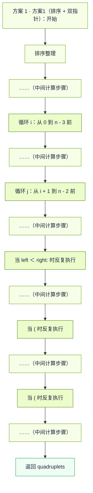

```python
import sys  # 提高递归深度上限（深输入防 RecursionError）

sys.setrecursionlimit(200000)  # 树/链表类题目节点数可达 1e4 量级

def fourSum(nums, target):  # 定义函数 fourSum（参数：数组, 目标值）
    nums.sort()  # 排序
    quadruplets = []  # 把 [] 存入 quadruplets
    n = len(nums)  # 把 长度(数组) 存入 元素个数
    for i in range(n - 3):  # 让 下标 i 从 元素个数 减 3 遍历
        if i > 0 and nums[i] == nums[i - 1]:  # 若 下标 i 超过 0 and 数组[下标 i] 等于 数组[下标 i 减 1]
            continue  # 跳过本轮，进入下一次
        if nums[i] + nums[i + 1] + nums[i + 2] + nums[i + 3] > target:
            break  # 跳出循环
        if nums[i] + nums[n - 3] + nums[n - 2] + nums[n - 1] < target:
            continue  # 跳过本轮，进入下一次
        for j in range(i + 1, n - 2):  # 让 下标 j 从 下标 i 加 1 到 元素个数 减 2 遍历
            if (
                j > i + 1 and nums[j] == nums[j - 1]
            ):  # 若 下标 j 超过 下标 i 加 1 and 数组[下标 j] 等于 数组[下标 j 减 1]
                continue  # 跳过本轮，进入下一次
            if (
                nums[i] + nums[j] + nums[j + 1] + nums[j + 2] > target
            ):  # 若 数组[下标 i] 加 数组[下标 j] 加 数组[下标 j 加 1] 加 数组[下标 j 加 2] 超过 目标值
                break  # 跳出循环
            if (
                nums[i] + nums[j] + nums[n - 2] + nums[n - 1] < target
            ):  # 若 数组[下标 i] 加 数组[下标 j] 加 数组[元素个数 减 2] 加 数组[元素个数 减 1] 小于 目标值
                continue  # 跳过本轮，进入下一次
            left, right = j + 1, n - 1  # 把 下标 j 加 1, 元素个数 减 1 写入 left, right
            while left < right:  # 循环，直到不满足「左边界 小于 右边界」
                s = (
                    nums[i] + nums[j] + nums[left] + nums[right]
                )  # 把 数组[下标 i] 加 数组[下标 j] 加 数组[左边界] 加 数组[右边界] 存入 字符串
                if s == target:  # 若 字符串 等于 目标值
                    quadruplets.append(
                        [nums[i], nums[j], nums[left], nums[right]]
                    )  # 把 [数组[下标 i], 数组[下标 j], 数组[左边界], 数组[右边界]] 追加到列表尾部
                    while (
                        left < right and nums[left] == nums[left + 1]
                    ):  # 循环，直到不满足「左边界 小于 右边界 and 数组[左边界] 等于 数组[左边界 加 1]」
                        left += 1  # 左边界累加 1
                    while (
                        left < right and nums[right] == nums[right - 1]
                    ):  # 循环，直到不满足「左边界 小于 右边界 and 数组[右边界] 等于 数组[右边界 减 1]」
                        right -= 1  # 右边界累减 1
                    left += 1  # 左边界累加 1
                    right -= 1  # 右边界累减 1
                elif s < target:  # 否则，若 字符串 小于 目标值
                    left += 1  # 左边界累加 1
                else:  # 否则
                    right -= 1  # 右边界累减 1
    return quadruplets  # 返回 quadruplets

if __name__ == "__main__":  # 若 __name__ 等于 '__main__'
    print(fourSum([1, 2, 3], 1))  # 打印输出
```

#### 方案 2：方案2（排序 + 深度优先搜索）

**思路与代码分析**：核心是「方案2（排序 + 深度优先搜索）」。Python 版用切片与字典推导式简化操作，突出可读性。代码里依次做这些事：先排序再处理。**走读**：方案 2 · 方案2（排序 + 深度优先搜索）：开始 → 排序整理 → 返回  → 循环 i：从 start 到 n - k + 1 前 → 返回 result。

**运行架构**（真实控制流）：

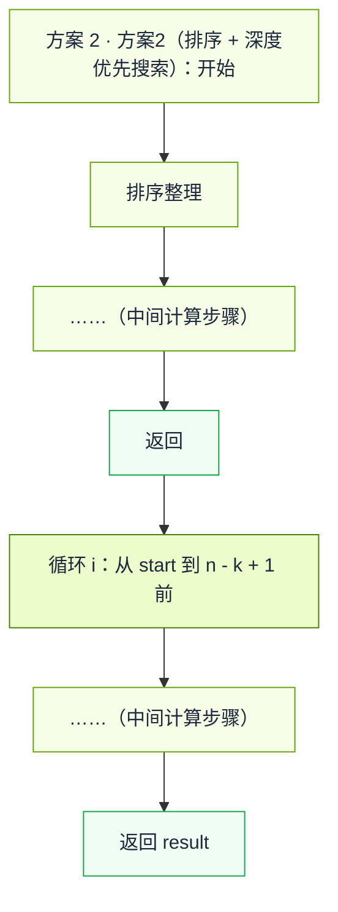

```python
import sys  # 提高递归深度上限（深输入防 RecursionError）

sys.setrecursionlimit(200000)  # 树/链表类题目节点数可达 1e4 量级

def fourSum(nums, target):  # 定义函数 fourSum（参数：数组, 目标值）
    nums.sort()  # 排序
    result = []  # 把 [] 存入 结果
    n = len(nums)  # 把 长度(数组) 存入 元素个数

    def dfs(start, k, remaining, path):  # 定义函数 dfs（参数：起点, 下标 k, remaining, 当前路径）
        if k == 0:  # 若 下标 k 等于 0
            if remaining == 0:  # 若 remaining 等于 0
                result.append(path[:])  # 把 复制 当前路径 追加到列表尾部
            return  # return
        for i in range(start, n - k + 1):  # 让 下标 i 从 起点 到 元素个数 减 k 加 1 遍历（保证还够选 k 个）
            if (
                i > start and nums[i] == nums[i - 1]
            ):  # 若 下标 i 超过 起点 and 数组[下标 i] 等于 数组[下标 i 减 1]
                continue  # 跳过本轮，进入下一次
            if nums[i] * k > remaining:  # 若 数组[下标 i] 乘 下标 k 超过 remaining
                break  # 跳出循环
            if i + 1 < n and nums[i] + nums[i + 1] * (k - 1) > remaining:  # 最小补全都超，后面只会更大
                break  # 跳出循环
            if nums[i] + nums[n - 1] * (k - 1) < remaining:  # 最大补都不足
                continue  # 跳过本轮，进入下一次
                break  # 跳出循环
            path.append(nums[i])  # 把 数组[下标 i] 追加到列表尾部
            dfs(
                i + 1, k - 1, remaining - nums[i], path
            )  # dfs(下标 i 加 1, 下标 k 减 1, remaining 减 数组[下标 i], 当前路径)
            path.pop()  # 弹出栈顶元素

    dfs(0, 4, target, [])  # dfs(0, 4, 目标值, [])
    return result  # 返回 结果

if __name__ == "__main__":  # 若 __name__ 等于 '__main__'
    print(fourSum([1, 2, 3], 1))  # 打印输出
```

### Go 实现（2 种方案）

Go 的全部方案如下，每个方案都内嵌用例自测，可独立运行（老仓库 python/go 文件遵循「打印结果」约定）：

#### 方案 1：方案1（排序 + 双指针）

**思路与代码分析**：核心是「方案1（排序 + 双指针）」。Go 版用切片与多返回值惯用法，显式处理索引边界。**走读**：方案 1 · 方案1（排序 + 双指针）：开始 → 调用 sort.Ints(nums) → 遍历循环 → 遍历循环 → 遍历循环 → 遍历循环 → 遍历循环 → 返回 quadruplets。

**运行架构**（真实控制流）：

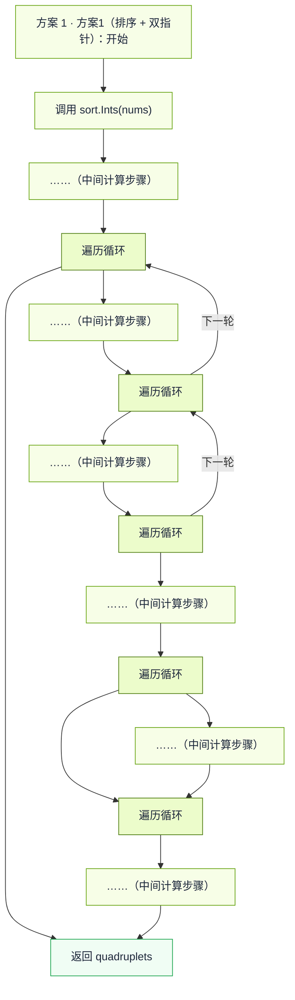

```go
package main // 引入依赖

import (
	"fmt"     // 「fmt」
	"os"      // 「os」
	"reflect" // 「reflect」
	"sort"    // 「sort」
)

func fourSum(nums []int, target int) [][]int { // 定义函数/方法 fourSum
	sort.Ints(nums)            // sort.Ints(数组)
	quadruplets := [][]int{}   // 把 [][]int{} 写入 quadruplets :
	n := len(nums)             // 把 长度(数组) 写入 n :
	for i := 0; i < n-3; i++ { // 让 下标 i 从 0 开始计数
		if i > 0 && nums[i] == nums[i-1] { // 若 下标 i 超过 0 且 数组[下标 i] 等于 数组[下标 i 减 1]
			continue // 跳过本轮，进入下一次
		}
		if nums[i]+nums[i+1]+nums[i+2]+nums[i+3] > target {
			break // 跳出循环
		}
		if nums[i]+nums[n-3]+nums[n-2]+nums[n-1] < target {
			continue // 跳过本轮，进入下一次
		}
		for j := i + 1; j < n-2; j++ { // 把 下标 i 加 1; 下标 j 小于 元素个数 减 2; 下标 j 加一 { 写入 for j :
			if j > i+1 && nums[j] == nums[j-1] { // 若 下标 j 超过 下标 i 加 1 且 数组[下标 j] 等于 数组[下标 j 减 1]
				continue // 跳过本轮，进入下一次
			}
			if nums[i]+nums[j]+nums[j+1]+nums[j+2] > target { // 若 数组[下标 i] 加 数组[下标 j] 加 数组[下标 j 加 1] 加 数组[下标 j 加 2] 超过 目标值
				break // 跳出循环
			}
			if nums[i]+nums[j]+nums[n-2]+nums[n-1] < target { // 若 数组[下标 i] 加 数组[下标 j] 加 数组[元素个数 减 2] 加 数组[元素个数 减 1] 小于 目标值
				continue // 跳过本轮，进入下一次
			}
			left, right := j+1, n-1 // 把 下标 j 加 1, 元素个数 减 1 写入 left, right :
			for left < right {      // for 左边界 小于 右边界 {
				s := nums[i] + nums[j] + nums[left] + nums[right] // 把 数组[下标 i] 加 数组[下标 j] 加 数组[左边界] 加 数组[右边界] 写入 s :
				if s == target {                                  // 若 字符串 等于 目标值
					quadruplets = append(quadruplets, []int{nums[i], nums[j], nums[left], nums[right]})
					for left < right && nums[left] == nums[left+1] { // 把 赋值为 数组[左边界 加 1] { 写入 for left < right && nums[left]
						left++ // 左边界 加一
					}
					for left < right && nums[right] == nums[right-1] { // 把 赋值为 数组[右边界 减 1] { 写入 for left < right && nums[right]
						right-- // 右边界 减一
					}
					left++  // 左边界 加一
					right-- // 右边界 减一
				} else if s < target { // 否则，若 字符串 小于 目标值
					left++ // 左边界 加一
				} else { // 否则
					right-- // 右边界 减一
				}
			}
		}
	}
	return quadruplets // 返回 quadruplets
}

func main() { // 程序入口：跑内嵌自测用例
	ok := true // 把 true 写入 ok :
	if got := fourSum([]int{1, 2, 3}, 1); !reflect.DeepEqual(got, [][]int{}) {
		ok = false                           // 把 false 写入 ok
		fmt.Printf("FAIL [1,2,3]=%v\n", got) // 打印输出
	}
	want := [][]int{{-2, -1, 1, 2}, {-2, 0, 0, 2}, {-1, 0, 0, 1}}
	if got := fourSum([]int{1, 0, -1, 0, -2, 2}, 0); !reflect.DeepEqual(got, want) {
		ok = false                                         // 把 false 写入 ok
		fmt.Printf("FAIL classic=%v want %v\n", got, want) // 打印输出
	}
	if !ok { // 若 取反 ok
		os.Exit(1) // os.Exit(1)
	}
	fmt.Println("PASS") // 全部用例通过，输出 PASS
}
```

#### 方案 2：方案2（排序 + 深度优先搜索）

**思路与代码分析**：核心是「方案2（排序 + 深度优先搜索）」。Go 版用切片与多返回值惯用法，显式处理索引边界。**走读**：方案 2 · 方案2（排序 + 深度优先搜索）：开始 → 调用 sort.Ints(nums) → 遍历循环 → 遍历循环 → 遍历循环 → 遍历循环 → 遍历循环 → 返回 res。

**运行架构**（真实控制流）：

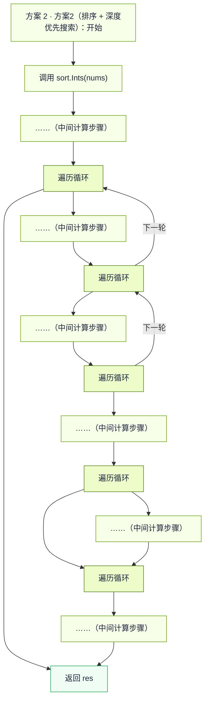

```go
package main // 引入依赖

import (
	"fmt"     // 「fmt」
	"os"      // 「os」
	"reflect" // 「reflect」
	"sort"    // 「sort」
)

func fourSum(nums []int, target int) [][]int { // 定义函数/方法 fourSum
	sort.Ints(nums)            // sort.Ints(数组)
	res := [][]int{}           // 把 [][]int{} 写入 res :
	n := len(nums)             // 把 长度(数组) 写入 n :
	for i := 0; i < n-3; i++ { // 让 下标 i 从 0 开始计数
		if i > 0 && nums[i] == nums[i-1] { // 若 下标 i 超过 0 且 数组[下标 i] 等于 数组[下标 i 减 1]
			continue // 跳过本轮，进入下一次
		}
		for j := i + 1; j < n-2; j++ { // 把 下标 i 加 1; 下标 j 小于 元素个数 减 2; 下标 j 加一 { 写入 for j :
			if j > i+1 && nums[j] == nums[j-1] { // 若 下标 j 超过 下标 i 加 1 且 数组[下标 j] 等于 数组[下标 j 减 1]
				continue // 跳过本轮，进入下一次
			}
			l, r := j+1, n-1 // 把 下标 j 加 1, 元素个数 减 1 写入 l, r :
			for l < r {      // for 左指针 小于 右指针 {
				sum := nums[i] + nums[j] + nums[l] + nums[r] // 把 数组[下标 i] 加 数组[下标 j] 加 数组[左指针] 加 数组[右指针] 写入 sum :
				if sum == target {                           // 若 累计和 等于 目标值
					res = append(res, []int{nums[i], nums[j], nums[l], nums[r]})
					for l < r && nums[l] == nums[l+1] { // 把 赋值为 数组[左指针 加 1] { 写入 for l < r && nums[l]
						l++ // 左指针 加一
					}
					for l < r && nums[r] == nums[r-1] { // 把 赋值为 数组[右指针 减 1] { 写入 for l < r && nums[r]
						r-- // 右指针 减一
					}
					l++ // 左指针 加一
					r-- // 右指针 减一
				} else if sum < target { // 否则，若 累计和 小于 目标值
					l++ // 左指针 加一
				} else { // 否则
					r-- // 右指针 减一
				}
			}
		}
	}
	return res // 返回 结果
}

func main() { // 程序入口：跑内嵌自测用例
	ok := true // 把 true 写入 ok :
	if got := fourSum([]int{1, 2, 3}, 1); !reflect.DeepEqual(got, [][]int{}) {
		ok = false                           // 把 false 写入 ok
		fmt.Printf("FAIL [1,2,3]=%v\n", got) // 打印输出
	}
	want := [][]int{{-2, -1, 1, 2}, {-2, 0, 0, 2}, {-1, 0, 0, 1}}
	if got := fourSum([]int{1, 0, -1, 0, -2, 2}, 0); !reflect.DeepEqual(got, want) {
		ok = false                                         // 把 false 写入 ok
		fmt.Printf("FAIL classic=%v want %v\n", got, want) // 打印输出
	}
	if !ok { // 若 取反 ok
		os.Exit(1) // os.Exit(1)
	}
	fmt.Println("PASS") // 全部用例通过，输出 PASS
}
```

### Java 实现（2 种方案）

Java 的全部方案如下，每个方案都内嵌用例自测，可独立运行（老仓库 python/go 文件遵循「打印结果」约定）：

#### 方案 1：方案1（排序 + 双指针）

**思路与代码分析**：核心是「方案1（排序 + 双指针）」。Java 版用类与静态方法组织，集合操作显式明了。代码里依次做这些事：单循环线性扫描。**走读**：方案 1 · 方案1（排序 + 双指针）：开始 → 命中条件，直接返回 → 遍历循环 → 命中条件，直接返回 → 返回 true。

**运行架构**（真实控制流）：

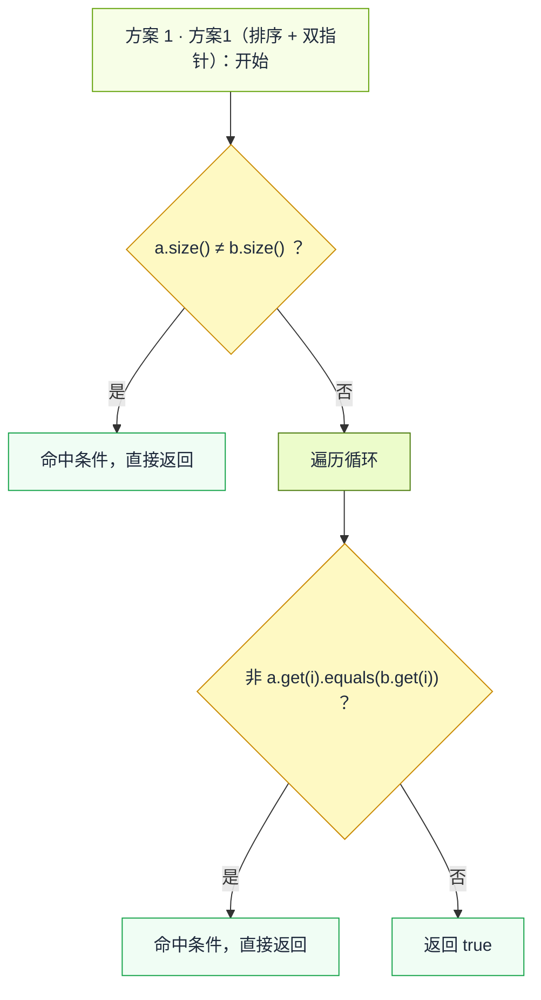

```java
package com.webfault.dsa; // 引入依赖

import java.util.*; // 引入依赖

class Sum4S1 { // 定义类型
  static List<List<Integer>> fourSum(int[] nums, int target) { // 定义函数/方法 fourSum
    List<List<Integer>> quadruplets =
        new ArrayList<>(); // 把 new ArrayList 小于 超过 (); 写入 List<List<Integer>> quadruplets
    Arrays.sort(nums); // 排序
    int length = nums.length; // 把 数组.长度 存入 长度
    if (length < 4) return quadruplets; // 若 长度 小于 4，直接返回 quadruplets
    for (int i = 0; i < length - 3; i++) { // 让 下标 i 从 0 开始计数，下标 i 小于 长度 减 3 就继续
      if (i > 0 && nums[i] == nums[i - 1])
        continue; // 若 下标 i 超过 0 且 数组[下标 i] 等于 数组[下标 i 减 1]) continue;
      if (nums[i] + nums[i + 1] + nums[i + 2] + nums[i + 3] > target) break;
      if (nums[i] + nums[length - 3] + nums[length - 2] + nums[length - 1] < target) continue;
      for (int j = i + 1; j < length - 2; j++) { // 让 下标 j 从 下标 i 加 1 开始计数，下标 j 小于 长度 减 2 就继续
        if (j > i + 1 && nums[j] == nums[j - 1])
          continue; // 若 下标 j 超过 下标 i 加 1 且 数组[下标 j] 等于 数组[下标 j 减 1]) continue;
        if (nums[i] + nums[j] + nums[j + 1] + nums[j + 2] > target) break;
        if (nums[i] + nums[j] + nums[length - 2] + nums[length - 1] < target) continue;
        int left = j + 1, right = length - 1; // 把 下标 j 加 1, 右边界 赋值为 长度 减 1 存入 左边界
        while (left < right) { // 循环，直到不满足「左边界 小于 右边界」
          int sum =
              nums[i]
                  + nums[j]
                  + nums[left]
                  + nums[right]; // 把 数组[下标 i] 加 数组[下标 j] 加 数组[左边界] 加 数组[右边界] 存入 累计和
          if (sum == target) { // 若 累计和 等于 目标值
            quadruplets.add(Arrays.asList(nums[i], nums[j], nums[left], nums[right]));
            while (left < right && nums[left] == nums[left + 1])
              left++; // 循环，直到不满足「左边界 小于 右边界 且 数组[左边界] 等于 数组[左边界 加 1]) 左边界 加一 ;」
            left++; // 左边界 加一
            while (left < right && nums[right] == nums[right - 1])
              right--; // 循环，直到不满足「左边界 小于 右边界 且 数组[右边界] 等于 数组[右边界 减 1]) 右边界 减一 ;」
            right--; // 右边界 减一
          } else if (sum < target) left++; // 否则，若 累计和 小于 目标值) 左边界 加一 ;
          else right--; // 否则
        }
      }
    }
    return quadruplets; // 返回 quadruplets
  }

  static boolean eqLL(List<List<Integer>> a, List<List<Integer>> b) { // 定义函数/方法 eqLL
    if (a.size() != b.size()) return false; // 若 数组.大小() 不等于 b.大小()，直接返回 false
    for (int i = 0; i < a.size(); i++)
      if (!a.get(i).equals(b.get(i))) return false; // 让 下标 i 从 0 开始计数，下标 i 小于 数组.大小() 就继续
    return true; // 返回 true
  }

  public static void main(String[] args) { // public static void main(String[] args) {
    boolean ok = true; // 把 true; 写入 boolean ok
    if (!eqLL(Sum4S1.fourSum(new int[] {1, 2, 3}, 1), new ArrayList<>())) {
      ok = false;
      System.out.println("FAIL empty");
    }
    List<List<Integer>> want =
        Arrays.asList(
            Arrays.asList(-2, -1, 1, 2), Arrays.asList(-2, 0, 0, 2), Arrays.asList(-1, 0, 0, 1));
    if (!eqLL(Sum4S1.fourSum(new int[] {1, 0, -1, 0, -2, 2}, 0), want)) {
      ok = false;
      System.out.println("FAIL case2");
    }
    if (!ok) throw new RuntimeException("FAILED"); // 若 取反 ok) throw new RuntimeException(「FAILED」);
    System.out.println("PASS"); // 全部用例通过，输出 PASS
  }
}
```

#### 方案 2：方案2（排序 + 深度优先搜索）

**思路与代码分析**：核心是「方案2（排序 + 深度优先搜索）」。Java 版用类与静态方法组织，集合操作显式明了。代码里依次做这些事：单循环线性扫描。**走读**：方案 2 · 方案2（排序 + 深度优先搜索）：开始 → 命中条件，直接返回 → 遍历循环 → 命中条件，直接返回 → 返回 true。

**运行架构**（真实控制流）：

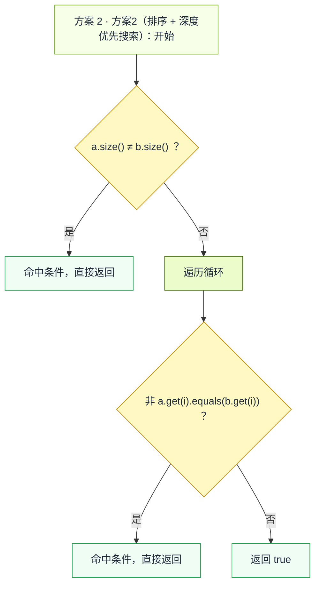

```java
package com.webfault.dsa; // 引入依赖

import java.util.*; // 引入依赖

class Sum4S2 { // 定义类型
  List<List<Integer>> list =
      new ArrayList<>(); // 把 new ArrayList 小于 超过 (); 写入 List<List<Integer>> list
  List<Integer> tmp = new ArrayList<>(); // 把 new ArrayList 小于 超过 (); 写入 List<Integer> tmp
  int n; // int 元素个数;

  List<List<Integer>> fourSum(int[] nums, int target) { // 定义函数/方法 fourSum
    list = new ArrayList<>(); // 把 new ArrayList 小于 超过 (); 写入 列表
    tmp = new ArrayList<>(); // 把 new ArrayList 小于 超过 (); 写入 临时变量
    n = nums.length; // 把 数组.长度; 写入 元素个数
    Arrays.sort(nums); // 排序
    dfs(nums, target, 0, 4); // dfs(数组, 目标值, 0, 4);
    return list; // 返回 列表
  }

  void dfs(int[] nums, int target, int index, int count) { // 定义函数/方法 dfs
    if (count == 0 && target == 0) { // 若 计数 等于 0 且 目标值 等于 0
      list.add(new ArrayList<>(tmp)); // 列表 追加 new ArrayList 小于 超过 (临时变量));
      return; // return;
    }
    if (count > 0) { // 若 计数 超过 0
      for (int i = index; i < n; i++) { // 让 下标 i 从 index 开始计数，下标 i 小于 元素个数 就继续
        if (i > index && nums[i] == nums[i - 1])
          continue; // 若 下标 i 超过 index 且 数组[下标 i] 等于 数组[下标 i 减 1]) continue;
        if (tmp.isEmpty()
            || tmp.get(tmp.size() - 1)
                <= nums[i]) { // 若 临时变量.isEmpty() 或 临时变量 查找 临时变量.大小() 减 1) 不超过 数组[下标 i]
          tmp.add(nums[i]); // 临时变量 追加 数组[下标 i]);
          dfs(
              nums,
              target - nums[i],
              i + 1,
              count - 1); // dfs(数组, 目标值 减 数组[下标 i], 下标 i 加 1, 计数 减 1);
          tmp.remove(tmp.size() - 1); // 临时变量 弹出 临时变量.大小() 减 1);
        }
      }
    }
  }

  static boolean eqLL(List<List<Integer>> a, List<List<Integer>> b) { // 定义函数/方法 eqLL
    if (a.size() != b.size()) return false; // 若 数组.大小() 不等于 b.大小()，直接返回 false
    for (int i = 0; i < a.size(); i++)
      if (!a.get(i).equals(b.get(i))) return false; // 让 下标 i 从 0 开始计数，下标 i 小于 数组.大小() 就继续
    return true; // 返回 true
  }

  public static void main(String[] args) { // public static void main(String[] args) {
    Sum4S2 s = new Sum4S2(); // 把 new Sum4S2(); 写入 Sum4S2 s
    boolean ok = true; // 把 true; 写入 boolean ok
    if (!eqLL(s.fourSum(new int[] {1, 2, 3}, 1), new ArrayList<>())) {
      ok = false;
      System.out.println("FAIL empty");
    }
    List<List<Integer>> want =
        Arrays.asList(
            Arrays.asList(-2, -1, 1, 2), Arrays.asList(-2, 0, 0, 2), Arrays.asList(-1, 0, 0, 1));
    if (!eqLL(s.fourSum(new int[] {1, 0, -1, 0, -2, 2}, 0), want)) {
      ok = false;
      System.out.println("FAIL case2");
    }
    if (!ok) throw new RuntimeException("FAILED"); // 若 取反 ok) throw new RuntimeException(「FAILED」);
    System.out.println("PASS"); // 全部用例通过，输出 PASS
  }
}
```

### Rust 实现（2 种方案）

Rust 的全部方案如下，每个方案都内嵌用例自测，可独立运行（老仓库 python/go 文件遵循「打印结果」约定）：

#### 方案 1：方案1（排序 + 双指针）

**思路与代码分析**：核心是「方案1（排序 + 双指针）」。Rust 版用所有权移动与切片借用改写同一逻辑，注意 Option 与引用边界。代码里依次做这些事：先排序再处理。**走读**：方案 1 · 方案1（排序 + 双指针）：开始 → 计算 arr → 遍历 0..n 中的每个元素 i → 遍历 i + 1..n 中的每个元素 j → 当 left ＜ right 时反复执行 → 当 left ＜ right 且 arr[left as usize] == arr[(left - 1) as usize] 时反复执行 → 当 left ＜ right 且 arr[right as usize] == arr[(right + 1) as usize] 时反复执行 → 返回结果。

**运行架构**（真实控制流）：

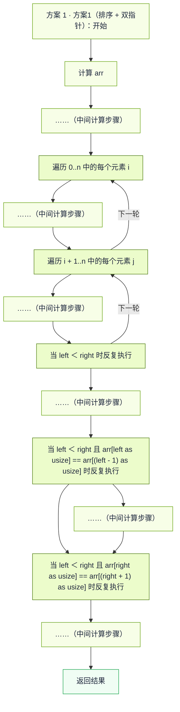

```rust
// LeetCode 18. 四数之和 — Rust 版（方案1）
fn four_sum(nums: Vec<i32>, target: i32) -> Vec<Vec<i32>> {
    // 定义函数/方法 four_sum
    let mut arr = nums; // 把 数组; 写入 let mut arr
    arr.sort(); // 排序
    let mut res: Vec<Vec<i32>> = Vec::new(); // 把 Vec::new(); 写入 let mut res: Vec<Vec<i32>>
    let n = arr.len() as i64; // 把 数组.长度() as i64 存入 元素个数
    let t = target as i64; // 把 目标值 as i64 存入 另一字符串
    for i in 0..n {
        // 逐个取出 0 的元素（下标 i）
        if i > 0 && arr[i as usize] == arr[(i - 1) as usize] {
            continue;
        }
        for j in i + 1..n {
            // 逐个取出 下标 i 的元素（下标 j）
            if j > i + 1 && arr[j as usize] == arr[(j - 1) as usize] {
                continue;
            }
            let (mut left, mut right) = (j + 1, n - 1); // 把 (下标 j 加 1, 元素个数 减 1); 写入 let (mut left, mut right)
            while left < right {
                // while 左边界 小于 右边界 {
                let s = arr[i as usize] as i64
                    + arr[j as usize] as i64
                    + arr[left as usize] as i64
                    + arr[right as usize] as i64;
                if s == t {
                    // 若 字符串 等于 另一字符串
                    res.push(vec![
                        arr[i as usize],
                        arr[j as usize],
                        arr[left as usize],
                        arr[right as usize],
                    ]);
                    left += 1; // 左边界累加 1
                    right -= 1; // 右边界累减 1
                    while left < right && arr[left as usize] == arr[(left - 1) as usize] {
                        left += 1;
                    }
                    while left < right && arr[right as usize] == arr[(right + 1) as usize] {
                        right -= 1;
                    }
                } else if s < t {
                    left += 1;
                } else {
                    right -= 1;
                } // 否则，若 字符串 小于 另一字符串 { 左边界 累加 1; } else { 右边界 累减 1; }
            }
        }
    }
    res // 结果
}
fn main() {
    // 程序入口：跑内嵌自测用例
    let got = four_sum(vec![1, 0, -1, 0, -2, 2], 0); // 把 four_sum(vec取反 [1, 0, 减 1, 0, 减 2, 2], 0) 存入 got
    assert_eq!(got.len(), 3); // 断言校验
    println!("PASS"); // 全部用例通过，输出 PASS
}
```

#### 方案 2：方案2（排序 + 深度优先搜索）

**思路与代码分析**：核心是「方案2（排序 + 深度优先搜索）」。Rust 版用所有权移动与切片借用改写同一逻辑，注意 Option 与引用边界。代码里依次做这些事：先排序再处理。**走读**：方案 2 · 方案2（排序 + 深度优先搜索）：开始 → 计算 arr → 遍历 0..n 中的每个元素 i → 遍历 i + 1..n 中的每个元素 j → 当 left ＜ right 时反复执行 → 当 left ＜ right 且 arr[left as usize] == arr[(left - 1) as usize] 时反复执行 → 当 left ＜ right 且 arr[right as usize] == arr[(right + 1) as usize] 时反复执行 → 返回结果。

**运行架构**（真实控制流）：

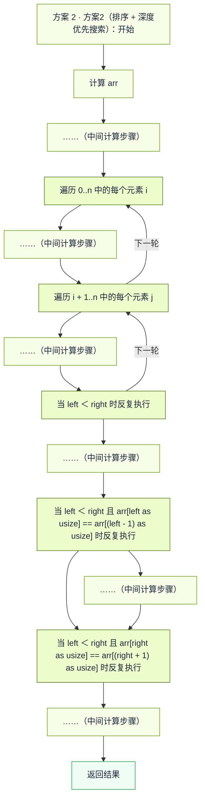

```rust
// LeetCode 18. 四数之和 — Rust 版（方案2）
fn four_sum(nums: Vec<i32>, target: i32) -> Vec<Vec<i32>> {
    // 定义函数/方法 four_sum
    let mut arr = nums; // 把 数组; 写入 let mut arr
    arr.sort(); // 排序
    let mut res: Vec<Vec<i32>> = Vec::new(); // 把 Vec::new(); 写入 let mut res: Vec<Vec<i32>>
    let n = arr.len() as i64; // 把 数组.长度() as i64 存入 元素个数
    let t = target as i64; // 把 目标值 as i64 存入 另一字符串
    for i in 0..n {
        // 逐个取出 0 的元素（下标 i）
        if i > 0 && arr[i as usize] == arr[(i - 1) as usize] {
            continue;
        }
        for j in i + 1..n {
            // 逐个取出 下标 i 的元素（下标 j）
            if j > i + 1 && arr[j as usize] == arr[(j - 1) as usize] {
                continue;
            }
            let (mut left, mut right) = (j + 1, n - 1); // 把 (下标 j 加 1, 元素个数 减 1); 写入 let (mut left, mut right)
            while left < right {
                // while 左边界 小于 右边界 {
                let s = arr[i as usize] as i64
                    + arr[j as usize] as i64
                    + arr[left as usize] as i64
                    + arr[right as usize] as i64;
                if s == t {
                    // 若 字符串 等于 另一字符串
                    res.push(vec![
                        arr[i as usize],
                        arr[j as usize],
                        arr[left as usize],
                        arr[right as usize],
                    ]);
                    left += 1; // 左边界累加 1
                    right -= 1; // 右边界累减 1
                    while left < right && arr[left as usize] == arr[(left - 1) as usize] {
                        left += 1;
                    }
                    while left < right && arr[right as usize] == arr[(right + 1) as usize] {
                        right -= 1;
                    }
                } else if s < t {
                    left += 1;
                } else {
                    right -= 1;
                } // 否则，若 字符串 小于 另一字符串 { 左边界 累加 1; } else { 右边界 累减 1; }
            }
        }
    }
    res // 结果
}
fn main() {
    // 程序入口：跑内嵌自测用例
    let got = four_sum(vec![1, 0, -1, 0, -2, 2], 0); // 把 four_sum(vec取反 [1, 0, 减 1, 0, 减 2, 2], 0) 存入 got
    assert_eq!(got.len(), 3); // 断言校验
    println!("PASS"); // 全部用例通过，输出 PASS
}
```

### Lua 实现（2 种方案）

Lua 的全部方案如下，每个方案都内嵌用例自测，可独立运行（老仓库 python/go 文件遵循「打印结果」约定）：

#### 方案 1：方案1（排序 + 双指针）

**思路与代码分析**：核心是「方案1（排序 + 双指针）」。Lua 版用表与 ipairs 遍历，注意 ipairs 遇 nil 即停的语义。代码里依次做这些事：先排序再处理。**走读**：方案 1 · 方案1（排序 + 双指针）：开始 → 更新 arr → 循环 i：从 1 到 n do → 循环 j：从 i + 1 到 n do → 当 left ＜ right do 时反复执行 → 当 left ＜ right and arr[left] == arr[left - 1] do 时反复执行 → 当 left ＜ right and arr[right] == arr[right + 1] do 时反复执行 → 返回 res。

**运行架构**（真实控制流）：

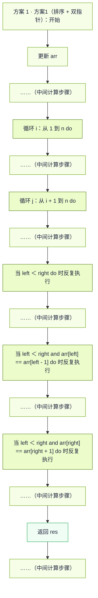

```lua
-- LeetCode 18. 四数之和 — Lua 版（方案1）
local function four_sum(nums, target) -- local function four_sum(数组, 目标值)
	local arr = { table.unpack(nums) } -- 把 {table.unpack(数组)} 写入 local arr
	table.sort(arr) -- 排序
	local res = {} -- 把 {} 写入 local res
	local n = #arr -- 把 #数组 写入 local n
	for i = 1, n do -- 让 下标 i 从 1 走到 元素个数（Lua 1 基）
		if i == 1 or arr[i] ~= arr[i - 1] then -- 若 下标 i 等于 1 or 数组[下标 i] ~ 赋值为 数组[下标 i 减 1] then
			for j = i + 1, n do -- 把 下标 i 加 1, 元素个数 do 写入 for j
				if j == i + 1 or arr[j] ~= arr[j - 1] then -- 若 下标 j 等于 下标 i 加 1 or 数组[下标 j] ~ 赋值为 数组[下标 j 减 1] then
					local left, right = j + 1, n -- 把 下标 j 加 1, 元素个数 写入 local left, right
					while left < right do -- while 左边界 小于 右边界 do
						local s = arr[i] + arr[j] + arr[left] + arr[right] -- 把 数组[下标 i] 加 数组[下标 j] 加 数组[左边界] 加 数组[右边界] 写入 local s
						if s == target then -- 若 字符串 等于 目标值 then
							res[#res + 1] = { arr[i], arr[j], arr[left], arr[right] } -- 把 {数组[下标 i], 数组[下标 j], 数组[左边界], 数组[右边界]} 写入 res[#res + 1]
							left = left + 1 -- 把 左边界 加 1 存入 左边界
							right = right - 1 -- 把 右边界 减 1 存入 右边界
							while left < right and arr[left] == arr[left - 1] do
								left = left + 1
							end
							while left < right and arr[right] == arr[right + 1] do
								right = right - 1
							end
						elseif s < target then
							left = left + 1 -- 把 左边界 加 1 写入 elseif s < target then left
						else
							right = right - 1
						end -- 否则
					end -- 终点
				end -- 终点
			end -- 终点
		end -- 终点
	end -- 终点
	return res -- 返回 结果
end -- 终点
local got = four_sum({ 1, 0, -1, 0, -2, 2 }, 0) -- 把 four_sum({1, 0, 减 1, 0, 减 2, 2}, 0) 写入 local got
assert(#got == 3, "count " .. #got) -- 断言校验
print("PASS") -- 全部用例通过，输出 PASS
```

#### 方案 2：方案2（排序 + 深度优先搜索）

**思路与代码分析**：核心是「方案2（排序 + 深度优先搜索）」。Lua 版用表与 ipairs 遍历，注意 ipairs 遇 nil 即停的语义。代码里依次做这些事：先排序再处理。**走读**：方案 2 · 方案2（排序 + 深度优先搜索）：开始 → 更新 arr → 循环 i：从 1 到 n do → 循环 j：从 i + 1 到 n do → 当 left ＜ right do 时反复执行 → 当 left ＜ right and arr[left] == arr[left - 1] do 时反复执行 → 当 left ＜ right and arr[right] == arr[right + 1] do 时反复执行 → 返回 res。

**运行架构**（真实控制流）：

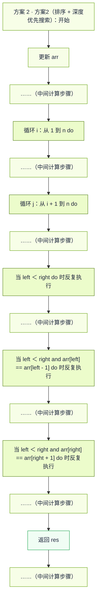

```lua
-- LeetCode 18. 四数之和 — Lua 版（方案2）
local function four_sum(nums, target) -- local function four_sum(数组, 目标值)
	local arr = { table.unpack(nums) } -- 把 {table.unpack(数组)} 写入 local arr
	table.sort(arr) -- 排序
	local res = {} -- 把 {} 写入 local res
	local n = #arr -- 把 #数组 写入 local n
	for i = 1, n do -- 让 下标 i 从 1 走到 元素个数（Lua 1 基）
		if i == 1 or arr[i] ~= arr[i - 1] then -- 若 下标 i 等于 1 or 数组[下标 i] ~ 赋值为 数组[下标 i 减 1] then
			for j = i + 1, n do -- 把 下标 i 加 1, 元素个数 do 写入 for j
				if j == i + 1 or arr[j] ~= arr[j - 1] then -- 若 下标 j 等于 下标 i 加 1 or 数组[下标 j] ~ 赋值为 数组[下标 j 减 1] then
					local left, right = j + 1, n -- 把 下标 j 加 1, 元素个数 写入 local left, right
					while left < right do -- while 左边界 小于 右边界 do
						local s = arr[i] + arr[j] + arr[left] + arr[right] -- 把 数组[下标 i] 加 数组[下标 j] 加 数组[左边界] 加 数组[右边界] 写入 local s
						if s == target then -- 若 字符串 等于 目标值 then
							res[#res + 1] = { arr[i], arr[j], arr[left], arr[right] } -- 把 {数组[下标 i], 数组[下标 j], 数组[左边界], 数组[右边界]} 写入 res[#res + 1]
							left = left + 1 -- 把 左边界 加 1 存入 左边界
							right = right - 1 -- 把 右边界 减 1 存入 右边界
							while left < right and arr[left] == arr[left - 1] do
								left = left + 1
							end
							while left < right and arr[right] == arr[right + 1] do
								right = right - 1
							end
						elseif s < target then
							left = left + 1 -- 把 左边界 加 1 写入 elseif s < target then left
						else
							right = right - 1
						end -- 否则
					end -- 终点
				end -- 终点
			end -- 终点
		end -- 终点
	end -- 终点
	return res -- 返回 结果
end -- 终点
local got = four_sum({ 1, 0, -1, 0, -2, 2 }, 0) -- 把 four_sum({1, 0, 减 1, 0, 减 2, 2}, 0) 写入 local got
assert(#got == 3, "count " .. #got) -- 断言校验
print("PASS") -- 全部用例通过，输出 PASS
```

### C 实现（2 种方案）

C 的全部方案如下，每个方案都内嵌用例自测，可独立运行（老仓库 python/go 文件遵循「打印结果」约定）：

#### 方案 1：方案1（排序 + 双指针）

**思路与代码分析**：核心是「方案1（排序 + 双指针）」。C 版手动管理下标与内存，循环边界全部显式写出。代码里依次做这些事：双重循环遍历。**走读**：方案 1 · 方案1（排序 + 双指针）：开始 → 处理 int arr[4096] → 遍历循环 → 遍历循环 → 遍历循环 → 当 (left ＜ right) 时反复执行 → 当 (left ＜ right 且 arr[left] == arr[left - 1]) 时反复执行 → 当 (left ＜ right 且 arr[right] == arr[right + 1]) 时反复执行 → 返回 cnt。

**运行架构**（真实控制流）：

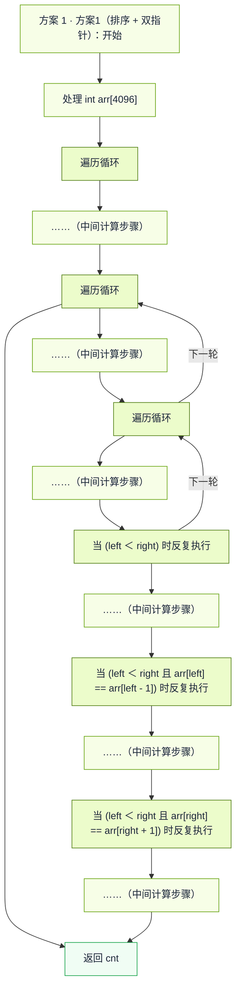

```c
/* LeetCode 18. 四数之和 — C 版（方案1） */
#include <stdio.h>  // 引入头文件
#include <stdlib.h> // 引入头文件
static int cmp_int(const void *a, const void *b) { return *(const int *)a - *(const int *)b; }
static int four_sum(const int *nums, int n, int target, int out[][4]) { // 定义函数/方法 four_sum
    int arr[4096];                                                      // int 数组[4096];
    for (int i = 0; i < n; i++)
        arr[i] = nums[i]; // 让 下标 i 从 0 开始计数，下标 i 小于 元素个数 就继续
    qsort(arr, n, sizeof(int), cmp_int); // qsort(数组, 元素个数, sizeof(int), cmp_int);
    int cnt = 0;                         // 把 0 存入 计数
    for (int i = 0; i < n; i++) { // 让 下标 i 从 0 开始计数，下标 i 小于 元素个数 就继续
        if (i > 0 && arr[i] == arr[i - 1])
            continue; // 若 下标 i 超过 0 且 数组[下标 i] 等于 数组[下标 i 减 1]) continue;
        for (int j = i + 1; j < n; j++) { // 让 下标 j 从 下标 i 加 1 开始计数，下标 j 小于 元素个数 就继续
            if (j > i + 1 && arr[j] == arr[j - 1])
                continue; // 若 下标 j 超过 下标 i 加 1 且 数组[下标 j] 等于 数组[下标 j 减 1]) continue;
            int left = j + 1, right = n - 1; // 把 下标 j 加 1, 右边界 赋值为 元素个数 减 1 存入 左边界
            while (left < right) { // 循环，直到不满足「左边界 小于 右边界」
                long s = (long)arr[i] + arr[j] + arr[left] +
                         arr[right]; // 把 (long)数组[下标 i] 加 数组[下标 j] 加 数组[左边界] 加 数组[右边界];
                                     // 写入 long s
                if (s == target) { // 若 字符串 等于 目标值
                    out[cnt][0] = arr[i];
                    out[cnt][1] = arr[j];
                    out[cnt][2] = arr[left];
                    out[cnt][3] = arr[right];
                    cnt++; // 计数 加一
                    left++;
                    right--; // 左边界 加一 ; 右边界 减一 ;
                    while (left < right && arr[left] == arr[left - 1])
                        left++; // 循环，直到不满足「左边界 小于 右边界 且 数组[左边界] 等于 数组[左边界 减
                                // 1]) 左边界 加一 ;」
                    while (left < right && arr[right] == arr[right + 1])
                        right--; // 循环，直到不满足「左边界 小于 右边界 且 数组[右边界] 等于 数组[右边界 加
                                 // 1]) 右边界 减一 ;」
                } else if (s < target)
                    left++; // 否则，若 字符串 小于 目标值) 左边界 加一 ;
                else
                    right--; // 否则
            }
        }
    }
    return cnt; // 返回 计数
}
int main(void) {    // 程序入口：跑内嵌自测用例
    int out[64][4]; // int out[64][4];
    int n = four_sum((int[]){1, 0, -1, 0, -2, 2}, 6, 0,
                     out); // 把 four_sum((int[]){1,0, 减 1,0, 减 2,2}, 6, 0, out) 存入 元素个数
    if (n != 3) {
        printf("FAIL cnt=%d\n", n);
        return 1;
    } // 若 元素个数 不等于 3) { 输出「FAIL 计数 赋值为 对…取模 d 」, 元素个数); return 1; }
    printf("PASS\n"); // 全部用例通过，输出 PASS
    return 0;         // 返回 0
}
```

#### 方案 2：方案2（排序 + 深度优先搜索）

**思路与代码分析**：核心是「方案2（排序 + 深度优先搜索）」。C 版手动管理下标与内存，循环边界全部显式写出。代码里依次做这些事：双重循环遍历。**走读**：方案 2 · 方案2（排序 + 深度优先搜索）：开始 → 处理 int arr[4096] → 遍历循环 → 遍历循环 → 遍历循环 → 当 (left ＜ right) 时反复执行 → 当 (left ＜ right 且 arr[left] == arr[left - 1]) 时反复执行 → 当 (left ＜ right 且 arr[right] == arr[right + 1]) 时反复执行 → 返回 cnt。

**运行架构**（真实控制流）：

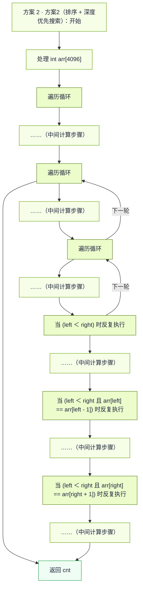

```c
/* LeetCode 18. 四数之和 — C 版（方案2） */
#include <stdio.h>  // 引入头文件
#include <stdlib.h> // 引入头文件
static int cmp_int(const void *a, const void *b) { return *(const int *)a - *(const int *)b; }
static int four_sum(const int *nums, int n, int target, int out[][4]) { // 定义函数/方法 four_sum
    int arr[4096];                                                      // int 数组[4096];
    for (int i = 0; i < n; i++)
        arr[i] = nums[i]; // 让 下标 i 从 0 开始计数，下标 i 小于 元素个数 就继续
    qsort(arr, n, sizeof(int), cmp_int); // qsort(数组, 元素个数, sizeof(int), cmp_int);
    int cnt = 0;                         // 把 0 存入 计数
    for (int i = 0; i < n; i++) { // 让 下标 i 从 0 开始计数，下标 i 小于 元素个数 就继续
        if (i > 0 && arr[i] == arr[i - 1])
            continue; // 若 下标 i 超过 0 且 数组[下标 i] 等于 数组[下标 i 减 1]) continue;
        for (int j = i + 1; j < n; j++) { // 让 下标 j 从 下标 i 加 1 开始计数，下标 j 小于 元素个数 就继续
            if (j > i + 1 && arr[j] == arr[j - 1])
                continue; // 若 下标 j 超过 下标 i 加 1 且 数组[下标 j] 等于 数组[下标 j 减 1]) continue;
            int left = j + 1, right = n - 1; // 把 下标 j 加 1, 右边界 赋值为 元素个数 减 1 存入 左边界
            while (left < right) { // 循环，直到不满足「左边界 小于 右边界」
                long s = (long)arr[i] + arr[j] + arr[left] +
                         arr[right]; // 把 (long)数组[下标 i] 加 数组[下标 j] 加 数组[左边界] 加 数组[右边界];
                                     // 写入 long s
                if (s == target) { // 若 字符串 等于 目标值
                    out[cnt][0] = arr[i];
                    out[cnt][1] = arr[j];
                    out[cnt][2] = arr[left];
                    out[cnt][3] = arr[right];
                    cnt++; // 计数 加一
                    left++;
                    right--; // 左边界 加一 ; 右边界 减一 ;
                    while (left < right && arr[left] == arr[left - 1])
                        left++; // 循环，直到不满足「左边界 小于 右边界 且 数组[左边界] 等于 数组[左边界 减
                                // 1]) 左边界 加一 ;」
                    while (left < right && arr[right] == arr[right + 1])
                        right--; // 循环，直到不满足「左边界 小于 右边界 且 数组[右边界] 等于 数组[右边界 加
                                 // 1]) 右边界 减一 ;」
                } else if (s < target)
                    left++; // 否则，若 字符串 小于 目标值) 左边界 加一 ;
                else
                    right--; // 否则
            }
        }
    }
    return cnt; // 返回 计数
}
int main(void) {    // 程序入口：跑内嵌自测用例
    int out[64][4]; // int out[64][4];
    int n = four_sum((int[]){1, 0, -1, 0, -2, 2}, 6, 0,
                     out); // 把 four_sum((int[]){1,0, 减 1,0, 减 2,2}, 6, 0, out) 存入 元素个数
    if (n != 3) {
        printf("FAIL cnt=%d\n", n);
        return 1;
    } // 若 元素个数 不等于 3) { 输出「FAIL 计数 赋值为 对…取模 d 」, 元素个数); return 1; }
    printf("PASS\n"); // 全部用例通过，输出 PASS
    return 0;         // 返回 0
}
```

### C++ 实现（2 种方案）

C++ 的全部方案如下，每个方案都内嵌用例自测，可独立运行（老仓库 python/go 文件遵循「打印结果」约定）：

#### 方案 1：方案1（排序 + 双指针）

**思路与代码分析**：核心是「方案1（排序 + 双指针）」。C++ 版用 STL 容器与迭代器，减少手写下标错误。代码里依次做这些事：双重循环遍历。**走读**：方案 1 · 方案1（排序 + 双指针）：开始 → 处理 std::sort(nums.begin(), nums → 遍历循环 → 遍历循环 → 当 (left ＜ right) 时反复执行 → 当 (left ＜ right 且 nums[left] == nums[left - 1]) 时反复执行 → 当 (left ＜ right 且 nums[right] == nums[right + 1]) 时反复执行 → 返回 res。

**运行架构**（真实控制流）：

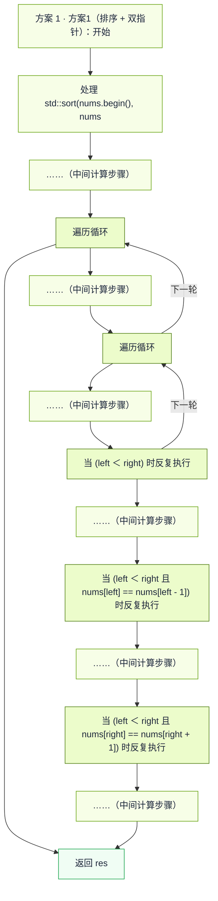

```cpp
// LeetCode 18. 四数之和 — C++ 版（方案1）
#include <algorithm> // 引入头文件
#include <cassert>   // 引入头文件
#include <iostream>  // 引入头文件
#include <vector>    // 引入头文件
static std::vector<std::vector<int>> fourSum(std::vector<int> nums, int target) {
    std::sort(nums.begin(), nums.end()); // std::sort(数组 迭代位置 , 数组.终点());
    std::vector<std::vector<int>> res;   // std::vector 小于 std::vector 小于 int 超过 超过 结果;
    int n = static_cast<int>(nums.size()); // 把 static_cast 小于 int 超过 (数组.大小()) 存入 元素个数
    for (int i = 0; i < n; ++i) { // 让 下标 i 从 0 开始计数，下标 i 小于 元素个数 就继续
        if (i > 0 && nums[i] == nums[i - 1])
            continue; // 若 下标 i 超过 0 且 数组[下标 i] 等于 数组[下标 i 减 1]) continue;
        for (int j = i + 1; j < n; ++j) { // 让 下标 j 从 下标 i 加 1 开始计数，下标 j 小于 元素个数 就继续
            if (j > i + 1 && nums[j] == nums[j - 1])
                continue; // 若 下标 j 超过 下标 i 加 1 且 数组[下标 j] 等于 数组[下标 j 减 1]) continue;
            int left = j + 1, right = n - 1; // 把 下标 j 加 1, 右边界 赋值为 元素个数 减 1 存入 左边界
            while (left < right) { // 循环，直到不满足「左边界 小于 右边界」
                long long s = static_cast<long long>(nums[i]) + nums[j] + nums[left] + nums[right];
                if (s == target) { // 若 字符串 等于 目标值
                    res.push_back(
                        {nums[i], nums[j], nums[left], nums[right]}); // 结果 追加 {数组[下标 i], 数组[下标
                                                                      // j], 数组[左边界], 数组[右边界]});
                    ++left;
                    --right; // 加一 左边界; 减一 右边界;
                    while (left < right && nums[left] == nums[left - 1])
                        ++left; // 循环，直到不满足「左边界 小于 右边界 且 数组[左边界] 等于 数组[左边界 减
                                // 1]) 加一 左边界;」
                    while (left < right && nums[right] == nums[right + 1])
                        --right; // 循环，直到不满足「左边界 小于 右边界 且 数组[右边界] 等于 数组[右边界 加
                                 // 1]) 减一 右边界;」
                } else if (s < target)
                    ++left; // 否则，若 字符串 小于 目标值) 加一 左边界;
                else
                    --right; // 否则
            }
        }
    }
    return res; // 返回 结果
}
int main() {                                     // 程序入口：跑内嵌自测用例
    auto got = fourSum({1, 0, -1, 0, -2, 2}, 0); // 把 fourSum({1, 0, 减 1, 0, 减 2, 2}, 0) 存入 got
    assert(got.size() == 3);                     // 断言校验
    std::cout << "PASS" << std::endl;            // 全部用例通过，输出 PASS
    return 0;                                    // 返回 0
}
```

#### 方案 2：方案2（排序 + 深度优先搜索）

**思路与代码分析**：核心是「方案2（排序 + 深度优先搜索）」。C++ 版用 STL 容器与迭代器，减少手写下标错误。代码里依次做这些事：双重循环遍历。**走读**：方案 2 · 方案2（排序 + 深度优先搜索）：开始 → 处理 std::sort(nums.begin(), nums → 遍历循环 → 遍历循环 → 当 (left ＜ right) 时反复执行 → 当 (left ＜ right 且 nums[left] == nums[left - 1]) 时反复执行 → 当 (left ＜ right 且 nums[right] == nums[right + 1]) 时反复执行 → 返回 res。

**运行架构**（真实控制流）：

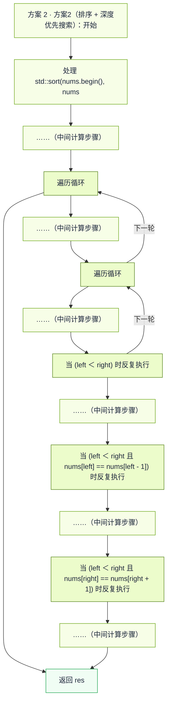

```cpp
// LeetCode 18. 四数之和 — C++ 版（方案2）
#include <algorithm> // 引入头文件
#include <cassert>   // 引入头文件
#include <iostream>  // 引入头文件
#include <vector>    // 引入头文件
static std::vector<std::vector<int>> fourSum(std::vector<int> nums, int target) {
    std::sort(nums.begin(), nums.end()); // std::sort(数组 迭代位置 , 数组.终点());
    std::vector<std::vector<int>> res;   // std::vector 小于 std::vector 小于 int 超过 超过 结果;
    int n = static_cast<int>(nums.size()); // 把 static_cast 小于 int 超过 (数组.大小()) 存入 元素个数
    for (int i = 0; i < n; ++i) { // 让 下标 i 从 0 开始计数，下标 i 小于 元素个数 就继续
        if (i > 0 && nums[i] == nums[i - 1])
            continue; // 若 下标 i 超过 0 且 数组[下标 i] 等于 数组[下标 i 减 1]) continue;
        for (int j = i + 1; j < n; ++j) { // 让 下标 j 从 下标 i 加 1 开始计数，下标 j 小于 元素个数 就继续
            if (j > i + 1 && nums[j] == nums[j - 1])
                continue; // 若 下标 j 超过 下标 i 加 1 且 数组[下标 j] 等于 数组[下标 j 减 1]) continue;
            int left = j + 1, right = n - 1; // 把 下标 j 加 1, 右边界 赋值为 元素个数 减 1 存入 左边界
            while (left < right) { // 循环，直到不满足「左边界 小于 右边界」
                long long s = static_cast<long long>(nums[i]) + nums[j] + nums[left] + nums[right];
                if (s == target) { // 若 字符串 等于 目标值
                    res.push_back(
                        {nums[i], nums[j], nums[left], nums[right]}); // 结果 追加 {数组[下标 i], 数组[下标
                                                                      // j], 数组[左边界], 数组[右边界]});
                    ++left;
                    --right; // 加一 左边界; 减一 右边界;
                    while (left < right && nums[left] == nums[left - 1])
                        ++left; // 循环，直到不满足「左边界 小于 右边界 且 数组[左边界] 等于 数组[左边界 减
                                // 1]) 加一 左边界;」
                    while (left < right && nums[right] == nums[right + 1])
                        --right; // 循环，直到不满足「左边界 小于 右边界 且 数组[右边界] 等于 数组[右边界 加
                                 // 1]) 减一 右边界;」
                } else if (s < target)
                    ++left; // 否则，若 字符串 小于 目标值) 加一 左边界;
                else
                    --right; // 否则
            }
        }
    }
    return res; // 返回 结果
}
int main() {                                     // 程序入口：跑内嵌自测用例
    auto got = fourSum({1, 0, -1, 0, -2, 2}, 0); // 把 fourSum({1, 0, 减 1, 0, 减 2, 2}, 0) 存入 got
    assert(got.size() == 3);                     // 断言校验
    std::cout << "PASS" << std::endl;            // 全部用例通过，输出 PASS
    return 0;                                    // 返回 0
}
```

### R 实现（2 种方案）

R 的全部方案如下，每个方案都内嵌用例自测，可独立运行（老仓库 python/go 文件遵循「打印结果」约定）：

#### 方案 1：方案1（排序 + 双指针）

**思路与代码分析**：核心是「方案1（排序 + 双指针）」。R 版用向量化思维与 1 起始下标，注意 1:n 的降序陷阱。代码里依次做这些事：双重循环遍历。**走读**：方案 1 · 方案1（排序 + 双指针）：开始 → 处理 arr ＜- sort(nums) → 循环 i：遍历 seq_len(n) → 循环 j：遍历 (i + 1):n → 当 (left ＜ right) 时反复执行 → 当 (left ＜ right 且 arr[left] == arr[left - 1]) left ＜- left + 1 时反复执行 → 当 (left ＜ right 且 arr[right] == arr[right + 1]) right ＜- right - 1 时反复执行 → 返回结果。

**运行架构**（真实控制流）：

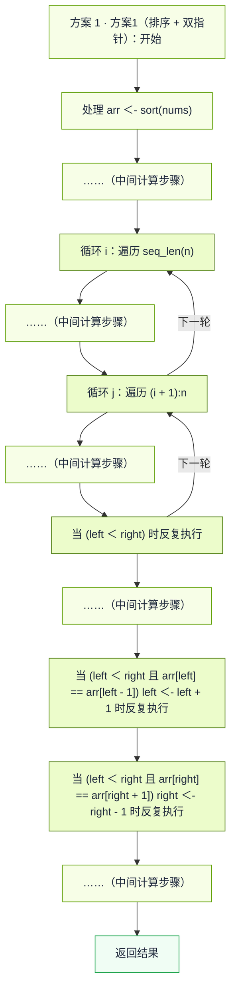

```r
# 版（方案1） 定义函数 four_sum（参数：数组, 目标值）
four_sum <- function(nums, target) {
    arr <- sort(nums)  # 把 sort(数组) 存入 数组
    res <- list()  # 把 列表() 存入 结果
    n <- length(arr)  # 把 长度(数组) 存入 元素个数
    for (i in seq_len(n)) {
        # for (下标 i in seq_len(元素个数)) {
        if (i > 1 && arr[i] == arr[i - 1])
            next  # 若 下标 i 超过 1 且 数组[下标 i] 等于 数组[下标 i 减 1]) 下一个
        for (j in (i + 1):n) {
            # for (下标 j in (下标 i 加 1):元素个数) {
            if (j > i + 1 && arr[j] == arr[j - 1])
                next  # 若 下标 j 超过 下标 i 加 1 且 数组[下标 j] 等于 数组[下标 j 减 1]) 下一个
            left <- j + 1
            right <- n  # 把 下标 j 加 1; 右边界 小于 减 元素个数 存入 左边界
            while (left < right) {
                # 循环，直到不满足「左边界 小于 右边界」
                s <- arr[i] + arr[j] + arr[left] + arr[right]  # 把 数组[下标 i] 加 数组[下标 j] 加 数组[左边界] 加 数组[右边界] 存入 字符串
                if (s == target) {
                  # 若 字符串 等于 目标值
                  res[[length(res) + 1L]] <- c(arr[i], arr[j], arr[left], arr[right])
                  left <- left + 1
                  right <- right - 1  # 把 左边界 加 1; 右边界 小于 减 右边界 减 1 存入 左边界
                  while (left < right && arr[left] == arr[left - 1]) left <- left + 1
                  while (left < right && arr[right] == arr[right + 1]) right <- right - 1
                } else if (s < target)
                  left <- left + 1  # 否则，若 字符串 小于 目标值) 左边界 小于 减 左边界 加 1
 else right <- right - 1  # 否则
            }
        }
    }
    res  # 结果
}
got <- four_sum(c(1, 0, -1, 0, -2, 2), 0)  # 把 four_sum(字符(1, 0, 减 1, 0, 减 2, 2), 0) 存入 got
stopifnot(length(got) == 3)  # 断言校验
cat("PASS\n")  # 全部用例通过，输出 PASS
```

#### 方案 2：方案2（排序 + 深度优先搜索）

**思路与代码分析**：核心是「方案2（排序 + 深度优先搜索）」。R 版用向量化思维与 1 起始下标，注意 1:n 的降序陷阱。代码里依次做这些事：双重循环遍历。**走读**：方案 2 · 方案2（排序 + 深度优先搜索）：开始 → 处理 arr ＜- sort(nums) → 循环 i：遍历 seq_len(n) → 循环 j：遍历 (i + 1):n → 当 (left ＜ right) 时反复执行 → 当 (left ＜ right 且 arr[left] == arr[left - 1]) left ＜- left + 1 时反复执行 → 当 (left ＜ right 且 arr[right] == arr[right + 1]) right ＜- right - 1 时反复执行 → 返回结果。

**运行架构**（真实控制流）：

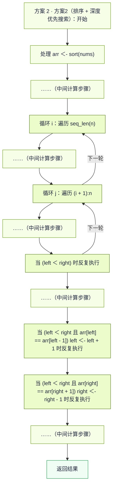

```r
# 版（方案2） 定义函数 four_sum（参数：数组, 目标值）
four_sum <- function(nums, target) {
    arr <- sort(nums)  # 把 sort(数组) 存入 数组
    res <- list()  # 把 列表() 存入 结果
    n <- length(arr)  # 把 长度(数组) 存入 元素个数
    for (i in seq_len(n)) {
        # for (下标 i in seq_len(元素个数)) {
        if (i > 1 && arr[i] == arr[i - 1])
            next  # 若 下标 i 超过 1 且 数组[下标 i] 等于 数组[下标 i 减 1]) 下一个
        for (j in (i + 1):n) {
            # for (下标 j in (下标 i 加 1):元素个数) {
            if (j > i + 1 && arr[j] == arr[j - 1])
                next  # 若 下标 j 超过 下标 i 加 1 且 数组[下标 j] 等于 数组[下标 j 减 1]) 下一个
            left <- j + 1
            right <- n  # 把 下标 j 加 1; 右边界 小于 减 元素个数 存入 左边界
            while (left < right) {
                # 循环，直到不满足「左边界 小于 右边界」
                s <- arr[i] + arr[j] + arr[left] + arr[right]  # 把 数组[下标 i] 加 数组[下标 j] 加 数组[左边界] 加 数组[右边界] 存入 字符串
                if (s == target) {
                  # 若 字符串 等于 目标值
                  res[[length(res) + 1L]] <- c(arr[i], arr[j], arr[left], arr[right])
                  left <- left + 1
                  right <- right - 1  # 把 左边界 加 1; 右边界 小于 减 右边界 减 1 存入 左边界
                  while (left < right && arr[left] == arr[left - 1]) left <- left + 1
                  while (left < right && arr[right] == arr[right + 1]) right <- right - 1
                } else if (s < target)
                  left <- left + 1  # 否则，若 字符串 小于 目标值) 左边界 小于 减 左边界 加 1
 else right <- right - 1  # 否则
            }
        }
    }
    res  # 结果
}
got <- four_sum(c(1, 0, -1, 0, -2, 2), 0)  # 把 four_sum(字符(1, 0, 减 1, 0, 减 2, 2), 0) 存入 got
stopifnot(length(got) == 3)  # 断言校验
cat("PASS\n")  # 全部用例通过，输出 PASS
```

### Zig 实现（2 种方案）

Zig 的全部方案如下，每个方案都内嵌用例自测，可独立运行（老仓库 python/go 文件遵循「打印结果」约定）：

#### 方案 1：方案1（排序 + 双指针）

**思路与代码分析**：核心是「方案1（排序 + 双指针）」。Zig 版显式分配与清零，整型边界处理严格。代码里依次做这些事：双重循环遍历。**走读**：方案 1 · 方案1（排序 + 双指针）：开始 → 计算 arr → 遍历集合元素 → 遍历集合元素 → 当 (left ＜ right) 时反复执行 → 当 (left ＜ right and arr[left] == arr[left - 1]) left += 1 时反复执行 → 当 (left ＜ right and arr[right] == arr[right + 1]) right -= 1 时反复执行 → 返回结果。

**运行架构**（真实控制流）：

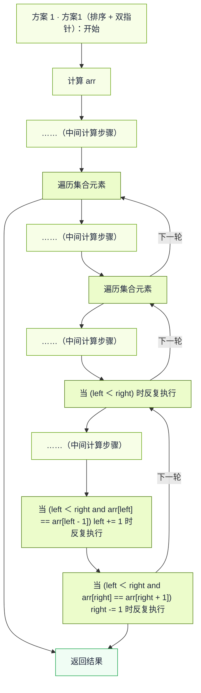

```zig
// LeetCode 18. 四数之和 — Zig 版（方案1）
const std = @import("std"); // 把 @import(「std」) 存入 std
fn fourSum(nums: []const i32, target: i32, alloc: std.mem.Allocator, out: *std.ArrayList([4]i32)) void { // 定义函数/方法 fourSum
    const arr = alloc.dupe(i32, nums) catch unreachable; // 把 alloc.dupe(i32, 数组) catch unreachable 存入 数组
    std.sort.pdq(i32, arr, {}, std.sort.asc(i32)); // std.sort.pdq(i32, 数组, {}, std.sort.asc(i32));
    const n = arr.len; // 把 数组.长度 存入 元素个数
    for (0..n) |i| { // 让 下标 i 从 0 走到 元素个数 减一
        if (i > 0 and arr[i] == arr[i - 1]) continue; // 若 下标 i 超过 0 and 数组[下标 i] 等于 数组[下标 i 减 1]) continue;
        for (i + 1..n) |j| { // for (下标 i 加 1..元素个数) 按位或 下标 j 按位或 {
            if (j > i + 1 and arr[j] == arr[j - 1]) continue; // 若 下标 j 超过 下标 i 加 1 and 数组[下标 j] 等于 数组[下标 j 减 1]) continue;
            var left = j + 1; // 把 下标 j 加 1 存入 左边界
            var right = n - 1; // 把 元素个数 减 1 存入 右边界
            while (left < right) { // 循环，直到不满足「左边界 小于 右边界」
                const s = @as(i64, arr[i]) + arr[j] + arr[left] + arr[right]; // 把 @as(i64, 数组[下标 i]) 加 数组[下标 j] 加 数组[左边界] 加 数组[右边界] 存入 字符串
                if (s == target) { // 若 字符串 等于 目标值
                    out.append(.{ arr[i], arr[j], arr[left], arr[right] }) catch unreachable; // 把 { 数组[下标 i], 数组[下标 j], 数组[左边界], 数组[右边界] } 追加到列表尾部
                    left += 1; // 左边界累加 1
                    right -= 1; // 右边界累减 1
                    while (left < right and arr[left] == arr[left - 1]) left += 1; // 循环，直到不满足「左边界 小于 右边界 and 数组[左边界] 等于 数组[左边界 减 1]) 左边界 累加 1;」
                    while (left < right and arr[right] == arr[right + 1]) right -= 1; // 循环，直到不满足「左边界 小于 右边界 and 数组[右边界] 等于 数组[右边界 加 1]) 右边界 累减 1;」
                } else if (s < target) left += 1 // 否则，若 字符串 小于 目标值) 左边界 累加 1
                else right -= 1; // 否则
            }
        }
    }
}
pub fn main() !void { // 程序入口：跑内嵌自测用例
    var arena = std.heap.ArenaAllocator.init(std.heap.page_allocator); // 把 std.堆.ArenaAllocator.init(std.堆.page_allocator) 存入 arena
    defer arena.deinit(); // defer arena.deinit();
    var out = std.ArrayList([4]i32).init(std.heap.page_allocator); // 把 std.ArrayList([4]i32).init(std.堆.page_allocator) 存入 out
    defer out.deinit(); // defer out.deinit();
    fourSum(&[_]i32{ 1, 0, -1, 0, -2, 2 }, 0, arena.allocator(), &out);
    if (out.items.len != 3) return error.TestFailed; // 若 out.items.长度 不等于 3，直接返回 error.TestFailed
    std.debug.print("PASS\n", .{}); // 全部用例通过，输出 PASS
}
```

#### 方案 2：方案2（排序 + 深度优先搜索）

**思路与代码分析**：核心是「方案2（排序 + 深度优先搜索）」。Zig 版显式分配与清零，整型边界处理严格。代码里依次做这些事：双重循环遍历。**走读**：方案 2 · 方案2（排序 + 深度优先搜索）：开始 → 计算 arr → 遍历集合元素 → 遍历集合元素 → 当 (left ＜ right) 时反复执行 → 当 (left ＜ right and arr[left] == arr[left - 1]) left += 1 时反复执行 → 当 (left ＜ right and arr[right] == arr[right + 1]) right -= 1 时反复执行 → 返回结果。

**运行架构**（真实控制流）：

```mermaid
graph TD
    N0["方案 2 · 方案2（排序 + 深度优先搜索）：开始"]
    N1["计算 arr"]
    D1["……（中间计算步骤）"]
    N4["遍历集合元素"]
    D2["……（中间计算步骤）"]
    N6["遍历集合元素"]
    D3["……（中间计算步骤）"]
    N10["当 (left ＜ right) 时反复执行"]
    D4["……（中间计算步骤）"]
    N16["当 (left ＜ right and arr[left] == arr[left - 1]) left += 1 时反复执行"]
    N17["当 (left ＜ right and arr[right] == arr[right + 1]) right -= 1 时反复执行"]
    N18["返回结果"]
    N0 --> N1
    N16 --> N17
    N17 -- 下一轮 --> N10
    N10 -- 下一轮 --> N6
    N6 -- 下一轮 --> N4
    N4 --> N18
    N1 --> D1
    D1 --> N4
    N4 --> D2
    D2 --> N6
    N6 --> D3
    D3 --> N10
    N10 --> D4
    D4 --> N16
    N17 --> N18
    classDef n fill:#f7fee7,stroke:#65a30d,color:#1e293b;
    classDef lp fill:#ecfccb,stroke:#4d7c0f,color:#1e293b;
    classDef dc fill:#fef9c3,stroke:#ca8a04,color:#1e293b;
    classDef tm fill:#f0fdf4,stroke:#16a34a,color:#1e293b;
    class N0,N1,D1,D2,D3,D4 n;
    class N4,N6,N10,N16,N17 lp;
    class N18 tm;
```

```zig
// LeetCode 18. 四数之和 — Zig 版（方案2）
const std = @import("std"); // 把 @import(「std」) 存入 std
fn fourSum(nums: []const i32, target: i32, alloc: std.mem.Allocator, out: *std.ArrayList([4]i32)) void { // 定义函数/方法 fourSum
    const arr = alloc.dupe(i32, nums) catch unreachable; // 把 alloc.dupe(i32, 数组) catch unreachable 存入 数组
    std.sort.pdq(i32, arr, {}, std.sort.asc(i32)); // std.sort.pdq(i32, 数组, {}, std.sort.asc(i32));
    const n = arr.len; // 把 数组.长度 存入 元素个数
    for (0..n) |i| { // 让 下标 i 从 0 走到 元素个数 减一
        if (i > 0 and arr[i] == arr[i - 1]) continue; // 若 下标 i 超过 0 and 数组[下标 i] 等于 数组[下标 i 减 1]) continue;
        for (i + 1..n) |j| { // for (下标 i 加 1..元素个数) 按位或 下标 j 按位或 {
            if (j > i + 1 and arr[j] == arr[j - 1]) continue; // 若 下标 j 超过 下标 i 加 1 and 数组[下标 j] 等于 数组[下标 j 减 1]) continue;
            var left = j + 1; // 把 下标 j 加 1 存入 左边界
            var right = n - 1; // 把 元素个数 减 1 存入 右边界
            while (left < right) { // 循环，直到不满足「左边界 小于 右边界」
                const s = @as(i64, arr[i]) + arr[j] + arr[left] + arr[right]; // 把 @as(i64, 数组[下标 i]) 加 数组[下标 j] 加 数组[左边界] 加 数组[右边界] 存入 字符串
                if (s == target) { // 若 字符串 等于 目标值
                    out.append(.{ arr[i], arr[j], arr[left], arr[right] }) catch unreachable; // 把 { 数组[下标 i], 数组[下标 j], 数组[左边界], 数组[右边界] } 追加到列表尾部
                    left += 1; // 左边界累加 1
                    right -= 1; // 右边界累减 1
                    while (left < right and arr[left] == arr[left - 1]) left += 1; // 循环，直到不满足「左边界 小于 右边界 and 数组[左边界] 等于 数组[左边界 减 1]) 左边界 累加 1;」
                    while (left < right and arr[right] == arr[right + 1]) right -= 1; // 循环，直到不满足「左边界 小于 右边界 and 数组[右边界] 等于 数组[右边界 加 1]) 右边界 累减 1;」
                } else if (s < target) left += 1 // 否则，若 字符串 小于 目标值) 左边界 累加 1
                else right -= 1; // 否则
            }
        }
    }
}
pub fn main() !void { // 程序入口：跑内嵌自测用例
    var arena = std.heap.ArenaAllocator.init(std.heap.page_allocator); // 把 std.堆.ArenaAllocator.init(std.堆.page_allocator) 存入 arena
    defer arena.deinit(); // defer arena.deinit();
    var out = std.ArrayList([4]i32).init(std.heap.page_allocator); // 把 std.ArrayList([4]i32).init(std.堆.page_allocator) 存入 out
    defer out.deinit(); // defer out.deinit();
    fourSum(&[_]i32{ 1, 0, -1, 0, -2, 2 }, 0, arena.allocator(), &out);
    if (out.items.len != 3) return error.TestFailed; // 若 out.items.长度 不等于 3，直接返回 error.TestFailed
    std.debug.print("PASS\n", .{}); // 全部用例通过，输出 PASS
}
```

### Dart 实现（2 种方案）

Dart 的全部方案如下，每个方案都内嵌用例自测，可独立运行（老仓库 python/go 文件遵循「打印结果」约定）：

#### 方案 1：方案1（排序 + 双指针）

**思路与代码分析**：核心是「方案1（排序 + 双指针）」。Dart 版用可空类型标注与集合方法，注意空安全。代码里依次做这些事：先排序再处理；双重循环遍历。**走读**：方案 1 · 方案1（排序 + 双指针）：开始 → 更新 arr → 遍历循环 → 遍历循环 → 当 (left ＜ right) 时反复执行 → 当 (left ＜ right 且 arr[left] == arr[left - 1]) 时反复执行 → 当 (left ＜ right 且 arr[right] == arr[right + 1]) 时反复执行 → 返回 res。

**运行架构**（真实控制流）：

```mermaid
graph TD
    N0["方案 1 · 方案1（排序 + 双指针）：开始"]
    N1["更新 arr"]
    D1["……（中间计算步骤）"]
    N5["遍历循环"]
    D2["……（中间计算步骤）"]
    N7["遍历循环"]
    D3["……（中间计算步骤）"]
    N10["当 (left ＜ right) 时反复执行"]
    D4["……（中间计算步骤）"]
    N25["当 (left ＜ right 且 arr[left] == arr[left - 1]) 时反复执行"]
    D5["……（中间计算步骤）"]
    N27["当 (left ＜ right 且 arr[right] == arr[right + 1]) 时反复执行"]
    D6["……（中间计算步骤）"]
    N31["返回 res"]
    N0 --> N1
    N10 -- 下一轮 --> N7
    N7 -- 下一轮 --> N5
    N5 --> N31
    N1 --> D1
    D1 --> N5
    N5 --> D2
    D2 --> N7
    N7 --> D3
    D3 --> N10
    N10 --> D4
    D4 --> N25
    N25 --> D5
    D5 --> N27
    N27 --> D6
    D6 --> N31
    classDef n fill:#f7fee7,stroke:#65a30d,color:#1e293b;
    classDef lp fill:#ecfccb,stroke:#4d7c0f,color:#1e293b;
    classDef dc fill:#fef9c3,stroke:#ca8a04,color:#1e293b;
    classDef tm fill:#f0fdf4,stroke:#16a34a,color:#1e293b;
    class N0,N1,D1,D2,D3,D4,D5,D6 n;
    class N5,N7,N10,N25,N27 lp;
    class N31 tm;
```

```dart
// LeetCode 18. 四数之和 — Dart 版（方案1）
List<List<int>> fourSum(List<int> nums, int target) {
  // 定义函数/方法 fourSum
  final arr = List<int>.from(nums)
    ..sort(); // 把 List 小于 int 超过 .from(数组). 排序 ) 存入 数组
  final res = <List<int>>[]; // 把 小于 List 小于 int 超过 超过 [] 存入 结果
  final n = arr.length; // 把 数组.长度 存入 元素个数
  for (var i = 0; i < n; i++) {
    // 让 下标 i 从 0 开始计数，下标 i 小于 元素个数 就继续
    if (i > 0 && arr[i] == arr[i - 1])
      continue; // 若 下标 i 超过 0 且 数组[下标 i] 等于 数组[下标 i 减 1]) continue;
    for (var j = i + 1; j < n; j++) {
      // 让 下标 j 从 下标 i 加 1 开始计数，下标 j 小于 元素个数 就继续
      if (j > i + 1 && arr[j] == arr[j - 1])
        continue; // 若 下标 j 超过 下标 i 加 1 且 数组[下标 j] 等于 数组[下标 j 减 1]) continue;
      var left = j + 1, right = n - 1; // 把 下标 j 加 1, 右边界 赋值为 元素个数 减 1 存入 左边界
      while (left < right) {
        // 循环，直到不满足「左边界 小于 右边界」
        final s =
            arr[i] +
            arr[j] +
            arr[left] +
            arr[right]; // 把 数组[下标 i] 加 数组[下标 j] 加 数组[左边界] 加 数组[右边界] 存入 字符串
        if (s == target) {
          // 若 字符串 等于 目标值
          res.add([
            arr[i],
            arr[j],
            arr[left],
            arr[right],
          ]); // 结果 追加 [数组[下标 i], 数组[下标 j], 数组[左边界], 数组[右边界]]);
          left++; // 左边界 加一
          right--; // 右边界 减一
          while (left < right && arr[left] == arr[left - 1])
            left++; // 循环，直到不满足「左边界 小于 右边界 且 数组[左边界] 等于 数组[左边界 减 1]) 左边界 加一 ;」
          while (left < right && arr[right] == arr[right + 1])
            right--; // 循环，直到不满足「左边界 小于 右边界 且 数组[右边界] 等于 数组[右边界 加 1]) 右边界 减一 ;」
        } else if (s < target) {
          // 否则，若 字符串 小于 目标值
          left++; // 左边界 加一
        } else {
          // 否则
          right--; // 右边界 减一
        }
      }
    }
  }
  return res; // 返回 结果
}

void main() {
  // 程序入口：跑内嵌自测用例
  if (fourSum([1, 0, -1, 0, -2, 2], 0).length != 3) throw StateError('c1');
  print('PASS'); // 全部用例通过，输出 PASS
}
```

#### 方案 2：方案2（排序 + 深度优先搜索）

**思路与代码分析**：核心是「方案2（排序 + 深度优先搜索）」。Dart 版用可空类型标注与集合方法，注意空安全。代码里依次做这些事：先排序再处理；双重循环遍历。**走读**：方案 2 · 方案2（排序 + 深度优先搜索）：开始 → 更新 arr → 遍历循环 → 遍历循环 → 当 (left ＜ right) 时反复执行 → 当 (left ＜ right 且 arr[left] == arr[left - 1]) 时反复执行 → 当 (left ＜ right 且 arr[right] == arr[right + 1]) 时反复执行 → 返回 res。

**运行架构**（真实控制流）：

```mermaid
graph TD
    N0["方案 2 · 方案2（排序 + 深度优先搜索）：开始"]
    N1["更新 arr"]
    D1["……（中间计算步骤）"]
    N5["遍历循环"]
    D2["……（中间计算步骤）"]
    N7["遍历循环"]
    D3["……（中间计算步骤）"]
    N10["当 (left ＜ right) 时反复执行"]
    D4["……（中间计算步骤）"]
    N25["当 (left ＜ right 且 arr[left] == arr[left - 1]) 时反复执行"]
    D5["……（中间计算步骤）"]
    N27["当 (left ＜ right 且 arr[right] == arr[right + 1]) 时反复执行"]
    D6["……（中间计算步骤）"]
    N31["返回 res"]
    N0 --> N1
    N10 -- 下一轮 --> N7
    N7 -- 下一轮 --> N5
    N5 --> N31
    N1 --> D1
    D1 --> N5
    N5 --> D2
    D2 --> N7
    N7 --> D3
    D3 --> N10
    N10 --> D4
    D4 --> N25
    N25 --> D5
    D5 --> N27
    N27 --> D6
    D6 --> N31
    classDef n fill:#f7fee7,stroke:#65a30d,color:#1e293b;
    classDef lp fill:#ecfccb,stroke:#4d7c0f,color:#1e293b;
    classDef dc fill:#fef9c3,stroke:#ca8a04,color:#1e293b;
    classDef tm fill:#f0fdf4,stroke:#16a34a,color:#1e293b;
    class N0,N1,D1,D2,D3,D4,D5,D6 n;
    class N5,N7,N10,N25,N27 lp;
    class N31 tm;
```

```dart
// LeetCode 18. 四数之和 — Dart 版（方案2）
List<List<int>> fourSum(List<int> nums, int target) {
  // 定义函数/方法 fourSum
  final arr = List<int>.from(nums)
    ..sort(); // 把 List 小于 int 超过 .from(数组). 排序 ) 存入 数组
  final res = <List<int>>[]; // 把 小于 List 小于 int 超过 超过 [] 存入 结果
  final n = arr.length; // 把 数组.长度 存入 元素个数
  for (var i = 0; i < n; i++) {
    // 让 下标 i 从 0 开始计数，下标 i 小于 元素个数 就继续
    if (i > 0 && arr[i] == arr[i - 1])
      continue; // 若 下标 i 超过 0 且 数组[下标 i] 等于 数组[下标 i 减 1]) continue;
    for (var j = i + 1; j < n; j++) {
      // 让 下标 j 从 下标 i 加 1 开始计数，下标 j 小于 元素个数 就继续
      if (j > i + 1 && arr[j] == arr[j - 1])
        continue; // 若 下标 j 超过 下标 i 加 1 且 数组[下标 j] 等于 数组[下标 j 减 1]) continue;
      var left = j + 1, right = n - 1; // 把 下标 j 加 1, 右边界 赋值为 元素个数 减 1 存入 左边界
      while (left < right) {
        // 循环，直到不满足「左边界 小于 右边界」
        final s =
            arr[i] +
            arr[j] +
            arr[left] +
            arr[right]; // 把 数组[下标 i] 加 数组[下标 j] 加 数组[左边界] 加 数组[右边界] 存入 字符串
        if (s == target) {
          // 若 字符串 等于 目标值
          res.add([
            arr[i],
            arr[j],
            arr[left],
            arr[right],
          ]); // 结果 追加 [数组[下标 i], 数组[下标 j], 数组[左边界], 数组[右边界]]);
          left++; // 左边界 加一
          right--; // 右边界 减一
          while (left < right && arr[left] == arr[left - 1])
            left++; // 循环，直到不满足「左边界 小于 右边界 且 数组[左边界] 等于 数组[左边界 减 1]) 左边界 加一 ;」
          while (left < right && arr[right] == arr[right + 1])
            right--; // 循环，直到不满足「左边界 小于 右边界 且 数组[右边界] 等于 数组[右边界 加 1]) 右边界 减一 ;」
        } else if (s < target) {
          // 否则，若 字符串 小于 目标值
          left++; // 左边界 加一
        } else {
          // 否则
          right--; // 右边界 减一
        }
      }
    }
  }
  return res; // 返回 结果
}

void main() {
  // 程序入口：跑内嵌自测用例
  if (fourSum([1, 0, -1, 0, -2, 2], 0).length != 3) throw StateError('c1');
  print('PASS'); // 全部用例通过，输出 PASS
}
```

---

## 内容总结

- **四数之和**（排序 · Medium）：共 2 个方案，主线思路「方案1（排序 + 双指针）」；时间 O(n²)（两层嵌套扫描）；动画演示冒泡交换过程，附录给出 11 种语言 × 全部方案的可运行实现。
- 来源博客：[https://blog.csdn.net/tyro_java/article/details/145245574](https://blog.csdn.net/tyro_java/article/details/145245574)
- 导航：[📋 总目录](../) ｜ [← 090 最大数](../090_最大数/) ｜ [092 合并两个有序链表 →](../092_合并两个有序链表/)
