# 092 · 合并两个有序链表（第四阶段 · 查找与排序 · Medium）

> **难度**：⭐⭐ Medium ｜ **专题**：排序
> **学习定位**：第四阶段 · 查找与排序第 92 篇 ｜ **解法数**：6
> **内容总结**：**合并两个有序链表**（排序 · Medium）：共 6 个方案，主线思路「单趟扫描」；时间 O(n)（单趟线性扫描）；动画演示冒泡交换过程，附录给出 11 种语言 × 全部方案的可运行实现。

---

## 题目描述

将两个升序链表合并为一个新的 升序 链表并返回。新链表是通过拼接给定的两个链表的所有节点组成的。

**用例（来自原题）**：

**示例 1**

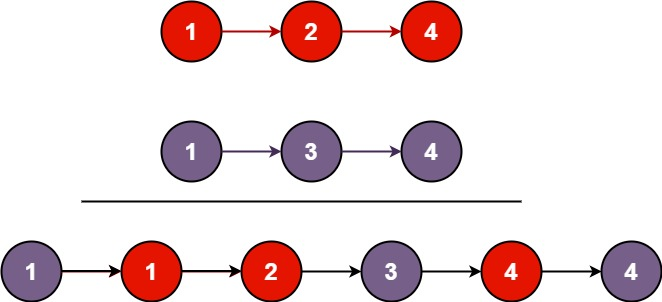

```text
输入：l1 = [1,2,4], l2 = [1,3,4]
输出：[1,1,2,3,4,4]
```

**示例 2**

```text
输入：l1 = [], l2 = []
输出：[]
```

**示例 3**

```text
输入：l1 = [], l2 = [0]
输出：[0]
```
> 题面与 [leetcode.cn 官方](https://leetcode.cn/problems/merge-two-sorted-lists/)一致，示例配图取自官方题面。

**数据范围与注意事项**：

- 两个链表的节点数目范围是 `[0, 50]`
- `-100 <= Node.val <= 100`
- `l1` 和 `l2` 均按 非递减顺序 排列
- **易错点**：比较器返回值的正负含义，写反了排序结果直接错。

## 题目分析

**场景是什么**：排序是多数算法的前置工序，这类题练的是比较逻辑与稳定性取舍。本题就是该场景的 Medium 级练习，主线做法是「单趟扫描」。

**主线怎么解**：把主解法从头到尾过一遍，它其实在依次做这几件事：单循环线性扫描。

## 解题思路

**方案对比**（共 6 个方案，由浅入深）：

| 方案 | 时间复杂度 | 空间复杂度 |
|---|---|---|
| 方案 1 · 单趟扫描 | O(n)（单趟线性扫描） | O(1) 到 O(n)（视辅助结构） |
| 方案 2 · 单趟扫描 | O(n)（单趟线性扫描） | O(1) 到 O(n)（视辅助结构） |
| 方案 3 · 单趟扫描 | O(n)（单趟线性扫描） | O(1) 到 O(n)（视辅助结构） |
| 方案 4 · 单趟扫描 | O(n)（单趟线性扫描） | O(1) 到 O(n)（视辅助结构） |
| 方案 5 · 单趟扫描 | O(n)（单趟线性扫描） | O(1) 到 O(n)（视辅助结构） |
| 方案 6 · 单趟扫描 | O(n)（单趟线性扫描） | O(1) 到 O(n)（视辅助结构） |

**方案间的取舍**：方案 1（单趟扫描）；方案 2（单趟扫描）；方案 3（单趟扫描）；方案 4（单趟扫描）；方案 5（单趟扫描）；方案 6（单趟扫描）。数据规模小、可读性优先时选靠前的方案；规模大、性能优先时选靠后的方案。

**怎么读这一篇**：

- 🐣 **新手路线**：把「题目描述」的示例 1 在纸上手推一遍 → 读方案 1（最直观的写法）与它的代码走读 → 按「运行方式」本地跑通看 PASS → 回头对比方案 2 之后的写法差在哪
- 🦅 **大佬路线**：直接锁定最优方案 1（单趟扫描，O(n)（单趟线性扫描））→ 跳读该方案代码与走读 → 用「逐步拆解与面试追问」补齐复杂度推导与边界追问

### 动态算法图（冒泡交换，GIF 自动循环）


动画演示排序专题里冒泡交换的典型过程；每个方案在「TypeScript 解题方案」一节还配了专属动画与专属流程图。

### 主解法流程图（真实控制流）

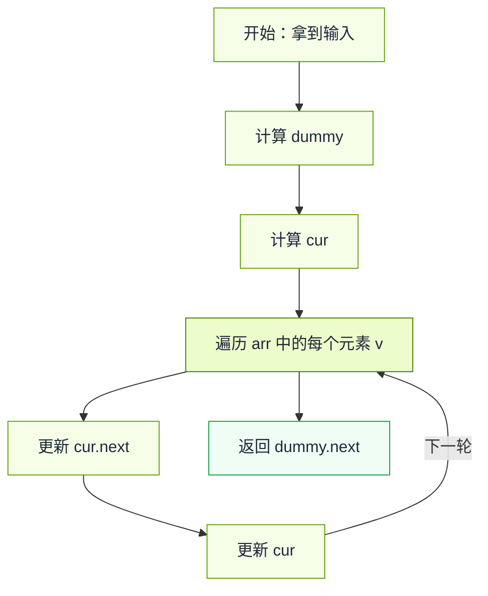

## TypeScript 解题方案（6 个方案逐个讲）

> **运行与提交**：每个方案都是自包含文件（内嵌用例自测，输出 PASS），整块复制到 `.ts` 文件后 `node 文件名` 即可运行。提交 LeetCode 时，把 `demo` 内的算法函数与辅助类型/函数整体取出、置于文件顶层即可。涉及交互/特殊接口的题以题面给定签名为准。

### 方案 1：单趟扫描

**分析与思路**：核心做法是「单趟扫描」。代码里依次做这些事：单循环线性扫描。

**运行方式**：`node 本文件`，内嵌用例全部通过会输出 PASS。


**方案专属流程图**（真实控制流）：


```typescript
/**
 ** LeetCode 21. 合并两个有序链表
 ** 方案：方案1（忠实翻译 python solution_1___1.py：迭代 + dummy 头结点）
 */

class ListNode {
  // 定义类型
  val: number; // 值: number;
  next: ListNode | null; // 下一个: ListNode 按位或 null;
  constructor(val?: number, next?: ListNode | null) {
    // constructor(值?: number, 下一个?: ListNode 按位或 null) {
    this.val = val === undefined ? 0 : val; // 把 (值 全等于 undefined ? 0 : 值); 写入 值
    this.next = next === undefined ? null : next; // 把 (下一个 全等于 undefined ? null : 下一个); 写入 下一个
  }
}

function build(arr: number[]): ListNode | null {
  // 定义函数/方法 build
  const dummy = new ListNode(0); // 把 new ListNode(0) 存入 哨兵节点
  let cur = dummy; // 把 哨兵节点 存入 当前值
  for (const v of arr) {
    // for (const 值 of 数组) {
    cur.next = new ListNode(v); // 把 new ListNode(值); 写入 下一个
    cur = cur.next; // 把 当前值.下一个 存入 当前值
  }
  return dummy.next; // 返回 哨兵节点.下一个
}

function toList(node: ListNode | null): number[] {
  // 定义函数/方法 toList
  const out: number[] = []; // 把 []; 写入 const out: number[]
  while (node) {
    // 循环，直到不满足「节点」
    out.push(node.val); // 把 节点.值 压入栈/数组尾部
    node = node.next; // 把 节点.下一个 存入 节点
  }
  return out; // 返回 out
}

// faithful translation of python solution_1___1.py
function mergeTwoLists(
  list1: ListNode | null,
  list2: ListNode | null,
): ListNode | null {
  // 定义函数/方法 mergeTwoLists
  const dummy = new ListNode(0); // 把 new ListNode(0) 存入 哨兵节点
  let p = dummy; // 把 哨兵节点 存入 节点
  let p1 = list1,
    p2 = list2; // 把 list1, p2 赋值为 list2 存入 p1
  while (p1 && p2) {
    // 循环，直到不满足「p1 且 p2」
    if (p1.val < p2.val) {
      // 若 p1.值 小于 p2.值
      p.next = p1; // 把 p1; 写入 下一个
      p1 = p1.next; // 把 p1.下一个 存入 p1
    } else {
      // 否则
      p.next = p2; // 把 p2; 写入 下一个
      p2 = p2.next; // 把 p2.下一个 存入 p2
    }
    p = p.next; // 把 节点.下一个 存入 节点
  }
  if (p1) {
    p.next = p1;
  } // 若 p1) { 节点.下一个 赋值为 p1; }
  if (p2) {
    p.next = p2;
  } // 若 p2) { 节点.下一个 赋值为 p2; }
  return dummy.next; // 返回 哨兵节点.下一个
}

export function demo(): void {
  // 程序入口：跑内嵌自测用例
  const cases: { l1: number[]; l2: number[]; want: number[] }[] = [
    { l1: [1, 2, 4], l2: [1, 3, 4], want: [1, 1, 2, 3, 4, 4] },
    { l1: [], l2: [], want: [] },
    { l1: [], l2: [0], want: [0] },
    { l1: [2], l2: [1], want: [1, 2] },
  ];
  let fail = false; // 把 false 存入 fail
  for (const c of cases) {
    // for (const 字符 of cases) {
    const got = toList(mergeTwoLists(build(c.l1), build(c.l2))); // 把 toList(mergeTwoLists(build(字符.l1), build(字符.l2))) 存入 got
    if (got.length !== c.want.length || got.some((v, i) => v !== c.want[i])) {
      fail = true; // 把 true 存入 fail
      console.log(
        'FAIL mergeTwoLists(' +
          JSON.stringify(c.l1) +
          ',' +
          JSON.stringify(c.l2) +
          ')=' +
          JSON.stringify(got) +
          ' want=' +
          JSON.stringify(c.want),
      ); // 打印输出
    }
  }
  if (fail) {
    throw new Error('FAILED');
  } // 若 fail) { throw new Error(「FAILED」); }
  console.log('PASS'); // 全部用例通过，输出 PASS
}
demo(); // demo();
```

### 方案 2：单趟扫描

**分析与思路**：核心做法是「单趟扫描」。代码里依次做这些事：单循环线性扫描。

**运行方式**：`node 本文件`，内嵌用例全部通过会输出 PASS。


**方案专属流程图**（真实控制流）：


```typescript
/**
 ** LeetCode 21. 合并两个有序链表
 ** 方案：方案2（忠实翻译 python solution_2___2.py：递归）
 */

class ListNode {
  // 定义类型
  val: number; // 值: number;
  next: ListNode | null; // 下一个: ListNode 按位或 null;
  constructor(val?: number, next?: ListNode | null) {
    // constructor(值?: number, 下一个?: ListNode 按位或 null) {
    this.val = val === undefined ? 0 : val; // 把 (值 全等于 undefined ? 0 : 值); 写入 值
    this.next = next === undefined ? null : next; // 把 (下一个 全等于 undefined ? null : 下一个); 写入 下一个
  }
}

function build(arr: number[]): ListNode | null {
  // 定义函数/方法 build
  const dummy = new ListNode(0); // 把 new ListNode(0) 存入 哨兵节点
  let cur = dummy; // 把 哨兵节点 存入 当前值
  for (const v of arr) {
    // for (const 值 of 数组) {
    cur.next = new ListNode(v); // 把 new ListNode(值); 写入 下一个
    cur = cur.next; // 把 当前值.下一个 存入 当前值
  }
  return dummy.next; // 返回 哨兵节点.下一个
}

function toList(node: ListNode | null): number[] {
  // 定义函数/方法 toList
  const out: number[] = []; // 把 []; 写入 const out: number[]
  while (node) {
    // 循环，直到不满足「节点」
    out.push(node.val); // 把 节点.值 压入栈/数组尾部
    node = node.next; // 把 节点.下一个 存入 节点
  }
  return out; // 返回 out
}

// faithful translation of python solution_2___2.py
function mergeTwoLists(
  list1: ListNode | null,
  list2: ListNode | null,
): ListNode | null {
  // 定义函数/方法 mergeTwoLists
  if (!list1) {
    return list2;
  } // 若 取反 list1) { return list2; }
  if (!list2) {
    return list1;
  } // 若 取反 list2) { return list1; }
  if (list1.val < list2.val) {
    // 若 list1.值 小于 list2.值
    list1.next = mergeTwoLists(list1.next, list2); // 把 mergeTwoLists(list1.下一个, list2); 写入 下一个
    return list1; // 返回 list1
  } else {
    // 否则
    list2.next = mergeTwoLists(list1, list2.next); // 把 mergeTwoLists(list1, list2.下一个); 写入 下一个
    return list2; // 返回 list2
  }
}

export function demo(): void {
  // 程序入口：跑内嵌自测用例
  const cases: { l1: number[]; l2: number[]; want: number[] }[] = [
    { l1: [1, 2, 4], l2: [1, 3, 4], want: [1, 1, 2, 3, 4, 4] },
    { l1: [], l2: [], want: [] },
    { l1: [], l2: [0], want: [0] },
    { l1: [2], l2: [1], want: [1, 2] },
  ];
  let fail = false; // 把 false 存入 fail
  for (const c of cases) {
    // for (const 字符 of cases) {
    const got = toList(mergeTwoLists(build(c.l1), build(c.l2))); // 把 toList(mergeTwoLists(build(字符.l1), build(字符.l2))) 存入 got
    if (got.length !== c.want.length || got.some((v, i) => v !== c.want[i])) {
      fail = true; // 把 true 存入 fail
      console.log(
        'FAIL mergeTwoLists(' +
          JSON.stringify(c.l1) +
          ',' +
          JSON.stringify(c.l2) +
          ')=' +
          JSON.stringify(got) +
          ' want=' +
          JSON.stringify(c.want),
      ); // 打印输出
    }
  }
  if (fail) {
    throw new Error('FAILED');
  } // 若 fail) { throw new Error(「FAILED」); }
  console.log('PASS'); // 全部用例通过，输出 PASS
}
demo(); // demo();
```

### 方案 3：单趟扫描

**分析与思路**：核心做法是「单趟扫描」。代码里依次做这些事：单循环线性扫描。

**运行方式**：`node 本文件`，内嵌用例全部通过会输出 PASS。


**方案专属流程图**（真实控制流）：


```typescript
/**
 ** LeetCode 21. 合并两个有序链表
 ** 方案：方案3（忠实翻译 python solution_3___3.py：迭代 + 三元接尾）
 */

class ListNode {
  // 定义类型
  val: number; // 值: number;
  next: ListNode | null; // 下一个: ListNode 按位或 null;
  constructor(val?: number, next?: ListNode | null) {
    // constructor(值?: number, 下一个?: ListNode 按位或 null) {
    this.val = val === undefined ? 0 : val; // 把 (值 全等于 undefined ? 0 : 值); 写入 值
    this.next = next === undefined ? null : next; // 把 (下一个 全等于 undefined ? null : 下一个); 写入 下一个
  }
}

function build(arr: number[]): ListNode | null {
  // 定义函数/方法 build
  const dummy = new ListNode(0); // 把 new ListNode(0) 存入 哨兵节点
  let cur = dummy; // 把 哨兵节点 存入 当前值
  for (const v of arr) {
    // for (const 值 of 数组) {
    cur.next = new ListNode(v); // 把 new ListNode(值); 写入 下一个
    cur = cur.next; // 把 当前值.下一个 存入 当前值
  }
  return dummy.next; // 返回 哨兵节点.下一个
}

function toList(node: ListNode | null): number[] {
  // 定义函数/方法 toList
  const out: number[] = []; // 把 []; 写入 const out: number[]
  while (node) {
    // 循环，直到不满足「节点」
    out.push(node.val); // 把 节点.值 压入栈/数组尾部
    node = node.next; // 把 节点.下一个 存入 节点
  }
  return out; // 返回 out
}

// faithful translation of python solution_3___3.py
function mergeTwoLists(
  list1: ListNode | null,
  list2: ListNode | null,
): ListNode | null {
  // 定义函数/方法 mergeTwoLists
  const res = new ListNode(); // 把 new ListNode() 存入 结果
  let p = res; // 把 结果 存入 节点
  let p1 = list1,
    p2 = list2; // 把 list1, p2 赋值为 list2 存入 p1
  while (p1 && p2) {
    // 循环，直到不满足「p1 且 p2」
    if (p1.val < p2.val) {
      // 若 p1.值 小于 p2.值
      p.next = p1; // 把 p1; 写入 下一个
      p1 = p1.next; // 把 p1.下一个 存入 p1
    } else {
      // 否则
      p.next = p2; // 把 p2; 写入 下一个
      p2 = p2.next; // 把 p2.下一个 存入 p2
    }
    p = p.next; // 把 节点.下一个 存入 节点
  }
  p.next = p1 ? p1 : p2; // 把 p1 ? p1 : p2; 写入 下一个
  return res.next; // 返回 结果.下一个
}

export function demo(): void {
  // 程序入口：跑内嵌自测用例
  const cases: { l1: number[]; l2: number[]; want: number[] }[] = [
    { l1: [1, 2, 4], l2: [1, 3, 4], want: [1, 1, 2, 3, 4, 4] },
    { l1: [], l2: [], want: [] },
    { l1: [], l2: [0], want: [0] },
    { l1: [2], l2: [1], want: [1, 2] },
  ];
  let fail = false; // 把 false 存入 fail
  for (const c of cases) {
    // for (const 字符 of cases) {
    const got = toList(mergeTwoLists(build(c.l1), build(c.l2))); // 把 toList(mergeTwoLists(build(字符.l1), build(字符.l2))) 存入 got
    if (got.length !== c.want.length || got.some((v, i) => v !== c.want[i])) {
      fail = true; // 把 true 存入 fail
      console.log(
        'FAIL mergeTwoLists(' +
          JSON.stringify(c.l1) +
          ',' +
          JSON.stringify(c.l2) +
          ')=' +
          JSON.stringify(got) +
          ' want=' +
          JSON.stringify(c.want),
      ); // 打印输出
    }
  }
  if (fail) {
    throw new Error('FAILED');
  } // 若 fail) { throw new Error(「FAILED」); }
  console.log('PASS'); // 全部用例通过，输出 PASS
}
demo(); // demo();
```

### 方案 4：单趟扫描

**分析与思路**：核心做法是「单趟扫描」。代码里依次做这些事：单循环线性扫描。

**运行方式**：`node 本文件`，内嵌用例全部通过会输出 PASS。


**方案专属流程图**（真实控制流）：


```typescript
/**
 ** LeetCode 21. 合并两个有序链表
 ** 方案：方案4（忠实翻译 python solution_4___4.py：递归）
 */

class ListNode {
  // 定义类型
  val: number; // 值: number;
  next: ListNode | null; // 下一个: ListNode 按位或 null;
  constructor(val?: number, next?: ListNode | null) {
    // constructor(值?: number, 下一个?: ListNode 按位或 null) {
    this.val = val === undefined ? 0 : val; // 把 (值 全等于 undefined ? 0 : 值); 写入 值
    this.next = next === undefined ? null : next; // 把 (下一个 全等于 undefined ? null : 下一个); 写入 下一个
  }
}

function build(arr: number[]): ListNode | null {
  // 定义函数/方法 build
  const dummy = new ListNode(0); // 把 new ListNode(0) 存入 哨兵节点
  let cur = dummy; // 把 哨兵节点 存入 当前值
  for (const v of arr) {
    // for (const 值 of 数组) {
    cur.next = new ListNode(v); // 把 new ListNode(值); 写入 下一个
    cur = cur.next; // 把 当前值.下一个 存入 当前值
  }
  return dummy.next; // 返回 哨兵节点.下一个
}

function toList(node: ListNode | null): number[] {
  // 定义函数/方法 toList
  const out: number[] = []; // 把 []; 写入 const out: number[]
  while (node) {
    // 循环，直到不满足「节点」
    out.push(node.val); // 把 节点.值 压入栈/数组尾部
    node = node.next; // 把 节点.下一个 存入 节点
  }
  return out; // 返回 out
}

// faithful translation of python solution_4___4.py
function mergeTwoLists(
  list1: ListNode | null,
  list2: ListNode | null,
): ListNode | null {
  // 定义函数/方法 mergeTwoLists
  if (!list1) {
    return list2;
  } // 若 取反 list1) { return list2; }
  if (!list2) {
    return list1;
  } // 若 取反 list2) { return list1; }
  if (list1.val < list2.val) {
    // 若 list1.值 小于 list2.值
    list1.next = mergeTwoLists(list1.next, list2); // 把 mergeTwoLists(list1.下一个, list2); 写入 下一个
    return list1; // 返回 list1
  } else {
    // 否则
    list2.next = mergeTwoLists(list1, list2.next); // 把 mergeTwoLists(list1, list2.下一个); 写入 下一个
    return list2; // 返回 list2
  }
}

export function demo(): void {
  // 程序入口：跑内嵌自测用例
  const cases: { l1: number[]; l2: number[]; want: number[] }[] = [
    { l1: [1, 2, 4], l2: [1, 3, 4], want: [1, 1, 2, 3, 4, 4] },
    { l1: [], l2: [], want: [] },
    { l1: [], l2: [0], want: [0] },
    { l1: [2], l2: [1], want: [1, 2] },
  ];
  let fail = false; // 把 false 存入 fail
  for (const c of cases) {
    // for (const 字符 of cases) {
    const got = toList(mergeTwoLists(build(c.l1), build(c.l2))); // 把 toList(mergeTwoLists(build(字符.l1), build(字符.l2))) 存入 got
    if (got.length !== c.want.length || got.some((v, i) => v !== c.want[i])) {
      fail = true; // 把 true 存入 fail
      console.log(
        'FAIL mergeTwoLists(' +
          JSON.stringify(c.l1) +
          ',' +
          JSON.stringify(c.l2) +
          ')=' +
          JSON.stringify(got) +
          ' want=' +
          JSON.stringify(c.want),
      ); // 打印输出
    }
  }
  if (fail) {
    throw new Error('FAILED');
  } // 若 fail) { throw new Error(「FAILED」); }
  console.log('PASS'); // 全部用例通过，输出 PASS
}
demo(); // demo();
```

### 方案 5：单趟扫描

**分析与思路**：核心做法是「单趟扫描」。代码里依次做这些事：单循环线性扫描。

**运行方式**：`node 本文件`，内嵌用例全部通过会输出 PASS。


**方案专属流程图**（真实控制流）：

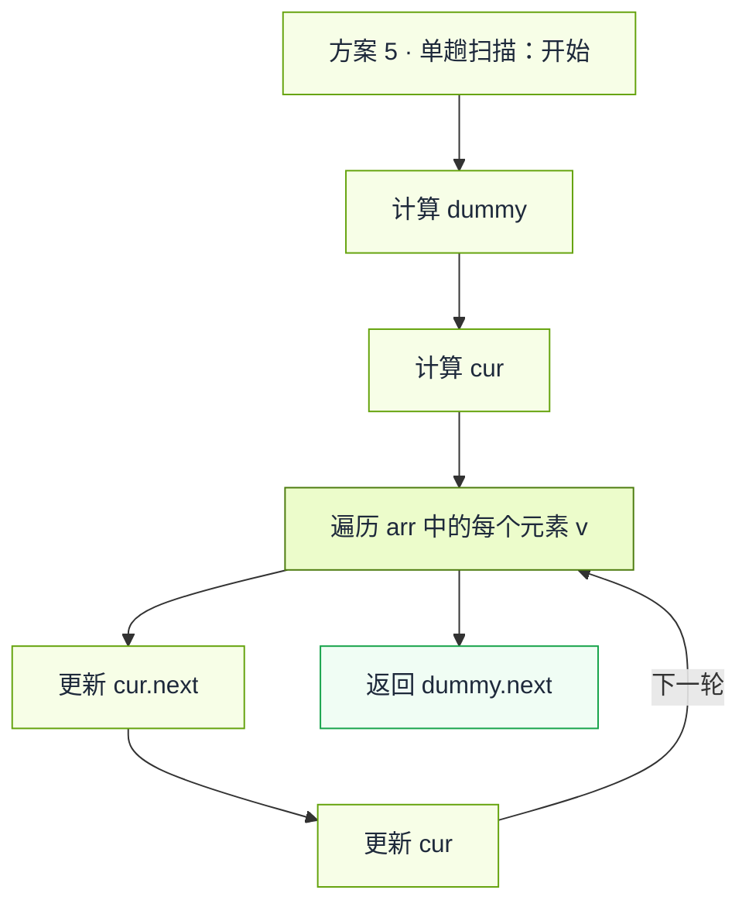

```typescript
/**
 ** LeetCode 21. 合并两个有序链表
 ** 方案：方案5（忠实翻译 python solution_5___5.py：迭代 + 三元接尾）
 */

class ListNode {
  // 定义类型
  val: number; // 值: number;
  next: ListNode | null; // 下一个: ListNode 按位或 null;
  constructor(val?: number, next?: ListNode | null) {
    // constructor(值?: number, 下一个?: ListNode 按位或 null) {
    this.val = val === undefined ? 0 : val; // 把 (值 全等于 undefined ? 0 : 值); 写入 值
    this.next = next === undefined ? null : next; // 把 (下一个 全等于 undefined ? null : 下一个); 写入 下一个
  }
}

function build(arr: number[]): ListNode | null {
  // 定义函数/方法 build
  const dummy = new ListNode(0); // 把 new ListNode(0) 存入 哨兵节点
  let cur = dummy; // 把 哨兵节点 存入 当前值
  for (const v of arr) {
    // for (const 值 of 数组) {
    cur.next = new ListNode(v); // 把 new ListNode(值); 写入 下一个
    cur = cur.next; // 把 当前值.下一个 存入 当前值
  }
  return dummy.next; // 返回 哨兵节点.下一个
}

function toList(node: ListNode | null): number[] {
  // 定义函数/方法 toList
  const out: number[] = []; // 把 []; 写入 const out: number[]
  while (node) {
    // 循环，直到不满足「节点」
    out.push(node.val); // 把 节点.值 压入栈/数组尾部
    node = node.next; // 把 节点.下一个 存入 节点
  }
  return out; // 返回 out
}

// faithful translation of python solution_5___5.py
function mergeTwoLists(
  list1: ListNode | null,
  list2: ListNode | null,
): ListNode | null {
  // 定义函数/方法 mergeTwoLists
  const res = new ListNode(0); // 把 new ListNode(0) 存入 结果
  let p = res; // 把 结果 存入 节点
  let p1 = list1,
    p2 = list2; // 把 list1, p2 赋值为 list2 存入 p1
  while (p1 && p2) {
    // 循环，直到不满足「p1 且 p2」
    if (p1.val < p2.val) {
      p.next = p1;
      p1 = p1.next;
    } // 若 p1.值 小于 p2.值) { 节点.下一个 赋值为 p1; p1 赋值为 p1.下一个; }
    else {
      p.next = p2;
      p2 = p2.next;
    } // 否则
    p = p.next; // 把 节点.下一个 存入 节点
  }
  p.next = p1 ? p1 : p2; // 把 p1 ? p1 : p2; 写入 下一个
  return res.next; // 返回 结果.下一个
}

export function demo(): void {
  // 程序入口：跑内嵌自测用例
  const cases: { l1: number[]; l2: number[]; want: number[] }[] = [
    { l1: [1, 2, 4], l2: [1, 3, 4], want: [1, 1, 2, 3, 4, 4] },
    { l1: [], l2: [], want: [] },
    { l1: [], l2: [0], want: [0] },
    { l1: [2], l2: [1], want: [1, 2] },
  ];
  let fail = false; // 把 false 存入 fail
  for (const c of cases) {
    // for (const 字符 of cases) {
    const got = toList(mergeTwoLists(build(c.l1), build(c.l2))); // 把 toList(mergeTwoLists(build(字符.l1), build(字符.l2))) 存入 got
    if (got.length !== c.want.length || got.some((v, i) => v !== c.want[i])) {
      fail = true; // 把 true 存入 fail
      console.log(
        'FAIL mergeTwoLists(' +
          JSON.stringify(c.l1) +
          ',' +
          JSON.stringify(c.l2) +
          ')=' +
          JSON.stringify(got) +
          ' want=' +
          JSON.stringify(c.want),
      ); // 打印输出
    }
  }
  if (fail) {
    throw new Error('FAILED');
  } // 若 fail) { throw new Error(「FAILED」); }
  console.log('PASS'); // 全部用例通过，输出 PASS
}
demo(); // demo();
```

### 方案 6：单趟扫描

**分析与思路**：核心做法是「单趟扫描」。代码里依次做这些事：单循环线性扫描。

**运行方式**：`node 本文件`，内嵌用例全部通过会输出 PASS。


**方案专属流程图**（真实控制流）：


```typescript
/**
 ** LeetCode 21. 合并两个有序链表
 ** 方案：方案6（忠实翻译 python solution_6___6.py：迭代 + 三元接尾）
 */

class ListNode {
  // 定义类型
  val: number; // 值: number;
  next: ListNode | null; // 下一个: ListNode 按位或 null;
  constructor(val?: number, next?: ListNode | null) {
    // constructor(值?: number, 下一个?: ListNode 按位或 null) {
    this.val = val === undefined ? 0 : val; // 把 (值 全等于 undefined ? 0 : 值); 写入 值
    this.next = next === undefined ? null : next; // 把 (下一个 全等于 undefined ? null : 下一个); 写入 下一个
  }
}

function build(arr: number[]): ListNode | null {
  // 定义函数/方法 build
  const dummy = new ListNode(0); // 把 new ListNode(0) 存入 哨兵节点
  let cur = dummy; // 把 哨兵节点 存入 当前值
  for (const v of arr) {
    // for (const 值 of 数组) {
    cur.next = new ListNode(v); // 把 new ListNode(值); 写入 下一个
    cur = cur.next; // 把 当前值.下一个 存入 当前值
  }
  return dummy.next; // 返回 哨兵节点.下一个
}

function toList(node: ListNode | null): number[] {
  // 定义函数/方法 toList
  const out: number[] = []; // 把 []; 写入 const out: number[]
  while (node) {
    // 循环，直到不满足「节点」
    out.push(node.val); // 把 节点.值 压入栈/数组尾部
    node = node.next; // 把 节点.下一个 存入 节点
  }
  return out; // 返回 out
}

// faithful translation of python solution_6___6.py
function mergeTwoLists(
  list1: ListNode | null,
  list2: ListNode | null,
): ListNode | null {
  // 定义函数/方法 mergeTwoLists
  const res = new ListNode(); // 把 new ListNode() 存入 结果
  let p = res; // 把 结果 存入 节点
  let p1 = list1,
    p2 = list2; // 把 list1, p2 赋值为 list2 存入 p1
  while (p1 && p2) {
    // 循环，直到不满足「p1 且 p2」
    if (p1.val < p2.val) {
      // 若 p1.值 小于 p2.值
      p.next = p1; // 把 p1; 写入 下一个
      p1 = p1.next; // 把 p1.下一个 存入 p1
    } else {
      // 否则
      p.next = p2; // 把 p2; 写入 下一个
      p2 = p2.next; // 把 p2.下一个 存入 p2
    }
    p = p.next; // 把 节点.下一个 存入 节点
  }
  p.next = p1 ? p1 : p2; // 把 p1 ? p1 : p2; 写入 下一个
  return res.next; // 返回 结果.下一个
}

export function demo(): void {
  // 程序入口：跑内嵌自测用例
  const cases: { l1: number[]; l2: number[]; want: number[] }[] = [
    { l1: [1, 2, 4], l2: [1, 3, 4], want: [1, 1, 2, 3, 4, 4] },
    { l1: [], l2: [], want: [] },
    { l1: [], l2: [0], want: [0] },
    { l1: [2], l2: [1], want: [1, 2] },
  ];
  let fail = false; // 把 false 存入 fail
  for (const c of cases) {
    // for (const 字符 of cases) {
    const got = toList(mergeTwoLists(build(c.l1), build(c.l2))); // 把 toList(mergeTwoLists(build(字符.l1), build(字符.l2))) 存入 got
    if (got.length !== c.want.length || got.some((v, i) => v !== c.want[i])) {
      fail = true; // 把 true 存入 fail
      console.log(
        'FAIL mergeTwoLists(' +
          JSON.stringify(c.l1) +
          ',' +
          JSON.stringify(c.l2) +
          ')=' +
          JSON.stringify(got) +
          ' want=' +
          JSON.stringify(c.want),
      ); // 打印输出
    }
  }
  if (fail) {
    throw new Error('FAILED');
  } // 若 fail) { throw new Error(「FAILED」); }
  console.log('PASS'); // 全部用例通过，输出 PASS
}
demo(); // demo();
```

## 逐步拆解与面试追问

**复杂度**：时间 O(n)（单趟线性扫描），空间 O(1) 到 O(n)（视辅助结构）

**为什么是这个量级**：每个元素被常数次访问，辅助哈希或栈的开销与 n 同阶

**面试官可能会追问**：

- 稳定性对结果有影响吗？
- 比较器怎么写才不会越界？
- 数据近有序时选哪种排序？

## 关键 API 速查（TS 主解法实际用到，附官方链接）

| API | 作用 | 使用要点 | 官方文档 |
|---|---|---|---|
| `Array.prototype.push()` | 尾部追加 | 返回新长度；可一次多个；均摊 O(1)；会改变原数组 | [官方文档](https://developer.mozilla.org/zh-CN/docs/Web/JavaScript/Reference/Global_Objects/Array/push) |
| `JSON.stringify()` | 序列化为 JSON 字符串 | 常用于结构化比较（深度相等判定）；undefined/函数/循环引用会被丢弃或抛错 | [官方文档](https://developer.mozilla.org/zh-CN/docs/Web/JavaScript/Reference/Global_Objects/JSON/stringify) |

### 各语言官方文档导航

- **TypeScript / JS**：[MDN 中文参考](https://developer.mozilla.org/zh-CN/)
- **Python**：[Python 官方文档](https://docs.python.org/zh-cn/3/)
- **Go**：[Go 标准库](https://pkg.go.dev/std)
- **Java**：[JDK 17 API](https://docs.oracle.com/en/java/javase/17/docs/api/)
- **Rust**：[Rust 标准库](https://doc.rust-lang.org/std/)
- **Lua**：[Lua 5.4 手册](https://www.lua.org/manual/5.4/)
- **C**：[Cppreference C](https://zh.cppreference.com/w/c)
- **C++**：[Cppreference C++](https://zh.cppreference.com/w/cpp)
- **R**：[R 官方手册](https://stat.ethz.ch/R-manual/)
- **Zig**：[Zig 语言文档](https://ziglang.org/documentation/master/)
- **Dart**：[Dart API](https://api.dart.dev/)

## 附录：其他 10 种语言全部实现（每种语言列举其全部方案）

> TypeScript 的全部方案见「TypeScript 解题方案」一节；下面是其余 10 种语言的对应实现，每种语言的每个方案都带思路分析、代码走读与专属运行架构图。
> 每个方案都内嵌用例自测，可独立运行（老仓库 python/go 文件遵循「打印结果」约定）。
> 完整解法文件见 `dsa/<语言>/sort/lc_21_合并两个有序链表/`。

### Python 实现（6 种方案）

Python 的全部方案如下，每个方案都内嵌用例自测，可独立运行（老仓库 python/go 文件遵循「打印结果」约定）：

#### 方案 1：单趟扫描

**思路与代码分析**：核心是「单趟扫描」。Python 版用切片与字典推导式简化操作，突出可读性。**走读**：方案 1 · 单趟扫描：开始 → 更新 dummy → 更新 p → 更新 p2 → 当 p1 and p2: 时反复执行 → 若 p1.val ＜ p2.val：更新 p.next → 更新 p.next → 更新 p1 → 更新 p.next → 更新 p2 → 更新 p → 若 p1：更新 p.next → 更新 p.next → 若 p2：更新 p.next → 更新 p.next → 返回 dummy.next。

**运行架构**（真实控制流）：

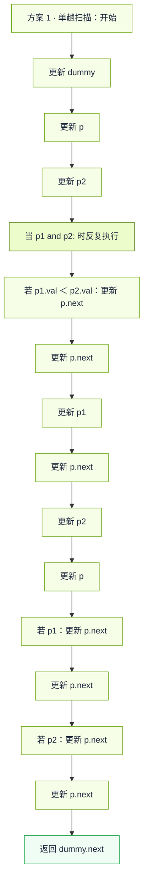

```python
import sys  # 提高递归深度上限（深输入防 RecursionError）

sys.setrecursionlimit(200000)  # 树/链表类题目节点数可达 1e4 量级

class ListNode:  # 定义类
    def __init__(self, val=0, next=None):  # 构造函数：初始化成员
        self.val = val  # 把 值 写入 值
        self.next = next  # 把 下一个 写入 下一个

def mergeTwoLists(list1, list2):  # 定义函数 mergeTwoLists（参数：list1, list2）
    dummy = ListNode(0)  # 把 ListNode(0) 存入 哨兵节点
    p = dummy  # 把 哨兵节点 存入 节点
    p1, p2 = list1, list2  # 把 list1, list2 写入 p1, p2
    while p1 and p2:  # 循环，直到不满足「p1 and p2」
        if p1.val < p2.val:  # 若 p1.值 小于 p2.值
            p.next = p1  # 把 p1 写入 下一个
            p1 = p1.next  # 把 p1.下一个 存入 p1
        else:  # 否则
            p.next = p2  # 把 p2 写入 下一个
            p2 = p2.next  # 把 p2.下一个 存入 p2
        p = p.next  # 把 节点.下一个 存入 节点
    if p1:  # 若 p1
        p.next = p1  # 把 p1 写入 下一个
    if p2:  # 若 p2
        p.next = p2  # 把 p2 写入 下一个
    return dummy.next  # 返回 哨兵节点.下一个

if __name__ == "__main__":  # 若 __name__ 等于 '__main__'

    def build(vals):  # 定义函数 build（参数：vals）
        dummy = ListNode(0)  # 把 ListNode(0) 存入 哨兵节点
        p = dummy  # 把 哨兵节点 存入 节点
        for v in vals:  # 逐个取出 vals 的元素（值）
            p.next = ListNode(v)  # 把 ListNode(值) 写入 下一个
            p = p.next  # 把 节点.下一个 存入 节点
        return dummy.next  # 返回 哨兵节点.下一个

    list1 = build([1, 2, 4])  # 把 build([1, 2, 4]) 存入 list1
    list2 = build([1, 3, 4])  # 把 build([1, 3, 4]) 存入 list2
    merged = mergeTwoLists(list1, list2)  # 把 mergeTwoLists(list1, list2) 存入 merged
    res = []  # 把 [] 存入 结果
    while merged:  # 循环，直到不满足「merged」
        res.append(merged.val)  # 把 merged.值 追加到列表尾部
        merged = merged.next  # 把 merged.下一个 存入 merged
    print(res)  # [1, 1, 2, 3, 4, 4]
```

#### 方案 2：单趟扫描

**思路与代码分析**：核心是「单趟扫描」。Python 版用切片与字典推导式简化操作，突出可读性。**走读**：方案 2 · 单趟扫描：开始 → 命中条件，直接返回 → 命中条件，直接返回 → 若 list1.val ＜ list2.val：更新 list1.next → 更新 list1.next → 返回 list1 → 更新 list2.next → 返回 list2。

**运行架构**（真实控制流）：


```python
import sys  # 提高递归深度上限（深输入防 RecursionError）

sys.setrecursionlimit(200000)  # 树/链表类题目节点数可达 1e4 量级

class ListNode:  # 定义类
    def __init__(self, val=0, next=None):  # 构造函数：初始化成员
        self.val = val  # 把 值 写入 值
        self.next = next  # 把 下一个 写入 下一个

def mergeTwoLists(list1, list2):  # 定义函数 mergeTwoLists（参数：list1, list2）
    if not list1:  # 若 not list1
        return list2  # 返回 list2
    if not list2:  # 若 not list2
        return list1  # 返回 list1
    if list1.val < list2.val:  # 若 list1.值 小于 list2.值
        list1.next = mergeTwoLists(list1.next, list2)  # 把 mergeTwoLists(list1.下一个, list2) 写入 下一个
        return list1  # 返回 list1
    else:  # 否则
        list2.next = mergeTwoLists(list1, list2.next)  # 把 mergeTwoLists(list1, list2.下一个) 写入 下一个
        return list2  # 返回 list2

def build(arr):  # 定义函数 build（参数：数组）
    dummy = ListNode()  # 把 ListNode() 存入 哨兵节点
    cur = dummy  # 把 哨兵节点 存入 当前值
    for v in arr:  # 逐个取出 数组 的元素（值）
        cur.next = ListNode(v)  # 把 ListNode(值) 写入 下一个
        cur = cur.next  # 把 当前值.下一个 存入 当前值
    return dummy.next  # 返回 哨兵节点.下一个

def to_list(node):  # 定义函数 to_list（参数：节点）
    out = []  # 把 [] 存入 out
    while node:  # 循环，直到不满足「节点」
        out.append(node.val)  # 把 节点.值 追加到列表尾部
        node = node.next  # 把 节点.下一个 存入 节点
    return out  # 返回 out

if __name__ == "__main__":  # 若 __name__ 等于 '__main__'
    l1 = build([1, 2, 4])  # 把 build([1, 2, 4]) 存入 l1
    l2 = build([1, 3, 4])  # 把 build([1, 3, 4]) 存入 l2
    print(to_list(mergeTwoLists(l1, l2)))  # 打印输出
```

#### 方案 3：单趟扫描

**思路与代码分析**：核心是「单趟扫描」。Python 版用切片与字典推导式简化操作，突出可读性。**走读**：方案 3 · 单趟扫描：开始 → 更新 res → 更新 p → 更新 p2 → 当 p1 and p2: 时反复执行 → 若 p1.val ＜ p2.val：更新 p.next → 更新 p.next → 更新 p1 → 更新 p.next → 更新 p2 → 更新 p → 更新 p.next → 返回 res.next。

**运行架构**（真实控制流）：


```python
import sys  # 提高递归深度上限（深输入防 RecursionError）

sys.setrecursionlimit(200000)  # 树/链表类题目节点数可达 1e4 量级

class ListNode:  # 定义类
    def __init__(self, val=0, next=None):  # 构造函数：初始化成员
        self.val = val  # 把 值 写入 值
        self.next = next  # 把 下一个 写入 下一个

def mergeTwoLists(list1, list2):  # 定义函数 mergeTwoLists（参数：list1, list2）
    res = ListNode()  # 把 ListNode() 存入 结果
    p = res  # 把 结果 存入 节点
    p1, p2 = list1, list2  # 把 list1, list2 写入 p1, p2
    while p1 and p2:  # 循环，直到不满足「p1 and p2」
        if p1.val < p2.val:  # 若 p1.值 小于 p2.值
            p.next = p1  # 把 p1 写入 下一个
            p1 = p1.next  # 把 p1.下一个 存入 p1
        else:  # 否则
            p.next = p2  # 把 p2 写入 下一个
            p2 = p2.next  # 把 p2.下一个 存入 p2
        p = p.next  # 把 节点.下一个 存入 节点
    p.next = p1 if p1 else p2  # 把 p1 if p1 else p2 写入 下一个
    return res.next  # 返回 结果.下一个

def build(arr):  # 定义函数 build（参数：数组）
    dummy = ListNode()  # 把 ListNode() 存入 哨兵节点
    cur = dummy  # 把 哨兵节点 存入 当前值
    for v in arr:  # 逐个取出 数组 的元素（值）
        cur.next = ListNode(v)  # 把 ListNode(值) 写入 下一个
        cur = cur.next  # 把 当前值.下一个 存入 当前值
    return dummy.next  # 返回 哨兵节点.下一个

def to_list(node):  # 定义函数 to_list（参数：节点）
    out = []  # 把 [] 存入 out
    while node:  # 循环，直到不满足「节点」
        out.append(node.val)  # 把 节点.值 追加到列表尾部
        node = node.next  # 把 节点.下一个 存入 节点
    return out  # 返回 out

if __name__ == "__main__":  # 若 __name__ 等于 '__main__'
    l1 = build([1, 2, 4])  # 把 build([1, 2, 4]) 存入 l1
    l2 = build([1, 3, 4])  # 把 build([1, 3, 4]) 存入 l2
    print(to_list(mergeTwoLists(l1, l2)))  # 打印输出
```

#### 方案 4：单趟扫描

**思路与代码分析**：核心是「单趟扫描」。Python 版用切片与字典推导式简化操作，突出可读性。**走读**：方案 4 · 单趟扫描：开始 → 命中条件，直接返回 → 命中条件，直接返回 → 若 list1.val ＜ list2.val：更新 list1.next → 更新 list1.next → 返回 list1 → 更新 list2.next → 返回 list2。

**运行架构**（真实控制流）：

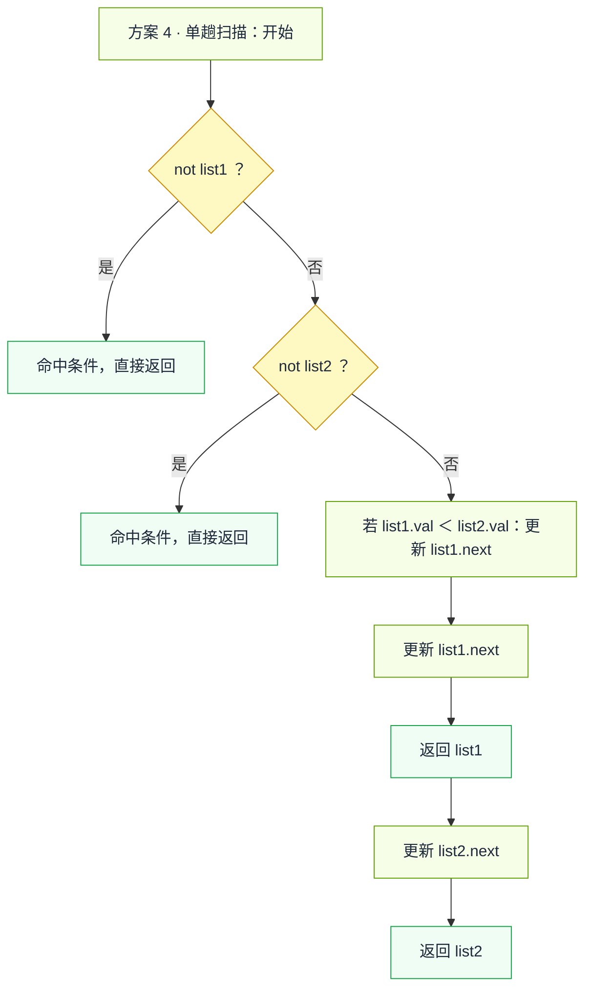

```python
import sys  # 提高递归深度上限（深输入防 RecursionError）

sys.setrecursionlimit(200000)  # 树/链表类题目节点数可达 1e4 量级

class ListNode:  # 定义类
    def __init__(self, val=0, next=None):  # 构造函数：初始化成员
        self.val = val  # 把 值 写入 值
        self.next = next  # 把 下一个 写入 下一个

def mergeTwoLists(list1, list2):  # 定义函数 mergeTwoLists（参数：list1, list2）
    if not list1:  # 若 not list1
        return list2  # 返回 list2
    if not list2:  # 若 not list2
        return list1  # 返回 list1
    if list1.val < list2.val:  # 若 list1.值 小于 list2.值
        list1.next = mergeTwoLists(list1.next, list2)  # 把 mergeTwoLists(list1.下一个, list2) 写入 下一个
        return list1  # 返回 list1
    else:  # 否则
        list2.next = mergeTwoLists(list1, list2.next)  # 把 mergeTwoLists(list1, list2.下一个) 写入 下一个
        return list2  # 返回 list2

def build(arr):  # 定义函数 build（参数：数组）
    dummy = ListNode()  # 把 ListNode() 存入 哨兵节点
    cur = dummy  # 把 哨兵节点 存入 当前值
    for v in arr:  # 逐个取出 数组 的元素（值）
        cur.next = ListNode(v)  # 把 ListNode(值) 写入 下一个
        cur = cur.next  # 把 当前值.下一个 存入 当前值
    return dummy.next  # 返回 哨兵节点.下一个

def to_list(node):  # 定义函数 to_list（参数：节点）
    out = []  # 把 [] 存入 out
    while node:  # 循环，直到不满足「节点」
        out.append(node.val)  # 把 节点.值 追加到列表尾部
        node = node.next  # 把 节点.下一个 存入 节点
    return out  # 返回 out

if __name__ == "__main__":  # 若 __name__ 等于 '__main__'
    l1 = build([1, 2, 4])  # 把 build([1, 2, 4]) 存入 l1
    l2 = build([1, 3, 4])  # 把 build([1, 3, 4]) 存入 l2
    print(to_list(mergeTwoLists(l1, l2)))  # 打印输出
```

#### 方案 5：单趟扫描

**思路与代码分析**：核心是「单趟扫描」。Python 版用切片与字典推导式简化操作，突出可读性。**走读**：方案 5 · 单趟扫描：开始 → 更新 res → 更新 p → 更新 p2 → 当 p1 and p2: 时反复执行 → 若 p1.val ＜ p2.val：更新 p.next → 更新 p.next → 更新 p1 → 更新 p.next → 更新 p2 → 更新 p → 更新 p.next → 返回 res.next。

**运行架构**（真实控制流）：


```python
import sys  # 提高递归深度上限（深输入防 RecursionError）

sys.setrecursionlimit(200000)  # 树/链表类题目节点数可达 1e4 量级

class ListNode:  # 定义类
    def __init__(self, val=0, next=None):  # 构造函数：初始化成员
        self.val = val  # 把 值 写入 值
        self.next = next  # 把 下一个 写入 下一个

def mergeTwoLists(list1, list2):  # 定义函数 mergeTwoLists（参数：list1, list2）
    res = ListNode()  # 把 ListNode() 存入 结果
    p = res  # 把 结果 存入 节点
    p1, p2 = list1, list2  # 把 list1, list2 写入 p1, p2
    while p1 and p2:  # 循环，直到不满足「p1 and p2」
        if p1.val < p2.val:  # 若 p1.值 小于 p2.值
            p.next = p1  # 把 p1 写入 下一个
            p1 = p1.next  # 把 p1.下一个 存入 p1
        else:  # 否则
            p.next = p2  # 把 p2 写入 下一个
            p2 = p2.next  # 把 p2.下一个 存入 p2
        p = p.next  # 把 节点.下一个 存入 节点
    p.next = p1 if p1 else p2  # 把 p1 if p1 else p2 写入 下一个
    return res.next  # 返回 结果.下一个

def build(arr):  # 定义函数 build（参数：数组）
    dummy = ListNode()  # 把 ListNode() 存入 哨兵节点
    cur = dummy  # 把 哨兵节点 存入 当前值
    for v in arr:  # 逐个取出 数组 的元素（值）
        cur.next = ListNode(v)  # 把 ListNode(值) 写入 下一个
        cur = cur.next  # 把 当前值.下一个 存入 当前值
    return dummy.next  # 返回 哨兵节点.下一个

def to_list(node):  # 定义函数 to_list（参数：节点）
    out = []  # 把 [] 存入 out
    while node:  # 循环，直到不满足「节点」
        out.append(node.val)  # 把 节点.值 追加到列表尾部
        node = node.next  # 把 节点.下一个 存入 节点
    return out  # 返回 out

if __name__ == "__main__":  # 若 __name__ 等于 '__main__'
    l1 = build([1, 2, 4])  # 把 build([1, 2, 4]) 存入 l1
    l2 = build([1, 3, 4])  # 把 build([1, 3, 4]) 存入 l2
    print(to_list(mergeTwoLists(l1, l2)))  # 打印输出
```

#### 方案 6：单趟扫描

**思路与代码分析**：核心是「单趟扫描」。Python 版用切片与字典推导式简化操作，突出可读性。**走读**：方案 6 · 单趟扫描：开始 → 更新 res → 更新 p → 更新 p2 → 当 p1 and p2: 时反复执行 → 若 p1.val ＜ p2.val：更新 p.next → 更新 p.next → 更新 p1 → 更新 p.next → 更新 p2 → 更新 p → 更新 p.next → 返回 res.next。

**运行架构**（真实控制流）：

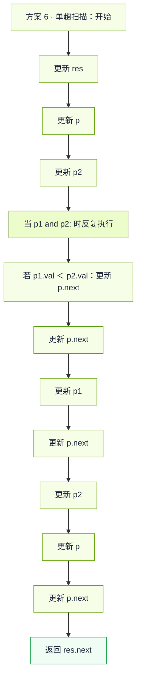

```python
import sys  # 提高递归深度上限（深输入防 RecursionError）

sys.setrecursionlimit(200000)  # 树/链表类题目节点数可达 1e4 量级

class ListNode:  # 定义类
    def __init__(self, val=0, next=None):  # 构造函数：初始化成员
        self.val = val  # 把 值 写入 值
        self.next = next  # 把 下一个 写入 下一个

def mergeTwoLists(list1, list2):  # 定义函数 mergeTwoLists（参数：list1, list2）
    res = ListNode()  # 把 ListNode() 存入 结果
    p = res  # 把 结果 存入 节点
    p1, p2 = list1, list2  # 把 list1, list2 写入 p1, p2
    while p1 and p2:  # 循环，直到不满足「p1 and p2」
        if p1.val < p2.val:  # 若 p1.值 小于 p2.值
            p.next = p1  # 把 p1 写入 下一个
            p1 = p1.next  # 把 p1.下一个 存入 p1
        else:  # 否则
            p.next = p2  # 把 p2 写入 下一个
            p2 = p2.next  # 把 p2.下一个 存入 p2
        p = p.next  # 把 节点.下一个 存入 节点
    p.next = p1 if p1 else p2  # 把 p1 if p1 else p2 写入 下一个
    return res.next  # 返回 结果.下一个

def build(arr):  # 定义函数 build（参数：数组）
    dummy = ListNode()  # 把 ListNode() 存入 哨兵节点
    cur = dummy  # 把 哨兵节点 存入 当前值
    for v in arr:  # 逐个取出 数组 的元素（值）
        cur.next = ListNode(v)  # 把 ListNode(值) 写入 下一个
        cur = cur.next  # 把 当前值.下一个 存入 当前值
    return dummy.next  # 返回 哨兵节点.下一个

def to_list(node):  # 定义函数 to_list（参数：节点）
    out = []  # 把 [] 存入 out
    while node:  # 循环，直到不满足「节点」
        out.append(node.val)  # 把 节点.值 追加到列表尾部
        node = node.next  # 把 节点.下一个 存入 节点
    return out  # 返回 out

if __name__ == "__main__":  # 若 __name__ 等于 '__main__'
    l1 = build([1, 2, 4])  # 把 build([1, 2, 4]) 存入 l1
    l2 = build([1, 3, 4])  # 把 build([1, 3, 4]) 存入 l2
    print(to_list(mergeTwoLists(l1, l2)))  # 打印输出
```

### Go 实现（6 种方案）

Go 的全部方案如下，每个方案都内嵌用例自测，可独立运行（老仓库 python/go 文件遵循「打印结果」约定）：

#### 方案 1：单趟扫描

**思路与代码分析**：核心是「单趟扫描」。Go 版用切片与多返回值惯用法，显式处理索引边界。**走读**：方案 1 · 单趟扫描：开始 → 更新 : → 更新 : → 更新 : → 遍历循环 → 处理 if p1.Val ＜ p2.Val → 更新 p.Next → 更新 p1 → 更新 p.Next → 更新 p2 → 更新 p → 处理 if p1 ≠ nil → 更新 p.Next → 处理 if p2 ≠ nil → 更新 p.Next → 返回 dummy.Next。

**运行架构**（真实控制流）：

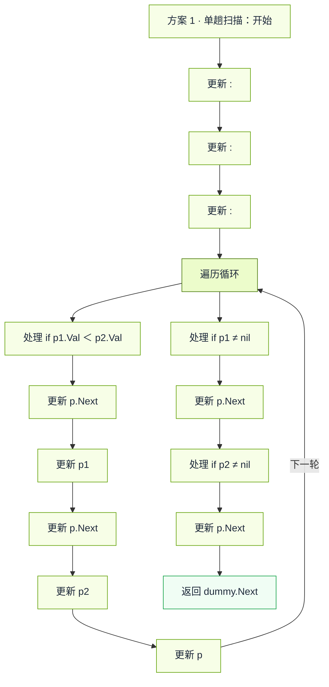

```go
package main // 引入依赖

import (
	"fmt"     // 「fmt」
	"reflect" // 「reflect」
)

type ListNode struct { // 定义类型
	Val  int       // Val int
	Next *ListNode // Next 乘 ListNode
}

func mergeTwoLists(list1, list2 *ListNode) *ListNode { // 定义函数/方法 mergeTwoLists
	dummy := &ListNode{}         // 把 按位与 ListNode{} 写入 dummy :
	p := dummy                   // 把 哨兵节点 写入 p :
	p1, p2 := list1, list2       // 把 list1, list2 写入 p1, p2 :
	for p1 != nil && p2 != nil { // 把 nil 且 p2 不等于 nil { 写入 for p1 !
		if p1.Val < p2.Val { // 若 p1.Val 小于 p2.Val
			p.Next = p1  // 把 p1 写入 p.Next
			p1 = p1.Next // 把 p1.Next 写入 p1
		} else { // 否则
			p.Next = p2  // 把 p2 写入 p.Next
			p2 = p2.Next // 把 p2.Next 写入 p2
		}
		p = p.Next // 把 节点.Next 写入 节点
	}
	if p1 != nil { // 若 p1 不等于 nil
		p.Next = p1 // 把 p1 写入 p.Next
	}
	if p2 != nil { // 若 p2 不等于 nil
		p.Next = p2 // 把 p2 写入 p.Next
	}
	return dummy.Next // 返回 哨兵节点.Next
}

func build(vals []int) *ListNode { // 定义函数/方法 build
	dummy := &ListNode{}     // 把 按位与 ListNode{} 写入 dummy :
	p := dummy               // 把 哨兵节点 写入 p :
	for _, v := range vals { // 同时取 _ 与 值 遍历
		p.Next = &ListNode{Val: v} // 把 按位与 ListNode{Val: 值} 写入 p.Next
		p = p.Next                 // 把 节点.Next 写入 节点
	}
	return dummy.Next // 返回 哨兵节点.Next
}

func toList(n *ListNode) []int { // 定义函数/方法 toList
	out := []int{} // 把 []int{} 写入 out :
	for n != nil { // 把 nil { 写入 for n !
		out = append(out, n.Val) // 把 append(out, 元素个数.Val) 写入 out
		n = n.Next               // 把 元素个数.Next 写入 元素个数
	}
	return out // 返回 out
}

func main() { // 程序入口：跑内嵌自测用例
	want := []int{1, 1, 2, 3, 4, 4} // 把 []int{1, 1, 2, 3, 4, 4} 写入 want :
	got := toList(mergeTwoLists(build([]int{1, 2, 4}), build([]int{1, 3, 4})))
	if !reflect.DeepEqual(got, want) { // 若 取反 reflect.DeepEqual(got, want
		fmt.Println("FAIL", got) // 打印输出
		return                   // return
	}
	fmt.Println("PASS") // 全部用例通过，输出 PASS
}
```

#### 方案 2：单趟扫描

**思路与代码分析**：核心是「单趟扫描」。Go 版用切片与多返回值惯用法，显式处理索引边界。**走读**：方案 2 · 单趟扫描：开始 → 更新 : → 遍历循环 → 更新 res → 更新 head → 返回 res。

**运行架构**（真实控制流）：

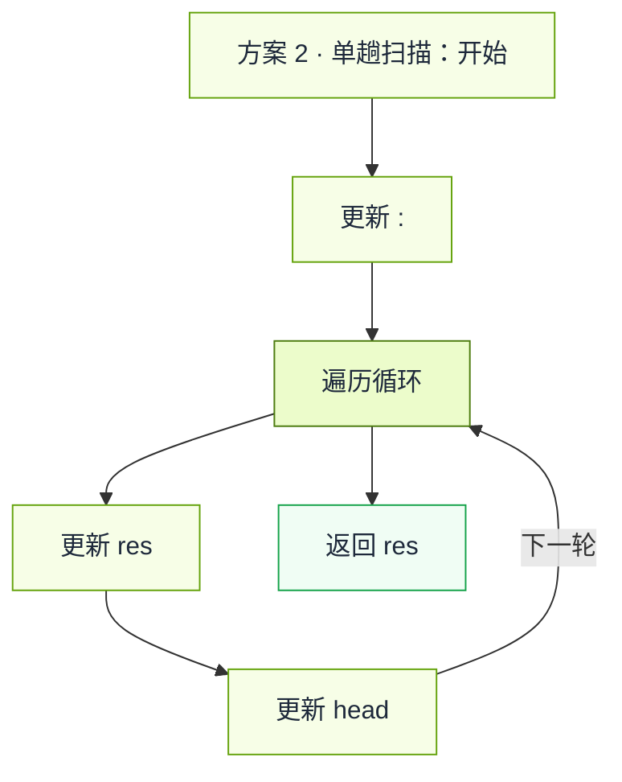

```go
package main // 引入依赖
import (
	"fmt"
	"os"
	"reflect"
) // 引入依赖
type ListNode struct {
	Val  int
	Next *ListNode
} // 定义类型
func buildList(vals []int) *ListNode { // 定义函数/方法 buildList
	dummy := &ListNode{}
	p := dummy // 把 按位与 ListNode{}; 节点 : 赋值为 哨兵节点 写入 dummy :
	for _, v := range vals {
		p.Next = &ListNode{Val: v}
		p = p.Next
	} // 同时取 _ 与 值 遍历
	return dummy.Next // 返回 哨兵节点.Next
}
func toArr(head *ListNode) []int { // 定义函数/方法 toArr
	res := []int{} // 把 []int{} 写入 res :
	for head != nil {
		res = append(res, head.Val)
		head = head.Next
	}
	return res // 返回 结果
}
func mergeTwoLists(l1, l2 *ListNode) *ListNode { // 定义函数/方法 mergeTwoLists
	dummy := &ListNode{}
	p := dummy                   // 把 按位与 ListNode{}; 节点 : 赋值为 哨兵节点 写入 dummy :
	for l1 != nil && l2 != nil { // 把 nil 且 l2 不等于 nil { 写入 for l1 !
		if l1.Val <= l2.Val {
			p.Next = l1
			l1 = l1.Next
		} else {
			p.Next = l2
			l2 = l2.Next
		}
		p = p.Next // 把 节点.Next 写入 节点
	}
	if l1 != nil {
		p.Next = l1
	} else {
		p.Next = l2
	} // 若 l1 不等于 nil { 节点.Next 赋值为 l1 } else { 节点.Next 赋值为 l2 }
	return dummy.Next // 返回 哨兵节点.Next
}
func main() { // 程序入口：跑内嵌自测用例
	cases := []struct{ a, b, want []int }{ // 把 []struct{ 数组, b, want []int }{ 写入 cases :
		{[]int{1, 2, 4}, []int{1, 3, 4}, []int{1, 1, 2, 3, 4, 4}},
		{[]int{}, []int{}, []int{}},
		{[]int{1}, []int{}, []int{1}},
	}
	ok := true                // 把 true 写入 ok :
	for _, c := range cases { // 同时取 _ 与 字符 遍历
		got := toArr(mergeTwoLists(buildList(c.a), buildList(c.b)))
		if !reflect.DeepEqual(got, c.want) {
			ok = false
			fmt.Printf("FAIL %v\n", got)
		}
	}
	if !ok {
		os.Exit(1)
	} // 若 取反 ok { os.Exit(1) }
	fmt.Println("PASS") // 全部用例通过，输出 PASS
}
```

#### 方案 3：单趟扫描

**思路与代码分析**：核心是「单趟扫描」。Go 版用切片与多返回值惯用法，显式处理索引边界。**走读**：方案 3 · 单趟扫描：开始 → 处理 if list1 == nil → 返回 list2 → 处理 if list2 == nil → 返回 list1 → 处理 if list1.Val ＜ list2.Val → 更新 list1.Next → 返回 list1 → 更新 list2.Next → 返回 list2。

**运行架构**（真实控制流）：

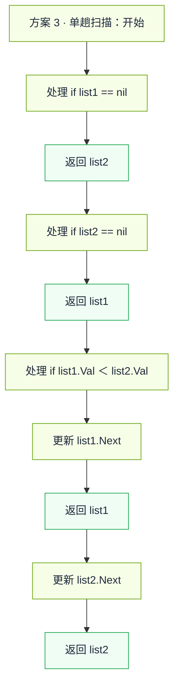

```go
package main // 引入依赖

import (
	"fmt"     // 「fmt」
	"reflect" // 「reflect」
)

type ListNode struct { // 定义类型
	Val  int       // Val int
	Next *ListNode // Next 乘 ListNode
}

func mergeTwoLists(list1, list2 *ListNode) *ListNode { // 定义函数/方法 mergeTwoLists
	if list1 == nil { // 若 list1 等于 nil
		return list2 // 返回 list2
	}
	if list2 == nil { // 若 list2 等于 nil
		return list1 // 返回 list1
	}
	if list1.Val < list2.Val { // 若 list1.Val 小于 list2.Val
		list1.Next = mergeTwoLists(list1.Next, list2) // 把 mergeTwoLists(list1.Next, list2) 写入 list1.Next
		return list1                                  // 返回 list1
	}
	list2.Next = mergeTwoLists(list1, list2.Next) // 把 mergeTwoLists(list1, list2.Next) 写入 list2.Next
	return list2                                  // 返回 list2
}

func build(vals []int) *ListNode { // 定义函数/方法 build
	dummy := &ListNode{}     // 把 按位与 ListNode{} 写入 dummy :
	p := dummy               // 把 哨兵节点 写入 p :
	for _, v := range vals { // 同时取 _ 与 值 遍历
		p.Next = &ListNode{Val: v} // 把 按位与 ListNode{Val: 值} 写入 p.Next
		p = p.Next                 // 把 节点.Next 写入 节点
	}
	return dummy.Next // 返回 哨兵节点.Next
}

func toList(n *ListNode) []int { // 定义函数/方法 toList
	out := []int{} // 把 []int{} 写入 out :
	for n != nil { // 把 nil { 写入 for n !
		out = append(out, n.Val) // 把 append(out, 元素个数.Val) 写入 out
		n = n.Next               // 把 元素个数.Next 写入 元素个数
	}
	return out // 返回 out
}

func main() { // 程序入口：跑内嵌自测用例
	want := []int{1, 1, 2, 3, 4, 4} // 把 []int{1, 1, 2, 3, 4, 4} 写入 want :
	got := toList(mergeTwoLists(build([]int{1, 2, 4}), build([]int{1, 3, 4})))
	if !reflect.DeepEqual(got, want) { // 若 取反 reflect.DeepEqual(got, want
		fmt.Println("FAIL", got) // 打印输出
		return                   // return
	}
	fmt.Println("PASS") // 全部用例通过，输出 PASS
}
```

#### 方案 4：单趟扫描

**思路与代码分析**：核心是「单趟扫描」。Go 版用切片与多返回值惯用法，显式处理索引边界。**走读**：方案 4 · 单趟扫描：开始 → 更新 : → 更新 : → 更新 : → 遍历循环 → 处理 if p1.Val ＜ p2.Val → 更新 p.Next → 更新 p1 → 更新 p.Next → 更新 p2 → 更新 p → 处理 if p1 ≠ nil → 更新 p.Next → 更新 p.Next → 返回 res.Next。

**运行架构**（真实控制流）：

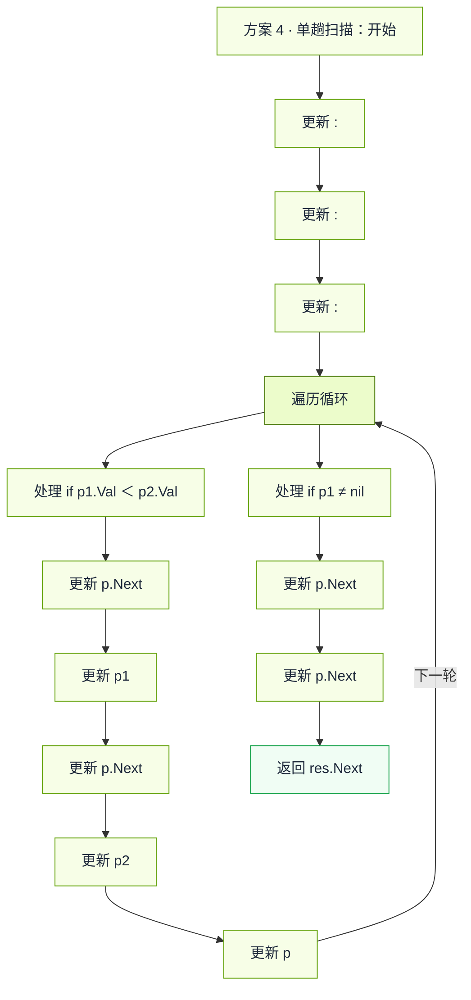

```go
package main // 引入依赖

import (
	"fmt"     // 「fmt」
	"reflect" // 「reflect」
)

type ListNode struct { // 定义类型
	Val  int       // Val int
	Next *ListNode // Next 乘 ListNode
}

func mergeTwoLists(list1, list2 *ListNode) *ListNode { // 定义函数/方法 mergeTwoLists
	res := &ListNode{}           // 把 按位与 ListNode{} 写入 res :
	p := res                     // 把 结果 写入 p :
	p1, p2 := list1, list2       // 把 list1, list2 写入 p1, p2 :
	for p1 != nil && p2 != nil { // 把 nil 且 p2 不等于 nil { 写入 for p1 !
		if p1.Val < p2.Val { // 若 p1.Val 小于 p2.Val
			p.Next = p1  // 把 p1 写入 p.Next
			p1 = p1.Next // 把 p1.Next 写入 p1
		} else { // 否则
			p.Next = p2  // 把 p2 写入 p.Next
			p2 = p2.Next // 把 p2.Next 写入 p2
		}
		p = p.Next // 把 节点.Next 写入 节点
	}
	if p1 != nil { // 若 p1 不等于 nil
		p.Next = p1 // 把 p1 写入 p.Next
	} else { // 否则
		p.Next = p2 // 把 p2 写入 p.Next
	}
	return res.Next // 返回 结果.Next
}

func build(vals []int) *ListNode { // 定义函数/方法 build
	dummy := &ListNode{}     // 把 按位与 ListNode{} 写入 dummy :
	p := dummy               // 把 哨兵节点 写入 p :
	for _, v := range vals { // 同时取 _ 与 值 遍历
		p.Next = &ListNode{Val: v} // 把 按位与 ListNode{Val: 值} 写入 p.Next
		p = p.Next                 // 把 节点.Next 写入 节点
	}
	return dummy.Next // 返回 哨兵节点.Next
}

func toList(n *ListNode) []int { // 定义函数/方法 toList
	out := []int{} // 把 []int{} 写入 out :
	for n != nil { // 把 nil { 写入 for n !
		out = append(out, n.Val) // 把 append(out, 元素个数.Val) 写入 out
		n = n.Next               // 把 元素个数.Next 写入 元素个数
	}
	return out // 返回 out
}

func main() { // 程序入口：跑内嵌自测用例
	want := []int{1, 1, 2, 3, 4, 4} // 把 []int{1, 1, 2, 3, 4, 4} 写入 want :
	got := toList(mergeTwoLists(build([]int{1, 2, 4}), build([]int{1, 3, 4})))
	if !reflect.DeepEqual(got, want) { // 若 取反 reflect.DeepEqual(got, want
		fmt.Println("FAIL", got) // 打印输出
		return                   // return
	}
	fmt.Println("PASS") // 全部用例通过，输出 PASS
}
```

#### 方案 5：单趟扫描

**思路与代码分析**：核心是「单趟扫描」。Go 版用切片与多返回值惯用法，显式处理索引边界。**走读**：方案 5 · 单趟扫描：开始 → 更新 : → 更新 : → 更新 : → 遍历循环 → 处理 if p1.Val ＜ p2.Val → 更新 p.Next → 更新 p1 → 更新 p.Next → 更新 p2 → 更新 p → 处理 if p1 ≠ nil → 更新 p.Next → 更新 p.Next → 返回 res.Next。

**运行架构**（真实控制流）：


```go
package main // 引入依赖

import (
	"fmt"     // 「fmt」
	"reflect" // 「reflect」
)

type ListNode struct { // 定义类型
	Val  int       // Val int
	Next *ListNode // Next 乘 ListNode
}

func mergeTwoLists(list1, list2 *ListNode) *ListNode { // 定义函数/方法 mergeTwoLists
	res := &ListNode{}           // 把 按位与 ListNode{} 写入 res :
	p := res                     // 把 结果 写入 p :
	p1, p2 := list1, list2       // 把 list1, list2 写入 p1, p2 :
	for p1 != nil && p2 != nil { // 把 nil 且 p2 不等于 nil { 写入 for p1 !
		if p1.Val < p2.Val { // 若 p1.Val 小于 p2.Val
			p.Next = p1  // 把 p1 写入 p.Next
			p1 = p1.Next // 把 p1.Next 写入 p1
		} else { // 否则
			p.Next = p2  // 把 p2 写入 p.Next
			p2 = p2.Next // 把 p2.Next 写入 p2
		}
		p = p.Next // 把 节点.Next 写入 节点
	}
	if p1 != nil { // 若 p1 不等于 nil
		p.Next = p1 // 把 p1 写入 p.Next
	} else { // 否则
		p.Next = p2 // 把 p2 写入 p.Next
	}
	return res.Next // 返回 结果.Next
}

func build(vals []int) *ListNode { // 定义函数/方法 build
	dummy := &ListNode{}     // 把 按位与 ListNode{} 写入 dummy :
	p := dummy               // 把 哨兵节点 写入 p :
	for _, v := range vals { // 同时取 _ 与 值 遍历
		p.Next = &ListNode{Val: v} // 把 按位与 ListNode{Val: 值} 写入 p.Next
		p = p.Next                 // 把 节点.Next 写入 节点
	}
	return dummy.Next // 返回 哨兵节点.Next
}

func toList(n *ListNode) []int { // 定义函数/方法 toList
	out := []int{} // 把 []int{} 写入 out :
	for n != nil { // 把 nil { 写入 for n !
		out = append(out, n.Val) // 把 append(out, 元素个数.Val) 写入 out
		n = n.Next               // 把 元素个数.Next 写入 元素个数
	}
	return out // 返回 out
}

func main() { // 程序入口：跑内嵌自测用例
	want := []int{1, 1, 2, 3, 4, 4} // 把 []int{1, 1, 2, 3, 4, 4} 写入 want :
	got := toList(mergeTwoLists(build([]int{1, 2, 4}), build([]int{1, 3, 4})))
	if !reflect.DeepEqual(got, want) { // 若 取反 reflect.DeepEqual(got, want
		fmt.Println("FAIL", got) // 打印输出
		return                   // return
	}
	fmt.Println("PASS") // 全部用例通过，输出 PASS
}
```

#### 方案 6：单趟扫描

**思路与代码分析**：核心是「单趟扫描」。Go 版用切片与多返回值惯用法，显式处理索引边界。**走读**：方案 6 · 单趟扫描：开始 → 更新 : → 更新 : → 更新 : → 遍历循环 → 处理 if p1.Val ＜ p2.Val → 更新 p.Next → 更新 p1 → 更新 p.Next → 更新 p2 → 更新 p → 处理 if p1 ≠ nil → 更新 p.Next → 更新 p.Next → 返回 res.Next。

**运行架构**（真实控制流）：


```go
package main // 引入依赖

import (
	"fmt"     // 「fmt」
	"reflect" // 「reflect」
)

type ListNode struct { // 定义类型
	Val  int       // Val int
	Next *ListNode // Next 乘 ListNode
}

func mergeTwoLists(list1, list2 *ListNode) *ListNode { // 定义函数/方法 mergeTwoLists
	res := &ListNode{}           // 把 按位与 ListNode{} 写入 res :
	p := res                     // 把 结果 写入 p :
	p1, p2 := list1, list2       // 把 list1, list2 写入 p1, p2 :
	for p1 != nil && p2 != nil { // 把 nil 且 p2 不等于 nil { 写入 for p1 !
		if p1.Val < p2.Val { // 若 p1.Val 小于 p2.Val
			p.Next = p1  // 把 p1 写入 p.Next
			p1 = p1.Next // 把 p1.Next 写入 p1
		} else { // 否则
			p.Next = p2  // 把 p2 写入 p.Next
			p2 = p2.Next // 把 p2.Next 写入 p2
		}
		p = p.Next // 把 节点.Next 写入 节点
	}
	if p1 != nil { // 若 p1 不等于 nil
		p.Next = p1 // 把 p1 写入 p.Next
	} else { // 否则
		p.Next = p2 // 把 p2 写入 p.Next
	}
	return res.Next // 返回 结果.Next
}

func build(vals []int) *ListNode { // 定义函数/方法 build
	dummy := &ListNode{}     // 把 按位与 ListNode{} 写入 dummy :
	p := dummy               // 把 哨兵节点 写入 p :
	for _, v := range vals { // 同时取 _ 与 值 遍历
		p.Next = &ListNode{Val: v} // 把 按位与 ListNode{Val: 值} 写入 p.Next
		p = p.Next                 // 把 节点.Next 写入 节点
	}
	return dummy.Next // 返回 哨兵节点.Next
}

func toList(n *ListNode) []int { // 定义函数/方法 toList
	out := []int{} // 把 []int{} 写入 out :
	for n != nil { // 把 nil { 写入 for n !
		out = append(out, n.Val) // 把 append(out, 元素个数.Val) 写入 out
		n = n.Next               // 把 元素个数.Next 写入 元素个数
	}
	return out // 返回 out
}

func main() { // 程序入口：跑内嵌自测用例
	want := []int{1, 1, 2, 3, 4, 4} // 把 []int{1, 1, 2, 3, 4, 4} 写入 want :
	got := toList(mergeTwoLists(build([]int{1, 2, 4}), build([]int{1, 3, 4})))
	if !reflect.DeepEqual(got, want) { // 若 取反 reflect.DeepEqual(got, want
		fmt.Println("FAIL", got) // 打印输出
		return                   // return
	}
	fmt.Println("PASS") // 全部用例通过，输出 PASS
}
```

### Java 实现（6 种方案）

Java 的全部方案如下，每个方案都内嵌用例自测，可独立运行（老仓库 python/go 文件遵循「打印结果」约定）：

#### 方案 1：单趟扫描

**思路与代码分析**：核心是「单趟扫描」。Java 版用类与静态方法组织，集合操作显式明了。代码里依次做这些事：单循环线性扫描。**走读**：方案 1 · 单趟扫描：开始 → 若 got.length ≠ want.length：更新 got → 更新 got → 遍历循环 → 若 got[i] ≠ want[i]：处理 throw new RuntimeException( → 处理 throw new RuntimeException( → 处理 FAILED at → 处理 + i → 更新 got → 处理 + got[i] → 更新 want → 处理 + want[i]) → 返回结果。

**运行架构**（真实控制流）：

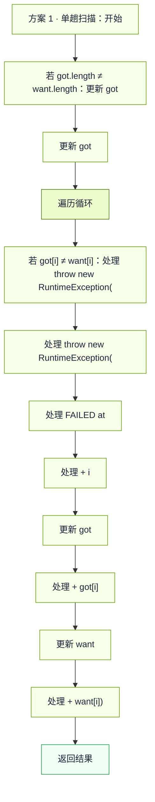

```java
package com.webfault.dsa; // 引入依赖

import java.util.*; // 引入依赖

class Lc21S1 { // 定义类型
  static class ListNode { // static class ListNode {
    int val;
    ListNode next; // int 值; ListNode 下一个;

    ListNode(int v) {
      val = v;
    } // 把 值; } 写入 ListNode(int v){ val
  }

  static ListNode build(Integer[] vals) { // 定义函数/方法 build
    ListNode dummy = new ListNode(0);
    ListNode p = dummy; // 把 new ListNode(0); ListNode 节点 赋值为 哨兵节点; 写入 ListNode dummy
    for (Integer v : vals) {
      p.next = new ListNode(v);
      p = p.next;
    } // 把 new ListNode(值); 节点 赋值为 节点.下一个; } 写入 下一个
    return dummy.next; // 返回 哨兵节点.下一个
  }

  static int[] toArr(ListNode n) { // 定义函数/方法 toArr
    java.util.ArrayList<Integer> l = new java.util.ArrayList<>();
    while (n != null) {
      l.add(n.val);
      n = n.next;
    }
    int[] r = new int[l.size()]; // 把 new int[左指针.大小()]; 写入 int[] r
    for (int i = 0; i < r.length; i++) r[i] = l.get(i); // 让 下标 i 从 0 开始计数，下标 i 小于 右指针.长度 就继续
    return r; // 返回 右指针
  }

  static void check(int[] got, int[] want) { // 定义判定函数 check
    if (got.length != want.length)
      throw new RuntimeException("FAILED len got=" + got.length + " want=" + want.length);
    for (int i = 0; i < got.length; i++)
      if (got[i] != want[i])
        throw new RuntimeException(
            "FAILED at "
                + i
                + " got="
                + got[i]
                + " want="
                + want[i]); // 让 下标 i 从 0 开始计数，下标 i 小于 got.长度 就继续
  }

  static ListNode mergeTwoLists(ListNode list1, ListNode list2) { // 定义函数/方法 mergeTwoLists
    ListNode dummy = new ListNode(0); // 把 new ListNode(0); 写入 ListNode dummy
    ListNode p = dummy; // 把 哨兵节点; 写入 ListNode p
    ListNode p1 = list1, p2 = list2; // 把 list1, p2 赋值为 list2; 写入 ListNode p1
    while (p1 != null && p2 != null) { // 循环，直到不满足「p1 不等于 null 且 p2 不等于 null」
      if (p1.val < p2.val) {
        p.next = p1;
        p1 = p1.next;
      } // 若 p1.值 小于 p2.值) { 节点.下一个 赋值为 p1; p1 赋值为 p1.下一个; }
      else {
        p.next = p2;
        p2 = p2.next;
      } // 否则
      p = p.next; // 把 节点.下一个; 写入 节点
    }
    if (p1 != null) p.next = p1; // 若 p1 不等于 null) 节点.下一个 赋值为 p1;
    if (p2 != null) p.next = p2; // 若 p2 不等于 null) 节点.下一个 赋值为 p2;
    return dummy.next; // 返回 哨兵节点.下一个
  }

  public static void main(String[] args) { // public static void main(String[] args) {
    check(
        toArr(mergeTwoLists(build(new Integer[] {1, 2, 4}), build(new Integer[] {1, 3, 4}))),
        new int[] {1, 1, 2, 3, 4, 4});
    check(
        toArr(mergeTwoLists(build(new Integer[] {1, 3, 5}), build(new Integer[] {2, 4, 6}))),
        new int[] {1, 2, 3, 4, 5, 6});
    check(toArr(mergeTwoLists(build(new Integer[] {}), build(new Integer[] {0}))), new int[] {0});
    check(toArr(mergeTwoLists(build(new Integer[] {5}), build(new Integer[] {}))), new int[] {5});
    System.out.println("PASS"); // 全部用例通过，输出 PASS
  }
}
```

#### 方案 2：单趟扫描

**思路与代码分析**：核心是「单趟扫描」。Java 版用类与静态方法组织，集合操作显式明了。代码里依次做这些事：单循环线性扫描。**走读**：方案 2 · 单趟扫描：开始 → 若 got.length ≠ want.length：更新 got → 更新 got → 遍历循环 → 若 got[i] ≠ want[i]：处理 throw new RuntimeException( → 处理 throw new RuntimeException( → 处理 FAILED at → 处理 + i → 更新 got → 处理 + got[i] → 更新 want → 处理 + want[i]) → 返回结果。

**运行架构**（真实控制流）：

```mermaid
graph TD
    N0["方案 2 · 单趟扫描：开始"]
    N1["若 got.length ≠ want.length：更新 got"]
    N2["更新 got"]
    N3["遍历循环"]
    N4["若 got[i] ≠ want[i]：处理 throw new RuntimeException("]
    N5["处理 throw new RuntimeException("]
    N6["处理 FAILED at"]
    N7["处理 + i"]
    N8["更新 got"]
    N9["处理 + got[i]"]
    N10["更新 want"]
    N11["处理 + want[i])"]
    N12["返回结果"]
    N0 --> N1
    N1 --> N2
    N2 --> N3
    N3 --> N4
    N4 --> N5
    N5 --> N6
    N6 --> N7
    N7 --> N8
    N8 --> N9
    N9 --> N10
    N10 --> N11
    N11 --> N12
    classDef n fill:#f7fee7,stroke:#65a30d,color:#1e293b;
    classDef lp fill:#ecfccb,stroke:#4d7c0f,color:#1e293b;
    classDef dc fill:#fef9c3,stroke:#ca8a04,color:#1e293b;
    classDef tm fill:#f0fdf4,stroke:#16a34a,color:#1e293b;
    class N0,N1,N2,N4,N5,N6,N7,N8,N9,N10,N11 n;
    class N3 lp;
    class N12 tm;
```

```java
package com.webfault.dsa; // 引入依赖

import java.util.*; // 引入依赖

class Lc21S2 { // 定义类型
  static class ListNode { // static class ListNode {
    int val;
    ListNode next; // int 值; ListNode 下一个;

    ListNode(int v) {
      val = v;
    } // 把 值; } 写入 ListNode(int v){ val
  }

  static ListNode build(Integer[] vals) { // 定义函数/方法 build
    ListNode dummy = new ListNode(0);
    ListNode p = dummy; // 把 new ListNode(0); ListNode 节点 赋值为 哨兵节点; 写入 ListNode dummy
    for (Integer v : vals) {
      p.next = new ListNode(v);
      p = p.next;
    } // 把 new ListNode(值); 节点 赋值为 节点.下一个; } 写入 下一个
    return dummy.next; // 返回 哨兵节点.下一个
  }

  static int[] toArr(ListNode n) { // 定义函数/方法 toArr
    java.util.ArrayList<Integer> l = new java.util.ArrayList<>();
    while (n != null) {
      l.add(n.val);
      n = n.next;
    }
    int[] r = new int[l.size()]; // 把 new int[左指针.大小()]; 写入 int[] r
    for (int i = 0; i < r.length; i++) r[i] = l.get(i); // 让 下标 i 从 0 开始计数，下标 i 小于 右指针.长度 就继续
    return r; // 返回 右指针
  }

  static void check(int[] got, int[] want) { // 定义判定函数 check
    if (got.length != want.length)
      throw new RuntimeException("FAILED len got=" + got.length + " want=" + want.length);
    for (int i = 0; i < got.length; i++)
      if (got[i] != want[i])
        throw new RuntimeException(
            "FAILED at "
                + i
                + " got="
                + got[i]
                + " want="
                + want[i]); // 让 下标 i 从 0 开始计数，下标 i 小于 got.长度 就继续
  }

  static ListNode mergeTwoLists(ListNode list1, ListNode list2) { // 定义函数/方法 mergeTwoLists
    if (list1 == null) return list2; // 若 list1 等于 null，直接返回 list2
    if (list2 == null) return list1; // 若 list2 等于 null，直接返回 list1
    if (list1.val < list2.val) {
      list1.next = mergeTwoLists(list1.next, list2);
      return list1;
    } else {
      list2.next = mergeTwoLists(list1, list2.next);
      return list2;
    } // 否则
  }

  public static void main(String[] args) { // public static void main(String[] args) {
    check(
        toArr(mergeTwoLists(build(new Integer[] {1, 2, 4}), build(new Integer[] {1, 3, 4}))),
        new int[] {1, 1, 2, 3, 4, 4});
    check(
        toArr(mergeTwoLists(build(new Integer[] {1, 3, 5}), build(new Integer[] {2, 4, 6}))),
        new int[] {1, 2, 3, 4, 5, 6});
    check(toArr(mergeTwoLists(build(new Integer[] {}), build(new Integer[] {0}))), new int[] {0});
    check(toArr(mergeTwoLists(build(new Integer[] {5}), build(new Integer[] {}))), new int[] {5});
    System.out.println("PASS"); // 全部用例通过，输出 PASS
  }
}
```

#### 方案 3：单趟扫描

**思路与代码分析**：核心是「单趟扫描」。Java 版用类与静态方法组织，集合操作显式明了。代码里依次做这些事：单循环线性扫描。**走读**：方案 3 · 单趟扫描：开始 → 若 got.length ≠ want.length：更新 got → 更新 got → 遍历循环 → 若 got[i] ≠ want[i]：处理 throw new RuntimeException( → 处理 throw new RuntimeException( → 处理 FAILED at → 处理 + i → 更新 got → 处理 + got[i] → 更新 want → 处理 + want[i]) → 返回结果。

**运行架构**（真实控制流）：

```mermaid
graph TD
    N0["方案 3 · 单趟扫描：开始"]
    N1["若 got.length ≠ want.length：更新 got"]
    N2["更新 got"]
    N3["遍历循环"]
    N4["若 got[i] ≠ want[i]：处理 throw new RuntimeException("]
    N5["处理 throw new RuntimeException("]
    N6["处理 FAILED at"]
    N7["处理 + i"]
    N8["更新 got"]
    N9["处理 + got[i]"]
    N10["更新 want"]
    N11["处理 + want[i])"]
    N12["返回结果"]
    N0 --> N1
    N1 --> N2
    N2 --> N3
    N3 --> N4
    N4 --> N5
    N5 --> N6
    N6 --> N7
    N7 --> N8
    N8 --> N9
    N9 --> N10
    N10 --> N11
    N11 --> N12
    classDef n fill:#f7fee7,stroke:#65a30d,color:#1e293b;
    classDef lp fill:#ecfccb,stroke:#4d7c0f,color:#1e293b;
    classDef dc fill:#fef9c3,stroke:#ca8a04,color:#1e293b;
    classDef tm fill:#f0fdf4,stroke:#16a34a,color:#1e293b;
    class N0,N1,N2,N4,N5,N6,N7,N8,N9,N10,N11 n;
    class N3 lp;
    class N12 tm;
```

```java
package com.webfault.dsa; // 引入依赖

import java.util.*; // 引入依赖

class Lc21S3 { // 定义类型
  static class ListNode { // static class ListNode {
    int val;
    ListNode next; // int 值; ListNode 下一个;

    ListNode(int v) {
      val = v;
    } // 把 值; } 写入 ListNode(int v){ val
  }

  static ListNode build(Integer[] vals) { // 定义函数/方法 build
    ListNode dummy = new ListNode(0);
    ListNode p = dummy; // 把 new ListNode(0); ListNode 节点 赋值为 哨兵节点; 写入 ListNode dummy
    for (Integer v : vals) {
      p.next = new ListNode(v);
      p = p.next;
    } // 把 new ListNode(值); 节点 赋值为 节点.下一个; } 写入 下一个
    return dummy.next; // 返回 哨兵节点.下一个
  }

  static int[] toArr(ListNode n) { // 定义函数/方法 toArr
    java.util.ArrayList<Integer> l = new java.util.ArrayList<>();
    while (n != null) {
      l.add(n.val);
      n = n.next;
    }
    int[] r = new int[l.size()]; // 把 new int[左指针.大小()]; 写入 int[] r
    for (int i = 0; i < r.length; i++) r[i] = l.get(i); // 让 下标 i 从 0 开始计数，下标 i 小于 右指针.长度 就继续
    return r; // 返回 右指针
  }

  static void check(int[] got, int[] want) { // 定义判定函数 check
    if (got.length != want.length)
      throw new RuntimeException("FAILED len got=" + got.length + " want=" + want.length);
    for (int i = 0; i < got.length; i++)
      if (got[i] != want[i])
        throw new RuntimeException(
            "FAILED at "
                + i
                + " got="
                + got[i]
                + " want="
                + want[i]); // 让 下标 i 从 0 开始计数，下标 i 小于 got.长度 就继续
  }

  static ListNode mergeTwoLists(ListNode list1, ListNode list2) { // 定义函数/方法 mergeTwoLists
    ListNode res = new ListNode(0); // 把 new ListNode(0); 写入 ListNode res
    ListNode p = res; // 把 结果; 写入 ListNode p
    ListNode p1 = list1, p2 = list2; // 把 list1, p2 赋值为 list2; 写入 ListNode p1
    while (p1 != null && p2 != null) { // 循环，直到不满足「p1 不等于 null 且 p2 不等于 null」
      if (p1.val < p2.val) {
        p.next = p1;
        p1 = p1.next;
      } // 若 p1.值 小于 p2.值) { 节点.下一个 赋值为 p1; p1 赋值为 p1.下一个; }
      else {
        p.next = p2;
        p2 = p2.next;
      } // 否则
      p = p.next; // 把 节点.下一个; 写入 节点
    }
    p.next = (p1 != null) ? p1 : p2; // 把 (p1 不等于 null) ? p1 : p2; 写入 下一个
    return res.next; // 返回 结果.下一个
  }

  public static void main(String[] args) { // public static void main(String[] args) {
    check(
        toArr(mergeTwoLists(build(new Integer[] {1, 2, 4}), build(new Integer[] {1, 3, 4}))),
        new int[] {1, 1, 2, 3, 4, 4});
    check(
        toArr(mergeTwoLists(build(new Integer[] {1, 3, 5}), build(new Integer[] {2, 4, 6}))),
        new int[] {1, 2, 3, 4, 5, 6});
    check(toArr(mergeTwoLists(build(new Integer[] {}), build(new Integer[] {0}))), new int[] {0});
    check(toArr(mergeTwoLists(build(new Integer[] {5}), build(new Integer[] {}))), new int[] {5});
    System.out.println("PASS"); // 全部用例通过，输出 PASS
  }
}
```

#### 方案 4：单趟扫描

**思路与代码分析**：核心是「单趟扫描」。Java 版用类与静态方法组织，集合操作显式明了。代码里依次做这些事：单循环线性扫描。**走读**：方案 4 · 单趟扫描：开始 → 若 got.length ≠ want.length：更新 got → 更新 got → 遍历循环 → 若 got[i] ≠ want[i]：处理 throw new RuntimeException( → 处理 throw new RuntimeException( → 处理 FAILED at → 处理 + i → 更新 got → 处理 + got[i] → 更新 want → 处理 + want[i]) → 返回结果。

**运行架构**（真实控制流）：

```mermaid
graph TD
    N0["方案 4 · 单趟扫描：开始"]
    N1["若 got.length ≠ want.length：更新 got"]
    N2["更新 got"]
    N3["遍历循环"]
    N4["若 got[i] ≠ want[i]：处理 throw new RuntimeException("]
    N5["处理 throw new RuntimeException("]
    N6["处理 FAILED at"]
    N7["处理 + i"]
    N8["更新 got"]
    N9["处理 + got[i]"]
    N10["更新 want"]
    N11["处理 + want[i])"]
    N12["返回结果"]
    N0 --> N1
    N1 --> N2
    N2 --> N3
    N3 --> N4
    N4 --> N5
    N5 --> N6
    N6 --> N7
    N7 --> N8
    N8 --> N9
    N9 --> N10
    N10 --> N11
    N11 --> N12
    classDef n fill:#f7fee7,stroke:#65a30d,color:#1e293b;
    classDef lp fill:#ecfccb,stroke:#4d7c0f,color:#1e293b;
    classDef dc fill:#fef9c3,stroke:#ca8a04,color:#1e293b;
    classDef tm fill:#f0fdf4,stroke:#16a34a,color:#1e293b;
    class N0,N1,N2,N4,N5,N6,N7,N8,N9,N10,N11 n;
    class N3 lp;
    class N12 tm;
```

```java
package com.webfault.dsa; // 引入依赖

import java.util.*; // 引入依赖

class Lc21S4 { // 定义类型
  static class ListNode { // static class ListNode {
    int val;
    ListNode next; // int 值; ListNode 下一个;

    ListNode(int v) {
      val = v;
    } // 把 值; } 写入 ListNode(int v){ val
  }

  static ListNode build(Integer[] vals) { // 定义函数/方法 build
    ListNode dummy = new ListNode(0);
    ListNode p = dummy; // 把 new ListNode(0); ListNode 节点 赋值为 哨兵节点; 写入 ListNode dummy
    for (Integer v : vals) {
      p.next = new ListNode(v);
      p = p.next;
    } // 把 new ListNode(值); 节点 赋值为 节点.下一个; } 写入 下一个
    return dummy.next; // 返回 哨兵节点.下一个
  }

  static int[] toArr(ListNode n) { // 定义函数/方法 toArr
    java.util.ArrayList<Integer> l = new java.util.ArrayList<>();
    while (n != null) {
      l.add(n.val);
      n = n.next;
    }
    int[] r = new int[l.size()]; // 把 new int[左指针.大小()]; 写入 int[] r
    for (int i = 0; i < r.length; i++) r[i] = l.get(i); // 让 下标 i 从 0 开始计数，下标 i 小于 右指针.长度 就继续
    return r; // 返回 右指针
  }

  static void check(int[] got, int[] want) { // 定义判定函数 check
    if (got.length != want.length)
      throw new RuntimeException("FAILED len got=" + got.length + " want=" + want.length);
    for (int i = 0; i < got.length; i++)
      if (got[i] != want[i])
        throw new RuntimeException(
            "FAILED at "
                + i
                + " got="
                + got[i]
                + " want="
                + want[i]); // 让 下标 i 从 0 开始计数，下标 i 小于 got.长度 就继续
  }

  static ListNode mergeTwoLists(ListNode list1, ListNode list2) { // 定义函数/方法 mergeTwoLists
    if (list1 == null) return list2; // 若 list1 等于 null，直接返回 list2
    if (list2 == null) return list1; // 若 list2 等于 null，直接返回 list1
    if (list1.val < list2.val) {
      list1.next = mergeTwoLists(list1.next, list2);
      return list1;
    } else {
      list2.next = mergeTwoLists(list1, list2.next);
      return list2;
    } // 否则
  }

  public static void main(String[] args) { // public static void main(String[] args) {
    check(
        toArr(mergeTwoLists(build(new Integer[] {1, 2, 4}), build(new Integer[] {1, 3, 4}))),
        new int[] {1, 1, 2, 3, 4, 4});
    check(
        toArr(mergeTwoLists(build(new Integer[] {1, 3, 5}), build(new Integer[] {2, 4, 6}))),
        new int[] {1, 2, 3, 4, 5, 6});
    check(toArr(mergeTwoLists(build(new Integer[] {}), build(new Integer[] {0}))), new int[] {0});
    check(toArr(mergeTwoLists(build(new Integer[] {5}), build(new Integer[] {}))), new int[] {5});
    System.out.println("PASS"); // 全部用例通过，输出 PASS
  }
}
```

#### 方案 5：单趟扫描

**思路与代码分析**：核心是「单趟扫描」。Java 版用类与静态方法组织，集合操作显式明了。代码里依次做这些事：单循环线性扫描。**走读**：方案 5 · 单趟扫描：开始 → 若 got.length ≠ want.length：更新 got → 更新 got → 遍历循环 → 若 got[i] ≠ want[i]：处理 throw new RuntimeException( → 处理 throw new RuntimeException( → 处理 FAILED at → 处理 + i → 更新 got → 处理 + got[i] → 更新 want → 处理 + want[i]) → 返回结果。

**运行架构**（真实控制流）：

```mermaid
graph TD
    N0["方案 5 · 单趟扫描：开始"]
    N1["若 got.length ≠ want.length：更新 got"]
    N2["更新 got"]
    N3["遍历循环"]
    N4["若 got[i] ≠ want[i]：处理 throw new RuntimeException("]
    N5["处理 throw new RuntimeException("]
    N6["处理 FAILED at"]
    N7["处理 + i"]
    N8["更新 got"]
    N9["处理 + got[i]"]
    N10["更新 want"]
    N11["处理 + want[i])"]
    N12["返回结果"]
    N0 --> N1
    N1 --> N2
    N2 --> N3
    N3 --> N4
    N4 --> N5
    N5 --> N6
    N6 --> N7
    N7 --> N8
    N8 --> N9
    N9 --> N10
    N10 --> N11
    N11 --> N12
    classDef n fill:#f7fee7,stroke:#65a30d,color:#1e293b;
    classDef lp fill:#ecfccb,stroke:#4d7c0f,color:#1e293b;
    classDef dc fill:#fef9c3,stroke:#ca8a04,color:#1e293b;
    classDef tm fill:#f0fdf4,stroke:#16a34a,color:#1e293b;
    class N0,N1,N2,N4,N5,N6,N7,N8,N9,N10,N11 n;
    class N3 lp;
    class N12 tm;
```

```java
package com.webfault.dsa; // 引入依赖

import java.util.*; // 引入依赖

class Lc21S5 { // 定义类型
  static class ListNode { // static class ListNode {
    int val;
    ListNode next; // int 值; ListNode 下一个;

    ListNode(int v) {
      val = v;
    } // 把 值; } 写入 ListNode(int v){ val
  }

  static ListNode build(Integer[] vals) { // 定义函数/方法 build
    ListNode dummy = new ListNode(0);
    ListNode p = dummy; // 把 new ListNode(0); ListNode 节点 赋值为 哨兵节点; 写入 ListNode dummy
    for (Integer v : vals) {
      p.next = new ListNode(v);
      p = p.next;
    } // 把 new ListNode(值); 节点 赋值为 节点.下一个; } 写入 下一个
    return dummy.next; // 返回 哨兵节点.下一个
  }

  static int[] toArr(ListNode n) { // 定义函数/方法 toArr
    java.util.ArrayList<Integer> l = new java.util.ArrayList<>();
    while (n != null) {
      l.add(n.val);
      n = n.next;
    }
    int[] r = new int[l.size()]; // 把 new int[左指针.大小()]; 写入 int[] r
    for (int i = 0; i < r.length; i++) r[i] = l.get(i); // 让 下标 i 从 0 开始计数，下标 i 小于 右指针.长度 就继续
    return r; // 返回 右指针
  }

  static void check(int[] got, int[] want) { // 定义判定函数 check
    if (got.length != want.length)
      throw new RuntimeException("FAILED len got=" + got.length + " want=" + want.length);
    for (int i = 0; i < got.length; i++)
      if (got[i] != want[i])
        throw new RuntimeException(
            "FAILED at "
                + i
                + " got="
                + got[i]
                + " want="
                + want[i]); // 让 下标 i 从 0 开始计数，下标 i 小于 got.长度 就继续
  }

  static ListNode mergeTwoLists(ListNode list1, ListNode list2) { // 定义函数/方法 mergeTwoLists
    ListNode res = new ListNode(0); // 把 new ListNode(0); 写入 ListNode res
    ListNode p = res; // 把 结果; 写入 ListNode p
    ListNode p1 = list1, p2 = list2; // 把 list1, p2 赋值为 list2; 写入 ListNode p1
    while (p1 != null && p2 != null) { // 循环，直到不满足「p1 不等于 null 且 p2 不等于 null」
      if (p1.val < p2.val) {
        p.next = p1;
        p1 = p1.next;
      } // 若 p1.值 小于 p2.值) { 节点.下一个 赋值为 p1; p1 赋值为 p1.下一个; }
      else {
        p.next = p2;
        p2 = p2.next;
      } // 否则
      p = p.next; // 把 节点.下一个; 写入 节点
    }
    p.next = (p1 != null) ? p1 : p2; // 把 (p1 不等于 null) ? p1 : p2; 写入 下一个
    return res.next; // 返回 结果.下一个
  }

  public static void main(String[] args) { // public static void main(String[] args) {
    check(
        toArr(mergeTwoLists(build(new Integer[] {1, 2, 4}), build(new Integer[] {1, 3, 4}))),
        new int[] {1, 1, 2, 3, 4, 4});
    check(
        toArr(mergeTwoLists(build(new Integer[] {1, 3, 5}), build(new Integer[] {2, 4, 6}))),
        new int[] {1, 2, 3, 4, 5, 6});
    check(toArr(mergeTwoLists(build(new Integer[] {}), build(new Integer[] {0}))), new int[] {0});
    check(toArr(mergeTwoLists(build(new Integer[] {5}), build(new Integer[] {}))), new int[] {5});
    System.out.println("PASS"); // 全部用例通过，输出 PASS
  }
}
```

#### 方案 6：单趟扫描

**思路与代码分析**：核心是「单趟扫描」。Java 版用类与静态方法组织，集合操作显式明了。代码里依次做这些事：单循环线性扫描。**走读**：方案 6 · 单趟扫描：开始 → 若 got.length ≠ want.length：更新 got → 更新 got → 遍历循环 → 若 got[i] ≠ want[i]：处理 throw new RuntimeException( → 处理 throw new RuntimeException( → 处理 FAILED at → 处理 + i → 更新 got → 处理 + got[i] → 更新 want → 处理 + want[i]) → 返回结果。

**运行架构**（真实控制流）：

```mermaid
graph TD
    N0["方案 6 · 单趟扫描：开始"]
    N1["若 got.length ≠ want.length：更新 got"]
    N2["更新 got"]
    N3["遍历循环"]
    N4["若 got[i] ≠ want[i]：处理 throw new RuntimeException("]
    N5["处理 throw new RuntimeException("]
    N6["处理 FAILED at"]
    N7["处理 + i"]
    N8["更新 got"]
    N9["处理 + got[i]"]
    N10["更新 want"]
    N11["处理 + want[i])"]
    N12["返回结果"]
    N0 --> N1
    N1 --> N2
    N2 --> N3
    N3 --> N4
    N4 --> N5
    N5 --> N6
    N6 --> N7
    N7 --> N8
    N8 --> N9
    N9 --> N10
    N10 --> N11
    N11 --> N12
    classDef n fill:#f7fee7,stroke:#65a30d,color:#1e293b;
    classDef lp fill:#ecfccb,stroke:#4d7c0f,color:#1e293b;
    classDef dc fill:#fef9c3,stroke:#ca8a04,color:#1e293b;
    classDef tm fill:#f0fdf4,stroke:#16a34a,color:#1e293b;
    class N0,N1,N2,N4,N5,N6,N7,N8,N9,N10,N11 n;
    class N3 lp;
    class N12 tm;
```

```java
package com.webfault.dsa; // 引入依赖

import java.util.*; // 引入依赖

class Lc21S6 { // 定义类型
  static class ListNode { // static class ListNode {
    int val;
    ListNode next; // int 值; ListNode 下一个;

    ListNode(int v) {
      val = v;
    } // 把 值; } 写入 ListNode(int v){ val
  }

  static ListNode build(Integer[] vals) { // 定义函数/方法 build
    ListNode dummy = new ListNode(0);
    ListNode p = dummy; // 把 new ListNode(0); ListNode 节点 赋值为 哨兵节点; 写入 ListNode dummy
    for (Integer v : vals) {
      p.next = new ListNode(v);
      p = p.next;
    } // 把 new ListNode(值); 节点 赋值为 节点.下一个; } 写入 下一个
    return dummy.next; // 返回 哨兵节点.下一个
  }

  static int[] toArr(ListNode n) { // 定义函数/方法 toArr
    java.util.ArrayList<Integer> l = new java.util.ArrayList<>();
    while (n != null) {
      l.add(n.val);
      n = n.next;
    }
    int[] r = new int[l.size()]; // 把 new int[左指针.大小()]; 写入 int[] r
    for (int i = 0; i < r.length; i++) r[i] = l.get(i); // 让 下标 i 从 0 开始计数，下标 i 小于 右指针.长度 就继续
    return r; // 返回 右指针
  }

  static void check(int[] got, int[] want) { // 定义判定函数 check
    if (got.length != want.length)
      throw new RuntimeException("FAILED len got=" + got.length + " want=" + want.length);
    for (int i = 0; i < got.length; i++)
      if (got[i] != want[i])
        throw new RuntimeException(
            "FAILED at "
                + i
                + " got="
                + got[i]
                + " want="
                + want[i]); // 让 下标 i 从 0 开始计数，下标 i 小于 got.长度 就继续
  }

  static ListNode mergeTwoLists(ListNode list1, ListNode list2) { // 定义函数/方法 mergeTwoLists
    ListNode res = new ListNode(0); // 把 new ListNode(0); 写入 ListNode res
    ListNode p = res; // 把 结果; 写入 ListNode p
    ListNode p1 = list1, p2 = list2; // 把 list1, p2 赋值为 list2; 写入 ListNode p1
    while (p1 != null && p2 != null) { // 循环，直到不满足「p1 不等于 null 且 p2 不等于 null」
      if (p1.val < p2.val) {
        p.next = p1;
        p1 = p1.next;
      } // 若 p1.值 小于 p2.值) { 节点.下一个 赋值为 p1; p1 赋值为 p1.下一个; }
      else {
        p.next = p2;
        p2 = p2.next;
      } // 否则
      p = p.next; // 把 节点.下一个; 写入 节点
    }
    p.next = (p1 != null) ? p1 : p2; // 把 (p1 不等于 null) ? p1 : p2; 写入 下一个
    return res.next; // 返回 结果.下一个
  }

  public static void main(String[] args) { // public static void main(String[] args) {
    check(
        toArr(mergeTwoLists(build(new Integer[] {1, 2, 4}), build(new Integer[] {1, 3, 4}))),
        new int[] {1, 1, 2, 3, 4, 4});
    check(
        toArr(mergeTwoLists(build(new Integer[] {1, 3, 5}), build(new Integer[] {2, 4, 6}))),
        new int[] {1, 2, 3, 4, 5, 6});
    check(toArr(mergeTwoLists(build(new Integer[] {}), build(new Integer[] {0}))), new int[] {0});
    check(toArr(mergeTwoLists(build(new Integer[] {5}), build(new Integer[] {}))), new int[] {5});
    System.out.println("PASS"); // 全部用例通过，输出 PASS
  }
}
```

### Rust 实现（6 种方案）

Rust 的全部方案如下，每个方案都内嵌用例自测，可独立运行（老仓库 python/go 文件遵循「打印结果」约定）：

#### 方案 1：单趟扫描

**思路与代码分析**：核心是「单趟扫描」。Rust 版用所有权移动与切片借用改写同一逻辑，注意 Option 与引用边界。**走读**：方案 1 · 单趟扫描：开始 → 计算 out → 计算 cur → 当 let Some(n) = cur 时反复执行 → 向 out 追加记录 → 更新 cur → 处理 out → 返回结果。

**运行架构**（真实控制流）：

```mermaid
graph TD
    N0["方案 1 · 单趟扫描：开始"]
    N1["计算 out"]
    N2["计算 cur"]
    N3["当 let Some(n) = cur 时反复执行"]
    N4["向 out 追加记录"]
    N5["更新 cur"]
    N6["处理 out"]
    N7["返回结果"]
    N0 --> N1
    N1 --> N2
    N2 --> N3
    N3 --> N4
    N4 --> N5
    N5 -- 下一轮 --> N3
    N3 --> N6
    N6 --> N7
    classDef n fill:#f7fee7,stroke:#65a30d,color:#1e293b;
    classDef lp fill:#ecfccb,stroke:#4d7c0f,color:#1e293b;
    classDef dc fill:#fef9c3,stroke:#ca8a04,color:#1e293b;
    classDef tm fill:#f0fdf4,stroke:#16a34a,color:#1e293b;
    class N0,N1,N2,N4,N5,N6 n;
    class N3 lp;
    class N7 tm;
```

```rust
// LeetCode 21. 合并两个有序链表 — Rust 版（方案1）
#[derive(Debug)]
struct ListNode {
    val: i32,
    next: Option<Box<ListNode>>,
} // 定义类型
fn build_list(vals: &[i32]) -> Option<Box<ListNode>> {
    // 定义函数/方法 build_list
    let mut head: Option<Box<ListNode>> = None; // 把 None; 写入 let mut head: Option<Box<ListNode>>
    for &v in vals.iter().rev() {
        // for 按位与 值 in vals.iter().rev() {
        let mut n = Box::new(ListNode { val: v, next: head }); // 把 Box::new(ListNode { 值: 值, 下一个: 头节点 }); 写入 let mut n
        head = Some(n); // 把 Some(元素个数); 写入 头节点
    }
    head // 头节点
}
fn list_to_vec(head: &Option<Box<ListNode>>) -> Vec<i32> {
    // 定义函数/方法 list_to_vec
    let mut out = Vec::new(); // 把 Vec::new(); 写入 let mut out
    let mut cur = head; // 把 头节点; 写入 let mut cur
    while let Some(n) = cur {
        out.push(n.val);
        cur = &n.next;
    } // 边取边处理，取空即停
    out // out
}
fn merge_two_lists(
    list1: Option<Box<ListNode>>,
    list2: Option<Box<ListNode>>,
) -> Option<Box<ListNode>> {
    // 定义函数/方法 merge_two_lists
    let mut dummy = Box::new(ListNode { val: 0, next: None }); // 把 Box::new(ListNode { 值: 0, 下一个: None }); 写入 let mut dummy
    let mut p: &mut Option<Box<ListNode>> = &mut dummy.next; // 把 按位与 mut 哨兵节点.下一个; 写入 let mut p: &mut Option<Box<ListNode>>
    let mut p1 = list1; // 把 list1; 写入 let mut p1
    let mut p2 = list2; // 把 list2; 写入 let mut p2
    while let (Some(a), Some(b)) = (p1.as_ref(), p2.as_ref()) {
        // 定义函数/方法 let
        if a.val < b.val {
            // 若 数组.值 小于 b.值
            let next = p1.as_mut().unwrap().next.take(); // 把 p1.as_mut().unwrap().下一个.take() 存入 下一个
            *p = Some(p1.take().unwrap());
            p1 = next; // 把 下一个; 写入 p1
        } else {
            // 否则
            let next = p2.as_mut().unwrap().next.take(); // 把 p2.as_mut().unwrap().下一个.take() 存入 下一个
            *p = Some(p2.take().unwrap());
            p2 = next; // 把 下一个; 写入 p2
        }
        p = &mut p.as_mut().unwrap().next; // 把 按位与 mut 节点.as_mut().unwrap().下一个; 写入 节点
    }
    *p = if p1.is_some() { p1 } else { p2 };
    dummy.next // 哨兵节点.下一个
}
fn main() {
    // 程序入口：跑内嵌自测用例
    let got = list_to_vec(&merge_two_lists(
        build_list(&[1, 2, 4]),
        build_list(&[1, 3, 4]),
    ));
    assert_eq!(got, vec![1, 1, 2, 3, 4, 4]); // 断言校验
    assert_eq!(
        list_to_vec(&merge_two_lists(build_list(&[]), build_list(&[]))),
        Vec::<i32>::new()
    ); // 断言校验
    let got3 = list_to_vec(&merge_two_lists(build_list(&[]), build_list(&[0])));
    assert_eq!(got3, vec![0]); // 断言校验
    println!("PASS"); // 全部用例通过，输出 PASS
}
```

#### 方案 2：单趟扫描

**思路与代码分析**：核心是「单趟扫描」。Rust 版用所有权移动与切片借用改写同一逻辑，注意 Option 与引用边界。**走读**：方案 2 · 单趟扫描：开始 → 计算 out → 计算 cur → 当 let Some(n) = cur 时反复执行 → 向 out 追加记录 → 更新 cur → 处理 out → 返回结果。

**运行架构**（真实控制流）：

```mermaid
graph TD
    N0["方案 2 · 单趟扫描：开始"]
    N1["计算 out"]
    N2["计算 cur"]
    N3["当 let Some(n) = cur 时反复执行"]
    N4["向 out 追加记录"]
    N5["更新 cur"]
    N6["处理 out"]
    N7["返回结果"]
    N0 --> N1
    N1 --> N2
    N2 --> N3
    N3 --> N4
    N4 --> N5
    N5 -- 下一轮 --> N3
    N3 --> N6
    N6 --> N7
    classDef n fill:#f7fee7,stroke:#65a30d,color:#1e293b;
    classDef lp fill:#ecfccb,stroke:#4d7c0f,color:#1e293b;
    classDef dc fill:#fef9c3,stroke:#ca8a04,color:#1e293b;
    classDef tm fill:#f0fdf4,stroke:#16a34a,color:#1e293b;
    class N0,N1,N2,N4,N5,N6 n;
    class N3 lp;
    class N7 tm;
```

```rust
// LeetCode 21. 合并两个有序链表 — Rust 版（方案2）
#[derive(Debug)]
struct ListNode {
    val: i32,
    next: Option<Box<ListNode>>,
} // 定义类型
fn build_list(vals: &[i32]) -> Option<Box<ListNode>> {
    // 定义函数/方法 build_list
    let mut head: Option<Box<ListNode>> = None; // 把 None; 写入 let mut head: Option<Box<ListNode>>
    for &v in vals.iter().rev() {
        // for 按位与 值 in vals.iter().rev() {
        let mut n = Box::new(ListNode { val: v, next: head }); // 把 Box::new(ListNode { 值: 值, 下一个: 头节点 }); 写入 let mut n
        head = Some(n); // 把 Some(元素个数); 写入 头节点
    }
    head // 头节点
}
fn list_to_vec(head: &Option<Box<ListNode>>) -> Vec<i32> {
    // 定义函数/方法 list_to_vec
    let mut out = Vec::new(); // 把 Vec::new(); 写入 let mut out
    let mut cur = head; // 把 头节点; 写入 let mut cur
    while let Some(n) = cur {
        out.push(n.val);
        cur = &n.next;
    } // 边取边处理，取空即停
    out // out
}
fn merge_two_lists(
    list1: Option<Box<ListNode>>,
    list2: Option<Box<ListNode>>,
) -> Option<Box<ListNode>> {
    // 定义函数/方法 merge_two_lists
    let mut dummy = Box::new(ListNode { val: 0, next: None }); // 把 Box::new(ListNode { 值: 0, 下一个: None }); 写入 let mut dummy
    let mut p: &mut Option<Box<ListNode>> = &mut dummy.next; // 把 按位与 mut 哨兵节点.下一个; 写入 let mut p: &mut Option<Box<ListNode>>
    let mut p1 = list1; // 把 list1; 写入 let mut p1
    let mut p2 = list2; // 把 list2; 写入 let mut p2
    while let (Some(a), Some(b)) = (p1.as_ref(), p2.as_ref()) {
        // 定义函数/方法 let
        if a.val < b.val {
            // 若 数组.值 小于 b.值
            let next = p1.as_mut().unwrap().next.take(); // 把 p1.as_mut().unwrap().下一个.take() 存入 下一个
            *p = Some(p1.take().unwrap());
            p1 = next; // 把 下一个; 写入 p1
        } else {
            // 否则
            let next = p2.as_mut().unwrap().next.take(); // 把 p2.as_mut().unwrap().下一个.take() 存入 下一个
            *p = Some(p2.take().unwrap());
            p2 = next; // 把 下一个; 写入 p2
        }
        p = &mut p.as_mut().unwrap().next; // 把 按位与 mut 节点.as_mut().unwrap().下一个; 写入 节点
    }
    *p = if p1.is_some() { p1 } else { p2 };
    dummy.next // 哨兵节点.下一个
}
fn main() {
    // 程序入口：跑内嵌自测用例
    let got = list_to_vec(&merge_two_lists(
        build_list(&[1, 2, 4]),
        build_list(&[1, 3, 4]),
    ));
    assert_eq!(got, vec![1, 1, 2, 3, 4, 4]); // 断言校验
    assert_eq!(
        list_to_vec(&merge_two_lists(build_list(&[]), build_list(&[]))),
        Vec::<i32>::new()
    ); // 断言校验
    let got3 = list_to_vec(&merge_two_lists(build_list(&[]), build_list(&[0])));
    assert_eq!(got3, vec![0]); // 断言校验
    println!("PASS"); // 全部用例通过，输出 PASS
}
```

#### 方案 3：单趟扫描

**思路与代码分析**：核心是「单趟扫描」。Rust 版用所有权移动与切片借用改写同一逻辑，注意 Option 与引用边界。**走读**：方案 3 · 单趟扫描：开始 → 计算 out → 计算 cur → 当 let Some(n) = cur 时反复执行 → 向 out 追加记录 → 更新 cur → 处理 out → 返回结果。

**运行架构**（真实控制流）：

```mermaid
graph TD
    N0["方案 3 · 单趟扫描：开始"]
    N1["计算 out"]
    N2["计算 cur"]
    N3["当 let Some(n) = cur 时反复执行"]
    N4["向 out 追加记录"]
    N5["更新 cur"]
    N6["处理 out"]
    N7["返回结果"]
    N0 --> N1
    N1 --> N2
    N2 --> N3
    N3 --> N4
    N4 --> N5
    N5 -- 下一轮 --> N3
    N3 --> N6
    N6 --> N7
    classDef n fill:#f7fee7,stroke:#65a30d,color:#1e293b;
    classDef lp fill:#ecfccb,stroke:#4d7c0f,color:#1e293b;
    classDef dc fill:#fef9c3,stroke:#ca8a04,color:#1e293b;
    classDef tm fill:#f0fdf4,stroke:#16a34a,color:#1e293b;
    class N0,N1,N2,N4,N5,N6 n;
    class N3 lp;
    class N7 tm;
```

```rust
// LeetCode 21. 合并两个有序链表 — Rust 版（方案3）
#[derive(Debug)]
struct ListNode {
    val: i32,
    next: Option<Box<ListNode>>,
} // 定义类型
fn build_list(vals: &[i32]) -> Option<Box<ListNode>> {
    // 定义函数/方法 build_list
    let mut head: Option<Box<ListNode>> = None; // 把 None; 写入 let mut head: Option<Box<ListNode>>
    for &v in vals.iter().rev() {
        // for 按位与 值 in vals.iter().rev() {
        let mut n = Box::new(ListNode { val: v, next: head }); // 把 Box::new(ListNode { 值: 值, 下一个: 头节点 }); 写入 let mut n
        head = Some(n); // 把 Some(元素个数); 写入 头节点
    }
    head // 头节点
}
fn list_to_vec(head: &Option<Box<ListNode>>) -> Vec<i32> {
    // 定义函数/方法 list_to_vec
    let mut out = Vec::new(); // 把 Vec::new(); 写入 let mut out
    let mut cur = head; // 把 头节点; 写入 let mut cur
    while let Some(n) = cur {
        out.push(n.val);
        cur = &n.next;
    } // 边取边处理，取空即停
    out // out
}
fn merge_two_lists(
    list1: Option<Box<ListNode>>,
    list2: Option<Box<ListNode>>,
) -> Option<Box<ListNode>> {
    // 定义函数/方法 merge_two_lists
    let mut dummy = Box::new(ListNode { val: 0, next: None }); // 把 Box::new(ListNode { 值: 0, 下一个: None }); 写入 let mut dummy
    let mut p: &mut Option<Box<ListNode>> = &mut dummy.next; // 把 按位与 mut 哨兵节点.下一个; 写入 let mut p: &mut Option<Box<ListNode>>
    let mut p1 = list1; // 把 list1; 写入 let mut p1
    let mut p2 = list2; // 把 list2; 写入 let mut p2
    while let (Some(a), Some(b)) = (p1.as_ref(), p2.as_ref()) {
        // 定义函数/方法 let
        if a.val < b.val {
            // 若 数组.值 小于 b.值
            let next = p1.as_mut().unwrap().next.take(); // 把 p1.as_mut().unwrap().下一个.take() 存入 下一个
            *p = Some(p1.take().unwrap());
            p1 = next; // 把 下一个; 写入 p1
        } else {
            // 否则
            let next = p2.as_mut().unwrap().next.take(); // 把 p2.as_mut().unwrap().下一个.take() 存入 下一个
            *p = Some(p2.take().unwrap());
            p2 = next; // 把 下一个; 写入 p2
        }
        p = &mut p.as_mut().unwrap().next; // 把 按位与 mut 节点.as_mut().unwrap().下一个; 写入 节点
    }
    *p = if p1.is_some() { p1 } else { p2 };
    dummy.next // 哨兵节点.下一个
}
fn main() {
    // 程序入口：跑内嵌自测用例
    let got = list_to_vec(&merge_two_lists(
        build_list(&[1, 2, 4]),
        build_list(&[1, 3, 4]),
    ));
    assert_eq!(got, vec![1, 1, 2, 3, 4, 4]); // 断言校验
    assert_eq!(
        list_to_vec(&merge_two_lists(build_list(&[]), build_list(&[]))),
        Vec::<i32>::new()
    ); // 断言校验
    let got3 = list_to_vec(&merge_two_lists(build_list(&[]), build_list(&[0])));
    assert_eq!(got3, vec![0]); // 断言校验
    println!("PASS"); // 全部用例通过，输出 PASS
}
```

#### 方案 4：单趟扫描

**思路与代码分析**：核心是「单趟扫描」。Rust 版用所有权移动与切片借用改写同一逻辑，注意 Option 与引用边界。**走读**：方案 4 · 单趟扫描：开始 → 计算 out → 计算 cur → 当 let Some(n) = cur 时反复执行 → 向 out 追加记录 → 更新 cur → 处理 out → 返回结果。

**运行架构**（真实控制流）：

```mermaid
graph TD
    N0["方案 4 · 单趟扫描：开始"]
    N1["计算 out"]
    N2["计算 cur"]
    N3["当 let Some(n) = cur 时反复执行"]
    N4["向 out 追加记录"]
    N5["更新 cur"]
    N6["处理 out"]
    N7["返回结果"]
    N0 --> N1
    N1 --> N2
    N2 --> N3
    N3 --> N4
    N4 --> N5
    N5 -- 下一轮 --> N3
    N3 --> N6
    N6 --> N7
    classDef n fill:#f7fee7,stroke:#65a30d,color:#1e293b;
    classDef lp fill:#ecfccb,stroke:#4d7c0f,color:#1e293b;
    classDef dc fill:#fef9c3,stroke:#ca8a04,color:#1e293b;
    classDef tm fill:#f0fdf4,stroke:#16a34a,color:#1e293b;
    class N0,N1,N2,N4,N5,N6 n;
    class N3 lp;
    class N7 tm;
```

```rust
// LeetCode 21. 合并两个有序链表 — Rust 版（方案4）
#[derive(Debug)]
struct ListNode {
    val: i32,
    next: Option<Box<ListNode>>,
} // 定义类型
fn build_list(vals: &[i32]) -> Option<Box<ListNode>> {
    // 定义函数/方法 build_list
    let mut head: Option<Box<ListNode>> = None; // 把 None; 写入 let mut head: Option<Box<ListNode>>
    for &v in vals.iter().rev() {
        // for 按位与 值 in vals.iter().rev() {
        let mut n = Box::new(ListNode { val: v, next: head }); // 把 Box::new(ListNode { 值: 值, 下一个: 头节点 }); 写入 let mut n
        head = Some(n); // 把 Some(元素个数); 写入 头节点
    }
    head // 头节点
}
fn list_to_vec(head: &Option<Box<ListNode>>) -> Vec<i32> {
    // 定义函数/方法 list_to_vec
    let mut out = Vec::new(); // 把 Vec::new(); 写入 let mut out
    let mut cur = head; // 把 头节点; 写入 let mut cur
    while let Some(n) = cur {
        out.push(n.val);
        cur = &n.next;
    } // 边取边处理，取空即停
    out // out
}
fn merge_two_lists(
    list1: Option<Box<ListNode>>,
    list2: Option<Box<ListNode>>,
) -> Option<Box<ListNode>> {
    // 定义函数/方法 merge_two_lists
    let mut dummy = Box::new(ListNode { val: 0, next: None }); // 把 Box::new(ListNode { 值: 0, 下一个: None }); 写入 let mut dummy
    let mut p: &mut Option<Box<ListNode>> = &mut dummy.next; // 把 按位与 mut 哨兵节点.下一个; 写入 let mut p: &mut Option<Box<ListNode>>
    let mut p1 = list1; // 把 list1; 写入 let mut p1
    let mut p2 = list2; // 把 list2; 写入 let mut p2
    while let (Some(a), Some(b)) = (p1.as_ref(), p2.as_ref()) {
        // 定义函数/方法 let
        if a.val < b.val {
            // 若 数组.值 小于 b.值
            let next = p1.as_mut().unwrap().next.take(); // 把 p1.as_mut().unwrap().下一个.take() 存入 下一个
            *p = Some(p1.take().unwrap());
            p1 = next; // 把 下一个; 写入 p1
        } else {
            // 否则
            let next = p2.as_mut().unwrap().next.take(); // 把 p2.as_mut().unwrap().下一个.take() 存入 下一个
            *p = Some(p2.take().unwrap());
            p2 = next; // 把 下一个; 写入 p2
        }
        p = &mut p.as_mut().unwrap().next; // 把 按位与 mut 节点.as_mut().unwrap().下一个; 写入 节点
    }
    *p = if p1.is_some() { p1 } else { p2 };
    dummy.next // 哨兵节点.下一个
}
fn main() {
    // 程序入口：跑内嵌自测用例
    let got = list_to_vec(&merge_two_lists(
        build_list(&[1, 2, 4]),
        build_list(&[1, 3, 4]),
    ));
    assert_eq!(got, vec![1, 1, 2, 3, 4, 4]); // 断言校验
    assert_eq!(
        list_to_vec(&merge_two_lists(build_list(&[]), build_list(&[]))),
        Vec::<i32>::new()
    ); // 断言校验
    let got3 = list_to_vec(&merge_two_lists(build_list(&[]), build_list(&[0])));
    assert_eq!(got3, vec![0]); // 断言校验
    println!("PASS"); // 全部用例通过，输出 PASS
}
```

#### 方案 5：单趟扫描

**思路与代码分析**：核心是「单趟扫描」。Rust 版用所有权移动与切片借用改写同一逻辑，注意 Option 与引用边界。**走读**：方案 5 · 单趟扫描：开始 → 计算 out → 计算 cur → 当 let Some(n) = cur 时反复执行 → 向 out 追加记录 → 更新 cur → 处理 out → 返回结果。

**运行架构**（真实控制流）：

```mermaid
graph TD
    N0["方案 5 · 单趟扫描：开始"]
    N1["计算 out"]
    N2["计算 cur"]
    N3["当 let Some(n) = cur 时反复执行"]
    N4["向 out 追加记录"]
    N5["更新 cur"]
    N6["处理 out"]
    N7["返回结果"]
    N0 --> N1
    N1 --> N2
    N2 --> N3
    N3 --> N4
    N4 --> N5
    N5 -- 下一轮 --> N3
    N3 --> N6
    N6 --> N7
    classDef n fill:#f7fee7,stroke:#65a30d,color:#1e293b;
    classDef lp fill:#ecfccb,stroke:#4d7c0f,color:#1e293b;
    classDef dc fill:#fef9c3,stroke:#ca8a04,color:#1e293b;
    classDef tm fill:#f0fdf4,stroke:#16a34a,color:#1e293b;
    class N0,N1,N2,N4,N5,N6 n;
    class N3 lp;
    class N7 tm;
```

```rust
// LeetCode 21. 合并两个有序链表 — Rust 版（方案5）
#[derive(Debug)]
struct ListNode {
    val: i32,
    next: Option<Box<ListNode>>,
} // 定义类型
fn build_list(vals: &[i32]) -> Option<Box<ListNode>> {
    // 定义函数/方法 build_list
    let mut head: Option<Box<ListNode>> = None; // 把 None; 写入 let mut head: Option<Box<ListNode>>
    for &v in vals.iter().rev() {
        // for 按位与 值 in vals.iter().rev() {
        let mut n = Box::new(ListNode { val: v, next: head }); // 把 Box::new(ListNode { 值: 值, 下一个: 头节点 }); 写入 let mut n
        head = Some(n); // 把 Some(元素个数); 写入 头节点
    }
    head // 头节点
}
fn list_to_vec(head: &Option<Box<ListNode>>) -> Vec<i32> {
    // 定义函数/方法 list_to_vec
    let mut out = Vec::new(); // 把 Vec::new(); 写入 let mut out
    let mut cur = head; // 把 头节点; 写入 let mut cur
    while let Some(n) = cur {
        out.push(n.val);
        cur = &n.next;
    } // 边取边处理，取空即停
    out // out
}
fn merge_two_lists(
    list1: Option<Box<ListNode>>,
    list2: Option<Box<ListNode>>,
) -> Option<Box<ListNode>> {
    // 定义函数/方法 merge_two_lists
    let mut dummy = Box::new(ListNode { val: 0, next: None }); // 把 Box::new(ListNode { 值: 0, 下一个: None }); 写入 let mut dummy
    let mut p: &mut Option<Box<ListNode>> = &mut dummy.next; // 把 按位与 mut 哨兵节点.下一个; 写入 let mut p: &mut Option<Box<ListNode>>
    let mut p1 = list1; // 把 list1; 写入 let mut p1
    let mut p2 = list2; // 把 list2; 写入 let mut p2
    while let (Some(a), Some(b)) = (p1.as_ref(), p2.as_ref()) {
        // 定义函数/方法 let
        if a.val < b.val {
            // 若 数组.值 小于 b.值
            let next = p1.as_mut().unwrap().next.take(); // 把 p1.as_mut().unwrap().下一个.take() 存入 下一个
            *p = Some(p1.take().unwrap());
            p1 = next; // 把 下一个; 写入 p1
        } else {
            // 否则
            let next = p2.as_mut().unwrap().next.take(); // 把 p2.as_mut().unwrap().下一个.take() 存入 下一个
            *p = Some(p2.take().unwrap());
            p2 = next; // 把 下一个; 写入 p2
        }
        p = &mut p.as_mut().unwrap().next; // 把 按位与 mut 节点.as_mut().unwrap().下一个; 写入 节点
    }
    *p = if p1.is_some() { p1 } else { p2 };
    dummy.next // 哨兵节点.下一个
}
fn main() {
    // 程序入口：跑内嵌自测用例
    let got = list_to_vec(&merge_two_lists(
        build_list(&[1, 2, 4]),
        build_list(&[1, 3, 4]),
    ));
    assert_eq!(got, vec![1, 1, 2, 3, 4, 4]); // 断言校验
    assert_eq!(
        list_to_vec(&merge_two_lists(build_list(&[]), build_list(&[]))),
        Vec::<i32>::new()
    ); // 断言校验
    let got3 = list_to_vec(&merge_two_lists(build_list(&[]), build_list(&[0])));
    assert_eq!(got3, vec![0]); // 断言校验
    println!("PASS"); // 全部用例通过，输出 PASS
}
```

#### 方案 6：单趟扫描

**思路与代码分析**：核心是「单趟扫描」。Rust 版用所有权移动与切片借用改写同一逻辑，注意 Option 与引用边界。**走读**：方案 6 · 单趟扫描：开始 → 计算 out → 计算 cur → 当 let Some(n) = cur 时反复执行 → 向 out 追加记录 → 更新 cur → 处理 out → 返回结果。

**运行架构**（真实控制流）：

```mermaid
graph TD
    N0["方案 6 · 单趟扫描：开始"]
    N1["计算 out"]
    N2["计算 cur"]
    N3["当 let Some(n) = cur 时反复执行"]
    N4["向 out 追加记录"]
    N5["更新 cur"]
    N6["处理 out"]
    N7["返回结果"]
    N0 --> N1
    N1 --> N2
    N2 --> N3
    N3 --> N4
    N4 --> N5
    N5 -- 下一轮 --> N3
    N3 --> N6
    N6 --> N7
    classDef n fill:#f7fee7,stroke:#65a30d,color:#1e293b;
    classDef lp fill:#ecfccb,stroke:#4d7c0f,color:#1e293b;
    classDef dc fill:#fef9c3,stroke:#ca8a04,color:#1e293b;
    classDef tm fill:#f0fdf4,stroke:#16a34a,color:#1e293b;
    class N0,N1,N2,N4,N5,N6 n;
    class N3 lp;
    class N7 tm;
```

```rust
// LeetCode 21. 合并两个有序链表 — Rust 版（方案6）
#[derive(Debug)]
struct ListNode {
    val: i32,
    next: Option<Box<ListNode>>,
} // 定义类型
fn build_list(vals: &[i32]) -> Option<Box<ListNode>> {
    // 定义函数/方法 build_list
    let mut head: Option<Box<ListNode>> = None; // 把 None; 写入 let mut head: Option<Box<ListNode>>
    for &v in vals.iter().rev() {
        // for 按位与 值 in vals.iter().rev() {
        let mut n = Box::new(ListNode { val: v, next: head }); // 把 Box::new(ListNode { 值: 值, 下一个: 头节点 }); 写入 let mut n
        head = Some(n); // 把 Some(元素个数); 写入 头节点
    }
    head // 头节点
}
fn list_to_vec(head: &Option<Box<ListNode>>) -> Vec<i32> {
    // 定义函数/方法 list_to_vec
    let mut out = Vec::new(); // 把 Vec::new(); 写入 let mut out
    let mut cur = head; // 把 头节点; 写入 let mut cur
    while let Some(n) = cur {
        out.push(n.val);
        cur = &n.next;
    } // 边取边处理，取空即停
    out // out
}
fn merge_two_lists(
    list1: Option<Box<ListNode>>,
    list2: Option<Box<ListNode>>,
) -> Option<Box<ListNode>> {
    // 定义函数/方法 merge_two_lists
    let mut dummy = Box::new(ListNode { val: 0, next: None }); // 把 Box::new(ListNode { 值: 0, 下一个: None }); 写入 let mut dummy
    let mut p: &mut Option<Box<ListNode>> = &mut dummy.next; // 把 按位与 mut 哨兵节点.下一个; 写入 let mut p: &mut Option<Box<ListNode>>
    let mut p1 = list1; // 把 list1; 写入 let mut p1
    let mut p2 = list2; // 把 list2; 写入 let mut p2
    while let (Some(a), Some(b)) = (p1.as_ref(), p2.as_ref()) {
        // 定义函数/方法 let
        if a.val < b.val {
            // 若 数组.值 小于 b.值
            let next = p1.as_mut().unwrap().next.take(); // 把 p1.as_mut().unwrap().下一个.take() 存入 下一个
            *p = Some(p1.take().unwrap());
            p1 = next; // 把 下一个; 写入 p1
        } else {
            // 否则
            let next = p2.as_mut().unwrap().next.take(); // 把 p2.as_mut().unwrap().下一个.take() 存入 下一个
            *p = Some(p2.take().unwrap());
            p2 = next; // 把 下一个; 写入 p2
        }
        p = &mut p.as_mut().unwrap().next; // 把 按位与 mut 节点.as_mut().unwrap().下一个; 写入 节点
    }
    *p = if p1.is_some() { p1 } else { p2 };
    dummy.next // 哨兵节点.下一个
}
fn main() {
    // 程序入口：跑内嵌自测用例
    let got = list_to_vec(&merge_two_lists(
        build_list(&[1, 2, 4]),
        build_list(&[1, 3, 4]),
    ));
    assert_eq!(got, vec![1, 1, 2, 3, 4, 4]); // 断言校验
    assert_eq!(
        list_to_vec(&merge_two_lists(build_list(&[]), build_list(&[]))),
        Vec::<i32>::new()
    ); // 断言校验
    let got3 = list_to_vec(&merge_two_lists(build_list(&[]), build_list(&[0])));
    assert_eq!(got3, vec![0]); // 断言校验
    println!("PASS"); // 全部用例通过，输出 PASS
}
```

### Lua 实现（6 种方案）

Lua 的全部方案如下，每个方案都内嵌用例自测，可独立运行（老仓库 python/go 文件遵循「打印结果」约定）：

#### 方案 1：单趟扫描

**思路与代码分析**：核心是「单趟扫描」。Lua 版用表与 ipairs 遍历，注意 ipairs 遇 nil 即停的语义。**走读**：方案 1 · 单趟扫描：开始 → 更新 cur → 遍历 ipairs(vals) do 中的每个元素 v → 更新 n → 处理 if not head then → 更新 cur → 更新 cur → 返回 head。

**运行架构**（真实控制流）：

```mermaid
graph TD
    N0["方案 1 · 单趟扫描：开始"]
    N1["更新 cur"]
    N2["遍历 ipairs(vals) do 中的每个元素 v"]
    N3["更新 n"]
    N4["处理 if not head then"]
    N5["更新 cur"]
    N6["更新 cur"]
    N7["返回 head"]
    N0 --> N1
    N1 --> N2
    N2 --> N3
    N3 --> N4
    N4 --> N5
    N5 --> N6
    N6 --> N7
    classDef n fill:#f7fee7,stroke:#65a30d,color:#1e293b;
    classDef lp fill:#ecfccb,stroke:#4d7c0f,color:#1e293b;
    classDef dc fill:#fef9c3,stroke:#ca8a04,color:#1e293b;
    classDef tm fill:#f0fdf4,stroke:#16a34a,color:#1e293b;
    class N0,N1,N3,N4,N5,N6 n;
    class N2 lp;
    class N7 tm;
```

```lua
-- LeetCode 21. 合并两个有序链表 — Lua 版（方案1）
local ListNode = {} -- 把 {} 写入 local ListNode
ListNode.__index = ListNode -- 把 ListNode 写入 ListNode.__index
function ListNode.new(val, next)
	return setmetatable({ val = val, next = next }, ListNode)
end
local function build_list(vals) -- local function build_list(vals)
	local head, cur = nil, nil -- 把 nil, nil 写入 local head, cur
	for _, v in ipairs(vals) do -- 遍历取 值
		local n = ListNode.new(v) -- 把 ListNode.new(值) 写入 local n
		if not head then
			head, cur = n, n
		else
			cur.next, cur = n, n
		end
	end -- 终点
	return head -- 返回 头节点
end -- 终点
local function list_to_vec(head) -- local function list_to_vec(头节点)
	local out = {} -- 把 {} 写入 local out
	while head do
		out[#out + 1] = head.val
		head = head.next
	end -- 把 头节点.值; 头节点 赋值为 头节点.下一个 终点 写入 while head do out[#out + 1]
	return out -- 返回 out
end -- 终点
local function merge_two_lists(list1, list2) -- local function merge_two_lists(list1, list2)
	local dummy = ListNode.new(0) -- 把 ListNode.new(0) 写入 local dummy
	local p = dummy -- 把 哨兵节点 写入 local p
	local p1, p2 = list1, list2 -- 把 list1, list2 写入 local p1, p2
	while p1 and p2 do -- while p1 and p2 do
		if p1.val < p2.val then -- 若 p1.值 小于 p2.值 then
			p.next = p1 -- 把 p1 写入 下一个
			p1 = p1.next -- 把 p1.下一个 存入 p1
		else -- 否则
			p.next = p2 -- 把 p2 写入 下一个
			p2 = p2.next -- 把 p2.下一个 存入 p2
		end -- 终点
		p = p.next -- 把 节点.下一个 存入 节点
	end -- 终点
	p.next = p1 or p2 -- 把 p1 or p2 写入 下一个
	return dummy.next -- 返回 哨兵节点.下一个
end -- 终点
local a = list_to_vec(merge_two_lists(build_list({ 1, 2, 4 }), build_list({ 1, 3, 4 })))
assert(#a == 6 and table.concat(a, ",") == "1,1,2,3,4,4") -- 打印输出
assert(#list_to_vec(merge_two_lists(build_list({}), build_list({}))) == 0) -- 断言校验
local c = list_to_vec(merge_two_lists(build_list({}), build_list({ 0 })))
assert(#c == 1 and c[1] == 0) -- 断言校验
print("PASS") -- 全部用例通过，输出 PASS
```

#### 方案 2：单趟扫描

**思路与代码分析**：核心是「单趟扫描」。Lua 版用表与 ipairs 遍历，注意 ipairs 遇 nil 即停的语义。**走读**：方案 2 · 单趟扫描：开始 → 更新 cur → 遍历 ipairs(vals) do 中的每个元素 v → 更新 n → 处理 if not head then → 更新 cur → 更新 cur → 返回 head。

**运行架构**（真实控制流）：

```mermaid
graph TD
    N0["方案 2 · 单趟扫描：开始"]
    N1["更新 cur"]
    N2["遍历 ipairs(vals) do 中的每个元素 v"]
    N3["更新 n"]
    N4["处理 if not head then"]
    N5["更新 cur"]
    N6["更新 cur"]
    N7["返回 head"]
    N0 --> N1
    N1 --> N2
    N2 --> N3
    N3 --> N4
    N4 --> N5
    N5 --> N6
    N6 --> N7
    classDef n fill:#f7fee7,stroke:#65a30d,color:#1e293b;
    classDef lp fill:#ecfccb,stroke:#4d7c0f,color:#1e293b;
    classDef dc fill:#fef9c3,stroke:#ca8a04,color:#1e293b;
    classDef tm fill:#f0fdf4,stroke:#16a34a,color:#1e293b;
    class N0,N1,N3,N4,N5,N6 n;
    class N2 lp;
    class N7 tm;
```

```lua
-- LeetCode 21. 合并两个有序链表 — Lua 版（方案2）
local ListNode = {} -- 把 {} 写入 local ListNode
ListNode.__index = ListNode -- 把 ListNode 写入 ListNode.__index
function ListNode.new(val, next)
	return setmetatable({ val = val, next = next }, ListNode)
end
local function build_list(vals) -- local function build_list(vals)
	local head, cur = nil, nil -- 把 nil, nil 写入 local head, cur
	for _, v in ipairs(vals) do -- 遍历取 值
		local n = ListNode.new(v) -- 把 ListNode.new(值) 写入 local n
		if not head then
			head, cur = n, n
		else
			cur.next, cur = n, n
		end
	end -- 终点
	return head -- 返回 头节点
end -- 终点
local function list_to_vec(head) -- local function list_to_vec(头节点)
	local out = {} -- 把 {} 写入 local out
	while head do
		out[#out + 1] = head.val
		head = head.next
	end -- 把 头节点.值; 头节点 赋值为 头节点.下一个 终点 写入 while head do out[#out + 1]
	return out -- 返回 out
end -- 终点
local function merge_two_lists(list1, list2) -- local function merge_two_lists(list1, list2)
	local dummy = ListNode.new(0) -- 把 ListNode.new(0) 写入 local dummy
	local p = dummy -- 把 哨兵节点 写入 local p
	local p1, p2 = list1, list2 -- 把 list1, list2 写入 local p1, p2
	while p1 and p2 do -- while p1 and p2 do
		if p1.val < p2.val then -- 若 p1.值 小于 p2.值 then
			p.next = p1 -- 把 p1 写入 下一个
			p1 = p1.next -- 把 p1.下一个 存入 p1
		else -- 否则
			p.next = p2 -- 把 p2 写入 下一个
			p2 = p2.next -- 把 p2.下一个 存入 p2
		end -- 终点
		p = p.next -- 把 节点.下一个 存入 节点
	end -- 终点
	p.next = p1 or p2 -- 把 p1 or p2 写入 下一个
	return dummy.next -- 返回 哨兵节点.下一个
end -- 终点
local a = list_to_vec(merge_two_lists(build_list({ 1, 2, 4 }), build_list({ 1, 3, 4 })))
assert(#a == 6 and table.concat(a, ",") == "1,1,2,3,4,4") -- 打印输出
assert(#list_to_vec(merge_two_lists(build_list({}), build_list({}))) == 0) -- 断言校验
local c = list_to_vec(merge_two_lists(build_list({}), build_list({ 0 })))
assert(#c == 1 and c[1] == 0) -- 断言校验
print("PASS") -- 全部用例通过，输出 PASS
```

#### 方案 3：单趟扫描

**思路与代码分析**：核心是「单趟扫描」。Lua 版用表与 ipairs 遍历，注意 ipairs 遇 nil 即停的语义。**走读**：方案 3 · 单趟扫描：开始 → 更新 cur → 遍历 ipairs(vals) do 中的每个元素 v → 更新 n → 处理 if not head then → 更新 cur → 更新 cur → 返回 head。

**运行架构**（真实控制流）：

```mermaid
graph TD
    N0["方案 3 · 单趟扫描：开始"]
    N1["更新 cur"]
    N2["遍历 ipairs(vals) do 中的每个元素 v"]
    N3["更新 n"]
    N4["处理 if not head then"]
    N5["更新 cur"]
    N6["更新 cur"]
    N7["返回 head"]
    N0 --> N1
    N1 --> N2
    N2 --> N3
    N3 --> N4
    N4 --> N5
    N5 --> N6
    N6 --> N7
    classDef n fill:#f7fee7,stroke:#65a30d,color:#1e293b;
    classDef lp fill:#ecfccb,stroke:#4d7c0f,color:#1e293b;
    classDef dc fill:#fef9c3,stroke:#ca8a04,color:#1e293b;
    classDef tm fill:#f0fdf4,stroke:#16a34a,color:#1e293b;
    class N0,N1,N3,N4,N5,N6 n;
    class N2 lp;
    class N7 tm;
```

```lua
-- LeetCode 21. 合并两个有序链表 — Lua 版（方案3）
local ListNode = {} -- 把 {} 写入 local ListNode
ListNode.__index = ListNode -- 把 ListNode 写入 ListNode.__index
function ListNode.new(val, next)
	return setmetatable({ val = val, next = next }, ListNode)
end
local function build_list(vals) -- local function build_list(vals)
	local head, cur = nil, nil -- 把 nil, nil 写入 local head, cur
	for _, v in ipairs(vals) do -- 遍历取 值
		local n = ListNode.new(v) -- 把 ListNode.new(值) 写入 local n
		if not head then
			head, cur = n, n
		else
			cur.next, cur = n, n
		end
	end -- 终点
	return head -- 返回 头节点
end -- 终点
local function list_to_vec(head) -- local function list_to_vec(头节点)
	local out = {} -- 把 {} 写入 local out
	while head do
		out[#out + 1] = head.val
		head = head.next
	end -- 把 头节点.值; 头节点 赋值为 头节点.下一个 终点 写入 while head do out[#out + 1]
	return out -- 返回 out
end -- 终点
local function merge_two_lists(list1, list2) -- local function merge_two_lists(list1, list2)
	local dummy = ListNode.new(0) -- 把 ListNode.new(0) 写入 local dummy
	local p = dummy -- 把 哨兵节点 写入 local p
	local p1, p2 = list1, list2 -- 把 list1, list2 写入 local p1, p2
	while p1 and p2 do -- while p1 and p2 do
		if p1.val < p2.val then -- 若 p1.值 小于 p2.值 then
			p.next = p1 -- 把 p1 写入 下一个
			p1 = p1.next -- 把 p1.下一个 存入 p1
		else -- 否则
			p.next = p2 -- 把 p2 写入 下一个
			p2 = p2.next -- 把 p2.下一个 存入 p2
		end -- 终点
		p = p.next -- 把 节点.下一个 存入 节点
	end -- 终点
	p.next = p1 or p2 -- 把 p1 or p2 写入 下一个
	return dummy.next -- 返回 哨兵节点.下一个
end -- 终点
local a = list_to_vec(merge_two_lists(build_list({ 1, 2, 4 }), build_list({ 1, 3, 4 })))
assert(#a == 6 and table.concat(a, ",") == "1,1,2,3,4,4") -- 打印输出
assert(#list_to_vec(merge_two_lists(build_list({}), build_list({}))) == 0) -- 断言校验
local c = list_to_vec(merge_two_lists(build_list({}), build_list({ 0 })))
assert(#c == 1 and c[1] == 0) -- 断言校验
print("PASS") -- 全部用例通过，输出 PASS
```

#### 方案 4：单趟扫描

**思路与代码分析**：核心是「单趟扫描」。Lua 版用表与 ipairs 遍历，注意 ipairs 遇 nil 即停的语义。**走读**：方案 4 · 单趟扫描：开始 → 更新 cur → 遍历 ipairs(vals) do 中的每个元素 v → 更新 n → 处理 if not head then → 更新 cur → 更新 cur → 返回 head。

**运行架构**（真实控制流）：

```mermaid
graph TD
    N0["方案 4 · 单趟扫描：开始"]
    N1["更新 cur"]
    N2["遍历 ipairs(vals) do 中的每个元素 v"]
    N3["更新 n"]
    N4["处理 if not head then"]
    N5["更新 cur"]
    N6["更新 cur"]
    N7["返回 head"]
    N0 --> N1
    N1 --> N2
    N2 --> N3
    N3 --> N4
    N4 --> N5
    N5 --> N6
    N6 --> N7
    classDef n fill:#f7fee7,stroke:#65a30d,color:#1e293b;
    classDef lp fill:#ecfccb,stroke:#4d7c0f,color:#1e293b;
    classDef dc fill:#fef9c3,stroke:#ca8a04,color:#1e293b;
    classDef tm fill:#f0fdf4,stroke:#16a34a,color:#1e293b;
    class N0,N1,N3,N4,N5,N6 n;
    class N2 lp;
    class N7 tm;
```

```lua
-- LeetCode 21. 合并两个有序链表 — Lua 版（方案4）
local ListNode = {} -- 把 {} 写入 local ListNode
ListNode.__index = ListNode -- 把 ListNode 写入 ListNode.__index
function ListNode.new(val, next)
	return setmetatable({ val = val, next = next }, ListNode)
end
local function build_list(vals) -- local function build_list(vals)
	local head, cur = nil, nil -- 把 nil, nil 写入 local head, cur
	for _, v in ipairs(vals) do -- 遍历取 值
		local n = ListNode.new(v) -- 把 ListNode.new(值) 写入 local n
		if not head then
			head, cur = n, n
		else
			cur.next, cur = n, n
		end
	end -- 终点
	return head -- 返回 头节点
end -- 终点
local function list_to_vec(head) -- local function list_to_vec(头节点)
	local out = {} -- 把 {} 写入 local out
	while head do
		out[#out + 1] = head.val
		head = head.next
	end -- 把 头节点.值; 头节点 赋值为 头节点.下一个 终点 写入 while head do out[#out + 1]
	return out -- 返回 out
end -- 终点
local function merge_two_lists(list1, list2) -- local function merge_two_lists(list1, list2)
	local dummy = ListNode.new(0) -- 把 ListNode.new(0) 写入 local dummy
	local p = dummy -- 把 哨兵节点 写入 local p
	local p1, p2 = list1, list2 -- 把 list1, list2 写入 local p1, p2
	while p1 and p2 do -- while p1 and p2 do
		if p1.val < p2.val then -- 若 p1.值 小于 p2.值 then
			p.next = p1 -- 把 p1 写入 下一个
			p1 = p1.next -- 把 p1.下一个 存入 p1
		else -- 否则
			p.next = p2 -- 把 p2 写入 下一个
			p2 = p2.next -- 把 p2.下一个 存入 p2
		end -- 终点
		p = p.next -- 把 节点.下一个 存入 节点
	end -- 终点
	p.next = p1 or p2 -- 把 p1 or p2 写入 下一个
	return dummy.next -- 返回 哨兵节点.下一个
end -- 终点
local a = list_to_vec(merge_two_lists(build_list({ 1, 2, 4 }), build_list({ 1, 3, 4 })))
assert(#a == 6 and table.concat(a, ",") == "1,1,2,3,4,4") -- 打印输出
assert(#list_to_vec(merge_two_lists(build_list({}), build_list({}))) == 0) -- 断言校验
local c = list_to_vec(merge_two_lists(build_list({}), build_list({ 0 })))
assert(#c == 1 and c[1] == 0) -- 断言校验
print("PASS") -- 全部用例通过，输出 PASS
```

#### 方案 5：单趟扫描

**思路与代码分析**：核心是「单趟扫描」。Lua 版用表与 ipairs 遍历，注意 ipairs 遇 nil 即停的语义。**走读**：方案 5 · 单趟扫描：开始 → 更新 cur → 遍历 ipairs(vals) do 中的每个元素 v → 更新 n → 处理 if not head then → 更新 cur → 更新 cur → 返回 head。

**运行架构**（真实控制流）：

```mermaid
graph TD
    N0["方案 5 · 单趟扫描：开始"]
    N1["更新 cur"]
    N2["遍历 ipairs(vals) do 中的每个元素 v"]
    N3["更新 n"]
    N4["处理 if not head then"]
    N5["更新 cur"]
    N6["更新 cur"]
    N7["返回 head"]
    N0 --> N1
    N1 --> N2
    N2 --> N3
    N3 --> N4
    N4 --> N5
    N5 --> N6
    N6 --> N7
    classDef n fill:#f7fee7,stroke:#65a30d,color:#1e293b;
    classDef lp fill:#ecfccb,stroke:#4d7c0f,color:#1e293b;
    classDef dc fill:#fef9c3,stroke:#ca8a04,color:#1e293b;
    classDef tm fill:#f0fdf4,stroke:#16a34a,color:#1e293b;
    class N0,N1,N3,N4,N5,N6 n;
    class N2 lp;
    class N7 tm;
```

```lua
-- LeetCode 21. 合并两个有序链表 — Lua 版（方案5）
local ListNode = {} -- 把 {} 写入 local ListNode
ListNode.__index = ListNode -- 把 ListNode 写入 ListNode.__index
function ListNode.new(val, next)
	return setmetatable({ val = val, next = next }, ListNode)
end
local function build_list(vals) -- local function build_list(vals)
	local head, cur = nil, nil -- 把 nil, nil 写入 local head, cur
	for _, v in ipairs(vals) do -- 遍历取 值
		local n = ListNode.new(v) -- 把 ListNode.new(值) 写入 local n
		if not head then
			head, cur = n, n
		else
			cur.next, cur = n, n
		end
	end -- 终点
	return head -- 返回 头节点
end -- 终点
local function list_to_vec(head) -- local function list_to_vec(头节点)
	local out = {} -- 把 {} 写入 local out
	while head do
		out[#out + 1] = head.val
		head = head.next
	end -- 把 头节点.值; 头节点 赋值为 头节点.下一个 终点 写入 while head do out[#out + 1]
	return out -- 返回 out
end -- 终点
local function merge_two_lists(list1, list2) -- local function merge_two_lists(list1, list2)
	local dummy = ListNode.new(0) -- 把 ListNode.new(0) 写入 local dummy
	local p = dummy -- 把 哨兵节点 写入 local p
	local p1, p2 = list1, list2 -- 把 list1, list2 写入 local p1, p2
	while p1 and p2 do -- while p1 and p2 do
		if p1.val < p2.val then -- 若 p1.值 小于 p2.值 then
			p.next = p1 -- 把 p1 写入 下一个
			p1 = p1.next -- 把 p1.下一个 存入 p1
		else -- 否则
			p.next = p2 -- 把 p2 写入 下一个
			p2 = p2.next -- 把 p2.下一个 存入 p2
		end -- 终点
		p = p.next -- 把 节点.下一个 存入 节点
	end -- 终点
	p.next = p1 or p2 -- 把 p1 or p2 写入 下一个
	return dummy.next -- 返回 哨兵节点.下一个
end -- 终点
local a = list_to_vec(merge_two_lists(build_list({ 1, 2, 4 }), build_list({ 1, 3, 4 })))
assert(#a == 6 and table.concat(a, ",") == "1,1,2,3,4,4") -- 打印输出
assert(#list_to_vec(merge_two_lists(build_list({}), build_list({}))) == 0) -- 断言校验
local c = list_to_vec(merge_two_lists(build_list({}), build_list({ 0 })))
assert(#c == 1 and c[1] == 0) -- 断言校验
print("PASS") -- 全部用例通过，输出 PASS
```

#### 方案 6：单趟扫描

**思路与代码分析**：核心是「单趟扫描」。Lua 版用表与 ipairs 遍历，注意 ipairs 遇 nil 即停的语义。**走读**：方案 6 · 单趟扫描：开始 → 更新 cur → 遍历 ipairs(vals) do 中的每个元素 v → 更新 n → 处理 if not head then → 更新 cur → 更新 cur → 返回 head。

**运行架构**（真实控制流）：

```mermaid
graph TD
    N0["方案 6 · 单趟扫描：开始"]
    N1["更新 cur"]
    N2["遍历 ipairs(vals) do 中的每个元素 v"]
    N3["更新 n"]
    N4["处理 if not head then"]
    N5["更新 cur"]
    N6["更新 cur"]
    N7["返回 head"]
    N0 --> N1
    N1 --> N2
    N2 --> N3
    N3 --> N4
    N4 --> N5
    N5 --> N6
    N6 --> N7
    classDef n fill:#f7fee7,stroke:#65a30d,color:#1e293b;
    classDef lp fill:#ecfccb,stroke:#4d7c0f,color:#1e293b;
    classDef dc fill:#fef9c3,stroke:#ca8a04,color:#1e293b;
    classDef tm fill:#f0fdf4,stroke:#16a34a,color:#1e293b;
    class N0,N1,N3,N4,N5,N6 n;
    class N2 lp;
    class N7 tm;
```

```lua
-- LeetCode 21. 合并两个有序链表 — Lua 版（方案6）
local ListNode = {} -- 把 {} 写入 local ListNode
ListNode.__index = ListNode -- 把 ListNode 写入 ListNode.__index
function ListNode.new(val, next)
	return setmetatable({ val = val, next = next }, ListNode)
end
local function build_list(vals) -- local function build_list(vals)
	local head, cur = nil, nil -- 把 nil, nil 写入 local head, cur
	for _, v in ipairs(vals) do -- 遍历取 值
		local n = ListNode.new(v) -- 把 ListNode.new(值) 写入 local n
		if not head then
			head, cur = n, n
		else
			cur.next, cur = n, n
		end
	end -- 终点
	return head -- 返回 头节点
end -- 终点
local function list_to_vec(head) -- local function list_to_vec(头节点)
	local out = {} -- 把 {} 写入 local out
	while head do
		out[#out + 1] = head.val
		head = head.next
	end -- 把 头节点.值; 头节点 赋值为 头节点.下一个 终点 写入 while head do out[#out + 1]
	return out -- 返回 out
end -- 终点
local function merge_two_lists(list1, list2) -- local function merge_two_lists(list1, list2)
	local dummy = ListNode.new(0) -- 把 ListNode.new(0) 写入 local dummy
	local p = dummy -- 把 哨兵节点 写入 local p
	local p1, p2 = list1, list2 -- 把 list1, list2 写入 local p1, p2
	while p1 and p2 do -- while p1 and p2 do
		if p1.val < p2.val then -- 若 p1.值 小于 p2.值 then
			p.next = p1 -- 把 p1 写入 下一个
			p1 = p1.next -- 把 p1.下一个 存入 p1
		else -- 否则
			p.next = p2 -- 把 p2 写入 下一个
			p2 = p2.next -- 把 p2.下一个 存入 p2
		end -- 终点
		p = p.next -- 把 节点.下一个 存入 节点
	end -- 终点
	p.next = p1 or p2 -- 把 p1 or p2 写入 下一个
	return dummy.next -- 返回 哨兵节点.下一个
end -- 终点
local a = list_to_vec(merge_two_lists(build_list({ 1, 2, 4 }), build_list({ 1, 3, 4 })))
assert(#a == 6 and table.concat(a, ",") == "1,1,2,3,4,4") -- 打印输出
assert(#list_to_vec(merge_two_lists(build_list({}), build_list({}))) == 0) -- 断言校验
local c = list_to_vec(merge_two_lists(build_list({}), build_list({ 0 })))
assert(#c == 1 and c[1] == 0) -- 断言校验
print("PASS") -- 全部用例通过，输出 PASS
```

### C 实现（6 种方案）

C 的全部方案如下，每个方案都内嵌用例自测，可独立运行（老仓库 python/go 文件遵循「打印结果」约定）：

#### 方案 1：单趟扫描

**思路与代码分析**：核心是「单趟扫描」。C 版手动管理下标与内存，循环边界全部显式写出。**走读**：方案 1 · 单趟扫描：开始 → 更新 dummy → 更新 *p → 当 (list1 且 list2) 时反复执行 → 若 list1-＞val ＜ list2-＞val 则： → 更新 p->next → 更新 list1 → 更新 p->next → 更新 list2 → 更新 p → 更新 p->next → 返回 dummy.next。

**运行架构**（真实控制流）：

```mermaid
graph TD
    N0["方案 1 · 单趟扫描：开始"]
    N1["更新 dummy"]
    N2["更新 *p"]
    N3["当 (list1 且 list2) 时反复执行"]
    N4["若 list1-＞val ＜ list2-＞val 则："]
    N5["更新 p->next"]
    N6["更新 list1"]
    N7["更新 p->next"]
    N8["更新 list2"]
    N9["更新 p"]
    N10["更新 p->next"]
    N11["返回 dummy.next"]
    N0 --> N1
    N1 --> N2
    N2 --> N3
    N3 --> N4
    N4 --> N5
    N5 --> N6
    N6 --> N7
    N7 --> N8
    N8 --> N9
    N9 -- 下一轮 --> N3
    N3 --> N10
    N10 --> N11
    classDef n fill:#f7fee7,stroke:#65a30d,color:#1e293b;
    classDef lp fill:#ecfccb,stroke:#4d7c0f,color:#1e293b;
    classDef dc fill:#fef9c3,stroke:#ca8a04,color:#1e293b;
    classDef tm fill:#f0fdf4,stroke:#16a34a,color:#1e293b;
    class N0,N1,N2,N4,N5,N6,N7,N8,N9,N10 n;
    class N3 lp;
    class N11 tm;
```

```c
/* LeetCode 21. 合并两个有序链表 — C 版（方案1） */
#include <stdio.h>  // 引入头文件
#include <stdlib.h> // 引入头文件
typedef struct LNode {
    int val;
    struct LNode *next;
} LNode; // typedef struct LNode { int 值; struct LNode 乘 下一个; } LNode;
static LNode *build_list(const int *vals,
                         int n) { // static LNode 乘 build_list(const int 乘 vals, int 元素个数) {
    LNode *head = NULL, **cur = &head; // 把 NULL, 乘 乘 当前值 赋值为 按位与 头节点; 写入 LNode *head
    for (int i = 0; i < n; i++) { // 让 下标 i 从 0 开始计数，下标 i 小于 元素个数 就继续
        LNode *node = malloc(sizeof(LNode)); // 把 malloc(sizeof(LNode)); 写入 LNode *node
        node->val = vals[i];
        node->next = NULL; // 把 vals[下标 i]; 节点 减 超过 下一个 赋值为 NULL; 写入 node->val
        *cur = node;
        cur = &node->next;
    }
    return head; // 返回 头节点
}
static void free_list(LNode *h) {
    while (h) {
        LNode *n = h->next;
        free(h);
        h = n;
    }
}
static int list_check(LNode *h, const int *want, int wn) { // 定义函数/方法 list_check
    int i = 0;                                             // 把 0 存入 下标 i
    while (h) {                                            // 循环，直到不满足「h」
        if (i >= wn || h->val != want[i])
            return 0; // 若 下标 i 不低于 wn 或 h 减 超过 值 不等于 want[下标 i]，直接返回 0
        i++;
        h = h->next; // 把 h 减 超过 下一个; 写入 i++; h
    }
    return i == wn; // 返回 下标 i 等于 wn
}
static LNode *merge_two_lists(LNode *list1, LNode *list2) {
    LNode dummy = {0, NULL}; // 把 {0, NULL}; 写入 LNode dummy
    LNode *p = &dummy;       // 把 按位与 哨兵节点; 写入 LNode *p
    while (list1 && list2) { // 循环，直到不满足「list1 且 list2」
        if (list1->val < list2->val) {
            p->next = list1;
            list1 = list1->next;
        } else {
            p->next = list2;
            list2 = list2->next;
        }            // 否则
        p = p->next; // 把 节点 减 超过 下一个; 写入 节点
    }
    p->next = list1 ? list1 : list2; // 把 list1 ? list1 : list2; 写入 p->next
    return dummy.next;               // 返回 哨兵节点.下一个
}
int main(void) { // 程序入口：跑内嵌自测用例
    LNode *got = merge_two_lists(build_list((int[]){1, 2, 4}, 3), build_list((int[]){1, 3, 4}, 3));
    int w1[] = {1, 1, 2, 3, 4, 4}; // 把 {1,1,2,3,4,4}; 写入 int w1[]
    if (!list_check(got, w1, 6)) {
        printf("FAIL 1\n");
        return 1;
    }               // 若 取反 list_check(got, w1, 6)) { 输出「FAIL 1 」); return 1; }
    free_list(got); // free_list(got);
    LNode *got2 = merge_two_lists(NULL, NULL); // 把 merge_two_lists(NULL, NULL); 写入 LNode *got2
    if (got2 != NULL) {
        printf("FAIL 2\n");
        return 1;
    } // 若 got2 不等于 NULL) { 输出「FAIL 2 」); return 1; }
    LNode *got3 = merge_two_lists(NULL, build_list((int[]){0}, 1));
    int w3[] = {0}; // 把 {0}; 写入 int w3[]
    if (!list_check(got3, w3, 1)) {
        printf("FAIL 3\n");
        return 1;
    }                 // 若 取反 list_check(got3, w3, 1)) { 输出「FAIL 3 」); return 1; }
    free_list(got3);  // free_list(got3);
    printf("PASS\n"); // 全部用例通过，输出 PASS
    return 0;         // 返回 0
}
```

#### 方案 2：单趟扫描

**思路与代码分析**：核心是「单趟扫描」。C 版手动管理下标与内存，循环边界全部显式写出。**走读**：方案 2 · 单趟扫描：开始 → 更新 dummy → 更新 *p → 当 (list1 且 list2) 时反复执行 → 若 list1-＞val ＜ list2-＞val 则： → 更新 p->next → 更新 list1 → 更新 p->next → 更新 list2 → 更新 p → 更新 p->next → 返回 dummy.next。

**运行架构**（真实控制流）：

```mermaid
graph TD
    N0["方案 2 · 单趟扫描：开始"]
    N1["更新 dummy"]
    N2["更新 *p"]
    N3["当 (list1 且 list2) 时反复执行"]
    N4["若 list1-＞val ＜ list2-＞val 则："]
    N5["更新 p->next"]
    N6["更新 list1"]
    N7["更新 p->next"]
    N8["更新 list2"]
    N9["更新 p"]
    N10["更新 p->next"]
    N11["返回 dummy.next"]
    N0 --> N1
    N1 --> N2
    N2 --> N3
    N3 --> N4
    N4 --> N5
    N5 --> N6
    N6 --> N7
    N7 --> N8
    N8 --> N9
    N9 -- 下一轮 --> N3
    N3 --> N10
    N10 --> N11
    classDef n fill:#f7fee7,stroke:#65a30d,color:#1e293b;
    classDef lp fill:#ecfccb,stroke:#4d7c0f,color:#1e293b;
    classDef dc fill:#fef9c3,stroke:#ca8a04,color:#1e293b;
    classDef tm fill:#f0fdf4,stroke:#16a34a,color:#1e293b;
    class N0,N1,N2,N4,N5,N6,N7,N8,N9,N10 n;
    class N3 lp;
    class N11 tm;
```

```c
/* LeetCode 21. 合并两个有序链表 — C 版（方案2） */
#include <stdio.h>  // 引入头文件
#include <stdlib.h> // 引入头文件
typedef struct LNode {
    int val;
    struct LNode *next;
} LNode; // typedef struct LNode { int 值; struct LNode 乘 下一个; } LNode;
static LNode *build_list(const int *vals,
                         int n) { // static LNode 乘 build_list(const int 乘 vals, int 元素个数) {
    LNode *head = NULL, **cur = &head; // 把 NULL, 乘 乘 当前值 赋值为 按位与 头节点; 写入 LNode *head
    for (int i = 0; i < n; i++) { // 让 下标 i 从 0 开始计数，下标 i 小于 元素个数 就继续
        LNode *node = malloc(sizeof(LNode)); // 把 malloc(sizeof(LNode)); 写入 LNode *node
        node->val = vals[i];
        node->next = NULL; // 把 vals[下标 i]; 节点 减 超过 下一个 赋值为 NULL; 写入 node->val
        *cur = node;
        cur = &node->next;
    }
    return head; // 返回 头节点
}
static void free_list(LNode *h) {
    while (h) {
        LNode *n = h->next;
        free(h);
        h = n;
    }
}
static int list_check(LNode *h, const int *want, int wn) { // 定义函数/方法 list_check
    int i = 0;                                             // 把 0 存入 下标 i
    while (h) {                                            // 循环，直到不满足「h」
        if (i >= wn || h->val != want[i])
            return 0; // 若 下标 i 不低于 wn 或 h 减 超过 值 不等于 want[下标 i]，直接返回 0
        i++;
        h = h->next; // 把 h 减 超过 下一个; 写入 i++; h
    }
    return i == wn; // 返回 下标 i 等于 wn
}
static LNode *merge_two_lists(LNode *list1, LNode *list2) {
    LNode dummy = {0, NULL}; // 把 {0, NULL}; 写入 LNode dummy
    LNode *p = &dummy;       // 把 按位与 哨兵节点; 写入 LNode *p
    while (list1 && list2) { // 循环，直到不满足「list1 且 list2」
        if (list1->val < list2->val) {
            p->next = list1;
            list1 = list1->next;
        } else {
            p->next = list2;
            list2 = list2->next;
        }            // 否则
        p = p->next; // 把 节点 减 超过 下一个; 写入 节点
    }
    p->next = list1 ? list1 : list2; // 把 list1 ? list1 : list2; 写入 p->next
    return dummy.next;               // 返回 哨兵节点.下一个
}
int main(void) { // 程序入口：跑内嵌自测用例
    LNode *got = merge_two_lists(build_list((int[]){1, 2, 4}, 3), build_list((int[]){1, 3, 4}, 3));
    int w1[] = {1, 1, 2, 3, 4, 4}; // 把 {1,1,2,3,4,4}; 写入 int w1[]
    if (!list_check(got, w1, 6)) {
        printf("FAIL 1\n");
        return 1;
    }               // 若 取反 list_check(got, w1, 6)) { 输出「FAIL 1 」); return 1; }
    free_list(got); // free_list(got);
    LNode *got2 = merge_two_lists(NULL, NULL); // 把 merge_two_lists(NULL, NULL); 写入 LNode *got2
    if (got2 != NULL) {
        printf("FAIL 2\n");
        return 1;
    } // 若 got2 不等于 NULL) { 输出「FAIL 2 」); return 1; }
    LNode *got3 = merge_two_lists(NULL, build_list((int[]){0}, 1));
    int w3[] = {0}; // 把 {0}; 写入 int w3[]
    if (!list_check(got3, w3, 1)) {
        printf("FAIL 3\n");
        return 1;
    }                 // 若 取反 list_check(got3, w3, 1)) { 输出「FAIL 3 」); return 1; }
    free_list(got3);  // free_list(got3);
    printf("PASS\n"); // 全部用例通过，输出 PASS
    return 0;         // 返回 0
}
```

#### 方案 3：单趟扫描

**思路与代码分析**：核心是「单趟扫描」。C 版手动管理下标与内存，循环边界全部显式写出。**走读**：方案 3 · 单趟扫描：开始 → 更新 dummy → 更新 *p → 当 (list1 且 list2) 时反复执行 → 若 list1-＞val ＜ list2-＞val 则： → 更新 p->next → 更新 list1 → 更新 p->next → 更新 list2 → 更新 p → 更新 p->next → 返回 dummy.next。

**运行架构**（真实控制流）：

```mermaid
graph TD
    N0["方案 3 · 单趟扫描：开始"]
    N1["更新 dummy"]
    N2["更新 *p"]
    N3["当 (list1 且 list2) 时反复执行"]
    N4["若 list1-＞val ＜ list2-＞val 则："]
    N5["更新 p->next"]
    N6["更新 list1"]
    N7["更新 p->next"]
    N8["更新 list2"]
    N9["更新 p"]
    N10["更新 p->next"]
    N11["返回 dummy.next"]
    N0 --> N1
    N1 --> N2
    N2 --> N3
    N3 --> N4
    N4 --> N5
    N5 --> N6
    N6 --> N7
    N7 --> N8
    N8 --> N9
    N9 -- 下一轮 --> N3
    N3 --> N10
    N10 --> N11
    classDef n fill:#f7fee7,stroke:#65a30d,color:#1e293b;
    classDef lp fill:#ecfccb,stroke:#4d7c0f,color:#1e293b;
    classDef dc fill:#fef9c3,stroke:#ca8a04,color:#1e293b;
    classDef tm fill:#f0fdf4,stroke:#16a34a,color:#1e293b;
    class N0,N1,N2,N4,N5,N6,N7,N8,N9,N10 n;
    class N3 lp;
    class N11 tm;
```

```c
/* LeetCode 21. 合并两个有序链表 — C 版（方案3） */
#include <stdio.h>  // 引入头文件
#include <stdlib.h> // 引入头文件
typedef struct LNode {
    int val;
    struct LNode *next;
} LNode; // typedef struct LNode { int 值; struct LNode 乘 下一个; } LNode;
static LNode *build_list(const int *vals,
                         int n) { // static LNode 乘 build_list(const int 乘 vals, int 元素个数) {
    LNode *head = NULL, **cur = &head; // 把 NULL, 乘 乘 当前值 赋值为 按位与 头节点; 写入 LNode *head
    for (int i = 0; i < n; i++) { // 让 下标 i 从 0 开始计数，下标 i 小于 元素个数 就继续
        LNode *node = malloc(sizeof(LNode)); // 把 malloc(sizeof(LNode)); 写入 LNode *node
        node->val = vals[i];
        node->next = NULL; // 把 vals[下标 i]; 节点 减 超过 下一个 赋值为 NULL; 写入 node->val
        *cur = node;
        cur = &node->next;
    }
    return head; // 返回 头节点
}
static void free_list(LNode *h) {
    while (h) {
        LNode *n = h->next;
        free(h);
        h = n;
    }
}
static int list_check(LNode *h, const int *want, int wn) { // 定义函数/方法 list_check
    int i = 0;                                             // 把 0 存入 下标 i
    while (h) {                                            // 循环，直到不满足「h」
        if (i >= wn || h->val != want[i])
            return 0; // 若 下标 i 不低于 wn 或 h 减 超过 值 不等于 want[下标 i]，直接返回 0
        i++;
        h = h->next; // 把 h 减 超过 下一个; 写入 i++; h
    }
    return i == wn; // 返回 下标 i 等于 wn
}
static LNode *merge_two_lists(LNode *list1, LNode *list2) {
    LNode dummy = {0, NULL}; // 把 {0, NULL}; 写入 LNode dummy
    LNode *p = &dummy;       // 把 按位与 哨兵节点; 写入 LNode *p
    while (list1 && list2) { // 循环，直到不满足「list1 且 list2」
        if (list1->val < list2->val) {
            p->next = list1;
            list1 = list1->next;
        } else {
            p->next = list2;
            list2 = list2->next;
        }            // 否则
        p = p->next; // 把 节点 减 超过 下一个; 写入 节点
    }
    p->next = list1 ? list1 : list2; // 把 list1 ? list1 : list2; 写入 p->next
    return dummy.next;               // 返回 哨兵节点.下一个
}
int main(void) { // 程序入口：跑内嵌自测用例
    LNode *got = merge_two_lists(build_list((int[]){1, 2, 4}, 3), build_list((int[]){1, 3, 4}, 3));
    int w1[] = {1, 1, 2, 3, 4, 4}; // 把 {1,1,2,3,4,4}; 写入 int w1[]
    if (!list_check(got, w1, 6)) {
        printf("FAIL 1\n");
        return 1;
    }               // 若 取反 list_check(got, w1, 6)) { 输出「FAIL 1 」); return 1; }
    free_list(got); // free_list(got);
    LNode *got2 = merge_two_lists(NULL, NULL); // 把 merge_two_lists(NULL, NULL); 写入 LNode *got2
    if (got2 != NULL) {
        printf("FAIL 2\n");
        return 1;
    } // 若 got2 不等于 NULL) { 输出「FAIL 2 」); return 1; }
    LNode *got3 = merge_two_lists(NULL, build_list((int[]){0}, 1));
    int w3[] = {0}; // 把 {0}; 写入 int w3[]
    if (!list_check(got3, w3, 1)) {
        printf("FAIL 3\n");
        return 1;
    }                 // 若 取反 list_check(got3, w3, 1)) { 输出「FAIL 3 」); return 1; }
    free_list(got3);  // free_list(got3);
    printf("PASS\n"); // 全部用例通过，输出 PASS
    return 0;         // 返回 0
}
```

#### 方案 4：单趟扫描

**思路与代码分析**：核心是「单趟扫描」。C 版手动管理下标与内存，循环边界全部显式写出。**走读**：方案 4 · 单趟扫描：开始 → 更新 dummy → 更新 *p → 当 (list1 且 list2) 时反复执行 → 若 list1-＞val ＜ list2-＞val 则： → 更新 p->next → 更新 list1 → 更新 p->next → 更新 list2 → 更新 p → 更新 p->next → 返回 dummy.next。

**运行架构**（真实控制流）：

```mermaid
graph TD
    N0["方案 4 · 单趟扫描：开始"]
    N1["更新 dummy"]
    N2["更新 *p"]
    N3["当 (list1 且 list2) 时反复执行"]
    N4["若 list1-＞val ＜ list2-＞val 则："]
    N5["更新 p->next"]
    N6["更新 list1"]
    N7["更新 p->next"]
    N8["更新 list2"]
    N9["更新 p"]
    N10["更新 p->next"]
    N11["返回 dummy.next"]
    N0 --> N1
    N1 --> N2
    N2 --> N3
    N3 --> N4
    N4 --> N5
    N5 --> N6
    N6 --> N7
    N7 --> N8
    N8 --> N9
    N9 -- 下一轮 --> N3
    N3 --> N10
    N10 --> N11
    classDef n fill:#f7fee7,stroke:#65a30d,color:#1e293b;
    classDef lp fill:#ecfccb,stroke:#4d7c0f,color:#1e293b;
    classDef dc fill:#fef9c3,stroke:#ca8a04,color:#1e293b;
    classDef tm fill:#f0fdf4,stroke:#16a34a,color:#1e293b;
    class N0,N1,N2,N4,N5,N6,N7,N8,N9,N10 n;
    class N3 lp;
    class N11 tm;
```

```c
/* LeetCode 21. 合并两个有序链表 — C 版（方案4） */
#include <stdio.h>  // 引入头文件
#include <stdlib.h> // 引入头文件
typedef struct LNode {
    int val;
    struct LNode *next;
} LNode; // typedef struct LNode { int 值; struct LNode 乘 下一个; } LNode;
static LNode *build_list(const int *vals,
                         int n) { // static LNode 乘 build_list(const int 乘 vals, int 元素个数) {
    LNode *head = NULL, **cur = &head; // 把 NULL, 乘 乘 当前值 赋值为 按位与 头节点; 写入 LNode *head
    for (int i = 0; i < n; i++) { // 让 下标 i 从 0 开始计数，下标 i 小于 元素个数 就继续
        LNode *node = malloc(sizeof(LNode)); // 把 malloc(sizeof(LNode)); 写入 LNode *node
        node->val = vals[i];
        node->next = NULL; // 把 vals[下标 i]; 节点 减 超过 下一个 赋值为 NULL; 写入 node->val
        *cur = node;
        cur = &node->next;
    }
    return head; // 返回 头节点
}
static void free_list(LNode *h) {
    while (h) {
        LNode *n = h->next;
        free(h);
        h = n;
    }
}
static int list_check(LNode *h, const int *want, int wn) { // 定义函数/方法 list_check
    int i = 0;                                             // 把 0 存入 下标 i
    while (h) {                                            // 循环，直到不满足「h」
        if (i >= wn || h->val != want[i])
            return 0; // 若 下标 i 不低于 wn 或 h 减 超过 值 不等于 want[下标 i]，直接返回 0
        i++;
        h = h->next; // 把 h 减 超过 下一个; 写入 i++; h
    }
    return i == wn; // 返回 下标 i 等于 wn
}
static LNode *merge_two_lists(LNode *list1, LNode *list2) {
    LNode dummy = {0, NULL}; // 把 {0, NULL}; 写入 LNode dummy
    LNode *p = &dummy;       // 把 按位与 哨兵节点; 写入 LNode *p
    while (list1 && list2) { // 循环，直到不满足「list1 且 list2」
        if (list1->val < list2->val) {
            p->next = list1;
            list1 = list1->next;
        } else {
            p->next = list2;
            list2 = list2->next;
        }            // 否则
        p = p->next; // 把 节点 减 超过 下一个; 写入 节点
    }
    p->next = list1 ? list1 : list2; // 把 list1 ? list1 : list2; 写入 p->next
    return dummy.next;               // 返回 哨兵节点.下一个
}
int main(void) { // 程序入口：跑内嵌自测用例
    LNode *got = merge_two_lists(build_list((int[]){1, 2, 4}, 3), build_list((int[]){1, 3, 4}, 3));
    int w1[] = {1, 1, 2, 3, 4, 4}; // 把 {1,1,2,3,4,4}; 写入 int w1[]
    if (!list_check(got, w1, 6)) {
        printf("FAIL 1\n");
        return 1;
    }               // 若 取反 list_check(got, w1, 6)) { 输出「FAIL 1 」); return 1; }
    free_list(got); // free_list(got);
    LNode *got2 = merge_two_lists(NULL, NULL); // 把 merge_two_lists(NULL, NULL); 写入 LNode *got2
    if (got2 != NULL) {
        printf("FAIL 2\n");
        return 1;
    } // 若 got2 不等于 NULL) { 输出「FAIL 2 」); return 1; }
    LNode *got3 = merge_two_lists(NULL, build_list((int[]){0}, 1));
    int w3[] = {0}; // 把 {0}; 写入 int w3[]
    if (!list_check(got3, w3, 1)) {
        printf("FAIL 3\n");
        return 1;
    }                 // 若 取反 list_check(got3, w3, 1)) { 输出「FAIL 3 」); return 1; }
    free_list(got3);  // free_list(got3);
    printf("PASS\n"); // 全部用例通过，输出 PASS
    return 0;         // 返回 0
}
```

#### 方案 5：单趟扫描

**思路与代码分析**：核心是「单趟扫描」。C 版手动管理下标与内存，循环边界全部显式写出。**走读**：方案 5 · 单趟扫描：开始 → 更新 dummy → 更新 *p → 当 (list1 且 list2) 时反复执行 → 若 list1-＞val ＜ list2-＞val 则： → 更新 p->next → 更新 list1 → 更新 p->next → 更新 list2 → 更新 p → 更新 p->next → 返回 dummy.next。

**运行架构**（真实控制流）：

```mermaid
graph TD
    N0["方案 5 · 单趟扫描：开始"]
    N1["更新 dummy"]
    N2["更新 *p"]
    N3["当 (list1 且 list2) 时反复执行"]
    N4["若 list1-＞val ＜ list2-＞val 则："]
    N5["更新 p->next"]
    N6["更新 list1"]
    N7["更新 p->next"]
    N8["更新 list2"]
    N9["更新 p"]
    N10["更新 p->next"]
    N11["返回 dummy.next"]
    N0 --> N1
    N1 --> N2
    N2 --> N3
    N3 --> N4
    N4 --> N5
    N5 --> N6
    N6 --> N7
    N7 --> N8
    N8 --> N9
    N9 -- 下一轮 --> N3
    N3 --> N10
    N10 --> N11
    classDef n fill:#f7fee7,stroke:#65a30d,color:#1e293b;
    classDef lp fill:#ecfccb,stroke:#4d7c0f,color:#1e293b;
    classDef dc fill:#fef9c3,stroke:#ca8a04,color:#1e293b;
    classDef tm fill:#f0fdf4,stroke:#16a34a,color:#1e293b;
    class N0,N1,N2,N4,N5,N6,N7,N8,N9,N10 n;
    class N3 lp;
    class N11 tm;
```

```c
/* LeetCode 21. 合并两个有序链表 — C 版（方案5） */
#include <stdio.h>  // 引入头文件
#include <stdlib.h> // 引入头文件
typedef struct LNode {
    int val;
    struct LNode *next;
} LNode; // typedef struct LNode { int 值; struct LNode 乘 下一个; } LNode;
static LNode *build_list(const int *vals,
                         int n) { // static LNode 乘 build_list(const int 乘 vals, int 元素个数) {
    LNode *head = NULL, **cur = &head; // 把 NULL, 乘 乘 当前值 赋值为 按位与 头节点; 写入 LNode *head
    for (int i = 0; i < n; i++) { // 让 下标 i 从 0 开始计数，下标 i 小于 元素个数 就继续
        LNode *node = malloc(sizeof(LNode)); // 把 malloc(sizeof(LNode)); 写入 LNode *node
        node->val = vals[i];
        node->next = NULL; // 把 vals[下标 i]; 节点 减 超过 下一个 赋值为 NULL; 写入 node->val
        *cur = node;
        cur = &node->next;
    }
    return head; // 返回 头节点
}
static void free_list(LNode *h) {
    while (h) {
        LNode *n = h->next;
        free(h);
        h = n;
    }
}
static int list_check(LNode *h, const int *want, int wn) { // 定义函数/方法 list_check
    int i = 0;                                             // 把 0 存入 下标 i
    while (h) {                                            // 循环，直到不满足「h」
        if (i >= wn || h->val != want[i])
            return 0; // 若 下标 i 不低于 wn 或 h 减 超过 值 不等于 want[下标 i]，直接返回 0
        i++;
        h = h->next; // 把 h 减 超过 下一个; 写入 i++; h
    }
    return i == wn; // 返回 下标 i 等于 wn
}
static LNode *merge_two_lists(LNode *list1, LNode *list2) {
    LNode dummy = {0, NULL}; // 把 {0, NULL}; 写入 LNode dummy
    LNode *p = &dummy;       // 把 按位与 哨兵节点; 写入 LNode *p
    while (list1 && list2) { // 循环，直到不满足「list1 且 list2」
        if (list1->val < list2->val) {
            p->next = list1;
            list1 = list1->next;
        } else {
            p->next = list2;
            list2 = list2->next;
        }            // 否则
        p = p->next; // 把 节点 减 超过 下一个; 写入 节点
    }
    p->next = list1 ? list1 : list2; // 把 list1 ? list1 : list2; 写入 p->next
    return dummy.next;               // 返回 哨兵节点.下一个
}
int main(void) { // 程序入口：跑内嵌自测用例
    LNode *got = merge_two_lists(build_list((int[]){1, 2, 4}, 3), build_list((int[]){1, 3, 4}, 3));
    int w1[] = {1, 1, 2, 3, 4, 4}; // 把 {1,1,2,3,4,4}; 写入 int w1[]
    if (!list_check(got, w1, 6)) {
        printf("FAIL 1\n");
        return 1;
    }               // 若 取反 list_check(got, w1, 6)) { 输出「FAIL 1 」); return 1; }
    free_list(got); // free_list(got);
    LNode *got2 = merge_two_lists(NULL, NULL); // 把 merge_two_lists(NULL, NULL); 写入 LNode *got2
    if (got2 != NULL) {
        printf("FAIL 2\n");
        return 1;
    } // 若 got2 不等于 NULL) { 输出「FAIL 2 」); return 1; }
    LNode *got3 = merge_two_lists(NULL, build_list((int[]){0}, 1));
    int w3[] = {0}; // 把 {0}; 写入 int w3[]
    if (!list_check(got3, w3, 1)) {
        printf("FAIL 3\n");
        return 1;
    }                 // 若 取反 list_check(got3, w3, 1)) { 输出「FAIL 3 」); return 1; }
    free_list(got3);  // free_list(got3);
    printf("PASS\n"); // 全部用例通过，输出 PASS
    return 0;         // 返回 0
}
```

#### 方案 6：单趟扫描

**思路与代码分析**：核心是「单趟扫描」。C 版手动管理下标与内存，循环边界全部显式写出。**走读**：方案 6 · 单趟扫描：开始 → 更新 dummy → 更新 *p → 当 (list1 且 list2) 时反复执行 → 若 list1-＞val ＜ list2-＞val 则： → 更新 p->next → 更新 list1 → 更新 p->next → 更新 list2 → 更新 p → 更新 p->next → 返回 dummy.next。

**运行架构**（真实控制流）：

```mermaid
graph TD
    N0["方案 6 · 单趟扫描：开始"]
    N1["更新 dummy"]
    N2["更新 *p"]
    N3["当 (list1 且 list2) 时反复执行"]
    N4["若 list1-＞val ＜ list2-＞val 则："]
    N5["更新 p->next"]
    N6["更新 list1"]
    N7["更新 p->next"]
    N8["更新 list2"]
    N9["更新 p"]
    N10["更新 p->next"]
    N11["返回 dummy.next"]
    N0 --> N1
    N1 --> N2
    N2 --> N3
    N3 --> N4
    N4 --> N5
    N5 --> N6
    N6 --> N7
    N7 --> N8
    N8 --> N9
    N9 -- 下一轮 --> N3
    N3 --> N10
    N10 --> N11
    classDef n fill:#f7fee7,stroke:#65a30d,color:#1e293b;
    classDef lp fill:#ecfccb,stroke:#4d7c0f,color:#1e293b;
    classDef dc fill:#fef9c3,stroke:#ca8a04,color:#1e293b;
    classDef tm fill:#f0fdf4,stroke:#16a34a,color:#1e293b;
    class N0,N1,N2,N4,N5,N6,N7,N8,N9,N10 n;
    class N3 lp;
    class N11 tm;
```

```c
/* LeetCode 21. 合并两个有序链表 — C 版（方案6） */
#include <stdio.h>  // 引入头文件
#include <stdlib.h> // 引入头文件
typedef struct LNode {
    int val;
    struct LNode *next;
} LNode; // typedef struct LNode { int 值; struct LNode 乘 下一个; } LNode;
static LNode *build_list(const int *vals,
                         int n) { // static LNode 乘 build_list(const int 乘 vals, int 元素个数) {
    LNode *head = NULL, **cur = &head; // 把 NULL, 乘 乘 当前值 赋值为 按位与 头节点; 写入 LNode *head
    for (int i = 0; i < n; i++) { // 让 下标 i 从 0 开始计数，下标 i 小于 元素个数 就继续
        LNode *node = malloc(sizeof(LNode)); // 把 malloc(sizeof(LNode)); 写入 LNode *node
        node->val = vals[i];
        node->next = NULL; // 把 vals[下标 i]; 节点 减 超过 下一个 赋值为 NULL; 写入 node->val
        *cur = node;
        cur = &node->next;
    }
    return head; // 返回 头节点
}
static void free_list(LNode *h) {
    while (h) {
        LNode *n = h->next;
        free(h);
        h = n;
    }
}
static int list_check(LNode *h, const int *want, int wn) { // 定义函数/方法 list_check
    int i = 0;                                             // 把 0 存入 下标 i
    while (h) {                                            // 循环，直到不满足「h」
        if (i >= wn || h->val != want[i])
            return 0; // 若 下标 i 不低于 wn 或 h 减 超过 值 不等于 want[下标 i]，直接返回 0
        i++;
        h = h->next; // 把 h 减 超过 下一个; 写入 i++; h
    }
    return i == wn; // 返回 下标 i 等于 wn
}
static LNode *merge_two_lists(LNode *list1, LNode *list2) {
    LNode dummy = {0, NULL}; // 把 {0, NULL}; 写入 LNode dummy
    LNode *p = &dummy;       // 把 按位与 哨兵节点; 写入 LNode *p
    while (list1 && list2) { // 循环，直到不满足「list1 且 list2」
        if (list1->val < list2->val) {
            p->next = list1;
            list1 = list1->next;
        } else {
            p->next = list2;
            list2 = list2->next;
        }            // 否则
        p = p->next; // 把 节点 减 超过 下一个; 写入 节点
    }
    p->next = list1 ? list1 : list2; // 把 list1 ? list1 : list2; 写入 p->next
    return dummy.next;               // 返回 哨兵节点.下一个
}
int main(void) { // 程序入口：跑内嵌自测用例
    LNode *got = merge_two_lists(build_list((int[]){1, 2, 4}, 3), build_list((int[]){1, 3, 4}, 3));
    int w1[] = {1, 1, 2, 3, 4, 4}; // 把 {1,1,2,3,4,4}; 写入 int w1[]
    if (!list_check(got, w1, 6)) {
        printf("FAIL 1\n");
        return 1;
    }               // 若 取反 list_check(got, w1, 6)) { 输出「FAIL 1 」); return 1; }
    free_list(got); // free_list(got);
    LNode *got2 = merge_two_lists(NULL, NULL); // 把 merge_two_lists(NULL, NULL); 写入 LNode *got2
    if (got2 != NULL) {
        printf("FAIL 2\n");
        return 1;
    } // 若 got2 不等于 NULL) { 输出「FAIL 2 」); return 1; }
    LNode *got3 = merge_two_lists(NULL, build_list((int[]){0}, 1));
    int w3[] = {0}; // 把 {0}; 写入 int w3[]
    if (!list_check(got3, w3, 1)) {
        printf("FAIL 3\n");
        return 1;
    }                 // 若 取反 list_check(got3, w3, 1)) { 输出「FAIL 3 」); return 1; }
    free_list(got3);  // free_list(got3);
    printf("PASS\n"); // 全部用例通过，输出 PASS
    return 0;         // 返回 0
}
```

### C++ 实现（6 种方案）

C++ 的全部方案如下，每个方案都内嵌用例自测，可独立运行（老仓库 python/go 文件遵循「打印结果」约定）：

#### 方案 1：单趟扫描

**思路与代码分析**：核心是「单趟扫描」。C++ 版用 STL 容器与迭代器，减少手写下标错误。**走读**：方案 1 · 单趟扫描：开始 → 处理 std::vector＜int＞ out → 当 (head) 时反复执行 → 调用 out.push_back(head-＞val) → 更新 head → 返回 out。

**运行架构**（真实控制流）：

```mermaid
graph TD
    N0["方案 1 · 单趟扫描：开始"]
    N1["处理 std::vector＜int＞ out"]
    N2["当 (head) 时反复执行"]
    N3["调用 out.push_back(head-＞val)"]
    N4["更新 head"]
    N5["返回 out"]
    N0 --> N1
    N1 --> N2
    N2 --> N3
    N3 --> N4
    N4 -- 下一轮 --> N2
    N2 --> N5
    classDef n fill:#f7fee7,stroke:#65a30d,color:#1e293b;
    classDef lp fill:#ecfccb,stroke:#4d7c0f,color:#1e293b;
    classDef dc fill:#fef9c3,stroke:#ca8a04,color:#1e293b;
    classDef tm fill:#f0fdf4,stroke:#16a34a,color:#1e293b;
    class N0,N1,N3,N4 n;
    class N2 lp;
    class N5 tm;
```

```cpp
// LeetCode 21. 合并两个有序链表 — C++ 版（方案1）
#include <cassert>                       // 引入头文件
#include <iostream>                      // 引入头文件
#include <memory>                        // 引入头文件
#include <vector>                        // 引入头文件
struct ListNode {                        // 定义类型
    int val;                             // int 值;
    std::unique_ptr<ListNode> next;      // std::unique_ptr 小于 ListNode 超过 下一个;
    explicit ListNode(int v) : val(v) {} // explicit ListNode(int 值) : 值(值) {}
};
static std::unique_ptr<ListNode> buildList(const std::vector<int> &vals) {
    ListNode dummy(0);      // ListNode 哨兵节点(0);
    ListNode *cur = &dummy; // 把 按位与 哨兵节点; 写入 ListNode *cur
    for (int v : vals) {    // for (int 值 : vals) {
        cur->next =
            std::make_unique<ListNode>(v); // 把 std::make_unique 小于 ListNode 超过 (值); 写入 cur->next
        cur = cur->next.get();             // 把 当前值 减 超过 下一个 查找 ); 写入 当前值
    }
    return std::move(dummy.next); // 返回 std::move(哨兵节点.下一个)
}
static std::vector<int>
listToVec(ListNode *head) { // static std::vector 小于 int 超过 listToVec(ListNode 乘 头节点) {
    std::vector<int> out;   // std::vector 小于 int 超过 out;
    while (head) {
        out.push_back(head->val);
        head = head->next.get();
    }
    return out; // 返回 out
}
static std::unique_ptr<ListNode> mergeTwoLists(std::unique_ptr<ListNode> l1, std::unique_ptr<ListNode> l2) {
    ListNode dummy(0);               // ListNode 哨兵节点(0);
    ListNode *p = &dummy;            // 把 按位与 哨兵节点; 写入 ListNode *p
    while (l1 && l2) {               // 循环，直到不满足「l1 且 l2」
        if (l1->val < l2->val) {     // 若 l1 减 超过 值 小于 l2 减 超过 值
            p->next = std::move(l1); // 把 std::move(l1); 写入 p->next
            l1 = std::move(p->next->next); // 把 std::move(节点 减 超过 下一个 减 超过 下一个); 写入 l1
        } else {                           // 否则
            p->next = std::move(l2); // 把 std::move(l2); 写入 p->next
            l2 = std::move(p->next->next); // 把 std::move(节点 减 超过 下一个 减 超过 下一个); 写入 l2
        }
        p = p->next.get(); // 把 节点 减 超过 下一个 查找 ); 写入 节点
    }
    p->next = l1 ? std::move(l1) : std::move(l2); // 把 l1 ? std::move(l1) : std::move(l2); 写入 p->next
    return std::move(dummy.next);                 // 返回 std::move(哨兵节点.下一个)
}
int main() { // 程序入口：跑内嵌自测用例
    auto got = listToVec(mergeTwoLists(buildList({1, 2, 4}), buildList({1, 3, 4})).get());
    assert((got == std::vector<int>{1, 1, 2, 3, 4, 4}));              // 断言校验
    assert(listToVec(mergeTwoLists(nullptr, nullptr).get()).empty()); // 断言校验
    auto got3 = listToVec(mergeTwoLists(nullptr, buildList({0})).get());
    assert((got3 == std::vector<int>{0})); // 断言校验
    std::cout << "PASS" << std::endl;      // 全部用例通过，输出 PASS
    return 0;                              // 返回 0
}
```

#### 方案 2：单趟扫描

**思路与代码分析**：核心是「单趟扫描」。C++ 版用 STL 容器与迭代器，减少手写下标错误。**走读**：方案 2 · 单趟扫描：开始 → 处理 std::vector＜int＞ out → 当 (head) 时反复执行 → 调用 out.push_back(head-＞val) → 更新 head → 返回 out。

**运行架构**（真实控制流）：

```mermaid
graph TD
    N0["方案 2 · 单趟扫描：开始"]
    N1["处理 std::vector＜int＞ out"]
    N2["当 (head) 时反复执行"]
    N3["调用 out.push_back(head-＞val)"]
    N4["更新 head"]
    N5["返回 out"]
    N0 --> N1
    N1 --> N2
    N2 --> N3
    N3 --> N4
    N4 -- 下一轮 --> N2
    N2 --> N5
    classDef n fill:#f7fee7,stroke:#65a30d,color:#1e293b;
    classDef lp fill:#ecfccb,stroke:#4d7c0f,color:#1e293b;
    classDef dc fill:#fef9c3,stroke:#ca8a04,color:#1e293b;
    classDef tm fill:#f0fdf4,stroke:#16a34a,color:#1e293b;
    class N0,N1,N3,N4 n;
    class N2 lp;
    class N5 tm;
```

```cpp
// LeetCode 21. 合并两个有序链表 — C++ 版（方案2）
#include <cassert>                       // 引入头文件
#include <iostream>                      // 引入头文件
#include <memory>                        // 引入头文件
#include <vector>                        // 引入头文件
struct ListNode {                        // 定义类型
    int val;                             // int 值;
    std::unique_ptr<ListNode> next;      // std::unique_ptr 小于 ListNode 超过 下一个;
    explicit ListNode(int v) : val(v) {} // explicit ListNode(int 值) : 值(值) {}
};
static std::unique_ptr<ListNode> buildList(const std::vector<int> &vals) {
    ListNode dummy(0);      // ListNode 哨兵节点(0);
    ListNode *cur = &dummy; // 把 按位与 哨兵节点; 写入 ListNode *cur
    for (int v : vals) {    // for (int 值 : vals) {
        cur->next =
            std::make_unique<ListNode>(v); // 把 std::make_unique 小于 ListNode 超过 (值); 写入 cur->next
        cur = cur->next.get();             // 把 当前值 减 超过 下一个 查找 ); 写入 当前值
    }
    return std::move(dummy.next); // 返回 std::move(哨兵节点.下一个)
}
static std::vector<int>
listToVec(ListNode *head) { // static std::vector 小于 int 超过 listToVec(ListNode 乘 头节点) {
    std::vector<int> out;   // std::vector 小于 int 超过 out;
    while (head) {
        out.push_back(head->val);
        head = head->next.get();
    }
    return out; // 返回 out
}
static std::unique_ptr<ListNode> mergeTwoLists(std::unique_ptr<ListNode> l1, std::unique_ptr<ListNode> l2) {
    ListNode dummy(0);               // ListNode 哨兵节点(0);
    ListNode *p = &dummy;            // 把 按位与 哨兵节点; 写入 ListNode *p
    while (l1 && l2) {               // 循环，直到不满足「l1 且 l2」
        if (l1->val < l2->val) {     // 若 l1 减 超过 值 小于 l2 减 超过 值
            p->next = std::move(l1); // 把 std::move(l1); 写入 p->next
            l1 = std::move(p->next->next); // 把 std::move(节点 减 超过 下一个 减 超过 下一个); 写入 l1
        } else {                           // 否则
            p->next = std::move(l2); // 把 std::move(l2); 写入 p->next
            l2 = std::move(p->next->next); // 把 std::move(节点 减 超过 下一个 减 超过 下一个); 写入 l2
        }
        p = p->next.get(); // 把 节点 减 超过 下一个 查找 ); 写入 节点
    }
    p->next = l1 ? std::move(l1) : std::move(l2); // 把 l1 ? std::move(l1) : std::move(l2); 写入 p->next
    return std::move(dummy.next);                 // 返回 std::move(哨兵节点.下一个)
}
int main() { // 程序入口：跑内嵌自测用例
    auto got = listToVec(mergeTwoLists(buildList({1, 2, 4}), buildList({1, 3, 4})).get());
    assert((got == std::vector<int>{1, 1, 2, 3, 4, 4}));              // 断言校验
    assert(listToVec(mergeTwoLists(nullptr, nullptr).get()).empty()); // 断言校验
    auto got3 = listToVec(mergeTwoLists(nullptr, buildList({0})).get());
    assert((got3 == std::vector<int>{0})); // 断言校验
    std::cout << "PASS" << std::endl;      // 全部用例通过，输出 PASS
    return 0;                              // 返回 0
}
```

#### 方案 3：单趟扫描

**思路与代码分析**：核心是「单趟扫描」。C++ 版用 STL 容器与迭代器，减少手写下标错误。**走读**：方案 3 · 单趟扫描：开始 → 处理 std::vector＜int＞ out → 当 (head) 时反复执行 → 调用 out.push_back(head-＞val) → 更新 head → 返回 out。

**运行架构**（真实控制流）：

```mermaid
graph TD
    N0["方案 3 · 单趟扫描：开始"]
    N1["处理 std::vector＜int＞ out"]
    N2["当 (head) 时反复执行"]
    N3["调用 out.push_back(head-＞val)"]
    N4["更新 head"]
    N5["返回 out"]
    N0 --> N1
    N1 --> N2
    N2 --> N3
    N3 --> N4
    N4 -- 下一轮 --> N2
    N2 --> N5
    classDef n fill:#f7fee7,stroke:#65a30d,color:#1e293b;
    classDef lp fill:#ecfccb,stroke:#4d7c0f,color:#1e293b;
    classDef dc fill:#fef9c3,stroke:#ca8a04,color:#1e293b;
    classDef tm fill:#f0fdf4,stroke:#16a34a,color:#1e293b;
    class N0,N1,N3,N4 n;
    class N2 lp;
    class N5 tm;
```

```cpp
// LeetCode 21. 合并两个有序链表 — C++ 版（方案3）
#include <cassert>                       // 引入头文件
#include <iostream>                      // 引入头文件
#include <memory>                        // 引入头文件
#include <vector>                        // 引入头文件
struct ListNode {                        // 定义类型
    int val;                             // int 值;
    std::unique_ptr<ListNode> next;      // std::unique_ptr 小于 ListNode 超过 下一个;
    explicit ListNode(int v) : val(v) {} // explicit ListNode(int 值) : 值(值) {}
};
static std::unique_ptr<ListNode> buildList(const std::vector<int> &vals) {
    ListNode dummy(0);      // ListNode 哨兵节点(0);
    ListNode *cur = &dummy; // 把 按位与 哨兵节点; 写入 ListNode *cur
    for (int v : vals) {    // for (int 值 : vals) {
        cur->next =
            std::make_unique<ListNode>(v); // 把 std::make_unique 小于 ListNode 超过 (值); 写入 cur->next
        cur = cur->next.get();             // 把 当前值 减 超过 下一个 查找 ); 写入 当前值
    }
    return std::move(dummy.next); // 返回 std::move(哨兵节点.下一个)
}
static std::vector<int>
listToVec(ListNode *head) { // static std::vector 小于 int 超过 listToVec(ListNode 乘 头节点) {
    std::vector<int> out;   // std::vector 小于 int 超过 out;
    while (head) {
        out.push_back(head->val);
        head = head->next.get();
    }
    return out; // 返回 out
}
static std::unique_ptr<ListNode> mergeTwoLists(std::unique_ptr<ListNode> l1, std::unique_ptr<ListNode> l2) {
    ListNode dummy(0);               // ListNode 哨兵节点(0);
    ListNode *p = &dummy;            // 把 按位与 哨兵节点; 写入 ListNode *p
    while (l1 && l2) {               // 循环，直到不满足「l1 且 l2」
        if (l1->val < l2->val) {     // 若 l1 减 超过 值 小于 l2 减 超过 值
            p->next = std::move(l1); // 把 std::move(l1); 写入 p->next
            l1 = std::move(p->next->next); // 把 std::move(节点 减 超过 下一个 减 超过 下一个); 写入 l1
        } else {                           // 否则
            p->next = std::move(l2); // 把 std::move(l2); 写入 p->next
            l2 = std::move(p->next->next); // 把 std::move(节点 减 超过 下一个 减 超过 下一个); 写入 l2
        }
        p = p->next.get(); // 把 节点 减 超过 下一个 查找 ); 写入 节点
    }
    p->next = l1 ? std::move(l1) : std::move(l2); // 把 l1 ? std::move(l1) : std::move(l2); 写入 p->next
    return std::move(dummy.next);                 // 返回 std::move(哨兵节点.下一个)
}
int main() { // 程序入口：跑内嵌自测用例
    auto got = listToVec(mergeTwoLists(buildList({1, 2, 4}), buildList({1, 3, 4})).get());
    assert((got == std::vector<int>{1, 1, 2, 3, 4, 4}));              // 断言校验
    assert(listToVec(mergeTwoLists(nullptr, nullptr).get()).empty()); // 断言校验
    auto got3 = listToVec(mergeTwoLists(nullptr, buildList({0})).get());
    assert((got3 == std::vector<int>{0})); // 断言校验
    std::cout << "PASS" << std::endl;      // 全部用例通过，输出 PASS
    return 0;                              // 返回 0
}
```

#### 方案 4：单趟扫描

**思路与代码分析**：核心是「单趟扫描」。C++ 版用 STL 容器与迭代器，减少手写下标错误。**走读**：方案 4 · 单趟扫描：开始 → 处理 std::vector＜int＞ out → 当 (head) 时反复执行 → 调用 out.push_back(head-＞val) → 更新 head → 返回 out。

**运行架构**（真实控制流）：

```mermaid
graph TD
    N0["方案 4 · 单趟扫描：开始"]
    N1["处理 std::vector＜int＞ out"]
    N2["当 (head) 时反复执行"]
    N3["调用 out.push_back(head-＞val)"]
    N4["更新 head"]
    N5["返回 out"]
    N0 --> N1
    N1 --> N2
    N2 --> N3
    N3 --> N4
    N4 -- 下一轮 --> N2
    N2 --> N5
    classDef n fill:#f7fee7,stroke:#65a30d,color:#1e293b;
    classDef lp fill:#ecfccb,stroke:#4d7c0f,color:#1e293b;
    classDef dc fill:#fef9c3,stroke:#ca8a04,color:#1e293b;
    classDef tm fill:#f0fdf4,stroke:#16a34a,color:#1e293b;
    class N0,N1,N3,N4 n;
    class N2 lp;
    class N5 tm;
```

```cpp
// LeetCode 21. 合并两个有序链表 — C++ 版（方案4）
#include <cassert>                       // 引入头文件
#include <iostream>                      // 引入头文件
#include <memory>                        // 引入头文件
#include <vector>                        // 引入头文件
struct ListNode {                        // 定义类型
    int val;                             // int 值;
    std::unique_ptr<ListNode> next;      // std::unique_ptr 小于 ListNode 超过 下一个;
    explicit ListNode(int v) : val(v) {} // explicit ListNode(int 值) : 值(值) {}
};
static std::unique_ptr<ListNode> buildList(const std::vector<int> &vals) {
    ListNode dummy(0);      // ListNode 哨兵节点(0);
    ListNode *cur = &dummy; // 把 按位与 哨兵节点; 写入 ListNode *cur
    for (int v : vals) {    // for (int 值 : vals) {
        cur->next =
            std::make_unique<ListNode>(v); // 把 std::make_unique 小于 ListNode 超过 (值); 写入 cur->next
        cur = cur->next.get();             // 把 当前值 减 超过 下一个 查找 ); 写入 当前值
    }
    return std::move(dummy.next); // 返回 std::move(哨兵节点.下一个)
}
static std::vector<int>
listToVec(ListNode *head) { // static std::vector 小于 int 超过 listToVec(ListNode 乘 头节点) {
    std::vector<int> out;   // std::vector 小于 int 超过 out;
    while (head) {
        out.push_back(head->val);
        head = head->next.get();
    }
    return out; // 返回 out
}
static std::unique_ptr<ListNode> mergeTwoLists(std::unique_ptr<ListNode> l1, std::unique_ptr<ListNode> l2) {
    ListNode dummy(0);               // ListNode 哨兵节点(0);
    ListNode *p = &dummy;            // 把 按位与 哨兵节点; 写入 ListNode *p
    while (l1 && l2) {               // 循环，直到不满足「l1 且 l2」
        if (l1->val < l2->val) {     // 若 l1 减 超过 值 小于 l2 减 超过 值
            p->next = std::move(l1); // 把 std::move(l1); 写入 p->next
            l1 = std::move(p->next->next); // 把 std::move(节点 减 超过 下一个 减 超过 下一个); 写入 l1
        } else {                           // 否则
            p->next = std::move(l2); // 把 std::move(l2); 写入 p->next
            l2 = std::move(p->next->next); // 把 std::move(节点 减 超过 下一个 减 超过 下一个); 写入 l2
        }
        p = p->next.get(); // 把 节点 减 超过 下一个 查找 ); 写入 节点
    }
    p->next = l1 ? std::move(l1) : std::move(l2); // 把 l1 ? std::move(l1) : std::move(l2); 写入 p->next
    return std::move(dummy.next);                 // 返回 std::move(哨兵节点.下一个)
}
int main() { // 程序入口：跑内嵌自测用例
    auto got = listToVec(mergeTwoLists(buildList({1, 2, 4}), buildList({1, 3, 4})).get());
    assert((got == std::vector<int>{1, 1, 2, 3, 4, 4}));              // 断言校验
    assert(listToVec(mergeTwoLists(nullptr, nullptr).get()).empty()); // 断言校验
    auto got3 = listToVec(mergeTwoLists(nullptr, buildList({0})).get());
    assert((got3 == std::vector<int>{0})); // 断言校验
    std::cout << "PASS" << std::endl;      // 全部用例通过，输出 PASS
    return 0;                              // 返回 0
}
```

#### 方案 5：单趟扫描

**思路与代码分析**：核心是「单趟扫描」。C++ 版用 STL 容器与迭代器，减少手写下标错误。**走读**：方案 5 · 单趟扫描：开始 → 处理 std::vector＜int＞ out → 当 (head) 时反复执行 → 调用 out.push_back(head-＞val) → 更新 head → 返回 out。

**运行架构**（真实控制流）：

```mermaid
graph TD
    N0["方案 5 · 单趟扫描：开始"]
    N1["处理 std::vector＜int＞ out"]
    N2["当 (head) 时反复执行"]
    N3["调用 out.push_back(head-＞val)"]
    N4["更新 head"]
    N5["返回 out"]
    N0 --> N1
    N1 --> N2
    N2 --> N3
    N3 --> N4
    N4 -- 下一轮 --> N2
    N2 --> N5
    classDef n fill:#f7fee7,stroke:#65a30d,color:#1e293b;
    classDef lp fill:#ecfccb,stroke:#4d7c0f,color:#1e293b;
    classDef dc fill:#fef9c3,stroke:#ca8a04,color:#1e293b;
    classDef tm fill:#f0fdf4,stroke:#16a34a,color:#1e293b;
    class N0,N1,N3,N4 n;
    class N2 lp;
    class N5 tm;
```

```cpp
// LeetCode 21. 合并两个有序链表 — C++ 版（方案5）
#include <cassert>                       // 引入头文件
#include <iostream>                      // 引入头文件
#include <memory>                        // 引入头文件
#include <vector>                        // 引入头文件
struct ListNode {                        // 定义类型
    int val;                             // int 值;
    std::unique_ptr<ListNode> next;      // std::unique_ptr 小于 ListNode 超过 下一个;
    explicit ListNode(int v) : val(v) {} // explicit ListNode(int 值) : 值(值) {}
};
static std::unique_ptr<ListNode> buildList(const std::vector<int> &vals) {
    ListNode dummy(0);      // ListNode 哨兵节点(0);
    ListNode *cur = &dummy; // 把 按位与 哨兵节点; 写入 ListNode *cur
    for (int v : vals) {    // for (int 值 : vals) {
        cur->next =
            std::make_unique<ListNode>(v); // 把 std::make_unique 小于 ListNode 超过 (值); 写入 cur->next
        cur = cur->next.get();             // 把 当前值 减 超过 下一个 查找 ); 写入 当前值
    }
    return std::move(dummy.next); // 返回 std::move(哨兵节点.下一个)
}
static std::vector<int>
listToVec(ListNode *head) { // static std::vector 小于 int 超过 listToVec(ListNode 乘 头节点) {
    std::vector<int> out;   // std::vector 小于 int 超过 out;
    while (head) {
        out.push_back(head->val);
        head = head->next.get();
    }
    return out; // 返回 out
}
static std::unique_ptr<ListNode> mergeTwoLists(std::unique_ptr<ListNode> l1, std::unique_ptr<ListNode> l2) {
    ListNode dummy(0);               // ListNode 哨兵节点(0);
    ListNode *p = &dummy;            // 把 按位与 哨兵节点; 写入 ListNode *p
    while (l1 && l2) {               // 循环，直到不满足「l1 且 l2」
        if (l1->val < l2->val) {     // 若 l1 减 超过 值 小于 l2 减 超过 值
            p->next = std::move(l1); // 把 std::move(l1); 写入 p->next
            l1 = std::move(p->next->next); // 把 std::move(节点 减 超过 下一个 减 超过 下一个); 写入 l1
        } else {                           // 否则
            p->next = std::move(l2); // 把 std::move(l2); 写入 p->next
            l2 = std::move(p->next->next); // 把 std::move(节点 减 超过 下一个 减 超过 下一个); 写入 l2
        }
        p = p->next.get(); // 把 节点 减 超过 下一个 查找 ); 写入 节点
    }
    p->next = l1 ? std::move(l1) : std::move(l2); // 把 l1 ? std::move(l1) : std::move(l2); 写入 p->next
    return std::move(dummy.next);                 // 返回 std::move(哨兵节点.下一个)
}
int main() { // 程序入口：跑内嵌自测用例
    auto got = listToVec(mergeTwoLists(buildList({1, 2, 4}), buildList({1, 3, 4})).get());
    assert((got == std::vector<int>{1, 1, 2, 3, 4, 4}));              // 断言校验
    assert(listToVec(mergeTwoLists(nullptr, nullptr).get()).empty()); // 断言校验
    auto got3 = listToVec(mergeTwoLists(nullptr, buildList({0})).get());
    assert((got3 == std::vector<int>{0})); // 断言校验
    std::cout << "PASS" << std::endl;      // 全部用例通过，输出 PASS
    return 0;                              // 返回 0
}
```

#### 方案 6：单趟扫描

**思路与代码分析**：核心是「单趟扫描」。C++ 版用 STL 容器与迭代器，减少手写下标错误。**走读**：方案 6 · 单趟扫描：开始 → 处理 std::vector＜int＞ out → 当 (head) 时反复执行 → 调用 out.push_back(head-＞val) → 更新 head → 返回 out。

**运行架构**（真实控制流）：

```mermaid
graph TD
    N0["方案 6 · 单趟扫描：开始"]
    N1["处理 std::vector＜int＞ out"]
    N2["当 (head) 时反复执行"]
    N3["调用 out.push_back(head-＞val)"]
    N4["更新 head"]
    N5["返回 out"]
    N0 --> N1
    N1 --> N2
    N2 --> N3
    N3 --> N4
    N4 -- 下一轮 --> N2
    N2 --> N5
    classDef n fill:#f7fee7,stroke:#65a30d,color:#1e293b;
    classDef lp fill:#ecfccb,stroke:#4d7c0f,color:#1e293b;
    classDef dc fill:#fef9c3,stroke:#ca8a04,color:#1e293b;
    classDef tm fill:#f0fdf4,stroke:#16a34a,color:#1e293b;
    class N0,N1,N3,N4 n;
    class N2 lp;
    class N5 tm;
```

```cpp
// LeetCode 21. 合并两个有序链表 — C++ 版（方案6）
#include <cassert>                       // 引入头文件
#include <iostream>                      // 引入头文件
#include <memory>                        // 引入头文件
#include <vector>                        // 引入头文件
struct ListNode {                        // 定义类型
    int val;                             // int 值;
    std::unique_ptr<ListNode> next;      // std::unique_ptr 小于 ListNode 超过 下一个;
    explicit ListNode(int v) : val(v) {} // explicit ListNode(int 值) : 值(值) {}
};
static std::unique_ptr<ListNode> buildList(const std::vector<int> &vals) {
    ListNode dummy(0);      // ListNode 哨兵节点(0);
    ListNode *cur = &dummy; // 把 按位与 哨兵节点; 写入 ListNode *cur
    for (int v : vals) {    // for (int 值 : vals) {
        cur->next =
            std::make_unique<ListNode>(v); // 把 std::make_unique 小于 ListNode 超过 (值); 写入 cur->next
        cur = cur->next.get();             // 把 当前值 减 超过 下一个 查找 ); 写入 当前值
    }
    return std::move(dummy.next); // 返回 std::move(哨兵节点.下一个)
}
static std::vector<int>
listToVec(ListNode *head) { // static std::vector 小于 int 超过 listToVec(ListNode 乘 头节点) {
    std::vector<int> out;   // std::vector 小于 int 超过 out;
    while (head) {
        out.push_back(head->val);
        head = head->next.get();
    }
    return out; // 返回 out
}
static std::unique_ptr<ListNode> mergeTwoLists(std::unique_ptr<ListNode> l1, std::unique_ptr<ListNode> l2) {
    ListNode dummy(0);               // ListNode 哨兵节点(0);
    ListNode *p = &dummy;            // 把 按位与 哨兵节点; 写入 ListNode *p
    while (l1 && l2) {               // 循环，直到不满足「l1 且 l2」
        if (l1->val < l2->val) {     // 若 l1 减 超过 值 小于 l2 减 超过 值
            p->next = std::move(l1); // 把 std::move(l1); 写入 p->next
            l1 = std::move(p->next->next); // 把 std::move(节点 减 超过 下一个 减 超过 下一个); 写入 l1
        } else {                           // 否则
            p->next = std::move(l2); // 把 std::move(l2); 写入 p->next
            l2 = std::move(p->next->next); // 把 std::move(节点 减 超过 下一个 减 超过 下一个); 写入 l2
        }
        p = p->next.get(); // 把 节点 减 超过 下一个 查找 ); 写入 节点
    }
    p->next = l1 ? std::move(l1) : std::move(l2); // 把 l1 ? std::move(l1) : std::move(l2); 写入 p->next
    return std::move(dummy.next);                 // 返回 std::move(哨兵节点.下一个)
}
int main() { // 程序入口：跑内嵌自测用例
    auto got = listToVec(mergeTwoLists(buildList({1, 2, 4}), buildList({1, 3, 4})).get());
    assert((got == std::vector<int>{1, 1, 2, 3, 4, 4}));              // 断言校验
    assert(listToVec(mergeTwoLists(nullptr, nullptr).get()).empty()); // 断言校验
    auto got3 = listToVec(mergeTwoLists(nullptr, buildList({0})).get());
    assert((got3 == std::vector<int>{0})); // 断言校验
    std::cout << "PASS" << std::endl;      // 全部用例通过，输出 PASS
    return 0;                              // 返回 0
}
```

### R 实现（6 种方案）

R 的全部方案如下，每个方案都内嵌用例自测，可独立运行（老仓库 python/go 文件遵循「打印结果」约定）：

#### 方案 1：单趟扫描

**思路与代码分析**：核心是「单趟扫描」。R 版用向量化思维与 1 起始下标，注意 1:n 的降序陷阱。代码里依次做这些事：单循环线性扫描。**走读**：方案 1 · 单趟扫描：开始 → 命中条件，直接返回 → 处理 head ＜- NULL → 处理 cur ＜- NULL → 循环 v：遍历 vals → 更新 new.env(parent → 处理 n$val ＜- v → 处理 n$nxt ＜- NULL → 若 is.null(head) 则： → 处理 head ＜- n → 处理 cur ＜- n → 处理 cur$nxt ＜- n → 处理 cur ＜- n → 处理 head。

**运行架构**（真实控制流）：

```mermaid
graph TD
    N0["方案 1 · 单趟扫描：开始"]
    N1{"length(vals) == 0 ？"}
    N2["命中条件，直接返回"]
    N3["处理 head ＜- NULL"]
    N4["处理 cur ＜- NULL"]
    N5["循环 v：遍历 vals"]
    N6["更新 new.env(parent"]
    N7["处理 n$val ＜- v"]
    N8["处理 n$nxt ＜- NULL"]
    N9["若 is.null(head) 则："]
    N10["处理 head ＜- n"]
    N11["处理 cur ＜- n"]
    N12["处理 cur$nxt ＜- n"]
    N13["处理 cur ＜- n"]
    N14["处理 head"]
    N0 --> N1
    N1 -- 是 --> N2
    N1 -- 否 --> N3
    N3 --> N4
    N4 --> N5
    N5 --> N6
    N6 --> N7
    N7 --> N8
    N8 --> N9
    N9 --> N10
    N10 --> N11
    N11 --> N12
    N12 --> N13
    N13 -- 下一轮 --> N5
    N5 --> N14
    classDef n fill:#f7fee7,stroke:#65a30d,color:#1e293b;
    classDef lp fill:#ecfccb,stroke:#4d7c0f,color:#1e293b;
    classDef dc fill:#fef9c3,stroke:#ca8a04,color:#1e293b;
    classDef tm fill:#f0fdf4,stroke:#16a34a,color:#1e293b;
    class N0,N3,N4,N6,N7,N8,N9,N10,N11,N12,N13,N14 n;
    class N5 lp;
    class N1 dc;
    class N2 tm;
```

```r
# 版（方案1） 定义函数 build_list（参数：vals）
build_list <- function(vals) {
    if (length(vals) == 0)
        return(NULL)  # 若 长度(vals) 等于 0) return(NULL
    head <- NULL
    cur <- NULL  # 把 NULL; 当前值 小于 减 NULL 存入 头节点
    for (v in vals) {
        # for (值 in vals) {
        n <- new.env(parent = emptyenv())
        n$val <- v
        n$nxt <- NULL
        if (is.null(head)) {
            head <- n
            cur <- n
        } else {
            cur$nxt <- n
            cur <- n
        }
    }
    head  # 头节点
}
list_to_vec <- function(head) {
    # 定义函数 list_to_vec（参数：头节点）
    out <- integer(0)  # 把 integer(0) 存入 out
    while (!is.null(head)) {
        out[[length(out) + 1L]] <- head$val
        head <- head$nxt
    }
    out  # out
}
merge_two_lists <- function(list1, list2) {
    # 定义函数 merge_two_lists（参数：list1, list2）
    dummy <- new.env(parent = emptyenv())
    dummy$val <- 0L
    dummy$nxt <- NULL
    p <- dummy  # 把 哨兵节点 存入 节点
    p1 <- list1
    p2 <- list2  # 把 list1; p2 小于 减 list2 存入 p1
    while (!is.null(p1) && !is.null(p2)) {
        # 循环，直到不满足「取反 is.null(p1) 且 取反 is.null(p2」
        if (p1$val < p2$val) {
            p$nxt <- p1
            p1 <- p1$nxt
        } else {
            p$nxt <- p2
            p2 <- p2$nxt
        }
        p <- p$nxt  # 把 节点$nxt 存入 节点
    }
    p$nxt <- if (!is.null(p1))
        p1 else p2  # 把 if (取反 is.null(p1)) p1 else p2 存入 p$nxt
    dummy$nxt  # 哨兵节点$nxt
}
a <- list_to_vec(merge_two_lists(build_list(c(1L, 2L, 4L)), build_list(c(1L, 3L, 4L))))
stopifnot(identical(a, c(1L, 1L, 2L, 3L, 4L, 4L)))  # 断言校验
stopifnot(is.null(merge_two_lists(NULL, NULL)))  # 断言校验
c3 <- list_to_vec(merge_two_lists(NULL, build_list(0L)))  # 把 list_to_vec(merge_two_lists(NULL, build_list(0L))) 存入 c3
stopifnot(identical(c3, 0L))  # 断言校验
cat("PASS\n")  # 全部用例通过，输出 PASS
```

#### 方案 2：单趟扫描

**思路与代码分析**：核心是「单趟扫描」。R 版用向量化思维与 1 起始下标，注意 1:n 的降序陷阱。代码里依次做这些事：单循环线性扫描。**走读**：方案 2 · 单趟扫描：开始 → 命中条件，直接返回 → 处理 head ＜- NULL → 处理 cur ＜- NULL → 循环 v：遍历 vals → 更新 new.env(parent → 处理 n$val ＜- v → 处理 n$nxt ＜- NULL → 若 is.null(head) 则： → 处理 head ＜- n → 处理 cur ＜- n → 处理 cur$nxt ＜- n → 处理 cur ＜- n → 处理 head。

**运行架构**（真实控制流）：

```mermaid
graph TD
    N0["方案 2 · 单趟扫描：开始"]
    N1{"length(vals) == 0 ？"}
    N2["命中条件，直接返回"]
    N3["处理 head ＜- NULL"]
    N4["处理 cur ＜- NULL"]
    N5["循环 v：遍历 vals"]
    N6["更新 new.env(parent"]
    N7["处理 n$val ＜- v"]
    N8["处理 n$nxt ＜- NULL"]
    N9["若 is.null(head) 则："]
    N10["处理 head ＜- n"]
    N11["处理 cur ＜- n"]
    N12["处理 cur$nxt ＜- n"]
    N13["处理 cur ＜- n"]
    N14["处理 head"]
    N0 --> N1
    N1 -- 是 --> N2
    N1 -- 否 --> N3
    N3 --> N4
    N4 --> N5
    N5 --> N6
    N6 --> N7
    N7 --> N8
    N8 --> N9
    N9 --> N10
    N10 --> N11
    N11 --> N12
    N12 --> N13
    N13 -- 下一轮 --> N5
    N5 --> N14
    classDef n fill:#f7fee7,stroke:#65a30d,color:#1e293b;
    classDef lp fill:#ecfccb,stroke:#4d7c0f,color:#1e293b;
    classDef dc fill:#fef9c3,stroke:#ca8a04,color:#1e293b;
    classDef tm fill:#f0fdf4,stroke:#16a34a,color:#1e293b;
    class N0,N3,N4,N6,N7,N8,N9,N10,N11,N12,N13,N14 n;
    class N5 lp;
    class N1 dc;
    class N2 tm;
```

```r
# 版（方案2） 定义函数 build_list（参数：vals）
build_list <- function(vals) {
    if (length(vals) == 0)
        return(NULL)  # 若 长度(vals) 等于 0) return(NULL
    head <- NULL
    cur <- NULL  # 把 NULL; 当前值 小于 减 NULL 存入 头节点
    for (v in vals) {
        # for (值 in vals) {
        n <- new.env(parent = emptyenv())
        n$val <- v
        n$nxt <- NULL
        if (is.null(head)) {
            head <- n
            cur <- n
        } else {
            cur$nxt <- n
            cur <- n
        }
    }
    head  # 头节点
}
list_to_vec <- function(head) {
    # 定义函数 list_to_vec（参数：头节点）
    out <- integer(0)  # 把 integer(0) 存入 out
    while (!is.null(head)) {
        out[[length(out) + 1L]] <- head$val
        head <- head$nxt
    }
    out  # out
}
merge_two_lists <- function(list1, list2) {
    # 定义函数 merge_two_lists（参数：list1, list2）
    dummy <- new.env(parent = emptyenv())
    dummy$val <- 0L
    dummy$nxt <- NULL
    p <- dummy  # 把 哨兵节点 存入 节点
    p1 <- list1
    p2 <- list2  # 把 list1; p2 小于 减 list2 存入 p1
    while (!is.null(p1) && !is.null(p2)) {
        # 循环，直到不满足「取反 is.null(p1) 且 取反 is.null(p2」
        if (p1$val < p2$val) {
            p$nxt <- p1
            p1 <- p1$nxt
        } else {
            p$nxt <- p2
            p2 <- p2$nxt
        }
        p <- p$nxt  # 把 节点$nxt 存入 节点
    }
    p$nxt <- if (!is.null(p1))
        p1 else p2  # 把 if (取反 is.null(p1)) p1 else p2 存入 p$nxt
    dummy$nxt  # 哨兵节点$nxt
}
a <- list_to_vec(merge_two_lists(build_list(c(1L, 2L, 4L)), build_list(c(1L, 3L, 4L))))
stopifnot(identical(a, c(1L, 1L, 2L, 3L, 4L, 4L)))  # 断言校验
stopifnot(is.null(merge_two_lists(NULL, NULL)))  # 断言校验
c3 <- list_to_vec(merge_two_lists(NULL, build_list(0L)))  # 把 list_to_vec(merge_two_lists(NULL, build_list(0L))) 存入 c3
stopifnot(identical(c3, 0L))  # 断言校验
cat("PASS\n")  # 全部用例通过，输出 PASS
```

#### 方案 3：单趟扫描

**思路与代码分析**：核心是「单趟扫描」。R 版用向量化思维与 1 起始下标，注意 1:n 的降序陷阱。代码里依次做这些事：单循环线性扫描。**走读**：方案 3 · 单趟扫描：开始 → 命中条件，直接返回 → 处理 head ＜- NULL → 处理 cur ＜- NULL → 循环 v：遍历 vals → 更新 new.env(parent → 处理 n$val ＜- v → 处理 n$nxt ＜- NULL → 若 is.null(head) 则： → 处理 head ＜- n → 处理 cur ＜- n → 处理 cur$nxt ＜- n → 处理 cur ＜- n → 处理 head。

**运行架构**（真实控制流）：

```mermaid
graph TD
    N0["方案 3 · 单趟扫描：开始"]
    N1{"length(vals) == 0 ？"}
    N2["命中条件，直接返回"]
    N3["处理 head ＜- NULL"]
    N4["处理 cur ＜- NULL"]
    N5["循环 v：遍历 vals"]
    N6["更新 new.env(parent"]
    N7["处理 n$val ＜- v"]
    N8["处理 n$nxt ＜- NULL"]
    N9["若 is.null(head) 则："]
    N10["处理 head ＜- n"]
    N11["处理 cur ＜- n"]
    N12["处理 cur$nxt ＜- n"]
    N13["处理 cur ＜- n"]
    N14["处理 head"]
    N0 --> N1
    N1 -- 是 --> N2
    N1 -- 否 --> N3
    N3 --> N4
    N4 --> N5
    N5 --> N6
    N6 --> N7
    N7 --> N8
    N8 --> N9
    N9 --> N10
    N10 --> N11
    N11 --> N12
    N12 --> N13
    N13 -- 下一轮 --> N5
    N5 --> N14
    classDef n fill:#f7fee7,stroke:#65a30d,color:#1e293b;
    classDef lp fill:#ecfccb,stroke:#4d7c0f,color:#1e293b;
    classDef dc fill:#fef9c3,stroke:#ca8a04,color:#1e293b;
    classDef tm fill:#f0fdf4,stroke:#16a34a,color:#1e293b;
    class N0,N3,N4,N6,N7,N8,N9,N10,N11,N12,N13,N14 n;
    class N5 lp;
    class N1 dc;
    class N2 tm;
```

```r
# 版（方案3） 定义函数 build_list（参数：vals）
build_list <- function(vals) {
    if (length(vals) == 0)
        return(NULL)  # 若 长度(vals) 等于 0) return(NULL
    head <- NULL
    cur <- NULL  # 把 NULL; 当前值 小于 减 NULL 存入 头节点
    for (v in vals) {
        # for (值 in vals) {
        n <- new.env(parent = emptyenv())
        n$val <- v
        n$nxt <- NULL
        if (is.null(head)) {
            head <- n
            cur <- n
        } else {
            cur$nxt <- n
            cur <- n
        }
    }
    head  # 头节点
}
list_to_vec <- function(head) {
    # 定义函数 list_to_vec（参数：头节点）
    out <- integer(0)  # 把 integer(0) 存入 out
    while (!is.null(head)) {
        out[[length(out) + 1L]] <- head$val
        head <- head$nxt
    }
    out  # out
}
merge_two_lists <- function(list1, list2) {
    # 定义函数 merge_two_lists（参数：list1, list2）
    dummy <- new.env(parent = emptyenv())
    dummy$val <- 0L
    dummy$nxt <- NULL
    p <- dummy  # 把 哨兵节点 存入 节点
    p1 <- list1
    p2 <- list2  # 把 list1; p2 小于 减 list2 存入 p1
    while (!is.null(p1) && !is.null(p2)) {
        # 循环，直到不满足「取反 is.null(p1) 且 取反 is.null(p2」
        if (p1$val < p2$val) {
            p$nxt <- p1
            p1 <- p1$nxt
        } else {
            p$nxt <- p2
            p2 <- p2$nxt
        }
        p <- p$nxt  # 把 节点$nxt 存入 节点
    }
    p$nxt <- if (!is.null(p1))
        p1 else p2  # 把 if (取反 is.null(p1)) p1 else p2 存入 p$nxt
    dummy$nxt  # 哨兵节点$nxt
}
a <- list_to_vec(merge_two_lists(build_list(c(1L, 2L, 4L)), build_list(c(1L, 3L, 4L))))
stopifnot(identical(a, c(1L, 1L, 2L, 3L, 4L, 4L)))  # 断言校验
stopifnot(is.null(merge_two_lists(NULL, NULL)))  # 断言校验
c3 <- list_to_vec(merge_two_lists(NULL, build_list(0L)))  # 把 list_to_vec(merge_two_lists(NULL, build_list(0L))) 存入 c3
stopifnot(identical(c3, 0L))  # 断言校验
cat("PASS\n")  # 全部用例通过，输出 PASS
```

#### 方案 4：单趟扫描

**思路与代码分析**：核心是「单趟扫描」。R 版用向量化思维与 1 起始下标，注意 1:n 的降序陷阱。代码里依次做这些事：单循环线性扫描。**走读**：方案 4 · 单趟扫描：开始 → 命中条件，直接返回 → 处理 head ＜- NULL → 处理 cur ＜- NULL → 循环 v：遍历 vals → 更新 new.env(parent → 处理 n$val ＜- v → 处理 n$nxt ＜- NULL → 若 is.null(head) 则： → 处理 head ＜- n → 处理 cur ＜- n → 处理 cur$nxt ＜- n → 处理 cur ＜- n → 处理 head。

**运行架构**（真实控制流）：

```mermaid
graph TD
    N0["方案 4 · 单趟扫描：开始"]
    N1{"length(vals) == 0 ？"}
    N2["命中条件，直接返回"]
    N3["处理 head ＜- NULL"]
    N4["处理 cur ＜- NULL"]
    N5["循环 v：遍历 vals"]
    N6["更新 new.env(parent"]
    N7["处理 n$val ＜- v"]
    N8["处理 n$nxt ＜- NULL"]
    N9["若 is.null(head) 则："]
    N10["处理 head ＜- n"]
    N11["处理 cur ＜- n"]
    N12["处理 cur$nxt ＜- n"]
    N13["处理 cur ＜- n"]
    N14["处理 head"]
    N0 --> N1
    N1 -- 是 --> N2
    N1 -- 否 --> N3
    N3 --> N4
    N4 --> N5
    N5 --> N6
    N6 --> N7
    N7 --> N8
    N8 --> N9
    N9 --> N10
    N10 --> N11
    N11 --> N12
    N12 --> N13
    N13 -- 下一轮 --> N5
    N5 --> N14
    classDef n fill:#f7fee7,stroke:#65a30d,color:#1e293b;
    classDef lp fill:#ecfccb,stroke:#4d7c0f,color:#1e293b;
    classDef dc fill:#fef9c3,stroke:#ca8a04,color:#1e293b;
    classDef tm fill:#f0fdf4,stroke:#16a34a,color:#1e293b;
    class N0,N3,N4,N6,N7,N8,N9,N10,N11,N12,N13,N14 n;
    class N5 lp;
    class N1 dc;
    class N2 tm;
```

```r
# 版（方案4） 定义函数 build_list（参数：vals）
build_list <- function(vals) {
    if (length(vals) == 0)
        return(NULL)  # 若 长度(vals) 等于 0) return(NULL
    head <- NULL
    cur <- NULL  # 把 NULL; 当前值 小于 减 NULL 存入 头节点
    for (v in vals) {
        # for (值 in vals) {
        n <- new.env(parent = emptyenv())
        n$val <- v
        n$nxt <- NULL
        if (is.null(head)) {
            head <- n
            cur <- n
        } else {
            cur$nxt <- n
            cur <- n
        }
    }
    head  # 头节点
}
list_to_vec <- function(head) {
    # 定义函数 list_to_vec（参数：头节点）
    out <- integer(0)  # 把 integer(0) 存入 out
    while (!is.null(head)) {
        out[[length(out) + 1L]] <- head$val
        head <- head$nxt
    }
    out  # out
}
merge_two_lists <- function(list1, list2) {
    # 定义函数 merge_two_lists（参数：list1, list2）
    dummy <- new.env(parent = emptyenv())
    dummy$val <- 0L
    dummy$nxt <- NULL
    p <- dummy  # 把 哨兵节点 存入 节点
    p1 <- list1
    p2 <- list2  # 把 list1; p2 小于 减 list2 存入 p1
    while (!is.null(p1) && !is.null(p2)) {
        # 循环，直到不满足「取反 is.null(p1) 且 取反 is.null(p2」
        if (p1$val < p2$val) {
            p$nxt <- p1
            p1 <- p1$nxt
        } else {
            p$nxt <- p2
            p2 <- p2$nxt
        }
        p <- p$nxt  # 把 节点$nxt 存入 节点
    }
    p$nxt <- if (!is.null(p1))
        p1 else p2  # 把 if (取反 is.null(p1)) p1 else p2 存入 p$nxt
    dummy$nxt  # 哨兵节点$nxt
}
a <- list_to_vec(merge_two_lists(build_list(c(1L, 2L, 4L)), build_list(c(1L, 3L, 4L))))
stopifnot(identical(a, c(1L, 1L, 2L, 3L, 4L, 4L)))  # 断言校验
stopifnot(is.null(merge_two_lists(NULL, NULL)))  # 断言校验
c3 <- list_to_vec(merge_two_lists(NULL, build_list(0L)))  # 把 list_to_vec(merge_two_lists(NULL, build_list(0L))) 存入 c3
stopifnot(identical(c3, 0L))  # 断言校验
cat("PASS\n")  # 全部用例通过，输出 PASS
```

#### 方案 5：单趟扫描

**思路与代码分析**：核心是「单趟扫描」。R 版用向量化思维与 1 起始下标，注意 1:n 的降序陷阱。代码里依次做这些事：单循环线性扫描。**走读**：方案 5 · 单趟扫描：开始 → 命中条件，直接返回 → 处理 head ＜- NULL → 处理 cur ＜- NULL → 循环 v：遍历 vals → 更新 new.env(parent → 处理 n$val ＜- v → 处理 n$nxt ＜- NULL → 若 is.null(head) 则： → 处理 head ＜- n → 处理 cur ＜- n → 处理 cur$nxt ＜- n → 处理 cur ＜- n → 处理 head。

**运行架构**（真实控制流）：

```mermaid
graph TD
    N0["方案 5 · 单趟扫描：开始"]
    N1{"length(vals) == 0 ？"}
    N2["命中条件，直接返回"]
    N3["处理 head ＜- NULL"]
    N4["处理 cur ＜- NULL"]
    N5["循环 v：遍历 vals"]
    N6["更新 new.env(parent"]
    N7["处理 n$val ＜- v"]
    N8["处理 n$nxt ＜- NULL"]
    N9["若 is.null(head) 则："]
    N10["处理 head ＜- n"]
    N11["处理 cur ＜- n"]
    N12["处理 cur$nxt ＜- n"]
    N13["处理 cur ＜- n"]
    N14["处理 head"]
    N0 --> N1
    N1 -- 是 --> N2
    N1 -- 否 --> N3
    N3 --> N4
    N4 --> N5
    N5 --> N6
    N6 --> N7
    N7 --> N8
    N8 --> N9
    N9 --> N10
    N10 --> N11
    N11 --> N12
    N12 --> N13
    N13 -- 下一轮 --> N5
    N5 --> N14
    classDef n fill:#f7fee7,stroke:#65a30d,color:#1e293b;
    classDef lp fill:#ecfccb,stroke:#4d7c0f,color:#1e293b;
    classDef dc fill:#fef9c3,stroke:#ca8a04,color:#1e293b;
    classDef tm fill:#f0fdf4,stroke:#16a34a,color:#1e293b;
    class N0,N3,N4,N6,N7,N8,N9,N10,N11,N12,N13,N14 n;
    class N5 lp;
    class N1 dc;
    class N2 tm;
```

```r
# 版（方案5） 定义函数 build_list（参数：vals）
build_list <- function(vals) {
    if (length(vals) == 0)
        return(NULL)  # 若 长度(vals) 等于 0) return(NULL
    head <- NULL
    cur <- NULL  # 把 NULL; 当前值 小于 减 NULL 存入 头节点
    for (v in vals) {
        # for (值 in vals) {
        n <- new.env(parent = emptyenv())
        n$val <- v
        n$nxt <- NULL
        if (is.null(head)) {
            head <- n
            cur <- n
        } else {
            cur$nxt <- n
            cur <- n
        }
    }
    head  # 头节点
}
list_to_vec <- function(head) {
    # 定义函数 list_to_vec（参数：头节点）
    out <- integer(0)  # 把 integer(0) 存入 out
    while (!is.null(head)) {
        out[[length(out) + 1L]] <- head$val
        head <- head$nxt
    }
    out  # out
}
merge_two_lists <- function(list1, list2) {
    # 定义函数 merge_two_lists（参数：list1, list2）
    dummy <- new.env(parent = emptyenv())
    dummy$val <- 0L
    dummy$nxt <- NULL
    p <- dummy  # 把 哨兵节点 存入 节点
    p1 <- list1
    p2 <- list2  # 把 list1; p2 小于 减 list2 存入 p1
    while (!is.null(p1) && !is.null(p2)) {
        # 循环，直到不满足「取反 is.null(p1) 且 取反 is.null(p2」
        if (p1$val < p2$val) {
            p$nxt <- p1
            p1 <- p1$nxt
        } else {
            p$nxt <- p2
            p2 <- p2$nxt
        }
        p <- p$nxt  # 把 节点$nxt 存入 节点
    }
    p$nxt <- if (!is.null(p1))
        p1 else p2  # 把 if (取反 is.null(p1)) p1 else p2 存入 p$nxt
    dummy$nxt  # 哨兵节点$nxt
}
a <- list_to_vec(merge_two_lists(build_list(c(1L, 2L, 4L)), build_list(c(1L, 3L, 4L))))
stopifnot(identical(a, c(1L, 1L, 2L, 3L, 4L, 4L)))  # 断言校验
stopifnot(is.null(merge_two_lists(NULL, NULL)))  # 断言校验
c3 <- list_to_vec(merge_two_lists(NULL, build_list(0L)))  # 把 list_to_vec(merge_two_lists(NULL, build_list(0L))) 存入 c3
stopifnot(identical(c3, 0L))  # 断言校验
cat("PASS\n")  # 全部用例通过，输出 PASS
```

#### 方案 6：单趟扫描

**思路与代码分析**：核心是「单趟扫描」。R 版用向量化思维与 1 起始下标，注意 1:n 的降序陷阱。代码里依次做这些事：单循环线性扫描。**走读**：方案 6 · 单趟扫描：开始 → 命中条件，直接返回 → 处理 head ＜- NULL → 处理 cur ＜- NULL → 循环 v：遍历 vals → 更新 new.env(parent → 处理 n$val ＜- v → 处理 n$nxt ＜- NULL → 若 is.null(head) 则： → 处理 head ＜- n → 处理 cur ＜- n → 处理 cur$nxt ＜- n → 处理 cur ＜- n → 处理 head。

**运行架构**（真实控制流）：

```mermaid
graph TD
    N0["方案 6 · 单趟扫描：开始"]
    N1{"length(vals) == 0 ？"}
    N2["命中条件，直接返回"]
    N3["处理 head ＜- NULL"]
    N4["处理 cur ＜- NULL"]
    N5["循环 v：遍历 vals"]
    N6["更新 new.env(parent"]
    N7["处理 n$val ＜- v"]
    N8["处理 n$nxt ＜- NULL"]
    N9["若 is.null(head) 则："]
    N10["处理 head ＜- n"]
    N11["处理 cur ＜- n"]
    N12["处理 cur$nxt ＜- n"]
    N13["处理 cur ＜- n"]
    N14["处理 head"]
    N0 --> N1
    N1 -- 是 --> N2
    N1 -- 否 --> N3
    N3 --> N4
    N4 --> N5
    N5 --> N6
    N6 --> N7
    N7 --> N8
    N8 --> N9
    N9 --> N10
    N10 --> N11
    N11 --> N12
    N12 --> N13
    N13 -- 下一轮 --> N5
    N5 --> N14
    classDef n fill:#f7fee7,stroke:#65a30d,color:#1e293b;
    classDef lp fill:#ecfccb,stroke:#4d7c0f,color:#1e293b;
    classDef dc fill:#fef9c3,stroke:#ca8a04,color:#1e293b;
    classDef tm fill:#f0fdf4,stroke:#16a34a,color:#1e293b;
    class N0,N3,N4,N6,N7,N8,N9,N10,N11,N12,N13,N14 n;
    class N5 lp;
    class N1 dc;
    class N2 tm;
```

```r
# 版（方案6） 定义函数 build_list（参数：vals）
build_list <- function(vals) {
    if (length(vals) == 0)
        return(NULL)  # 若 长度(vals) 等于 0) return(NULL
    head <- NULL
    cur <- NULL  # 把 NULL; 当前值 小于 减 NULL 存入 头节点
    for (v in vals) {
        # for (值 in vals) {
        n <- new.env(parent = emptyenv())
        n$val <- v
        n$nxt <- NULL
        if (is.null(head)) {
            head <- n
            cur <- n
        } else {
            cur$nxt <- n
            cur <- n
        }
    }
    head  # 头节点
}
list_to_vec <- function(head) {
    # 定义函数 list_to_vec（参数：头节点）
    out <- integer(0)  # 把 integer(0) 存入 out
    while (!is.null(head)) {
        out[[length(out) + 1L]] <- head$val
        head <- head$nxt
    }
    out  # out
}
merge_two_lists <- function(list1, list2) {
    # 定义函数 merge_two_lists（参数：list1, list2）
    dummy <- new.env(parent = emptyenv())
    dummy$val <- 0L
    dummy$nxt <- NULL
    p <- dummy  # 把 哨兵节点 存入 节点
    p1 <- list1
    p2 <- list2  # 把 list1; p2 小于 减 list2 存入 p1
    while (!is.null(p1) && !is.null(p2)) {
        # 循环，直到不满足「取反 is.null(p1) 且 取反 is.null(p2」
        if (p1$val < p2$val) {
            p$nxt <- p1
            p1 <- p1$nxt
        } else {
            p$nxt <- p2
            p2 <- p2$nxt
        }
        p <- p$nxt  # 把 节点$nxt 存入 节点
    }
    p$nxt <- if (!is.null(p1))
        p1 else p2  # 把 if (取反 is.null(p1)) p1 else p2 存入 p$nxt
    dummy$nxt  # 哨兵节点$nxt
}
a <- list_to_vec(merge_two_lists(build_list(c(1L, 2L, 4L)), build_list(c(1L, 3L, 4L))))
stopifnot(identical(a, c(1L, 1L, 2L, 3L, 4L, 4L)))  # 断言校验
stopifnot(is.null(merge_two_lists(NULL, NULL)))  # 断言校验
c3 <- list_to_vec(merge_two_lists(NULL, build_list(0L)))  # 把 list_to_vec(merge_two_lists(NULL, build_list(0L))) 存入 c3
stopifnot(identical(c3, 0L))  # 断言校验
cat("PASS\n")  # 全部用例通过，输出 PASS
```

### Zig 实现（6 种方案）

Zig 的全部方案如下，每个方案都内嵌用例自测，可独立运行（老仓库 python/go 文件遵循「打印结果」约定）：

#### 方案 1：单趟扫描

**思路与代码分析**：核心是「单趟扫描」。Zig 版显式分配与清零，整型边界处理严格。**走读**：方案 1 · 单趟扫描：开始 → 计算 cur → 当 (cur) ｜n｜ 时反复执行 → 向 out 追加记录 → 更新 cur → 返回结果。

**运行架构**（真实控制流）：

```mermaid
graph TD
    N0["方案 1 · 单趟扫描：开始"]
    N1["计算 cur"]
    N2["当 (cur) ｜n｜ 时反复执行"]
    N3["向 out 追加记录"]
    N4["更新 cur"]
    N5["返回结果"]
    N0 --> N1
    N1 --> N2
    N2 --> N3
    N3 --> N4
    N4 -- 下一轮 --> N2
    N2 --> N5
    classDef n fill:#f7fee7,stroke:#65a30d,color:#1e293b;
    classDef lp fill:#ecfccb,stroke:#4d7c0f,color:#1e293b;
    classDef dc fill:#fef9c3,stroke:#ca8a04,color:#1e293b;
    classDef tm fill:#f0fdf4,stroke:#16a34a,color:#1e293b;
    class N0,N1,N3,N4 n;
    class N2 lp;
    class N5 tm;
```

```zig
// LeetCode 21. 合并两个有序链表 — Zig 版（方案1）
const std = @import("std"); // 把 @import(「std」) 存入 std
const LNode = struct { val: i32, next: ?*LNode }; // 把 struct { 值: i32, 下一个: ? 乘 LNode } 存入 LNode
fn buildList(alloc: std.mem.Allocator, vals: []const i32) ?*LNode { // 定义函数/方法 buildList
    var head: ?*LNode = null; // 把 null; 写入 var head: ?*LNode
    var tail: ?*LNode = null; // 把 null; 写入 var tail: ?*LNode
    for (vals) |v| { // 逐个取出 vals 的元素（值）
        const n = alloc.create(LNode) catch unreachable; // 把 alloc.create(LNode) catch unreachable 存入 元素个数
        n.* = .{ .val = v, .next = null }; // 把 { .值 赋值为 值, .下一个 赋值为 null }; 写入 n.*
        if (tail) |t| t.next = n else head = n; // 若 尾节点) 按位或 另一字符串 按位或 另一字符串.下一个 赋值为 元素个数 else 头节点 赋值为 元素个数;
        tail = n; // 把 元素个数; 写入 尾节点
    }
    return head; // 返回 头节点
}
fn listToVec(head: ?*LNode, out: *std.ArrayList(i32)) void { // 定义函数/方法 listToVec
    var cur = head; // 把 头节点 存入 当前值
    while (cur) |n| { // 循环，直到不满足「当前值) 按位或 元素个数 按位或」
        out.append(n.val) catch unreachable; // 把 元素个数.值 追加到列表尾部
        cur = n.next; // 把 元素个数.下一个; 写入 当前值
    }
}
fn mergeTwoLists(alloc: std.mem.Allocator, l1_in: ?*LNode, l2_in: ?*LNode) ?*LNode { // 定义函数/方法 mergeTwoLists
    const dummy = alloc.create(LNode) catch unreachable; // 把 alloc.create(LNode) catch unreachable 存入 哨兵节点
    dummy.* = .{ .val = 0, .next = null }; // 把 { .值 赋值为 0, .下一个 赋值为 null }; 写入 dummy.*
    var p = dummy; // 把 哨兵节点 存入 节点
    var l1 = l1_in; // 把 l1_in 存入 l1
    var l2 = l2_in; // 把 l2_in 存入 l2
    while (l1 != null and l2 != null) { // 循环，直到不满足「l1 不等于 null and l2 不等于 null」
        if (l1.?.val < l2.?.val) { // 若 l1.?.值 小于 l2.?.值
            p.next = l1; // 把 l1; 写入 下一个
            l1 = l1.?.next; // 把 l1.?.下一个; 写入 l1
        } else { // 否则
            p.next = l2; // 把 l2; 写入 下一个
            l2 = l2.?.next; // 把 l2.?.下一个; 写入 l2
        }
        p = p.next.?; // 把 节点.下一个.?; 写入 节点
    }
    p.next = if (l1) |x| x else l2; // 把 if (l1) 按位或 x 按位或 x else l2; 写入 下一个
    return dummy.next; // 返回 哨兵节点.下一个
}
pub fn main() !void { // 程序入口：跑内嵌自测用例
    var arena = std.heap.ArenaAllocator.init(std.heap.page_allocator); // 把 std.堆.ArenaAllocator.init(std.堆.page_allocator) 存入 arena
    defer arena.deinit(); // defer arena.deinit();
    const alloc = arena.allocator(); // 把 arena.allocator() 存入 alloc
    var out = std.ArrayList(i32).init(std.heap.page_allocator); // 把 std.ArrayList(i32).init(std.堆.page_allocator) 存入 out
    defer out.deinit(); // defer out.deinit();
    const got = mergeTwoLists(alloc, buildList(alloc, &[_]i32{ 1, 2, 4 }), buildList(alloc, &[_]i32{ 1, 3, 4 }));
    listToVec(got, &out); // listToVec(got, 按位与 out);
    const want = [_]i32{ 1, 1, 2, 3, 4, 4 }; // 把 [_]i32{ 1, 1, 2, 3, 4, 4 } 存入 want
    if (out.items.len != want.len) return error.TestFailed; // 若 out.items.长度 不等于 want.长度，直接返回 error.TestFailed
    for (want, 0..) |w, i| if (out.items[i] != w) return error.TestFailed;
    if (mergeTwoLists(alloc, null, null) != null) return error.TestFailed;
    out.clearRetainingCapacity(); // out.clearRetainingCapacity();
    listToVec(mergeTwoLists(alloc, null, buildList(alloc, &[_]i32{0})), &out);
    if (out.items.len != 1 or out.items[0] != 0) return error.TestFailed;
    std.debug.print("PASS\n", .{}); // 全部用例通过，输出 PASS
}
```

#### 方案 2：单趟扫描

**思路与代码分析**：核心是「单趟扫描」。Zig 版显式分配与清零，整型边界处理严格。**走读**：方案 2 · 单趟扫描：开始 → 计算 cur → 当 (cur) ｜n｜ 时反复执行 → 向 out 追加记录 → 更新 cur → 返回结果。

**运行架构**（真实控制流）：

```mermaid
graph TD
    N0["方案 2 · 单趟扫描：开始"]
    N1["计算 cur"]
    N2["当 (cur) ｜n｜ 时反复执行"]
    N3["向 out 追加记录"]
    N4["更新 cur"]
    N5["返回结果"]
    N0 --> N1
    N1 --> N2
    N2 --> N3
    N3 --> N4
    N4 -- 下一轮 --> N2
    N2 --> N5
    classDef n fill:#f7fee7,stroke:#65a30d,color:#1e293b;
    classDef lp fill:#ecfccb,stroke:#4d7c0f,color:#1e293b;
    classDef dc fill:#fef9c3,stroke:#ca8a04,color:#1e293b;
    classDef tm fill:#f0fdf4,stroke:#16a34a,color:#1e293b;
    class N0,N1,N3,N4 n;
    class N2 lp;
    class N5 tm;
```

```zig
// LeetCode 21. 合并两个有序链表 — Zig 版（方案2）
const std = @import("std"); // 把 @import(「std」) 存入 std
const LNode = struct { val: i32, next: ?*LNode }; // 把 struct { 值: i32, 下一个: ? 乘 LNode } 存入 LNode
fn buildList(alloc: std.mem.Allocator, vals: []const i32) ?*LNode { // 定义函数/方法 buildList
    var head: ?*LNode = null; // 把 null; 写入 var head: ?*LNode
    var tail: ?*LNode = null; // 把 null; 写入 var tail: ?*LNode
    for (vals) |v| { // 逐个取出 vals 的元素（值）
        const n = alloc.create(LNode) catch unreachable; // 把 alloc.create(LNode) catch unreachable 存入 元素个数
        n.* = .{ .val = v, .next = null }; // 把 { .值 赋值为 值, .下一个 赋值为 null }; 写入 n.*
        if (tail) |t| t.next = n else head = n; // 若 尾节点) 按位或 另一字符串 按位或 另一字符串.下一个 赋值为 元素个数 else 头节点 赋值为 元素个数;
        tail = n; // 把 元素个数; 写入 尾节点
    }
    return head; // 返回 头节点
}
fn listToVec(head: ?*LNode, out: *std.ArrayList(i32)) void { // 定义函数/方法 listToVec
    var cur = head; // 把 头节点 存入 当前值
    while (cur) |n| { // 循环，直到不满足「当前值) 按位或 元素个数 按位或」
        out.append(n.val) catch unreachable; // 把 元素个数.值 追加到列表尾部
        cur = n.next; // 把 元素个数.下一个; 写入 当前值
    }
}
fn mergeTwoLists(alloc: std.mem.Allocator, l1_in: ?*LNode, l2_in: ?*LNode) ?*LNode { // 定义函数/方法 mergeTwoLists
    const dummy = alloc.create(LNode) catch unreachable; // 把 alloc.create(LNode) catch unreachable 存入 哨兵节点
    dummy.* = .{ .val = 0, .next = null }; // 把 { .值 赋值为 0, .下一个 赋值为 null }; 写入 dummy.*
    var p = dummy; // 把 哨兵节点 存入 节点
    var l1 = l1_in; // 把 l1_in 存入 l1
    var l2 = l2_in; // 把 l2_in 存入 l2
    while (l1 != null and l2 != null) { // 循环，直到不满足「l1 不等于 null and l2 不等于 null」
        if (l1.?.val < l2.?.val) { // 若 l1.?.值 小于 l2.?.值
            p.next = l1; // 把 l1; 写入 下一个
            l1 = l1.?.next; // 把 l1.?.下一个; 写入 l1
        } else { // 否则
            p.next = l2; // 把 l2; 写入 下一个
            l2 = l2.?.next; // 把 l2.?.下一个; 写入 l2
        }
        p = p.next.?; // 把 节点.下一个.?; 写入 节点
    }
    p.next = if (l1) |x| x else l2; // 把 if (l1) 按位或 x 按位或 x else l2; 写入 下一个
    return dummy.next; // 返回 哨兵节点.下一个
}
pub fn main() !void { // 程序入口：跑内嵌自测用例
    var arena = std.heap.ArenaAllocator.init(std.heap.page_allocator); // 把 std.堆.ArenaAllocator.init(std.堆.page_allocator) 存入 arena
    defer arena.deinit(); // defer arena.deinit();
    const alloc = arena.allocator(); // 把 arena.allocator() 存入 alloc
    var out = std.ArrayList(i32).init(std.heap.page_allocator); // 把 std.ArrayList(i32).init(std.堆.page_allocator) 存入 out
    defer out.deinit(); // defer out.deinit();
    const got = mergeTwoLists(alloc, buildList(alloc, &[_]i32{ 1, 2, 4 }), buildList(alloc, &[_]i32{ 1, 3, 4 }));
    listToVec(got, &out); // listToVec(got, 按位与 out);
    const want = [_]i32{ 1, 1, 2, 3, 4, 4 }; // 把 [_]i32{ 1, 1, 2, 3, 4, 4 } 存入 want
    if (out.items.len != want.len) return error.TestFailed; // 若 out.items.长度 不等于 want.长度，直接返回 error.TestFailed
    for (want, 0..) |w, i| if (out.items[i] != w) return error.TestFailed;
    if (mergeTwoLists(alloc, null, null) != null) return error.TestFailed;
    out.clearRetainingCapacity(); // out.clearRetainingCapacity();
    listToVec(mergeTwoLists(alloc, null, buildList(alloc, &[_]i32{0})), &out);
    if (out.items.len != 1 or out.items[0] != 0) return error.TestFailed;
    std.debug.print("PASS\n", .{}); // 全部用例通过，输出 PASS
}
```

#### 方案 3：单趟扫描

**思路与代码分析**：核心是「单趟扫描」。Zig 版显式分配与清零，整型边界处理严格。**走读**：方案 3 · 单趟扫描：开始 → 计算 cur → 当 (cur) ｜n｜ 时反复执行 → 向 out 追加记录 → 更新 cur → 返回结果。

**运行架构**（真实控制流）：

```mermaid
graph TD
    N0["方案 3 · 单趟扫描：开始"]
    N1["计算 cur"]
    N2["当 (cur) ｜n｜ 时反复执行"]
    N3["向 out 追加记录"]
    N4["更新 cur"]
    N5["返回结果"]
    N0 --> N1
    N1 --> N2
    N2 --> N3
    N3 --> N4
    N4 -- 下一轮 --> N2
    N2 --> N5
    classDef n fill:#f7fee7,stroke:#65a30d,color:#1e293b;
    classDef lp fill:#ecfccb,stroke:#4d7c0f,color:#1e293b;
    classDef dc fill:#fef9c3,stroke:#ca8a04,color:#1e293b;
    classDef tm fill:#f0fdf4,stroke:#16a34a,color:#1e293b;
    class N0,N1,N3,N4 n;
    class N2 lp;
    class N5 tm;
```

```zig
// LeetCode 21. 合并两个有序链表 — Zig 版（方案3）
const std = @import("std"); // 把 @import(「std」) 存入 std
const LNode = struct { val: i32, next: ?*LNode }; // 把 struct { 值: i32, 下一个: ? 乘 LNode } 存入 LNode
fn buildList(alloc: std.mem.Allocator, vals: []const i32) ?*LNode { // 定义函数/方法 buildList
    var head: ?*LNode = null; // 把 null; 写入 var head: ?*LNode
    var tail: ?*LNode = null; // 把 null; 写入 var tail: ?*LNode
    for (vals) |v| { // 逐个取出 vals 的元素（值）
        const n = alloc.create(LNode) catch unreachable; // 把 alloc.create(LNode) catch unreachable 存入 元素个数
        n.* = .{ .val = v, .next = null }; // 把 { .值 赋值为 值, .下一个 赋值为 null }; 写入 n.*
        if (tail) |t| t.next = n else head = n; // 若 尾节点) 按位或 另一字符串 按位或 另一字符串.下一个 赋值为 元素个数 else 头节点 赋值为 元素个数;
        tail = n; // 把 元素个数; 写入 尾节点
    }
    return head; // 返回 头节点
}
fn listToVec(head: ?*LNode, out: *std.ArrayList(i32)) void { // 定义函数/方法 listToVec
    var cur = head; // 把 头节点 存入 当前值
    while (cur) |n| { // 循环，直到不满足「当前值) 按位或 元素个数 按位或」
        out.append(n.val) catch unreachable; // 把 元素个数.值 追加到列表尾部
        cur = n.next; // 把 元素个数.下一个; 写入 当前值
    }
}
fn mergeTwoLists(alloc: std.mem.Allocator, l1_in: ?*LNode, l2_in: ?*LNode) ?*LNode { // 定义函数/方法 mergeTwoLists
    const dummy = alloc.create(LNode) catch unreachable; // 把 alloc.create(LNode) catch unreachable 存入 哨兵节点
    dummy.* = .{ .val = 0, .next = null }; // 把 { .值 赋值为 0, .下一个 赋值为 null }; 写入 dummy.*
    var p = dummy; // 把 哨兵节点 存入 节点
    var l1 = l1_in; // 把 l1_in 存入 l1
    var l2 = l2_in; // 把 l2_in 存入 l2
    while (l1 != null and l2 != null) { // 循环，直到不满足「l1 不等于 null and l2 不等于 null」
        if (l1.?.val < l2.?.val) { // 若 l1.?.值 小于 l2.?.值
            p.next = l1; // 把 l1; 写入 下一个
            l1 = l1.?.next; // 把 l1.?.下一个; 写入 l1
        } else { // 否则
            p.next = l2; // 把 l2; 写入 下一个
            l2 = l2.?.next; // 把 l2.?.下一个; 写入 l2
        }
        p = p.next.?; // 把 节点.下一个.?; 写入 节点
    }
    p.next = if (l1) |x| x else l2; // 把 if (l1) 按位或 x 按位或 x else l2; 写入 下一个
    return dummy.next; // 返回 哨兵节点.下一个
}
pub fn main() !void { // 程序入口：跑内嵌自测用例
    var arena = std.heap.ArenaAllocator.init(std.heap.page_allocator); // 把 std.堆.ArenaAllocator.init(std.堆.page_allocator) 存入 arena
    defer arena.deinit(); // defer arena.deinit();
    const alloc = arena.allocator(); // 把 arena.allocator() 存入 alloc
    var out = std.ArrayList(i32).init(std.heap.page_allocator); // 把 std.ArrayList(i32).init(std.堆.page_allocator) 存入 out
    defer out.deinit(); // defer out.deinit();
    const got = mergeTwoLists(alloc, buildList(alloc, &[_]i32{ 1, 2, 4 }), buildList(alloc, &[_]i32{ 1, 3, 4 }));
    listToVec(got, &out); // listToVec(got, 按位与 out);
    const want = [_]i32{ 1, 1, 2, 3, 4, 4 }; // 把 [_]i32{ 1, 1, 2, 3, 4, 4 } 存入 want
    if (out.items.len != want.len) return error.TestFailed; // 若 out.items.长度 不等于 want.长度，直接返回 error.TestFailed
    for (want, 0..) |w, i| if (out.items[i] != w) return error.TestFailed;
    if (mergeTwoLists(alloc, null, null) != null) return error.TestFailed;
    out.clearRetainingCapacity(); // out.clearRetainingCapacity();
    listToVec(mergeTwoLists(alloc, null, buildList(alloc, &[_]i32{0})), &out);
    if (out.items.len != 1 or out.items[0] != 0) return error.TestFailed;
    std.debug.print("PASS\n", .{}); // 全部用例通过，输出 PASS
}
```

#### 方案 4：单趟扫描

**思路与代码分析**：核心是「单趟扫描」。Zig 版显式分配与清零，整型边界处理严格。**走读**：方案 4 · 单趟扫描：开始 → 计算 cur → 当 (cur) ｜n｜ 时反复执行 → 向 out 追加记录 → 更新 cur → 返回结果。

**运行架构**（真实控制流）：

```mermaid
graph TD
    N0["方案 4 · 单趟扫描：开始"]
    N1["计算 cur"]
    N2["当 (cur) ｜n｜ 时反复执行"]
    N3["向 out 追加记录"]
    N4["更新 cur"]
    N5["返回结果"]
    N0 --> N1
    N1 --> N2
    N2 --> N3
    N3 --> N4
    N4 -- 下一轮 --> N2
    N2 --> N5
    classDef n fill:#f7fee7,stroke:#65a30d,color:#1e293b;
    classDef lp fill:#ecfccb,stroke:#4d7c0f,color:#1e293b;
    classDef dc fill:#fef9c3,stroke:#ca8a04,color:#1e293b;
    classDef tm fill:#f0fdf4,stroke:#16a34a,color:#1e293b;
    class N0,N1,N3,N4 n;
    class N2 lp;
    class N5 tm;
```

```zig
// LeetCode 21. 合并两个有序链表 — Zig 版（方案4）
const std = @import("std"); // 把 @import(「std」) 存入 std
const LNode = struct { val: i32, next: ?*LNode }; // 把 struct { 值: i32, 下一个: ? 乘 LNode } 存入 LNode
fn buildList(alloc: std.mem.Allocator, vals: []const i32) ?*LNode { // 定义函数/方法 buildList
    var head: ?*LNode = null; // 把 null; 写入 var head: ?*LNode
    var tail: ?*LNode = null; // 把 null; 写入 var tail: ?*LNode
    for (vals) |v| { // 逐个取出 vals 的元素（值）
        const n = alloc.create(LNode) catch unreachable; // 把 alloc.create(LNode) catch unreachable 存入 元素个数
        n.* = .{ .val = v, .next = null }; // 把 { .值 赋值为 值, .下一个 赋值为 null }; 写入 n.*
        if (tail) |t| t.next = n else head = n; // 若 尾节点) 按位或 另一字符串 按位或 另一字符串.下一个 赋值为 元素个数 else 头节点 赋值为 元素个数;
        tail = n; // 把 元素个数; 写入 尾节点
    }
    return head; // 返回 头节点
}
fn listToVec(head: ?*LNode, out: *std.ArrayList(i32)) void { // 定义函数/方法 listToVec
    var cur = head; // 把 头节点 存入 当前值
    while (cur) |n| { // 循环，直到不满足「当前值) 按位或 元素个数 按位或」
        out.append(n.val) catch unreachable; // 把 元素个数.值 追加到列表尾部
        cur = n.next; // 把 元素个数.下一个; 写入 当前值
    }
}
fn mergeTwoLists(alloc: std.mem.Allocator, l1_in: ?*LNode, l2_in: ?*LNode) ?*LNode { // 定义函数/方法 mergeTwoLists
    const dummy = alloc.create(LNode) catch unreachable; // 把 alloc.create(LNode) catch unreachable 存入 哨兵节点
    dummy.* = .{ .val = 0, .next = null }; // 把 { .值 赋值为 0, .下一个 赋值为 null }; 写入 dummy.*
    var p = dummy; // 把 哨兵节点 存入 节点
    var l1 = l1_in; // 把 l1_in 存入 l1
    var l2 = l2_in; // 把 l2_in 存入 l2
    while (l1 != null and l2 != null) { // 循环，直到不满足「l1 不等于 null and l2 不等于 null」
        if (l1.?.val < l2.?.val) { // 若 l1.?.值 小于 l2.?.值
            p.next = l1; // 把 l1; 写入 下一个
            l1 = l1.?.next; // 把 l1.?.下一个; 写入 l1
        } else { // 否则
            p.next = l2; // 把 l2; 写入 下一个
            l2 = l2.?.next; // 把 l2.?.下一个; 写入 l2
        }
        p = p.next.?; // 把 节点.下一个.?; 写入 节点
    }
    p.next = if (l1) |x| x else l2; // 把 if (l1) 按位或 x 按位或 x else l2; 写入 下一个
    return dummy.next; // 返回 哨兵节点.下一个
}
pub fn main() !void { // 程序入口：跑内嵌自测用例
    var arena = std.heap.ArenaAllocator.init(std.heap.page_allocator); // 把 std.堆.ArenaAllocator.init(std.堆.page_allocator) 存入 arena
    defer arena.deinit(); // defer arena.deinit();
    const alloc = arena.allocator(); // 把 arena.allocator() 存入 alloc
    var out = std.ArrayList(i32).init(std.heap.page_allocator); // 把 std.ArrayList(i32).init(std.堆.page_allocator) 存入 out
    defer out.deinit(); // defer out.deinit();
    const got = mergeTwoLists(alloc, buildList(alloc, &[_]i32{ 1, 2, 4 }), buildList(alloc, &[_]i32{ 1, 3, 4 }));
    listToVec(got, &out); // listToVec(got, 按位与 out);
    const want = [_]i32{ 1, 1, 2, 3, 4, 4 }; // 把 [_]i32{ 1, 1, 2, 3, 4, 4 } 存入 want
    if (out.items.len != want.len) return error.TestFailed; // 若 out.items.长度 不等于 want.长度，直接返回 error.TestFailed
    for (want, 0..) |w, i| if (out.items[i] != w) return error.TestFailed;
    if (mergeTwoLists(alloc, null, null) != null) return error.TestFailed;
    out.clearRetainingCapacity(); // out.clearRetainingCapacity();
    listToVec(mergeTwoLists(alloc, null, buildList(alloc, &[_]i32{0})), &out);
    if (out.items.len != 1 or out.items[0] != 0) return error.TestFailed;
    std.debug.print("PASS\n", .{}); // 全部用例通过，输出 PASS
}
```

#### 方案 5：单趟扫描

**思路与代码分析**：核心是「单趟扫描」。Zig 版显式分配与清零，整型边界处理严格。**走读**：方案 5 · 单趟扫描：开始 → 计算 cur → 当 (cur) ｜n｜ 时反复执行 → 向 out 追加记录 → 更新 cur → 返回结果。

**运行架构**（真实控制流）：

```mermaid
graph TD
    N0["方案 5 · 单趟扫描：开始"]
    N1["计算 cur"]
    N2["当 (cur) ｜n｜ 时反复执行"]
    N3["向 out 追加记录"]
    N4["更新 cur"]
    N5["返回结果"]
    N0 --> N1
    N1 --> N2
    N2 --> N3
    N3 --> N4
    N4 -- 下一轮 --> N2
    N2 --> N5
    classDef n fill:#f7fee7,stroke:#65a30d,color:#1e293b;
    classDef lp fill:#ecfccb,stroke:#4d7c0f,color:#1e293b;
    classDef dc fill:#fef9c3,stroke:#ca8a04,color:#1e293b;
    classDef tm fill:#f0fdf4,stroke:#16a34a,color:#1e293b;
    class N0,N1,N3,N4 n;
    class N2 lp;
    class N5 tm;
```

```zig
// LeetCode 21. 合并两个有序链表 — Zig 版（方案5）
const std = @import("std"); // 把 @import(「std」) 存入 std
const LNode = struct { val: i32, next: ?*LNode }; // 把 struct { 值: i32, 下一个: ? 乘 LNode } 存入 LNode
fn buildList(alloc: std.mem.Allocator, vals: []const i32) ?*LNode { // 定义函数/方法 buildList
    var head: ?*LNode = null; // 把 null; 写入 var head: ?*LNode
    var tail: ?*LNode = null; // 把 null; 写入 var tail: ?*LNode
    for (vals) |v| { // 逐个取出 vals 的元素（值）
        const n = alloc.create(LNode) catch unreachable; // 把 alloc.create(LNode) catch unreachable 存入 元素个数
        n.* = .{ .val = v, .next = null }; // 把 { .值 赋值为 值, .下一个 赋值为 null }; 写入 n.*
        if (tail) |t| t.next = n else head = n; // 若 尾节点) 按位或 另一字符串 按位或 另一字符串.下一个 赋值为 元素个数 else 头节点 赋值为 元素个数;
        tail = n; // 把 元素个数; 写入 尾节点
    }
    return head; // 返回 头节点
}
fn listToVec(head: ?*LNode, out: *std.ArrayList(i32)) void { // 定义函数/方法 listToVec
    var cur = head; // 把 头节点 存入 当前值
    while (cur) |n| { // 循环，直到不满足「当前值) 按位或 元素个数 按位或」
        out.append(n.val) catch unreachable; // 把 元素个数.值 追加到列表尾部
        cur = n.next; // 把 元素个数.下一个; 写入 当前值
    }
}
fn mergeTwoLists(alloc: std.mem.Allocator, l1_in: ?*LNode, l2_in: ?*LNode) ?*LNode { // 定义函数/方法 mergeTwoLists
    const dummy = alloc.create(LNode) catch unreachable; // 把 alloc.create(LNode) catch unreachable 存入 哨兵节点
    dummy.* = .{ .val = 0, .next = null }; // 把 { .值 赋值为 0, .下一个 赋值为 null }; 写入 dummy.*
    var p = dummy; // 把 哨兵节点 存入 节点
    var l1 = l1_in; // 把 l1_in 存入 l1
    var l2 = l2_in; // 把 l2_in 存入 l2
    while (l1 != null and l2 != null) { // 循环，直到不满足「l1 不等于 null and l2 不等于 null」
        if (l1.?.val < l2.?.val) { // 若 l1.?.值 小于 l2.?.值
            p.next = l1; // 把 l1; 写入 下一个
            l1 = l1.?.next; // 把 l1.?.下一个; 写入 l1
        } else { // 否则
            p.next = l2; // 把 l2; 写入 下一个
            l2 = l2.?.next; // 把 l2.?.下一个; 写入 l2
        }
        p = p.next.?; // 把 节点.下一个.?; 写入 节点
    }
    p.next = if (l1) |x| x else l2; // 把 if (l1) 按位或 x 按位或 x else l2; 写入 下一个
    return dummy.next; // 返回 哨兵节点.下一个
}
pub fn main() !void { // 程序入口：跑内嵌自测用例
    var arena = std.heap.ArenaAllocator.init(std.heap.page_allocator); // 把 std.堆.ArenaAllocator.init(std.堆.page_allocator) 存入 arena
    defer arena.deinit(); // defer arena.deinit();
    const alloc = arena.allocator(); // 把 arena.allocator() 存入 alloc
    var out = std.ArrayList(i32).init(std.heap.page_allocator); // 把 std.ArrayList(i32).init(std.堆.page_allocator) 存入 out
    defer out.deinit(); // defer out.deinit();
    const got = mergeTwoLists(alloc, buildList(alloc, &[_]i32{ 1, 2, 4 }), buildList(alloc, &[_]i32{ 1, 3, 4 }));
    listToVec(got, &out); // listToVec(got, 按位与 out);
    const want = [_]i32{ 1, 1, 2, 3, 4, 4 }; // 把 [_]i32{ 1, 1, 2, 3, 4, 4 } 存入 want
    if (out.items.len != want.len) return error.TestFailed; // 若 out.items.长度 不等于 want.长度，直接返回 error.TestFailed
    for (want, 0..) |w, i| if (out.items[i] != w) return error.TestFailed;
    if (mergeTwoLists(alloc, null, null) != null) return error.TestFailed;
    out.clearRetainingCapacity(); // out.clearRetainingCapacity();
    listToVec(mergeTwoLists(alloc, null, buildList(alloc, &[_]i32{0})), &out);
    if (out.items.len != 1 or out.items[0] != 0) return error.TestFailed;
    std.debug.print("PASS\n", .{}); // 全部用例通过，输出 PASS
}
```

#### 方案 6：单趟扫描

**思路与代码分析**：核心是「单趟扫描」。Zig 版显式分配与清零，整型边界处理严格。**走读**：方案 6 · 单趟扫描：开始 → 计算 cur → 当 (cur) ｜n｜ 时反复执行 → 向 out 追加记录 → 更新 cur → 返回结果。

**运行架构**（真实控制流）：

```mermaid
graph TD
    N0["方案 6 · 单趟扫描：开始"]
    N1["计算 cur"]
    N2["当 (cur) ｜n｜ 时反复执行"]
    N3["向 out 追加记录"]
    N4["更新 cur"]
    N5["返回结果"]
    N0 --> N1
    N1 --> N2
    N2 --> N3
    N3 --> N4
    N4 -- 下一轮 --> N2
    N2 --> N5
    classDef n fill:#f7fee7,stroke:#65a30d,color:#1e293b;
    classDef lp fill:#ecfccb,stroke:#4d7c0f,color:#1e293b;
    classDef dc fill:#fef9c3,stroke:#ca8a04,color:#1e293b;
    classDef tm fill:#f0fdf4,stroke:#16a34a,color:#1e293b;
    class N0,N1,N3,N4 n;
    class N2 lp;
    class N5 tm;
```

```zig
// LeetCode 21. 合并两个有序链表 — Zig 版（方案6）
const std = @import("std"); // 把 @import(「std」) 存入 std
const LNode = struct { val: i32, next: ?*LNode }; // 把 struct { 值: i32, 下一个: ? 乘 LNode } 存入 LNode
fn buildList(alloc: std.mem.Allocator, vals: []const i32) ?*LNode { // 定义函数/方法 buildList
    var head: ?*LNode = null; // 把 null; 写入 var head: ?*LNode
    var tail: ?*LNode = null; // 把 null; 写入 var tail: ?*LNode
    for (vals) |v| { // 逐个取出 vals 的元素（值）
        const n = alloc.create(LNode) catch unreachable; // 把 alloc.create(LNode) catch unreachable 存入 元素个数
        n.* = .{ .val = v, .next = null }; // 把 { .值 赋值为 值, .下一个 赋值为 null }; 写入 n.*
        if (tail) |t| t.next = n else head = n; // 若 尾节点) 按位或 另一字符串 按位或 另一字符串.下一个 赋值为 元素个数 else 头节点 赋值为 元素个数;
        tail = n; // 把 元素个数; 写入 尾节点
    }
    return head; // 返回 头节点
}
fn listToVec(head: ?*LNode, out: *std.ArrayList(i32)) void { // 定义函数/方法 listToVec
    var cur = head; // 把 头节点 存入 当前值
    while (cur) |n| { // 循环，直到不满足「当前值) 按位或 元素个数 按位或」
        out.append(n.val) catch unreachable; // 把 元素个数.值 追加到列表尾部
        cur = n.next; // 把 元素个数.下一个; 写入 当前值
    }
}
fn mergeTwoLists(alloc: std.mem.Allocator, l1_in: ?*LNode, l2_in: ?*LNode) ?*LNode { // 定义函数/方法 mergeTwoLists
    const dummy = alloc.create(LNode) catch unreachable; // 把 alloc.create(LNode) catch unreachable 存入 哨兵节点
    dummy.* = .{ .val = 0, .next = null }; // 把 { .值 赋值为 0, .下一个 赋值为 null }; 写入 dummy.*
    var p = dummy; // 把 哨兵节点 存入 节点
    var l1 = l1_in; // 把 l1_in 存入 l1
    var l2 = l2_in; // 把 l2_in 存入 l2
    while (l1 != null and l2 != null) { // 循环，直到不满足「l1 不等于 null and l2 不等于 null」
        if (l1.?.val < l2.?.val) { // 若 l1.?.值 小于 l2.?.值
            p.next = l1; // 把 l1; 写入 下一个
            l1 = l1.?.next; // 把 l1.?.下一个; 写入 l1
        } else { // 否则
            p.next = l2; // 把 l2; 写入 下一个
            l2 = l2.?.next; // 把 l2.?.下一个; 写入 l2
        }
        p = p.next.?; // 把 节点.下一个.?; 写入 节点
    }
    p.next = if (l1) |x| x else l2; // 把 if (l1) 按位或 x 按位或 x else l2; 写入 下一个
    return dummy.next; // 返回 哨兵节点.下一个
}
pub fn main() !void { // 程序入口：跑内嵌自测用例
    var arena = std.heap.ArenaAllocator.init(std.heap.page_allocator); // 把 std.堆.ArenaAllocator.init(std.堆.page_allocator) 存入 arena
    defer arena.deinit(); // defer arena.deinit();
    const alloc = arena.allocator(); // 把 arena.allocator() 存入 alloc
    var out = std.ArrayList(i32).init(std.heap.page_allocator); // 把 std.ArrayList(i32).init(std.堆.page_allocator) 存入 out
    defer out.deinit(); // defer out.deinit();
    const got = mergeTwoLists(alloc, buildList(alloc, &[_]i32{ 1, 2, 4 }), buildList(alloc, &[_]i32{ 1, 3, 4 }));
    listToVec(got, &out); // listToVec(got, 按位与 out);
    const want = [_]i32{ 1, 1, 2, 3, 4, 4 }; // 把 [_]i32{ 1, 1, 2, 3, 4, 4 } 存入 want
    if (out.items.len != want.len) return error.TestFailed; // 若 out.items.长度 不等于 want.长度，直接返回 error.TestFailed
    for (want, 0..) |w, i| if (out.items[i] != w) return error.TestFailed;
    if (mergeTwoLists(alloc, null, null) != null) return error.TestFailed;
    out.clearRetainingCapacity(); // out.clearRetainingCapacity();
    listToVec(mergeTwoLists(alloc, null, buildList(alloc, &[_]i32{0})), &out);
    if (out.items.len != 1 or out.items[0] != 0) return error.TestFailed;
    std.debug.print("PASS\n", .{}); // 全部用例通过，输出 PASS
}
```

### Dart 实现（6 种方案）

Dart 的全部方案如下，每个方案都内嵌用例自测，可独立运行（老仓库 python/go 文件遵循「打印结果」约定）：

#### 方案 1：单趟扫描

**思路与代码分析**：核心是「单趟扫描」。Dart 版用可空类型标注与集合方法，注意空安全。**走读**：方案 1 · 单趟扫描：开始 → 更新 out → 当 (head ≠ null) 时反复执行 → 调用 out.add(head.val) → 更新 head → 返回 out。

**运行架构**（真实控制流）：

```mermaid
graph TD
    N0["方案 1 · 单趟扫描：开始"]
    N1["更新 out"]
    N2["当 (head ≠ null) 时反复执行"]
    N3["调用 out.add(head.val)"]
    N4["更新 head"]
    N5["返回 out"]
    N0 --> N1
    N1 --> N2
    N2 --> N3
    N3 --> N4
    N4 -- 下一轮 --> N2
    N2 --> N5
    classDef n fill:#f7fee7,stroke:#65a30d,color:#1e293b;
    classDef lp fill:#ecfccb,stroke:#4d7c0f,color:#1e293b;
    classDef dc fill:#fef9c3,stroke:#ca8a04,color:#1e293b;
    classDef tm fill:#f0fdf4,stroke:#16a34a,color:#1e293b;
    class N0,N1,N3,N4 n;
    class N2 lp;
    class N5 tm;
```

```dart
// LeetCode 21. 合并两个有序链表 — Dart 版（方案1）
class LNode {
  // 定义类型
  final int val; // final int 值;
  LNode? next; // LNode? 下一个;
  LNode(this.val); // LNode(this.值);
}

LNode? buildList(List<int> vals) {
  // LNode? buildList(List 小于 int 超过 vals) {
  LNode? head; // LNode? 头节点;
  LNode? cur; // LNode? 当前值;
  for (final v in vals) {
    // for (final 值 in vals) {
    final n = LNode(v); // 把 LNode(值) 存入 元素个数
    if (head == null) {
      // 若 头节点 等于 null
      head = n; // 把 元素个数 存入 头节点
    } else {
      // 否则
      cur!.next = n; // 把 元素个数; 写入 下一个
    }
    cur = n; // 把 元素个数 存入 当前值
  }
  return head; // 返回 头节点
}

List<int> listToVec(LNode? head) {
  // 定义函数/方法 listToVec
  final out = <int>[]; // 把 小于 int 超过 [] 存入 out
  while (head != null) {
    // 循环，直到不满足「头节点 不等于 null」
    out.add(head.val); // out 追加 头节点.值);
    head = head.next; // 把 头节点.下一个 存入 头节点
  }
  return out; // 返回 out
}

LNode? mergeTwoLists(LNode? list1, LNode? list2) {
  // LNode? mergeTwoLists(LNode? list1, LNode? list2) {
  final dummy = LNode(0); // 把 LNode(0) 存入 哨兵节点
  var p = dummy; // 把 哨兵节点 存入 节点
  var p1 = list1, p2 = list2; // 把 list1, p2 赋值为 list2 存入 p1
  while (p1 != null && p2 != null) {
    // 循环，直到不满足「p1 不等于 null 且 p2 不等于 null」
    if (p1.val < p2.val) {
      // 若 p1.值 小于 p2.值
      p.next = p1; // 把 p1; 写入 下一个
      p1 = p1.next; // 把 p1.下一个 存入 p1
    } else {
      // 否则
      p.next = p2; // 把 p2; 写入 下一个
      p2 = p2.next; // 把 p2.下一个 存入 p2
    }
    p = p.next!; // 把 节点.下一个取反 存入 节点
  }
  p.next = p1 ?? p2; // 把 p1 ?? p2; 写入 下一个
  return dummy.next; // 返回 哨兵节点.下一个
}

void main() {
  // 程序入口：跑内嵌自测用例
  if (listToVec(mergeTwoLists(buildList([1, 2, 4]), buildList([1, 3, 4])))
          .toString() !=
      '[1, 1, 2, 3, 4, 4]')
    throw StateError('c1');
  if (mergeTwoLists(null, null) != null) throw StateError('c2');
  if (listToVec(mergeTwoLists(null, buildList([0]))).toString() != '[0]')
    throw StateError('c3');
  print('PASS'); // 全部用例通过，输出 PASS
}
```

#### 方案 2：单趟扫描

**思路与代码分析**：核心是「单趟扫描」。Dart 版用可空类型标注与集合方法，注意空安全。**走读**：方案 2 · 单趟扫描：开始 → 更新 out → 当 (head ≠ null) 时反复执行 → 调用 out.add(head.val) → 更新 head → 返回 out。

**运行架构**（真实控制流）：

```mermaid
graph TD
    N0["方案 2 · 单趟扫描：开始"]
    N1["更新 out"]
    N2["当 (head ≠ null) 时反复执行"]
    N3["调用 out.add(head.val)"]
    N4["更新 head"]
    N5["返回 out"]
    N0 --> N1
    N1 --> N2
    N2 --> N3
    N3 --> N4
    N4 -- 下一轮 --> N2
    N2 --> N5
    classDef n fill:#f7fee7,stroke:#65a30d,color:#1e293b;
    classDef lp fill:#ecfccb,stroke:#4d7c0f,color:#1e293b;
    classDef dc fill:#fef9c3,stroke:#ca8a04,color:#1e293b;
    classDef tm fill:#f0fdf4,stroke:#16a34a,color:#1e293b;
    class N0,N1,N3,N4 n;
    class N2 lp;
    class N5 tm;
```

```dart
// LeetCode 21. 合并两个有序链表 — Dart 版（方案2）
class LNode {
  // 定义类型
  final int val; // final int 值;
  LNode? next; // LNode? 下一个;
  LNode(this.val); // LNode(this.值);
}

LNode? buildList(List<int> vals) {
  // LNode? buildList(List 小于 int 超过 vals) {
  LNode? head; // LNode? 头节点;
  LNode? cur; // LNode? 当前值;
  for (final v in vals) {
    // for (final 值 in vals) {
    final n = LNode(v); // 把 LNode(值) 存入 元素个数
    if (head == null) {
      // 若 头节点 等于 null
      head = n; // 把 元素个数 存入 头节点
    } else {
      // 否则
      cur!.next = n; // 把 元素个数; 写入 下一个
    }
    cur = n; // 把 元素个数 存入 当前值
  }
  return head; // 返回 头节点
}

List<int> listToVec(LNode? head) {
  // 定义函数/方法 listToVec
  final out = <int>[]; // 把 小于 int 超过 [] 存入 out
  while (head != null) {
    // 循环，直到不满足「头节点 不等于 null」
    out.add(head.val); // out 追加 头节点.值);
    head = head.next; // 把 头节点.下一个 存入 头节点
  }
  return out; // 返回 out
}

LNode? mergeTwoLists(LNode? list1, LNode? list2) {
  // LNode? mergeTwoLists(LNode? list1, LNode? list2) {
  final dummy = LNode(0); // 把 LNode(0) 存入 哨兵节点
  var p = dummy; // 把 哨兵节点 存入 节点
  var p1 = list1, p2 = list2; // 把 list1, p2 赋值为 list2 存入 p1
  while (p1 != null && p2 != null) {
    // 循环，直到不满足「p1 不等于 null 且 p2 不等于 null」
    if (p1.val < p2.val) {
      // 若 p1.值 小于 p2.值
      p.next = p1; // 把 p1; 写入 下一个
      p1 = p1.next; // 把 p1.下一个 存入 p1
    } else {
      // 否则
      p.next = p2; // 把 p2; 写入 下一个
      p2 = p2.next; // 把 p2.下一个 存入 p2
    }
    p = p.next!; // 把 节点.下一个取反 存入 节点
  }
  p.next = p1 ?? p2; // 把 p1 ?? p2; 写入 下一个
  return dummy.next; // 返回 哨兵节点.下一个
}

void main() {
  // 程序入口：跑内嵌自测用例
  if (listToVec(mergeTwoLists(buildList([1, 2, 4]), buildList([1, 3, 4])))
          .toString() !=
      '[1, 1, 2, 3, 4, 4]')
    throw StateError('c1');
  if (mergeTwoLists(null, null) != null) throw StateError('c2');
  if (listToVec(mergeTwoLists(null, buildList([0]))).toString() != '[0]')
    throw StateError('c3');
  print('PASS'); // 全部用例通过，输出 PASS
}
```

#### 方案 3：单趟扫描

**思路与代码分析**：核心是「单趟扫描」。Dart 版用可空类型标注与集合方法，注意空安全。**走读**：方案 3 · 单趟扫描：开始 → 更新 out → 当 (head ≠ null) 时反复执行 → 调用 out.add(head.val) → 更新 head → 返回 out。

**运行架构**（真实控制流）：

```mermaid
graph TD
    N0["方案 3 · 单趟扫描：开始"]
    N1["更新 out"]
    N2["当 (head ≠ null) 时反复执行"]
    N3["调用 out.add(head.val)"]
    N4["更新 head"]
    N5["返回 out"]
    N0 --> N1
    N1 --> N2
    N2 --> N3
    N3 --> N4
    N4 -- 下一轮 --> N2
    N2 --> N5
    classDef n fill:#f7fee7,stroke:#65a30d,color:#1e293b;
    classDef lp fill:#ecfccb,stroke:#4d7c0f,color:#1e293b;
    classDef dc fill:#fef9c3,stroke:#ca8a04,color:#1e293b;
    classDef tm fill:#f0fdf4,stroke:#16a34a,color:#1e293b;
    class N0,N1,N3,N4 n;
    class N2 lp;
    class N5 tm;
```

```dart
// LeetCode 21. 合并两个有序链表 — Dart 版（方案3）
class LNode {
  // 定义类型
  final int val; // final int 值;
  LNode? next; // LNode? 下一个;
  LNode(this.val); // LNode(this.值);
}

LNode? buildList(List<int> vals) {
  // LNode? buildList(List 小于 int 超过 vals) {
  LNode? head; // LNode? 头节点;
  LNode? cur; // LNode? 当前值;
  for (final v in vals) {
    // for (final 值 in vals) {
    final n = LNode(v); // 把 LNode(值) 存入 元素个数
    if (head == null) {
      // 若 头节点 等于 null
      head = n; // 把 元素个数 存入 头节点
    } else {
      // 否则
      cur!.next = n; // 把 元素个数; 写入 下一个
    }
    cur = n; // 把 元素个数 存入 当前值
  }
  return head; // 返回 头节点
}

List<int> listToVec(LNode? head) {
  // 定义函数/方法 listToVec
  final out = <int>[]; // 把 小于 int 超过 [] 存入 out
  while (head != null) {
    // 循环，直到不满足「头节点 不等于 null」
    out.add(head.val); // out 追加 头节点.值);
    head = head.next; // 把 头节点.下一个 存入 头节点
  }
  return out; // 返回 out
}

LNode? mergeTwoLists(LNode? list1, LNode? list2) {
  // LNode? mergeTwoLists(LNode? list1, LNode? list2) {
  final dummy = LNode(0); // 把 LNode(0) 存入 哨兵节点
  var p = dummy; // 把 哨兵节点 存入 节点
  var p1 = list1, p2 = list2; // 把 list1, p2 赋值为 list2 存入 p1
  while (p1 != null && p2 != null) {
    // 循环，直到不满足「p1 不等于 null 且 p2 不等于 null」
    if (p1.val < p2.val) {
      // 若 p1.值 小于 p2.值
      p.next = p1; // 把 p1; 写入 下一个
      p1 = p1.next; // 把 p1.下一个 存入 p1
    } else {
      // 否则
      p.next = p2; // 把 p2; 写入 下一个
      p2 = p2.next; // 把 p2.下一个 存入 p2
    }
    p = p.next!; // 把 节点.下一个取反 存入 节点
  }
  p.next = p1 ?? p2; // 把 p1 ?? p2; 写入 下一个
  return dummy.next; // 返回 哨兵节点.下一个
}

void main() {
  // 程序入口：跑内嵌自测用例
  if (listToVec(mergeTwoLists(buildList([1, 2, 4]), buildList([1, 3, 4])))
          .toString() !=
      '[1, 1, 2, 3, 4, 4]')
    throw StateError('c1');
  if (mergeTwoLists(null, null) != null) throw StateError('c2');
  if (listToVec(mergeTwoLists(null, buildList([0]))).toString() != '[0]')
    throw StateError('c3');
  print('PASS'); // 全部用例通过，输出 PASS
}
```

#### 方案 4：单趟扫描

**思路与代码分析**：核心是「单趟扫描」。Dart 版用可空类型标注与集合方法，注意空安全。**走读**：方案 4 · 单趟扫描：开始 → 更新 out → 当 (head ≠ null) 时反复执行 → 调用 out.add(head.val) → 更新 head → 返回 out。

**运行架构**（真实控制流）：

```mermaid
graph TD
    N0["方案 4 · 单趟扫描：开始"]
    N1["更新 out"]
    N2["当 (head ≠ null) 时反复执行"]
    N3["调用 out.add(head.val)"]
    N4["更新 head"]
    N5["返回 out"]
    N0 --> N1
    N1 --> N2
    N2 --> N3
    N3 --> N4
    N4 -- 下一轮 --> N2
    N2 --> N5
    classDef n fill:#f7fee7,stroke:#65a30d,color:#1e293b;
    classDef lp fill:#ecfccb,stroke:#4d7c0f,color:#1e293b;
    classDef dc fill:#fef9c3,stroke:#ca8a04,color:#1e293b;
    classDef tm fill:#f0fdf4,stroke:#16a34a,color:#1e293b;
    class N0,N1,N3,N4 n;
    class N2 lp;
    class N5 tm;
```

```dart
// LeetCode 21. 合并两个有序链表 — Dart 版（方案4）
class LNode {
  // 定义类型
  final int val; // final int 值;
  LNode? next; // LNode? 下一个;
  LNode(this.val); // LNode(this.值);
}

LNode? buildList(List<int> vals) {
  // LNode? buildList(List 小于 int 超过 vals) {
  LNode? head; // LNode? 头节点;
  LNode? cur; // LNode? 当前值;
  for (final v in vals) {
    // for (final 值 in vals) {
    final n = LNode(v); // 把 LNode(值) 存入 元素个数
    if (head == null) {
      // 若 头节点 等于 null
      head = n; // 把 元素个数 存入 头节点
    } else {
      // 否则
      cur!.next = n; // 把 元素个数; 写入 下一个
    }
    cur = n; // 把 元素个数 存入 当前值
  }
  return head; // 返回 头节点
}

List<int> listToVec(LNode? head) {
  // 定义函数/方法 listToVec
  final out = <int>[]; // 把 小于 int 超过 [] 存入 out
  while (head != null) {
    // 循环，直到不满足「头节点 不等于 null」
    out.add(head.val); // out 追加 头节点.值);
    head = head.next; // 把 头节点.下一个 存入 头节点
  }
  return out; // 返回 out
}

LNode? mergeTwoLists(LNode? list1, LNode? list2) {
  // LNode? mergeTwoLists(LNode? list1, LNode? list2) {
  final dummy = LNode(0); // 把 LNode(0) 存入 哨兵节点
  var p = dummy; // 把 哨兵节点 存入 节点
  var p1 = list1, p2 = list2; // 把 list1, p2 赋值为 list2 存入 p1
  while (p1 != null && p2 != null) {
    // 循环，直到不满足「p1 不等于 null 且 p2 不等于 null」
    if (p1.val < p2.val) {
      // 若 p1.值 小于 p2.值
      p.next = p1; // 把 p1; 写入 下一个
      p1 = p1.next; // 把 p1.下一个 存入 p1
    } else {
      // 否则
      p.next = p2; // 把 p2; 写入 下一个
      p2 = p2.next; // 把 p2.下一个 存入 p2
    }
    p = p.next!; // 把 节点.下一个取反 存入 节点
  }
  p.next = p1 ?? p2; // 把 p1 ?? p2; 写入 下一个
  return dummy.next; // 返回 哨兵节点.下一个
}

void main() {
  // 程序入口：跑内嵌自测用例
  if (listToVec(mergeTwoLists(buildList([1, 2, 4]), buildList([1, 3, 4])))
          .toString() !=
      '[1, 1, 2, 3, 4, 4]')
    throw StateError('c1');
  if (mergeTwoLists(null, null) != null) throw StateError('c2');
  if (listToVec(mergeTwoLists(null, buildList([0]))).toString() != '[0]')
    throw StateError('c3');
  print('PASS'); // 全部用例通过，输出 PASS
}
```

#### 方案 5：单趟扫描

**思路与代码分析**：核心是「单趟扫描」。Dart 版用可空类型标注与集合方法，注意空安全。**走读**：方案 5 · 单趟扫描：开始 → 更新 out → 当 (head ≠ null) 时反复执行 → 调用 out.add(head.val) → 更新 head → 返回 out。

**运行架构**（真实控制流）：

```mermaid
graph TD
    N0["方案 5 · 单趟扫描：开始"]
    N1["更新 out"]
    N2["当 (head ≠ null) 时反复执行"]
    N3["调用 out.add(head.val)"]
    N4["更新 head"]
    N5["返回 out"]
    N0 --> N1
    N1 --> N2
    N2 --> N3
    N3 --> N4
    N4 -- 下一轮 --> N2
    N2 --> N5
    classDef n fill:#f7fee7,stroke:#65a30d,color:#1e293b;
    classDef lp fill:#ecfccb,stroke:#4d7c0f,color:#1e293b;
    classDef dc fill:#fef9c3,stroke:#ca8a04,color:#1e293b;
    classDef tm fill:#f0fdf4,stroke:#16a34a,color:#1e293b;
    class N0,N1,N3,N4 n;
    class N2 lp;
    class N5 tm;
```

```dart
// LeetCode 21. 合并两个有序链表 — Dart 版（方案5）
class LNode {
  // 定义类型
  final int val; // final int 值;
  LNode? next; // LNode? 下一个;
  LNode(this.val); // LNode(this.值);
}

LNode? buildList(List<int> vals) {
  // LNode? buildList(List 小于 int 超过 vals) {
  LNode? head; // LNode? 头节点;
  LNode? cur; // LNode? 当前值;
  for (final v in vals) {
    // for (final 值 in vals) {
    final n = LNode(v); // 把 LNode(值) 存入 元素个数
    if (head == null) {
      // 若 头节点 等于 null
      head = n; // 把 元素个数 存入 头节点
    } else {
      // 否则
      cur!.next = n; // 把 元素个数; 写入 下一个
    }
    cur = n; // 把 元素个数 存入 当前值
  }
  return head; // 返回 头节点
}

List<int> listToVec(LNode? head) {
  // 定义函数/方法 listToVec
  final out = <int>[]; // 把 小于 int 超过 [] 存入 out
  while (head != null) {
    // 循环，直到不满足「头节点 不等于 null」
    out.add(head.val); // out 追加 头节点.值);
    head = head.next; // 把 头节点.下一个 存入 头节点
  }
  return out; // 返回 out
}

LNode? mergeTwoLists(LNode? list1, LNode? list2) {
  // LNode? mergeTwoLists(LNode? list1, LNode? list2) {
  final dummy = LNode(0); // 把 LNode(0) 存入 哨兵节点
  var p = dummy; // 把 哨兵节点 存入 节点
  var p1 = list1, p2 = list2; // 把 list1, p2 赋值为 list2 存入 p1
  while (p1 != null && p2 != null) {
    // 循环，直到不满足「p1 不等于 null 且 p2 不等于 null」
    if (p1.val < p2.val) {
      // 若 p1.值 小于 p2.值
      p.next = p1; // 把 p1; 写入 下一个
      p1 = p1.next; // 把 p1.下一个 存入 p1
    } else {
      // 否则
      p.next = p2; // 把 p2; 写入 下一个
      p2 = p2.next; // 把 p2.下一个 存入 p2
    }
    p = p.next!; // 把 节点.下一个取反 存入 节点
  }
  p.next = p1 ?? p2; // 把 p1 ?? p2; 写入 下一个
  return dummy.next; // 返回 哨兵节点.下一个
}

void main() {
  // 程序入口：跑内嵌自测用例
  if (listToVec(mergeTwoLists(buildList([1, 2, 4]), buildList([1, 3, 4])))
          .toString() !=
      '[1, 1, 2, 3, 4, 4]')
    throw StateError('c1');
  if (mergeTwoLists(null, null) != null) throw StateError('c2');
  if (listToVec(mergeTwoLists(null, buildList([0]))).toString() != '[0]')
    throw StateError('c3');
  print('PASS'); // 全部用例通过，输出 PASS
}
```

#### 方案 6：单趟扫描

**思路与代码分析**：核心是「单趟扫描」。Dart 版用可空类型标注与集合方法，注意空安全。**走读**：方案 6 · 单趟扫描：开始 → 更新 out → 当 (head ≠ null) 时反复执行 → 调用 out.add(head.val) → 更新 head → 返回 out。

**运行架构**（真实控制流）：

```mermaid
graph TD
    N0["方案 6 · 单趟扫描：开始"]
    N1["更新 out"]
    N2["当 (head ≠ null) 时反复执行"]
    N3["调用 out.add(head.val)"]
    N4["更新 head"]
    N5["返回 out"]
    N0 --> N1
    N1 --> N2
    N2 --> N3
    N3 --> N4
    N4 -- 下一轮 --> N2
    N2 --> N5
    classDef n fill:#f7fee7,stroke:#65a30d,color:#1e293b;
    classDef lp fill:#ecfccb,stroke:#4d7c0f,color:#1e293b;
    classDef dc fill:#fef9c3,stroke:#ca8a04,color:#1e293b;
    classDef tm fill:#f0fdf4,stroke:#16a34a,color:#1e293b;
    class N0,N1,N3,N4 n;
    class N2 lp;
    class N5 tm;
```

```dart
// LeetCode 21. 合并两个有序链表 — Dart 版（方案6）
class LNode {
  // 定义类型
  final int val; // final int 值;
  LNode? next; // LNode? 下一个;
  LNode(this.val); // LNode(this.值);
}

LNode? buildList(List<int> vals) {
  // LNode? buildList(List 小于 int 超过 vals) {
  LNode? head; // LNode? 头节点;
  LNode? cur; // LNode? 当前值;
  for (final v in vals) {
    // for (final 值 in vals) {
    final n = LNode(v); // 把 LNode(值) 存入 元素个数
    if (head == null) {
      // 若 头节点 等于 null
      head = n; // 把 元素个数 存入 头节点
    } else {
      // 否则
      cur!.next = n; // 把 元素个数; 写入 下一个
    }
    cur = n; // 把 元素个数 存入 当前值
  }
  return head; // 返回 头节点
}

List<int> listToVec(LNode? head) {
  // 定义函数/方法 listToVec
  final out = <int>[]; // 把 小于 int 超过 [] 存入 out
  while (head != null) {
    // 循环，直到不满足「头节点 不等于 null」
    out.add(head.val); // out 追加 头节点.值);
    head = head.next; // 把 头节点.下一个 存入 头节点
  }
  return out; // 返回 out
}

LNode? mergeTwoLists(LNode? list1, LNode? list2) {
  // LNode? mergeTwoLists(LNode? list1, LNode? list2) {
  final dummy = LNode(0); // 把 LNode(0) 存入 哨兵节点
  var p = dummy; // 把 哨兵节点 存入 节点
  var p1 = list1, p2 = list2; // 把 list1, p2 赋值为 list2 存入 p1
  while (p1 != null && p2 != null) {
    // 循环，直到不满足「p1 不等于 null 且 p2 不等于 null」
    if (p1.val < p2.val) {
      // 若 p1.值 小于 p2.值
      p.next = p1; // 把 p1; 写入 下一个
      p1 = p1.next; // 把 p1.下一个 存入 p1
    } else {
      // 否则
      p.next = p2; // 把 p2; 写入 下一个
      p2 = p2.next; // 把 p2.下一个 存入 p2
    }
    p = p.next!; // 把 节点.下一个取反 存入 节点
  }
  p.next = p1 ?? p2; // 把 p1 ?? p2; 写入 下一个
  return dummy.next; // 返回 哨兵节点.下一个
}

void main() {
  // 程序入口：跑内嵌自测用例
  if (listToVec(mergeTwoLists(buildList([1, 2, 4]), buildList([1, 3, 4])))
          .toString() !=
      '[1, 1, 2, 3, 4, 4]')
    throw StateError('c1');
  if (mergeTwoLists(null, null) != null) throw StateError('c2');
  if (listToVec(mergeTwoLists(null, buildList([0]))).toString() != '[0]')
    throw StateError('c3');
  print('PASS'); // 全部用例通过，输出 PASS
}
```

---

## 内容总结

- **合并两个有序链表**（排序 · Medium）：共 6 个方案，主线思路「单趟扫描」；时间 O(n)（单趟线性扫描）；动画演示冒泡交换过程，附录给出 11 种语言 × 全部方案的可运行实现。
- 来源博客：[https://blog.csdn.net/tyro_java/article/details/134358253](https://blog.csdn.net/tyro_java/article/details/134358253)
- 导航：[📋 总目录](../) ｜ [← 091 四数之和](../091_四数之和/) ｜ [093 猜数字大小 →](../093_猜数字大小/)
