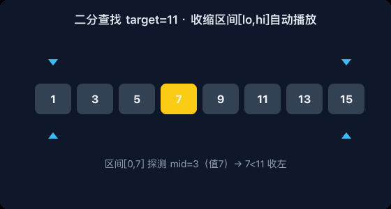
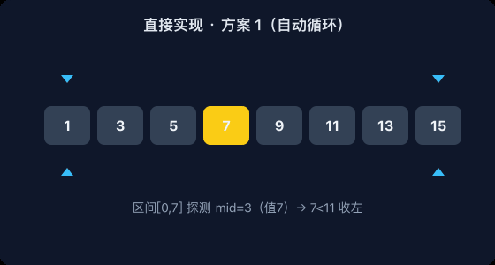
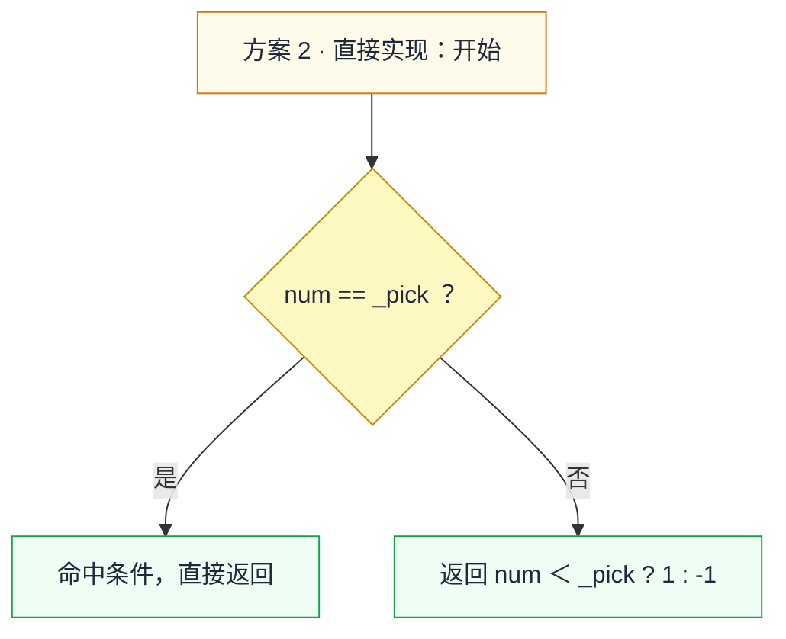
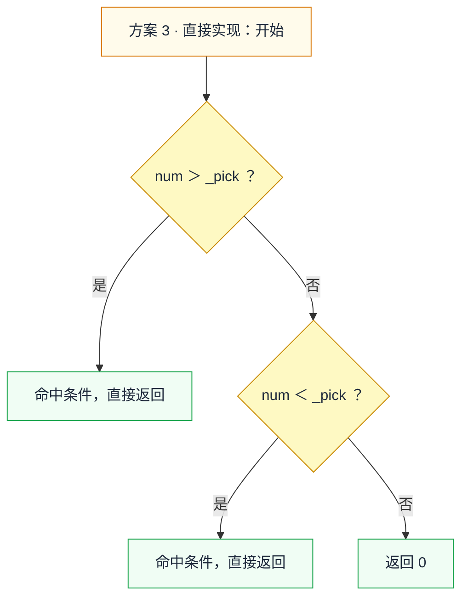
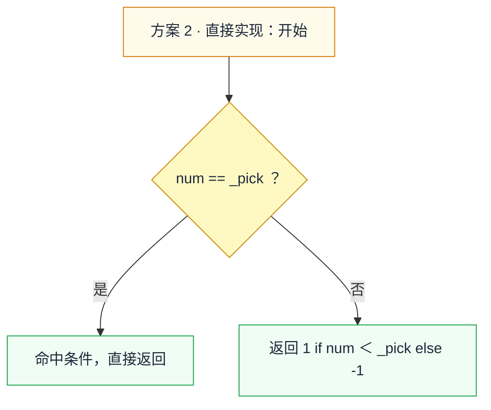
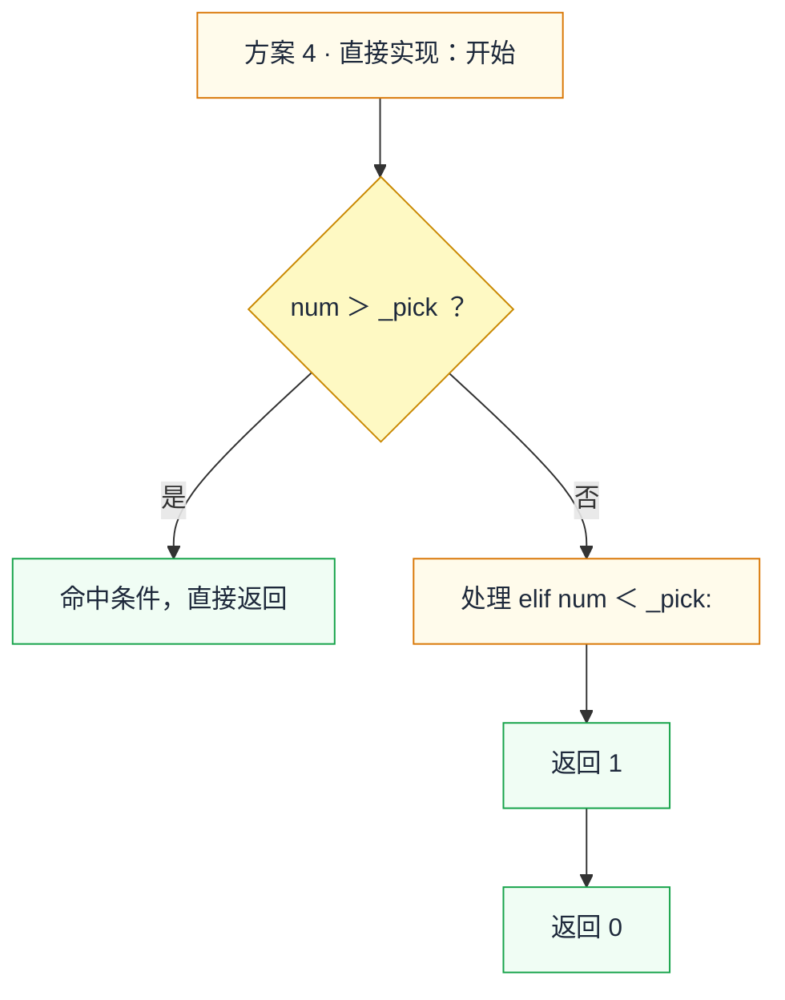
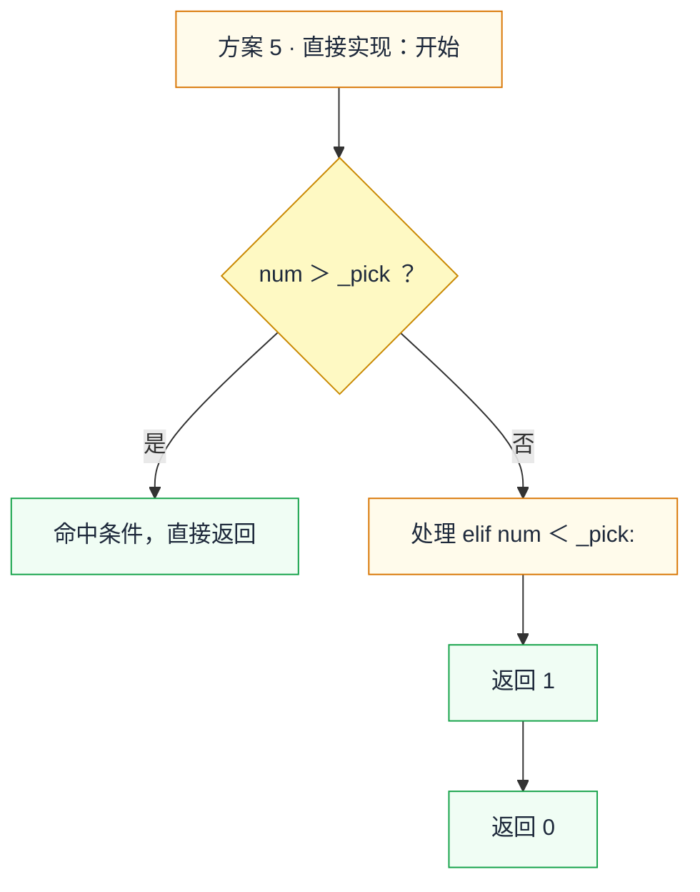
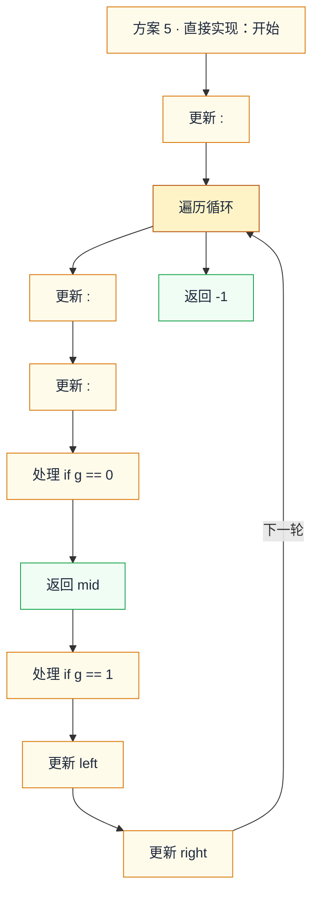
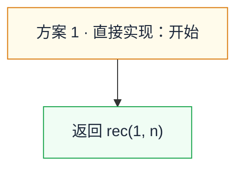

# 093 · 猜数字大小（第四阶段 · 查找与排序 · Medium）

> **难度**：⭐⭐ Medium ｜ **专题**：二分查找
> **学习定位**：第四阶段 · 查找与排序第 93 篇 ｜ **解法数**：6
> **内容总结**：**猜数字大小**（二分查找 · Medium）：共 6 个方案，主线思路「直接实现」；时间 O(n) 量级；动画演示二分收缩过程，附录给出 11 种语言 × 全部方案的可运行实现。

---

## 题目描述

我们正在玩猜数字游戏。猜数字游戏的规则如下：

我会从 `1` 到 `n` 随机选择一个数字。 请你猜选出的是哪个数字。（我选的数字在整个游戏中保持不变）。

如果你猜错了，我会告诉你，我选出的数字比你猜测的数字大了还是小了。

你可以通过调用一个预先定义好的接口 `int guess(int num)` 来获取猜测结果，返回值一共有三种可能的情况：

 `-1`：你猜的数字比我选出的数字大 （即 `num > pick`）。
 `1`：你猜的数字比我选出的数字小 （即 `num 
 `0`：你猜的数字与我选出的数字相等。（即 `num == pick`）。

返回我选出的数字。

- 主函数签名：`function guess(num: number): number`

**用例（来自原题）**：

**示例 1**

```text
输入：n = 10, pick = 6
输出：6
```

**示例 2**

```text
输入：n = 1, pick = 1
输出：1
```

**示例 3**

```text
输入：n = 2, pick = 1
输出：1
```
> 题面与 [leetcode.cn 官方](https://leetcode.cn/problems/guess-number-higher-or-lower/)一致，示例配图取自官方题面。

**数据范围与注意事项**：

- `1 <= n <= 2^31 - 1`
- `1 <= pick <= n`
- **易错点**：区间开闭要前后一致，mid 计算用左加右减防溢出。

## 题目分析

**场景是什么**：有序数据上每次砍一半，对应真实开发里的字典查找、版本定位、容量规划。本题就是该场景的 Medium 级练习，主线做法是「直接实现」。

**主线怎么解**：主解法结构简单：读入、处理、返回。

## 解题思路

**方案对比**（共 6 个方案，由浅入深）：

| 方案 | 时间复杂度 | 空间复杂度 |
|---|---|---|
| 方案 1 · 直接实现 | O(n) 量级 | O(n) |
| 方案 2 · 直接实现 | O(n) 量级 | O(n) |
| 方案 3 · 直接实现 | O(n) 量级 | O(n) |
| 方案 4 · 直接实现 | O(n) 量级 | O(n) |
| 方案 5 · 直接实现 | O(n) 量级 | O(n) |
| 方案 6 · 直接实现 | O(n) 量级 | O(n) |

**方案间的取舍**：方案 1（直接实现）；方案 2（直接实现）；方案 3（直接实现）；方案 4（直接实现）；方案 5（直接实现）；方案 6（直接实现）。数据规模小、可读性优先时选靠前的方案；规模大、性能优先时选靠后的方案。

**怎么读这一篇**：

- 🐣 **新手路线**：把「题目描述」的示例 1 在纸上手推一遍 → 读方案 1（最直观的写法）与它的代码走读 → 按「运行方式」本地跑通看 PASS → 回头对比方案 2 之后的写法差在哪
- 🦅 **大佬路线**：直接锁定最优方案 1（直接实现，O(n) 量级）→ 跳读该方案代码与走读 → 用「逐步拆解与面试追问」补齐复杂度推导与边界追问

### 动态算法图（二分收缩，GIF 自动循环）



动画演示二分查找专题里二分收缩的典型过程；每个方案在「TypeScript 解题方案」一节还配了专属动画与专属流程图。

### 主解法流程图（真实控制流）


## TypeScript 解题方案（6 个方案逐个讲）

> **运行与提交**：每个方案都是自包含文件（内嵌用例自测，输出 PASS），整块复制到 `.ts` 文件后 `node 文件名` 即可运行。提交 LeetCode 时，把 `demo` 内的算法函数与辅助类型/函数整体取出、置于文件顶层即可。**提交备注**：注意：原题为交互题（guess 接口由判题端提供），本地按预置答案模拟。

### 方案 1：直接实现

**分析与思路**：核心做法是「直接实现」。

**运行方式**：`node 本文件`，内嵌用例全部通过会输出 PASS。



**方案专属流程图**（真实控制流）：


```typescript
// Faithful translation of python reference. Self-check via demo().
let _pick = 6; // 把 6 存入 _pick
function guess(num: number): number {
  // 定义函数/方法 guess
  if (num === _pick) return 0; // 若 num 全等于 _pick，直接返回 0
  return num < _pick ? 1 : -1; // 返回 num 小于 _pick ? 1 : 减 1
}
function guessNumber(n: number): number {
  // 定义函数/方法 guessNumber
  function rec(low: number, high: number): number {
    // 定义函数/方法 rec
    if (low > high) return -1; // 若 low 超过 high，直接返回 减 1
    const mid = Math.floor((low + high) / 2); // 把 向下取整((low 加 high) 除以 2) 存入 中点
    const res = guess(mid); // 把 guess(中点) 存入 结果
    if (res === 0) return mid; // 若 结果 全等于 0，直接返回 中点
    if (res === 1) return rec(mid + 1, high); // 若 结果 全等于 1，直接返回 rec(中点 加 1, high)
    return rec(1, mid - 1); // 返回 rec(1, 中点 减 1)
  }
  return rec(1, n); // 返回 rec(1, 元素个数)
}
export function demo(): void {
  // 程序入口：跑内嵌自测用例
  const cases = [
    [10, 6],
    [1, 1],
    [5, 3],
    [2, 2],
  ]; // 把 [[10, 6], [1, 1], [5, 3], [2, 2]] 存入 cases
  for (const [n, pick] of cases) {
    // for (const [元素个数, pick] of cases) {
    _pick = pick; // 把 pick 存入 _pick
    const got = guessNumber(n); // 把 guessNumber(元素个数) 存入 got
    if (got !== pick)
      throw new Error('FAIL n=' + n + ' pick=' + pick + ' got ' + got);
  }
  console.log('PASS'); // 全部用例通过，输出 PASS
}
demo(); // demo();
```

### 方案 2：直接实现

**分析与思路**：核心做法是「直接实现」。

**运行方式**：`node 本文件`，内嵌用例全部通过会输出 PASS。


**方案专属流程图**（真实控制流）：



```typescript
// Faithful translation of python reference. Self-check via demo().
let _pick = 6; // 把 6 存入 _pick
function guess(num: number): number {
  // 定义函数/方法 guess
  if (num === _pick) return 0; // 若 num 全等于 _pick，直接返回 0
  return num < _pick ? 1 : -1; // 返回 num 小于 _pick ? 1 : 减 1
}
function guessNumber(n: number): number {
  // 定义函数/方法 guessNumber
  let low = 1,
    high = n; // 把 1, high 赋值为 元素个数 存入 low
  while (low <= high) {
    // 循环，直到不满足「low 不超过 high」
    const mid = Math.floor((low + high) / 2); // 把 向下取整((low 加 high) 除以 2) 存入 中点
    const res = guess(mid); // 把 guess(中点) 存入 结果
    if (res === 0) return mid; // 若 结果 全等于 0，直接返回 中点
    if (res === 1)
      low = mid + 1; // 若 结果 全等于 1) low 赋值为 中点 加 1;
    else high = mid - 1; // 否则
  }
  return -1; // 返回 减 1
}
export function demo(): void {
  // 程序入口：跑内嵌自测用例
  const cases = [
    [10, 6],
    [1, 1],
    [5, 3],
    [2, 2],
  ]; // 把 [[10, 6], [1, 1], [5, 3], [2, 2]] 存入 cases
  for (const [n, pick] of cases) {
    // for (const [元素个数, pick] of cases) {
    _pick = pick; // 把 pick 存入 _pick
    const got = guessNumber(n); // 把 guessNumber(元素个数) 存入 got
    if (got !== pick)
      throw new Error('FAIL n=' + n + ' pick=' + pick + ' got ' + got);
  }
  console.log('PASS'); // 全部用例通过，输出 PASS
}
demo(); // demo();
```

### 方案 3：直接实现

**分析与思路**：核心做法是「直接实现」。

**运行方式**：`node 本文件`，内嵌用例全部通过会输出 PASS。


**方案专属流程图**（真实控制流）：



```typescript
// Faithful translation of python reference. Self-check via demo().
let _pick = 6; // 把 6 存入 _pick
function guess(num: number): number {
  // 定义函数/方法 guess
  if (num > _pick) return -1; // 若 num 超过 _pick，直接返回 减 1
  if (num < _pick) return 1; // 若 num 小于 _pick，直接返回 1
  return 0; // 返回 0
}
function guessNumber(n: number): number {
  // 定义函数/方法 guessNumber
  let left = 1,
    right = n; // 把 1, 右边界 赋值为 元素个数 存入 左边界
  while (left <= right) {
    // 循环，直到不满足「左边界 不超过 右边界」
    const mid = Math.floor((left + right) / 2); // 把 向下取整((左边界 加 右边界) 除以 2) 存入 中点
    const g = guess(mid); // 把 guess(中点) 存入 g
    if (g === 0)
      return mid; // 若 g 全等于 0，直接返回 中点
    else if (g === 1)
      left = mid + 1; // 否则，若 g 全等于 1) 左边界 赋值为 中点 加 1;
    else right = mid - 1; // 否则
  }
  return -1; // 返回 减 1
}
export function demo(): void {
  // 程序入口：跑内嵌自测用例
  const cases = [
    [10, 6],
    [1, 1],
    [5, 3],
    [2, 2],
  ]; // 把 [[10, 6], [1, 1], [5, 3], [2, 2]] 存入 cases
  for (const [n, pick] of cases) {
    // for (const [元素个数, pick] of cases) {
    _pick = pick; // 把 pick 存入 _pick
    const got = guessNumber(n); // 把 guessNumber(元素个数) 存入 got
    if (got !== pick)
      throw new Error('FAIL n=' + n + ' pick=' + pick + ' got ' + got);
  }
  console.log('PASS'); // 全部用例通过，输出 PASS
}
demo(); // demo();
```

### 方案 4：直接实现

**分析与思路**：核心做法是「直接实现」。

**运行方式**：`node 本文件`，内嵌用例全部通过会输出 PASS。


**方案专属流程图**（真实控制流）：


```typescript
// Faithful translation of python reference. Self-check via demo().
let _pick = 6; // 把 6 存入 _pick
function guess(num: number): number {
  // 定义函数/方法 guess
  if (num > _pick) return -1; // 若 num 超过 _pick，直接返回 减 1
  if (num < _pick) return 1; // 若 num 小于 _pick，直接返回 1
  return 0; // 返回 0
}
function guessNumber(n: number): number {
  // 定义函数/方法 guessNumber
  let left = 1,
    right = n; // 把 1, 右边界 赋值为 元素个数 存入 左边界
  while (left <= right) {
    // 循环，直到不满足「左边界 不超过 右边界」
    const mid = Math.floor((left + right) / 2); // 把 向下取整((左边界 加 右边界) 除以 2) 存入 中点
    const g = guess(mid); // 把 guess(中点) 存入 g
    if (g === 0)
      return mid; // 若 g 全等于 0，直接返回 中点
    else if (g === 1)
      left = mid + 1; // 否则，若 g 全等于 1) 左边界 赋值为 中点 加 1;
    else right = mid - 1; // 否则
  }
  return -1; // 返回 减 1
}
export function demo(): void {
  // 程序入口：跑内嵌自测用例
  const cases = [
    [10, 6],
    [1, 1],
    [5, 3],
    [2, 2],
  ]; // 把 [[10, 6], [1, 1], [5, 3], [2, 2]] 存入 cases
  for (const [n, pick] of cases) {
    // for (const [元素个数, pick] of cases) {
    _pick = pick; // 把 pick 存入 _pick
    const got = guessNumber(n); // 把 guessNumber(元素个数) 存入 got
    if (got !== pick)
      throw new Error('FAIL n=' + n + ' pick=' + pick + ' got ' + got);
  }
  console.log('PASS'); // 全部用例通过，输出 PASS
}
demo(); // demo();
```

### 方案 5：直接实现

**分析与思路**：核心做法是「直接实现」。

**运行方式**：`node 本文件`，内嵌用例全部通过会输出 PASS。


**方案专属流程图**（真实控制流）：


```typescript
// Faithful translation of python reference. Self-check via demo().
let _pick = 6; // 把 6 存入 _pick
function guess(num: number): number {
  // 定义函数/方法 guess
  if (num > _pick) return -1; // 若 num 超过 _pick，直接返回 减 1
  if (num < _pick) return 1; // 若 num 小于 _pick，直接返回 1
  return 0; // 返回 0
}
function guessNumber(n: number): number {
  // 定义函数/方法 guessNumber
  let left = 1,
    right = n; // 把 1, 右边界 赋值为 元素个数 存入 左边界
  while (left <= right) {
    // 循环，直到不满足「左边界 不超过 右边界」
    const mid = Math.floor((left + right) / 2); // 把 向下取整((左边界 加 右边界) 除以 2) 存入 中点
    const g = guess(mid); // 把 guess(中点) 存入 g
    if (g === 0)
      return mid; // 若 g 全等于 0，直接返回 中点
    else if (g === 1)
      left = mid + 1; // 否则，若 g 全等于 1) 左边界 赋值为 中点 加 1;
    else right = mid - 1; // 否则
  }
  return -1; // 返回 减 1
}
export function demo(): void {
  // 程序入口：跑内嵌自测用例
  const cases = [
    [10, 6],
    [1, 1],
    [5, 3],
    [2, 2],
  ]; // 把 [[10, 6], [1, 1], [5, 3], [2, 2]] 存入 cases
  for (const [n, pick] of cases) {
    // for (const [元素个数, pick] of cases) {
    _pick = pick; // 把 pick 存入 _pick
    const got = guessNumber(n); // 把 guessNumber(元素个数) 存入 got
    if (got !== pick)
      throw new Error('FAIL n=' + n + ' pick=' + pick + ' got ' + got);
  }
  console.log('PASS'); // 全部用例通过，输出 PASS
}
demo(); // demo();
```

### 方案 6：直接实现

**分析与思路**：核心做法是「直接实现」。

**运行方式**：`node 本文件`，内嵌用例全部通过会输出 PASS。


**方案专属流程图**（真实控制流）：


```typescript
// Faithful translation of python reference. Self-check via demo().
let _pick = 6; // 把 6 存入 _pick
function guess(num: number): number {
  // 定义函数/方法 guess
  if (num > _pick) return -1; // 若 num 超过 _pick，直接返回 减 1
  if (num < _pick) return 1; // 若 num 小于 _pick，直接返回 1
  return 0; // 返回 0
}
function guessNumber(n: number): number {
  // 定义函数/方法 guessNumber
  let left = 1,
    right = n; // 把 1, 右边界 赋值为 元素个数 存入 左边界
  while (left <= right) {
    // 循环，直到不满足「左边界 不超过 右边界」
    const mid = Math.floor((left + right) / 2); // 把 向下取整((左边界 加 右边界) 除以 2) 存入 中点
    const g = guess(mid); // 把 guess(中点) 存入 g
    if (g === 0)
      return mid; // 若 g 全等于 0，直接返回 中点
    else if (g === 1)
      left = mid + 1; // 否则，若 g 全等于 1) 左边界 赋值为 中点 加 1;
    else right = mid - 1; // 否则
  }
  return -1; // 返回 减 1
}
export function demo(): void {
  // 程序入口：跑内嵌自测用例
  const cases = [
    [10, 6],
    [1, 1],
    [5, 3],
    [2, 2],
  ]; // 把 [[10, 6], [1, 1], [5, 3], [2, 2]] 存入 cases
  for (const [n, pick] of cases) {
    // for (const [元素个数, pick] of cases) {
    _pick = pick; // 把 pick 存入 _pick
    const got = guessNumber(n); // 把 guessNumber(元素个数) 存入 got
    if (got !== pick)
      throw new Error('FAIL n=' + n + ' pick=' + pick + ' got ' + got);
  }
  console.log('PASS'); // 全部用例通过，输出 PASS
}
demo(); // demo();
```

## 逐步拆解与面试追问

**复杂度**：时间 O(n) 量级，空间 O(n)

**为什么是这个量级**：整体只对数据做有限趟处理

**面试官可能会追问**：

- mid 写成左加右减是防什么？
- 区间开闭不一致会怎样？
- 何时退化为线性查找？

## 关键 API 速查（TS 主解法实际用到，附官方链接）

| API | 作用 | 使用要点 | 官方文档 |
|---|---|---|---|
| `Math.floor()` | 向下取整 | 负数向负无穷（-1.5 → -2）；大数用位运算前注意 2^31 界 | [官方文档](https://developer.mozilla.org/zh-CN/docs/Web/JavaScript/Reference/Global_Objects/Math/floor) |

### 各语言官方文档导航

- **TypeScript / JS**：[MDN 中文参考](https://developer.mozilla.org/zh-CN/)
- **Python**：[Python 官方文档](https://docs.python.org/zh-cn/3/)
- **Go**：[Go 标准库](https://pkg.go.dev/std)
- **Java**：[JDK 17 API](https://docs.oracle.com/en/java/javase/17/docs/api/)
- **Rust**：[Rust 标准库](https://doc.rust-lang.org/std/)
- **Lua**：[Lua 5.4 手册](https://www.lua.org/manual/5.4/)
- **C**：[Cppreference C](https://zh.cppreference.com/w/c)
- **C++**：[Cppreference C++](https://zh.cppreference.com/w/cpp)
- **R**：[R 官方手册](https://stat.ethz.ch/R-manual/)
- **Zig**：[Zig 语言文档](https://ziglang.org/documentation/master/)
- **Dart**：[Dart API](https://api.dart.dev/)

## 附录：其他 10 种语言全部实现（每种语言列举其全部方案）

> TypeScript 的全部方案见「TypeScript 解题方案」一节；下面是其余 10 种语言的对应实现，每种语言的每个方案都带思路分析、代码走读与专属运行架构图。
> 每个方案都内嵌用例自测，可独立运行（老仓库 python/go 文件遵循「打印结果」约定）。
> 完整解法文件见 `dsa/<语言>/binary_search/lc_374_猜数字大小/`。

### Python 实现（6 种方案）

Python 的全部方案如下，每个方案都内嵌用例自测，可独立运行（老仓库 python/go 文件遵循「打印结果」约定）：

#### 方案 1：直接实现

**思路与代码分析**：核心是「直接实现」。Python 版用切片与字典推导式简化操作，突出可读性。**走读**：方案 1 · 直接实现：开始 → 命中条件，直接返回 → 返回 1 if num ＜ _pick else -1。

**运行架构**（真实控制流）：


```python
import sys  # 提高递归深度上限（深输入防 RecursionError）

sys.setrecursionlimit(200000)  # 树/链表类题目节点数可达 1e4 量级
_pick = 6  # 把 6 存入 _pick

def guess(num):  # 定义函数 guess（参数：num）
    if num == _pick:  # 若 num 等于 _pick
        return 0  # 返回 0
    return 1 if num < _pick else -1  # 返回 1 if num 小于 _pick else 减 1

def guessNumber(n):  # 定义函数 guessNumber（参数：元素个数）
    def rec(low, high):  # 定义函数 rec（参数：low, high）
        if low > high:  # 若 low 超过 high
            return -1  # 返回 减 1
        mid = (low + high) // 2  # 把 (low 加 high) 除以 除以 2 存入 中点
        res = guess(mid)  # 把 guess(中点) 存入 结果
        if res == 0:  # 若 结果 等于 0
            return mid  # 返回 中点
        if res == 1:  # 若 结果 等于 1
            return rec(mid + 1, high)  # 返回 rec(中点 加 1, high)
        return rec(1, mid - 1)  # 返回 rec(1, 中点 减 1)

    return rec(1, n)  # 返回 rec(1, 元素个数)

if __name__ == "__main__":  # 若 __name__ 等于 '__main__'
    _pick = 6  # 把 6 存入 _pick
    print(guessNumber(10))  # 打印输出
```

#### 方案 2：直接实现

**思路与代码分析**：核心是「直接实现」。Python 版用切片与字典推导式简化操作，突出可读性。**走读**：方案 2 · 直接实现：开始 → 命中条件，直接返回 → 返回 1 if num ＜ _pick else -1。

**运行架构**（真实控制流）：



```python
import sys  # 提高递归深度上限（深输入防 RecursionError）

sys.setrecursionlimit(200000)  # 树/链表类题目节点数可达 1e4 量级
_pick = 6  # 把 6 存入 _pick

def guess(num):  # 定义函数 guess（参数：num）
    if num == _pick:  # 若 num 等于 _pick
        return 0  # 返回 0
    return 1 if num < _pick else -1  # 返回 1 if num 小于 _pick else 减 1

def guessNumber(n):  # 定义函数 guessNumber（参数：元素个数）
    low, high = 1, n  # 把 1, 元素个数 写入 low, high
    while low <= high:  # 循环，直到不满足「low 不超过 high」
        mid = (low + high) // 2  # 把 (low 加 high) 除以 除以 2 存入 中点
        res = guess(mid)  # 把 guess(中点) 存入 结果
        if res == 0:  # 若 结果 等于 0
            return mid  # 返回 中点
        if res == 1:  # 若 结果 等于 1
            low = mid + 1  # 把 中点 加 1 存入 low
        else:  # 否则
            high = mid - 1  # 把 中点 减 1 存入 high

if __name__ == "__main__":  # 若 __name__ 等于 '__main__'
    _pick = 6  # 把 6 存入 _pick
    print(guessNumber(10))  # 打印输出
```

#### 方案 3：直接实现

**思路与代码分析**：核心是「直接实现」。Python 版用切片与字典推导式简化操作，突出可读性。**走读**：方案 3 · 直接实现：开始 → 命中条件，直接返回 → 处理 elif num ＜ _pick: → 返回 1 → 返回 0。

**运行架构**（真实控制流）：


```python
import sys  # 提高递归深度上限（深输入防 RecursionError）

sys.setrecursionlimit(200000)  # 树/链表类题目节点数可达 1e4 量级
_pick = 6  # 把 6 存入 _pick

def guess(num):  # 定义函数 guess（参数：num）
    if num > _pick:  # 若 num 超过 _pick
        return -1  # 返回 减 1
    elif num < _pick:  # 否则，若 num 小于 _pick
        return 1  # 返回 1
    return 0  # 返回 0

def guessNumber(n):  # 定义函数 guessNumber（参数：元素个数）
    left, right = 1, n  # 把 1, 元素个数 写入 left, right
    while left <= right:  # 循环，直到不满足「左边界 不超过 右边界」
        mid = (left + right) // 2  # 把 (左边界 加 右边界) 除以 除以 2 存入 中点
        g = guess(mid)  # 把 guess(中点) 存入 g
        if g == 0:  # 若 g 等于 0
            return mid  # 返回 中点
        elif g == 1:  # 否则，若 g 等于 1
            left = mid + 1  # 把 中点 加 1 存入 左边界
        else:  # 否则
            right = mid - 1  # 把 中点 减 1 存入 右边界
    return -1  # 返回 减 1

if __name__ == "__main__":  # 若 __name__ 等于 '__main__'
    print(guessNumber(10))  # 打印输出
```

#### 方案 4：直接实现

**思路与代码分析**：核心是「直接实现」。Python 版用切片与字典推导式简化操作，突出可读性。**走读**：方案 4 · 直接实现：开始 → 命中条件，直接返回 → 处理 elif num ＜ _pick: → 返回 1 → 返回 0。

**运行架构**（真实控制流）：



```python
import sys  # 提高递归深度上限（深输入防 RecursionError）

sys.setrecursionlimit(200000)  # 树/链表类题目节点数可达 1e4 量级
_pick = 6  # 把 6 存入 _pick

def guess(num):  # 定义函数 guess（参数：num）
    if num > _pick:  # 若 num 超过 _pick
        return -1  # 返回 减 1
    elif num < _pick:  # 否则，若 num 小于 _pick
        return 1  # 返回 1
    return 0  # 返回 0

def guessNumber(n):  # 定义函数 guessNumber（参数：元素个数）
    left, right = 1, n  # 把 1, 元素个数 写入 left, right
    while left <= right:  # 循环，直到不满足「左边界 不超过 右边界」
        mid = (left + right) // 2  # 把 (左边界 加 右边界) 除以 除以 2 存入 中点
        g = guess(mid)  # 把 guess(中点) 存入 g
        if g == 0:  # 若 g 等于 0
            return mid  # 返回 中点
        elif g == 1:  # 否则，若 g 等于 1
            left = mid + 1  # 把 中点 加 1 存入 左边界
        else:  # 否则
            right = mid - 1  # 把 中点 减 1 存入 右边界
    return -1  # 返回 减 1

if __name__ == "__main__":  # 若 __name__ 等于 '__main__'
    print(guessNumber(10))  # 打印输出
```

#### 方案 5：直接实现

**思路与代码分析**：核心是「直接实现」。Python 版用切片与字典推导式简化操作，突出可读性。**走读**：方案 5 · 直接实现：开始 → 命中条件，直接返回 → 处理 elif num ＜ _pick: → 返回 1 → 返回 0。

**运行架构**（真实控制流）：



```python
import sys  # 提高递归深度上限（深输入防 RecursionError）

sys.setrecursionlimit(200000)  # 树/链表类题目节点数可达 1e4 量级
_pick = 6  # 把 6 存入 _pick

def guess(num):  # 定义函数 guess（参数：num）
    if num > _pick:  # 若 num 超过 _pick
        return -1  # 返回 减 1
    elif num < _pick:  # 否则，若 num 小于 _pick
        return 1  # 返回 1
    return 0  # 返回 0

def guessNumber(n):  # 定义函数 guessNumber（参数：元素个数）
    left, right = 1, n  # 把 1, 元素个数 写入 left, right
    while left <= right:  # 循环，直到不满足「左边界 不超过 右边界」
        mid = (left + right) // 2  # 把 (左边界 加 右边界) 除以 除以 2 存入 中点
        g = guess(mid)  # 把 guess(中点) 存入 g
        if g == 0:  # 若 g 等于 0
            return mid  # 返回 中点
        elif g == 1:  # 否则，若 g 等于 1
            left = mid + 1  # 把 中点 加 1 存入 左边界
        else:  # 否则
            right = mid - 1  # 把 中点 减 1 存入 右边界
    return -1  # 返回 减 1

if __name__ == "__main__":  # 若 __name__ 等于 '__main__'
    print(guessNumber(10))  # 打印输出
```

#### 方案 6：直接实现

**思路与代码分析**：核心是「直接实现」。Python 版用切片与字典推导式简化操作，突出可读性。**走读**：方案 6 · 直接实现：开始 → 命中条件，直接返回 → 处理 elif num ＜ _pick: → 返回 1 → 返回 0。

**运行架构**（真实控制流）：


```python
import sys  # 提高递归深度上限（深输入防 RecursionError）

sys.setrecursionlimit(200000)  # 树/链表类题目节点数可达 1e4 量级
_pick = 6  # 把 6 存入 _pick

def guess(num):  # 定义函数 guess（参数：num）
    if num > _pick:  # 若 num 超过 _pick
        return -1  # 返回 减 1
    elif num < _pick:  # 否则，若 num 小于 _pick
        return 1  # 返回 1
    return 0  # 返回 0

def guessNumber(n):  # 定义函数 guessNumber（参数：元素个数）
    left, right = 1, n  # 把 1, 元素个数 写入 left, right
    while left <= right:  # 循环，直到不满足「左边界 不超过 右边界」
        mid = (left + right) // 2  # 把 (左边界 加 右边界) 除以 除以 2 存入 中点
        g = guess(mid)  # 把 guess(中点) 存入 g
        if g == 0:  # 若 g 等于 0
            return mid  # 返回 中点
        elif g == 1:  # 否则，若 g 等于 1
            left = mid + 1  # 把 中点 加 1 存入 左边界
        else:  # 否则
            right = mid - 1  # 把 中点 减 1 存入 右边界
    return -1  # 返回 减 1

if __name__ == "__main__":  # 若 __name__ 等于 '__main__'
    print(guessNumber(10))  # 打印输出
```

### Go 实现（6 种方案）

Go 的全部方案如下，每个方案都内嵌用例自测，可独立运行（老仓库 python/go 文件遵循「打印结果」约定）：

#### 方案 1：直接实现

**思路与代码分析**：核心是「直接实现」。Go 版用切片与多返回值惯用法，显式处理索引边界。**走读**：方案 1 · 直接实现：开始 → 更新 : → 遍历循环 → 更新 : → 更新 : → 处理 if g == 0 → 返回 mid → 处理 if g == 1 → 更新 left → 更新 right → 返回 -1。

**运行架构**（真实控制流）：


```go
package main // 引入依赖

import (
	"fmt"
	"os"
) // 引入依赖

var pick = 6 // 把 6 存入 pick

func guess(num int) int { // 定义函数/方法 guess
	if num == pick { // 若 num 等于 pick
		return 0 // 返回 0
	}
	if num < pick { // 若 num 小于 pick
		return 1 // 返回 1
	}
	return -1 // 返回 减 1
}

func guessNumber(n int) int { // 定义函数/方法 guessNumber
	left, right := 1, n // 把 1, 元素个数 写入 left, right :
	for left <= right { // 把 右边界 { 写入 for left <
		mid := (left + right) / 2 // 把 (左边界 加 右边界) 除以 2 写入 mid :
		g := guess(mid)           // 把 guess(中点) 写入 g :
		if g == 0 {               // 若 g 等于 0
			return mid // 返回 中点
		}
		if g == 1 { // 若 g 等于 1
			left = mid + 1 // 把 中点 加 1 写入 左边界
		} else { // 否则
			right = mid - 1 // 把 中点 减 1 写入 右边界
		}
	}
	return -1 // 返回 减 1
}

func main() { // 程序入口：跑内嵌自测用例
	cases := []struct { // 把 []struct { 写入 cases :
		n    int // 元素个数 int
		want int // want int
	}{ // }{
		{10, 6},
		{100, 6},
	}
	ok := true                // 把 true 写入 ok :
	for _, c := range cases { // 同时取 _ 与 字符 遍历
		if got := guessNumber(c.n); got != c.want { // 若 got : 赋值为 guessNumber(字符.元素个数); got 不等于 字符.want
			ok = false                                                        // 把 false 写入 ok
			fmt.Printf("FAIL guessNumber(%d)=%d want %d\n", c.n, got, c.want) // 打印输出
		}
	}
	if !ok { // 若 取反 ok
		os.Exit(1) // os.Exit(1)
	}
	fmt.Println("PASS") // 全部用例通过，输出 PASS
}
```

#### 方案 2：直接实现

**思路与代码分析**：核心是「直接实现」。Go 版用切片与多返回值惯用法，显式处理索引边界。**走读**：方案 2 · 直接实现：开始 → 更新 : → 遍历循环 → 更新 : → 更新 : → 处理 if g == 0 → 返回 mid → 处理 if g == 1 → 更新 left → 更新 right → 返回 -1。

**运行架构**（真实控制流）：


```go
package main // 引入依赖

import (
	"fmt"
	"os"
) // 引入依赖

var pick = 6 // 把 6 存入 pick

func guess(num int) int { // 定义函数/方法 guess
	if num == pick { // 若 num 等于 pick
		return 0 // 返回 0
	}
	if num < pick { // 若 num 小于 pick
		return 1 // 返回 1
	}
	return -1 // 返回 减 1
}

func guessNumber(n int) int { // 定义函数/方法 guessNumber
	left, right := 1, n // 把 1, 元素个数 写入 left, right :
	for left <= right { // 把 右边界 { 写入 for left <
		mid := (left + right) / 2 // 把 (左边界 加 右边界) 除以 2 写入 mid :
		g := guess(mid)           // 把 guess(中点) 写入 g :
		if g == 0 {               // 若 g 等于 0
			return mid // 返回 中点
		}
		if g == 1 { // 若 g 等于 1
			left = mid + 1 // 把 中点 加 1 写入 左边界
		} else { // 否则
			right = mid - 1 // 把 中点 减 1 写入 右边界
		}
	}
	return -1 // 返回 减 1
}

func main() { // 程序入口：跑内嵌自测用例
	cases := []struct { // 把 []struct { 写入 cases :
		n    int // 元素个数 int
		want int // want int
	}{ // }{
		{10, 6},
		{100, 6},
	}
	ok := true                // 把 true 写入 ok :
	for _, c := range cases { // 同时取 _ 与 字符 遍历
		if got := guessNumber(c.n); got != c.want { // 若 got : 赋值为 guessNumber(字符.元素个数); got 不等于 字符.want
			ok = false                                                        // 把 false 写入 ok
			fmt.Printf("FAIL guessNumber(%d)=%d want %d\n", c.n, got, c.want) // 打印输出
		}
	}
	if !ok { // 若 取反 ok
		os.Exit(1) // os.Exit(1)
	}
	fmt.Println("PASS") // 全部用例通过，输出 PASS
}
```

#### 方案 3：直接实现

**思路与代码分析**：核心是「直接实现」。Go 版用切片与多返回值惯用法，显式处理索引边界。**走读**：方案 3 · 直接实现：开始 → 更新 : → 遍历循环 → 更新 : → 更新 : → 处理 if g == 0 → 返回 mid → 处理 if g == 1 → 更新 left → 更新 right → 返回 -1。

**运行架构**（真实控制流）：


```go
package main // 引入依赖

import (
	"fmt"
	"os"
) // 引入依赖

var pick = 6 // 把 6 存入 pick

func guess(num int) int { // 定义函数/方法 guess
	if num == pick { // 若 num 等于 pick
		return 0 // 返回 0
	}
	if num < pick { // 若 num 小于 pick
		return 1 // 返回 1
	}
	return -1 // 返回 减 1
}

func guessNumber(n int) int { // 定义函数/方法 guessNumber
	left, right := 1, n // 把 1, 元素个数 写入 left, right :
	for left <= right { // 把 右边界 { 写入 for left <
		mid := (left + right) / 2 // 把 (左边界 加 右边界) 除以 2 写入 mid :
		g := guess(mid)           // 把 guess(中点) 写入 g :
		if g == 0 {               // 若 g 等于 0
			return mid // 返回 中点
		}
		if g == 1 { // 若 g 等于 1
			left = mid + 1 // 把 中点 加 1 写入 左边界
		} else { // 否则
			right = mid - 1 // 把 中点 减 1 写入 右边界
		}
	}
	return -1 // 返回 减 1
}

func main() { // 程序入口：跑内嵌自测用例
	cases := []struct { // 把 []struct { 写入 cases :
		n    int // 元素个数 int
		want int // want int
	}{ // }{
		{10, 6},
		{100, 6},
	}
	ok := true                // 把 true 写入 ok :
	for _, c := range cases { // 同时取 _ 与 字符 遍历
		if got := guessNumber(c.n); got != c.want { // 若 got : 赋值为 guessNumber(字符.元素个数); got 不等于 字符.want
			ok = false                                                        // 把 false 写入 ok
			fmt.Printf("FAIL guessNumber(%d)=%d want %d\n", c.n, got, c.want) // 打印输出
		}
	}
	if !ok { // 若 取反 ok
		os.Exit(1) // os.Exit(1)
	}
	fmt.Println("PASS") // 全部用例通过，输出 PASS
}
```

#### 方案 4：直接实现

**思路与代码分析**：核心是「直接实现」。Go 版用切片与多返回值惯用法，显式处理索引边界。**走读**：方案 4 · 直接实现：开始 → 更新 : → 遍历循环 → 更新 : → 更新 : → 处理 if g == 0 → 返回 mid → 处理 if g == 1 → 更新 left → 更新 right → 返回 -1。

**运行架构**（真实控制流）：


```go
package main // 引入依赖

import (
	"fmt"
	"os"
) // 引入依赖

var pick = 6 // 把 6 存入 pick

func guess(num int) int { // 定义函数/方法 guess
	if num == pick { // 若 num 等于 pick
		return 0 // 返回 0
	}
	if num < pick { // 若 num 小于 pick
		return 1 // 返回 1
	}
	return -1 // 返回 减 1
}

func guessNumber(n int) int { // 定义函数/方法 guessNumber
	left, right := 1, n // 把 1, 元素个数 写入 left, right :
	for left <= right { // 把 右边界 { 写入 for left <
		mid := (left + right) / 2 // 把 (左边界 加 右边界) 除以 2 写入 mid :
		g := guess(mid)           // 把 guess(中点) 写入 g :
		if g == 0 {               // 若 g 等于 0
			return mid // 返回 中点
		}
		if g == 1 { // 若 g 等于 1
			left = mid + 1 // 把 中点 加 1 写入 左边界
		} else { // 否则
			right = mid - 1 // 把 中点 减 1 写入 右边界
		}
	}
	return -1 // 返回 减 1
}

func main() { // 程序入口：跑内嵌自测用例
	cases := []struct { // 把 []struct { 写入 cases :
		n    int // 元素个数 int
		want int // want int
	}{ // }{
		{10, 6},
		{100, 6},
	}
	ok := true                // 把 true 写入 ok :
	for _, c := range cases { // 同时取 _ 与 字符 遍历
		if got := guessNumber(c.n); got != c.want { // 若 got : 赋值为 guessNumber(字符.元素个数); got 不等于 字符.want
			ok = false                                                        // 把 false 写入 ok
			fmt.Printf("FAIL guessNumber(%d)=%d want %d\n", c.n, got, c.want) // 打印输出
		}
	}
	if !ok { // 若 取反 ok
		os.Exit(1) // os.Exit(1)
	}
	fmt.Println("PASS") // 全部用例通过，输出 PASS
}
```

#### 方案 5：直接实现

**思路与代码分析**：核心是「直接实现」。Go 版用切片与多返回值惯用法，显式处理索引边界。**走读**：方案 5 · 直接实现：开始 → 更新 : → 遍历循环 → 更新 : → 更新 : → 处理 if g == 0 → 返回 mid → 处理 if g == 1 → 更新 left → 更新 right → 返回 -1。

**运行架构**（真实控制流）：



```go
package main // 引入依赖

import (
	"fmt"
	"os"
) // 引入依赖

var pick = 6 // 把 6 存入 pick

func guess(num int) int { // 定义函数/方法 guess
	if num == pick { // 若 num 等于 pick
		return 0 // 返回 0
	}
	if num < pick { // 若 num 小于 pick
		return 1 // 返回 1
	}
	return -1 // 返回 减 1
}

func guessNumber(n int) int { // 定义函数/方法 guessNumber
	left, right := 1, n // 把 1, 元素个数 写入 left, right :
	for left <= right { // 把 右边界 { 写入 for left <
		mid := (left + right) / 2 // 把 (左边界 加 右边界) 除以 2 写入 mid :
		g := guess(mid)           // 把 guess(中点) 写入 g :
		if g == 0 {               // 若 g 等于 0
			return mid // 返回 中点
		}
		if g == 1 { // 若 g 等于 1
			left = mid + 1 // 把 中点 加 1 写入 左边界
		} else { // 否则
			right = mid - 1 // 把 中点 减 1 写入 右边界
		}
	}
	return -1 // 返回 减 1
}

func main() { // 程序入口：跑内嵌自测用例
	cases := []struct { // 把 []struct { 写入 cases :
		n    int // 元素个数 int
		want int // want int
	}{ // }{
		{10, 6},
		{100, 6},
	}
	ok := true                // 把 true 写入 ok :
	for _, c := range cases { // 同时取 _ 与 字符 遍历
		if got := guessNumber(c.n); got != c.want { // 若 got : 赋值为 guessNumber(字符.元素个数); got 不等于 字符.want
			ok = false                                                        // 把 false 写入 ok
			fmt.Printf("FAIL guessNumber(%d)=%d want %d\n", c.n, got, c.want) // 打印输出
		}
	}
	if !ok { // 若 取反 ok
		os.Exit(1) // os.Exit(1)
	}
	fmt.Println("PASS") // 全部用例通过，输出 PASS
}
```

#### 方案 6：直接实现

**思路与代码分析**：核心是「直接实现」。Go 版用切片与多返回值惯用法，显式处理索引边界。**走读**：方案 6 · 直接实现：开始 → 更新 : → 遍历循环 → 更新 : → 更新 : → 处理 if g == 0 → 返回 mid → 处理 if g == 1 → 更新 left → 更新 right → 返回 -1。

**运行架构**（真实控制流）：


```go
package main // 引入依赖

import (
	"fmt"
	"os"
) // 引入依赖

var pick = 6 // 把 6 存入 pick

func guess(num int) int { // 定义函数/方法 guess
	if num == pick { // 若 num 等于 pick
		return 0 // 返回 0
	}
	if num < pick { // 若 num 小于 pick
		return 1 // 返回 1
	}
	return -1 // 返回 减 1
}

func guessNumber(n int) int { // 定义函数/方法 guessNumber
	left, right := 1, n // 把 1, 元素个数 写入 left, right :
	for left <= right { // 把 右边界 { 写入 for left <
		mid := (left + right) / 2 // 把 (左边界 加 右边界) 除以 2 写入 mid :
		g := guess(mid)           // 把 guess(中点) 写入 g :
		if g == 0 {               // 若 g 等于 0
			return mid // 返回 中点
		}
		if g == 1 { // 若 g 等于 1
			left = mid + 1 // 把 中点 加 1 写入 左边界
		} else { // 否则
			right = mid - 1 // 把 中点 减 1 写入 右边界
		}
	}
	return -1 // 返回 减 1
}

func main() { // 程序入口：跑内嵌自测用例
	cases := []struct { // 把 []struct { 写入 cases :
		n    int // 元素个数 int
		want int // want int
	}{ // }{
		{10, 6},
		{100, 6},
	}
	ok := true                // 把 true 写入 ok :
	for _, c := range cases { // 同时取 _ 与 字符 遍历
		if got := guessNumber(c.n); got != c.want { // 若 got : 赋值为 guessNumber(字符.元素个数); got 不等于 字符.want
			ok = false                                                        // 把 false 写入 ok
			fmt.Printf("FAIL guessNumber(%d)=%d want %d\n", c.n, got, c.want) // 打印输出
		}
	}
	if !ok { // 若 取反 ok
		os.Exit(1) // os.Exit(1)
	}
	fmt.Println("PASS") // 全部用例通过，输出 PASS
}
```

### Java 实现（6 种方案）

Java 的全部方案如下，每个方案都内嵌用例自测，可独立运行（老仓库 python/go 文件遵循「打印结果」约定）：

#### 方案 1：直接实现

**思路与代码分析**：核心是「直接实现」。Java 版用类与静态方法组织，集合操作显式明了。**走读**：方案 1 · 直接实现：开始 → 返回 rec(1, n)。

**运行架构**（真实控制流）：



```java
package com.webfault.dsa; // 引入依赖

// 猜数字大小（方案1：递归二分，左分支从 1 重启，与博客一致）
class Main { // 定义类型
  static int pick = 6; // 把 6; 写入 static int pick

  static int guess(int num) { // 定义函数/方法 guess
    if (num == pick) return 0; // 若 num 等于 pick，直接返回 0
    return num < pick ? 1 : -1; // 返回 num 小于 pick ? 1 : 减 1
  }

  static int guessNumber(int n) { // 定义函数/方法 guessNumber
    return rec(1, n); // 返回 rec(1, 元素个数)
  }

  static int rec(int low, int high) { // 定义函数/方法 rec
    if (low > high) return -1; // 若 low 超过 high，直接返回 减 1
    int mid = low + (high - low) / 2; // 把 (low 加 high) 除以 2 存入 中点
    int res = guess(mid); // 把 guess(中点) 存入 结果
    if (res == 0) return mid; // 若 结果 等于 0，直接返回 中点
    if (res == 1) return rec(mid + 1, high); // 若 结果 等于 1，直接返回 rec(中点 加 1, high)
    return rec(1, mid - 1); // 返回 rec(1, 中点 减 1)
  }

  public static void main(String[] args) { // public static void main(String[] args) {
    int[][] cases = {{10, 6}, {1, 1}, {10, 1}, {10, 10}, {2, 2}};
    boolean ok = true; // 把 true; 写入 boolean ok
    for (int[] c : cases) { // for (int[] 字符 : cases) {
      pick = c[1]; // 把 字符[1]; 写入 pick
      int got = guessNumber(c[0]); // 把 guessNumber(字符[0]) 存入 got
      if (got != c[1]) { // 若 got 不等于 字符[1]
        ok = false; // 把 false; 写入 ok
        System.out.println("FAIL guessNumber(n=" + c[0] + ", pick=" + c[1] + ")=" + got); // 打印输出
      }
    }
    if (!ok) throw new RuntimeException("FAILED"); // 若 取反 ok) throw new RuntimeException(「FAILED」);
    System.out.println("PASS"); // 全部用例通过，输出 PASS
  }
}
```

#### 方案 2：直接实现

**思路与代码分析**：核心是「直接实现」。Java 版用类与静态方法组织，集合操作显式明了。**走读**：方案 2 · 直接实现：开始 → 更新 low → 当 (low ≤ high) 时反复执行 → 更新 mid → 更新 res → 命中条件，直接返回 → 若 res == 1：更新 low → 返回 -1。

**运行架构**（真实控制流）：

```mermaid
graph TD
    N0["方案 2 · 直接实现：开始"]
    N1["更新 low"]
    N2["当 (low ≤ high) 时反复执行"]
    N3["更新 mid"]
    N4["更新 res"]
    N5{"res == 0 ？"}
    N6["命中条件，直接返回"]
    N7["若 res == 1：更新 low"]
    N8["返回 -1"]
    N0 --> N1
    N1 --> N2
    N2 --> N3
    N3 --> N4
    N4 --> N5
    N5 -- 是 --> N6
    N5 -- 否 --> N7
    N7 -- 下一轮 --> N2
    N2 --> N8
    classDef n fill:#fffbeb,stroke:#d97706,color:#1e293b;
    classDef lp fill:#fef3c7,stroke:#b45309,color:#1e293b;
    classDef dc fill:#fef9c3,stroke:#ca8a04,color:#1e293b;
    classDef tm fill:#f0fdf4,stroke:#16a34a,color:#1e293b;
    class N0,N1,N3,N4,N7 n;
    class N2 lp;
    class N5 dc;
    class N6,N8 tm;
```

```java
package com.webfault.dsa; // 引入依赖

// 猜数字大小（方案2：迭代二分）
class Main { // 定义类型
  static int pick = 6; // 把 6; 写入 static int pick

  static int guess(int num) { // 定义函数/方法 guess
    if (num == pick) return 0; // 若 num 等于 pick，直接返回 0
    return num < pick ? 1 : -1; // 返回 num 小于 pick ? 1 : 减 1
  }

  static int guessNumber(int n) { // 定义函数/方法 guessNumber
    int low = 1, high = n; // 把 1, high 赋值为 元素个数 存入 low
    while (low <= high) { // 循环，直到不满足「low 不超过 high」
      int mid = low + (high - low) / 2; // 把 (low 加 high) 除以 2 存入 中点
      int res = guess(mid); // 把 guess(中点) 存入 结果
      if (res == 0) return mid; // 若 结果 等于 0，直接返回 中点
      if (res == 1) low = mid + 1; // 若 结果 等于 1) low 赋值为 中点 加 1;
      else high = mid - 1; // 否则
    }
    return -1; // 返回 减 1
  }

  public static void main(String[] args) { // public static void main(String[] args) {
    int[][] cases = {{10, 6}, {1, 1}, {10, 1}, {10, 10}, {2, 2}};
    boolean ok = true; // 把 true; 写入 boolean ok
    for (int[] c : cases) { // for (int[] 字符 : cases) {
      pick = c[1]; // 把 字符[1]; 写入 pick
      int got = guessNumber(c[0]); // 把 guessNumber(字符[0]) 存入 got
      if (got != c[1]) { // 若 got 不等于 字符[1]
        ok = false; // 把 false; 写入 ok
        System.out.println("FAIL guessNumber(n=" + c[0] + ", pick=" + c[1] + ")=" + got); // 打印输出
      }
    }
    if (!ok) throw new RuntimeException("FAILED"); // 若 取反 ok) throw new RuntimeException(「FAILED」);
    System.out.println("PASS"); // 全部用例通过，输出 PASS
  }
}
```

#### 方案 3：直接实现

**思路与代码分析**：核心是「直接实现」。Java 版用类与静态方法组织，集合操作显式明了。代码里依次做这些事：二分收缩区间。**走读**：方案 3 · 直接实现：开始 → 更新 left → 当 (left ≤ right) 时反复执行 → 更新 mid → 更新 g → 命中条件，直接返回 → 返回 -1。

**运行架构**（真实控制流）：

```mermaid
graph TD
    N0["方案 3 · 直接实现：开始"]
    N1["更新 left"]
    N2["当 (left ≤ right) 时反复执行"]
    N3["更新 mid"]
    N4["更新 g"]
    N5{"g == 0 ？"}
    N6["命中条件，直接返回"]
    N7["返回 -1"]
    N0 --> N1
    N1 --> N2
    N2 --> N3
    N3 --> N4
    N4 --> N5
    N5 -- 是 --> N6
    N5 -- 下一轮 --> N2
    N2 --> N7
    classDef n fill:#fffbeb,stroke:#d97706,color:#1e293b;
    classDef lp fill:#fef3c7,stroke:#b45309,color:#1e293b;
    classDef dc fill:#fef9c3,stroke:#ca8a04,color:#1e293b;
    classDef tm fill:#f0fdf4,stroke:#16a34a,color:#1e293b;
    class N0,N1,N3,N4 n;
    class N2 lp;
    class N5 dc;
    class N6,N7 tm;
```

```java
package com.webfault.dsa; // 引入依赖

// 猜数字大小（方案3：迭代二分，guess 先行判定大小）
class Main { // 定义类型
  static int pick = 6; // 把 6; 写入 static int pick

  static int guess(int num) { // 定义函数/方法 guess
    if (num > pick) return -1; // 若 num 超过 pick，直接返回 减 1
    else if (num < pick) return 1; // 否则，若 num 小于 pick) return 1;
    return 0; // 返回 0
  }

  static int guessNumber(int n) { // 定义函数/方法 guessNumber
    int left = 1, right = n; // 把 1, 右边界 赋值为 元素个数 存入 左边界
    while (left <= right) { // 循环，直到不满足「左边界 不超过 右边界」
      int mid = left + (right - left) / 2; // 把 (左边界 加 右边界) 除以 2 存入 中点
      int g = guess(mid); // 把 guess(中点) 存入 g
      if (g == 0) return mid; // 若 g 等于 0，直接返回 中点
      else if (g == 1) left = mid + 1; // 否则，若 g 等于 1) 左边界 赋值为 中点 加 1;
      else right = mid - 1; // 否则
    }
    return -1; // 返回 减 1
  }

  public static void main(String[] args) { // public static void main(String[] args) {
    int[][] cases = {{10, 6}, {1, 1}, {10, 1}, {10, 10}, {2, 2}};
    boolean ok = true; // 把 true; 写入 boolean ok
    for (int[] c : cases) { // for (int[] 字符 : cases) {
      pick = c[1]; // 把 字符[1]; 写入 pick
      int got = guessNumber(c[0]); // 把 guessNumber(字符[0]) 存入 got
      if (got != c[1]) { // 若 got 不等于 字符[1]
        ok = false; // 把 false; 写入 ok
        System.out.println("FAIL guessNumber(n=" + c[0] + ", pick=" + c[1] + ")=" + got); // 打印输出
      }
    }
    if (!ok) throw new RuntimeException("FAILED"); // 若 取反 ok) throw new RuntimeException(「FAILED」);
    System.out.println("PASS"); // 全部用例通过，输出 PASS
  }
}
```

#### 方案 4：直接实现

**思路与代码分析**：核心是「直接实现」。Java 版用类与静态方法组织，集合操作显式明了。代码里依次做这些事：二分收缩区间。**走读**：方案 4 · 直接实现：开始 → 更新 left → 当 (left ≤ right) 时反复执行 → 更新 mid → 更新 g → 命中条件，直接返回 → 返回 -1。

**运行架构**（真实控制流）：

```mermaid
graph TD
    N0["方案 4 · 直接实现：开始"]
    N1["更新 left"]
    N2["当 (left ≤ right) 时反复执行"]
    N3["更新 mid"]
    N4["更新 g"]
    N5{"g == 0 ？"}
    N6["命中条件，直接返回"]
    N7["返回 -1"]
    N0 --> N1
    N1 --> N2
    N2 --> N3
    N3 --> N4
    N4 --> N5
    N5 -- 是 --> N6
    N5 -- 下一轮 --> N2
    N2 --> N7
    classDef n fill:#fffbeb,stroke:#d97706,color:#1e293b;
    classDef lp fill:#fef3c7,stroke:#b45309,color:#1e293b;
    classDef dc fill:#fef9c3,stroke:#ca8a04,color:#1e293b;
    classDef tm fill:#f0fdf4,stroke:#16a34a,color:#1e293b;
    class N0,N1,N3,N4 n;
    class N2 lp;
    class N5 dc;
    class N6,N7 tm;
```

```java
package com.webfault.dsa; // 引入依赖

// 猜数字大小（方案4：迭代二分，guess 先行判定大小）
class Main { // 定义类型
  static int pick = 6; // 把 6; 写入 static int pick

  static int guess(int num) { // 定义函数/方法 guess
    if (num > pick) return -1; // 若 num 超过 pick，直接返回 减 1
    else if (num < pick) return 1; // 否则，若 num 小于 pick) return 1;
    return 0; // 返回 0
  }

  static int guessNumber(int n) { // 定义函数/方法 guessNumber
    int left = 1, right = n; // 把 1, 右边界 赋值为 元素个数 存入 左边界
    while (left <= right) { // 循环，直到不满足「左边界 不超过 右边界」
      int mid = left + (right - left) / 2; // 把 (左边界 加 右边界) 除以 2 存入 中点
      int g = guess(mid); // 把 guess(中点) 存入 g
      if (g == 0) return mid; // 若 g 等于 0，直接返回 中点
      else if (g == 1) left = mid + 1; // 否则，若 g 等于 1) 左边界 赋值为 中点 加 1;
      else right = mid - 1; // 否则
    }
    return -1; // 返回 减 1
  }

  public static void main(String[] args) { // public static void main(String[] args) {
    int[][] cases = {{10, 6}, {1, 1}, {10, 1}, {10, 10}, {2, 2}};
    boolean ok = true; // 把 true; 写入 boolean ok
    for (int[] c : cases) { // for (int[] 字符 : cases) {
      pick = c[1]; // 把 字符[1]; 写入 pick
      int got = guessNumber(c[0]); // 把 guessNumber(字符[0]) 存入 got
      if (got != c[1]) { // 若 got 不等于 字符[1]
        ok = false; // 把 false; 写入 ok
        System.out.println("FAIL guessNumber(n=" + c[0] + ", pick=" + c[1] + ")=" + got); // 打印输出
      }
    }
    if (!ok) throw new RuntimeException("FAILED"); // 若 取反 ok) throw new RuntimeException(「FAILED」);
    System.out.println("PASS"); // 全部用例通过，输出 PASS
  }
}
```

#### 方案 5：直接实现

**思路与代码分析**：核心是「直接实现」。Java 版用类与静态方法组织，集合操作显式明了。代码里依次做这些事：二分收缩区间。**走读**：方案 5 · 直接实现：开始 → 更新 left → 当 (left ≤ right) 时反复执行 → 更新 mid → 更新 g → 命中条件，直接返回 → 返回 -1。

**运行架构**（真实控制流）：

```mermaid
graph TD
    N0["方案 5 · 直接实现：开始"]
    N1["更新 left"]
    N2["当 (left ≤ right) 时反复执行"]
    N3["更新 mid"]
    N4["更新 g"]
    N5{"g == 0 ？"}
    N6["命中条件，直接返回"]
    N7["返回 -1"]
    N0 --> N1
    N1 --> N2
    N2 --> N3
    N3 --> N4
    N4 --> N5
    N5 -- 是 --> N6
    N5 -- 下一轮 --> N2
    N2 --> N7
    classDef n fill:#fffbeb,stroke:#d97706,color:#1e293b;
    classDef lp fill:#fef3c7,stroke:#b45309,color:#1e293b;
    classDef dc fill:#fef9c3,stroke:#ca8a04,color:#1e293b;
    classDef tm fill:#f0fdf4,stroke:#16a34a,color:#1e293b;
    class N0,N1,N3,N4 n;
    class N2 lp;
    class N5 dc;
    class N6,N7 tm;
```

```java
package com.webfault.dsa; // 引入依赖

// 猜数字大小（方案5：迭代二分，guess 先行判定大小）
class Main { // 定义类型
  static int pick = 6; // 把 6; 写入 static int pick

  static int guess(int num) { // 定义函数/方法 guess
    if (num > pick) return -1; // 若 num 超过 pick，直接返回 减 1
    else if (num < pick) return 1; // 否则，若 num 小于 pick) return 1;
    return 0; // 返回 0
  }

  static int guessNumber(int n) { // 定义函数/方法 guessNumber
    int left = 1, right = n; // 把 1, 右边界 赋值为 元素个数 存入 左边界
    while (left <= right) { // 循环，直到不满足「左边界 不超过 右边界」
      int mid = left + (right - left) / 2; // 把 (左边界 加 右边界) 除以 2 存入 中点
      int g = guess(mid); // 把 guess(中点) 存入 g
      if (g == 0) return mid; // 若 g 等于 0，直接返回 中点
      else if (g == 1) left = mid + 1; // 否则，若 g 等于 1) 左边界 赋值为 中点 加 1;
      else right = mid - 1; // 否则
    }
    return -1; // 返回 减 1
  }

  public static void main(String[] args) { // public static void main(String[] args) {
    int[][] cases = {{10, 6}, {1, 1}, {10, 1}, {10, 10}, {2, 2}};
    boolean ok = true; // 把 true; 写入 boolean ok
    for (int[] c : cases) { // for (int[] 字符 : cases) {
      pick = c[1]; // 把 字符[1]; 写入 pick
      int got = guessNumber(c[0]); // 把 guessNumber(字符[0]) 存入 got
      if (got != c[1]) { // 若 got 不等于 字符[1]
        ok = false; // 把 false; 写入 ok
        System.out.println("FAIL guessNumber(n=" + c[0] + ", pick=" + c[1] + ")=" + got); // 打印输出
      }
    }
    if (!ok) throw new RuntimeException("FAILED"); // 若 取反 ok) throw new RuntimeException(「FAILED」);
    System.out.println("PASS"); // 全部用例通过，输出 PASS
  }
}
```

#### 方案 6：直接实现

**思路与代码分析**：核心是「直接实现」。Java 版用类与静态方法组织，集合操作显式明了。代码里依次做这些事：二分收缩区间。**走读**：方案 6 · 直接实现：开始 → 更新 left → 当 (left ≤ right) 时反复执行 → 更新 mid → 更新 g → 命中条件，直接返回 → 返回 -1。

**运行架构**（真实控制流）：

```mermaid
graph TD
    N0["方案 6 · 直接实现：开始"]
    N1["更新 left"]
    N2["当 (left ≤ right) 时反复执行"]
    N3["更新 mid"]
    N4["更新 g"]
    N5{"g == 0 ？"}
    N6["命中条件，直接返回"]
    N7["返回 -1"]
    N0 --> N1
    N1 --> N2
    N2 --> N3
    N3 --> N4
    N4 --> N5
    N5 -- 是 --> N6
    N5 -- 下一轮 --> N2
    N2 --> N7
    classDef n fill:#fffbeb,stroke:#d97706,color:#1e293b;
    classDef lp fill:#fef3c7,stroke:#b45309,color:#1e293b;
    classDef dc fill:#fef9c3,stroke:#ca8a04,color:#1e293b;
    classDef tm fill:#f0fdf4,stroke:#16a34a,color:#1e293b;
    class N0,N1,N3,N4 n;
    class N2 lp;
    class N5 dc;
    class N6,N7 tm;
```

```java
package com.webfault.dsa; // 引入依赖

// 猜数字大小（方案6：迭代二分，guess 先行判定大小）
class Main { // 定义类型
  static int pick = 6; // 把 6; 写入 static int pick

  static int guess(int num) { // 定义函数/方法 guess
    if (num > pick) return -1; // 若 num 超过 pick，直接返回 减 1
    else if (num < pick) return 1; // 否则，若 num 小于 pick) return 1;
    return 0; // 返回 0
  }

  static int guessNumber(int n) { // 定义函数/方法 guessNumber
    int left = 1, right = n; // 把 1, 右边界 赋值为 元素个数 存入 左边界
    while (left <= right) { // 循环，直到不满足「左边界 不超过 右边界」
      int mid = left + (right - left) / 2; // 把 (左边界 加 右边界) 除以 2 存入 中点
      int g = guess(mid); // 把 guess(中点) 存入 g
      if (g == 0) return mid; // 若 g 等于 0，直接返回 中点
      else if (g == 1) left = mid + 1; // 否则，若 g 等于 1) 左边界 赋值为 中点 加 1;
      else right = mid - 1; // 否则
    }
    return -1; // 返回 减 1
  }

  public static void main(String[] args) { // public static void main(String[] args) {
    int[][] cases = {{10, 6}, {1, 1}, {10, 1}, {10, 10}, {2, 2}};
    boolean ok = true; // 把 true; 写入 boolean ok
    for (int[] c : cases) { // for (int[] 字符 : cases) {
      pick = c[1]; // 把 字符[1]; 写入 pick
      int got = guessNumber(c[0]); // 把 guessNumber(字符[0]) 存入 got
      if (got != c[1]) { // 若 got 不等于 字符[1]
        ok = false; // 把 false; 写入 ok
        System.out.println("FAIL guessNumber(n=" + c[0] + ", pick=" + c[1] + ")=" + got); // 打印输出
      }
    }
    if (!ok) throw new RuntimeException("FAILED"); // 若 取反 ok) throw new RuntimeException(「FAILED」);
    System.out.println("PASS"); // 全部用例通过，输出 PASS
  }
}
```

### Rust 实现（6 种方案）

Rust 的全部方案如下，每个方案都内嵌用例自测，可独立运行（老仓库 python/go 文件遵循「打印结果」约定）：

#### 方案 1：直接实现

**思路与代码分析**：核心是「直接实现」。Rust 版用所有权移动与切片借用改写同一逻辑，注意 Option 与引用边界。**走读**：方案 1 · 直接实现：开始 → 处理 if low ＞ high → 返回 -1 → 计算 mid → 处理 match guess(mid) → 更新 0 → 更新 1 → 更新 _ → 调用 rec(1, n)。

**运行架构**（真实控制流）：

```mermaid
graph TD
    N0["方案 1 · 直接实现：开始"]
    N1["处理 if low ＞ high"]
    N2["返回 -1"]
    N3["计算 mid"]
    N4["处理 match guess(mid)"]
    N5["更新 0"]
    N6["更新 1"]
    N7["更新 _"]
    N8["调用 rec(1, n)"]
    N0 --> N1
    N1 --> N2
    N2 --> N3
    N3 --> N4
    N4 --> N5
    N5 --> N6
    N6 --> N7
    N7 --> N8
    classDef n fill:#fffbeb,stroke:#d97706,color:#1e293b;
    classDef lp fill:#fef3c7,stroke:#b45309,color:#1e293b;
    classDef dc fill:#fef9c3,stroke:#ca8a04,color:#1e293b;
    classDef tm fill:#f0fdf4,stroke:#16a34a,color:#1e293b;
    class N0,N1,N3,N4,N5,N6,N7,N8 n;
    class N2 tm;
```

```rust
// LeetCode 374. 猜数字大小 — Rust 版（方案1：递归二分（忠实 TS：左分支 rec(1, mid-1)））
static mut PICK: i64 = 6; // 把 6; 写入 static mut PICK: i64
fn guess(num: i64) -> i32 {
    // 定义函数/方法 guess
    unsafe {
        if num == PICK {
            0
        } else if num < PICK {
            1
        } else {
            -1
        }
    }
}
fn guess_number(n: i64) -> i64 {
    // 定义函数/方法 guess_number
    fn rec(low: i64, high: i64) -> i64 {
        // 定义函数/方法 rec
        if low > high {
            return -1;
        } // 若 low 超过 high { return 减 1; }
        let mid = (low + high) / 2; // 把 (low 加 high) 除以 2 存入 中点
        match guess(mid) {
            // 定义函数/方法 guess
            0 => mid,
            1 => rec(mid + 1, high),
            _ => rec(1, mid - 1),
        }
    }
    rec(1, n) // rec(1, 元素个数)
}
fn main() {
    // 程序入口：跑内嵌自测用例
    let cases: [(i64, i64); 4] = [(10, 6), (1, 1), (5, 3), (2, 2)];
    for (n, pick) in cases {
        // for (元素个数, pick) in cases {
        unsafe {
            PICK = pick;
        } // 把 pick; } 写入 unsafe { PICK
        assert_eq!(guess_number(n), pick, "n={} pick={}", n, pick); // 断言校验
    }
    println!("PASS"); // 全部用例通过，输出 PASS
}
```

#### 方案 2：直接实现

**思路与代码分析**：核心是「直接实现」。Rust 版用所有权移动与切片借用改写同一逻辑，注意 Option 与引用边界。**走读**：方案 2 · 直接实现：开始 → 计算 let (mut low, mut high) → 当 low ≤ high 时反复执行 → 计算 mid → 处理 match guess(mid) → 更新 0 → 更新 1 → 更新 _ → 处理 -1 → 返回结果。

**运行架构**（真实控制流）：

```mermaid
graph TD
    N0["方案 2 · 直接实现：开始"]
    N1["计算 let (mut low, mut high)"]
    N2["当 low ≤ high 时反复执行"]
    N3["计算 mid"]
    N4["处理 match guess(mid)"]
    N5["更新 0"]
    N6["更新 1"]
    N7["更新 _"]
    N8["处理 -1"]
    N9["返回结果"]
    N0 --> N1
    N1 --> N2
    N2 --> N3
    N3 --> N4
    N4 --> N5
    N5 --> N6
    N6 --> N7
    N7 -- 下一轮 --> N2
    N2 --> N8
    N8 --> N9
    classDef n fill:#fffbeb,stroke:#d97706,color:#1e293b;
    classDef lp fill:#fef3c7,stroke:#b45309,color:#1e293b;
    classDef dc fill:#fef9c3,stroke:#ca8a04,color:#1e293b;
    classDef tm fill:#f0fdf4,stroke:#16a34a,color:#1e293b;
    class N0,N1,N3,N4,N5,N6,N7,N8 n;
    class N2 lp;
    class N9 tm;
```

```rust
// LeetCode 374. 猜数字大小 — Rust 版（方案2：迭代二分）
static mut PICK: i64 = 6; // 把 6; 写入 static mut PICK: i64
fn guess(num: i64) -> i32 {
    // 定义函数/方法 guess
    unsafe {
        if num == PICK {
            0
        } else if num < PICK {
            1
        } else {
            -1
        }
    }
}
fn guess_number(n: i64) -> i64 {
    // 定义函数/方法 guess_number
    let (mut low, mut high) = (1i64, n); // 把 (1i64, 元素个数); 写入 let (mut low, mut high)
    while low <= high {
        // 把 high { 写入 while low <
        let mid = (low + high) / 2; // 把 (low 加 high) 除以 2 存入 中点
        match guess(mid) {
            // 定义函数/方法 guess
            0 => return mid,
            1 => low = mid + 1,
            _ => high = mid - 1,
        }
    }
    -1 // 减 1
}
fn main() {
    // 程序入口：跑内嵌自测用例
    let cases: [(i64, i64); 4] = [(10, 6), (1, 1), (5, 3), (2, 2)];
    for (n, pick) in cases {
        // for (元素个数, pick) in cases {
        unsafe {
            PICK = pick;
        } // 把 pick; } 写入 unsafe { PICK
        assert_eq!(guess_number(n), pick, "n={} pick={}", n, pick); // 断言校验
    }
    println!("PASS"); // 全部用例通过，输出 PASS
}
```

#### 方案 3：直接实现

**思路与代码分析**：核心是「直接实现」。Rust 版用所有权移动与切片借用改写同一逻辑，注意 Option 与引用边界。**走读**：方案 3 · 直接实现：开始 → 计算 let (mut low, mut high) → 当 low ≤ high 时反复执行 → 计算 mid → 处理 match guess(mid) → 更新 0 → 更新 1 → 更新 _ → 处理 -1 → 返回结果。

**运行架构**（真实控制流）：

```mermaid
graph TD
    N0["方案 3 · 直接实现：开始"]
    N1["计算 let (mut low, mut high)"]
    N2["当 low ≤ high 时反复执行"]
    N3["计算 mid"]
    N4["处理 match guess(mid)"]
    N5["更新 0"]
    N6["更新 1"]
    N7["更新 _"]
    N8["处理 -1"]
    N9["返回结果"]
    N0 --> N1
    N1 --> N2
    N2 --> N3
    N3 --> N4
    N4 --> N5
    N5 --> N6
    N6 --> N7
    N7 -- 下一轮 --> N2
    N2 --> N8
    N8 --> N9
    classDef n fill:#fffbeb,stroke:#d97706,color:#1e293b;
    classDef lp fill:#fef3c7,stroke:#b45309,color:#1e293b;
    classDef dc fill:#fef9c3,stroke:#ca8a04,color:#1e293b;
    classDef tm fill:#f0fdf4,stroke:#16a34a,color:#1e293b;
    class N0,N1,N3,N4,N5,N6,N7,N8 n;
    class N2 lp;
    class N9 tm;
```

```rust
// LeetCode 374. 猜数字大小 — Rust 版（方案3：迭代二分）
static mut PICK: i64 = 6; // 把 6; 写入 static mut PICK: i64
fn guess(num: i64) -> i32 {
    // 定义函数/方法 guess
    unsafe {
        if num == PICK {
            0
        } else if num < PICK {
            1
        } else {
            -1
        }
    }
}
fn guess_number(n: i64) -> i64 {
    // 定义函数/方法 guess_number
    let (mut low, mut high) = (1i64, n); // 把 (1i64, 元素个数); 写入 let (mut low, mut high)
    while low <= high {
        // 把 high { 写入 while low <
        let mid = (low + high) / 2; // 把 (low 加 high) 除以 2 存入 中点
        match guess(mid) {
            // 定义函数/方法 guess
            0 => return mid,
            1 => low = mid + 1,
            _ => high = mid - 1,
        }
    }
    -1 // 减 1
}
fn main() {
    // 程序入口：跑内嵌自测用例
    let cases: [(i64, i64); 4] = [(10, 6), (1, 1), (5, 3), (2, 2)];
    for (n, pick) in cases {
        // for (元素个数, pick) in cases {
        unsafe {
            PICK = pick;
        } // 把 pick; } 写入 unsafe { PICK
        assert_eq!(guess_number(n), pick, "n={} pick={}", n, pick); // 断言校验
    }
    println!("PASS"); // 全部用例通过，输出 PASS
}
```

#### 方案 4：直接实现

**思路与代码分析**：核心是「直接实现」。Rust 版用所有权移动与切片借用改写同一逻辑，注意 Option 与引用边界。**走读**：方案 4 · 直接实现：开始 → 计算 let (mut low, mut high) → 当 low ≤ high 时反复执行 → 计算 mid → 处理 match guess(mid) → 更新 0 → 更新 1 → 更新 _ → 处理 -1 → 返回结果。

**运行架构**（真实控制流）：

```mermaid
graph TD
    N0["方案 4 · 直接实现：开始"]
    N1["计算 let (mut low, mut high)"]
    N2["当 low ≤ high 时反复执行"]
    N3["计算 mid"]
    N4["处理 match guess(mid)"]
    N5["更新 0"]
    N6["更新 1"]
    N7["更新 _"]
    N8["处理 -1"]
    N9["返回结果"]
    N0 --> N1
    N1 --> N2
    N2 --> N3
    N3 --> N4
    N4 --> N5
    N5 --> N6
    N6 --> N7
    N7 -- 下一轮 --> N2
    N2 --> N8
    N8 --> N9
    classDef n fill:#fffbeb,stroke:#d97706,color:#1e293b;
    classDef lp fill:#fef3c7,stroke:#b45309,color:#1e293b;
    classDef dc fill:#fef9c3,stroke:#ca8a04,color:#1e293b;
    classDef tm fill:#f0fdf4,stroke:#16a34a,color:#1e293b;
    class N0,N1,N3,N4,N5,N6,N7,N8 n;
    class N2 lp;
    class N9 tm;
```

```rust
// LeetCode 374. 猜数字大小 — Rust 版（方案4：迭代二分）
static mut PICK: i64 = 6; // 把 6; 写入 static mut PICK: i64
fn guess(num: i64) -> i32 {
    // 定义函数/方法 guess
    unsafe {
        if num == PICK {
            0
        } else if num < PICK {
            1
        } else {
            -1
        }
    }
}
fn guess_number(n: i64) -> i64 {
    // 定义函数/方法 guess_number
    let (mut low, mut high) = (1i64, n); // 把 (1i64, 元素个数); 写入 let (mut low, mut high)
    while low <= high {
        // 把 high { 写入 while low <
        let mid = (low + high) / 2; // 把 (low 加 high) 除以 2 存入 中点
        match guess(mid) {
            // 定义函数/方法 guess
            0 => return mid,
            1 => low = mid + 1,
            _ => high = mid - 1,
        }
    }
    -1 // 减 1
}
fn main() {
    // 程序入口：跑内嵌自测用例
    let cases: [(i64, i64); 4] = [(10, 6), (1, 1), (5, 3), (2, 2)];
    for (n, pick) in cases {
        // for (元素个数, pick) in cases {
        unsafe {
            PICK = pick;
        } // 把 pick; } 写入 unsafe { PICK
        assert_eq!(guess_number(n), pick, "n={} pick={}", n, pick); // 断言校验
    }
    println!("PASS"); // 全部用例通过，输出 PASS
}
```

#### 方案 5：直接实现

**思路与代码分析**：核心是「直接实现」。Rust 版用所有权移动与切片借用改写同一逻辑，注意 Option 与引用边界。**走读**：方案 5 · 直接实现：开始 → 计算 let (mut low, mut high) → 当 low ≤ high 时反复执行 → 计算 mid → 处理 match guess(mid) → 更新 0 → 更新 1 → 更新 _ → 处理 -1 → 返回结果。

**运行架构**（真实控制流）：

```mermaid
graph TD
    N0["方案 5 · 直接实现：开始"]
    N1["计算 let (mut low, mut high)"]
    N2["当 low ≤ high 时反复执行"]
    N3["计算 mid"]
    N4["处理 match guess(mid)"]
    N5["更新 0"]
    N6["更新 1"]
    N7["更新 _"]
    N8["处理 -1"]
    N9["返回结果"]
    N0 --> N1
    N1 --> N2
    N2 --> N3
    N3 --> N4
    N4 --> N5
    N5 --> N6
    N6 --> N7
    N7 -- 下一轮 --> N2
    N2 --> N8
    N8 --> N9
    classDef n fill:#fffbeb,stroke:#d97706,color:#1e293b;
    classDef lp fill:#fef3c7,stroke:#b45309,color:#1e293b;
    classDef dc fill:#fef9c3,stroke:#ca8a04,color:#1e293b;
    classDef tm fill:#f0fdf4,stroke:#16a34a,color:#1e293b;
    class N0,N1,N3,N4,N5,N6,N7,N8 n;
    class N2 lp;
    class N9 tm;
```

```rust
// LeetCode 374. 猜数字大小 — Rust 版（方案5：迭代二分）
static mut PICK: i64 = 6; // 把 6; 写入 static mut PICK: i64
fn guess(num: i64) -> i32 {
    // 定义函数/方法 guess
    unsafe {
        if num == PICK {
            0
        } else if num < PICK {
            1
        } else {
            -1
        }
    }
}
fn guess_number(n: i64) -> i64 {
    // 定义函数/方法 guess_number
    let (mut low, mut high) = (1i64, n); // 把 (1i64, 元素个数); 写入 let (mut low, mut high)
    while low <= high {
        // 把 high { 写入 while low <
        let mid = (low + high) / 2; // 把 (low 加 high) 除以 2 存入 中点
        match guess(mid) {
            // 定义函数/方法 guess
            0 => return mid,
            1 => low = mid + 1,
            _ => high = mid - 1,
        }
    }
    -1 // 减 1
}
fn main() {
    // 程序入口：跑内嵌自测用例
    let cases: [(i64, i64); 4] = [(10, 6), (1, 1), (5, 3), (2, 2)];
    for (n, pick) in cases {
        // for (元素个数, pick) in cases {
        unsafe {
            PICK = pick;
        } // 把 pick; } 写入 unsafe { PICK
        assert_eq!(guess_number(n), pick, "n={} pick={}", n, pick); // 断言校验
    }
    println!("PASS"); // 全部用例通过，输出 PASS
}
```

#### 方案 6：直接实现

**思路与代码分析**：核心是「直接实现」。Rust 版用所有权移动与切片借用改写同一逻辑，注意 Option 与引用边界。**走读**：方案 6 · 直接实现：开始 → 计算 let (mut low, mut high) → 当 low ≤ high 时反复执行 → 计算 mid → 处理 match guess(mid) → 更新 0 → 更新 1 → 更新 _ → 处理 -1 → 返回结果。

**运行架构**（真实控制流）：

```mermaid
graph TD
    N0["方案 6 · 直接实现：开始"]
    N1["计算 let (mut low, mut high)"]
    N2["当 low ≤ high 时反复执行"]
    N3["计算 mid"]
    N4["处理 match guess(mid)"]
    N5["更新 0"]
    N6["更新 1"]
    N7["更新 _"]
    N8["处理 -1"]
    N9["返回结果"]
    N0 --> N1
    N1 --> N2
    N2 --> N3
    N3 --> N4
    N4 --> N5
    N5 --> N6
    N6 --> N7
    N7 -- 下一轮 --> N2
    N2 --> N8
    N8 --> N9
    classDef n fill:#fffbeb,stroke:#d97706,color:#1e293b;
    classDef lp fill:#fef3c7,stroke:#b45309,color:#1e293b;
    classDef dc fill:#fef9c3,stroke:#ca8a04,color:#1e293b;
    classDef tm fill:#f0fdf4,stroke:#16a34a,color:#1e293b;
    class N0,N1,N3,N4,N5,N6,N7,N8 n;
    class N2 lp;
    class N9 tm;
```

```rust
// LeetCode 374. 猜数字大小 — Rust 版（方案6：迭代二分）
static mut PICK: i64 = 6; // 把 6; 写入 static mut PICK: i64
fn guess(num: i64) -> i32 {
    // 定义函数/方法 guess
    unsafe {
        if num == PICK {
            0
        } else if num < PICK {
            1
        } else {
            -1
        }
    }
}
fn guess_number(n: i64) -> i64 {
    // 定义函数/方法 guess_number
    let (mut low, mut high) = (1i64, n); // 把 (1i64, 元素个数); 写入 let (mut low, mut high)
    while low <= high {
        // 把 high { 写入 while low <
        let mid = (low + high) / 2; // 把 (low 加 high) 除以 2 存入 中点
        match guess(mid) {
            // 定义函数/方法 guess
            0 => return mid,
            1 => low = mid + 1,
            _ => high = mid - 1,
        }
    }
    -1 // 减 1
}
fn main() {
    // 程序入口：跑内嵌自测用例
    let cases: [(i64, i64); 4] = [(10, 6), (1, 1), (5, 3), (2, 2)];
    for (n, pick) in cases {
        // for (元素个数, pick) in cases {
        unsafe {
            PICK = pick;
        } // 把 pick; } 写入 unsafe { PICK
        assert_eq!(guess_number(n), pick, "n={} pick={}", n, pick); // 断言校验
    }
    println!("PASS"); // 全部用例通过，输出 PASS
}
```

### Lua 实现（6 种方案）

Lua 的全部方案如下，每个方案都内嵌用例自测，可独立运行（老仓库 python/go 文件遵循「打印结果」约定）：

#### 方案 1：直接实现

**思路与代码分析**：核心是「直接实现」。Lua 版用表与 ipairs 遍历，注意 ipairs 遇 nil 即停的语义。**走读**：方案 1 · 直接实现：开始 → 处理 if num == pick then → 返回 0 → 处理 if num ＜ pick then → 返回 1 → 返回 -1。

**运行架构**（真实控制流）：

```mermaid
graph TD
    N0["方案 1 · 直接实现：开始"]
    N1["处理 if num == pick then"]
    N2["返回 0"]
    N3["处理 if num ＜ pick then"]
    N4["返回 1"]
    N5["返回 -1"]
    N0 --> N1
    N1 --> N2
    N2 --> N3
    N3 --> N4
    N4 --> N5
    classDef n fill:#fffbeb,stroke:#d97706,color:#1e293b;
    classDef lp fill:#fef3c7,stroke:#b45309,color:#1e293b;
    classDef dc fill:#fef9c3,stroke:#ca8a04,color:#1e293b;
    classDef tm fill:#f0fdf4,stroke:#16a34a,color:#1e293b;
    class N0,N1,N3 n;
    class N2,N4,N5 tm;
```

```lua
-- LeetCode 374. 猜数字大小 — Lua 版（方案1：递归二分（忠实 TS：左分支 rec(1, mid-1)））
local pick = 6 -- 把 6 写入 local pick
local function guess(num) -- local function guess(num)
	if num == pick then
		return 0
	end -- 若 num 等于 pick then return 0 终点
	if num < pick then
		return 1
	end -- 若 num 小于 pick then return 1 终点
	return -1 -- 返回 减 1
end -- 终点
local function guess_number(n) -- local function guess_number(元素个数)
	local function rec(low, high) -- local function rec(low, high)
		if low > high then
			return -1
		end -- 若 low 超过 high then return 减 1 终点
		local mid = math.floor((low + high) / 2) -- 把 math.floor((low 加 high) 除以 2) 写入 local mid
		local res = guess(mid) -- 把 guess(中点) 写入 local res
		if res == 0 then
			return mid
		end -- 若 结果 等于 0 then return 中点 终点
		if res == 1 then
			return rec(mid + 1, high)
		end -- 若 结果 等于 1 then return rec(中点 加 1, high) 终点
		return rec(1, mid - 1) -- 返回 rec(1, 中点 减 1)
	end -- 终点
	return rec(1, n) -- 返回 rec(1, 元素个数)
end -- 终点
local cases = { { 10, 6 }, { 1, 1 }, { 5, 3 }, { 2, 2 } } -- 把 {{10, 6}, {1, 1}, {5, 3}, {2, 2}} 写入 local cases
for _, c in ipairs(cases) do -- 遍历取 字符
	pick = c[2] -- 把 字符[2] 存入 pick
	assert(guess_number(c[1]) == c[2], "n=" .. c[1] .. " pick=" .. c[2]) -- 断言校验
end -- 终点
print("PASS") -- 全部用例通过，输出 PASS
```

#### 方案 2：直接实现

**思路与代码分析**：核心是「直接实现」。Lua 版用表与 ipairs 遍历，注意 ipairs 遇 nil 即停的语义。**走读**：方案 2 · 直接实现：开始 → 处理 if num == pick then → 返回 0 → 处理 if num ＜ pick then → 返回 1 → 返回 -1。

**运行架构**（真实控制流）：

```mermaid
graph TD
    N0["方案 2 · 直接实现：开始"]
    N1["处理 if num == pick then"]
    N2["返回 0"]
    N3["处理 if num ＜ pick then"]
    N4["返回 1"]
    N5["返回 -1"]
    N0 --> N1
    N1 --> N2
    N2 --> N3
    N3 --> N4
    N4 --> N5
    classDef n fill:#fffbeb,stroke:#d97706,color:#1e293b;
    classDef lp fill:#fef3c7,stroke:#b45309,color:#1e293b;
    classDef dc fill:#fef9c3,stroke:#ca8a04,color:#1e293b;
    classDef tm fill:#f0fdf4,stroke:#16a34a,color:#1e293b;
    class N0,N1,N3 n;
    class N2,N4,N5 tm;
```

```lua
-- LeetCode 374. 猜数字大小 — Lua 版（方案2：迭代二分）
local pick = 6 -- 把 6 写入 local pick
local function guess(num) -- local function guess(num)
	if num == pick then
		return 0
	end -- 若 num 等于 pick then return 0 终点
	if num < pick then
		return 1
	end -- 若 num 小于 pick then return 1 终点
	return -1 -- 返回 减 1
end -- 终点
local function guess_number(n) -- local function guess_number(元素个数)
	local low, high = 1, n -- 把 1, 元素个数 写入 local low, high
	while low <= high do -- 把 high do 写入 while low <
		local mid = math.floor((low + high) / 2) -- 把 math.floor((low 加 high) 除以 2) 写入 local mid
		local res = guess(mid) -- 把 guess(中点) 写入 local res
		if res == 0 then
			return mid
		end -- 若 结果 等于 0 then return 中点 终点
		if res == 1 then
			low = mid + 1
		else
			high = mid - 1
		end -- 若 结果 等于 1 then low 赋值为 中点 加 1 else high 赋值为 中点 减 1 终点
	end -- 终点
	return -1 -- 返回 减 1
end -- 终点
local cases = { { 10, 6 }, { 1, 1 }, { 5, 3 }, { 2, 2 } } -- 把 {{10, 6}, {1, 1}, {5, 3}, {2, 2}} 写入 local cases
for _, c in ipairs(cases) do -- 遍历取 字符
	pick = c[2] -- 把 字符[2] 存入 pick
	assert(guess_number(c[1]) == c[2], "n=" .. c[1] .. " pick=" .. c[2]) -- 断言校验
end -- 终点
print("PASS") -- 全部用例通过，输出 PASS
```

#### 方案 3：直接实现

**思路与代码分析**：核心是「直接实现」。Lua 版用表与 ipairs 遍历，注意 ipairs 遇 nil 即停的语义。**走读**：方案 3 · 直接实现：开始 → 处理 if num == pick then → 返回 0 → 处理 if num ＜ pick then → 返回 1 → 返回 -1。

**运行架构**（真实控制流）：

```mermaid
graph TD
    N0["方案 3 · 直接实现：开始"]
    N1["处理 if num == pick then"]
    N2["返回 0"]
    N3["处理 if num ＜ pick then"]
    N4["返回 1"]
    N5["返回 -1"]
    N0 --> N1
    N1 --> N2
    N2 --> N3
    N3 --> N4
    N4 --> N5
    classDef n fill:#fffbeb,stroke:#d97706,color:#1e293b;
    classDef lp fill:#fef3c7,stroke:#b45309,color:#1e293b;
    classDef dc fill:#fef9c3,stroke:#ca8a04,color:#1e293b;
    classDef tm fill:#f0fdf4,stroke:#16a34a,color:#1e293b;
    class N0,N1,N3 n;
    class N2,N4,N5 tm;
```

```lua
-- LeetCode 374. 猜数字大小 — Lua 版（方案3：迭代二分）
local pick = 6 -- 把 6 写入 local pick
local function guess(num) -- local function guess(num)
	if num == pick then
		return 0
	end -- 若 num 等于 pick then return 0 终点
	if num < pick then
		return 1
	end -- 若 num 小于 pick then return 1 终点
	return -1 -- 返回 减 1
end -- 终点
local function guess_number(n) -- local function guess_number(元素个数)
	local low, high = 1, n -- 把 1, 元素个数 写入 local low, high
	while low <= high do -- 把 high do 写入 while low <
		local mid = math.floor((low + high) / 2) -- 把 math.floor((low 加 high) 除以 2) 写入 local mid
		local res = guess(mid) -- 把 guess(中点) 写入 local res
		if res == 0 then
			return mid
		end -- 若 结果 等于 0 then return 中点 终点
		if res == 1 then
			low = mid + 1
		else
			high = mid - 1
		end -- 若 结果 等于 1 then low 赋值为 中点 加 1 else high 赋值为 中点 减 1 终点
	end -- 终点
	return -1 -- 返回 减 1
end -- 终点
local cases = { { 10, 6 }, { 1, 1 }, { 5, 3 }, { 2, 2 } } -- 把 {{10, 6}, {1, 1}, {5, 3}, {2, 2}} 写入 local cases
for _, c in ipairs(cases) do -- 遍历取 字符
	pick = c[2] -- 把 字符[2] 存入 pick
	assert(guess_number(c[1]) == c[2], "n=" .. c[1] .. " pick=" .. c[2]) -- 断言校验
end -- 终点
print("PASS") -- 全部用例通过，输出 PASS
```

#### 方案 4：直接实现

**思路与代码分析**：核心是「直接实现」。Lua 版用表与 ipairs 遍历，注意 ipairs 遇 nil 即停的语义。**走读**：方案 4 · 直接实现：开始 → 处理 if num == pick then → 返回 0 → 处理 if num ＜ pick then → 返回 1 → 返回 -1。

**运行架构**（真实控制流）：

```mermaid
graph TD
    N0["方案 4 · 直接实现：开始"]
    N1["处理 if num == pick then"]
    N2["返回 0"]
    N3["处理 if num ＜ pick then"]
    N4["返回 1"]
    N5["返回 -1"]
    N0 --> N1
    N1 --> N2
    N2 --> N3
    N3 --> N4
    N4 --> N5
    classDef n fill:#fffbeb,stroke:#d97706,color:#1e293b;
    classDef lp fill:#fef3c7,stroke:#b45309,color:#1e293b;
    classDef dc fill:#fef9c3,stroke:#ca8a04,color:#1e293b;
    classDef tm fill:#f0fdf4,stroke:#16a34a,color:#1e293b;
    class N0,N1,N3 n;
    class N2,N4,N5 tm;
```

```lua
-- LeetCode 374. 猜数字大小 — Lua 版（方案4：迭代二分）
local pick = 6 -- 把 6 写入 local pick
local function guess(num) -- local function guess(num)
	if num == pick then
		return 0
	end -- 若 num 等于 pick then return 0 终点
	if num < pick then
		return 1
	end -- 若 num 小于 pick then return 1 终点
	return -1 -- 返回 减 1
end -- 终点
local function guess_number(n) -- local function guess_number(元素个数)
	local low, high = 1, n -- 把 1, 元素个数 写入 local low, high
	while low <= high do -- 把 high do 写入 while low <
		local mid = math.floor((low + high) / 2) -- 把 math.floor((low 加 high) 除以 2) 写入 local mid
		local res = guess(mid) -- 把 guess(中点) 写入 local res
		if res == 0 then
			return mid
		end -- 若 结果 等于 0 then return 中点 终点
		if res == 1 then
			low = mid + 1
		else
			high = mid - 1
		end -- 若 结果 等于 1 then low 赋值为 中点 加 1 else high 赋值为 中点 减 1 终点
	end -- 终点
	return -1 -- 返回 减 1
end -- 终点
local cases = { { 10, 6 }, { 1, 1 }, { 5, 3 }, { 2, 2 } } -- 把 {{10, 6}, {1, 1}, {5, 3}, {2, 2}} 写入 local cases
for _, c in ipairs(cases) do -- 遍历取 字符
	pick = c[2] -- 把 字符[2] 存入 pick
	assert(guess_number(c[1]) == c[2], "n=" .. c[1] .. " pick=" .. c[2]) -- 断言校验
end -- 终点
print("PASS") -- 全部用例通过，输出 PASS
```

#### 方案 5：直接实现

**思路与代码分析**：核心是「直接实现」。Lua 版用表与 ipairs 遍历，注意 ipairs 遇 nil 即停的语义。**走读**：方案 5 · 直接实现：开始 → 处理 if num == pick then → 返回 0 → 处理 if num ＜ pick then → 返回 1 → 返回 -1。

**运行架构**（真实控制流）：

```mermaid
graph TD
    N0["方案 5 · 直接实现：开始"]
    N1["处理 if num == pick then"]
    N2["返回 0"]
    N3["处理 if num ＜ pick then"]
    N4["返回 1"]
    N5["返回 -1"]
    N0 --> N1
    N1 --> N2
    N2 --> N3
    N3 --> N4
    N4 --> N5
    classDef n fill:#fffbeb,stroke:#d97706,color:#1e293b;
    classDef lp fill:#fef3c7,stroke:#b45309,color:#1e293b;
    classDef dc fill:#fef9c3,stroke:#ca8a04,color:#1e293b;
    classDef tm fill:#f0fdf4,stroke:#16a34a,color:#1e293b;
    class N0,N1,N3 n;
    class N2,N4,N5 tm;
```

```lua
-- LeetCode 374. 猜数字大小 — Lua 版（方案5：迭代二分）
local pick = 6 -- 把 6 写入 local pick
local function guess(num) -- local function guess(num)
	if num == pick then
		return 0
	end -- 若 num 等于 pick then return 0 终点
	if num < pick then
		return 1
	end -- 若 num 小于 pick then return 1 终点
	return -1 -- 返回 减 1
end -- 终点
local function guess_number(n) -- local function guess_number(元素个数)
	local low, high = 1, n -- 把 1, 元素个数 写入 local low, high
	while low <= high do -- 把 high do 写入 while low <
		local mid = math.floor((low + high) / 2) -- 把 math.floor((low 加 high) 除以 2) 写入 local mid
		local res = guess(mid) -- 把 guess(中点) 写入 local res
		if res == 0 then
			return mid
		end -- 若 结果 等于 0 then return 中点 终点
		if res == 1 then
			low = mid + 1
		else
			high = mid - 1
		end -- 若 结果 等于 1 then low 赋值为 中点 加 1 else high 赋值为 中点 减 1 终点
	end -- 终点
	return -1 -- 返回 减 1
end -- 终点
local cases = { { 10, 6 }, { 1, 1 }, { 5, 3 }, { 2, 2 } } -- 把 {{10, 6}, {1, 1}, {5, 3}, {2, 2}} 写入 local cases
for _, c in ipairs(cases) do -- 遍历取 字符
	pick = c[2] -- 把 字符[2] 存入 pick
	assert(guess_number(c[1]) == c[2], "n=" .. c[1] .. " pick=" .. c[2]) -- 断言校验
end -- 终点
print("PASS") -- 全部用例通过，输出 PASS
```

#### 方案 6：直接实现

**思路与代码分析**：核心是「直接实现」。Lua 版用表与 ipairs 遍历，注意 ipairs 遇 nil 即停的语义。**走读**：方案 6 · 直接实现：开始 → 处理 if num == pick then → 返回 0 → 处理 if num ＜ pick then → 返回 1 → 返回 -1。

**运行架构**（真实控制流）：

```mermaid
graph TD
    N0["方案 6 · 直接实现：开始"]
    N1["处理 if num == pick then"]
    N2["返回 0"]
    N3["处理 if num ＜ pick then"]
    N4["返回 1"]
    N5["返回 -1"]
    N0 --> N1
    N1 --> N2
    N2 --> N3
    N3 --> N4
    N4 --> N5
    classDef n fill:#fffbeb,stroke:#d97706,color:#1e293b;
    classDef lp fill:#fef3c7,stroke:#b45309,color:#1e293b;
    classDef dc fill:#fef9c3,stroke:#ca8a04,color:#1e293b;
    classDef tm fill:#f0fdf4,stroke:#16a34a,color:#1e293b;
    class N0,N1,N3 n;
    class N2,N4,N5 tm;
```

```lua
-- LeetCode 374. 猜数字大小 — Lua 版（方案6：迭代二分）
local pick = 6 -- 把 6 写入 local pick
local function guess(num) -- local function guess(num)
	if num == pick then
		return 0
	end -- 若 num 等于 pick then return 0 终点
	if num < pick then
		return 1
	end -- 若 num 小于 pick then return 1 终点
	return -1 -- 返回 减 1
end -- 终点
local function guess_number(n) -- local function guess_number(元素个数)
	local low, high = 1, n -- 把 1, 元素个数 写入 local low, high
	while low <= high do -- 把 high do 写入 while low <
		local mid = math.floor((low + high) / 2) -- 把 math.floor((low 加 high) 除以 2) 写入 local mid
		local res = guess(mid) -- 把 guess(中点) 写入 local res
		if res == 0 then
			return mid
		end -- 若 结果 等于 0 then return 中点 终点
		if res == 1 then
			low = mid + 1
		else
			high = mid - 1
		end -- 若 结果 等于 1 then low 赋值为 中点 加 1 else high 赋值为 中点 减 1 终点
	end -- 终点
	return -1 -- 返回 减 1
end -- 终点
local cases = { { 10, 6 }, { 1, 1 }, { 5, 3 }, { 2, 2 } } -- 把 {{10, 6}, {1, 1}, {5, 3}, {2, 2}} 写入 local cases
for _, c in ipairs(cases) do -- 遍历取 字符
	pick = c[2] -- 把 字符[2] 存入 pick
	assert(guess_number(c[1]) == c[2], "n=" .. c[1] .. " pick=" .. c[2]) -- 断言校验
end -- 终点
print("PASS") -- 全部用例通过，输出 PASS
```

### C 实现（6 种方案）

C 的全部方案如下，每个方案都内嵌用例自测，可独立运行（老仓库 python/go 文件遵循「打印结果」约定）：

#### 方案 1：直接实现

**思路与代码分析**：核心是「直接实现」。C 版手动管理下标与内存，循环边界全部显式写出。**走读**：方案 1 · 直接实现：开始 → 返回 rec(1, n)。

**运行架构**（真实控制流）：

```mermaid
graph TD
    N0["方案 1 · 直接实现：开始"]
    N1["返回 rec(1, n)"]
    N0 --> N1
    classDef n fill:#fffbeb,stroke:#d97706,color:#1e293b;
    classDef lp fill:#fef3c7,stroke:#b45309,color:#1e293b;
    classDef dc fill:#fef9c3,stroke:#ca8a04,color:#1e293b;
    classDef tm fill:#f0fdf4,stroke:#16a34a,color:#1e293b;
    class N0 n;
    class N1 tm;
```

```c
* LeetCode 374. 猜数字大小 — C 版（方案1：递归二分（忠实 TS：左分支 rec(1, mid-1)）） */
#include <stdio.h>           // 引入头文件
static long pick_v = 6;      // 把 6; 写入 static long pick_v
static int guess(long num) { // 定义函数/方法 guess
    if (num == pick_v)
        return 0;                 // 若 num 等于 pick_v，直接返回 0
    return num < pick_v ? 1 : -1; // 返回 num 小于 pick_v ? 1 : 减 1
}
static long rec(long low, long high) { // 定义函数/方法 rec
    if (low > high)
        return -1;                     // 若 low 超过 high，直接返回 减 1
    long mid = low + (high - low) / 2; // 把 low 加 (high 减 low) 除以 2; 写入 long mid
    int res = guess(mid);              // 把 guess(中点) 存入 结果
    if (res == 0)
        return mid; // 若 结果 等于 0，直接返回 中点
    if (res == 1)
        return rec(mid + 1, high); // 若 结果 等于 1，直接返回 rec(中点 加 1, high)
    return rec(1, mid - 1);        // 返回 rec(1, 中点 减 1)
}
static long guess_number(long n) {
    return rec(1, n);
} // static long guess_number(long 元素个数) { return rec(1, 元素个数); }
int main(void) { // 程序入口：跑内嵌自测用例
    long cs[4][2] = {
        {10, 6}, {1, 1}, {5, 3}, {2, 2}}; // 把 { {10, 6}, {1, 1}, {5, 3}, {2, 2} }; 写入 long cs[4][2]
    for (int i = 0; i < 4; i++) {         // 让 下标 i 从 0 开始计数，下标 i 小于 4 就继续
        pick_v = cs[i][1];                // 把 cs[下标 i][1]; 写入 pick_v
        if (guess_number(cs[i][0]) != cs[i][1]) {
            printf("FAIL %d\n", i);
            return 1;
        }
    }
    printf("PASS\n"); // 全部用例通过，输出 PASS
    return 0;         // 返回 0
}
```

#### 方案 2：直接实现

**思路与代码分析**：核心是「直接实现」。C 版手动管理下标与内存，循环边界全部显式写出。**走读**：方案 2 · 直接实现：开始 → 更新 low → 当 (low ≤ high) 时反复执行 → 更新 mid → 更新 res → 命中条件，直接返回 → 若 res == 1：更新 low → 更新 low → 更新 high → 返回 -1。

**运行架构**（真实控制流）：

```mermaid
graph TD
    N0["方案 2 · 直接实现：开始"]
    N1["更新 low"]
    N2["当 (low ≤ high) 时反复执行"]
    N3["更新 mid"]
    N4["更新 res"]
    N5{"res == 0 ？"}
    N6["命中条件，直接返回"]
    N7["若 res == 1：更新 low"]
    N8["更新 low"]
    N9["更新 high"]
    N10["返回 -1"]
    N0 --> N1
    N1 --> N2
    N2 --> N3
    N3 --> N4
    N4 --> N5
    N5 -- 是 --> N6
    N5 -- 否 --> N7
    N7 --> N8
    N8 --> N9
    N9 -- 下一轮 --> N2
    N2 --> N10
    classDef n fill:#fffbeb,stroke:#d97706,color:#1e293b;
    classDef lp fill:#fef3c7,stroke:#b45309,color:#1e293b;
    classDef dc fill:#fef9c3,stroke:#ca8a04,color:#1e293b;
    classDef tm fill:#f0fdf4,stroke:#16a34a,color:#1e293b;
    class N0,N1,N3,N4,N7,N8,N9 n;
    class N2 lp;
    class N5 dc;
    class N6,N10 tm;
```

```c
* LeetCode 374. 猜数字大小 — C 版（方案2：迭代二分） */
#include <stdio.h>           // 引入头文件
static long pick_v = 6;      // 把 6; 写入 static long pick_v
static int guess(long num) { // 定义函数/方法 guess
    if (num == pick_v)
        return 0;                 // 若 num 等于 pick_v，直接返回 0
    return num < pick_v ? 1 : -1; // 返回 num 小于 pick_v ? 1 : 减 1
}
static long guess_number(long n) {         // 定义函数/方法 guess_number
    long low = 1, high = n;                // 把 1, high 赋值为 元素个数; 写入 long low
    while (low <= high) {                  // 循环，直到不满足「low 不超过 high」
        long mid = low + (high - low) / 2; // 把 low 加 (high 减 low) 除以 2; 写入 long mid
        int res = guess(mid);              // 把 guess(中点) 存入 结果
        if (res == 0)
            return mid; // 若 结果 等于 0，直接返回 中点
        if (res == 1)
            low = mid + 1;
        else
            high = mid - 1; // 若 结果 等于 1) low 赋值为 中点 加 1; else high 赋值为 中点 减 1;
    }
    return -1; // 返回 减 1
}
int main(void) { // 程序入口：跑内嵌自测用例
    long cs[4][2] = {
        {10, 6}, {1, 1}, {5, 3}, {2, 2}}; // 把 { {10, 6}, {1, 1}, {5, 3}, {2, 2} }; 写入 long cs[4][2]
    for (int i = 0; i < 4; i++) {         // 让 下标 i 从 0 开始计数，下标 i 小于 4 就继续
        pick_v = cs[i][1];                // 把 cs[下标 i][1]; 写入 pick_v
        if (guess_number(cs[i][0]) != cs[i][1]) {
            printf("FAIL %d\n", i);
            return 1;
        }
    }
    printf("PASS\n"); // 全部用例通过，输出 PASS
    return 0;         // 返回 0
}
```

#### 方案 3：直接实现

**思路与代码分析**：核心是「直接实现」。C 版手动管理下标与内存，循环边界全部显式写出。**走读**：方案 3 · 直接实现：开始 → 更新 low → 当 (low ≤ high) 时反复执行 → 更新 mid → 更新 res → 命中条件，直接返回 → 若 res == 1：更新 low → 更新 low → 更新 high → 返回 -1。

**运行架构**（真实控制流）：

```mermaid
graph TD
    N0["方案 3 · 直接实现：开始"]
    N1["更新 low"]
    N2["当 (low ≤ high) 时反复执行"]
    N3["更新 mid"]
    N4["更新 res"]
    N5{"res == 0 ？"}
    N6["命中条件，直接返回"]
    N7["若 res == 1：更新 low"]
    N8["更新 low"]
    N9["更新 high"]
    N10["返回 -1"]
    N0 --> N1
    N1 --> N2
    N2 --> N3
    N3 --> N4
    N4 --> N5
    N5 -- 是 --> N6
    N5 -- 否 --> N7
    N7 --> N8
    N8 --> N9
    N9 -- 下一轮 --> N2
    N2 --> N10
    classDef n fill:#fffbeb,stroke:#d97706,color:#1e293b;
    classDef lp fill:#fef3c7,stroke:#b45309,color:#1e293b;
    classDef dc fill:#fef9c3,stroke:#ca8a04,color:#1e293b;
    classDef tm fill:#f0fdf4,stroke:#16a34a,color:#1e293b;
    class N0,N1,N3,N4,N7,N8,N9 n;
    class N2 lp;
    class N5 dc;
    class N6,N10 tm;
```

```c
* LeetCode 374. 猜数字大小 — C 版（方案3：迭代二分） */
#include <stdio.h>           // 引入头文件
static long pick_v = 6;      // 把 6; 写入 static long pick_v
static int guess(long num) { // 定义函数/方法 guess
    if (num == pick_v)
        return 0;                 // 若 num 等于 pick_v，直接返回 0
    return num < pick_v ? 1 : -1; // 返回 num 小于 pick_v ? 1 : 减 1
}
static long guess_number(long n) {         // 定义函数/方法 guess_number
    long low = 1, high = n;                // 把 1, high 赋值为 元素个数; 写入 long low
    while (low <= high) {                  // 循环，直到不满足「low 不超过 high」
        long mid = low + (high - low) / 2; // 把 low 加 (high 减 low) 除以 2; 写入 long mid
        int res = guess(mid);              // 把 guess(中点) 存入 结果
        if (res == 0)
            return mid; // 若 结果 等于 0，直接返回 中点
        if (res == 1)
            low = mid + 1;
        else
            high = mid - 1; // 若 结果 等于 1) low 赋值为 中点 加 1; else high 赋值为 中点 减 1;
    }
    return -1; // 返回 减 1
}
int main(void) { // 程序入口：跑内嵌自测用例
    long cs[4][2] = {
        {10, 6}, {1, 1}, {5, 3}, {2, 2}}; // 把 { {10, 6}, {1, 1}, {5, 3}, {2, 2} }; 写入 long cs[4][2]
    for (int i = 0; i < 4; i++) {         // 让 下标 i 从 0 开始计数，下标 i 小于 4 就继续
        pick_v = cs[i][1];                // 把 cs[下标 i][1]; 写入 pick_v
        if (guess_number(cs[i][0]) != cs[i][1]) {
            printf("FAIL %d\n", i);
            return 1;
        }
    }
    printf("PASS\n"); // 全部用例通过，输出 PASS
    return 0;         // 返回 0
}
```

#### 方案 4：直接实现

**思路与代码分析**：核心是「直接实现」。C 版手动管理下标与内存，循环边界全部显式写出。**走读**：方案 4 · 直接实现：开始 → 更新 low → 当 (low ≤ high) 时反复执行 → 更新 mid → 更新 res → 命中条件，直接返回 → 若 res == 1：更新 low → 更新 low → 更新 high → 返回 -1。

**运行架构**（真实控制流）：

```mermaid
graph TD
    N0["方案 4 · 直接实现：开始"]
    N1["更新 low"]
    N2["当 (low ≤ high) 时反复执行"]
    N3["更新 mid"]
    N4["更新 res"]
    N5{"res == 0 ？"}
    N6["命中条件，直接返回"]
    N7["若 res == 1：更新 low"]
    N8["更新 low"]
    N9["更新 high"]
    N10["返回 -1"]
    N0 --> N1
    N1 --> N2
    N2 --> N3
    N3 --> N4
    N4 --> N5
    N5 -- 是 --> N6
    N5 -- 否 --> N7
    N7 --> N8
    N8 --> N9
    N9 -- 下一轮 --> N2
    N2 --> N10
    classDef n fill:#fffbeb,stroke:#d97706,color:#1e293b;
    classDef lp fill:#fef3c7,stroke:#b45309,color:#1e293b;
    classDef dc fill:#fef9c3,stroke:#ca8a04,color:#1e293b;
    classDef tm fill:#f0fdf4,stroke:#16a34a,color:#1e293b;
    class N0,N1,N3,N4,N7,N8,N9 n;
    class N2 lp;
    class N5 dc;
    class N6,N10 tm;
```

```c
* LeetCode 374. 猜数字大小 — C 版（方案4：迭代二分） */
#include <stdio.h>           // 引入头文件
static long pick_v = 6;      // 把 6; 写入 static long pick_v
static int guess(long num) { // 定义函数/方法 guess
    if (num == pick_v)
        return 0;                 // 若 num 等于 pick_v，直接返回 0
    return num < pick_v ? 1 : -1; // 返回 num 小于 pick_v ? 1 : 减 1
}
static long guess_number(long n) {         // 定义函数/方法 guess_number
    long low = 1, high = n;                // 把 1, high 赋值为 元素个数; 写入 long low
    while (low <= high) {                  // 循环，直到不满足「low 不超过 high」
        long mid = low + (high - low) / 2; // 把 low 加 (high 减 low) 除以 2; 写入 long mid
        int res = guess(mid);              // 把 guess(中点) 存入 结果
        if (res == 0)
            return mid; // 若 结果 等于 0，直接返回 中点
        if (res == 1)
            low = mid + 1;
        else
            high = mid - 1; // 若 结果 等于 1) low 赋值为 中点 加 1; else high 赋值为 中点 减 1;
    }
    return -1; // 返回 减 1
}
int main(void) { // 程序入口：跑内嵌自测用例
    long cs[4][2] = {
        {10, 6}, {1, 1}, {5, 3}, {2, 2}}; // 把 { {10, 6}, {1, 1}, {5, 3}, {2, 2} }; 写入 long cs[4][2]
    for (int i = 0; i < 4; i++) {         // 让 下标 i 从 0 开始计数，下标 i 小于 4 就继续
        pick_v = cs[i][1];                // 把 cs[下标 i][1]; 写入 pick_v
        if (guess_number(cs[i][0]) != cs[i][1]) {
            printf("FAIL %d\n", i);
            return 1;
        }
    }
    printf("PASS\n"); // 全部用例通过，输出 PASS
    return 0;         // 返回 0
}
```

#### 方案 5：直接实现

**思路与代码分析**：核心是「直接实现」。C 版手动管理下标与内存，循环边界全部显式写出。**走读**：方案 5 · 直接实现：开始 → 更新 low → 当 (low ≤ high) 时反复执行 → 更新 mid → 更新 res → 命中条件，直接返回 → 若 res == 1：更新 low → 更新 low → 更新 high → 返回 -1。

**运行架构**（真实控制流）：

```mermaid
graph TD
    N0["方案 5 · 直接实现：开始"]
    N1["更新 low"]
    N2["当 (low ≤ high) 时反复执行"]
    N3["更新 mid"]
    N4["更新 res"]
    N5{"res == 0 ？"}
    N6["命中条件，直接返回"]
    N7["若 res == 1：更新 low"]
    N8["更新 low"]
    N9["更新 high"]
    N10["返回 -1"]
    N0 --> N1
    N1 --> N2
    N2 --> N3
    N3 --> N4
    N4 --> N5
    N5 -- 是 --> N6
    N5 -- 否 --> N7
    N7 --> N8
    N8 --> N9
    N9 -- 下一轮 --> N2
    N2 --> N10
    classDef n fill:#fffbeb,stroke:#d97706,color:#1e293b;
    classDef lp fill:#fef3c7,stroke:#b45309,color:#1e293b;
    classDef dc fill:#fef9c3,stroke:#ca8a04,color:#1e293b;
    classDef tm fill:#f0fdf4,stroke:#16a34a,color:#1e293b;
    class N0,N1,N3,N4,N7,N8,N9 n;
    class N2 lp;
    class N5 dc;
    class N6,N10 tm;
```

```c
* LeetCode 374. 猜数字大小 — C 版（方案5：迭代二分） */
#include <stdio.h>           // 引入头文件
static long pick_v = 6;      // 把 6; 写入 static long pick_v
static int guess(long num) { // 定义函数/方法 guess
    if (num == pick_v)
        return 0;                 // 若 num 等于 pick_v，直接返回 0
    return num < pick_v ? 1 : -1; // 返回 num 小于 pick_v ? 1 : 减 1
}
static long guess_number(long n) {         // 定义函数/方法 guess_number
    long low = 1, high = n;                // 把 1, high 赋值为 元素个数; 写入 long low
    while (low <= high) {                  // 循环，直到不满足「low 不超过 high」
        long mid = low + (high - low) / 2; // 把 low 加 (high 减 low) 除以 2; 写入 long mid
        int res = guess(mid);              // 把 guess(中点) 存入 结果
        if (res == 0)
            return mid; // 若 结果 等于 0，直接返回 中点
        if (res == 1)
            low = mid + 1;
        else
            high = mid - 1; // 若 结果 等于 1) low 赋值为 中点 加 1; else high 赋值为 中点 减 1;
    }
    return -1; // 返回 减 1
}
int main(void) { // 程序入口：跑内嵌自测用例
    long cs[4][2] = {
        {10, 6}, {1, 1}, {5, 3}, {2, 2}}; // 把 { {10, 6}, {1, 1}, {5, 3}, {2, 2} }; 写入 long cs[4][2]
    for (int i = 0; i < 4; i++) {         // 让 下标 i 从 0 开始计数，下标 i 小于 4 就继续
        pick_v = cs[i][1];                // 把 cs[下标 i][1]; 写入 pick_v
        if (guess_number(cs[i][0]) != cs[i][1]) {
            printf("FAIL %d\n", i);
            return 1;
        }
    }
    printf("PASS\n"); // 全部用例通过，输出 PASS
    return 0;         // 返回 0
}
```

#### 方案 6：直接实现

**思路与代码分析**：核心是「直接实现」。C 版手动管理下标与内存，循环边界全部显式写出。**走读**：方案 6 · 直接实现：开始 → 更新 low → 当 (low ≤ high) 时反复执行 → 更新 mid → 更新 res → 命中条件，直接返回 → 若 res == 1：更新 low → 更新 low → 更新 high → 返回 -1。

**运行架构**（真实控制流）：

```mermaid
graph TD
    N0["方案 6 · 直接实现：开始"]
    N1["更新 low"]
    N2["当 (low ≤ high) 时反复执行"]
    N3["更新 mid"]
    N4["更新 res"]
    N5{"res == 0 ？"}
    N6["命中条件，直接返回"]
    N7["若 res == 1：更新 low"]
    N8["更新 low"]
    N9["更新 high"]
    N10["返回 -1"]
    N0 --> N1
    N1 --> N2
    N2 --> N3
    N3 --> N4
    N4 --> N5
    N5 -- 是 --> N6
    N5 -- 否 --> N7
    N7 --> N8
    N8 --> N9
    N9 -- 下一轮 --> N2
    N2 --> N10
    classDef n fill:#fffbeb,stroke:#d97706,color:#1e293b;
    classDef lp fill:#fef3c7,stroke:#b45309,color:#1e293b;
    classDef dc fill:#fef9c3,stroke:#ca8a04,color:#1e293b;
    classDef tm fill:#f0fdf4,stroke:#16a34a,color:#1e293b;
    class N0,N1,N3,N4,N7,N8,N9 n;
    class N2 lp;
    class N5 dc;
    class N6,N10 tm;
```

```c
* LeetCode 374. 猜数字大小 — C 版（方案6：迭代二分） */
#include <stdio.h>           // 引入头文件
static long pick_v = 6;      // 把 6; 写入 static long pick_v
static int guess(long num) { // 定义函数/方法 guess
    if (num == pick_v)
        return 0;                 // 若 num 等于 pick_v，直接返回 0
    return num < pick_v ? 1 : -1; // 返回 num 小于 pick_v ? 1 : 减 1
}
static long guess_number(long n) {         // 定义函数/方法 guess_number
    long low = 1, high = n;                // 把 1, high 赋值为 元素个数; 写入 long low
    while (low <= high) {                  // 循环，直到不满足「low 不超过 high」
        long mid = low + (high - low) / 2; // 把 low 加 (high 减 low) 除以 2; 写入 long mid
        int res = guess(mid);              // 把 guess(中点) 存入 结果
        if (res == 0)
            return mid; // 若 结果 等于 0，直接返回 中点
        if (res == 1)
            low = mid + 1;
        else
            high = mid - 1; // 若 结果 等于 1) low 赋值为 中点 加 1; else high 赋值为 中点 减 1;
    }
    return -1; // 返回 减 1
}
int main(void) { // 程序入口：跑内嵌自测用例
    long cs[4][2] = {
        {10, 6}, {1, 1}, {5, 3}, {2, 2}}; // 把 { {10, 6}, {1, 1}, {5, 3}, {2, 2} }; 写入 long cs[4][2]
    for (int i = 0; i < 4; i++) {         // 让 下标 i 从 0 开始计数，下标 i 小于 4 就继续
        pick_v = cs[i][1];                // 把 cs[下标 i][1]; 写入 pick_v
        if (guess_number(cs[i][0]) != cs[i][1]) {
            printf("FAIL %d\n", i);
            return 1;
        }
    }
    printf("PASS\n"); // 全部用例通过，输出 PASS
    return 0;         // 返回 0
}
```

### C++ 实现（6 种方案）

C++ 的全部方案如下，每个方案都内嵌用例自测，可独立运行（老仓库 python/go 文件遵循「打印结果」约定）：

#### 方案 1：直接实现

**思路与代码分析**：核心是「直接实现」。C++ 版用 STL 容器与迭代器，减少手写下标错误。**走读**：方案 1 · 直接实现：开始 → 返回 rec(1, n)。

**运行架构**（真实控制流）：

```mermaid
graph TD
    N0["方案 1 · 直接实现：开始"]
    N1["返回 rec(1, n)"]
    N0 --> N1
    classDef n fill:#fffbeb,stroke:#d97706,color:#1e293b;
    classDef lp fill:#fef3c7,stroke:#b45309,color:#1e293b;
    classDef dc fill:#fef9c3,stroke:#ca8a04,color:#1e293b;
    classDef tm fill:#f0fdf4,stroke:#16a34a,color:#1e293b;
    class N0 n;
    class N1 tm;
```

```cpp
// LeetCode 374. 猜数字大小 — C++ 版（方案1：递归二分（忠实 TS：左分支 rec(1, mid-1)））
#include <cassert>           // 引入头文件
#include <iostream>          // 引入头文件
static long pick_v = 6;      // 把 6; 写入 static long pick_v
static int guess(long num) { // 定义函数/方法 guess
    if (num == pick_v)
        return 0;                 // 若 num 等于 pick_v，直接返回 0
    return num < pick_v ? 1 : -1; // 返回 num 小于 pick_v ? 1 : 减 1
}
static long rec(long low, long high) { // 定义函数/方法 rec
    if (low > high)
        return -1;                     // 若 low 超过 high，直接返回 减 1
    long mid = low + (high - low) / 2; // 把 low 加 (high 减 low) 除以 2; 写入 long mid
    int res = guess(mid);              // 把 guess(中点) 存入 结果
    if (res == 0)
        return mid; // 若 结果 等于 0，直接返回 中点
    if (res == 1)
        return rec(mid + 1, high); // 若 结果 等于 1，直接返回 rec(中点 加 1, high)
    return rec(1, mid - 1);        // 返回 rec(1, 中点 减 1)
}
static long guessNumber(long n) {
    return rec(1, n);
} // static long guessNumber(long 元素个数) { return rec(1, 元素个数); }
int main() { // 程序入口：跑内嵌自测用例
    long cs[4][2] = {
        {10, 6}, {1, 1}, {5, 3}, {2, 2}};  // 把 {{10, 6}, {1, 1}, {5, 3}, {2, 2}}; 写入 long cs[4][2]
    for (auto &c : cs) {                   // 逐个取出 cs 的元素（字符）
        pick_v = c[1];                     // 把 字符[1]; 写入 pick_v
        assert(guessNumber(c[0]) == c[1]); // 断言校验
    }
    std::cout << "PASS" << std::endl; // 全部用例通过，输出 PASS
}
```

#### 方案 2：直接实现

**思路与代码分析**：核心是「直接实现」。C++ 版用 STL 容器与迭代器，减少手写下标错误。**走读**：方案 2 · 直接实现：开始 → 更新 low → 当 (low ≤ high) 时反复执行 → 更新 mid → 更新 res → 命中条件，直接返回 → 若 res == 1：更新 low → 更新 low → 更新 high → 返回 -1。

**运行架构**（真实控制流）：

```mermaid
graph TD
    N0["方案 2 · 直接实现：开始"]
    N1["更新 low"]
    N2["当 (low ≤ high) 时反复执行"]
    N3["更新 mid"]
    N4["更新 res"]
    N5{"res == 0 ？"}
    N6["命中条件，直接返回"]
    N7["若 res == 1：更新 low"]
    N8["更新 low"]
    N9["更新 high"]
    N10["返回 -1"]
    N0 --> N1
    N1 --> N2
    N2 --> N3
    N3 --> N4
    N4 --> N5
    N5 -- 是 --> N6
    N5 -- 否 --> N7
    N7 --> N8
    N8 --> N9
    N9 -- 下一轮 --> N2
    N2 --> N10
    classDef n fill:#fffbeb,stroke:#d97706,color:#1e293b;
    classDef lp fill:#fef3c7,stroke:#b45309,color:#1e293b;
    classDef dc fill:#fef9c3,stroke:#ca8a04,color:#1e293b;
    classDef tm fill:#f0fdf4,stroke:#16a34a,color:#1e293b;
    class N0,N1,N3,N4,N7,N8,N9 n;
    class N2 lp;
    class N5 dc;
    class N6,N10 tm;
```

```cpp
// LeetCode 374. 猜数字大小 — C++ 版（方案2：迭代二分）
#include <cassert>           // 引入头文件
#include <iostream>          // 引入头文件
static long pick_v = 6;      // 把 6; 写入 static long pick_v
static int guess(long num) { // 定义函数/方法 guess
    if (num == pick_v)
        return 0;                 // 若 num 等于 pick_v，直接返回 0
    return num < pick_v ? 1 : -1; // 返回 num 小于 pick_v ? 1 : 减 1
}
static long guessNumber(long n) {          // 定义函数/方法 guessNumber
    long low = 1, high = n;                // 把 1, high 赋值为 元素个数; 写入 long low
    while (low <= high) {                  // 循环，直到不满足「low 不超过 high」
        long mid = low + (high - low) / 2; // 把 low 加 (high 减 low) 除以 2; 写入 long mid
        int res = guess(mid);              // 把 guess(中点) 存入 结果
        if (res == 0)
            return mid; // 若 结果 等于 0，直接返回 中点
        if (res == 1)
            low = mid + 1;
        else
            high = mid - 1; // 若 结果 等于 1) low 赋值为 中点 加 1; else high 赋值为 中点 减 1;
    }
    return -1; // 返回 减 1
}
int main() { // 程序入口：跑内嵌自测用例
    long cs[4][2] = {
        {10, 6}, {1, 1}, {5, 3}, {2, 2}};  // 把 {{10, 6}, {1, 1}, {5, 3}, {2, 2}}; 写入 long cs[4][2]
    for (auto &c : cs) {                   // 逐个取出 cs 的元素（字符）
        pick_v = c[1];                     // 把 字符[1]; 写入 pick_v
        assert(guessNumber(c[0]) == c[1]); // 断言校验
    }
    std::cout << "PASS" << std::endl; // 全部用例通过，输出 PASS
}
```

#### 方案 3：直接实现

**思路与代码分析**：核心是「直接实现」。C++ 版用 STL 容器与迭代器，减少手写下标错误。**走读**：方案 3 · 直接实现：开始 → 更新 low → 当 (low ≤ high) 时反复执行 → 更新 mid → 更新 res → 命中条件，直接返回 → 若 res == 1：更新 low → 更新 low → 更新 high → 返回 -1。

**运行架构**（真实控制流）：

```mermaid
graph TD
    N0["方案 3 · 直接实现：开始"]
    N1["更新 low"]
    N2["当 (low ≤ high) 时反复执行"]
    N3["更新 mid"]
    N4["更新 res"]
    N5{"res == 0 ？"}
    N6["命中条件，直接返回"]
    N7["若 res == 1：更新 low"]
    N8["更新 low"]
    N9["更新 high"]
    N10["返回 -1"]
    N0 --> N1
    N1 --> N2
    N2 --> N3
    N3 --> N4
    N4 --> N5
    N5 -- 是 --> N6
    N5 -- 否 --> N7
    N7 --> N8
    N8 --> N9
    N9 -- 下一轮 --> N2
    N2 --> N10
    classDef n fill:#fffbeb,stroke:#d97706,color:#1e293b;
    classDef lp fill:#fef3c7,stroke:#b45309,color:#1e293b;
    classDef dc fill:#fef9c3,stroke:#ca8a04,color:#1e293b;
    classDef tm fill:#f0fdf4,stroke:#16a34a,color:#1e293b;
    class N0,N1,N3,N4,N7,N8,N9 n;
    class N2 lp;
    class N5 dc;
    class N6,N10 tm;
```

```cpp
// LeetCode 374. 猜数字大小 — C++ 版（方案3：迭代二分）
#include <cassert>           // 引入头文件
#include <iostream>          // 引入头文件
static long pick_v = 6;      // 把 6; 写入 static long pick_v
static int guess(long num) { // 定义函数/方法 guess
    if (num == pick_v)
        return 0;                 // 若 num 等于 pick_v，直接返回 0
    return num < pick_v ? 1 : -1; // 返回 num 小于 pick_v ? 1 : 减 1
}
static long guessNumber(long n) {          // 定义函数/方法 guessNumber
    long low = 1, high = n;                // 把 1, high 赋值为 元素个数; 写入 long low
    while (low <= high) {                  // 循环，直到不满足「low 不超过 high」
        long mid = low + (high - low) / 2; // 把 low 加 (high 减 low) 除以 2; 写入 long mid
        int res = guess(mid);              // 把 guess(中点) 存入 结果
        if (res == 0)
            return mid; // 若 结果 等于 0，直接返回 中点
        if (res == 1)
            low = mid + 1;
        else
            high = mid - 1; // 若 结果 等于 1) low 赋值为 中点 加 1; else high 赋值为 中点 减 1;
    }
    return -1; // 返回 减 1
}
int main() { // 程序入口：跑内嵌自测用例
    long cs[4][2] = {
        {10, 6}, {1, 1}, {5, 3}, {2, 2}};  // 把 {{10, 6}, {1, 1}, {5, 3}, {2, 2}}; 写入 long cs[4][2]
    for (auto &c : cs) {                   // 逐个取出 cs 的元素（字符）
        pick_v = c[1];                     // 把 字符[1]; 写入 pick_v
        assert(guessNumber(c[0]) == c[1]); // 断言校验
    }
    std::cout << "PASS" << std::endl; // 全部用例通过，输出 PASS
}
```

#### 方案 4：直接实现

**思路与代码分析**：核心是「直接实现」。C++ 版用 STL 容器与迭代器，减少手写下标错误。**走读**：方案 4 · 直接实现：开始 → 更新 low → 当 (low ≤ high) 时反复执行 → 更新 mid → 更新 res → 命中条件，直接返回 → 若 res == 1：更新 low → 更新 low → 更新 high → 返回 -1。

**运行架构**（真实控制流）：

```mermaid
graph TD
    N0["方案 4 · 直接实现：开始"]
    N1["更新 low"]
    N2["当 (low ≤ high) 时反复执行"]
    N3["更新 mid"]
    N4["更新 res"]
    N5{"res == 0 ？"}
    N6["命中条件，直接返回"]
    N7["若 res == 1：更新 low"]
    N8["更新 low"]
    N9["更新 high"]
    N10["返回 -1"]
    N0 --> N1
    N1 --> N2
    N2 --> N3
    N3 --> N4
    N4 --> N5
    N5 -- 是 --> N6
    N5 -- 否 --> N7
    N7 --> N8
    N8 --> N9
    N9 -- 下一轮 --> N2
    N2 --> N10
    classDef n fill:#fffbeb,stroke:#d97706,color:#1e293b;
    classDef lp fill:#fef3c7,stroke:#b45309,color:#1e293b;
    classDef dc fill:#fef9c3,stroke:#ca8a04,color:#1e293b;
    classDef tm fill:#f0fdf4,stroke:#16a34a,color:#1e293b;
    class N0,N1,N3,N4,N7,N8,N9 n;
    class N2 lp;
    class N5 dc;
    class N6,N10 tm;
```

```cpp
// LeetCode 374. 猜数字大小 — C++ 版（方案4：迭代二分）
#include <cassert>           // 引入头文件
#include <iostream>          // 引入头文件
static long pick_v = 6;      // 把 6; 写入 static long pick_v
static int guess(long num) { // 定义函数/方法 guess
    if (num == pick_v)
        return 0;                 // 若 num 等于 pick_v，直接返回 0
    return num < pick_v ? 1 : -1; // 返回 num 小于 pick_v ? 1 : 减 1
}
static long guessNumber(long n) {          // 定义函数/方法 guessNumber
    long low = 1, high = n;                // 把 1, high 赋值为 元素个数; 写入 long low
    while (low <= high) {                  // 循环，直到不满足「low 不超过 high」
        long mid = low + (high - low) / 2; // 把 low 加 (high 减 low) 除以 2; 写入 long mid
        int res = guess(mid);              // 把 guess(中点) 存入 结果
        if (res == 0)
            return mid; // 若 结果 等于 0，直接返回 中点
        if (res == 1)
            low = mid + 1;
        else
            high = mid - 1; // 若 结果 等于 1) low 赋值为 中点 加 1; else high 赋值为 中点 减 1;
    }
    return -1; // 返回 减 1
}
int main() { // 程序入口：跑内嵌自测用例
    long cs[4][2] = {
        {10, 6}, {1, 1}, {5, 3}, {2, 2}};  // 把 {{10, 6}, {1, 1}, {5, 3}, {2, 2}}; 写入 long cs[4][2]
    for (auto &c : cs) {                   // 逐个取出 cs 的元素（字符）
        pick_v = c[1];                     // 把 字符[1]; 写入 pick_v
        assert(guessNumber(c[0]) == c[1]); // 断言校验
    }
    std::cout << "PASS" << std::endl; // 全部用例通过，输出 PASS
}
```

#### 方案 5：直接实现

**思路与代码分析**：核心是「直接实现」。C++ 版用 STL 容器与迭代器，减少手写下标错误。**走读**：方案 5 · 直接实现：开始 → 更新 low → 当 (low ≤ high) 时反复执行 → 更新 mid → 更新 res → 命中条件，直接返回 → 若 res == 1：更新 low → 更新 low → 更新 high → 返回 -1。

**运行架构**（真实控制流）：

```mermaid
graph TD
    N0["方案 5 · 直接实现：开始"]
    N1["更新 low"]
    N2["当 (low ≤ high) 时反复执行"]
    N3["更新 mid"]
    N4["更新 res"]
    N5{"res == 0 ？"}
    N6["命中条件，直接返回"]
    N7["若 res == 1：更新 low"]
    N8["更新 low"]
    N9["更新 high"]
    N10["返回 -1"]
    N0 --> N1
    N1 --> N2
    N2 --> N3
    N3 --> N4
    N4 --> N5
    N5 -- 是 --> N6
    N5 -- 否 --> N7
    N7 --> N8
    N8 --> N9
    N9 -- 下一轮 --> N2
    N2 --> N10
    classDef n fill:#fffbeb,stroke:#d97706,color:#1e293b;
    classDef lp fill:#fef3c7,stroke:#b45309,color:#1e293b;
    classDef dc fill:#fef9c3,stroke:#ca8a04,color:#1e293b;
    classDef tm fill:#f0fdf4,stroke:#16a34a,color:#1e293b;
    class N0,N1,N3,N4,N7,N8,N9 n;
    class N2 lp;
    class N5 dc;
    class N6,N10 tm;
```

```cpp
// LeetCode 374. 猜数字大小 — C++ 版（方案5：迭代二分）
#include <cassert>           // 引入头文件
#include <iostream>          // 引入头文件
static long pick_v = 6;      // 把 6; 写入 static long pick_v
static int guess(long num) { // 定义函数/方法 guess
    if (num == pick_v)
        return 0;                 // 若 num 等于 pick_v，直接返回 0
    return num < pick_v ? 1 : -1; // 返回 num 小于 pick_v ? 1 : 减 1
}
static long guessNumber(long n) {          // 定义函数/方法 guessNumber
    long low = 1, high = n;                // 把 1, high 赋值为 元素个数; 写入 long low
    while (low <= high) {                  // 循环，直到不满足「low 不超过 high」
        long mid = low + (high - low) / 2; // 把 low 加 (high 减 low) 除以 2; 写入 long mid
        int res = guess(mid);              // 把 guess(中点) 存入 结果
        if (res == 0)
            return mid; // 若 结果 等于 0，直接返回 中点
        if (res == 1)
            low = mid + 1;
        else
            high = mid - 1; // 若 结果 等于 1) low 赋值为 中点 加 1; else high 赋值为 中点 减 1;
    }
    return -1; // 返回 减 1
}
int main() { // 程序入口：跑内嵌自测用例
    long cs[4][2] = {
        {10, 6}, {1, 1}, {5, 3}, {2, 2}};  // 把 {{10, 6}, {1, 1}, {5, 3}, {2, 2}}; 写入 long cs[4][2]
    for (auto &c : cs) {                   // 逐个取出 cs 的元素（字符）
        pick_v = c[1];                     // 把 字符[1]; 写入 pick_v
        assert(guessNumber(c[0]) == c[1]); // 断言校验
    }
    std::cout << "PASS" << std::endl; // 全部用例通过，输出 PASS
}
```

#### 方案 6：直接实现

**思路与代码分析**：核心是「直接实现」。C++ 版用 STL 容器与迭代器，减少手写下标错误。**走读**：方案 6 · 直接实现：开始 → 更新 low → 当 (low ≤ high) 时反复执行 → 更新 mid → 更新 res → 命中条件，直接返回 → 若 res == 1：更新 low → 更新 low → 更新 high → 返回 -1。

**运行架构**（真实控制流）：

```mermaid
graph TD
    N0["方案 6 · 直接实现：开始"]
    N1["更新 low"]
    N2["当 (low ≤ high) 时反复执行"]
    N3["更新 mid"]
    N4["更新 res"]
    N5{"res == 0 ？"}
    N6["命中条件，直接返回"]
    N7["若 res == 1：更新 low"]
    N8["更新 low"]
    N9["更新 high"]
    N10["返回 -1"]
    N0 --> N1
    N1 --> N2
    N2 --> N3
    N3 --> N4
    N4 --> N5
    N5 -- 是 --> N6
    N5 -- 否 --> N7
    N7 --> N8
    N8 --> N9
    N9 -- 下一轮 --> N2
    N2 --> N10
    classDef n fill:#fffbeb,stroke:#d97706,color:#1e293b;
    classDef lp fill:#fef3c7,stroke:#b45309,color:#1e293b;
    classDef dc fill:#fef9c3,stroke:#ca8a04,color:#1e293b;
    classDef tm fill:#f0fdf4,stroke:#16a34a,color:#1e293b;
    class N0,N1,N3,N4,N7,N8,N9 n;
    class N2 lp;
    class N5 dc;
    class N6,N10 tm;
```

```cpp
// LeetCode 374. 猜数字大小 — C++ 版（方案6：迭代二分）
#include <cassert>           // 引入头文件
#include <iostream>          // 引入头文件
static long pick_v = 6;      // 把 6; 写入 static long pick_v
static int guess(long num) { // 定义函数/方法 guess
    if (num == pick_v)
        return 0;                 // 若 num 等于 pick_v，直接返回 0
    return num < pick_v ? 1 : -1; // 返回 num 小于 pick_v ? 1 : 减 1
}
static long guessNumber(long n) {          // 定义函数/方法 guessNumber
    long low = 1, high = n;                // 把 1, high 赋值为 元素个数; 写入 long low
    while (low <= high) {                  // 循环，直到不满足「low 不超过 high」
        long mid = low + (high - low) / 2; // 把 low 加 (high 减 low) 除以 2; 写入 long mid
        int res = guess(mid);              // 把 guess(中点) 存入 结果
        if (res == 0)
            return mid; // 若 结果 等于 0，直接返回 中点
        if (res == 1)
            low = mid + 1;
        else
            high = mid - 1; // 若 结果 等于 1) low 赋值为 中点 加 1; else high 赋值为 中点 减 1;
    }
    return -1; // 返回 减 1
}
int main() { // 程序入口：跑内嵌自测用例
    long cs[4][2] = {
        {10, 6}, {1, 1}, {5, 3}, {2, 2}};  // 把 {{10, 6}, {1, 1}, {5, 3}, {2, 2}}; 写入 long cs[4][2]
    for (auto &c : cs) {                   // 逐个取出 cs 的元素（字符）
        pick_v = c[1];                     // 把 字符[1]; 写入 pick_v
        assert(guessNumber(c[0]) == c[1]); // 断言校验
    }
    std::cout << "PASS" << std::endl; // 全部用例通过，输出 PASS
}
```

### R 实现（6 种方案）

R 的全部方案如下，每个方案都内嵌用例自测，可独立运行（老仓库 python/go 文件遵循「打印结果」约定）：

#### 方案 1：直接实现

**思路与代码分析**：核心是「直接实现」。R 版用向量化思维与 1 起始下标，注意 1:n 的降序陷阱。**走读**：方案 1 · 直接实现：开始 → 处理 rec ＜- function(low, high) → 命中条件，直接返回 → 处理 mid ＜- low + (high - low)%/% → 处理 res ＜- guess(mid) → 命中条件，直接返回 → 命中条件，直接返回 → 调用 rec(1L, mid - 1L) → 调用 rec(1L, n)。

**运行架构**（真实控制流）：

```mermaid
graph TD
    N0["方案 1 · 直接实现：开始"]
    N1["处理 rec ＜- function(low, high)"]
    N2{"low ＞ high ？"}
    N3["命中条件，直接返回"]
    N4["处理 mid ＜- low + (high - low)%/%"]
    N5["处理 res ＜- guess(mid)"]
    N6{"res == 0L ？"}
    N7["命中条件，直接返回"]
    N8{"res == 1L ？"}
    N9["命中条件，直接返回"]
    N10["调用 rec(1L, mid - 1L)"]
    N11["调用 rec(1L, n)"]
    N0 --> N1
    N1 --> N2
    N2 -- 是 --> N3
    N2 -- 否 --> N4
    N4 --> N5
    N5 --> N6
    N6 -- 是 --> N7
    N6 -- 否 --> N8
    N8 -- 是 --> N9
    N8 -- 否 --> N10
    N10 --> N11
    classDef n fill:#fffbeb,stroke:#d97706,color:#1e293b;
    classDef lp fill:#fef3c7,stroke:#b45309,color:#1e293b;
    classDef dc fill:#fef9c3,stroke:#ca8a04,color:#1e293b;
    classDef tm fill:#f0fdf4,stroke:#16a34a,color:#1e293b;
    class N0,N1,N4,N5,N10,N11 n;
    class N2,N6,N8 dc;
    class N3,N7,N9 tm;
```

```r
# 版（方案1：递归二分（忠实 TS：左分支 rec(1, mid-1)））
pick_v <- 6L  # 把 6L 存入 pick_v
guess <- function(num) if (num == pick_v) 0L else if (num < pick_v) 1L else -1L  # 定义函数 guess（参数：num）
guess_number <- function(n) {
    # 定义函数 guess_number（参数：元素个数） 定义函数 rec（参数：low, high）
    rec <- function(low, high) {
        if (low > high)
            return(-1L)  # 若 low 超过 high) return( 减 1L
        mid <- low + (high - low)%/%2L  # 把 low 加 (high 减 low) 对…取模 除以 对…取模 2L 存入 中点
        res <- guess(mid)  # 把 guess(中点) 存入 结果
        if (res == 0L)
            return(mid)  # 若 结果 等于 0L) return(中点
        if (res == 1L)
            return(rec(mid + 1L, high))  # 若 结果 等于 1L) return(rec(中点 加 1L, high
        rec(1L, mid - 1L)  # rec(1L, 中点 减 1L)
    }
    rec(1L, n)  # rec(1L, 元素个数)
}
cs <- matrix(c(10L, 6L, 1L, 1L, 5L, 3L, 2L, 2L), ncol = 2L, byrow = TRUE)
for (i in seq_len(nrow(cs))) {
    # for (下标 i in seq_len(nrow(cs))) {
    pick_v <<- cs[i, 2L]  # pick_v 小于 小于 减 cs[下标 i, 2L]
    stopifnot(guess_number(cs[i, 1L]) == cs[i, 2L])  # 断言校验
}
cat("PASS\n")  # 全部用例通过，输出 PASS
```

#### 方案 2：直接实现

**思路与代码分析**：核心是「直接实现」。R 版用向量化思维与 1 起始下标，注意 1:n 的降序陷阱。**走读**：方案 2 · 直接实现：开始 → 处理 low ＜- 1L → 处理 high ＜- n → 当 (low ≤ high) 时反复执行 → 处理 mid ＜- low + (high - low)%/% → 处理 res ＜- guess(mid) → 命中条件，直接返回 → 若 res == 1L：处理 low ＜- mid + 1L else high ＜- → 处理 low ＜- mid + 1L else high ＜- → 处理 -1L。

**运行架构**（真实控制流）：

```mermaid
graph TD
    N0["方案 2 · 直接实现：开始"]
    N1["处理 low ＜- 1L"]
    N2["处理 high ＜- n"]
    N3["当 (low ≤ high) 时反复执行"]
    N4["处理 mid ＜- low + (high - low)%/%"]
    N5["处理 res ＜- guess(mid)"]
    N6{"res == 0L ？"}
    N7["命中条件，直接返回"]
    N8["若 res == 1L：处理 low ＜- mid + 1L else high ＜-"]
    N9["处理 low ＜- mid + 1L else high ＜-"]
    N10["处理 -1L"]
    N0 --> N1
    N1 --> N2
    N2 --> N3
    N3 --> N4
    N4 --> N5
    N5 --> N6
    N6 -- 是 --> N7
    N6 -- 否 --> N8
    N8 --> N9
    N9 -- 下一轮 --> N3
    N3 --> N10
    classDef n fill:#fffbeb,stroke:#d97706,color:#1e293b;
    classDef lp fill:#fef3c7,stroke:#b45309,color:#1e293b;
    classDef dc fill:#fef9c3,stroke:#ca8a04,color:#1e293b;
    classDef tm fill:#f0fdf4,stroke:#16a34a,color:#1e293b;
    class N0,N1,N2,N4,N5,N8,N9,N10 n;
    class N3 lp;
    class N6 dc;
    class N7 tm;
```

```r
# 版（方案2：迭代二分）
pick_v <- 6L  # 把 6L 存入 pick_v
guess <- function(num) if (num == pick_v) 0L else if (num < pick_v) 1L else -1L  # 定义函数 guess（参数：num）
guess_number <- function(n) {
    # 定义函数 guess_number（参数：元素个数）
    low <- 1L
    high <- n  # 把 1L; high 小于 减 元素个数 存入 low
    while (low <= high) {
        # 循环，直到不满足「low 不超过 high」
        mid <- low + (high - low)%/%2L  # 把 low 加 (high 减 low) 对…取模 除以 对…取模 2L 存入 中点
        res <- guess(mid)  # 把 guess(中点) 存入 结果
        if (res == 0L)
            return(mid)  # 若 结果 等于 0L) return(中点
        if (res == 1L)
            low <- mid + 1L else high <- mid - 1L  # 若 结果 等于 1L) low 小于 减 中点 加 1L else high 小于 减 中点 减 1L
    }
    -1L  # 减 1L
}
cs <- matrix(c(10L, 6L, 1L, 1L, 5L, 3L, 2L, 2L), ncol = 2L, byrow = TRUE)
for (i in seq_len(nrow(cs))) {
    # for (下标 i in seq_len(nrow(cs))) {
    pick_v <<- cs[i, 2L]  # pick_v 小于 小于 减 cs[下标 i, 2L]
    stopifnot(guess_number(cs[i, 1L]) == cs[i, 2L])  # 断言校验
}
cat("PASS\n")  # 全部用例通过，输出 PASS
```

#### 方案 3：直接实现

**思路与代码分析**：核心是「直接实现」。R 版用向量化思维与 1 起始下标，注意 1:n 的降序陷阱。**走读**：方案 3 · 直接实现：开始 → 处理 low ＜- 1L → 处理 high ＜- n → 当 (low ≤ high) 时反复执行 → 处理 mid ＜- low + (high - low)%/% → 处理 res ＜- guess(mid) → 命中条件，直接返回 → 若 res == 1L：处理 low ＜- mid + 1L else high ＜- → 处理 low ＜- mid + 1L else high ＜- → 处理 -1L。

**运行架构**（真实控制流）：

```mermaid
graph TD
    N0["方案 3 · 直接实现：开始"]
    N1["处理 low ＜- 1L"]
    N2["处理 high ＜- n"]
    N3["当 (low ≤ high) 时反复执行"]
    N4["处理 mid ＜- low + (high - low)%/%"]
    N5["处理 res ＜- guess(mid)"]
    N6{"res == 0L ？"}
    N7["命中条件，直接返回"]
    N8["若 res == 1L：处理 low ＜- mid + 1L else high ＜-"]
    N9["处理 low ＜- mid + 1L else high ＜-"]
    N10["处理 -1L"]
    N0 --> N1
    N1 --> N2
    N2 --> N3
    N3 --> N4
    N4 --> N5
    N5 --> N6
    N6 -- 是 --> N7
    N6 -- 否 --> N8
    N8 --> N9
    N9 -- 下一轮 --> N3
    N3 --> N10
    classDef n fill:#fffbeb,stroke:#d97706,color:#1e293b;
    classDef lp fill:#fef3c7,stroke:#b45309,color:#1e293b;
    classDef dc fill:#fef9c3,stroke:#ca8a04,color:#1e293b;
    classDef tm fill:#f0fdf4,stroke:#16a34a,color:#1e293b;
    class N0,N1,N2,N4,N5,N8,N9,N10 n;
    class N3 lp;
    class N6 dc;
    class N7 tm;
```

```r
# 版（方案3：迭代二分）
pick_v <- 6L  # 把 6L 存入 pick_v
guess <- function(num) if (num == pick_v) 0L else if (num < pick_v) 1L else -1L  # 定义函数 guess（参数：num）
guess_number <- function(n) {
    # 定义函数 guess_number（参数：元素个数）
    low <- 1L
    high <- n  # 把 1L; high 小于 减 元素个数 存入 low
    while (low <= high) {
        # 循环，直到不满足「low 不超过 high」
        mid <- low + (high - low)%/%2L  # 把 low 加 (high 减 low) 对…取模 除以 对…取模 2L 存入 中点
        res <- guess(mid)  # 把 guess(中点) 存入 结果
        if (res == 0L)
            return(mid)  # 若 结果 等于 0L) return(中点
        if (res == 1L)
            low <- mid + 1L else high <- mid - 1L  # 若 结果 等于 1L) low 小于 减 中点 加 1L else high 小于 减 中点 减 1L
    }
    -1L  # 减 1L
}
cs <- matrix(c(10L, 6L, 1L, 1L, 5L, 3L, 2L, 2L), ncol = 2L, byrow = TRUE)
for (i in seq_len(nrow(cs))) {
    # for (下标 i in seq_len(nrow(cs))) {
    pick_v <<- cs[i, 2L]  # pick_v 小于 小于 减 cs[下标 i, 2L]
    stopifnot(guess_number(cs[i, 1L]) == cs[i, 2L])  # 断言校验
}
cat("PASS\n")  # 全部用例通过，输出 PASS
```

#### 方案 4：直接实现

**思路与代码分析**：核心是「直接实现」。R 版用向量化思维与 1 起始下标，注意 1:n 的降序陷阱。**走读**：方案 4 · 直接实现：开始 → 处理 low ＜- 1L → 处理 high ＜- n → 当 (low ≤ high) 时反复执行 → 处理 mid ＜- low + (high - low)%/% → 处理 res ＜- guess(mid) → 命中条件，直接返回 → 若 res == 1L：处理 low ＜- mid + 1L else high ＜- → 处理 low ＜- mid + 1L else high ＜- → 处理 -1L。

**运行架构**（真实控制流）：

```mermaid
graph TD
    N0["方案 4 · 直接实现：开始"]
    N1["处理 low ＜- 1L"]
    N2["处理 high ＜- n"]
    N3["当 (low ≤ high) 时反复执行"]
    N4["处理 mid ＜- low + (high - low)%/%"]
    N5["处理 res ＜- guess(mid)"]
    N6{"res == 0L ？"}
    N7["命中条件，直接返回"]
    N8["若 res == 1L：处理 low ＜- mid + 1L else high ＜-"]
    N9["处理 low ＜- mid + 1L else high ＜-"]
    N10["处理 -1L"]
    N0 --> N1
    N1 --> N2
    N2 --> N3
    N3 --> N4
    N4 --> N5
    N5 --> N6
    N6 -- 是 --> N7
    N6 -- 否 --> N8
    N8 --> N9
    N9 -- 下一轮 --> N3
    N3 --> N10
    classDef n fill:#fffbeb,stroke:#d97706,color:#1e293b;
    classDef lp fill:#fef3c7,stroke:#b45309,color:#1e293b;
    classDef dc fill:#fef9c3,stroke:#ca8a04,color:#1e293b;
    classDef tm fill:#f0fdf4,stroke:#16a34a,color:#1e293b;
    class N0,N1,N2,N4,N5,N8,N9,N10 n;
    class N3 lp;
    class N6 dc;
    class N7 tm;
```

```r
# 版（方案4：迭代二分）
pick_v <- 6L  # 把 6L 存入 pick_v
guess <- function(num) if (num == pick_v) 0L else if (num < pick_v) 1L else -1L  # 定义函数 guess（参数：num）
guess_number <- function(n) {
    # 定义函数 guess_number（参数：元素个数）
    low <- 1L
    high <- n  # 把 1L; high 小于 减 元素个数 存入 low
    while (low <= high) {
        # 循环，直到不满足「low 不超过 high」
        mid <- low + (high - low)%/%2L  # 把 low 加 (high 减 low) 对…取模 除以 对…取模 2L 存入 中点
        res <- guess(mid)  # 把 guess(中点) 存入 结果
        if (res == 0L)
            return(mid)  # 若 结果 等于 0L) return(中点
        if (res == 1L)
            low <- mid + 1L else high <- mid - 1L  # 若 结果 等于 1L) low 小于 减 中点 加 1L else high 小于 减 中点 减 1L
    }
    -1L  # 减 1L
}
cs <- matrix(c(10L, 6L, 1L, 1L, 5L, 3L, 2L, 2L), ncol = 2L, byrow = TRUE)
for (i in seq_len(nrow(cs))) {
    # for (下标 i in seq_len(nrow(cs))) {
    pick_v <<- cs[i, 2L]  # pick_v 小于 小于 减 cs[下标 i, 2L]
    stopifnot(guess_number(cs[i, 1L]) == cs[i, 2L])  # 断言校验
}
cat("PASS\n")  # 全部用例通过，输出 PASS
```

#### 方案 5：直接实现

**思路与代码分析**：核心是「直接实现」。R 版用向量化思维与 1 起始下标，注意 1:n 的降序陷阱。**走读**：方案 5 · 直接实现：开始 → 处理 low ＜- 1L → 处理 high ＜- n → 当 (low ≤ high) 时反复执行 → 处理 mid ＜- low + (high - low)%/% → 处理 res ＜- guess(mid) → 命中条件，直接返回 → 若 res == 1L：处理 low ＜- mid + 1L else high ＜- → 处理 low ＜- mid + 1L else high ＜- → 处理 -1L。

**运行架构**（真实控制流）：

```mermaid
graph TD
    N0["方案 5 · 直接实现：开始"]
    N1["处理 low ＜- 1L"]
    N2["处理 high ＜- n"]
    N3["当 (low ≤ high) 时反复执行"]
    N4["处理 mid ＜- low + (high - low)%/%"]
    N5["处理 res ＜- guess(mid)"]
    N6{"res == 0L ？"}
    N7["命中条件，直接返回"]
    N8["若 res == 1L：处理 low ＜- mid + 1L else high ＜-"]
    N9["处理 low ＜- mid + 1L else high ＜-"]
    N10["处理 -1L"]
    N0 --> N1
    N1 --> N2
    N2 --> N3
    N3 --> N4
    N4 --> N5
    N5 --> N6
    N6 -- 是 --> N7
    N6 -- 否 --> N8
    N8 --> N9
    N9 -- 下一轮 --> N3
    N3 --> N10
    classDef n fill:#fffbeb,stroke:#d97706,color:#1e293b;
    classDef lp fill:#fef3c7,stroke:#b45309,color:#1e293b;
    classDef dc fill:#fef9c3,stroke:#ca8a04,color:#1e293b;
    classDef tm fill:#f0fdf4,stroke:#16a34a,color:#1e293b;
    class N0,N1,N2,N4,N5,N8,N9,N10 n;
    class N3 lp;
    class N6 dc;
    class N7 tm;
```

```r
# 版（方案5：迭代二分）
pick_v <- 6L  # 把 6L 存入 pick_v
guess <- function(num) if (num == pick_v) 0L else if (num < pick_v) 1L else -1L  # 定义函数 guess（参数：num）
guess_number <- function(n) {
    # 定义函数 guess_number（参数：元素个数）
    low <- 1L
    high <- n  # 把 1L; high 小于 减 元素个数 存入 low
    while (low <= high) {
        # 循环，直到不满足「low 不超过 high」
        mid <- low + (high - low)%/%2L  # 把 low 加 (high 减 low) 对…取模 除以 对…取模 2L 存入 中点
        res <- guess(mid)  # 把 guess(中点) 存入 结果
        if (res == 0L)
            return(mid)  # 若 结果 等于 0L) return(中点
        if (res == 1L)
            low <- mid + 1L else high <- mid - 1L  # 若 结果 等于 1L) low 小于 减 中点 加 1L else high 小于 减 中点 减 1L
    }
    -1L  # 减 1L
}
cs <- matrix(c(10L, 6L, 1L, 1L, 5L, 3L, 2L, 2L), ncol = 2L, byrow = TRUE)
for (i in seq_len(nrow(cs))) {
    # for (下标 i in seq_len(nrow(cs))) {
    pick_v <<- cs[i, 2L]  # pick_v 小于 小于 减 cs[下标 i, 2L]
    stopifnot(guess_number(cs[i, 1L]) == cs[i, 2L])  # 断言校验
}
cat("PASS\n")  # 全部用例通过，输出 PASS
```

#### 方案 6：直接实现

**思路与代码分析**：核心是「直接实现」。R 版用向量化思维与 1 起始下标，注意 1:n 的降序陷阱。**走读**：方案 6 · 直接实现：开始 → 处理 low ＜- 1L → 处理 high ＜- n → 当 (low ≤ high) 时反复执行 → 处理 mid ＜- low + (high - low)%/% → 处理 res ＜- guess(mid) → 命中条件，直接返回 → 若 res == 1L：处理 low ＜- mid + 1L else high ＜- → 处理 low ＜- mid + 1L else high ＜- → 处理 -1L。

**运行架构**（真实控制流）：

```mermaid
graph TD
    N0["方案 6 · 直接实现：开始"]
    N1["处理 low ＜- 1L"]
    N2["处理 high ＜- n"]
    N3["当 (low ≤ high) 时反复执行"]
    N4["处理 mid ＜- low + (high - low)%/%"]
    N5["处理 res ＜- guess(mid)"]
    N6{"res == 0L ？"}
    N7["命中条件，直接返回"]
    N8["若 res == 1L：处理 low ＜- mid + 1L else high ＜-"]
    N9["处理 low ＜- mid + 1L else high ＜-"]
    N10["处理 -1L"]
    N0 --> N1
    N1 --> N2
    N2 --> N3
    N3 --> N4
    N4 --> N5
    N5 --> N6
    N6 -- 是 --> N7
    N6 -- 否 --> N8
    N8 --> N9
    N9 -- 下一轮 --> N3
    N3 --> N10
    classDef n fill:#fffbeb,stroke:#d97706,color:#1e293b;
    classDef lp fill:#fef3c7,stroke:#b45309,color:#1e293b;
    classDef dc fill:#fef9c3,stroke:#ca8a04,color:#1e293b;
    classDef tm fill:#f0fdf4,stroke:#16a34a,color:#1e293b;
    class N0,N1,N2,N4,N5,N8,N9,N10 n;
    class N3 lp;
    class N6 dc;
    class N7 tm;
```

```r
# 版（方案6：迭代二分）
pick_v <- 6L  # 把 6L 存入 pick_v
guess <- function(num) if (num == pick_v) 0L else if (num < pick_v) 1L else -1L  # 定义函数 guess（参数：num）
guess_number <- function(n) {
    # 定义函数 guess_number（参数：元素个数）
    low <- 1L
    high <- n  # 把 1L; high 小于 减 元素个数 存入 low
    while (low <= high) {
        # 循环，直到不满足「low 不超过 high」
        mid <- low + (high - low)%/%2L  # 把 low 加 (high 减 low) 对…取模 除以 对…取模 2L 存入 中点
        res <- guess(mid)  # 把 guess(中点) 存入 结果
        if (res == 0L)
            return(mid)  # 若 结果 等于 0L) return(中点
        if (res == 1L)
            low <- mid + 1L else high <- mid - 1L  # 若 结果 等于 1L) low 小于 减 中点 加 1L else high 小于 减 中点 减 1L
    }
    -1L  # 减 1L
}
cs <- matrix(c(10L, 6L, 1L, 1L, 5L, 3L, 2L, 2L), ncol = 2L, byrow = TRUE)
for (i in seq_len(nrow(cs))) {
    # for (下标 i in seq_len(nrow(cs))) {
    pick_v <<- cs[i, 2L]  # pick_v 小于 小于 减 cs[下标 i, 2L]
    stopifnot(guess_number(cs[i, 1L]) == cs[i, 2L])  # 断言校验
}
cat("PASS\n")  # 全部用例通过，输出 PASS
```

### Zig 实现（6 种方案）

Zig 的全部方案如下，每个方案都内嵌用例自测，可独立运行（老仓库 python/go 文件遵循「打印结果」约定）：

#### 方案 1：直接实现

**思路与代码分析**：核心是「直接实现」。Zig 版显式分配与清零，整型边界处理严格。**走读**：方案 1 · 直接实现：开始 → 返回 rec(1, n)。

**运行架构**（真实控制流）：

```mermaid
graph TD
    N0["方案 1 · 直接实现：开始"]
    N1["返回 rec(1, n)"]
    N0 --> N1
    classDef n fill:#fffbeb,stroke:#d97706,color:#1e293b;
    classDef lp fill:#fef3c7,stroke:#b45309,color:#1e293b;
    classDef dc fill:#fef9c3,stroke:#ca8a04,color:#1e293b;
    classDef tm fill:#f0fdf4,stroke:#16a34a,color:#1e293b;
    class N0 n;
    class N1 tm;
```

```zig
// LeetCode 374. 猜数字大小 — Zig 版（方案1：递归二分（忠实 TS：左分支 rec(1, mid-1)））
const std = @import("std"); // 把 @import(「std」) 存入 std
var pick: i64 = 6; // 把 6; 写入 var pick: i64
fn guess(num: i64) i32 { // 定义函数/方法 guess
    if (num == pick) return 0; // 若 num 等于 pick，直接返回 0
    return if (num < pick) 1 else -1; // 返回 if (num 小于 pick) 1 else 减 1
}
fn rec(low: i64, high: i64) i64 { // 定义函数/方法 rec
    if (low > high) return -1; // 若 low 超过 high，直接返回 减 1
    const mid = low + @divTrunc(high - low, 2); // 把 low 加 @divTrunc(high 减 low, 2) 存入 中点
    return switch (guess(mid)) { // 定义函数/方法 switch
        0 => mid,
        1 => rec(mid + 1, high),
        else => rec(1, mid - 1),
    };
}
fn guessNumber(n: i64) i64 { // 定义函数/方法 guessNumber
    return rec(1, n); // 返回 rec(1, 元素个数)
}
pub fn main() !void { // 程序入口：跑内嵌自测用例
    const cases = [_][2]i64{ .{ 10, 6 }, .{ 1, 1 }, .{ 5, 3 }, .{ 2, 2 } };
    for (cases) |c| { // 逐个取出 cases 的元素（字符）
        pick = c[1]; // 把 字符[1]; 写入 pick
        if (guessNumber(c[0]) != c[1]) { // 若 guessNumber(字符[0]) 不等于 字符[1]
            std.debug.print("FAIL n={d} pick={d}\n", .{ c[0], c[1] }); // 打印输出
            return error.TestFailed; // 返回 error.TestFailed
        }
    }
    std.debug.print("PASS\n", .{}); // 全部用例通过，输出 PASS
}
```

#### 方案 2：直接实现

**思路与代码分析**：核心是「直接实现」。Zig 版显式分配与清零，整型边界处理严格。**走读**：方案 2 · 直接实现：开始 → 计算 low → 计算 high → 当 (low ≤ high) 时反复执行 → 计算 mid → 处理 switch (guess(mid)) → 更新 0 → 更新 1 → 更新 low → 更新 high → 返回 -1。

**运行架构**（真实控制流）：

```mermaid
graph TD
    N0["方案 2 · 直接实现：开始"]
    N1["计算 low"]
    N2["计算 high"]
    N3["当 (low ≤ high) 时反复执行"]
    N4["计算 mid"]
    N5["处理 switch (guess(mid))"]
    N6["更新 0"]
    N7["更新 1"]
    N8["更新 low"]
    N9["更新 high"]
    N10["返回 -1"]
    N0 --> N1
    N1 --> N2
    N2 --> N3
    N3 --> N4
    N4 --> N5
    N5 --> N6
    N6 --> N7
    N7 --> N8
    N8 --> N9
    N9 -- 下一轮 --> N3
    N3 --> N10
    classDef n fill:#fffbeb,stroke:#d97706,color:#1e293b;
    classDef lp fill:#fef3c7,stroke:#b45309,color:#1e293b;
    classDef dc fill:#fef9c3,stroke:#ca8a04,color:#1e293b;
    classDef tm fill:#f0fdf4,stroke:#16a34a,color:#1e293b;
    class N0,N1,N2,N4,N5,N6,N7,N8,N9 n;
    class N3 lp;
    class N10 tm;
```

```zig
// LeetCode 374. 猜数字大小 — Zig 版（方案2：迭代二分）
const std = @import("std"); // 把 @import(「std」) 存入 std
var pick: i64 = 6; // 把 6; 写入 var pick: i64
fn guess(num: i64) i32 { // 定义函数/方法 guess
    if (num == pick) return 0; // 若 num 等于 pick，直接返回 0
    return if (num < pick) 1 else -1; // 返回 if (num 小于 pick) 1 else 减 1
}
fn rec(low: i64, high: i64) i64 { // 定义函数/方法 rec
    if (low > high) return -1; // 若 low 超过 high，直接返回 减 1
    const mid = low + @divTrunc(high - low, 2); // 把 low 加 @divTrunc(high 减 low, 2) 存入 中点
    return switch (guess(mid)) { // 定义函数/方法 switch
        0 => mid,
        1 => rec(mid + 1, high),
        else => rec(1, mid - 1),
    };
}
fn guessNumber(n: i64) i64 { // 定义函数/方法 guessNumber
    var low: i64 = 1; // 把 1; 写入 var low: i64
    var high: i64 = n; // 把 元素个数; 写入 var high: i64
    while (low <= high) { // 循环，直到不满足「low 不超过 high」
        const mid = low + @divTrunc(high - low, 2); // 把 low 加 @divTrunc(high 减 low, 2) 存入 中点
        switch (guess(mid)) { // switch (guess(中点)) {
            0 => return mid,
            1 => {
                low = mid + 1;
            },
            else => {
                high = mid - 1;
            },
        }
    }
    return -1; // 返回 减 1
}
pub fn main() !void { // 程序入口：跑内嵌自测用例
    const cases = [_][2]i64{ .{ 10, 6 }, .{ 1, 1 }, .{ 5, 3 }, .{ 2, 2 } };
    for (cases) |c| { // 逐个取出 cases 的元素（字符）
        pick = c[1]; // 把 字符[1]; 写入 pick
        if (guessNumber(c[0]) != c[1]) { // 若 guessNumber(字符[0]) 不等于 字符[1]
            std.debug.print("FAIL n={d} pick={d}\n", .{ c[0], c[1] }); // 打印输出
            return error.TestFailed; // 返回 error.TestFailed
        }
    }
    std.debug.print("PASS\n", .{}); // 全部用例通过，输出 PASS
}
```

#### 方案 3：直接实现

**思路与代码分析**：核心是「直接实现」。Zig 版显式分配与清零，整型边界处理严格。**走读**：方案 3 · 直接实现：开始 → 计算 low → 计算 high → 当 (low ≤ high) 时反复执行 → 计算 mid → 处理 switch (guess(mid)) → 更新 0 → 更新 1 → 更新 low → 更新 high → 返回 -1。

**运行架构**（真实控制流）：

```mermaid
graph TD
    N0["方案 3 · 直接实现：开始"]
    N1["计算 low"]
    N2["计算 high"]
    N3["当 (low ≤ high) 时反复执行"]
    N4["计算 mid"]
    N5["处理 switch (guess(mid))"]
    N6["更新 0"]
    N7["更新 1"]
    N8["更新 low"]
    N9["更新 high"]
    N10["返回 -1"]
    N0 --> N1
    N1 --> N2
    N2 --> N3
    N3 --> N4
    N4 --> N5
    N5 --> N6
    N6 --> N7
    N7 --> N8
    N8 --> N9
    N9 -- 下一轮 --> N3
    N3 --> N10
    classDef n fill:#fffbeb,stroke:#d97706,color:#1e293b;
    classDef lp fill:#fef3c7,stroke:#b45309,color:#1e293b;
    classDef dc fill:#fef9c3,stroke:#ca8a04,color:#1e293b;
    classDef tm fill:#f0fdf4,stroke:#16a34a,color:#1e293b;
    class N0,N1,N2,N4,N5,N6,N7,N8,N9 n;
    class N3 lp;
    class N10 tm;
```

```zig
// LeetCode 374. 猜数字大小 — Zig 版（方案3：迭代二分）
const std = @import("std"); // 把 @import(「std」) 存入 std
var pick: i64 = 6; // 把 6; 写入 var pick: i64
fn guess(num: i64) i32 { // 定义函数/方法 guess
    if (num == pick) return 0; // 若 num 等于 pick，直接返回 0
    return if (num < pick) 1 else -1; // 返回 if (num 小于 pick) 1 else 减 1
}
fn rec(low: i64, high: i64) i64 { // 定义函数/方法 rec
    if (low > high) return -1; // 若 low 超过 high，直接返回 减 1
    const mid = low + @divTrunc(high - low, 2); // 把 low 加 @divTrunc(high 减 low, 2) 存入 中点
    return switch (guess(mid)) { // 定义函数/方法 switch
        0 => mid,
        1 => rec(mid + 1, high),
        else => rec(1, mid - 1),
    };
}
fn guessNumber(n: i64) i64 { // 定义函数/方法 guessNumber
    var low: i64 = 1; // 把 1; 写入 var low: i64
    var high: i64 = n; // 把 元素个数; 写入 var high: i64
    while (low <= high) { // 循环，直到不满足「low 不超过 high」
        const mid = low + @divTrunc(high - low, 2); // 把 low 加 @divTrunc(high 减 low, 2) 存入 中点
        switch (guess(mid)) { // switch (guess(中点)) {
            0 => return mid,
            1 => {
                low = mid + 1;
            },
            else => {
                high = mid - 1;
            },
        }
    }
    return -1; // 返回 减 1
}
pub fn main() !void { // 程序入口：跑内嵌自测用例
    const cases = [_][2]i64{ .{ 10, 6 }, .{ 1, 1 }, .{ 5, 3 }, .{ 2, 2 } };
    for (cases) |c| { // 逐个取出 cases 的元素（字符）
        pick = c[1]; // 把 字符[1]; 写入 pick
        if (guessNumber(c[0]) != c[1]) { // 若 guessNumber(字符[0]) 不等于 字符[1]
            std.debug.print("FAIL n={d} pick={d}\n", .{ c[0], c[1] }); // 打印输出
            return error.TestFailed; // 返回 error.TestFailed
        }
    }
    std.debug.print("PASS\n", .{}); // 全部用例通过，输出 PASS
}
```

#### 方案 4：直接实现

**思路与代码分析**：核心是「直接实现」。Zig 版显式分配与清零，整型边界处理严格。**走读**：方案 4 · 直接实现：开始 → 计算 low → 计算 high → 当 (low ≤ high) 时反复执行 → 计算 mid → 处理 switch (guess(mid)) → 更新 0 → 更新 1 → 更新 low → 更新 high → 返回 -1。

**运行架构**（真实控制流）：

```mermaid
graph TD
    N0["方案 4 · 直接实现：开始"]
    N1["计算 low"]
    N2["计算 high"]
    N3["当 (low ≤ high) 时反复执行"]
    N4["计算 mid"]
    N5["处理 switch (guess(mid))"]
    N6["更新 0"]
    N7["更新 1"]
    N8["更新 low"]
    N9["更新 high"]
    N10["返回 -1"]
    N0 --> N1
    N1 --> N2
    N2 --> N3
    N3 --> N4
    N4 --> N5
    N5 --> N6
    N6 --> N7
    N7 --> N8
    N8 --> N9
    N9 -- 下一轮 --> N3
    N3 --> N10
    classDef n fill:#fffbeb,stroke:#d97706,color:#1e293b;
    classDef lp fill:#fef3c7,stroke:#b45309,color:#1e293b;
    classDef dc fill:#fef9c3,stroke:#ca8a04,color:#1e293b;
    classDef tm fill:#f0fdf4,stroke:#16a34a,color:#1e293b;
    class N0,N1,N2,N4,N5,N6,N7,N8,N9 n;
    class N3 lp;
    class N10 tm;
```

```zig
// LeetCode 374. 猜数字大小 — Zig 版（方案4：迭代二分）
const std = @import("std"); // 把 @import(「std」) 存入 std
var pick: i64 = 6; // 把 6; 写入 var pick: i64
fn guess(num: i64) i32 { // 定义函数/方法 guess
    if (num == pick) return 0; // 若 num 等于 pick，直接返回 0
    return if (num < pick) 1 else -1; // 返回 if (num 小于 pick) 1 else 减 1
}
fn rec(low: i64, high: i64) i64 { // 定义函数/方法 rec
    if (low > high) return -1; // 若 low 超过 high，直接返回 减 1
    const mid = low + @divTrunc(high - low, 2); // 把 low 加 @divTrunc(high 减 low, 2) 存入 中点
    return switch (guess(mid)) { // 定义函数/方法 switch
        0 => mid,
        1 => rec(mid + 1, high),
        else => rec(1, mid - 1),
    };
}
fn guessNumber(n: i64) i64 { // 定义函数/方法 guessNumber
    var low: i64 = 1; // 把 1; 写入 var low: i64
    var high: i64 = n; // 把 元素个数; 写入 var high: i64
    while (low <= high) { // 循环，直到不满足「low 不超过 high」
        const mid = low + @divTrunc(high - low, 2); // 把 low 加 @divTrunc(high 减 low, 2) 存入 中点
        switch (guess(mid)) { // switch (guess(中点)) {
            0 => return mid,
            1 => {
                low = mid + 1;
            },
            else => {
                high = mid - 1;
            },
        }
    }
    return -1; // 返回 减 1
}
pub fn main() !void { // 程序入口：跑内嵌自测用例
    const cases = [_][2]i64{ .{ 10, 6 }, .{ 1, 1 }, .{ 5, 3 }, .{ 2, 2 } };
    for (cases) |c| { // 逐个取出 cases 的元素（字符）
        pick = c[1]; // 把 字符[1]; 写入 pick
        if (guessNumber(c[0]) != c[1]) { // 若 guessNumber(字符[0]) 不等于 字符[1]
            std.debug.print("FAIL n={d} pick={d}\n", .{ c[0], c[1] }); // 打印输出
            return error.TestFailed; // 返回 error.TestFailed
        }
    }
    std.debug.print("PASS\n", .{}); // 全部用例通过，输出 PASS
}
```

#### 方案 5：直接实现

**思路与代码分析**：核心是「直接实现」。Zig 版显式分配与清零，整型边界处理严格。**走读**：方案 5 · 直接实现：开始 → 计算 low → 计算 high → 当 (low ≤ high) 时反复执行 → 计算 mid → 处理 switch (guess(mid)) → 更新 0 → 更新 1 → 更新 low → 更新 high → 返回 -1。

**运行架构**（真实控制流）：

```mermaid
graph TD
    N0["方案 5 · 直接实现：开始"]
    N1["计算 low"]
    N2["计算 high"]
    N3["当 (low ≤ high) 时反复执行"]
    N4["计算 mid"]
    N5["处理 switch (guess(mid))"]
    N6["更新 0"]
    N7["更新 1"]
    N8["更新 low"]
    N9["更新 high"]
    N10["返回 -1"]
    N0 --> N1
    N1 --> N2
    N2 --> N3
    N3 --> N4
    N4 --> N5
    N5 --> N6
    N6 --> N7
    N7 --> N8
    N8 --> N9
    N9 -- 下一轮 --> N3
    N3 --> N10
    classDef n fill:#fffbeb,stroke:#d97706,color:#1e293b;
    classDef lp fill:#fef3c7,stroke:#b45309,color:#1e293b;
    classDef dc fill:#fef9c3,stroke:#ca8a04,color:#1e293b;
    classDef tm fill:#f0fdf4,stroke:#16a34a,color:#1e293b;
    class N0,N1,N2,N4,N5,N6,N7,N8,N9 n;
    class N3 lp;
    class N10 tm;
```

```zig
// LeetCode 374. 猜数字大小 — Zig 版（方案5：迭代二分）
const std = @import("std"); // 把 @import(「std」) 存入 std
var pick: i64 = 6; // 把 6; 写入 var pick: i64
fn guess(num: i64) i32 { // 定义函数/方法 guess
    if (num == pick) return 0; // 若 num 等于 pick，直接返回 0
    return if (num < pick) 1 else -1; // 返回 if (num 小于 pick) 1 else 减 1
}
fn rec(low: i64, high: i64) i64 { // 定义函数/方法 rec
    if (low > high) return -1; // 若 low 超过 high，直接返回 减 1
    const mid = low + @divTrunc(high - low, 2); // 把 low 加 @divTrunc(high 减 low, 2) 存入 中点
    return switch (guess(mid)) { // 定义函数/方法 switch
        0 => mid,
        1 => rec(mid + 1, high),
        else => rec(1, mid - 1),
    };
}
fn guessNumber(n: i64) i64 { // 定义函数/方法 guessNumber
    var low: i64 = 1; // 把 1; 写入 var low: i64
    var high: i64 = n; // 把 元素个数; 写入 var high: i64
    while (low <= high) { // 循环，直到不满足「low 不超过 high」
        const mid = low + @divTrunc(high - low, 2); // 把 low 加 @divTrunc(high 减 low, 2) 存入 中点
        switch (guess(mid)) { // switch (guess(中点)) {
            0 => return mid,
            1 => {
                low = mid + 1;
            },
            else => {
                high = mid - 1;
            },
        }
    }
    return -1; // 返回 减 1
}
pub fn main() !void { // 程序入口：跑内嵌自测用例
    const cases = [_][2]i64{ .{ 10, 6 }, .{ 1, 1 }, .{ 5, 3 }, .{ 2, 2 } };
    for (cases) |c| { // 逐个取出 cases 的元素（字符）
        pick = c[1]; // 把 字符[1]; 写入 pick
        if (guessNumber(c[0]) != c[1]) { // 若 guessNumber(字符[0]) 不等于 字符[1]
            std.debug.print("FAIL n={d} pick={d}\n", .{ c[0], c[1] }); // 打印输出
            return error.TestFailed; // 返回 error.TestFailed
        }
    }
    std.debug.print("PASS\n", .{}); // 全部用例通过，输出 PASS
}
```

#### 方案 6：直接实现

**思路与代码分析**：核心是「直接实现」。Zig 版显式分配与清零，整型边界处理严格。**走读**：方案 6 · 直接实现：开始 → 计算 low → 计算 high → 当 (low ≤ high) 时反复执行 → 计算 mid → 处理 switch (guess(mid)) → 更新 0 → 更新 1 → 更新 low → 更新 high → 返回 -1。

**运行架构**（真实控制流）：

```mermaid
graph TD
    N0["方案 6 · 直接实现：开始"]
    N1["计算 low"]
    N2["计算 high"]
    N3["当 (low ≤ high) 时反复执行"]
    N4["计算 mid"]
    N5["处理 switch (guess(mid))"]
    N6["更新 0"]
    N7["更新 1"]
    N8["更新 low"]
    N9["更新 high"]
    N10["返回 -1"]
    N0 --> N1
    N1 --> N2
    N2 --> N3
    N3 --> N4
    N4 --> N5
    N5 --> N6
    N6 --> N7
    N7 --> N8
    N8 --> N9
    N9 -- 下一轮 --> N3
    N3 --> N10
    classDef n fill:#fffbeb,stroke:#d97706,color:#1e293b;
    classDef lp fill:#fef3c7,stroke:#b45309,color:#1e293b;
    classDef dc fill:#fef9c3,stroke:#ca8a04,color:#1e293b;
    classDef tm fill:#f0fdf4,stroke:#16a34a,color:#1e293b;
    class N0,N1,N2,N4,N5,N6,N7,N8,N9 n;
    class N3 lp;
    class N10 tm;
```

```zig
// LeetCode 374. 猜数字大小 — Zig 版（方案6：迭代二分）
const std = @import("std"); // 把 @import(「std」) 存入 std
var pick: i64 = 6; // 把 6; 写入 var pick: i64
fn guess(num: i64) i32 { // 定义函数/方法 guess
    if (num == pick) return 0; // 若 num 等于 pick，直接返回 0
    return if (num < pick) 1 else -1; // 返回 if (num 小于 pick) 1 else 减 1
}
fn rec(low: i64, high: i64) i64 { // 定义函数/方法 rec
    if (low > high) return -1; // 若 low 超过 high，直接返回 减 1
    const mid = low + @divTrunc(high - low, 2); // 把 low 加 @divTrunc(high 减 low, 2) 存入 中点
    return switch (guess(mid)) { // 定义函数/方法 switch
        0 => mid,
        1 => rec(mid + 1, high),
        else => rec(1, mid - 1),
    };
}
fn guessNumber(n: i64) i64 { // 定义函数/方法 guessNumber
    var low: i64 = 1; // 把 1; 写入 var low: i64
    var high: i64 = n; // 把 元素个数; 写入 var high: i64
    while (low <= high) { // 循环，直到不满足「low 不超过 high」
        const mid = low + @divTrunc(high - low, 2); // 把 low 加 @divTrunc(high 减 low, 2) 存入 中点
        switch (guess(mid)) { // switch (guess(中点)) {
            0 => return mid,
            1 => {
                low = mid + 1;
            },
            else => {
                high = mid - 1;
            },
        }
    }
    return -1; // 返回 减 1
}
pub fn main() !void { // 程序入口：跑内嵌自测用例
    const cases = [_][2]i64{ .{ 10, 6 }, .{ 1, 1 }, .{ 5, 3 }, .{ 2, 2 } };
    for (cases) |c| { // 逐个取出 cases 的元素（字符）
        pick = c[1]; // 把 字符[1]; 写入 pick
        if (guessNumber(c[0]) != c[1]) { // 若 guessNumber(字符[0]) 不等于 字符[1]
            std.debug.print("FAIL n={d} pick={d}\n", .{ c[0], c[1] }); // 打印输出
            return error.TestFailed; // 返回 error.TestFailed
        }
    }
    std.debug.print("PASS\n", .{}); // 全部用例通过，输出 PASS
}
```

### Dart 实现（6 种方案）

Dart 的全部方案如下，每个方案都内嵌用例自测，可独立运行（老仓库 python/go 文件遵循「打印结果」约定）：

#### 方案 1：直接实现

**思路与代码分析**：核心是「直接实现」。Dart 版用可空类型标注与集合方法，注意空安全。**走读**：方案 1 · 直接实现：开始 → 命中条件，直接返回 → 返回 num ＜ pick ? 1 : -1。

**运行架构**（真实控制流）：

```mermaid
graph TD
    N0["方案 1 · 直接实现：开始"]
    N1{"num == pick ？"}
    N2["命中条件，直接返回"]
    N3["返回 num ＜ pick ? 1 : -1"]
    N0 --> N1
    N1 -- 是 --> N2
    N1 -- 否 --> N3
    classDef n fill:#fffbeb,stroke:#d97706,color:#1e293b;
    classDef lp fill:#fef3c7,stroke:#b45309,color:#1e293b;
    classDef dc fill:#fef9c3,stroke:#ca8a04,color:#1e293b;
    classDef tm fill:#f0fdf4,stroke:#16a34a,color:#1e293b;
    class N0 n;
    class N1 dc;
    class N2,N3 tm;
```

```dart
// LeetCode 374. 猜数字大小 — Dart 版（方案1：递归二分（忠实 TS：左分支 rec(1, mid-1)））
var pick = 6; // 把 6 存入 pick
int guess(int num) {
  // 定义函数/方法 guess
  if (num == pick) return 0; // 若 num 等于 pick，直接返回 0
  return num < pick ? 1 : -1; // 返回 num 小于 pick ? 1 : 减 1
}

int rec(int low, int high) {
  // 定义函数/方法 rec
  if (low > high) return -1; // 若 low 超过 high，直接返回 减 1
  final mid = low + (high - low) ~/ 2; // 把 low 加 (high 减 low) ~ 除以 2 存入 中点
  final res = guess(mid); // 把 guess(中点) 存入 结果
  if (res == 0) return mid; // 若 结果 等于 0，直接返回 中点
  if (res == 1) return rec(mid + 1, high); // 若 结果 等于 1，直接返回 rec(中点 加 1, high)
  return rec(1, mid - 1); // 返回 rec(1, 中点 减 1)
}

int guessNumber(int n) => rec(1, n);
void main() {
  // 程序入口：跑内嵌自测用例
  final cases = [
    [10, 6],
    [1, 1],
    [5, 3],
    [2, 2],
  ];
  for (final c in cases) {
    // for (final 字符 in cases) {
    pick = c[1]; // 把 字符[1] 存入 pick
    if (guessNumber(c[0]) != c[1]) throw StateError('n=${c[0]} pick=${c[1]}');
  }
  print('PASS'); // 全部用例通过，输出 PASS
}
```

#### 方案 2：直接实现

**思路与代码分析**：核心是「直接实现」。Dart 版用可空类型标注与集合方法，注意空安全。**走读**：方案 2 · 直接实现：开始 → 计算 low → 当 (low ≤ high) 时反复执行 → 更新 mid → 更新 res → 命中条件，直接返回 → 若 res == 1 则： → 更新 low → 更新 high → 返回 -1。

**运行架构**（真实控制流）：

```mermaid
graph TD
    N0["方案 2 · 直接实现：开始"]
    N1["计算 low"]
    N2["当 (low ≤ high) 时反复执行"]
    N3["更新 mid"]
    N4["更新 res"]
    N5{"res == 0 ？"}
    N6["命中条件，直接返回"]
    N7["若 res == 1 则："]
    N8["更新 low"]
    N9["更新 high"]
    N10["返回 -1"]
    N0 --> N1
    N1 --> N2
    N2 --> N3
    N3 --> N4
    N4 --> N5
    N5 -- 是 --> N6
    N5 -- 否 --> N7
    N7 --> N8
    N8 --> N9
    N9 -- 下一轮 --> N2
    N2 --> N10
    classDef n fill:#fffbeb,stroke:#d97706,color:#1e293b;
    classDef lp fill:#fef3c7,stroke:#b45309,color:#1e293b;
    classDef dc fill:#fef9c3,stroke:#ca8a04,color:#1e293b;
    classDef tm fill:#f0fdf4,stroke:#16a34a,color:#1e293b;
    class N0,N1,N3,N4,N7,N8,N9 n;
    class N2 lp;
    class N5 dc;
    class N6,N10 tm;
```

```dart
// LeetCode 374. 猜数字大小 — Dart 版（方案2：迭代二分）
var pick = 6; // 把 6 存入 pick
int guess(int num) {
  // 定义函数/方法 guess
  if (num == pick) return 0; // 若 num 等于 pick，直接返回 0
  return num < pick ? 1 : -1; // 返回 num 小于 pick ? 1 : 减 1
}

int guessNumber(int n) {
  // 定义函数/方法 guessNumber
  var low = 1, high = n; // 把 1, high 赋值为 元素个数 存入 low
  while (low <= high) {
    // 循环，直到不满足「low 不超过 high」
    final mid = low + (high - low) ~/ 2; // 把 low 加 (high 减 low) ~ 除以 2 存入 中点
    final res = guess(mid); // 把 guess(中点) 存入 结果
    if (res == 0) return mid; // 若 结果 等于 0，直接返回 中点
    if (res == 1) {
      low = mid + 1;
    } else {
      high = mid - 1;
    } // 若 结果 等于 1) { low 赋值为 中点 加 1; } else { high 赋值为 中点 减 1; }
  }
  return -1; // 返回 减 1
}

void main() {
  // 程序入口：跑内嵌自测用例
  final cases = [
    [10, 6],
    [1, 1],
    [5, 3],
    [2, 2],
  ];
  for (final c in cases) {
    // for (final 字符 in cases) {
    pick = c[1]; // 把 字符[1] 存入 pick
    if (guessNumber(c[0]) != c[1]) throw StateError('n=${c[0]} pick=${c[1]}');
  }
  print('PASS'); // 全部用例通过，输出 PASS
}
```

#### 方案 3：直接实现

**思路与代码分析**：核心是「直接实现」。Dart 版用可空类型标注与集合方法，注意空安全。**走读**：方案 3 · 直接实现：开始 → 计算 low → 当 (low ≤ high) 时反复执行 → 更新 mid → 更新 res → 命中条件，直接返回 → 若 res == 1 则： → 更新 low → 更新 high → 返回 -1。

**运行架构**（真实控制流）：

```mermaid
graph TD
    N0["方案 3 · 直接实现：开始"]
    N1["计算 low"]
    N2["当 (low ≤ high) 时反复执行"]
    N3["更新 mid"]
    N4["更新 res"]
    N5{"res == 0 ？"}
    N6["命中条件，直接返回"]
    N7["若 res == 1 则："]
    N8["更新 low"]
    N9["更新 high"]
    N10["返回 -1"]
    N0 --> N1
    N1 --> N2
    N2 --> N3
    N3 --> N4
    N4 --> N5
    N5 -- 是 --> N6
    N5 -- 否 --> N7
    N7 --> N8
    N8 --> N9
    N9 -- 下一轮 --> N2
    N2 --> N10
    classDef n fill:#fffbeb,stroke:#d97706,color:#1e293b;
    classDef lp fill:#fef3c7,stroke:#b45309,color:#1e293b;
    classDef dc fill:#fef9c3,stroke:#ca8a04,color:#1e293b;
    classDef tm fill:#f0fdf4,stroke:#16a34a,color:#1e293b;
    class N0,N1,N3,N4,N7,N8,N9 n;
    class N2 lp;
    class N5 dc;
    class N6,N10 tm;
```

```dart
// LeetCode 374. 猜数字大小 — Dart 版（方案3：迭代二分）
var pick = 6; // 把 6 存入 pick
int guess(int num) {
  // 定义函数/方法 guess
  if (num == pick) return 0; // 若 num 等于 pick，直接返回 0
  return num < pick ? 1 : -1; // 返回 num 小于 pick ? 1 : 减 1
}

int guessNumber(int n) {
  // 定义函数/方法 guessNumber
  var low = 1, high = n; // 把 1, high 赋值为 元素个数 存入 low
  while (low <= high) {
    // 循环，直到不满足「low 不超过 high」
    final mid = low + (high - low) ~/ 2; // 把 low 加 (high 减 low) ~ 除以 2 存入 中点
    final res = guess(mid); // 把 guess(中点) 存入 结果
    if (res == 0) return mid; // 若 结果 等于 0，直接返回 中点
    if (res == 1) {
      low = mid + 1;
    } else {
      high = mid - 1;
    } // 若 结果 等于 1) { low 赋值为 中点 加 1; } else { high 赋值为 中点 减 1; }
  }
  return -1; // 返回 减 1
}

void main() {
  // 程序入口：跑内嵌自测用例
  final cases = [
    [10, 6],
    [1, 1],
    [5, 3],
    [2, 2],
  ];
  for (final c in cases) {
    // for (final 字符 in cases) {
    pick = c[1]; // 把 字符[1] 存入 pick
    if (guessNumber(c[0]) != c[1]) throw StateError('n=${c[0]} pick=${c[1]}');
  }
  print('PASS'); // 全部用例通过，输出 PASS
}
```

#### 方案 4：直接实现

**思路与代码分析**：核心是「直接实现」。Dart 版用可空类型标注与集合方法，注意空安全。**走读**：方案 4 · 直接实现：开始 → 计算 low → 当 (low ≤ high) 时反复执行 → 更新 mid → 更新 res → 命中条件，直接返回 → 若 res == 1 则： → 更新 low → 更新 high → 返回 -1。

**运行架构**（真实控制流）：

```mermaid
graph TD
    N0["方案 4 · 直接实现：开始"]
    N1["计算 low"]
    N2["当 (low ≤ high) 时反复执行"]
    N3["更新 mid"]
    N4["更新 res"]
    N5{"res == 0 ？"}
    N6["命中条件，直接返回"]
    N7["若 res == 1 则："]
    N8["更新 low"]
    N9["更新 high"]
    N10["返回 -1"]
    N0 --> N1
    N1 --> N2
    N2 --> N3
    N3 --> N4
    N4 --> N5
    N5 -- 是 --> N6
    N5 -- 否 --> N7
    N7 --> N8
    N8 --> N9
    N9 -- 下一轮 --> N2
    N2 --> N10
    classDef n fill:#fffbeb,stroke:#d97706,color:#1e293b;
    classDef lp fill:#fef3c7,stroke:#b45309,color:#1e293b;
    classDef dc fill:#fef9c3,stroke:#ca8a04,color:#1e293b;
    classDef tm fill:#f0fdf4,stroke:#16a34a,color:#1e293b;
    class N0,N1,N3,N4,N7,N8,N9 n;
    class N2 lp;
    class N5 dc;
    class N6,N10 tm;
```

```dart
// LeetCode 374. 猜数字大小 — Dart 版（方案4：迭代二分）
var pick = 6; // 把 6 存入 pick
int guess(int num) {
  // 定义函数/方法 guess
  if (num == pick) return 0; // 若 num 等于 pick，直接返回 0
  return num < pick ? 1 : -1; // 返回 num 小于 pick ? 1 : 减 1
}

int guessNumber(int n) {
  // 定义函数/方法 guessNumber
  var low = 1, high = n; // 把 1, high 赋值为 元素个数 存入 low
  while (low <= high) {
    // 循环，直到不满足「low 不超过 high」
    final mid = low + (high - low) ~/ 2; // 把 low 加 (high 减 low) ~ 除以 2 存入 中点
    final res = guess(mid); // 把 guess(中点) 存入 结果
    if (res == 0) return mid; // 若 结果 等于 0，直接返回 中点
    if (res == 1) {
      low = mid + 1;
    } else {
      high = mid - 1;
    } // 若 结果 等于 1) { low 赋值为 中点 加 1; } else { high 赋值为 中点 减 1; }
  }
  return -1; // 返回 减 1
}

void main() {
  // 程序入口：跑内嵌自测用例
  final cases = [
    [10, 6],
    [1, 1],
    [5, 3],
    [2, 2],
  ];
  for (final c in cases) {
    // for (final 字符 in cases) {
    pick = c[1]; // 把 字符[1] 存入 pick
    if (guessNumber(c[0]) != c[1]) throw StateError('n=${c[0]} pick=${c[1]}');
  }
  print('PASS'); // 全部用例通过，输出 PASS
}
```

#### 方案 5：直接实现

**思路与代码分析**：核心是「直接实现」。Dart 版用可空类型标注与集合方法，注意空安全。**走读**：方案 5 · 直接实现：开始 → 计算 low → 当 (low ≤ high) 时反复执行 → 更新 mid → 更新 res → 命中条件，直接返回 → 若 res == 1 则： → 更新 low → 更新 high → 返回 -1。

**运行架构**（真实控制流）：

```mermaid
graph TD
    N0["方案 5 · 直接实现：开始"]
    N1["计算 low"]
    N2["当 (low ≤ high) 时反复执行"]
    N3["更新 mid"]
    N4["更新 res"]
    N5{"res == 0 ？"}
    N6["命中条件，直接返回"]
    N7["若 res == 1 则："]
    N8["更新 low"]
    N9["更新 high"]
    N10["返回 -1"]
    N0 --> N1
    N1 --> N2
    N2 --> N3
    N3 --> N4
    N4 --> N5
    N5 -- 是 --> N6
    N5 -- 否 --> N7
    N7 --> N8
    N8 --> N9
    N9 -- 下一轮 --> N2
    N2 --> N10
    classDef n fill:#fffbeb,stroke:#d97706,color:#1e293b;
    classDef lp fill:#fef3c7,stroke:#b45309,color:#1e293b;
    classDef dc fill:#fef9c3,stroke:#ca8a04,color:#1e293b;
    classDef tm fill:#f0fdf4,stroke:#16a34a,color:#1e293b;
    class N0,N1,N3,N4,N7,N8,N9 n;
    class N2 lp;
    class N5 dc;
    class N6,N10 tm;
```

```dart
// LeetCode 374. 猜数字大小 — Dart 版（方案5：迭代二分）
var pick = 6; // 把 6 存入 pick
int guess(int num) {
  // 定义函数/方法 guess
  if (num == pick) return 0; // 若 num 等于 pick，直接返回 0
  return num < pick ? 1 : -1; // 返回 num 小于 pick ? 1 : 减 1
}

int guessNumber(int n) {
  // 定义函数/方法 guessNumber
  var low = 1, high = n; // 把 1, high 赋值为 元素个数 存入 low
  while (low <= high) {
    // 循环，直到不满足「low 不超过 high」
    final mid = low + (high - low) ~/ 2; // 把 low 加 (high 减 low) ~ 除以 2 存入 中点
    final res = guess(mid); // 把 guess(中点) 存入 结果
    if (res == 0) return mid; // 若 结果 等于 0，直接返回 中点
    if (res == 1) {
      low = mid + 1;
    } else {
      high = mid - 1;
    } // 若 结果 等于 1) { low 赋值为 中点 加 1; } else { high 赋值为 中点 减 1; }
  }
  return -1; // 返回 减 1
}

void main() {
  // 程序入口：跑内嵌自测用例
  final cases = [
    [10, 6],
    [1, 1],
    [5, 3],
    [2, 2],
  ];
  for (final c in cases) {
    // for (final 字符 in cases) {
    pick = c[1]; // 把 字符[1] 存入 pick
    if (guessNumber(c[0]) != c[1]) throw StateError('n=${c[0]} pick=${c[1]}');
  }
  print('PASS'); // 全部用例通过，输出 PASS
}
```

#### 方案 6：直接实现

**思路与代码分析**：核心是「直接实现」。Dart 版用可空类型标注与集合方法，注意空安全。**走读**：方案 6 · 直接实现：开始 → 计算 low → 当 (low ≤ high) 时反复执行 → 更新 mid → 更新 res → 命中条件，直接返回 → 若 res == 1 则： → 更新 low → 更新 high → 返回 -1。

**运行架构**（真实控制流）：

```mermaid
graph TD
    N0["方案 6 · 直接实现：开始"]
    N1["计算 low"]
    N2["当 (low ≤ high) 时反复执行"]
    N3["更新 mid"]
    N4["更新 res"]
    N5{"res == 0 ？"}
    N6["命中条件，直接返回"]
    N7["若 res == 1 则："]
    N8["更新 low"]
    N9["更新 high"]
    N10["返回 -1"]
    N0 --> N1
    N1 --> N2
    N2 --> N3
    N3 --> N4
    N4 --> N5
    N5 -- 是 --> N6
    N5 -- 否 --> N7
    N7 --> N8
    N8 --> N9
    N9 -- 下一轮 --> N2
    N2 --> N10
    classDef n fill:#fffbeb,stroke:#d97706,color:#1e293b;
    classDef lp fill:#fef3c7,stroke:#b45309,color:#1e293b;
    classDef dc fill:#fef9c3,stroke:#ca8a04,color:#1e293b;
    classDef tm fill:#f0fdf4,stroke:#16a34a,color:#1e293b;
    class N0,N1,N3,N4,N7,N8,N9 n;
    class N2 lp;
    class N5 dc;
    class N6,N10 tm;
```

```dart
// LeetCode 374. 猜数字大小 — Dart 版（方案6：迭代二分）
var pick = 6; // 把 6 存入 pick
int guess(int num) {
  // 定义函数/方法 guess
  if (num == pick) return 0; // 若 num 等于 pick，直接返回 0
  return num < pick ? 1 : -1; // 返回 num 小于 pick ? 1 : 减 1
}

int guessNumber(int n) {
  // 定义函数/方法 guessNumber
  var low = 1, high = n; // 把 1, high 赋值为 元素个数 存入 low
  while (low <= high) {
    // 循环，直到不满足「low 不超过 high」
    final mid = low + (high - low) ~/ 2; // 把 low 加 (high 减 low) ~ 除以 2 存入 中点
    final res = guess(mid); // 把 guess(中点) 存入 结果
    if (res == 0) return mid; // 若 结果 等于 0，直接返回 中点
    if (res == 1) {
      low = mid + 1;
    } else {
      high = mid - 1;
    } // 若 结果 等于 1) { low 赋值为 中点 加 1; } else { high 赋值为 中点 减 1; }
  }
  return -1; // 返回 减 1
}

void main() {
  // 程序入口：跑内嵌自测用例
  final cases = [
    [10, 6],
    [1, 1],
    [5, 3],
    [2, 2],
  ];
  for (final c in cases) {
    // for (final 字符 in cases) {
    pick = c[1]; // 把 字符[1] 存入 pick
    if (guessNumber(c[0]) != c[1]) throw StateError('n=${c[0]} pick=${c[1]}');
  }
  print('PASS'); // 全部用例通过，输出 PASS
}
```

---

## 内容总结

- **猜数字大小**（二分查找 · Medium）：共 6 个方案，主线思路「直接实现」；时间 O(n) 量级；动画演示二分收缩过程，附录给出 11 种语言 × 全部方案的可运行实现。
- 来源博客：[https://blog.csdn.net/tyro_java/article/details/134359782](https://blog.csdn.net/tyro_java/article/details/134359782)
- 导航：[📋 总目录](../) ｜ [← 092 合并两个有序链表](../092_合并两个有序链表/) ｜ [094 x 的平方根 →](../094_x_的平方根/)
