# 094 · x 的平方根（第四阶段 · 查找与排序 · Medium）

> **难度**：⭐⭐ Medium ｜ **专题**：二分查找
> **学习定位**：第四阶段 · 查找与排序第 94 篇 ｜ **解法数**：4
> **内容总结**：**x 的平方根**（二分查找 · Medium）：共 4 个方案，主线思路「二分查找」；时间 O(n)（单趟线性扫描）；动画演示二分收缩过程，附录给出 11 种语言 × 全部方案的可运行实现。

---

## 题目描述

给你一个非负整数 `x` ，计算并返回 `x` 的 算术平方根 。

由于返回类型是整数，结果只保留 整数部分 ，小数部分将被 舍去 。

注意：不允许使用任何内置指数函数和算符，例如 `pow(x, 0.5)` 或者 `x  0.5` 。

- 主函数签名：`function mySqrt(x: number): number`

**用例（来自原题）**：

**示例 1**

```text
输入：x = 4
输出：2
```

**示例 2**

```text
输入：x = 8
输出：2
```

解释：8 的算术平方根是 2.82842..., 由于返回类型是整数，小数部分将被舍去。
> ✅ **官方验证**：全部 TypeScript 解法已通过 leetcode.cn 官方示例用例验证（自动注入运行，全部 PASS）。题面与 [leetcode.cn 官方](https://leetcode.cn/problems/sqrtx/)一致，示例配图取自官方题面。

**数据范围与注意事项**：

- `0 <= x <= 2^31 - 1`
- **易错点**：区间开闭要前后一致，mid 计算用左加右减防溢出。

## 题目分析

**场景是什么**：有序数据上每次砍一半，对应真实开发里的字典查找、版本定位、容量规划。本题就是该场景的 Medium 级练习，主线做法是「二分查找」。

**主线怎么解**：主解法结构简单：读入、处理、返回。

## 解题思路

**方案对比**（共 4 个方案，由浅入深）：

| 方案 | 时间复杂度 | 空间复杂度 |
|---|---|---|
| 方案 1 · 二分查找 | O(n)（单趟线性扫描） | O(1) 到 O(n)（视辅助结构） |
| 方案 2 · 二分查找（记录符合条件的最大 mid） | O(n)（单趟线性扫描） | O(1) 到 O(n)（视辅助结构） |
| 方案 3 · 牛顿迭代法 | O(n)（单趟线性扫描） | O(1) 到 O(n)（视辅助结构） |
| 方案 4 · 二分查找（lo=1, hi=x，返回 hi） | O(n)（单趟线性扫描） | O(1) 到 O(n)（视辅助结构） |

**由浅入深的路径**：二分查找 → 二分查找（记录符合条件的最大 mid） → 牛顿迭代法 → 二分查找（lo=1, hi=x，返回 hi）；每往右一步，都在补上一步的短板。

**方案间的取舍**：方案 1（二分查找）；方案 2（二分查找（记录符合条件的最大 mid））；方案 3（牛顿迭代法）；方案 4（二分查找（lo=1, hi=x，返回 hi））。数据规模小、可读性优先时选靠前的方案；规模大、性能优先时选靠后的方案。

**怎么读这一篇**：

- 🐣 **新手路线**：把「题目描述」的示例 1 在纸上手推一遍 → 读方案 1（最直观的写法）与它的代码走读 → 按「运行方式」本地跑通看 PASS → 回头对比方案 2 之后的写法差在哪
- 🦅 **大佬路线**：直接锁定最优方案 1（二分查找，O(n)（单趟线性扫描））→ 跳读该方案代码与走读 → 用「逐步拆解与面试追问」补齐复杂度推导与边界追问

### 动态算法图（二分收缩，GIF 自动循环）


动画演示二分查找专题里二分收缩的典型过程；每个方案在「TypeScript 解题方案」一节还配了专属动画与专属流程图。

### 主解法流程图（真实控制流）

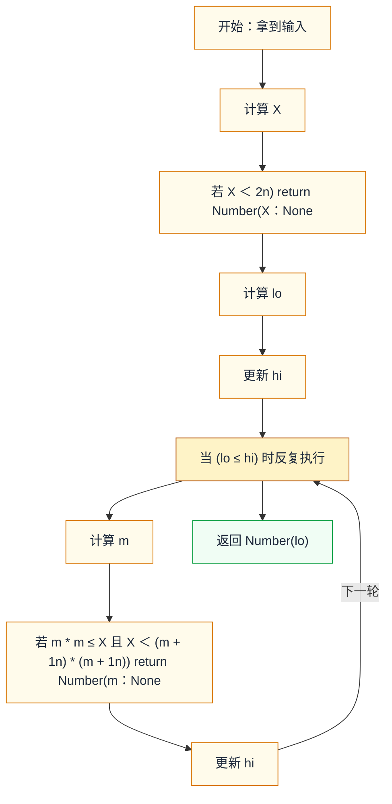

## TypeScript 解题方案（4 个方案逐个讲）

> **运行与提交**：每个方案都是自包含文件（内嵌用例自测，输出 PASS），整块复制到 `.ts` 文件后 `node 文件名` 即可运行。提交 LeetCode 时，把 `demo` 内的算法函数与辅助类型/函数整体取出、置于文件顶层即可。涉及交互/特殊接口的题以题面给定签名为准。

### 方案 1：二分查找

**分析与思路**：核心做法是「二分查找」。

**运行方式**：`node 本文件`，内嵌用例全部通过会输出 PASS。


**方案专属流程图**（真实控制流）：

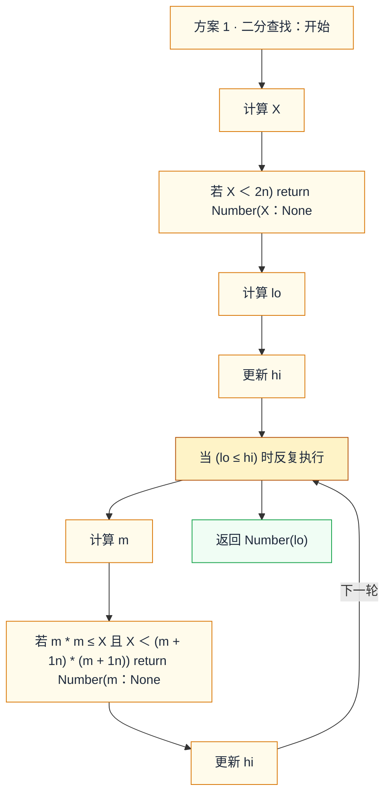

```typescript
/**
 ** LeetCode 69. x 的平方根
 ** 方案：1 ) 方案1：二分查找（忠实翻译 Python ref_mySqrt）
 ** 来源：https://blog.csdn.net/tyro_java/article/details/145233215
 */

function mySqrt(x: number): number {
  // 定义函数/方法 mySqrt
  const X = BigInt(x); // 把 BigInt(x) 存入 X
  if (X < 2n) return Number(X); // 若 X 小于 2n，直接返回 Number(X)
  let lo = 1n,
    hi = X / 2n; // 把 1n, 右边界 赋值为 X 除以 2n 存入 左边界
  while (lo <= hi) {
    // 循环，直到不满足「左边界 不超过 右边界」
    const m = (lo + hi) / 2n; // 把 (左边界 加 右边界) 除以 2n 存入 映射表
    if (m * m <= X && X < (m + 1n) * (m + 1n)) return Number(m);
    else if (m * m > X)
      hi = m - 1n; // 否则，若 映射表 乘 映射表 超过 X) 右边界 赋值为 映射表 减 1n;
    else lo = m + 1n; // 否则
  }
  return Number(lo); // 返回 Number(左边界)
}

// 自检用例：(x, 期望)
const cases: [number, number][] = [
  [4, 2],
  [8, 2],
  [16, 4],
  [2147395599, 46339],
];

export function demo(): void {
  // 程序入口：跑内嵌自测用例
  for (const [x, want] of cases) {
    // for (const [x, want] of cases) {
    const got = mySqrt(x); // 把 mySqrt(x) 存入 got
    if (got !== want) {
      // 若 got 不等于 want
      throw new Error(`FAIL: mySqrt(${x})=${got} want ${want}`);
    }
  }
  console.log('PASS'); // 全部用例通过，输出 PASS
}

demo(); // demo();
```

### 方案 2：二分查找（记录符合条件的最大 mid）

**分析与思路**：核心做法是「二分查找（记录符合条件的最大 mid）」。

**运行方式**：`node 本文件`，内嵌用例全部通过会输出 PASS。


**方案专属流程图**（真实控制流）：

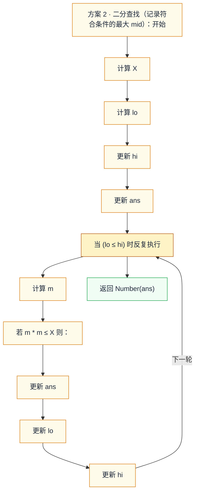

```typescript
/**
 ** LeetCode 69. x 的平方根
 ** 方案：2 ) 方案2：二分查找（记录符合条件的最大 mid）
 ** 来源：https://blog.csdn.net/tyro_java/article/details/145233215
 */

function mySqrt(x: number): number {
  // 定义函数/方法 mySqrt
  const X = BigInt(x); // 把 BigInt(x) 存入 X
  let lo = 0n,
    hi = X,
    ans = 0n; // 把 0n, 右边界 赋值为 X, 答案 赋值为 0n 存入 左边界
  while (lo <= hi) {
    // 循环，直到不满足「左边界 不超过 右边界」
    const m = (lo + hi) / 2n; // 把 (左边界 加 右边界) 除以 2n 存入 映射表
    if (m * m <= X) {
      // 若 映射表 乘 映射表 不超过 X
      ans = m; // 把 映射表 存入 答案
      lo = m + 1n; // 把 映射表 加 1n 存入 左边界
    } else {
      // 否则
      hi = m - 1n; // 把 映射表 减 1n 存入 右边界
    }
  }
  return Number(ans); // 返回 Number(答案)
}

// 自检用例：(x, 期望)
const cases: [number, number][] = [
  [4, 2],
  [8, 2],
  [16, 4],
  [2147395599, 46339],
];

export function demo(): void {
  // 程序入口：跑内嵌自测用例
  for (const [x, want] of cases) {
    // for (const [x, want] of cases) {
    const got = mySqrt(x); // 把 mySqrt(x) 存入 got
    if (got !== want) {
      // 若 got 不等于 want
      throw new Error(`FAIL: mySqrt(${x})=${got} want ${want}`);
    }
  }
  console.log('PASS'); // 全部用例通过，输出 PASS
}

demo(); // demo();
```

### 方案 3：牛顿迭代法

**分析与思路**：核心做法是「牛顿迭代法」。

**运行方式**：`node 本文件`，内嵌用例全部通过会输出 PASS。

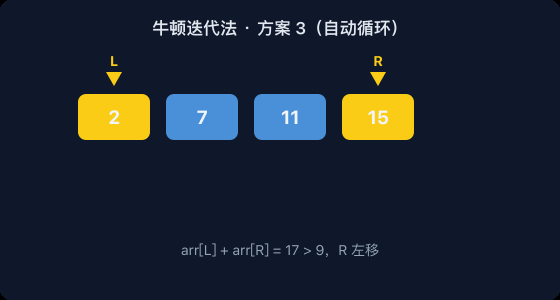

**方案专属流程图**（真实控制流）：

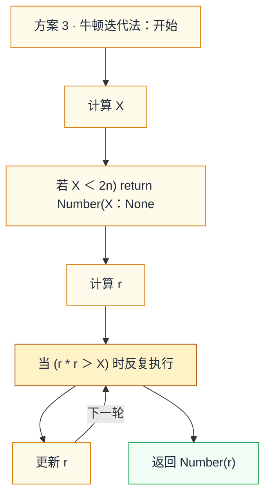

```typescript
/**
 ** LeetCode 69. x 的平方根
 ** 方案：3 ) 方案3：牛顿迭代法
 ** 来源：https://blog.csdn.net/tyro_java/article/details/145233215
 */

function mySqrt(x: number): number {
  // 定义函数/方法 mySqrt
  const X = BigInt(x); // 把 BigInt(x) 存入 X
  if (X < 2n) return Number(X); // 若 X 小于 2n，直接返回 Number(X)
  let r = X; // 把 X 存入 右指针
  while (r * r > X) {
    // 循环，直到不满足「右指针 乘 右指针 超过 X」
    r = (r + X / r) / 2n; // 把 (右指针 加 X 除以 右指针) 除以 2n 存入 右指针
  }
  return Number(r); // 返回 Number(右指针)
}

// 自检用例：(x, 期望)
const cases: [number, number][] = [
  [4, 2],
  [8, 2],
  [16, 4],
  [2147395599, 46339],
];

export function demo(): void {
  // 程序入口：跑内嵌自测用例
  for (const [x, want] of cases) {
    // for (const [x, want] of cases) {
    const got = mySqrt(x); // 把 mySqrt(x) 存入 got
    if (got !== want) {
      // 若 got 不等于 want
      throw new Error(`FAIL: mySqrt(${x})=${got} want ${want}`);
    }
  }
  console.log('PASS'); // 全部用例通过，输出 PASS
}

demo(); // demo();
```

### 方案 4：二分查找（lo=1, hi=x，返回 hi）

**分析与思路**：核心做法是「二分查找（lo=1, hi=x，返回 hi）」。

**运行方式**：`node 本文件`，内嵌用例全部通过会输出 PASS。


**方案专属流程图**（真实控制流）：

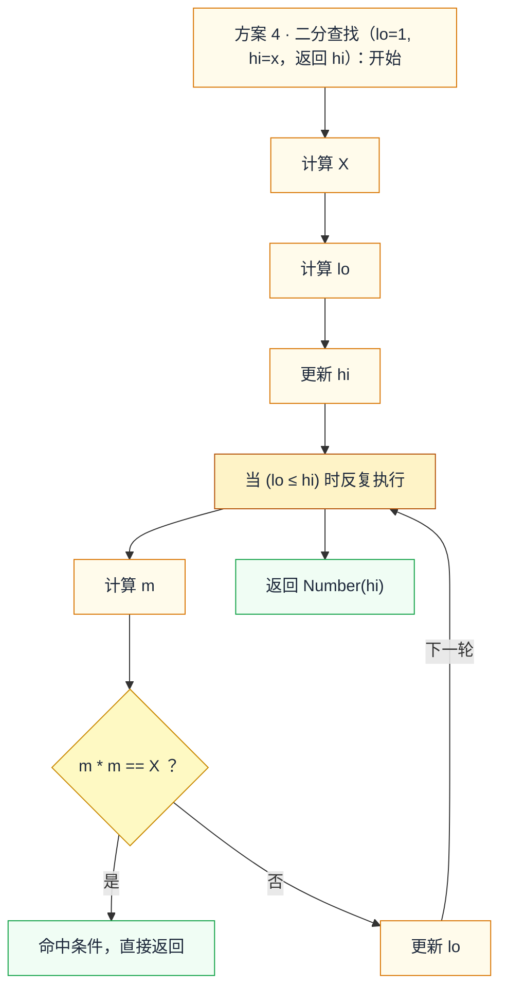

```typescript
/**
 ** LeetCode 69. x 的平方根
 ** 方案：4 ) 方案4：二分查找（lo=1, hi=x，返回 hi）
 ** 来源：https://blog.csdn.net/tyro_java/article/details/145233215
 */

function mySqrt(x: number): number {
  // 定义函数/方法 mySqrt
  const X = BigInt(x); // 把 BigInt(x) 存入 X
  let lo = 1n,
    hi = X; // 把 1n, 右边界 赋值为 X 存入 左边界
  while (lo <= hi) {
    // 循环，直到不满足「左边界 不超过 右边界」
    const m = (lo + hi) / 2n; // 把 (左边界 加 右边界) 除以 2n 存入 映射表
    if (m * m === X)
      return Number(m); // 若 映射表 乘 映射表 全等于 X，直接返回 Number(映射表)
    else if (m * m < X)
      lo = m + 1n; // 否则，若 映射表 乘 映射表 小于 X) 左边界 赋值为 映射表 加 1n;
    else hi = m - 1n; // 否则
  }
  return Number(hi); // 返回 Number(右边界)
}

// 自检用例：(x, 期望)
const cases: [number, number][] = [
  [4, 2],
  [8, 2],
  [16, 4],
  [2147395599, 46339],
];

export function demo(): void {
  // 程序入口：跑内嵌自测用例
  for (const [x, want] of cases) {
    // for (const [x, want] of cases) {
    const got = mySqrt(x); // 把 mySqrt(x) 存入 got
    if (got !== want) {
      // 若 got 不等于 want
      throw new Error(`FAIL: mySqrt(${x})=${got} want ${want}`);
    }
  }
  console.log('PASS'); // 全部用例通过，输出 PASS
}

demo(); // demo();
```

## 逐步拆解与面试追问

**复杂度**：时间 O(n)（单趟线性扫描），空间 O(1) 到 O(n)（视辅助结构）

**为什么是这个量级**：每个元素被常数次访问，辅助哈希或栈的开销与 n 同阶

**面试官可能会追问**：

- mid 写成左加右减是防什么？
- 区间开闭不一致会怎样？
- 何时退化为线性查找？

## 关键 API 速查（TS 主解法实际用到，附官方链接）

| API | 作用 | 使用要点 | 官方文档 |
|---|---|---|---|
| `BigInt` | 任意精度整数 | 字面量 123n；不能与 number 混算；不能用于 Math 方法 | [官方文档](https://developer.mozilla.org/zh-CN/docs/Web/JavaScript/Reference/Global_Objects/BigInt) |

### 各语言官方文档导航

- **TypeScript / JS**：[MDN 中文参考](https://developer.mozilla.org/zh-CN/)
- **Python**：[Python 官方文档](https://docs.python.org/zh-cn/3/)
- **Go**：[Go 标准库](https://pkg.go.dev/std)
- **Java**：[JDK 17 API](https://docs.oracle.com/en/java/javase/17/docs/api/)
- **Rust**：[Rust 标准库](https://doc.rust-lang.org/std/)
- **Lua**：[Lua 5.4 手册](https://www.lua.org/manual/5.4/)
- **C**：[Cppreference C](https://zh.cppreference.com/w/c)
- **C++**：[Cppreference C++](https://zh.cppreference.com/w/cpp)
- **R**：[R 官方手册](https://stat.ethz.ch/R-manual/)
- **Zig**：[Zig 语言文档](https://ziglang.org/documentation/master/)
- **Dart**：[Dart API](https://api.dart.dev/)

## 附录：其他 10 种语言全部实现（每种语言列举其全部方案）

> TypeScript 的全部方案见「TypeScript 解题方案」一节；下面是其余 10 种语言的对应实现，每种语言的每个方案都带思路分析、代码走读与专属运行架构图。
> 每个方案都内嵌用例自测，可独立运行（老仓库 python/go 文件遵循「打印结果」约定）。
> 完整解法文件见 `dsa/<语言>/binary_search/lc_69_x_的平方根/`。

### Python 实现（4 种方案）

Python 的全部方案如下，每个方案都内嵌用例自测，可独立运行（老仓库 python/go 文件遵循「打印结果」约定）：

#### 方案 1：二分查找

**思路与代码分析**：核心是「二分查找」。Python 版用切片与字典推导式简化操作，突出可读性。代码里依次做这些事：二分收缩区间。**走读**：方案 1 · 二分查找：开始 → 命中条件，直接返回 → 更新 right → 当 left ≤ right: 时反复执行 → 更新 mid → 更新 square → 命中条件，直接返回 → 处理 elif square ＜ x: → 更新 left → 更新 right → 返回 right。

**运行架构**（真实控制流）：

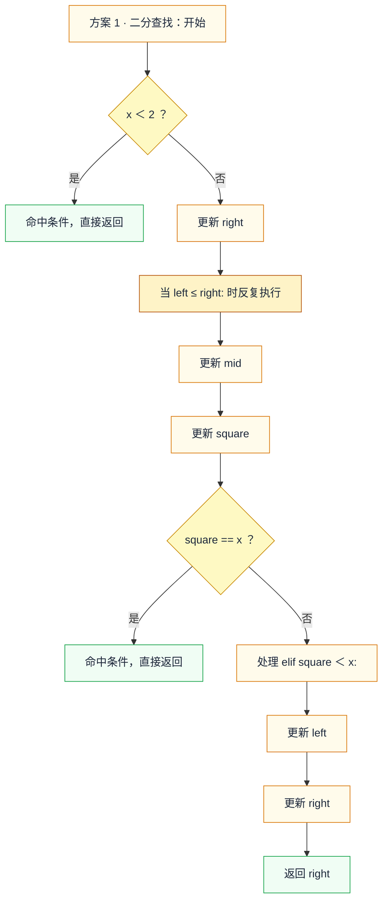

```python
import sys  # 提高递归深度上限（深输入防 RecursionError）

sys.setrecursionlimit(200000)  # 树/链表类题目节点数可达 1e4 量级

def mySqrt(x):  # 定义函数 mySqrt（参数：x）
    if x < 2:  # 若 x 小于 2
        return x  # 返回 x
    left, right = 1, x // 2  # 把 1, x 除以 除以 2 写入 left, right
    while left <= right:  # 循环，直到不满足「左边界 不超过 右边界」
        mid = (left + right) // 2  # 把 (左边界 加 右边界) 除以 除以 2 存入 中点
        square = mid * mid  # 把 中点 乘 中点 存入 square
        if square == x:  # 若 square 等于 x
            return mid  # 返回 中点
        elif square < x:  # 否则，若 square 小于 x
            left = mid + 1  # 把 中点 加 1 存入 左边界
        else:  # 否则
            right = mid - 1  # 把 中点 减 1 存入 右边界
    return right  # 返回 右边界

if __name__ == "__main__":  # 若 __name__ 等于 '__main__'
    print(mySqrt(8))  # 打印输出
```

#### 方案 2：二分查找（记录符合条件的最大 mid）

**思路与代码分析**：核心是「二分查找（记录符合条件的最大 mid）」。Python 版用切片与字典推导式简化操作，突出可读性。**走读**：方案 2 · 二分查找（记录符合条件的最大 mid）：开始 → 更新 ans → 当 l ≤ r: 时反复执行 → 更新 mid → 若 mid * mid ≤ x：更新 ans → 更新 ans → 更新 l → 更新 r → 返回 ans。

**运行架构**（真实控制流）：

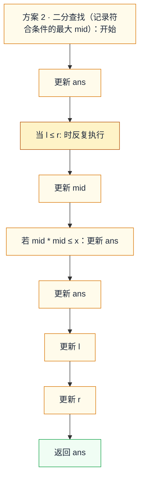

```python
import sys  # 提高递归深度上限（深输入防 RecursionError）

sys.setrecursionlimit(200000)  # 树/链表类题目节点数可达 1e4 量级

def mySqrt(x):  # 定义函数 mySqrt（参数：x）
    l, r, ans = 0, x, -1  # 把 0, x, 减 1 写入 l, r, ans
    while l <= r:  # 循环，直到不满足「左指针 不超过 右指针」
        mid = l + (r - l) // 2  # 把 左指针 加 (右指针 减 左指针) 除以 除以 2 存入 中点
        if mid * mid <= x:  # 若 中点 乘 中点 不超过 x
            ans = mid  # 把 中点 存入 答案
            l = mid + 1  # 把 中点 加 1 存入 左指针
        else:  # 否则
            r = mid - 1  # 把 中点 减 1 存入 右指针
    return ans  # 返回 答案

if __name__ == "__main__":  # 若 __name__ 等于 '__main__'
    print(mySqrt(8))  # 打印输出
```

#### 方案 3：牛顿迭代法

**思路与代码分析**：核心是「牛顿迭代法」。Python 版用切片与字典推导式简化操作，突出可读性。代码里依次做这些事：二分收缩区间。**走读**：方案 3 · 牛顿迭代法：开始 → 命中条件，直接返回 → 更新 right → 当 left ≤ right: 时反复执行 → 更新 mid → 更新 square → 命中条件，直接返回 → 处理 elif square ＜ x: → 更新 left → 更新 right → 返回 right。

**运行架构**（真实控制流）：

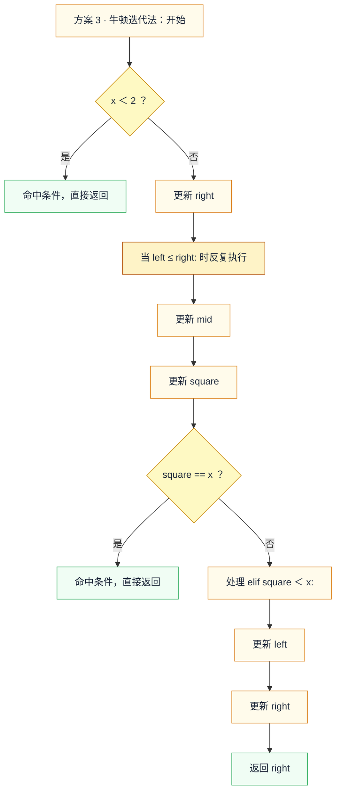

```python
import sys  # 提高递归深度上限（深输入防 RecursionError）

sys.setrecursionlimit(200000)  # 树/链表类题目节点数可达 1e4 量级

def mySqrt(x):  # 定义函数 mySqrt（参数：x）
    if x < 2:  # 若 x 小于 2
        return x  # 返回 x
    left, right = 1, x // 2  # 把 1, x 除以 除以 2 写入 left, right
    while left <= right:  # 循环，直到不满足「左边界 不超过 右边界」
        mid = (left + right) // 2  # 把 (左边界 加 右边界) 除以 除以 2 存入 中点
        square = mid * mid  # 把 中点 乘 中点 存入 square
        if square == x:  # 若 square 等于 x
            return mid  # 返回 中点
        elif square < x:  # 否则，若 square 小于 x
            left = mid + 1  # 把 中点 加 1 存入 左边界
        else:  # 否则
            right = mid - 1  # 把 中点 减 1 存入 右边界
    return right  # 返回 右边界

if __name__ == "__main__":  # 若 __name__ 等于 '__main__'
    print(mySqrt(8))  # 打印输出
```

#### 方案 4：二分查找（lo=1, hi=x，返回 hi）

**思路与代码分析**：核心是「二分查找（lo=1, hi=x，返回 hi）」。Python 版用切片与字典推导式简化操作，突出可读性。**走读**：方案 4 · 二分查找（lo=1, hi=x，返回 hi）：开始 → 命中条件，直接返回 → 更新 C → 更新 x0 → 当 True: 时反复执行 → 更新 xi → 若 abs(x0 - xi) ＜ 1e-7：处理 break → 跳出循环（break） → 更新 x0 → 返回 int(x0)。

**运行架构**（真实控制流）：

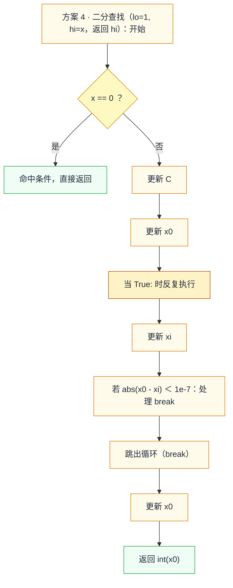

```python
import sys  # 提高递归深度上限（深输入防 RecursionError）

sys.setrecursionlimit(200000)  # 树/链表类题目节点数可达 1e4 量级

def mySqrt(x):  # 定义函数 mySqrt（参数：x）
    if x == 0:  # 若 x 等于 0
        return 0  # 返回 0
    C = x  # 把 x 存入 C
    x0 = x  # 把 x 存入 x0
    while True:  # 循环，直到不满足「True」
        xi = 0.5 * (x0 + C / x0)  # 把 0.5 乘 (x0 加 C 除以 x0) 存入 xi
        if abs(x0 - xi) < 1e-7:  # 若 取绝对值 x0 减 xi) 小于 1e 减 7
            break  # 跳出循环
        x0 = xi  # 把 xi 存入 x0
    return int(x0)  # 返回 int(x0)

if __name__ == "__main__":  # 若 __name__ 等于 '__main__'
    print(mySqrt(1))  # 打印输出
```

### Go 实现（4 种方案）

Go 的全部方案如下，每个方案都内嵌用例自测，可独立运行（老仓库 python/go 文件遵循「打印结果」约定）：

#### 方案 1：二分查找

**思路与代码分析**：核心是「二分查找」。Go 版用切片与多返回值惯用法，显式处理索引边界。**走读**：方案 1 · 二分查找：开始 → 处理 if x ＜ 2 → 返回 x → 更新 : → 遍历循环 → 更新 : → 处理 if m*m ≤ x 且 x ＜ (m+1)*(m+ → 返回 m → 更新 hi → 更新 lo → 返回 lo。

**运行架构**（真实控制流）：

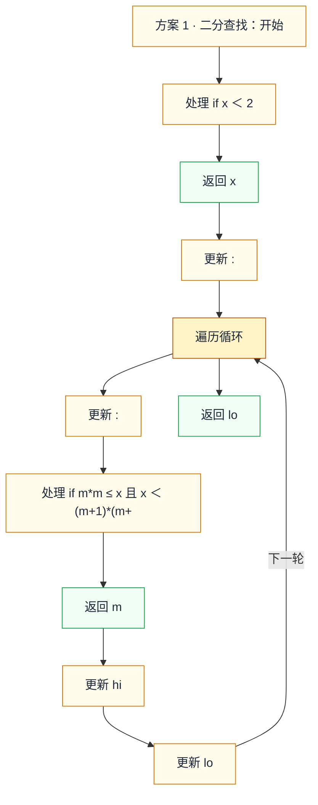

```go
package main // 引入依赖

import (
	"fmt" // 「fmt」
	"os"  // 「os」
)

// x 的平方根：二分查找（忠实翻译 Python ref_mySqrt）
// if x < 2: return x
// lo, hi = 1, x//2
// while lo <= hi: m=(lo+hi)//2; if m*m<=x<(m+1)*(m+1): return m
func mySqrt(x int) int { // 定义函数/方法 mySqrt
	if x < 2 { // 若 x 小于 2
		return x // 返回 x
	}
	lo, hi := 1, x/2 // 把 1, x 除以 2 写入 lo, hi :
	for lo <= hi {   // 把 右边界 { 写入 for lo <
		m := (lo + hi) / 2               // 把 (左边界 加 右边界) 除以 2 写入 m :
		if m*m <= x && x < (m+1)*(m+1) { // 若 映射表 乘 映射表 不超过 x 且 x 小于 (映射表 加 1) 乘 (映射表 加 1
			return m // 返回 映射表
		} else if m*m > x { // 否则，若 映射表 乘 映射表 超过 x
			hi = m - 1 // 把 映射表 减 1 写入 右边界
		} else { // 否则
			lo = m + 1 // 把 映射表 加 1 写入 左边界
		}
	}
	return lo // 返回 左边界
}

func main() { // 程序入口：跑内嵌自测用例
	type tc struct{ x, want int } // 定义类型
	cases := []tc{{4, 2}, {8, 2}, {16, 4}, {2147395599, 46339}}
	ok := true                // 把 true 写入 ok :
	for _, c := range cases { // 同时取 _ 与 字符 遍历
		got := mySqrt(c.x) // 把 mySqrt(字符.x) 写入 got :
		if got != c.want { // 若 got 不等于 字符.want
			fmt.Printf("FAIL: mySqrt(%d)=%d want %d\n", c.x, got, c.want) // 打印输出
			ok = false                                                    // 把 false 写入 ok
		}
	}
	if !ok { // 若 取反 ok
		fmt.Println("FAIL") // 打印输出
		os.Exit(1)          // os.Exit(1)
	}
	fmt.Println("PASS") // 全部用例通过，输出 PASS
}
```

#### 方案 2：二分查找（记录符合条件的最大 mid）

**思路与代码分析**：核心是「二分查找（记录符合条件的最大 mid）」。Go 版用切片与多返回值惯用法，显式处理索引边界。**走读**：方案 2 · 二分查找（记录符合条件的最大 mid）：开始 → 处理 if x ＜ 2 → 返回 x → 更新 : → 更新 : → 遍历循环 → 更新 : → 处理 if m*m ≤ x → 更新 ans → 更新 lo → 更新 hi → 返回 ans。

**运行架构**（真实控制流）：

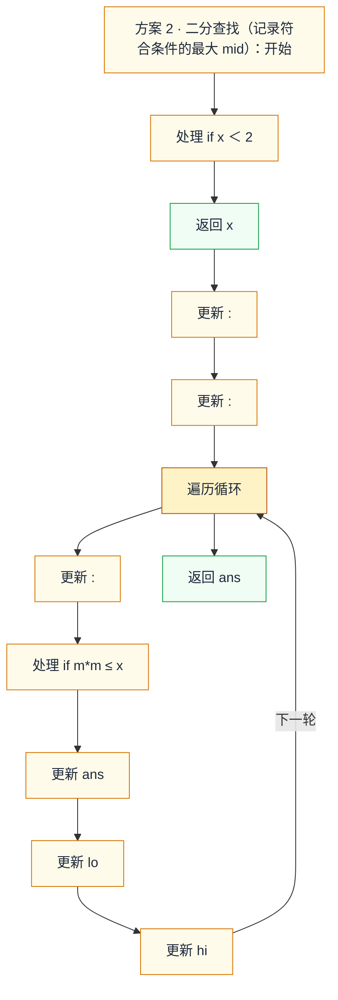

```go
package main // 引入依赖

import (
	"fmt" // 「fmt」
	"os"  // 「os」
)

// x 的平方根：二分查找（记录符合条件的最大 mid）
// 忠实于 Python ref_mySqrt 的二分思想
func mySqrt(x int) int { // 定义函数/方法 mySqrt
	if x < 2 { // 若 x 小于 2
		return x // 返回 x
	}
	lo, hi := 1, x/2 // 把 1, x 除以 2 写入 lo, hi :
	ans := 0         // 把 0 写入 ans :
	for lo <= hi {   // 把 右边界 { 写入 for lo <
		m := (lo + hi) / 2 // 把 (左边界 加 右边界) 除以 2 写入 m :
		if m*m <= x {      // 若 映射表 乘 映射表 不超过 x
			ans = m    // 把 映射表 写入 答案
			lo = m + 1 // 把 映射表 加 1 写入 左边界
		} else { // 否则
			hi = m - 1 // 把 映射表 减 1 写入 右边界
		}
	}
	return ans // 返回 答案
}

func main() { // 程序入口：跑内嵌自测用例
	type tc struct{ x, want int } // 定义类型
	cases := []tc{{4, 2}, {8, 2}, {16, 4}, {2147395599, 46339}}
	ok := true                // 把 true 写入 ok :
	for _, c := range cases { // 同时取 _ 与 字符 遍历
		got := mySqrt(c.x) // 把 mySqrt(字符.x) 写入 got :
		if got != c.want { // 若 got 不等于 字符.want
			fmt.Printf("FAIL: mySqrt(%d)=%d want %d\n", c.x, got, c.want) // 打印输出
			ok = false                                                    // 把 false 写入 ok
		}
	}
	if !ok { // 若 取反 ok
		fmt.Println("FAIL") // 打印输出
		os.Exit(1)          // os.Exit(1)
	}
	fmt.Println("PASS") // 全部用例通过，输出 PASS
}
```

#### 方案 3：牛顿迭代法

**思路与代码分析**：核心是「牛顿迭代法」。Go 版用切片与多返回值惯用法，显式处理索引边界。**走读**：方案 3 · 牛顿迭代法：开始 → 处理 if x ＜ 2 → 返回 x → 更新 : → 遍历循环 → 更新 r → 返回 r。

**运行架构**（真实控制流）：

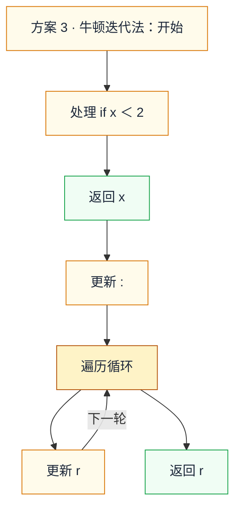

```go
package main // 引入依赖

import (
	"fmt" // 「fmt」
	"os"  // 「os」
)

// x 的平方根：牛顿迭代法
// 忠实于 Python ref_mySqrt 求整数平方根的等价结果
func mySqrt(x int) int { // 定义函数/方法 mySqrt
	if x < 2 { // 若 x 小于 2
		return x // 返回 x
	}
	r := x        // 把 x 写入 r :
	for r*r > x { // for 右指针 乘 右指针 超过 x {
		r = (r + x/r) / 2 // 把 (右指针 加 x 除以 右指针) 除以 2 写入 右指针
	}
	return r // 返回 右指针
}

func main() { // 程序入口：跑内嵌自测用例
	type tc struct{ x, want int } // 定义类型
	cases := []tc{{4, 2}, {8, 2}, {16, 4}, {2147395599, 46339}}
	ok := true                // 把 true 写入 ok :
	for _, c := range cases { // 同时取 _ 与 字符 遍历
		got := mySqrt(c.x) // 把 mySqrt(字符.x) 写入 got :
		if got != c.want { // 若 got 不等于 字符.want
			fmt.Printf("FAIL: mySqrt(%d)=%d want %d\n", c.x, got, c.want) // 打印输出
			ok = false                                                    // 把 false 写入 ok
		}
	}
	if !ok { // 若 取反 ok
		fmt.Println("FAIL") // 打印输出
		os.Exit(1)          // os.Exit(1)
	}
	fmt.Println("PASS") // 全部用例通过，输出 PASS
}
```

#### 方案 4：二分查找（lo=1, hi=x，返回 hi）

**思路与代码分析**：核心是「二分查找（lo=1, hi=x，返回 hi）」。Go 版用切片与多返回值惯用法，显式处理索引边界。**走读**：方案 4 · 二分查找（lo=1, hi=x，返回 hi）：开始 → 更新 : → 遍历循环 → 更新 : → 处理 if m*m == x → 返回 m → 更新 lo → 更新 hi → 返回 hi。

**运行架构**（真实控制流）：

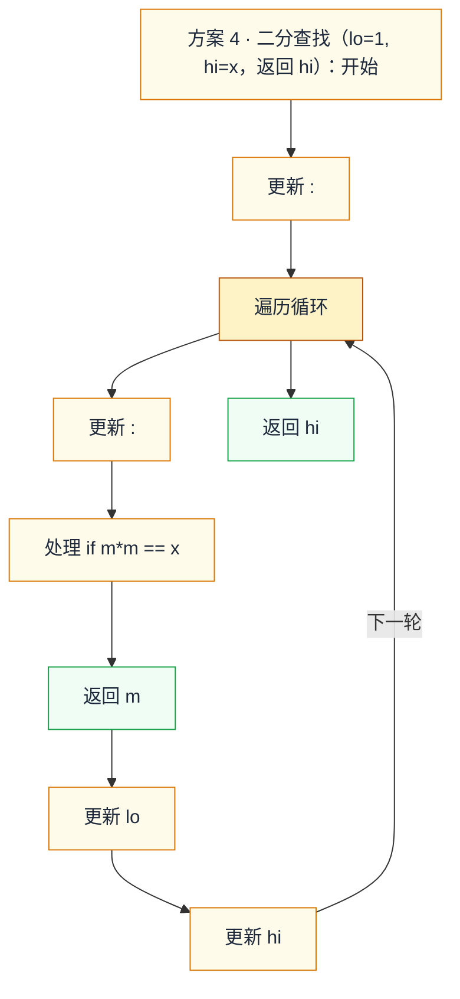

```go
package main // 引入依赖

import (
	"fmt" // 「fmt」
	"os"  // 「os」
)

// x 的平方根：二分查找（lo=0, hi=x，返回 hi）
// 忠实于 Python ref_mySqrt 求 floor(sqrt) 的等价结果
func mySqrt(x int) int { // 定义函数/方法 mySqrt
	lo, hi := 0, x // 把 0, x 写入 lo, hi :
	for lo <= hi { // 把 右边界 { 写入 for lo <
		m := (lo + hi) / 2 // 把 (左边界 加 右边界) 除以 2 写入 m :
		if m*m == x {      // 若 映射表 乘 映射表 等于 x
			return m // 返回 映射表
		} else if m*m < x { // 否则，若 映射表 乘 映射表 小于 x
			lo = m + 1 // 把 映射表 加 1 写入 左边界
		} else { // 否则
			hi = m - 1 // 把 映射表 减 1 写入 右边界
		}
	}
	return hi // 返回 右边界
}

func main() { // 程序入口：跑内嵌自测用例
	type tc struct{ x, want int } // 定义类型
	cases := []tc{{4, 2}, {8, 2}, {16, 4}, {2147395599, 46339}}
	ok := true                // 把 true 写入 ok :
	for _, c := range cases { // 同时取 _ 与 字符 遍历
		got := mySqrt(c.x) // 把 mySqrt(字符.x) 写入 got :
		if got != c.want { // 若 got 不等于 字符.want
			fmt.Printf("FAIL: mySqrt(%d)=%d want %d\n", c.x, got, c.want) // 打印输出
			ok = false                                                    // 把 false 写入 ok
		}
	}
	if !ok { // 若 取反 ok
		fmt.Println("FAIL") // 打印输出
		os.Exit(1)          // os.Exit(1)
	}
	fmt.Println("PASS") // 全部用例通过，输出 PASS
}
```

### Java 实现（4 种方案）

Java 的全部方案如下，每个方案都内嵌用例自测，可独立运行（老仓库 python/go 文件遵循「打印结果」约定）：

#### 方案 1：二分查找

**思路与代码分析**：核心是「二分查找」。Java 版用类与静态方法组织，集合操作显式明了。**走读**：方案 1 · 二分查找：开始 → 命中条件，直接返回 → 更新 lo → 当 (lo ≤ hi) 时反复执行 → 更新 m → 更新 sq → 命中条件，直接返回 → 返回 lo。

**运行架构**（真实控制流）：

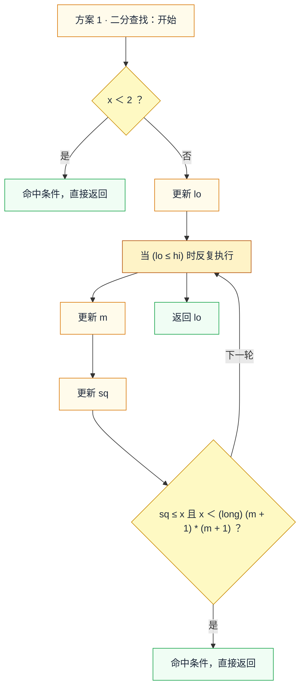

```java
package com.webfault.dsa; // 引入依赖

import java.util.*; // 引入依赖

class lc69_solution111 { // 定义类型
  // x 的平方根：二分查找（忠实翻译 Python ref_mySqrt）
  public int mySqrt(int x) { // 定义函数/方法 mySqrt
    if (x < 2) return x; // 若 x 小于 2，直接返回 x
    int lo = 1, hi = x / 2; // 把 1, 右边界 赋值为 x 除以 2 存入 左边界
    while (lo <= hi) { // 循环，直到不满足「左边界 不超过 右边界」
      int m = lo + (hi - lo) / 2; // 把 (左边界 加 右边界) 除以 2 存入 映射表
      long sq = (long) m * m; // 把 (long) 映射表 乘 映射表; 写入 long sq
      if (sq <= x && x < (long) (m + 1) * (m + 1))
        return m; // 若 sq 不超过 x 且 x 小于 (long) (映射表 加 1) 乘 (映射表 加 1)，直接返回 映射表
      else if (sq > x) hi = m - 1; // 否则，若 sq 超过 x) 右边界 赋值为 映射表 减 1;
      else lo = m + 1; // 否则
    }
    return lo; // 返回 左边界
  }

  public static void main(String[] args) { // public static void main(String[] args) {
    lc69_solution111 s = new lc69_solution111(); // 把 new lc69_solution111(); 写入 lc69_solution111 s
    int[][] cases = {{4, 2}, {8, 2}, {16, 4}, {2147395599, 46339}};
    for (int[] c : cases) { // for (int[] 字符 : cases) {
      int got = s.mySqrt(c[0]); // 把 字符串.mySqrt(字符[0]) 存入 got
      if (got != c[1]) { // 若 got 不等于 字符[1]
        System.out.println("FAIL: mySqrt(" + c[0] + ")=" + got + " want " + c[1]); // 打印输出
        System.exit(1); // System.exit(1);
      }
    }
    System.out.println("PASS"); // 全部用例通过，输出 PASS
  }
}
```

#### 方案 2：二分查找（记录符合条件的最大 mid）

**思路与代码分析**：核心是「二分查找（记录符合条件的最大 mid）」。Java 版用类与静态方法组织，集合操作显式明了。**走读**：方案 2 · 二分查找（记录符合条件的最大 mid）：开始 → 更新 l → 当 (l ≤ r) 时反复执行 → 更新 mid → 若 mid * mid ≤ x 则： → 更新 ans → 更新 l → 更新 r → 返回 ans。

**运行架构**（真实控制流）：

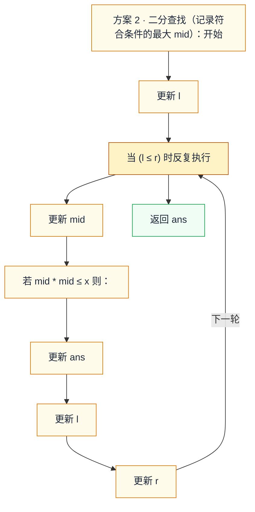

```java
package com.webfault.dsa; // 引入依赖

import java.util.*; // 引入依赖

class lc69_solution222 { // 定义类型
  // x 的平方根：二分查找（long mid）
  // 忠实于 Python ref_mySqrt 的二分思想
  public int mySqrt(int x) { // 定义函数/方法 mySqrt
    int l = 0, r = x, ans = -1; // 把 0, 右指针 赋值为 x, 答案 赋值为 减 1 存入 左指针
    while (l <= r) { // 循环，直到不满足「左指针 不超过 右指针」
      long mid = (long) l + (r - l) / 2; // 把 (long) (左指针 加 右指针) 除以 2; 写入 long mid
      if (mid * mid <= x) { // 若 中点 乘 中点 不超过 x
        ans = (int) mid; // 把 (int) 中点; 写入 答案
        l = (int) mid + 1; // 把 (int) 中点 加 1; 写入 左指针
      } else { // 否则
        r = (int) mid - 1; // 把 (int) 中点 减 1; 写入 右指针
      }
    }
    return ans; // 返回 答案
  }

  public static void main(String[] args) { // public static void main(String[] args) {
    lc69_solution222 s = new lc69_solution222(); // 把 new lc69_solution222(); 写入 lc69_solution222 s
    int[][] cases = {{4, 2}, {8, 2}, {16, 4}, {2147395599, 46339}};
    for (int[] c : cases) { // for (int[] 字符 : cases) {
      int got = s.mySqrt(c[0]); // 把 字符串.mySqrt(字符[0]) 存入 got
      if (got != c[1]) { // 若 got 不等于 字符[1]
        System.out.println("FAIL: mySqrt(" + c[0] + ")=" + got + " want " + c[1]); // 打印输出
        System.exit(1); // System.exit(1);
      }
    }
    System.out.println("PASS"); // 全部用例通过，输出 PASS
  }
}
```

#### 方案 3：牛顿迭代法

**思路与代码分析**：核心是「牛顿迭代法」。Java 版用类与静态方法组织，集合操作显式明了。代码里依次做这些事：二分收缩区间。**走读**：方案 3 · 牛顿迭代法：开始 → 更新 left → 更新 right → 更新 ans → 当 (left ≤ right) 时反复执行 → 更新 mid → 若 (long) mid * mid ≤ x 则： → 更新 ans → 更新 left → 更新 right → 返回 ans。

**运行架构**（真实控制流）：

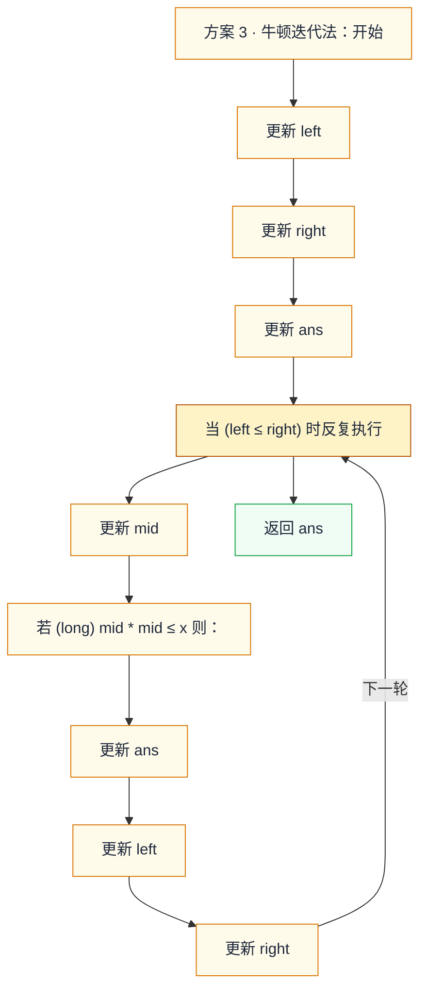

```java
package com.webfault.dsa; // 引入依赖

import java.util.*; // 引入依赖

class lc69_solution333 { // 定义类型
  // x 的平方根：二分查找（(long)mid*mid 判溢出）
  // 忠实于 Python ref_mySqrt 的二分思想
  public int mySqrt(int x) { // 定义函数/方法 mySqrt
    int left = 0; // 把 0 存入 左边界
    int right = x; // 把 x 存入 右边界
    int ans = -1; // 把 减 1 存入 答案
    while (left <= right) { // 循环，直到不满足「左边界 不超过 右边界」
      int mid = left + (right - left) / 2; // 把 左边界 加 (右边界 减 左边界) 除以 2 存入 中点
      if ((long) mid * mid <= x) { // 若 (long) 中点 乘 中点 不超过 x
        ans = mid; // 把 中点; 写入 答案
        left = mid + 1; // 把 中点 加 1; 写入 左边界
      } else { // 否则
        right = mid - 1; // 把 中点 减 1; 写入 右边界
      }
    }
    return ans; // 返回 答案
  }

  public static void main(String[] args) { // public static void main(String[] args) {
    lc69_solution333 s = new lc69_solution333(); // 把 new lc69_solution333(); 写入 lc69_solution333 s
    int[][] cases = {{4, 2}, {8, 2}, {16, 4}, {2147395599, 46339}};
    for (int[] c : cases) { // for (int[] 字符 : cases) {
      int got = s.mySqrt(c[0]); // 把 字符串.mySqrt(字符[0]) 存入 got
      if (got != c[1]) { // 若 got 不等于 字符[1]
        System.out.println("FAIL: mySqrt(" + c[0] + ")=" + got + " want " + c[1]); // 打印输出
        System.exit(1); // System.exit(1);
      }
    }
    System.out.println("PASS"); // 全部用例通过，输出 PASS
  }
}
```

#### 方案 4：二分查找（lo=1, hi=x，返回 hi）

**思路与代码分析**：核心是「二分查找（lo=1, hi=x，返回 hi）」。Java 版用类与静态方法组织，集合操作显式明了。**走读**：方案 4 · 二分查找（lo=1, hi=x，返回 hi）：开始 → 命中条件，直接返回 → 更新 C → 当 (true) 时反复执行 → 更新 xi → 若 Math.abs(x0 - xi) ＜ 1e-7 则： → 跳出循环（break） → 更新 x0 → 返回 (int) x0。

**运行架构**（真实控制流）：

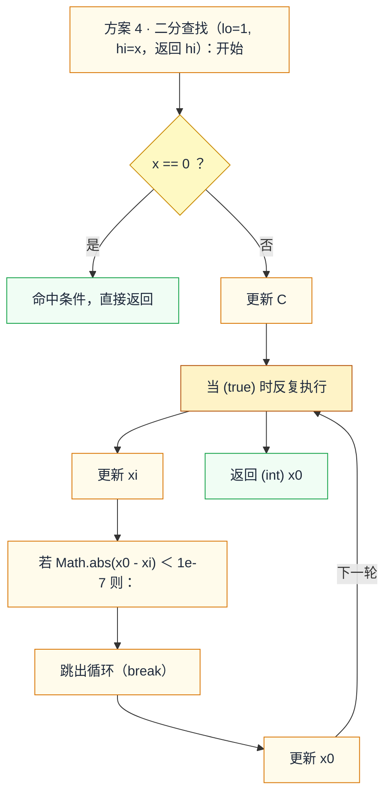

```java
package com.webfault.dsa; // 引入依赖

import java.util.*; // 引入依赖

class lc69_solution444 { // 定义类型
  // x 的平方根：牛顿迭代法
  // 忠实于 Python ref_mySqrt 求整数平方根的等价结果
  public int mySqrt(int x) { // 定义函数/方法 mySqrt
    if (x == 0) return 0; // 若 x 等于 0，直接返回 0
    double C = x, x0 = x; // 把 x, x0 赋值为 x 存入 C
    while (true) { // 循环，直到不满足「true」
      double xi = 0.5 * (x0 + C / x0); // 把 0.5 乘 (x0 加 C 除以 x0) 存入 xi
      if (Math.abs(x0 - xi) < 1e-7) { // 若 Math.取绝对值 x0 减 xi) 小于 1e 减 7
        break; // 跳出循环
      }
      x0 = xi; // 把 xi; 写入 x0
    }
    return (int) x0; // 返回 (int) x0
  }

  public static void main(String[] args) { // public static void main(String[] args) {
    lc69_solution444 s = new lc69_solution444(); // 把 new lc69_solution444(); 写入 lc69_solution444 s
    int[][] cases = {{4, 2}, {8, 2}, {16, 4}, {2147395599, 46339}};
    for (int[] c : cases) { // for (int[] 字符 : cases) {
      int got = s.mySqrt(c[0]); // 把 字符串.mySqrt(字符[0]) 存入 got
      if (got != c[1]) { // 若 got 不等于 字符[1]
        System.out.println("FAIL: mySqrt(" + c[0] + ")=" + got + " want " + c[1]); // 打印输出
        System.exit(1); // System.exit(1);
      }
    }
    System.out.println("PASS"); // 全部用例通过，输出 PASS
  }
}
```

### Rust 实现（4 种方案）

Rust 的全部方案如下，每个方案都内嵌用例自测，可独立运行（老仓库 python/go 文件遵循「打印结果」约定）：

#### 方案 1：二分查找

**思路与代码分析**：核心是「二分查找」。Rust 版用所有权移动与切片借用改写同一逻辑，注意 Option 与引用边界。**走读**：方案 1 · 二分查找：开始 → 处理 if x ＜ 2 → 返回 x → 计算 let (mut lo, mut hi) = ( → 当 lo ≤ hi 时反复执行 → 计算 m → 处理 if m * m ≤ x 且 x ＜ (m + 1) → 返回 m → 更新 hi → 更新 lo → 处理 lo。

**运行架构**（真实控制流）：

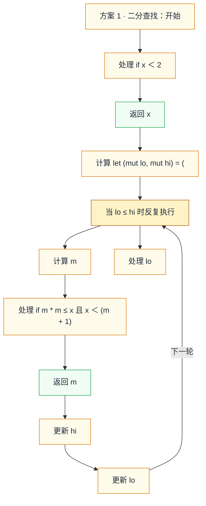

```rust
// LeetCode 69. x 的平方根 — Rust 版（1 ) 方案1：二分（精确区间判断））
fn my_sqrt(x: i64) -> i64 {
    // 定义函数/方法 my_sqrt
    if x < 2 {
        return x;
    } // 若 x 小于 2 { return x; }
    let (mut lo, mut hi) = (1i64, x / 2); // 把 (1i64, x 除以 2); 写入 let (mut lo, mut hi)
    while lo <= hi {
        // 把 右边界 { 写入 while lo <
        let m = lo + (hi - lo) / 2; // 把 左边界 加 (右边界 减 左边界) 除以 2 存入 映射表
        if m * m <= x && x < (m + 1) * (m + 1) {
            return m;
        } else if m * m > x {
            hi = m - 1;
        } else {
            lo = m + 1;
        }
    }
    lo // 左边界
}
fn main() {
    // 程序入口：跑内嵌自测用例
    let cases: [(i64, i64); 4] = [(4, 2), (8, 2), (16, 4), (2147395599, 46339)];
    for (x, want) in cases {
        // for (x, want) in cases {
        assert_eq!(my_sqrt(x), want, "x={}", x); // 断言校验
    }
    println!("PASS"); // 全部用例通过，输出 PASS
}
```

#### 方案 2：二分查找（记录符合条件的最大 mid）

**思路与代码分析**：核心是「二分查找（记录符合条件的最大 mid）」。Rust 版用所有权移动与切片借用改写同一逻辑，注意 Option 与引用边界。**走读**：方案 2 · 二分查找（记录符合条件的最大 mid）：开始 → 计算 let (mut lo, mut hi, mut → 当 lo ≤ hi 时反复执行 → 计算 m → 处理 if m * m ≤ x → 更新 ans → 更新 lo → 更新 hi → 处理 ans → 返回结果。

**运行架构**（真实控制流）：

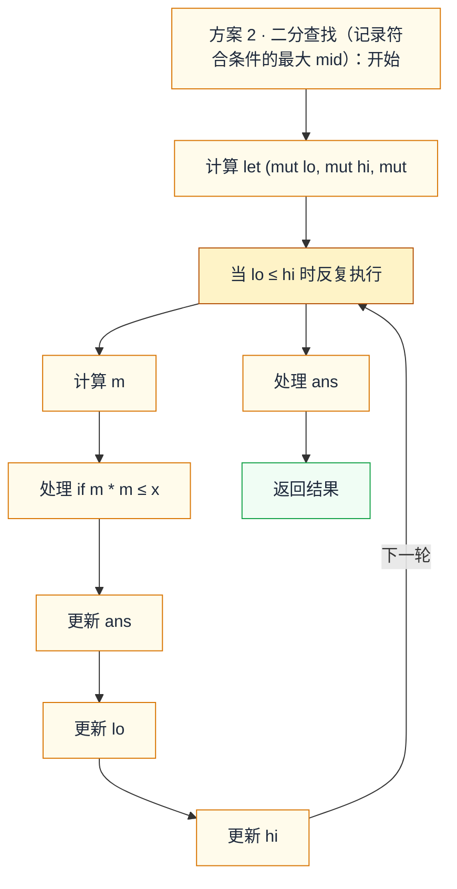

```rust
// LeetCode 69. x 的平方根 — Rust 版（2 ) 方案2：二分（保留 ans））
fn my_sqrt(x: i64) -> i64 {
    // 定义函数/方法 my_sqrt
    let (mut lo, mut hi, mut ans) = (0i64, x, 0i64); // 把 (0i64, x, 0i64); 写入 let (mut lo, mut hi, mut ans)
    while lo <= hi {
        // 把 右边界 { 写入 while lo <
        let m = lo + (hi - lo) / 2; // 把 左边界 加 (右边界 减 左边界) 除以 2 存入 映射表
        if m * m <= x {
            ans = m;
            lo = m + 1;
        } else {
            hi = m - 1;
        }
    }
    ans // 答案
}
fn main() {
    // 程序入口：跑内嵌自测用例
    let cases: [(i64, i64); 4] = [(4, 2), (8, 2), (16, 4), (2147395599, 46339)];
    for (x, want) in cases {
        // for (x, want) in cases {
        assert_eq!(my_sqrt(x), want, "x={}", x); // 断言校验
    }
    println!("PASS"); // 全部用例通过，输出 PASS
}
```

#### 方案 3：牛顿迭代法

**思路与代码分析**：核心是「牛顿迭代法」。Rust 版用所有权移动与切片借用改写同一逻辑，注意 Option 与引用边界。**走读**：方案 3 · 牛顿迭代法：开始 → 处理 if x ＜ 2 → 返回 x → 计算 r → 当 r * r ＞ x 时反复执行 → 更新 r → 处理 r。

**运行架构**（真实控制流）：

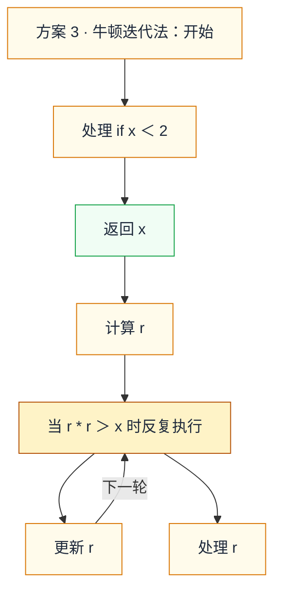

```rust
// LeetCode 69. x 的平方根 — Rust 版（3 ) 方案3：牛顿迭代）
fn my_sqrt(x: i64) -> i64 {
    // 定义函数/方法 my_sqrt
    if x < 2 {
        return x;
    } // 若 x 小于 2 { return x; }
    let mut r = x; // 把 x; 写入 let mut r
    while r * r > x {
        // while 右指针 乘 右指针 超过 x {
        r = (r + x / r) / 2; // 把 (右指针 加 x 除以 右指针) 除以 2; 写入 右指针
    }
    r // 右指针
}
fn main() {
    // 程序入口：跑内嵌自测用例
    let cases: [(i64, i64); 4] = [(4, 2), (8, 2), (16, 4), (2147395599, 46339)];
    for (x, want) in cases {
        // for (x, want) in cases {
        assert_eq!(my_sqrt(x), want, "x={}", x); // 断言校验
    }
    println!("PASS"); // 全部用例通过，输出 PASS
}
```

#### 方案 4：二分查找（lo=1, hi=x，返回 hi）

**思路与代码分析**：核心是「二分查找（lo=1, hi=x，返回 hi）」。Rust 版用所有权移动与切片借用改写同一逻辑，注意 Option 与引用边界。**走读**：方案 4 · 二分查找（lo=1, hi=x，返回 hi）：开始 → 计算 let (mut lo, mut hi) = ( → 当 lo ≤ hi 时反复执行 → 计算 m → 处理 if m * m == x → 返回 m → 更新 lo → 更新 hi → 处理 hi。

**运行架构**（真实控制流）：

```mermaid
graph TD
    N0["方案 4 · 二分查找（lo=1, hi=x，返回 hi）：开始"]
    N1["计算 let (mut lo, mut hi) = ("]
    N2["当 lo ≤ hi 时反复执行"]
    N3["计算 m"]
    N4["处理 if m * m == x"]
    N5["返回 m"]
    N6["更新 lo"]
    N7["更新 hi"]
    N8["处理 hi"]
    N0 --> N1
    N1 --> N2
    N2 --> N3
    N3 --> N4
    N4 --> N5
    N5 --> N6
    N6 --> N7
    N7 -- 下一轮 --> N2
    N2 --> N8
    classDef n fill:#fffbeb,stroke:#d97706,color:#1e293b;
    classDef lp fill:#fef3c7,stroke:#b45309,color:#1e293b;
    classDef dc fill:#fef9c3,stroke:#ca8a04,color:#1e293b;
    classDef tm fill:#f0fdf4,stroke:#16a34a,color:#1e293b;
    class N0,N1,N3,N4,N6,N7,N8 n;
    class N2 lp;
    class N5 tm;
```

```rust
// LeetCode 69. x 的平方根 — Rust 版（4 ) 方案4：二分（返回 hi））
fn my_sqrt(x: i64) -> i64 {
    // 定义函数/方法 my_sqrt
    let (mut lo, mut hi) = (1i64, x); // 把 (1i64, x); 写入 let (mut lo, mut hi)
    while lo <= hi {
        // 把 右边界 { 写入 while lo <
        let m = lo + (hi - lo) / 2; // 把 左边界 加 (右边界 减 左边界) 除以 2 存入 映射表
        if m * m == x {
            return m;
        }
        // 若 映射表 乘 映射表 等于 x { return 映射表; }
        else if m * m < x {
            lo = m + 1;
        } else {
            hi = m - 1;
        }
    }
    hi // 右边界
}
fn main() {
    // 程序入口：跑内嵌自测用例
    let cases: [(i64, i64); 4] = [(4, 2), (8, 2), (16, 4), (2147395599, 46339)];
    for (x, want) in cases {
        // for (x, want) in cases {
        assert_eq!(my_sqrt(x), want, "x={}", x); // 断言校验
    }
    println!("PASS"); // 全部用例通过，输出 PASS
}
```

### Lua 实现（4 种方案）

Lua 的全部方案如下，每个方案都内嵌用例自测，可独立运行（老仓库 python/go 文件遵循「打印结果」约定）：

#### 方案 1：二分查找

**思路与代码分析**：核心是「二分查找」。Lua 版用表与 ipairs 遍历，注意 ipairs 遇 nil 即停的语义。**走读**：方案 1 · 二分查找：开始 → 处理 if x ＜ 2 then → 返回 x → 更新 hi → 当 lo ≤ hi do 时反复执行 → 更新 m → 处理 if m * m ≤ x and x ＜ (m + 1 → 返回 m → 更新 hi → 更新 lo → 返回 lo → 更新 cases → 遍历 ipairs(cases) do 中的每个元素 c → 更新 = → 调用 print(PASS)。

**运行架构**（真实控制流）：

```mermaid
graph TD
    N0["方案 1 · 二分查找：开始"]
    N1["处理 if x ＜ 2 then"]
    N2["返回 x"]
    N3["更新 hi"]
    N4["当 lo ≤ hi do 时反复执行"]
    N5["更新 m"]
    N6["处理 if m * m ≤ x and x ＜ (m + 1"]
    N7["返回 m"]
    N8["更新 hi"]
    N9["更新 lo"]
    N10["返回 lo"]
    N11["更新 cases"]
    N12["遍历 ipairs(cases) do 中的每个元素 c"]
    N13["更新 ="]
    N14["调用 print(PASS)"]
    N0 --> N1
    N1 --> N2
    N2 --> N3
    N3 --> N4
    N4 --> N5
    N5 --> N6
    N6 --> N7
    N7 --> N8
    N8 --> N9
    N9 --> N10
    N10 --> N11
    N11 --> N12
    N12 --> N13
    N13 --> N14
    classDef n fill:#fffbeb,stroke:#d97706,color:#1e293b;
    classDef lp fill:#fef3c7,stroke:#b45309,color:#1e293b;
    classDef dc fill:#fef9c3,stroke:#ca8a04,color:#1e293b;
    classDef tm fill:#f0fdf4,stroke:#16a34a,color:#1e293b;
    class N0,N1,N3,N5,N6,N8,N9,N11,N13,N14 n;
    class N4,N12 lp;
    class N2,N7,N10 tm;
```

```lua
-- LeetCode 69. x 的平方根 — Lua 版（1 ) 方案1：二分（精确区间判断））
local function my_sqrt(x) -- local function my_sqrt(x)
	if x < 2 then
		return x
	end -- 若 x 小于 2 then return x 终点
	local lo, hi = 1, x // 2 -- 把 1, x 写入 local lo, hi
	while lo <= hi do -- 把 右边界 do 写入 while lo <
		local m = lo + (hi - lo) // 2 -- 把 左边界 加 (右边界 减 左边界) 写入 local m
		if m * m <= x and x < (m + 1) * (m + 1) then
			return m
		elseif m * m > x then
			hi = m - 1
		else
			lo = m + 1
		end
	end -- 终点
	return lo -- 返回 左边界
end -- 终点
local cases = { { 4, 2 }, { 8, 2 }, { 16, 4 }, { 2147395599, 46339 } }
for _, c in ipairs(cases) do -- 遍历取 字符
	assert(my_sqrt(c[1]) == c[2], "x=" .. c[1]) -- 断言校验
end -- 终点
print("PASS") -- 全部用例通过，输出 PASS
```

#### 方案 2：二分查找（记录符合条件的最大 mid）

**思路与代码分析**：核心是「二分查找（记录符合条件的最大 mid）」。Lua 版用表与 ipairs 遍历，注意 ipairs 遇 nil 即停的语义。**走读**：方案 2 · 二分查找（记录符合条件的最大 mid）：开始 → 更新 ans → 当 lo ≤ hi do 时反复执行 → 更新 m → 处理 if m * m ≤ x then → 更新 ans → 更新 lo → 更新 hi → 返回 ans。

**运行架构**（真实控制流）：

```mermaid
graph TD
    N0["方案 2 · 二分查找（记录符合条件的最大 mid）：开始"]
    N1["更新 ans"]
    N2["当 lo ≤ hi do 时反复执行"]
    N3["更新 m"]
    N4["处理 if m * m ≤ x then"]
    N5["更新 ans"]
    N6["更新 lo"]
    N7["更新 hi"]
    N8["返回 ans"]
    N0 --> N1
    N1 --> N2
    N2 --> N3
    N3 --> N4
    N4 --> N5
    N5 --> N6
    N6 --> N7
    N7 --> N8
    classDef n fill:#fffbeb,stroke:#d97706,color:#1e293b;
    classDef lp fill:#fef3c7,stroke:#b45309,color:#1e293b;
    classDef dc fill:#fef9c3,stroke:#ca8a04,color:#1e293b;
    classDef tm fill:#f0fdf4,stroke:#16a34a,color:#1e293b;
    class N0,N1,N3,N4,N5,N6,N7 n;
    class N2 lp;
    class N8 tm;
```

```lua
-- LeetCode 69. x 的平方根 — Lua 版（2 ) 方案2：二分（保留 ans））
local function my_sqrt(x) -- local function my_sqrt(x)
	local lo, hi, ans = 0, x, 0 -- 把 0, x, 0 写入 local lo, hi, ans
	while lo <= hi do -- 把 右边界 do 写入 while lo <
		local m = lo + (hi - lo) // 2 -- 把 左边界 加 (右边界 减 左边界) 写入 local m
		if m * m <= x then
			ans = m
			lo = m + 1
		else
			hi = m - 1
		end
	end -- 终点
	return ans -- 返回 答案
end -- 终点
local cases = { { 4, 2 }, { 8, 2 }, { 16, 4 }, { 2147395599, 46339 } }
for _, c in ipairs(cases) do -- 遍历取 字符
	assert(my_sqrt(c[1]) == c[2], "x=" .. c[1]) -- 断言校验
end -- 终点
print("PASS") -- 全部用例通过，输出 PASS
```

#### 方案 3：牛顿迭代法

**思路与代码分析**：核心是「牛顿迭代法」。Lua 版用表与 ipairs 遍历，注意 ipairs 遇 nil 即停的语义。**走读**：方案 3 · 牛顿迭代法：开始 → 处理 if x ＜ 2 then → 返回 x → 更新 r → 当 r * r ＞ x do 时反复执行 → 更新 r → 返回 r。

**运行架构**（真实控制流）：

```mermaid
graph TD
    N0["方案 3 · 牛顿迭代法：开始"]
    N1["处理 if x ＜ 2 then"]
    N2["返回 x"]
    N3["更新 r"]
    N4["当 r * r ＞ x do 时反复执行"]
    N5["更新 r"]
    N6["返回 r"]
    N0 --> N1
    N1 --> N2
    N2 --> N3
    N3 --> N4
    N4 --> N5
    N5 --> N6
    classDef n fill:#fffbeb,stroke:#d97706,color:#1e293b;
    classDef lp fill:#fef3c7,stroke:#b45309,color:#1e293b;
    classDef dc fill:#fef9c3,stroke:#ca8a04,color:#1e293b;
    classDef tm fill:#f0fdf4,stroke:#16a34a,color:#1e293b;
    class N0,N1,N3,N5 n;
    class N4 lp;
    class N2,N6 tm;
```

```lua
-- LeetCode 69. x 的平方根 — Lua 版（3 ) 方案3：牛顿迭代）
local function my_sqrt(x) -- local function my_sqrt(x)
	if x < 2 then
		return x
	end -- 若 x 小于 2 then return x 终点
	local r = x -- 把 x 写入 local r
	while r * r > x do -- while 右指针 乘 右指针 超过 x do
		r = (r + x // r) // 2 -- 把 (右指针 加 x 存入 右指针
	end -- 终点
	return r -- 返回 右指针
end -- 终点
local cases = { { 4, 2 }, { 8, 2 }, { 16, 4 }, { 2147395599, 46339 } }
for _, c in ipairs(cases) do -- 遍历取 字符
	assert(my_sqrt(c[1]) == c[2], "x=" .. c[1]) -- 断言校验
end -- 终点
print("PASS") -- 全部用例通过，输出 PASS
```

#### 方案 4：二分查找（lo=1, hi=x，返回 hi）

**思路与代码分析**：核心是「二分查找（lo=1, hi=x，返回 hi）」。Lua 版用表与 ipairs 遍历，注意 ipairs 遇 nil 即停的语义。**走读**：方案 4 · 二分查找（lo=1, hi=x，返回 hi）：开始 → 更新 hi → 当 lo ≤ hi do 时反复执行 → 更新 m → 处理 if m * m == x then → 返回 m → 更新 lo → 更新 hi → 返回 hi → 更新 cases → 遍历 ipairs(cases) do 中的每个元素 c → 更新 = → 调用 print(PASS)。

**运行架构**（真实控制流）：

```mermaid
graph TD
    N0["方案 4 · 二分查找（lo=1, hi=x，返回 hi）：开始"]
    N1["更新 hi"]
    N2["当 lo ≤ hi do 时反复执行"]
    N3["更新 m"]
    N4["处理 if m * m == x then"]
    N5["返回 m"]
    N6["更新 lo"]
    N7["更新 hi"]
    N8["返回 hi"]
    N9["更新 cases"]
    N10["遍历 ipairs(cases) do 中的每个元素 c"]
    N11["更新 ="]
    N12["调用 print(PASS)"]
    N0 --> N1
    N1 --> N2
    N2 --> N3
    N3 --> N4
    N4 --> N5
    N5 --> N6
    N6 --> N7
    N7 --> N8
    N8 --> N9
    N9 --> N10
    N10 --> N11
    N11 --> N12
    classDef n fill:#fffbeb,stroke:#d97706,color:#1e293b;
    classDef lp fill:#fef3c7,stroke:#b45309,color:#1e293b;
    classDef dc fill:#fef9c3,stroke:#ca8a04,color:#1e293b;
    classDef tm fill:#f0fdf4,stroke:#16a34a,color:#1e293b;
    class N0,N1,N3,N4,N6,N7,N9,N11,N12 n;
    class N2,N10 lp;
    class N5,N8 tm;
```

```lua
-- LeetCode 69. x 的平方根 — Lua 版（4 ) 方案4：二分（返回 hi））
local function my_sqrt(x) -- local function my_sqrt(x)
	local lo, hi = 1, x -- 把 1, x 写入 local lo, hi
	while lo <= hi do -- 把 右边界 do 写入 while lo <
		local m = lo + (hi - lo) // 2 -- 把 左边界 加 (右边界 减 左边界) 写入 local m
		if m * m == x then
			return m -- 若 映射表 乘 映射表 等于 x then return 映射表
		elseif m * m < x then
			lo = m + 1
		else
			hi = m - 1
		end
	end -- 终点
	return hi -- 返回 右边界
end -- 终点
local cases = { { 4, 2 }, { 8, 2 }, { 16, 4 }, { 2147395599, 46339 } }
for _, c in ipairs(cases) do -- 遍历取 字符
	assert(my_sqrt(c[1]) == c[2], "x=" .. c[1]) -- 断言校验
end -- 终点
print("PASS") -- 全部用例通过，输出 PASS
```

### C 实现（4 种方案）

C 的全部方案如下，每个方案都内嵌用例自测，可独立运行（老仓库 python/go 文件遵循「打印结果」约定）：

#### 方案 1：二分查找

**思路与代码分析**：核心是「二分查找」。C 版手动管理下标与内存，循环边界全部显式写出。**走读**：方案 1 · 二分查找：开始 → 命中条件，直接返回 → 更新 lo → 当 (lo ≤ hi) 时反复执行 → 更新 m → 命中条件，直接返回 → 更新 hi → 更新 lo → 返回 lo。

**运行架构**（真实控制流）：

```mermaid
graph TD
    N0["方案 1 · 二分查找：开始"]
    N1{"x ＜ 2 ？"}
    N2["命中条件，直接返回"]
    N3["更新 lo"]
    N4["当 (lo ≤ hi) 时反复执行"]
    N5["更新 m"]
    N6{"m * m ≤ x 且 x ＜ (m + 1) * (m + 1) ？"}
    N7["命中条件，直接返回"]
    N8["更新 hi"]
    N9["更新 lo"]
    N10["返回 lo"]
    N0 --> N1
    N1 -- 是 --> N2
    N1 -- 否 --> N3
    N3 --> N4
    N4 --> N5
    N5 --> N6
    N6 -- 是 --> N7
    N6 -- 否 --> N8
    N8 --> N9
    N9 -- 下一轮 --> N4
    N4 --> N10
    classDef n fill:#fffbeb,stroke:#d97706,color:#1e293b;
    classDef lp fill:#fef3c7,stroke:#b45309,color:#1e293b;
    classDef dc fill:#fef9c3,stroke:#ca8a04,color:#1e293b;
    classDef tm fill:#f0fdf4,stroke:#16a34a,color:#1e293b;
    class N0,N3,N5,N8,N9 n;
    class N4 lp;
    class N1,N6 dc;
    class N2,N7,N10 tm;
```

```c
* LeetCode 69. x 的平方根 — C 版（1 ) 方案1：二分（精确区间判断）） */
#include <stdio.h>            // 引入头文件
static long my_sqrt(long x) { // 定义函数/方法 my_sqrt
    if (x < 2)
        return x;                    // 若 x 小于 2，直接返回 x
    long lo = 1, hi = x / 2;         // 把 1, 右边界 赋值为 x 除以 2; 写入 long lo
    while (lo <= hi) {               // 循环，直到不满足「左边界 不超过 右边界」
        long m = lo + (hi - lo) / 2; // 把 左边界 加 (右边界 减 左边界) 除以 2; 写入 long m
        if (m * m <= x && x < (m + 1) * (m + 1))
            return m; // 若 映射表 乘 映射表 不超过 x 且 x 小于 (映射表 加 1) 乘 (映射表 加 1)，直接返回
                      // 映射表
        else if (m * m > x)
            hi = m - 1;
        else
            lo = m + 1; // 否则，若 映射表 乘 映射表 超过 x) 右边界 赋值为 映射表 减 1; else 左边界 赋值为
                        // 映射表 加 1;
    }
    return lo; // 返回 左边界
}
int main(void) { // 程序入口：跑内嵌自测用例
    long cs[4][2] = {{4, 2}, {8, 2}, {16, 4}, {2147395599, 46339}};
    for (int i = 0; i < 4; i++) // 让 下标 i 从 0 开始计数，下标 i 小于 4 就继续
        if (my_sqrt(cs[i][0]) != cs[i][1]) {
            printf("FAIL %d\\n", i);
            return 1;
        }
    printf("PASS\\n"); // 全部用例通过，输出 PASS
    return 0;          // 返回 0
}
```

#### 方案 2：二分查找（记录符合条件的最大 mid）

**思路与代码分析**：核心是「二分查找（记录符合条件的最大 mid）」。C 版手动管理下标与内存，循环边界全部显式写出。**走读**：方案 2 · 二分查找（记录符合条件的最大 mid）：开始 → 更新 lo → 当 (lo ≤ hi) 时反复执行 → 更新 m → 若 m * m ≤ x 则： → 更新 ans → 更新 lo → 更新 hi → 返回 ans。

**运行架构**（真实控制流）：

```mermaid
graph TD
    N0["方案 2 · 二分查找（记录符合条件的最大 mid）：开始"]
    N1["更新 lo"]
    N2["当 (lo ≤ hi) 时反复执行"]
    N3["更新 m"]
    N4["若 m * m ≤ x 则："]
    N5["更新 ans"]
    N6["更新 lo"]
    N7["更新 hi"]
    N8["返回 ans"]
    N0 --> N1
    N1 --> N2
    N2 --> N3
    N3 --> N4
    N4 --> N5
    N5 --> N6
    N6 --> N7
    N7 -- 下一轮 --> N2
    N2 --> N8
    classDef n fill:#fffbeb,stroke:#d97706,color:#1e293b;
    classDef lp fill:#fef3c7,stroke:#b45309,color:#1e293b;
    classDef dc fill:#fef9c3,stroke:#ca8a04,color:#1e293b;
    classDef tm fill:#f0fdf4,stroke:#16a34a,color:#1e293b;
    class N0,N1,N3,N4,N5,N6,N7 n;
    class N2 lp;
    class N8 tm;
```

```c
* LeetCode 69. x 的平方根 — C 版（2 ) 方案2：二分（保留 ans）） */
#include <stdio.h>                   // 引入头文件
static long my_sqrt(long x) {        // 定义函数/方法 my_sqrt
    long lo = 0, hi = x, ans = 0;    // 把 0, 右边界 赋值为 x, 答案 赋值为 0; 写入 long lo
    while (lo <= hi) {               // 循环，直到不满足「左边界 不超过 右边界」
        long m = lo + (hi - lo) / 2; // 把 左边界 加 (右边界 减 左边界) 除以 2; 写入 long m
        if (m * m <= x) {
            ans = m;
            lo = m + 1;
        } else
            hi = m - 1;
    }
    return ans; // 返回 答案
}
int main(void) { // 程序入口：跑内嵌自测用例
    long cs[4][2] = {{4, 2}, {8, 2}, {16, 4}, {2147395599, 46339}};
    for (int i = 0; i < 4; i++) // 让 下标 i 从 0 开始计数，下标 i 小于 4 就继续
        if (my_sqrt(cs[i][0]) != cs[i][1]) {
            printf("FAIL %d\\n", i);
            return 1;
        }
    printf("PASS\\n"); // 全部用例通过，输出 PASS
    return 0;          // 返回 0
}
```

#### 方案 3：牛顿迭代法

**思路与代码分析**：核心是「牛顿迭代法」。C 版手动管理下标与内存，循环边界全部显式写出。**走读**：方案 3 · 牛顿迭代法：开始 → 命中条件，直接返回 → 更新 r → 当 (r * r ＞ x) 时反复执行 → 更新 r → 处理 2 → 返回 r。

**运行架构**（真实控制流）：

```mermaid
graph TD
    N0["方案 3 · 牛顿迭代法：开始"]
    N1{"x ＜ 2 ？"}
    N2["命中条件，直接返回"]
    N3["更新 r"]
    N4["当 (r * r ＞ x) 时反复执行"]
    N5["更新 r"]
    N6["处理 2"]
    N7["返回 r"]
    N0 --> N1
    N1 -- 是 --> N2
    N1 -- 否 --> N3
    N3 --> N4
    N4 --> N5
    N5 --> N6
    N6 --> N7
    classDef n fill:#fffbeb,stroke:#d97706,color:#1e293b;
    classDef lp fill:#fef3c7,stroke:#b45309,color:#1e293b;
    classDef dc fill:#fef9c3,stroke:#ca8a04,color:#1e293b;
    classDef tm fill:#f0fdf4,stroke:#16a34a,color:#1e293b;
    class N0,N3,N5,N6 n;
    class N4 lp;
    class N1 dc;
    class N2,N7 tm;
```

```c
* LeetCode 69. x 的平方根 — C 版（3 ) 方案3：牛顿迭代） */
#include <stdio.h>            // 引入头文件
static long my_sqrt(long x) { // 定义函数/方法 my_sqrt
    if (x < 2)
        return x; // 若 x 小于 2，直接返回 x
    long r = x;   // 把 x; 写入 long r
    while (r * r > x)
        r = (r + x / r) /
            2; // 循环，直到不满足「右指针 乘 右指针 超过 x) 右指针 赋值为 (右指针 加 x 除以 右指针) 除以 2;」
    return r;  // 返回 右指针
}
int main(void) { // 程序入口：跑内嵌自测用例
    long cs[4][2] = {{4, 2}, {8, 2}, {16, 4}, {2147395599, 46339}};
    for (int i = 0; i < 4; i++) // 让 下标 i 从 0 开始计数，下标 i 小于 4 就继续
        if (my_sqrt(cs[i][0]) != cs[i][1]) {
            printf("FAIL %d\\n", i);
            return 1;
        }
    printf("PASS\\n"); // 全部用例通过，输出 PASS
    return 0;          // 返回 0
}
```

#### 方案 4：二分查找（lo=1, hi=x，返回 hi）

**思路与代码分析**：核心是「二分查找（lo=1, hi=x，返回 hi）」。C 版手动管理下标与内存，循环边界全部显式写出。**走读**：方案 4 · 二分查找（lo=1, hi=x，返回 hi）：开始 → 更新 lo → 当 (lo ≤ hi) 时反复执行 → 更新 m → 命中条件，直接返回 → 更新 lo → 更新 hi → 返回 hi。

**运行架构**（真实控制流）：

```mermaid
graph TD
    N0["方案 4 · 二分查找（lo=1, hi=x，返回 hi）：开始"]
    N1["更新 lo"]
    N2["当 (lo ≤ hi) 时反复执行"]
    N3["更新 m"]
    N4{"m * m == x ？"}
    N5["命中条件，直接返回"]
    N6["更新 lo"]
    N7["更新 hi"]
    N8["返回 hi"]
    N0 --> N1
    N1 --> N2
    N2 --> N3
    N3 --> N4
    N4 -- 是 --> N5
    N4 -- 否 --> N6
    N6 --> N7
    N7 -- 下一轮 --> N2
    N2 --> N8
    classDef n fill:#fffbeb,stroke:#d97706,color:#1e293b;
    classDef lp fill:#fef3c7,stroke:#b45309,color:#1e293b;
    classDef dc fill:#fef9c3,stroke:#ca8a04,color:#1e293b;
    classDef tm fill:#f0fdf4,stroke:#16a34a,color:#1e293b;
    class N0,N1,N3,N6,N7 n;
    class N2 lp;
    class N4 dc;
    class N5,N8 tm;
```

```c
* LeetCode 69. x 的平方根 — C 版（4 ) 方案4：二分（返回 hi）） */
#include <stdio.h>                   // 引入头文件
static long my_sqrt(long x) {        // 定义函数/方法 my_sqrt
    long lo = 1, hi = x;             // 把 1, 右边界 赋值为 x; 写入 long lo
    while (lo <= hi) {               // 循环，直到不满足「左边界 不超过 右边界」
        long m = lo + (hi - lo) / 2; // 把 左边界 加 (右边界 减 左边界) 除以 2; 写入 long m
        if (m * m == x)
            return m; // 若 映射表 乘 映射表 等于 x，直接返回 映射表
        else if (m * m < x)
            lo = m + 1;
        else
            hi = m - 1; // 否则，若 映射表 乘 映射表 小于 x) 左边界 赋值为 映射表 加 1; else 右边界 赋值为
                        // 映射表 减 1;
    }
    return hi; // 返回 右边界
}
int main(void) { // 程序入口：跑内嵌自测用例
    long cs[4][2] = {{4, 2}, {8, 2}, {16, 4}, {2147395599, 46339}};
    for (int i = 0; i < 4; i++) // 让 下标 i 从 0 开始计数，下标 i 小于 4 就继续
        if (my_sqrt(cs[i][0]) != cs[i][1]) {
            printf("FAIL %d\\n", i);
            return 1;
        }
    printf("PASS\\n"); // 全部用例通过，输出 PASS
    return 0;          // 返回 0
}
```

### C++ 实现（4 种方案）

C++ 的全部方案如下，每个方案都内嵌用例自测，可独立运行（老仓库 python/go 文件遵循「打印结果」约定）：

#### 方案 1：二分查找

**思路与代码分析**：核心是「二分查找」。C++ 版用 STL 容器与迭代器，减少手写下标错误。**走读**：方案 1 · 二分查找：开始 → 命中条件，直接返回 → 更新 lo → 当 (lo ≤ hi) 时反复执行 → 更新 m → 命中条件，直接返回 → 更新 hi → 更新 lo → 返回 lo。

**运行架构**（真实控制流）：

```mermaid
graph TD
    N0["方案 1 · 二分查找：开始"]
    N1{"x ＜ 2 ？"}
    N2["命中条件，直接返回"]
    N3["更新 lo"]
    N4["当 (lo ≤ hi) 时反复执行"]
    N5["更新 m"]
    N6{"m * m ≤ x 且 x ＜ (m + 1) * (m + 1) ？"}
    N7["命中条件，直接返回"]
    N8["更新 hi"]
    N9["更新 lo"]
    N10["返回 lo"]
    N0 --> N1
    N1 -- 是 --> N2
    N1 -- 否 --> N3
    N3 --> N4
    N4 --> N5
    N5 --> N6
    N6 -- 是 --> N7
    N6 -- 否 --> N8
    N8 --> N9
    N9 -- 下一轮 --> N4
    N4 --> N10
    classDef n fill:#fffbeb,stroke:#d97706,color:#1e293b;
    classDef lp fill:#fef3c7,stroke:#b45309,color:#1e293b;
    classDef dc fill:#fef9c3,stroke:#ca8a04,color:#1e293b;
    classDef tm fill:#f0fdf4,stroke:#16a34a,color:#1e293b;
    class N0,N3,N5,N8,N9 n;
    class N4 lp;
    class N1,N6 dc;
    class N2,N7,N10 tm;
```

```cpp
// LeetCode 69. x 的平方根 — C++ 版（1 ) 方案1：二分（精确区间判断））
#include <cassert>                 // 引入头文件
#include <cstdint>                 // 引入头文件
#include <iostream>                // 引入头文件
static int64_t mySqrt(int64_t x) { // 定义函数/方法 mySqrt
    if (x < 2)
        return x;                       // 若 x 小于 2，直接返回 x
    int64_t lo = 1, hi = x / 2;         // 把 1, 右边界 赋值为 x 除以 2; 写入 int64_t lo
    while (lo <= hi) {                  // 循环，直到不满足「左边界 不超过 右边界」
        int64_t m = lo + (hi - lo) / 2; // 把 左边界 加 (右边界 减 左边界) 除以 2; 写入 int64_t m
        if (m * m <= x && x < (m + 1) * (m + 1))
            return m; // 若 映射表 乘 映射表 不超过 x 且 x 小于 (映射表 加 1) 乘 (映射表 加 1)，直接返回
                      // 映射表
        else if (m * m > x)
            hi = m - 1;
        else
            lo = m + 1; // 否则，若 映射表 乘 映射表 超过 x) 右边界 赋值为 映射表 减 1; else 左边界 赋值为
                        // 映射表 加 1;
    }
    return lo; // 返回 左边界
}
int main() { // 程序入口：跑内嵌自测用例
    int64_t cs[4][2] = {{4, 2}, {8, 2}, {16, 4}, {2147395599LL, 46339}};
    for (auto &c : cs)
        assert(mySqrt(c[0]) == c[1]); // 逐个取出 cs 的元素（字符）
    std::cout << "PASS" << std::endl; // 全部用例通过，输出 PASS
}
```

#### 方案 2：二分查找（记录符合条件的最大 mid）

**思路与代码分析**：核心是「二分查找（记录符合条件的最大 mid）」。C++ 版用 STL 容器与迭代器，减少手写下标错误。**走读**：方案 2 · 二分查找（记录符合条件的最大 mid）：开始 → 更新 lo → 当 (lo ≤ hi) 时反复执行 → 更新 m → 若 m * m ≤ x 则： → 更新 ans → 更新 lo → 更新 hi → 返回 ans。

**运行架构**（真实控制流）：

```mermaid
graph TD
    N0["方案 2 · 二分查找（记录符合条件的最大 mid）：开始"]
    N1["更新 lo"]
    N2["当 (lo ≤ hi) 时反复执行"]
    N3["更新 m"]
    N4["若 m * m ≤ x 则："]
    N5["更新 ans"]
    N6["更新 lo"]
    N7["更新 hi"]
    N8["返回 ans"]
    N0 --> N1
    N1 --> N2
    N2 --> N3
    N3 --> N4
    N4 --> N5
    N5 --> N6
    N6 --> N7
    N7 -- 下一轮 --> N2
    N2 --> N8
    classDef n fill:#fffbeb,stroke:#d97706,color:#1e293b;
    classDef lp fill:#fef3c7,stroke:#b45309,color:#1e293b;
    classDef dc fill:#fef9c3,stroke:#ca8a04,color:#1e293b;
    classDef tm fill:#f0fdf4,stroke:#16a34a,color:#1e293b;
    class N0,N1,N3,N4,N5,N6,N7 n;
    class N2 lp;
    class N8 tm;
```

```cpp
// LeetCode 69. x 的平方根 — C++ 版（2 ) 方案2：二分（保留 ans））
#include <cassert>                      // 引入头文件
#include <cstdint>                      // 引入头文件
#include <iostream>                     // 引入头文件
static int64_t mySqrt(int64_t x) {      // 定义函数/方法 mySqrt
    int64_t lo = 0, hi = x, ans = 0;    // 把 0, 右边界 赋值为 x, 答案 赋值为 0; 写入 int64_t lo
    while (lo <= hi) {                  // 循环，直到不满足「左边界 不超过 右边界」
        int64_t m = lo + (hi - lo) / 2; // 把 左边界 加 (右边界 减 左边界) 除以 2; 写入 int64_t m
        if (m * m <= x) {
            ans = m;
            lo = m + 1;
        } else
            hi = m - 1;
    }
    return ans; // 返回 答案
}
int main() { // 程序入口：跑内嵌自测用例
    int64_t cs[4][2] = {{4, 2}, {8, 2}, {16, 4}, {2147395599LL, 46339}};
    for (auto &c : cs)
        assert(mySqrt(c[0]) == c[1]); // 逐个取出 cs 的元素（字符）
    std::cout << "PASS" << std::endl; // 全部用例通过，输出 PASS
}
```

#### 方案 3：牛顿迭代法

**思路与代码分析**：核心是「牛顿迭代法」。C++ 版用 STL 容器与迭代器，减少手写下标错误。**走读**：方案 3 · 牛顿迭代法：开始 → 命中条件，直接返回 → 更新 r → 当 (r * r ＞ x) 时反复执行 → 更新 r → 处理 2 → 返回 r。

**运行架构**（真实控制流）：

```mermaid
graph TD
    N0["方案 3 · 牛顿迭代法：开始"]
    N1{"x ＜ 2 ？"}
    N2["命中条件，直接返回"]
    N3["更新 r"]
    N4["当 (r * r ＞ x) 时反复执行"]
    N5["更新 r"]
    N6["处理 2"]
    N7["返回 r"]
    N0 --> N1
    N1 -- 是 --> N2
    N1 -- 否 --> N3
    N3 --> N4
    N4 --> N5
    N5 --> N6
    N6 --> N7
    classDef n fill:#fffbeb,stroke:#d97706,color:#1e293b;
    classDef lp fill:#fef3c7,stroke:#b45309,color:#1e293b;
    classDef dc fill:#fef9c3,stroke:#ca8a04,color:#1e293b;
    classDef tm fill:#f0fdf4,stroke:#16a34a,color:#1e293b;
    class N0,N3,N5,N6 n;
    class N4 lp;
    class N1 dc;
    class N2,N7 tm;
```

```cpp
// LeetCode 69. x 的平方根 — C++ 版（3 ) 方案3：牛顿迭代）
#include <cassert>                 // 引入头文件
#include <cstdint>                 // 引入头文件
#include <iostream>                // 引入头文件
static int64_t mySqrt(int64_t x) { // 定义函数/方法 mySqrt
    if (x < 2)
        return x;  // 若 x 小于 2，直接返回 x
    int64_t r = x; // 把 x; 写入 int64_t r
    while (r * r > x)
        r = (r + x / r) /
            2; // 循环，直到不满足「右指针 乘 右指针 超过 x) 右指针 赋值为 (右指针 加 x 除以 右指针) 除以 2;」
    return r;  // 返回 右指针
}
int main() { // 程序入口：跑内嵌自测用例
    int64_t cs[4][2] = {{4, 2}, {8, 2}, {16, 4}, {2147395599LL, 46339}};
    for (auto &c : cs)
        assert(mySqrt(c[0]) == c[1]); // 逐个取出 cs 的元素（字符）
    std::cout << "PASS" << std::endl; // 全部用例通过，输出 PASS
}
```

#### 方案 4：二分查找（lo=1, hi=x，返回 hi）

**思路与代码分析**：核心是「二分查找（lo=1, hi=x，返回 hi）」。C++ 版用 STL 容器与迭代器，减少手写下标错误。**走读**：方案 4 · 二分查找（lo=1, hi=x，返回 hi）：开始 → 更新 lo → 当 (lo ≤ hi) 时反复执行 → 更新 m → 命中条件，直接返回 → 更新 lo → 更新 hi → 返回 hi。

**运行架构**（真实控制流）：

```mermaid
graph TD
    N0["方案 4 · 二分查找（lo=1, hi=x，返回 hi）：开始"]
    N1["更新 lo"]
    N2["当 (lo ≤ hi) 时反复执行"]
    N3["更新 m"]
    N4{"m * m == x ？"}
    N5["命中条件，直接返回"]
    N6["更新 lo"]
    N7["更新 hi"]
    N8["返回 hi"]
    N0 --> N1
    N1 --> N2
    N2 --> N3
    N3 --> N4
    N4 -- 是 --> N5
    N4 -- 否 --> N6
    N6 --> N7
    N7 -- 下一轮 --> N2
    N2 --> N8
    classDef n fill:#fffbeb,stroke:#d97706,color:#1e293b;
    classDef lp fill:#fef3c7,stroke:#b45309,color:#1e293b;
    classDef dc fill:#fef9c3,stroke:#ca8a04,color:#1e293b;
    classDef tm fill:#f0fdf4,stroke:#16a34a,color:#1e293b;
    class N0,N1,N3,N6,N7 n;
    class N2 lp;
    class N4 dc;
    class N5,N8 tm;
```

```cpp
// LeetCode 69. x 的平方根 — C++ 版（4 ) 方案4：二分（返回 hi））
#include <cassert>                      // 引入头文件
#include <cstdint>                      // 引入头文件
#include <iostream>                     // 引入头文件
static int64_t mySqrt(int64_t x) {      // 定义函数/方法 mySqrt
    int64_t lo = 1, hi = x;             // 把 1, 右边界 赋值为 x; 写入 int64_t lo
    while (lo <= hi) {                  // 循环，直到不满足「左边界 不超过 右边界」
        int64_t m = lo + (hi - lo) / 2; // 把 左边界 加 (右边界 减 左边界) 除以 2; 写入 int64_t m
        if (m * m == x)
            return m; // 若 映射表 乘 映射表 等于 x，直接返回 映射表
        else if (m * m < x)
            lo = m + 1;
        else
            hi = m - 1; // 否则，若 映射表 乘 映射表 小于 x) 左边界 赋值为 映射表 加 1; else 右边界 赋值为
                        // 映射表 减 1;
    }
    return hi; // 返回 右边界
}
int main() { // 程序入口：跑内嵌自测用例
    int64_t cs[4][2] = {{4, 2}, {8, 2}, {16, 4}, {2147395599LL, 46339}};
    for (auto &c : cs)
        assert(mySqrt(c[0]) == c[1]); // 逐个取出 cs 的元素（字符）
    std::cout << "PASS" << std::endl; // 全部用例通过，输出 PASS
}
```

### R 实现（4 种方案）

R 的全部方案如下，每个方案都内嵌用例自测，可独立运行（老仓库 python/go 文件遵循「打印结果」约定）：

#### 方案 1：二分查找

**思路与代码分析**：核心是「二分查找」。R 版用向量化思维与 1 起始下标，注意 1:n 的降序陷阱。**走读**：方案 1 · 二分查找：开始 → 处理 x ＜- as.numeric(x) → 命中条件，直接返回 → 处理 lo ＜- 1 → 处理 hi ＜- floor(x/2) → 当 (lo ≤ hi) 时反复执行 → 处理 m ＜- floor(lo + (hi - lo)/2) → 命中条件，直接返回 → 处理 hi ＜- m - 1 else lo ＜- m + 1 → 处理 lo。

**运行架构**（真实控制流）：

```mermaid
graph TD
    N0["方案 1 · 二分查找：开始"]
    N1["处理 x ＜- as.numeric(x)"]
    N2{"x ＜ 2 ？"}
    N3["命中条件，直接返回"]
    N4["处理 lo ＜- 1"]
    N5["处理 hi ＜- floor(x/2)"]
    N6["当 (lo ≤ hi) 时反复执行"]
    N7["处理 m ＜- floor(lo + (hi - lo)/2)"]
    N8{"m * m ≤ x 且 x ＜ (m + 1) * (m + 1) ？"}
    N9["命中条件，直接返回"]
    N10["处理 hi ＜- m - 1 else lo ＜- m + 1"]
    N11["处理 lo"]
    N0 --> N1
    N1 --> N2
    N2 -- 是 --> N3
    N2 -- 否 --> N4
    N4 --> N5
    N5 --> N6
    N6 --> N7
    N7 --> N8
    N8 -- 是 --> N9
    N8 -- 否 --> N10
    N10 -- 下一轮 --> N6
    N6 --> N11
    classDef n fill:#fffbeb,stroke:#d97706,color:#1e293b;
    classDef lp fill:#fef3c7,stroke:#b45309,color:#1e293b;
    classDef dc fill:#fef9c3,stroke:#ca8a04,color:#1e293b;
    classDef tm fill:#f0fdf4,stroke:#16a34a,color:#1e293b;
    class N0,N1,N4,N5,N7,N10,N11 n;
    class N6 lp;
    class N2,N8 dc;
    class N3,N9 tm;
```

```r
# 方案1：二分（精确区间判断）） 用 double 运算（精确到 2^53），x 上限 2^31 内比较语义安全 定义函数
# my_sqrt（参数：x）
my_sqrt <- function(x) {
    x <- as.numeric(x)  # 把 as.numeric(x) 存入 x
    if (x < 2)
        return(x)  # 若 x 小于 2) return(x
    lo <- 1
    hi <- floor(x/2)  # 把 1; 右边界 小于 减 floor(x 除以 2) 存入 左边界
    while (lo <= hi) {
        # 循环，直到不满足「左边界 不超过 右边界」
        m <- floor(lo + (hi - lo)/2)  # 把 floor(左边界 加 (右边界 减 左边界) 除以 2) 存入 映射表
        if (m * m <= x && x < (m + 1) * (m + 1))
            return(m)  # 若 映射表 乘 映射表 不超过 x 且 x 小于 (映射表 加 1) 乘 (映射表 加 1)) return(映射表
 else if (m * m > x)
            hi <- m - 1 else lo <- m + 1  # 否则，若 映射表 乘 映射表 超过 x) 右边界 小于 减 映射表 减 1 else 左边界 小于 减 映射表 加 1
    }
    lo  # 左边界
}
cs <- matrix(c(4, 2, 8, 2, 16, 4, 2147395599, 46339), ncol = 2, byrow = TRUE)
for (i in seq_len(nrow(cs))) stopifnot(my_sqrt(cs[i, 1]) == cs[i, 2])  # 断言校验
cat("PASS\n")  # 全部用例通过，输出 PASS
```

#### 方案 2：二分查找（记录符合条件的最大 mid）

**思路与代码分析**：核心是「二分查找（记录符合条件的最大 mid）」。R 版用向量化思维与 1 起始下标，注意 1:n 的降序陷阱。**走读**：方案 2 · 二分查找（记录符合条件的最大 mid）：开始 → 处理 x ＜- as.numeric(x) → 处理 lo ＜- 0 → 处理 hi ＜- x → 处理 ans ＜- 0 → 当 (lo ≤ hi) 时反复执行 → 处理 m ＜- floor(lo + (hi - lo)/2) → 若 m * m ≤ x 则： → 处理 ans ＜- m → 处理 lo ＜- m + 1 → 处理 ans → 返回结果。

**运行架构**（真实控制流）：

```mermaid
graph TD
    N0["方案 2 · 二分查找（记录符合条件的最大 mid）：开始"]
    N1["处理 x ＜- as.numeric(x)"]
    N2["处理 lo ＜- 0"]
    N3["处理 hi ＜- x"]
    N4["处理 ans ＜- 0"]
    N5["当 (lo ≤ hi) 时反复执行"]
    N6["处理 m ＜- floor(lo + (hi - lo)/2)"]
    N7["若 m * m ≤ x 则："]
    N8["处理 ans ＜- m"]
    N9["处理 lo ＜- m + 1"]
    N10["处理 ans"]
    N11["返回结果"]
    N0 --> N1
    N1 --> N2
    N2 --> N3
    N3 --> N4
    N4 --> N5
    N5 --> N6
    N6 --> N7
    N7 --> N8
    N8 --> N9
    N9 -- 下一轮 --> N5
    N5 --> N10
    N10 --> N11
    classDef n fill:#fffbeb,stroke:#d97706,color:#1e293b;
    classDef lp fill:#fef3c7,stroke:#b45309,color:#1e293b;
    classDef dc fill:#fef9c3,stroke:#ca8a04,color:#1e293b;
    classDef tm fill:#f0fdf4,stroke:#16a34a,color:#1e293b;
    class N0,N1,N2,N3,N4,N6,N7,N8,N9,N10 n;
    class N5 lp;
    class N11 tm;
```

```r
# 方案2：二分（保留 ans）） 用 double 运算（精确到 2^53），x 上限 2^31 内比较语义安全 定义函数
# my_sqrt（参数：x）
my_sqrt <- function(x) {
    x <- as.numeric(x)  # 把 as.numeric(x) 存入 x
    lo <- 0
    hi <- x
    ans <- 0  # 把 0; 右边界 小于 减 x; 答案 小于 减 0 存入 左边界
    while (lo <= hi) {
        # 循环，直到不满足「左边界 不超过 右边界」
        m <- floor(lo + (hi - lo)/2)  # 把 floor(左边界 加 (右边界 减 左边界) 除以 2) 存入 映射表
        if (m * m <= x) {
            ans <- m
            lo <- m + 1
        } else hi <- m - 1
    }
    ans  # 答案
}
cs <- matrix(c(4, 2, 8, 2, 16, 4, 2147395599, 46339), ncol = 2, byrow = TRUE)
for (i in seq_len(nrow(cs))) stopifnot(my_sqrt(cs[i, 1]) == cs[i, 2])  # 断言校验
cat("PASS\n")  # 全部用例通过，输出 PASS
```

#### 方案 3：牛顿迭代法

**思路与代码分析**：核心是「牛顿迭代法」。R 版用向量化思维与 1 起始下标，注意 1:n 的降序陷阱。**走读**：方案 3 · 牛顿迭代法：开始 → 处理 x ＜- as.numeric(x) → 命中条件，直接返回 → 处理 r ＜- x → 当 (r * r ＞ x) r ＜- floor((r + x/r)/2) 时反复执行 → 处理 r。

**运行架构**（真实控制流）：

```mermaid
graph TD
    N0["方案 3 · 牛顿迭代法：开始"]
    N1["处理 x ＜- as.numeric(x)"]
    N2{"x ＜ 2 ？"}
    N3["命中条件，直接返回"]
    N4["处理 r ＜- x"]
    N5["当 (r * r ＞ x) r ＜- floor((r + x/r)/2) 时反复执行"]
    N6["处理 r"]
    N0 --> N1
    N1 --> N2
    N2 -- 是 --> N3
    N2 -- 否 --> N4
    N4 --> N5
    N5 --> N6
    classDef n fill:#fffbeb,stroke:#d97706,color:#1e293b;
    classDef lp fill:#fef3c7,stroke:#b45309,color:#1e293b;
    classDef dc fill:#fef9c3,stroke:#ca8a04,color:#1e293b;
    classDef tm fill:#f0fdf4,stroke:#16a34a,color:#1e293b;
    class N0,N1,N4,N6 n;
    class N5 lp;
    class N2 dc;
    class N3 tm;
```

```r
# 方案3：牛顿迭代） 用 double 运算（精确到 2^53），x 上限 2^31 内比较语义安全 定义函数 my_sqrt（参数：x）
my_sqrt <- function(x) {
    x <- as.numeric(x)  # 把 as.numeric(x) 存入 x
    if (x < 2)
        return(x)  # 若 x 小于 2) return(x
    r <- x  # 把 x 存入 右指针
    while (r * r > x) r <- floor((r + x/r)/2)
    r  # 右指针
}
cs <- matrix(c(4, 2, 8, 2, 16, 4, 2147395599, 46339), ncol = 2, byrow = TRUE)
for (i in seq_len(nrow(cs))) stopifnot(my_sqrt(cs[i, 1]) == cs[i, 2])  # 断言校验
cat("PASS\n")  # 全部用例通过，输出 PASS
```

#### 方案 4：二分查找（lo=1, hi=x，返回 hi）

**思路与代码分析**：核心是「二分查找（lo=1, hi=x，返回 hi）」。R 版用向量化思维与 1 起始下标，注意 1:n 的降序陷阱。**走读**：方案 4 · 二分查找（lo=1, hi=x，返回 hi）：开始 → 处理 x ＜- as.numeric(x) → 处理 lo ＜- 1 → 处理 hi ＜- x → 当 (lo ≤ hi) 时反复执行 → 处理 m ＜- floor(lo + (hi - lo)/2) → 命中条件，直接返回 → 处理 lo ＜- m + 1 else hi ＜- m - 1 → 处理 hi。

**运行架构**（真实控制流）：

```mermaid
graph TD
    N0["方案 4 · 二分查找（lo=1, hi=x，返回 hi）：开始"]
    N1["处理 x ＜- as.numeric(x)"]
    N2["处理 lo ＜- 1"]
    N3["处理 hi ＜- x"]
    N4["当 (lo ≤ hi) 时反复执行"]
    N5["处理 m ＜- floor(lo + (hi - lo)/2)"]
    N6{"m * m == x ？"}
    N7["命中条件，直接返回"]
    N8["处理 lo ＜- m + 1 else hi ＜- m - 1"]
    N9["处理 hi"]
    N0 --> N1
    N1 --> N2
    N2 --> N3
    N3 --> N4
    N4 --> N5
    N5 --> N6
    N6 -- 是 --> N7
    N6 -- 否 --> N8
    N8 -- 下一轮 --> N4
    N4 --> N9
    classDef n fill:#fffbeb,stroke:#d97706,color:#1e293b;
    classDef lp fill:#fef3c7,stroke:#b45309,color:#1e293b;
    classDef dc fill:#fef9c3,stroke:#ca8a04,color:#1e293b;
    classDef tm fill:#f0fdf4,stroke:#16a34a,color:#1e293b;
    class N0,N1,N2,N3,N5,N8,N9 n;
    class N4 lp;
    class N6 dc;
    class N7 tm;
```

```r
# 方案4：二分（返回 hi）） 用 double 运算（精确到 2^53），x 上限 2^31 内比较语义安全 定义函数
# my_sqrt（参数：x）
my_sqrt <- function(x) {
    x <- as.numeric(x)  # 把 as.numeric(x) 存入 x
    lo <- 1
    hi <- x  # 把 1; 右边界 小于 减 x 存入 左边界
    while (lo <= hi) {
        # 循环，直到不满足「左边界 不超过 右边界」
        m <- floor(lo + (hi - lo)/2)  # 把 floor(左边界 加 (右边界 减 左边界) 除以 2) 存入 映射表
        if (m * m == x)
            return(m)  # 若 映射表 乘 映射表 等于 x) return(映射表
 else if (m * m < x)
            lo <- m + 1 else hi <- m - 1  # 否则，若 映射表 乘 映射表 小于 x) 左边界 小于 减 映射表 加 1 else 右边界 小于 减 映射表 减 1
    }
    hi  # 右边界
}
cs <- matrix(c(4, 2, 8, 2, 16, 4, 2147395599, 46339), ncol = 2, byrow = TRUE)
for (i in seq_len(nrow(cs))) stopifnot(my_sqrt(cs[i, 1]) == cs[i, 2])  # 断言校验
cat("PASS\n")  # 全部用例通过，输出 PASS
```

### Zig 实现（4 种方案）

Zig 的全部方案如下，每个方案都内嵌用例自测，可独立运行（老仓库 python/go 文件遵循「打印结果」约定）：

#### 方案 1：二分查找

**思路与代码分析**：核心是「二分查找」。Zig 版显式分配与清零，整型边界处理严格。**走读**：方案 1 · 二分查找：开始 → 命中条件，直接返回 → 计算 lo → 计算 hi → 当 (lo ≤ hi) 时反复执行 → 计算 m → 命中条件，直接返回 → 若 m * m ＞ x 则： → 更新 hi → 更新 lo → 返回 lo。

**运行架构**（真实控制流）：

```mermaid
graph TD
    N0["方案 1 · 二分查找：开始"]
    N1{"x ＜ 2 ？"}
    N2["命中条件，直接返回"]
    N3["计算 lo"]
    N4["计算 hi"]
    N5["当 (lo ≤ hi) 时反复执行"]
    N6["计算 m"]
    N7{"m * m ≤ x and x ＜ (m + 1) * (m + 1) ？"}
    N8["命中条件，直接返回"]
    N9["若 m * m ＞ x 则："]
    N10["更新 hi"]
    N11["更新 lo"]
    N12["返回 lo"]
    N0 --> N1
    N1 -- 是 --> N2
    N1 -- 否 --> N3
    N3 --> N4
    N4 --> N5
    N5 --> N6
    N6 --> N7
    N7 -- 是 --> N8
    N7 -- 否 --> N9
    N9 --> N10
    N10 --> N11
    N11 -- 下一轮 --> N5
    N5 --> N12
    classDef n fill:#fffbeb,stroke:#d97706,color:#1e293b;
    classDef lp fill:#fef3c7,stroke:#b45309,color:#1e293b;
    classDef dc fill:#fef9c3,stroke:#ca8a04,color:#1e293b;
    classDef tm fill:#f0fdf4,stroke:#16a34a,color:#1e293b;
    class N0,N3,N4,N6,N9,N10,N11 n;
    class N5 lp;
    class N1,N7 dc;
    class N2,N8,N12 tm;
```

```zig
// LeetCode 69. x 的平方根 — Zig 版（1 ) 方案1：二分（精确区间判断））
const std = @import("std"); // 把 @import(「std」) 存入 std
fn mySqrt(x: i64) i64 { // 定义函数/方法 mySqrt
    if (x < 2) return x; // 若 x 小于 2，直接返回 x
    var lo: i64 = 1; // 把 1; 写入 var lo: i64
    var hi: i64 = @divTrunc(x, 2); // 把 @divTrunc(x, 2); 写入 var hi: i64
    while (lo <= hi) { // 循环，直到不满足「左边界 不超过 右边界」
        const m = lo + @divTrunc(hi - lo, 2); // 把 左边界 加 @divTrunc(右边界 减 左边界, 2) 存入 映射表
        if (m * m <= x and x < (m + 1) * (m + 1)) return m; // 若 映射表 乘 映射表 不超过 x and x 小于 (映射表 加 1) 乘 (映射表 加 1)，直接返回 映射表
        if (m * m > x) {
            hi = m - 1;
        } else {
            lo = m + 1;
        }
    }
    return lo; // 返回 左边界
}
pub fn main() !void { // 程序入口：跑内嵌自测用例
    const cases = [_][2]i64{ .{ 4, 2 }, .{ 8, 2 }, .{ 16, 4 }, .{ 2147395599, 46339 } };
    for (cases, 0..) |c, i| { // for (cases, 0..) 按位或 字符, 下标 i 按位或 {
        if (mySqrt(c[0]) != c[1]) { // 若 mySqrt(字符[0]) 不等于 字符[1]
            std.debug.print("FAIL case {d}\\n", .{i}); // 打印输出
            return error.TestFailed; // 返回 error.TestFailed
        }
    }
    std.debug.print("PASS\\n", .{}); // 全部用例通过，输出 PASS
}
```

#### 方案 2：二分查找（记录符合条件的最大 mid）

**思路与代码分析**：核心是「二分查找（记录符合条件的最大 mid）」。Zig 版显式分配与清零，整型边界处理严格。**走读**：方案 2 · 二分查找（记录符合条件的最大 mid）：开始 → 计算 lo → 计算 hi → 计算 ans → 当 (lo ≤ hi) 时反复执行 → 计算 m → 若 m * m ≤ x 则： → 更新 ans → 更新 lo → 更新 hi → 返回 ans。

**运行架构**（真实控制流）：

```mermaid
graph TD
    N0["方案 2 · 二分查找（记录符合条件的最大 mid）：开始"]
    N1["计算 lo"]
    N2["计算 hi"]
    N3["计算 ans"]
    N4["当 (lo ≤ hi) 时反复执行"]
    N5["计算 m"]
    N6["若 m * m ≤ x 则："]
    N7["更新 ans"]
    N8["更新 lo"]
    N9["更新 hi"]
    N10["返回 ans"]
    N0 --> N1
    N1 --> N2
    N2 --> N3
    N3 --> N4
    N4 --> N5
    N5 --> N6
    N6 --> N7
    N7 --> N8
    N8 --> N9
    N9 -- 下一轮 --> N4
    N4 --> N10
    classDef n fill:#fffbeb,stroke:#d97706,color:#1e293b;
    classDef lp fill:#fef3c7,stroke:#b45309,color:#1e293b;
    classDef dc fill:#fef9c3,stroke:#ca8a04,color:#1e293b;
    classDef tm fill:#f0fdf4,stroke:#16a34a,color:#1e293b;
    class N0,N1,N2,N3,N5,N6,N7,N8,N9 n;
    class N4 lp;
    class N10 tm;
```

```zig
// LeetCode 69. x 的平方根 — Zig 版（2 ) 方案2：二分（保留 ans））
const std = @import("std"); // 把 @import(「std」) 存入 std
fn mySqrt(x: i64) i64 { // 定义函数/方法 mySqrt
    var lo: i64 = 0; // 把 0; 写入 var lo: i64
    var hi: i64 = x; // 把 x; 写入 var hi: i64
    var ans: i64 = 0; // 把 0; 写入 var ans: i64
    while (lo <= hi) { // 循环，直到不满足「左边界 不超过 右边界」
        const m = lo + @divTrunc(hi - lo, 2); // 把 左边界 加 @divTrunc(右边界 减 左边界, 2) 存入 映射表
        if (m * m <= x) {
            ans = m;
            lo = m + 1;
        } else {
            hi = m - 1;
        }
    }
    return ans; // 返回 答案
}
pub fn main() !void { // 程序入口：跑内嵌自测用例
    const cases = [_][2]i64{ .{ 4, 2 }, .{ 8, 2 }, .{ 16, 4 }, .{ 2147395599, 46339 } };
    for (cases, 0..) |c, i| { // for (cases, 0..) 按位或 字符, 下标 i 按位或 {
        if (mySqrt(c[0]) != c[1]) { // 若 mySqrt(字符[0]) 不等于 字符[1]
            std.debug.print("FAIL case {d}\\n", .{i}); // 打印输出
            return error.TestFailed; // 返回 error.TestFailed
        }
    }
    std.debug.print("PASS\\n", .{}); // 全部用例通过，输出 PASS
}
```

#### 方案 3：牛顿迭代法

**思路与代码分析**：核心是「牛顿迭代法」。Zig 版显式分配与清零，整型边界处理严格。**走读**：方案 3 · 牛顿迭代法：开始 → 命中条件，直接返回 → 计算 r → 当 (r * r ＞ x) 时反复执行 → 更新 r → 返回 r。

**运行架构**（真实控制流）：

```mermaid
graph TD
    N0["方案 3 · 牛顿迭代法：开始"]
    N1{"x ＜ 2 ？"}
    N2["命中条件，直接返回"]
    N3["计算 r"]
    N4["当 (r * r ＞ x) 时反复执行"]
    N5["更新 r"]
    N6["返回 r"]
    N0 --> N1
    N1 -- 是 --> N2
    N1 -- 否 --> N3
    N3 --> N4
    N4 --> N5
    N5 -- 下一轮 --> N4
    N4 --> N6
    classDef n fill:#fffbeb,stroke:#d97706,color:#1e293b;
    classDef lp fill:#fef3c7,stroke:#b45309,color:#1e293b;
    classDef dc fill:#fef9c3,stroke:#ca8a04,color:#1e293b;
    classDef tm fill:#f0fdf4,stroke:#16a34a,color:#1e293b;
    class N0,N3,N5 n;
    class N4 lp;
    class N1 dc;
    class N2,N6 tm;
```

```zig
// LeetCode 69. x 的平方根 — Zig 版（3 ) 方案3：牛顿迭代）
const std = @import("std"); // 把 @import(「std」) 存入 std
fn mySqrt(x: i64) i64 { // 定义函数/方法 mySqrt
    if (x < 2) return x; // 若 x 小于 2，直接返回 x
    var r: i64 = x; // 把 x; 写入 var r: i64
    while (r * r > x) { // 循环，直到不满足「右指针 乘 右指针 超过 x」
        r = @divTrunc(r + @divTrunc(x, r), 2); // 把 @divTrunc(右指针 加 @divTrunc(x, 右指针), 2); 写入 右指针
    }
    return r; // 返回 右指针
}
pub fn main() !void { // 程序入口：跑内嵌自测用例
    const cases = [_][2]i64{ .{ 4, 2 }, .{ 8, 2 }, .{ 16, 4 }, .{ 2147395599, 46339 } };
    for (cases, 0..) |c, i| { // for (cases, 0..) 按位或 字符, 下标 i 按位或 {
        if (mySqrt(c[0]) != c[1]) { // 若 mySqrt(字符[0]) 不等于 字符[1]
            std.debug.print("FAIL case {d}\\n", .{i}); // 打印输出
            return error.TestFailed; // 返回 error.TestFailed
        }
    }
    std.debug.print("PASS\\n", .{}); // 全部用例通过，输出 PASS
}
```

#### 方案 4：二分查找（lo=1, hi=x，返回 hi）

**思路与代码分析**：核心是「二分查找（lo=1, hi=x，返回 hi）」。Zig 版显式分配与清零，整型边界处理严格。**走读**：方案 4 · 二分查找（lo=1, hi=x，返回 hi）：开始 → 计算 lo → 计算 hi → 当 (lo ≤ hi) 时反复执行 → 计算 m → 命中条件，直接返回 → 若 m * m ＜ x 则： → 更新 lo → 更新 hi → 返回 hi。

**运行架构**（真实控制流）：

```mermaid
graph TD
    N0["方案 4 · 二分查找（lo=1, hi=x，返回 hi）：开始"]
    N1["计算 lo"]
    N2["计算 hi"]
    N3["当 (lo ≤ hi) 时反复执行"]
    N4["计算 m"]
    N5{"m * m == x ？"}
    N6["命中条件，直接返回"]
    N7["若 m * m ＜ x 则："]
    N8["更新 lo"]
    N9["更新 hi"]
    N10["返回 hi"]
    N0 --> N1
    N1 --> N2
    N2 --> N3
    N3 --> N4
    N4 --> N5
    N5 -- 是 --> N6
    N5 -- 否 --> N7
    N7 --> N8
    N8 --> N9
    N9 -- 下一轮 --> N3
    N3 --> N10
    classDef n fill:#fffbeb,stroke:#d97706,color:#1e293b;
    classDef lp fill:#fef3c7,stroke:#b45309,color:#1e293b;
    classDef dc fill:#fef9c3,stroke:#ca8a04,color:#1e293b;
    classDef tm fill:#f0fdf4,stroke:#16a34a,color:#1e293b;
    class N0,N1,N2,N4,N7,N8,N9 n;
    class N3 lp;
    class N5 dc;
    class N6,N10 tm;
```

```zig
// LeetCode 69. x 的平方根 — Zig 版（4 ) 方案4：二分（返回 hi））
const std = @import("std"); // 把 @import(「std」) 存入 std
fn mySqrt(x: i64) i64 { // 定义函数/方法 mySqrt
    var lo: i64 = 1; // 把 1; 写入 var lo: i64
    var hi: i64 = x; // 把 x; 写入 var hi: i64
    while (lo <= hi) { // 循环，直到不满足「左边界 不超过 右边界」
        const m = lo + @divTrunc(hi - lo, 2); // 把 左边界 加 @divTrunc(右边界 减 左边界, 2) 存入 映射表
        if (m * m == x) return m; // 若 映射表 乘 映射表 等于 x，直接返回 映射表
        if (m * m < x) {
            lo = m + 1;
        } else {
            hi = m - 1;
        }
    }
    return hi; // 返回 右边界
}
pub fn main() !void { // 程序入口：跑内嵌自测用例
    const cases = [_][2]i64{ .{ 4, 2 }, .{ 8, 2 }, .{ 16, 4 }, .{ 2147395599, 46339 } };
    for (cases, 0..) |c, i| { // for (cases, 0..) 按位或 字符, 下标 i 按位或 {
        if (mySqrt(c[0]) != c[1]) { // 若 mySqrt(字符[0]) 不等于 字符[1]
            std.debug.print("FAIL case {d}\\n", .{i}); // 打印输出
            return error.TestFailed; // 返回 error.TestFailed
        }
    }
    std.debug.print("PASS\\n", .{}); // 全部用例通过，输出 PASS
}
```

### Dart 实现（4 种方案）

Dart 的全部方案如下，每个方案都内嵌用例自测，可独立运行（老仓库 python/go 文件遵循「打印结果」约定）：

#### 方案 1：二分查找

**思路与代码分析**：核心是「二分查找」。Dart 版用可空类型标注与集合方法，注意空安全。**走读**：方案 1 · 二分查找：开始 → 命中条件，直接返回 → 计算 lo → 当 (lo ≤ hi) 时反复执行 → 更新 m → 命中条件，直接返回 → 若 m * m ＞ x 则： → 更新 hi → 更新 lo → 返回 lo。

**运行架构**（真实控制流）：

```mermaid
graph TD
    N0["方案 1 · 二分查找：开始"]
    N1{"x ＜ 2 ？"}
    N2["命中条件，直接返回"]
    N3["计算 lo"]
    N4["当 (lo ≤ hi) 时反复执行"]
    N5["更新 m"]
    N6{"m * m ≤ x 且 x ＜ (m + 1) * (m + 1) ？"}
    N7["命中条件，直接返回"]
    N8["若 m * m ＞ x 则："]
    N9["更新 hi"]
    N10["更新 lo"]
    N11["返回 lo"]
    N0 --> N1
    N1 -- 是 --> N2
    N1 -- 否 --> N3
    N3 --> N4
    N4 --> N5
    N5 --> N6
    N6 -- 是 --> N7
    N6 -- 否 --> N8
    N8 --> N9
    N9 --> N10
    N10 -- 下一轮 --> N4
    N4 --> N11
    classDef n fill:#fffbeb,stroke:#d97706,color:#1e293b;
    classDef lp fill:#fef3c7,stroke:#b45309,color:#1e293b;
    classDef dc fill:#fef9c3,stroke:#ca8a04,color:#1e293b;
    classDef tm fill:#f0fdf4,stroke:#16a34a,color:#1e293b;
    class N0,N3,N5,N8,N9,N10 n;
    class N4 lp;
    class N1,N6 dc;
    class N2,N7,N11 tm;
```

```dart
// LeetCode 69. x 的平方根 — Dart 版（1 ) 方案1：二分（精确区间判断））
int mySqrt(int x) {
  // 定义函数/方法 mySqrt
  if (x < 2) return x; // 若 x 小于 2，直接返回 x
  var lo = 1, hi = x ~/ 2; // 把 1, 右边界 赋值为 x ~ 除以 2 存入 左边界
  while (lo <= hi) {
    // 循环，直到不满足「左边界 不超过 右边界」
    final m = lo + (hi - lo) ~/ 2; // 把 左边界 加 (右边界 减 左边界) ~ 除以 2 存入 映射表
    if (m * m <= x && x < (m + 1) * (m + 1))
      return m; // 若 映射表 乘 映射表 不超过 x 且 x 小于 (映射表 加 1) 乘 (映射表 加 1)，直接返回 映射表
    if (m * m > x) {
      hi = m - 1;
    } else {
      lo = m + 1;
    }
  }
  return lo; // 返回 左边界
}

void main() {
  // 程序入口：跑内嵌自测用例
  final cases = <List<int>>[
    [4, 2],
    [8, 2],
    [16, 4],
    [2147395599, 46339],
  ];
  for (final c in cases) {
    // for (final 字符 in cases) {
    if (mySqrt(c[0]) != c[1]) throw StateError('x=${c[0]}');
  }
  print('PASS'); // 全部用例通过，输出 PASS
}
```

#### 方案 2：二分查找（记录符合条件的最大 mid）

**思路与代码分析**：核心是「二分查找（记录符合条件的最大 mid）」。Dart 版用可空类型标注与集合方法，注意空安全。**走读**：方案 2 · 二分查找（记录符合条件的最大 mid）：开始 → 计算 lo → 当 (lo ≤ hi) 时反复执行 → 更新 m → 若 m * m ≤ x 则： → 更新 ans → 更新 lo → 更新 hi → 返回 ans。

**运行架构**（真实控制流）：

```mermaid
graph TD
    N0["方案 2 · 二分查找（记录符合条件的最大 mid）：开始"]
    N1["计算 lo"]
    N2["当 (lo ≤ hi) 时反复执行"]
    N3["更新 m"]
    N4["若 m * m ≤ x 则："]
    N5["更新 ans"]
    N6["更新 lo"]
    N7["更新 hi"]
    N8["返回 ans"]
    N0 --> N1
    N1 --> N2
    N2 --> N3
    N3 --> N4
    N4 --> N5
    N5 --> N6
    N6 --> N7
    N7 -- 下一轮 --> N2
    N2 --> N8
    classDef n fill:#fffbeb,stroke:#d97706,color:#1e293b;
    classDef lp fill:#fef3c7,stroke:#b45309,color:#1e293b;
    classDef dc fill:#fef9c3,stroke:#ca8a04,color:#1e293b;
    classDef tm fill:#f0fdf4,stroke:#16a34a,color:#1e293b;
    class N0,N1,N3,N4,N5,N6,N7 n;
    class N2 lp;
    class N8 tm;
```

```dart
// LeetCode 69. x 的平方根 — Dart 版（2 ) 方案2：二分（保留 ans））
int mySqrt(int x) {
  // 定义函数/方法 mySqrt
  var lo = 0, hi = x, ans = 0; // 把 0, 右边界 赋值为 x, 答案 赋值为 0 存入 左边界
  while (lo <= hi) {
    // 循环，直到不满足「左边界 不超过 右边界」
    final m = lo + (hi - lo) ~/ 2; // 把 左边界 加 (右边界 减 左边界) ~ 除以 2 存入 映射表
    if (m * m <= x) {
      ans = m;
      lo = m + 1;
    } else {
      hi = m - 1;
    }
  }
  return ans; // 返回 答案
}

void main() {
  // 程序入口：跑内嵌自测用例
  final cases = <List<int>>[
    [4, 2],
    [8, 2],
    [16, 4],
    [2147395599, 46339],
  ];
  for (final c in cases) {
    // for (final 字符 in cases) {
    if (mySqrt(c[0]) != c[1]) throw StateError('x=${c[0]}');
  }
  print('PASS'); // 全部用例通过，输出 PASS
}
```

#### 方案 3：牛顿迭代法

**思路与代码分析**：核心是「牛顿迭代法」。Dart 版用可空类型标注与集合方法，注意空安全。**走读**：方案 3 · 牛顿迭代法：开始 → 命中条件，直接返回 → 计算 r → 当 (r * r ＞ x) 时反复执行 → 更新 r → 返回 r。

**运行架构**（真实控制流）：

```mermaid
graph TD
    N0["方案 3 · 牛顿迭代法：开始"]
    N1{"x ＜ 2 ？"}
    N2["命中条件，直接返回"]
    N3["计算 r"]
    N4["当 (r * r ＞ x) 时反复执行"]
    N5["更新 r"]
    N6["返回 r"]
    N0 --> N1
    N1 -- 是 --> N2
    N1 -- 否 --> N3
    N3 --> N4
    N4 --> N5
    N5 -- 下一轮 --> N4
    N4 --> N6
    classDef n fill:#fffbeb,stroke:#d97706,color:#1e293b;
    classDef lp fill:#fef3c7,stroke:#b45309,color:#1e293b;
    classDef dc fill:#fef9c3,stroke:#ca8a04,color:#1e293b;
    classDef tm fill:#f0fdf4,stroke:#16a34a,color:#1e293b;
    class N0,N3,N5 n;
    class N4 lp;
    class N1 dc;
    class N2,N6 tm;
```

```dart
// LeetCode 69. x 的平方根 — Dart 版（3 ) 方案3：牛顿迭代）
int mySqrt(int x) {
  // 定义函数/方法 mySqrt
  if (x < 2) return x; // 若 x 小于 2，直接返回 x
  var r = x; // 把 x 存入 右指针
  while (r * r > x) {
    // 循环，直到不满足「右指针 乘 右指针 超过 x」
    r = (r + x ~/ r) ~/ 2; // 把 (右指针 加 x ~ 除以 右指针) ~ 除以 2 存入 右指针
  }
  return r; // 返回 右指针
}

void main() {
  // 程序入口：跑内嵌自测用例
  final cases = <List<int>>[
    [4, 2],
    [8, 2],
    [16, 4],
    [2147395599, 46339],
  ];
  for (final c in cases) {
    // for (final 字符 in cases) {
    if (mySqrt(c[0]) != c[1]) throw StateError('x=${c[0]}');
  }
  print('PASS'); // 全部用例通过，输出 PASS
}
```

#### 方案 4：二分查找（lo=1, hi=x，返回 hi）

**思路与代码分析**：核心是「二分查找（lo=1, hi=x，返回 hi）」。Dart 版用可空类型标注与集合方法，注意空安全。**走读**：方案 4 · 二分查找（lo=1, hi=x，返回 hi）：开始 → 计算 lo → 当 (lo ≤ hi) 时反复执行 → 更新 m → 命中条件，直接返回 → 若 m * m ＜ x 则： → 更新 lo → 更新 hi → 返回 hi。

**运行架构**（真实控制流）：

```mermaid
graph TD
    N0["方案 4 · 二分查找（lo=1, hi=x，返回 hi）：开始"]
    N1["计算 lo"]
    N2["当 (lo ≤ hi) 时反复执行"]
    N3["更新 m"]
    N4{"m * m == x ？"}
    N5["命中条件，直接返回"]
    N6["若 m * m ＜ x 则："]
    N7["更新 lo"]
    N8["更新 hi"]
    N9["返回 hi"]
    N0 --> N1
    N1 --> N2
    N2 --> N3
    N3 --> N4
    N4 -- 是 --> N5
    N4 -- 否 --> N6
    N6 --> N7
    N7 --> N8
    N8 -- 下一轮 --> N2
    N2 --> N9
    classDef n fill:#fffbeb,stroke:#d97706,color:#1e293b;
    classDef lp fill:#fef3c7,stroke:#b45309,color:#1e293b;
    classDef dc fill:#fef9c3,stroke:#ca8a04,color:#1e293b;
    classDef tm fill:#f0fdf4,stroke:#16a34a,color:#1e293b;
    class N0,N1,N3,N6,N7,N8 n;
    class N2 lp;
    class N4 dc;
    class N5,N9 tm;
```

```dart
// LeetCode 69. x 的平方根 — Dart 版（4 ) 方案4：二分（返回 hi））
int mySqrt(int x) {
  // 定义函数/方法 mySqrt
  var lo = 1, hi = x; // 把 1, 右边界 赋值为 x 存入 左边界
  while (lo <= hi) {
    // 循环，直到不满足「左边界 不超过 右边界」
    final m = lo + (hi - lo) ~/ 2; // 把 左边界 加 (右边界 减 左边界) ~ 除以 2 存入 映射表
    if (m * m == x) return m; // 若 映射表 乘 映射表 等于 x，直接返回 映射表
    if (m * m < x) {
      lo = m + 1;
    } else {
      hi = m - 1;
    }
  }
  return hi; // 返回 右边界
}

void main() {
  // 程序入口：跑内嵌自测用例
  final cases = <List<int>>[
    [4, 2],
    [8, 2],
    [16, 4],
    [2147395599, 46339],
  ];
  for (final c in cases) {
    // for (final 字符 in cases) {
    if (mySqrt(c[0]) != c[1]) throw StateError('x=${c[0]}');
  }
  print('PASS'); // 全部用例通过，输出 PASS
}
```

---

## 内容总结

- **x 的平方根**（二分查找 · Medium）：共 4 个方案，主线思路「二分查找」；时间 O(n)（单趟线性扫描）；动画演示二分收缩过程，附录给出 11 种语言 × 全部方案的可运行实现。
- 来源博客：[https://blog.csdn.net/tyro_java/article/details/145233215](https://blog.csdn.net/tyro_java/article/details/145233215)
- 导航：[📋 总目录](../) ｜ [← 093 猜数字大小](../093_猜数字大小/) ｜ [095 二分查找 →](../095_二分查找/)
