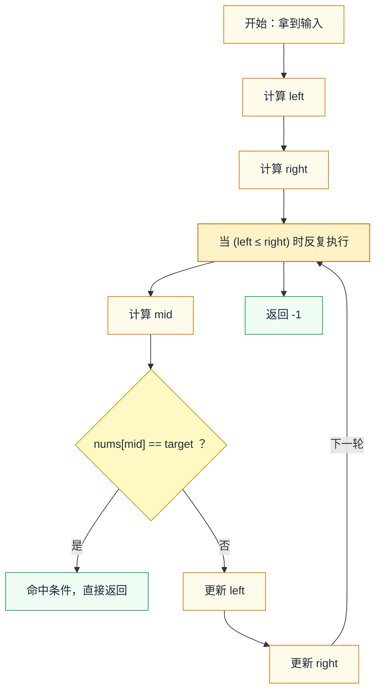
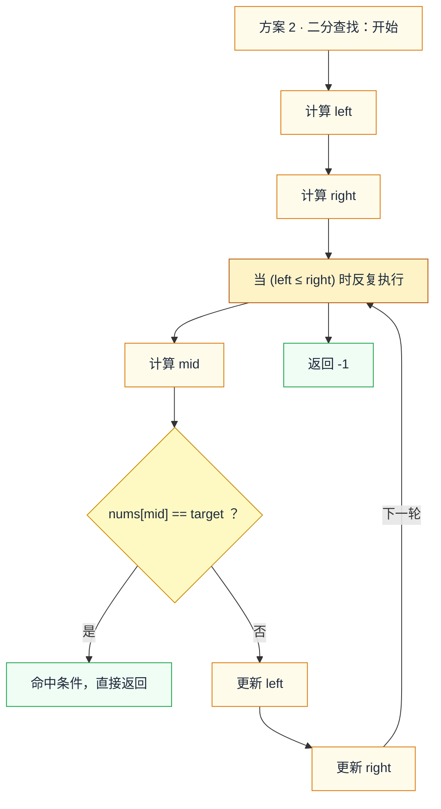
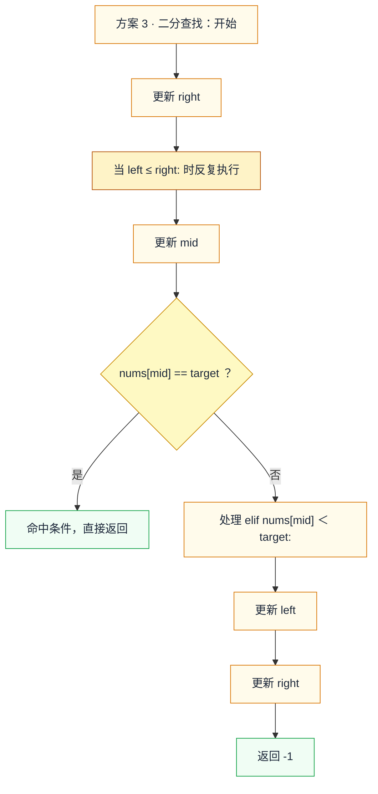
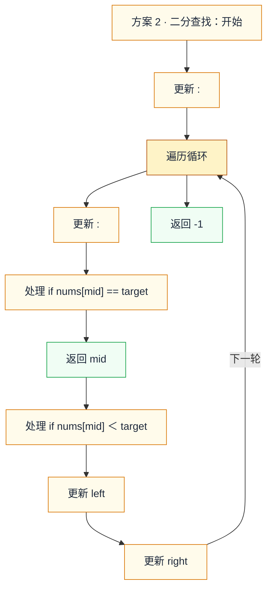
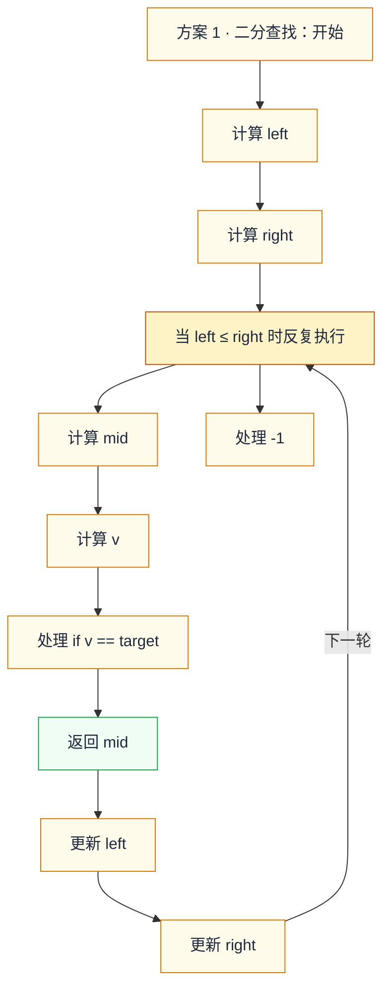
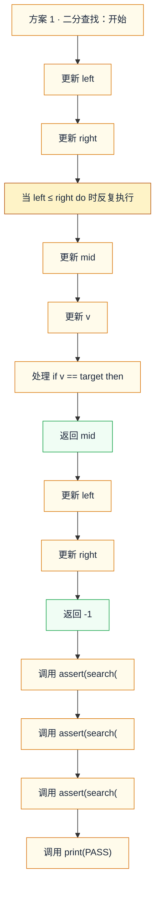
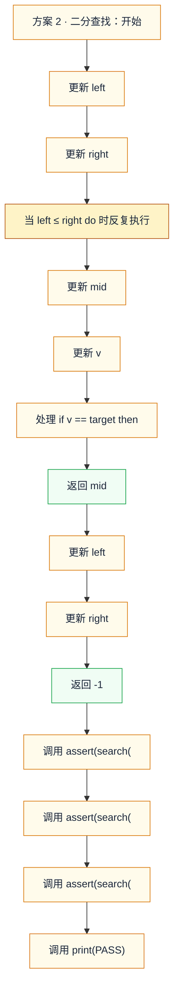
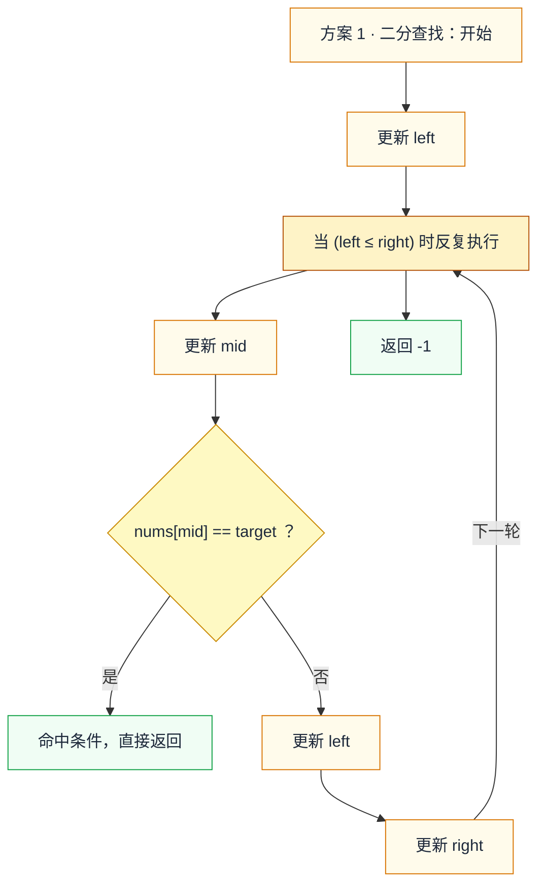

# 095 · 二分查找（第四阶段 · 查找与排序 · Medium）

> **难度**：⭐⭐ Medium ｜ **专题**：二分查找
> **学习定位**：第四阶段 · 查找与排序第 95 篇 ｜ **解法数**：3
> **内容总结**：**二分查找**（二分查找 · Medium）：共 3 个方案，主线思路「二分查找」；时间 O(log n)；动画演示二分收缩过程，附录给出 11 种语言 × 全部方案的可运行实现。

---

## 题目描述

给定一个 `n` 个元素有序的（升序）整型数组 `nums` 和一个目标值 `target` ，写一个函数搜索 `nums` 中的 `target`，如果 `target` 存在返回下标，否则返回 `-1`。

你必须编写一个具有 `O(log n)` 时间复杂度的算法。

示例 1:

输入：`nums` = [-1,0,3,5,9,12], `target` = 9
输出: 4
解释: 9 出现在 `nums` 中并且下标为 4

示例 2:

输入：`nums` = [-1,0,3,5,9,12], `target` = 2
输出: -1
解释: 2 不存在 `nums` 中因此返回 -1

提示：

 你可以假设 `nums` 中的所有元素是不重复的。
 `n` 将在 `[1, 10000]`之间。
 `nums` 的每个元素都将在 `[-9999, 9999]`之间。

> 题面与 [leetcode.cn 官方](https://leetcode.cn/problems/binary-search/)一致，示例配图取自官方题面。

**数据范围与注意事项**：

- 你可以假设 `nums` 中的所有元素是不重复的。
- `n` 将在 `[1, 10000]`之间。
- `nums` 的每个元素都将在 `[-9999, 9999]`之间。
- **易错点**：区间开闭要前后一致，mid 计算用左加右减防溢出。

## 题目分析

**场景是什么**：有序数据上每次砍一半，对应真实开发里的字典查找、版本定位、容量规划。本题就是该场景的 Medium 级练习，主线做法是「二分查找」。

**主线怎么解**：把主解法从头到尾过一遍，它其实在依次做这几件事：二分收缩区间。

## 解题思路

**方案对比**（共 3 个方案，由浅入深）：

| 方案 | 时间复杂度 | 空间复杂度 |
|---|---|---|
| 方案 1 · 二分查找 | O(log n) | O(1) |
| 方案 2 · 二分查找 | O(log n) | O(1) |
| 方案 3 · 二分查找 | O(log n) | O(1) |

**方案间的取舍**：方案 1（二分查找）；方案 2（二分查找）；方案 3（二分查找）。数据规模小、可读性优先时选靠前的方案；规模大、性能优先时选靠后的方案。

**怎么读这一篇**：

- 🐣 **新手路线**：把「题目描述」的示例 1 在纸上手推一遍 → 读方案 1（最直观的写法）与它的代码走读 → 按「运行方式」本地跑通看 PASS → 回头对比方案 2 之后的写法差在哪
- 🦅 **大佬路线**：直接锁定最优方案 1（二分查找，O(log n)）→ 跳读该方案代码与走读 → 用「逐步拆解与面试追问」补齐复杂度推导与边界追问

### 动态算法图（二分收缩，GIF 自动循环）


动画演示二分查找专题里二分收缩的典型过程；每个方案在「TypeScript 解题方案」一节还配了专属动画与专属流程图。

### 主解法流程图（真实控制流）



## TypeScript 解题方案（3 个方案逐个讲）

> **运行与提交**：每个方案都是自包含文件（内嵌用例自测，输出 PASS），整块复制到 `.ts` 文件后 `node 文件名` 即可运行。提交 LeetCode 时，把 `demo` 内的算法函数与辅助类型/函数整体取出、置于文件顶层即可。涉及交互/特殊接口的题以题面给定签名为准。

### 方案 1：二分查找

**分析与思路**：核心做法是「二分查找」。代码里依次做这些事：二分收缩区间。

**运行方式**：`node 本文件`，内嵌用例全部通过会输出 PASS。


**方案专属流程图**（真实控制流）：


```typescript
/**
 ** LeetCode 704. 二分查找
 ** 方案：方案1
 ** 来源：https://blog.csdn.net/tyro_java/article/details/134221939
 */

export function search(nums: number[], target: number): number {
  // 定义函数/方法 search
  let left = 0; // 把 0 存入 左边界
  let right = nums.length - 1; // 把 数组.长度 减 1 存入 右边界
  while (left <= right) {
    // 循环，直到不满足「左边界 不超过 右边界」
    const mid = Math.floor((left + right) / 2); // 把 向下取整((左边界 加 右边界) 除以 2) 存入 中点
    if (nums[mid] === target) {
      // 若 数组[中点] 全等于 目标值
      return mid; // 返回 中点
    } else if (nums[mid] < target) {
      // 否则，若 数组[中点] 小于 目标值
      left = mid + 1; // 把 中点 加 1 存入 左边界
    } else {
      // 否则
      right = mid - 1; // 把 中点 减 1 存入 右边界
    }
  }
  return -1; // 返回 减 1
}

export function demo(): void {
  // 程序入口：跑内嵌自测用例
  if (search([1, 2, 3], 1) !== 0) throw new Error('FAILED'); // 若 search([1, 2, 3], 1) 不等于 0) throw new Error(「FAILED」);
  if (search([-1, 0, 3, 5, 9, 12], 9) !== 4) throw new Error('FAILED');
  if (search([-1, 0, 3, 5, 9, 12], 2) !== -1) throw new Error('FAILED');
  console.log('PASS'); // 全部用例通过，输出 PASS
}

demo(); // demo();
```

### 方案 2：二分查找

**分析与思路**：核心做法是「二分查找」。代码里依次做这些事：二分收缩区间。

**运行方式**：`node 本文件`，内嵌用例全部通过会输出 PASS。


**方案专属流程图**（真实控制流）：



```typescript
/**
 ** LeetCode 704. 二分查找
 ** 来源：https://blog.csdn.net/tyro_java/article/details/134221939
 */

export function search(nums: number[], target: number): number {
  // 定义函数/方法 search
  let left = 0; // 把 0 存入 左边界
  let right = nums.length - 1; // 把 数组.长度 减 1 存入 右边界
  while (left <= right) {
    // 循环，直到不满足「左边界 不超过 右边界」
    const mid = Math.floor((left + right) / 2); // 把 向下取整((左边界 加 右边界) 除以 2) 存入 中点
    if (nums[mid] === target) {
      // 若 数组[中点] 全等于 目标值
      return mid; // 返回 中点
    } else if (nums[mid] < target) {
      // 否则，若 数组[中点] 小于 目标值
      left = mid + 1; // 把 中点 加 1 存入 左边界
    } else {
      // 否则
      right = mid - 1; // 把 中点 减 1 存入 右边界
    }
  }
  return -1; // 返回 减 1
}

export function demo(): void {
  // 程序入口：跑内嵌自测用例
  if (search([1, 2, 3], 1) !== 0) throw new Error('FAILED'); // 若 search([1, 2, 3], 1) 不等于 0) throw new Error(「FAILED」);
  if (search([-1, 0, 3, 5, 9, 12], 9) !== 4) throw new Error('FAILED');
  if (search([-1, 0, 3, 5, 9, 12], 2) !== -1) throw new Error('FAILED');
  console.log('PASS'); // 全部用例通过，输出 PASS
}

demo(); // demo();
```

### 方案 3：二分查找

**分析与思路**：核心做法是「二分查找」。代码里依次做这些事：二分收缩区间。

**运行方式**：`node 本文件`，内嵌用例全部通过会输出 PASS。


**方案专属流程图**（真实控制流）：


```typescript
/**
 ** LeetCode 704. 二分查找
 ** 来源：https://blog.csdn.net/tyro_java/article/details/134221939
 */

export function search(nums: number[], target: number): number {
  // 定义函数/方法 search
  let left = 0; // 把 0 存入 左边界
  let right = nums.length - 1; // 把 数组.长度 减 1 存入 右边界
  while (left <= right) {
    // 循环，直到不满足「左边界 不超过 右边界」
    const mid = Math.floor((left + right) / 2); // 把 向下取整((左边界 加 右边界) 除以 2) 存入 中点
    if (nums[mid] === target) {
      // 若 数组[中点] 全等于 目标值
      return mid; // 返回 中点
    } else if (nums[mid] < target) {
      // 否则，若 数组[中点] 小于 目标值
      left = mid + 1; // 把 中点 加 1 存入 左边界
    } else {
      // 否则
      right = mid - 1; // 把 中点 减 1 存入 右边界
    }
  }
  return -1; // 返回 减 1
}

export function demo(): void {
  // 程序入口：跑内嵌自测用例
  if (search([1, 2, 3], 1) !== 0) throw new Error('FAILED'); // 若 search([1, 2, 3], 1) 不等于 0) throw new Error(「FAILED」);
  if (search([-1, 0, 3, 5, 9, 12], 9) !== 4) throw new Error('FAILED');
  if (search([-1, 0, 3, 5, 9, 12], 2) !== -1) throw new Error('FAILED');
  console.log('PASS'); // 全部用例通过，输出 PASS
}

demo(); // demo();
```

## 逐步拆解与面试追问

**复杂度**：时间 O(log n)，空间 O(1)

**为什么是这个量级**：每轮把候选区间砍半，n 个元素最多砍 log2(n) 轮

**面试官可能会追问**：

- mid 写成左加右减是防什么？
- 区间开闭不一致会怎样？
- 何时退化为线性查找？

## 关键 API 速查（TS 主解法实际用到，附官方链接）

| API | 作用 | 使用要点 | 官方文档 |
|---|---|---|---|
| `Math.floor()` | 向下取整 | 负数向负无穷（-1.5 → -2）；大数用位运算前注意 2^31 界 | [官方文档](https://developer.mozilla.org/zh-CN/docs/Web/JavaScript/Reference/Global_Objects/Math/floor) |

### 各语言官方文档导航

- **TypeScript / JS**：[MDN 中文参考](https://developer.mozilla.org/zh-CN/)
- **Python**：[Python 官方文档](https://docs.python.org/zh-cn/3/)
- **Go**：[Go 标准库](https://pkg.go.dev/std)
- **Java**：[JDK 17 API](https://docs.oracle.com/en/java/javase/17/docs/api/)
- **Rust**：[Rust 标准库](https://doc.rust-lang.org/std/)
- **Lua**：[Lua 5.4 手册](https://www.lua.org/manual/5.4/)
- **C**：[Cppreference C](https://zh.cppreference.com/w/c)
- **C++**：[Cppreference C++](https://zh.cppreference.com/w/cpp)
- **R**：[R 官方手册](https://stat.ethz.ch/R-manual/)
- **Zig**：[Zig 语言文档](https://ziglang.org/documentation/master/)
- **Dart**：[Dart API](https://api.dart.dev/)

## 附录：其他 10 种语言全部实现（每种语言列举其全部方案）

> TypeScript 的全部方案见「TypeScript 解题方案」一节；下面是其余 10 种语言的对应实现，每种语言的每个方案都带思路分析、代码走读与专属运行架构图。
> 每个方案都内嵌用例自测，可独立运行（老仓库 python/go 文件遵循「打印结果」约定）。
> 完整解法文件见 `dsa/<语言>/binary_search/lc_704_二分查找/`。

### Python 实现（3 种方案）

Python 的全部方案如下，每个方案都内嵌用例自测，可独立运行（老仓库 python/go 文件遵循「打印结果」约定）：

#### 方案 1：二分查找

**思路与代码分析**：核心是「二分查找」。Python 版用切片与字典推导式简化操作，突出可读性。代码里依次做这些事：二分收缩区间。**走读**：方案 1 · 二分查找：开始 → 更新 right → 当 left ≤ right: 时反复执行 → 更新 mid → 命中条件，直接返回 → 处理 elif nums[mid] ＜ target: → 更新 left → 更新 right → 返回 -1。

**运行架构**（真实控制流）：


```python
import sys  # 提高递归深度上限（深输入防 RecursionError）

sys.setrecursionlimit(200000)  # 树/链表类题目节点数可达 1e4 量级

def search(nums, target):  # 定义函数 search（参数：数组, 目标值）
    left, right = 0, len(nums) - 1  # 把 0, 长度(数组) 减 1 写入 left, right
    while left <= right:  # 循环，直到不满足「左边界 不超过 右边界」
        mid = (left + right) // 2  # 把 (左边界 加 右边界) 除以 除以 2 存入 中点
        if nums[mid] == target:  # 若 数组[中点] 等于 目标值
            return mid  # 返回 中点
        elif nums[mid] < target:  # 否则，若 数组[中点] 小于 目标值
            left = mid + 1  # 把 中点 加 1 存入 左边界
        else:  # 否则
            right = mid - 1  # 把 中点 减 1 存入 右边界
    return -1  # 返回 减 1

if __name__ == "__main__":  # 若 __name__ 等于 '__main__'
    print(search([1, 2, 3], 1))  # 打印输出
```

#### 方案 2：二分查找

**思路与代码分析**：核心是「二分查找」。Python 版用切片与字典推导式简化操作，突出可读性。代码里依次做这些事：二分收缩区间。**走读**：方案 2 · 二分查找：开始 → 更新 right → 当 left ≤ right: 时反复执行 → 更新 mid → 命中条件，直接返回 → 处理 elif nums[mid] ＜ target: → 更新 left → 更新 right → 返回 -1。

**运行架构**（真实控制流）：


```python
import sys  # 提高递归深度上限（深输入防 RecursionError）

sys.setrecursionlimit(200000)  # 树/链表类题目节点数可达 1e4 量级

def search(nums, target):  # 定义函数 search（参数：数组, 目标值）
    left, right = 0, len(nums) - 1  # 把 0, 长度(数组) 减 1 写入 left, right
    while left <= right:  # 循环，直到不满足「左边界 不超过 右边界」
        mid = (left + right) // 2  # 把 (左边界 加 右边界) 除以 除以 2 存入 中点
        if nums[mid] == target:  # 若 数组[中点] 等于 目标值
            return mid  # 返回 中点
        elif nums[mid] < target:  # 否则，若 数组[中点] 小于 目标值
            left = mid + 1  # 把 中点 加 1 存入 左边界
        else:  # 否则
            right = mid - 1  # 把 中点 减 1 存入 右边界
    return -1  # 返回 减 1

if __name__ == "__main__":  # 若 __name__ 等于 '__main__'
    print(search([-1, 0, 3, 5, 9, 12], 9))  # 打印输出
```

#### 方案 3：二分查找

**思路与代码分析**：核心是「二分查找」。Python 版用切片与字典推导式简化操作，突出可读性。代码里依次做这些事：二分收缩区间。**走读**：方案 3 · 二分查找：开始 → 更新 right → 当 left ≤ right: 时反复执行 → 更新 mid → 命中条件，直接返回 → 处理 elif nums[mid] ＜ target: → 更新 left → 更新 right → 返回 -1。

**运行架构**（真实控制流）：



```python
import sys  # 提高递归深度上限（深输入防 RecursionError）

sys.setrecursionlimit(200000)  # 树/链表类题目节点数可达 1e4 量级

def search(nums, target):  # 定义函数 search（参数：数组, 目标值）
    left, right = 0, len(nums) - 1  # 把 0, 长度(数组) 减 1 写入 left, right
    while left <= right:  # 循环，直到不满足「左边界 不超过 右边界」
        mid = (left + right) // 2  # 把 (左边界 加 右边界) 除以 除以 2 存入 中点
        if nums[mid] == target:  # 若 数组[中点] 等于 目标值
            return mid  # 返回 中点
        elif nums[mid] < target:  # 否则，若 数组[中点] 小于 目标值
            left = mid + 1  # 把 中点 加 1 存入 左边界
        else:  # 否则
            right = mid - 1  # 把 中点 减 1 存入 右边界
    return -1  # 返回 减 1

if __name__ == "__main__":  # 若 __name__ 等于 '__main__'
    print(search([-1, 0, 3, 5, 9, 12], 9))  # 打印输出
```

### Go 实现（3 种方案）

Go 的全部方案如下，每个方案都内嵌用例自测，可独立运行（老仓库 python/go 文件遵循「打印结果」约定）：

#### 方案 1：二分查找

**思路与代码分析**：核心是「二分查找」。Go 版用切片与多返回值惯用法，显式处理索引边界。**走读**：方案 1 · 二分查找：开始 → 更新 : → 遍历循环 → 更新 : → 处理 if nums[mid] == target → 返回 mid → 处理 if nums[mid] ＜ target → 更新 left → 更新 right → 返回 -1。

**运行架构**（真实控制流）：


```go
package main // 引入依赖

import (
	"fmt"
	"os"
) // 引入依赖

func search(nums []int, target int) int { // 定义函数/方法 search
	left, right := 0, len(nums)-1 // 把 0, 长度(数组) 减 1 写入 left, right :
	for left <= right {           // 把 右边界 { 写入 for left <
		mid := (left + right) / 2 // 把 (左边界 加 右边界) 除以 2 写入 mid :
		if nums[mid] == target {  // 若 数组[中点] 等于 目标值
			return mid // 返回 中点
		}
		if nums[mid] < target { // 若 数组[中点] 小于 目标值
			left = mid + 1 // 把 中点 加 1 写入 左边界
		} else { // 否则
			right = mid - 1 // 把 中点 减 1 写入 右边界
		}
	}
	return -1 // 返回 减 1
}

func main() { // 程序入口：跑内嵌自测用例
	cases := []struct { // 把 []struct { 写入 cases :
		nums   []int // 数组 []int
		target int   // 目标值 int
		want   int   // want int
	}{ // }{
		{[]int{1, 2, 3}, 1, 0},
		{[]int{-1, 0, 3, 5, 9, 12}, 9, 4},
	}
	ok := true                // 把 true 写入 ok :
	for _, c := range cases { // 同时取 _ 与 字符 遍历
		if got := search(c.nums, c.target); got != c.want { // 若 got : 赋值为 search(字符.数组, 字符.目标值); got 不等于 字符.want
			ok = false                                                                   // 把 false 写入 ok
			fmt.Printf("FAIL search(%v,%d)=%d want %d\n", c.nums, c.target, got, c.want) // 打印输出
		}
	}
	if !ok { // 若 取反 ok
		os.Exit(1) // os.Exit(1)
	}
	fmt.Println("PASS") // 全部用例通过，输出 PASS
}
```

#### 方案 2：二分查找

**思路与代码分析**：核心是「二分查找」。Go 版用切片与多返回值惯用法，显式处理索引边界。**走读**：方案 2 · 二分查找：开始 → 更新 : → 遍历循环 → 更新 : → 处理 if nums[mid] == target → 返回 mid → 处理 if nums[mid] ＜ target → 更新 left → 更新 right → 返回 -1。

**运行架构**（真实控制流）：



```go
package main // 引入依赖

import (
	"fmt"
	"os"
) // 引入依赖

func search(nums []int, target int) int { // 定义函数/方法 search
	left, right := 0, len(nums)-1 // 把 0, 长度(数组) 减 1 写入 left, right :
	for left <= right {           // 把 右边界 { 写入 for left <
		mid := (left + right) / 2 // 把 (左边界 加 右边界) 除以 2 写入 mid :
		if nums[mid] == target {  // 若 数组[中点] 等于 目标值
			return mid // 返回 中点
		}
		if nums[mid] < target { // 若 数组[中点] 小于 目标值
			left = mid + 1 // 把 中点 加 1 写入 左边界
		} else { // 否则
			right = mid - 1 // 把 中点 减 1 写入 右边界
		}
	}
	return -1 // 返回 减 1
}

func main() { // 程序入口：跑内嵌自测用例
	cases := []struct { // 把 []struct { 写入 cases :
		nums   []int // 数组 []int
		target int   // 目标值 int
		want   int   // want int
	}{ // }{
		{[]int{1, 2, 3}, 1, 0},
		{[]int{-1, 0, 3, 5, 9, 12}, 9, 4},
	}
	ok := true                // 把 true 写入 ok :
	for _, c := range cases { // 同时取 _ 与 字符 遍历
		if got := search(c.nums, c.target); got != c.want { // 若 got : 赋值为 search(字符.数组, 字符.目标值); got 不等于 字符.want
			ok = false                                                                   // 把 false 写入 ok
			fmt.Printf("FAIL search(%v,%d)=%d want %d\n", c.nums, c.target, got, c.want) // 打印输出
		}
	}
	if !ok { // 若 取反 ok
		os.Exit(1) // os.Exit(1)
	}
	fmt.Println("PASS") // 全部用例通过，输出 PASS
}
```

#### 方案 3：二分查找

**思路与代码分析**：核心是「二分查找」。Go 版用切片与多返回值惯用法，显式处理索引边界。**走读**：方案 3 · 二分查找：开始 → 更新 : → 遍历循环 → 更新 : → 处理 if nums[mid] == target → 返回 mid → 处理 if nums[mid] ＜ target → 更新 left → 更新 right → 返回 -1。

**运行架构**（真实控制流）：


```go
package main // 引入依赖

import (
	"fmt"
	"os"
) // 引入依赖

func search(nums []int, target int) int { // 定义函数/方法 search
	left, right := 0, len(nums)-1 // 把 0, 长度(数组) 减 1 写入 left, right :
	for left <= right {           // 把 右边界 { 写入 for left <
		mid := (left + right) / 2 // 把 (左边界 加 右边界) 除以 2 写入 mid :
		if nums[mid] == target {  // 若 数组[中点] 等于 目标值
			return mid // 返回 中点
		}
		if nums[mid] < target { // 若 数组[中点] 小于 目标值
			left = mid + 1 // 把 中点 加 1 写入 左边界
		} else { // 否则
			right = mid - 1 // 把 中点 减 1 写入 右边界
		}
	}
	return -1 // 返回 减 1
}

func main() { // 程序入口：跑内嵌自测用例
	cases := []struct { // 把 []struct { 写入 cases :
		nums   []int // 数组 []int
		target int   // 目标值 int
		want   int   // want int
	}{ // }{
		{[]int{1, 2, 3}, 1, 0},
		{[]int{-1, 0, 3, 5, 9, 12}, 9, 4},
	}
	ok := true                // 把 true 写入 ok :
	for _, c := range cases { // 同时取 _ 与 字符 遍历
		if got := search(c.nums, c.target); got != c.want { // 若 got : 赋值为 search(字符.数组, 字符.目标值); got 不等于 字符.want
			ok = false                                                                   // 把 false 写入 ok
			fmt.Printf("FAIL search(%v,%d)=%d want %d\n", c.nums, c.target, got, c.want) // 打印输出
		}
	}
	if !ok { // 若 取反 ok
		os.Exit(1) // os.Exit(1)
	}
	fmt.Println("PASS") // 全部用例通过，输出 PASS
}
```

### Java 实现（3 种方案）

Java 的全部方案如下，每个方案都内嵌用例自测，可独立运行（老仓库 python/go 文件遵循「打印结果」约定）：

#### 方案 1：二分查找

**思路与代码分析**：核心是「二分查找」。Java 版用类与静态方法组织，集合操作显式明了。**走读**：方案 1 · 二分查找：开始 → 更新 low → 当 (low ≤ high) 时反复执行 → 更新 mid → 命中条件，直接返回 → 更新 low → 更新 high → 返回 -1。

**运行架构**（真实控制流）：


```java
package com.webfault.dsa; // 引入依赖

import java.util.*; // 引入依赖

class lc704_solution11 { // 定义类型
  public int search(int[] nums, int target) { // 定义函数/方法 search
    int low = 0, high = nums.length - 1; // 把 0, high 赋值为 数组.长度 减 1 存入 low
    while (low <= high) { // 循环，直到不满足「low 不超过 high」
      int mid = (low + high) >>> 1; // 把 (low 加 high) 超过 超过 超过 1 存入 中点
      if (nums[mid] == target) { // 若 数组[中点] 等于 目标值
        return mid; // 返回 中点
      } else if (nums[mid] < target) { // 否则，若 数组[中点] 小于 目标值
        low = mid + 1; // 把 中点 加 1; 写入 low
      } else { // 否则
        high = mid - 1; // 把 中点 减 1; 写入 high
      }
    }
    return -1; // 返回 减 1
  }

  public static void main(String[] args) { // public static void main(String[] args) {
    lc704_solution11 s = new lc704_solution11(); // 把 new lc704_solution11(); 写入 lc704_solution11 s
    int[][] numsList = {{1, 2, 3}, {-1, 0, 3, 5, 9, 12}, {1, 2, 3}};
    int[] targets = {1, 9, 4}; // 把 {1, 9, 4}; 写入 int[] targets
    int[] wants = {0, 4, -1}; // 把 {0, 4, 减 1}; 写入 int[] wants
    for (int i = 0; i < targets.length; i++) { // 让 下标 i 从 0 开始计数，下标 i 小于 targets.长度 就继续
      int got =
          s.search(numsList[i], targets[i]); // 把 字符串.search(numsList[下标 i], targets[下标 i]) 存入 got
      if (got != wants[i]) { // 若 got 不等于 wants[下标 i]
        System.out.println("FAIL search case " + i + " got " + got + " want " + wants[i]); // 打印输出
        throw new RuntimeException("FAILED"); // throw new RuntimeException(「FAILED」);
      }
    }
    System.out.println("PASS"); // 全部用例通过，输出 PASS
  }
}
```

#### 方案 2：二分查找

**思路与代码分析**：核心是「二分查找」。Java 版用类与静态方法组织，集合操作显式明了。**走读**：方案 2 · 二分查找：开始 → 更新 low → 当 (low ≤ high) 时反复执行 → 更新 mid → 命中条件，直接返回 → 更新 low → 更新 high → 返回 -1。

**运行架构**（真实控制流）：


```java
package com.webfault.dsa; // 引入依赖

import java.util.*; // 引入依赖

class lc704_solution22 { // 定义类型
  public int search(int[] nums, int target) { // 定义函数/方法 search
    int low = 0, high = nums.length - 1; // 把 0, high 赋值为 数组.长度 减 1 存入 low
    while (low <= high) { // 循环，直到不满足「low 不超过 high」
      int mid = (low + high) >>> 1; // 把 (low 加 high) 超过 超过 超过 1 存入 中点
      if (nums[mid] == target) { // 若 数组[中点] 等于 目标值
        return mid; // 返回 中点
      } else if (nums[mid] < target) { // 否则，若 数组[中点] 小于 目标值
        low = mid + 1; // 把 中点 加 1; 写入 low
      } else { // 否则
        high = mid - 1; // 把 中点 减 1; 写入 high
      }
    }
    return -1; // 返回 减 1
  }

  public static void main(String[] args) { // public static void main(String[] args) {
    lc704_solution22 s = new lc704_solution22(); // 把 new lc704_solution22(); 写入 lc704_solution22 s
    int[][] numsList = {{1, 2, 3}, {-1, 0, 3, 5, 9, 12}, {1, 2, 3}};
    int[] targets = {1, 9, 4}; // 把 {1, 9, 4}; 写入 int[] targets
    int[] wants = {0, 4, -1}; // 把 {0, 4, 减 1}; 写入 int[] wants
    for (int i = 0; i < targets.length; i++) { // 让 下标 i 从 0 开始计数，下标 i 小于 targets.长度 就继续
      int got =
          s.search(numsList[i], targets[i]); // 把 字符串.search(numsList[下标 i], targets[下标 i]) 存入 got
      if (got != wants[i]) { // 若 got 不等于 wants[下标 i]
        System.out.println("FAIL search case " + i + " got " + got + " want " + wants[i]); // 打印输出
        throw new RuntimeException("FAILED"); // throw new RuntimeException(「FAILED」);
      }
    }
    System.out.println("PASS"); // 全部用例通过，输出 PASS
  }
}
```

#### 方案 3：二分查找

**思路与代码分析**：核心是「二分查找」。Java 版用类与静态方法组织，集合操作显式明了。**走读**：方案 3 · 二分查找：开始 → 更新 low → 当 (low ≤ high) 时反复执行 → 更新 mid → 命中条件，直接返回 → 更新 low → 更新 high → 返回 -1。

**运行架构**（真实控制流）：


```java
package com.webfault.dsa; // 引入依赖

import java.util.*; // 引入依赖

class lc704_solution33 { // 定义类型
  public int search(int[] nums, int target) { // 定义函数/方法 search
    int low = 0, high = nums.length - 1; // 把 0, high 赋值为 数组.长度 减 1 存入 low
    while (low <= high) { // 循环，直到不满足「low 不超过 high」
      int mid = (low + high) >>> 1; // 把 (low 加 high) 超过 超过 超过 1 存入 中点
      if (nums[mid] == target) { // 若 数组[中点] 等于 目标值
        return mid; // 返回 中点
      } else if (nums[mid] < target) { // 否则，若 数组[中点] 小于 目标值
        low = mid + 1; // 把 中点 加 1; 写入 low
      } else { // 否则
        high = mid - 1; // 把 中点 减 1; 写入 high
      }
    }
    return -1; // 返回 减 1
  }

  public static void main(String[] args) { // public static void main(String[] args) {
    lc704_solution33 s = new lc704_solution33(); // 把 new lc704_solution33(); 写入 lc704_solution33 s
    int[][] numsList = {{1, 2, 3}, {-1, 0, 3, 5, 9, 12}, {1, 2, 3}};
    int[] targets = {1, 9, 4}; // 把 {1, 9, 4}; 写入 int[] targets
    int[] wants = {0, 4, -1}; // 把 {0, 4, 减 1}; 写入 int[] wants
    for (int i = 0; i < targets.length; i++) { // 让 下标 i 从 0 开始计数，下标 i 小于 targets.长度 就继续
      int got =
          s.search(numsList[i], targets[i]); // 把 字符串.search(numsList[下标 i], targets[下标 i]) 存入 got
      if (got != wants[i]) { // 若 got 不等于 wants[下标 i]
        System.out.println("FAIL search case " + i + " got " + got + " want " + wants[i]); // 打印输出
        throw new RuntimeException("FAILED"); // throw new RuntimeException(「FAILED」);
      }
    }
    System.out.println("PASS"); // 全部用例通过，输出 PASS
  }
}
```

### Rust 实现（3 种方案）

Rust 的全部方案如下，每个方案都内嵌用例自测，可独立运行（老仓库 python/go 文件遵循「打印结果」约定）：

#### 方案 1：二分查找

**思路与代码分析**：核心是「二分查找」。Rust 版用所有权移动与切片借用改写同一逻辑，注意 Option 与引用边界。代码里依次做这些事：二分收缩区间。**走读**：方案 1 · 二分查找：开始 → 计算 left → 计算 right → 当 left ≤ right 时反复执行 → 计算 mid → 计算 v → 处理 if v == target → 返回 mid → 更新 left → 更新 right → 处理 -1。

**运行架构**（真实控制流）：



```rust
// LeetCode 704. 二分查找 — Rust 版（方案1：经典二分查找，闭区间 [left, right]）

fn search(nums: &[i32], target: i32) -> i32 {
    // 定义函数/方法 search
    let mut left: i32 = 0; // 把 0; 写入 let mut left: i32
    let mut right: i32 = nums.len() as i32 - 1; // 把 数组.长度() as i32 减 1; 写入 let mut right: i32
    while left <= right {
        // 把 右边界 { 写入 while left <
        let mid = left + (right - left) / 2; // 把 左边界 加 (右边界 减 左边界) 除以 2 存入 中点
        let v = nums[mid as usize]; // 把 数组[中点 as usize] 存入 值
        if v == target {
            // 若 值 等于 目标值
            return mid; // 返回 中点
        } else if v < target {
            // 否则，若 值 小于 目标值
            left = mid + 1; // 把 中点 加 1; 写入 左边界
        } else {
            // 否则
            right = mid - 1; // 把 中点 减 1; 写入 右边界
        }
    }
    -1 // 减 1
}

fn main() {
    // 程序入口：跑内嵌自测用例
    assert_eq!(search(&[1, 2, 3], 1), 0); // 断言校验
    assert_eq!(search(&[-1, 0, 3, 5, 9, 12], 9), 4); // 断言校验
    assert_eq!(search(&[-1, 0, 3, 5, 9, 12], 2), -1); // 断言校验
    println!("PASS"); // 全部用例通过，输出 PASS
}
```

#### 方案 2：二分查找

**思路与代码分析**：核心是「二分查找」。Rust 版用所有权移动与切片借用改写同一逻辑，注意 Option 与引用边界。代码里依次做这些事：二分收缩区间。**走读**：方案 2 · 二分查找：开始 → 计算 left → 计算 right → 当 left ≤ right 时反复执行 → 计算 mid → 计算 v → 处理 if v == target → 返回 mid → 更新 left → 更新 right → 处理 -1。

**运行架构**（真实控制流）：


```rust
// LeetCode 704. 二分查找 — Rust 版

fn search(nums: &[i32], target: i32) -> i32 {
    // 定义函数/方法 search
    let mut left: i32 = 0; // 把 0; 写入 let mut left: i32
    let mut right: i32 = nums.len() as i32 - 1; // 把 数组.长度() as i32 减 1; 写入 let mut right: i32
    while left <= right {
        // 把 右边界 { 写入 while left <
        let mid = left + (right - left) / 2; // 把 左边界 加 (右边界 减 左边界) 除以 2 存入 中点
        let v = nums[mid as usize]; // 把 数组[中点 as usize] 存入 值
        if v == target {
            // 若 值 等于 目标值
            return mid; // 返回 中点
        } else if v < target {
            // 否则，若 值 小于 目标值
            left = mid + 1; // 把 中点 加 1; 写入 左边界
        } else {
            // 否则
            right = mid - 1; // 把 中点 减 1; 写入 右边界
        }
    }
    -1 // 减 1
}

fn main() {
    // 程序入口：跑内嵌自测用例
    assert_eq!(search(&[1, 2, 3], 1), 0); // 断言校验
    assert_eq!(search(&[-1, 0, 3, 5, 9, 12], 9), 4); // 断言校验
    assert_eq!(search(&[-1, 0, 3, 5, 9, 12], 2), -1); // 断言校验
    println!("PASS"); // 全部用例通过，输出 PASS
}
```

#### 方案 3：二分查找

**思路与代码分析**：核心是「二分查找」。Rust 版用所有权移动与切片借用改写同一逻辑，注意 Option 与引用边界。代码里依次做这些事：二分收缩区间。**走读**：方案 3 · 二分查找：开始 → 计算 left → 计算 right → 当 left ≤ right 时反复执行 → 计算 mid → 计算 v → 处理 if v == target → 返回 mid → 更新 left → 更新 right → 处理 -1。

**运行架构**（真实控制流）：


```rust
// LeetCode 704. 二分查找 — Rust 版

fn search(nums: &[i32], target: i32) -> i32 {
    // 定义函数/方法 search
    let mut left: i32 = 0; // 把 0; 写入 let mut left: i32
    let mut right: i32 = nums.len() as i32 - 1; // 把 数组.长度() as i32 减 1; 写入 let mut right: i32
    while left <= right {
        // 把 右边界 { 写入 while left <
        let mid = left + (right - left) / 2; // 把 左边界 加 (右边界 减 左边界) 除以 2 存入 中点
        let v = nums[mid as usize]; // 把 数组[中点 as usize] 存入 值
        if v == target {
            // 若 值 等于 目标值
            return mid; // 返回 中点
        } else if v < target {
            // 否则，若 值 小于 目标值
            left = mid + 1; // 把 中点 加 1; 写入 左边界
        } else {
            // 否则
            right = mid - 1; // 把 中点 减 1; 写入 右边界
        }
    }
    -1 // 减 1
}

fn main() {
    // 程序入口：跑内嵌自测用例
    assert_eq!(search(&[1, 2, 3], 1), 0); // 断言校验
    assert_eq!(search(&[-1, 0, 3, 5, 9, 12], 9), 4); // 断言校验
    assert_eq!(search(&[-1, 0, 3, 5, 9, 12], 2), -1); // 断言校验
    println!("PASS"); // 全部用例通过，输出 PASS
}
```

### Lua 实现（3 种方案）

Lua 的全部方案如下，每个方案都内嵌用例自测，可独立运行（老仓库 python/go 文件遵循「打印结果」约定）：

#### 方案 1：二分查找

**思路与代码分析**：核心是「二分查找」。Lua 版用表与 ipairs 遍历，注意 ipairs 遇 nil 即停的语义。代码里依次做这些事：二分收缩区间。**走读**：方案 1 · 二分查找：开始 → 更新 left → 更新 right → 当 left ≤ right do 时反复执行 → 更新 mid → 更新 v → 处理 if v == target then → 返回 mid → 更新 left → 更新 right → 返回 -1 → 调用 assert(search( → 调用 assert(search( → 调用 assert(search( → 调用 print(PASS)。

**运行架构**（真实控制流）：



```lua
-- LeetCode 704. 二分查找 — Lua 版（方案1：经典二分查找，闭区间 [left, right]）

-- 0 基下标语义与 TS 参考一致（Lua 数组本身 1 基，读取时 +1）
local function search(nums, target) -- local function search(数组, 目标值)
	local left = 0 -- 把 0 写入 local left
	local right = #nums - 1 -- 把 #数组 减 1 写入 local right
	while left <= right do -- 把 右边界 do 写入 while left <
		local mid = left + math.floor((right - left) / 2) -- 把 左边界 加 math.floor((右边界 减 左边界) 除以 2) 写入 local mid
		local v = nums[mid + 1] -- 把 数组[中点 加 1] 写入 local v
		if v == target then -- 若 值 等于 目标值 then
			return mid -- 返回 中点
		elseif v < target then -- elseif 值 小于 目标值 then
			left = mid + 1 -- 把 中点 加 1 存入 左边界
		else -- 否则
			right = mid - 1 -- 把 中点 减 1 存入 右边界
		end -- 终点
	end -- 终点
	return -1 -- 返回 减 1
end -- 终点

-- 自测：与 LeetCode 官方用例一致
assert(search({ 1, 2, 3 }, 1) == 0, "case 1 failed") -- 断言校验
assert(search({ -1, 0, 3, 5, 9, 12 }, 9) == 4, "case 2 failed") -- 断言校验
assert(search({ -1, 0, 3, 5, 9, 12 }, 2) == -1, "case 3 failed") -- 断言校验
print("PASS") -- 全部用例通过，输出 PASS
```

#### 方案 2：二分查找

**思路与代码分析**：核心是「二分查找」。Lua 版用表与 ipairs 遍历，注意 ipairs 遇 nil 即停的语义。代码里依次做这些事：二分收缩区间。**走读**：方案 2 · 二分查找：开始 → 更新 left → 更新 right → 当 left ≤ right do 时反复执行 → 更新 mid → 更新 v → 处理 if v == target then → 返回 mid → 更新 left → 更新 right → 返回 -1 → 调用 assert(search( → 调用 assert(search( → 调用 assert(search( → 调用 print(PASS)。

**运行架构**（真实控制流）：



```lua
-- LeetCode 704. 二分查找 — Lua 版

-- 0 基下标语义与 TS 参考一致（Lua 数组本身 1 基，读取时 +1）
local function search(nums, target) -- local function search(数组, 目标值)
	local left = 0 -- 把 0 写入 local left
	local right = #nums - 1 -- 把 #数组 减 1 写入 local right
	while left <= right do -- 把 右边界 do 写入 while left <
		local mid = left + math.floor((right - left) / 2) -- 把 左边界 加 math.floor((右边界 减 左边界) 除以 2) 写入 local mid
		local v = nums[mid + 1] -- 把 数组[中点 加 1] 写入 local v
		if v == target then -- 若 值 等于 目标值 then
			return mid -- 返回 中点
		elseif v < target then -- elseif 值 小于 目标值 then
			left = mid + 1 -- 把 中点 加 1 存入 左边界
		else -- 否则
			right = mid - 1 -- 把 中点 减 1 存入 右边界
		end -- 终点
	end -- 终点
	return -1 -- 返回 减 1
end -- 终点

-- 自测：与 LeetCode 官方用例一致
assert(search({ 1, 2, 3 }, 1) == 0, "case 1 failed") -- 断言校验
assert(search({ -1, 0, 3, 5, 9, 12 }, 9) == 4, "case 2 failed") -- 断言校验
assert(search({ -1, 0, 3, 5, 9, 12 }, 2) == -1, "case 3 failed") -- 断言校验
print("PASS") -- 全部用例通过，输出 PASS
```

#### 方案 3：二分查找

**思路与代码分析**：核心是「二分查找」。Lua 版用表与 ipairs 遍历，注意 ipairs 遇 nil 即停的语义。代码里依次做这些事：二分收缩区间。**走读**：方案 3 · 二分查找：开始 → 更新 left → 更新 right → 当 left ≤ right do 时反复执行 → 更新 mid → 更新 v → 处理 if v == target then → 返回 mid → 更新 left → 更新 right → 返回 -1 → 调用 assert(search( → 调用 assert(search( → 调用 assert(search( → 调用 print(PASS)。

**运行架构**（真实控制流）：


```lua
-- LeetCode 704. 二分查找 — Lua 版

-- 0 基下标语义与 TS 参考一致（Lua 数组本身 1 基，读取时 +1）
local function search(nums, target) -- local function search(数组, 目标值)
	local left = 0 -- 把 0 写入 local left
	local right = #nums - 1 -- 把 #数组 减 1 写入 local right
	while left <= right do -- 把 右边界 do 写入 while left <
		local mid = left + math.floor((right - left) / 2) -- 把 左边界 加 math.floor((右边界 减 左边界) 除以 2) 写入 local mid
		local v = nums[mid + 1] -- 把 数组[中点 加 1] 写入 local v
		if v == target then -- 若 值 等于 目标值 then
			return mid -- 返回 中点
		elseif v < target then -- elseif 值 小于 目标值 then
			left = mid + 1 -- 把 中点 加 1 存入 左边界
		else -- 否则
			right = mid - 1 -- 把 中点 减 1 存入 右边界
		end -- 终点
	end -- 终点
	return -1 -- 返回 减 1
end -- 终点

-- 自测：与 LeetCode 官方用例一致
assert(search({ 1, 2, 3 }, 1) == 0, "case 1 failed") -- 断言校验
assert(search({ -1, 0, 3, 5, 9, 12 }, 9) == 4, "case 2 failed") -- 断言校验
assert(search({ -1, 0, 3, 5, 9, 12 }, 2) == -1, "case 3 failed") -- 断言校验
print("PASS") -- 全部用例通过，输出 PASS
```

### C 实现（3 种方案）

C 的全部方案如下，每个方案都内嵌用例自测，可独立运行（老仓库 python/go 文件遵循「打印结果」约定）：

#### 方案 1：二分查找

**思路与代码分析**：核心是「二分查找」。C 版手动管理下标与内存，循环边界全部显式写出。代码里依次做这些事：二分收缩区间。**走读**：方案 1 · 二分查找：开始 → 更新 left → 当 (left ≤ right) 时反复执行 → 更新 mid → 命中条件，直接返回 → 更新 left → 更新 right → 返回 -1。

**运行架构**（真实控制流）：



```c
* LeetCode 704. 二分查找 — C 版（方案1：经典二分查找，闭区间 [left, right]） */

#include <stdio.h> // 引入头文件

int search(const int *nums, int n, int target) { // 定义函数/方法 search
    int left = 0, right = n - 1;             // 把 0, 右边界 赋值为 元素个数 减 1 存入 左边界
    while (left <= right) {                  // 循环，直到不满足「左边界 不超过 右边界」
        int mid = left + (right - left) / 2; // 把 左边界 加 (右边界 减 左边界) 除以 2 存入 中点
        if (nums[mid] == target) {           // 若 数组[中点] 等于 目标值
            return mid;                      // 返回 中点
        } else if (nums[mid] < target) {     // 否则，若 数组[中点] 小于 目标值
            left = mid + 1;                  // 把 中点 加 1; 写入 左边界
        } else {                             // 否则
            right = mid - 1;                 // 把 中点 减 1; 写入 右边界
        }
    }
    return -1; // 返回 减 1
}

int main(void) {                     // 程序入口：跑内嵌自测用例
    int a1[] = {1, 2, 3};            // 把 {1, 2, 3}; 写入 int a1[]
    int a2[] = {-1, 0, 3, 5, 9, 12}; // 把 { 减 1, 0, 3, 5, 9, 12}; 写入 int a2[]
    if (search(a1, 3, 1) != 0) {
        printf("case 1 FAILED\n");
        return 1;
    } // 若 search(a1, 3, 1) 不等于 0) { 输出「case 1 FAILED 」); return 1; }
    if (search(a2, 6, 9) != 4) {
        printf("case 2 FAILED\n");
        return 1;
    } // 若 search(a2, 6, 9) 不等于 4) { 输出「case 2 FAILED 」); return 1; }
    if (search(a2, 6, 2) != -1) {
        printf("case 3 FAILED\n");
        return 1;
    }
    printf("PASS\n"); // 全部用例通过，输出 PASS
    return 0;         // 返回 0
}
```

#### 方案 2：二分查找

**思路与代码分析**：核心是「二分查找」。C 版手动管理下标与内存，循环边界全部显式写出。代码里依次做这些事：二分收缩区间。**走读**：方案 2 · 二分查找：开始 → 更新 left → 当 (left ≤ right) 时反复执行 → 更新 mid → 命中条件，直接返回 → 更新 left → 更新 right → 返回 -1。

**运行架构**（真实控制流）：

```mermaid
graph TD
    N0["方案 2 · 二分查找：开始"]
    N1["更新 left"]
    N2["当 (left ≤ right) 时反复执行"]
    N3["更新 mid"]
    N4{"nums[mid] == target ？"}
    N5["命中条件，直接返回"]
    N6["更新 left"]
    N7["更新 right"]
    N8["返回 -1"]
    N0 --> N1
    N1 --> N2
    N2 --> N3
    N3 --> N4
    N4 -- 是 --> N5
    N4 -- 否 --> N6
    N6 --> N7
    N7 -- 下一轮 --> N2
    N2 --> N8
    classDef n fill:#fffbeb,stroke:#d97706,color:#1e293b;
    classDef lp fill:#fef3c7,stroke:#b45309,color:#1e293b;
    classDef dc fill:#fef9c3,stroke:#ca8a04,color:#1e293b;
    classDef tm fill:#f0fdf4,stroke:#16a34a,color:#1e293b;
    class N0,N1,N3,N6,N7 n;
    class N2 lp;
    class N4 dc;
    class N5,N8 tm;
```

```c
* LeetCode 704. 二分查找 — C 版 */

#include <stdio.h> // 引入头文件

int search(const int *nums, int n, int target) { // 定义函数/方法 search
    int left = 0, right = n - 1;             // 把 0, 右边界 赋值为 元素个数 减 1 存入 左边界
    while (left <= right) {                  // 循环，直到不满足「左边界 不超过 右边界」
        int mid = left + (right - left) / 2; // 把 左边界 加 (右边界 减 左边界) 除以 2 存入 中点
        if (nums[mid] == target) {           // 若 数组[中点] 等于 目标值
            return mid;                      // 返回 中点
        } else if (nums[mid] < target) {     // 否则，若 数组[中点] 小于 目标值
            left = mid + 1;                  // 把 中点 加 1; 写入 左边界
        } else {                             // 否则
            right = mid - 1;                 // 把 中点 减 1; 写入 右边界
        }
    }
    return -1; // 返回 减 1
}

int main(void) {                     // 程序入口：跑内嵌自测用例
    int a1[] = {1, 2, 3};            // 把 {1, 2, 3}; 写入 int a1[]
    int a2[] = {-1, 0, 3, 5, 9, 12}; // 把 { 减 1, 0, 3, 5, 9, 12}; 写入 int a2[]
    if (search(a1, 3, 1) != 0) {
        printf("case 1 FAILED\n");
        return 1;
    } // 若 search(a1, 3, 1) 不等于 0) { 输出「case 1 FAILED 」); return 1; }
    if (search(a2, 6, 9) != 4) {
        printf("case 2 FAILED\n");
        return 1;
    } // 若 search(a2, 6, 9) 不等于 4) { 输出「case 2 FAILED 」); return 1; }
    if (search(a2, 6, 2) != -1) {
        printf("case 3 FAILED\n");
        return 1;
    }
    printf("PASS\n"); // 全部用例通过，输出 PASS
    return 0;         // 返回 0
}
```

#### 方案 3：二分查找

**思路与代码分析**：核心是「二分查找」。C 版手动管理下标与内存，循环边界全部显式写出。代码里依次做这些事：二分收缩区间。**走读**：方案 3 · 二分查找：开始 → 更新 left → 当 (left ≤ right) 时反复执行 → 更新 mid → 命中条件，直接返回 → 更新 left → 更新 right → 返回 -1。

**运行架构**（真实控制流）：

```mermaid
graph TD
    N0["方案 3 · 二分查找：开始"]
    N1["更新 left"]
    N2["当 (left ≤ right) 时反复执行"]
    N3["更新 mid"]
    N4{"nums[mid] == target ？"}
    N5["命中条件，直接返回"]
    N6["更新 left"]
    N7["更新 right"]
    N8["返回 -1"]
    N0 --> N1
    N1 --> N2
    N2 --> N3
    N3 --> N4
    N4 -- 是 --> N5
    N4 -- 否 --> N6
    N6 --> N7
    N7 -- 下一轮 --> N2
    N2 --> N8
    classDef n fill:#fffbeb,stroke:#d97706,color:#1e293b;
    classDef lp fill:#fef3c7,stroke:#b45309,color:#1e293b;
    classDef dc fill:#fef9c3,stroke:#ca8a04,color:#1e293b;
    classDef tm fill:#f0fdf4,stroke:#16a34a,color:#1e293b;
    class N0,N1,N3,N6,N7 n;
    class N2 lp;
    class N4 dc;
    class N5,N8 tm;
```

```c
* LeetCode 704. 二分查找 — C 版 */

#include <stdio.h> // 引入头文件

int search(const int *nums, int n, int target) { // 定义函数/方法 search
    int left = 0, right = n - 1;             // 把 0, 右边界 赋值为 元素个数 减 1 存入 左边界
    while (left <= right) {                  // 循环，直到不满足「左边界 不超过 右边界」
        int mid = left + (right - left) / 2; // 把 左边界 加 (右边界 减 左边界) 除以 2 存入 中点
        if (nums[mid] == target) {           // 若 数组[中点] 等于 目标值
            return mid;                      // 返回 中点
        } else if (nums[mid] < target) {     // 否则，若 数组[中点] 小于 目标值
            left = mid + 1;                  // 把 中点 加 1; 写入 左边界
        } else {                             // 否则
            right = mid - 1;                 // 把 中点 减 1; 写入 右边界
        }
    }
    return -1; // 返回 减 1
}

int main(void) {                     // 程序入口：跑内嵌自测用例
    int a1[] = {1, 2, 3};            // 把 {1, 2, 3}; 写入 int a1[]
    int a2[] = {-1, 0, 3, 5, 9, 12}; // 把 { 减 1, 0, 3, 5, 9, 12}; 写入 int a2[]
    if (search(a1, 3, 1) != 0) {
        printf("case 1 FAILED\n");
        return 1;
    } // 若 search(a1, 3, 1) 不等于 0) { 输出「case 1 FAILED 」); return 1; }
    if (search(a2, 6, 9) != 4) {
        printf("case 2 FAILED\n");
        return 1;
    } // 若 search(a2, 6, 9) 不等于 4) { 输出「case 2 FAILED 」); return 1; }
    if (search(a2, 6, 2) != -1) {
        printf("case 3 FAILED\n");
        return 1;
    }
    printf("PASS\n"); // 全部用例通过，输出 PASS
    return 0;         // 返回 0
}
```

### C++ 实现（3 种方案）

C++ 的全部方案如下，每个方案都内嵌用例自测，可独立运行（老仓库 python/go 文件遵循「打印结果」约定）：

#### 方案 1：二分查找

**思路与代码分析**：核心是「二分查找」。C++ 版用 STL 容器与迭代器，减少手写下标错误。代码里依次做这些事：二分收缩区间。**走读**：方案 1 · 二分查找：开始 → 更新 left → 处理 1 → 当 (left ≤ right) 时反复执行 → 更新 mid → 命中条件，直接返回 → 更新 left → 更新 right → 返回 -1。

**运行架构**（真实控制流）：

```mermaid
graph TD
    N0["方案 1 · 二分查找：开始"]
    N1["更新 left"]
    N2["处理 1"]
    N3["当 (left ≤ right) 时反复执行"]
    N4["更新 mid"]
    N5{"nums[mid] == target ？"}
    N6["命中条件，直接返回"]
    N7["更新 left"]
    N8["更新 right"]
    N9["返回 -1"]
    N0 --> N1
    N1 --> N2
    N2 --> N3
    N3 --> N4
    N4 --> N5
    N5 -- 是 --> N6
    N5 -- 否 --> N7
    N7 --> N8
    N8 -- 下一轮 --> N3
    N3 --> N9
    classDef n fill:#fffbeb,stroke:#d97706,color:#1e293b;
    classDef lp fill:#fef3c7,stroke:#b45309,color:#1e293b;
    classDef dc fill:#fef9c3,stroke:#ca8a04,color:#1e293b;
    classDef tm fill:#f0fdf4,stroke:#16a34a,color:#1e293b;
    class N0,N1,N2,N4,N7,N8 n;
    class N3 lp;
    class N5 dc;
    class N6,N9 tm;
```

```cpp
// LeetCode 704. 二分查找 — C++ 版（方案1：经典二分查找，闭区间 [left, right]）

#include <cassert>  // 引入头文件
#include <iostream> // 引入头文件
#include <vector>   // 引入头文件

int search(const std::vector<int> &nums, int target) { // 定义函数/方法 search
    int left = 0, right = static_cast<int>(nums.size()) -
                          1; // 把 0, 右边界 赋值为 static_cast 小于 int 超过 (数组.大小()) 减 1 存入 左边界
    while (left <= right) {                  // 循环，直到不满足「左边界 不超过 右边界」
        int mid = left + (right - left) / 2; // 把 左边界 加 (右边界 减 左边界) 除以 2 存入 中点
        if (nums[mid] == target) {           // 若 数组[中点] 等于 目标值
            return mid;                      // 返回 中点
        } else if (nums[mid] < target) {     // 否则，若 数组[中点] 小于 目标值
            left = mid + 1;                  // 把 中点 加 1; 写入 左边界
        } else {                             // 否则
            right = mid - 1;                 // 把 中点 减 1; 写入 右边界
        }
    }
    return -1; // 返回 减 1
}

int main() {                                       // 程序入口：跑内嵌自测用例
    assert(search({1, 2, 3}, 1) == 0);             // 断言校验
    assert(search({-1, 0, 3, 5, 9, 12}, 9) == 4);  // 断言校验
    assert(search({-1, 0, 3, 5, 9, 12}, 2) == -1); // 断言校验
    std::cout << "PASS" << std::endl;              // 全部用例通过，输出 PASS
    return 0;                                      // 返回 0
}
```

#### 方案 2：二分查找

**思路与代码分析**：核心是「二分查找」。C++ 版用 STL 容器与迭代器，减少手写下标错误。代码里依次做这些事：二分收缩区间。**走读**：方案 2 · 二分查找：开始 → 更新 left → 处理 1 → 当 (left ≤ right) 时反复执行 → 更新 mid → 命中条件，直接返回 → 更新 left → 更新 right → 返回 -1。

**运行架构**（真实控制流）：

```mermaid
graph TD
    N0["方案 2 · 二分查找：开始"]
    N1["更新 left"]
    N2["处理 1"]
    N3["当 (left ≤ right) 时反复执行"]
    N4["更新 mid"]
    N5{"nums[mid] == target ？"}
    N6["命中条件，直接返回"]
    N7["更新 left"]
    N8["更新 right"]
    N9["返回 -1"]
    N0 --> N1
    N1 --> N2
    N2 --> N3
    N3 --> N4
    N4 --> N5
    N5 -- 是 --> N6
    N5 -- 否 --> N7
    N7 --> N8
    N8 -- 下一轮 --> N3
    N3 --> N9
    classDef n fill:#fffbeb,stroke:#d97706,color:#1e293b;
    classDef lp fill:#fef3c7,stroke:#b45309,color:#1e293b;
    classDef dc fill:#fef9c3,stroke:#ca8a04,color:#1e293b;
    classDef tm fill:#f0fdf4,stroke:#16a34a,color:#1e293b;
    class N0,N1,N2,N4,N7,N8 n;
    class N3 lp;
    class N5 dc;
    class N6,N9 tm;
```

```cpp
// LeetCode 704. 二分查找 — C++ 版

#include <cassert>  // 引入头文件
#include <iostream> // 引入头文件
#include <vector>   // 引入头文件

int search(const std::vector<int> &nums, int target) { // 定义函数/方法 search
    int left = 0, right = static_cast<int>(nums.size()) -
                          1; // 把 0, 右边界 赋值为 static_cast 小于 int 超过 (数组.大小()) 减 1 存入 左边界
    while (left <= right) {                  // 循环，直到不满足「左边界 不超过 右边界」
        int mid = left + (right - left) / 2; // 把 左边界 加 (右边界 减 左边界) 除以 2 存入 中点
        if (nums[mid] == target) {           // 若 数组[中点] 等于 目标值
            return mid;                      // 返回 中点
        } else if (nums[mid] < target) {     // 否则，若 数组[中点] 小于 目标值
            left = mid + 1;                  // 把 中点 加 1; 写入 左边界
        } else {                             // 否则
            right = mid - 1;                 // 把 中点 减 1; 写入 右边界
        }
    }
    return -1; // 返回 减 1
}

int main() {                                       // 程序入口：跑内嵌自测用例
    assert(search({1, 2, 3}, 1) == 0);             // 断言校验
    assert(search({-1, 0, 3, 5, 9, 12}, 9) == 4);  // 断言校验
    assert(search({-1, 0, 3, 5, 9, 12}, 2) == -1); // 断言校验
    std::cout << "PASS" << std::endl;              // 全部用例通过，输出 PASS
    return 0;                                      // 返回 0
}
```

#### 方案 3：二分查找

**思路与代码分析**：核心是「二分查找」。C++ 版用 STL 容器与迭代器，减少手写下标错误。代码里依次做这些事：二分收缩区间。**走读**：方案 3 · 二分查找：开始 → 更新 left → 处理 1 → 当 (left ≤ right) 时反复执行 → 更新 mid → 命中条件，直接返回 → 更新 left → 更新 right → 返回 -1。

**运行架构**（真实控制流）：

```mermaid
graph TD
    N0["方案 3 · 二分查找：开始"]
    N1["更新 left"]
    N2["处理 1"]
    N3["当 (left ≤ right) 时反复执行"]
    N4["更新 mid"]
    N5{"nums[mid] == target ？"}
    N6["命中条件，直接返回"]
    N7["更新 left"]
    N8["更新 right"]
    N9["返回 -1"]
    N0 --> N1
    N1 --> N2
    N2 --> N3
    N3 --> N4
    N4 --> N5
    N5 -- 是 --> N6
    N5 -- 否 --> N7
    N7 --> N8
    N8 -- 下一轮 --> N3
    N3 --> N9
    classDef n fill:#fffbeb,stroke:#d97706,color:#1e293b;
    classDef lp fill:#fef3c7,stroke:#b45309,color:#1e293b;
    classDef dc fill:#fef9c3,stroke:#ca8a04,color:#1e293b;
    classDef tm fill:#f0fdf4,stroke:#16a34a,color:#1e293b;
    class N0,N1,N2,N4,N7,N8 n;
    class N3 lp;
    class N5 dc;
    class N6,N9 tm;
```

```cpp
// LeetCode 704. 二分查找 — C++ 版

#include <cassert>  // 引入头文件
#include <iostream> // 引入头文件
#include <vector>   // 引入头文件

int search(const std::vector<int> &nums, int target) { // 定义函数/方法 search
    int left = 0, right = static_cast<int>(nums.size()) -
                          1; // 把 0, 右边界 赋值为 static_cast 小于 int 超过 (数组.大小()) 减 1 存入 左边界
    while (left <= right) {                  // 循环，直到不满足「左边界 不超过 右边界」
        int mid = left + (right - left) / 2; // 把 左边界 加 (右边界 减 左边界) 除以 2 存入 中点
        if (nums[mid] == target) {           // 若 数组[中点] 等于 目标值
            return mid;                      // 返回 中点
        } else if (nums[mid] < target) {     // 否则，若 数组[中点] 小于 目标值
            left = mid + 1;                  // 把 中点 加 1; 写入 左边界
        } else {                             // 否则
            right = mid - 1;                 // 把 中点 减 1; 写入 右边界
        }
    }
    return -1; // 返回 减 1
}

int main() {                                       // 程序入口：跑内嵌自测用例
    assert(search({1, 2, 3}, 1) == 0);             // 断言校验
    assert(search({-1, 0, 3, 5, 9, 12}, 9) == 4);  // 断言校验
    assert(search({-1, 0, 3, 5, 9, 12}, 2) == -1); // 断言校验
    std::cout << "PASS" << std::endl;              // 全部用例通过，输出 PASS
    return 0;                                      // 返回 0
}
```

### R 实现（3 种方案）

R 的全部方案如下，每个方案都内嵌用例自测，可独立运行（老仓库 python/go 文件遵循「打印结果」约定）：

#### 方案 1：二分查找

**思路与代码分析**：核心是「二分查找」。R 版用向量化思维与 1 起始下标，注意 1:n 的降序陷阱。代码里依次做这些事：二分收缩区间。**走读**：方案 1 · 二分查找：开始 → 处理 left ＜- 0L → 处理 right ＜- length(nums) - 1L → 当 (left ≤ right) 时反复执行 → 处理 mid ＜- left + (right - left) → 处理 v ＜- nums[mid + 1L] → 命中条件，直接返回 → 处理 left ＜- mid + 1L → 处理 right ＜- mid - 1L → 处理 -1L。

**运行架构**（真实控制流）：

```mermaid
graph TD
    N0["方案 1 · 二分查找：开始"]
    N1["处理 left ＜- 0L"]
    N2["处理 right ＜- length(nums) - 1L"]
    N3["当 (left ≤ right) 时反复执行"]
    N4["处理 mid ＜- left + (right - left)"]
    N5["处理 v ＜- nums[mid + 1L]"]
    N6{"v == target ？"}
    N7["命中条件，直接返回"]
    N8["处理 left ＜- mid + 1L"]
    N9["处理 right ＜- mid - 1L"]
    N10["处理 -1L"]
    N0 --> N1
    N1 --> N2
    N2 --> N3
    N3 --> N4
    N4 --> N5
    N5 --> N6
    N6 -- 是 --> N7
    N6 -- 否 --> N8
    N8 --> N9
    N9 -- 下一轮 --> N3
    N3 --> N10
    classDef n fill:#fffbeb,stroke:#d97706,color:#1e293b;
    classDef lp fill:#fef3c7,stroke:#b45309,color:#1e293b;
    classDef dc fill:#fef9c3,stroke:#ca8a04,color:#1e293b;
    classDef tm fill:#f0fdf4,stroke:#16a34a,color:#1e293b;
    class N0,N1,N2,N4,N5,N8,N9,N10 n;
    class N3 lp;
    class N6 dc;
    class N7 tm;
```

```r
# 版（方案1：经典二分查找，闭区间 [left, right]）
# 返回 0 基下标（与 TS 参考一致），R 向量本身 1 基，读取时 +1 定义函数 search（参数：数组, 目标值）
search <- function(nums, target) {
    left <- 0L  # 把 0L 存入 左边界
    right <- length(nums) - 1L  # 把 长度(数组) 减 1L 存入 右边界
    while (left <= right) {
        # 循环，直到不满足「左边界 不超过 右边界」
        mid <- left + (right - left)%/%2L  # 把 左边界 加 (右边界 减 左边界) 对…取模 除以 对…取模 2L 存入 中点
        v <- nums[mid + 1L]  # 把 数组[中点 加 1L] 存入 值
        if (v == target) {
            # 若 值 等于 目标值
            return(mid)  # 返回 中点
        } else if (v < target) {
            # 否则，若 值 小于 目标值
            left <- mid + 1L  # 把 中点 加 1L 存入 左边界
        } else {
            # 否则
            right <- mid - 1L  # 把 中点 减 1L 存入 右边界
        }
    }
    -1L  # 减 1L
}
# 自测：与 LeetCode 官方用例一致
stopifnot(identical(search(c(1, 2, 3), 1), 0L))  # 断言校验
stopifnot(identical(search(c(-1, 0, 3, 5, 9, 12), 9), 4L))  # 断言校验
stopifnot(identical(search(c(-1, 0, 3, 5, 9, 12), 2), -1L))  # 断言校验
cat("PASS\n")  # 全部用例通过，输出 PASS
```

#### 方案 2：二分查找

**思路与代码分析**：核心是「二分查找」。R 版用向量化思维与 1 起始下标，注意 1:n 的降序陷阱。代码里依次做这些事：二分收缩区间。**走读**：方案 2 · 二分查找：开始 → 处理 left ＜- 0L → 处理 right ＜- length(nums) - 1L → 当 (left ≤ right) 时反复执行 → 处理 mid ＜- left + (right - left) → 处理 v ＜- nums[mid + 1L] → 命中条件，直接返回 → 处理 left ＜- mid + 1L → 处理 right ＜- mid - 1L → 处理 -1L。

**运行架构**（真实控制流）：

```mermaid
graph TD
    N0["方案 2 · 二分查找：开始"]
    N1["处理 left ＜- 0L"]
    N2["处理 right ＜- length(nums) - 1L"]
    N3["当 (left ≤ right) 时反复执行"]
    N4["处理 mid ＜- left + (right - left)"]
    N5["处理 v ＜- nums[mid + 1L]"]
    N6{"v == target ？"}
    N7["命中条件，直接返回"]
    N8["处理 left ＜- mid + 1L"]
    N9["处理 right ＜- mid - 1L"]
    N10["处理 -1L"]
    N0 --> N1
    N1 --> N2
    N2 --> N3
    N3 --> N4
    N4 --> N5
    N5 --> N6
    N6 -- 是 --> N7
    N6 -- 否 --> N8
    N8 --> N9
    N9 -- 下一轮 --> N3
    N3 --> N10
    classDef n fill:#fffbeb,stroke:#d97706,color:#1e293b;
    classDef lp fill:#fef3c7,stroke:#b45309,color:#1e293b;
    classDef dc fill:#fef9c3,stroke:#ca8a04,color:#1e293b;
    classDef tm fill:#f0fdf4,stroke:#16a34a,color:#1e293b;
    class N0,N1,N2,N4,N5,N8,N9,N10 n;
    class N3 lp;
    class N6 dc;
    class N7 tm;
```

```r
# 返回 0 基下标（与 TS 参考一致），R 向量本身 1 基，读取时 +1 定义函数 search（参数：数组, 目标值）
search <- function(nums, target) {
    left <- 0L  # 把 0L 存入 左边界
    right <- length(nums) - 1L  # 把 长度(数组) 减 1L 存入 右边界
    while (left <= right) {
        # 循环，直到不满足「左边界 不超过 右边界」
        mid <- left + (right - left)%/%2L  # 把 左边界 加 (右边界 减 左边界) 对…取模 除以 对…取模 2L 存入 中点
        v <- nums[mid + 1L]  # 把 数组[中点 加 1L] 存入 值
        if (v == target) {
            # 若 值 等于 目标值
            return(mid)  # 返回 中点
        } else if (v < target) {
            # 否则，若 值 小于 目标值
            left <- mid + 1L  # 把 中点 加 1L 存入 左边界
        } else {
            # 否则
            right <- mid - 1L  # 把 中点 减 1L 存入 右边界
        }
    }
    -1L  # 减 1L
}
# 自测：与 LeetCode 官方用例一致
stopifnot(identical(search(c(1, 2, 3), 1), 0L))  # 断言校验
stopifnot(identical(search(c(-1, 0, 3, 5, 9, 12), 9), 4L))  # 断言校验
stopifnot(identical(search(c(-1, 0, 3, 5, 9, 12), 2), -1L))  # 断言校验
cat("PASS\n")  # 全部用例通过，输出 PASS
```

#### 方案 3：二分查找

**思路与代码分析**：核心是「二分查找」。R 版用向量化思维与 1 起始下标，注意 1:n 的降序陷阱。代码里依次做这些事：二分收缩区间。**走读**：方案 3 · 二分查找：开始 → 处理 left ＜- 0L → 处理 right ＜- length(nums) - 1L → 当 (left ≤ right) 时反复执行 → 处理 mid ＜- left + (right - left) → 处理 v ＜- nums[mid + 1L] → 命中条件，直接返回 → 处理 left ＜- mid + 1L → 处理 right ＜- mid - 1L → 处理 -1L。

**运行架构**（真实控制流）：

```mermaid
graph TD
    N0["方案 3 · 二分查找：开始"]
    N1["处理 left ＜- 0L"]
    N2["处理 right ＜- length(nums) - 1L"]
    N3["当 (left ≤ right) 时反复执行"]
    N4["处理 mid ＜- left + (right - left)"]
    N5["处理 v ＜- nums[mid + 1L]"]
    N6{"v == target ？"}
    N7["命中条件，直接返回"]
    N8["处理 left ＜- mid + 1L"]
    N9["处理 right ＜- mid - 1L"]
    N10["处理 -1L"]
    N0 --> N1
    N1 --> N2
    N2 --> N3
    N3 --> N4
    N4 --> N5
    N5 --> N6
    N6 -- 是 --> N7
    N6 -- 否 --> N8
    N8 --> N9
    N9 -- 下一轮 --> N3
    N3 --> N10
    classDef n fill:#fffbeb,stroke:#d97706,color:#1e293b;
    classDef lp fill:#fef3c7,stroke:#b45309,color:#1e293b;
    classDef dc fill:#fef9c3,stroke:#ca8a04,color:#1e293b;
    classDef tm fill:#f0fdf4,stroke:#16a34a,color:#1e293b;
    class N0,N1,N2,N4,N5,N8,N9,N10 n;
    class N3 lp;
    class N6 dc;
    class N7 tm;
```

```r
# 返回 0 基下标（与 TS 参考一致），R 向量本身 1 基，读取时 +1 定义函数 search（参数：数组, 目标值）
search <- function(nums, target) {
    left <- 0L  # 把 0L 存入 左边界
    right <- length(nums) - 1L  # 把 长度(数组) 减 1L 存入 右边界
    while (left <= right) {
        # 循环，直到不满足「左边界 不超过 右边界」
        mid <- left + (right - left)%/%2L  # 把 左边界 加 (右边界 减 左边界) 对…取模 除以 对…取模 2L 存入 中点
        v <- nums[mid + 1L]  # 把 数组[中点 加 1L] 存入 值
        if (v == target) {
            # 若 值 等于 目标值
            return(mid)  # 返回 中点
        } else if (v < target) {
            # 否则，若 值 小于 目标值
            left <- mid + 1L  # 把 中点 加 1L 存入 左边界
        } else {
            # 否则
            right <- mid - 1L  # 把 中点 减 1L 存入 右边界
        }
    }
    -1L  # 减 1L
}
# 自测：与 LeetCode 官方用例一致
stopifnot(identical(search(c(1, 2, 3), 1), 0L))  # 断言校验
stopifnot(identical(search(c(-1, 0, 3, 5, 9, 12), 9), 4L))  # 断言校验
stopifnot(identical(search(c(-1, 0, 3, 5, 9, 12), 2), -1L))  # 断言校验
cat("PASS\n")  # 全部用例通过，输出 PASS
```

### Zig 实现（3 种方案）

Zig 的全部方案如下，每个方案都内嵌用例自测，可独立运行（老仓库 python/go 文件遵循「打印结果」约定）：

#### 方案 1：二分查找

**思路与代码分析**：核心是「二分查找」。Zig 版显式分配与清零，整型边界处理严格。代码里依次做这些事：二分收缩区间。**走读**：方案 1 · 二分查找：开始 → 计算 left → 计算 right → 当 (left ≤ right) 时反复执行 → 计算 mid → 计算 idx → 命中条件，直接返回 → 更新 left → 更新 right → 返回 -1。

**运行架构**（真实控制流）：

```mermaid
graph TD
    N0["方案 1 · 二分查找：开始"]
    N1["计算 left"]
    N2["计算 right"]
    N3["当 (left ≤ right) 时反复执行"]
    N4["计算 mid"]
    N5["计算 idx"]
    N6{"nums[idx] == target ？"}
    N7["命中条件，直接返回"]
    N8["更新 left"]
    N9["更新 right"]
    N10["返回 -1"]
    N0 --> N1
    N1 --> N2
    N2 --> N3
    N3 --> N4
    N4 --> N5
    N5 --> N6
    N6 -- 是 --> N7
    N6 -- 否 --> N8
    N8 --> N9
    N9 -- 下一轮 --> N3
    N3 --> N10
    classDef n fill:#fffbeb,stroke:#d97706,color:#1e293b;
    classDef lp fill:#fef3c7,stroke:#b45309,color:#1e293b;
    classDef dc fill:#fef9c3,stroke:#ca8a04,color:#1e293b;
    classDef tm fill:#f0fdf4,stroke:#16a34a,color:#1e293b;
    class N0,N1,N2,N4,N5,N8,N9 n;
    class N3 lp;
    class N6 dc;
    class N7,N10 tm;
```

```zig
// LeetCode 704. 二分查找 — Zig 版（方案1：经典二分查找，闭区间 [left, right]）

const std = @import("std"); // 把 @import(「std」) 存入 std

fn search(nums: []const i32, target: i32) i32 { // 定义函数/方法 search
    var left: i32 = 0; // 把 0; 写入 var left: i32
    var right: i32 = @as(i32, @intCast(nums.len)) - 1; // 把 @as(i32, @intCast(数组.长度)) 减 1; 写入 var right: i32
    while (left <= right) { // 循环，直到不满足「左边界 不超过 右边界」
        const mid = left + @divTrunc(right - left, 2); // 把 左边界 加 @divTrunc(右边界 减 左边界, 2) 存入 中点
        const idx: usize = @intCast(mid); // 把 @intCast(中点); 写入 const idx: usize
        if (nums[idx] == target) { // 若 数组[idx] 等于 目标值
            return mid; // 返回 中点
        } else if (nums[idx] < target) { // 否则，若 数组[idx] 小于 目标值
            left = mid + 1; // 把 中点 加 1; 写入 左边界
        } else { // 否则
            right = mid - 1; // 把 中点 减 1; 写入 右边界
        }
    }
    return -1; // 返回 减 1
}

pub fn main() !void { // 程序入口：跑内嵌自测用例
    const a1 = [_]i32{ 1, 2, 3 }; // 把 [_]i32{ 1, 2, 3 } 存入 a1
    const a2 = [_]i32{ -1, 0, 3, 5, 9, 12 }; // 把 [_]i32{ 减 1, 0, 3, 5, 9, 12 } 存入 a2
    if (search(&a1, 1) != 0) return error.TestFailed; // 若 search( 按位与 a1, 1) 不等于 0，直接返回 error.TestFailed
    if (search(&a2, 9) != 4) return error.TestFailed; // 若 search( 按位与 a2, 9) 不等于 4，直接返回 error.TestFailed
    if (search(&a2, 2) != -1) return error.TestFailed; // 若 search( 按位与 a2, 2) 不等于 减 1，直接返回 error.TestFailed
    std.debug.print("PASS\n", .{}); // 全部用例通过，输出 PASS
}
```

#### 方案 2：二分查找

**思路与代码分析**：核心是「二分查找」。Zig 版显式分配与清零，整型边界处理严格。代码里依次做这些事：二分收缩区间。**走读**：方案 2 · 二分查找：开始 → 计算 left → 计算 right → 当 (left ≤ right) 时反复执行 → 计算 mid → 计算 idx → 命中条件，直接返回 → 更新 left → 更新 right → 返回 -1。

**运行架构**（真实控制流）：

```mermaid
graph TD
    N0["方案 2 · 二分查找：开始"]
    N1["计算 left"]
    N2["计算 right"]
    N3["当 (left ≤ right) 时反复执行"]
    N4["计算 mid"]
    N5["计算 idx"]
    N6{"nums[idx] == target ？"}
    N7["命中条件，直接返回"]
    N8["更新 left"]
    N9["更新 right"]
    N10["返回 -1"]
    N0 --> N1
    N1 --> N2
    N2 --> N3
    N3 --> N4
    N4 --> N5
    N5 --> N6
    N6 -- 是 --> N7
    N6 -- 否 --> N8
    N8 --> N9
    N9 -- 下一轮 --> N3
    N3 --> N10
    classDef n fill:#fffbeb,stroke:#d97706,color:#1e293b;
    classDef lp fill:#fef3c7,stroke:#b45309,color:#1e293b;
    classDef dc fill:#fef9c3,stroke:#ca8a04,color:#1e293b;
    classDef tm fill:#f0fdf4,stroke:#16a34a,color:#1e293b;
    class N0,N1,N2,N4,N5,N8,N9 n;
    class N3 lp;
    class N6 dc;
    class N7,N10 tm;
```

```zig
// LeetCode 704. 二分查找 — Zig 版

const std = @import("std"); // 把 @import(「std」) 存入 std

fn search(nums: []const i32, target: i32) i32 { // 定义函数/方法 search
    var left: i32 = 0; // 把 0; 写入 var left: i32
    var right: i32 = @as(i32, @intCast(nums.len)) - 1; // 把 @as(i32, @intCast(数组.长度)) 减 1; 写入 var right: i32
    while (left <= right) { // 循环，直到不满足「左边界 不超过 右边界」
        const mid = left + @divTrunc(right - left, 2); // 把 左边界 加 @divTrunc(右边界 减 左边界, 2) 存入 中点
        const idx: usize = @intCast(mid); // 把 @intCast(中点); 写入 const idx: usize
        if (nums[idx] == target) { // 若 数组[idx] 等于 目标值
            return mid; // 返回 中点
        } else if (nums[idx] < target) { // 否则，若 数组[idx] 小于 目标值
            left = mid + 1; // 把 中点 加 1; 写入 左边界
        } else { // 否则
            right = mid - 1; // 把 中点 减 1; 写入 右边界
        }
    }
    return -1; // 返回 减 1
}

pub fn main() !void { // 程序入口：跑内嵌自测用例
    const a1 = [_]i32{ 1, 2, 3 }; // 把 [_]i32{ 1, 2, 3 } 存入 a1
    const a2 = [_]i32{ -1, 0, 3, 5, 9, 12 }; // 把 [_]i32{ 减 1, 0, 3, 5, 9, 12 } 存入 a2
    if (search(&a1, 1) != 0) return error.TestFailed; // 若 search( 按位与 a1, 1) 不等于 0，直接返回 error.TestFailed
    if (search(&a2, 9) != 4) return error.TestFailed; // 若 search( 按位与 a2, 9) 不等于 4，直接返回 error.TestFailed
    if (search(&a2, 2) != -1) return error.TestFailed; // 若 search( 按位与 a2, 2) 不等于 减 1，直接返回 error.TestFailed
    std.debug.print("PASS\n", .{}); // 全部用例通过，输出 PASS
}
```

#### 方案 3：二分查找

**思路与代码分析**：核心是「二分查找」。Zig 版显式分配与清零，整型边界处理严格。代码里依次做这些事：二分收缩区间。**走读**：方案 3 · 二分查找：开始 → 计算 left → 计算 right → 当 (left ≤ right) 时反复执行 → 计算 mid → 计算 idx → 命中条件，直接返回 → 更新 left → 更新 right → 返回 -1。

**运行架构**（真实控制流）：

```mermaid
graph TD
    N0["方案 3 · 二分查找：开始"]
    N1["计算 left"]
    N2["计算 right"]
    N3["当 (left ≤ right) 时反复执行"]
    N4["计算 mid"]
    N5["计算 idx"]
    N6{"nums[idx] == target ？"}
    N7["命中条件，直接返回"]
    N8["更新 left"]
    N9["更新 right"]
    N10["返回 -1"]
    N0 --> N1
    N1 --> N2
    N2 --> N3
    N3 --> N4
    N4 --> N5
    N5 --> N6
    N6 -- 是 --> N7
    N6 -- 否 --> N8
    N8 --> N9
    N9 -- 下一轮 --> N3
    N3 --> N10
    classDef n fill:#fffbeb,stroke:#d97706,color:#1e293b;
    classDef lp fill:#fef3c7,stroke:#b45309,color:#1e293b;
    classDef dc fill:#fef9c3,stroke:#ca8a04,color:#1e293b;
    classDef tm fill:#f0fdf4,stroke:#16a34a,color:#1e293b;
    class N0,N1,N2,N4,N5,N8,N9 n;
    class N3 lp;
    class N6 dc;
    class N7,N10 tm;
```

```zig
// LeetCode 704. 二分查找 — Zig 版

const std = @import("std"); // 把 @import(「std」) 存入 std

fn search(nums: []const i32, target: i32) i32 { // 定义函数/方法 search
    var left: i32 = 0; // 把 0; 写入 var left: i32
    var right: i32 = @as(i32, @intCast(nums.len)) - 1; // 把 @as(i32, @intCast(数组.长度)) 减 1; 写入 var right: i32
    while (left <= right) { // 循环，直到不满足「左边界 不超过 右边界」
        const mid = left + @divTrunc(right - left, 2); // 把 左边界 加 @divTrunc(右边界 减 左边界, 2) 存入 中点
        const idx: usize = @intCast(mid); // 把 @intCast(中点); 写入 const idx: usize
        if (nums[idx] == target) { // 若 数组[idx] 等于 目标值
            return mid; // 返回 中点
        } else if (nums[idx] < target) { // 否则，若 数组[idx] 小于 目标值
            left = mid + 1; // 把 中点 加 1; 写入 左边界
        } else { // 否则
            right = mid - 1; // 把 中点 减 1; 写入 右边界
        }
    }
    return -1; // 返回 减 1
}

pub fn main() !void { // 程序入口：跑内嵌自测用例
    const a1 = [_]i32{ 1, 2, 3 }; // 把 [_]i32{ 1, 2, 3 } 存入 a1
    const a2 = [_]i32{ -1, 0, 3, 5, 9, 12 }; // 把 [_]i32{ 减 1, 0, 3, 5, 9, 12 } 存入 a2
    if (search(&a1, 1) != 0) return error.TestFailed; // 若 search( 按位与 a1, 1) 不等于 0，直接返回 error.TestFailed
    if (search(&a2, 9) != 4) return error.TestFailed; // 若 search( 按位与 a2, 9) 不等于 4，直接返回 error.TestFailed
    if (search(&a2, 2) != -1) return error.TestFailed; // 若 search( 按位与 a2, 2) 不等于 减 1，直接返回 error.TestFailed
    std.debug.print("PASS\n", .{}); // 全部用例通过，输出 PASS
}
```

### Dart 实现（3 种方案）

Dart 的全部方案如下，每个方案都内嵌用例自测，可独立运行（老仓库 python/go 文件遵循「打印结果」约定）：

#### 方案 1：二分查找

**思路与代码分析**：核心是「二分查找」。Dart 版用可空类型标注与集合方法，注意空安全。代码里依次做这些事：二分收缩区间。**走读**：方案 1 · 二分查找：开始 → 计算 left → 计算 right → 当 (left ≤ right) 时反复执行 → 更新 mid → 更新 v → 命中条件，直接返回 → 更新 left → 更新 right → 返回 -1。

**运行架构**（真实控制流）：

```mermaid
graph TD
    N0["方案 1 · 二分查找：开始"]
    N1["计算 left"]
    N2["计算 right"]
    N3["当 (left ≤ right) 时反复执行"]
    N4["更新 mid"]
    N5["更新 v"]
    N6{"v == target ？"}
    N7["命中条件，直接返回"]
    N8["更新 left"]
    N9["更新 right"]
    N10["返回 -1"]
    N0 --> N1
    N1 --> N2
    N2 --> N3
    N3 --> N4
    N4 --> N5
    N5 --> N6
    N6 -- 是 --> N7
    N6 -- 否 --> N8
    N8 --> N9
    N9 -- 下一轮 --> N3
    N3 --> N10
    classDef n fill:#fffbeb,stroke:#d97706,color:#1e293b;
    classDef lp fill:#fef3c7,stroke:#b45309,color:#1e293b;
    classDef dc fill:#fef9c3,stroke:#ca8a04,color:#1e293b;
    classDef tm fill:#f0fdf4,stroke:#16a34a,color:#1e293b;
    class N0,N1,N2,N4,N5,N8,N9 n;
    class N3 lp;
    class N6 dc;
    class N7,N10 tm;
```

```dart
// LeetCode 704. 二分查找 — Dart 版（方案1：经典二分查找，闭区间 [left, right]）

int search(List<int> nums, int target) {
  // 定义函数/方法 search
  var left = 0; // 把 0 存入 左边界
  var right = nums.length - 1; // 把 数组.长度 减 1 存入 右边界
  while (left <= right) {
    // 循环，直到不满足「左边界 不超过 右边界」
    final mid = left + (right - left) ~/ 2; // 把 左边界 加 (右边界 减 左边界) ~ 除以 2 存入 中点
    final v = nums[mid]; // 把 数组[中点] 存入 值
    if (v == target) {
      // 若 值 等于 目标值
      return mid; // 返回 中点
    } else if (v < target) {
      // 否则，若 值 小于 目标值
      left = mid + 1; // 把 中点 加 1 存入 左边界
    } else {
      // 否则
      right = mid - 1; // 把 中点 减 1 存入 右边界
    }
  }
  return -1; // 返回 减 1
}

void main() {
  // 程序入口：跑内嵌自测用例
  if (search([1, 2, 3], 1) != 0) throw StateError('case 1 failed');
  if (search([-1, 0, 3, 5, 9, 12], 9) != 4) throw StateError('case 2 failed');
  if (search([-1, 0, 3, 5, 9, 12], 2) != -1) throw StateError('case 3 failed');
  print('PASS'); // 全部用例通过，输出 PASS
}
```

#### 方案 2：二分查找

**思路与代码分析**：核心是「二分查找」。Dart 版用可空类型标注与集合方法，注意空安全。代码里依次做这些事：二分收缩区间。**走读**：方案 2 · 二分查找：开始 → 计算 left → 计算 right → 当 (left ≤ right) 时反复执行 → 更新 mid → 更新 v → 命中条件，直接返回 → 更新 left → 更新 right → 返回 -1。

**运行架构**（真实控制流）：

```mermaid
graph TD
    N0["方案 2 · 二分查找：开始"]
    N1["计算 left"]
    N2["计算 right"]
    N3["当 (left ≤ right) 时反复执行"]
    N4["更新 mid"]
    N5["更新 v"]
    N6{"v == target ？"}
    N7["命中条件，直接返回"]
    N8["更新 left"]
    N9["更新 right"]
    N10["返回 -1"]
    N0 --> N1
    N1 --> N2
    N2 --> N3
    N3 --> N4
    N4 --> N5
    N5 --> N6
    N6 -- 是 --> N7
    N6 -- 否 --> N8
    N8 --> N9
    N9 -- 下一轮 --> N3
    N3 --> N10
    classDef n fill:#fffbeb,stroke:#d97706,color:#1e293b;
    classDef lp fill:#fef3c7,stroke:#b45309,color:#1e293b;
    classDef dc fill:#fef9c3,stroke:#ca8a04,color:#1e293b;
    classDef tm fill:#f0fdf4,stroke:#16a34a,color:#1e293b;
    class N0,N1,N2,N4,N5,N8,N9 n;
    class N3 lp;
    class N6 dc;
    class N7,N10 tm;
```

```dart
// LeetCode 704. 二分查找 — Dart 版

int search(List<int> nums, int target) {
  // 定义函数/方法 search
  var left = 0; // 把 0 存入 左边界
  var right = nums.length - 1; // 把 数组.长度 减 1 存入 右边界
  while (left <= right) {
    // 循环，直到不满足「左边界 不超过 右边界」
    final mid = left + (right - left) ~/ 2; // 把 左边界 加 (右边界 减 左边界) ~ 除以 2 存入 中点
    final v = nums[mid]; // 把 数组[中点] 存入 值
    if (v == target) {
      // 若 值 等于 目标值
      return mid; // 返回 中点
    } else if (v < target) {
      // 否则，若 值 小于 目标值
      left = mid + 1; // 把 中点 加 1 存入 左边界
    } else {
      // 否则
      right = mid - 1; // 把 中点 减 1 存入 右边界
    }
  }
  return -1; // 返回 减 1
}

void main() {
  // 程序入口：跑内嵌自测用例
  if (search([1, 2, 3], 1) != 0) throw StateError('case 1 failed');
  if (search([-1, 0, 3, 5, 9, 12], 9) != 4) throw StateError('case 2 failed');
  if (search([-1, 0, 3, 5, 9, 12], 2) != -1) throw StateError('case 3 failed');
  print('PASS'); // 全部用例通过，输出 PASS
}
```

#### 方案 3：二分查找

**思路与代码分析**：核心是「二分查找」。Dart 版用可空类型标注与集合方法，注意空安全。代码里依次做这些事：二分收缩区间。**走读**：方案 3 · 二分查找：开始 → 计算 left → 计算 right → 当 (left ≤ right) 时反复执行 → 更新 mid → 更新 v → 命中条件，直接返回 → 更新 left → 更新 right → 返回 -1。

**运行架构**（真实控制流）：

```mermaid
graph TD
    N0["方案 3 · 二分查找：开始"]
    N1["计算 left"]
    N2["计算 right"]
    N3["当 (left ≤ right) 时反复执行"]
    N4["更新 mid"]
    N5["更新 v"]
    N6{"v == target ？"}
    N7["命中条件，直接返回"]
    N8["更新 left"]
    N9["更新 right"]
    N10["返回 -1"]
    N0 --> N1
    N1 --> N2
    N2 --> N3
    N3 --> N4
    N4 --> N5
    N5 --> N6
    N6 -- 是 --> N7
    N6 -- 否 --> N8
    N8 --> N9
    N9 -- 下一轮 --> N3
    N3 --> N10
    classDef n fill:#fffbeb,stroke:#d97706,color:#1e293b;
    classDef lp fill:#fef3c7,stroke:#b45309,color:#1e293b;
    classDef dc fill:#fef9c3,stroke:#ca8a04,color:#1e293b;
    classDef tm fill:#f0fdf4,stroke:#16a34a,color:#1e293b;
    class N0,N1,N2,N4,N5,N8,N9 n;
    class N3 lp;
    class N6 dc;
    class N7,N10 tm;
```

```dart
// LeetCode 704. 二分查找 — Dart 版

int search(List<int> nums, int target) {
  // 定义函数/方法 search
  var left = 0; // 把 0 存入 左边界
  var right = nums.length - 1; // 把 数组.长度 减 1 存入 右边界
  while (left <= right) {
    // 循环，直到不满足「左边界 不超过 右边界」
    final mid = left + (right - left) ~/ 2; // 把 左边界 加 (右边界 减 左边界) ~ 除以 2 存入 中点
    final v = nums[mid]; // 把 数组[中点] 存入 值
    if (v == target) {
      // 若 值 等于 目标值
      return mid; // 返回 中点
    } else if (v < target) {
      // 否则，若 值 小于 目标值
      left = mid + 1; // 把 中点 加 1 存入 左边界
    } else {
      // 否则
      right = mid - 1; // 把 中点 减 1 存入 右边界
    }
  }
  return -1; // 返回 减 1
}

void main() {
  // 程序入口：跑内嵌自测用例
  if (search([1, 2, 3], 1) != 0) throw StateError('case 1 failed');
  if (search([-1, 0, 3, 5, 9, 12], 9) != 4) throw StateError('case 2 failed');
  if (search([-1, 0, 3, 5, 9, 12], 2) != -1) throw StateError('case 3 failed');
  print('PASS'); // 全部用例通过，输出 PASS
}
```

---

## 内容总结

- **二分查找**（二分查找 · Medium）：共 3 个方案，主线思路「二分查找」；时间 O(log n)；动画演示二分收缩过程，附录给出 11 种语言 × 全部方案的可运行实现。
- 来源博客：[https://blog.csdn.net/tyro_java/article/details/134221939](https://blog.csdn.net/tyro_java/article/details/134221939)
- 导航：[📋 总目录](../) ｜ [← 094 x 的平方根](../094_x_的平方根/) ｜ [096 按奇偶排序数组 ii →](../096_按奇偶排序数组_ii/)
