# 096 · 按奇偶排序数组 ii（第四阶段 · 查找与排序 · Medium）

> **难度**：⭐⭐ Medium ｜ **专题**：排序
> **学习定位**：第四阶段 · 查找与排序第 96 篇 ｜ **解法数**：9
> **内容总结**：**按奇偶排序数组 ii**（排序 · Medium）：共 9 个方案，主线思路「方案1（先排序再按奇偶下标归位）」；时间 O(n)（单趟线性扫描）；动画演示冒泡交换过程，附录给出 11 种语言 × 全部方案的可运行实现。

---

## 题目描述

给定一个非负整数数组 `nums`， `nums` 中一半整数是 奇数 ，一半整数是 偶数 。

对数组进行排序，以便当 `nums[i]` 为奇数时，`i` 也是 奇数 ；当 `nums[i]` 为偶数时， `i` 也是 偶数 。

你可以返回 任何满足上述条件的数组作为答案 。

- 主函数签名：`function sortArrayByParityII(nums: number[]): number[]`

**用例（来自原题）**：

**示例 1**

```text
输入：nums = [4,2,5,7]
输出：[4,5,2,7]
```

解释：[4,7,2,5]，[2,5,4,7]，[2,7,4,5] 也会被接受。

**示例 2**

```text
输入：nums = [2,3]
输出：[2,3]
```
> 题面与 [leetcode.cn 官方](https://leetcode.cn/problems/sort-array-by-parity-ii/)一致，示例配图取自官方题面。

**数据范围与注意事项**：

- `2 <= nums.length <= 2  10^4`
- `nums.length` 是偶数
- `nums` 中一半是偶数
- `0 <= nums[i] <= 1000`
- 进阶：可以不使用额外空间解决问题吗？
- **易错点**：比较器返回值的正负含义，写反了排序结果直接错。

## 题目分析

**场景是什么**：排序是多数算法的前置工序，这类题练的是比较逻辑与稳定性取舍。本题就是该场景的 Medium 级练习，主线做法是「方案1（先排序再按奇偶下标归位）」。

**主线怎么解**：把主解法从头到尾过一遍，它其实在依次做这几件事：先排序再处理 → 单循环线性扫描。

## 解题思路

**方案对比**（共 9 个方案，由浅入深）：

| 方案 | 时间复杂度 | 空间复杂度 |
|---|---|---|
| 方案 1 · 方案1（先排序再按奇偶下标归位） | O(n)（单趟线性扫描） | O(1) 到 O(n)（视辅助结构） |
| 方案 2 · 单趟扫描 | O(n)（单趟线性扫描） | O(1) 到 O(n)（视辅助结构） |
| 方案 3 · 单趟扫描 | O(n)（单趟线性扫描） | O(1) 到 O(n)（视辅助结构） |
| 方案 4 · 方案4（双指针原地交换） | O(n²)（两层嵌套扫描） | O(1) 到 O(n) |
| 方案 5 · 方案5（双指针原地交换） | O(n²)（两层嵌套扫描） | O(1) 到 O(n) |
| 方案 6 · 方案6（双指针原地交换） | O(n²)（两层嵌套扫描） | O(1) 到 O(n) |
| 方案 7 · 单趟扫描 | O(n)（单趟线性扫描） | O(1) 到 O(n)（视辅助结构） |
| 方案 8 · 方案8（双指针原地交换） | O(n²)（两层嵌套扫描） | O(1) 到 O(n) |
| 方案 9 · 方案9（按奇偶下标归位，不排序） | O(n)（单趟线性扫描） | O(1) 到 O(n)（视辅助结构） |

**由浅入深的路径**：方案1（先排序再按奇偶下标归位） → 单趟扫描 → 方案4（双指针原地交换） → 方案5（双指针原地交换） → 方案6（双指针原地交换） → 方案8（双指针原地交换） → 方案9（按奇偶下标归位，不排序）；每往右一步，都在补上一步的短板。

**方案间的取舍**：方案 1（方案1（先排序再按奇偶下标归位））；方案 2（单趟扫描）；方案 3（单趟扫描）；方案 4（方案4（双指针原地交换））；方案 5（方案5（双指针原地交换））；方案 6（方案6（双指针原地交换））；方案 7（单趟扫描）；方案 8（方案8（双指针原地交换））；方案 9（方案9（按奇偶下标归位，不排序））。数据规模小、可读性优先时选靠前的方案；规模大、性能优先时选靠后的方案。

**怎么读这一篇**：

- 🐣 **新手路线**：把「题目描述」的示例 1 在纸上手推一遍 → 读方案 1（最直观的写法）与它的代码走读 → 按「运行方式」本地跑通看 PASS → 回头对比方案 2 之后的写法差在哪
- 🦅 **大佬路线**：直接锁定最优方案 1（方案1（先排序再按奇偶下标归位），O(n)（单趟线性扫描））→ 跳读该方案代码与走读 → 用「逐步拆解与面试追问」补齐复杂度推导与边界追问

### 动态算法图（冒泡交换，GIF 自动循环）


动画演示排序专题里冒泡交换的典型过程；每个方案在「TypeScript 解题方案」一节还配了专属动画与专属流程图。

### 主解法流程图（真实控制流）

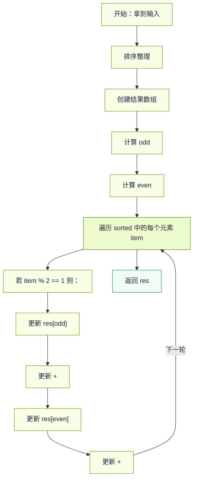

## TypeScript 解题方案（9 个方案逐个讲）

> **运行与提交**：每个方案都是自包含文件（内嵌用例自测，输出 PASS），整块复制到 `.ts` 文件后 `node 文件名` 即可运行。提交 LeetCode 时，把 `demo` 内的算法函数与辅助类型/函数整体取出、置于文件顶层即可。涉及交互/特殊接口的题以题面给定签名为准。

### 方案 1：方案1（先排序再按奇偶下标归位）

**分析与思路**：核心做法是「方案1（先排序再按奇偶下标归位）」。代码里依次做这些事：先排序再处理；单循环线性扫描。

**运行方式**：`node 本文件`，内嵌用例全部通过会输出 PASS。

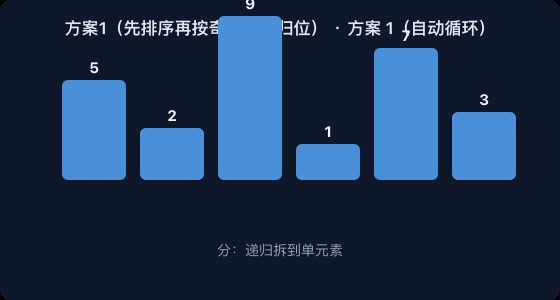

**方案专属流程图**（真实控制流）：

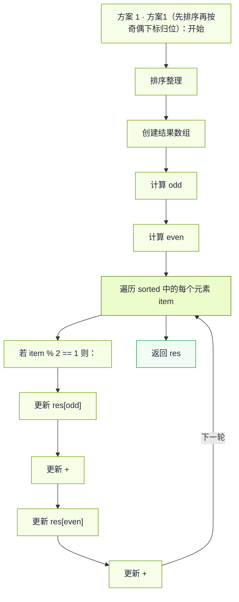

```typescript
/**
 ** LeetCode 922. 按奇偶排序数组 II
 ** 方案：方案1（先排序再按奇偶下标归位）
 */

function sortArrayByParityII(nums: number[]): number[] {
  // 定义函数/方法 sortArrayByParityII
  const sorted = nums.slice().sort((a, b) => a - b);
  const res = new Array<number>(nums.length).fill(0); // 把 new Array 小于 number 超过 (数组.长度).fill(0) 存入 结果
  let odd = 1; // 把 1 存入 odd
  let even = 0; // 把 0 存入 even
  for (const item of sorted) {
    // for (const item of sorted) {
    if (item % 2 === 1) {
      // 若 item 对…取模 2 全等于 1
      res[odd] = item; // 把 item; 写入 res[odd]
      odd += 2; // odd累加 2
    } else {
      // 否则
      res[even] = item; // 把 item; 写入 res[even]
      even += 2; // even累加 2
    }
  }
  return res; // 返回 结果
}

export function demo(): void {
  // 程序入口：跑内嵌自测用例
  const got = sortArrayByParityII([4, 2, 5, 7]); // 把 sortArrayByParityII([4, 2, 5, 7]) 存入 got
  const expected = [2, 5, 4, 7]; // 把 [2, 5, 4, 7] 存入 expected
  if (got.length !== expected.length || got.some((v, i) => v !== expected[i]))
    throw new Error('sortArrayByParityII([4,2,5,7]) mismatch'); // throw new Error(「sortArrayByParityII([4,2,5,7]) mismatch」);
  console.log('PASS'); // 全部用例通过，输出 PASS
}

demo(); // demo();
```

### 方案 2：单趟扫描

**分析与思路**：核心做法是「单趟扫描」。代码里依次做这些事：单循环线性扫描。

**运行方式**：`node 本文件`，内嵌用例全部通过会输出 PASS。


**方案专属流程图**（真实控制流）：


```typescript
export function demo(): void {
  // 程序入口：跑内嵌自测用例
  function sortArrayByParityII(nums: number[]): number[] {
    // 定义函数/方法 sortArrayByParityII
    const n = nums.length;
    const res = new Array(n);
    let e = 0,
      o = 1;
    for (const v of nums) {
      if (v % 2 === 0) {
        res[e] = v;
        e += 2;
      } else {
        res[o] = v;
        o += 2;
      }
    }
    return res; // 返回 结果
  }
  function validParity(a: number[], src: number[]): boolean {
    // 定义函数/方法 validParity
    if (a.length !== src.length) return false; // 若 数组.长度 不等于 src.长度，直接返回 false
    const ca: Record<number, number> = {},
      cb: Record<number, number> = {};
    for (const v of a) ca[v] = (ca[v] || 0) + 1; // 把 (ca[值] 或 0) 加 1; 写入 for (const v of a) ca[v]
    for (const v of src) cb[v] = (cb[v] || 0) + 1; // 把 (cb[值] 或 0) 加 1; 写入 for (const v of src) cb[v]
    for (const k in ca) if (ca[k] !== cb[k]) return false;
    for (let i = 0; i < a.length; i++) {
      // 让 下标 i 从 0 开始计数，下标 i 小于 数组.长度 就继续
      if (i % 2 === 0 && a[i] % 2 !== 0) return false; // 若 下标 i 对…取模 2 全等于 0 且 数组[下标 i] 对…取模 2 不等于 0，直接返回 false
      if (i % 2 === 1 && a[i] % 2 === 0) return false; // 若 下标 i 对…取模 2 全等于 1 且 数组[下标 i] 对…取模 2 全等于 0，直接返回 false
    }
    return true; // 返回 true
  }
  const cases = [
    [4, 2, 5, 7],
    [2, 3],
    [1, 2, 3, 4],
  ]; // 把 [[4,2,5,7],[2,3],[1,2,3,4]] 存入 cases
  let fail = false; // 把 false 存入 fail
  for (const c of cases) {
    // for (const 字符 of cases) {
    if (!validParity(sortArrayByParityII(c), c)) {
      fail = true;
      console.log('FAIL ' + c);
    }
  }
  if (fail) throw new Error('FAILED'); // 若 fail) throw new Error(「FAILED」);
  console.log('PASS'); // 全部用例通过，输出 PASS
}
demo(); // demo();
```

### 方案 3：单趟扫描

**分析与思路**：核心做法是「单趟扫描」。代码里依次做这些事：单循环线性扫描。

**运行方式**：`node 本文件`，内嵌用例全部通过会输出 PASS。


**方案专属流程图**（真实控制流）：

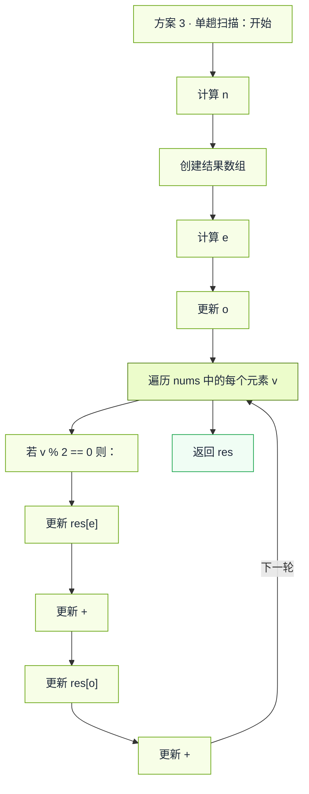

```typescript
export function demo(): void {
  // 程序入口：跑内嵌自测用例
  function sortArrayByParityII(nums: number[]): number[] {
    // 定义函数/方法 sortArrayByParityII
    const n = nums.length;
    const res = new Array(n);
    let e = 0,
      o = 1;
    for (const v of nums) {
      if (v % 2 === 0) {
        res[e] = v;
        e += 2;
      } else {
        res[o] = v;
        o += 2;
      }
    }
    return res; // 返回 结果
  }
  function validParity(a: number[], src: number[]): boolean {
    // 定义函数/方法 validParity
    if (a.length !== src.length) return false; // 若 数组.长度 不等于 src.长度，直接返回 false
    const ca: Record<number, number> = {},
      cb: Record<number, number> = {};
    for (const v of a) ca[v] = (ca[v] || 0) + 1; // 把 (ca[值] 或 0) 加 1; 写入 for (const v of a) ca[v]
    for (const v of src) cb[v] = (cb[v] || 0) + 1; // 把 (cb[值] 或 0) 加 1; 写入 for (const v of src) cb[v]
    for (const k in ca) if (ca[k] !== cb[k]) return false;
    for (let i = 0; i < a.length; i++) {
      // 让 下标 i 从 0 开始计数，下标 i 小于 数组.长度 就继续
      if (i % 2 === 0 && a[i] % 2 !== 0) return false; // 若 下标 i 对…取模 2 全等于 0 且 数组[下标 i] 对…取模 2 不等于 0，直接返回 false
      if (i % 2 === 1 && a[i] % 2 === 0) return false; // 若 下标 i 对…取模 2 全等于 1 且 数组[下标 i] 对…取模 2 全等于 0，直接返回 false
    }
    return true; // 返回 true
  }
  const cases = [
    [4, 2, 5, 7],
    [2, 3],
    [1, 2, 3, 4],
  ]; // 把 [[4,2,5,7],[2,3],[1,2,3,4]] 存入 cases
  let fail = false; // 把 false 存入 fail
  for (const c of cases) {
    // for (const 字符 of cases) {
    if (!validParity(sortArrayByParityII(c), c)) {
      fail = true;
      console.log('FAIL ' + c);
    }
  }
  if (fail) throw new Error('FAILED'); // 若 fail) throw new Error(「FAILED」);
  console.log('PASS'); // 全部用例通过，输出 PASS
}
demo(); // demo();
```

### 方案 4：方案4（双指针原地交换）

**分析与思路**：核心做法是「方案4（双指针原地交换）」。代码里依次做这些事：单循环线性扫描。

**运行方式**：`node 本文件`，内嵌用例全部通过会输出 PASS。

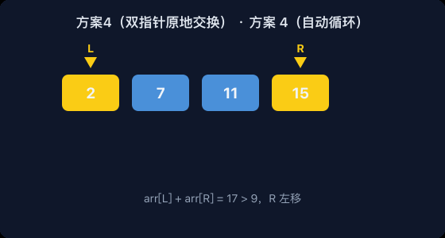

**方案专属流程图**（真实控制流）：


```typescript
/**
 ** LeetCode 922. 按奇偶排序数组 II
 ** 来源：https://blog.csdn.net/tyro_java/article/details/134394571
 ** 方案：方案4（双指针原地交换）
 */

function sortArrayByParityII(nums: number[]): number[] {
  // 定义函数/方法 sortArrayByParityII
  const n = nums.length; // 把 数组.长度 存入 元素个数
  let j = 1; // 把 1 存入 下标 j
  for (let i = 0; i < n; i += 2) {
    // 让 下标 i 从 0 开始计数，下标 i 小于 元素个数 就继续
    if (nums[i] % 2 === 1) {
      // 若 数组[下标 i] 对…取模 2 全等于 1
      while (nums[j] % 2 === 1) j += 2; // 循环，直到不满足「数组[下标 j] 对…取模 2 全等于 1) 下标 j 累加 2;」
      const tmp = nums[i]; // 把 数组[下标 i] 存入 临时变量
      nums[i] = nums[j]; // 把 数组[下标 j]; 写入 nums[i]
      nums[j] = tmp; // 把 临时变量; 写入 nums[j]
    }
  }
  return nums; // 返回 数组
}

export function demo(): void {
  // 程序入口：跑内嵌自测用例
  const a = sortArrayByParityII([4, 2, 5, 7]); // 把 sortArrayByParityII([4, 2, 5, 7]) 存入 数组
  if (a.join(',') !== '4,5,2,7') throw new Error('case1 mismatch: ' + a); // 若 数组.join(「,」) 不等于 「,」) throw new Error(「,」 加 数组);
  const b = sortArrayByParityII([2, 3]); // 把 sortArrayByParityII([2, 3]) 存入 b
  if (b.join(',') !== '2,3') throw new Error('case2 mismatch: ' + b); // 若 b.join(「,」) 不等于 「,」) throw new Error(「,」 加 b);
  console.log('PASS'); // 全部用例通过，输出 PASS
}

demo(); // demo();
```

### 方案 5：方案5（双指针原地交换）

**分析与思路**：核心做法是「方案5（双指针原地交换）」。代码里依次做这些事：单循环线性扫描。

**运行方式**：`node 本文件`，内嵌用例全部通过会输出 PASS。

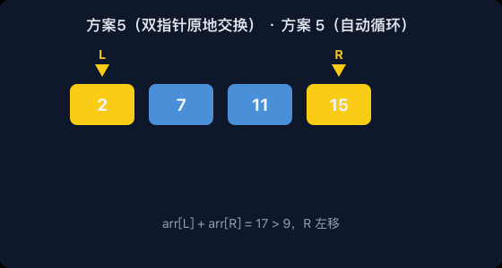

**方案专属流程图**（真实控制流）：

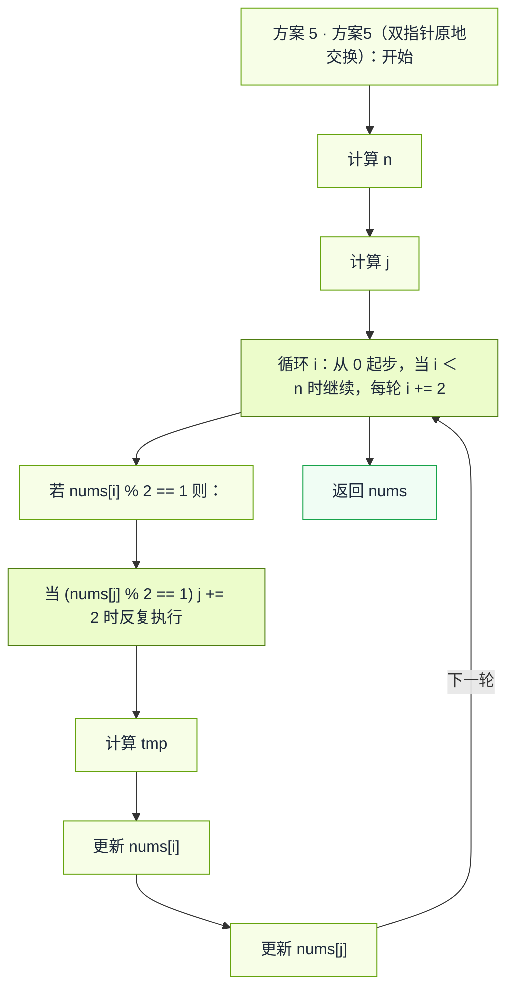

```typescript
/**
 ** LeetCode 922. 按奇偶排序数组 II
 ** 来源：https://blog.csdn.net/tyro_java/article/details/134394571
 ** 方案：方案5（双指针原地交换）
 */

function sortArrayByParityII(nums: number[]): number[] {
  // 定义函数/方法 sortArrayByParityII
  const n = nums.length; // 把 数组.长度 存入 元素个数
  let j = 1; // 把 1 存入 下标 j
  for (let i = 0; i < n; i += 2) {
    // 让 下标 i 从 0 开始计数，下标 i 小于 元素个数 就继续
    if (nums[i] % 2 === 1) {
      // 若 数组[下标 i] 对…取模 2 全等于 1
      while (nums[j] % 2 === 1) j += 2; // 循环，直到不满足「数组[下标 j] 对…取模 2 全等于 1) 下标 j 累加 2;」
      const tmp = nums[i]; // 把 数组[下标 i] 存入 临时变量
      nums[i] = nums[j]; // 把 数组[下标 j]; 写入 nums[i]
      nums[j] = tmp; // 把 临时变量; 写入 nums[j]
    }
  }
  return nums; // 返回 数组
}

export function demo(): void {
  // 程序入口：跑内嵌自测用例
  const a = sortArrayByParityII([4, 2, 5, 7]); // 把 sortArrayByParityII([4, 2, 5, 7]) 存入 数组
  if (a.join(',') !== '4,5,2,7') throw new Error('case1 mismatch: ' + a); // 若 数组.join(「,」) 不等于 「,」) throw new Error(「,」 加 数组);
  const b = sortArrayByParityII([2, 3]); // 把 sortArrayByParityII([2, 3]) 存入 b
  if (b.join(',') !== '2,3') throw new Error('case2 mismatch: ' + b); // 若 b.join(「,」) 不等于 「,」) throw new Error(「,」 加 b);
  console.log('PASS'); // 全部用例通过，输出 PASS
}

demo(); // demo();
```

### 方案 6：方案6（双指针原地交换）

**分析与思路**：核心做法是「方案6（双指针原地交换）」。代码里依次做这些事：单循环线性扫描。

**运行方式**：`node 本文件`，内嵌用例全部通过会输出 PASS。


**方案专属流程图**（真实控制流）：


```typescript
/**
 ** LeetCode 922. 按奇偶排序数组 II
 ** 来源：https://blog.csdn.net/tyro_java/article/details/134394571
 ** 方案：方案6（双指针原地交换）
 */

function sortArrayByParityII(nums: number[]): number[] {
  // 定义函数/方法 sortArrayByParityII
  const n = nums.length; // 把 数组.长度 存入 元素个数
  let j = 1; // 把 1 存入 下标 j
  for (let i = 0; i < n; i += 2) {
    // 让 下标 i 从 0 开始计数，下标 i 小于 元素个数 就继续
    if (nums[i] % 2 === 1) {
      // 若 数组[下标 i] 对…取模 2 全等于 1
      while (nums[j] % 2 === 1) j += 2; // 循环，直到不满足「数组[下标 j] 对…取模 2 全等于 1) 下标 j 累加 2;」
      const tmp = nums[i]; // 把 数组[下标 i] 存入 临时变量
      nums[i] = nums[j]; // 把 数组[下标 j]; 写入 nums[i]
      nums[j] = tmp; // 把 临时变量; 写入 nums[j]
    }
  }
  return nums; // 返回 数组
}

export function demo(): void {
  // 程序入口：跑内嵌自测用例
  const a = sortArrayByParityII([4, 2, 5, 7]); // 把 sortArrayByParityII([4, 2, 5, 7]) 存入 数组
  if (a.join(',') !== '4,5,2,7') throw new Error('case1 mismatch: ' + a); // 若 数组.join(「,」) 不等于 「,」) throw new Error(「,」 加 数组);
  const b = sortArrayByParityII([2, 3]); // 把 sortArrayByParityII([2, 3]) 存入 b
  if (b.join(',') !== '2,3') throw new Error('case2 mismatch: ' + b); // 若 b.join(「,」) 不等于 「,」) throw new Error(「,」 加 b);
  console.log('PASS'); // 全部用例通过，输出 PASS
}

demo(); // demo();
```

### 方案 7：单趟扫描

**分析与思路**：核心做法是「单趟扫描」。代码里依次做这些事：单循环线性扫描。

**运行方式**：`node 本文件`，内嵌用例全部通过会输出 PASS。


**方案专属流程图**（真实控制流）：


```typescript
export function demo(): void {
  // 程序入口：跑内嵌自测用例
  function sortArrayByParityII(nums: number[]): number[] {
    // 定义函数/方法 sortArrayByParityII
    const n = nums.length;
    const res = new Array(n);
    let e = 0,
      o = 1;
    for (const v of nums) {
      if (v % 2 === 0) {
        res[e] = v;
        e += 2;
      } else {
        res[o] = v;
        o += 2;
      }
    }
    return res; // 返回 结果
  }
  function validParity(a: number[], src: number[]): boolean {
    // 定义函数/方法 validParity
    if (a.length !== src.length) return false; // 若 数组.长度 不等于 src.长度，直接返回 false
    const ca: Record<number, number> = {},
      cb: Record<number, number> = {};
    for (const v of a) ca[v] = (ca[v] || 0) + 1; // 把 (ca[值] 或 0) 加 1; 写入 for (const v of a) ca[v]
    for (const v of src) cb[v] = (cb[v] || 0) + 1; // 把 (cb[值] 或 0) 加 1; 写入 for (const v of src) cb[v]
    for (const k in ca) if (ca[k] !== cb[k]) return false;
    for (let i = 0; i < a.length; i++) {
      // 让 下标 i 从 0 开始计数，下标 i 小于 数组.长度 就继续
      if (i % 2 === 0 && a[i] % 2 !== 0) return false; // 若 下标 i 对…取模 2 全等于 0 且 数组[下标 i] 对…取模 2 不等于 0，直接返回 false
      if (i % 2 === 1 && a[i] % 2 === 0) return false; // 若 下标 i 对…取模 2 全等于 1 且 数组[下标 i] 对…取模 2 全等于 0，直接返回 false
    }
    return true; // 返回 true
  }
  const cases = [
    [4, 2, 5, 7],
    [2, 3],
    [1, 2, 3, 4],
  ]; // 把 [[4,2,5,7],[2,3],[1,2,3,4]] 存入 cases
  let fail = false; // 把 false 存入 fail
  for (const c of cases) {
    // for (const 字符 of cases) {
    if (!validParity(sortArrayByParityII(c), c)) {
      fail = true;
      console.log('FAIL ' + c);
    }
  }
  if (fail) throw new Error('FAILED'); // 若 fail) throw new Error(「FAILED」);
  console.log('PASS'); // 全部用例通过，输出 PASS
}
demo(); // demo();
```

### 方案 8：方案8（双指针原地交换）

**分析与思路**：核心做法是「方案8（双指针原地交换）」。代码里依次做这些事：单循环线性扫描。

**运行方式**：`node 本文件`，内嵌用例全部通过会输出 PASS。


**方案专属流程图**（真实控制流）：


```typescript
/**
 ** LeetCode 922. 按奇偶排序数组 II
 ** 来源：https://blog.csdn.net/tyro_java/article/details/134394571
 ** 方案：方案8（双指针原地交换）
 */

function sortArrayByParityII(nums: number[]): number[] {
  // 定义函数/方法 sortArrayByParityII
  const n = nums.length; // 把 数组.长度 存入 元素个数
  let j = 1; // 把 1 存入 下标 j
  for (let i = 0; i < n; i += 2) {
    // 让 下标 i 从 0 开始计数，下标 i 小于 元素个数 就继续
    if (nums[i] % 2 === 1) {
      // 若 数组[下标 i] 对…取模 2 全等于 1
      while (nums[j] % 2 === 1) j += 2; // 循环，直到不满足「数组[下标 j] 对…取模 2 全等于 1) 下标 j 累加 2;」
      const tmp = nums[i]; // 把 数组[下标 i] 存入 临时变量
      nums[i] = nums[j]; // 把 数组[下标 j]; 写入 nums[i]
      nums[j] = tmp; // 把 临时变量; 写入 nums[j]
    }
  }
  return nums; // 返回 数组
}

export function demo(): void {
  // 程序入口：跑内嵌自测用例
  const a = sortArrayByParityII([4, 2, 5, 7]); // 把 sortArrayByParityII([4, 2, 5, 7]) 存入 数组
  if (a.join(',') !== '4,5,2,7') throw new Error('case1 mismatch: ' + a); // 若 数组.join(「,」) 不等于 「,」) throw new Error(「,」 加 数组);
  const b = sortArrayByParityII([2, 3]); // 把 sortArrayByParityII([2, 3]) 存入 b
  if (b.join(',') !== '2,3') throw new Error('case2 mismatch: ' + b); // 若 b.join(「,」) 不等于 「,」) throw new Error(「,」 加 b);
  console.log('PASS'); // 全部用例通过，输出 PASS
}

demo(); // demo();
```

### 方案 9：方案9（按奇偶下标归位，不排序）

**分析与思路**：核心做法是「方案9（按奇偶下标归位，不排序）」。代码里依次做这些事：单循环线性扫描。

**运行方式**：`node 本文件`，内嵌用例全部通过会输出 PASS。

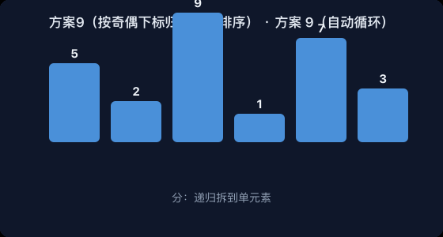

**方案专属流程图**（真实控制流）：

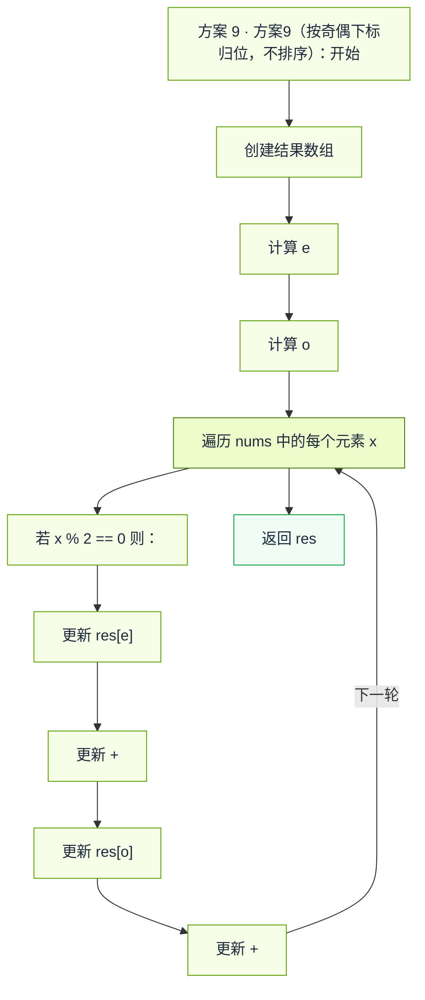

```typescript
/**
 ** LeetCode 922. 按奇偶排序数组 II
 ** 来源：https://blog.csdn.net/tyro_java/article/details/134394571
 ** 方案：方案9（按奇偶下标归位，不排序）
 */

function sortArrayByParityII(nums: number[]): number[] {
  // 定义函数/方法 sortArrayByParityII
  const res = new Array<number>(nums.length).fill(0); // 把 new Array 小于 number 超过 (数组.长度).fill(0) 存入 结果
  let e = 0; // 把 0 存入 e
  let o = 1; // 把 1 存入 o
  for (const x of nums) {
    // for (const x of 数组) {
    if (x % 2 === 0) {
      // 若 x 对…取模 2 全等于 0
      res[e] = x; // 把 x; 写入 res[e]
      e += 2; // e累加 2
    } else {
      // 否则
      res[o] = x; // 把 x; 写入 res[o]
      o += 2; // o累加 2
    }
  }
  return res; // 返回 结果
}

export function demo(): void {
  // 程序入口：跑内嵌自测用例
  const a = sortArrayByParityII([4, 2, 5, 7]); // 把 sortArrayByParityII([4, 2, 5, 7]) 存入 数组
  if (a.join(',') !== '4,5,2,7') throw new Error('case1 mismatch: ' + a); // 若 数组.join(「,」) 不等于 「,」) throw new Error(「,」 加 数组);
  const b = sortArrayByParityII([2, 3]); // 把 sortArrayByParityII([2, 3]) 存入 b
  if (b.join(',') !== '2,3') throw new Error('case2 mismatch: ' + b); // 若 b.join(「,」) 不等于 「,」) throw new Error(「,」 加 b);
  console.log('PASS'); // 全部用例通过，输出 PASS
}

demo(); // demo();
```

## 逐步拆解与面试追问

**复杂度**：时间 O(n)（单趟线性扫描），空间 O(1) 到 O(n)（视辅助结构）

**为什么是这个量级**：每个元素被常数次访问，辅助哈希或栈的开销与 n 同阶

**面试官可能会追问**：

- 稳定性对结果有影响吗？
- 比较器怎么写才不会越界？
- 数据近有序时选哪种排序？

## 关键 API 速查（TS 主解法实际用到，附官方链接）

| API | 作用 | 使用要点 | 官方文档 |
|---|---|---|---|
| `Array.prototype.sort()` | 原地排序 | 默认按字符串 Unicode 序（10 会排在 2 前），数字必须传 (a,b)=>a-b；V8 用 TimSort，稳定，O(n log n)；返回原数组引用 | [官方文档](https://developer.mozilla.org/zh-CN/docs/Web/JavaScript/Reference/Global_Objects/Array/sort) |
| `Array/String slice()` | 切片（不改原数组） | slice(start,end) 含头不含尾；负数从尾计；常用于复制数组（slice()） | [官方文档](https://developer.mozilla.org/zh-CN/docs/Web/JavaScript/Reference/Global_Objects/Array/slice) |

### 各语言官方文档导航

- **TypeScript / JS**：[MDN 中文参考](https://developer.mozilla.org/zh-CN/)
- **Python**：[Python 官方文档](https://docs.python.org/zh-cn/3/)
- **Go**：[Go 标准库](https://pkg.go.dev/std)
- **Java**：[JDK 17 API](https://docs.oracle.com/en/java/javase/17/docs/api/)
- **Rust**：[Rust 标准库](https://doc.rust-lang.org/std/)
- **Lua**：[Lua 5.4 手册](https://www.lua.org/manual/5.4/)
- **C**：[Cppreference C](https://zh.cppreference.com/w/c)
- **C++**：[Cppreference C++](https://zh.cppreference.com/w/cpp)
- **R**：[R 官方手册](https://stat.ethz.ch/R-manual/)
- **Zig**：[Zig 语言文档](https://ziglang.org/documentation/master/)
- **Dart**：[Dart API](https://api.dart.dev/)

## 附录：其他 10 种语言全部实现（每种语言列举其全部方案）

> TypeScript 的全部方案见「TypeScript 解题方案」一节；下面是其余 10 种语言的对应实现，每种语言的每个方案都带思路分析、代码走读与专属运行架构图。
> 每个方案都内嵌用例自测，可独立运行（老仓库 python/go 文件遵循「打印结果」约定）。
> 完整解法文件见 `dsa/<语言>/sort/lc_922_按奇偶排序数组_ii/`。

### Python 实现（9 种方案）

Python 的全部方案如下，每个方案都内嵌用例自测，可独立运行（老仓库 python/go 文件遵循「打印结果」约定）：

#### 方案 1：方案1（先排序再按奇偶下标归位）

**思路与代码分析**：核心是「方案1（先排序再按奇偶下标归位）」。Python 版用切片与字典推导式简化操作，突出可读性。代码里依次做这些事：先排序再处理。**走读**：方案 1 · 方案1（先排序再按奇偶下标归位）：开始 → 排序整理 → 更新 res → 更新 odd → 更新 even → 遍历 nums: 中的每个元素 item → 若 item % 2 == 1：更新 res[odd] → 更新 res[odd] → 更新 + → 更新 res[even] → 更新 + → 返回 res。

**运行架构**（真实控制流）：

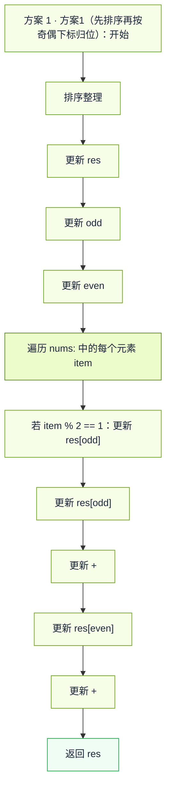

```python
import sys  # 提高递归深度上限（深输入防 RecursionError）

sys.setrecursionlimit(200000)  # 树/链表类题目节点数可达 1e4 量级

def sortArrayByParityII(nums):  # 定义函数 sortArrayByParityII（参数：数组）
    nums.sort()  # 排序
    res = [0] * len(nums)  # 把 [0] 乘 长度(数组) 存入 结果
    odd = 1  # 把 1 存入 odd
    even = 0  # 把 0 存入 even
    for item in nums:  # 逐个取出 数组 的元素（item）
        if item % 2 == 1:  # 若 item 对…取模 2 等于 1
            res[odd] = item  # 把 item 写入 res[odd]
            odd += 2  # odd累加 2
        else:  # 否则
            res[even] = item  # 把 item 写入 res[even]
            even += 2  # even累加 2
    return res  # 返回 结果

if __name__ == "__main__":  # 若 __name__ 等于 '__main__'
    print(sortArrayByParityII([4, 2, 5, 7]))  # 打印输出
```

#### 方案 2：单趟扫描

**思路与代码分析**：核心是「单趟扫描」。Python 版用切片与字典推导式简化操作，突出可读性。**走读**：方案 2 · 单趟扫描：开始 → 更新 n → 更新 ans → 更新 j → 遍历 nums: 中的每个元素 x → 若 x % 2 == 0：更新 ans[i] → 更新 ans[i] → 更新 + → 更新 ans[j] → 更新 + → 返回 ans。

**运行架构**（真实控制流）：

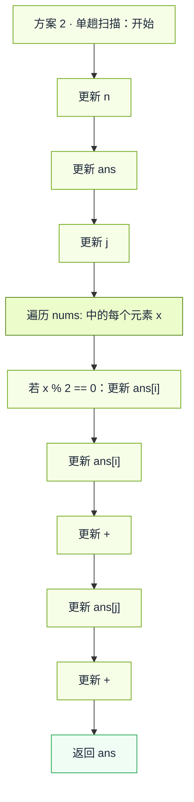

```python
import sys  # 提高递归深度上限（深输入防 RecursionError）

sys.setrecursionlimit(200000)  # 树/链表类题目节点数可达 1e4 量级

def sortArrayByParityII(nums):  # 定义函数 sortArrayByParityII（参数：数组）
    n = len(nums)  # 把 长度(数组) 存入 元素个数
    ans = [0] * n  # 把 [0] 乘 元素个数 存入 答案
    i, j = 0, 1  # 把 0, 1 写入 i, j
    for x in nums:  # 逐个取出 数组 的元素（x）
        if x % 2 == 0:  # 若 x 对…取模 2 等于 0
            ans[i] = x  # 把 x 写入 ans[i]
            i += 2  # 下标 i累加 2
        else:  # 否则
            ans[j] = x  # 把 x 写入 ans[j]
            j += 2  # 下标 j累加 2
    return ans  # 返回 答案

if __name__ == "__main__":  # 若 __name__ 等于 '__main__'
    print(sortArrayByParityII([4, 2, 5, 7]))  # 打印输出
```

#### 方案 3：单趟扫描

**思路与代码分析**：核心是「单趟扫描」。Python 版用切片与字典推导式简化操作，突出可读性。**走读**：方案 3 · 单趟扫描：开始 → 更新 n → 更新 j → 循环 i：从 0 到 2 前，步长 n → 若 nums[i] % 2 == 1：处理 while nums[j] % 2 == 1: → 当 nums[j] % 2 == 1: 时反复执行 → 更新 + → 更新 nums[j] → 返回 nums。

**运行架构**（真实控制流）：

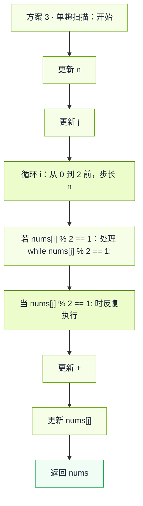

```python
import sys  # 提高递归深度上限（深输入防 RecursionError）

sys.setrecursionlimit(200000)  # 树/链表类题目节点数可达 1e4 量级

def sortArrayByParityII(nums):  # 定义函数 sortArrayByParityII（参数：数组）
    n = len(nums)  # 把 长度(数组) 存入 元素个数
    j = 1  # 把 1 存入 下标 j
    for i in range(0, n, 2):  # 让 下标 i 从 0 到 元素个数 到 2 遍历
        if nums[i] % 2 == 1:  # 若 数组[下标 i] 对…取模 2 等于 1
            while nums[j] % 2 == 1:  # 循环，直到不满足「数组[下标 j] 对…取模 2 等于 1」
                j += 2  # 下标 j累加 2
            nums[i], nums[j] = nums[j], nums[i]  # 把 数组[下标 j], 数组[下标 i] 写入 nums[i], nums[j]
    return nums  # 返回 数组

if __name__ == "__main__":  # 若 __name__ 等于 '__main__'
    print(sortArrayByParityII([4, 2, 5, 7]))  # 打印输出
```

#### 方案 4：方案4（双指针原地交换）

**思路与代码分析**：核心是「方案4（双指针原地交换）」。Python 版用切片与字典推导式简化操作，突出可读性。**走读**：方案 4 · 方案4（双指针原地交换）：开始 → 更新 n → 更新 j → 循环 i：从 0 到 2 前，步长 n → 若 nums[i] & 1：处理 while nums[j] & 1: → 当 nums[j] & 1: 时反复执行 → 更新 + → 更新 nums[j] → 返回 nums。

**运行架构**（真实控制流）：

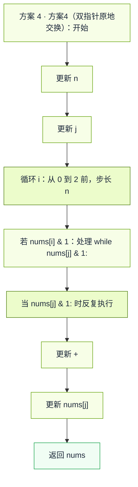

```python
import sys  # 提高递归深度上限（深输入防 RecursionError）

sys.setrecursionlimit(200000)  # 树/链表类题目节点数可达 1e4 量级

def sortArrayByParityII(nums):  # 定义函数 sortArrayByParityII（参数：数组）
    n = len(nums)  # 把 长度(数组) 存入 元素个数
    j = 1  # 把 1 存入 下标 j
    for i in range(0, n, 2):  # 让 下标 i 从 0 到 元素个数 到 2 遍历
        if nums[i] & 1:  # 若 数组[下标 i] 按位与 1
            while nums[j] & 1:  # 循环，直到不满足「数组[下标 j] 按位与 1」
                j += 2  # 下标 j累加 2
            nums[i], nums[j] = nums[j], nums[i]  # 把 数组[下标 j], 数组[下标 i] 写入 nums[i], nums[j]
    return nums  # 返回 数组

if __name__ == "__main__":  # 若 __name__ 等于 '__main__'
    print(sortArrayByParityII([4, 2, 5, 7]))  # 打印输出
    print(sortArrayByParityII([2, 3]))  # 打印输出
```

#### 方案 5：方案5（双指针原地交换）

**思路与代码分析**：核心是「方案5（双指针原地交换）」。Python 版用切片与字典推导式简化操作，突出可读性。**走读**：方案 5 · 方案5（双指针原地交换）：开始 → 更新 n → 更新 j → 循环 i：从 0 到 2 前，步长 n → 若 nums[i] & 1：处理 while nums[j] & 1: → 当 nums[j] & 1: 时反复执行 → 更新 + → 更新 nums[j] → 返回 nums。

**运行架构**（真实控制流）：


```python
import sys  # 提高递归深度上限（深输入防 RecursionError）

sys.setrecursionlimit(200000)  # 树/链表类题目节点数可达 1e4 量级

def sortArrayByParityII(nums):  # 定义函数 sortArrayByParityII（参数：数组）
    n = len(nums)  # 把 长度(数组) 存入 元素个数
    j = 1  # 把 1 存入 下标 j
    for i in range(0, n, 2):  # 让 下标 i 从 0 到 元素个数 到 2 遍历
        if nums[i] & 1:  # 若 数组[下标 i] 按位与 1
            while nums[j] & 1:  # 循环，直到不满足「数组[下标 j] 按位与 1」
                j += 2  # 下标 j累加 2
            nums[i], nums[j] = nums[j], nums[i]  # 把 数组[下标 j], 数组[下标 i] 写入 nums[i], nums[j]
    return nums  # 返回 数组

if __name__ == "__main__":  # 若 __name__ 等于 '__main__'
    print(sortArrayByParityII([4, 2, 5, 7]))  # 打印输出
    print(sortArrayByParityII([2, 3]))  # 打印输出
```

#### 方案 6：方案6（双指针原地交换）

**思路与代码分析**：核心是「方案6（双指针原地交换）」。Python 版用切片与字典推导式简化操作，突出可读性。**走读**：方案 6 · 方案6（双指针原地交换）：开始 → 更新 n → 更新 j → 循环 i：从 0 到 2 前，步长 n → 若 nums[i] & 1：处理 while nums[j] & 1: → 当 nums[j] & 1: 时反复执行 → 更新 + → 更新 nums[j] → 返回 nums。

**运行架构**（真实控制流）：


```python
import sys  # 提高递归深度上限（深输入防 RecursionError）

sys.setrecursionlimit(200000)  # 树/链表类题目节点数可达 1e4 量级

def sortArrayByParityII(nums):  # 定义函数 sortArrayByParityII（参数：数组）
    n = len(nums)  # 把 长度(数组) 存入 元素个数
    j = 1  # 把 1 存入 下标 j
    for i in range(0, n, 2):  # 让 下标 i 从 0 到 元素个数 到 2 遍历
        if nums[i] & 1:  # 若 数组[下标 i] 按位与 1
            while nums[j] & 1:  # 循环，直到不满足「数组[下标 j] 按位与 1」
                j += 2  # 下标 j累加 2
            nums[i], nums[j] = nums[j], nums[i]  # 把 数组[下标 j], 数组[下标 i] 写入 nums[i], nums[j]
    return nums  # 返回 数组

if __name__ == "__main__":  # 若 __name__ 等于 '__main__'
    print(sortArrayByParityII([4, 2, 5, 7]))  # 打印输出
    print(sortArrayByParityII([2, 3]))  # 打印输出
```

#### 方案 7：单趟扫描

**思路与代码分析**：核心是「单趟扫描」。Python 版用切片与字典推导式简化操作，突出可读性。**走读**：方案 7 · 单趟扫描：开始 → 更新 n → 更新 j → 循环 i：从 0 到 2 前，步长 n → 若 nums[i] & 1：处理 while nums[j] & 1: → 当 nums[j] & 1: 时反复执行 → 更新 + → 更新 nums[j] → 返回 nums。

**运行架构**（真实控制流）：

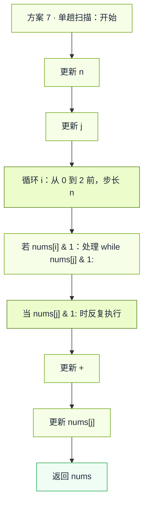

```python
import sys  # 提高递归深度上限（深输入防 RecursionError）

sys.setrecursionlimit(200000)  # 树/链表类题目节点数可达 1e4 量级

def sortArrayByParityII(nums):  # 定义函数 sortArrayByParityII（参数：数组）
    n = len(nums)  # 把 长度(数组) 存入 元素个数
    j = 1  # 把 1 存入 下标 j
    for i in range(0, n, 2):  # 让 下标 i 从 0 到 元素个数 到 2 遍历
        if nums[i] & 1:  # 若 数组[下标 i] 按位与 1
            while nums[j] & 1:  # 循环，直到不满足「数组[下标 j] 按位与 1」
                j += 2  # 下标 j累加 2
            nums[i], nums[j] = nums[j], nums[i]  # 把 数组[下标 j], 数组[下标 i] 写入 nums[i], nums[j]
    return nums  # 返回 数组

if __name__ == "__main__":  # 若 __name__ 等于 '__main__'
    print(sortArrayByParityII([4, 2, 5, 7]))  # 打印输出
    print(sortArrayByParityII([2, 3]))  # 打印输出
```

#### 方案 8：方案8（双指针原地交换）

**思路与代码分析**：核心是「方案8（双指针原地交换）」。Python 版用切片与字典推导式简化操作，突出可读性。**走读**：方案 8 · 方案8（双指针原地交换）：开始 → 更新 n → 更新 j → 循环 i：从 0 到 2 前，步长 n → 若 nums[i] & 1：处理 while nums[j] & 1: → 当 nums[j] & 1: 时反复执行 → 更新 + → 更新 nums[j] → 返回 nums。

**运行架构**（真实控制流）：


```python
import sys  # 提高递归深度上限（深输入防 RecursionError）

sys.setrecursionlimit(200000)  # 树/链表类题目节点数可达 1e4 量级

def sortArrayByParityII(nums):  # 定义函数 sortArrayByParityII（参数：数组）
    n = len(nums)  # 把 长度(数组) 存入 元素个数
    j = 1  # 把 1 存入 下标 j
    for i in range(0, n, 2):  # 让 下标 i 从 0 到 元素个数 到 2 遍历
        if nums[i] & 1:  # 若 数组[下标 i] 按位与 1
            while nums[j] & 1:  # 循环，直到不满足「数组[下标 j] 按位与 1」
                j += 2  # 下标 j累加 2
            nums[i], nums[j] = nums[j], nums[i]  # 把 数组[下标 j], 数组[下标 i] 写入 nums[i], nums[j]
    return nums  # 返回 数组

if __name__ == "__main__":  # 若 __name__ 等于 '__main__'
    print(sortArrayByParityII([4, 2, 5, 7]))  # 打印输出
    print(sortArrayByParityII([2, 3]))  # 打印输出
```

#### 方案 9：方案9（按奇偶下标归位，不排序）

**思路与代码分析**：核心是「方案9（按奇偶下标归位，不排序）」。Python 版用切片与字典推导式简化操作，突出可读性。**走读**：方案 9 · 方案9（按奇偶下标归位，不排序）：开始 → 更新 res → 更新 e → 更新 o → 遍历 nums: 中的每个元素 x → 若 x % 2 == 0：更新 res[e] → 更新 res[e] → 更新 + → 更新 res[o] → 更新 + → 返回 res。

**运行架构**（真实控制流）：

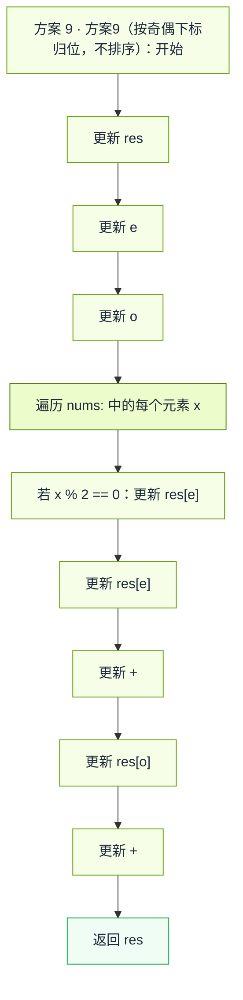

```python
import sys  # 提高递归深度上限（深输入防 RecursionError）

sys.setrecursionlimit(200000)  # 树/链表类题目节点数可达 1e4 量级

def sortArrayByParityII(nums):  # 定义函数 sortArrayByParityII（参数：数组）
    res = [0] * len(nums)  # 把 [0] 乘 长度(数组) 存入 结果
    e = 0  # 把 0 存入 e
    o = 1  # 把 1 存入 o
    for x in nums:  # 逐个取出 数组 的元素（x）
        if x % 2 == 0:  # 若 x 对…取模 2 等于 0
            res[e] = x  # 把 x 写入 res[e]
            e += 2  # e累加 2
        else:  # 否则
            res[o] = x  # 把 x 写入 res[o]
            o += 2  # o累加 2
    return res  # 返回 结果

if __name__ == "__main__":  # 若 __name__ 等于 '__main__'
    print(sortArrayByParityII([4, 2, 5, 7]))  # 打印输出
    print(sortArrayByParityII([2, 3]))  # 打印输出
```

### Go 实现（9 种方案）

Go 的全部方案如下，每个方案都内嵌用例自测，可独立运行（老仓库 python/go 文件遵循「打印结果」约定）：

#### 方案 1：方案1（先排序再按奇偶下标归位）

**思路与代码分析**：核心是「方案1（先排序再按奇偶下标归位）」。Go 版用切片与多返回值惯用法，显式处理索引边界。**走读**：方案 1 · 方案1（先排序再按奇偶下标归位）：开始 → 调用 sort.Ints(nums) → 更新 : → 更新 : → 更新 : → 遍历 nums 的下标与元素 item → 处理 if item%2 == 1 → 更新 res[odd] → 更新 + → 更新 res[even] → 更新 + → 返回 res。

**运行架构**（真实控制流）：

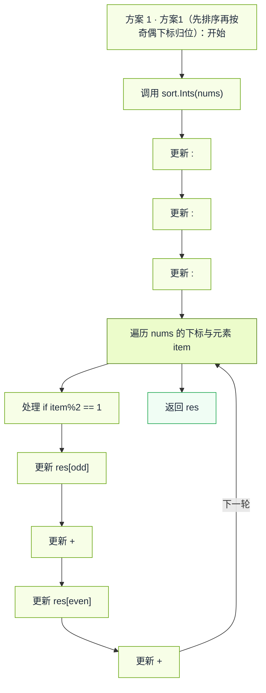

```go
package main // 引入依赖

import (
	"fmt"     // 「fmt」
	"reflect" // 「reflect」
	"sort"    // 「sort」
)

func sortArrayByParityII(nums []int) []int { // 定义函数/方法 sortArrayByParityII
	sort.Ints(nums)               // sort.Ints(数组)
	res := make([]int, len(nums)) // 把 make([]int, 长度(数组)) 写入 res :
	odd := 1                      // 把 1 写入 odd :
	even := 0                     // 把 0 写入 even :
	for _, item := range nums {   // 同时取 _ 与 item 遍历
		if item%2 == 1 { // 若 item 对…取模 2 等于 1
			res[odd] = item // 把 item 写入 res[odd]
			odd += 2        // odd累加 2
		} else { // 否则
			res[even] = item // 把 item 写入 res[even]
			even += 2        // even累加 2
		}
	}
	return res // 返回 结果
}

func main() { // 程序入口：跑内嵌自测用例
	want := []int{2, 5, 4, 7}                     // 把 []int{2, 5, 4, 7} 写入 want :
	got := sortArrayByParityII([]int{4, 2, 5, 7}) // 把 sortArrayByParityII([]int{4, 2, 5, 7}) 写入 got :
	if !reflect.DeepEqual(got, want) {            // 若 取反 reflect.DeepEqual(got, want
		fmt.Println("FAIL", got) // 打印输出
		return                   // return
	}
	fmt.Println("PASS") // 全部用例通过，输出 PASS
}
```

#### 方案 2：单趟扫描

**思路与代码分析**：核心是「单趟扫描」。Go 版用切片与多返回值惯用法，显式处理索引边界。**走读**：方案 2 · 单趟扫描：开始 → 调用 sort.Ints(nums) → 更新 : → 更新 : → 更新 : → 遍历 nums 的下标与元素 item → 处理 if item%2 == 1 → 更新 res[odd] → 更新 + → 更新 res[even] → 更新 + → 返回 res。

**运行架构**（真实控制流）：

```mermaid
graph TD
    N0["方案 2 · 单趟扫描：开始"]
    N1["调用 sort.Ints(nums)"]
    N2["更新 :"]
    N3["更新 :"]
    N4["更新 :"]
    N5["遍历 nums 的下标与元素 item"]
    N6["处理 if item%2 == 1"]
    N7["更新 res[odd]"]
    N8["更新 +"]
    N9["更新 res[even]"]
    N10["更新 +"]
    N11["返回 res"]
    N0 --> N1
    N1 --> N2
    N2 --> N3
    N3 --> N4
    N4 --> N5
    N5 --> N6
    N6 --> N7
    N7 --> N8
    N8 --> N9
    N9 --> N10
    N10 -- 下一轮 --> N5
    N5 --> N11
    classDef n fill:#f7fee7,stroke:#65a30d,color:#1e293b;
    classDef lp fill:#ecfccb,stroke:#4d7c0f,color:#1e293b;
    classDef dc fill:#fef9c3,stroke:#ca8a04,color:#1e293b;
    classDef tm fill:#f0fdf4,stroke:#16a34a,color:#1e293b;
    class N0,N1,N2,N3,N4,N6,N7,N8,N9,N10 n;
    class N5 lp;
    class N11 tm;
```

```go
package main // 引入依赖

import (
	"fmt"     // 「fmt」
	"reflect" // 「reflect」
	"sort"    // 「sort」
)

func sortArrayByParityII(nums []int) []int { // 定义函数/方法 sortArrayByParityII
	sort.Ints(nums)               // sort.Ints(数组)
	res := make([]int, len(nums)) // 把 make([]int, 长度(数组)) 写入 res :
	odd := 1                      // 把 1 写入 odd :
	even := 0                     // 把 0 写入 even :
	for _, item := range nums {   // 同时取 _ 与 item 遍历
		if item%2 == 1 { // 若 item 对…取模 2 等于 1
			res[odd] = item // 把 item 写入 res[odd]
			odd += 2        // odd累加 2
		} else { // 否则
			res[even] = item // 把 item 写入 res[even]
			even += 2        // even累加 2
		}
	}
	return res // 返回 结果
}

func main() { // 程序入口：跑内嵌自测用例
	want := []int{2, 5, 4, 7}                     // 把 []int{2, 5, 4, 7} 写入 want :
	got := sortArrayByParityII([]int{4, 2, 5, 7}) // 把 sortArrayByParityII([]int{4, 2, 5, 7}) 写入 got :
	if !reflect.DeepEqual(got, want) {            // 若 取反 reflect.DeepEqual(got, want
		fmt.Println("FAIL", got) // 打印输出
		return                   // return
	}
	fmt.Println("PASS") // 全部用例通过，输出 PASS
}
```

#### 方案 3：单趟扫描

**思路与代码分析**：核心是「单趟扫描」。Go 版用切片与多返回值惯用法，显式处理索引边界。**走读**：方案 3 · 单趟扫描：开始 → 处理 if len(a) ≠ len(src) → 返回 false → 处理 if 非 eqMultiset(a, src) → 返回 false → 遍历 a 的下标与元素 v → 处理 if i%2 == 0 且 v%2 ≠ 0 → 返回 false → 处理 if i%2 == 1 且 v%2 == 0 → 返回 false → 返回 true。

**运行架构**（真实控制流）：

```mermaid
graph TD
    N0["方案 3 · 单趟扫描：开始"]
    N1["处理 if len(a) ≠ len(src)"]
    N2["返回 false"]
    N3["处理 if 非 eqMultiset(a, src)"]
    N4["返回 false"]
    N5["遍历 a 的下标与元素 v"]
    N6["处理 if i%2 == 0 且 v%2 ≠ 0"]
    N7["返回 false"]
    N8["处理 if i%2 == 1 且 v%2 == 0"]
    N9["返回 false"]
    N10["返回 true"]
    N0 --> N1
    N1 --> N2
    N2 --> N3
    N3 --> N4
    N4 --> N5
    N5 --> N6
    N6 --> N7
    N7 --> N8
    N8 --> N9
    N5 --> N10
    classDef n fill:#f7fee7,stroke:#65a30d,color:#1e293b;
    classDef lp fill:#ecfccb,stroke:#4d7c0f,color:#1e293b;
    classDef dc fill:#fef9c3,stroke:#ca8a04,color:#1e293b;
    classDef tm fill:#f0fdf4,stroke:#16a34a,color:#1e293b;
    class N0,N1,N3,N6,N8 n;
    class N5 lp;
    class N2,N4,N7,N9,N10 tm;
```

```go
package main // 引入依赖
import (
	"fmt"
	"os"
) // 引入依赖
func sortArrayByParityII(nums []int) []int { // 定义函数/方法 sortArrayByParityII
	n := len(nums)
	res := make([]int, n)
	e, o := 0, 1             // 把 长度(数组); 结果 : 赋值为 make([]int, 元素个数); e, o : 赋值为 0, 1 写入 n :
	for _, v := range nums { // 同时取 _ 与 值 遍历
		if v%2 == 0 {
			res[e] = v
			e += 2
		} else {
			res[o] = v
			o += 2
		}
	}
	return res // 返回 结果
}
func eqMultiset(a, b []int) bool { // 定义函数/方法 eqMultiset
	if len(a) != len(b) {
		return false
	} // 若 长度(数组) 不等于 长度(b) { return false }
	ca, cb := map[int]int{}, map[int]int{} // 把 映射表[int]int{}, 映射表[int]int{} 写入 ca, cb :
	for _, v := range a {
		ca[v]++
	} // 同时取 _ 与 值 遍历
	for _, v := range b {
		cb[v]++
	} // 同时取 _ 与 值 遍历
	for k, v := range ca {
		if cb[k] != v {
			return false
		}
	} // 同时取 下标 k 与 值 遍历
	return true // 返回 true
}
func validParity(a, src []int) bool { // 定义函数/方法 validParity
	if len(a) != len(src) {
		return false
	} // 若 长度(数组) 不等于 长度(src) { return false }
	if !eqMultiset(a, src) {
		return false
	} // 若 取反 eqMultiset(数组, src) { return false }
	for i, v := range a { // 同时取 下标 i 与 值 遍历
		if i%2 == 0 && v%2 != 0 {
			return false
		} // 若 下标 i 对…取模 2 等于 0 且 值 对…取模 2 不等于 0 { return false }
		if i%2 == 1 && v%2 == 0 {
			return false
		} // 若 下标 i 对…取模 2 等于 1 且 值 对…取模 2 等于 0 { return false }
	}
	return true // 返回 true
}
func main() { // 程序入口：跑内嵌自测用例
	cases := [][]int{{4, 2, 5, 7}, {2, 3}, {1, 2, 3, 4}} // 把 [][]int{{4,2,5,7},{2,3},{1,2,3,4}} 写入 cases :
	ok := true                                           // 把 true 写入 ok :
	for _, c := range cases {                            // 同时取 _ 与 字符 遍历
		if !validParity(sortArrayByParityII(c), c) {
			ok = false
			fmt.Printf("FAIL parity %v\n", c)
		}
	}
	if !ok {
		os.Exit(1)
	} // 若 取反 ok { os.Exit(1) }
	fmt.Println("PASS") // 全部用例通过，输出 PASS
}
```

#### 方案 4：方案4（双指针原地交换）

**思路与代码分析**：核心是「方案4（双指针原地交换）」。Go 版用切片与多返回值惯用法，显式处理索引边界。**走读**：方案 4 · 方案4（双指针原地交换）：开始 → 更新 : → 更新 : → 遍历循环 → 处理 if nums[i]&1 == 1 → 遍历循环 → 更新 + → 更新 nums[j] → 返回 nums。

**运行架构**（真实控制流）：

```mermaid
graph TD
    N0["方案 4 · 方案4（双指针原地交换）：开始"]
    N1["更新 :"]
    N2["更新 :"]
    N3["遍历循环"]
    N4["处理 if nums[i]&1 == 1"]
    N5["遍历循环"]
    N6["更新 +"]
    N7["更新 nums[j]"]
    N8["返回 nums"]
    N0 --> N1
    N1 --> N2
    N2 --> N3
    N3 --> N4
    N4 --> N5
    N5 --> N6
    N6 -- 下一轮 --> N5
    N5 --> N7
    N7 -- 下一轮 --> N3
    N3 --> N8
    classDef n fill:#f7fee7,stroke:#65a30d,color:#1e293b;
    classDef lp fill:#ecfccb,stroke:#4d7c0f,color:#1e293b;
    classDef dc fill:#fef9c3,stroke:#ca8a04,color:#1e293b;
    classDef tm fill:#f0fdf4,stroke:#16a34a,color:#1e293b;
    class N0,N1,N2,N4,N6,N7 n;
    class N3,N5 lp;
    class N8 tm;
```

```go
package main // 引入依赖

import (
	"fmt"     // 「fmt」
	"reflect" // 「reflect」
)

func sortArrayByParityII(nums []int) []int { // 定义函数/方法 sortArrayByParityII
	n := len(nums)              // 把 长度(数组) 写入 n :
	j := 1                      // 把 1 写入 j :
	for i := 0; i < n; i += 2 { // 让 下标 i 从 0 开始计数
		if nums[i]&1 == 1 { // 若 数组[下标 i] 按位与 1 等于 1
			for nums[j]&1 == 1 { // 把 赋值为 1 { 写入 for nums[j]&1
				j += 2 // 下标 j累加 2
			}
			nums[i], nums[j] = nums[j], nums[i] // 把 数组[下标 j], 数组[下标 i] 写入 nums[i], nums[j]
		}
	}
	return nums // 返回 数组
}

func main() { // 程序入口：跑内嵌自测用例
	if !reflect.DeepEqual(sortArrayByParityII([]int{4, 2, 5, 7}), []int{4, 5, 2, 7}) {
		fmt.Println("FAIL1") // 打印输出
		return               // return
	}
	if !reflect.DeepEqual(sortArrayByParityII([]int{2, 3}), []int{2, 3}) {
		fmt.Println("FAIL2") // 打印输出
		return               // return
	}
	fmt.Println("PASS") // 全部用例通过，输出 PASS
}
```

#### 方案 5：方案5（双指针原地交换）

**思路与代码分析**：核心是「方案5（双指针原地交换）」。Go 版用切片与多返回值惯用法，显式处理索引边界。**走读**：方案 5 · 方案5（双指针原地交换）：开始 → 更新 : → 更新 : → 遍历循环 → 处理 if nums[i]&1 == 1 → 遍历循环 → 更新 + → 更新 nums[j] → 返回 nums。

**运行架构**（真实控制流）：

```mermaid
graph TD
    N0["方案 5 · 方案5（双指针原地交换）：开始"]
    N1["更新 :"]
    N2["更新 :"]
    N3["遍历循环"]
    N4["处理 if nums[i]&1 == 1"]
    N5["遍历循环"]
    N6["更新 +"]
    N7["更新 nums[j]"]
    N8["返回 nums"]
    N0 --> N1
    N1 --> N2
    N2 --> N3
    N3 --> N4
    N4 --> N5
    N5 --> N6
    N6 -- 下一轮 --> N5
    N5 --> N7
    N7 -- 下一轮 --> N3
    N3 --> N8
    classDef n fill:#f7fee7,stroke:#65a30d,color:#1e293b;
    classDef lp fill:#ecfccb,stroke:#4d7c0f,color:#1e293b;
    classDef dc fill:#fef9c3,stroke:#ca8a04,color:#1e293b;
    classDef tm fill:#f0fdf4,stroke:#16a34a,color:#1e293b;
    class N0,N1,N2,N4,N6,N7 n;
    class N3,N5 lp;
    class N8 tm;
```

```go
package main // 引入依赖

import (
	"fmt"     // 「fmt」
	"reflect" // 「reflect」
)

func sortArrayByParityII(nums []int) []int { // 定义函数/方法 sortArrayByParityII
	n := len(nums)              // 把 长度(数组) 写入 n :
	j := 1                      // 把 1 写入 j :
	for i := 0; i < n; i += 2 { // 让 下标 i 从 0 开始计数
		if nums[i]&1 == 1 { // 若 数组[下标 i] 按位与 1 等于 1
			for nums[j]&1 == 1 { // 把 赋值为 1 { 写入 for nums[j]&1
				j += 2 // 下标 j累加 2
			}
			nums[i], nums[j] = nums[j], nums[i] // 把 数组[下标 j], 数组[下标 i] 写入 nums[i], nums[j]
		}
	}
	return nums // 返回 数组
}

func main() { // 程序入口：跑内嵌自测用例
	if !reflect.DeepEqual(sortArrayByParityII([]int{4, 2, 5, 7}), []int{4, 5, 2, 7}) {
		fmt.Println("FAIL1") // 打印输出
		return               // return
	}
	if !reflect.DeepEqual(sortArrayByParityII([]int{2, 3}), []int{2, 3}) {
		fmt.Println("FAIL2") // 打印输出
		return               // return
	}
	fmt.Println("PASS") // 全部用例通过，输出 PASS
}
```

#### 方案 6：方案6（双指针原地交换）

**思路与代码分析**：核心是「方案6（双指针原地交换）」。Go 版用切片与多返回值惯用法，显式处理索引边界。**走读**：方案 6 · 方案6（双指针原地交换）：开始 → 更新 : → 更新 : → 遍历循环 → 处理 if nums[i]&1 == 1 → 遍历循环 → 更新 + → 更新 nums[j] → 返回 nums。

**运行架构**（真实控制流）：

```mermaid
graph TD
    N0["方案 6 · 方案6（双指针原地交换）：开始"]
    N1["更新 :"]
    N2["更新 :"]
    N3["遍历循环"]
    N4["处理 if nums[i]&1 == 1"]
    N5["遍历循环"]
    N6["更新 +"]
    N7["更新 nums[j]"]
    N8["返回 nums"]
    N0 --> N1
    N1 --> N2
    N2 --> N3
    N3 --> N4
    N4 --> N5
    N5 --> N6
    N6 -- 下一轮 --> N5
    N5 --> N7
    N7 -- 下一轮 --> N3
    N3 --> N8
    classDef n fill:#f7fee7,stroke:#65a30d,color:#1e293b;
    classDef lp fill:#ecfccb,stroke:#4d7c0f,color:#1e293b;
    classDef dc fill:#fef9c3,stroke:#ca8a04,color:#1e293b;
    classDef tm fill:#f0fdf4,stroke:#16a34a,color:#1e293b;
    class N0,N1,N2,N4,N6,N7 n;
    class N3,N5 lp;
    class N8 tm;
```

```go
package main // 引入依赖

import (
	"fmt"     // 「fmt」
	"reflect" // 「reflect」
)

func sortArrayByParityII(nums []int) []int { // 定义函数/方法 sortArrayByParityII
	n := len(nums)              // 把 长度(数组) 写入 n :
	j := 1                      // 把 1 写入 j :
	for i := 0; i < n; i += 2 { // 让 下标 i 从 0 开始计数
		if nums[i]&1 == 1 { // 若 数组[下标 i] 按位与 1 等于 1
			for nums[j]&1 == 1 { // 把 赋值为 1 { 写入 for nums[j]&1
				j += 2 // 下标 j累加 2
			}
			nums[i], nums[j] = nums[j], nums[i] // 把 数组[下标 j], 数组[下标 i] 写入 nums[i], nums[j]
		}
	}
	return nums // 返回 数组
}

func main() { // 程序入口：跑内嵌自测用例
	if !reflect.DeepEqual(sortArrayByParityII([]int{4, 2, 5, 7}), []int{4, 5, 2, 7}) {
		fmt.Println("FAIL1") // 打印输出
		return               // return
	}
	if !reflect.DeepEqual(sortArrayByParityII([]int{2, 3}), []int{2, 3}) {
		fmt.Println("FAIL2") // 打印输出
		return               // return
	}
	fmt.Println("PASS") // 全部用例通过，输出 PASS
}
```

#### 方案 7：单趟扫描

**思路与代码分析**：核心是「单趟扫描」。Go 版用切片与多返回值惯用法，显式处理索引边界。**走读**：方案 7 · 单趟扫描：开始 → 更新 : → 更新 : → 遍历循环 → 处理 if nums[i]&1 == 1 → 遍历循环 → 更新 + → 更新 nums[j] → 返回 nums。

**运行架构**（真实控制流）：

```mermaid
graph TD
    N0["方案 7 · 单趟扫描：开始"]
    N1["更新 :"]
    N2["更新 :"]
    N3["遍历循环"]
    N4["处理 if nums[i]&1 == 1"]
    N5["遍历循环"]
    N6["更新 +"]
    N7["更新 nums[j]"]
    N8["返回 nums"]
    N0 --> N1
    N1 --> N2
    N2 --> N3
    N3 --> N4
    N4 --> N5
    N5 --> N6
    N6 -- 下一轮 --> N5
    N5 --> N7
    N7 -- 下一轮 --> N3
    N3 --> N8
    classDef n fill:#f7fee7,stroke:#65a30d,color:#1e293b;
    classDef lp fill:#ecfccb,stroke:#4d7c0f,color:#1e293b;
    classDef dc fill:#fef9c3,stroke:#ca8a04,color:#1e293b;
    classDef tm fill:#f0fdf4,stroke:#16a34a,color:#1e293b;
    class N0,N1,N2,N4,N6,N7 n;
    class N3,N5 lp;
    class N8 tm;
```

```go
package main // 引入依赖

import (
	"fmt"     // 「fmt」
	"reflect" // 「reflect」
)

func sortArrayByParityII(nums []int) []int { // 定义函数/方法 sortArrayByParityII
	n := len(nums)              // 把 长度(数组) 写入 n :
	j := 1                      // 把 1 写入 j :
	for i := 0; i < n; i += 2 { // 让 下标 i 从 0 开始计数
		if nums[i]&1 == 1 { // 若 数组[下标 i] 按位与 1 等于 1
			for nums[j]&1 == 1 { // 把 赋值为 1 { 写入 for nums[j]&1
				j += 2 // 下标 j累加 2
			}
			nums[i], nums[j] = nums[j], nums[i] // 把 数组[下标 j], 数组[下标 i] 写入 nums[i], nums[j]
		}
	}
	return nums // 返回 数组
}

func main() { // 程序入口：跑内嵌自测用例
	if !reflect.DeepEqual(sortArrayByParityII([]int{4, 2, 5, 7}), []int{4, 5, 2, 7}) {
		fmt.Println("FAIL1") // 打印输出
		return               // return
	}
	if !reflect.DeepEqual(sortArrayByParityII([]int{2, 3}), []int{2, 3}) {
		fmt.Println("FAIL2") // 打印输出
		return               // return
	}
	fmt.Println("PASS") // 全部用例通过，输出 PASS
}
```

#### 方案 8：方案8（双指针原地交换）

**思路与代码分析**：核心是「方案8（双指针原地交换）」。Go 版用切片与多返回值惯用法，显式处理索引边界。**走读**：方案 8 · 方案8（双指针原地交换）：开始 → 更新 : → 更新 : → 遍历循环 → 处理 if nums[i]&1 == 1 → 遍历循环 → 更新 + → 更新 nums[j] → 返回 nums。

**运行架构**（真实控制流）：

```mermaid
graph TD
    N0["方案 8 · 方案8（双指针原地交换）：开始"]
    N1["更新 :"]
    N2["更新 :"]
    N3["遍历循环"]
    N4["处理 if nums[i]&1 == 1"]
    N5["遍历循环"]
    N6["更新 +"]
    N7["更新 nums[j]"]
    N8["返回 nums"]
    N0 --> N1
    N1 --> N2
    N2 --> N3
    N3 --> N4
    N4 --> N5
    N5 --> N6
    N6 -- 下一轮 --> N5
    N5 --> N7
    N7 -- 下一轮 --> N3
    N3 --> N8
    classDef n fill:#f7fee7,stroke:#65a30d,color:#1e293b;
    classDef lp fill:#ecfccb,stroke:#4d7c0f,color:#1e293b;
    classDef dc fill:#fef9c3,stroke:#ca8a04,color:#1e293b;
    classDef tm fill:#f0fdf4,stroke:#16a34a,color:#1e293b;
    class N0,N1,N2,N4,N6,N7 n;
    class N3,N5 lp;
    class N8 tm;
```

```go
package main // 引入依赖

import (
	"fmt"     // 「fmt」
	"reflect" // 「reflect」
)

func sortArrayByParityII(nums []int) []int { // 定义函数/方法 sortArrayByParityII
	n := len(nums)              // 把 长度(数组) 写入 n :
	j := 1                      // 把 1 写入 j :
	for i := 0; i < n; i += 2 { // 让 下标 i 从 0 开始计数
		if nums[i]&1 == 1 { // 若 数组[下标 i] 按位与 1 等于 1
			for nums[j]&1 == 1 { // 把 赋值为 1 { 写入 for nums[j]&1
				j += 2 // 下标 j累加 2
			}
			nums[i], nums[j] = nums[j], nums[i] // 把 数组[下标 j], 数组[下标 i] 写入 nums[i], nums[j]
		}
	}
	return nums // 返回 数组
}

func main() { // 程序入口：跑内嵌自测用例
	if !reflect.DeepEqual(sortArrayByParityII([]int{4, 2, 5, 7}), []int{4, 5, 2, 7}) {
		fmt.Println("FAIL1") // 打印输出
		return               // return
	}
	if !reflect.DeepEqual(sortArrayByParityII([]int{2, 3}), []int{2, 3}) {
		fmt.Println("FAIL2") // 打印输出
		return               // return
	}
	fmt.Println("PASS") // 全部用例通过，输出 PASS
}
```

#### 方案 9：方案9（按奇偶下标归位，不排序）

**思路与代码分析**：核心是「方案9（按奇偶下标归位，不排序）」。Go 版用切片与多返回值惯用法，显式处理索引边界。**走读**：方案 9 · 方案9（按奇偶下标归位，不排序）：开始 → 更新 : → 更新 : → 更新 : → 遍历 nums 的下标与元素 x → 处理 if x%2 == 0 → 更新 res[e] → 更新 + → 更新 res[o] → 更新 + → 返回 res。

**运行架构**（真实控制流）：

```mermaid
graph TD
    N0["方案 9 · 方案9（按奇偶下标归位，不排序）：开始"]
    N1["更新 :"]
    N2["更新 :"]
    N3["更新 :"]
    N4["遍历 nums 的下标与元素 x"]
    N5["处理 if x%2 == 0"]
    N6["更新 res[e]"]
    N7["更新 +"]
    N8["更新 res[o]"]
    N9["更新 +"]
    N10["返回 res"]
    N0 --> N1
    N1 --> N2
    N2 --> N3
    N3 --> N4
    N4 --> N5
    N5 --> N6
    N6 --> N7
    N7 --> N8
    N8 --> N9
    N9 -- 下一轮 --> N4
    N4 --> N10
    classDef n fill:#f7fee7,stroke:#65a30d,color:#1e293b;
    classDef lp fill:#ecfccb,stroke:#4d7c0f,color:#1e293b;
    classDef dc fill:#fef9c3,stroke:#ca8a04,color:#1e293b;
    classDef tm fill:#f0fdf4,stroke:#16a34a,color:#1e293b;
    class N0,N1,N2,N3,N5,N6,N7,N8,N9 n;
    class N4 lp;
    class N10 tm;
```

```go
package main // 引入依赖

import (
	"fmt"     // 「fmt」
	"reflect" // 「reflect」
)

func sortArrayByParityII(nums []int) []int { // 定义函数/方法 sortArrayByParityII
	res := make([]int, len(nums)) // 把 make([]int, 长度(数组)) 写入 res :
	e := 0                        // 把 0 写入 e :
	o := 1                        // 把 1 写入 o :
	for _, x := range nums {      // 同时取 _ 与 x 遍历
		if x%2 == 0 { // 若 x 对…取模 2 等于 0
			res[e] = x // 把 x 写入 res[e]
			e += 2     // e累加 2
		} else { // 否则
			res[o] = x // 把 x 写入 res[o]
			o += 2     // o累加 2
		}
	}
	return res // 返回 结果
}

func main() { // 程序入口：跑内嵌自测用例
	if !reflect.DeepEqual(sortArrayByParityII([]int{4, 2, 5, 7}), []int{4, 5, 2, 7}) {
		fmt.Println("FAIL1") // 打印输出
		return               // return
	}
	if !reflect.DeepEqual(sortArrayByParityII([]int{2, 3}), []int{2, 3}) {
		fmt.Println("FAIL2") // 打印输出
		return               // return
	}
	fmt.Println("PASS") // 全部用例通过，输出 PASS
}
```

### Java 实现（9 种方案）

Java 的全部方案如下，每个方案都内嵌用例自测，可独立运行（老仓库 python/go 文件遵循「打印结果」约定）：

#### 方案 1：方案1（先排序再按奇偶下标归位）

**思路与代码分析**：核心是「方案1（先排序再按奇偶下标归位）」。Java 版用类与静态方法组织，集合操作显式明了。代码里依次做这些事：先排序再处理；单循环线性扫描。**走读**：方案 1 · 方案1（先排序再按奇偶下标归位）：开始 → 更新 sorted → 排序整理 → 更新 res → 更新 odd → 遍历循环 → 若 item % 2 == 1 则： → 更新 res[odd] → 更新 + → 更新 res[even] → 更新 + → 返回 res。

**运行架构**（真实控制流）：

```mermaid
graph TD
    N0["方案 1 · 方案1（先排序再按奇偶下标归位）：开始"]
    N1["更新 sorted"]
    N2["排序整理"]
    N3["更新 res"]
    N4["更新 odd"]
    N5["遍历循环"]
    N6["若 item % 2 == 1 则："]
    N7["更新 res[odd]"]
    N8["更新 +"]
    N9["更新 res[even]"]
    N10["更新 +"]
    N11["返回 res"]
    N0 --> N1
    N1 --> N2
    N2 --> N3
    N3 --> N4
    N4 --> N5
    N5 --> N6
    N6 --> N7
    N7 --> N8
    N8 --> N9
    N9 --> N10
    N10 -- 下一轮 --> N5
    N5 --> N11
    classDef n fill:#f7fee7,stroke:#65a30d,color:#1e293b;
    classDef lp fill:#ecfccb,stroke:#4d7c0f,color:#1e293b;
    classDef dc fill:#fef9c3,stroke:#ca8a04,color:#1e293b;
    classDef tm fill:#f0fdf4,stroke:#16a34a,color:#1e293b;
    class N0,N1,N2,N3,N4,N6,N7,N8,N9,N10 n;
    class N5 lp;
    class N11 tm;
```

```java
package com.webfault.dsa; // 引入依赖

import java.util.*; // 引入依赖

class ParityS1 { // 定义类型
  static int[] sortArrayByParityII(int[] nums) { // 定义函数/方法 sortArrayByParityII
    int[] sorted = nums.clone(); // 把 数组.clone(); 写入 int[] sorted
    Arrays.sort(sorted); // 排序
    int[] res = new int[nums.length]; // 把 new int[数组.长度]; 写入 int[] res
    int odd = 1, even = 0; // 把 1, even 赋值为 0 存入 odd
    for (int item : sorted) { // for (int item : sorted) {
      if (item % 2 == 1) {
        res[odd] = item;
        odd += 2;
      } // 若 item 对…取模 2 等于 1) { 结果[odd] 赋值为 item; odd 累加 2; }
      else {
        res[even] = item;
        even += 2;
      } // 否则
    }
    return res; // 返回 结果
  }

  public static void main(String[] args) { // public static void main(String[] args) {
    int[][][] cases = { // 把 { 写入 int[][][] cases
      {{4, 2, 5, 7}, {2, 5, 4, 7}},
      {{2, 3}, {2, 3}},
    };
    boolean ok = true; // 把 true; 写入 boolean ok
    for (int[][] c : cases) { // for (int[][] 字符 : cases) {
      int[] got =
          ParityS1.sortArrayByParityII(
              c[0].clone()); // 把 ParityS1.sortArrayByParityII(字符[0].clone()); 写入 int[] got
      if (!Arrays.equals(got, c[1])) {
        ok = false;
        System.out.println("FAIL " + Arrays.toString(c[0]) + " -> " + Arrays.toString(got));
      }
    }
    if (!ok) throw new RuntimeException("FAILED"); // 若 取反 ok) throw new RuntimeException(「FAILED」);
    System.out.println("PASS"); // 全部用例通过，输出 PASS
  }
}
```

#### 方案 2：单趟扫描

**思路与代码分析**：核心是「单趟扫描」。Java 版用类与静态方法组织，集合操作显式明了。代码里依次做这些事：单循环线性扫描。**走读**：方案 2 · 单趟扫描：开始 → 更新 ans → 更新 i → 遍历循环 → 若 (x & 1) == 0 则： → 更新 ans[i] → 更新 + → 更新 ans[j] → 更新 + → 返回 ans。

**运行架构**（真实控制流）：

```mermaid
graph TD
    N0["方案 2 · 单趟扫描：开始"]
    N1["更新 ans"]
    N2["更新 i"]
    N3["遍历循环"]
    N4["若 (x & 1) == 0 则："]
    N5["更新 ans[i]"]
    N6["更新 +"]
    N7["更新 ans[j]"]
    N8["更新 +"]
    N9["返回 ans"]
    N0 --> N1
    N1 --> N2
    N2 --> N3
    N3 --> N4
    N4 --> N5
    N5 --> N6
    N6 --> N7
    N7 --> N8
    N8 -- 下一轮 --> N3
    N3 --> N9
    classDef n fill:#f7fee7,stroke:#65a30d,color:#1e293b;
    classDef lp fill:#ecfccb,stroke:#4d7c0f,color:#1e293b;
    classDef dc fill:#fef9c3,stroke:#ca8a04,color:#1e293b;
    classDef tm fill:#f0fdf4,stroke:#16a34a,color:#1e293b;
    class N0,N1,N2,N4,N5,N6,N7,N8 n;
    class N3 lp;
    class N9 tm;
```

```java
package com.webfault.dsa; // 引入依赖

import java.util.*; // 引入依赖

class ParityS2 { // 定义类型
  static int[] sortArrayByParityII(int[] nums) { // 定义函数/方法 sortArrayByParityII
    int[] ans = new int[nums.length]; // 把 new int[数组.长度]; 写入 int[] ans
    int i = 0, j = 1; // 把 0, 下标 j 赋值为 1 存入 下标 i
    for (int x : nums) { // for (int x : 数组) {
      if ((x & 1) == 0) {
        ans[i] = x;
        i += 2;
      } // 若 (x 按位与 1) 等于 0) { 答案[下标 i] 赋值为 x; 下标 i 累加 2; }
      else {
        ans[j] = x;
        j += 2;
      } // 否则
    }
    return ans; // 返回 答案
  }

  public static void main(String[] args) { // public static void main(String[] args) {
    int[][][] cases = { // 把 { 写入 int[][][] cases
      {{4, 2, 5, 7}, {4, 5, 2, 7}},
      {{2, 3}, {2, 3}},
    };
    boolean ok = true; // 把 true; 写入 boolean ok
    for (int[][] c : cases) { // for (int[][] 字符 : cases) {
      int[] got =
          ParityS2.sortArrayByParityII(
              c[0].clone()); // 把 ParityS2.sortArrayByParityII(字符[0].clone()); 写入 int[] got
      if (!Arrays.equals(got, c[1])) {
        ok = false;
        System.out.println("FAIL " + Arrays.toString(c[0]) + " -> " + Arrays.toString(got));
      }
    }
    if (!ok) throw new RuntimeException("FAILED"); // 若 取反 ok) throw new RuntimeException(「FAILED」);
    System.out.println("PASS"); // 全部用例通过，输出 PASS
  }
}
```

#### 方案 3：单趟扫描

**思路与代码分析**：核心是「单趟扫描」。Java 版用类与静态方法组织，集合操作显式明了。代码里依次做这些事：哈希结构做计数或查重；双重循环遍历。**走读**：方案 3 · 单趟扫描：开始 → 命中条件，直接返回 → 更新 ca → 遍历循环 → 遍历循环 → 命中条件，直接返回 → 遍历循环 → 命中条件，直接返回 → 命中条件，直接返回 → 返回 true。

**运行架构**（真实控制流）：

```mermaid
graph TD
    N0["方案 3 · 单趟扫描：开始"]
    N1{"a.length ≠ src.length ？"}
    N2["命中条件，直接返回"]
    N3["更新 ca"]
    N4["遍历循环"]
    D1["……（中间计算步骤）"]
    N6["遍历循环"]
    D2["……（中间计算步骤）"]
    N9{"非 ca.equals(cb) ？"}
    N10["命中条件，直接返回"]
    N11["遍历循环"]
    N12{"i % 2 == 0 且 a[i] % 2 ≠ 0 ？"}
    N13["命中条件，直接返回"]
    N14{"i % 2 == 1 且 a[i] % 2 == 0 ？"}
    N15["命中条件，直接返回"]
    N16["返回 true"]
    N0 --> N1
    N1 -- 是 --> N2
    N1 -- 否 --> N3
    N3 --> N4
    N9 -- 是 --> N10
    N9 -- 否 --> N11
    N11 --> N12
    N12 -- 是 --> N13
    N12 -- 否 --> N14
    N14 -- 是 --> N15
    N14 -- 下一轮 --> N11
    N11 --> N16
    N2 --> N3
    N4 --> D1
    D1 --> N6
    N6 --> D2
    D2 --> N9
    N10 --> N11
    N13 --> N14
    N15 --> N16
    classDef n fill:#f7fee7,stroke:#65a30d,color:#1e293b;
    classDef lp fill:#ecfccb,stroke:#4d7c0f,color:#1e293b;
    classDef dc fill:#fef9c3,stroke:#ca8a04,color:#1e293b;
    classDef tm fill:#f0fdf4,stroke:#16a34a,color:#1e293b;
    class N0,N3,D1,D2 n;
    class N4,N6,N11 lp;
    class N1,N9,N12,N14 dc;
    class N2,N10,N13,N15,N16 tm;
```

```java
package com.webfault.dsa; // 引入依赖

import java.util.*; // 引入依赖

class Main { // 定义类型
  static int[] sortArrayByParityII(int[] nums) { // 定义函数/方法 sortArrayByParityII
    int n = nums.length;
    int[] res = new int[n];
    int e = 0, o = 1;
    for (int v : nums) {
      if (v % 2 == 0) {
        res[e] = v;
        e += 2;
      } else {
        res[o] = v;
        o += 2;
      }
    }
    return res; // 返回 结果
  }

  static boolean validParity(int[] a, int[] src) { // 定义函数/方法 validParity
    if (a.length != src.length) return false; // 若 数组.长度 不等于 src.长度，直接返回 false
    Map<Integer, Integer> ca = new HashMap<>(), cb = new HashMap<>();
    for (int v : a)
      ca.put(v, ca.getOrDefault(v, 0) + 1); // for (int 值 : 数组) ca.put(值, ca.getOrDefault(值,0) 加 1);
    for (int v : src)
      cb.put(
          v, cb.getOrDefault(v, 0) + 1); // for (int 值 : src) cb.put(值, cb.getOrDefault(值,0) 加 1);
    if (!ca.equals(cb)) return false; // 若 取反 ca.equals(cb)，直接返回 false
    for (int i = 0; i < a.length; i++) { // 让 下标 i 从 0 开始计数，下标 i 小于 数组.长度 就继续
      if (i % 2 == 0 && a[i] % 2 != 0)
        return false; // 若 下标 i 对…取模 2 等于 0 且 数组[下标 i] 对…取模 2 不等于 0，直接返回 false
      if (i % 2 == 1 && a[i] % 2 == 0)
        return false; // 若 下标 i 对…取模 2 等于 1 且 数组[下标 i] 对…取模 2 等于 0，直接返回 false
    }
    return true; // 返回 true
  }

  public static void main(String[] args) { // public static void main(String[] args) {
    int[][] ins = {
      {4, 2, 5, 7}, {2, 3}, {1, 2, 3, 4}
    }; // 把 {{4,2,5,7},{2,3},{1,2,3,4}}; 写入 int[][] ins
    boolean ok = true; // 把 true; 写入 boolean ok
    for (int[] c : ins) {
      if (!validParity(sortArrayByParityII(c), c)) {
        ok = false;
        System.out.println("FAIL " + Arrays.toString(c));
      }
    } // 打印输出
    if (!ok) throw new RuntimeException("FAILED"); // 若 取反 ok) throw new RuntimeException(「FAILED」);
    System.out.println("PASS"); // 全部用例通过，输出 PASS
  }
}
```

#### 方案 4：方案4（双指针原地交换）

**思路与代码分析**：核心是「方案4（双指针原地交换）」。Java 版用类与静态方法组织，集合操作显式明了。代码里依次做这些事：单循环线性扫描。**走读**：方案 4 · 方案4（双指针原地交换）：开始 → 更新 n → 更新 j → 遍历循环 → 若 (nums[i] & 1) == 1 则： → 当 ((nums[j] & 1) == 1) j += 2 时反复执行 → 更新 t → 更新 nums[i] → 更新 nums[j] → 返回 nums。

**运行架构**（真实控制流）：

```mermaid
graph TD
    N0["方案 4 · 方案4（双指针原地交换）：开始"]
    N1["更新 n"]
    N2["更新 j"]
    N3["遍历循环"]
    N4["若 (nums[i] & 1) == 1 则："]
    N5["当 ((nums[j] & 1) == 1) j += 2 时反复执行"]
    N6["更新 t"]
    N7["更新 nums[i]"]
    N8["更新 nums[j]"]
    N9["返回 nums"]
    N0 --> N1
    N1 --> N2
    N2 --> N3
    N3 --> N4
    N4 --> N5
    N5 --> N6
    N6 --> N7
    N7 --> N8
    N8 -- 下一轮 --> N3
    N3 --> N9
    classDef n fill:#f7fee7,stroke:#65a30d,color:#1e293b;
    classDef lp fill:#ecfccb,stroke:#4d7c0f,color:#1e293b;
    classDef dc fill:#fef9c3,stroke:#ca8a04,color:#1e293b;
    classDef tm fill:#f0fdf4,stroke:#16a34a,color:#1e293b;
    class N0,N1,N2,N4,N6,N7,N8 n;
    class N3,N5 lp;
    class N9 tm;
```

```java
package com.webfault.dsa; // 引入依赖

import java.util.*; // 引入依赖

class ParityS4 { // 定义类型
  static int[] sortArrayByParityII(int[] nums) { // 定义函数/方法 sortArrayByParityII
    int n = nums.length; // 把 数组.长度 存入 元素个数
    int j = 1; // 把 1 存入 下标 j
    for (int i = 0; i < n; i += 2) { // 让 下标 i 从 0 开始计数，下标 i 小于 元素个数 就继续
      if ((nums[i] & 1) == 1) { // 若 (数组[下标 i] 按位与 1) 等于 1
        while ((nums[j] & 1) == 1) j += 2; // 循环，直到不满足「(数组[下标 j] 按位与 1) 等于 1) 下标 j 累加 2;」
        int t = nums[i];
        nums[i] = nums[j];
        nums[j] = t;
      }
    }
    return nums; // 返回 数组
  }

  public static void main(String[] args) { // public static void main(String[] args) {
    int[][][] cases = { // 把 { 写入 int[][][] cases
      {{4, 2, 5, 7}, {4, 5, 2, 7}},
      {{2, 3}, {2, 3}},
    };
    boolean ok = true; // 把 true; 写入 boolean ok
    for (int[][] c : cases) { // for (int[][] 字符 : cases) {
      int[] got =
          ParityS4.sortArrayByParityII(
              c[0].clone()); // 把 ParityS4.sortArrayByParityII(字符[0].clone()); 写入 int[] got
      if (!Arrays.equals(got, c[1])) {
        ok = false;
        System.out.println("FAIL " + Arrays.toString(c[0]) + " -> " + Arrays.toString(got));
      }
    }
    if (!ok) throw new RuntimeException("FAILED"); // 若 取反 ok) throw new RuntimeException(「FAILED」);
    System.out.println("PASS"); // 全部用例通过，输出 PASS
  }
}
```

#### 方案 5：方案5（双指针原地交换）

**思路与代码分析**：核心是「方案5（双指针原地交换）」。Java 版用类与静态方法组织，集合操作显式明了。代码里依次做这些事：单循环线性扫描。**走读**：方案 5 · 方案5（双指针原地交换）：开始 → 更新 n → 更新 j → 遍历循环 → 若 (nums[i] & 1) == 1 则： → 当 ((nums[j] & 1) == 1) j += 2 时反复执行 → 更新 t → 更新 nums[i] → 更新 nums[j] → 返回 nums。

**运行架构**（真实控制流）：

```mermaid
graph TD
    N0["方案 5 · 方案5（双指针原地交换）：开始"]
    N1["更新 n"]
    N2["更新 j"]
    N3["遍历循环"]
    N4["若 (nums[i] & 1) == 1 则："]
    N5["当 ((nums[j] & 1) == 1) j += 2 时反复执行"]
    N6["更新 t"]
    N7["更新 nums[i]"]
    N8["更新 nums[j]"]
    N9["返回 nums"]
    N0 --> N1
    N1 --> N2
    N2 --> N3
    N3 --> N4
    N4 --> N5
    N5 --> N6
    N6 --> N7
    N7 --> N8
    N8 -- 下一轮 --> N3
    N3 --> N9
    classDef n fill:#f7fee7,stroke:#65a30d,color:#1e293b;
    classDef lp fill:#ecfccb,stroke:#4d7c0f,color:#1e293b;
    classDef dc fill:#fef9c3,stroke:#ca8a04,color:#1e293b;
    classDef tm fill:#f0fdf4,stroke:#16a34a,color:#1e293b;
    class N0,N1,N2,N4,N6,N7,N8 n;
    class N3,N5 lp;
    class N9 tm;
```

```java
package com.webfault.dsa; // 引入依赖

import java.util.*; // 引入依赖

class ParityS5 { // 定义类型
  static int[] sortArrayByParityII(int[] nums) { // 定义函数/方法 sortArrayByParityII
    int n = nums.length; // 把 数组.长度 存入 元素个数
    int j = 1; // 把 1 存入 下标 j
    for (int i = 0; i < n; i += 2) { // 让 下标 i 从 0 开始计数，下标 i 小于 元素个数 就继续
      if ((nums[i] & 1) == 1) { // 若 (数组[下标 i] 按位与 1) 等于 1
        while ((nums[j] & 1) == 1) j += 2; // 循环，直到不满足「(数组[下标 j] 按位与 1) 等于 1) 下标 j 累加 2;」
        int t = nums[i];
        nums[i] = nums[j];
        nums[j] = t;
      }
    }
    return nums; // 返回 数组
  }

  public static void main(String[] args) { // public static void main(String[] args) {
    int[][][] cases = { // 把 { 写入 int[][][] cases
      {{4, 2, 5, 7}, {4, 5, 2, 7}},
      {{2, 3}, {2, 3}},
    };
    boolean ok = true; // 把 true; 写入 boolean ok
    for (int[][] c : cases) { // for (int[][] 字符 : cases) {
      int[] got =
          ParityS5.sortArrayByParityII(
              c[0].clone()); // 把 ParityS5.sortArrayByParityII(字符[0].clone()); 写入 int[] got
      if (!Arrays.equals(got, c[1])) {
        ok = false;
        System.out.println("FAIL " + Arrays.toString(c[0]) + " -> " + Arrays.toString(got));
      }
    }
    if (!ok) throw new RuntimeException("FAILED"); // 若 取反 ok) throw new RuntimeException(「FAILED」);
    System.out.println("PASS"); // 全部用例通过，输出 PASS
  }
}
```

#### 方案 6：方案6（双指针原地交换）

**思路与代码分析**：核心是「方案6（双指针原地交换）」。Java 版用类与静态方法组织，集合操作显式明了。代码里依次做这些事：单循环线性扫描。**走读**：方案 6 · 方案6（双指针原地交换）：开始 → 更新 n → 更新 j → 遍历循环 → 若 (nums[i] & 1) == 1 则： → 当 ((nums[j] & 1) == 1) j += 2 时反复执行 → 更新 t → 更新 nums[i] → 更新 nums[j] → 返回 nums。

**运行架构**（真实控制流）：

```mermaid
graph TD
    N0["方案 6 · 方案6（双指针原地交换）：开始"]
    N1["更新 n"]
    N2["更新 j"]
    N3["遍历循环"]
    N4["若 (nums[i] & 1) == 1 则："]
    N5["当 ((nums[j] & 1) == 1) j += 2 时反复执行"]
    N6["更新 t"]
    N7["更新 nums[i]"]
    N8["更新 nums[j]"]
    N9["返回 nums"]
    N0 --> N1
    N1 --> N2
    N2 --> N3
    N3 --> N4
    N4 --> N5
    N5 --> N6
    N6 --> N7
    N7 --> N8
    N8 -- 下一轮 --> N3
    N3 --> N9
    classDef n fill:#f7fee7,stroke:#65a30d,color:#1e293b;
    classDef lp fill:#ecfccb,stroke:#4d7c0f,color:#1e293b;
    classDef dc fill:#fef9c3,stroke:#ca8a04,color:#1e293b;
    classDef tm fill:#f0fdf4,stroke:#16a34a,color:#1e293b;
    class N0,N1,N2,N4,N6,N7,N8 n;
    class N3,N5 lp;
    class N9 tm;
```

```java
package com.webfault.dsa; // 引入依赖

import java.util.*; // 引入依赖

class ParityS6 { // 定义类型
  static int[] sortArrayByParityII(int[] nums) { // 定义函数/方法 sortArrayByParityII
    int n = nums.length; // 把 数组.长度 存入 元素个数
    int j = 1; // 把 1 存入 下标 j
    for (int i = 0; i < n; i += 2) { // 让 下标 i 从 0 开始计数，下标 i 小于 元素个数 就继续
      if ((nums[i] & 1) == 1) { // 若 (数组[下标 i] 按位与 1) 等于 1
        while ((nums[j] & 1) == 1) j += 2; // 循环，直到不满足「(数组[下标 j] 按位与 1) 等于 1) 下标 j 累加 2;」
        int t = nums[i];
        nums[i] = nums[j];
        nums[j] = t;
      }
    }
    return nums; // 返回 数组
  }

  public static void main(String[] args) { // public static void main(String[] args) {
    int[][][] cases = { // 把 { 写入 int[][][] cases
      {{4, 2, 5, 7}, {4, 5, 2, 7}},
      {{2, 3}, {2, 3}},
    };
    boolean ok = true; // 把 true; 写入 boolean ok
    for (int[][] c : cases) { // for (int[][] 字符 : cases) {
      int[] got =
          ParityS6.sortArrayByParityII(
              c[0].clone()); // 把 ParityS6.sortArrayByParityII(字符[0].clone()); 写入 int[] got
      if (!Arrays.equals(got, c[1])) {
        ok = false;
        System.out.println("FAIL " + Arrays.toString(c[0]) + " -> " + Arrays.toString(got));
      }
    }
    if (!ok) throw new RuntimeException("FAILED"); // 若 取反 ok) throw new RuntimeException(「FAILED」);
    System.out.println("PASS"); // 全部用例通过，输出 PASS
  }
}
```

#### 方案 7：单趟扫描

**思路与代码分析**：核心是「单趟扫描」。Java 版用类与静态方法组织，集合操作显式明了。代码里依次做这些事：单循环线性扫描。**走读**：方案 7 · 单趟扫描：开始 → 更新 n → 更新 j → 遍历循环 → 若 (nums[i] & 1) == 1 则： → 当 ((nums[j] & 1) == 1) j += 2 时反复执行 → 更新 t → 更新 nums[i] → 更新 nums[j] → 返回 nums。

**运行架构**（真实控制流）：

```mermaid
graph TD
    N0["方案 7 · 单趟扫描：开始"]
    N1["更新 n"]
    N2["更新 j"]
    N3["遍历循环"]
    N4["若 (nums[i] & 1) == 1 则："]
    N5["当 ((nums[j] & 1) == 1) j += 2 时反复执行"]
    N6["更新 t"]
    N7["更新 nums[i]"]
    N8["更新 nums[j]"]
    N9["返回 nums"]
    N0 --> N1
    N1 --> N2
    N2 --> N3
    N3 --> N4
    N4 --> N5
    N5 --> N6
    N6 --> N7
    N7 --> N8
    N8 -- 下一轮 --> N3
    N3 --> N9
    classDef n fill:#f7fee7,stroke:#65a30d,color:#1e293b;
    classDef lp fill:#ecfccb,stroke:#4d7c0f,color:#1e293b;
    classDef dc fill:#fef9c3,stroke:#ca8a04,color:#1e293b;
    classDef tm fill:#f0fdf4,stroke:#16a34a,color:#1e293b;
    class N0,N1,N2,N4,N6,N7,N8 n;
    class N3,N5 lp;
    class N9 tm;
```

```java
package com.webfault.dsa; // 引入依赖

import java.util.*; // 引入依赖

class ParityS7 { // 定义类型
  static int[] sortArrayByParityII(int[] nums) { // 定义函数/方法 sortArrayByParityII
    int n = nums.length; // 把 数组.长度 存入 元素个数
    int j = 1; // 把 1 存入 下标 j
    for (int i = 0; i < n; i += 2) { // 让 下标 i 从 0 开始计数，下标 i 小于 元素个数 就继续
      if ((nums[i] & 1) == 1) { // 若 (数组[下标 i] 按位与 1) 等于 1
        while ((nums[j] & 1) == 1) j += 2; // 循环，直到不满足「(数组[下标 j] 按位与 1) 等于 1) 下标 j 累加 2;」
        int t = nums[i];
        nums[i] = nums[j];
        nums[j] = t;
      }
    }
    return nums; // 返回 数组
  }

  public static void main(String[] args) { // public static void main(String[] args) {
    int[][][] cases = { // 把 { 写入 int[][][] cases
      {{4, 2, 5, 7}, {4, 5, 2, 7}},
      {{2, 3}, {2, 3}},
    };
    boolean ok = true; // 把 true; 写入 boolean ok
    for (int[][] c : cases) { // for (int[][] 字符 : cases) {
      int[] got =
          ParityS7.sortArrayByParityII(
              c[0].clone()); // 把 ParityS7.sortArrayByParityII(字符[0].clone()); 写入 int[] got
      if (!Arrays.equals(got, c[1])) {
        ok = false;
        System.out.println("FAIL " + Arrays.toString(c[0]) + " -> " + Arrays.toString(got));
      }
    }
    if (!ok) throw new RuntimeException("FAILED"); // 若 取反 ok) throw new RuntimeException(「FAILED」);
    System.out.println("PASS"); // 全部用例通过，输出 PASS
  }
}
```

#### 方案 8：方案8（双指针原地交换）

**思路与代码分析**：核心是「方案8（双指针原地交换）」。Java 版用类与静态方法组织，集合操作显式明了。代码里依次做这些事：单循环线性扫描。**走读**：方案 8 · 方案8（双指针原地交换）：开始 → 更新 n → 更新 j → 遍历循环 → 若 (nums[i] & 1) == 1 则： → 当 ((nums[j] & 1) == 1) j += 2 时反复执行 → 更新 t → 更新 nums[i] → 更新 nums[j] → 返回 nums。

**运行架构**（真实控制流）：

```mermaid
graph TD
    N0["方案 8 · 方案8（双指针原地交换）：开始"]
    N1["更新 n"]
    N2["更新 j"]
    N3["遍历循环"]
    N4["若 (nums[i] & 1) == 1 则："]
    N5["当 ((nums[j] & 1) == 1) j += 2 时反复执行"]
    N6["更新 t"]
    N7["更新 nums[i]"]
    N8["更新 nums[j]"]
    N9["返回 nums"]
    N0 --> N1
    N1 --> N2
    N2 --> N3
    N3 --> N4
    N4 --> N5
    N5 --> N6
    N6 --> N7
    N7 --> N8
    N8 -- 下一轮 --> N3
    N3 --> N9
    classDef n fill:#f7fee7,stroke:#65a30d,color:#1e293b;
    classDef lp fill:#ecfccb,stroke:#4d7c0f,color:#1e293b;
    classDef dc fill:#fef9c3,stroke:#ca8a04,color:#1e293b;
    classDef tm fill:#f0fdf4,stroke:#16a34a,color:#1e293b;
    class N0,N1,N2,N4,N6,N7,N8 n;
    class N3,N5 lp;
    class N9 tm;
```

```java
package com.webfault.dsa; // 引入依赖

import java.util.*; // 引入依赖

class ParityS8 { // 定义类型
  static int[] sortArrayByParityII(int[] nums) { // 定义函数/方法 sortArrayByParityII
    int n = nums.length; // 把 数组.长度 存入 元素个数
    int j = 1; // 把 1 存入 下标 j
    for (int i = 0; i < n; i += 2) { // 让 下标 i 从 0 开始计数，下标 i 小于 元素个数 就继续
      if ((nums[i] & 1) == 1) { // 若 (数组[下标 i] 按位与 1) 等于 1
        while ((nums[j] & 1) == 1) j += 2; // 循环，直到不满足「(数组[下标 j] 按位与 1) 等于 1) 下标 j 累加 2;」
        int t = nums[i];
        nums[i] = nums[j];
        nums[j] = t;
      }
    }
    return nums; // 返回 数组
  }

  public static void main(String[] args) { // public static void main(String[] args) {
    int[][][] cases = { // 把 { 写入 int[][][] cases
      {{4, 2, 5, 7}, {4, 5, 2, 7}},
      {{2, 3}, {2, 3}},
    };
    boolean ok = true; // 把 true; 写入 boolean ok
    for (int[][] c : cases) { // for (int[][] 字符 : cases) {
      int[] got =
          ParityS8.sortArrayByParityII(
              c[0].clone()); // 把 ParityS8.sortArrayByParityII(字符[0].clone()); 写入 int[] got
      if (!Arrays.equals(got, c[1])) {
        ok = false;
        System.out.println("FAIL " + Arrays.toString(c[0]) + " -> " + Arrays.toString(got));
      }
    }
    if (!ok) throw new RuntimeException("FAILED"); // 若 取反 ok) throw new RuntimeException(「FAILED」);
    System.out.println("PASS"); // 全部用例通过，输出 PASS
  }
}
```

#### 方案 9：方案9（按奇偶下标归位，不排序）

**思路与代码分析**：核心是「方案9（按奇偶下标归位，不排序）」。Java 版用类与静态方法组织，集合操作显式明了。代码里依次做这些事：单循环线性扫描。**走读**：方案 9 · 方案9（按奇偶下标归位，不排序）：开始 → 更新 res → 更新 e → 遍历循环 → 若 x % 2 == 0 则： → 更新 res[e] → 更新 + → 更新 res[o] → 更新 + → 返回 res。

**运行架构**（真实控制流）：

```mermaid
graph TD
    N0["方案 9 · 方案9（按奇偶下标归位，不排序）：开始"]
    N1["更新 res"]
    N2["更新 e"]
    N3["遍历循环"]
    N4["若 x % 2 == 0 则："]
    N5["更新 res[e]"]
    N6["更新 +"]
    N7["更新 res[o]"]
    N8["更新 +"]
    N9["返回 res"]
    N0 --> N1
    N1 --> N2
    N2 --> N3
    N3 --> N4
    N4 --> N5
    N5 --> N6
    N6 --> N7
    N7 --> N8
    N8 -- 下一轮 --> N3
    N3 --> N9
    classDef n fill:#f7fee7,stroke:#65a30d,color:#1e293b;
    classDef lp fill:#ecfccb,stroke:#4d7c0f,color:#1e293b;
    classDef dc fill:#fef9c3,stroke:#ca8a04,color:#1e293b;
    classDef tm fill:#f0fdf4,stroke:#16a34a,color:#1e293b;
    class N0,N1,N2,N4,N5,N6,N7,N8 n;
    class N3 lp;
    class N9 tm;
```

```java
package com.webfault.dsa; // 引入依赖

import java.util.*; // 引入依赖

class ParityS9 { // 定义类型
  static int[] sortArrayByParityII(int[] nums) { // 定义函数/方法 sortArrayByParityII
    int[] res = new int[nums.length]; // 把 new int[数组.长度]; 写入 int[] res
    int e = 0, o = 1; // 把 0, o 赋值为 1 存入 e
    for (int x : nums) { // for (int x : 数组) {
      if (x % 2 == 0) {
        res[e] = x;
        e += 2;
      } // 若 x 对…取模 2 等于 0) { 结果[e] 赋值为 x; e 累加 2; }
      else {
        res[o] = x;
        o += 2;
      } // 否则
    }
    return res; // 返回 结果
  }

  public static void main(String[] args) { // public static void main(String[] args) {
    int[][][] cases = { // 把 { 写入 int[][][] cases
      {{4, 2, 5, 7}, {4, 5, 2, 7}},
      {{2, 3}, {2, 3}},
    };
    boolean ok = true; // 把 true; 写入 boolean ok
    for (int[][] c : cases) { // for (int[][] 字符 : cases) {
      int[] got =
          ParityS9.sortArrayByParityII(
              c[0].clone()); // 把 ParityS9.sortArrayByParityII(字符[0].clone()); 写入 int[] got
      if (!Arrays.equals(got, c[1])) {
        ok = false;
        System.out.println("FAIL " + Arrays.toString(c[0]) + " -> " + Arrays.toString(got));
      }
    }
    if (!ok) throw new RuntimeException("FAILED"); // 若 取反 ok) throw new RuntimeException(「FAILED」);
    System.out.println("PASS"); // 全部用例通过，输出 PASS
  }
}
```

### Rust 实现（9 种方案）

Rust 的全部方案如下，每个方案都内嵌用例自测，可独立运行（老仓库 python/go 文件遵循「打印结果」约定）：

#### 方案 1：方案1（先排序再按奇偶下标归位）

**思路与代码分析**：核心是「方案1（先排序再按奇偶下标归位）」。Rust 版用所有权移动与切片借用改写同一逻辑，注意 Option 与引用边界。代码里依次做这些事：先排序再处理。**走读**：方案 1 · 方案1（先排序再按奇偶下标归位）：开始 → 计算 sorted → 排序整理 → 计算 res → 计算 let (mut odd, mut even) → 遍历 &sorted 中的每个元素 item → 处理 if item % 2 ≠ 0 → 更新 res[odd] → 更新 + → 更新 res[even] → 更新 + → 处理 res → 返回结果。

**运行架构**（真实控制流）：

```mermaid
graph TD
    N0["方案 1 · 方案1（先排序再按奇偶下标归位）：开始"]
    N1["计算 sorted"]
    N2["排序整理"]
    N3["计算 res"]
    N4["计算 let (mut odd, mut even)"]
    N5["遍历 &sorted 中的每个元素 item"]
    N6["处理 if item % 2 ≠ 0"]
    N7["更新 res[odd]"]
    N8["更新 +"]
    N9["更新 res[even]"]
    N10["更新 +"]
    N11["处理 res"]
    N12["返回结果"]
    N0 --> N1
    N1 --> N2
    N2 --> N3
    N3 --> N4
    N4 --> N5
    N5 --> N6
    N6 --> N7
    N7 --> N8
    N8 --> N9
    N9 --> N10
    N10 -- 下一轮 --> N5
    N5 --> N11
    N11 --> N12
    classDef n fill:#f7fee7,stroke:#65a30d,color:#1e293b;
    classDef lp fill:#ecfccb,stroke:#4d7c0f,color:#1e293b;
    classDef dc fill:#fef9c3,stroke:#ca8a04,color:#1e293b;
    classDef tm fill:#f0fdf4,stroke:#16a34a,color:#1e293b;
    class N0,N1,N2,N3,N4,N6,N7,N8,N9,N10,N11 n;
    class N5 lp;
    class N12 tm;
```

```rust
// LeetCode 922. 按奇偶排序数组II — Rust 版（方案1）
fn sort_array_by_parity_ii(nums: Vec<i32>) -> Vec<i32> {
    // 定义函数/方法 sort_array_by_parity_ii
    let mut sorted = nums; // 把 数组; 写入 let mut sorted
    sorted.sort(); // 排序
    let mut res = vec![0; sorted.len()]; // 把 vec取反 [0; sorted.长度()]; 写入 let mut res
    let (mut odd, mut even) = (1usize, 0usize); // 把 (1usize, 0usize); 写入 let (mut odd, mut even)
    for &item in &sorted {
        // for 按位与 item in 按位与 sorted {
        if item % 2 != 0 {
            res[odd] = item;
            odd += 2;
        }
        // 若 item 对…取模 2 不等于 0 { 结果[odd] 赋值为 item; odd 累加 2; }
        else {
            res[even] = item;
            even += 2;
        } // 否则
    }
    res // 结果
}
fn main() {
    // 程序入口：跑内嵌自测用例
    assert_eq!(sort_array_by_parity_ii(vec![4, 2, 5, 7]), vec![2, 5, 4, 7]); // 断言校验
    assert_eq!(sort_array_by_parity_ii(vec![2, 3]), vec![2, 3]); // 断言校验
    println!("PASS"); // 全部用例通过，输出 PASS
}
```

#### 方案 2：单趟扫描

**思路与代码分析**：核心是「单趟扫描」。Rust 版用所有权移动与切片借用改写同一逻辑，注意 Option 与引用边界。代码里依次做这些事：先排序再处理。**走读**：方案 2 · 单趟扫描：开始 → 计算 sorted → 排序整理 → 计算 res → 计算 let (mut odd, mut even) → 遍历 &sorted 中的每个元素 item → 处理 if item % 2 ≠ 0 → 更新 res[odd] → 更新 + → 更新 res[even] → 更新 + → 处理 res → 返回结果。

**运行架构**（真实控制流）：

```mermaid
graph TD
    N0["方案 2 · 单趟扫描：开始"]
    N1["计算 sorted"]
    N2["排序整理"]
    N3["计算 res"]
    N4["计算 let (mut odd, mut even)"]
    N5["遍历 &sorted 中的每个元素 item"]
    N6["处理 if item % 2 ≠ 0"]
    N7["更新 res[odd]"]
    N8["更新 +"]
    N9["更新 res[even]"]
    N10["更新 +"]
    N11["处理 res"]
    N12["返回结果"]
    N0 --> N1
    N1 --> N2
    N2 --> N3
    N3 --> N4
    N4 --> N5
    N5 --> N6
    N6 --> N7
    N7 --> N8
    N8 --> N9
    N9 --> N10
    N10 -- 下一轮 --> N5
    N5 --> N11
    N11 --> N12
    classDef n fill:#f7fee7,stroke:#65a30d,color:#1e293b;
    classDef lp fill:#ecfccb,stroke:#4d7c0f,color:#1e293b;
    classDef dc fill:#fef9c3,stroke:#ca8a04,color:#1e293b;
    classDef tm fill:#f0fdf4,stroke:#16a34a,color:#1e293b;
    class N0,N1,N2,N3,N4,N6,N7,N8,N9,N10,N11 n;
    class N5 lp;
    class N12 tm;
```

```rust
// LeetCode 922. 按奇偶排序数组II — Rust 版（方案2）
fn sort_array_by_parity_ii(nums: Vec<i32>) -> Vec<i32> {
    // 定义函数/方法 sort_array_by_parity_ii
    let mut sorted = nums; // 把 数组; 写入 let mut sorted
    sorted.sort(); // 排序
    let mut res = vec![0; sorted.len()]; // 把 vec取反 [0; sorted.长度()]; 写入 let mut res
    let (mut odd, mut even) = (1usize, 0usize); // 把 (1usize, 0usize); 写入 let (mut odd, mut even)
    for &item in &sorted {
        // for 按位与 item in 按位与 sorted {
        if item % 2 != 0 {
            res[odd] = item;
            odd += 2;
        }
        // 若 item 对…取模 2 不等于 0 { 结果[odd] 赋值为 item; odd 累加 2; }
        else {
            res[even] = item;
            even += 2;
        } // 否则
    }
    res // 结果
}
fn main() {
    // 程序入口：跑内嵌自测用例
    assert_eq!(sort_array_by_parity_ii(vec![4, 2, 5, 7]), vec![2, 5, 4, 7]); // 断言校验
    assert_eq!(sort_array_by_parity_ii(vec![2, 3]), vec![2, 3]); // 断言校验
    println!("PASS"); // 全部用例通过，输出 PASS
}
```

#### 方案 3：单趟扫描

**思路与代码分析**：核心是「单趟扫描」。Rust 版用所有权移动与切片借用改写同一逻辑，注意 Option 与引用边界。代码里依次做这些事：先排序再处理。**走读**：方案 3 · 单趟扫描：开始 → 计算 sorted → 排序整理 → 计算 res → 计算 let (mut odd, mut even) → 遍历 &sorted 中的每个元素 item → 处理 if item % 2 ≠ 0 → 更新 res[odd] → 更新 + → 更新 res[even] → 更新 + → 处理 res → 返回结果。

**运行架构**（真实控制流）：

```mermaid
graph TD
    N0["方案 3 · 单趟扫描：开始"]
    N1["计算 sorted"]
    N2["排序整理"]
    N3["计算 res"]
    N4["计算 let (mut odd, mut even)"]
    N5["遍历 &sorted 中的每个元素 item"]
    N6["处理 if item % 2 ≠ 0"]
    N7["更新 res[odd]"]
    N8["更新 +"]
    N9["更新 res[even]"]
    N10["更新 +"]
    N11["处理 res"]
    N12["返回结果"]
    N0 --> N1
    N1 --> N2
    N2 --> N3
    N3 --> N4
    N4 --> N5
    N5 --> N6
    N6 --> N7
    N7 --> N8
    N8 --> N9
    N9 --> N10
    N10 -- 下一轮 --> N5
    N5 --> N11
    N11 --> N12
    classDef n fill:#f7fee7,stroke:#65a30d,color:#1e293b;
    classDef lp fill:#ecfccb,stroke:#4d7c0f,color:#1e293b;
    classDef dc fill:#fef9c3,stroke:#ca8a04,color:#1e293b;
    classDef tm fill:#f0fdf4,stroke:#16a34a,color:#1e293b;
    class N0,N1,N2,N3,N4,N6,N7,N8,N9,N10,N11 n;
    class N5 lp;
    class N12 tm;
```

```rust
// LeetCode 922. 按奇偶排序数组II — Rust 版（方案3）
fn sort_array_by_parity_ii(nums: Vec<i32>) -> Vec<i32> {
    // 定义函数/方法 sort_array_by_parity_ii
    let mut sorted = nums; // 把 数组; 写入 let mut sorted
    sorted.sort(); // 排序
    let mut res = vec![0; sorted.len()]; // 把 vec取反 [0; sorted.长度()]; 写入 let mut res
    let (mut odd, mut even) = (1usize, 0usize); // 把 (1usize, 0usize); 写入 let (mut odd, mut even)
    for &item in &sorted {
        // for 按位与 item in 按位与 sorted {
        if item % 2 != 0 {
            res[odd] = item;
            odd += 2;
        }
        // 若 item 对…取模 2 不等于 0 { 结果[odd] 赋值为 item; odd 累加 2; }
        else {
            res[even] = item;
            even += 2;
        } // 否则
    }
    res // 结果
}
fn main() {
    // 程序入口：跑内嵌自测用例
    assert_eq!(sort_array_by_parity_ii(vec![4, 2, 5, 7]), vec![2, 5, 4, 7]); // 断言校验
    assert_eq!(sort_array_by_parity_ii(vec![2, 3]), vec![2, 3]); // 断言校验
    println!("PASS"); // 全部用例通过，输出 PASS
}
```

#### 方案 4：方案4（双指针原地交换）

**思路与代码分析**：核心是「方案4（双指针原地交换）」。Rust 版用所有权移动与切片借用改写同一逻辑，注意 Option 与引用边界。代码里依次做这些事：先排序再处理。**走读**：方案 4 · 方案4（双指针原地交换）：开始 → 计算 sorted → 排序整理 → 计算 res → 计算 let (mut odd, mut even) → 遍历 &sorted 中的每个元素 item → 处理 if item % 2 ≠ 0 → 更新 res[odd] → 更新 + → 更新 res[even] → 更新 + → 处理 res → 返回结果。

**运行架构**（真实控制流）：

```mermaid
graph TD
    N0["方案 4 · 方案4（双指针原地交换）：开始"]
    N1["计算 sorted"]
    N2["排序整理"]
    N3["计算 res"]
    N4["计算 let (mut odd, mut even)"]
    N5["遍历 &sorted 中的每个元素 item"]
    N6["处理 if item % 2 ≠ 0"]
    N7["更新 res[odd]"]
    N8["更新 +"]
    N9["更新 res[even]"]
    N10["更新 +"]
    N11["处理 res"]
    N12["返回结果"]
    N0 --> N1
    N1 --> N2
    N2 --> N3
    N3 --> N4
    N4 --> N5
    N5 --> N6
    N6 --> N7
    N7 --> N8
    N8 --> N9
    N9 --> N10
    N10 -- 下一轮 --> N5
    N5 --> N11
    N11 --> N12
    classDef n fill:#f7fee7,stroke:#65a30d,color:#1e293b;
    classDef lp fill:#ecfccb,stroke:#4d7c0f,color:#1e293b;
    classDef dc fill:#fef9c3,stroke:#ca8a04,color:#1e293b;
    classDef tm fill:#f0fdf4,stroke:#16a34a,color:#1e293b;
    class N0,N1,N2,N3,N4,N6,N7,N8,N9,N10,N11 n;
    class N5 lp;
    class N12 tm;
```

```rust
// LeetCode 922. 按奇偶排序数组II — Rust 版（方案4）
fn sort_array_by_parity_ii(nums: Vec<i32>) -> Vec<i32> {
    // 定义函数/方法 sort_array_by_parity_ii
    let mut sorted = nums; // 把 数组; 写入 let mut sorted
    sorted.sort(); // 排序
    let mut res = vec![0; sorted.len()]; // 把 vec取反 [0; sorted.长度()]; 写入 let mut res
    let (mut odd, mut even) = (1usize, 0usize); // 把 (1usize, 0usize); 写入 let (mut odd, mut even)
    for &item in &sorted {
        // for 按位与 item in 按位与 sorted {
        if item % 2 != 0 {
            res[odd] = item;
            odd += 2;
        }
        // 若 item 对…取模 2 不等于 0 { 结果[odd] 赋值为 item; odd 累加 2; }
        else {
            res[even] = item;
            even += 2;
        } // 否则
    }
    res // 结果
}
fn main() {
    // 程序入口：跑内嵌自测用例
    assert_eq!(sort_array_by_parity_ii(vec![4, 2, 5, 7]), vec![2, 5, 4, 7]); // 断言校验
    assert_eq!(sort_array_by_parity_ii(vec![2, 3]), vec![2, 3]); // 断言校验
    println!("PASS"); // 全部用例通过，输出 PASS
}
```

#### 方案 5：方案5（双指针原地交换）

**思路与代码分析**：核心是「方案5（双指针原地交换）」。Rust 版用所有权移动与切片借用改写同一逻辑，注意 Option 与引用边界。代码里依次做这些事：先排序再处理。**走读**：方案 5 · 方案5（双指针原地交换）：开始 → 计算 sorted → 排序整理 → 计算 res → 计算 let (mut odd, mut even) → 遍历 &sorted 中的每个元素 item → 处理 if item % 2 ≠ 0 → 更新 res[odd] → 更新 + → 更新 res[even] → 更新 + → 处理 res → 返回结果。

**运行架构**（真实控制流）：

```mermaid
graph TD
    N0["方案 5 · 方案5（双指针原地交换）：开始"]
    N1["计算 sorted"]
    N2["排序整理"]
    N3["计算 res"]
    N4["计算 let (mut odd, mut even)"]
    N5["遍历 &sorted 中的每个元素 item"]
    N6["处理 if item % 2 ≠ 0"]
    N7["更新 res[odd]"]
    N8["更新 +"]
    N9["更新 res[even]"]
    N10["更新 +"]
    N11["处理 res"]
    N12["返回结果"]
    N0 --> N1
    N1 --> N2
    N2 --> N3
    N3 --> N4
    N4 --> N5
    N5 --> N6
    N6 --> N7
    N7 --> N8
    N8 --> N9
    N9 --> N10
    N10 -- 下一轮 --> N5
    N5 --> N11
    N11 --> N12
    classDef n fill:#f7fee7,stroke:#65a30d,color:#1e293b;
    classDef lp fill:#ecfccb,stroke:#4d7c0f,color:#1e293b;
    classDef dc fill:#fef9c3,stroke:#ca8a04,color:#1e293b;
    classDef tm fill:#f0fdf4,stroke:#16a34a,color:#1e293b;
    class N0,N1,N2,N3,N4,N6,N7,N8,N9,N10,N11 n;
    class N5 lp;
    class N12 tm;
```

```rust
// LeetCode 922. 按奇偶排序数组II — Rust 版（方案5）
fn sort_array_by_parity_ii(nums: Vec<i32>) -> Vec<i32> {
    // 定义函数/方法 sort_array_by_parity_ii
    let mut sorted = nums; // 把 数组; 写入 let mut sorted
    sorted.sort(); // 排序
    let mut res = vec![0; sorted.len()]; // 把 vec取反 [0; sorted.长度()]; 写入 let mut res
    let (mut odd, mut even) = (1usize, 0usize); // 把 (1usize, 0usize); 写入 let (mut odd, mut even)
    for &item in &sorted {
        // for 按位与 item in 按位与 sorted {
        if item % 2 != 0 {
            res[odd] = item;
            odd += 2;
        }
        // 若 item 对…取模 2 不等于 0 { 结果[odd] 赋值为 item; odd 累加 2; }
        else {
            res[even] = item;
            even += 2;
        } // 否则
    }
    res // 结果
}
fn main() {
    // 程序入口：跑内嵌自测用例
    assert_eq!(sort_array_by_parity_ii(vec![4, 2, 5, 7]), vec![2, 5, 4, 7]); // 断言校验
    assert_eq!(sort_array_by_parity_ii(vec![2, 3]), vec![2, 3]); // 断言校验
    println!("PASS"); // 全部用例通过，输出 PASS
}
```

#### 方案 6：方案6（双指针原地交换）

**思路与代码分析**：核心是「方案6（双指针原地交换）」。Rust 版用所有权移动与切片借用改写同一逻辑，注意 Option 与引用边界。代码里依次做这些事：先排序再处理。**走读**：方案 6 · 方案6（双指针原地交换）：开始 → 计算 sorted → 排序整理 → 计算 res → 计算 let (mut odd, mut even) → 遍历 &sorted 中的每个元素 item → 处理 if item % 2 ≠ 0 → 更新 res[odd] → 更新 + → 更新 res[even] → 更新 + → 处理 res → 返回结果。

**运行架构**（真实控制流）：

```mermaid
graph TD
    N0["方案 6 · 方案6（双指针原地交换）：开始"]
    N1["计算 sorted"]
    N2["排序整理"]
    N3["计算 res"]
    N4["计算 let (mut odd, mut even)"]
    N5["遍历 &sorted 中的每个元素 item"]
    N6["处理 if item % 2 ≠ 0"]
    N7["更新 res[odd]"]
    N8["更新 +"]
    N9["更新 res[even]"]
    N10["更新 +"]
    N11["处理 res"]
    N12["返回结果"]
    N0 --> N1
    N1 --> N2
    N2 --> N3
    N3 --> N4
    N4 --> N5
    N5 --> N6
    N6 --> N7
    N7 --> N8
    N8 --> N9
    N9 --> N10
    N10 -- 下一轮 --> N5
    N5 --> N11
    N11 --> N12
    classDef n fill:#f7fee7,stroke:#65a30d,color:#1e293b;
    classDef lp fill:#ecfccb,stroke:#4d7c0f,color:#1e293b;
    classDef dc fill:#fef9c3,stroke:#ca8a04,color:#1e293b;
    classDef tm fill:#f0fdf4,stroke:#16a34a,color:#1e293b;
    class N0,N1,N2,N3,N4,N6,N7,N8,N9,N10,N11 n;
    class N5 lp;
    class N12 tm;
```

```rust
// LeetCode 922. 按奇偶排序数组II — Rust 版（方案6）
fn sort_array_by_parity_ii(nums: Vec<i32>) -> Vec<i32> {
    // 定义函数/方法 sort_array_by_parity_ii
    let mut sorted = nums; // 把 数组; 写入 let mut sorted
    sorted.sort(); // 排序
    let mut res = vec![0; sorted.len()]; // 把 vec取反 [0; sorted.长度()]; 写入 let mut res
    let (mut odd, mut even) = (1usize, 0usize); // 把 (1usize, 0usize); 写入 let (mut odd, mut even)
    for &item in &sorted {
        // for 按位与 item in 按位与 sorted {
        if item % 2 != 0 {
            res[odd] = item;
            odd += 2;
        }
        // 若 item 对…取模 2 不等于 0 { 结果[odd] 赋值为 item; odd 累加 2; }
        else {
            res[even] = item;
            even += 2;
        } // 否则
    }
    res // 结果
}
fn main() {
    // 程序入口：跑内嵌自测用例
    assert_eq!(sort_array_by_parity_ii(vec![4, 2, 5, 7]), vec![2, 5, 4, 7]); // 断言校验
    assert_eq!(sort_array_by_parity_ii(vec![2, 3]), vec![2, 3]); // 断言校验
    println!("PASS"); // 全部用例通过，输出 PASS
}
```

#### 方案 7：单趟扫描

**思路与代码分析**：核心是「单趟扫描」。Rust 版用所有权移动与切片借用改写同一逻辑，注意 Option 与引用边界。代码里依次做这些事：先排序再处理。**走读**：方案 7 · 单趟扫描：开始 → 计算 sorted → 排序整理 → 计算 res → 计算 let (mut odd, mut even) → 遍历 &sorted 中的每个元素 item → 处理 if item % 2 ≠ 0 → 更新 res[odd] → 更新 + → 更新 res[even] → 更新 + → 处理 res → 返回结果。

**运行架构**（真实控制流）：

```mermaid
graph TD
    N0["方案 7 · 单趟扫描：开始"]
    N1["计算 sorted"]
    N2["排序整理"]
    N3["计算 res"]
    N4["计算 let (mut odd, mut even)"]
    N5["遍历 &sorted 中的每个元素 item"]
    N6["处理 if item % 2 ≠ 0"]
    N7["更新 res[odd]"]
    N8["更新 +"]
    N9["更新 res[even]"]
    N10["更新 +"]
    N11["处理 res"]
    N12["返回结果"]
    N0 --> N1
    N1 --> N2
    N2 --> N3
    N3 --> N4
    N4 --> N5
    N5 --> N6
    N6 --> N7
    N7 --> N8
    N8 --> N9
    N9 --> N10
    N10 -- 下一轮 --> N5
    N5 --> N11
    N11 --> N12
    classDef n fill:#f7fee7,stroke:#65a30d,color:#1e293b;
    classDef lp fill:#ecfccb,stroke:#4d7c0f,color:#1e293b;
    classDef dc fill:#fef9c3,stroke:#ca8a04,color:#1e293b;
    classDef tm fill:#f0fdf4,stroke:#16a34a,color:#1e293b;
    class N0,N1,N2,N3,N4,N6,N7,N8,N9,N10,N11 n;
    class N5 lp;
    class N12 tm;
```

```rust
// LeetCode 922. 按奇偶排序数组II — Rust 版（方案7）
fn sort_array_by_parity_ii(nums: Vec<i32>) -> Vec<i32> {
    // 定义函数/方法 sort_array_by_parity_ii
    let mut sorted = nums; // 把 数组; 写入 let mut sorted
    sorted.sort(); // 排序
    let mut res = vec![0; sorted.len()]; // 把 vec取反 [0; sorted.长度()]; 写入 let mut res
    let (mut odd, mut even) = (1usize, 0usize); // 把 (1usize, 0usize); 写入 let (mut odd, mut even)
    for &item in &sorted {
        // for 按位与 item in 按位与 sorted {
        if item % 2 != 0 {
            res[odd] = item;
            odd += 2;
        }
        // 若 item 对…取模 2 不等于 0 { 结果[odd] 赋值为 item; odd 累加 2; }
        else {
            res[even] = item;
            even += 2;
        } // 否则
    }
    res // 结果
}
fn main() {
    // 程序入口：跑内嵌自测用例
    assert_eq!(sort_array_by_parity_ii(vec![4, 2, 5, 7]), vec![2, 5, 4, 7]); // 断言校验
    assert_eq!(sort_array_by_parity_ii(vec![2, 3]), vec![2, 3]); // 断言校验
    println!("PASS"); // 全部用例通过，输出 PASS
}
```

#### 方案 8：方案8（双指针原地交换）

**思路与代码分析**：核心是「方案8（双指针原地交换）」。Rust 版用所有权移动与切片借用改写同一逻辑，注意 Option 与引用边界。代码里依次做这些事：先排序再处理。**走读**：方案 8 · 方案8（双指针原地交换）：开始 → 计算 sorted → 排序整理 → 计算 res → 计算 let (mut odd, mut even) → 遍历 &sorted 中的每个元素 item → 处理 if item % 2 ≠ 0 → 更新 res[odd] → 更新 + → 更新 res[even] → 更新 + → 处理 res → 返回结果。

**运行架构**（真实控制流）：

```mermaid
graph TD
    N0["方案 8 · 方案8（双指针原地交换）：开始"]
    N1["计算 sorted"]
    N2["排序整理"]
    N3["计算 res"]
    N4["计算 let (mut odd, mut even)"]
    N5["遍历 &sorted 中的每个元素 item"]
    N6["处理 if item % 2 ≠ 0"]
    N7["更新 res[odd]"]
    N8["更新 +"]
    N9["更新 res[even]"]
    N10["更新 +"]
    N11["处理 res"]
    N12["返回结果"]
    N0 --> N1
    N1 --> N2
    N2 --> N3
    N3 --> N4
    N4 --> N5
    N5 --> N6
    N6 --> N7
    N7 --> N8
    N8 --> N9
    N9 --> N10
    N10 -- 下一轮 --> N5
    N5 --> N11
    N11 --> N12
    classDef n fill:#f7fee7,stroke:#65a30d,color:#1e293b;
    classDef lp fill:#ecfccb,stroke:#4d7c0f,color:#1e293b;
    classDef dc fill:#fef9c3,stroke:#ca8a04,color:#1e293b;
    classDef tm fill:#f0fdf4,stroke:#16a34a,color:#1e293b;
    class N0,N1,N2,N3,N4,N6,N7,N8,N9,N10,N11 n;
    class N5 lp;
    class N12 tm;
```

```rust
// LeetCode 922. 按奇偶排序数组II — Rust 版（方案8）
fn sort_array_by_parity_ii(nums: Vec<i32>) -> Vec<i32> {
    // 定义函数/方法 sort_array_by_parity_ii
    let mut sorted = nums; // 把 数组; 写入 let mut sorted
    sorted.sort(); // 排序
    let mut res = vec![0; sorted.len()]; // 把 vec取反 [0; sorted.长度()]; 写入 let mut res
    let (mut odd, mut even) = (1usize, 0usize); // 把 (1usize, 0usize); 写入 let (mut odd, mut even)
    for &item in &sorted {
        // for 按位与 item in 按位与 sorted {
        if item % 2 != 0 {
            res[odd] = item;
            odd += 2;
        }
        // 若 item 对…取模 2 不等于 0 { 结果[odd] 赋值为 item; odd 累加 2; }
        else {
            res[even] = item;
            even += 2;
        } // 否则
    }
    res // 结果
}
fn main() {
    // 程序入口：跑内嵌自测用例
    assert_eq!(sort_array_by_parity_ii(vec![4, 2, 5, 7]), vec![2, 5, 4, 7]); // 断言校验
    assert_eq!(sort_array_by_parity_ii(vec![2, 3]), vec![2, 3]); // 断言校验
    println!("PASS"); // 全部用例通过，输出 PASS
}
```

#### 方案 9：方案9（按奇偶下标归位，不排序）

**思路与代码分析**：核心是「方案9（按奇偶下标归位，不排序）」。Rust 版用所有权移动与切片借用改写同一逻辑，注意 Option 与引用边界。代码里依次做这些事：先排序再处理。**走读**：方案 9 · 方案9（按奇偶下标归位，不排序）：开始 → 计算 sorted → 排序整理 → 计算 res → 计算 let (mut odd, mut even) → 遍历 &sorted 中的每个元素 item → 处理 if item % 2 ≠ 0 → 更新 res[odd] → 更新 + → 更新 res[even] → 更新 + → 处理 res → 返回结果。

**运行架构**（真实控制流）：

```mermaid
graph TD
    N0["方案 9 · 方案9（按奇偶下标归位，不排序）：开始"]
    N1["计算 sorted"]
    N2["排序整理"]
    N3["计算 res"]
    N4["计算 let (mut odd, mut even)"]
    N5["遍历 &sorted 中的每个元素 item"]
    N6["处理 if item % 2 ≠ 0"]
    N7["更新 res[odd]"]
    N8["更新 +"]
    N9["更新 res[even]"]
    N10["更新 +"]
    N11["处理 res"]
    N12["返回结果"]
    N0 --> N1
    N1 --> N2
    N2 --> N3
    N3 --> N4
    N4 --> N5
    N5 --> N6
    N6 --> N7
    N7 --> N8
    N8 --> N9
    N9 --> N10
    N10 -- 下一轮 --> N5
    N5 --> N11
    N11 --> N12
    classDef n fill:#f7fee7,stroke:#65a30d,color:#1e293b;
    classDef lp fill:#ecfccb,stroke:#4d7c0f,color:#1e293b;
    classDef dc fill:#fef9c3,stroke:#ca8a04,color:#1e293b;
    classDef tm fill:#f0fdf4,stroke:#16a34a,color:#1e293b;
    class N0,N1,N2,N3,N4,N6,N7,N8,N9,N10,N11 n;
    class N5 lp;
    class N12 tm;
```

```rust
// LeetCode 922. 按奇偶排序数组II — Rust 版（方案9）
fn sort_array_by_parity_ii(nums: Vec<i32>) -> Vec<i32> {
    // 定义函数/方法 sort_array_by_parity_ii
    let mut sorted = nums; // 把 数组; 写入 let mut sorted
    sorted.sort(); // 排序
    let mut res = vec![0; sorted.len()]; // 把 vec取反 [0; sorted.长度()]; 写入 let mut res
    let (mut odd, mut even) = (1usize, 0usize); // 把 (1usize, 0usize); 写入 let (mut odd, mut even)
    for &item in &sorted {
        // for 按位与 item in 按位与 sorted {
        if item % 2 != 0 {
            res[odd] = item;
            odd += 2;
        }
        // 若 item 对…取模 2 不等于 0 { 结果[odd] 赋值为 item; odd 累加 2; }
        else {
            res[even] = item;
            even += 2;
        } // 否则
    }
    res // 结果
}
fn main() {
    // 程序入口：跑内嵌自测用例
    assert_eq!(sort_array_by_parity_ii(vec![4, 2, 5, 7]), vec![2, 5, 4, 7]); // 断言校验
    assert_eq!(sort_array_by_parity_ii(vec![2, 3]), vec![2, 3]); // 断言校验
    println!("PASS"); // 全部用例通过，输出 PASS
}
```

### Lua 实现（9 种方案）

Lua 的全部方案如下，每个方案都内嵌用例自测，可独立运行（老仓库 python/go 文件遵循「打印结果」约定）：

#### 方案 1：方案1（先排序再按奇偶下标归位）

**思路与代码分析**：核心是「方案1（先排序再按奇偶下标归位）」。Lua 版用表与 ipairs 遍历，注意 ipairs 遇 nil 即停的语义。代码里依次做这些事：先排序再处理。**走读**：方案 1 · 方案1（先排序再按奇偶下标归位）：开始 → 更新 sorted → 排序整理 → 更新 res → 更新 even → 遍历 ipairs(sorted) do 中的每个元素 item → 处理 if item % 2 == 1 then → 更新 res[odd] → 更新 odd → 更新 res[even] → 更新 even → 返回 res。

**运行架构**（真实控制流）：

```mermaid
graph TD
    N0["方案 1 · 方案1（先排序再按奇偶下标归位）：开始"]
    N1["更新 sorted"]
    N2["排序整理"]
    N3["更新 res"]
    N4["更新 even"]
    N5["遍历 ipairs(sorted) do 中的每个元素 item"]
    N6["处理 if item % 2 == 1 then"]
    N7["更新 res[odd]"]
    N8["更新 odd"]
    N9["更新 res[even]"]
    N10["更新 even"]
    N11["返回 res"]
    N0 --> N1
    N1 --> N2
    N2 --> N3
    N3 --> N4
    N4 --> N5
    N5 --> N6
    N6 --> N7
    N7 --> N8
    N8 --> N9
    N9 --> N10
    N10 --> N11
    classDef n fill:#f7fee7,stroke:#65a30d,color:#1e293b;
    classDef lp fill:#ecfccb,stroke:#4d7c0f,color:#1e293b;
    classDef dc fill:#fef9c3,stroke:#ca8a04,color:#1e293b;
    classDef tm fill:#f0fdf4,stroke:#16a34a,color:#1e293b;
    class N0,N1,N2,N3,N4,N6,N7,N8,N9,N10 n;
    class N5 lp;
    class N11 tm;
```

```lua
-- LeetCode 922. 按奇偶排序数组II — Lua 版（方案1）
local function sort_array_by_parity_ii(nums) -- local function sort_array_by_parity_ii(数组)
	local sorted = { table.unpack(nums) } -- 把 {table.unpack(数组)} 写入 local sorted
	table.sort(sorted) -- 排序
	local res = {} -- 把 {} 写入 local res
	local odd, even = 2, 1 -- 把 2, 1 写入 local odd, even
	for _, item in ipairs(sorted) do -- 遍历取 item
		if item % 2 == 1 then -- 若 item 对…取模 2 等于 1 then
			res[odd] = item -- 把 item 写入 res[odd]
			odd = odd + 2 -- 把 odd 加 2 存入 odd
		else -- 否则
			res[even] = item -- 把 item 写入 res[even]
			even = even + 2 -- 把 even 加 2 存入 even
		end -- 终点
	end -- 终点
	return res -- 返回 结果
end -- 终点
local a = sort_array_by_parity_ii({ 4, 2, 5, 7 }) -- 把 sort_array_by_parity_ii({4, 2, 5, 7}) 写入 local a
assert(#a == 4 and a[1] == 2 and a[2] == 5 and a[3] == 4 and a[4] == 7) -- 断言校验
local b = sort_array_by_parity_ii({ 2, 3 }) -- 把 sort_array_by_parity_ii({2, 3}) 写入 local b
assert(b[1] == 2 and b[2] == 3) -- 断言校验
print("PASS") -- 全部用例通过，输出 PASS
```

#### 方案 2：单趟扫描

**思路与代码分析**：核心是「单趟扫描」。Lua 版用表与 ipairs 遍历，注意 ipairs 遇 nil 即停的语义。代码里依次做这些事：先排序再处理。**走读**：方案 2 · 单趟扫描：开始 → 更新 sorted → 排序整理 → 更新 res → 更新 even → 遍历 ipairs(sorted) do 中的每个元素 item → 处理 if item % 2 == 1 then → 更新 res[odd] → 更新 odd → 更新 res[even] → 更新 even → 返回 res。

**运行架构**（真实控制流）：

```mermaid
graph TD
    N0["方案 2 · 单趟扫描：开始"]
    N1["更新 sorted"]
    N2["排序整理"]
    N3["更新 res"]
    N4["更新 even"]
    N5["遍历 ipairs(sorted) do 中的每个元素 item"]
    N6["处理 if item % 2 == 1 then"]
    N7["更新 res[odd]"]
    N8["更新 odd"]
    N9["更新 res[even]"]
    N10["更新 even"]
    N11["返回 res"]
    N0 --> N1
    N1 --> N2
    N2 --> N3
    N3 --> N4
    N4 --> N5
    N5 --> N6
    N6 --> N7
    N7 --> N8
    N8 --> N9
    N9 --> N10
    N10 --> N11
    classDef n fill:#f7fee7,stroke:#65a30d,color:#1e293b;
    classDef lp fill:#ecfccb,stroke:#4d7c0f,color:#1e293b;
    classDef dc fill:#fef9c3,stroke:#ca8a04,color:#1e293b;
    classDef tm fill:#f0fdf4,stroke:#16a34a,color:#1e293b;
    class N0,N1,N2,N3,N4,N6,N7,N8,N9,N10 n;
    class N5 lp;
    class N11 tm;
```

```lua
-- LeetCode 922. 按奇偶排序数组II — Lua 版（方案2）
local function sort_array_by_parity_ii(nums) -- local function sort_array_by_parity_ii(数组)
	local sorted = { table.unpack(nums) } -- 把 {table.unpack(数组)} 写入 local sorted
	table.sort(sorted) -- 排序
	local res = {} -- 把 {} 写入 local res
	local odd, even = 2, 1 -- 把 2, 1 写入 local odd, even
	for _, item in ipairs(sorted) do -- 遍历取 item
		if item % 2 == 1 then -- 若 item 对…取模 2 等于 1 then
			res[odd] = item -- 把 item 写入 res[odd]
			odd = odd + 2 -- 把 odd 加 2 存入 odd
		else -- 否则
			res[even] = item -- 把 item 写入 res[even]
			even = even + 2 -- 把 even 加 2 存入 even
		end -- 终点
	end -- 终点
	return res -- 返回 结果
end -- 终点
local a = sort_array_by_parity_ii({ 4, 2, 5, 7 }) -- 把 sort_array_by_parity_ii({4, 2, 5, 7}) 写入 local a
assert(#a == 4 and a[1] == 2 and a[2] == 5 and a[3] == 4 and a[4] == 7) -- 断言校验
local b = sort_array_by_parity_ii({ 2, 3 }) -- 把 sort_array_by_parity_ii({2, 3}) 写入 local b
assert(b[1] == 2 and b[2] == 3) -- 断言校验
print("PASS") -- 全部用例通过，输出 PASS
```

#### 方案 3：单趟扫描

**思路与代码分析**：核心是「单趟扫描」。Lua 版用表与 ipairs 遍历，注意 ipairs 遇 nil 即停的语义。代码里依次做这些事：先排序再处理。**走读**：方案 3 · 单趟扫描：开始 → 更新 sorted → 排序整理 → 更新 res → 更新 even → 遍历 ipairs(sorted) do 中的每个元素 item → 处理 if item % 2 == 1 then → 更新 res[odd] → 更新 odd → 更新 res[even] → 更新 even → 返回 res。

**运行架构**（真实控制流）：

```mermaid
graph TD
    N0["方案 3 · 单趟扫描：开始"]
    N1["更新 sorted"]
    N2["排序整理"]
    N3["更新 res"]
    N4["更新 even"]
    N5["遍历 ipairs(sorted) do 中的每个元素 item"]
    N6["处理 if item % 2 == 1 then"]
    N7["更新 res[odd]"]
    N8["更新 odd"]
    N9["更新 res[even]"]
    N10["更新 even"]
    N11["返回 res"]
    N0 --> N1
    N1 --> N2
    N2 --> N3
    N3 --> N4
    N4 --> N5
    N5 --> N6
    N6 --> N7
    N7 --> N8
    N8 --> N9
    N9 --> N10
    N10 --> N11
    classDef n fill:#f7fee7,stroke:#65a30d,color:#1e293b;
    classDef lp fill:#ecfccb,stroke:#4d7c0f,color:#1e293b;
    classDef dc fill:#fef9c3,stroke:#ca8a04,color:#1e293b;
    classDef tm fill:#f0fdf4,stroke:#16a34a,color:#1e293b;
    class N0,N1,N2,N3,N4,N6,N7,N8,N9,N10 n;
    class N5 lp;
    class N11 tm;
```

```lua
-- LeetCode 922. 按奇偶排序数组II — Lua 版（方案3）
local function sort_array_by_parity_ii(nums) -- local function sort_array_by_parity_ii(数组)
	local sorted = { table.unpack(nums) } -- 把 {table.unpack(数组)} 写入 local sorted
	table.sort(sorted) -- 排序
	local res = {} -- 把 {} 写入 local res
	local odd, even = 2, 1 -- 把 2, 1 写入 local odd, even
	for _, item in ipairs(sorted) do -- 遍历取 item
		if item % 2 == 1 then -- 若 item 对…取模 2 等于 1 then
			res[odd] = item -- 把 item 写入 res[odd]
			odd = odd + 2 -- 把 odd 加 2 存入 odd
		else -- 否则
			res[even] = item -- 把 item 写入 res[even]
			even = even + 2 -- 把 even 加 2 存入 even
		end -- 终点
	end -- 终点
	return res -- 返回 结果
end -- 终点
local a = sort_array_by_parity_ii({ 4, 2, 5, 7 }) -- 把 sort_array_by_parity_ii({4, 2, 5, 7}) 写入 local a
assert(#a == 4 and a[1] == 2 and a[2] == 5 and a[3] == 4 and a[4] == 7) -- 断言校验
local b = sort_array_by_parity_ii({ 2, 3 }) -- 把 sort_array_by_parity_ii({2, 3}) 写入 local b
assert(b[1] == 2 and b[2] == 3) -- 断言校验
print("PASS") -- 全部用例通过，输出 PASS
```

#### 方案 4：方案4（双指针原地交换）

**思路与代码分析**：核心是「方案4（双指针原地交换）」。Lua 版用表与 ipairs 遍历，注意 ipairs 遇 nil 即停的语义。代码里依次做这些事：先排序再处理。**走读**：方案 4 · 方案4（双指针原地交换）：开始 → 更新 sorted → 排序整理 → 更新 res → 更新 even → 遍历 ipairs(sorted) do 中的每个元素 item → 处理 if item % 2 == 1 then → 更新 res[odd] → 更新 odd → 更新 res[even] → 更新 even → 返回 res。

**运行架构**（真实控制流）：

```mermaid
graph TD
    N0["方案 4 · 方案4（双指针原地交换）：开始"]
    N1["更新 sorted"]
    N2["排序整理"]
    N3["更新 res"]
    N4["更新 even"]
    N5["遍历 ipairs(sorted) do 中的每个元素 item"]
    N6["处理 if item % 2 == 1 then"]
    N7["更新 res[odd]"]
    N8["更新 odd"]
    N9["更新 res[even]"]
    N10["更新 even"]
    N11["返回 res"]
    N0 --> N1
    N1 --> N2
    N2 --> N3
    N3 --> N4
    N4 --> N5
    N5 --> N6
    N6 --> N7
    N7 --> N8
    N8 --> N9
    N9 --> N10
    N10 --> N11
    classDef n fill:#f7fee7,stroke:#65a30d,color:#1e293b;
    classDef lp fill:#ecfccb,stroke:#4d7c0f,color:#1e293b;
    classDef dc fill:#fef9c3,stroke:#ca8a04,color:#1e293b;
    classDef tm fill:#f0fdf4,stroke:#16a34a,color:#1e293b;
    class N0,N1,N2,N3,N4,N6,N7,N8,N9,N10 n;
    class N5 lp;
    class N11 tm;
```

```lua
-- LeetCode 922. 按奇偶排序数组II — Lua 版（方案4）
local function sort_array_by_parity_ii(nums) -- local function sort_array_by_parity_ii(数组)
	local sorted = { table.unpack(nums) } -- 把 {table.unpack(数组)} 写入 local sorted
	table.sort(sorted) -- 排序
	local res = {} -- 把 {} 写入 local res
	local odd, even = 2, 1 -- 把 2, 1 写入 local odd, even
	for _, item in ipairs(sorted) do -- 遍历取 item
		if item % 2 == 1 then -- 若 item 对…取模 2 等于 1 then
			res[odd] = item -- 把 item 写入 res[odd]
			odd = odd + 2 -- 把 odd 加 2 存入 odd
		else -- 否则
			res[even] = item -- 把 item 写入 res[even]
			even = even + 2 -- 把 even 加 2 存入 even
		end -- 终点
	end -- 终点
	return res -- 返回 结果
end -- 终点
local a = sort_array_by_parity_ii({ 4, 2, 5, 7 }) -- 把 sort_array_by_parity_ii({4, 2, 5, 7}) 写入 local a
assert(#a == 4 and a[1] == 2 and a[2] == 5 and a[3] == 4 and a[4] == 7) -- 断言校验
local b = sort_array_by_parity_ii({ 2, 3 }) -- 把 sort_array_by_parity_ii({2, 3}) 写入 local b
assert(b[1] == 2 and b[2] == 3) -- 断言校验
print("PASS") -- 全部用例通过，输出 PASS
```

#### 方案 5：方案5（双指针原地交换）

**思路与代码分析**：核心是「方案5（双指针原地交换）」。Lua 版用表与 ipairs 遍历，注意 ipairs 遇 nil 即停的语义。代码里依次做这些事：先排序再处理。**走读**：方案 5 · 方案5（双指针原地交换）：开始 → 更新 sorted → 排序整理 → 更新 res → 更新 even → 遍历 ipairs(sorted) do 中的每个元素 item → 处理 if item % 2 == 1 then → 更新 res[odd] → 更新 odd → 更新 res[even] → 更新 even → 返回 res。

**运行架构**（真实控制流）：

```mermaid
graph TD
    N0["方案 5 · 方案5（双指针原地交换）：开始"]
    N1["更新 sorted"]
    N2["排序整理"]
    N3["更新 res"]
    N4["更新 even"]
    N5["遍历 ipairs(sorted) do 中的每个元素 item"]
    N6["处理 if item % 2 == 1 then"]
    N7["更新 res[odd]"]
    N8["更新 odd"]
    N9["更新 res[even]"]
    N10["更新 even"]
    N11["返回 res"]
    N0 --> N1
    N1 --> N2
    N2 --> N3
    N3 --> N4
    N4 --> N5
    N5 --> N6
    N6 --> N7
    N7 --> N8
    N8 --> N9
    N9 --> N10
    N10 --> N11
    classDef n fill:#f7fee7,stroke:#65a30d,color:#1e293b;
    classDef lp fill:#ecfccb,stroke:#4d7c0f,color:#1e293b;
    classDef dc fill:#fef9c3,stroke:#ca8a04,color:#1e293b;
    classDef tm fill:#f0fdf4,stroke:#16a34a,color:#1e293b;
    class N0,N1,N2,N3,N4,N6,N7,N8,N9,N10 n;
    class N5 lp;
    class N11 tm;
```

```lua
-- LeetCode 922. 按奇偶排序数组II — Lua 版（方案5）
local function sort_array_by_parity_ii(nums) -- local function sort_array_by_parity_ii(数组)
	local sorted = { table.unpack(nums) } -- 把 {table.unpack(数组)} 写入 local sorted
	table.sort(sorted) -- 排序
	local res = {} -- 把 {} 写入 local res
	local odd, even = 2, 1 -- 把 2, 1 写入 local odd, even
	for _, item in ipairs(sorted) do -- 遍历取 item
		if item % 2 == 1 then -- 若 item 对…取模 2 等于 1 then
			res[odd] = item -- 把 item 写入 res[odd]
			odd = odd + 2 -- 把 odd 加 2 存入 odd
		else -- 否则
			res[even] = item -- 把 item 写入 res[even]
			even = even + 2 -- 把 even 加 2 存入 even
		end -- 终点
	end -- 终点
	return res -- 返回 结果
end -- 终点
local a = sort_array_by_parity_ii({ 4, 2, 5, 7 }) -- 把 sort_array_by_parity_ii({4, 2, 5, 7}) 写入 local a
assert(#a == 4 and a[1] == 2 and a[2] == 5 and a[3] == 4 and a[4] == 7) -- 断言校验
local b = sort_array_by_parity_ii({ 2, 3 }) -- 把 sort_array_by_parity_ii({2, 3}) 写入 local b
assert(b[1] == 2 and b[2] == 3) -- 断言校验
print("PASS") -- 全部用例通过，输出 PASS
```

#### 方案 6：方案6（双指针原地交换）

**思路与代码分析**：核心是「方案6（双指针原地交换）」。Lua 版用表与 ipairs 遍历，注意 ipairs 遇 nil 即停的语义。代码里依次做这些事：先排序再处理。**走读**：方案 6 · 方案6（双指针原地交换）：开始 → 更新 sorted → 排序整理 → 更新 res → 更新 even → 遍历 ipairs(sorted) do 中的每个元素 item → 处理 if item % 2 == 1 then → 更新 res[odd] → 更新 odd → 更新 res[even] → 更新 even → 返回 res。

**运行架构**（真实控制流）：

```mermaid
graph TD
    N0["方案 6 · 方案6（双指针原地交换）：开始"]
    N1["更新 sorted"]
    N2["排序整理"]
    N3["更新 res"]
    N4["更新 even"]
    N5["遍历 ipairs(sorted) do 中的每个元素 item"]
    N6["处理 if item % 2 == 1 then"]
    N7["更新 res[odd]"]
    N8["更新 odd"]
    N9["更新 res[even]"]
    N10["更新 even"]
    N11["返回 res"]
    N0 --> N1
    N1 --> N2
    N2 --> N3
    N3 --> N4
    N4 --> N5
    N5 --> N6
    N6 --> N7
    N7 --> N8
    N8 --> N9
    N9 --> N10
    N10 --> N11
    classDef n fill:#f7fee7,stroke:#65a30d,color:#1e293b;
    classDef lp fill:#ecfccb,stroke:#4d7c0f,color:#1e293b;
    classDef dc fill:#fef9c3,stroke:#ca8a04,color:#1e293b;
    classDef tm fill:#f0fdf4,stroke:#16a34a,color:#1e293b;
    class N0,N1,N2,N3,N4,N6,N7,N8,N9,N10 n;
    class N5 lp;
    class N11 tm;
```

```lua
-- LeetCode 922. 按奇偶排序数组II — Lua 版（方案6）
local function sort_array_by_parity_ii(nums) -- local function sort_array_by_parity_ii(数组)
	local sorted = { table.unpack(nums) } -- 把 {table.unpack(数组)} 写入 local sorted
	table.sort(sorted) -- 排序
	local res = {} -- 把 {} 写入 local res
	local odd, even = 2, 1 -- 把 2, 1 写入 local odd, even
	for _, item in ipairs(sorted) do -- 遍历取 item
		if item % 2 == 1 then -- 若 item 对…取模 2 等于 1 then
			res[odd] = item -- 把 item 写入 res[odd]
			odd = odd + 2 -- 把 odd 加 2 存入 odd
		else -- 否则
			res[even] = item -- 把 item 写入 res[even]
			even = even + 2 -- 把 even 加 2 存入 even
		end -- 终点
	end -- 终点
	return res -- 返回 结果
end -- 终点
local a = sort_array_by_parity_ii({ 4, 2, 5, 7 }) -- 把 sort_array_by_parity_ii({4, 2, 5, 7}) 写入 local a
assert(#a == 4 and a[1] == 2 and a[2] == 5 and a[3] == 4 and a[4] == 7) -- 断言校验
local b = sort_array_by_parity_ii({ 2, 3 }) -- 把 sort_array_by_parity_ii({2, 3}) 写入 local b
assert(b[1] == 2 and b[2] == 3) -- 断言校验
print("PASS") -- 全部用例通过，输出 PASS
```

#### 方案 7：单趟扫描

**思路与代码分析**：核心是「单趟扫描」。Lua 版用表与 ipairs 遍历，注意 ipairs 遇 nil 即停的语义。代码里依次做这些事：先排序再处理。**走读**：方案 7 · 单趟扫描：开始 → 更新 sorted → 排序整理 → 更新 res → 更新 even → 遍历 ipairs(sorted) do 中的每个元素 item → 处理 if item % 2 == 1 then → 更新 res[odd] → 更新 odd → 更新 res[even] → 更新 even → 返回 res。

**运行架构**（真实控制流）：

```mermaid
graph TD
    N0["方案 7 · 单趟扫描：开始"]
    N1["更新 sorted"]
    N2["排序整理"]
    N3["更新 res"]
    N4["更新 even"]
    N5["遍历 ipairs(sorted) do 中的每个元素 item"]
    N6["处理 if item % 2 == 1 then"]
    N7["更新 res[odd]"]
    N8["更新 odd"]
    N9["更新 res[even]"]
    N10["更新 even"]
    N11["返回 res"]
    N0 --> N1
    N1 --> N2
    N2 --> N3
    N3 --> N4
    N4 --> N5
    N5 --> N6
    N6 --> N7
    N7 --> N8
    N8 --> N9
    N9 --> N10
    N10 --> N11
    classDef n fill:#f7fee7,stroke:#65a30d,color:#1e293b;
    classDef lp fill:#ecfccb,stroke:#4d7c0f,color:#1e293b;
    classDef dc fill:#fef9c3,stroke:#ca8a04,color:#1e293b;
    classDef tm fill:#f0fdf4,stroke:#16a34a,color:#1e293b;
    class N0,N1,N2,N3,N4,N6,N7,N8,N9,N10 n;
    class N5 lp;
    class N11 tm;
```

```lua
-- LeetCode 922. 按奇偶排序数组II — Lua 版（方案7）
local function sort_array_by_parity_ii(nums) -- local function sort_array_by_parity_ii(数组)
	local sorted = { table.unpack(nums) } -- 把 {table.unpack(数组)} 写入 local sorted
	table.sort(sorted) -- 排序
	local res = {} -- 把 {} 写入 local res
	local odd, even = 2, 1 -- 把 2, 1 写入 local odd, even
	for _, item in ipairs(sorted) do -- 遍历取 item
		if item % 2 == 1 then -- 若 item 对…取模 2 等于 1 then
			res[odd] = item -- 把 item 写入 res[odd]
			odd = odd + 2 -- 把 odd 加 2 存入 odd
		else -- 否则
			res[even] = item -- 把 item 写入 res[even]
			even = even + 2 -- 把 even 加 2 存入 even
		end -- 终点
	end -- 终点
	return res -- 返回 结果
end -- 终点
local a = sort_array_by_parity_ii({ 4, 2, 5, 7 }) -- 把 sort_array_by_parity_ii({4, 2, 5, 7}) 写入 local a
assert(#a == 4 and a[1] == 2 and a[2] == 5 and a[3] == 4 and a[4] == 7) -- 断言校验
local b = sort_array_by_parity_ii({ 2, 3 }) -- 把 sort_array_by_parity_ii({2, 3}) 写入 local b
assert(b[1] == 2 and b[2] == 3) -- 断言校验
print("PASS") -- 全部用例通过，输出 PASS
```

#### 方案 8：方案8（双指针原地交换）

**思路与代码分析**：核心是「方案8（双指针原地交换）」。Lua 版用表与 ipairs 遍历，注意 ipairs 遇 nil 即停的语义。代码里依次做这些事：先排序再处理。**走读**：方案 8 · 方案8（双指针原地交换）：开始 → 更新 sorted → 排序整理 → 更新 res → 更新 even → 遍历 ipairs(sorted) do 中的每个元素 item → 处理 if item % 2 == 1 then → 更新 res[odd] → 更新 odd → 更新 res[even] → 更新 even → 返回 res。

**运行架构**（真实控制流）：

```mermaid
graph TD
    N0["方案 8 · 方案8（双指针原地交换）：开始"]
    N1["更新 sorted"]
    N2["排序整理"]
    N3["更新 res"]
    N4["更新 even"]
    N5["遍历 ipairs(sorted) do 中的每个元素 item"]
    N6["处理 if item % 2 == 1 then"]
    N7["更新 res[odd]"]
    N8["更新 odd"]
    N9["更新 res[even]"]
    N10["更新 even"]
    N11["返回 res"]
    N0 --> N1
    N1 --> N2
    N2 --> N3
    N3 --> N4
    N4 --> N5
    N5 --> N6
    N6 --> N7
    N7 --> N8
    N8 --> N9
    N9 --> N10
    N10 --> N11
    classDef n fill:#f7fee7,stroke:#65a30d,color:#1e293b;
    classDef lp fill:#ecfccb,stroke:#4d7c0f,color:#1e293b;
    classDef dc fill:#fef9c3,stroke:#ca8a04,color:#1e293b;
    classDef tm fill:#f0fdf4,stroke:#16a34a,color:#1e293b;
    class N0,N1,N2,N3,N4,N6,N7,N8,N9,N10 n;
    class N5 lp;
    class N11 tm;
```

```lua
-- LeetCode 922. 按奇偶排序数组II — Lua 版（方案8）
local function sort_array_by_parity_ii(nums) -- local function sort_array_by_parity_ii(数组)
	local sorted = { table.unpack(nums) } -- 把 {table.unpack(数组)} 写入 local sorted
	table.sort(sorted) -- 排序
	local res = {} -- 把 {} 写入 local res
	local odd, even = 2, 1 -- 把 2, 1 写入 local odd, even
	for _, item in ipairs(sorted) do -- 遍历取 item
		if item % 2 == 1 then -- 若 item 对…取模 2 等于 1 then
			res[odd] = item -- 把 item 写入 res[odd]
			odd = odd + 2 -- 把 odd 加 2 存入 odd
		else -- 否则
			res[even] = item -- 把 item 写入 res[even]
			even = even + 2 -- 把 even 加 2 存入 even
		end -- 终点
	end -- 终点
	return res -- 返回 结果
end -- 终点
local a = sort_array_by_parity_ii({ 4, 2, 5, 7 }) -- 把 sort_array_by_parity_ii({4, 2, 5, 7}) 写入 local a
assert(#a == 4 and a[1] == 2 and a[2] == 5 and a[3] == 4 and a[4] == 7) -- 断言校验
local b = sort_array_by_parity_ii({ 2, 3 }) -- 把 sort_array_by_parity_ii({2, 3}) 写入 local b
assert(b[1] == 2 and b[2] == 3) -- 断言校验
print("PASS") -- 全部用例通过，输出 PASS
```

#### 方案 9：方案9（按奇偶下标归位，不排序）

**思路与代码分析**：核心是「方案9（按奇偶下标归位，不排序）」。Lua 版用表与 ipairs 遍历，注意 ipairs 遇 nil 即停的语义。代码里依次做这些事：先排序再处理。**走读**：方案 9 · 方案9（按奇偶下标归位，不排序）：开始 → 更新 sorted → 排序整理 → 更新 res → 更新 even → 遍历 ipairs(sorted) do 中的每个元素 item → 处理 if item % 2 == 1 then → 更新 res[odd] → 更新 odd → 更新 res[even] → 更新 even → 返回 res。

**运行架构**（真实控制流）：

```mermaid
graph TD
    N0["方案 9 · 方案9（按奇偶下标归位，不排序）：开始"]
    N1["更新 sorted"]
    N2["排序整理"]
    N3["更新 res"]
    N4["更新 even"]
    N5["遍历 ipairs(sorted) do 中的每个元素 item"]
    N6["处理 if item % 2 == 1 then"]
    N7["更新 res[odd]"]
    N8["更新 odd"]
    N9["更新 res[even]"]
    N10["更新 even"]
    N11["返回 res"]
    N0 --> N1
    N1 --> N2
    N2 --> N3
    N3 --> N4
    N4 --> N5
    N5 --> N6
    N6 --> N7
    N7 --> N8
    N8 --> N9
    N9 --> N10
    N10 --> N11
    classDef n fill:#f7fee7,stroke:#65a30d,color:#1e293b;
    classDef lp fill:#ecfccb,stroke:#4d7c0f,color:#1e293b;
    classDef dc fill:#fef9c3,stroke:#ca8a04,color:#1e293b;
    classDef tm fill:#f0fdf4,stroke:#16a34a,color:#1e293b;
    class N0,N1,N2,N3,N4,N6,N7,N8,N9,N10 n;
    class N5 lp;
    class N11 tm;
```

```lua
-- LeetCode 922. 按奇偶排序数组II — Lua 版（方案9）
local function sort_array_by_parity_ii(nums) -- local function sort_array_by_parity_ii(数组)
	local sorted = { table.unpack(nums) } -- 把 {table.unpack(数组)} 写入 local sorted
	table.sort(sorted) -- 排序
	local res = {} -- 把 {} 写入 local res
	local odd, even = 2, 1 -- 把 2, 1 写入 local odd, even
	for _, item in ipairs(sorted) do -- 遍历取 item
		if item % 2 == 1 then -- 若 item 对…取模 2 等于 1 then
			res[odd] = item -- 把 item 写入 res[odd]
			odd = odd + 2 -- 把 odd 加 2 存入 odd
		else -- 否则
			res[even] = item -- 把 item 写入 res[even]
			even = even + 2 -- 把 even 加 2 存入 even
		end -- 终点
	end -- 终点
	return res -- 返回 结果
end -- 终点
local a = sort_array_by_parity_ii({ 4, 2, 5, 7 }) -- 把 sort_array_by_parity_ii({4, 2, 5, 7}) 写入 local a
assert(#a == 4 and a[1] == 2 and a[2] == 5 and a[3] == 4 and a[4] == 7) -- 断言校验
local b = sort_array_by_parity_ii({ 2, 3 }) -- 把 sort_array_by_parity_ii({2, 3}) 写入 local b
assert(b[1] == 2 and b[2] == 3) -- 断言校验
print("PASS") -- 全部用例通过，输出 PASS
```

### C 实现（9 种方案）

C 的全部方案如下，每个方案都内嵌用例自测，可独立运行（老仓库 python/go 文件遵循「打印结果」约定）：

#### 方案 1：方案1（先排序再按奇偶下标归位）

**思路与代码分析**：核心是「方案1（先排序再按奇偶下标归位）」。C 版手动管理下标与内存，循环边界全部显式写出。代码里依次做这些事：双重循环遍历。**走读**：方案 1 · 方案1（先排序再按奇偶下标归位）：开始 → 处理 int sorted[4096] → 遍历循环 → 更新 sorted[i] → 调用 qsort(sorted, n, sizeof(int) → 更新 odd → 遍历循环 → 若 sorted[i] % 2 ≠ 0 则： → 更新 res[odd] → 更新 + → 更新 res[even] → 更新 + → 返回结果。

**运行架构**（真实控制流）：

```mermaid
graph TD
    N0["方案 1 · 方案1（先排序再按奇偶下标归位）：开始"]
    N1["处理 int sorted[4096]"]
    N2["遍历循环"]
    N3["更新 sorted[i]"]
    N4["调用 qsort(sorted, n, sizeof(int)"]
    N5["更新 odd"]
    N6["遍历循环"]
    N7["若 sorted[i] % 2 ≠ 0 则："]
    N8["更新 res[odd]"]
    N9["更新 +"]
    N10["更新 res[even]"]
    N11["更新 +"]
    N12["返回结果"]
    N0 --> N1
    N1 --> N2
    N2 --> N3
    N3 --> N4
    N4 --> N5
    N5 --> N6
    N6 --> N7
    N7 --> N8
    N8 --> N9
    N9 --> N10
    N10 --> N11
    N11 -- 下一轮 --> N6
    N6 --> N12
    classDef n fill:#f7fee7,stroke:#65a30d,color:#1e293b;
    classDef lp fill:#ecfccb,stroke:#4d7c0f,color:#1e293b;
    classDef dc fill:#fef9c3,stroke:#ca8a04,color:#1e293b;
    classDef tm fill:#f0fdf4,stroke:#16a34a,color:#1e293b;
    class N0,N1,N3,N4,N5,N7,N8,N9,N10,N11 n;
    class N2,N6 lp;
    class N12 tm;
```

```c
/* LeetCode 922. 按奇偶排序数组II — C 版（方案1） */
#include <stdio.h>  // 引入头文件
#include <stdlib.h> // 引入头文件
static int cmp_int(const void *a, const void *b) { return *(const int *)a - *(const int *)b; }
static void sort_array_by_parity_ii(const int *nums, int n,
                                    int res[]) { // 定义函数/方法 sort_array_by_parity_ii
    int sorted[4096];                            // int sorted[4096];
    for (int i = 0; i < n; i++)
        sorted[i] = nums[i]; // 让 下标 i 从 0 开始计数，下标 i 小于 元素个数 就继续
    qsort(sorted, n, sizeof(int), cmp_int); // qsort(sorted, 元素个数, sizeof(int), cmp_int);
    int odd = 1, even = 0;                  // 把 1, even 赋值为 0 存入 odd
    for (int i = 0; i < n; i++) { // 让 下标 i 从 0 开始计数，下标 i 小于 元素个数 就继续
        if (sorted[i] % 2 != 0) {
            res[odd] = sorted[i];
            odd += 2;
        } else {
            res[even] = sorted[i];
            even += 2;
        } // 否则
    }
}
int main(void) { // 程序入口：跑内嵌自测用例
    int res[64]; // int 结果[64];
    sort_array_by_parity_ii((int[]){4, 2, 5, 7}, 4,
                            res); // sort_array_by_parity_ii((int[]){4,2,5,7}, 4, 结果);
    if (res[0] != 2 || res[1] != 5 || res[2] != 4 || res[3] != 7) {
        printf("FAIL 1\n");
        return 1;
    }
    sort_array_by_parity_ii((int[]){2, 3}, 2, res); // sort_array_by_parity_ii((int[]){2,3}, 2, 结果);
    if (res[0] != 2 || res[1] != 3) {
        printf("FAIL 2\n");
        return 1;
    } // 若 结果[0] 不等于 2 或 结果[1] 不等于 3) { 输出「FAIL 2 」); return 1; }
    printf("PASS\n"); // 全部用例通过，输出 PASS
    return 0;         // 返回 0
}
```

#### 方案 2：单趟扫描

**思路与代码分析**：核心是「单趟扫描」。C 版手动管理下标与内存，循环边界全部显式写出。代码里依次做这些事：双重循环遍历。**走读**：方案 2 · 单趟扫描：开始 → 处理 int sorted[4096] → 遍历循环 → 更新 sorted[i] → 调用 qsort(sorted, n, sizeof(int) → 更新 odd → 遍历循环 → 若 sorted[i] % 2 ≠ 0 则： → 更新 res[odd] → 更新 + → 更新 res[even] → 更新 + → 返回结果。

**运行架构**（真实控制流）：

```mermaid
graph TD
    N0["方案 2 · 单趟扫描：开始"]
    N1["处理 int sorted[4096]"]
    N2["遍历循环"]
    N3["更新 sorted[i]"]
    N4["调用 qsort(sorted, n, sizeof(int)"]
    N5["更新 odd"]
    N6["遍历循环"]
    N7["若 sorted[i] % 2 ≠ 0 则："]
    N8["更新 res[odd]"]
    N9["更新 +"]
    N10["更新 res[even]"]
    N11["更新 +"]
    N12["返回结果"]
    N0 --> N1
    N1 --> N2
    N2 --> N3
    N3 --> N4
    N4 --> N5
    N5 --> N6
    N6 --> N7
    N7 --> N8
    N8 --> N9
    N9 --> N10
    N10 --> N11
    N11 -- 下一轮 --> N6
    N6 --> N12
    classDef n fill:#f7fee7,stroke:#65a30d,color:#1e293b;
    classDef lp fill:#ecfccb,stroke:#4d7c0f,color:#1e293b;
    classDef dc fill:#fef9c3,stroke:#ca8a04,color:#1e293b;
    classDef tm fill:#f0fdf4,stroke:#16a34a,color:#1e293b;
    class N0,N1,N3,N4,N5,N7,N8,N9,N10,N11 n;
    class N2,N6 lp;
    class N12 tm;
```

```c
/* LeetCode 922. 按奇偶排序数组II — C 版（方案2） */
#include <stdio.h>  // 引入头文件
#include <stdlib.h> // 引入头文件
static int cmp_int(const void *a, const void *b) { return *(const int *)a - *(const int *)b; }
static void sort_array_by_parity_ii(const int *nums, int n,
                                    int res[]) { // 定义函数/方法 sort_array_by_parity_ii
    int sorted[4096];                            // int sorted[4096];
    for (int i = 0; i < n; i++)
        sorted[i] = nums[i]; // 让 下标 i 从 0 开始计数，下标 i 小于 元素个数 就继续
    qsort(sorted, n, sizeof(int), cmp_int); // qsort(sorted, 元素个数, sizeof(int), cmp_int);
    int odd = 1, even = 0;                  // 把 1, even 赋值为 0 存入 odd
    for (int i = 0; i < n; i++) { // 让 下标 i 从 0 开始计数，下标 i 小于 元素个数 就继续
        if (sorted[i] % 2 != 0) {
            res[odd] = sorted[i];
            odd += 2;
        } else {
            res[even] = sorted[i];
            even += 2;
        } // 否则
    }
}
int main(void) { // 程序入口：跑内嵌自测用例
    int res[64]; // int 结果[64];
    sort_array_by_parity_ii((int[]){4, 2, 5, 7}, 4,
                            res); // sort_array_by_parity_ii((int[]){4,2,5,7}, 4, 结果);
    if (res[0] != 2 || res[1] != 5 || res[2] != 4 || res[3] != 7) {
        printf("FAIL 1\n");
        return 1;
    }
    sort_array_by_parity_ii((int[]){2, 3}, 2, res); // sort_array_by_parity_ii((int[]){2,3}, 2, 结果);
    if (res[0] != 2 || res[1] != 3) {
        printf("FAIL 2\n");
        return 1;
    } // 若 结果[0] 不等于 2 或 结果[1] 不等于 3) { 输出「FAIL 2 」); return 1; }
    printf("PASS\n"); // 全部用例通过，输出 PASS
    return 0;         // 返回 0
}
```

#### 方案 3：单趟扫描

**思路与代码分析**：核心是「单趟扫描」。C 版手动管理下标与内存，循环边界全部显式写出。代码里依次做这些事：双重循环遍历。**走读**：方案 3 · 单趟扫描：开始 → 处理 int sorted[4096] → 遍历循环 → 更新 sorted[i] → 调用 qsort(sorted, n, sizeof(int) → 更新 odd → 遍历循环 → 若 sorted[i] % 2 ≠ 0 则： → 更新 res[odd] → 更新 + → 更新 res[even] → 更新 + → 返回结果。

**运行架构**（真实控制流）：

```mermaid
graph TD
    N0["方案 3 · 单趟扫描：开始"]
    N1["处理 int sorted[4096]"]
    N2["遍历循环"]
    N3["更新 sorted[i]"]
    N4["调用 qsort(sorted, n, sizeof(int)"]
    N5["更新 odd"]
    N6["遍历循环"]
    N7["若 sorted[i] % 2 ≠ 0 则："]
    N8["更新 res[odd]"]
    N9["更新 +"]
    N10["更新 res[even]"]
    N11["更新 +"]
    N12["返回结果"]
    N0 --> N1
    N1 --> N2
    N2 --> N3
    N3 --> N4
    N4 --> N5
    N5 --> N6
    N6 --> N7
    N7 --> N8
    N8 --> N9
    N9 --> N10
    N10 --> N11
    N11 -- 下一轮 --> N6
    N6 --> N12
    classDef n fill:#f7fee7,stroke:#65a30d,color:#1e293b;
    classDef lp fill:#ecfccb,stroke:#4d7c0f,color:#1e293b;
    classDef dc fill:#fef9c3,stroke:#ca8a04,color:#1e293b;
    classDef tm fill:#f0fdf4,stroke:#16a34a,color:#1e293b;
    class N0,N1,N3,N4,N5,N7,N8,N9,N10,N11 n;
    class N2,N6 lp;
    class N12 tm;
```

```c
/* LeetCode 922. 按奇偶排序数组II — C 版（方案3） */
#include <stdio.h>  // 引入头文件
#include <stdlib.h> // 引入头文件
static int cmp_int(const void *a, const void *b) { return *(const int *)a - *(const int *)b; }
static void sort_array_by_parity_ii(const int *nums, int n,
                                    int res[]) { // 定义函数/方法 sort_array_by_parity_ii
    int sorted[4096];                            // int sorted[4096];
    for (int i = 0; i < n; i++)
        sorted[i] = nums[i]; // 让 下标 i 从 0 开始计数，下标 i 小于 元素个数 就继续
    qsort(sorted, n, sizeof(int), cmp_int); // qsort(sorted, 元素个数, sizeof(int), cmp_int);
    int odd = 1, even = 0;                  // 把 1, even 赋值为 0 存入 odd
    for (int i = 0; i < n; i++) { // 让 下标 i 从 0 开始计数，下标 i 小于 元素个数 就继续
        if (sorted[i] % 2 != 0) {
            res[odd] = sorted[i];
            odd += 2;
        } else {
            res[even] = sorted[i];
            even += 2;
        } // 否则
    }
}
int main(void) { // 程序入口：跑内嵌自测用例
    int res[64]; // int 结果[64];
    sort_array_by_parity_ii((int[]){4, 2, 5, 7}, 4,
                            res); // sort_array_by_parity_ii((int[]){4,2,5,7}, 4, 结果);
    if (res[0] != 2 || res[1] != 5 || res[2] != 4 || res[3] != 7) {
        printf("FAIL 1\n");
        return 1;
    }
    sort_array_by_parity_ii((int[]){2, 3}, 2, res); // sort_array_by_parity_ii((int[]){2,3}, 2, 结果);
    if (res[0] != 2 || res[1] != 3) {
        printf("FAIL 2\n");
        return 1;
    } // 若 结果[0] 不等于 2 或 结果[1] 不等于 3) { 输出「FAIL 2 」); return 1; }
    printf("PASS\n"); // 全部用例通过，输出 PASS
    return 0;         // 返回 0
}
```

#### 方案 4：方案4（双指针原地交换）

**思路与代码分析**：核心是「方案4（双指针原地交换）」。C 版手动管理下标与内存，循环边界全部显式写出。代码里依次做这些事：双重循环遍历。**走读**：方案 4 · 方案4（双指针原地交换）：开始 → 处理 int sorted[4096] → 遍历循环 → 更新 sorted[i] → 调用 qsort(sorted, n, sizeof(int) → 更新 odd → 遍历循环 → 若 sorted[i] % 2 ≠ 0 则： → 更新 res[odd] → 更新 + → 更新 res[even] → 更新 + → 返回结果。

**运行架构**（真实控制流）：

```mermaid
graph TD
    N0["方案 4 · 方案4（双指针原地交换）：开始"]
    N1["处理 int sorted[4096]"]
    N2["遍历循环"]
    N3["更新 sorted[i]"]
    N4["调用 qsort(sorted, n, sizeof(int)"]
    N5["更新 odd"]
    N6["遍历循环"]
    N7["若 sorted[i] % 2 ≠ 0 则："]
    N8["更新 res[odd]"]
    N9["更新 +"]
    N10["更新 res[even]"]
    N11["更新 +"]
    N12["返回结果"]
    N0 --> N1
    N1 --> N2
    N2 --> N3
    N3 --> N4
    N4 --> N5
    N5 --> N6
    N6 --> N7
    N7 --> N8
    N8 --> N9
    N9 --> N10
    N10 --> N11
    N11 -- 下一轮 --> N6
    N6 --> N12
    classDef n fill:#f7fee7,stroke:#65a30d,color:#1e293b;
    classDef lp fill:#ecfccb,stroke:#4d7c0f,color:#1e293b;
    classDef dc fill:#fef9c3,stroke:#ca8a04,color:#1e293b;
    classDef tm fill:#f0fdf4,stroke:#16a34a,color:#1e293b;
    class N0,N1,N3,N4,N5,N7,N8,N9,N10,N11 n;
    class N2,N6 lp;
    class N12 tm;
```

```c
/* LeetCode 922. 按奇偶排序数组II — C 版（方案4） */
#include <stdio.h>  // 引入头文件
#include <stdlib.h> // 引入头文件
static int cmp_int(const void *a, const void *b) { return *(const int *)a - *(const int *)b; }
static void sort_array_by_parity_ii(const int *nums, int n,
                                    int res[]) { // 定义函数/方法 sort_array_by_parity_ii
    int sorted[4096];                            // int sorted[4096];
    for (int i = 0; i < n; i++)
        sorted[i] = nums[i]; // 让 下标 i 从 0 开始计数，下标 i 小于 元素个数 就继续
    qsort(sorted, n, sizeof(int), cmp_int); // qsort(sorted, 元素个数, sizeof(int), cmp_int);
    int odd = 1, even = 0;                  // 把 1, even 赋值为 0 存入 odd
    for (int i = 0; i < n; i++) { // 让 下标 i 从 0 开始计数，下标 i 小于 元素个数 就继续
        if (sorted[i] % 2 != 0) {
            res[odd] = sorted[i];
            odd += 2;
        } else {
            res[even] = sorted[i];
            even += 2;
        } // 否则
    }
}
int main(void) { // 程序入口：跑内嵌自测用例
    int res[64]; // int 结果[64];
    sort_array_by_parity_ii((int[]){4, 2, 5, 7}, 4,
                            res); // sort_array_by_parity_ii((int[]){4,2,5,7}, 4, 结果);
    if (res[0] != 2 || res[1] != 5 || res[2] != 4 || res[3] != 7) {
        printf("FAIL 1\n");
        return 1;
    }
    sort_array_by_parity_ii((int[]){2, 3}, 2, res); // sort_array_by_parity_ii((int[]){2,3}, 2, 结果);
    if (res[0] != 2 || res[1] != 3) {
        printf("FAIL 2\n");
        return 1;
    } // 若 结果[0] 不等于 2 或 结果[1] 不等于 3) { 输出「FAIL 2 」); return 1; }
    printf("PASS\n"); // 全部用例通过，输出 PASS
    return 0;         // 返回 0
}
```

#### 方案 5：方案5（双指针原地交换）

**思路与代码分析**：核心是「方案5（双指针原地交换）」。C 版手动管理下标与内存，循环边界全部显式写出。代码里依次做这些事：双重循环遍历。**走读**：方案 5 · 方案5（双指针原地交换）：开始 → 处理 int sorted[4096] → 遍历循环 → 更新 sorted[i] → 调用 qsort(sorted, n, sizeof(int) → 更新 odd → 遍历循环 → 若 sorted[i] % 2 ≠ 0 则： → 更新 res[odd] → 更新 + → 更新 res[even] → 更新 + → 返回结果。

**运行架构**（真实控制流）：

```mermaid
graph TD
    N0["方案 5 · 方案5（双指针原地交换）：开始"]
    N1["处理 int sorted[4096]"]
    N2["遍历循环"]
    N3["更新 sorted[i]"]
    N4["调用 qsort(sorted, n, sizeof(int)"]
    N5["更新 odd"]
    N6["遍历循环"]
    N7["若 sorted[i] % 2 ≠ 0 则："]
    N8["更新 res[odd]"]
    N9["更新 +"]
    N10["更新 res[even]"]
    N11["更新 +"]
    N12["返回结果"]
    N0 --> N1
    N1 --> N2
    N2 --> N3
    N3 --> N4
    N4 --> N5
    N5 --> N6
    N6 --> N7
    N7 --> N8
    N8 --> N9
    N9 --> N10
    N10 --> N11
    N11 -- 下一轮 --> N6
    N6 --> N12
    classDef n fill:#f7fee7,stroke:#65a30d,color:#1e293b;
    classDef lp fill:#ecfccb,stroke:#4d7c0f,color:#1e293b;
    classDef dc fill:#fef9c3,stroke:#ca8a04,color:#1e293b;
    classDef tm fill:#f0fdf4,stroke:#16a34a,color:#1e293b;
    class N0,N1,N3,N4,N5,N7,N8,N9,N10,N11 n;
    class N2,N6 lp;
    class N12 tm;
```

```c
/* LeetCode 922. 按奇偶排序数组II — C 版（方案5） */
#include <stdio.h>  // 引入头文件
#include <stdlib.h> // 引入头文件
static int cmp_int(const void *a, const void *b) { return *(const int *)a - *(const int *)b; }
static void sort_array_by_parity_ii(const int *nums, int n,
                                    int res[]) { // 定义函数/方法 sort_array_by_parity_ii
    int sorted[4096];                            // int sorted[4096];
    for (int i = 0; i < n; i++)
        sorted[i] = nums[i]; // 让 下标 i 从 0 开始计数，下标 i 小于 元素个数 就继续
    qsort(sorted, n, sizeof(int), cmp_int); // qsort(sorted, 元素个数, sizeof(int), cmp_int);
    int odd = 1, even = 0;                  // 把 1, even 赋值为 0 存入 odd
    for (int i = 0; i < n; i++) { // 让 下标 i 从 0 开始计数，下标 i 小于 元素个数 就继续
        if (sorted[i] % 2 != 0) {
            res[odd] = sorted[i];
            odd += 2;
        } else {
            res[even] = sorted[i];
            even += 2;
        } // 否则
    }
}
int main(void) { // 程序入口：跑内嵌自测用例
    int res[64]; // int 结果[64];
    sort_array_by_parity_ii((int[]){4, 2, 5, 7}, 4,
                            res); // sort_array_by_parity_ii((int[]){4,2,5,7}, 4, 结果);
    if (res[0] != 2 || res[1] != 5 || res[2] != 4 || res[3] != 7) {
        printf("FAIL 1\n");
        return 1;
    }
    sort_array_by_parity_ii((int[]){2, 3}, 2, res); // sort_array_by_parity_ii((int[]){2,3}, 2, 结果);
    if (res[0] != 2 || res[1] != 3) {
        printf("FAIL 2\n");
        return 1;
    } // 若 结果[0] 不等于 2 或 结果[1] 不等于 3) { 输出「FAIL 2 」); return 1; }
    printf("PASS\n"); // 全部用例通过，输出 PASS
    return 0;         // 返回 0
}
```

#### 方案 6：方案6（双指针原地交换）

**思路与代码分析**：核心是「方案6（双指针原地交换）」。C 版手动管理下标与内存，循环边界全部显式写出。代码里依次做这些事：双重循环遍历。**走读**：方案 6 · 方案6（双指针原地交换）：开始 → 处理 int sorted[4096] → 遍历循环 → 更新 sorted[i] → 调用 qsort(sorted, n, sizeof(int) → 更新 odd → 遍历循环 → 若 sorted[i] % 2 ≠ 0 则： → 更新 res[odd] → 更新 + → 更新 res[even] → 更新 + → 返回结果。

**运行架构**（真实控制流）：

```mermaid
graph TD
    N0["方案 6 · 方案6（双指针原地交换）：开始"]
    N1["处理 int sorted[4096]"]
    N2["遍历循环"]
    N3["更新 sorted[i]"]
    N4["调用 qsort(sorted, n, sizeof(int)"]
    N5["更新 odd"]
    N6["遍历循环"]
    N7["若 sorted[i] % 2 ≠ 0 则："]
    N8["更新 res[odd]"]
    N9["更新 +"]
    N10["更新 res[even]"]
    N11["更新 +"]
    N12["返回结果"]
    N0 --> N1
    N1 --> N2
    N2 --> N3
    N3 --> N4
    N4 --> N5
    N5 --> N6
    N6 --> N7
    N7 --> N8
    N8 --> N9
    N9 --> N10
    N10 --> N11
    N11 -- 下一轮 --> N6
    N6 --> N12
    classDef n fill:#f7fee7,stroke:#65a30d,color:#1e293b;
    classDef lp fill:#ecfccb,stroke:#4d7c0f,color:#1e293b;
    classDef dc fill:#fef9c3,stroke:#ca8a04,color:#1e293b;
    classDef tm fill:#f0fdf4,stroke:#16a34a,color:#1e293b;
    class N0,N1,N3,N4,N5,N7,N8,N9,N10,N11 n;
    class N2,N6 lp;
    class N12 tm;
```

```c
/* LeetCode 922. 按奇偶排序数组II — C 版（方案6） */
#include <stdio.h>  // 引入头文件
#include <stdlib.h> // 引入头文件
static int cmp_int(const void *a, const void *b) { return *(const int *)a - *(const int *)b; }
static void sort_array_by_parity_ii(const int *nums, int n,
                                    int res[]) { // 定义函数/方法 sort_array_by_parity_ii
    int sorted[4096];                            // int sorted[4096];
    for (int i = 0; i < n; i++)
        sorted[i] = nums[i]; // 让 下标 i 从 0 开始计数，下标 i 小于 元素个数 就继续
    qsort(sorted, n, sizeof(int), cmp_int); // qsort(sorted, 元素个数, sizeof(int), cmp_int);
    int odd = 1, even = 0;                  // 把 1, even 赋值为 0 存入 odd
    for (int i = 0; i < n; i++) { // 让 下标 i 从 0 开始计数，下标 i 小于 元素个数 就继续
        if (sorted[i] % 2 != 0) {
            res[odd] = sorted[i];
            odd += 2;
        } else {
            res[even] = sorted[i];
            even += 2;
        } // 否则
    }
}
int main(void) { // 程序入口：跑内嵌自测用例
    int res[64]; // int 结果[64];
    sort_array_by_parity_ii((int[]){4, 2, 5, 7}, 4,
                            res); // sort_array_by_parity_ii((int[]){4,2,5,7}, 4, 结果);
    if (res[0] != 2 || res[1] != 5 || res[2] != 4 || res[3] != 7) {
        printf("FAIL 1\n");
        return 1;
    }
    sort_array_by_parity_ii((int[]){2, 3}, 2, res); // sort_array_by_parity_ii((int[]){2,3}, 2, 结果);
    if (res[0] != 2 || res[1] != 3) {
        printf("FAIL 2\n");
        return 1;
    } // 若 结果[0] 不等于 2 或 结果[1] 不等于 3) { 输出「FAIL 2 」); return 1; }
    printf("PASS\n"); // 全部用例通过，输出 PASS
    return 0;         // 返回 0
}
```

#### 方案 7：单趟扫描

**思路与代码分析**：核心是「单趟扫描」。C 版手动管理下标与内存，循环边界全部显式写出。代码里依次做这些事：双重循环遍历。**走读**：方案 7 · 单趟扫描：开始 → 处理 int sorted[4096] → 遍历循环 → 更新 sorted[i] → 调用 qsort(sorted, n, sizeof(int) → 更新 odd → 遍历循环 → 若 sorted[i] % 2 ≠ 0 则： → 更新 res[odd] → 更新 + → 更新 res[even] → 更新 + → 返回结果。

**运行架构**（真实控制流）：

```mermaid
graph TD
    N0["方案 7 · 单趟扫描：开始"]
    N1["处理 int sorted[4096]"]
    N2["遍历循环"]
    N3["更新 sorted[i]"]
    N4["调用 qsort(sorted, n, sizeof(int)"]
    N5["更新 odd"]
    N6["遍历循环"]
    N7["若 sorted[i] % 2 ≠ 0 则："]
    N8["更新 res[odd]"]
    N9["更新 +"]
    N10["更新 res[even]"]
    N11["更新 +"]
    N12["返回结果"]
    N0 --> N1
    N1 --> N2
    N2 --> N3
    N3 --> N4
    N4 --> N5
    N5 --> N6
    N6 --> N7
    N7 --> N8
    N8 --> N9
    N9 --> N10
    N10 --> N11
    N11 -- 下一轮 --> N6
    N6 --> N12
    classDef n fill:#f7fee7,stroke:#65a30d,color:#1e293b;
    classDef lp fill:#ecfccb,stroke:#4d7c0f,color:#1e293b;
    classDef dc fill:#fef9c3,stroke:#ca8a04,color:#1e293b;
    classDef tm fill:#f0fdf4,stroke:#16a34a,color:#1e293b;
    class N0,N1,N3,N4,N5,N7,N8,N9,N10,N11 n;
    class N2,N6 lp;
    class N12 tm;
```

```c
/* LeetCode 922. 按奇偶排序数组II — C 版（方案7） */
#include <stdio.h>  // 引入头文件
#include <stdlib.h> // 引入头文件
static int cmp_int(const void *a, const void *b) { return *(const int *)a - *(const int *)b; }
static void sort_array_by_parity_ii(const int *nums, int n,
                                    int res[]) { // 定义函数/方法 sort_array_by_parity_ii
    int sorted[4096];                            // int sorted[4096];
    for (int i = 0; i < n; i++)
        sorted[i] = nums[i]; // 让 下标 i 从 0 开始计数，下标 i 小于 元素个数 就继续
    qsort(sorted, n, sizeof(int), cmp_int); // qsort(sorted, 元素个数, sizeof(int), cmp_int);
    int odd = 1, even = 0;                  // 把 1, even 赋值为 0 存入 odd
    for (int i = 0; i < n; i++) { // 让 下标 i 从 0 开始计数，下标 i 小于 元素个数 就继续
        if (sorted[i] % 2 != 0) {
            res[odd] = sorted[i];
            odd += 2;
        } else {
            res[even] = sorted[i];
            even += 2;
        } // 否则
    }
}
int main(void) { // 程序入口：跑内嵌自测用例
    int res[64]; // int 结果[64];
    sort_array_by_parity_ii((int[]){4, 2, 5, 7}, 4,
                            res); // sort_array_by_parity_ii((int[]){4,2,5,7}, 4, 结果);
    if (res[0] != 2 || res[1] != 5 || res[2] != 4 || res[3] != 7) {
        printf("FAIL 1\n");
        return 1;
    }
    sort_array_by_parity_ii((int[]){2, 3}, 2, res); // sort_array_by_parity_ii((int[]){2,3}, 2, 结果);
    if (res[0] != 2 || res[1] != 3) {
        printf("FAIL 2\n");
        return 1;
    } // 若 结果[0] 不等于 2 或 结果[1] 不等于 3) { 输出「FAIL 2 」); return 1; }
    printf("PASS\n"); // 全部用例通过，输出 PASS
    return 0;         // 返回 0
}
```

#### 方案 8：方案8（双指针原地交换）

**思路与代码分析**：核心是「方案8（双指针原地交换）」。C 版手动管理下标与内存，循环边界全部显式写出。代码里依次做这些事：双重循环遍历。**走读**：方案 8 · 方案8（双指针原地交换）：开始 → 处理 int sorted[4096] → 遍历循环 → 更新 sorted[i] → 调用 qsort(sorted, n, sizeof(int) → 更新 odd → 遍历循环 → 若 sorted[i] % 2 ≠ 0 则： → 更新 res[odd] → 更新 + → 更新 res[even] → 更新 + → 返回结果。

**运行架构**（真实控制流）：

```mermaid
graph TD
    N0["方案 8 · 方案8（双指针原地交换）：开始"]
    N1["处理 int sorted[4096]"]
    N2["遍历循环"]
    N3["更新 sorted[i]"]
    N4["调用 qsort(sorted, n, sizeof(int)"]
    N5["更新 odd"]
    N6["遍历循环"]
    N7["若 sorted[i] % 2 ≠ 0 则："]
    N8["更新 res[odd]"]
    N9["更新 +"]
    N10["更新 res[even]"]
    N11["更新 +"]
    N12["返回结果"]
    N0 --> N1
    N1 --> N2
    N2 --> N3
    N3 --> N4
    N4 --> N5
    N5 --> N6
    N6 --> N7
    N7 --> N8
    N8 --> N9
    N9 --> N10
    N10 --> N11
    N11 -- 下一轮 --> N6
    N6 --> N12
    classDef n fill:#f7fee7,stroke:#65a30d,color:#1e293b;
    classDef lp fill:#ecfccb,stroke:#4d7c0f,color:#1e293b;
    classDef dc fill:#fef9c3,stroke:#ca8a04,color:#1e293b;
    classDef tm fill:#f0fdf4,stroke:#16a34a,color:#1e293b;
    class N0,N1,N3,N4,N5,N7,N8,N9,N10,N11 n;
    class N2,N6 lp;
    class N12 tm;
```

```c
/* LeetCode 922. 按奇偶排序数组II — C 版（方案8） */
#include <stdio.h>  // 引入头文件
#include <stdlib.h> // 引入头文件
static int cmp_int(const void *a, const void *b) { return *(const int *)a - *(const int *)b; }
static void sort_array_by_parity_ii(const int *nums, int n,
                                    int res[]) { // 定义函数/方法 sort_array_by_parity_ii
    int sorted[4096];                            // int sorted[4096];
    for (int i = 0; i < n; i++)
        sorted[i] = nums[i]; // 让 下标 i 从 0 开始计数，下标 i 小于 元素个数 就继续
    qsort(sorted, n, sizeof(int), cmp_int); // qsort(sorted, 元素个数, sizeof(int), cmp_int);
    int odd = 1, even = 0;                  // 把 1, even 赋值为 0 存入 odd
    for (int i = 0; i < n; i++) { // 让 下标 i 从 0 开始计数，下标 i 小于 元素个数 就继续
        if (sorted[i] % 2 != 0) {
            res[odd] = sorted[i];
            odd += 2;
        } else {
            res[even] = sorted[i];
            even += 2;
        } // 否则
    }
}
int main(void) { // 程序入口：跑内嵌自测用例
    int res[64]; // int 结果[64];
    sort_array_by_parity_ii((int[]){4, 2, 5, 7}, 4,
                            res); // sort_array_by_parity_ii((int[]){4,2,5,7}, 4, 结果);
    if (res[0] != 2 || res[1] != 5 || res[2] != 4 || res[3] != 7) {
        printf("FAIL 1\n");
        return 1;
    }
    sort_array_by_parity_ii((int[]){2, 3}, 2, res); // sort_array_by_parity_ii((int[]){2,3}, 2, 结果);
    if (res[0] != 2 || res[1] != 3) {
        printf("FAIL 2\n");
        return 1;
    } // 若 结果[0] 不等于 2 或 结果[1] 不等于 3) { 输出「FAIL 2 」); return 1; }
    printf("PASS\n"); // 全部用例通过，输出 PASS
    return 0;         // 返回 0
}
```

#### 方案 9：方案9（按奇偶下标归位，不排序）

**思路与代码分析**：核心是「方案9（按奇偶下标归位，不排序）」。C 版手动管理下标与内存，循环边界全部显式写出。代码里依次做这些事：双重循环遍历。**走读**：方案 9 · 方案9（按奇偶下标归位，不排序）：开始 → 处理 int sorted[4096] → 遍历循环 → 更新 sorted[i] → 调用 qsort(sorted, n, sizeof(int) → 更新 odd → 遍历循环 → 若 sorted[i] % 2 ≠ 0 则： → 更新 res[odd] → 更新 + → 更新 res[even] → 更新 + → 返回结果。

**运行架构**（真实控制流）：

```mermaid
graph TD
    N0["方案 9 · 方案9（按奇偶下标归位，不排序）：开始"]
    N1["处理 int sorted[4096]"]
    N2["遍历循环"]
    N3["更新 sorted[i]"]
    N4["调用 qsort(sorted, n, sizeof(int)"]
    N5["更新 odd"]
    N6["遍历循环"]
    N7["若 sorted[i] % 2 ≠ 0 则："]
    N8["更新 res[odd]"]
    N9["更新 +"]
    N10["更新 res[even]"]
    N11["更新 +"]
    N12["返回结果"]
    N0 --> N1
    N1 --> N2
    N2 --> N3
    N3 --> N4
    N4 --> N5
    N5 --> N6
    N6 --> N7
    N7 --> N8
    N8 --> N9
    N9 --> N10
    N10 --> N11
    N11 -- 下一轮 --> N6
    N6 --> N12
    classDef n fill:#f7fee7,stroke:#65a30d,color:#1e293b;
    classDef lp fill:#ecfccb,stroke:#4d7c0f,color:#1e293b;
    classDef dc fill:#fef9c3,stroke:#ca8a04,color:#1e293b;
    classDef tm fill:#f0fdf4,stroke:#16a34a,color:#1e293b;
    class N0,N1,N3,N4,N5,N7,N8,N9,N10,N11 n;
    class N2,N6 lp;
    class N12 tm;
```

```c
/* LeetCode 922. 按奇偶排序数组II — C 版（方案9） */
#include <stdio.h>  // 引入头文件
#include <stdlib.h> // 引入头文件
static int cmp_int(const void *a, const void *b) { return *(const int *)a - *(const int *)b; }
static void sort_array_by_parity_ii(const int *nums, int n,
                                    int res[]) { // 定义函数/方法 sort_array_by_parity_ii
    int sorted[4096];                            // int sorted[4096];
    for (int i = 0; i < n; i++)
        sorted[i] = nums[i]; // 让 下标 i 从 0 开始计数，下标 i 小于 元素个数 就继续
    qsort(sorted, n, sizeof(int), cmp_int); // qsort(sorted, 元素个数, sizeof(int), cmp_int);
    int odd = 1, even = 0;                  // 把 1, even 赋值为 0 存入 odd
    for (int i = 0; i < n; i++) { // 让 下标 i 从 0 开始计数，下标 i 小于 元素个数 就继续
        if (sorted[i] % 2 != 0) {
            res[odd] = sorted[i];
            odd += 2;
        } else {
            res[even] = sorted[i];
            even += 2;
        } // 否则
    }
}
int main(void) { // 程序入口：跑内嵌自测用例
    int res[64]; // int 结果[64];
    sort_array_by_parity_ii((int[]){4, 2, 5, 7}, 4,
                            res); // sort_array_by_parity_ii((int[]){4,2,5,7}, 4, 结果);
    if (res[0] != 2 || res[1] != 5 || res[2] != 4 || res[3] != 7) {
        printf("FAIL 1\n");
        return 1;
    }
    sort_array_by_parity_ii((int[]){2, 3}, 2, res); // sort_array_by_parity_ii((int[]){2,3}, 2, 结果);
    if (res[0] != 2 || res[1] != 3) {
        printf("FAIL 2\n");
        return 1;
    } // 若 结果[0] 不等于 2 或 结果[1] 不等于 3) { 输出「FAIL 2 」); return 1; }
    printf("PASS\n"); // 全部用例通过，输出 PASS
    return 0;         // 返回 0
}
```

### C++ 实现（9 种方案）

C++ 的全部方案如下，每个方案都内嵌用例自测，可独立运行（老仓库 python/go 文件遵循「打印结果」约定）：

#### 方案 1：方案1（先排序再按奇偶下标归位）

**思路与代码分析**：核心是「方案1（先排序再按奇偶下标归位）」。C++ 版用 STL 容器与迭代器，减少手写下标错误。代码里依次做这些事：单循环线性扫描。**走读**：方案 1 · 方案1（先排序再按奇偶下标归位）：开始 → 处理 std::sort(nums.begin(), nums → 处理 std::vector＜int＞ res(nums.si → 更新 odd → 遍历循环 → 若 item % 2 ≠ 0 则： → 更新 res[odd] → 更新 + → 更新 res[even] → 更新 + → 返回 res。

**运行架构**（真实控制流）：

```mermaid
graph TD
    N0["方案 1 · 方案1（先排序再按奇偶下标归位）：开始"]
    N1["处理 std::sort(nums.begin(), nums"]
    N2["处理 std::vector＜int＞ res(nums.si"]
    N3["更新 odd"]
    N4["遍历循环"]
    N5["若 item % 2 ≠ 0 则："]
    N6["更新 res[odd]"]
    N7["更新 +"]
    N8["更新 res[even]"]
    N9["更新 +"]
    N10["返回 res"]
    N0 --> N1
    N1 --> N2
    N2 --> N3
    N3 --> N4
    N4 --> N5
    N5 --> N6
    N6 --> N7
    N7 --> N8
    N8 --> N9
    N9 -- 下一轮 --> N4
    N4 --> N10
    classDef n fill:#f7fee7,stroke:#65a30d,color:#1e293b;
    classDef lp fill:#ecfccb,stroke:#4d7c0f,color:#1e293b;
    classDef dc fill:#fef9c3,stroke:#ca8a04,color:#1e293b;
    classDef tm fill:#f0fdf4,stroke:#16a34a,color:#1e293b;
    class N0,N1,N2,N3,N5,N6,N7,N8,N9 n;
    class N4 lp;
    class N10 tm;
```

```cpp
// LeetCode 922. 按奇偶排序数组II — C++ 版（方案1）
#include <algorithm> // 引入头文件
#include <cassert>   // 引入头文件
#include <iostream>  // 引入头文件
#include <vector>    // 引入头文件
static std::vector<int> sortArrayByParityII(std::vector<int> nums) {
    std::sort(nums.begin(), nums.end()); // std::sort(数组 迭代位置 , 数组.终点());
    std::vector<int> res(nums.size());   // std::vector 小于 int 超过 结果(数组.大小());
    int odd = 1, even = 0;               // 把 1, even 赋值为 0 存入 odd
    for (int item : nums) {              // for (int item : 数组) {
        if (item % 2 != 0) {
            res[odd] = item;
            odd += 2;
        } // 若 item 对…取模 2 不等于 0) { 结果[odd] 赋值为 item; odd 累加 2; }
        else {
            res[even] = item;
            even += 2;
        } // 否则
    }
    return res; // 返回 结果
}
int main() { // 程序入口：跑内嵌自测用例
    assert((sortArrayByParityII({4, 2, 5, 7}) == std::vector<int>{2, 5, 4, 7})); // 断言校验
    assert((sortArrayByParityII({2, 3}) == std::vector<int>{2, 3}));             // 断言校验
    std::cout << "PASS" << std::endl; // 全部用例通过，输出 PASS
    return 0;                         // 返回 0
}
```

#### 方案 2：单趟扫描

**思路与代码分析**：核心是「单趟扫描」。C++ 版用 STL 容器与迭代器，减少手写下标错误。代码里依次做这些事：单循环线性扫描。**走读**：方案 2 · 单趟扫描：开始 → 处理 std::sort(nums.begin(), nums → 处理 std::vector＜int＞ res(nums.si → 更新 odd → 遍历循环 → 若 item % 2 ≠ 0 则： → 更新 res[odd] → 更新 + → 更新 res[even] → 更新 + → 返回 res。

**运行架构**（真实控制流）：

```mermaid
graph TD
    N0["方案 2 · 单趟扫描：开始"]
    N1["处理 std::sort(nums.begin(), nums"]
    N2["处理 std::vector＜int＞ res(nums.si"]
    N3["更新 odd"]
    N4["遍历循环"]
    N5["若 item % 2 ≠ 0 则："]
    N6["更新 res[odd]"]
    N7["更新 +"]
    N8["更新 res[even]"]
    N9["更新 +"]
    N10["返回 res"]
    N0 --> N1
    N1 --> N2
    N2 --> N3
    N3 --> N4
    N4 --> N5
    N5 --> N6
    N6 --> N7
    N7 --> N8
    N8 --> N9
    N9 -- 下一轮 --> N4
    N4 --> N10
    classDef n fill:#f7fee7,stroke:#65a30d,color:#1e293b;
    classDef lp fill:#ecfccb,stroke:#4d7c0f,color:#1e293b;
    classDef dc fill:#fef9c3,stroke:#ca8a04,color:#1e293b;
    classDef tm fill:#f0fdf4,stroke:#16a34a,color:#1e293b;
    class N0,N1,N2,N3,N5,N6,N7,N8,N9 n;
    class N4 lp;
    class N10 tm;
```

```cpp
// LeetCode 922. 按奇偶排序数组II — C++ 版（方案2）
#include <algorithm> // 引入头文件
#include <cassert>   // 引入头文件
#include <iostream>  // 引入头文件
#include <vector>    // 引入头文件
static std::vector<int> sortArrayByParityII(std::vector<int> nums) {
    std::sort(nums.begin(), nums.end()); // std::sort(数组 迭代位置 , 数组.终点());
    std::vector<int> res(nums.size());   // std::vector 小于 int 超过 结果(数组.大小());
    int odd = 1, even = 0;               // 把 1, even 赋值为 0 存入 odd
    for (int item : nums) {              // for (int item : 数组) {
        if (item % 2 != 0) {
            res[odd] = item;
            odd += 2;
        } // 若 item 对…取模 2 不等于 0) { 结果[odd] 赋值为 item; odd 累加 2; }
        else {
            res[even] = item;
            even += 2;
        } // 否则
    }
    return res; // 返回 结果
}
int main() { // 程序入口：跑内嵌自测用例
    assert((sortArrayByParityII({4, 2, 5, 7}) == std::vector<int>{2, 5, 4, 7})); // 断言校验
    assert((sortArrayByParityII({2, 3}) == std::vector<int>{2, 3}));             // 断言校验
    std::cout << "PASS" << std::endl; // 全部用例通过，输出 PASS
    return 0;                         // 返回 0
}
```

#### 方案 3：单趟扫描

**思路与代码分析**：核心是「单趟扫描」。C++ 版用 STL 容器与迭代器，减少手写下标错误。代码里依次做这些事：单循环线性扫描。**走读**：方案 3 · 单趟扫描：开始 → 处理 std::sort(nums.begin(), nums → 处理 std::vector＜int＞ res(nums.si → 更新 odd → 遍历循环 → 若 item % 2 ≠ 0 则： → 更新 res[odd] → 更新 + → 更新 res[even] → 更新 + → 返回 res。

**运行架构**（真实控制流）：

```mermaid
graph TD
    N0["方案 3 · 单趟扫描：开始"]
    N1["处理 std::sort(nums.begin(), nums"]
    N2["处理 std::vector＜int＞ res(nums.si"]
    N3["更新 odd"]
    N4["遍历循环"]
    N5["若 item % 2 ≠ 0 则："]
    N6["更新 res[odd]"]
    N7["更新 +"]
    N8["更新 res[even]"]
    N9["更新 +"]
    N10["返回 res"]
    N0 --> N1
    N1 --> N2
    N2 --> N3
    N3 --> N4
    N4 --> N5
    N5 --> N6
    N6 --> N7
    N7 --> N8
    N8 --> N9
    N9 -- 下一轮 --> N4
    N4 --> N10
    classDef n fill:#f7fee7,stroke:#65a30d,color:#1e293b;
    classDef lp fill:#ecfccb,stroke:#4d7c0f,color:#1e293b;
    classDef dc fill:#fef9c3,stroke:#ca8a04,color:#1e293b;
    classDef tm fill:#f0fdf4,stroke:#16a34a,color:#1e293b;
    class N0,N1,N2,N3,N5,N6,N7,N8,N9 n;
    class N4 lp;
    class N10 tm;
```

```cpp
// LeetCode 922. 按奇偶排序数组II — C++ 版（方案3）
#include <algorithm> // 引入头文件
#include <cassert>   // 引入头文件
#include <iostream>  // 引入头文件
#include <vector>    // 引入头文件
static std::vector<int> sortArrayByParityII(std::vector<int> nums) {
    std::sort(nums.begin(), nums.end()); // std::sort(数组 迭代位置 , 数组.终点());
    std::vector<int> res(nums.size());   // std::vector 小于 int 超过 结果(数组.大小());
    int odd = 1, even = 0;               // 把 1, even 赋值为 0 存入 odd
    for (int item : nums) {              // for (int item : 数组) {
        if (item % 2 != 0) {
            res[odd] = item;
            odd += 2;
        } // 若 item 对…取模 2 不等于 0) { 结果[odd] 赋值为 item; odd 累加 2; }
        else {
            res[even] = item;
            even += 2;
        } // 否则
    }
    return res; // 返回 结果
}
int main() { // 程序入口：跑内嵌自测用例
    assert((sortArrayByParityII({4, 2, 5, 7}) == std::vector<int>{2, 5, 4, 7})); // 断言校验
    assert((sortArrayByParityII({2, 3}) == std::vector<int>{2, 3}));             // 断言校验
    std::cout << "PASS" << std::endl; // 全部用例通过，输出 PASS
    return 0;                         // 返回 0
}
```

#### 方案 4：方案4（双指针原地交换）

**思路与代码分析**：核心是「方案4（双指针原地交换）」。C++ 版用 STL 容器与迭代器，减少手写下标错误。代码里依次做这些事：单循环线性扫描。**走读**：方案 4 · 方案4（双指针原地交换）：开始 → 处理 std::sort(nums.begin(), nums → 处理 std::vector＜int＞ res(nums.si → 更新 odd → 遍历循环 → 若 item % 2 ≠ 0 则： → 更新 res[odd] → 更新 + → 更新 res[even] → 更新 + → 返回 res。

**运行架构**（真实控制流）：

```mermaid
graph TD
    N0["方案 4 · 方案4（双指针原地交换）：开始"]
    N1["处理 std::sort(nums.begin(), nums"]
    N2["处理 std::vector＜int＞ res(nums.si"]
    N3["更新 odd"]
    N4["遍历循环"]
    N5["若 item % 2 ≠ 0 则："]
    N6["更新 res[odd]"]
    N7["更新 +"]
    N8["更新 res[even]"]
    N9["更新 +"]
    N10["返回 res"]
    N0 --> N1
    N1 --> N2
    N2 --> N3
    N3 --> N4
    N4 --> N5
    N5 --> N6
    N6 --> N7
    N7 --> N8
    N8 --> N9
    N9 -- 下一轮 --> N4
    N4 --> N10
    classDef n fill:#f7fee7,stroke:#65a30d,color:#1e293b;
    classDef lp fill:#ecfccb,stroke:#4d7c0f,color:#1e293b;
    classDef dc fill:#fef9c3,stroke:#ca8a04,color:#1e293b;
    classDef tm fill:#f0fdf4,stroke:#16a34a,color:#1e293b;
    class N0,N1,N2,N3,N5,N6,N7,N8,N9 n;
    class N4 lp;
    class N10 tm;
```

```cpp
// LeetCode 922. 按奇偶排序数组II — C++ 版（方案4）
#include <algorithm> // 引入头文件
#include <cassert>   // 引入头文件
#include <iostream>  // 引入头文件
#include <vector>    // 引入头文件
static std::vector<int> sortArrayByParityII(std::vector<int> nums) {
    std::sort(nums.begin(), nums.end()); // std::sort(数组 迭代位置 , 数组.终点());
    std::vector<int> res(nums.size());   // std::vector 小于 int 超过 结果(数组.大小());
    int odd = 1, even = 0;               // 把 1, even 赋值为 0 存入 odd
    for (int item : nums) {              // for (int item : 数组) {
        if (item % 2 != 0) {
            res[odd] = item;
            odd += 2;
        } // 若 item 对…取模 2 不等于 0) { 结果[odd] 赋值为 item; odd 累加 2; }
        else {
            res[even] = item;
            even += 2;
        } // 否则
    }
    return res; // 返回 结果
}
int main() { // 程序入口：跑内嵌自测用例
    assert((sortArrayByParityII({4, 2, 5, 7}) == std::vector<int>{2, 5, 4, 7})); // 断言校验
    assert((sortArrayByParityII({2, 3}) == std::vector<int>{2, 3}));             // 断言校验
    std::cout << "PASS" << std::endl; // 全部用例通过，输出 PASS
    return 0;                         // 返回 0
}
```

#### 方案 5：方案5（双指针原地交换）

**思路与代码分析**：核心是「方案5（双指针原地交换）」。C++ 版用 STL 容器与迭代器，减少手写下标错误。代码里依次做这些事：单循环线性扫描。**走读**：方案 5 · 方案5（双指针原地交换）：开始 → 处理 std::sort(nums.begin(), nums → 处理 std::vector＜int＞ res(nums.si → 更新 odd → 遍历循环 → 若 item % 2 ≠ 0 则： → 更新 res[odd] → 更新 + → 更新 res[even] → 更新 + → 返回 res。

**运行架构**（真实控制流）：

```mermaid
graph TD
    N0["方案 5 · 方案5（双指针原地交换）：开始"]
    N1["处理 std::sort(nums.begin(), nums"]
    N2["处理 std::vector＜int＞ res(nums.si"]
    N3["更新 odd"]
    N4["遍历循环"]
    N5["若 item % 2 ≠ 0 则："]
    N6["更新 res[odd]"]
    N7["更新 +"]
    N8["更新 res[even]"]
    N9["更新 +"]
    N10["返回 res"]
    N0 --> N1
    N1 --> N2
    N2 --> N3
    N3 --> N4
    N4 --> N5
    N5 --> N6
    N6 --> N7
    N7 --> N8
    N8 --> N9
    N9 -- 下一轮 --> N4
    N4 --> N10
    classDef n fill:#f7fee7,stroke:#65a30d,color:#1e293b;
    classDef lp fill:#ecfccb,stroke:#4d7c0f,color:#1e293b;
    classDef dc fill:#fef9c3,stroke:#ca8a04,color:#1e293b;
    classDef tm fill:#f0fdf4,stroke:#16a34a,color:#1e293b;
    class N0,N1,N2,N3,N5,N6,N7,N8,N9 n;
    class N4 lp;
    class N10 tm;
```

```cpp
// LeetCode 922. 按奇偶排序数组II — C++ 版（方案5）
#include <algorithm> // 引入头文件
#include <cassert>   // 引入头文件
#include <iostream>  // 引入头文件
#include <vector>    // 引入头文件
static std::vector<int> sortArrayByParityII(std::vector<int> nums) {
    std::sort(nums.begin(), nums.end()); // std::sort(数组 迭代位置 , 数组.终点());
    std::vector<int> res(nums.size());   // std::vector 小于 int 超过 结果(数组.大小());
    int odd = 1, even = 0;               // 把 1, even 赋值为 0 存入 odd
    for (int item : nums) {              // for (int item : 数组) {
        if (item % 2 != 0) {
            res[odd] = item;
            odd += 2;
        } // 若 item 对…取模 2 不等于 0) { 结果[odd] 赋值为 item; odd 累加 2; }
        else {
            res[even] = item;
            even += 2;
        } // 否则
    }
    return res; // 返回 结果
}
int main() { // 程序入口：跑内嵌自测用例
    assert((sortArrayByParityII({4, 2, 5, 7}) == std::vector<int>{2, 5, 4, 7})); // 断言校验
    assert((sortArrayByParityII({2, 3}) == std::vector<int>{2, 3}));             // 断言校验
    std::cout << "PASS" << std::endl; // 全部用例通过，输出 PASS
    return 0;                         // 返回 0
}
```

#### 方案 6：方案6（双指针原地交换）

**思路与代码分析**：核心是「方案6（双指针原地交换）」。C++ 版用 STL 容器与迭代器，减少手写下标错误。代码里依次做这些事：单循环线性扫描。**走读**：方案 6 · 方案6（双指针原地交换）：开始 → 处理 std::sort(nums.begin(), nums → 处理 std::vector＜int＞ res(nums.si → 更新 odd → 遍历循环 → 若 item % 2 ≠ 0 则： → 更新 res[odd] → 更新 + → 更新 res[even] → 更新 + → 返回 res。

**运行架构**（真实控制流）：

```mermaid
graph TD
    N0["方案 6 · 方案6（双指针原地交换）：开始"]
    N1["处理 std::sort(nums.begin(), nums"]
    N2["处理 std::vector＜int＞ res(nums.si"]
    N3["更新 odd"]
    N4["遍历循环"]
    N5["若 item % 2 ≠ 0 则："]
    N6["更新 res[odd]"]
    N7["更新 +"]
    N8["更新 res[even]"]
    N9["更新 +"]
    N10["返回 res"]
    N0 --> N1
    N1 --> N2
    N2 --> N3
    N3 --> N4
    N4 --> N5
    N5 --> N6
    N6 --> N7
    N7 --> N8
    N8 --> N9
    N9 -- 下一轮 --> N4
    N4 --> N10
    classDef n fill:#f7fee7,stroke:#65a30d,color:#1e293b;
    classDef lp fill:#ecfccb,stroke:#4d7c0f,color:#1e293b;
    classDef dc fill:#fef9c3,stroke:#ca8a04,color:#1e293b;
    classDef tm fill:#f0fdf4,stroke:#16a34a,color:#1e293b;
    class N0,N1,N2,N3,N5,N6,N7,N8,N9 n;
    class N4 lp;
    class N10 tm;
```

```cpp
// LeetCode 922. 按奇偶排序数组II — C++ 版（方案6）
#include <algorithm> // 引入头文件
#include <cassert>   // 引入头文件
#include <iostream>  // 引入头文件
#include <vector>    // 引入头文件
static std::vector<int> sortArrayByParityII(std::vector<int> nums) {
    std::sort(nums.begin(), nums.end()); // std::sort(数组 迭代位置 , 数组.终点());
    std::vector<int> res(nums.size());   // std::vector 小于 int 超过 结果(数组.大小());
    int odd = 1, even = 0;               // 把 1, even 赋值为 0 存入 odd
    for (int item : nums) {              // for (int item : 数组) {
        if (item % 2 != 0) {
            res[odd] = item;
            odd += 2;
        } // 若 item 对…取模 2 不等于 0) { 结果[odd] 赋值为 item; odd 累加 2; }
        else {
            res[even] = item;
            even += 2;
        } // 否则
    }
    return res; // 返回 结果
}
int main() { // 程序入口：跑内嵌自测用例
    assert((sortArrayByParityII({4, 2, 5, 7}) == std::vector<int>{2, 5, 4, 7})); // 断言校验
    assert((sortArrayByParityII({2, 3}) == std::vector<int>{2, 3}));             // 断言校验
    std::cout << "PASS" << std::endl; // 全部用例通过，输出 PASS
    return 0;                         // 返回 0
}
```

#### 方案 7：单趟扫描

**思路与代码分析**：核心是「单趟扫描」。C++ 版用 STL 容器与迭代器，减少手写下标错误。代码里依次做这些事：单循环线性扫描。**走读**：方案 7 · 单趟扫描：开始 → 处理 std::sort(nums.begin(), nums → 处理 std::vector＜int＞ res(nums.si → 更新 odd → 遍历循环 → 若 item % 2 ≠ 0 则： → 更新 res[odd] → 更新 + → 更新 res[even] → 更新 + → 返回 res。

**运行架构**（真实控制流）：

```mermaid
graph TD
    N0["方案 7 · 单趟扫描：开始"]
    N1["处理 std::sort(nums.begin(), nums"]
    N2["处理 std::vector＜int＞ res(nums.si"]
    N3["更新 odd"]
    N4["遍历循环"]
    N5["若 item % 2 ≠ 0 则："]
    N6["更新 res[odd]"]
    N7["更新 +"]
    N8["更新 res[even]"]
    N9["更新 +"]
    N10["返回 res"]
    N0 --> N1
    N1 --> N2
    N2 --> N3
    N3 --> N4
    N4 --> N5
    N5 --> N6
    N6 --> N7
    N7 --> N8
    N8 --> N9
    N9 -- 下一轮 --> N4
    N4 --> N10
    classDef n fill:#f7fee7,stroke:#65a30d,color:#1e293b;
    classDef lp fill:#ecfccb,stroke:#4d7c0f,color:#1e293b;
    classDef dc fill:#fef9c3,stroke:#ca8a04,color:#1e293b;
    classDef tm fill:#f0fdf4,stroke:#16a34a,color:#1e293b;
    class N0,N1,N2,N3,N5,N6,N7,N8,N9 n;
    class N4 lp;
    class N10 tm;
```

```cpp
// LeetCode 922. 按奇偶排序数组II — C++ 版（方案7）
#include <algorithm> // 引入头文件
#include <cassert>   // 引入头文件
#include <iostream>  // 引入头文件
#include <vector>    // 引入头文件
static std::vector<int> sortArrayByParityII(std::vector<int> nums) {
    std::sort(nums.begin(), nums.end()); // std::sort(数组 迭代位置 , 数组.终点());
    std::vector<int> res(nums.size());   // std::vector 小于 int 超过 结果(数组.大小());
    int odd = 1, even = 0;               // 把 1, even 赋值为 0 存入 odd
    for (int item : nums) {              // for (int item : 数组) {
        if (item % 2 != 0) {
            res[odd] = item;
            odd += 2;
        } // 若 item 对…取模 2 不等于 0) { 结果[odd] 赋值为 item; odd 累加 2; }
        else {
            res[even] = item;
            even += 2;
        } // 否则
    }
    return res; // 返回 结果
}
int main() { // 程序入口：跑内嵌自测用例
    assert((sortArrayByParityII({4, 2, 5, 7}) == std::vector<int>{2, 5, 4, 7})); // 断言校验
    assert((sortArrayByParityII({2, 3}) == std::vector<int>{2, 3}));             // 断言校验
    std::cout << "PASS" << std::endl; // 全部用例通过，输出 PASS
    return 0;                         // 返回 0
}
```

#### 方案 8：方案8（双指针原地交换）

**思路与代码分析**：核心是「方案8（双指针原地交换）」。C++ 版用 STL 容器与迭代器，减少手写下标错误。代码里依次做这些事：单循环线性扫描。**走读**：方案 8 · 方案8（双指针原地交换）：开始 → 处理 std::sort(nums.begin(), nums → 处理 std::vector＜int＞ res(nums.si → 更新 odd → 遍历循环 → 若 item % 2 ≠ 0 则： → 更新 res[odd] → 更新 + → 更新 res[even] → 更新 + → 返回 res。

**运行架构**（真实控制流）：

```mermaid
graph TD
    N0["方案 8 · 方案8（双指针原地交换）：开始"]
    N1["处理 std::sort(nums.begin(), nums"]
    N2["处理 std::vector＜int＞ res(nums.si"]
    N3["更新 odd"]
    N4["遍历循环"]
    N5["若 item % 2 ≠ 0 则："]
    N6["更新 res[odd]"]
    N7["更新 +"]
    N8["更新 res[even]"]
    N9["更新 +"]
    N10["返回 res"]
    N0 --> N1
    N1 --> N2
    N2 --> N3
    N3 --> N4
    N4 --> N5
    N5 --> N6
    N6 --> N7
    N7 --> N8
    N8 --> N9
    N9 -- 下一轮 --> N4
    N4 --> N10
    classDef n fill:#f7fee7,stroke:#65a30d,color:#1e293b;
    classDef lp fill:#ecfccb,stroke:#4d7c0f,color:#1e293b;
    classDef dc fill:#fef9c3,stroke:#ca8a04,color:#1e293b;
    classDef tm fill:#f0fdf4,stroke:#16a34a,color:#1e293b;
    class N0,N1,N2,N3,N5,N6,N7,N8,N9 n;
    class N4 lp;
    class N10 tm;
```

```cpp
// LeetCode 922. 按奇偶排序数组II — C++ 版（方案8）
#include <algorithm> // 引入头文件
#include <cassert>   // 引入头文件
#include <iostream>  // 引入头文件
#include <vector>    // 引入头文件
static std::vector<int> sortArrayByParityII(std::vector<int> nums) {
    std::sort(nums.begin(), nums.end()); // std::sort(数组 迭代位置 , 数组.终点());
    std::vector<int> res(nums.size());   // std::vector 小于 int 超过 结果(数组.大小());
    int odd = 1, even = 0;               // 把 1, even 赋值为 0 存入 odd
    for (int item : nums) {              // for (int item : 数组) {
        if (item % 2 != 0) {
            res[odd] = item;
            odd += 2;
        } // 若 item 对…取模 2 不等于 0) { 结果[odd] 赋值为 item; odd 累加 2; }
        else {
            res[even] = item;
            even += 2;
        } // 否则
    }
    return res; // 返回 结果
}
int main() { // 程序入口：跑内嵌自测用例
    assert((sortArrayByParityII({4, 2, 5, 7}) == std::vector<int>{2, 5, 4, 7})); // 断言校验
    assert((sortArrayByParityII({2, 3}) == std::vector<int>{2, 3}));             // 断言校验
    std::cout << "PASS" << std::endl; // 全部用例通过，输出 PASS
    return 0;                         // 返回 0
}
```

#### 方案 9：方案9（按奇偶下标归位，不排序）

**思路与代码分析**：核心是「方案9（按奇偶下标归位，不排序）」。C++ 版用 STL 容器与迭代器，减少手写下标错误。代码里依次做这些事：单循环线性扫描。**走读**：方案 9 · 方案9（按奇偶下标归位，不排序）：开始 → 处理 std::sort(nums.begin(), nums → 处理 std::vector＜int＞ res(nums.si → 更新 odd → 遍历循环 → 若 item % 2 ≠ 0 则： → 更新 res[odd] → 更新 + → 更新 res[even] → 更新 + → 返回 res。

**运行架构**（真实控制流）：

```mermaid
graph TD
    N0["方案 9 · 方案9（按奇偶下标归位，不排序）：开始"]
    N1["处理 std::sort(nums.begin(), nums"]
    N2["处理 std::vector＜int＞ res(nums.si"]
    N3["更新 odd"]
    N4["遍历循环"]
    N5["若 item % 2 ≠ 0 则："]
    N6["更新 res[odd]"]
    N7["更新 +"]
    N8["更新 res[even]"]
    N9["更新 +"]
    N10["返回 res"]
    N0 --> N1
    N1 --> N2
    N2 --> N3
    N3 --> N4
    N4 --> N5
    N5 --> N6
    N6 --> N7
    N7 --> N8
    N8 --> N9
    N9 -- 下一轮 --> N4
    N4 --> N10
    classDef n fill:#f7fee7,stroke:#65a30d,color:#1e293b;
    classDef lp fill:#ecfccb,stroke:#4d7c0f,color:#1e293b;
    classDef dc fill:#fef9c3,stroke:#ca8a04,color:#1e293b;
    classDef tm fill:#f0fdf4,stroke:#16a34a,color:#1e293b;
    class N0,N1,N2,N3,N5,N6,N7,N8,N9 n;
    class N4 lp;
    class N10 tm;
```

```cpp
// LeetCode 922. 按奇偶排序数组II — C++ 版（方案9）
#include <algorithm> // 引入头文件
#include <cassert>   // 引入头文件
#include <iostream>  // 引入头文件
#include <vector>    // 引入头文件
static std::vector<int> sortArrayByParityII(std::vector<int> nums) {
    std::sort(nums.begin(), nums.end()); // std::sort(数组 迭代位置 , 数组.终点());
    std::vector<int> res(nums.size());   // std::vector 小于 int 超过 结果(数组.大小());
    int odd = 1, even = 0;               // 把 1, even 赋值为 0 存入 odd
    for (int item : nums) {              // for (int item : 数组) {
        if (item % 2 != 0) {
            res[odd] = item;
            odd += 2;
        } // 若 item 对…取模 2 不等于 0) { 结果[odd] 赋值为 item; odd 累加 2; }
        else {
            res[even] = item;
            even += 2;
        } // 否则
    }
    return res; // 返回 结果
}
int main() { // 程序入口：跑内嵌自测用例
    assert((sortArrayByParityII({4, 2, 5, 7}) == std::vector<int>{2, 5, 4, 7})); // 断言校验
    assert((sortArrayByParityII({2, 3}) == std::vector<int>{2, 3}));             // 断言校验
    std::cout << "PASS" << std::endl; // 全部用例通过，输出 PASS
    return 0;                         // 返回 0
}
```

### R 实现（9 种方案）

R 的全部方案如下，每个方案都内嵌用例自测，可独立运行（老仓库 python/go 文件遵循「打印结果」约定）：

#### 方案 1：方案1（先排序再按奇偶下标归位）

**思路与代码分析**：核心是「方案1（先排序再按奇偶下标归位）」。R 版用向量化思维与 1 起始下标，注意 1:n 的降序陷阱。代码里依次做这些事：单循环线性扫描。**走读**：方案 1 · 方案1（先排序再按奇偶下标归位）：开始 → 处理 sorted ＜- sort(nums) → 处理 res ＜- integer(length(sorted → 处理 odd ＜- 2 → 处理 even ＜- 1 → 循环 item：遍历 sorted → 若 item%%2 == 1 则： → 处理 res[odd] ＜- item → 处理 odd ＜- odd + 2 → 处理 res[even] ＜- item → 处理 even ＜- even + 2 → 处理 res → 返回结果。

**运行架构**（真实控制流）：

```mermaid
graph TD
    N0["方案 1 · 方案1（先排序再按奇偶下标归位）：开始"]
    N1["处理 sorted ＜- sort(nums)"]
    N2["处理 res ＜- integer(length(sorted"]
    N3["处理 odd ＜- 2"]
    N4["处理 even ＜- 1"]
    N5["循环 item：遍历 sorted"]
    N6["若 item%%2 == 1 则："]
    N7["处理 res[odd] ＜- item"]
    N8["处理 odd ＜- odd + 2"]
    N9["处理 res[even] ＜- item"]
    N10["处理 even ＜- even + 2"]
    N11["处理 res"]
    N12["返回结果"]
    N0 --> N1
    N1 --> N2
    N2 --> N3
    N3 --> N4
    N4 --> N5
    N5 --> N6
    N6 --> N7
    N7 --> N8
    N8 --> N9
    N9 --> N10
    N10 -- 下一轮 --> N5
    N5 --> N11
    N11 --> N12
    classDef n fill:#f7fee7,stroke:#65a30d,color:#1e293b;
    classDef lp fill:#ecfccb,stroke:#4d7c0f,color:#1e293b;
    classDef dc fill:#fef9c3,stroke:#ca8a04,color:#1e293b;
    classDef tm fill:#f0fdf4,stroke:#16a34a,color:#1e293b;
    class N0,N1,N2,N3,N4,N6,N7,N8,N9,N10,N11 n;
    class N5 lp;
    class N12 tm;
```

```r
# 版（方案1） 定义函数 sort_array_by_parity_ii（参数：数组）
sort_array_by_parity_ii <- function(nums) {
    sorted <- sort(nums)  # 把 sort(数组) 存入 sorted
    res <- integer(length(sorted))  # 把 integer(长度(sorted)) 存入 结果
    odd <- 2
    even <- 1  # 把 2; even 小于 减 1 存入 odd
    for (item in sorted) {
        # for (item in sorted) {
        if (item%%2 == 1) {
            res[odd] <- item
            odd <- odd + 2
        } else {
            res[even] <- item
            even <- even + 2
        }
    }
    res  # 结果
}
stopifnot(identical(sort_array_by_parity_ii(c(4, 2, 5, 7)), c(2, 5, 4, 7)))  # 断言校验
stopifnot(identical(sort_array_by_parity_ii(c(2, 3)), c(2, 3)))  # 断言校验
cat("PASS\n")  # 全部用例通过，输出 PASS
```

#### 方案 2：单趟扫描

**思路与代码分析**：核心是「单趟扫描」。R 版用向量化思维与 1 起始下标，注意 1:n 的降序陷阱。代码里依次做这些事：单循环线性扫描。**走读**：方案 2 · 单趟扫描：开始 → 处理 sorted ＜- sort(nums) → 处理 res ＜- integer(length(sorted → 处理 odd ＜- 2 → 处理 even ＜- 1 → 循环 item：遍历 sorted → 若 item%%2 == 1 则： → 处理 res[odd] ＜- item → 处理 odd ＜- odd + 2 → 处理 res[even] ＜- item → 处理 even ＜- even + 2 → 处理 res → 返回结果。

**运行架构**（真实控制流）：

```mermaid
graph TD
    N0["方案 2 · 单趟扫描：开始"]
    N1["处理 sorted ＜- sort(nums)"]
    N2["处理 res ＜- integer(length(sorted"]
    N3["处理 odd ＜- 2"]
    N4["处理 even ＜- 1"]
    N5["循环 item：遍历 sorted"]
    N6["若 item%%2 == 1 则："]
    N7["处理 res[odd] ＜- item"]
    N8["处理 odd ＜- odd + 2"]
    N9["处理 res[even] ＜- item"]
    N10["处理 even ＜- even + 2"]
    N11["处理 res"]
    N12["返回结果"]
    N0 --> N1
    N1 --> N2
    N2 --> N3
    N3 --> N4
    N4 --> N5
    N5 --> N6
    N6 --> N7
    N7 --> N8
    N8 --> N9
    N9 --> N10
    N10 -- 下一轮 --> N5
    N5 --> N11
    N11 --> N12
    classDef n fill:#f7fee7,stroke:#65a30d,color:#1e293b;
    classDef lp fill:#ecfccb,stroke:#4d7c0f,color:#1e293b;
    classDef dc fill:#fef9c3,stroke:#ca8a04,color:#1e293b;
    classDef tm fill:#f0fdf4,stroke:#16a34a,color:#1e293b;
    class N0,N1,N2,N3,N4,N6,N7,N8,N9,N10,N11 n;
    class N5 lp;
    class N12 tm;
```

```r
# 版（方案2） 定义函数 sort_array_by_parity_ii（参数：数组）
sort_array_by_parity_ii <- function(nums) {
    sorted <- sort(nums)  # 把 sort(数组) 存入 sorted
    res <- integer(length(sorted))  # 把 integer(长度(sorted)) 存入 结果
    odd <- 2
    even <- 1  # 把 2; even 小于 减 1 存入 odd
    for (item in sorted) {
        # for (item in sorted) {
        if (item%%2 == 1) {
            res[odd] <- item
            odd <- odd + 2
        } else {
            res[even] <- item
            even <- even + 2
        }
    }
    res  # 结果
}
stopifnot(identical(sort_array_by_parity_ii(c(4, 2, 5, 7)), c(2, 5, 4, 7)))  # 断言校验
stopifnot(identical(sort_array_by_parity_ii(c(2, 3)), c(2, 3)))  # 断言校验
cat("PASS\n")  # 全部用例通过，输出 PASS
```

#### 方案 3：单趟扫描

**思路与代码分析**：核心是「单趟扫描」。R 版用向量化思维与 1 起始下标，注意 1:n 的降序陷阱。代码里依次做这些事：单循环线性扫描。**走读**：方案 3 · 单趟扫描：开始 → 处理 sorted ＜- sort(nums) → 处理 res ＜- integer(length(sorted → 处理 odd ＜- 2 → 处理 even ＜- 1 → 循环 item：遍历 sorted → 若 item%%2 == 1 则： → 处理 res[odd] ＜- item → 处理 odd ＜- odd + 2 → 处理 res[even] ＜- item → 处理 even ＜- even + 2 → 处理 res → 返回结果。

**运行架构**（真实控制流）：

```mermaid
graph TD
    N0["方案 3 · 单趟扫描：开始"]
    N1["处理 sorted ＜- sort(nums)"]
    N2["处理 res ＜- integer(length(sorted"]
    N3["处理 odd ＜- 2"]
    N4["处理 even ＜- 1"]
    N5["循环 item：遍历 sorted"]
    N6["若 item%%2 == 1 则："]
    N7["处理 res[odd] ＜- item"]
    N8["处理 odd ＜- odd + 2"]
    N9["处理 res[even] ＜- item"]
    N10["处理 even ＜- even + 2"]
    N11["处理 res"]
    N12["返回结果"]
    N0 --> N1
    N1 --> N2
    N2 --> N3
    N3 --> N4
    N4 --> N5
    N5 --> N6
    N6 --> N7
    N7 --> N8
    N8 --> N9
    N9 --> N10
    N10 -- 下一轮 --> N5
    N5 --> N11
    N11 --> N12
    classDef n fill:#f7fee7,stroke:#65a30d,color:#1e293b;
    classDef lp fill:#ecfccb,stroke:#4d7c0f,color:#1e293b;
    classDef dc fill:#fef9c3,stroke:#ca8a04,color:#1e293b;
    classDef tm fill:#f0fdf4,stroke:#16a34a,color:#1e293b;
    class N0,N1,N2,N3,N4,N6,N7,N8,N9,N10,N11 n;
    class N5 lp;
    class N12 tm;
```

```r
# 版（方案3） 定义函数 sort_array_by_parity_ii（参数：数组）
sort_array_by_parity_ii <- function(nums) {
    sorted <- sort(nums)  # 把 sort(数组) 存入 sorted
    res <- integer(length(sorted))  # 把 integer(长度(sorted)) 存入 结果
    odd <- 2
    even <- 1  # 把 2; even 小于 减 1 存入 odd
    for (item in sorted) {
        # for (item in sorted) {
        if (item%%2 == 1) {
            res[odd] <- item
            odd <- odd + 2
        } else {
            res[even] <- item
            even <- even + 2
        }
    }
    res  # 结果
}
stopifnot(identical(sort_array_by_parity_ii(c(4, 2, 5, 7)), c(2, 5, 4, 7)))  # 断言校验
stopifnot(identical(sort_array_by_parity_ii(c(2, 3)), c(2, 3)))  # 断言校验
cat("PASS\n")  # 全部用例通过，输出 PASS
```

#### 方案 4：方案4（双指针原地交换）

**思路与代码分析**：核心是「方案4（双指针原地交换）」。R 版用向量化思维与 1 起始下标，注意 1:n 的降序陷阱。代码里依次做这些事：单循环线性扫描。**走读**：方案 4 · 方案4（双指针原地交换）：开始 → 处理 sorted ＜- sort(nums) → 处理 res ＜- integer(length(sorted → 处理 odd ＜- 2 → 处理 even ＜- 1 → 循环 item：遍历 sorted → 若 item%%2 == 1 则： → 处理 res[odd] ＜- item → 处理 odd ＜- odd + 2 → 处理 res[even] ＜- item → 处理 even ＜- even + 2 → 处理 res → 返回结果。

**运行架构**（真实控制流）：

```mermaid
graph TD
    N0["方案 4 · 方案4（双指针原地交换）：开始"]
    N1["处理 sorted ＜- sort(nums)"]
    N2["处理 res ＜- integer(length(sorted"]
    N3["处理 odd ＜- 2"]
    N4["处理 even ＜- 1"]
    N5["循环 item：遍历 sorted"]
    N6["若 item%%2 == 1 则："]
    N7["处理 res[odd] ＜- item"]
    N8["处理 odd ＜- odd + 2"]
    N9["处理 res[even] ＜- item"]
    N10["处理 even ＜- even + 2"]
    N11["处理 res"]
    N12["返回结果"]
    N0 --> N1
    N1 --> N2
    N2 --> N3
    N3 --> N4
    N4 --> N5
    N5 --> N6
    N6 --> N7
    N7 --> N8
    N8 --> N9
    N9 --> N10
    N10 -- 下一轮 --> N5
    N5 --> N11
    N11 --> N12
    classDef n fill:#f7fee7,stroke:#65a30d,color:#1e293b;
    classDef lp fill:#ecfccb,stroke:#4d7c0f,color:#1e293b;
    classDef dc fill:#fef9c3,stroke:#ca8a04,color:#1e293b;
    classDef tm fill:#f0fdf4,stroke:#16a34a,color:#1e293b;
    class N0,N1,N2,N3,N4,N6,N7,N8,N9,N10,N11 n;
    class N5 lp;
    class N12 tm;
```

```r
# 版（方案4） 定义函数 sort_array_by_parity_ii（参数：数组）
sort_array_by_parity_ii <- function(nums) {
    sorted <- sort(nums)  # 把 sort(数组) 存入 sorted
    res <- integer(length(sorted))  # 把 integer(长度(sorted)) 存入 结果
    odd <- 2
    even <- 1  # 把 2; even 小于 减 1 存入 odd
    for (item in sorted) {
        # for (item in sorted) {
        if (item%%2 == 1) {
            res[odd] <- item
            odd <- odd + 2
        } else {
            res[even] <- item
            even <- even + 2
        }
    }
    res  # 结果
}
stopifnot(identical(sort_array_by_parity_ii(c(4, 2, 5, 7)), c(2, 5, 4, 7)))  # 断言校验
stopifnot(identical(sort_array_by_parity_ii(c(2, 3)), c(2, 3)))  # 断言校验
cat("PASS\n")  # 全部用例通过，输出 PASS
```

#### 方案 5：方案5（双指针原地交换）

**思路与代码分析**：核心是「方案5（双指针原地交换）」。R 版用向量化思维与 1 起始下标，注意 1:n 的降序陷阱。代码里依次做这些事：单循环线性扫描。**走读**：方案 5 · 方案5（双指针原地交换）：开始 → 处理 sorted ＜- sort(nums) → 处理 res ＜- integer(length(sorted → 处理 odd ＜- 2 → 处理 even ＜- 1 → 循环 item：遍历 sorted → 若 item%%2 == 1 则： → 处理 res[odd] ＜- item → 处理 odd ＜- odd + 2 → 处理 res[even] ＜- item → 处理 even ＜- even + 2 → 处理 res → 返回结果。

**运行架构**（真实控制流）：

```mermaid
graph TD
    N0["方案 5 · 方案5（双指针原地交换）：开始"]
    N1["处理 sorted ＜- sort(nums)"]
    N2["处理 res ＜- integer(length(sorted"]
    N3["处理 odd ＜- 2"]
    N4["处理 even ＜- 1"]
    N5["循环 item：遍历 sorted"]
    N6["若 item%%2 == 1 则："]
    N7["处理 res[odd] ＜- item"]
    N8["处理 odd ＜- odd + 2"]
    N9["处理 res[even] ＜- item"]
    N10["处理 even ＜- even + 2"]
    N11["处理 res"]
    N12["返回结果"]
    N0 --> N1
    N1 --> N2
    N2 --> N3
    N3 --> N4
    N4 --> N5
    N5 --> N6
    N6 --> N7
    N7 --> N8
    N8 --> N9
    N9 --> N10
    N10 -- 下一轮 --> N5
    N5 --> N11
    N11 --> N12
    classDef n fill:#f7fee7,stroke:#65a30d,color:#1e293b;
    classDef lp fill:#ecfccb,stroke:#4d7c0f,color:#1e293b;
    classDef dc fill:#fef9c3,stroke:#ca8a04,color:#1e293b;
    classDef tm fill:#f0fdf4,stroke:#16a34a,color:#1e293b;
    class N0,N1,N2,N3,N4,N6,N7,N8,N9,N10,N11 n;
    class N5 lp;
    class N12 tm;
```

```r
# 版（方案5） 定义函数 sort_array_by_parity_ii（参数：数组）
sort_array_by_parity_ii <- function(nums) {
    sorted <- sort(nums)  # 把 sort(数组) 存入 sorted
    res <- integer(length(sorted))  # 把 integer(长度(sorted)) 存入 结果
    odd <- 2
    even <- 1  # 把 2; even 小于 减 1 存入 odd
    for (item in sorted) {
        # for (item in sorted) {
        if (item%%2 == 1) {
            res[odd] <- item
            odd <- odd + 2
        } else {
            res[even] <- item
            even <- even + 2
        }
    }
    res  # 结果
}
stopifnot(identical(sort_array_by_parity_ii(c(4, 2, 5, 7)), c(2, 5, 4, 7)))  # 断言校验
stopifnot(identical(sort_array_by_parity_ii(c(2, 3)), c(2, 3)))  # 断言校验
cat("PASS\n")  # 全部用例通过，输出 PASS
```

#### 方案 6：方案6（双指针原地交换）

**思路与代码分析**：核心是「方案6（双指针原地交换）」。R 版用向量化思维与 1 起始下标，注意 1:n 的降序陷阱。代码里依次做这些事：单循环线性扫描。**走读**：方案 6 · 方案6（双指针原地交换）：开始 → 处理 sorted ＜- sort(nums) → 处理 res ＜- integer(length(sorted → 处理 odd ＜- 2 → 处理 even ＜- 1 → 循环 item：遍历 sorted → 若 item%%2 == 1 则： → 处理 res[odd] ＜- item → 处理 odd ＜- odd + 2 → 处理 res[even] ＜- item → 处理 even ＜- even + 2 → 处理 res → 返回结果。

**运行架构**（真实控制流）：

```mermaid
graph TD
    N0["方案 6 · 方案6（双指针原地交换）：开始"]
    N1["处理 sorted ＜- sort(nums)"]
    N2["处理 res ＜- integer(length(sorted"]
    N3["处理 odd ＜- 2"]
    N4["处理 even ＜- 1"]
    N5["循环 item：遍历 sorted"]
    N6["若 item%%2 == 1 则："]
    N7["处理 res[odd] ＜- item"]
    N8["处理 odd ＜- odd + 2"]
    N9["处理 res[even] ＜- item"]
    N10["处理 even ＜- even + 2"]
    N11["处理 res"]
    N12["返回结果"]
    N0 --> N1
    N1 --> N2
    N2 --> N3
    N3 --> N4
    N4 --> N5
    N5 --> N6
    N6 --> N7
    N7 --> N8
    N8 --> N9
    N9 --> N10
    N10 -- 下一轮 --> N5
    N5 --> N11
    N11 --> N12
    classDef n fill:#f7fee7,stroke:#65a30d,color:#1e293b;
    classDef lp fill:#ecfccb,stroke:#4d7c0f,color:#1e293b;
    classDef dc fill:#fef9c3,stroke:#ca8a04,color:#1e293b;
    classDef tm fill:#f0fdf4,stroke:#16a34a,color:#1e293b;
    class N0,N1,N2,N3,N4,N6,N7,N8,N9,N10,N11 n;
    class N5 lp;
    class N12 tm;
```

```r
# 版（方案6） 定义函数 sort_array_by_parity_ii（参数：数组）
sort_array_by_parity_ii <- function(nums) {
    sorted <- sort(nums)  # 把 sort(数组) 存入 sorted
    res <- integer(length(sorted))  # 把 integer(长度(sorted)) 存入 结果
    odd <- 2
    even <- 1  # 把 2; even 小于 减 1 存入 odd
    for (item in sorted) {
        # for (item in sorted) {
        if (item%%2 == 1) {
            res[odd] <- item
            odd <- odd + 2
        } else {
            res[even] <- item
            even <- even + 2
        }
    }
    res  # 结果
}
stopifnot(identical(sort_array_by_parity_ii(c(4, 2, 5, 7)), c(2, 5, 4, 7)))  # 断言校验
stopifnot(identical(sort_array_by_parity_ii(c(2, 3)), c(2, 3)))  # 断言校验
cat("PASS\n")  # 全部用例通过，输出 PASS
```

#### 方案 7：单趟扫描

**思路与代码分析**：核心是「单趟扫描」。R 版用向量化思维与 1 起始下标，注意 1:n 的降序陷阱。代码里依次做这些事：单循环线性扫描。**走读**：方案 7 · 单趟扫描：开始 → 处理 sorted ＜- sort(nums) → 处理 res ＜- integer(length(sorted → 处理 odd ＜- 2 → 处理 even ＜- 1 → 循环 item：遍历 sorted → 若 item%%2 == 1 则： → 处理 res[odd] ＜- item → 处理 odd ＜- odd + 2 → 处理 res[even] ＜- item → 处理 even ＜- even + 2 → 处理 res → 返回结果。

**运行架构**（真实控制流）：

```mermaid
graph TD
    N0["方案 7 · 单趟扫描：开始"]
    N1["处理 sorted ＜- sort(nums)"]
    N2["处理 res ＜- integer(length(sorted"]
    N3["处理 odd ＜- 2"]
    N4["处理 even ＜- 1"]
    N5["循环 item：遍历 sorted"]
    N6["若 item%%2 == 1 则："]
    N7["处理 res[odd] ＜- item"]
    N8["处理 odd ＜- odd + 2"]
    N9["处理 res[even] ＜- item"]
    N10["处理 even ＜- even + 2"]
    N11["处理 res"]
    N12["返回结果"]
    N0 --> N1
    N1 --> N2
    N2 --> N3
    N3 --> N4
    N4 --> N5
    N5 --> N6
    N6 --> N7
    N7 --> N8
    N8 --> N9
    N9 --> N10
    N10 -- 下一轮 --> N5
    N5 --> N11
    N11 --> N12
    classDef n fill:#f7fee7,stroke:#65a30d,color:#1e293b;
    classDef lp fill:#ecfccb,stroke:#4d7c0f,color:#1e293b;
    classDef dc fill:#fef9c3,stroke:#ca8a04,color:#1e293b;
    classDef tm fill:#f0fdf4,stroke:#16a34a,color:#1e293b;
    class N0,N1,N2,N3,N4,N6,N7,N8,N9,N10,N11 n;
    class N5 lp;
    class N12 tm;
```

```r
# 版（方案7） 定义函数 sort_array_by_parity_ii（参数：数组）
sort_array_by_parity_ii <- function(nums) {
    sorted <- sort(nums)  # 把 sort(数组) 存入 sorted
    res <- integer(length(sorted))  # 把 integer(长度(sorted)) 存入 结果
    odd <- 2
    even <- 1  # 把 2; even 小于 减 1 存入 odd
    for (item in sorted) {
        # for (item in sorted) {
        if (item%%2 == 1) {
            res[odd] <- item
            odd <- odd + 2
        } else {
            res[even] <- item
            even <- even + 2
        }
    }
    res  # 结果
}
stopifnot(identical(sort_array_by_parity_ii(c(4, 2, 5, 7)), c(2, 5, 4, 7)))  # 断言校验
stopifnot(identical(sort_array_by_parity_ii(c(2, 3)), c(2, 3)))  # 断言校验
cat("PASS\n")  # 全部用例通过，输出 PASS
```

#### 方案 8：方案8（双指针原地交换）

**思路与代码分析**：核心是「方案8（双指针原地交换）」。R 版用向量化思维与 1 起始下标，注意 1:n 的降序陷阱。代码里依次做这些事：单循环线性扫描。**走读**：方案 8 · 方案8（双指针原地交换）：开始 → 处理 sorted ＜- sort(nums) → 处理 res ＜- integer(length(sorted → 处理 odd ＜- 2 → 处理 even ＜- 1 → 循环 item：遍历 sorted → 若 item%%2 == 1 则： → 处理 res[odd] ＜- item → 处理 odd ＜- odd + 2 → 处理 res[even] ＜- item → 处理 even ＜- even + 2 → 处理 res → 返回结果。

**运行架构**（真实控制流）：

```mermaid
graph TD
    N0["方案 8 · 方案8（双指针原地交换）：开始"]
    N1["处理 sorted ＜- sort(nums)"]
    N2["处理 res ＜- integer(length(sorted"]
    N3["处理 odd ＜- 2"]
    N4["处理 even ＜- 1"]
    N5["循环 item：遍历 sorted"]
    N6["若 item%%2 == 1 则："]
    N7["处理 res[odd] ＜- item"]
    N8["处理 odd ＜- odd + 2"]
    N9["处理 res[even] ＜- item"]
    N10["处理 even ＜- even + 2"]
    N11["处理 res"]
    N12["返回结果"]
    N0 --> N1
    N1 --> N2
    N2 --> N3
    N3 --> N4
    N4 --> N5
    N5 --> N6
    N6 --> N7
    N7 --> N8
    N8 --> N9
    N9 --> N10
    N10 -- 下一轮 --> N5
    N5 --> N11
    N11 --> N12
    classDef n fill:#f7fee7,stroke:#65a30d,color:#1e293b;
    classDef lp fill:#ecfccb,stroke:#4d7c0f,color:#1e293b;
    classDef dc fill:#fef9c3,stroke:#ca8a04,color:#1e293b;
    classDef tm fill:#f0fdf4,stroke:#16a34a,color:#1e293b;
    class N0,N1,N2,N3,N4,N6,N7,N8,N9,N10,N11 n;
    class N5 lp;
    class N12 tm;
```

```r
# 版（方案8） 定义函数 sort_array_by_parity_ii（参数：数组）
sort_array_by_parity_ii <- function(nums) {
    sorted <- sort(nums)  # 把 sort(数组) 存入 sorted
    res <- integer(length(sorted))  # 把 integer(长度(sorted)) 存入 结果
    odd <- 2
    even <- 1  # 把 2; even 小于 减 1 存入 odd
    for (item in sorted) {
        # for (item in sorted) {
        if (item%%2 == 1) {
            res[odd] <- item
            odd <- odd + 2
        } else {
            res[even] <- item
            even <- even + 2
        }
    }
    res  # 结果
}
stopifnot(identical(sort_array_by_parity_ii(c(4, 2, 5, 7)), c(2, 5, 4, 7)))  # 断言校验
stopifnot(identical(sort_array_by_parity_ii(c(2, 3)), c(2, 3)))  # 断言校验
cat("PASS\n")  # 全部用例通过，输出 PASS
```

#### 方案 9：方案9（按奇偶下标归位，不排序）

**思路与代码分析**：核心是「方案9（按奇偶下标归位，不排序）」。R 版用向量化思维与 1 起始下标，注意 1:n 的降序陷阱。代码里依次做这些事：单循环线性扫描。**走读**：方案 9 · 方案9（按奇偶下标归位，不排序）：开始 → 处理 sorted ＜- sort(nums) → 处理 res ＜- integer(length(sorted → 处理 odd ＜- 2 → 处理 even ＜- 1 → 循环 item：遍历 sorted → 若 item%%2 == 1 则： → 处理 res[odd] ＜- item → 处理 odd ＜- odd + 2 → 处理 res[even] ＜- item → 处理 even ＜- even + 2 → 处理 res → 返回结果。

**运行架构**（真实控制流）：

```mermaid
graph TD
    N0["方案 9 · 方案9（按奇偶下标归位，不排序）：开始"]
    N1["处理 sorted ＜- sort(nums)"]
    N2["处理 res ＜- integer(length(sorted"]
    N3["处理 odd ＜- 2"]
    N4["处理 even ＜- 1"]
    N5["循环 item：遍历 sorted"]
    N6["若 item%%2 == 1 则："]
    N7["处理 res[odd] ＜- item"]
    N8["处理 odd ＜- odd + 2"]
    N9["处理 res[even] ＜- item"]
    N10["处理 even ＜- even + 2"]
    N11["处理 res"]
    N12["返回结果"]
    N0 --> N1
    N1 --> N2
    N2 --> N3
    N3 --> N4
    N4 --> N5
    N5 --> N6
    N6 --> N7
    N7 --> N8
    N8 --> N9
    N9 --> N10
    N10 -- 下一轮 --> N5
    N5 --> N11
    N11 --> N12
    classDef n fill:#f7fee7,stroke:#65a30d,color:#1e293b;
    classDef lp fill:#ecfccb,stroke:#4d7c0f,color:#1e293b;
    classDef dc fill:#fef9c3,stroke:#ca8a04,color:#1e293b;
    classDef tm fill:#f0fdf4,stroke:#16a34a,color:#1e293b;
    class N0,N1,N2,N3,N4,N6,N7,N8,N9,N10,N11 n;
    class N5 lp;
    class N12 tm;
```

```r
# 版（方案9） 定义函数 sort_array_by_parity_ii（参数：数组）
sort_array_by_parity_ii <- function(nums) {
    sorted <- sort(nums)  # 把 sort(数组) 存入 sorted
    res <- integer(length(sorted))  # 把 integer(长度(sorted)) 存入 结果
    odd <- 2
    even <- 1  # 把 2; even 小于 减 1 存入 odd
    for (item in sorted) {
        # for (item in sorted) {
        if (item%%2 == 1) {
            res[odd] <- item
            odd <- odd + 2
        } else {
            res[even] <- item
            even <- even + 2
        }
    }
    res  # 结果
}
stopifnot(identical(sort_array_by_parity_ii(c(4, 2, 5, 7)), c(2, 5, 4, 7)))  # 断言校验
stopifnot(identical(sort_array_by_parity_ii(c(2, 3)), c(2, 3)))  # 断言校验
cat("PASS\n")  # 全部用例通过，输出 PASS
```

### Zig 实现（9 种方案）

Zig 的全部方案如下，每个方案都内嵌用例自测，可独立运行（老仓库 python/go 文件遵循「打印结果」约定）：

#### 方案 1：方案1（先排序再按奇偶下标归位）

**思路与代码分析**：核心是「方案1（先排序再按奇偶下标归位）」。Zig 版显式分配与清零，整型边界处理严格。代码里依次做这些事：单循环线性扫描。**走读**：方案 1 · 方案1（先排序再按奇偶下标归位）：开始 → 计算 sorted → 处理 std.sort.pdq(i32, sorted, → 计算 res → 计算 odd → 计算 even → 遍历集合元素 → 若 @mod(item, 2) ≠ 0 则： → 更新 res[odd] → 更新 + → 更新 res[even] → 更新 + → 返回 res。

**运行架构**（真实控制流）：

```mermaid
graph TD
    N0["方案 1 · 方案1（先排序再按奇偶下标归位）：开始"]
    N1["计算 sorted"]
    N2["处理 std.sort.pdq(i32, sorted,"]
    N3["计算 res"]
    N4["计算 odd"]
    N5["计算 even"]
    N6["遍历集合元素"]
    N7["若 @mod(item, 2) ≠ 0 则："]
    N8["更新 res[odd]"]
    N9["更新 +"]
    N10["更新 res[even]"]
    N11["更新 +"]
    N12["返回 res"]
    N0 --> N1
    N1 --> N2
    N2 --> N3
    N3 --> N4
    N4 --> N5
    N5 --> N6
    N6 --> N7
    N7 --> N8
    N8 --> N9
    N9 --> N10
    N10 --> N11
    N11 -- 下一轮 --> N6
    N6 --> N12
    classDef n fill:#f7fee7,stroke:#65a30d,color:#1e293b;
    classDef lp fill:#ecfccb,stroke:#4d7c0f,color:#1e293b;
    classDef dc fill:#fef9c3,stroke:#ca8a04,color:#1e293b;
    classDef tm fill:#f0fdf4,stroke:#16a34a,color:#1e293b;
    class N0,N1,N2,N3,N4,N5,N7,N8,N9,N10,N11 n;
    class N6 lp;
    class N12 tm;
```

```zig
// LeetCode 922. 按奇偶排序数组II — Zig 版（方案1）
const std = @import("std"); // 把 @import(「std」) 存入 std
fn sortArrayByParityII(nums: []const i32, alloc: std.mem.Allocator) []i32 { // 定义函数/方法 sortArrayByParityII
    const sorted = alloc.dupe(i32, nums) catch unreachable; // 把 alloc.dupe(i32, 数组) catch unreachable 存入 sorted
    std.sort.pdq(i32, sorted, {}, std.sort.asc(i32)); // std.sort.pdq(i32, sorted, {}, std.sort.asc(i32));
    const res = alloc.alloc(i32, sorted.len) catch unreachable; // 把 alloc.alloc(i32, sorted.长度) catch unreachable 存入 结果
    var odd: usize = 1; // 把 1; 写入 var odd: usize
    var even: usize = 0; // 把 0; 写入 var even: usize
    for (sorted) |item| { // 逐个取出 sorted 的元素（item）
        if (@mod(item, 2) != 0) { // 若 @mod(item, 2) 不等于 0
            res[odd] = item; // 把 item; 写入 res[odd]
            odd += 2; // odd累加 2
        } else { // 否则
            res[even] = item; // 把 item; 写入 res[even]
            even += 2; // even累加 2
        }
    }
    return res; // 返回 结果
}
pub fn main() !void { // 程序入口：跑内嵌自测用例
    var arena = std.heap.ArenaAllocator.init(std.heap.page_allocator); // 把 std.堆.ArenaAllocator.init(std.堆.page_allocator) 存入 arena
    defer arena.deinit(); // defer arena.deinit();
    const got = sortArrayByParityII(&[_]i32{ 4, 2, 5, 7 }, arena.allocator());
    const want = [_]i32{ 2, 5, 4, 7 }; // 把 [_]i32{ 2, 5, 4, 7 } 存入 want
    if (got.len != want.len) return error.TestFailed; // 若 got.长度 不等于 want.长度，直接返回 error.TestFailed
    for (want, 0..) |w, i| if (got[i] != w) return error.TestFailed;
    const got2 = sortArrayByParityII(&[_]i32{ 2, 3 }, arena.allocator());
    if (got2[0] != 2 or got2[1] != 3) return error.TestFailed; // 若 got2[0] 不等于 2 or got2[1] 不等于 3，直接返回 error.TestFailed
    std.debug.print("PASS\n", .{}); // 全部用例通过，输出 PASS
}
```

#### 方案 2：单趟扫描

**思路与代码分析**：核心是「单趟扫描」。Zig 版显式分配与清零，整型边界处理严格。代码里依次做这些事：单循环线性扫描。**走读**：方案 2 · 单趟扫描：开始 → 计算 sorted → 处理 std.sort.pdq(i32, sorted, → 计算 res → 计算 odd → 计算 even → 遍历集合元素 → 若 @mod(item, 2) ≠ 0 则： → 更新 res[odd] → 更新 + → 更新 res[even] → 更新 + → 返回 res。

**运行架构**（真实控制流）：

```mermaid
graph TD
    N0["方案 2 · 单趟扫描：开始"]
    N1["计算 sorted"]
    N2["处理 std.sort.pdq(i32, sorted,"]
    N3["计算 res"]
    N4["计算 odd"]
    N5["计算 even"]
    N6["遍历集合元素"]
    N7["若 @mod(item, 2) ≠ 0 则："]
    N8["更新 res[odd]"]
    N9["更新 +"]
    N10["更新 res[even]"]
    N11["更新 +"]
    N12["返回 res"]
    N0 --> N1
    N1 --> N2
    N2 --> N3
    N3 --> N4
    N4 --> N5
    N5 --> N6
    N6 --> N7
    N7 --> N8
    N8 --> N9
    N9 --> N10
    N10 --> N11
    N11 -- 下一轮 --> N6
    N6 --> N12
    classDef n fill:#f7fee7,stroke:#65a30d,color:#1e293b;
    classDef lp fill:#ecfccb,stroke:#4d7c0f,color:#1e293b;
    classDef dc fill:#fef9c3,stroke:#ca8a04,color:#1e293b;
    classDef tm fill:#f0fdf4,stroke:#16a34a,color:#1e293b;
    class N0,N1,N2,N3,N4,N5,N7,N8,N9,N10,N11 n;
    class N6 lp;
    class N12 tm;
```

```zig
// LeetCode 922. 按奇偶排序数组II — Zig 版（方案2）
const std = @import("std"); // 把 @import(「std」) 存入 std
fn sortArrayByParityII(nums: []const i32, alloc: std.mem.Allocator) []i32 { // 定义函数/方法 sortArrayByParityII
    const sorted = alloc.dupe(i32, nums) catch unreachable; // 把 alloc.dupe(i32, 数组) catch unreachable 存入 sorted
    std.sort.pdq(i32, sorted, {}, std.sort.asc(i32)); // std.sort.pdq(i32, sorted, {}, std.sort.asc(i32));
    const res = alloc.alloc(i32, sorted.len) catch unreachable; // 把 alloc.alloc(i32, sorted.长度) catch unreachable 存入 结果
    var odd: usize = 1; // 把 1; 写入 var odd: usize
    var even: usize = 0; // 把 0; 写入 var even: usize
    for (sorted) |item| { // 逐个取出 sorted 的元素（item）
        if (@mod(item, 2) != 0) { // 若 @mod(item, 2) 不等于 0
            res[odd] = item; // 把 item; 写入 res[odd]
            odd += 2; // odd累加 2
        } else { // 否则
            res[even] = item; // 把 item; 写入 res[even]
            even += 2; // even累加 2
        }
    }
    return res; // 返回 结果
}
pub fn main() !void { // 程序入口：跑内嵌自测用例
    var arena = std.heap.ArenaAllocator.init(std.heap.page_allocator); // 把 std.堆.ArenaAllocator.init(std.堆.page_allocator) 存入 arena
    defer arena.deinit(); // defer arena.deinit();
    const got = sortArrayByParityII(&[_]i32{ 4, 2, 5, 7 }, arena.allocator());
    const want = [_]i32{ 2, 5, 4, 7 }; // 把 [_]i32{ 2, 5, 4, 7 } 存入 want
    if (got.len != want.len) return error.TestFailed; // 若 got.长度 不等于 want.长度，直接返回 error.TestFailed
    for (want, 0..) |w, i| if (got[i] != w) return error.TestFailed;
    const got2 = sortArrayByParityII(&[_]i32{ 2, 3 }, arena.allocator());
    if (got2[0] != 2 or got2[1] != 3) return error.TestFailed; // 若 got2[0] 不等于 2 or got2[1] 不等于 3，直接返回 error.TestFailed
    std.debug.print("PASS\n", .{}); // 全部用例通过，输出 PASS
}
```

#### 方案 3：单趟扫描

**思路与代码分析**：核心是「单趟扫描」。Zig 版显式分配与清零，整型边界处理严格。代码里依次做这些事：单循环线性扫描。**走读**：方案 3 · 单趟扫描：开始 → 计算 sorted → 处理 std.sort.pdq(i32, sorted, → 计算 res → 计算 odd → 计算 even → 遍历集合元素 → 若 @mod(item, 2) ≠ 0 则： → 更新 res[odd] → 更新 + → 更新 res[even] → 更新 + → 返回 res。

**运行架构**（真实控制流）：

```mermaid
graph TD
    N0["方案 3 · 单趟扫描：开始"]
    N1["计算 sorted"]
    N2["处理 std.sort.pdq(i32, sorted,"]
    N3["计算 res"]
    N4["计算 odd"]
    N5["计算 even"]
    N6["遍历集合元素"]
    N7["若 @mod(item, 2) ≠ 0 则："]
    N8["更新 res[odd]"]
    N9["更新 +"]
    N10["更新 res[even]"]
    N11["更新 +"]
    N12["返回 res"]
    N0 --> N1
    N1 --> N2
    N2 --> N3
    N3 --> N4
    N4 --> N5
    N5 --> N6
    N6 --> N7
    N7 --> N8
    N8 --> N9
    N9 --> N10
    N10 --> N11
    N11 -- 下一轮 --> N6
    N6 --> N12
    classDef n fill:#f7fee7,stroke:#65a30d,color:#1e293b;
    classDef lp fill:#ecfccb,stroke:#4d7c0f,color:#1e293b;
    classDef dc fill:#fef9c3,stroke:#ca8a04,color:#1e293b;
    classDef tm fill:#f0fdf4,stroke:#16a34a,color:#1e293b;
    class N0,N1,N2,N3,N4,N5,N7,N8,N9,N10,N11 n;
    class N6 lp;
    class N12 tm;
```

```zig
// LeetCode 922. 按奇偶排序数组II — Zig 版（方案3）
const std = @import("std"); // 把 @import(「std」) 存入 std
fn sortArrayByParityII(nums: []const i32, alloc: std.mem.Allocator) []i32 { // 定义函数/方法 sortArrayByParityII
    const sorted = alloc.dupe(i32, nums) catch unreachable; // 把 alloc.dupe(i32, 数组) catch unreachable 存入 sorted
    std.sort.pdq(i32, sorted, {}, std.sort.asc(i32)); // std.sort.pdq(i32, sorted, {}, std.sort.asc(i32));
    const res = alloc.alloc(i32, sorted.len) catch unreachable; // 把 alloc.alloc(i32, sorted.长度) catch unreachable 存入 结果
    var odd: usize = 1; // 把 1; 写入 var odd: usize
    var even: usize = 0; // 把 0; 写入 var even: usize
    for (sorted) |item| { // 逐个取出 sorted 的元素（item）
        if (@mod(item, 2) != 0) { // 若 @mod(item, 2) 不等于 0
            res[odd] = item; // 把 item; 写入 res[odd]
            odd += 2; // odd累加 2
        } else { // 否则
            res[even] = item; // 把 item; 写入 res[even]
            even += 2; // even累加 2
        }
    }
    return res; // 返回 结果
}
pub fn main() !void { // 程序入口：跑内嵌自测用例
    var arena = std.heap.ArenaAllocator.init(std.heap.page_allocator); // 把 std.堆.ArenaAllocator.init(std.堆.page_allocator) 存入 arena
    defer arena.deinit(); // defer arena.deinit();
    const got = sortArrayByParityII(&[_]i32{ 4, 2, 5, 7 }, arena.allocator());
    const want = [_]i32{ 2, 5, 4, 7 }; // 把 [_]i32{ 2, 5, 4, 7 } 存入 want
    if (got.len != want.len) return error.TestFailed; // 若 got.长度 不等于 want.长度，直接返回 error.TestFailed
    for (want, 0..) |w, i| if (got[i] != w) return error.TestFailed;
    const got2 = sortArrayByParityII(&[_]i32{ 2, 3 }, arena.allocator());
    if (got2[0] != 2 or got2[1] != 3) return error.TestFailed; // 若 got2[0] 不等于 2 or got2[1] 不等于 3，直接返回 error.TestFailed
    std.debug.print("PASS\n", .{}); // 全部用例通过，输出 PASS
}
```

#### 方案 4：方案4（双指针原地交换）

**思路与代码分析**：核心是「方案4（双指针原地交换）」。Zig 版显式分配与清零，整型边界处理严格。代码里依次做这些事：单循环线性扫描。**走读**：方案 4 · 方案4（双指针原地交换）：开始 → 计算 sorted → 处理 std.sort.pdq(i32, sorted, → 计算 res → 计算 odd → 计算 even → 遍历集合元素 → 若 @mod(item, 2) ≠ 0 则： → 更新 res[odd] → 更新 + → 更新 res[even] → 更新 + → 返回 res。

**运行架构**（真实控制流）：

```mermaid
graph TD
    N0["方案 4 · 方案4（双指针原地交换）：开始"]
    N1["计算 sorted"]
    N2["处理 std.sort.pdq(i32, sorted,"]
    N3["计算 res"]
    N4["计算 odd"]
    N5["计算 even"]
    N6["遍历集合元素"]
    N7["若 @mod(item, 2) ≠ 0 则："]
    N8["更新 res[odd]"]
    N9["更新 +"]
    N10["更新 res[even]"]
    N11["更新 +"]
    N12["返回 res"]
    N0 --> N1
    N1 --> N2
    N2 --> N3
    N3 --> N4
    N4 --> N5
    N5 --> N6
    N6 --> N7
    N7 --> N8
    N8 --> N9
    N9 --> N10
    N10 --> N11
    N11 -- 下一轮 --> N6
    N6 --> N12
    classDef n fill:#f7fee7,stroke:#65a30d,color:#1e293b;
    classDef lp fill:#ecfccb,stroke:#4d7c0f,color:#1e293b;
    classDef dc fill:#fef9c3,stroke:#ca8a04,color:#1e293b;
    classDef tm fill:#f0fdf4,stroke:#16a34a,color:#1e293b;
    class N0,N1,N2,N3,N4,N5,N7,N8,N9,N10,N11 n;
    class N6 lp;
    class N12 tm;
```

```zig
// LeetCode 922. 按奇偶排序数组II — Zig 版（方案4）
const std = @import("std"); // 把 @import(「std」) 存入 std
fn sortArrayByParityII(nums: []const i32, alloc: std.mem.Allocator) []i32 { // 定义函数/方法 sortArrayByParityII
    const sorted = alloc.dupe(i32, nums) catch unreachable; // 把 alloc.dupe(i32, 数组) catch unreachable 存入 sorted
    std.sort.pdq(i32, sorted, {}, std.sort.asc(i32)); // std.sort.pdq(i32, sorted, {}, std.sort.asc(i32));
    const res = alloc.alloc(i32, sorted.len) catch unreachable; // 把 alloc.alloc(i32, sorted.长度) catch unreachable 存入 结果
    var odd: usize = 1; // 把 1; 写入 var odd: usize
    var even: usize = 0; // 把 0; 写入 var even: usize
    for (sorted) |item| { // 逐个取出 sorted 的元素（item）
        if (@mod(item, 2) != 0) { // 若 @mod(item, 2) 不等于 0
            res[odd] = item; // 把 item; 写入 res[odd]
            odd += 2; // odd累加 2
        } else { // 否则
            res[even] = item; // 把 item; 写入 res[even]
            even += 2; // even累加 2
        }
    }
    return res; // 返回 结果
}
pub fn main() !void { // 程序入口：跑内嵌自测用例
    var arena = std.heap.ArenaAllocator.init(std.heap.page_allocator); // 把 std.堆.ArenaAllocator.init(std.堆.page_allocator) 存入 arena
    defer arena.deinit(); // defer arena.deinit();
    const got = sortArrayByParityII(&[_]i32{ 4, 2, 5, 7 }, arena.allocator());
    const want = [_]i32{ 2, 5, 4, 7 }; // 把 [_]i32{ 2, 5, 4, 7 } 存入 want
    if (got.len != want.len) return error.TestFailed; // 若 got.长度 不等于 want.长度，直接返回 error.TestFailed
    for (want, 0..) |w, i| if (got[i] != w) return error.TestFailed;
    const got2 = sortArrayByParityII(&[_]i32{ 2, 3 }, arena.allocator());
    if (got2[0] != 2 or got2[1] != 3) return error.TestFailed; // 若 got2[0] 不等于 2 or got2[1] 不等于 3，直接返回 error.TestFailed
    std.debug.print("PASS\n", .{}); // 全部用例通过，输出 PASS
}
```

#### 方案 5：方案5（双指针原地交换）

**思路与代码分析**：核心是「方案5（双指针原地交换）」。Zig 版显式分配与清零，整型边界处理严格。代码里依次做这些事：单循环线性扫描。**走读**：方案 5 · 方案5（双指针原地交换）：开始 → 计算 sorted → 处理 std.sort.pdq(i32, sorted, → 计算 res → 计算 odd → 计算 even → 遍历集合元素 → 若 @mod(item, 2) ≠ 0 则： → 更新 res[odd] → 更新 + → 更新 res[even] → 更新 + → 返回 res。

**运行架构**（真实控制流）：

```mermaid
graph TD
    N0["方案 5 · 方案5（双指针原地交换）：开始"]
    N1["计算 sorted"]
    N2["处理 std.sort.pdq(i32, sorted,"]
    N3["计算 res"]
    N4["计算 odd"]
    N5["计算 even"]
    N6["遍历集合元素"]
    N7["若 @mod(item, 2) ≠ 0 则："]
    N8["更新 res[odd]"]
    N9["更新 +"]
    N10["更新 res[even]"]
    N11["更新 +"]
    N12["返回 res"]
    N0 --> N1
    N1 --> N2
    N2 --> N3
    N3 --> N4
    N4 --> N5
    N5 --> N6
    N6 --> N7
    N7 --> N8
    N8 --> N9
    N9 --> N10
    N10 --> N11
    N11 -- 下一轮 --> N6
    N6 --> N12
    classDef n fill:#f7fee7,stroke:#65a30d,color:#1e293b;
    classDef lp fill:#ecfccb,stroke:#4d7c0f,color:#1e293b;
    classDef dc fill:#fef9c3,stroke:#ca8a04,color:#1e293b;
    classDef tm fill:#f0fdf4,stroke:#16a34a,color:#1e293b;
    class N0,N1,N2,N3,N4,N5,N7,N8,N9,N10,N11 n;
    class N6 lp;
    class N12 tm;
```

```zig
// LeetCode 922. 按奇偶排序数组II — Zig 版（方案5）
const std = @import("std"); // 把 @import(「std」) 存入 std
fn sortArrayByParityII(nums: []const i32, alloc: std.mem.Allocator) []i32 { // 定义函数/方法 sortArrayByParityII
    const sorted = alloc.dupe(i32, nums) catch unreachable; // 把 alloc.dupe(i32, 数组) catch unreachable 存入 sorted
    std.sort.pdq(i32, sorted, {}, std.sort.asc(i32)); // std.sort.pdq(i32, sorted, {}, std.sort.asc(i32));
    const res = alloc.alloc(i32, sorted.len) catch unreachable; // 把 alloc.alloc(i32, sorted.长度) catch unreachable 存入 结果
    var odd: usize = 1; // 把 1; 写入 var odd: usize
    var even: usize = 0; // 把 0; 写入 var even: usize
    for (sorted) |item| { // 逐个取出 sorted 的元素（item）
        if (@mod(item, 2) != 0) { // 若 @mod(item, 2) 不等于 0
            res[odd] = item; // 把 item; 写入 res[odd]
            odd += 2; // odd累加 2
        } else { // 否则
            res[even] = item; // 把 item; 写入 res[even]
            even += 2; // even累加 2
        }
    }
    return res; // 返回 结果
}
pub fn main() !void { // 程序入口：跑内嵌自测用例
    var arena = std.heap.ArenaAllocator.init(std.heap.page_allocator); // 把 std.堆.ArenaAllocator.init(std.堆.page_allocator) 存入 arena
    defer arena.deinit(); // defer arena.deinit();
    const got = sortArrayByParityII(&[_]i32{ 4, 2, 5, 7 }, arena.allocator());
    const want = [_]i32{ 2, 5, 4, 7 }; // 把 [_]i32{ 2, 5, 4, 7 } 存入 want
    if (got.len != want.len) return error.TestFailed; // 若 got.长度 不等于 want.长度，直接返回 error.TestFailed
    for (want, 0..) |w, i| if (got[i] != w) return error.TestFailed;
    const got2 = sortArrayByParityII(&[_]i32{ 2, 3 }, arena.allocator());
    if (got2[0] != 2 or got2[1] != 3) return error.TestFailed; // 若 got2[0] 不等于 2 or got2[1] 不等于 3，直接返回 error.TestFailed
    std.debug.print("PASS\n", .{}); // 全部用例通过，输出 PASS
}
```

#### 方案 6：方案6（双指针原地交换）

**思路与代码分析**：核心是「方案6（双指针原地交换）」。Zig 版显式分配与清零，整型边界处理严格。代码里依次做这些事：单循环线性扫描。**走读**：方案 6 · 方案6（双指针原地交换）：开始 → 计算 sorted → 处理 std.sort.pdq(i32, sorted, → 计算 res → 计算 odd → 计算 even → 遍历集合元素 → 若 @mod(item, 2) ≠ 0 则： → 更新 res[odd] → 更新 + → 更新 res[even] → 更新 + → 返回 res。

**运行架构**（真实控制流）：

```mermaid
graph TD
    N0["方案 6 · 方案6（双指针原地交换）：开始"]
    N1["计算 sorted"]
    N2["处理 std.sort.pdq(i32, sorted,"]
    N3["计算 res"]
    N4["计算 odd"]
    N5["计算 even"]
    N6["遍历集合元素"]
    N7["若 @mod(item, 2) ≠ 0 则："]
    N8["更新 res[odd]"]
    N9["更新 +"]
    N10["更新 res[even]"]
    N11["更新 +"]
    N12["返回 res"]
    N0 --> N1
    N1 --> N2
    N2 --> N3
    N3 --> N4
    N4 --> N5
    N5 --> N6
    N6 --> N7
    N7 --> N8
    N8 --> N9
    N9 --> N10
    N10 --> N11
    N11 -- 下一轮 --> N6
    N6 --> N12
    classDef n fill:#f7fee7,stroke:#65a30d,color:#1e293b;
    classDef lp fill:#ecfccb,stroke:#4d7c0f,color:#1e293b;
    classDef dc fill:#fef9c3,stroke:#ca8a04,color:#1e293b;
    classDef tm fill:#f0fdf4,stroke:#16a34a,color:#1e293b;
    class N0,N1,N2,N3,N4,N5,N7,N8,N9,N10,N11 n;
    class N6 lp;
    class N12 tm;
```

```zig
// LeetCode 922. 按奇偶排序数组II — Zig 版（方案6）
const std = @import("std"); // 把 @import(「std」) 存入 std
fn sortArrayByParityII(nums: []const i32, alloc: std.mem.Allocator) []i32 { // 定义函数/方法 sortArrayByParityII
    const sorted = alloc.dupe(i32, nums) catch unreachable; // 把 alloc.dupe(i32, 数组) catch unreachable 存入 sorted
    std.sort.pdq(i32, sorted, {}, std.sort.asc(i32)); // std.sort.pdq(i32, sorted, {}, std.sort.asc(i32));
    const res = alloc.alloc(i32, sorted.len) catch unreachable; // 把 alloc.alloc(i32, sorted.长度) catch unreachable 存入 结果
    var odd: usize = 1; // 把 1; 写入 var odd: usize
    var even: usize = 0; // 把 0; 写入 var even: usize
    for (sorted) |item| { // 逐个取出 sorted 的元素（item）
        if (@mod(item, 2) != 0) { // 若 @mod(item, 2) 不等于 0
            res[odd] = item; // 把 item; 写入 res[odd]
            odd += 2; // odd累加 2
        } else { // 否则
            res[even] = item; // 把 item; 写入 res[even]
            even += 2; // even累加 2
        }
    }
    return res; // 返回 结果
}
pub fn main() !void { // 程序入口：跑内嵌自测用例
    var arena = std.heap.ArenaAllocator.init(std.heap.page_allocator); // 把 std.堆.ArenaAllocator.init(std.堆.page_allocator) 存入 arena
    defer arena.deinit(); // defer arena.deinit();
    const got = sortArrayByParityII(&[_]i32{ 4, 2, 5, 7 }, arena.allocator());
    const want = [_]i32{ 2, 5, 4, 7 }; // 把 [_]i32{ 2, 5, 4, 7 } 存入 want
    if (got.len != want.len) return error.TestFailed; // 若 got.长度 不等于 want.长度，直接返回 error.TestFailed
    for (want, 0..) |w, i| if (got[i] != w) return error.TestFailed;
    const got2 = sortArrayByParityII(&[_]i32{ 2, 3 }, arena.allocator());
    if (got2[0] != 2 or got2[1] != 3) return error.TestFailed; // 若 got2[0] 不等于 2 or got2[1] 不等于 3，直接返回 error.TestFailed
    std.debug.print("PASS\n", .{}); // 全部用例通过，输出 PASS
}
```

#### 方案 7：单趟扫描

**思路与代码分析**：核心是「单趟扫描」。Zig 版显式分配与清零，整型边界处理严格。代码里依次做这些事：单循环线性扫描。**走读**：方案 7 · 单趟扫描：开始 → 计算 sorted → 处理 std.sort.pdq(i32, sorted, → 计算 res → 计算 odd → 计算 even → 遍历集合元素 → 若 @mod(item, 2) ≠ 0 则： → 更新 res[odd] → 更新 + → 更新 res[even] → 更新 + → 返回 res。

**运行架构**（真实控制流）：

```mermaid
graph TD
    N0["方案 7 · 单趟扫描：开始"]
    N1["计算 sorted"]
    N2["处理 std.sort.pdq(i32, sorted,"]
    N3["计算 res"]
    N4["计算 odd"]
    N5["计算 even"]
    N6["遍历集合元素"]
    N7["若 @mod(item, 2) ≠ 0 则："]
    N8["更新 res[odd]"]
    N9["更新 +"]
    N10["更新 res[even]"]
    N11["更新 +"]
    N12["返回 res"]
    N0 --> N1
    N1 --> N2
    N2 --> N3
    N3 --> N4
    N4 --> N5
    N5 --> N6
    N6 --> N7
    N7 --> N8
    N8 --> N9
    N9 --> N10
    N10 --> N11
    N11 -- 下一轮 --> N6
    N6 --> N12
    classDef n fill:#f7fee7,stroke:#65a30d,color:#1e293b;
    classDef lp fill:#ecfccb,stroke:#4d7c0f,color:#1e293b;
    classDef dc fill:#fef9c3,stroke:#ca8a04,color:#1e293b;
    classDef tm fill:#f0fdf4,stroke:#16a34a,color:#1e293b;
    class N0,N1,N2,N3,N4,N5,N7,N8,N9,N10,N11 n;
    class N6 lp;
    class N12 tm;
```

```zig
// LeetCode 922. 按奇偶排序数组II — Zig 版（方案7）
const std = @import("std"); // 把 @import(「std」) 存入 std
fn sortArrayByParityII(nums: []const i32, alloc: std.mem.Allocator) []i32 { // 定义函数/方法 sortArrayByParityII
    const sorted = alloc.dupe(i32, nums) catch unreachable; // 把 alloc.dupe(i32, 数组) catch unreachable 存入 sorted
    std.sort.pdq(i32, sorted, {}, std.sort.asc(i32)); // std.sort.pdq(i32, sorted, {}, std.sort.asc(i32));
    const res = alloc.alloc(i32, sorted.len) catch unreachable; // 把 alloc.alloc(i32, sorted.长度) catch unreachable 存入 结果
    var odd: usize = 1; // 把 1; 写入 var odd: usize
    var even: usize = 0; // 把 0; 写入 var even: usize
    for (sorted) |item| { // 逐个取出 sorted 的元素（item）
        if (@mod(item, 2) != 0) { // 若 @mod(item, 2) 不等于 0
            res[odd] = item; // 把 item; 写入 res[odd]
            odd += 2; // odd累加 2
        } else { // 否则
            res[even] = item; // 把 item; 写入 res[even]
            even += 2; // even累加 2
        }
    }
    return res; // 返回 结果
}
pub fn main() !void { // 程序入口：跑内嵌自测用例
    var arena = std.heap.ArenaAllocator.init(std.heap.page_allocator); // 把 std.堆.ArenaAllocator.init(std.堆.page_allocator) 存入 arena
    defer arena.deinit(); // defer arena.deinit();
    const got = sortArrayByParityII(&[_]i32{ 4, 2, 5, 7 }, arena.allocator());
    const want = [_]i32{ 2, 5, 4, 7 }; // 把 [_]i32{ 2, 5, 4, 7 } 存入 want
    if (got.len != want.len) return error.TestFailed; // 若 got.长度 不等于 want.长度，直接返回 error.TestFailed
    for (want, 0..) |w, i| if (got[i] != w) return error.TestFailed;
    const got2 = sortArrayByParityII(&[_]i32{ 2, 3 }, arena.allocator());
    if (got2[0] != 2 or got2[1] != 3) return error.TestFailed; // 若 got2[0] 不等于 2 or got2[1] 不等于 3，直接返回 error.TestFailed
    std.debug.print("PASS\n", .{}); // 全部用例通过，输出 PASS
}
```

#### 方案 8：方案8（双指针原地交换）

**思路与代码分析**：核心是「方案8（双指针原地交换）」。Zig 版显式分配与清零，整型边界处理严格。代码里依次做这些事：单循环线性扫描。**走读**：方案 8 · 方案8（双指针原地交换）：开始 → 计算 sorted → 处理 std.sort.pdq(i32, sorted, → 计算 res → 计算 odd → 计算 even → 遍历集合元素 → 若 @mod(item, 2) ≠ 0 则： → 更新 res[odd] → 更新 + → 更新 res[even] → 更新 + → 返回 res。

**运行架构**（真实控制流）：

```mermaid
graph TD
    N0["方案 8 · 方案8（双指针原地交换）：开始"]
    N1["计算 sorted"]
    N2["处理 std.sort.pdq(i32, sorted,"]
    N3["计算 res"]
    N4["计算 odd"]
    N5["计算 even"]
    N6["遍历集合元素"]
    N7["若 @mod(item, 2) ≠ 0 则："]
    N8["更新 res[odd]"]
    N9["更新 +"]
    N10["更新 res[even]"]
    N11["更新 +"]
    N12["返回 res"]
    N0 --> N1
    N1 --> N2
    N2 --> N3
    N3 --> N4
    N4 --> N5
    N5 --> N6
    N6 --> N7
    N7 --> N8
    N8 --> N9
    N9 --> N10
    N10 --> N11
    N11 -- 下一轮 --> N6
    N6 --> N12
    classDef n fill:#f7fee7,stroke:#65a30d,color:#1e293b;
    classDef lp fill:#ecfccb,stroke:#4d7c0f,color:#1e293b;
    classDef dc fill:#fef9c3,stroke:#ca8a04,color:#1e293b;
    classDef tm fill:#f0fdf4,stroke:#16a34a,color:#1e293b;
    class N0,N1,N2,N3,N4,N5,N7,N8,N9,N10,N11 n;
    class N6 lp;
    class N12 tm;
```

```zig
// LeetCode 922. 按奇偶排序数组II — Zig 版（方案8）
const std = @import("std"); // 把 @import(「std」) 存入 std
fn sortArrayByParityII(nums: []const i32, alloc: std.mem.Allocator) []i32 { // 定义函数/方法 sortArrayByParityII
    const sorted = alloc.dupe(i32, nums) catch unreachable; // 把 alloc.dupe(i32, 数组) catch unreachable 存入 sorted
    std.sort.pdq(i32, sorted, {}, std.sort.asc(i32)); // std.sort.pdq(i32, sorted, {}, std.sort.asc(i32));
    const res = alloc.alloc(i32, sorted.len) catch unreachable; // 把 alloc.alloc(i32, sorted.长度) catch unreachable 存入 结果
    var odd: usize = 1; // 把 1; 写入 var odd: usize
    var even: usize = 0; // 把 0; 写入 var even: usize
    for (sorted) |item| { // 逐个取出 sorted 的元素（item）
        if (@mod(item, 2) != 0) { // 若 @mod(item, 2) 不等于 0
            res[odd] = item; // 把 item; 写入 res[odd]
            odd += 2; // odd累加 2
        } else { // 否则
            res[even] = item; // 把 item; 写入 res[even]
            even += 2; // even累加 2
        }
    }
    return res; // 返回 结果
}
pub fn main() !void { // 程序入口：跑内嵌自测用例
    var arena = std.heap.ArenaAllocator.init(std.heap.page_allocator); // 把 std.堆.ArenaAllocator.init(std.堆.page_allocator) 存入 arena
    defer arena.deinit(); // defer arena.deinit();
    const got = sortArrayByParityII(&[_]i32{ 4, 2, 5, 7 }, arena.allocator());
    const want = [_]i32{ 2, 5, 4, 7 }; // 把 [_]i32{ 2, 5, 4, 7 } 存入 want
    if (got.len != want.len) return error.TestFailed; // 若 got.长度 不等于 want.长度，直接返回 error.TestFailed
    for (want, 0..) |w, i| if (got[i] != w) return error.TestFailed;
    const got2 = sortArrayByParityII(&[_]i32{ 2, 3 }, arena.allocator());
    if (got2[0] != 2 or got2[1] != 3) return error.TestFailed; // 若 got2[0] 不等于 2 or got2[1] 不等于 3，直接返回 error.TestFailed
    std.debug.print("PASS\n", .{}); // 全部用例通过，输出 PASS
}
```

#### 方案 9：方案9（按奇偶下标归位，不排序）

**思路与代码分析**：核心是「方案9（按奇偶下标归位，不排序）」。Zig 版显式分配与清零，整型边界处理严格。代码里依次做这些事：单循环线性扫描。**走读**：方案 9 · 方案9（按奇偶下标归位，不排序）：开始 → 计算 sorted → 处理 std.sort.pdq(i32, sorted, → 计算 res → 计算 odd → 计算 even → 遍历集合元素 → 若 @mod(item, 2) ≠ 0 则： → 更新 res[odd] → 更新 + → 更新 res[even] → 更新 + → 返回 res。

**运行架构**（真实控制流）：

```mermaid
graph TD
    N0["方案 9 · 方案9（按奇偶下标归位，不排序）：开始"]
    N1["计算 sorted"]
    N2["处理 std.sort.pdq(i32, sorted,"]
    N3["计算 res"]
    N4["计算 odd"]
    N5["计算 even"]
    N6["遍历集合元素"]
    N7["若 @mod(item, 2) ≠ 0 则："]
    N8["更新 res[odd]"]
    N9["更新 +"]
    N10["更新 res[even]"]
    N11["更新 +"]
    N12["返回 res"]
    N0 --> N1
    N1 --> N2
    N2 --> N3
    N3 --> N4
    N4 --> N5
    N5 --> N6
    N6 --> N7
    N7 --> N8
    N8 --> N9
    N9 --> N10
    N10 --> N11
    N11 -- 下一轮 --> N6
    N6 --> N12
    classDef n fill:#f7fee7,stroke:#65a30d,color:#1e293b;
    classDef lp fill:#ecfccb,stroke:#4d7c0f,color:#1e293b;
    classDef dc fill:#fef9c3,stroke:#ca8a04,color:#1e293b;
    classDef tm fill:#f0fdf4,stroke:#16a34a,color:#1e293b;
    class N0,N1,N2,N3,N4,N5,N7,N8,N9,N10,N11 n;
    class N6 lp;
    class N12 tm;
```

```zig
// LeetCode 922. 按奇偶排序数组II — Zig 版（方案9）
const std = @import("std"); // 把 @import(「std」) 存入 std
fn sortArrayByParityII(nums: []const i32, alloc: std.mem.Allocator) []i32 { // 定义函数/方法 sortArrayByParityII
    const sorted = alloc.dupe(i32, nums) catch unreachable; // 把 alloc.dupe(i32, 数组) catch unreachable 存入 sorted
    std.sort.pdq(i32, sorted, {}, std.sort.asc(i32)); // std.sort.pdq(i32, sorted, {}, std.sort.asc(i32));
    const res = alloc.alloc(i32, sorted.len) catch unreachable; // 把 alloc.alloc(i32, sorted.长度) catch unreachable 存入 结果
    var odd: usize = 1; // 把 1; 写入 var odd: usize
    var even: usize = 0; // 把 0; 写入 var even: usize
    for (sorted) |item| { // 逐个取出 sorted 的元素（item）
        if (@mod(item, 2) != 0) { // 若 @mod(item, 2) 不等于 0
            res[odd] = item; // 把 item; 写入 res[odd]
            odd += 2; // odd累加 2
        } else { // 否则
            res[even] = item; // 把 item; 写入 res[even]
            even += 2; // even累加 2
        }
    }
    return res; // 返回 结果
}
pub fn main() !void { // 程序入口：跑内嵌自测用例
    var arena = std.heap.ArenaAllocator.init(std.heap.page_allocator); // 把 std.堆.ArenaAllocator.init(std.堆.page_allocator) 存入 arena
    defer arena.deinit(); // defer arena.deinit();
    const got = sortArrayByParityII(&[_]i32{ 4, 2, 5, 7 }, arena.allocator());
    const want = [_]i32{ 2, 5, 4, 7 }; // 把 [_]i32{ 2, 5, 4, 7 } 存入 want
    if (got.len != want.len) return error.TestFailed; // 若 got.长度 不等于 want.长度，直接返回 error.TestFailed
    for (want, 0..) |w, i| if (got[i] != w) return error.TestFailed;
    const got2 = sortArrayByParityII(&[_]i32{ 2, 3 }, arena.allocator());
    if (got2[0] != 2 or got2[1] != 3) return error.TestFailed; // 若 got2[0] 不等于 2 or got2[1] 不等于 3，直接返回 error.TestFailed
    std.debug.print("PASS\n", .{}); // 全部用例通过，输出 PASS
}
```

### Dart 实现（9 种方案）

Dart 的全部方案如下，每个方案都内嵌用例自测，可独立运行（老仓库 python/go 文件遵循「打印结果」约定）：

#### 方案 1：方案1（先排序再按奇偶下标归位）

**思路与代码分析**：核心是「方案1（先排序再按奇偶下标归位）」。Dart 版用可空类型标注与集合方法，注意空安全。代码里依次做这些事：先排序再处理；单循环线性扫描。**走读**：方案 1 · 方案1（先排序再按奇偶下标归位）：开始 → 更新 sorted → 排序整理 → 更新 res → 处理 sorted.length, → 处理 0, → 处理 ) → 计算 odd → 遍历循环 → 若 item % 2 ≠ 0 则： → 更新 res[odd] → 更新 + → 更新 res[even] → 更新 + → 返回 res。

**运行架构**（真实控制流）：

```mermaid
graph TD
    N0["方案 1 · 方案1（先排序再按奇偶下标归位）：开始"]
    N1["更新 sorted"]
    N2["排序整理"]
    N3["更新 res"]
    N4["处理 sorted.length,"]
    N5["处理 0,"]
    N6["处理 )"]
    N7["计算 odd"]
    N8["遍历循环"]
    N9["若 item % 2 ≠ 0 则："]
    N10["更新 res[odd]"]
    N11["更新 +"]
    N12["更新 res[even]"]
    N13["更新 +"]
    N14["返回 res"]
    N0 --> N1
    N1 --> N2
    N2 --> N3
    N3 --> N4
    N4 --> N5
    N5 --> N6
    N6 --> N7
    N7 --> N8
    N8 --> N9
    N9 --> N10
    N10 --> N11
    N11 --> N12
    N12 --> N13
    N13 -- 下一轮 --> N8
    N8 --> N14
    classDef n fill:#f7fee7,stroke:#65a30d,color:#1e293b;
    classDef lp fill:#ecfccb,stroke:#4d7c0f,color:#1e293b;
    classDef dc fill:#fef9c3,stroke:#ca8a04,color:#1e293b;
    classDef tm fill:#f0fdf4,stroke:#16a34a,color:#1e293b;
    class N0,N1,N2,N3,N4,N5,N6,N7,N9,N10,N11,N12,N13 n;
    class N8 lp;
    class N14 tm;
```

```dart
// LeetCode 922. 按奇偶排序数组II — Dart 版（方案1）
List<int> sortArrayByParityII(List<int> nums) {
  // 定义函数/方法 sortArrayByParityII
  final sorted = List<int>.from(nums)
    ..sort(); // 把 List 小于 int 超过 .from(数组). 排序 ) 存入 sorted
  final res = List<int>.filled(
    sorted.length,
    0,
  ); // 把 List 小于 int 超过 .filled(sorted.长度, 0) 存入 结果
  var odd = 1, even = 0; // 把 1, even 赋值为 0 存入 odd
  for (final item in sorted) {
    // for (final item in sorted) {
    if (item % 2 != 0) {
      // 若 item 对…取模 2 不等于 0
      res[odd] = item; // 把 item; 写入 res[odd]
      odd += 2; // odd累加 2
    } else {
      // 否则
      res[even] = item; // 把 item; 写入 res[even]
      even += 2; // even累加 2
    }
  }
  return res; // 返回 结果
}

void main() {
  // 程序入口：跑内嵌自测用例
  if (sortArrayByParityII([4, 2, 5, 7]).toString() != '[2, 5, 4, 7]')
    throw StateError('c1');
  if (sortArrayByParityII([2, 3]).toString() != '[2, 3]')
    throw StateError('c2');
  print('PASS'); // 全部用例通过，输出 PASS
}
```

#### 方案 2：单趟扫描

**思路与代码分析**：核心是「单趟扫描」。Dart 版用可空类型标注与集合方法，注意空安全。代码里依次做这些事：先排序再处理；单循环线性扫描。**走读**：方案 2 · 单趟扫描：开始 → 更新 sorted → 排序整理 → 更新 res → 处理 sorted.length, → 处理 0, → 处理 ) → 计算 odd → 遍历循环 → 若 item % 2 ≠ 0 则： → 更新 res[odd] → 更新 + → 更新 res[even] → 更新 + → 返回 res。

**运行架构**（真实控制流）：

```mermaid
graph TD
    N0["方案 2 · 单趟扫描：开始"]
    N1["更新 sorted"]
    N2["排序整理"]
    N3["更新 res"]
    N4["处理 sorted.length,"]
    N5["处理 0,"]
    N6["处理 )"]
    N7["计算 odd"]
    N8["遍历循环"]
    N9["若 item % 2 ≠ 0 则："]
    N10["更新 res[odd]"]
    N11["更新 +"]
    N12["更新 res[even]"]
    N13["更新 +"]
    N14["返回 res"]
    N0 --> N1
    N1 --> N2
    N2 --> N3
    N3 --> N4
    N4 --> N5
    N5 --> N6
    N6 --> N7
    N7 --> N8
    N8 --> N9
    N9 --> N10
    N10 --> N11
    N11 --> N12
    N12 --> N13
    N13 -- 下一轮 --> N8
    N8 --> N14
    classDef n fill:#f7fee7,stroke:#65a30d,color:#1e293b;
    classDef lp fill:#ecfccb,stroke:#4d7c0f,color:#1e293b;
    classDef dc fill:#fef9c3,stroke:#ca8a04,color:#1e293b;
    classDef tm fill:#f0fdf4,stroke:#16a34a,color:#1e293b;
    class N0,N1,N2,N3,N4,N5,N6,N7,N9,N10,N11,N12,N13 n;
    class N8 lp;
    class N14 tm;
```

```dart
// LeetCode 922. 按奇偶排序数组II — Dart 版（方案2）
List<int> sortArrayByParityII(List<int> nums) {
  // 定义函数/方法 sortArrayByParityII
  final sorted = List<int>.from(nums)
    ..sort(); // 把 List 小于 int 超过 .from(数组). 排序 ) 存入 sorted
  final res = List<int>.filled(
    sorted.length,
    0,
  ); // 把 List 小于 int 超过 .filled(sorted.长度, 0) 存入 结果
  var odd = 1, even = 0; // 把 1, even 赋值为 0 存入 odd
  for (final item in sorted) {
    // for (final item in sorted) {
    if (item % 2 != 0) {
      // 若 item 对…取模 2 不等于 0
      res[odd] = item; // 把 item; 写入 res[odd]
      odd += 2; // odd累加 2
    } else {
      // 否则
      res[even] = item; // 把 item; 写入 res[even]
      even += 2; // even累加 2
    }
  }
  return res; // 返回 结果
}

void main() {
  // 程序入口：跑内嵌自测用例
  if (sortArrayByParityII([4, 2, 5, 7]).toString() != '[2, 5, 4, 7]')
    throw StateError('c1');
  if (sortArrayByParityII([2, 3]).toString() != '[2, 3]')
    throw StateError('c2');
  print('PASS'); // 全部用例通过，输出 PASS
}
```

#### 方案 3：单趟扫描

**思路与代码分析**：核心是「单趟扫描」。Dart 版用可空类型标注与集合方法，注意空安全。代码里依次做这些事：先排序再处理；单循环线性扫描。**走读**：方案 3 · 单趟扫描：开始 → 更新 sorted → 排序整理 → 更新 res → 处理 sorted.length, → 处理 0, → 处理 ) → 计算 odd → 遍历循环 → 若 item % 2 ≠ 0 则： → 更新 res[odd] → 更新 + → 更新 res[even] → 更新 + → 返回 res。

**运行架构**（真实控制流）：

```mermaid
graph TD
    N0["方案 3 · 单趟扫描：开始"]
    N1["更新 sorted"]
    N2["排序整理"]
    N3["更新 res"]
    N4["处理 sorted.length,"]
    N5["处理 0,"]
    N6["处理 )"]
    N7["计算 odd"]
    N8["遍历循环"]
    N9["若 item % 2 ≠ 0 则："]
    N10["更新 res[odd]"]
    N11["更新 +"]
    N12["更新 res[even]"]
    N13["更新 +"]
    N14["返回 res"]
    N0 --> N1
    N1 --> N2
    N2 --> N3
    N3 --> N4
    N4 --> N5
    N5 --> N6
    N6 --> N7
    N7 --> N8
    N8 --> N9
    N9 --> N10
    N10 --> N11
    N11 --> N12
    N12 --> N13
    N13 -- 下一轮 --> N8
    N8 --> N14
    classDef n fill:#f7fee7,stroke:#65a30d,color:#1e293b;
    classDef lp fill:#ecfccb,stroke:#4d7c0f,color:#1e293b;
    classDef dc fill:#fef9c3,stroke:#ca8a04,color:#1e293b;
    classDef tm fill:#f0fdf4,stroke:#16a34a,color:#1e293b;
    class N0,N1,N2,N3,N4,N5,N6,N7,N9,N10,N11,N12,N13 n;
    class N8 lp;
    class N14 tm;
```

```dart
// LeetCode 922. 按奇偶排序数组II — Dart 版（方案3）
List<int> sortArrayByParityII(List<int> nums) {
  // 定义函数/方法 sortArrayByParityII
  final sorted = List<int>.from(nums)
    ..sort(); // 把 List 小于 int 超过 .from(数组). 排序 ) 存入 sorted
  final res = List<int>.filled(
    sorted.length,
    0,
  ); // 把 List 小于 int 超过 .filled(sorted.长度, 0) 存入 结果
  var odd = 1, even = 0; // 把 1, even 赋值为 0 存入 odd
  for (final item in sorted) {
    // for (final item in sorted) {
    if (item % 2 != 0) {
      // 若 item 对…取模 2 不等于 0
      res[odd] = item; // 把 item; 写入 res[odd]
      odd += 2; // odd累加 2
    } else {
      // 否则
      res[even] = item; // 把 item; 写入 res[even]
      even += 2; // even累加 2
    }
  }
  return res; // 返回 结果
}

void main() {
  // 程序入口：跑内嵌自测用例
  if (sortArrayByParityII([4, 2, 5, 7]).toString() != '[2, 5, 4, 7]')
    throw StateError('c1');
  if (sortArrayByParityII([2, 3]).toString() != '[2, 3]')
    throw StateError('c2');
  print('PASS'); // 全部用例通过，输出 PASS
}
```

#### 方案 4：方案4（双指针原地交换）

**思路与代码分析**：核心是「方案4（双指针原地交换）」。Dart 版用可空类型标注与集合方法，注意空安全。代码里依次做这些事：先排序再处理；单循环线性扫描。**走读**：方案 4 · 方案4（双指针原地交换）：开始 → 更新 sorted → 排序整理 → 更新 res → 处理 sorted.length, → 处理 0, → 处理 ) → 计算 odd → 遍历循环 → 若 item % 2 ≠ 0 则： → 更新 res[odd] → 更新 + → 更新 res[even] → 更新 + → 返回 res。

**运行架构**（真实控制流）：

```mermaid
graph TD
    N0["方案 4 · 方案4（双指针原地交换）：开始"]
    N1["更新 sorted"]
    N2["排序整理"]
    N3["更新 res"]
    N4["处理 sorted.length,"]
    N5["处理 0,"]
    N6["处理 )"]
    N7["计算 odd"]
    N8["遍历循环"]
    N9["若 item % 2 ≠ 0 则："]
    N10["更新 res[odd]"]
    N11["更新 +"]
    N12["更新 res[even]"]
    N13["更新 +"]
    N14["返回 res"]
    N0 --> N1
    N1 --> N2
    N2 --> N3
    N3 --> N4
    N4 --> N5
    N5 --> N6
    N6 --> N7
    N7 --> N8
    N8 --> N9
    N9 --> N10
    N10 --> N11
    N11 --> N12
    N12 --> N13
    N13 -- 下一轮 --> N8
    N8 --> N14
    classDef n fill:#f7fee7,stroke:#65a30d,color:#1e293b;
    classDef lp fill:#ecfccb,stroke:#4d7c0f,color:#1e293b;
    classDef dc fill:#fef9c3,stroke:#ca8a04,color:#1e293b;
    classDef tm fill:#f0fdf4,stroke:#16a34a,color:#1e293b;
    class N0,N1,N2,N3,N4,N5,N6,N7,N9,N10,N11,N12,N13 n;
    class N8 lp;
    class N14 tm;
```

```dart
// LeetCode 922. 按奇偶排序数组II — Dart 版（方案4）
List<int> sortArrayByParityII(List<int> nums) {
  // 定义函数/方法 sortArrayByParityII
  final sorted = List<int>.from(nums)
    ..sort(); // 把 List 小于 int 超过 .from(数组). 排序 ) 存入 sorted
  final res = List<int>.filled(
    sorted.length,
    0,
  ); // 把 List 小于 int 超过 .filled(sorted.长度, 0) 存入 结果
  var odd = 1, even = 0; // 把 1, even 赋值为 0 存入 odd
  for (final item in sorted) {
    // for (final item in sorted) {
    if (item % 2 != 0) {
      // 若 item 对…取模 2 不等于 0
      res[odd] = item; // 把 item; 写入 res[odd]
      odd += 2; // odd累加 2
    } else {
      // 否则
      res[even] = item; // 把 item; 写入 res[even]
      even += 2; // even累加 2
    }
  }
  return res; // 返回 结果
}

void main() {
  // 程序入口：跑内嵌自测用例
  if (sortArrayByParityII([4, 2, 5, 7]).toString() != '[2, 5, 4, 7]')
    throw StateError('c1');
  if (sortArrayByParityII([2, 3]).toString() != '[2, 3]')
    throw StateError('c2');
  print('PASS'); // 全部用例通过，输出 PASS
}
```

#### 方案 5：方案5（双指针原地交换）

**思路与代码分析**：核心是「方案5（双指针原地交换）」。Dart 版用可空类型标注与集合方法，注意空安全。代码里依次做这些事：先排序再处理；单循环线性扫描。**走读**：方案 5 · 方案5（双指针原地交换）：开始 → 更新 sorted → 排序整理 → 更新 res → 处理 sorted.length, → 处理 0, → 处理 ) → 计算 odd → 遍历循环 → 若 item % 2 ≠ 0 则： → 更新 res[odd] → 更新 + → 更新 res[even] → 更新 + → 返回 res。

**运行架构**（真实控制流）：

```mermaid
graph TD
    N0["方案 5 · 方案5（双指针原地交换）：开始"]
    N1["更新 sorted"]
    N2["排序整理"]
    N3["更新 res"]
    N4["处理 sorted.length,"]
    N5["处理 0,"]
    N6["处理 )"]
    N7["计算 odd"]
    N8["遍历循环"]
    N9["若 item % 2 ≠ 0 则："]
    N10["更新 res[odd]"]
    N11["更新 +"]
    N12["更新 res[even]"]
    N13["更新 +"]
    N14["返回 res"]
    N0 --> N1
    N1 --> N2
    N2 --> N3
    N3 --> N4
    N4 --> N5
    N5 --> N6
    N6 --> N7
    N7 --> N8
    N8 --> N9
    N9 --> N10
    N10 --> N11
    N11 --> N12
    N12 --> N13
    N13 -- 下一轮 --> N8
    N8 --> N14
    classDef n fill:#f7fee7,stroke:#65a30d,color:#1e293b;
    classDef lp fill:#ecfccb,stroke:#4d7c0f,color:#1e293b;
    classDef dc fill:#fef9c3,stroke:#ca8a04,color:#1e293b;
    classDef tm fill:#f0fdf4,stroke:#16a34a,color:#1e293b;
    class N0,N1,N2,N3,N4,N5,N6,N7,N9,N10,N11,N12,N13 n;
    class N8 lp;
    class N14 tm;
```

```dart
// LeetCode 922. 按奇偶排序数组II — Dart 版（方案5）
List<int> sortArrayByParityII(List<int> nums) {
  // 定义函数/方法 sortArrayByParityII
  final sorted = List<int>.from(nums)
    ..sort(); // 把 List 小于 int 超过 .from(数组). 排序 ) 存入 sorted
  final res = List<int>.filled(
    sorted.length,
    0,
  ); // 把 List 小于 int 超过 .filled(sorted.长度, 0) 存入 结果
  var odd = 1, even = 0; // 把 1, even 赋值为 0 存入 odd
  for (final item in sorted) {
    // for (final item in sorted) {
    if (item % 2 != 0) {
      // 若 item 对…取模 2 不等于 0
      res[odd] = item; // 把 item; 写入 res[odd]
      odd += 2; // odd累加 2
    } else {
      // 否则
      res[even] = item; // 把 item; 写入 res[even]
      even += 2; // even累加 2
    }
  }
  return res; // 返回 结果
}

void main() {
  // 程序入口：跑内嵌自测用例
  if (sortArrayByParityII([4, 2, 5, 7]).toString() != '[2, 5, 4, 7]')
    throw StateError('c1');
  if (sortArrayByParityII([2, 3]).toString() != '[2, 3]')
    throw StateError('c2');
  print('PASS'); // 全部用例通过，输出 PASS
}
```

#### 方案 6：方案6（双指针原地交换）

**思路与代码分析**：核心是「方案6（双指针原地交换）」。Dart 版用可空类型标注与集合方法，注意空安全。代码里依次做这些事：先排序再处理；单循环线性扫描。**走读**：方案 6 · 方案6（双指针原地交换）：开始 → 更新 sorted → 排序整理 → 更新 res → 处理 sorted.length, → 处理 0, → 处理 ) → 计算 odd → 遍历循环 → 若 item % 2 ≠ 0 则： → 更新 res[odd] → 更新 + → 更新 res[even] → 更新 + → 返回 res。

**运行架构**（真实控制流）：

```mermaid
graph TD
    N0["方案 6 · 方案6（双指针原地交换）：开始"]
    N1["更新 sorted"]
    N2["排序整理"]
    N3["更新 res"]
    N4["处理 sorted.length,"]
    N5["处理 0,"]
    N6["处理 )"]
    N7["计算 odd"]
    N8["遍历循环"]
    N9["若 item % 2 ≠ 0 则："]
    N10["更新 res[odd]"]
    N11["更新 +"]
    N12["更新 res[even]"]
    N13["更新 +"]
    N14["返回 res"]
    N0 --> N1
    N1 --> N2
    N2 --> N3
    N3 --> N4
    N4 --> N5
    N5 --> N6
    N6 --> N7
    N7 --> N8
    N8 --> N9
    N9 --> N10
    N10 --> N11
    N11 --> N12
    N12 --> N13
    N13 -- 下一轮 --> N8
    N8 --> N14
    classDef n fill:#f7fee7,stroke:#65a30d,color:#1e293b;
    classDef lp fill:#ecfccb,stroke:#4d7c0f,color:#1e293b;
    classDef dc fill:#fef9c3,stroke:#ca8a04,color:#1e293b;
    classDef tm fill:#f0fdf4,stroke:#16a34a,color:#1e293b;
    class N0,N1,N2,N3,N4,N5,N6,N7,N9,N10,N11,N12,N13 n;
    class N8 lp;
    class N14 tm;
```

```dart
// LeetCode 922. 按奇偶排序数组II — Dart 版（方案6）
List<int> sortArrayByParityII(List<int> nums) {
  // 定义函数/方法 sortArrayByParityII
  final sorted = List<int>.from(nums)
    ..sort(); // 把 List 小于 int 超过 .from(数组). 排序 ) 存入 sorted
  final res = List<int>.filled(
    sorted.length,
    0,
  ); // 把 List 小于 int 超过 .filled(sorted.长度, 0) 存入 结果
  var odd = 1, even = 0; // 把 1, even 赋值为 0 存入 odd
  for (final item in sorted) {
    // for (final item in sorted) {
    if (item % 2 != 0) {
      // 若 item 对…取模 2 不等于 0
      res[odd] = item; // 把 item; 写入 res[odd]
      odd += 2; // odd累加 2
    } else {
      // 否则
      res[even] = item; // 把 item; 写入 res[even]
      even += 2; // even累加 2
    }
  }
  return res; // 返回 结果
}

void main() {
  // 程序入口：跑内嵌自测用例
  if (sortArrayByParityII([4, 2, 5, 7]).toString() != '[2, 5, 4, 7]')
    throw StateError('c1');
  if (sortArrayByParityII([2, 3]).toString() != '[2, 3]')
    throw StateError('c2');
  print('PASS'); // 全部用例通过，输出 PASS
}
```

#### 方案 7：单趟扫描

**思路与代码分析**：核心是「单趟扫描」。Dart 版用可空类型标注与集合方法，注意空安全。代码里依次做这些事：先排序再处理；单循环线性扫描。**走读**：方案 7 · 单趟扫描：开始 → 更新 sorted → 排序整理 → 更新 res → 处理 sorted.length, → 处理 0, → 处理 ) → 计算 odd → 遍历循环 → 若 item % 2 ≠ 0 则： → 更新 res[odd] → 更新 + → 更新 res[even] → 更新 + → 返回 res。

**运行架构**（真实控制流）：

```mermaid
graph TD
    N0["方案 7 · 单趟扫描：开始"]
    N1["更新 sorted"]
    N2["排序整理"]
    N3["更新 res"]
    N4["处理 sorted.length,"]
    N5["处理 0,"]
    N6["处理 )"]
    N7["计算 odd"]
    N8["遍历循环"]
    N9["若 item % 2 ≠ 0 则："]
    N10["更新 res[odd]"]
    N11["更新 +"]
    N12["更新 res[even]"]
    N13["更新 +"]
    N14["返回 res"]
    N0 --> N1
    N1 --> N2
    N2 --> N3
    N3 --> N4
    N4 --> N5
    N5 --> N6
    N6 --> N7
    N7 --> N8
    N8 --> N9
    N9 --> N10
    N10 --> N11
    N11 --> N12
    N12 --> N13
    N13 -- 下一轮 --> N8
    N8 --> N14
    classDef n fill:#f7fee7,stroke:#65a30d,color:#1e293b;
    classDef lp fill:#ecfccb,stroke:#4d7c0f,color:#1e293b;
    classDef dc fill:#fef9c3,stroke:#ca8a04,color:#1e293b;
    classDef tm fill:#f0fdf4,stroke:#16a34a,color:#1e293b;
    class N0,N1,N2,N3,N4,N5,N6,N7,N9,N10,N11,N12,N13 n;
    class N8 lp;
    class N14 tm;
```

```dart
// LeetCode 922. 按奇偶排序数组II — Dart 版（方案7）
List<int> sortArrayByParityII(List<int> nums) {
  // 定义函数/方法 sortArrayByParityII
  final sorted = List<int>.from(nums)
    ..sort(); // 把 List 小于 int 超过 .from(数组). 排序 ) 存入 sorted
  final res = List<int>.filled(
    sorted.length,
    0,
  ); // 把 List 小于 int 超过 .filled(sorted.长度, 0) 存入 结果
  var odd = 1, even = 0; // 把 1, even 赋值为 0 存入 odd
  for (final item in sorted) {
    // for (final item in sorted) {
    if (item % 2 != 0) {
      // 若 item 对…取模 2 不等于 0
      res[odd] = item; // 把 item; 写入 res[odd]
      odd += 2; // odd累加 2
    } else {
      // 否则
      res[even] = item; // 把 item; 写入 res[even]
      even += 2; // even累加 2
    }
  }
  return res; // 返回 结果
}

void main() {
  // 程序入口：跑内嵌自测用例
  if (sortArrayByParityII([4, 2, 5, 7]).toString() != '[2, 5, 4, 7]')
    throw StateError('c1');
  if (sortArrayByParityII([2, 3]).toString() != '[2, 3]')
    throw StateError('c2');
  print('PASS'); // 全部用例通过，输出 PASS
}
```

#### 方案 8：方案8（双指针原地交换）

**思路与代码分析**：核心是「方案8（双指针原地交换）」。Dart 版用可空类型标注与集合方法，注意空安全。代码里依次做这些事：先排序再处理；单循环线性扫描。**走读**：方案 8 · 方案8（双指针原地交换）：开始 → 更新 sorted → 排序整理 → 更新 res → 处理 sorted.length, → 处理 0, → 处理 ) → 计算 odd → 遍历循环 → 若 item % 2 ≠ 0 则： → 更新 res[odd] → 更新 + → 更新 res[even] → 更新 + → 返回 res。

**运行架构**（真实控制流）：

```mermaid
graph TD
    N0["方案 8 · 方案8（双指针原地交换）：开始"]
    N1["更新 sorted"]
    N2["排序整理"]
    N3["更新 res"]
    N4["处理 sorted.length,"]
    N5["处理 0,"]
    N6["处理 )"]
    N7["计算 odd"]
    N8["遍历循环"]
    N9["若 item % 2 ≠ 0 则："]
    N10["更新 res[odd]"]
    N11["更新 +"]
    N12["更新 res[even]"]
    N13["更新 +"]
    N14["返回 res"]
    N0 --> N1
    N1 --> N2
    N2 --> N3
    N3 --> N4
    N4 --> N5
    N5 --> N6
    N6 --> N7
    N7 --> N8
    N8 --> N9
    N9 --> N10
    N10 --> N11
    N11 --> N12
    N12 --> N13
    N13 -- 下一轮 --> N8
    N8 --> N14
    classDef n fill:#f7fee7,stroke:#65a30d,color:#1e293b;
    classDef lp fill:#ecfccb,stroke:#4d7c0f,color:#1e293b;
    classDef dc fill:#fef9c3,stroke:#ca8a04,color:#1e293b;
    classDef tm fill:#f0fdf4,stroke:#16a34a,color:#1e293b;
    class N0,N1,N2,N3,N4,N5,N6,N7,N9,N10,N11,N12,N13 n;
    class N8 lp;
    class N14 tm;
```

```dart
// LeetCode 922. 按奇偶排序数组II — Dart 版（方案8）
List<int> sortArrayByParityII(List<int> nums) {
  // 定义函数/方法 sortArrayByParityII
  final sorted = List<int>.from(nums)
    ..sort(); // 把 List 小于 int 超过 .from(数组). 排序 ) 存入 sorted
  final res = List<int>.filled(
    sorted.length,
    0,
  ); // 把 List 小于 int 超过 .filled(sorted.长度, 0) 存入 结果
  var odd = 1, even = 0; // 把 1, even 赋值为 0 存入 odd
  for (final item in sorted) {
    // for (final item in sorted) {
    if (item % 2 != 0) {
      // 若 item 对…取模 2 不等于 0
      res[odd] = item; // 把 item; 写入 res[odd]
      odd += 2; // odd累加 2
    } else {
      // 否则
      res[even] = item; // 把 item; 写入 res[even]
      even += 2; // even累加 2
    }
  }
  return res; // 返回 结果
}

void main() {
  // 程序入口：跑内嵌自测用例
  if (sortArrayByParityII([4, 2, 5, 7]).toString() != '[2, 5, 4, 7]')
    throw StateError('c1');
  if (sortArrayByParityII([2, 3]).toString() != '[2, 3]')
    throw StateError('c2');
  print('PASS'); // 全部用例通过，输出 PASS
}
```

#### 方案 9：方案9（按奇偶下标归位，不排序）

**思路与代码分析**：核心是「方案9（按奇偶下标归位，不排序）」。Dart 版用可空类型标注与集合方法，注意空安全。代码里依次做这些事：先排序再处理；单循环线性扫描。**走读**：方案 9 · 方案9（按奇偶下标归位，不排序）：开始 → 更新 sorted → 排序整理 → 更新 res → 处理 sorted.length, → 处理 0, → 处理 ) → 计算 odd → 遍历循环 → 若 item % 2 ≠ 0 则： → 更新 res[odd] → 更新 + → 更新 res[even] → 更新 + → 返回 res。

**运行架构**（真实控制流）：

```mermaid
graph TD
    N0["方案 9 · 方案9（按奇偶下标归位，不排序）：开始"]
    N1["更新 sorted"]
    N2["排序整理"]
    N3["更新 res"]
    N4["处理 sorted.length,"]
    N5["处理 0,"]
    N6["处理 )"]
    N7["计算 odd"]
    N8["遍历循环"]
    N9["若 item % 2 ≠ 0 则："]
    N10["更新 res[odd]"]
    N11["更新 +"]
    N12["更新 res[even]"]
    N13["更新 +"]
    N14["返回 res"]
    N0 --> N1
    N1 --> N2
    N2 --> N3
    N3 --> N4
    N4 --> N5
    N5 --> N6
    N6 --> N7
    N7 --> N8
    N8 --> N9
    N9 --> N10
    N10 --> N11
    N11 --> N12
    N12 --> N13
    N13 -- 下一轮 --> N8
    N8 --> N14
    classDef n fill:#f7fee7,stroke:#65a30d,color:#1e293b;
    classDef lp fill:#ecfccb,stroke:#4d7c0f,color:#1e293b;
    classDef dc fill:#fef9c3,stroke:#ca8a04,color:#1e293b;
    classDef tm fill:#f0fdf4,stroke:#16a34a,color:#1e293b;
    class N0,N1,N2,N3,N4,N5,N6,N7,N9,N10,N11,N12,N13 n;
    class N8 lp;
    class N14 tm;
```

```dart
// LeetCode 922. 按奇偶排序数组II — Dart 版（方案9）
List<int> sortArrayByParityII(List<int> nums) {
  // 定义函数/方法 sortArrayByParityII
  final sorted = List<int>.from(nums)
    ..sort(); // 把 List 小于 int 超过 .from(数组). 排序 ) 存入 sorted
  final res = List<int>.filled(
    sorted.length,
    0,
  ); // 把 List 小于 int 超过 .filled(sorted.长度, 0) 存入 结果
  var odd = 1, even = 0; // 把 1, even 赋值为 0 存入 odd
  for (final item in sorted) {
    // for (final item in sorted) {
    if (item % 2 != 0) {
      // 若 item 对…取模 2 不等于 0
      res[odd] = item; // 把 item; 写入 res[odd]
      odd += 2; // odd累加 2
    } else {
      // 否则
      res[even] = item; // 把 item; 写入 res[even]
      even += 2; // even累加 2
    }
  }
  return res; // 返回 结果
}

void main() {
  // 程序入口：跑内嵌自测用例
  if (sortArrayByParityII([4, 2, 5, 7]).toString() != '[2, 5, 4, 7]')
    throw StateError('c1');
  if (sortArrayByParityII([2, 3]).toString() != '[2, 3]')
    throw StateError('c2');
  print('PASS'); // 全部用例通过，输出 PASS
}
```

---

## 内容总结

- **按奇偶排序数组 ii**（排序 · Medium）：共 9 个方案，主线思路「方案1（先排序再按奇偶下标归位）」；时间 O(n)（单趟线性扫描）；动画演示冒泡交换过程，附录给出 11 种语言 × 全部方案的可运行实现。
- 来源博客：[https://blog.csdn.net/tyro_java/article/details/134394571](https://blog.csdn.net/tyro_java/article/details/134394571)
- 导航：[📋 总目录](../) ｜ [← 095 二分查找](../095_二分查找/) ｜ [097 重新排列日志文件 →](../097_重新排列日志文件/)
