# 097 · 重新排列日志文件（第四阶段 · 查找与排序 · Medium）

> **难度**：⭐⭐ Medium ｜ **专题**：排序
> **学习定位**：第四阶段 · 查找与排序第 97 篇 ｜ **解法数**：1
> **内容总结**：**重新排列日志文件**（排序 · Medium）：共 1 个方案，主线思路「方案1（自定义排序）」；时间 O(n)（单趟线性扫描）；动画演示冒泡交换过程，附录给出 11 种语言 × 全部方案的可运行实现。

---

## 题目描述

给你一个日志数组 `logs`。每条日志都是以空格分隔的字串，其第一个字为字母与数字混合的 标识符 。

有两种不同类型的日志：

 字母日志：除标识符之外，所有字均由小写字母组成
 数字日志：除标识符之外，所有字均由数字组成

请按下述规则将日志重新排序：

 所有 字母日志 都排在 数字日志 之前。
 字母日志 在内容不同时，忽略标识符后，按内容 字典顺序 排序；在内容相同时，按标识符排序。
 数字日志 应该保留原来的相对顺序。

返回日志的 最终 顺序。

- 主函数签名：`function reorderLogFiles(logs: string[]): string[]`

**用例（来自原题）**：

**示例 1**

```text
输入：logs = ["dig1 8 1 5 1","let1 art can","dig2 3 6","let2 own kit dig","let3 art zero"]
输出：["let1 art can","let3 art zero","let2 own kit dig","dig1 8 1 5 1","dig2 3 6"]
```

解释：字母日志的内容都不同，所以顺序为 「art can」, 「art zero」, 「own kit dig」 。 数字日志保留原来的相对顺序 「dig1 8 1 5 1」, 「dig2 3 6」 。

**示例 2**

```text
输入：logs = ["a1 9 2 3 1","g1 act car","zo4 4 7","ab1 off key dog","a8 act zoo"]
输出：["g1 act car","a8 act zoo","ab1 off key dog","a1 9 2 3 1","zo4 4 7"]
```
> ✅ **官方验证**：全部 TypeScript 解法已通过 leetcode.cn 官方示例用例验证（自动注入运行，全部 PASS）。题面与 [leetcode.cn 官方](https://leetcode.cn/problems/reorder-data-in-log-files/)一致，示例配图取自官方题面。

**数据范围与注意事项**：

- `1 <= logs.length <= 100`
- `3 <= logs[i].length <= 100`
- `logs[i]` 中，字与字之间都用 单个 空格分隔
- 题目数据保证 `logs[i]` 都有一个标识符，并且在标识符之后至少存在一个字
- **易错点**：比较器返回值的正负含义，写反了排序结果直接错。

## 题目分析

**场景是什么**：排序是多数算法的前置工序，这类题练的是比较逻辑与稳定性取舍。本题就是该场景的 Medium 级练习，主线做法是「方案1（自定义排序）」。

**主线怎么解**：把主解法从头到尾过一遍，它其实在依次做这几件事：先排序再处理 → 单循环线性扫描。

## 解题思路

**方案对比**（共 1 个方案，由浅入深）：

| 方案 | 时间复杂度 | 空间复杂度 |
|---|---|---|
| 方案 1 · 方案1（自定义排序） | O(n)（单趟线性扫描） | O(1) 到 O(n)（视辅助结构） |

**怎么读这一篇**：

- 🐣 **新手路线**：把「题目描述」的示例 1 在纸上手推一遍 → 读方案 1（最直观的写法）与它的代码走读 → 按「运行方式」本地跑通看 PASS → 回头对比方案 2 之后的写法差在哪
- 🦅 **大佬路线**：直接锁定最优方案 1（方案1（自定义排序），O(n)（单趟线性扫描））→ 跳读该方案代码与走读 → 用「逐步拆解与面试追问」补齐复杂度推导与边界追问

### 动态算法图（冒泡交换，GIF 自动循环）


动画演示排序专题里冒泡交换的典型过程；每个方案在「TypeScript 解题方案」一节还配了专属动画与专属流程图。

### 主解法流程图（真实控制流）

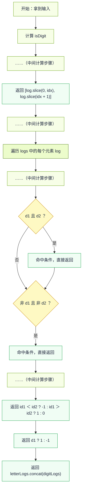

## TypeScript 解题方案（1 个方案逐个讲）

> **运行与提交**：每个方案都是自包含文件（内嵌用例自测，输出 PASS），整块复制到 `.ts` 文件后 `node 文件名` 即可运行。提交 LeetCode 时，把 `demo` 内的算法函数与辅助类型/函数整体取出、置于文件顶层即可。涉及交互/特殊接口的题以题面给定签名为准。

### 方案 1：方案1（自定义排序）

**分析与思路**：核心做法是「方案1（自定义排序）」。代码里依次做这些事：先排序再处理；单循环线性扫描。

**运行方式**：`node 本文件`，内嵌用例全部通过会输出 PASS。

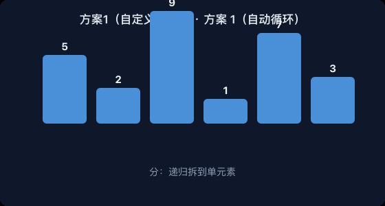

**方案专属流程图**（真实控制流）：

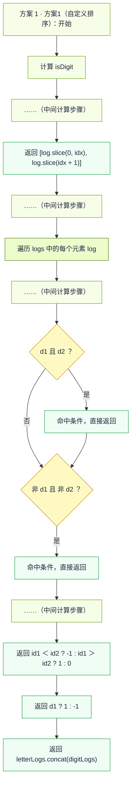

```typescript
/**
 ** LeetCode 937. 重新排列日志文件
 ** 方案：方案1（自定义排序）
 */

function reorderLogFiles(logs: string[]): string[] {
  // 定义函数/方法 reorderLogFiles
  const isDigit = (s: string) => s[0] >= '0' && s[0] <= '9';
  const splitLog = (log: string): [string, string] => {
    const idx = log.indexOf(' '); // 把 log 查找 「 」) 存入 idx
    return [log.slice(0, idx), log.slice(idx + 1)]; // 返回 [log 截取 0, idx), log 截取 idx 加 1)]
  };
  const digitLogs: string[] = []; // 把 []; 写入 const digitLogs: string[]
  const letterLogs: string[] = []; // 把 []; 写入 const letterLogs: string[]
  for (const log of logs) {
    // for (const log of logs) {
    const [, content] = splitLog(log); // 把 splitLog(log); 写入 const [, content]
    if (isDigit(content))
      digitLogs.push(log); // 若 isDigit(content)) digitLogs 追加 log);
    else letterLogs.push(log); // 否则
  }
  letterLogs.sort((a, b) => {
    const [, c1] = splitLog(a); // 把 splitLog(数组); 写入 const [, c1]
    const [, c2] = splitLog(b); // 把 splitLog(b); 写入 const [, c2]
    const d1 = isDigit(c1); // 把 isDigit(c1) 存入 d1
    const d2 = isDigit(c2); // 把 isDigit(c2) 存入 d2
    if (d1 && d2) return c1 < c2 ? -1 : c1 > c2 ? 1 : 0; // 若 d1 且 d2，直接返回 c1 小于 c2 ? 减 1 : c1 超过 c2 ? 1 : 0
    if (!d1 && !d2) {
      // 若 取反 d1 且 取反 d2
      if (c1 !== c2) return c1 < c2 ? -1 : 1; // 若 c1 不等于 c2，直接返回 c1 小于 c2 ? 减 1 : 1
      const id1 = splitLog(a)[0]; // 把 splitLog(数组)[0] 存入 id1
      const id2 = splitLog(b)[0]; // 把 splitLog(b)[0] 存入 id2
      return id1 < id2 ? -1 : id1 > id2 ? 1 : 0; // 返回 id1 小于 id2 ? 减 1 : id1 超过 id2 ? 1 : 0
    }
    return d1 ? 1 : -1; // 返回 d1 ? 1 : 减 1
  }); // });
  return letterLogs.concat(digitLogs); // 返回 letterLogs.concat(digitLogs)
}

export function demo(): void {
  // 程序入口：跑内嵌自测用例
  const logs = [
    'dig1 8 1 5 1',
    'let1 art can',
    'dig2 3 6',
    'let2 own kit dig',
    'let3 art zero',
  ];
  const got = reorderLogFiles(logs); // 把 reorderLogFiles(logs) 存入 got
  const expected = [
    'let1 art can',
    'let3 art zero',
    'let2 own kit dig',
    'dig1 8 1 5 1',
    'dig2 3 6',
  ];
  if (got.length !== expected.length || got.some((v, i) => v !== expected[i]))
    throw new Error('reorderLogFiles mismatch'); // throw new Error(「reorderLogFiles mismatch」);
  console.log('PASS'); // 全部用例通过，输出 PASS
}

demo(); // demo();
```

## 逐步拆解与面试追问

**复杂度**：时间 O(n)（单趟线性扫描），空间 O(1) 到 O(n)（视辅助结构）

**为什么是这个量级**：每个元素被常数次访问，辅助哈希或栈的开销与 n 同阶

**面试官可能会追问**：

- 稳定性对结果有影响吗？
- 比较器怎么写才不会越界？
- 数据近有序时选哪种排序？

## 关键 API 速查（TS 主解法实际用到，附官方链接）

| API | 作用 | 使用要点 | 官方文档 |
|---|---|---|---|
| `Array.prototype.sort()` | 原地排序 | 默认按字符串 Unicode 序（10 会排在 2 前），数字必须传 (a,b)=>a-b；V8 用 TimSort，稳定，O(n log n)；返回原数组引用 | [官方文档](https://developer.mozilla.org/zh-CN/docs/Web/JavaScript/Reference/Global_Objects/Array/sort) |
| `Array.prototype.push()` | 尾部追加 | 返回新长度；可一次多个；均摊 O(1)；会改变原数组 | [官方文档](https://developer.mozilla.org/zh-CN/docs/Web/JavaScript/Reference/Global_Objects/Array/push) |
| `Array/String indexOf()` | 首次出现的下标 | 找不到返回 -1；无法判 NaN（用 includes）；字符串可传起始位 | [官方文档](https://developer.mozilla.org/zh-CN/docs/Web/JavaScript/Reference/Global_Objects/Array/indexOf) |
| `Array/String slice()` | 切片（不改原数组） | slice(start,end) 含头不含尾；负数从尾计；常用于复制数组（slice()） | [官方文档](https://developer.mozilla.org/zh-CN/docs/Web/JavaScript/Reference/Global_Objects/Array/slice) |

### 各语言官方文档导航

- **TypeScript / JS**：[MDN 中文参考](https://developer.mozilla.org/zh-CN/)
- **Python**：[Python 官方文档](https://docs.python.org/zh-cn/3/)
- **Go**：[Go 标准库](https://pkg.go.dev/std)
- **Java**：[JDK 17 API](https://docs.oracle.com/en/java/javase/17/docs/api/)
- **Rust**：[Rust 标准库](https://doc.rust-lang.org/std/)
- **Lua**：[Lua 5.4 手册](https://www.lua.org/manual/5.4/)
- **C**：[Cppreference C](https://zh.cppreference.com/w/c)
- **C++**：[Cppreference C++](https://zh.cppreference.com/w/cpp)
- **R**：[R 官方手册](https://stat.ethz.ch/R-manual/)
- **Zig**：[Zig 语言文档](https://ziglang.org/documentation/master/)
- **Dart**：[Dart API](https://api.dart.dev/)

## 附录：其他 10 种语言全部实现（每种语言列举其全部方案）

> TypeScript 的全部方案见「TypeScript 解题方案」一节；下面是其余 10 种语言的对应实现，每种语言的每个方案都带思路分析、代码走读与专属运行架构图。
> 每个方案都内嵌用例自测，可独立运行（老仓库 python/go 文件遵循「打印结果」约定）。
> 完整解法文件见 `dsa/<语言>/sort/lc_937_重新排列日志文件/`。

### Python 实现（1 种方案）

Python 的全部方案如下，每个方案都内嵌用例自测，可独立运行（老仓库 python/go 文件遵循「打印结果」约定）：

#### 方案 1：方案1（自定义排序）

**思路与代码分析**：核心是「方案1（自定义排序）」。Python 版用切片与字典推导式简化操作，突出可读性。代码里依次做这些事：先排序再处理。**走读**：方案 1 · 方案1（自定义排序）：开始 → 返回 s[0].isdigit() → 更新 idx → 返回 log[:idx], log[idx + 1 :] → 命中条件，直接返回 → 命中条件，直接返回 → 返回 (id1 ＞ id2) - (id1 ＜ id2) → 返回 -1 if not d1 else 1 → 遍历 logs: 中的每个元素 log → 返回 letter_logs + digit_logs。

**运行架构**（真实控制流）：

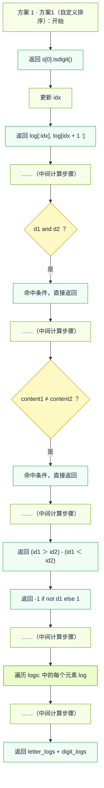

```python
import sys  # 提高递归深度上限（深输入防 RecursionError）

sys.setrecursionlimit(200000)  # 树/链表类题目节点数可达 1e4 量级
from functools import cmp_to_key  # from functools import cmp_to_key

def reorderLogFiles(logs):  # 定义函数 reorderLogFiles（参数：logs）
    def is_digit(s):  # 定义函数 is_digit（参数：字符串）
        return s[0].isdigit()  # 返回 字符串[0].isdigit()

    def split_log(log):  # 定义函数 split_log（参数：log）
        idx = log.index(" ")  # 把 log.index(' ') 存入 idx
        return log[:idx], log[idx + 1 :]  # 返回 log[:idx], log[idx 加 1:]

    def log_compare(a, b):  # 定义函数 log_compare（参数：数组, b）
        id1, content1 = split_log(a)  # 把 split_log(数组) 写入 id1, content1
        id2, content2 = split_log(b)  # 把 split_log(b) 写入 id2, content2
        d1 = is_digit(content1)  # 把 is_digit(content1) 存入 d1
        d2 = is_digit(content2)  # 把 is_digit(content2) 存入 d2
        if d1 and d2:  # 若 d1 and d2
            return (content1 > content2) - (
                content1 < content2
            )  # 返回 (content1 超过 content2) 减 (content1 小于 content2)
        if not d1 and not d2:  # 若 not d1 and not d2
            if content1 != content2:  # 若 content1 不等于 content2
                return (content1 > content2) - (
                    content1 < content2
                )  # 返回 (content1 超过 content2) 减 (content1 小于 content2)
            return (id1 > id2) - (id1 < id2)  # 返回 (id1 超过 id2) 减 (id1 小于 id2)
        return -1 if not d1 else 1  # 返回 减 1 if not d1 else 1

    digit_logs = []  # 把 [] 存入 digit_logs
    letter_logs = []  # 把 [] 存入 ter_logs
    for log in logs:  # 逐个取出 logs 的元素（log）
        _, content = split_log(log)  # 把 split_log(log) 写入 _, content
        if is_digit(content):  # 若 is_digit(content
            digit_logs.append(log)  # 把 log 追加到列表尾部
        else:  # 否则
            letter_logs.append(log)  # 把 log 追加到列表尾部

    letter_logs.sort(key=cmp_to_key(log_compare))  # 排序
    return letter_logs + digit_logs  # 返回 letter_logs 加 digit_logs

if __name__ == "__main__":  # 若 __name__ 等于 '__main__'
    logs = ["dig1 8 1 5 1", "let1 art can", "dig2 3 6", "let2 own kit dig", "let3 art zero"]
    print(reorderLogFiles(logs))  # 打印输出
```

### Go 实现（1 种方案）

Go 的全部方案如下，每个方案都内嵌用例自测，可独立运行（老仓库 python/go 文件遵循「打印结果」约定）：

#### 方案 1：方案1（自定义排序）

**思路与代码分析**：核心是「方案1（自定义排序）」。Go 版用切片与多返回值惯用法，显式处理索引边界。**走读**：方案 1 · 方案1（自定义排序）：开始 → 处理 type letterLog struct → 遍历 logs 的下标与元素 log → 返回 letters[i].content ＜ letters[j].content → 返回 letters[i].id ＜ letters[j].id → 遍历 letters 的下标与元素 l → 返回 res。

**运行架构**（真实控制流）：

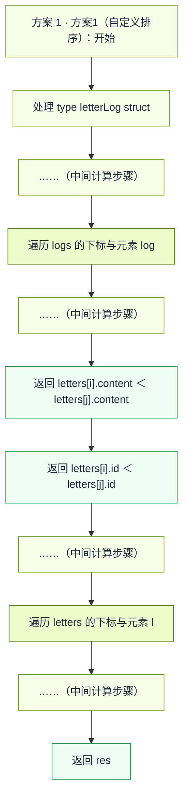

```go
package main // 引入依赖

import (
	"fmt"     // 「fmt」
	"os"      // 「os」
	"reflect" // 「reflect」
	"sort"    // 「sort」
	"strings" // 「strings」
)

func reorderLogFiles(logs []string) []string { // 定义函数/方法 reorderLogFiles
	type letterLog struct { // 定义类型
		id      string // id string
		content string // content string
	}
	var letters []letterLog    // var letters []letterLog
	var digits []string        // var digits []string
	for _, log := range logs { // 同时取 _ 与 log 遍历
		sp := strings.Index(log, " ")                                   // 把 strings.Index(log, 「 」) 写入 sp :
		id := log[:sp]                                                  // 把 log[:sp] 写入 id :
		content := log[sp+1:]                                           // 把 log[sp 加 1:] 写入 content :
		if len(content) > 0 && content[0] >= '0' && content[0] <= '9' { // 若 长度(content) 超过 0 且 content[0] 不低于 '0' 且 content[0] 不超过 '9'
			digits = append(digits, log) // 把 append(digits, log) 写入 digits
		} else { // 否则
			letters = append(letters, letterLog{id, content}) // 把 append(letters, letterLog{id, content}) 写入 letters
		}
	}
	sort.Slice(letters, func(i, j int) bool { // sort.Slice(letters, func(下标 i, 下标 j int) bool {
		if letters[i].content != letters[j].content { // 若 letters[下标 i].content 不等于 letters[下标 j].content
			return letters[i].content < letters[j].content // 返回 letters[下标 i].content 小于 letters[下标 j].content
		}
		return letters[i].id < letters[j].id // 返回 letters[下标 i].id 小于 letters[下标 j].id
	}) // })
	res := make([]string, 0, len(logs)) // 把 make([]string, 0, 长度(logs)) 写入 res :
	for _, l := range letters {         // 同时取 _ 与 左指针 遍历
		res = append(res, l.id+" "+l.content) // 把 append(结果, 左指针.id 加 「 」 加 左指针.content) 写入 结果
	}
	res = append(res, digits...) // 把 append(结果, digits...) 写入 结果
	return res                   // 返回 结果
}

func main() { // 程序入口：跑内嵌自测用例
	logs := []string{"dig1 8 1 5 1", "let1 art can", "dig2 3 6", "let2 own kit dig", "let3 art zero"}
	want := []string{"let1 art can", "let3 art zero", "let2 own kit dig", "dig1 8 1 5 1", "dig2 3 6"}
	ok := true // 把 true 写入 ok :
	if got := reorderLogFiles(logs); !reflect.DeepEqual(got, want) {
		ok = false                                                 // 把 false 写入 ok
		fmt.Printf("FAIL reorderLogFiles=%v want %v\n", got, want) // 打印输出
	}
	if !ok { // 若 取反 ok
		os.Exit(1) // os.Exit(1)
	}
	fmt.Println("PASS") // 全部用例通过，输出 PASS
}
```

### Java 实现（1 种方案）

Java 的全部方案如下，每个方案都内嵌用例自测，可独立运行（老仓库 python/go 文件遵循「打印结果」约定）：

#### 方案 1：方案1（自定义排序）

**思路与代码分析**：核心是「方案1（自定义排序）」。Java 版用类与静态方法组织，集合操作显式明了。代码里依次做这些事：先排序再处理；单循环线性扫描。**走读**：方案 1 · 方案1（自定义排序）：开始 → 更新 letterLogs → 遍历循环 → 命中条件，直接返回 → 返回 a.substring(0, a.indexOf(' ')) → 返回 result.toArray(new String[0])。

**运行架构**（真实控制流）：

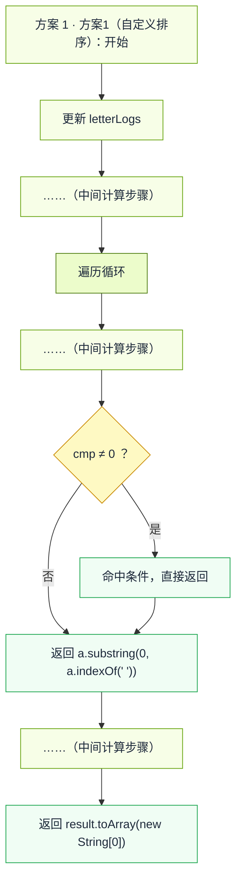

```java
package com.webfault.dsa; // 引入依赖

import java.util.*; // 引入依赖

class ReorderS1 { // 定义类型
  static String[] reorderLogFiles(String[] logs) { // 定义函数/方法 reorderLogFiles
    List<String> letterLogs =
        new ArrayList<>(); // 把 new ArrayList 小于 超过 (); 写入 List<String> letterLogs
    List<String> digitLogs =
        new ArrayList<>(); // 把 new ArrayList 小于 超过 (); 写入 List<String> digitLogs
    for (String log : logs) { // for (String log : logs) {
      int sp = log.indexOf(' '); // 把 log 查找 ' ') 存入 sp
      String content = log.substring(sp + 1); // 把 log 截取 sp 加 1) 存入 content
      if (content.charAt(0) >= '0' && content.charAt(0) <= '9') digitLogs.add(log);
      else letterLogs.add(log); // 否则
    }
    letterLogs.sort(
        (a, b) -> { // 排序
          String ca = a.substring(a.indexOf(' ') + 1); // 把 数组 截取 数组 查找 ' ') 加 1) 存入 ca
          String cb = b.substring(b.indexOf(' ') + 1); // 把 b 截取 b 查找 ' ') 加 1) 存入 cb
          int cmp = ca.compareTo(cb); // 把 ca.compareTo(cb) 存入 cmp
          if (cmp != 0) return cmp; // 若 cmp 不等于 0，直接返回 cmp
          return a.substring(0, a.indexOf(' '))
              .compareTo(
                  b.substring(
                      0, b.indexOf(' '))); // 返回 数组 截取 0, 数组 查找 ' ')).compareTo(b 截取 0, b 查找 ' ')))
        }); // });
    List<String> result =
        new ArrayList<>(letterLogs); // 把 new ArrayList 小于 超过 (letterLogs); 写入 List<String> result
    result.addAll(digitLogs); // 结果.addAll(digitLogs);
    return result.toArray(new String[0]); // 返回 结果.toArray(new String[0])
  }

  public static void main(String[] args) { // public static void main(String[] args) {
    String[] logs = {
      "dig1 8 1 5 1", "let1 art can", "dig2 3 6", "let2 own kit dig", "let3 art zero"
    };
    String[] got =
        ReorderS1.reorderLogFiles(logs); // 把 ReorderS1.reorderLogFiles(logs); 写入 String[] got
    String[] want = {
      "let1 art can", "let3 art zero", "let2 own kit dig", "dig1 8 1 5 1", "dig2 3 6"
    };
    boolean ok = Arrays.equals(got, want); // 把 Arrays.equals(got, want); 写入 boolean ok
    if (!ok) {
      System.out.println("FAIL " + Arrays.toString(got));
      throw new RuntimeException("FAILED");
    }
    System.out.println("PASS"); // 全部用例通过，输出 PASS
  }
}
```

### Rust 实现（1 种方案）

Rust 的全部方案如下，每个方案都内嵌用例自测，可独立运行（老仓库 python/go 文件遵循「打印结果」约定）：

#### 方案 1：方案1（自定义排序）

**思路与代码分析**：核心是「方案1（自定义排序）」。Rust 版用所有权移动与切片借用改写同一逻辑，注意 Option 与引用边界。**走读**：方案 1 · 方案1（自定义排序）：开始 → 计算 is_digit → 遍历 logs 中的每个元素 log → 返回结果。

**运行架构**（真实控制流）：

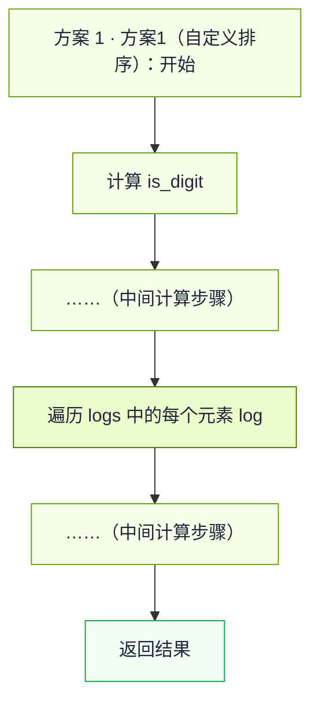

```rust
// LeetCode 937. 重新排列日志文件 — Rust 版（方案1）
fn reorder_log_files(logs: Vec<String>) -> Vec<String> {
    // 定义函数/方法 reorder_log_files
    let is_digit = |s: &str| !s.is_empty() && s.as_bytes()[0].is_ascii_digit();
    let mut letter: Vec<String> = Vec::new(); // 把 Vec::new(); 写入 let mut letter: Vec<String>
    let mut digit: Vec<String> = Vec::new(); // 把 Vec::new(); 写入 let mut digit: Vec<String>
    for log in logs {
        // 逐个取出 logs 的元素（log）
        let idx = log.find(' ').unwrap(); // 把 log 查找 ' ').unwrap() 存入 idx
        let content = &log[idx + 1..]; // 把 按位与 log[idx 加 1..] 存入 content
        if is_digit(content) {
            digit.push(log);
        } else {
            letter.push(log);
        }
    }
    letter.sort_by(|a, b| {
        // letter.sort_by( 按位或 数组, b 按位或 {
        let ia = a.find(' ').unwrap(); // 把 数组 查找 ' ').unwrap() 存入 ia
        let ib = b.find(' ').unwrap(); // 把 b 查找 ' ').unwrap() 存入 ib
        let ca = &a[ia + 1..]; // 把 按位与 数组[ia 加 1..] 存入 ca
        let cb = &b[ib + 1..]; // 把 按位与 b[ib 加 1..] 存入 cb
        ca.cmp(cb).then(a.cmp(b)) // ca.cmp(cb).then(数组.cmp(b))
    }); // });
    letter.extend(digit); // letter.extend(digit);
    letter // letter
}
fn main() {
    // 程序入口：跑内嵌自测用例
    let logs = vec![
        "a1 9 2 3 1".to_string(),
        "g1 act car".to_string(),
        "zo4 4 7".to_string(),
        "ab1 off key dog".to_string(),
        "a8 act zoo".to_string(),
    ];
    let got = reorder_log_files(logs); // 把 reorder_log_files(logs) 存入 got
    assert_eq!(
        got,
        vec![
            "g1 act car",
            "a8 act zoo",
            "ab1 off key dog",
            "a1 9 2 3 1",
            "zo4 4 7"
        ]
    ); // 断言校验
    println!("PASS"); // 全部用例通过，输出 PASS
}
```

### Lua 实现（1 种方案）

Lua 的全部方案如下，每个方案都内嵌用例自测，可独立运行（老仓库 python/go 文件遵循「打印结果」约定）：

#### 方案 1：方案1（自定义排序）

**思路与代码分析**：核心是「方案1（自定义排序）」。Lua 版用表与 ipairs 遍历，注意 ipairs 遇 nil 即停的语义。代码里依次做这些事：先排序再处理；递归求解子问题。**走读**：方案 1 · 方案1（自定义排序）：开始 → 处理 local function is_digit(s) → 返回 c ≥ 0 and c ≤ 9 → 遍历 ipairs(logs) do 中的每个元素 log → 返回 ca ＜ cb → 返回 a ＜ b → 遍历 ipairs(digit) do 中的每个元素 d → 返回 letter。

**运行架构**（真实控制流）：

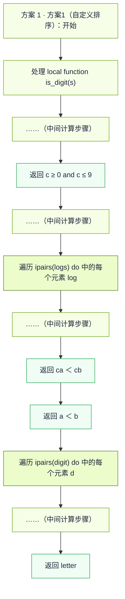

```lua
-- LeetCode 937. 重新排列日志文件 — Lua 版（方案1）
local function reorder_log_files(logs) -- local function reorder_log_files(logs)
	local function is_digit(s) -- local function is_digit(字符串)
		local c = s:sub(1, 1) -- 把 字符串:sub(1, 1) 写入 local c
		return c >= "0" and c <= "9" -- 返回 字符 不低于 「0」 and 字符 不超过 「0」
	end -- 终点
	local letter, digit = {}, {} -- 把 {}, {} 写入 local letter, digit
	for _, log in ipairs(logs) do -- 遍历取 log
		local content = log:match(" (.+)$") -- 把 log:match(「 (. 加 )$」) 写入 local content
		if is_digit(content) then
			digit[#digit + 1] = log
		else
			letter[#letter + 1] = log
		end
	end -- 终点
	table.sort(letter, function(a, b) -- 排序
		local ca = a:match(" (.+)$") -- 把 数组:match(「 (. 加 )$」) 写入 local ca
		local cb = b:match(" (.+)$") -- 把 b:match(「 (. 加 )$」) 写入 local cb
		if ca ~= cb then
			return ca < cb
		end -- 若 ca ~ 赋值为 cb then return ca 小于 cb 终点
		return a < b -- 返回 数组 小于 b
	end) -- 终点)
	for _, d in ipairs(digit) do
		letter[#letter + 1] = d
	end -- 遍历取 d
	return letter -- 返回 letter
end -- 终点
local got = reorder_log_files({ "a1 9 2 3 1", "g1 act car", "zo4 4 7", "ab1 off key dog", "a8 act zoo" })
assert(#got == 5) -- 断言校验
assert(
	got[1] == "g1 act car"
		and got[2] == "a8 act zoo"
		and got[3] == "ab1 off key dog"
		and got[4] == "a1 9 2 3 1"
		and got[5] == "zo4 4 7"
) -- 断言校验
print("PASS") -- 全部用例通过，输出 PASS
```

### C 实现（1 种方案）

C 的全部方案如下，每个方案都内嵌用例自测，可独立运行（老仓库 python/go 文件遵循「打印结果」约定）：

#### 方案 1：方案1（自定义排序）

**思路与代码分析**：核心是「方案1（自定义排序）」。C 版手动管理下标与内存，循环边界全部显式写出。代码里依次做这些事：双重循环遍历。**走读**：方案 1 · 方案1（自定义排序）：开始 → 计算 char → 更新 ln → 遍历循环 → 若 is_digit_log(logs[i])：更新 digit[dn++] → 更新 digit[dn++] → 更新 letter[ln++] → 调用 qsort(letter, ln, sizeof(cha → 遍历循环 → 更新 out[i] → 遍历循环 → 更新 i] → 返回 ln + dn。

**运行架构**（真实控制流）：

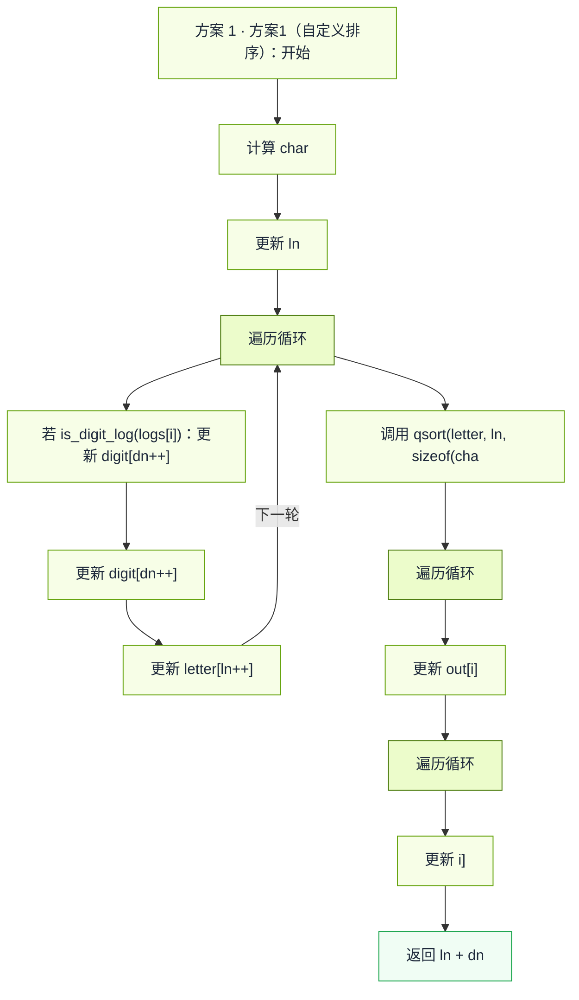

```c
/* LeetCode 937. 重新排列日志文件 — C 版（方案1） */
#include <stdio.h>                               // 引入头文件
#include <stdlib.h>                              // 引入头文件
#include <string.h>                              // 引入头文件
static const char *content_of(const char *log) { // static const char 乘 content_of(const char 乘 log) {
    const char *sp = strchr(log, ' ');           // 把 strchr(log, ' '); 写入 const char *sp
    return sp ? sp + 1 : "";                     // 返回 sp ? sp 加 1 : 「」
}
static int is_digit_log(const char *log) { // 定义判定函数 is_digit_log
    const char *c = content_of(log);       // 把 content_of(log); 写入 const char *c
    return c[0] >= '0' && c[0] <= '9';     // 返回 字符[0] 不低于 '0' 且 字符[0] 不超过 '9'
}
static int cmp_letter(const void *a, const void *b) { // 定义函数/方法 cmp_letter
    const char *la = *(const char **)a; // 把 乘 (const char 乘 乘 )数组; 写入 const char *la
    const char *lb = *(const char **)b; // 把 乘 (const char 乘 乘 )b; 写入 const char *lb
    int cr = strcmp(content_of(la), content_of(lb)); // 把 strcmp(content_of(la), content_of(lb)) 存入 cr
    if (cr != 0)
        return cr;         // 若 cr 不等于 0，直接返回 cr
    return strcmp(la, lb); // 返回 strcmp(la, lb)
}
static int reorder_log_files(const char *logs[], int n,
                             const char *out[]) { // 定义函数/方法 reorder_log_files
    const char *letter[64], *digit[64];           // const char 乘 letter[64], 乘 digit[64];
    int ln = 0, dn = 0;                           // 把 0, dn 赋值为 0 存入 ln
    for (int i = 0; i < n; i++) { // 让 下标 i 从 0 开始计数，下标 i 小于 元素个数 就继续
        if (is_digit_log(logs[i]))
            digit[dn++] = logs[i]; // 若 is_digit_log(logs[下标 i])) digit[dn 加一 ] 赋值为 logs[下标 i];
        else
            letter[ln++] = logs[i]; // 否则
    }
    qsort(letter, ln, sizeof(char *), cmp_letter); // qsort(letter, ln, sizeof(char 乘 ), cmp_letter);
    for (int i = 0; i < ln; i++)
        out[i] = letter[i]; // 让 下标 i 从 0 开始计数，下标 i 小于 ln 就继续
    for (int i = 0; i < dn; i++)
        out[ln + i] = digit[i]; // 让 下标 i 从 0 开始计数，下标 i 小于 dn 就继续
    return ln + dn;             // 返回 ln 加 dn
}
int main(void) { // 程序入口：跑内嵌自测用例
    const char *logs[] = {"a1 9 2 3 1", "g1 act car", "zo4 4 7", "ab1 off key dog", "a8 act zoo"};
    const char *wants[] = {"g1 act car", "a8 act zoo", "ab1 off key dog", "a1 9 2 3 1", "zo4 4 7"};
    const char *out[64];                     // const char 乘 out[64];
    int n = reorder_log_files(logs, 5, out); // 把 reorder_log_files(logs, 5, out) 存入 元素个数
    if (n != 5) {
        printf("FAIL n\n");
        return 1;
    } // 若 元素个数 不等于 5) { 输出「FAIL 元素个数 」); return 1; }
    for (int i = 0; i < 5; i++)
        if (strcmp(out[i], wants[i]) != 0) {
            printf("FAIL %d: %s\n", i, out[i]);
            return 1;
        }             // 让 下标 i 从 0 开始计数，下标 i 小于 5 就继续
    printf("PASS\n"); // 全部用例通过，输出 PASS
    return 0;         // 返回 0
}
```

### C++ 实现（1 种方案）

C++ 的全部方案如下，每个方案都内嵌用例自测，可独立运行（老仓库 python/go 文件遵循「打印结果」约定）：

#### 方案 1：方案1（自定义排序）

**思路与代码分析**：核心是「方案1（自定义排序）」。C++ 版用 STL 容器与迭代器，减少手写下标错误。代码里依次做这些事：单循环线性扫描。**走读**：方案 1 · 方案1（自定义排序）：开始 → 更新 isDigit → 返回 非 s.empty() 且 isdigit(static_cast＜unsigned char＞(s[0])) → 遍历循环 → 命中条件，直接返回 → 返回 a ＜ b → 返回 letter。

**运行架构**（真实控制流）：

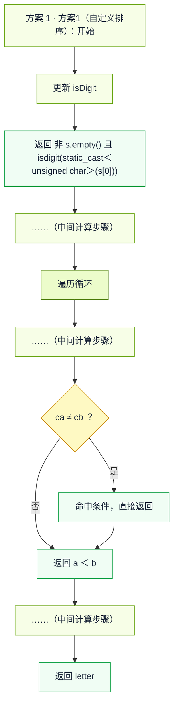

```cpp
// LeetCode 937. 重新排列日志文件 — C++ 版（方案1）
#include <algorithm> // 引入头文件
#include <cassert>   // 引入头文件
#include <iostream>  // 引入头文件
#include <string>    // 引入头文件
#include <vector>    // 引入头文件
static std::vector<std::string> reorderLogFiles(std::vector<std::string> logs) {
    auto isDigit = [](const std::string &s) {
        return !s.empty() && isdigit(static_cast<unsigned char>(s[0]));
    };
    std::vector<std::string> letter, digit; // std::vector 小于 std::string 超过 letter, digit;
    for (auto &log : logs) {                // 逐个取出 logs 的元素（log）
        auto idx = log.find(' ');           // 把 log 查找 ' ') 存入 idx
        auto content = log.substr(idx + 1); // 把 log 截取 idx 加 1) 存入 content
        if (isDigit(content))
            digit.push_back(std::move(log)); // 若 isDigit(content)) digit 追加 std::move(log));
        else
            letter.push_back(std::move(log)); // 否则
    }
    std::stable_sort(letter.begin(), letter.end(), [](const std::string &a, const std::string &b) {
        auto ca = a.substr(a.find(' ') + 1); // 把 数组 截取 数组 查找 ' ') 加 1) 存入 ca
        auto cb = b.substr(b.find(' ') + 1); // 把 b 截取 b 查找 ' ') 加 1) 存入 cb
        if (ca != cb)
            return ca < cb; // 若 ca 不等于 cb，直接返回 ca 小于 cb
        return a < b;       // 返回 数组 小于 b
    });                     // });
    letter.insert(letter.end(), digit.begin(),
                  digit.end()); // letter 插入 letter.终点(), digit 迭代位置 , digit.终点());
    return letter;              // 返回 letter
}
int main() { // 程序入口：跑内嵌自测用例
    auto got = reorderLogFiles({"a1 9 2 3 1", "g1 act car", "zo4 4 7", "ab1 off key dog", "a8 act zoo"});
    assert((got == std::vector<std::string>{"g1 act car", "a8 act zoo", "ab1 off key dog", "a1 9 2 3 1",
                                            "zo4 4 7"})); // 断言校验
    std::cout << "PASS" << std::endl;                     // 全部用例通过，输出 PASS
    return 0;                                             // 返回 0
}
```

### R 实现（1 种方案）

R 的全部方案如下，每个方案都内嵌用例自测，可独立运行（老仓库 python/go 文件遵循「打印结果」约定）：

#### 方案 1：方案1（自定义排序）

**思路与代码分析**：核心是「方案1（自定义排序）」。R 版用向量化思维与 1 起始下标，注意 1:n 的降序陷阱。代码里依次做这些事：单循环线性扫描。**走读**：方案 1 · 方案1（自定义排序）：开始 → 处理 content_of ＜- function(log) → 处理 is_digit ＜- function(log) → 处理 c ＜- substr(content_of(log), → 调用 grepl([0-9], c) → 处理 letter ＜- character(0) → 处理 digit ＜- character(0) → 循环 log：遍历 logs → 若 is_digit(log)：处理 digit ＜- c(digit, log) else → 处理 digit ＜- c(digit, log) else → 处理 ord ＜- order(vapply(letter, → 调用 c(letter[ord], digit) → 返回结果。

**运行架构**（真实控制流）：

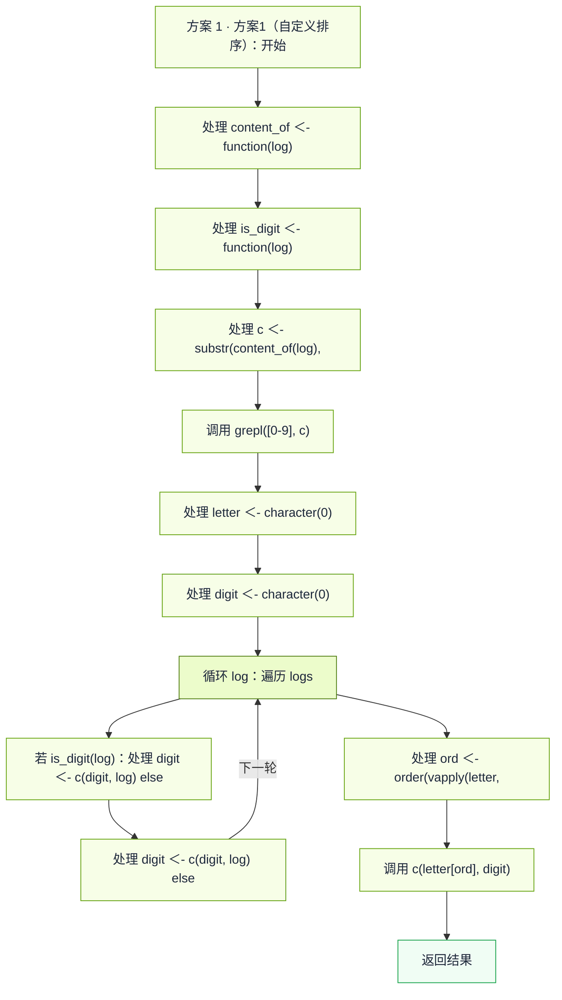

```r
# 版（方案1） 定义函数 reorder_log_files（参数：logs）
reorder_log_files <- function(logs) {
    content_of <- function(log) sub("^[^ ]+ ", "", log)  # 定义函数 content_of（参数：log）
    is_digit <- function(log) {
        # 定义函数 is_digit（参数：log）
        c <- substr(content_of(log), 1, 1)  # 把 substr(content_of(log), 1, 1) 存入 字符
        grepl("[0-9]", c)  # grepl(「[0 减 9]」, 字符)
    }
    letter <- character(0)
    digit <- character(0)  # 把 character(0); digit 小于 减 character(0) 存入 letter
    for (log in logs) {
        # for (log in logs) {
        if (is_digit(log))
            digit <- c(digit, log) else letter <- c(letter, log)
    }
    # 排序：content 升序，平局按原字符串
    ord <- order(vapply(letter, content_of, ""), letter)  # 把 order(vapply(letter, content_of, 「」), letter) 存入 ord
    c(letter[ord], digit)  # 字符(letter[ord], digit)
}
got <- reorder_log_files(c("a1 9 2 3 1", "g1 act car", "zo4 4 7", "ab1 off key dog", "a8 act zoo"))
stopifnot(identical(got, c("g1 act car", "a8 act zoo", "ab1 off key dog", "a1 9 2 3 1", "zo4 4 7")))  # 断言校验
cat("PASS\n")  # 全部用例通过，输出 PASS
```

### Zig 实现（1 种方案）

Zig 的全部方案如下，每个方案都内嵌用例自测，可独立运行（老仓库 python/go 文件遵循「打印结果」约定）：

#### 方案 1：方案1（自定义排序）

**思路与代码分析**：核心是「方案1（自定义排序）」。Zig 版显式分配与清零，整型边界处理严格。**走读**：方案 1 · 方案1（自定义排序）：开始 → 计算 c → 返回 c.len ＞ 0 and c[0] ≥ '0' and c[0] ≤ '9'。

**运行架构**（真实控制流）：

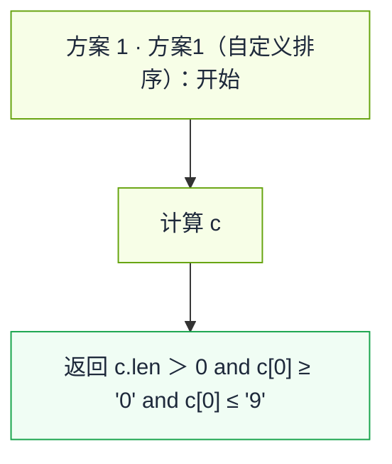

```zig
// LeetCode 937. 重新排列日志文件 — Zig 版（方案1）
const std = @import("std"); // 把 @import(「std」) 存入 std
fn contentOf(log: []const u8) []const u8 { // 定义函数/方法 contentOf
    const idx = std.mem.indexOfScalar(u8, log, ' ') orelse return "";
    return log[idx + 1 ..]; // 返回 log[idx 加 1 ..]
}
fn isDigitLog(log: []const u8) bool { // 定义判定函数 isDigitLog
    const c = contentOf(log); // 把 contentOf(log) 存入 字符
    return c.len > 0 and c[0] >= '0' and c[0] <= '9'; // 返回 字符.长度 超过 0 and 字符[0] 不低于 '0' and 字符[0] 不超过 '9'
}
pub fn main() !void { // 程序入口：跑内嵌自测用例
    var arena = std.heap.ArenaAllocator.init(std.heap.page_allocator); // 把 std.堆.ArenaAllocator.init(std.堆.page_allocator) 存入 arena
    defer arena.deinit(); // defer arena.deinit();
    const alloc = arena.allocator(); // 把 arena.allocator() 存入 alloc
    const logs = [_][]const u8{ "a1 9 2 3 1", "g1 act car", "zo4 4 7", "ab1 off key dog", "a8 act zoo" };
    var letter = std.ArrayList([]const u8).init(alloc); // 把 std.ArrayList([]const u8).init(alloc) 存入 letter
    var digit = std.ArrayList([]const u8).init(alloc); // 把 std.ArrayList([]const u8).init(alloc) 存入 digit
    for (logs) |log| { // 逐个取出 logs 的元素（log）
        if (isDigitLog(log)) digit.append(log) catch unreachable else letter.append(log) catch unreachable;
    }
    const S = struct { // 把 struct { 存入 S
        fn lt(_: void, a: []const u8, b: []const u8) bool { // 定义函数/方法 lt
            const cr = std.mem.order(u8, contentOf(a), contentOf(b)); // 把 std.mem.order(u8, contentOf(数组), contentOf(b)) 存入 cr
            if (cr != .eq) return cr == .lt; // 若 cr 不等于 .eq，直接返回 cr 等于 .lt
            return std.mem.order(u8, a, b) == .lt; // 返回 std.mem.order(u8, 数组, b) 等于 .lt
        }
    };
    std.sort.pdq([]const u8, letter.items, {}, S.lt); // std.sort.pdq([]const u8, letter.items, {}, S.lt);
    const wants = [_][]const u8{ "g1 act car", "a8 act zoo", "ab1 off key dog", "a1 9 2 3 1", "zo4 4 7" };
    var wi: usize = 0; // 把 0; 写入 var wi: usize
    for (letter.items) |l| { // 逐个取出 letter.items 的元素（左指针）
        if (!std.mem.eql(u8, l, wants[wi])) return error.TestFailed; // 若 取反 std.mem.eql(u8, 左指针, wants[wi])，直接返回 error.TestFailed
        wi += 1; // wi累加 1
    }
    for (digit.items) |d| { // 逐个取出 digit.items 的元素（d）
        if (!std.mem.eql(u8, d, wants[wi])) return error.TestFailed; // 若 取反 std.mem.eql(u8, d, wants[wi])，直接返回 error.TestFailed
        wi += 1; // wi累加 1
    }
    if (wi != 5) return error.TestFailed; // 若 wi 不等于 5，直接返回 error.TestFailed
    std.debug.print("PASS\n", .{}); // 全部用例通过，输出 PASS
}
```

### Dart 实现（1 种方案）

Dart 的全部方案如下，每个方案都内嵌用例自测，可独立运行（老仓库 python/go 文件遵循「打印结果」约定）：

#### 方案 1：方案1（自定义排序）

**思路与代码分析**：核心是「方案1（自定义排序）」。Dart 版用可空类型标注与集合方法，注意空安全。代码里依次做这些事：先排序再处理；单循环线性扫描。**走读**：方案 1 · 方案1（自定义排序）：开始 → 更新 s) → 返回 log.substring(idx + 1) → 遍历循环 → 命中条件，直接返回 → 返回 [...letter, ...digit]。

**运行架构**（真实控制流）：

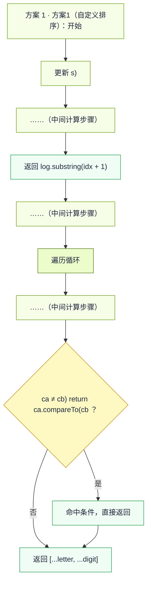

```dart
// LeetCode 937. 重新排列日志文件 — Dart 版（方案1）
List<String> reorderLogFiles(List<String> logs) {
  // 定义函数/方法 reorderLogFiles
  bool isDigit(String s) =>
      s.isNotEmpty && s[0].codeUnitAt(0) >= 0x30 && s[0].codeUnitAt(0) <= 0x39;
  String contentOf(String log) {
    // 定义函数/方法 contentOf
    final idx = log.indexOf(' '); // 把 log 查找 ' ') 存入 idx
    return log.substring(idx + 1); // 返回 log 截取 idx 加 1)
  }

  final letter = <String>[]; // 把 小于 String 超过 [] 存入 letter
  final digit = <String>[]; // 把 小于 String 超过 [] 存入 digit
  for (final log in logs) {
    // for (final log in logs) {
    if (isDigit(contentOf(log))) {
      // 若 isDigit(contentOf(log
      digit.add(log); // digit 追加 log);
    } else {
      // 否则
      letter.add(log); // letter 追加 log);
    }
  }
  letter.sort((a, b) {
    // 排序
    final ca = contentOf(a); // 把 contentOf(数组) 存入 ca
    final cb = contentOf(b); // 把 contentOf(b) 存入 cb
    if (ca != cb) return ca.compareTo(cb); // 若 ca 不等于 cb，直接返回 ca.compareTo(cb)
    return a.compareTo(b); // 返回 数组.compareTo(b)
  }); // });
  return [...letter, ...digit]; // 返回 [...letter, ...digit]
}

void main() {
  // 程序入口：跑内嵌自测用例
  final got = reorderLogFiles([
    'a1 9 2 3 1',
    'g1 act car',
    'zo4 4 7',
    'ab1 off key dog',
    'a8 act zoo',
  ]);
  if (got.toString() !=
      '[g1 act car, a8 act zoo, ab1 off key dog, a1 9 2 3 1, zo4 4 7]')
    throw StateError('c1');
  print('PASS'); // 全部用例通过，输出 PASS
}
```

---

## 内容总结

- **重新排列日志文件**（排序 · Medium）：共 1 个方案，主线思路「方案1（自定义排序）」；时间 O(n)（单趟线性扫描）；动画演示冒泡交换过程，附录给出 11 种语言 × 全部方案的可运行实现。
- 来源博客：[https://blog.csdn.net/tyro_java/article/details/145374559](https://blog.csdn.net/tyro_java/article/details/145374559)
- 导航：[📋 总目录](../) ｜ [← 096 按奇偶排序数组 ii](../096_按奇偶排序数组_ii/) ｜ [098 缺失的第一个正数 →](../098_缺失的第一个正数/)
