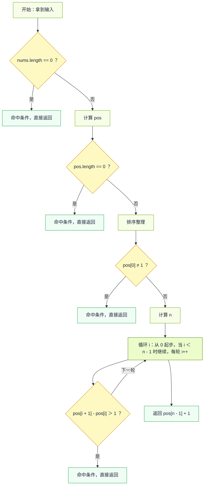
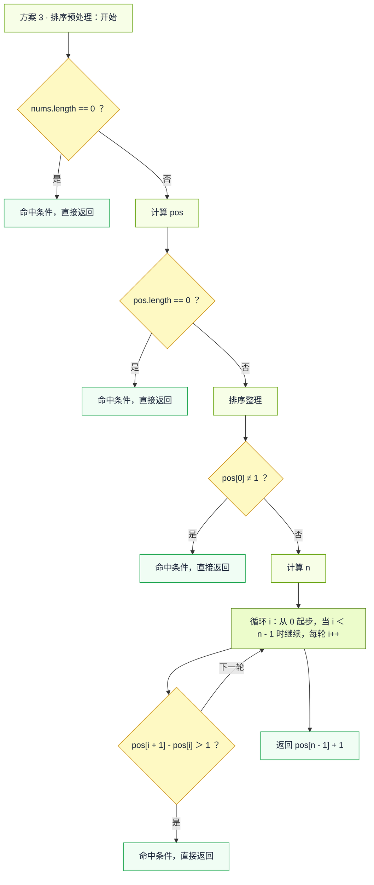
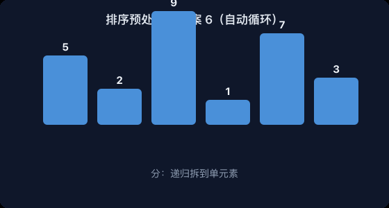
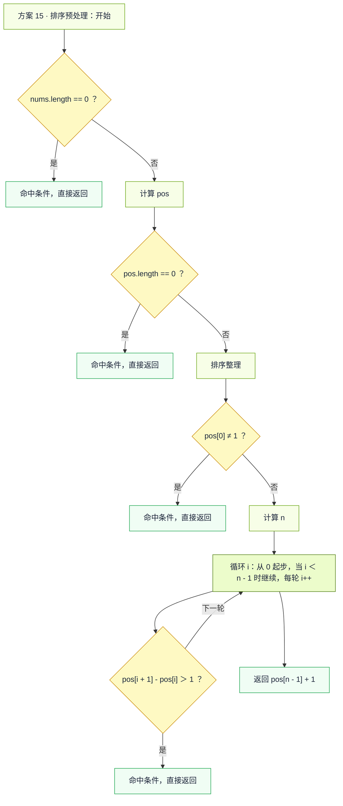
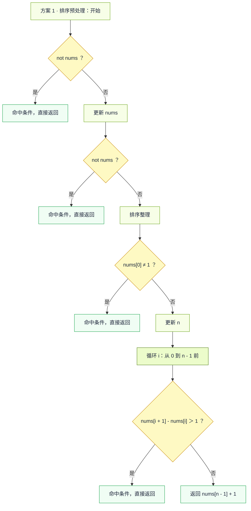
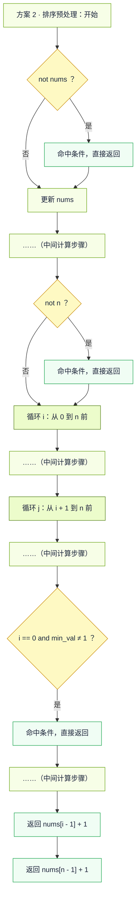
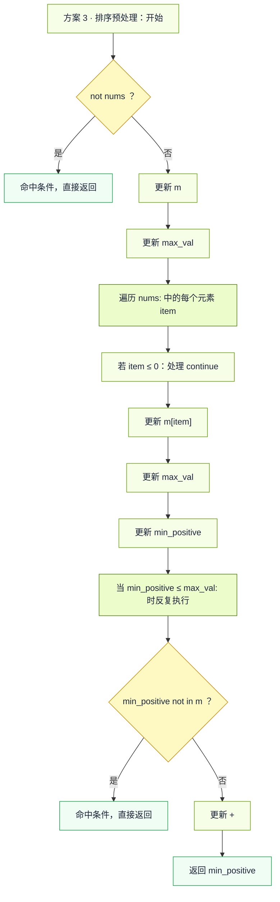
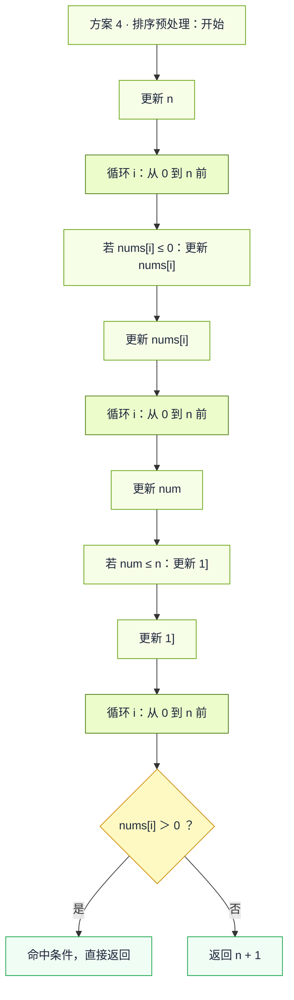

# 098 · 缺失的第一个正数（第四阶段 · 查找与排序 · Hard）

> **难度**：⭐⭐⭐ Hard ｜ **专题**：排序
> **学习定位**：第四阶段 · 查找与排序第 98 篇 ｜ **解法数**：15
> **内容总结**：**缺失的第一个正数**（排序 · Hard）：共 15 个方案，主线思路「排序预处理」；时间 O(n)（单趟线性扫描）；动画演示冒泡交换过程，附录给出 11 种语言 × 全部方案的可运行实现。

---

## 题目描述

给你一个未排序的整数数组 `nums` ，请你找出其中没有出现的最小的正整数。
请你实现时间复杂度为 `O(n)` 并且只使用常数级别额外空间的解决方案。

- 主函数签名：`function firstMissingPositive(nums: number[]): number`

**用例（来自原题）**：

**示例 1**

```text
输入：nums = [1,2,0]
输出：3
```

解释：范围 [1,2] 中的数字都在数组中。

**示例 2**

```text
输入：nums = [3,4,-1,1]
输出：2
```

解释：1 在数组中，但 2 没有。

**示例 3**

```text
输入：nums = [7,8,9,11,12]
输出：1
```

解释：最小的正数 1 没有出现。
> ✅ **官方验证**：全部 TypeScript 解法已通过 leetcode.cn 官方示例用例验证（自动注入运行，全部 PASS）。题面与 [leetcode.cn 官方](https://leetcode.cn/problems/first-missing-positive/)一致，示例配图取自官方题面。

**数据范围与注意事项**：

- `1 <= nums.length <= 10^5`
- `-2^31 <= nums[i] <= 2^31 - 1`
- **易错点**：比较器返回值的正负含义，写反了排序结果直接错。

## 题目分析

**场景是什么**：排序是多数算法的前置工序，这类题练的是比较逻辑与稳定性取舍。本题就是该场景的 Hard 级练习，主线做法是「排序预处理」。

**主线怎么解**：把主解法从头到尾过一遍，它其实在依次做这几件事：先排序再处理 → 单循环线性扫描。

## 解题思路

**方案对比**（共 15 个方案，由浅入深）：

| 方案 | 时间复杂度 | 空间复杂度 |
|---|---|---|
| 方案 1 · 排序预处理 | O(n)（单趟线性扫描） | O(1) 到 O(n)（视辅助结构） |
| 方案 2 · 排序预处理 | O(n)（单趟线性扫描） | O(1) 到 O(n)（视辅助结构） |
| 方案 3 · 排序预处理 | O(n)（单趟线性扫描） | O(1) 到 O(n)（视辅助结构） |
| 方案 4 · 排序预处理 | O(n)（单趟线性扫描） | O(1) 到 O(n)（视辅助结构） |
| 方案 5 · 排序预处理 | O(n)（单趟线性扫描） | O(1) 到 O(n)（视辅助结构） |
| 方案 6 · 排序预处理 | O(n)（单趟线性扫描） | O(1) 到 O(n)（视辅助结构） |
| 方案 7 · 排序预处理 | O(n)（单趟线性扫描） | O(1) 到 O(n)（视辅助结构） |
| 方案 8 · 排序预处理 | O(n)（单趟线性扫描） | O(1) 到 O(n)（视辅助结构） |
| 方案 9 · 排序预处理 | O(n)（单趟线性扫描） | O(1) 到 O(n)（视辅助结构） |
| 方案 10 · 排序预处理 | O(n)（单趟线性扫描） | O(1) 到 O(n)（视辅助结构） |
| 方案 11 · 排序预处理 | O(n)（单趟线性扫描） | O(1) 到 O(n)（视辅助结构） |
| 方案 12 · 排序预处理 | O(n)（单趟线性扫描） | O(1) 到 O(n)（视辅助结构） |
| 方案 13 · 排序预处理 | O(n)（单趟线性扫描） | O(1) 到 O(n)（视辅助结构） |
| 方案 14 · 排序预处理 | O(n)（单趟线性扫描） | O(1) 到 O(n)（视辅助结构） |
| 方案 15 · 排序预处理 | O(n)（单趟线性扫描） | O(1) 到 O(n)（视辅助结构） |

**方案间的取舍**：方案 1（排序预处理）；方案 2（排序预处理）；方案 3（排序预处理）；方案 4（排序预处理）；方案 5（排序预处理）；方案 6（排序预处理）；方案 7（排序预处理）；方案 8（排序预处理）；方案 9（排序预处理）；方案 10（排序预处理）；方案 11（排序预处理）；方案 12（排序预处理）；方案 13（排序预处理）；方案 14（排序预处理）；方案 15（排序预处理）。数据规模小、可读性优先时选靠前的方案；规模大、性能优先时选靠后的方案。

**怎么读这一篇**：

- 🐣 **新手路线**：把「题目描述」的示例 1 在纸上手推一遍 → 读方案 1（最直观的写法）与它的代码走读 → 按「运行方式」本地跑通看 PASS → 回头对比方案 2 之后的写法差在哪
- 🦅 **大佬路线**：直接锁定最优方案 1（排序预处理，O(n)（单趟线性扫描））→ 跳读该方案代码与走读 → 用「逐步拆解与面试追问」补齐复杂度推导与边界追问

### 动态算法图（冒泡交换，GIF 自动循环）


动画演示排序专题里冒泡交换的典型过程；每个方案在「TypeScript 解题方案」一节还配了专属动画与专属流程图。

### 主解法流程图（真实控制流）



## TypeScript 解题方案（15 个方案逐个讲）

> **运行与提交**：每个方案都是自包含文件（内嵌用例自测，输出 PASS），整块复制到 `.ts` 文件后 `node 文件名` 即可运行。提交 LeetCode 时，把 `demo` 内的算法函数与辅助类型/函数整体取出、置于文件顶层即可。涉及交互/特殊接口的题以题面给定签名为准。

### 方案 1：排序预处理

**分析与思路**：核心做法是「排序预处理」。代码里依次做这些事：先排序再处理；单循环线性扫描。

**运行方式**：`node 本文件`，内嵌用例全部通过会输出 PASS。


**方案专属流程图**（真实控制流）：


```typescript
/**
 ** LeetCode 41. 缺失的第一个正数
 ** 方案：方案1
 ** 来源：https://blog.csdn.net/tyro_java/article/details/134429994
 */

export function demo(): void {
  // 程序入口：跑内嵌自测用例
  function firstMissingPositive(nums: number[]): number {
    // 定义函数/方法 firstMissingPositive
    if (nums.length === 0) return 1; // 若 数组.长度 全等于 0，直接返回 1
    const pos = nums.filter((item) => item > 0);
    if (pos.length === 0) return 1; // 若 pos.长度 全等于 0，直接返回 1
    pos.sort((a, b) => a - b);
    if (pos[0] !== 1) return 1; // 若 pos[0] 不等于 1，直接返回 1
    const n = pos.length; // 把 pos.长度 存入 元素个数
    for (let i = 0; i < n - 1; i++) {
      // 让 下标 i 从 0 开始计数，下标 i 小于 元素个数 减 1 就继续
      if (pos[i + 1] - pos[i] > 1) {
        // 若 pos[下标 i 加 1] 减 pos[下标 i] 超过 1
        return pos[i] + 1; // 返回 pos[下标 i] 加 1
      }
    }
    return pos[n - 1] + 1; // 返回 pos[元素个数 减 1] 加 1
  }
  const cases: Array<{ nums: number[]; want: number }> = [
    { nums: [1, 2, 0], want: 3 },
    { nums: [3, 4, -1, 1], want: 2 },
    { nums: [7, 8, 9, 11, 12], want: 1 },
  ];
  let fail = false; // 把 false 存入 fail
  for (const c of cases) {
    // for (const 字符 of cases) {
    const got = firstMissingPositive(c.nums); // 把 firstMissingPositive(字符.数组) 存入 got
    if (got !== c.want) {
      // 若 got 不等于 字符.want
      console.log(
        `FAIL firstMissingPositive(${JSON.stringify(c.nums)})=${got} want ${c.want}`,
      );
      fail = true; // 把 true 存入 fail
    }
  }
  if (fail) throw new Error('FAILED'); // 若 fail) throw new Error(「FAILED」);
  console.log('PASS'); // 全部用例通过，输出 PASS
}

demo(); // demo();
```

### 方案 2：排序预处理

**分析与思路**：核心做法是「排序预处理」。代码里依次做这些事：先排序再处理；单循环线性扫描。

**运行方式**：`node 本文件`，内嵌用例全部通过会输出 PASS。


**方案专属流程图**（真实控制流）：


```typescript
/**
 ** LeetCode 41. 缺失的第一个正数
 ** 方案：方案2
 ** 来源：https://blog.csdn.net/tyro_java/article/details/134429994
 */

export function demo(): void {
  // 程序入口：跑内嵌自测用例
  function firstMissingPositive(nums: number[]): number {
    // 定义函数/方法 firstMissingPositive
    if (nums.length === 0) return 1; // 若 数组.长度 全等于 0，直接返回 1
    const pos = nums.filter((item) => item > 0);
    if (pos.length === 0) return 1; // 若 pos.长度 全等于 0，直接返回 1
    pos.sort((a, b) => a - b);
    if (pos[0] !== 1) return 1; // 若 pos[0] 不等于 1，直接返回 1
    const n = pos.length; // 把 pos.长度 存入 元素个数
    for (let i = 0; i < n - 1; i++) {
      // 让 下标 i 从 0 开始计数，下标 i 小于 元素个数 减 1 就继续
      if (pos[i + 1] - pos[i] > 1) {
        // 若 pos[下标 i 加 1] 减 pos[下标 i] 超过 1
        return pos[i] + 1; // 返回 pos[下标 i] 加 1
      }
    }
    return pos[n - 1] + 1; // 返回 pos[元素个数 减 1] 加 1
  }
  const cases: Array<{ nums: number[]; want: number }> = [
    { nums: [1, 2, 0], want: 3 },
    { nums: [3, 4, -1, 1], want: 2 },
    { nums: [7, 8, 9, 11, 12], want: 1 },
  ];
  let fail = false; // 把 false 存入 fail
  for (const c of cases) {
    // for (const 字符 of cases) {
    const got = firstMissingPositive(c.nums); // 把 firstMissingPositive(字符.数组) 存入 got
    if (got !== c.want) {
      // 若 got 不等于 字符.want
      console.log(
        `FAIL firstMissingPositive(${JSON.stringify(c.nums)})=${got} want ${c.want}`,
      );
      fail = true; // 把 true 存入 fail
    }
  }
  if (fail) throw new Error('FAILED'); // 若 fail) throw new Error(「FAILED」);
  console.log('PASS'); // 全部用例通过，输出 PASS
}

demo(); // demo();
```

### 方案 3：排序预处理

**分析与思路**：核心做法是「排序预处理」。代码里依次做这些事：先排序再处理；单循环线性扫描。

**运行方式**：`node 本文件`，内嵌用例全部通过会输出 PASS。


**方案专属流程图**（真实控制流）：



```typescript
/**
 ** LeetCode 41. 缺失的第一个正数
 ** 方案：方案3
 ** 来源：https://blog.csdn.net/tyro_java/article/details/134429994
 */

export function demo(): void {
  // 程序入口：跑内嵌自测用例
  function firstMissingPositive(nums: number[]): number {
    // 定义函数/方法 firstMissingPositive
    if (nums.length === 0) return 1; // 若 数组.长度 全等于 0，直接返回 1
    const pos = nums.filter((item) => item > 0);
    if (pos.length === 0) return 1; // 若 pos.长度 全等于 0，直接返回 1
    pos.sort((a, b) => a - b);
    if (pos[0] !== 1) return 1; // 若 pos[0] 不等于 1，直接返回 1
    const n = pos.length; // 把 pos.长度 存入 元素个数
    for (let i = 0; i < n - 1; i++) {
      // 让 下标 i 从 0 开始计数，下标 i 小于 元素个数 减 1 就继续
      if (pos[i + 1] - pos[i] > 1) {
        // 若 pos[下标 i 加 1] 减 pos[下标 i] 超过 1
        return pos[i] + 1; // 返回 pos[下标 i] 加 1
      }
    }
    return pos[n - 1] + 1; // 返回 pos[元素个数 减 1] 加 1
  }
  const cases: Array<{ nums: number[]; want: number }> = [
    { nums: [1, 2, 0], want: 3 },
    { nums: [3, 4, -1, 1], want: 2 },
    { nums: [7, 8, 9, 11, 12], want: 1 },
  ];
  let fail = false; // 把 false 存入 fail
  for (const c of cases) {
    // for (const 字符 of cases) {
    const got = firstMissingPositive(c.nums); // 把 firstMissingPositive(字符.数组) 存入 got
    if (got !== c.want) {
      // 若 got 不等于 字符.want
      console.log(
        `FAIL firstMissingPositive(${JSON.stringify(c.nums)})=${got} want ${c.want}`,
      );
      fail = true; // 把 true 存入 fail
    }
  }
  if (fail) throw new Error('FAILED'); // 若 fail) throw new Error(「FAILED」);
  console.log('PASS'); // 全部用例通过，输出 PASS
}

demo(); // demo();
```

### 方案 4：排序预处理

**分析与思路**：核心做法是「排序预处理」。代码里依次做这些事：先排序再处理；单循环线性扫描。

**运行方式**：`node 本文件`，内嵌用例全部通过会输出 PASS。


**方案专属流程图**（真实控制流）：


```typescript
/**
 ** LeetCode 41. 缺失的第一个正数
 ** 方案：方案4
 ** 来源：https://blog.csdn.net/tyro_java/article/details/134429994
 */

export function demo(): void {
  // 程序入口：跑内嵌自测用例
  function firstMissingPositive(nums: number[]): number {
    // 定义函数/方法 firstMissingPositive
    if (nums.length === 0) return 1; // 若 数组.长度 全等于 0，直接返回 1
    const pos = nums.filter((item) => item > 0);
    if (pos.length === 0) return 1; // 若 pos.长度 全等于 0，直接返回 1
    pos.sort((a, b) => a - b);
    if (pos[0] !== 1) return 1; // 若 pos[0] 不等于 1，直接返回 1
    const n = pos.length; // 把 pos.长度 存入 元素个数
    for (let i = 0; i < n - 1; i++) {
      // 让 下标 i 从 0 开始计数，下标 i 小于 元素个数 减 1 就继续
      if (pos[i + 1] - pos[i] > 1) {
        // 若 pos[下标 i 加 1] 减 pos[下标 i] 超过 1
        return pos[i] + 1; // 返回 pos[下标 i] 加 1
      }
    }
    return pos[n - 1] + 1; // 返回 pos[元素个数 减 1] 加 1
  }
  const cases: Array<{ nums: number[]; want: number }> = [
    { nums: [1, 2, 0], want: 3 },
    { nums: [3, 4, -1, 1], want: 2 },
    { nums: [7, 8, 9, 11, 12], want: 1 },
  ];
  let fail = false; // 把 false 存入 fail
  for (const c of cases) {
    // for (const 字符 of cases) {
    const got = firstMissingPositive(c.nums); // 把 firstMissingPositive(字符.数组) 存入 got
    if (got !== c.want) {
      // 若 got 不等于 字符.want
      console.log(
        `FAIL firstMissingPositive(${JSON.stringify(c.nums)})=${got} want ${c.want}`,
      );
      fail = true; // 把 true 存入 fail
    }
  }
  if (fail) throw new Error('FAILED'); // 若 fail) throw new Error(「FAILED」);
  console.log('PASS'); // 全部用例通过，输出 PASS
}

demo(); // demo();
```

### 方案 5：排序预处理

**分析与思路**：核心做法是「排序预处理」。代码里依次做这些事：先排序再处理；单循环线性扫描。

**运行方式**：`node 本文件`，内嵌用例全部通过会输出 PASS。


**方案专属流程图**（真实控制流）：


```typescript
/**
 ** LeetCode 41. 缺失的第一个正数
 ** 方案：方案5
 ** 来源：https://blog.csdn.net/tyro_java/article/details/134429994
 */

export function demo(): void {
  // 程序入口：跑内嵌自测用例
  function firstMissingPositive(nums: number[]): number {
    // 定义函数/方法 firstMissingPositive
    if (nums.length === 0) return 1; // 若 数组.长度 全等于 0，直接返回 1
    const pos = nums.filter((item) => item > 0);
    if (pos.length === 0) return 1; // 若 pos.长度 全等于 0，直接返回 1
    pos.sort((a, b) => a - b);
    if (pos[0] !== 1) return 1; // 若 pos[0] 不等于 1，直接返回 1
    const n = pos.length; // 把 pos.长度 存入 元素个数
    for (let i = 0; i < n - 1; i++) {
      // 让 下标 i 从 0 开始计数，下标 i 小于 元素个数 减 1 就继续
      if (pos[i + 1] - pos[i] > 1) {
        // 若 pos[下标 i 加 1] 减 pos[下标 i] 超过 1
        return pos[i] + 1; // 返回 pos[下标 i] 加 1
      }
    }
    return pos[n - 1] + 1; // 返回 pos[元素个数 减 1] 加 1
  }
  const cases: Array<{ nums: number[]; want: number }> = [
    { nums: [1, 2, 0], want: 3 },
    { nums: [3, 4, -1, 1], want: 2 },
    { nums: [7, 8, 9, 11, 12], want: 1 },
  ];
  let fail = false; // 把 false 存入 fail
  for (const c of cases) {
    // for (const 字符 of cases) {
    const got = firstMissingPositive(c.nums); // 把 firstMissingPositive(字符.数组) 存入 got
    if (got !== c.want) {
      // 若 got 不等于 字符.want
      console.log(
        `FAIL firstMissingPositive(${JSON.stringify(c.nums)})=${got} want ${c.want}`,
      );
      fail = true; // 把 true 存入 fail
    }
  }
  if (fail) throw new Error('FAILED'); // 若 fail) throw new Error(「FAILED」);
  console.log('PASS'); // 全部用例通过，输出 PASS
}

demo(); // demo();
```

### 方案 6：排序预处理

**分析与思路**：核心做法是「排序预处理」。代码里依次做这些事：先排序再处理；单循环线性扫描。

**运行方式**：`node 本文件`，内嵌用例全部通过会输出 PASS。



**方案专属流程图**（真实控制流）：


```typescript
/**
 ** LeetCode 41. 缺失的第一个正数
 ** 来源：https://blog.csdn.net/tyro_java/article/details/134429994
 */

export function demo(): void {
  // 程序入口：跑内嵌自测用例
  function firstMissingPositive(nums: number[]): number {
    // 定义函数/方法 firstMissingPositive
    if (nums.length === 0) return 1; // 若 数组.长度 全等于 0，直接返回 1
    const pos = nums.filter((item) => item > 0);
    if (pos.length === 0) return 1; // 若 pos.长度 全等于 0，直接返回 1
    pos.sort((a, b) => a - b);
    if (pos[0] !== 1) return 1; // 若 pos[0] 不等于 1，直接返回 1
    const n = pos.length; // 把 pos.长度 存入 元素个数
    for (let i = 0; i < n - 1; i++) {
      // 让 下标 i 从 0 开始计数，下标 i 小于 元素个数 减 1 就继续
      if (pos[i + 1] - pos[i] > 1) {
        // 若 pos[下标 i 加 1] 减 pos[下标 i] 超过 1
        return pos[i] + 1; // 返回 pos[下标 i] 加 1
      }
    }
    return pos[n - 1] + 1; // 返回 pos[元素个数 减 1] 加 1
  }
  const cases: Array<{ nums: number[]; want: number }> = [
    { nums: [1, 2, 0], want: 3 },
    { nums: [3, 4, -1, 1], want: 2 },
    { nums: [7, 8, 9, 11, 12], want: 1 },
  ];
  let fail = false; // 把 false 存入 fail
  for (const c of cases) {
    // for (const 字符 of cases) {
    const got = firstMissingPositive(c.nums); // 把 firstMissingPositive(字符.数组) 存入 got
    if (got !== c.want) {
      // 若 got 不等于 字符.want
      console.log(
        `FAIL firstMissingPositive(${JSON.stringify(c.nums)})=${got} want ${c.want}`,
      );
      fail = true; // 把 true 存入 fail
    }
  }
  if (fail) throw new Error('FAILED'); // 若 fail) throw new Error(「FAILED」);
  console.log('PASS'); // 全部用例通过，输出 PASS
}

demo(); // demo();
```

### 方案 7：排序预处理

**分析与思路**：核心做法是「排序预处理」。代码里依次做这些事：先排序再处理；单循环线性扫描。

**运行方式**：`node 本文件`，内嵌用例全部通过会输出 PASS。


**方案专属流程图**（真实控制流）：


```typescript
/**
 ** LeetCode 41. 缺失的第一个正数
 ** 来源：https://blog.csdn.net/tyro_java/article/details/134429994
 */

export function demo(): void {
  // 程序入口：跑内嵌自测用例
  function firstMissingPositive(nums: number[]): number {
    // 定义函数/方法 firstMissingPositive
    if (nums.length === 0) return 1; // 若 数组.长度 全等于 0，直接返回 1
    const pos = nums.filter((item) => item > 0);
    if (pos.length === 0) return 1; // 若 pos.长度 全等于 0，直接返回 1
    pos.sort((a, b) => a - b);
    if (pos[0] !== 1) return 1; // 若 pos[0] 不等于 1，直接返回 1
    const n = pos.length; // 把 pos.长度 存入 元素个数
    for (let i = 0; i < n - 1; i++) {
      // 让 下标 i 从 0 开始计数，下标 i 小于 元素个数 减 1 就继续
      if (pos[i + 1] - pos[i] > 1) {
        // 若 pos[下标 i 加 1] 减 pos[下标 i] 超过 1
        return pos[i] + 1; // 返回 pos[下标 i] 加 1
      }
    }
    return pos[n - 1] + 1; // 返回 pos[元素个数 减 1] 加 1
  }
  const cases: Array<{ nums: number[]; want: number }> = [
    { nums: [1, 2, 0], want: 3 },
    { nums: [3, 4, -1, 1], want: 2 },
    { nums: [7, 8, 9, 11, 12], want: 1 },
  ];
  let fail = false; // 把 false 存入 fail
  for (const c of cases) {
    // for (const 字符 of cases) {
    const got = firstMissingPositive(c.nums); // 把 firstMissingPositive(字符.数组) 存入 got
    if (got !== c.want) {
      // 若 got 不等于 字符.want
      console.log(
        `FAIL firstMissingPositive(${JSON.stringify(c.nums)})=${got} want ${c.want}`,
      );
      fail = true; // 把 true 存入 fail
    }
  }
  if (fail) throw new Error('FAILED'); // 若 fail) throw new Error(「FAILED」);
  console.log('PASS'); // 全部用例通过，输出 PASS
}

demo(); // demo();
```

### 方案 8：排序预处理

**分析与思路**：核心做法是「排序预处理」。代码里依次做这些事：先排序再处理；单循环线性扫描。

**运行方式**：`node 本文件`，内嵌用例全部通过会输出 PASS。


**方案专属流程图**（真实控制流）：


```typescript
/**
 ** LeetCode 41. 缺失的第一个正数
 ** 来源：https://blog.csdn.net/tyro_java/article/details/134429994
 */

export function demo(): void {
  // 程序入口：跑内嵌自测用例
  function firstMissingPositive(nums: number[]): number {
    // 定义函数/方法 firstMissingPositive
    if (nums.length === 0) return 1; // 若 数组.长度 全等于 0，直接返回 1
    const pos = nums.filter((item) => item > 0);
    if (pos.length === 0) return 1; // 若 pos.长度 全等于 0，直接返回 1
    pos.sort((a, b) => a - b);
    if (pos[0] !== 1) return 1; // 若 pos[0] 不等于 1，直接返回 1
    const n = pos.length; // 把 pos.长度 存入 元素个数
    for (let i = 0; i < n - 1; i++) {
      // 让 下标 i 从 0 开始计数，下标 i 小于 元素个数 减 1 就继续
      if (pos[i + 1] - pos[i] > 1) {
        // 若 pos[下标 i 加 1] 减 pos[下标 i] 超过 1
        return pos[i] + 1; // 返回 pos[下标 i] 加 1
      }
    }
    return pos[n - 1] + 1; // 返回 pos[元素个数 减 1] 加 1
  }
  const cases: Array<{ nums: number[]; want: number }> = [
    { nums: [1, 2, 0], want: 3 },
    { nums: [3, 4, -1, 1], want: 2 },
    { nums: [7, 8, 9, 11, 12], want: 1 },
  ];
  let fail = false; // 把 false 存入 fail
  for (const c of cases) {
    // for (const 字符 of cases) {
    const got = firstMissingPositive(c.nums); // 把 firstMissingPositive(字符.数组) 存入 got
    if (got !== c.want) {
      // 若 got 不等于 字符.want
      console.log(
        `FAIL firstMissingPositive(${JSON.stringify(c.nums)})=${got} want ${c.want}`,
      );
      fail = true; // 把 true 存入 fail
    }
  }
  if (fail) throw new Error('FAILED'); // 若 fail) throw new Error(「FAILED」);
  console.log('PASS'); // 全部用例通过，输出 PASS
}

demo(); // demo();
```

### 方案 9：排序预处理

**分析与思路**：核心做法是「排序预处理」。代码里依次做这些事：先排序再处理；单循环线性扫描。

**运行方式**：`node 本文件`，内嵌用例全部通过会输出 PASS。


**方案专属流程图**（真实控制流）：


```typescript
/**
 ** LeetCode 41. 缺失的第一个正数
 ** 来源：https://blog.csdn.net/tyro_java/article/details/134429994
 */

export function demo(): void {
  // 程序入口：跑内嵌自测用例
  function firstMissingPositive(nums: number[]): number {
    // 定义函数/方法 firstMissingPositive
    if (nums.length === 0) return 1; // 若 数组.长度 全等于 0，直接返回 1
    const pos = nums.filter((item) => item > 0);
    if (pos.length === 0) return 1; // 若 pos.长度 全等于 0，直接返回 1
    pos.sort((a, b) => a - b);
    if (pos[0] !== 1) return 1; // 若 pos[0] 不等于 1，直接返回 1
    const n = pos.length; // 把 pos.长度 存入 元素个数
    for (let i = 0; i < n - 1; i++) {
      // 让 下标 i 从 0 开始计数，下标 i 小于 元素个数 减 1 就继续
      if (pos[i + 1] - pos[i] > 1) {
        // 若 pos[下标 i 加 1] 减 pos[下标 i] 超过 1
        return pos[i] + 1; // 返回 pos[下标 i] 加 1
      }
    }
    return pos[n - 1] + 1; // 返回 pos[元素个数 减 1] 加 1
  }
  const cases: Array<{ nums: number[]; want: number }> = [
    { nums: [1, 2, 0], want: 3 },
    { nums: [3, 4, -1, 1], want: 2 },
    { nums: [7, 8, 9, 11, 12], want: 1 },
  ];
  let fail = false; // 把 false 存入 fail
  for (const c of cases) {
    // for (const 字符 of cases) {
    const got = firstMissingPositive(c.nums); // 把 firstMissingPositive(字符.数组) 存入 got
    if (got !== c.want) {
      // 若 got 不等于 字符.want
      console.log(
        `FAIL firstMissingPositive(${JSON.stringify(c.nums)})=${got} want ${c.want}`,
      );
      fail = true; // 把 true 存入 fail
    }
  }
  if (fail) throw new Error('FAILED'); // 若 fail) throw new Error(「FAILED」);
  console.log('PASS'); // 全部用例通过，输出 PASS
}

demo(); // demo();
```

### 方案 10：排序预处理

**分析与思路**：核心做法是「排序预处理」。代码里依次做这些事：先排序再处理；单循环线性扫描。

**运行方式**：`node 本文件`，内嵌用例全部通过会输出 PASS。


**方案专属流程图**（真实控制流）：


```typescript
/**
 ** LeetCode 41. 缺失的第一个正数
 ** 来源：https://blog.csdn.net/tyro_java/article/details/134429994
 */

export function demo(): void {
  // 程序入口：跑内嵌自测用例
  function firstMissingPositive(nums: number[]): number {
    // 定义函数/方法 firstMissingPositive
    if (nums.length === 0) return 1; // 若 数组.长度 全等于 0，直接返回 1
    const pos = nums.filter((item) => item > 0);
    if (pos.length === 0) return 1; // 若 pos.长度 全等于 0，直接返回 1
    pos.sort((a, b) => a - b);
    if (pos[0] !== 1) return 1; // 若 pos[0] 不等于 1，直接返回 1
    const n = pos.length; // 把 pos.长度 存入 元素个数
    for (let i = 0; i < n - 1; i++) {
      // 让 下标 i 从 0 开始计数，下标 i 小于 元素个数 减 1 就继续
      if (pos[i + 1] - pos[i] > 1) {
        // 若 pos[下标 i 加 1] 减 pos[下标 i] 超过 1
        return pos[i] + 1; // 返回 pos[下标 i] 加 1
      }
    }
    return pos[n - 1] + 1; // 返回 pos[元素个数 减 1] 加 1
  }
  const cases: Array<{ nums: number[]; want: number }> = [
    { nums: [1, 2, 0], want: 3 },
    { nums: [3, 4, -1, 1], want: 2 },
    { nums: [7, 8, 9, 11, 12], want: 1 },
  ];
  let fail = false; // 把 false 存入 fail
  for (const c of cases) {
    // for (const 字符 of cases) {
    const got = firstMissingPositive(c.nums); // 把 firstMissingPositive(字符.数组) 存入 got
    if (got !== c.want) {
      // 若 got 不等于 字符.want
      console.log(
        `FAIL firstMissingPositive(${JSON.stringify(c.nums)})=${got} want ${c.want}`,
      );
      fail = true; // 把 true 存入 fail
    }
  }
  if (fail) throw new Error('FAILED'); // 若 fail) throw new Error(「FAILED」);
  console.log('PASS'); // 全部用例通过，输出 PASS
}

demo(); // demo();
```

### 方案 11：排序预处理

**分析与思路**：核心做法是「排序预处理」。代码里依次做这些事：先排序再处理；单循环线性扫描。

**运行方式**：`node 本文件`，内嵌用例全部通过会输出 PASS。


**方案专属流程图**（真实控制流）：


```typescript
/**
 ** LeetCode 41. 缺失的第一个正数
 ** 来源：https://blog.csdn.net/tyro_java/article/details/134429994
 */

export function demo(): void {
  // 程序入口：跑内嵌自测用例
  function firstMissingPositive(nums: number[]): number {
    // 定义函数/方法 firstMissingPositive
    if (nums.length === 0) return 1; // 若 数组.长度 全等于 0，直接返回 1
    const pos = nums.filter((item) => item > 0);
    if (pos.length === 0) return 1; // 若 pos.长度 全等于 0，直接返回 1
    pos.sort((a, b) => a - b);
    if (pos[0] !== 1) return 1; // 若 pos[0] 不等于 1，直接返回 1
    const n = pos.length; // 把 pos.长度 存入 元素个数
    for (let i = 0; i < n - 1; i++) {
      // 让 下标 i 从 0 开始计数，下标 i 小于 元素个数 减 1 就继续
      if (pos[i + 1] - pos[i] > 1) {
        // 若 pos[下标 i 加 1] 减 pos[下标 i] 超过 1
        return pos[i] + 1; // 返回 pos[下标 i] 加 1
      }
    }
    return pos[n - 1] + 1; // 返回 pos[元素个数 减 1] 加 1
  }
  const cases: Array<{ nums: number[]; want: number }> = [
    { nums: [1, 2, 0], want: 3 },
    { nums: [3, 4, -1, 1], want: 2 },
    { nums: [7, 8, 9, 11, 12], want: 1 },
  ];
  let fail = false; // 把 false 存入 fail
  for (const c of cases) {
    // for (const 字符 of cases) {
    const got = firstMissingPositive(c.nums); // 把 firstMissingPositive(字符.数组) 存入 got
    if (got !== c.want) {
      // 若 got 不等于 字符.want
      console.log(
        `FAIL firstMissingPositive(${JSON.stringify(c.nums)})=${got} want ${c.want}`,
      );
      fail = true; // 把 true 存入 fail
    }
  }
  if (fail) throw new Error('FAILED'); // 若 fail) throw new Error(「FAILED」);
  console.log('PASS'); // 全部用例通过，输出 PASS
}

demo(); // demo();
```

### 方案 12：排序预处理

**分析与思路**：核心做法是「排序预处理」。代码里依次做这些事：先排序再处理；单循环线性扫描。

**运行方式**：`node 本文件`，内嵌用例全部通过会输出 PASS。


**方案专属流程图**（真实控制流）：


```typescript
/**
 ** LeetCode 41. 缺失的第一个正数
 ** 来源：https://blog.csdn.net/tyro_java/article/details/134429994
 */

export function demo(): void {
  // 程序入口：跑内嵌自测用例
  function firstMissingPositive(nums: number[]): number {
    // 定义函数/方法 firstMissingPositive
    if (nums.length === 0) return 1; // 若 数组.长度 全等于 0，直接返回 1
    const pos = nums.filter((item) => item > 0);
    if (pos.length === 0) return 1; // 若 pos.长度 全等于 0，直接返回 1
    pos.sort((a, b) => a - b);
    if (pos[0] !== 1) return 1; // 若 pos[0] 不等于 1，直接返回 1
    const n = pos.length; // 把 pos.长度 存入 元素个数
    for (let i = 0; i < n - 1; i++) {
      // 让 下标 i 从 0 开始计数，下标 i 小于 元素个数 减 1 就继续
      if (pos[i + 1] - pos[i] > 1) {
        // 若 pos[下标 i 加 1] 减 pos[下标 i] 超过 1
        return pos[i] + 1; // 返回 pos[下标 i] 加 1
      }
    }
    return pos[n - 1] + 1; // 返回 pos[元素个数 减 1] 加 1
  }
  const cases: Array<{ nums: number[]; want: number }> = [
    { nums: [1, 2, 0], want: 3 },
    { nums: [3, 4, -1, 1], want: 2 },
    { nums: [7, 8, 9, 11, 12], want: 1 },
  ];
  let fail = false; // 把 false 存入 fail
  for (const c of cases) {
    // for (const 字符 of cases) {
    const got = firstMissingPositive(c.nums); // 把 firstMissingPositive(字符.数组) 存入 got
    if (got !== c.want) {
      // 若 got 不等于 字符.want
      console.log(
        `FAIL firstMissingPositive(${JSON.stringify(c.nums)})=${got} want ${c.want}`,
      );
      fail = true; // 把 true 存入 fail
    }
  }
  if (fail) throw new Error('FAILED'); // 若 fail) throw new Error(「FAILED」);
  console.log('PASS'); // 全部用例通过，输出 PASS
}

demo(); // demo();
```

### 方案 13：排序预处理

**分析与思路**：核心做法是「排序预处理」。代码里依次做这些事：先排序再处理；单循环线性扫描。

**运行方式**：`node 本文件`，内嵌用例全部通过会输出 PASS。


**方案专属流程图**（真实控制流）：


```typescript
/**
 ** LeetCode 41. 缺失的第一个正数
 ** 来源：https://blog.csdn.net/tyro_java/article/details/134429994
 */

export function demo(): void {
  // 程序入口：跑内嵌自测用例
  function firstMissingPositive(nums: number[]): number {
    // 定义函数/方法 firstMissingPositive
    if (nums.length === 0) return 1; // 若 数组.长度 全等于 0，直接返回 1
    const pos = nums.filter((item) => item > 0);
    if (pos.length === 0) return 1; // 若 pos.长度 全等于 0，直接返回 1
    pos.sort((a, b) => a - b);
    if (pos[0] !== 1) return 1; // 若 pos[0] 不等于 1，直接返回 1
    const n = pos.length; // 把 pos.长度 存入 元素个数
    for (let i = 0; i < n - 1; i++) {
      // 让 下标 i 从 0 开始计数，下标 i 小于 元素个数 减 1 就继续
      if (pos[i + 1] - pos[i] > 1) {
        // 若 pos[下标 i 加 1] 减 pos[下标 i] 超过 1
        return pos[i] + 1; // 返回 pos[下标 i] 加 1
      }
    }
    return pos[n - 1] + 1; // 返回 pos[元素个数 减 1] 加 1
  }
  const cases: Array<{ nums: number[]; want: number }> = [
    { nums: [1, 2, 0], want: 3 },
    { nums: [3, 4, -1, 1], want: 2 },
    { nums: [7, 8, 9, 11, 12], want: 1 },
  ];
  let fail = false; // 把 false 存入 fail
  for (const c of cases) {
    // for (const 字符 of cases) {
    const got = firstMissingPositive(c.nums); // 把 firstMissingPositive(字符.数组) 存入 got
    if (got !== c.want) {
      // 若 got 不等于 字符.want
      console.log(
        `FAIL firstMissingPositive(${JSON.stringify(c.nums)})=${got} want ${c.want}`,
      );
      fail = true; // 把 true 存入 fail
    }
  }
  if (fail) throw new Error('FAILED'); // 若 fail) throw new Error(「FAILED」);
  console.log('PASS'); // 全部用例通过，输出 PASS
}

demo(); // demo();
```

### 方案 14：排序预处理

**分析与思路**：核心做法是「排序预处理」。代码里依次做这些事：先排序再处理；单循环线性扫描。

**运行方式**：`node 本文件`，内嵌用例全部通过会输出 PASS。


**方案专属流程图**（真实控制流）：


```typescript
/**
 ** LeetCode 41. 缺失的第一个正数
 ** 来源：https://blog.csdn.net/tyro_java/article/details/134429994
 */

export function demo(): void {
  // 程序入口：跑内嵌自测用例
  function firstMissingPositive(nums: number[]): number {
    // 定义函数/方法 firstMissingPositive
    if (nums.length === 0) return 1; // 若 数组.长度 全等于 0，直接返回 1
    const pos = nums.filter((item) => item > 0);
    if (pos.length === 0) return 1; // 若 pos.长度 全等于 0，直接返回 1
    pos.sort((a, b) => a - b);
    if (pos[0] !== 1) return 1; // 若 pos[0] 不等于 1，直接返回 1
    const n = pos.length; // 把 pos.长度 存入 元素个数
    for (let i = 0; i < n - 1; i++) {
      // 让 下标 i 从 0 开始计数，下标 i 小于 元素个数 减 1 就继续
      if (pos[i + 1] - pos[i] > 1) {
        // 若 pos[下标 i 加 1] 减 pos[下标 i] 超过 1
        return pos[i] + 1; // 返回 pos[下标 i] 加 1
      }
    }
    return pos[n - 1] + 1; // 返回 pos[元素个数 减 1] 加 1
  }
  const cases: Array<{ nums: number[]; want: number }> = [
    { nums: [1, 2, 0], want: 3 },
    { nums: [3, 4, -1, 1], want: 2 },
    { nums: [7, 8, 9, 11, 12], want: 1 },
  ];
  let fail = false; // 把 false 存入 fail
  for (const c of cases) {
    // for (const 字符 of cases) {
    const got = firstMissingPositive(c.nums); // 把 firstMissingPositive(字符.数组) 存入 got
    if (got !== c.want) {
      // 若 got 不等于 字符.want
      console.log(
        `FAIL firstMissingPositive(${JSON.stringify(c.nums)})=${got} want ${c.want}`,
      );
      fail = true; // 把 true 存入 fail
    }
  }
  if (fail) throw new Error('FAILED'); // 若 fail) throw new Error(「FAILED」);
  console.log('PASS'); // 全部用例通过，输出 PASS
}

demo(); // demo();
```

### 方案 15：排序预处理

**分析与思路**：核心做法是「排序预处理」。代码里依次做这些事：先排序再处理；单循环线性扫描。

**运行方式**：`node 本文件`，内嵌用例全部通过会输出 PASS。


**方案专属流程图**（真实控制流）：



```typescript
/**
 ** LeetCode 41. 缺失的第一个正数
 ** 来源：https://blog.csdn.net/tyro_java/article/details/134429994
 */

export function demo(): void {
  // 程序入口：跑内嵌自测用例
  function firstMissingPositive(nums: number[]): number {
    // 定义函数/方法 firstMissingPositive
    if (nums.length === 0) return 1; // 若 数组.长度 全等于 0，直接返回 1
    const pos = nums.filter((item) => item > 0);
    if (pos.length === 0) return 1; // 若 pos.长度 全等于 0，直接返回 1
    pos.sort((a, b) => a - b);
    if (pos[0] !== 1) return 1; // 若 pos[0] 不等于 1，直接返回 1
    const n = pos.length; // 把 pos.长度 存入 元素个数
    for (let i = 0; i < n - 1; i++) {
      // 让 下标 i 从 0 开始计数，下标 i 小于 元素个数 减 1 就继续
      if (pos[i + 1] - pos[i] > 1) {
        // 若 pos[下标 i 加 1] 减 pos[下标 i] 超过 1
        return pos[i] + 1; // 返回 pos[下标 i] 加 1
      }
    }
    return pos[n - 1] + 1; // 返回 pos[元素个数 减 1] 加 1
  }
  const cases: Array<{ nums: number[]; want: number }> = [
    { nums: [1, 2, 0], want: 3 },
    { nums: [3, 4, -1, 1], want: 2 },
    { nums: [7, 8, 9, 11, 12], want: 1 },
  ];
  let fail = false; // 把 false 存入 fail
  for (const c of cases) {
    // for (const 字符 of cases) {
    const got = firstMissingPositive(c.nums); // 把 firstMissingPositive(字符.数组) 存入 got
    if (got !== c.want) {
      // 若 got 不等于 字符.want
      console.log(
        `FAIL firstMissingPositive(${JSON.stringify(c.nums)})=${got} want ${c.want}`,
      );
      fail = true; // 把 true 存入 fail
    }
  }
  if (fail) throw new Error('FAILED'); // 若 fail) throw new Error(「FAILED」);
  console.log('PASS'); // 全部用例通过，输出 PASS
}

demo(); // demo();
```

## 逐步拆解与面试追问

**复杂度**：时间 O(n)（单趟线性扫描），空间 O(1) 到 O(n)（视辅助结构）

**为什么是这个量级**：每个元素被常数次访问，辅助哈希或栈的开销与 n 同阶

**面试官可能会追问**：

- 稳定性对结果有影响吗？
- 比较器怎么写才不会越界？
- 数据近有序时选哪种排序？

## 关键 API 速查（TS 主解法实际用到，附官方链接）

| API | 作用 | 使用要点 | 官方文档 |
|---|---|---|---|
| `Array.prototype.sort()` | 原地排序 | 默认按字符串 Unicode 序（10 会排在 2 前），数字必须传 (a,b)=>a-b；V8 用 TimSort，稳定，O(n log n)；返回原数组引用 | [官方文档](https://developer.mozilla.org/zh-CN/docs/Web/JavaScript/Reference/Global_Objects/Array/sort) |
| `Array.prototype.filter()` | 过滤子集 | 回调返回真值保留；返回新数组；不改变原数组；适合先过滤再 map 的管线 | [官方文档](https://developer.mozilla.org/zh-CN/docs/Web/JavaScript/Reference/Global_Objects/Array/filter) |
| `JSON.stringify()` | 序列化为 JSON 字符串 | 常用于结构化比较（深度相等判定）；undefined/函数/循环引用会被丢弃或抛错 | [官方文档](https://developer.mozilla.org/zh-CN/docs/Web/JavaScript/Reference/Global_Objects/JSON/stringify) |

### 各语言官方文档导航

- **TypeScript / JS**：[MDN 中文参考](https://developer.mozilla.org/zh-CN/)
- **Python**：[Python 官方文档](https://docs.python.org/zh-cn/3/)
- **Go**：[Go 标准库](https://pkg.go.dev/std)
- **Java**：[JDK 17 API](https://docs.oracle.com/en/java/javase/17/docs/api/)
- **Rust**：[Rust 标准库](https://doc.rust-lang.org/std/)
- **Lua**：[Lua 5.4 手册](https://www.lua.org/manual/5.4/)
- **C**：[Cppreference C](https://zh.cppreference.com/w/c)
- **C++**：[Cppreference C++](https://zh.cppreference.com/w/cpp)
- **R**：[R 官方手册](https://stat.ethz.ch/R-manual/)
- **Zig**：[Zig 语言文档](https://ziglang.org/documentation/master/)
- **Dart**：[Dart API](https://api.dart.dev/)

## 附录：其他 10 种语言全部实现（每种语言列举其全部方案）

> TypeScript 的全部方案见「TypeScript 解题方案」一节；下面是其余 10 种语言的对应实现，每种语言的每个方案都带思路分析、代码走读与专属运行架构图。
> 每个方案都内嵌用例自测，可独立运行（老仓库 python/go 文件遵循「打印结果」约定）。
> 完整解法文件见 `dsa/<语言>/sort/lc_41_缺失的第一个正数/`。

### Python 实现（15 种方案）

Python 的全部方案如下，每个方案都内嵌用例自测，可独立运行（老仓库 python/go 文件遵循「打印结果」约定）：

#### 方案 1：排序预处理

**思路与代码分析**：核心是「排序预处理」。Python 版用切片与字典推导式简化操作，突出可读性。代码里依次做这些事：先排序再处理。**走读**：方案 1 · 排序预处理：开始 → 命中条件，直接返回 → 更新 nums → 命中条件，直接返回 → 排序整理 → 命中条件，直接返回 → 更新 n → 循环 i：从 0 到 n - 1 前 → 命中条件，直接返回 → 返回 nums[n - 1] + 1。

**运行架构**（真实控制流）：



```python
import sys  # 提高递归深度上限（深输入防 RecursionError）

sys.setrecursionlimit(200000)  # 树/链表类题目节点数可达 1e4 量级

def firstMissingPositive(nums):  # 定义函数 firstMissingPositive（参数：数组）
    if not nums:  # 若 not 数组
        return 1  # 返回 1
    nums = [item for item in nums if item > 0]  # 把 [item for item in 数组 if item 超过 0] 存入 数组
    if not nums:  # 若 not 数组
        return 1  # 返回 1
    nums.sort()  # 排序
    if nums[0] != 1:  # 若 数组[0] 不等于 1
        return 1  # 返回 1
    n = len(nums)  # 把 长度(数组) 存入 元素个数
    for i in range(n - 1):  # 让 下标 i 从 元素个数 减 1 遍历
        if nums[i + 1] - nums[i] > 1:  # 若 数组[下标 i 加 1] 减 数组[下标 i] 超过 1
            return nums[i] + 1  # 返回 数组[下标 i] 加 1
    return nums[n - 1] + 1  # 返回 数组[元素个数 减 1] 加 1

if __name__ == "__main__":  # 若 __name__ 等于 '__main__'
    print(firstMissingPositive([1, 2, 3]))  # 打印输出
```

#### 方案 2：排序预处理

**思路与代码分析**：核心是「排序预处理」。Python 版用切片与字典推导式简化操作，突出可读性。**走读**：方案 2 · 排序预处理：开始 → 命中条件，直接返回 → 更新 nums → 命中条件，直接返回 → 循环 i：从 0 到 n 前 → 循环 j：从 i + 1 到 n 前 → 命中条件，直接返回 → 返回 nums[i - 1] + 1 → 返回 nums[n - 1] + 1。

**运行架构**（真实控制流）：



```python
import sys  # 提高递归深度上限（深输入防 RecursionError）

sys.setrecursionlimit(200000)  # 树/链表类题目节点数可达 1e4 量级

def firstMissingPositive(nums):  # 定义函数 firstMissingPositive（参数：数组）
    if not nums:  # 若 not 数组
        return 1  # 返回 1
    nums = [item for item in nums if item > 0]  # 把 [item for item in 数组 if item 超过 0] 存入 数组
    n = len(nums)  # 把 长度(数组) 存入 元素个数
    if not n:  # 若 not 元素个数
        return 1  # 返回 1
    for i in range(n):  # 让 下标 i 从 元素个数 遍历
        min_val = nums[i]  # 把 数组[下标 i] 存入 min_val
        for j in range(i + 1, n):  # 让 下标 j 从 下标 i 加 1 到 元素个数 遍历
            if nums[j] < min_val:  # 若 数组[下标 j] 小于 min_val
                min_val, nums[j] = nums[j], min_val  # 把 数组[下标 j], min_val 写入 min_val, nums[j]
        nums[i] = min_val  # 把 min_val 写入 nums[i]
        if i == 0 and min_val != 1:  # 若 下标 i 等于 0 and min_val 不等于 1
            return 1  # 返回 1
        if (
            i > 0 and nums[i] - nums[i - 1] > 1
        ):  # 若 下标 i 超过 0 and 数组[下标 i] 减 数组[下标 i 减 1] 超过 1
            return nums[i - 1] + 1  # 返回 数组[下标 i 减 1] 加 1
    return nums[n - 1] + 1  # 返回 数组[元素个数 减 1] 加 1

if __name__ == "__main__":  # 若 __name__ 等于 '__main__'
    print(firstMissingPositive([1, 2, 3]))  # 打印输出
```

#### 方案 3：排序预处理

**思路与代码分析**：核心是「排序预处理」。Python 版用切片与字典推导式简化操作，突出可读性。**走读**：方案 3 · 排序预处理：开始 → 命中条件，直接返回 → 更新 m → 更新 max_val → 遍历 nums: 中的每个元素 item → 若 item ≤ 0：处理 continue → 更新 m[item] → 更新 max_val → 更新 min_positive → 当 min_positive ≤ max_val: 时反复执行 → 命中条件，直接返回 → 更新 + → 返回 min_positive。

**运行架构**（真实控制流）：



```python
import sys  # 提高递归深度上限（深输入防 RecursionError）

sys.setrecursionlimit(200000)  # 树/链表类题目节点数可达 1e4 量级

def firstMissingPositive(nums):  # 定义函数 firstMissingPositive（参数：数组）
    if not nums:  # 若 not 数组
        return 1  # 返回 1
    m = {}  # 把 {} 存入 映射表
    max_val = float("-inf")  # 把 float(' 减 inf') 存入 max_val
    for item in nums:  # 逐个取出 数组 的元素（item）
        if item <= 0:  # 若 item 不超过 0
            continue  # 跳过本轮，进入下一次
        m[item] = 1  # 把 1 写入 m[item]
        max_val = max(max_val, item)  # 把 取较大值 max_val, item) 存入 max_val
    min_positive = 1  # 把 1 存入 min_positive
    while min_positive <= max_val:  # 循环，直到不满足「min_positive 不超过 max_val」
        if min_positive not in m:  # 若 min_positive not in 映射表
            return min_positive  # 返回 min_positive
        min_positive += 1  # min_positive累加 1
    return min_positive  # 返回 min_positive

if __name__ == "__main__":  # 若 __name__ 等于 '__main__'
    print(firstMissingPositive([1, 2, 3]))  # 打印输出
```

#### 方案 4：排序预处理

**思路与代码分析**：核心是「排序预处理」。Python 版用切片与字典推导式简化操作，突出可读性。**走读**：方案 4 · 排序预处理：开始 → 更新 n → 循环 i：从 0 到 n 前 → 若 nums[i] ≤ 0：更新 nums[i] → 更新 nums[i] → 循环 i：从 0 到 n 前 → 更新 num → 若 num ≤ n：更新 1] → 更新 1] → 循环 i：从 0 到 n 前 → 命中条件，直接返回 → 返回 n + 1。

**运行架构**（真实控制流）：



```python
import sys  # 提高递归深度上限（深输入防 RecursionError）

sys.setrecursionlimit(200000)  # 树/链表类题目节点数可达 1e4 量级

def firstMissingPositive(nums):  # 定义函数 firstMissingPositive（参数：数组）
    n = len(nums)  # 把 长度(数组) 存入 元素个数
    for i in range(n):  # 让 下标 i 从 元素个数 遍历
        if nums[i] <= 0:  # 若 数组[下标 i] 不超过 0
            nums[i] = n + 1  # 把 元素个数 加 1 写入 nums[i]
    for i in range(n):  # 让 下标 i 从 元素个数 遍历
        num = abs(nums[i])  # 把 取绝对值 数组[下标 i]) 存入 num
        if num <= n:  # 若 num 不超过 元素个数
            nums[num - 1] = -abs(nums[num - 1])  # 把 减 取绝对值 数组[num 减 1]) 写入 nums[num - 1]
    for i in range(n):  # 让 下标 i 从 元素个数 遍历
        if nums[i] > 0:  # 若 数组[下标 i] 超过 0
            return i + 1  # 返回 下标 i 加 1
    return n + 1  # 返回 元素个数 加 1

if __name__ == "__main__":  # 若 __name__ 等于 '__main__'
    print(firstMissingPositive([1, 2, 3]))  # 打印输出
```

#### 方案 5：排序预处理

**思路与代码分析**：核心是「排序预处理」。Python 版用切片与字典推导式简化操作，突出可读性。**走读**：方案 5 · 排序预处理：开始 → 更新 n → 循环 i：从 0 到 n 前 → 当 0 ＜ nums[i] ≤ n and nums[nums[i] - 1] ≠ nums[i]: 时反复执行 → 更新 nums[i] → 处理 nums[i], → 处理 nums[nums[i] - 1], → 处理 ) → 循环 i：从 0 到 n 前 → 命中条件，直接返回 → 返回 n + 1。

**运行架构**（真实控制流）：

```mermaid
graph TD
    N0["方案 5 · 排序预处理：开始"]
    N1["更新 n"]
    N2["循环 i：从 0 到 n 前"]
    N3["当 0 ＜ nums[i] ≤ n and nums[nums[i] - 1] ≠ nums[i]: 时反复执行"]
    N4["更新 nums[i]"]
    N5["处理 nums[i],"]
    N6["处理 nums[nums[i] - 1],"]
    N7["处理 )"]
    N8["循环 i：从 0 到 n 前"]
    N9{"nums[i] ≠ i + 1 ？"}
    N10["命中条件，直接返回"]
    N11["返回 n + 1"]
    N0 --> N1
    N1 --> N2
    N2 --> N3
    N3 --> N4
    N4 --> N5
    N5 --> N6
    N6 --> N7
    N7 --> N8
    N8 --> N9
    N9 -- 是 --> N10
    N9 -- 否 --> N11
    classDef n fill:#f7fee7,stroke:#65a30d,color:#1e293b;
    classDef lp fill:#ecfccb,stroke:#4d7c0f,color:#1e293b;
    classDef dc fill:#fef9c3,stroke:#ca8a04,color:#1e293b;
    classDef tm fill:#f0fdf4,stroke:#16a34a,color:#1e293b;
    class N0,N1,N4,N5,N6,N7 n;
    class N2,N3,N8 lp;
    class N9 dc;
    class N10,N11 tm;
```

```python
import sys  # 提高递归深度上限（深输入防 RecursionError）

sys.setrecursionlimit(200000)  # 树/链表类题目节点数可达 1e4 量级

def firstMissingPositive(nums):  # 定义函数 firstMissingPositive（参数：数组）
    n = len(nums)  # 把 长度(数组) 存入 元素个数
    for i in range(n):  # 让 下标 i 从 元素个数 遍历
        while 0 < nums[i] <= n and nums[nums[i] - 1] != nums[i]:
            nums[nums[i] - 1], nums[i] = (
                nums[i],
                nums[nums[i] - 1],
            )  # 把 数组[下标 i], 数组[数组[下标 i] 减 1] 写入 nums[nums[i] - 1], nums[i]
    for i in range(n):  # 让 下标 i 从 元素个数 遍历
        if nums[i] != i + 1:  # 若 数组[下标 i] 不等于 下标 i 加 1
            return i + 1  # 返回 下标 i 加 1
    return n + 1  # 返回 元素个数 加 1

if __name__ == "__main__":  # 若 __name__ 等于 '__main__'
    print(firstMissingPositive([1, 2, 3]))  # 打印输出
```

#### 方案 6：排序预处理

**思路与代码分析**：核心是「排序预处理」。Python 版用切片与字典推导式简化操作，突出可读性。**走读**：方案 6 · 排序预处理：开始 → 更新 n → 循环 i：从 0 到 n 前 → 当 1 ≤ nums[i] ≤ n and nums[nums[i] - 1] ≠ nums[i]: 时反复执行 → 更新 nums[i] → 处理 nums[i], → 处理 nums[nums[i] - 1], → 处理 ) → 循环 i：从 0 到 n 前 → 命中条件，直接返回 → 返回 n + 1。

**运行架构**（真实控制流）：

```mermaid
graph TD
    N0["方案 6 · 排序预处理：开始"]
    N1["更新 n"]
    N2["循环 i：从 0 到 n 前"]
    N3["当 1 ≤ nums[i] ≤ n and nums[nums[i] - 1] ≠ nums[i]: 时反复执行"]
    N4["更新 nums[i]"]
    N5["处理 nums[i],"]
    N6["处理 nums[nums[i] - 1],"]
    N7["处理 )"]
    N8["循环 i：从 0 到 n 前"]
    N9{"nums[i] ≠ i + 1 ？"}
    N10["命中条件，直接返回"]
    N11["返回 n + 1"]
    N0 --> N1
    N1 --> N2
    N2 --> N3
    N3 --> N4
    N4 --> N5
    N5 --> N6
    N6 --> N7
    N7 --> N8
    N8 --> N9
    N9 -- 是 --> N10
    N9 -- 否 --> N11
    classDef n fill:#f7fee7,stroke:#65a30d,color:#1e293b;
    classDef lp fill:#ecfccb,stroke:#4d7c0f,color:#1e293b;
    classDef dc fill:#fef9c3,stroke:#ca8a04,color:#1e293b;
    classDef tm fill:#f0fdf4,stroke:#16a34a,color:#1e293b;
    class N0,N1,N4,N5,N6,N7 n;
    class N2,N3,N8 lp;
    class N9 dc;
    class N10,N11 tm;
```

```python
import sys  # 提高递归深度上限（深输入防 RecursionError）

sys.setrecursionlimit(200000)  # 树/链表类题目节点数可达 1e4 量级

def firstMissingPositive(nums):  # 定义函数 firstMissingPositive（参数：数组）
    n = len(nums)  # 把 长度(数组) 存入 元素个数
    for i in range(n):  # 让 下标 i 从 元素个数 遍历
        while 1 <= nums[i] <= n and nums[nums[i] - 1] != nums[i]:
            nums[nums[i] - 1], nums[i] = (
                nums[i],
                nums[nums[i] - 1],
            )  # 把 数组[下标 i], 数组[数组[下标 i] 减 1] 写入 nums[nums[i] - 1], nums[i]
    for i in range(n):  # 让 下标 i 从 元素个数 遍历
        if nums[i] != i + 1:  # 若 数组[下标 i] 不等于 下标 i 加 1
            return i + 1  # 返回 下标 i 加 1
    return n + 1  # 返回 元素个数 加 1

if __name__ == "__main__":  # 若 __name__ 等于 '__main__'
    print(firstMissingPositive([3, 4, -1, 1]))  # 打印输出
```

#### 方案 7：排序预处理

**思路与代码分析**：核心是「排序预处理」。Python 版用切片与字典推导式简化操作，突出可读性。**走读**：方案 7 · 排序预处理：开始 → 更新 n → 循环 i：从 0 到 n 前 → 当 1 ≤ nums[i] ≤ n and nums[nums[i] - 1] ≠ nums[i]: 时反复执行 → 更新 nums[i] → 处理 nums[i], → 处理 nums[nums[i] - 1], → 处理 ) → 循环 i：从 0 到 n 前 → 命中条件，直接返回 → 返回 n + 1。

**运行架构**（真实控制流）：

```mermaid
graph TD
    N0["方案 7 · 排序预处理：开始"]
    N1["更新 n"]
    N2["循环 i：从 0 到 n 前"]
    N3["当 1 ≤ nums[i] ≤ n and nums[nums[i] - 1] ≠ nums[i]: 时反复执行"]
    N4["更新 nums[i]"]
    N5["处理 nums[i],"]
    N6["处理 nums[nums[i] - 1],"]
    N7["处理 )"]
    N8["循环 i：从 0 到 n 前"]
    N9{"nums[i] ≠ i + 1 ？"}
    N10["命中条件，直接返回"]
    N11["返回 n + 1"]
    N0 --> N1
    N1 --> N2
    N2 --> N3
    N3 --> N4
    N4 --> N5
    N5 --> N6
    N6 --> N7
    N7 --> N8
    N8 --> N9
    N9 -- 是 --> N10
    N9 -- 否 --> N11
    classDef n fill:#f7fee7,stroke:#65a30d,color:#1e293b;
    classDef lp fill:#ecfccb,stroke:#4d7c0f,color:#1e293b;
    classDef dc fill:#fef9c3,stroke:#ca8a04,color:#1e293b;
    classDef tm fill:#f0fdf4,stroke:#16a34a,color:#1e293b;
    class N0,N1,N4,N5,N6,N7 n;
    class N2,N3,N8 lp;
    class N9 dc;
    class N10,N11 tm;
```

```python
import sys  # 提高递归深度上限（深输入防 RecursionError）

sys.setrecursionlimit(200000)  # 树/链表类题目节点数可达 1e4 量级

def firstMissingPositive(nums):  # 定义函数 firstMissingPositive（参数：数组）
    n = len(nums)  # 把 长度(数组) 存入 元素个数
    for i in range(n):  # 让 下标 i 从 元素个数 遍历
        while 1 <= nums[i] <= n and nums[nums[i] - 1] != nums[i]:
            nums[nums[i] - 1], nums[i] = (
                nums[i],
                nums[nums[i] - 1],
            )  # 把 数组[下标 i], 数组[数组[下标 i] 减 1] 写入 nums[nums[i] - 1], nums[i]
    for i in range(n):  # 让 下标 i 从 元素个数 遍历
        if nums[i] != i + 1:  # 若 数组[下标 i] 不等于 下标 i 加 1
            return i + 1  # 返回 下标 i 加 1
    return n + 1  # 返回 元素个数 加 1

if __name__ == "__main__":  # 若 __name__ 等于 '__main__'
    print(firstMissingPositive([1, 2, 0]))  # 打印输出
    print(firstMissingPositive([3, 4, -1, 1]))  # 打印输出
```

#### 方案 8：排序预处理

**思路与代码分析**：核心是「排序预处理」。Python 版用切片与字典推导式简化操作，突出可读性。**走读**：方案 8 · 排序预处理：开始 → 更新 n → 循环 i：从 0 到 n 前 → 当 1 ≤ nums[i] ≤ n and nums[nums[i] - 1] ≠ nums[i]: 时反复执行 → 更新 nums[i] → 处理 nums[i], → 处理 nums[nums[i] - 1], → 处理 ) → 循环 i：从 0 到 n 前 → 命中条件，直接返回 → 返回 n + 1。

**运行架构**（真实控制流）：

```mermaid
graph TD
    N0["方案 8 · 排序预处理：开始"]
    N1["更新 n"]
    N2["循环 i：从 0 到 n 前"]
    N3["当 1 ≤ nums[i] ≤ n and nums[nums[i] - 1] ≠ nums[i]: 时反复执行"]
    N4["更新 nums[i]"]
    N5["处理 nums[i],"]
    N6["处理 nums[nums[i] - 1],"]
    N7["处理 )"]
    N8["循环 i：从 0 到 n 前"]
    N9{"nums[i] ≠ i + 1 ？"}
    N10["命中条件，直接返回"]
    N11["返回 n + 1"]
    N0 --> N1
    N1 --> N2
    N2 --> N3
    N3 --> N4
    N4 --> N5
    N5 --> N6
    N6 --> N7
    N7 --> N8
    N8 --> N9
    N9 -- 是 --> N10
    N9 -- 否 --> N11
    classDef n fill:#f7fee7,stroke:#65a30d,color:#1e293b;
    classDef lp fill:#ecfccb,stroke:#4d7c0f,color:#1e293b;
    classDef dc fill:#fef9c3,stroke:#ca8a04,color:#1e293b;
    classDef tm fill:#f0fdf4,stroke:#16a34a,color:#1e293b;
    class N0,N1,N4,N5,N6,N7 n;
    class N2,N3,N8 lp;
    class N9 dc;
    class N10,N11 tm;
```

```python
import sys  # 提高递归深度上限（深输入防 RecursionError）

sys.setrecursionlimit(200000)  # 树/链表类题目节点数可达 1e4 量级

def firstMissingPositive(nums):  # 定义函数 firstMissingPositive（参数：数组）
    n = len(nums)  # 把 长度(数组) 存入 元素个数
    for i in range(n):  # 让 下标 i 从 元素个数 遍历
        while 1 <= nums[i] <= n and nums[nums[i] - 1] != nums[i]:
            nums[nums[i] - 1], nums[i] = (
                nums[i],
                nums[nums[i] - 1],
            )  # 把 数组[下标 i], 数组[数组[下标 i] 减 1] 写入 nums[nums[i] - 1], nums[i]
    for i in range(n):  # 让 下标 i 从 元素个数 遍历
        if nums[i] != i + 1:  # 若 数组[下标 i] 不等于 下标 i 加 1
            return i + 1  # 返回 下标 i 加 1
    return n + 1  # 返回 元素个数 加 1

if __name__ == "__main__":  # 若 __name__ 等于 '__main__'
    print(firstMissingPositive([7, 8, 9, 11, 12]))  # 打印输出
```

#### 方案 9：排序预处理

**思路与代码分析**：核心是「排序预处理」。Python 版用切片与字典推导式简化操作，突出可读性。**走读**：方案 9 · 排序预处理：开始 → 更新 n → 循环 i：从 0 到 n 前 → 当 1 ≤ nums[i] ≤ n and nums[nums[i] - 1] ≠ nums[i]: 时反复执行 → 更新 nums[i] → 处理 nums[i], → 处理 nums[nums[i] - 1], → 处理 ) → 循环 i：从 0 到 n 前 → 命中条件，直接返回 → 返回 n + 1。

**运行架构**（真实控制流）：

```mermaid
graph TD
    N0["方案 9 · 排序预处理：开始"]
    N1["更新 n"]
    N2["循环 i：从 0 到 n 前"]
    N3["当 1 ≤ nums[i] ≤ n and nums[nums[i] - 1] ≠ nums[i]: 时反复执行"]
    N4["更新 nums[i]"]
    N5["处理 nums[i],"]
    N6["处理 nums[nums[i] - 1],"]
    N7["处理 )"]
    N8["循环 i：从 0 到 n 前"]
    N9{"nums[i] ≠ i + 1 ？"}
    N10["命中条件，直接返回"]
    N11["返回 n + 1"]
    N0 --> N1
    N1 --> N2
    N2 --> N3
    N3 --> N4
    N4 --> N5
    N5 --> N6
    N6 --> N7
    N7 --> N8
    N8 --> N9
    N9 -- 是 --> N10
    N9 -- 否 --> N11
    classDef n fill:#f7fee7,stroke:#65a30d,color:#1e293b;
    classDef lp fill:#ecfccb,stroke:#4d7c0f,color:#1e293b;
    classDef dc fill:#fef9c3,stroke:#ca8a04,color:#1e293b;
    classDef tm fill:#f0fdf4,stroke:#16a34a,color:#1e293b;
    class N0,N1,N4,N5,N6,N7 n;
    class N2,N3,N8 lp;
    class N9 dc;
    class N10,N11 tm;
```

```python
import sys  # 提高递归深度上限（深输入防 RecursionError）

sys.setrecursionlimit(200000)  # 树/链表类题目节点数可达 1e4 量级

def firstMissingPositive(nums):  # 定义函数 firstMissingPositive（参数：数组）
    n = len(nums)  # 把 长度(数组) 存入 元素个数
    for i in range(n):  # 让 下标 i 从 元素个数 遍历
        while 1 <= nums[i] <= n and nums[nums[i] - 1] != nums[i]:
            nums[nums[i] - 1], nums[i] = (
                nums[i],
                nums[nums[i] - 1],
            )  # 把 数组[下标 i], 数组[数组[下标 i] 减 1] 写入 nums[nums[i] - 1], nums[i]
    for i in range(n):  # 让 下标 i 从 元素个数 遍历
        if nums[i] != i + 1:  # 若 数组[下标 i] 不等于 下标 i 加 1
            return i + 1  # 返回 下标 i 加 1
    return n + 1  # 返回 元素个数 加 1

if __name__ == "__main__":  # 若 __name__ 等于 '__main__'
    print(firstMissingPositive([7, 8, 9, 11, 12]))  # 打印输出
```

#### 方案 10：排序预处理

**思路与代码分析**：核心是「排序预处理」。Python 版用切片与字典推导式简化操作，突出可读性。**走读**：方案 10 · 排序预处理：开始 → 更新 n → 循环 i：从 0 到 n 前 → 当 1 ≤ nums[i] ≤ n and nums[nums[i] - 1] ≠ nums[i]: 时反复执行 → 更新 nums[i] → 处理 nums[i], → 处理 nums[nums[i] - 1], → 处理 ) → 循环 i：从 0 到 n 前 → 命中条件，直接返回 → 返回 n + 1。

**运行架构**（真实控制流）：

```mermaid
graph TD
    N0["方案 10 · 排序预处理：开始"]
    N1["更新 n"]
    N2["循环 i：从 0 到 n 前"]
    N3["当 1 ≤ nums[i] ≤ n and nums[nums[i] - 1] ≠ nums[i]: 时反复执行"]
    N4["更新 nums[i]"]
    N5["处理 nums[i],"]
    N6["处理 nums[nums[i] - 1],"]
    N7["处理 )"]
    N8["循环 i：从 0 到 n 前"]
    N9{"nums[i] ≠ i + 1 ？"}
    N10["命中条件，直接返回"]
    N11["返回 n + 1"]
    N0 --> N1
    N1 --> N2
    N2 --> N3
    N3 --> N4
    N4 --> N5
    N5 --> N6
    N6 --> N7
    N7 --> N8
    N8 --> N9
    N9 -- 是 --> N10
    N9 -- 否 --> N11
    classDef n fill:#f7fee7,stroke:#65a30d,color:#1e293b;
    classDef lp fill:#ecfccb,stroke:#4d7c0f,color:#1e293b;
    classDef dc fill:#fef9c3,stroke:#ca8a04,color:#1e293b;
    classDef tm fill:#f0fdf4,stroke:#16a34a,color:#1e293b;
    class N0,N1,N4,N5,N6,N7 n;
    class N2,N3,N8 lp;
    class N9 dc;
    class N10,N11 tm;
```

```python
import sys  # 提高递归深度上限（深输入防 RecursionError）

sys.setrecursionlimit(200000)  # 树/链表类题目节点数可达 1e4 量级

def firstMissingPositive(nums):  # 定义函数 firstMissingPositive（参数：数组）
    n = len(nums)  # 把 长度(数组) 存入 元素个数
    for i in range(n):  # 让 下标 i 从 元素个数 遍历
        while 1 <= nums[i] <= n and nums[nums[i] - 1] != nums[i]:
            nums[nums[i] - 1], nums[i] = (
                nums[i],
                nums[nums[i] - 1],
            )  # 把 数组[下标 i], 数组[数组[下标 i] 减 1] 写入 nums[nums[i] - 1], nums[i]
    for i in range(n):  # 让 下标 i 从 元素个数 遍历
        if nums[i] != i + 1:  # 若 数组[下标 i] 不等于 下标 i 加 1
            return i + 1  # 返回 下标 i 加 1
    return n + 1  # 返回 元素个数 加 1

if __name__ == "__main__":  # 若 __name__ 等于 '__main__'
    print(firstMissingPositive([7, 8, 9, 11, 12]))  # 打印输出
    print(firstMissingPositive([3, 4, -1, 1]))  # 打印输出
```

#### 方案 11：排序预处理

**思路与代码分析**：核心是「排序预处理」。Python 版用切片与字典推导式简化操作，突出可读性。**走读**：方案 11 · 排序预处理：开始 → 更新 n → 循环 i：从 0 到 n 前 → 当 1 ≤ nums[i] ≤ n and nums[nums[i] - 1] ≠ nums[i]: 时反复执行 → 更新 nums[i] → 处理 nums[i], → 处理 nums[nums[i] - 1], → 处理 ) → 循环 i：从 0 到 n 前 → 命中条件，直接返回 → 返回 n + 1。

**运行架构**（真实控制流）：

```mermaid
graph TD
    N0["方案 11 · 排序预处理：开始"]
    N1["更新 n"]
    N2["循环 i：从 0 到 n 前"]
    N3["当 1 ≤ nums[i] ≤ n and nums[nums[i] - 1] ≠ nums[i]: 时反复执行"]
    N4["更新 nums[i]"]
    N5["处理 nums[i],"]
    N6["处理 nums[nums[i] - 1],"]
    N7["处理 )"]
    N8["循环 i：从 0 到 n 前"]
    N9{"nums[i] ≠ i + 1 ？"}
    N10["命中条件，直接返回"]
    N11["返回 n + 1"]
    N0 --> N1
    N1 --> N2
    N2 --> N3
    N3 --> N4
    N4 --> N5
    N5 --> N6
    N6 --> N7
    N7 --> N8
    N8 --> N9
    N9 -- 是 --> N10
    N9 -- 否 --> N11
    classDef n fill:#f7fee7,stroke:#65a30d,color:#1e293b;
    classDef lp fill:#ecfccb,stroke:#4d7c0f,color:#1e293b;
    classDef dc fill:#fef9c3,stroke:#ca8a04,color:#1e293b;
    classDef tm fill:#f0fdf4,stroke:#16a34a,color:#1e293b;
    class N0,N1,N4,N5,N6,N7 n;
    class N2,N3,N8 lp;
    class N9 dc;
    class N10,N11 tm;
```

```python
import sys  # 提高递归深度上限（深输入防 RecursionError）

sys.setrecursionlimit(200000)  # 树/链表类题目节点数可达 1e4 量级

def firstMissingPositive(nums):  # 定义函数 firstMissingPositive（参数：数组）
    n = len(nums)  # 把 长度(数组) 存入 元素个数
    for i in range(n):  # 让 下标 i 从 元素个数 遍历
        while 1 <= nums[i] <= n and nums[nums[i] - 1] != nums[i]:
            nums[nums[i] - 1], nums[i] = (
                nums[i],
                nums[nums[i] - 1],
            )  # 把 数组[下标 i], 数组[数组[下标 i] 减 1] 写入 nums[nums[i] - 1], nums[i]
    for i in range(n):  # 让 下标 i 从 元素个数 遍历
        if nums[i] != i + 1:  # 若 数组[下标 i] 不等于 下标 i 加 1
            return i + 1  # 返回 下标 i 加 1
    return n + 1  # 返回 元素个数 加 1

if __name__ == "__main__":  # 若 __name__ 等于 '__main__'
    print(firstMissingPositive([3, 4, -1, 1]))  # 打印输出
    print(firstMissingPositive([1, 2, 0]))  # 打印输出
    print(firstMissingPositive([7, 8, 9, 11, 12]))  # 打印输出
```

#### 方案 12：排序预处理

**思路与代码分析**：核心是「排序预处理」。Python 版用切片与字典推导式简化操作，突出可读性。**走读**：方案 12 · 排序预处理：开始 → 更新 n → 循环 i：从 0 到 n 前 → 当 1 ≤ nums[i] ≤ n and nums[nums[i] - 1] ≠ nums[i]: 时反复执行 → 更新 nums[i] → 处理 nums[i], → 处理 nums[nums[i] - 1], → 处理 ) → 循环 i：从 0 到 n 前 → 命中条件，直接返回 → 返回 n + 1。

**运行架构**（真实控制流）：

```mermaid
graph TD
    N0["方案 12 · 排序预处理：开始"]
    N1["更新 n"]
    N2["循环 i：从 0 到 n 前"]
    N3["当 1 ≤ nums[i] ≤ n and nums[nums[i] - 1] ≠ nums[i]: 时反复执行"]
    N4["更新 nums[i]"]
    N5["处理 nums[i],"]
    N6["处理 nums[nums[i] - 1],"]
    N7["处理 )"]
    N8["循环 i：从 0 到 n 前"]
    N9{"nums[i] ≠ i + 1 ？"}
    N10["命中条件，直接返回"]
    N11["返回 n + 1"]
    N0 --> N1
    N1 --> N2
    N2 --> N3
    N3 --> N4
    N4 --> N5
    N5 --> N6
    N6 --> N7
    N7 --> N8
    N8 --> N9
    N9 -- 是 --> N10
    N9 -- 否 --> N11
    classDef n fill:#f7fee7,stroke:#65a30d,color:#1e293b;
    classDef lp fill:#ecfccb,stroke:#4d7c0f,color:#1e293b;
    classDef dc fill:#fef9c3,stroke:#ca8a04,color:#1e293b;
    classDef tm fill:#f0fdf4,stroke:#16a34a,color:#1e293b;
    class N0,N1,N4,N5,N6,N7 n;
    class N2,N3,N8 lp;
    class N9 dc;
    class N10,N11 tm;
```

```python
import sys  # 提高递归深度上限（深输入防 RecursionError）

sys.setrecursionlimit(200000)  # 树/链表类题目节点数可达 1e4 量级

def firstMissingPositive(nums):  # 定义函数 firstMissingPositive（参数：数组）
    n = len(nums)  # 把 长度(数组) 存入 元素个数
    for i in range(n):  # 让 下标 i 从 元素个数 遍历
        while 1 <= nums[i] <= n and nums[nums[i] - 1] != nums[i]:
            nums[nums[i] - 1], nums[i] = (
                nums[i],
                nums[nums[i] - 1],
            )  # 把 数组[下标 i], 数组[数组[下标 i] 减 1] 写入 nums[nums[i] - 1], nums[i]
    for i in range(n):  # 让 下标 i 从 元素个数 遍历
        if nums[i] != i + 1:  # 若 数组[下标 i] 不等于 下标 i 加 1
            return i + 1  # 返回 下标 i 加 1
    return n + 1  # 返回 元素个数 加 1

if __name__ == "__main__":  # 若 __name__ 等于 '__main__'
    print(firstMissingPositive([2, 1]))  # 打印输出
```

#### 方案 13：排序预处理

**思路与代码分析**：核心是「排序预处理」。Python 版用切片与字典推导式简化操作，突出可读性。**走读**：方案 13 · 排序预处理：开始 → 更新 n → 循环 i：从 0 到 n 前 → 当 1 ≤ nums[i] ≤ n and nums[nums[i] - 1] ≠ nums[i]: 时反复执行 → 更新 nums[i] → 处理 nums[i], → 处理 nums[nums[i] - 1], → 处理 ) → 循环 i：从 0 到 n 前 → 命中条件，直接返回 → 返回 n + 1。

**运行架构**（真实控制流）：

```mermaid
graph TD
    N0["方案 13 · 排序预处理：开始"]
    N1["更新 n"]
    N2["循环 i：从 0 到 n 前"]
    N3["当 1 ≤ nums[i] ≤ n and nums[nums[i] - 1] ≠ nums[i]: 时反复执行"]
    N4["更新 nums[i]"]
    N5["处理 nums[i],"]
    N6["处理 nums[nums[i] - 1],"]
    N7["处理 )"]
    N8["循环 i：从 0 到 n 前"]
    N9{"nums[i] ≠ i + 1 ？"}
    N10["命中条件，直接返回"]
    N11["返回 n + 1"]
    N0 --> N1
    N1 --> N2
    N2 --> N3
    N3 --> N4
    N4 --> N5
    N5 --> N6
    N6 --> N7
    N7 --> N8
    N8 --> N9
    N9 -- 是 --> N10
    N9 -- 否 --> N11
    classDef n fill:#f7fee7,stroke:#65a30d,color:#1e293b;
    classDef lp fill:#ecfccb,stroke:#4d7c0f,color:#1e293b;
    classDef dc fill:#fef9c3,stroke:#ca8a04,color:#1e293b;
    classDef tm fill:#f0fdf4,stroke:#16a34a,color:#1e293b;
    class N0,N1,N4,N5,N6,N7 n;
    class N2,N3,N8 lp;
    class N9 dc;
    class N10,N11 tm;
```

```python
import sys  # 提高递归深度上限（深输入防 RecursionError）

sys.setrecursionlimit(200000)  # 树/链表类题目节点数可达 1e4 量级

def firstMissingPositive(nums):  # 定义函数 firstMissingPositive（参数：数组）
    n = len(nums)  # 把 长度(数组) 存入 元素个数
    for i in range(n):  # 让 下标 i 从 元素个数 遍历
        while 1 <= nums[i] <= n and nums[nums[i] - 1] != nums[i]:
            nums[nums[i] - 1], nums[i] = (
                nums[i],
                nums[nums[i] - 1],
            )  # 把 数组[下标 i], 数组[数组[下标 i] 减 1] 写入 nums[nums[i] - 1], nums[i]
    for i in range(n):  # 让 下标 i 从 元素个数 遍历
        if nums[i] != i + 1:  # 若 数组[下标 i] 不等于 下标 i 加 1
            return i + 1  # 返回 下标 i 加 1
    return n + 1  # 返回 元素个数 加 1

if __name__ == "__main__":  # 若 __name__ 等于 '__main__'
    print(firstMissingPositive([1, 1]))  # 打印输出
```

#### 方案 14：排序预处理

**思路与代码分析**：核心是「排序预处理」。Python 版用切片与字典推导式简化操作，突出可读性。**走读**：方案 14 · 排序预处理：开始 → 更新 n → 循环 i：从 0 到 n 前 → 当 1 ≤ nums[i] ≤ n and nums[nums[i] - 1] ≠ nums[i]: 时反复执行 → 更新 nums[i] → 处理 nums[i], → 处理 nums[nums[i] - 1], → 处理 ) → 循环 i：从 0 到 n 前 → 命中条件，直接返回 → 返回 n + 1。

**运行架构**（真实控制流）：

```mermaid
graph TD
    N0["方案 14 · 排序预处理：开始"]
    N1["更新 n"]
    N2["循环 i：从 0 到 n 前"]
    N3["当 1 ≤ nums[i] ≤ n and nums[nums[i] - 1] ≠ nums[i]: 时反复执行"]
    N4["更新 nums[i]"]
    N5["处理 nums[i],"]
    N6["处理 nums[nums[i] - 1],"]
    N7["处理 )"]
    N8["循环 i：从 0 到 n 前"]
    N9{"nums[i] ≠ i + 1 ？"}
    N10["命中条件，直接返回"]
    N11["返回 n + 1"]
    N0 --> N1
    N1 --> N2
    N2 --> N3
    N3 --> N4
    N4 --> N5
    N5 --> N6
    N6 --> N7
    N7 --> N8
    N8 --> N9
    N9 -- 是 --> N10
    N9 -- 否 --> N11
    classDef n fill:#f7fee7,stroke:#65a30d,color:#1e293b;
    classDef lp fill:#ecfccb,stroke:#4d7c0f,color:#1e293b;
    classDef dc fill:#fef9c3,stroke:#ca8a04,color:#1e293b;
    classDef tm fill:#f0fdf4,stroke:#16a34a,color:#1e293b;
    class N0,N1,N4,N5,N6,N7 n;
    class N2,N3,N8 lp;
    class N9 dc;
    class N10,N11 tm;
```

```python
import sys  # 提高递归深度上限（深输入防 RecursionError）

sys.setrecursionlimit(200000)  # 树/链表类题目节点数可达 1e4 量级

def firstMissingPositive(nums):  # 定义函数 firstMissingPositive（参数：数组）
    n = len(nums)  # 把 长度(数组) 存入 元素个数
    for i in range(n):  # 让 下标 i 从 元素个数 遍历
        while 1 <= nums[i] <= n and nums[nums[i] - 1] != nums[i]:
            nums[nums[i] - 1], nums[i] = (
                nums[i],
                nums[nums[i] - 1],
            )  # 把 数组[下标 i], 数组[数组[下标 i] 减 1] 写入 nums[nums[i] - 1], nums[i]
    for i in range(n):  # 让 下标 i 从 元素个数 遍历
        if nums[i] != i + 1:  # 若 数组[下标 i] 不等于 下标 i 加 1
            return i + 1  # 返回 下标 i 加 1
    return n + 1  # 返回 元素个数 加 1

if __name__ == "__main__":  # 若 __name__ 等于 '__main__'
    print(firstMissingPositive([3, 4, -1, 1]))  # 打印输出
```

#### 方案 15：排序预处理

**思路与代码分析**：核心是「排序预处理」。Python 版用切片与字典推导式简化操作，突出可读性。**走读**：方案 15 · 排序预处理：开始 → 更新 n → 循环 i：从 0 到 n 前 → 当 1 ≤ nums[i] ≤ n and nums[nums[i] - 1] ≠ nums[i]: 时反复执行 → 更新 nums[i] → 处理 nums[i], → 处理 nums[nums[i] - 1], → 处理 ) → 循环 i：从 0 到 n 前 → 命中条件，直接返回 → 返回 n + 1。

**运行架构**（真实控制流）：

```mermaid
graph TD
    N0["方案 15 · 排序预处理：开始"]
    N1["更新 n"]
    N2["循环 i：从 0 到 n 前"]
    N3["当 1 ≤ nums[i] ≤ n and nums[nums[i] - 1] ≠ nums[i]: 时反复执行"]
    N4["更新 nums[i]"]
    N5["处理 nums[i],"]
    N6["处理 nums[nums[i] - 1],"]
    N7["处理 )"]
    N8["循环 i：从 0 到 n 前"]
    N9{"nums[i] ≠ i + 1 ？"}
    N10["命中条件，直接返回"]
    N11["返回 n + 1"]
    N0 --> N1
    N1 --> N2
    N2 --> N3
    N3 --> N4
    N4 --> N5
    N5 --> N6
    N6 --> N7
    N7 --> N8
    N8 --> N9
    N9 -- 是 --> N10
    N9 -- 否 --> N11
    classDef n fill:#f7fee7,stroke:#65a30d,color:#1e293b;
    classDef lp fill:#ecfccb,stroke:#4d7c0f,color:#1e293b;
    classDef dc fill:#fef9c3,stroke:#ca8a04,color:#1e293b;
    classDef tm fill:#f0fdf4,stroke:#16a34a,color:#1e293b;
    class N0,N1,N4,N5,N6,N7 n;
    class N2,N3,N8 lp;
    class N9 dc;
    class N10,N11 tm;
```

```python
import sys  # 提高递归深度上限（深输入防 RecursionError）

sys.setrecursionlimit(200000)  # 树/链表类题目节点数可达 1e4 量级

def firstMissingPositive(nums):  # 定义函数 firstMissingPositive（参数：数组）
    n = len(nums)  # 把 长度(数组) 存入 元素个数
    for i in range(n):  # 让 下标 i 从 元素个数 遍历
        while 1 <= nums[i] <= n and nums[nums[i] - 1] != nums[i]:
            nums[nums[i] - 1], nums[i] = (
                nums[i],
                nums[nums[i] - 1],
            )  # 把 数组[下标 i], 数组[数组[下标 i] 减 1] 写入 nums[nums[i] - 1], nums[i]
    for i in range(n):  # 让 下标 i 从 元素个数 遍历
        if nums[i] != i + 1:  # 若 数组[下标 i] 不等于 下标 i 加 1
            return i + 1  # 返回 下标 i 加 1
    return n + 1  # 返回 元素个数 加 1

if __name__ == "__main__":  # 若 __name__ 等于 '__main__'
    print(firstMissingPositive([3, 4, -1, 1]))  # 打印输出
```

### Go 实现（15 种方案）

Go 的全部方案如下，每个方案都内嵌用例自测，可独立运行（老仓库 python/go 文件遵循「打印结果」约定）：

#### 方案 1：排序预处理

**思路与代码分析**：核心是「排序预处理」。Go 版用切片与多返回值惯用法，显式处理索引边界。**走读**：方案 1 · 排序预处理：开始 → 处理 if len(nums) == 0 → 返回 1 → 遍历 nums 的下标与元素 item → 返回 1 → 返回 1 → 遍历循环 → 返回 pos[i] + 1 → 返回 pos[n-1] + 1。

**运行架构**（真实控制流）：

```mermaid
graph TD
    N0["方案 1 · 排序预处理：开始"]
    N1["处理 if len(nums) == 0"]
    N2["返回 1"]
    D1["……（中间计算步骤）"]
    N4["遍历 nums 的下标与元素 item"]
    D2["……（中间计算步骤）"]
    N8["返回 1"]
    D3["……（中间计算步骤）"]
    N11["返回 1"]
    D4["……（中间计算步骤）"]
    N13["遍历循环"]
    D5["……（中间计算步骤）"]
    N15["返回 pos[i] + 1"]
    N16["返回 pos[n-1] + 1"]
    N0 --> N1
    N1 --> N2
    N13 --> N16
    N2 --> D1
    D1 --> N4
    N4 --> D2
    D2 --> N8
    N8 --> D3
    D3 --> N11
    N11 --> D4
    D4 --> N13
    N13 --> D5
    D5 --> N15
    N15 --> N16
    classDef n fill:#f7fee7,stroke:#65a30d,color:#1e293b;
    classDef lp fill:#ecfccb,stroke:#4d7c0f,color:#1e293b;
    classDef dc fill:#fef9c3,stroke:#ca8a04,color:#1e293b;
    classDef tm fill:#f0fdf4,stroke:#16a34a,color:#1e293b;
    class N0,N1,D1,D2,D3,D4,D5 n;
    class N4,N13 lp;
    class N2,N8,N11,N15,N16 tm;
```

```go
package main // 引入依赖

import (
	"fmt"  // 「fmt」
	"os"   // 「os」
	"sort" // 「sort」
)

func firstMissingPositive(nums []int) int { // 定义函数/方法 firstMissingPositive
	if len(nums) == 0 { // 若 长度(数组) 等于 0
		return 1 // 返回 1
	}
	pos := []int{}              // 把 []int{} 写入 pos :
	for _, item := range nums { // 同时取 _ 与 item 遍历
		if item > 0 { // 若 item 超过 0
			pos = append(pos, item) // 把 append(pos, item) 写入 pos
		}
	}
	if len(pos) == 0 { // 若 长度(pos) 等于 0
		return 1 // 返回 1
	}
	sort.Ints(pos)   // sort.Ints(pos)
	if pos[0] != 1 { // 若 pos[0] 不等于 1
		return 1 // 返回 1
	}
	n := len(pos)              // 把 长度(pos) 写入 n :
	for i := 0; i < n-1; i++ { // 让 下标 i 从 0 开始计数
		if pos[i+1]-pos[i] > 1 { // 若 pos[下标 i 加 1] 减 pos[下标 i] 超过 1
			return pos[i] + 1 // 返回 pos[下标 i] 加 1
		}
	}
	return pos[n-1] + 1 // 返回 pos[元素个数 减 1] 加 1
}

func main() { // 程序入口：跑内嵌自测用例
	type tc struct { // 定义类型
		nums []int // 数组 []int
		want int   // want int
	}
	cases := []tc{ // 把 []tc{ 写入 cases :
		{[]int{1, 2, 0}, 3},
		{[]int{3, 4, -1, 1}, 2},
		{[]int{7, 8, 9, 11, 12}, 1},
	}
	fail := false             // 把 false 写入 fail :
	for _, c := range cases { // 同时取 _ 与 字符 遍历
		got := firstMissingPositive(c.nums) // 把 firstMissingPositive(字符.数组) 写入 got :
		if got != c.want {                  // 若 got 不等于 字符.want
			fmt.Printf("FAIL firstMissingPositive(%v)=%d want %d\n", c.nums, got, c.want) // 打印输出
			fail = true                                                                   // 把 true 写入 fail
		}
	}
	if fail { // 若 fail
		os.Exit(1) // os.Exit(1)
	}
	fmt.Println("PASS") // 全部用例通过，输出 PASS
}
```

#### 方案 2：排序预处理

**思路与代码分析**：核心是「排序预处理」。Go 版用切片与多返回值惯用法，显式处理索引边界。**走读**：方案 2 · 排序预处理：开始 → 处理 if len(nums) == 0 → 返回 1 → 遍历 nums 的下标与元素 item → 返回 1 → 返回 1 → 遍历循环 → 返回 pos[i] + 1 → 返回 pos[n-1] + 1。

**运行架构**（真实控制流）：

```mermaid
graph TD
    N0["方案 2 · 排序预处理：开始"]
    N1["处理 if len(nums) == 0"]
    N2["返回 1"]
    D1["……（中间计算步骤）"]
    N4["遍历 nums 的下标与元素 item"]
    D2["……（中间计算步骤）"]
    N8["返回 1"]
    D3["……（中间计算步骤）"]
    N11["返回 1"]
    D4["……（中间计算步骤）"]
    N13["遍历循环"]
    D5["……（中间计算步骤）"]
    N15["返回 pos[i] + 1"]
    N16["返回 pos[n-1] + 1"]
    N0 --> N1
    N1 --> N2
    N13 --> N16
    N2 --> D1
    D1 --> N4
    N4 --> D2
    D2 --> N8
    N8 --> D3
    D3 --> N11
    N11 --> D4
    D4 --> N13
    N13 --> D5
    D5 --> N15
    N15 --> N16
    classDef n fill:#f7fee7,stroke:#65a30d,color:#1e293b;
    classDef lp fill:#ecfccb,stroke:#4d7c0f,color:#1e293b;
    classDef dc fill:#fef9c3,stroke:#ca8a04,color:#1e293b;
    classDef tm fill:#f0fdf4,stroke:#16a34a,color:#1e293b;
    class N0,N1,D1,D2,D3,D4,D5 n;
    class N4,N13 lp;
    class N2,N8,N11,N15,N16 tm;
```

```go
package main // 引入依赖

import (
	"fmt"  // 「fmt」
	"os"   // 「os」
	"sort" // 「sort」
)

func firstMissingPositive(nums []int) int { // 定义函数/方法 firstMissingPositive
	if len(nums) == 0 { // 若 长度(数组) 等于 0
		return 1 // 返回 1
	}
	pos := []int{}              // 把 []int{} 写入 pos :
	for _, item := range nums { // 同时取 _ 与 item 遍历
		if item > 0 { // 若 item 超过 0
			pos = append(pos, item) // 把 append(pos, item) 写入 pos
		}
	}
	if len(pos) == 0 { // 若 长度(pos) 等于 0
		return 1 // 返回 1
	}
	sort.Ints(pos)   // sort.Ints(pos)
	if pos[0] != 1 { // 若 pos[0] 不等于 1
		return 1 // 返回 1
	}
	n := len(pos)              // 把 长度(pos) 写入 n :
	for i := 0; i < n-1; i++ { // 让 下标 i 从 0 开始计数
		if pos[i+1]-pos[i] > 1 { // 若 pos[下标 i 加 1] 减 pos[下标 i] 超过 1
			return pos[i] + 1 // 返回 pos[下标 i] 加 1
		}
	}
	return pos[n-1] + 1 // 返回 pos[元素个数 减 1] 加 1
}

func main() { // 程序入口：跑内嵌自测用例
	type tc struct { // 定义类型
		nums []int // 数组 []int
		want int   // want int
	}
	cases := []tc{ // 把 []tc{ 写入 cases :
		{[]int{1, 2, 0}, 3},
		{[]int{3, 4, -1, 1}, 2},
		{[]int{7, 8, 9, 11, 12}, 1},
	}
	fail := false             // 把 false 写入 fail :
	for _, c := range cases { // 同时取 _ 与 字符 遍历
		got := firstMissingPositive(c.nums) // 把 firstMissingPositive(字符.数组) 写入 got :
		if got != c.want {                  // 若 got 不等于 字符.want
			fmt.Printf("FAIL firstMissingPositive(%v)=%d want %d\n", c.nums, got, c.want) // 打印输出
			fail = true                                                                   // 把 true 写入 fail
		}
	}
	if fail { // 若 fail
		os.Exit(1) // os.Exit(1)
	}
	fmt.Println("PASS") // 全部用例通过，输出 PASS
}
```

#### 方案 3：排序预处理

**思路与代码分析**：核心是「排序预处理」。Go 版用切片与多返回值惯用法，显式处理索引边界。**走读**：方案 3 · 排序预处理：开始 → 处理 if len(nums) == 0 → 返回 1 → 遍历 nums 的下标与元素 item → 返回 1 → 返回 1 → 遍历循环 → 返回 pos[i] + 1 → 返回 pos[n-1] + 1。

**运行架构**（真实控制流）：

```mermaid
graph TD
    N0["方案 3 · 排序预处理：开始"]
    N1["处理 if len(nums) == 0"]
    N2["返回 1"]
    D1["……（中间计算步骤）"]
    N4["遍历 nums 的下标与元素 item"]
    D2["……（中间计算步骤）"]
    N8["返回 1"]
    D3["……（中间计算步骤）"]
    N11["返回 1"]
    D4["……（中间计算步骤）"]
    N13["遍历循环"]
    D5["……（中间计算步骤）"]
    N15["返回 pos[i] + 1"]
    N16["返回 pos[n-1] + 1"]
    N0 --> N1
    N1 --> N2
    N13 --> N16
    N2 --> D1
    D1 --> N4
    N4 --> D2
    D2 --> N8
    N8 --> D3
    D3 --> N11
    N11 --> D4
    D4 --> N13
    N13 --> D5
    D5 --> N15
    N15 --> N16
    classDef n fill:#f7fee7,stroke:#65a30d,color:#1e293b;
    classDef lp fill:#ecfccb,stroke:#4d7c0f,color:#1e293b;
    classDef dc fill:#fef9c3,stroke:#ca8a04,color:#1e293b;
    classDef tm fill:#f0fdf4,stroke:#16a34a,color:#1e293b;
    class N0,N1,D1,D2,D3,D4,D5 n;
    class N4,N13 lp;
    class N2,N8,N11,N15,N16 tm;
```

```go
package main // 引入依赖

import (
	"fmt"  // 「fmt」
	"os"   // 「os」
	"sort" // 「sort」
)

func firstMissingPositive(nums []int) int { // 定义函数/方法 firstMissingPositive
	if len(nums) == 0 { // 若 长度(数组) 等于 0
		return 1 // 返回 1
	}
	pos := []int{}              // 把 []int{} 写入 pos :
	for _, item := range nums { // 同时取 _ 与 item 遍历
		if item > 0 { // 若 item 超过 0
			pos = append(pos, item) // 把 append(pos, item) 写入 pos
		}
	}
	if len(pos) == 0 { // 若 长度(pos) 等于 0
		return 1 // 返回 1
	}
	sort.Ints(pos)   // sort.Ints(pos)
	if pos[0] != 1 { // 若 pos[0] 不等于 1
		return 1 // 返回 1
	}
	n := len(pos)              // 把 长度(pos) 写入 n :
	for i := 0; i < n-1; i++ { // 让 下标 i 从 0 开始计数
		if pos[i+1]-pos[i] > 1 { // 若 pos[下标 i 加 1] 减 pos[下标 i] 超过 1
			return pos[i] + 1 // 返回 pos[下标 i] 加 1
		}
	}
	return pos[n-1] + 1 // 返回 pos[元素个数 减 1] 加 1
}

func main() { // 程序入口：跑内嵌自测用例
	type tc struct { // 定义类型
		nums []int // 数组 []int
		want int   // want int
	}
	cases := []tc{ // 把 []tc{ 写入 cases :
		{[]int{1, 2, 0}, 3},
		{[]int{3, 4, -1, 1}, 2},
		{[]int{7, 8, 9, 11, 12}, 1},
	}
	fail := false             // 把 false 写入 fail :
	for _, c := range cases { // 同时取 _ 与 字符 遍历
		got := firstMissingPositive(c.nums) // 把 firstMissingPositive(字符.数组) 写入 got :
		if got != c.want {                  // 若 got 不等于 字符.want
			fmt.Printf("FAIL firstMissingPositive(%v)=%d want %d\n", c.nums, got, c.want) // 打印输出
			fail = true                                                                   // 把 true 写入 fail
		}
	}
	if fail { // 若 fail
		os.Exit(1) // os.Exit(1)
	}
	fmt.Println("PASS") // 全部用例通过，输出 PASS
}
```

#### 方案 4：排序预处理

**思路与代码分析**：核心是「排序预处理」。Go 版用切片与多返回值惯用法，显式处理索引边界。**走读**：方案 4 · 排序预处理：开始 → 处理 if len(nums) == 0 → 返回 1 → 遍历 nums 的下标与元素 item → 返回 1 → 返回 1 → 遍历循环 → 返回 pos[i] + 1 → 返回 pos[n-1] + 1。

**运行架构**（真实控制流）：

```mermaid
graph TD
    N0["方案 4 · 排序预处理：开始"]
    N1["处理 if len(nums) == 0"]
    N2["返回 1"]
    D1["……（中间计算步骤）"]
    N4["遍历 nums 的下标与元素 item"]
    D2["……（中间计算步骤）"]
    N8["返回 1"]
    D3["……（中间计算步骤）"]
    N11["返回 1"]
    D4["……（中间计算步骤）"]
    N13["遍历循环"]
    D5["……（中间计算步骤）"]
    N15["返回 pos[i] + 1"]
    N16["返回 pos[n-1] + 1"]
    N0 --> N1
    N1 --> N2
    N13 --> N16
    N2 --> D1
    D1 --> N4
    N4 --> D2
    D2 --> N8
    N8 --> D3
    D3 --> N11
    N11 --> D4
    D4 --> N13
    N13 --> D5
    D5 --> N15
    N15 --> N16
    classDef n fill:#f7fee7,stroke:#65a30d,color:#1e293b;
    classDef lp fill:#ecfccb,stroke:#4d7c0f,color:#1e293b;
    classDef dc fill:#fef9c3,stroke:#ca8a04,color:#1e293b;
    classDef tm fill:#f0fdf4,stroke:#16a34a,color:#1e293b;
    class N0,N1,D1,D2,D3,D4,D5 n;
    class N4,N13 lp;
    class N2,N8,N11,N15,N16 tm;
```

```go
package main // 引入依赖

import (
	"fmt"  // 「fmt」
	"os"   // 「os」
	"sort" // 「sort」
)

func firstMissingPositive(nums []int) int { // 定义函数/方法 firstMissingPositive
	if len(nums) == 0 { // 若 长度(数组) 等于 0
		return 1 // 返回 1
	}
	pos := []int{}              // 把 []int{} 写入 pos :
	for _, item := range nums { // 同时取 _ 与 item 遍历
		if item > 0 { // 若 item 超过 0
			pos = append(pos, item) // 把 append(pos, item) 写入 pos
		}
	}
	if len(pos) == 0 { // 若 长度(pos) 等于 0
		return 1 // 返回 1
	}
	sort.Ints(pos)   // sort.Ints(pos)
	if pos[0] != 1 { // 若 pos[0] 不等于 1
		return 1 // 返回 1
	}
	n := len(pos)              // 把 长度(pos) 写入 n :
	for i := 0; i < n-1; i++ { // 让 下标 i 从 0 开始计数
		if pos[i+1]-pos[i] > 1 { // 若 pos[下标 i 加 1] 减 pos[下标 i] 超过 1
			return pos[i] + 1 // 返回 pos[下标 i] 加 1
		}
	}
	return pos[n-1] + 1 // 返回 pos[元素个数 减 1] 加 1
}

func main() { // 程序入口：跑内嵌自测用例
	type tc struct { // 定义类型
		nums []int // 数组 []int
		want int   // want int
	}
	cases := []tc{ // 把 []tc{ 写入 cases :
		{[]int{1, 2, 0}, 3},
		{[]int{3, 4, -1, 1}, 2},
		{[]int{7, 8, 9, 11, 12}, 1},
	}
	fail := false             // 把 false 写入 fail :
	for _, c := range cases { // 同时取 _ 与 字符 遍历
		got := firstMissingPositive(c.nums) // 把 firstMissingPositive(字符.数组) 写入 got :
		if got != c.want {                  // 若 got 不等于 字符.want
			fmt.Printf("FAIL firstMissingPositive(%v)=%d want %d\n", c.nums, got, c.want) // 打印输出
			fail = true                                                                   // 把 true 写入 fail
		}
	}
	if fail { // 若 fail
		os.Exit(1) // os.Exit(1)
	}
	fmt.Println("PASS") // 全部用例通过，输出 PASS
}
```

#### 方案 5：排序预处理

**思路与代码分析**：核心是「排序预处理」。Go 版用切片与多返回值惯用法，显式处理索引边界。**走读**：方案 5 · 排序预处理：开始 → 处理 if len(nums) == 0 → 返回 1 → 遍历 nums 的下标与元素 item → 返回 1 → 返回 1 → 遍历循环 → 返回 pos[i] + 1 → 返回 pos[n-1] + 1。

**运行架构**（真实控制流）：

```mermaid
graph TD
    N0["方案 5 · 排序预处理：开始"]
    N1["处理 if len(nums) == 0"]
    N2["返回 1"]
    D1["……（中间计算步骤）"]
    N4["遍历 nums 的下标与元素 item"]
    D2["……（中间计算步骤）"]
    N8["返回 1"]
    D3["……（中间计算步骤）"]
    N11["返回 1"]
    D4["……（中间计算步骤）"]
    N13["遍历循环"]
    D5["……（中间计算步骤）"]
    N15["返回 pos[i] + 1"]
    N16["返回 pos[n-1] + 1"]
    N0 --> N1
    N1 --> N2
    N13 --> N16
    N2 --> D1
    D1 --> N4
    N4 --> D2
    D2 --> N8
    N8 --> D3
    D3 --> N11
    N11 --> D4
    D4 --> N13
    N13 --> D5
    D5 --> N15
    N15 --> N16
    classDef n fill:#f7fee7,stroke:#65a30d,color:#1e293b;
    classDef lp fill:#ecfccb,stroke:#4d7c0f,color:#1e293b;
    classDef dc fill:#fef9c3,stroke:#ca8a04,color:#1e293b;
    classDef tm fill:#f0fdf4,stroke:#16a34a,color:#1e293b;
    class N0,N1,D1,D2,D3,D4,D5 n;
    class N4,N13 lp;
    class N2,N8,N11,N15,N16 tm;
```

```go
package main // 引入依赖

import (
	"fmt"  // 「fmt」
	"os"   // 「os」
	"sort" // 「sort」
)

func firstMissingPositive(nums []int) int { // 定义函数/方法 firstMissingPositive
	if len(nums) == 0 { // 若 长度(数组) 等于 0
		return 1 // 返回 1
	}
	pos := []int{}              // 把 []int{} 写入 pos :
	for _, item := range nums { // 同时取 _ 与 item 遍历
		if item > 0 { // 若 item 超过 0
			pos = append(pos, item) // 把 append(pos, item) 写入 pos
		}
	}
	if len(pos) == 0 { // 若 长度(pos) 等于 0
		return 1 // 返回 1
	}
	sort.Ints(pos)   // sort.Ints(pos)
	if pos[0] != 1 { // 若 pos[0] 不等于 1
		return 1 // 返回 1
	}
	n := len(pos)              // 把 长度(pos) 写入 n :
	for i := 0; i < n-1; i++ { // 让 下标 i 从 0 开始计数
		if pos[i+1]-pos[i] > 1 { // 若 pos[下标 i 加 1] 减 pos[下标 i] 超过 1
			return pos[i] + 1 // 返回 pos[下标 i] 加 1
		}
	}
	return pos[n-1] + 1 // 返回 pos[元素个数 减 1] 加 1
}

func main() { // 程序入口：跑内嵌自测用例
	type tc struct { // 定义类型
		nums []int // 数组 []int
		want int   // want int
	}
	cases := []tc{ // 把 []tc{ 写入 cases :
		{[]int{1, 2, 0}, 3},
		{[]int{3, 4, -1, 1}, 2},
		{[]int{7, 8, 9, 11, 12}, 1},
	}
	fail := false             // 把 false 写入 fail :
	for _, c := range cases { // 同时取 _ 与 字符 遍历
		got := firstMissingPositive(c.nums) // 把 firstMissingPositive(字符.数组) 写入 got :
		if got != c.want {                  // 若 got 不等于 字符.want
			fmt.Printf("FAIL firstMissingPositive(%v)=%d want %d\n", c.nums, got, c.want) // 打印输出
			fail = true                                                                   // 把 true 写入 fail
		}
	}
	if fail { // 若 fail
		os.Exit(1) // os.Exit(1)
	}
	fmt.Println("PASS") // 全部用例通过，输出 PASS
}
```

#### 方案 6：排序预处理

**思路与代码分析**：核心是「排序预处理」。Go 版用切片与多返回值惯用法，显式处理索引边界。**走读**：方案 6 · 排序预处理：开始 → 处理 if len(nums) == 0 → 返回 1 → 遍历 nums 的下标与元素 item → 返回 1 → 返回 1 → 遍历循环 → 返回 pos[i] + 1 → 返回 pos[n-1] + 1。

**运行架构**（真实控制流）：

```mermaid
graph TD
    N0["方案 6 · 排序预处理：开始"]
    N1["处理 if len(nums) == 0"]
    N2["返回 1"]
    D1["……（中间计算步骤）"]
    N4["遍历 nums 的下标与元素 item"]
    D2["……（中间计算步骤）"]
    N8["返回 1"]
    D3["……（中间计算步骤）"]
    N11["返回 1"]
    D4["……（中间计算步骤）"]
    N13["遍历循环"]
    D5["……（中间计算步骤）"]
    N15["返回 pos[i] + 1"]
    N16["返回 pos[n-1] + 1"]
    N0 --> N1
    N1 --> N2
    N13 --> N16
    N2 --> D1
    D1 --> N4
    N4 --> D2
    D2 --> N8
    N8 --> D3
    D3 --> N11
    N11 --> D4
    D4 --> N13
    N13 --> D5
    D5 --> N15
    N15 --> N16
    classDef n fill:#f7fee7,stroke:#65a30d,color:#1e293b;
    classDef lp fill:#ecfccb,stroke:#4d7c0f,color:#1e293b;
    classDef dc fill:#fef9c3,stroke:#ca8a04,color:#1e293b;
    classDef tm fill:#f0fdf4,stroke:#16a34a,color:#1e293b;
    class N0,N1,D1,D2,D3,D4,D5 n;
    class N4,N13 lp;
    class N2,N8,N11,N15,N16 tm;
```

```go
package main // 引入依赖

import (
	"fmt"  // 「fmt」
	"os"   // 「os」
	"sort" // 「sort」
)

func firstMissingPositive(nums []int) int { // 定义函数/方法 firstMissingPositive
	if len(nums) == 0 { // 若 长度(数组) 等于 0
		return 1 // 返回 1
	}
	pos := []int{}              // 把 []int{} 写入 pos :
	for _, item := range nums { // 同时取 _ 与 item 遍历
		if item > 0 { // 若 item 超过 0
			pos = append(pos, item) // 把 append(pos, item) 写入 pos
		}
	}
	if len(pos) == 0 { // 若 长度(pos) 等于 0
		return 1 // 返回 1
	}
	sort.Ints(pos)   // sort.Ints(pos)
	if pos[0] != 1 { // 若 pos[0] 不等于 1
		return 1 // 返回 1
	}
	n := len(pos)              // 把 长度(pos) 写入 n :
	for i := 0; i < n-1; i++ { // 让 下标 i 从 0 开始计数
		if pos[i+1]-pos[i] > 1 { // 若 pos[下标 i 加 1] 减 pos[下标 i] 超过 1
			return pos[i] + 1 // 返回 pos[下标 i] 加 1
		}
	}
	return pos[n-1] + 1 // 返回 pos[元素个数 减 1] 加 1
}

func main() { // 程序入口：跑内嵌自测用例
	type tc struct { // 定义类型
		nums []int // 数组 []int
		want int   // want int
	}
	cases := []tc{ // 把 []tc{ 写入 cases :
		{[]int{1, 2, 0}, 3},
		{[]int{3, 4, -1, 1}, 2},
		{[]int{7, 8, 9, 11, 12}, 1},
	}
	fail := false             // 把 false 写入 fail :
	for _, c := range cases { // 同时取 _ 与 字符 遍历
		got := firstMissingPositive(c.nums) // 把 firstMissingPositive(字符.数组) 写入 got :
		if got != c.want {                  // 若 got 不等于 字符.want
			fmt.Printf("FAIL firstMissingPositive(%v)=%d want %d\n", c.nums, got, c.want) // 打印输出
			fail = true                                                                   // 把 true 写入 fail
		}
	}
	if fail { // 若 fail
		os.Exit(1) // os.Exit(1)
	}
	fmt.Println("PASS") // 全部用例通过，输出 PASS
}
```

#### 方案 7：排序预处理

**思路与代码分析**：核心是「排序预处理」。Go 版用切片与多返回值惯用法，显式处理索引边界。**走读**：方案 7 · 排序预处理：开始 → 处理 if len(nums) == 0 → 返回 1 → 遍历 nums 的下标与元素 item → 返回 1 → 返回 1 → 遍历循环 → 返回 pos[i] + 1 → 返回 pos[n-1] + 1。

**运行架构**（真实控制流）：

```mermaid
graph TD
    N0["方案 7 · 排序预处理：开始"]
    N1["处理 if len(nums) == 0"]
    N2["返回 1"]
    D1["……（中间计算步骤）"]
    N4["遍历 nums 的下标与元素 item"]
    D2["……（中间计算步骤）"]
    N8["返回 1"]
    D3["……（中间计算步骤）"]
    N11["返回 1"]
    D4["……（中间计算步骤）"]
    N13["遍历循环"]
    D5["……（中间计算步骤）"]
    N15["返回 pos[i] + 1"]
    N16["返回 pos[n-1] + 1"]
    N0 --> N1
    N1 --> N2
    N13 --> N16
    N2 --> D1
    D1 --> N4
    N4 --> D2
    D2 --> N8
    N8 --> D3
    D3 --> N11
    N11 --> D4
    D4 --> N13
    N13 --> D5
    D5 --> N15
    N15 --> N16
    classDef n fill:#f7fee7,stroke:#65a30d,color:#1e293b;
    classDef lp fill:#ecfccb,stroke:#4d7c0f,color:#1e293b;
    classDef dc fill:#fef9c3,stroke:#ca8a04,color:#1e293b;
    classDef tm fill:#f0fdf4,stroke:#16a34a,color:#1e293b;
    class N0,N1,D1,D2,D3,D4,D5 n;
    class N4,N13 lp;
    class N2,N8,N11,N15,N16 tm;
```

```go
package main // 引入依赖

import (
	"fmt"  // 「fmt」
	"os"   // 「os」
	"sort" // 「sort」
)

func firstMissingPositive(nums []int) int { // 定义函数/方法 firstMissingPositive
	if len(nums) == 0 { // 若 长度(数组) 等于 0
		return 1 // 返回 1
	}
	pos := []int{}              // 把 []int{} 写入 pos :
	for _, item := range nums { // 同时取 _ 与 item 遍历
		if item > 0 { // 若 item 超过 0
			pos = append(pos, item) // 把 append(pos, item) 写入 pos
		}
	}
	if len(pos) == 0 { // 若 长度(pos) 等于 0
		return 1 // 返回 1
	}
	sort.Ints(pos)   // sort.Ints(pos)
	if pos[0] != 1 { // 若 pos[0] 不等于 1
		return 1 // 返回 1
	}
	n := len(pos)              // 把 长度(pos) 写入 n :
	for i := 0; i < n-1; i++ { // 让 下标 i 从 0 开始计数
		if pos[i+1]-pos[i] > 1 { // 若 pos[下标 i 加 1] 减 pos[下标 i] 超过 1
			return pos[i] + 1 // 返回 pos[下标 i] 加 1
		}
	}
	return pos[n-1] + 1 // 返回 pos[元素个数 减 1] 加 1
}

func main() { // 程序入口：跑内嵌自测用例
	type tc struct { // 定义类型
		nums []int // 数组 []int
		want int   // want int
	}
	cases := []tc{ // 把 []tc{ 写入 cases :
		{[]int{1, 2, 0}, 3},
		{[]int{3, 4, -1, 1}, 2},
		{[]int{7, 8, 9, 11, 12}, 1},
	}
	fail := false             // 把 false 写入 fail :
	for _, c := range cases { // 同时取 _ 与 字符 遍历
		got := firstMissingPositive(c.nums) // 把 firstMissingPositive(字符.数组) 写入 got :
		if got != c.want {                  // 若 got 不等于 字符.want
			fmt.Printf("FAIL firstMissingPositive(%v)=%d want %d\n", c.nums, got, c.want) // 打印输出
			fail = true                                                                   // 把 true 写入 fail
		}
	}
	if fail { // 若 fail
		os.Exit(1) // os.Exit(1)
	}
	fmt.Println("PASS") // 全部用例通过，输出 PASS
}
```

#### 方案 8：排序预处理

**思路与代码分析**：核心是「排序预处理」。Go 版用切片与多返回值惯用法，显式处理索引边界。**走读**：方案 8 · 排序预处理：开始 → 处理 if len(nums) == 0 → 返回 1 → 遍历 nums 的下标与元素 item → 返回 1 → 返回 1 → 遍历循环 → 返回 pos[i] + 1 → 返回 pos[n-1] + 1。

**运行架构**（真实控制流）：

```mermaid
graph TD
    N0["方案 8 · 排序预处理：开始"]
    N1["处理 if len(nums) == 0"]
    N2["返回 1"]
    D1["……（中间计算步骤）"]
    N4["遍历 nums 的下标与元素 item"]
    D2["……（中间计算步骤）"]
    N8["返回 1"]
    D3["……（中间计算步骤）"]
    N11["返回 1"]
    D4["……（中间计算步骤）"]
    N13["遍历循环"]
    D5["……（中间计算步骤）"]
    N15["返回 pos[i] + 1"]
    N16["返回 pos[n-1] + 1"]
    N0 --> N1
    N1 --> N2
    N13 --> N16
    N2 --> D1
    D1 --> N4
    N4 --> D2
    D2 --> N8
    N8 --> D3
    D3 --> N11
    N11 --> D4
    D4 --> N13
    N13 --> D5
    D5 --> N15
    N15 --> N16
    classDef n fill:#f7fee7,stroke:#65a30d,color:#1e293b;
    classDef lp fill:#ecfccb,stroke:#4d7c0f,color:#1e293b;
    classDef dc fill:#fef9c3,stroke:#ca8a04,color:#1e293b;
    classDef tm fill:#f0fdf4,stroke:#16a34a,color:#1e293b;
    class N0,N1,D1,D2,D3,D4,D5 n;
    class N4,N13 lp;
    class N2,N8,N11,N15,N16 tm;
```

```go
package main // 引入依赖

import (
	"fmt"  // 「fmt」
	"os"   // 「os」
	"sort" // 「sort」
)

func firstMissingPositive(nums []int) int { // 定义函数/方法 firstMissingPositive
	if len(nums) == 0 { // 若 长度(数组) 等于 0
		return 1 // 返回 1
	}
	pos := []int{}              // 把 []int{} 写入 pos :
	for _, item := range nums { // 同时取 _ 与 item 遍历
		if item > 0 { // 若 item 超过 0
			pos = append(pos, item) // 把 append(pos, item) 写入 pos
		}
	}
	if len(pos) == 0 { // 若 长度(pos) 等于 0
		return 1 // 返回 1
	}
	sort.Ints(pos)   // sort.Ints(pos)
	if pos[0] != 1 { // 若 pos[0] 不等于 1
		return 1 // 返回 1
	}
	n := len(pos)              // 把 长度(pos) 写入 n :
	for i := 0; i < n-1; i++ { // 让 下标 i 从 0 开始计数
		if pos[i+1]-pos[i] > 1 { // 若 pos[下标 i 加 1] 减 pos[下标 i] 超过 1
			return pos[i] + 1 // 返回 pos[下标 i] 加 1
		}
	}
	return pos[n-1] + 1 // 返回 pos[元素个数 减 1] 加 1
}

func main() { // 程序入口：跑内嵌自测用例
	type tc struct { // 定义类型
		nums []int // 数组 []int
		want int   // want int
	}
	cases := []tc{ // 把 []tc{ 写入 cases :
		{[]int{1, 2, 0}, 3},
		{[]int{3, 4, -1, 1}, 2},
		{[]int{7, 8, 9, 11, 12}, 1},
	}
	fail := false             // 把 false 写入 fail :
	for _, c := range cases { // 同时取 _ 与 字符 遍历
		got := firstMissingPositive(c.nums) // 把 firstMissingPositive(字符.数组) 写入 got :
		if got != c.want {                  // 若 got 不等于 字符.want
			fmt.Printf("FAIL firstMissingPositive(%v)=%d want %d\n", c.nums, got, c.want) // 打印输出
			fail = true                                                                   // 把 true 写入 fail
		}
	}
	if fail { // 若 fail
		os.Exit(1) // os.Exit(1)
	}
	fmt.Println("PASS") // 全部用例通过，输出 PASS
}
```

#### 方案 9：排序预处理

**思路与代码分析**：核心是「排序预处理」。Go 版用切片与多返回值惯用法，显式处理索引边界。**走读**：方案 9 · 排序预处理：开始 → 处理 if len(nums) == 0 → 返回 1 → 遍历 nums 的下标与元素 item → 返回 1 → 返回 1 → 遍历循环 → 返回 pos[i] + 1 → 返回 pos[n-1] + 1。

**运行架构**（真实控制流）：

```mermaid
graph TD
    N0["方案 9 · 排序预处理：开始"]
    N1["处理 if len(nums) == 0"]
    N2["返回 1"]
    D1["……（中间计算步骤）"]
    N4["遍历 nums 的下标与元素 item"]
    D2["……（中间计算步骤）"]
    N8["返回 1"]
    D3["……（中间计算步骤）"]
    N11["返回 1"]
    D4["……（中间计算步骤）"]
    N13["遍历循环"]
    D5["……（中间计算步骤）"]
    N15["返回 pos[i] + 1"]
    N16["返回 pos[n-1] + 1"]
    N0 --> N1
    N1 --> N2
    N13 --> N16
    N2 --> D1
    D1 --> N4
    N4 --> D2
    D2 --> N8
    N8 --> D3
    D3 --> N11
    N11 --> D4
    D4 --> N13
    N13 --> D5
    D5 --> N15
    N15 --> N16
    classDef n fill:#f7fee7,stroke:#65a30d,color:#1e293b;
    classDef lp fill:#ecfccb,stroke:#4d7c0f,color:#1e293b;
    classDef dc fill:#fef9c3,stroke:#ca8a04,color:#1e293b;
    classDef tm fill:#f0fdf4,stroke:#16a34a,color:#1e293b;
    class N0,N1,D1,D2,D3,D4,D5 n;
    class N4,N13 lp;
    class N2,N8,N11,N15,N16 tm;
```

```go
package main // 引入依赖

import (
	"fmt"  // 「fmt」
	"os"   // 「os」
	"sort" // 「sort」
)

func firstMissingPositive(nums []int) int { // 定义函数/方法 firstMissingPositive
	if len(nums) == 0 { // 若 长度(数组) 等于 0
		return 1 // 返回 1
	}
	pos := []int{}              // 把 []int{} 写入 pos :
	for _, item := range nums { // 同时取 _ 与 item 遍历
		if item > 0 { // 若 item 超过 0
			pos = append(pos, item) // 把 append(pos, item) 写入 pos
		}
	}
	if len(pos) == 0 { // 若 长度(pos) 等于 0
		return 1 // 返回 1
	}
	sort.Ints(pos)   // sort.Ints(pos)
	if pos[0] != 1 { // 若 pos[0] 不等于 1
		return 1 // 返回 1
	}
	n := len(pos)              // 把 长度(pos) 写入 n :
	for i := 0; i < n-1; i++ { // 让 下标 i 从 0 开始计数
		if pos[i+1]-pos[i] > 1 { // 若 pos[下标 i 加 1] 减 pos[下标 i] 超过 1
			return pos[i] + 1 // 返回 pos[下标 i] 加 1
		}
	}
	return pos[n-1] + 1 // 返回 pos[元素个数 减 1] 加 1
}

func main() { // 程序入口：跑内嵌自测用例
	type tc struct { // 定义类型
		nums []int // 数组 []int
		want int   // want int
	}
	cases := []tc{ // 把 []tc{ 写入 cases :
		{[]int{1, 2, 0}, 3},
		{[]int{3, 4, -1, 1}, 2},
		{[]int{7, 8, 9, 11, 12}, 1},
	}
	fail := false             // 把 false 写入 fail :
	for _, c := range cases { // 同时取 _ 与 字符 遍历
		got := firstMissingPositive(c.nums) // 把 firstMissingPositive(字符.数组) 写入 got :
		if got != c.want {                  // 若 got 不等于 字符.want
			fmt.Printf("FAIL firstMissingPositive(%v)=%d want %d\n", c.nums, got, c.want) // 打印输出
			fail = true                                                                   // 把 true 写入 fail
		}
	}
	if fail { // 若 fail
		os.Exit(1) // os.Exit(1)
	}
	fmt.Println("PASS") // 全部用例通过，输出 PASS
}
```

#### 方案 10：排序预处理

**思路与代码分析**：核心是「排序预处理」。Go 版用切片与多返回值惯用法，显式处理索引边界。**走读**：方案 10 · 排序预处理：开始 → 处理 if len(nums) == 0 → 返回 1 → 遍历 nums 的下标与元素 item → 返回 1 → 返回 1 → 遍历循环 → 返回 pos[i] + 1 → 返回 pos[n-1] + 1。

**运行架构**（真实控制流）：

```mermaid
graph TD
    N0["方案 10 · 排序预处理：开始"]
    N1["处理 if len(nums) == 0"]
    N2["返回 1"]
    D1["……（中间计算步骤）"]
    N4["遍历 nums 的下标与元素 item"]
    D2["……（中间计算步骤）"]
    N8["返回 1"]
    D3["……（中间计算步骤）"]
    N11["返回 1"]
    D4["……（中间计算步骤）"]
    N13["遍历循环"]
    D5["……（中间计算步骤）"]
    N15["返回 pos[i] + 1"]
    N16["返回 pos[n-1] + 1"]
    N0 --> N1
    N1 --> N2
    N13 --> N16
    N2 --> D1
    D1 --> N4
    N4 --> D2
    D2 --> N8
    N8 --> D3
    D3 --> N11
    N11 --> D4
    D4 --> N13
    N13 --> D5
    D5 --> N15
    N15 --> N16
    classDef n fill:#f7fee7,stroke:#65a30d,color:#1e293b;
    classDef lp fill:#ecfccb,stroke:#4d7c0f,color:#1e293b;
    classDef dc fill:#fef9c3,stroke:#ca8a04,color:#1e293b;
    classDef tm fill:#f0fdf4,stroke:#16a34a,color:#1e293b;
    class N0,N1,D1,D2,D3,D4,D5 n;
    class N4,N13 lp;
    class N2,N8,N11,N15,N16 tm;
```

```go
package main // 引入依赖

import (
	"fmt"  // 「fmt」
	"os"   // 「os」
	"sort" // 「sort」
)

func firstMissingPositive(nums []int) int { // 定义函数/方法 firstMissingPositive
	if len(nums) == 0 { // 若 长度(数组) 等于 0
		return 1 // 返回 1
	}
	pos := []int{}              // 把 []int{} 写入 pos :
	for _, item := range nums { // 同时取 _ 与 item 遍历
		if item > 0 { // 若 item 超过 0
			pos = append(pos, item) // 把 append(pos, item) 写入 pos
		}
	}
	if len(pos) == 0 { // 若 长度(pos) 等于 0
		return 1 // 返回 1
	}
	sort.Ints(pos)   // sort.Ints(pos)
	if pos[0] != 1 { // 若 pos[0] 不等于 1
		return 1 // 返回 1
	}
	n := len(pos)              // 把 长度(pos) 写入 n :
	for i := 0; i < n-1; i++ { // 让 下标 i 从 0 开始计数
		if pos[i+1]-pos[i] > 1 { // 若 pos[下标 i 加 1] 减 pos[下标 i] 超过 1
			return pos[i] + 1 // 返回 pos[下标 i] 加 1
		}
	}
	return pos[n-1] + 1 // 返回 pos[元素个数 减 1] 加 1
}

func main() { // 程序入口：跑内嵌自测用例
	type tc struct { // 定义类型
		nums []int // 数组 []int
		want int   // want int
	}
	cases := []tc{ // 把 []tc{ 写入 cases :
		{[]int{1, 2, 0}, 3},
		{[]int{3, 4, -1, 1}, 2},
		{[]int{7, 8, 9, 11, 12}, 1},
	}
	fail := false             // 把 false 写入 fail :
	for _, c := range cases { // 同时取 _ 与 字符 遍历
		got := firstMissingPositive(c.nums) // 把 firstMissingPositive(字符.数组) 写入 got :
		if got != c.want {                  // 若 got 不等于 字符.want
			fmt.Printf("FAIL firstMissingPositive(%v)=%d want %d\n", c.nums, got, c.want) // 打印输出
			fail = true                                                                   // 把 true 写入 fail
		}
	}
	if fail { // 若 fail
		os.Exit(1) // os.Exit(1)
	}
	fmt.Println("PASS") // 全部用例通过，输出 PASS
}
```

#### 方案 11：排序预处理

**思路与代码分析**：核心是「排序预处理」。Go 版用切片与多返回值惯用法，显式处理索引边界。**走读**：方案 11 · 排序预处理：开始 → 处理 if len(nums) == 0 → 返回 1 → 遍历 nums 的下标与元素 item → 返回 1 → 返回 1 → 遍历循环 → 返回 pos[i] + 1 → 返回 pos[n-1] + 1。

**运行架构**（真实控制流）：

```mermaid
graph TD
    N0["方案 11 · 排序预处理：开始"]
    N1["处理 if len(nums) == 0"]
    N2["返回 1"]
    D1["……（中间计算步骤）"]
    N4["遍历 nums 的下标与元素 item"]
    D2["……（中间计算步骤）"]
    N8["返回 1"]
    D3["……（中间计算步骤）"]
    N11["返回 1"]
    D4["……（中间计算步骤）"]
    N13["遍历循环"]
    D5["……（中间计算步骤）"]
    N15["返回 pos[i] + 1"]
    N16["返回 pos[n-1] + 1"]
    N0 --> N1
    N1 --> N2
    N13 --> N16
    N2 --> D1
    D1 --> N4
    N4 --> D2
    D2 --> N8
    N8 --> D3
    D3 --> N11
    N11 --> D4
    D4 --> N13
    N13 --> D5
    D5 --> N15
    N15 --> N16
    classDef n fill:#f7fee7,stroke:#65a30d,color:#1e293b;
    classDef lp fill:#ecfccb,stroke:#4d7c0f,color:#1e293b;
    classDef dc fill:#fef9c3,stroke:#ca8a04,color:#1e293b;
    classDef tm fill:#f0fdf4,stroke:#16a34a,color:#1e293b;
    class N0,N1,D1,D2,D3,D4,D5 n;
    class N4,N13 lp;
    class N2,N8,N11,N15,N16 tm;
```

```go
package main // 引入依赖

import (
	"fmt"  // 「fmt」
	"os"   // 「os」
	"sort" // 「sort」
)

func firstMissingPositive(nums []int) int { // 定义函数/方法 firstMissingPositive
	if len(nums) == 0 { // 若 长度(数组) 等于 0
		return 1 // 返回 1
	}
	pos := []int{}              // 把 []int{} 写入 pos :
	for _, item := range nums { // 同时取 _ 与 item 遍历
		if item > 0 { // 若 item 超过 0
			pos = append(pos, item) // 把 append(pos, item) 写入 pos
		}
	}
	if len(pos) == 0 { // 若 长度(pos) 等于 0
		return 1 // 返回 1
	}
	sort.Ints(pos)   // sort.Ints(pos)
	if pos[0] != 1 { // 若 pos[0] 不等于 1
		return 1 // 返回 1
	}
	n := len(pos)              // 把 长度(pos) 写入 n :
	for i := 0; i < n-1; i++ { // 让 下标 i 从 0 开始计数
		if pos[i+1]-pos[i] > 1 { // 若 pos[下标 i 加 1] 减 pos[下标 i] 超过 1
			return pos[i] + 1 // 返回 pos[下标 i] 加 1
		}
	}
	return pos[n-1] + 1 // 返回 pos[元素个数 减 1] 加 1
}

func main() { // 程序入口：跑内嵌自测用例
	type tc struct { // 定义类型
		nums []int // 数组 []int
		want int   // want int
	}
	cases := []tc{ // 把 []tc{ 写入 cases :
		{[]int{1, 2, 0}, 3},
		{[]int{3, 4, -1, 1}, 2},
		{[]int{7, 8, 9, 11, 12}, 1},
	}
	fail := false             // 把 false 写入 fail :
	for _, c := range cases { // 同时取 _ 与 字符 遍历
		got := firstMissingPositive(c.nums) // 把 firstMissingPositive(字符.数组) 写入 got :
		if got != c.want {                  // 若 got 不等于 字符.want
			fmt.Printf("FAIL firstMissingPositive(%v)=%d want %d\n", c.nums, got, c.want) // 打印输出
			fail = true                                                                   // 把 true 写入 fail
		}
	}
	if fail { // 若 fail
		os.Exit(1) // os.Exit(1)
	}
	fmt.Println("PASS") // 全部用例通过，输出 PASS
}
```

#### 方案 12：排序预处理

**思路与代码分析**：核心是「排序预处理」。Go 版用切片与多返回值惯用法，显式处理索引边界。**走读**：方案 12 · 排序预处理：开始 → 处理 if len(nums) == 0 → 返回 1 → 遍历 nums 的下标与元素 item → 返回 1 → 返回 1 → 遍历循环 → 返回 pos[i] + 1 → 返回 pos[n-1] + 1。

**运行架构**（真实控制流）：

```mermaid
graph TD
    N0["方案 12 · 排序预处理：开始"]
    N1["处理 if len(nums) == 0"]
    N2["返回 1"]
    D1["……（中间计算步骤）"]
    N4["遍历 nums 的下标与元素 item"]
    D2["……（中间计算步骤）"]
    N8["返回 1"]
    D3["……（中间计算步骤）"]
    N11["返回 1"]
    D4["……（中间计算步骤）"]
    N13["遍历循环"]
    D5["……（中间计算步骤）"]
    N15["返回 pos[i] + 1"]
    N16["返回 pos[n-1] + 1"]
    N0 --> N1
    N1 --> N2
    N13 --> N16
    N2 --> D1
    D1 --> N4
    N4 --> D2
    D2 --> N8
    N8 --> D3
    D3 --> N11
    N11 --> D4
    D4 --> N13
    N13 --> D5
    D5 --> N15
    N15 --> N16
    classDef n fill:#f7fee7,stroke:#65a30d,color:#1e293b;
    classDef lp fill:#ecfccb,stroke:#4d7c0f,color:#1e293b;
    classDef dc fill:#fef9c3,stroke:#ca8a04,color:#1e293b;
    classDef tm fill:#f0fdf4,stroke:#16a34a,color:#1e293b;
    class N0,N1,D1,D2,D3,D4,D5 n;
    class N4,N13 lp;
    class N2,N8,N11,N15,N16 tm;
```

```go
package main // 引入依赖

import (
	"fmt"  // 「fmt」
	"os"   // 「os」
	"sort" // 「sort」
)

func firstMissingPositive(nums []int) int { // 定义函数/方法 firstMissingPositive
	if len(nums) == 0 { // 若 长度(数组) 等于 0
		return 1 // 返回 1
	}
	pos := []int{}              // 把 []int{} 写入 pos :
	for _, item := range nums { // 同时取 _ 与 item 遍历
		if item > 0 { // 若 item 超过 0
			pos = append(pos, item) // 把 append(pos, item) 写入 pos
		}
	}
	if len(pos) == 0 { // 若 长度(pos) 等于 0
		return 1 // 返回 1
	}
	sort.Ints(pos)   // sort.Ints(pos)
	if pos[0] != 1 { // 若 pos[0] 不等于 1
		return 1 // 返回 1
	}
	n := len(pos)              // 把 长度(pos) 写入 n :
	for i := 0; i < n-1; i++ { // 让 下标 i 从 0 开始计数
		if pos[i+1]-pos[i] > 1 { // 若 pos[下标 i 加 1] 减 pos[下标 i] 超过 1
			return pos[i] + 1 // 返回 pos[下标 i] 加 1
		}
	}
	return pos[n-1] + 1 // 返回 pos[元素个数 减 1] 加 1
}

func main() { // 程序入口：跑内嵌自测用例
	type tc struct { // 定义类型
		nums []int // 数组 []int
		want int   // want int
	}
	cases := []tc{ // 把 []tc{ 写入 cases :
		{[]int{1, 2, 0}, 3},
		{[]int{3, 4, -1, 1}, 2},
		{[]int{7, 8, 9, 11, 12}, 1},
	}
	fail := false             // 把 false 写入 fail :
	for _, c := range cases { // 同时取 _ 与 字符 遍历
		got := firstMissingPositive(c.nums) // 把 firstMissingPositive(字符.数组) 写入 got :
		if got != c.want {                  // 若 got 不等于 字符.want
			fmt.Printf("FAIL firstMissingPositive(%v)=%d want %d\n", c.nums, got, c.want) // 打印输出
			fail = true                                                                   // 把 true 写入 fail
		}
	}
	if fail { // 若 fail
		os.Exit(1) // os.Exit(1)
	}
	fmt.Println("PASS") // 全部用例通过，输出 PASS
}
```

#### 方案 13：排序预处理

**思路与代码分析**：核心是「排序预处理」。Go 版用切片与多返回值惯用法，显式处理索引边界。**走读**：方案 13 · 排序预处理：开始 → 处理 if len(nums) == 0 → 返回 1 → 遍历 nums 的下标与元素 item → 返回 1 → 返回 1 → 遍历循环 → 返回 pos[i] + 1 → 返回 pos[n-1] + 1。

**运行架构**（真实控制流）：

```mermaid
graph TD
    N0["方案 13 · 排序预处理：开始"]
    N1["处理 if len(nums) == 0"]
    N2["返回 1"]
    D1["……（中间计算步骤）"]
    N4["遍历 nums 的下标与元素 item"]
    D2["……（中间计算步骤）"]
    N8["返回 1"]
    D3["……（中间计算步骤）"]
    N11["返回 1"]
    D4["……（中间计算步骤）"]
    N13["遍历循环"]
    D5["……（中间计算步骤）"]
    N15["返回 pos[i] + 1"]
    N16["返回 pos[n-1] + 1"]
    N0 --> N1
    N1 --> N2
    N13 --> N16
    N2 --> D1
    D1 --> N4
    N4 --> D2
    D2 --> N8
    N8 --> D3
    D3 --> N11
    N11 --> D4
    D4 --> N13
    N13 --> D5
    D5 --> N15
    N15 --> N16
    classDef n fill:#f7fee7,stroke:#65a30d,color:#1e293b;
    classDef lp fill:#ecfccb,stroke:#4d7c0f,color:#1e293b;
    classDef dc fill:#fef9c3,stroke:#ca8a04,color:#1e293b;
    classDef tm fill:#f0fdf4,stroke:#16a34a,color:#1e293b;
    class N0,N1,D1,D2,D3,D4,D5 n;
    class N4,N13 lp;
    class N2,N8,N11,N15,N16 tm;
```

```go
package main // 引入依赖

import (
	"fmt"  // 「fmt」
	"os"   // 「os」
	"sort" // 「sort」
)

func firstMissingPositive(nums []int) int { // 定义函数/方法 firstMissingPositive
	if len(nums) == 0 { // 若 长度(数组) 等于 0
		return 1 // 返回 1
	}
	pos := []int{}              // 把 []int{} 写入 pos :
	for _, item := range nums { // 同时取 _ 与 item 遍历
		if item > 0 { // 若 item 超过 0
			pos = append(pos, item) // 把 append(pos, item) 写入 pos
		}
	}
	if len(pos) == 0 { // 若 长度(pos) 等于 0
		return 1 // 返回 1
	}
	sort.Ints(pos)   // sort.Ints(pos)
	if pos[0] != 1 { // 若 pos[0] 不等于 1
		return 1 // 返回 1
	}
	n := len(pos)              // 把 长度(pos) 写入 n :
	for i := 0; i < n-1; i++ { // 让 下标 i 从 0 开始计数
		if pos[i+1]-pos[i] > 1 { // 若 pos[下标 i 加 1] 减 pos[下标 i] 超过 1
			return pos[i] + 1 // 返回 pos[下标 i] 加 1
		}
	}
	return pos[n-1] + 1 // 返回 pos[元素个数 减 1] 加 1
}

func main() { // 程序入口：跑内嵌自测用例
	type tc struct { // 定义类型
		nums []int // 数组 []int
		want int   // want int
	}
	cases := []tc{ // 把 []tc{ 写入 cases :
		{[]int{1, 2, 0}, 3},
		{[]int{3, 4, -1, 1}, 2},
		{[]int{7, 8, 9, 11, 12}, 1},
	}
	fail := false             // 把 false 写入 fail :
	for _, c := range cases { // 同时取 _ 与 字符 遍历
		got := firstMissingPositive(c.nums) // 把 firstMissingPositive(字符.数组) 写入 got :
		if got != c.want {                  // 若 got 不等于 字符.want
			fmt.Printf("FAIL firstMissingPositive(%v)=%d want %d\n", c.nums, got, c.want) // 打印输出
			fail = true                                                                   // 把 true 写入 fail
		}
	}
	if fail { // 若 fail
		os.Exit(1) // os.Exit(1)
	}
	fmt.Println("PASS") // 全部用例通过，输出 PASS
}
```

#### 方案 14：排序预处理

**思路与代码分析**：核心是「排序预处理」。Go 版用切片与多返回值惯用法，显式处理索引边界。**走读**：方案 14 · 排序预处理：开始 → 处理 if len(nums) == 0 → 返回 1 → 遍历 nums 的下标与元素 item → 返回 1 → 返回 1 → 遍历循环 → 返回 pos[i] + 1 → 返回 pos[n-1] + 1。

**运行架构**（真实控制流）：

```mermaid
graph TD
    N0["方案 14 · 排序预处理：开始"]
    N1["处理 if len(nums) == 0"]
    N2["返回 1"]
    D1["……（中间计算步骤）"]
    N4["遍历 nums 的下标与元素 item"]
    D2["……（中间计算步骤）"]
    N8["返回 1"]
    D3["……（中间计算步骤）"]
    N11["返回 1"]
    D4["……（中间计算步骤）"]
    N13["遍历循环"]
    D5["……（中间计算步骤）"]
    N15["返回 pos[i] + 1"]
    N16["返回 pos[n-1] + 1"]
    N0 --> N1
    N1 --> N2
    N13 --> N16
    N2 --> D1
    D1 --> N4
    N4 --> D2
    D2 --> N8
    N8 --> D3
    D3 --> N11
    N11 --> D4
    D4 --> N13
    N13 --> D5
    D5 --> N15
    N15 --> N16
    classDef n fill:#f7fee7,stroke:#65a30d,color:#1e293b;
    classDef lp fill:#ecfccb,stroke:#4d7c0f,color:#1e293b;
    classDef dc fill:#fef9c3,stroke:#ca8a04,color:#1e293b;
    classDef tm fill:#f0fdf4,stroke:#16a34a,color:#1e293b;
    class N0,N1,D1,D2,D3,D4,D5 n;
    class N4,N13 lp;
    class N2,N8,N11,N15,N16 tm;
```

```go
package main // 引入依赖

import (
	"fmt"  // 「fmt」
	"os"   // 「os」
	"sort" // 「sort」
)

func firstMissingPositive(nums []int) int { // 定义函数/方法 firstMissingPositive
	if len(nums) == 0 { // 若 长度(数组) 等于 0
		return 1 // 返回 1
	}
	pos := []int{}              // 把 []int{} 写入 pos :
	for _, item := range nums { // 同时取 _ 与 item 遍历
		if item > 0 { // 若 item 超过 0
			pos = append(pos, item) // 把 append(pos, item) 写入 pos
		}
	}
	if len(pos) == 0 { // 若 长度(pos) 等于 0
		return 1 // 返回 1
	}
	sort.Ints(pos)   // sort.Ints(pos)
	if pos[0] != 1 { // 若 pos[0] 不等于 1
		return 1 // 返回 1
	}
	n := len(pos)              // 把 长度(pos) 写入 n :
	for i := 0; i < n-1; i++ { // 让 下标 i 从 0 开始计数
		if pos[i+1]-pos[i] > 1 { // 若 pos[下标 i 加 1] 减 pos[下标 i] 超过 1
			return pos[i] + 1 // 返回 pos[下标 i] 加 1
		}
	}
	return pos[n-1] + 1 // 返回 pos[元素个数 减 1] 加 1
}

func main() { // 程序入口：跑内嵌自测用例
	type tc struct { // 定义类型
		nums []int // 数组 []int
		want int   // want int
	}
	cases := []tc{ // 把 []tc{ 写入 cases :
		{[]int{1, 2, 0}, 3},
		{[]int{3, 4, -1, 1}, 2},
		{[]int{7, 8, 9, 11, 12}, 1},
	}
	fail := false             // 把 false 写入 fail :
	for _, c := range cases { // 同时取 _ 与 字符 遍历
		got := firstMissingPositive(c.nums) // 把 firstMissingPositive(字符.数组) 写入 got :
		if got != c.want {                  // 若 got 不等于 字符.want
			fmt.Printf("FAIL firstMissingPositive(%v)=%d want %d\n", c.nums, got, c.want) // 打印输出
			fail = true                                                                   // 把 true 写入 fail
		}
	}
	if fail { // 若 fail
		os.Exit(1) // os.Exit(1)
	}
	fmt.Println("PASS") // 全部用例通过，输出 PASS
}
```

#### 方案 15：排序预处理

**思路与代码分析**：核心是「排序预处理」。Go 版用切片与多返回值惯用法，显式处理索引边界。**走读**：方案 15 · 排序预处理：开始 → 处理 if len(nums) == 0 → 返回 1 → 遍历 nums 的下标与元素 item → 返回 1 → 返回 1 → 遍历循环 → 返回 pos[i] + 1 → 返回 pos[n-1] + 1。

**运行架构**（真实控制流）：

```mermaid
graph TD
    N0["方案 15 · 排序预处理：开始"]
    N1["处理 if len(nums) == 0"]
    N2["返回 1"]
    D1["……（中间计算步骤）"]
    N4["遍历 nums 的下标与元素 item"]
    D2["……（中间计算步骤）"]
    N8["返回 1"]
    D3["……（中间计算步骤）"]
    N11["返回 1"]
    D4["……（中间计算步骤）"]
    N13["遍历循环"]
    D5["……（中间计算步骤）"]
    N15["返回 pos[i] + 1"]
    N16["返回 pos[n-1] + 1"]
    N0 --> N1
    N1 --> N2
    N13 --> N16
    N2 --> D1
    D1 --> N4
    N4 --> D2
    D2 --> N8
    N8 --> D3
    D3 --> N11
    N11 --> D4
    D4 --> N13
    N13 --> D5
    D5 --> N15
    N15 --> N16
    classDef n fill:#f7fee7,stroke:#65a30d,color:#1e293b;
    classDef lp fill:#ecfccb,stroke:#4d7c0f,color:#1e293b;
    classDef dc fill:#fef9c3,stroke:#ca8a04,color:#1e293b;
    classDef tm fill:#f0fdf4,stroke:#16a34a,color:#1e293b;
    class N0,N1,D1,D2,D3,D4,D5 n;
    class N4,N13 lp;
    class N2,N8,N11,N15,N16 tm;
```

```go
package main // 引入依赖

import (
	"fmt"  // 「fmt」
	"os"   // 「os」
	"sort" // 「sort」
)

func firstMissingPositive(nums []int) int { // 定义函数/方法 firstMissingPositive
	if len(nums) == 0 { // 若 长度(数组) 等于 0
		return 1 // 返回 1
	}
	pos := []int{}              // 把 []int{} 写入 pos :
	for _, item := range nums { // 同时取 _ 与 item 遍历
		if item > 0 { // 若 item 超过 0
			pos = append(pos, item) // 把 append(pos, item) 写入 pos
		}
	}
	if len(pos) == 0 { // 若 长度(pos) 等于 0
		return 1 // 返回 1
	}
	sort.Ints(pos)   // sort.Ints(pos)
	if pos[0] != 1 { // 若 pos[0] 不等于 1
		return 1 // 返回 1
	}
	n := len(pos)              // 把 长度(pos) 写入 n :
	for i := 0; i < n-1; i++ { // 让 下标 i 从 0 开始计数
		if pos[i+1]-pos[i] > 1 { // 若 pos[下标 i 加 1] 减 pos[下标 i] 超过 1
			return pos[i] + 1 // 返回 pos[下标 i] 加 1
		}
	}
	return pos[n-1] + 1 // 返回 pos[元素个数 减 1] 加 1
}

func main() { // 程序入口：跑内嵌自测用例
	type tc struct { // 定义类型
		nums []int // 数组 []int
		want int   // want int
	}
	cases := []tc{ // 把 []tc{ 写入 cases :
		{[]int{1, 2, 0}, 3},
		{[]int{3, 4, -1, 1}, 2},
		{[]int{7, 8, 9, 11, 12}, 1},
	}
	fail := false             // 把 false 写入 fail :
	for _, c := range cases { // 同时取 _ 与 字符 遍历
		got := firstMissingPositive(c.nums) // 把 firstMissingPositive(字符.数组) 写入 got :
		if got != c.want {                  // 若 got 不等于 字符.want
			fmt.Printf("FAIL firstMissingPositive(%v)=%d want %d\n", c.nums, got, c.want) // 打印输出
			fail = true                                                                   // 把 true 写入 fail
		}
	}
	if fail { // 若 fail
		os.Exit(1) // os.Exit(1)
	}
	fmt.Println("PASS") // 全部用例通过，输出 PASS
}
```

### Java 实现（15 种方案）

Java 的全部方案如下，每个方案都内嵌用例自测，可独立运行（老仓库 python/go 文件遵循「打印结果」约定）：

#### 方案 1：排序预处理

**思路与代码分析**：核心是「排序预处理」。Java 版用类与静态方法组织，集合操作显式明了。**走读**：方案 1 · 排序预处理：开始 → 更新 got → 若 got ≠ want 则： → 处理 System.out.println( → 处理 FAIL firstMissingPositive( → 处理 + Arrays.toString(nums) → 更新 ') → 处理 + got → 处理 + want → 处理 + want) → 返回 false → 返回 true。

**运行架构**（真实控制流）：

```mermaid
graph TD
    N0["方案 1 · 排序预处理：开始"]
    N1["更新 got"]
    N2["若 got ≠ want 则："]
    N3["处理 System.out.println("]
    N4["处理 FAIL firstMissingPositive("]
    N5["处理 + Arrays.toString(nums)"]
    N6["更新 ')"]
    N7["处理 + got"]
    N8["处理 + want"]
    N9["处理 + want)"]
    N10["返回 false"]
    N11["返回 true"]
    N0 --> N1
    N1 --> N2
    N2 --> N3
    N3 --> N4
    N4 --> N5
    N5 --> N6
    N6 --> N7
    N7 --> N8
    N8 --> N9
    N9 --> N10
    N10 --> N11
    classDef n fill:#f7fee7,stroke:#65a30d,color:#1e293b;
    classDef lp fill:#ecfccb,stroke:#4d7c0f,color:#1e293b;
    classDef dc fill:#fef9c3,stroke:#ca8a04,color:#1e293b;
    classDef tm fill:#f0fdf4,stroke:#16a34a,color:#1e293b;
    class N0,N1,N2,N3,N4,N5,N6,N7,N8,N9 n;
    class N10,N11 tm;
```

```java
package com.webfault.dsa; // 引入依赖

import java.util.ArrayList; // 引入依赖
import java.util.Arrays; // 引入依赖
import java.util.Collections; // 引入依赖
import java.util.List; // 引入依赖

class solution_1___1 { // 定义类型
  static int firstMissingPositive(int[] nums) { // 定义函数/方法 firstMissingPositive
    if (nums.length == 0) return 1; // 若 数组.长度 等于 0，直接返回 1
    List<Integer> pos = new ArrayList<>(); // 把 new ArrayList 小于 超过 (); 写入 List<Integer> pos
    for (int item : nums) { // for (int item : 数组) {
      if (item > 0) pos.add(item); // 若 item 超过 0) pos 追加 item);
    }
    if (pos.isEmpty()) return 1; // 若 pos.isEmpty()，直接返回 1
    Collections.sort(pos); // 排序
    if (pos.get(0) != 1) return 1; // 若 pos 查找 0) 不等于 1，直接返回 1
    int n = pos.size(); // 把 pos.大小() 存入 元素个数
    for (int i = 0; i < n - 1; i++) { // 让 下标 i 从 0 开始计数，下标 i 小于 元素个数 减 1 就继续
      if (pos.get(i + 1) - pos.get(i) > 1) { // 若 pos 查找 下标 i 加 1) 减 pos 查找 下标 i) 超过 1
        return pos.get(i) + 1; // 返回 pos 查找 下标 i) 加 1
      }
    }
    return pos.get(n - 1) + 1; // 返回 pos 查找 元素个数 减 1) 加 1
  }

  public static void main(String[] args) { // public static void main(String[] args) {
    boolean fail = false; // 把 false; 写入 boolean fail
    fail |= !check(new int[] {1, 2, 0}, 3); // 把 取反 check(new int[]{1, 2, 0}, 3); 写入 fail |
    fail |= !check(new int[] {3, 4, -1, 1}, 2); // 把 取反 check(new int[]{3, 4, 减 1, 1}, 2); 写入 fail |
    fail |=
        !check(
            new int[] {7, 8, 9, 11, 12}, 1); // 把 取反 check(new int[]{7, 8, 9, 11, 12}, 1); 写入 fail |
    if (fail) throw new RuntimeException("FAILED"); // 若 fail) throw new RuntimeException(「FAILED」);
    System.out.println("PASS"); // 全部用例通过，输出 PASS
  }

  static boolean check(int[] nums, int want) { // 定义判定函数 check
    int got = firstMissingPositive(nums); // 把 firstMissingPositive(数组) 存入 got
    if (got != want) { // 若 got 不等于 want
      System.out.println(
          "FAIL firstMissingPositive("
              + Arrays.toString(nums)
              + ")="
              + got
              + " want "
              + want); // 打印输出
      return false; // 返回 false
    }
    return true; // 返回 true
  }
}
```

#### 方案 2：排序预处理

**思路与代码分析**：核心是「排序预处理」。Java 版用类与静态方法组织，集合操作显式明了。**走读**：方案 2 · 排序预处理：开始 → 更新 got → 若 got ≠ want 则： → 处理 System.out.println( → 处理 FAIL firstMissingPositive( → 处理 + Arrays.toString(nums) → 更新 ') → 处理 + got → 处理 + want → 处理 + want) → 返回 false → 返回 true。

**运行架构**（真实控制流）：

```mermaid
graph TD
    N0["方案 2 · 排序预处理：开始"]
    N1["更新 got"]
    N2["若 got ≠ want 则："]
    N3["处理 System.out.println("]
    N4["处理 FAIL firstMissingPositive("]
    N5["处理 + Arrays.toString(nums)"]
    N6["更新 ')"]
    N7["处理 + got"]
    N8["处理 + want"]
    N9["处理 + want)"]
    N10["返回 false"]
    N11["返回 true"]
    N0 --> N1
    N1 --> N2
    N2 --> N3
    N3 --> N4
    N4 --> N5
    N5 --> N6
    N6 --> N7
    N7 --> N8
    N8 --> N9
    N9 --> N10
    N10 --> N11
    classDef n fill:#f7fee7,stroke:#65a30d,color:#1e293b;
    classDef lp fill:#ecfccb,stroke:#4d7c0f,color:#1e293b;
    classDef dc fill:#fef9c3,stroke:#ca8a04,color:#1e293b;
    classDef tm fill:#f0fdf4,stroke:#16a34a,color:#1e293b;
    class N0,N1,N2,N3,N4,N5,N6,N7,N8,N9 n;
    class N10,N11 tm;
```

```java
package com.webfault.dsa; // 引入依赖

import java.util.ArrayList; // 引入依赖
import java.util.Arrays; // 引入依赖
import java.util.Collections; // 引入依赖
import java.util.List; // 引入依赖

class solution_2___2 { // 定义类型
  static int firstMissingPositive(int[] nums) { // 定义函数/方法 firstMissingPositive
    if (nums.length == 0) return 1; // 若 数组.长度 等于 0，直接返回 1
    List<Integer> pos = new ArrayList<>(); // 把 new ArrayList 小于 超过 (); 写入 List<Integer> pos
    for (int item : nums) { // for (int item : 数组) {
      if (item > 0) pos.add(item); // 若 item 超过 0) pos 追加 item);
    }
    if (pos.isEmpty()) return 1; // 若 pos.isEmpty()，直接返回 1
    Collections.sort(pos); // 排序
    if (pos.get(0) != 1) return 1; // 若 pos 查找 0) 不等于 1，直接返回 1
    int n = pos.size(); // 把 pos.大小() 存入 元素个数
    for (int i = 0; i < n - 1; i++) { // 让 下标 i 从 0 开始计数，下标 i 小于 元素个数 减 1 就继续
      if (pos.get(i + 1) - pos.get(i) > 1) { // 若 pos 查找 下标 i 加 1) 减 pos 查找 下标 i) 超过 1
        return pos.get(i) + 1; // 返回 pos 查找 下标 i) 加 1
      }
    }
    return pos.get(n - 1) + 1; // 返回 pos 查找 元素个数 减 1) 加 1
  }

  public static void main(String[] args) { // public static void main(String[] args) {
    boolean fail = false; // 把 false; 写入 boolean fail
    fail |= !check(new int[] {1, 2, 0}, 3); // 把 取反 check(new int[]{1, 2, 0}, 3); 写入 fail |
    fail |= !check(new int[] {3, 4, -1, 1}, 2); // 把 取反 check(new int[]{3, 4, 减 1, 1}, 2); 写入 fail |
    fail |=
        !check(
            new int[] {7, 8, 9, 11, 12}, 1); // 把 取反 check(new int[]{7, 8, 9, 11, 12}, 1); 写入 fail |
    if (fail) throw new RuntimeException("FAILED"); // 若 fail) throw new RuntimeException(「FAILED」);
    System.out.println("PASS"); // 全部用例通过，输出 PASS
  }

  static boolean check(int[] nums, int want) { // 定义判定函数 check
    int got = firstMissingPositive(nums); // 把 firstMissingPositive(数组) 存入 got
    if (got != want) { // 若 got 不等于 want
      System.out.println(
          "FAIL firstMissingPositive("
              + Arrays.toString(nums)
              + ")="
              + got
              + " want "
              + want); // 打印输出
      return false; // 返回 false
    }
    return true; // 返回 true
  }
}
```

#### 方案 3：排序预处理

**思路与代码分析**：核心是「排序预处理」。Java 版用类与静态方法组织，集合操作显式明了。**走读**：方案 3 · 排序预处理：开始 → 更新 got → 若 got ≠ want 则： → 处理 System.out.println( → 处理 FAIL firstMissingPositive( → 处理 + Arrays.toString(nums) → 更新 ') → 处理 + got → 处理 + want → 处理 + want) → 返回 false → 返回 true。

**运行架构**（真实控制流）：

```mermaid
graph TD
    N0["方案 3 · 排序预处理：开始"]
    N1["更新 got"]
    N2["若 got ≠ want 则："]
    N3["处理 System.out.println("]
    N4["处理 FAIL firstMissingPositive("]
    N5["处理 + Arrays.toString(nums)"]
    N6["更新 ')"]
    N7["处理 + got"]
    N8["处理 + want"]
    N9["处理 + want)"]
    N10["返回 false"]
    N11["返回 true"]
    N0 --> N1
    N1 --> N2
    N2 --> N3
    N3 --> N4
    N4 --> N5
    N5 --> N6
    N6 --> N7
    N7 --> N8
    N8 --> N9
    N9 --> N10
    N10 --> N11
    classDef n fill:#f7fee7,stroke:#65a30d,color:#1e293b;
    classDef lp fill:#ecfccb,stroke:#4d7c0f,color:#1e293b;
    classDef dc fill:#fef9c3,stroke:#ca8a04,color:#1e293b;
    classDef tm fill:#f0fdf4,stroke:#16a34a,color:#1e293b;
    class N0,N1,N2,N3,N4,N5,N6,N7,N8,N9 n;
    class N10,N11 tm;
```

```java
package com.webfault.dsa; // 引入依赖

import java.util.ArrayList; // 引入依赖
import java.util.Arrays; // 引入依赖
import java.util.Collections; // 引入依赖
import java.util.List; // 引入依赖

class solution_3___3 { // 定义类型
  static int firstMissingPositive(int[] nums) { // 定义函数/方法 firstMissingPositive
    if (nums.length == 0) return 1; // 若 数组.长度 等于 0，直接返回 1
    List<Integer> pos = new ArrayList<>(); // 把 new ArrayList 小于 超过 (); 写入 List<Integer> pos
    for (int item : nums) { // for (int item : 数组) {
      if (item > 0) pos.add(item); // 若 item 超过 0) pos 追加 item);
    }
    if (pos.isEmpty()) return 1; // 若 pos.isEmpty()，直接返回 1
    Collections.sort(pos); // 排序
    if (pos.get(0) != 1) return 1; // 若 pos 查找 0) 不等于 1，直接返回 1
    int n = pos.size(); // 把 pos.大小() 存入 元素个数
    for (int i = 0; i < n - 1; i++) { // 让 下标 i 从 0 开始计数，下标 i 小于 元素个数 减 1 就继续
      if (pos.get(i + 1) - pos.get(i) > 1) { // 若 pos 查找 下标 i 加 1) 减 pos 查找 下标 i) 超过 1
        return pos.get(i) + 1; // 返回 pos 查找 下标 i) 加 1
      }
    }
    return pos.get(n - 1) + 1; // 返回 pos 查找 元素个数 减 1) 加 1
  }

  public static void main(String[] args) { // public static void main(String[] args) {
    boolean fail = false; // 把 false; 写入 boolean fail
    fail |= !check(new int[] {1, 2, 0}, 3); // 把 取反 check(new int[]{1, 2, 0}, 3); 写入 fail |
    fail |= !check(new int[] {3, 4, -1, 1}, 2); // 把 取反 check(new int[]{3, 4, 减 1, 1}, 2); 写入 fail |
    fail |=
        !check(
            new int[] {7, 8, 9, 11, 12}, 1); // 把 取反 check(new int[]{7, 8, 9, 11, 12}, 1); 写入 fail |
    if (fail) throw new RuntimeException("FAILED"); // 若 fail) throw new RuntimeException(「FAILED」);
    System.out.println("PASS"); // 全部用例通过，输出 PASS
  }

  static boolean check(int[] nums, int want) { // 定义判定函数 check
    int got = firstMissingPositive(nums); // 把 firstMissingPositive(数组) 存入 got
    if (got != want) { // 若 got 不等于 want
      System.out.println(
          "FAIL firstMissingPositive("
              + Arrays.toString(nums)
              + ")="
              + got
              + " want "
              + want); // 打印输出
      return false; // 返回 false
    }
    return true; // 返回 true
  }
}
```

#### 方案 4：排序预处理

**思路与代码分析**：核心是「排序预处理」。Java 版用类与静态方法组织，集合操作显式明了。**走读**：方案 4 · 排序预处理：开始 → 更新 got → 若 got ≠ want 则： → 处理 System.out.println( → 处理 FAIL firstMissingPositive( → 处理 + Arrays.toString(nums) → 更新 ') → 处理 + got → 处理 + want → 处理 + want) → 返回 false → 返回 true。

**运行架构**（真实控制流）：

```mermaid
graph TD
    N0["方案 4 · 排序预处理：开始"]
    N1["更新 got"]
    N2["若 got ≠ want 则："]
    N3["处理 System.out.println("]
    N4["处理 FAIL firstMissingPositive("]
    N5["处理 + Arrays.toString(nums)"]
    N6["更新 ')"]
    N7["处理 + got"]
    N8["处理 + want"]
    N9["处理 + want)"]
    N10["返回 false"]
    N11["返回 true"]
    N0 --> N1
    N1 --> N2
    N2 --> N3
    N3 --> N4
    N4 --> N5
    N5 --> N6
    N6 --> N7
    N7 --> N8
    N8 --> N9
    N9 --> N10
    N10 --> N11
    classDef n fill:#f7fee7,stroke:#65a30d,color:#1e293b;
    classDef lp fill:#ecfccb,stroke:#4d7c0f,color:#1e293b;
    classDef dc fill:#fef9c3,stroke:#ca8a04,color:#1e293b;
    classDef tm fill:#f0fdf4,stroke:#16a34a,color:#1e293b;
    class N0,N1,N2,N3,N4,N5,N6,N7,N8,N9 n;
    class N10,N11 tm;
```

```java
package com.webfault.dsa; // 引入依赖

import java.util.ArrayList; // 引入依赖
import java.util.Arrays; // 引入依赖
import java.util.Collections; // 引入依赖
import java.util.List; // 引入依赖

class solution_4___4 { // 定义类型
  static int firstMissingPositive(int[] nums) { // 定义函数/方法 firstMissingPositive
    if (nums.length == 0) return 1; // 若 数组.长度 等于 0，直接返回 1
    List<Integer> pos = new ArrayList<>(); // 把 new ArrayList 小于 超过 (); 写入 List<Integer> pos
    for (int item : nums) { // for (int item : 数组) {
      if (item > 0) pos.add(item); // 若 item 超过 0) pos 追加 item);
    }
    if (pos.isEmpty()) return 1; // 若 pos.isEmpty()，直接返回 1
    Collections.sort(pos); // 排序
    if (pos.get(0) != 1) return 1; // 若 pos 查找 0) 不等于 1，直接返回 1
    int n = pos.size(); // 把 pos.大小() 存入 元素个数
    for (int i = 0; i < n - 1; i++) { // 让 下标 i 从 0 开始计数，下标 i 小于 元素个数 减 1 就继续
      if (pos.get(i + 1) - pos.get(i) > 1) { // 若 pos 查找 下标 i 加 1) 减 pos 查找 下标 i) 超过 1
        return pos.get(i) + 1; // 返回 pos 查找 下标 i) 加 1
      }
    }
    return pos.get(n - 1) + 1; // 返回 pos 查找 元素个数 减 1) 加 1
  }

  public static void main(String[] args) { // public static void main(String[] args) {
    boolean fail = false; // 把 false; 写入 boolean fail
    fail |= !check(new int[] {1, 2, 0}, 3); // 把 取反 check(new int[]{1, 2, 0}, 3); 写入 fail |
    fail |= !check(new int[] {3, 4, -1, 1}, 2); // 把 取反 check(new int[]{3, 4, 减 1, 1}, 2); 写入 fail |
    fail |=
        !check(
            new int[] {7, 8, 9, 11, 12}, 1); // 把 取反 check(new int[]{7, 8, 9, 11, 12}, 1); 写入 fail |
    if (fail) throw new RuntimeException("FAILED"); // 若 fail) throw new RuntimeException(「FAILED」);
    System.out.println("PASS"); // 全部用例通过，输出 PASS
  }

  static boolean check(int[] nums, int want) { // 定义判定函数 check
    int got = firstMissingPositive(nums); // 把 firstMissingPositive(数组) 存入 got
    if (got != want) { // 若 got 不等于 want
      System.out.println(
          "FAIL firstMissingPositive("
              + Arrays.toString(nums)
              + ")="
              + got
              + " want "
              + want); // 打印输出
      return false; // 返回 false
    }
    return true; // 返回 true
  }
}
```

#### 方案 5：排序预处理

**思路与代码分析**：核心是「排序预处理」。Java 版用类与静态方法组织，集合操作显式明了。**走读**：方案 5 · 排序预处理：开始 → 更新 got → 若 got ≠ want 则： → 处理 System.out.println( → 处理 FAIL firstMissingPositive( → 处理 + Arrays.toString(nums) → 更新 ') → 处理 + got → 处理 + want → 处理 + want) → 返回 false → 返回 true。

**运行架构**（真实控制流）：

```mermaid
graph TD
    N0["方案 5 · 排序预处理：开始"]
    N1["更新 got"]
    N2["若 got ≠ want 则："]
    N3["处理 System.out.println("]
    N4["处理 FAIL firstMissingPositive("]
    N5["处理 + Arrays.toString(nums)"]
    N6["更新 ')"]
    N7["处理 + got"]
    N8["处理 + want"]
    N9["处理 + want)"]
    N10["返回 false"]
    N11["返回 true"]
    N0 --> N1
    N1 --> N2
    N2 --> N3
    N3 --> N4
    N4 --> N5
    N5 --> N6
    N6 --> N7
    N7 --> N8
    N8 --> N9
    N9 --> N10
    N10 --> N11
    classDef n fill:#f7fee7,stroke:#65a30d,color:#1e293b;
    classDef lp fill:#ecfccb,stroke:#4d7c0f,color:#1e293b;
    classDef dc fill:#fef9c3,stroke:#ca8a04,color:#1e293b;
    classDef tm fill:#f0fdf4,stroke:#16a34a,color:#1e293b;
    class N0,N1,N2,N3,N4,N5,N6,N7,N8,N9 n;
    class N10,N11 tm;
```

```java
package com.webfault.dsa; // 引入依赖

import java.util.ArrayList; // 引入依赖
import java.util.Arrays; // 引入依赖
import java.util.Collections; // 引入依赖
import java.util.List; // 引入依赖

class solution_5___5 { // 定义类型
  static int firstMissingPositive(int[] nums) { // 定义函数/方法 firstMissingPositive
    if (nums.length == 0) return 1; // 若 数组.长度 等于 0，直接返回 1
    List<Integer> pos = new ArrayList<>(); // 把 new ArrayList 小于 超过 (); 写入 List<Integer> pos
    for (int item : nums) { // for (int item : 数组) {
      if (item > 0) pos.add(item); // 若 item 超过 0) pos 追加 item);
    }
    if (pos.isEmpty()) return 1; // 若 pos.isEmpty()，直接返回 1
    Collections.sort(pos); // 排序
    if (pos.get(0) != 1) return 1; // 若 pos 查找 0) 不等于 1，直接返回 1
    int n = pos.size(); // 把 pos.大小() 存入 元素个数
    for (int i = 0; i < n - 1; i++) { // 让 下标 i 从 0 开始计数，下标 i 小于 元素个数 减 1 就继续
      if (pos.get(i + 1) - pos.get(i) > 1) { // 若 pos 查找 下标 i 加 1) 减 pos 查找 下标 i) 超过 1
        return pos.get(i) + 1; // 返回 pos 查找 下标 i) 加 1
      }
    }
    return pos.get(n - 1) + 1; // 返回 pos 查找 元素个数 减 1) 加 1
  }

  public static void main(String[] args) { // public static void main(String[] args) {
    boolean fail = false; // 把 false; 写入 boolean fail
    fail |= !check(new int[] {1, 2, 0}, 3); // 把 取反 check(new int[]{1, 2, 0}, 3); 写入 fail |
    fail |= !check(new int[] {3, 4, -1, 1}, 2); // 把 取反 check(new int[]{3, 4, 减 1, 1}, 2); 写入 fail |
    fail |=
        !check(
            new int[] {7, 8, 9, 11, 12}, 1); // 把 取反 check(new int[]{7, 8, 9, 11, 12}, 1); 写入 fail |
    if (fail) throw new RuntimeException("FAILED"); // 若 fail) throw new RuntimeException(「FAILED」);
    System.out.println("PASS"); // 全部用例通过，输出 PASS
  }

  static boolean check(int[] nums, int want) { // 定义判定函数 check
    int got = firstMissingPositive(nums); // 把 firstMissingPositive(数组) 存入 got
    if (got != want) { // 若 got 不等于 want
      System.out.println(
          "FAIL firstMissingPositive("
              + Arrays.toString(nums)
              + ")="
              + got
              + " want "
              + want); // 打印输出
      return false; // 返回 false
    }
    return true; // 返回 true
  }
}
```

#### 方案 6：排序预处理

**思路与代码分析**：核心是「排序预处理」。Java 版用类与静态方法组织，集合操作显式明了。**走读**：方案 6 · 排序预处理：开始 → 更新 got → 若 got ≠ want 则： → 处理 System.out.println( → 处理 FAIL firstMissingPositive( → 处理 + Arrays.toString(nums) → 更新 ') → 处理 + got → 处理 + want → 处理 + want) → 返回 false → 返回 true。

**运行架构**（真实控制流）：

```mermaid
graph TD
    N0["方案 6 · 排序预处理：开始"]
    N1["更新 got"]
    N2["若 got ≠ want 则："]
    N3["处理 System.out.println("]
    N4["处理 FAIL firstMissingPositive("]
    N5["处理 + Arrays.toString(nums)"]
    N6["更新 ')"]
    N7["处理 + got"]
    N8["处理 + want"]
    N9["处理 + want)"]
    N10["返回 false"]
    N11["返回 true"]
    N0 --> N1
    N1 --> N2
    N2 --> N3
    N3 --> N4
    N4 --> N5
    N5 --> N6
    N6 --> N7
    N7 --> N8
    N8 --> N9
    N9 --> N10
    N10 --> N11
    classDef n fill:#f7fee7,stroke:#65a30d,color:#1e293b;
    classDef lp fill:#ecfccb,stroke:#4d7c0f,color:#1e293b;
    classDef dc fill:#fef9c3,stroke:#ca8a04,color:#1e293b;
    classDef tm fill:#f0fdf4,stroke:#16a34a,color:#1e293b;
    class N0,N1,N2,N3,N4,N5,N6,N7,N8,N9 n;
    class N10,N11 tm;
```

```java
package com.webfault.dsa; // 引入依赖

import java.util.ArrayList; // 引入依赖
import java.util.Arrays; // 引入依赖
import java.util.Collections; // 引入依赖
import java.util.List; // 引入依赖

class solution_6___6 { // 定义类型
  static int firstMissingPositive(int[] nums) { // 定义函数/方法 firstMissingPositive
    if (nums.length == 0) return 1; // 若 数组.长度 等于 0，直接返回 1
    List<Integer> pos = new ArrayList<>(); // 把 new ArrayList 小于 超过 (); 写入 List<Integer> pos
    for (int item : nums) { // for (int item : 数组) {
      if (item > 0) pos.add(item); // 若 item 超过 0) pos 追加 item);
    }
    if (pos.isEmpty()) return 1; // 若 pos.isEmpty()，直接返回 1
    Collections.sort(pos); // 排序
    if (pos.get(0) != 1) return 1; // 若 pos 查找 0) 不等于 1，直接返回 1
    int n = pos.size(); // 把 pos.大小() 存入 元素个数
    for (int i = 0; i < n - 1; i++) { // 让 下标 i 从 0 开始计数，下标 i 小于 元素个数 减 1 就继续
      if (pos.get(i + 1) - pos.get(i) > 1) { // 若 pos 查找 下标 i 加 1) 减 pos 查找 下标 i) 超过 1
        return pos.get(i) + 1; // 返回 pos 查找 下标 i) 加 1
      }
    }
    return pos.get(n - 1) + 1; // 返回 pos 查找 元素个数 减 1) 加 1
  }

  public static void main(String[] args) { // public static void main(String[] args) {
    boolean fail = false; // 把 false; 写入 boolean fail
    fail |= !check(new int[] {1, 2, 0}, 3); // 把 取反 check(new int[]{1, 2, 0}, 3); 写入 fail |
    fail |= !check(new int[] {3, 4, -1, 1}, 2); // 把 取反 check(new int[]{3, 4, 减 1, 1}, 2); 写入 fail |
    fail |=
        !check(
            new int[] {7, 8, 9, 11, 12}, 1); // 把 取反 check(new int[]{7, 8, 9, 11, 12}, 1); 写入 fail |
    if (fail) throw new RuntimeException("FAILED"); // 若 fail) throw new RuntimeException(「FAILED」);
    System.out.println("PASS"); // 全部用例通过，输出 PASS
  }

  static boolean check(int[] nums, int want) { // 定义判定函数 check
    int got = firstMissingPositive(nums); // 把 firstMissingPositive(数组) 存入 got
    if (got != want) { // 若 got 不等于 want
      System.out.println(
          "FAIL firstMissingPositive("
              + Arrays.toString(nums)
              + ")="
              + got
              + " want "
              + want); // 打印输出
      return false; // 返回 false
    }
    return true; // 返回 true
  }
}
```

#### 方案 7：排序预处理

**思路与代码分析**：核心是「排序预处理」。Java 版用类与静态方法组织，集合操作显式明了。**走读**：方案 7 · 排序预处理：开始 → 更新 got → 若 got ≠ want 则： → 处理 System.out.println( → 处理 FAIL firstMissingPositive( → 处理 + Arrays.toString(nums) → 更新 ') → 处理 + got → 处理 + want → 处理 + want) → 返回 false → 返回 true。

**运行架构**（真实控制流）：

```mermaid
graph TD
    N0["方案 7 · 排序预处理：开始"]
    N1["更新 got"]
    N2["若 got ≠ want 则："]
    N3["处理 System.out.println("]
    N4["处理 FAIL firstMissingPositive("]
    N5["处理 + Arrays.toString(nums)"]
    N6["更新 ')"]
    N7["处理 + got"]
    N8["处理 + want"]
    N9["处理 + want)"]
    N10["返回 false"]
    N11["返回 true"]
    N0 --> N1
    N1 --> N2
    N2 --> N3
    N3 --> N4
    N4 --> N5
    N5 --> N6
    N6 --> N7
    N7 --> N8
    N8 --> N9
    N9 --> N10
    N10 --> N11
    classDef n fill:#f7fee7,stroke:#65a30d,color:#1e293b;
    classDef lp fill:#ecfccb,stroke:#4d7c0f,color:#1e293b;
    classDef dc fill:#fef9c3,stroke:#ca8a04,color:#1e293b;
    classDef tm fill:#f0fdf4,stroke:#16a34a,color:#1e293b;
    class N0,N1,N2,N3,N4,N5,N6,N7,N8,N9 n;
    class N10,N11 tm;
```

```java
package com.webfault.dsa; // 引入依赖

import java.util.ArrayList; // 引入依赖
import java.util.Arrays; // 引入依赖
import java.util.Collections; // 引入依赖
import java.util.List; // 引入依赖

class solution_7___7 { // 定义类型
  static int firstMissingPositive(int[] nums) { // 定义函数/方法 firstMissingPositive
    if (nums.length == 0) return 1; // 若 数组.长度 等于 0，直接返回 1
    List<Integer> pos = new ArrayList<>(); // 把 new ArrayList 小于 超过 (); 写入 List<Integer> pos
    for (int item : nums) { // for (int item : 数组) {
      if (item > 0) pos.add(item); // 若 item 超过 0) pos 追加 item);
    }
    if (pos.isEmpty()) return 1; // 若 pos.isEmpty()，直接返回 1
    Collections.sort(pos); // 排序
    if (pos.get(0) != 1) return 1; // 若 pos 查找 0) 不等于 1，直接返回 1
    int n = pos.size(); // 把 pos.大小() 存入 元素个数
    for (int i = 0; i < n - 1; i++) { // 让 下标 i 从 0 开始计数，下标 i 小于 元素个数 减 1 就继续
      if (pos.get(i + 1) - pos.get(i) > 1) { // 若 pos 查找 下标 i 加 1) 减 pos 查找 下标 i) 超过 1
        return pos.get(i) + 1; // 返回 pos 查找 下标 i) 加 1
      }
    }
    return pos.get(n - 1) + 1; // 返回 pos 查找 元素个数 减 1) 加 1
  }

  public static void main(String[] args) { // public static void main(String[] args) {
    boolean fail = false; // 把 false; 写入 boolean fail
    fail |= !check(new int[] {1, 2, 0}, 3); // 把 取反 check(new int[]{1, 2, 0}, 3); 写入 fail |
    fail |= !check(new int[] {3, 4, -1, 1}, 2); // 把 取反 check(new int[]{3, 4, 减 1, 1}, 2); 写入 fail |
    fail |=
        !check(
            new int[] {7, 8, 9, 11, 12}, 1); // 把 取反 check(new int[]{7, 8, 9, 11, 12}, 1); 写入 fail |
    if (fail) throw new RuntimeException("FAILED"); // 若 fail) throw new RuntimeException(「FAILED」);
    System.out.println("PASS"); // 全部用例通过，输出 PASS
  }

  static boolean check(int[] nums, int want) { // 定义判定函数 check
    int got = firstMissingPositive(nums); // 把 firstMissingPositive(数组) 存入 got
    if (got != want) { // 若 got 不等于 want
      System.out.println(
          "FAIL firstMissingPositive("
              + Arrays.toString(nums)
              + ")="
              + got
              + " want "
              + want); // 打印输出
      return false; // 返回 false
    }
    return true; // 返回 true
  }
}
```

#### 方案 8：排序预处理

**思路与代码分析**：核心是「排序预处理」。Java 版用类与静态方法组织，集合操作显式明了。**走读**：方案 8 · 排序预处理：开始 → 更新 got → 若 got ≠ want 则： → 处理 System.out.println( → 处理 FAIL firstMissingPositive( → 处理 + Arrays.toString(nums) → 更新 ') → 处理 + got → 处理 + want → 处理 + want) → 返回 false → 返回 true。

**运行架构**（真实控制流）：

```mermaid
graph TD
    N0["方案 8 · 排序预处理：开始"]
    N1["更新 got"]
    N2["若 got ≠ want 则："]
    N3["处理 System.out.println("]
    N4["处理 FAIL firstMissingPositive("]
    N5["处理 + Arrays.toString(nums)"]
    N6["更新 ')"]
    N7["处理 + got"]
    N8["处理 + want"]
    N9["处理 + want)"]
    N10["返回 false"]
    N11["返回 true"]
    N0 --> N1
    N1 --> N2
    N2 --> N3
    N3 --> N4
    N4 --> N5
    N5 --> N6
    N6 --> N7
    N7 --> N8
    N8 --> N9
    N9 --> N10
    N10 --> N11
    classDef n fill:#f7fee7,stroke:#65a30d,color:#1e293b;
    classDef lp fill:#ecfccb,stroke:#4d7c0f,color:#1e293b;
    classDef dc fill:#fef9c3,stroke:#ca8a04,color:#1e293b;
    classDef tm fill:#f0fdf4,stroke:#16a34a,color:#1e293b;
    class N0,N1,N2,N3,N4,N5,N6,N7,N8,N9 n;
    class N10,N11 tm;
```

```java
package com.webfault.dsa; // 引入依赖

import java.util.ArrayList; // 引入依赖
import java.util.Arrays; // 引入依赖
import java.util.Collections; // 引入依赖
import java.util.List; // 引入依赖

class solution_8___8 { // 定义类型
  static int firstMissingPositive(int[] nums) { // 定义函数/方法 firstMissingPositive
    if (nums.length == 0) return 1; // 若 数组.长度 等于 0，直接返回 1
    List<Integer> pos = new ArrayList<>(); // 把 new ArrayList 小于 超过 (); 写入 List<Integer> pos
    for (int item : nums) { // for (int item : 数组) {
      if (item > 0) pos.add(item); // 若 item 超过 0) pos 追加 item);
    }
    if (pos.isEmpty()) return 1; // 若 pos.isEmpty()，直接返回 1
    Collections.sort(pos); // 排序
    if (pos.get(0) != 1) return 1; // 若 pos 查找 0) 不等于 1，直接返回 1
    int n = pos.size(); // 把 pos.大小() 存入 元素个数
    for (int i = 0; i < n - 1; i++) { // 让 下标 i 从 0 开始计数，下标 i 小于 元素个数 减 1 就继续
      if (pos.get(i + 1) - pos.get(i) > 1) { // 若 pos 查找 下标 i 加 1) 减 pos 查找 下标 i) 超过 1
        return pos.get(i) + 1; // 返回 pos 查找 下标 i) 加 1
      }
    }
    return pos.get(n - 1) + 1; // 返回 pos 查找 元素个数 减 1) 加 1
  }

  public static void main(String[] args) { // public static void main(String[] args) {
    boolean fail = false; // 把 false; 写入 boolean fail
    fail |= !check(new int[] {1, 2, 0}, 3); // 把 取反 check(new int[]{1, 2, 0}, 3); 写入 fail |
    fail |= !check(new int[] {3, 4, -1, 1}, 2); // 把 取反 check(new int[]{3, 4, 减 1, 1}, 2); 写入 fail |
    fail |=
        !check(
            new int[] {7, 8, 9, 11, 12}, 1); // 把 取反 check(new int[]{7, 8, 9, 11, 12}, 1); 写入 fail |
    if (fail) throw new RuntimeException("FAILED"); // 若 fail) throw new RuntimeException(「FAILED」);
    System.out.println("PASS"); // 全部用例通过，输出 PASS
  }

  static boolean check(int[] nums, int want) { // 定义判定函数 check
    int got = firstMissingPositive(nums); // 把 firstMissingPositive(数组) 存入 got
    if (got != want) { // 若 got 不等于 want
      System.out.println(
          "FAIL firstMissingPositive("
              + Arrays.toString(nums)
              + ")="
              + got
              + " want "
              + want); // 打印输出
      return false; // 返回 false
    }
    return true; // 返回 true
  }
}
```

#### 方案 9：排序预处理

**思路与代码分析**：核心是「排序预处理」。Java 版用类与静态方法组织，集合操作显式明了。**走读**：方案 9 · 排序预处理：开始 → 更新 got → 若 got ≠ want 则： → 处理 System.out.println( → 处理 FAIL firstMissingPositive( → 处理 + Arrays.toString(nums) → 更新 ') → 处理 + got → 处理 + want → 处理 + want) → 返回 false → 返回 true。

**运行架构**（真实控制流）：

```mermaid
graph TD
    N0["方案 9 · 排序预处理：开始"]
    N1["更新 got"]
    N2["若 got ≠ want 则："]
    N3["处理 System.out.println("]
    N4["处理 FAIL firstMissingPositive("]
    N5["处理 + Arrays.toString(nums)"]
    N6["更新 ')"]
    N7["处理 + got"]
    N8["处理 + want"]
    N9["处理 + want)"]
    N10["返回 false"]
    N11["返回 true"]
    N0 --> N1
    N1 --> N2
    N2 --> N3
    N3 --> N4
    N4 --> N5
    N5 --> N6
    N6 --> N7
    N7 --> N8
    N8 --> N9
    N9 --> N10
    N10 --> N11
    classDef n fill:#f7fee7,stroke:#65a30d,color:#1e293b;
    classDef lp fill:#ecfccb,stroke:#4d7c0f,color:#1e293b;
    classDef dc fill:#fef9c3,stroke:#ca8a04,color:#1e293b;
    classDef tm fill:#f0fdf4,stroke:#16a34a,color:#1e293b;
    class N0,N1,N2,N3,N4,N5,N6,N7,N8,N9 n;
    class N10,N11 tm;
```

```java
package com.webfault.dsa; // 引入依赖

import java.util.ArrayList; // 引入依赖
import java.util.Arrays; // 引入依赖
import java.util.Collections; // 引入依赖
import java.util.List; // 引入依赖

class solution_9___9 { // 定义类型
  static int firstMissingPositive(int[] nums) { // 定义函数/方法 firstMissingPositive
    if (nums.length == 0) return 1; // 若 数组.长度 等于 0，直接返回 1
    List<Integer> pos = new ArrayList<>(); // 把 new ArrayList 小于 超过 (); 写入 List<Integer> pos
    for (int item : nums) { // for (int item : 数组) {
      if (item > 0) pos.add(item); // 若 item 超过 0) pos 追加 item);
    }
    if (pos.isEmpty()) return 1; // 若 pos.isEmpty()，直接返回 1
    Collections.sort(pos); // 排序
    if (pos.get(0) != 1) return 1; // 若 pos 查找 0) 不等于 1，直接返回 1
    int n = pos.size(); // 把 pos.大小() 存入 元素个数
    for (int i = 0; i < n - 1; i++) { // 让 下标 i 从 0 开始计数，下标 i 小于 元素个数 减 1 就继续
      if (pos.get(i + 1) - pos.get(i) > 1) { // 若 pos 查找 下标 i 加 1) 减 pos 查找 下标 i) 超过 1
        return pos.get(i) + 1; // 返回 pos 查找 下标 i) 加 1
      }
    }
    return pos.get(n - 1) + 1; // 返回 pos 查找 元素个数 减 1) 加 1
  }

  public static void main(String[] args) { // public static void main(String[] args) {
    boolean fail = false; // 把 false; 写入 boolean fail
    fail |= !check(new int[] {1, 2, 0}, 3); // 把 取反 check(new int[]{1, 2, 0}, 3); 写入 fail |
    fail |= !check(new int[] {3, 4, -1, 1}, 2); // 把 取反 check(new int[]{3, 4, 减 1, 1}, 2); 写入 fail |
    fail |=
        !check(
            new int[] {7, 8, 9, 11, 12}, 1); // 把 取反 check(new int[]{7, 8, 9, 11, 12}, 1); 写入 fail |
    if (fail) throw new RuntimeException("FAILED"); // 若 fail) throw new RuntimeException(「FAILED」);
    System.out.println("PASS"); // 全部用例通过，输出 PASS
  }

  static boolean check(int[] nums, int want) { // 定义判定函数 check
    int got = firstMissingPositive(nums); // 把 firstMissingPositive(数组) 存入 got
    if (got != want) { // 若 got 不等于 want
      System.out.println(
          "FAIL firstMissingPositive("
              + Arrays.toString(nums)
              + ")="
              + got
              + " want "
              + want); // 打印输出
      return false; // 返回 false
    }
    return true; // 返回 true
  }
}
```

#### 方案 10：排序预处理

**思路与代码分析**：核心是「排序预处理」。Java 版用类与静态方法组织，集合操作显式明了。**走读**：方案 10 · 排序预处理：开始 → 更新 got → 若 got ≠ want 则： → 处理 System.out.println( → 处理 FAIL firstMissingPositive( → 处理 + Arrays.toString(nums) → 更新 ') → 处理 + got → 处理 + want → 处理 + want) → 返回 false → 返回 true。

**运行架构**（真实控制流）：

```mermaid
graph TD
    N0["方案 10 · 排序预处理：开始"]
    N1["更新 got"]
    N2["若 got ≠ want 则："]
    N3["处理 System.out.println("]
    N4["处理 FAIL firstMissingPositive("]
    N5["处理 + Arrays.toString(nums)"]
    N6["更新 ')"]
    N7["处理 + got"]
    N8["处理 + want"]
    N9["处理 + want)"]
    N10["返回 false"]
    N11["返回 true"]
    N0 --> N1
    N1 --> N2
    N2 --> N3
    N3 --> N4
    N4 --> N5
    N5 --> N6
    N6 --> N7
    N7 --> N8
    N8 --> N9
    N9 --> N10
    N10 --> N11
    classDef n fill:#f7fee7,stroke:#65a30d,color:#1e293b;
    classDef lp fill:#ecfccb,stroke:#4d7c0f,color:#1e293b;
    classDef dc fill:#fef9c3,stroke:#ca8a04,color:#1e293b;
    classDef tm fill:#f0fdf4,stroke:#16a34a,color:#1e293b;
    class N0,N1,N2,N3,N4,N5,N6,N7,N8,N9 n;
    class N10,N11 tm;
```

```java
package com.webfault.dsa; // 引入依赖

import java.util.ArrayList; // 引入依赖
import java.util.Arrays; // 引入依赖
import java.util.Collections; // 引入依赖
import java.util.List; // 引入依赖

class solution_10___10 { // 定义类型
  static int firstMissingPositive(int[] nums) { // 定义函数/方法 firstMissingPositive
    if (nums.length == 0) return 1; // 若 数组.长度 等于 0，直接返回 1
    List<Integer> pos = new ArrayList<>(); // 把 new ArrayList 小于 超过 (); 写入 List<Integer> pos
    for (int item : nums) { // for (int item : 数组) {
      if (item > 0) pos.add(item); // 若 item 超过 0) pos 追加 item);
    }
    if (pos.isEmpty()) return 1; // 若 pos.isEmpty()，直接返回 1
    Collections.sort(pos); // 排序
    if (pos.get(0) != 1) return 1; // 若 pos 查找 0) 不等于 1，直接返回 1
    int n = pos.size(); // 把 pos.大小() 存入 元素个数
    for (int i = 0; i < n - 1; i++) { // 让 下标 i 从 0 开始计数，下标 i 小于 元素个数 减 1 就继续
      if (pos.get(i + 1) - pos.get(i) > 1) { // 若 pos 查找 下标 i 加 1) 减 pos 查找 下标 i) 超过 1
        return pos.get(i) + 1; // 返回 pos 查找 下标 i) 加 1
      }
    }
    return pos.get(n - 1) + 1; // 返回 pos 查找 元素个数 减 1) 加 1
  }

  public static void main(String[] args) { // public static void main(String[] args) {
    boolean fail = false; // 把 false; 写入 boolean fail
    fail |= !check(new int[] {1, 2, 0}, 3); // 把 取反 check(new int[]{1, 2, 0}, 3); 写入 fail |
    fail |= !check(new int[] {3, 4, -1, 1}, 2); // 把 取反 check(new int[]{3, 4, 减 1, 1}, 2); 写入 fail |
    fail |=
        !check(
            new int[] {7, 8, 9, 11, 12}, 1); // 把 取反 check(new int[]{7, 8, 9, 11, 12}, 1); 写入 fail |
    if (fail) throw new RuntimeException("FAILED"); // 若 fail) throw new RuntimeException(「FAILED」);
    System.out.println("PASS"); // 全部用例通过，输出 PASS
  }

  static boolean check(int[] nums, int want) { // 定义判定函数 check
    int got = firstMissingPositive(nums); // 把 firstMissingPositive(数组) 存入 got
    if (got != want) { // 若 got 不等于 want
      System.out.println(
          "FAIL firstMissingPositive("
              + Arrays.toString(nums)
              + ")="
              + got
              + " want "
              + want); // 打印输出
      return false; // 返回 false
    }
    return true; // 返回 true
  }
}
```

#### 方案 11：排序预处理

**思路与代码分析**：核心是「排序预处理」。Java 版用类与静态方法组织，集合操作显式明了。**走读**：方案 11 · 排序预处理：开始 → 更新 got → 若 got ≠ want 则： → 处理 System.out.println( → 处理 FAIL firstMissingPositive( → 处理 + Arrays.toString(nums) → 更新 ') → 处理 + got → 处理 + want → 处理 + want) → 返回 false → 返回 true。

**运行架构**（真实控制流）：

```mermaid
graph TD
    N0["方案 11 · 排序预处理：开始"]
    N1["更新 got"]
    N2["若 got ≠ want 则："]
    N3["处理 System.out.println("]
    N4["处理 FAIL firstMissingPositive("]
    N5["处理 + Arrays.toString(nums)"]
    N6["更新 ')"]
    N7["处理 + got"]
    N8["处理 + want"]
    N9["处理 + want)"]
    N10["返回 false"]
    N11["返回 true"]
    N0 --> N1
    N1 --> N2
    N2 --> N3
    N3 --> N4
    N4 --> N5
    N5 --> N6
    N6 --> N7
    N7 --> N8
    N8 --> N9
    N9 --> N10
    N10 --> N11
    classDef n fill:#f7fee7,stroke:#65a30d,color:#1e293b;
    classDef lp fill:#ecfccb,stroke:#4d7c0f,color:#1e293b;
    classDef dc fill:#fef9c3,stroke:#ca8a04,color:#1e293b;
    classDef tm fill:#f0fdf4,stroke:#16a34a,color:#1e293b;
    class N0,N1,N2,N3,N4,N5,N6,N7,N8,N9 n;
    class N10,N11 tm;
```

```java
package com.webfault.dsa; // 引入依赖

import java.util.ArrayList; // 引入依赖
import java.util.Arrays; // 引入依赖
import java.util.Collections; // 引入依赖
import java.util.List; // 引入依赖

class solution_11___11 { // 定义类型
  static int firstMissingPositive(int[] nums) { // 定义函数/方法 firstMissingPositive
    if (nums.length == 0) return 1; // 若 数组.长度 等于 0，直接返回 1
    List<Integer> pos = new ArrayList<>(); // 把 new ArrayList 小于 超过 (); 写入 List<Integer> pos
    for (int item : nums) { // for (int item : 数组) {
      if (item > 0) pos.add(item); // 若 item 超过 0) pos 追加 item);
    }
    if (pos.isEmpty()) return 1; // 若 pos.isEmpty()，直接返回 1
    Collections.sort(pos); // 排序
    if (pos.get(0) != 1) return 1; // 若 pos 查找 0) 不等于 1，直接返回 1
    int n = pos.size(); // 把 pos.大小() 存入 元素个数
    for (int i = 0; i < n - 1; i++) { // 让 下标 i 从 0 开始计数，下标 i 小于 元素个数 减 1 就继续
      if (pos.get(i + 1) - pos.get(i) > 1) { // 若 pos 查找 下标 i 加 1) 减 pos 查找 下标 i) 超过 1
        return pos.get(i) + 1; // 返回 pos 查找 下标 i) 加 1
      }
    }
    return pos.get(n - 1) + 1; // 返回 pos 查找 元素个数 减 1) 加 1
  }

  public static void main(String[] args) { // public static void main(String[] args) {
    boolean fail = false; // 把 false; 写入 boolean fail
    fail |= !check(new int[] {1, 2, 0}, 3); // 把 取反 check(new int[]{1, 2, 0}, 3); 写入 fail |
    fail |= !check(new int[] {3, 4, -1, 1}, 2); // 把 取反 check(new int[]{3, 4, 减 1, 1}, 2); 写入 fail |
    fail |=
        !check(
            new int[] {7, 8, 9, 11, 12}, 1); // 把 取反 check(new int[]{7, 8, 9, 11, 12}, 1); 写入 fail |
    if (fail) throw new RuntimeException("FAILED"); // 若 fail) throw new RuntimeException(「FAILED」);
    System.out.println("PASS"); // 全部用例通过，输出 PASS
  }

  static boolean check(int[] nums, int want) { // 定义判定函数 check
    int got = firstMissingPositive(nums); // 把 firstMissingPositive(数组) 存入 got
    if (got != want) { // 若 got 不等于 want
      System.out.println(
          "FAIL firstMissingPositive("
              + Arrays.toString(nums)
              + ")="
              + got
              + " want "
              + want); // 打印输出
      return false; // 返回 false
    }
    return true; // 返回 true
  }
}
```

#### 方案 12：排序预处理

**思路与代码分析**：核心是「排序预处理」。Java 版用类与静态方法组织，集合操作显式明了。**走读**：方案 12 · 排序预处理：开始 → 更新 got → 若 got ≠ want 则： → 处理 System.out.println( → 处理 FAIL firstMissingPositive( → 处理 + Arrays.toString(nums) → 更新 ') → 处理 + got → 处理 + want → 处理 + want) → 返回 false → 返回 true。

**运行架构**（真实控制流）：

```mermaid
graph TD
    N0["方案 12 · 排序预处理：开始"]
    N1["更新 got"]
    N2["若 got ≠ want 则："]
    N3["处理 System.out.println("]
    N4["处理 FAIL firstMissingPositive("]
    N5["处理 + Arrays.toString(nums)"]
    N6["更新 ')"]
    N7["处理 + got"]
    N8["处理 + want"]
    N9["处理 + want)"]
    N10["返回 false"]
    N11["返回 true"]
    N0 --> N1
    N1 --> N2
    N2 --> N3
    N3 --> N4
    N4 --> N5
    N5 --> N6
    N6 --> N7
    N7 --> N8
    N8 --> N9
    N9 --> N10
    N10 --> N11
    classDef n fill:#f7fee7,stroke:#65a30d,color:#1e293b;
    classDef lp fill:#ecfccb,stroke:#4d7c0f,color:#1e293b;
    classDef dc fill:#fef9c3,stroke:#ca8a04,color:#1e293b;
    classDef tm fill:#f0fdf4,stroke:#16a34a,color:#1e293b;
    class N0,N1,N2,N3,N4,N5,N6,N7,N8,N9 n;
    class N10,N11 tm;
```

```java
package com.webfault.dsa; // 引入依赖

import java.util.ArrayList; // 引入依赖
import java.util.Arrays; // 引入依赖
import java.util.Collections; // 引入依赖
import java.util.List; // 引入依赖

class solution_12___12 { // 定义类型
  static int firstMissingPositive(int[] nums) { // 定义函数/方法 firstMissingPositive
    if (nums.length == 0) return 1; // 若 数组.长度 等于 0，直接返回 1
    List<Integer> pos = new ArrayList<>(); // 把 new ArrayList 小于 超过 (); 写入 List<Integer> pos
    for (int item : nums) { // for (int item : 数组) {
      if (item > 0) pos.add(item); // 若 item 超过 0) pos 追加 item);
    }
    if (pos.isEmpty()) return 1; // 若 pos.isEmpty()，直接返回 1
    Collections.sort(pos); // 排序
    if (pos.get(0) != 1) return 1; // 若 pos 查找 0) 不等于 1，直接返回 1
    int n = pos.size(); // 把 pos.大小() 存入 元素个数
    for (int i = 0; i < n - 1; i++) { // 让 下标 i 从 0 开始计数，下标 i 小于 元素个数 减 1 就继续
      if (pos.get(i + 1) - pos.get(i) > 1) { // 若 pos 查找 下标 i 加 1) 减 pos 查找 下标 i) 超过 1
        return pos.get(i) + 1; // 返回 pos 查找 下标 i) 加 1
      }
    }
    return pos.get(n - 1) + 1; // 返回 pos 查找 元素个数 减 1) 加 1
  }

  public static void main(String[] args) { // public static void main(String[] args) {
    boolean fail = false; // 把 false; 写入 boolean fail
    fail |= !check(new int[] {1, 2, 0}, 3); // 把 取反 check(new int[]{1, 2, 0}, 3); 写入 fail |
    fail |= !check(new int[] {3, 4, -1, 1}, 2); // 把 取反 check(new int[]{3, 4, 减 1, 1}, 2); 写入 fail |
    fail |=
        !check(
            new int[] {7, 8, 9, 11, 12}, 1); // 把 取反 check(new int[]{7, 8, 9, 11, 12}, 1); 写入 fail |
    if (fail) throw new RuntimeException("FAILED"); // 若 fail) throw new RuntimeException(「FAILED」);
    System.out.println("PASS"); // 全部用例通过，输出 PASS
  }

  static boolean check(int[] nums, int want) { // 定义判定函数 check
    int got = firstMissingPositive(nums); // 把 firstMissingPositive(数组) 存入 got
    if (got != want) { // 若 got 不等于 want
      System.out.println(
          "FAIL firstMissingPositive("
              + Arrays.toString(nums)
              + ")="
              + got
              + " want "
              + want); // 打印输出
      return false; // 返回 false
    }
    return true; // 返回 true
  }
}
```

#### 方案 13：排序预处理

**思路与代码分析**：核心是「排序预处理」。Java 版用类与静态方法组织，集合操作显式明了。**走读**：方案 13 · 排序预处理：开始 → 更新 got → 若 got ≠ want 则： → 处理 System.out.println( → 处理 FAIL firstMissingPositive( → 处理 + Arrays.toString(nums) → 更新 ') → 处理 + got → 处理 + want → 处理 + want) → 返回 false → 返回 true。

**运行架构**（真实控制流）：

```mermaid
graph TD
    N0["方案 13 · 排序预处理：开始"]
    N1["更新 got"]
    N2["若 got ≠ want 则："]
    N3["处理 System.out.println("]
    N4["处理 FAIL firstMissingPositive("]
    N5["处理 + Arrays.toString(nums)"]
    N6["更新 ')"]
    N7["处理 + got"]
    N8["处理 + want"]
    N9["处理 + want)"]
    N10["返回 false"]
    N11["返回 true"]
    N0 --> N1
    N1 --> N2
    N2 --> N3
    N3 --> N4
    N4 --> N5
    N5 --> N6
    N6 --> N7
    N7 --> N8
    N8 --> N9
    N9 --> N10
    N10 --> N11
    classDef n fill:#f7fee7,stroke:#65a30d,color:#1e293b;
    classDef lp fill:#ecfccb,stroke:#4d7c0f,color:#1e293b;
    classDef dc fill:#fef9c3,stroke:#ca8a04,color:#1e293b;
    classDef tm fill:#f0fdf4,stroke:#16a34a,color:#1e293b;
    class N0,N1,N2,N3,N4,N5,N6,N7,N8,N9 n;
    class N10,N11 tm;
```

```java
package com.webfault.dsa; // 引入依赖

import java.util.ArrayList; // 引入依赖
import java.util.Arrays; // 引入依赖
import java.util.Collections; // 引入依赖
import java.util.List; // 引入依赖

class solution_13___13 { // 定义类型
  static int firstMissingPositive(int[] nums) { // 定义函数/方法 firstMissingPositive
    if (nums.length == 0) return 1; // 若 数组.长度 等于 0，直接返回 1
    List<Integer> pos = new ArrayList<>(); // 把 new ArrayList 小于 超过 (); 写入 List<Integer> pos
    for (int item : nums) { // for (int item : 数组) {
      if (item > 0) pos.add(item); // 若 item 超过 0) pos 追加 item);
    }
    if (pos.isEmpty()) return 1; // 若 pos.isEmpty()，直接返回 1
    Collections.sort(pos); // 排序
    if (pos.get(0) != 1) return 1; // 若 pos 查找 0) 不等于 1，直接返回 1
    int n = pos.size(); // 把 pos.大小() 存入 元素个数
    for (int i = 0; i < n - 1; i++) { // 让 下标 i 从 0 开始计数，下标 i 小于 元素个数 减 1 就继续
      if (pos.get(i + 1) - pos.get(i) > 1) { // 若 pos 查找 下标 i 加 1) 减 pos 查找 下标 i) 超过 1
        return pos.get(i) + 1; // 返回 pos 查找 下标 i) 加 1
      }
    }
    return pos.get(n - 1) + 1; // 返回 pos 查找 元素个数 减 1) 加 1
  }

  public static void main(String[] args) { // public static void main(String[] args) {
    boolean fail = false; // 把 false; 写入 boolean fail
    fail |= !check(new int[] {1, 2, 0}, 3); // 把 取反 check(new int[]{1, 2, 0}, 3); 写入 fail |
    fail |= !check(new int[] {3, 4, -1, 1}, 2); // 把 取反 check(new int[]{3, 4, 减 1, 1}, 2); 写入 fail |
    fail |=
        !check(
            new int[] {7, 8, 9, 11, 12}, 1); // 把 取反 check(new int[]{7, 8, 9, 11, 12}, 1); 写入 fail |
    if (fail) throw new RuntimeException("FAILED"); // 若 fail) throw new RuntimeException(「FAILED」);
    System.out.println("PASS"); // 全部用例通过，输出 PASS
  }

  static boolean check(int[] nums, int want) { // 定义判定函数 check
    int got = firstMissingPositive(nums); // 把 firstMissingPositive(数组) 存入 got
    if (got != want) { // 若 got 不等于 want
      System.out.println(
          "FAIL firstMissingPositive("
              + Arrays.toString(nums)
              + ")="
              + got
              + " want "
              + want); // 打印输出
      return false; // 返回 false
    }
    return true; // 返回 true
  }
}
```

#### 方案 14：排序预处理

**思路与代码分析**：核心是「排序预处理」。Java 版用类与静态方法组织，集合操作显式明了。**走读**：方案 14 · 排序预处理：开始 → 更新 got → 若 got ≠ want 则： → 处理 System.out.println( → 处理 FAIL firstMissingPositive( → 处理 + Arrays.toString(nums) → 更新 ') → 处理 + got → 处理 + want → 处理 + want) → 返回 false → 返回 true。

**运行架构**（真实控制流）：

```mermaid
graph TD
    N0["方案 14 · 排序预处理：开始"]
    N1["更新 got"]
    N2["若 got ≠ want 则："]
    N3["处理 System.out.println("]
    N4["处理 FAIL firstMissingPositive("]
    N5["处理 + Arrays.toString(nums)"]
    N6["更新 ')"]
    N7["处理 + got"]
    N8["处理 + want"]
    N9["处理 + want)"]
    N10["返回 false"]
    N11["返回 true"]
    N0 --> N1
    N1 --> N2
    N2 --> N3
    N3 --> N4
    N4 --> N5
    N5 --> N6
    N6 --> N7
    N7 --> N8
    N8 --> N9
    N9 --> N10
    N10 --> N11
    classDef n fill:#f7fee7,stroke:#65a30d,color:#1e293b;
    classDef lp fill:#ecfccb,stroke:#4d7c0f,color:#1e293b;
    classDef dc fill:#fef9c3,stroke:#ca8a04,color:#1e293b;
    classDef tm fill:#f0fdf4,stroke:#16a34a,color:#1e293b;
    class N0,N1,N2,N3,N4,N5,N6,N7,N8,N9 n;
    class N10,N11 tm;
```

```java
package com.webfault.dsa; // 引入依赖

import java.util.ArrayList; // 引入依赖
import java.util.Arrays; // 引入依赖
import java.util.Collections; // 引入依赖
import java.util.List; // 引入依赖

class solution_14___14 { // 定义类型
  static int firstMissingPositive(int[] nums) { // 定义函数/方法 firstMissingPositive
    if (nums.length == 0) return 1; // 若 数组.长度 等于 0，直接返回 1
    List<Integer> pos = new ArrayList<>(); // 把 new ArrayList 小于 超过 (); 写入 List<Integer> pos
    for (int item : nums) { // for (int item : 数组) {
      if (item > 0) pos.add(item); // 若 item 超过 0) pos 追加 item);
    }
    if (pos.isEmpty()) return 1; // 若 pos.isEmpty()，直接返回 1
    Collections.sort(pos); // 排序
    if (pos.get(0) != 1) return 1; // 若 pos 查找 0) 不等于 1，直接返回 1
    int n = pos.size(); // 把 pos.大小() 存入 元素个数
    for (int i = 0; i < n - 1; i++) { // 让 下标 i 从 0 开始计数，下标 i 小于 元素个数 减 1 就继续
      if (pos.get(i + 1) - pos.get(i) > 1) { // 若 pos 查找 下标 i 加 1) 减 pos 查找 下标 i) 超过 1
        return pos.get(i) + 1; // 返回 pos 查找 下标 i) 加 1
      }
    }
    return pos.get(n - 1) + 1; // 返回 pos 查找 元素个数 减 1) 加 1
  }

  public static void main(String[] args) { // public static void main(String[] args) {
    boolean fail = false; // 把 false; 写入 boolean fail
    fail |= !check(new int[] {1, 2, 0}, 3); // 把 取反 check(new int[]{1, 2, 0}, 3); 写入 fail |
    fail |= !check(new int[] {3, 4, -1, 1}, 2); // 把 取反 check(new int[]{3, 4, 减 1, 1}, 2); 写入 fail |
    fail |=
        !check(
            new int[] {7, 8, 9, 11, 12}, 1); // 把 取反 check(new int[]{7, 8, 9, 11, 12}, 1); 写入 fail |
    if (fail) throw new RuntimeException("FAILED"); // 若 fail) throw new RuntimeException(「FAILED」);
    System.out.println("PASS"); // 全部用例通过，输出 PASS
  }

  static boolean check(int[] nums, int want) { // 定义判定函数 check
    int got = firstMissingPositive(nums); // 把 firstMissingPositive(数组) 存入 got
    if (got != want) { // 若 got 不等于 want
      System.out.println(
          "FAIL firstMissingPositive("
              + Arrays.toString(nums)
              + ")="
              + got
              + " want "
              + want); // 打印输出
      return false; // 返回 false
    }
    return true; // 返回 true
  }
}
```

#### 方案 15：排序预处理

**思路与代码分析**：核心是「排序预处理」。Java 版用类与静态方法组织，集合操作显式明了。**走读**：方案 15 · 排序预处理：开始 → 更新 got → 若 got ≠ want 则： → 处理 System.out.println( → 处理 FAIL firstMissingPositive( → 处理 + Arrays.toString(nums) → 更新 ') → 处理 + got → 处理 + want → 处理 + want) → 返回 false → 返回 true。

**运行架构**（真实控制流）：

```mermaid
graph TD
    N0["方案 15 · 排序预处理：开始"]
    N1["更新 got"]
    N2["若 got ≠ want 则："]
    N3["处理 System.out.println("]
    N4["处理 FAIL firstMissingPositive("]
    N5["处理 + Arrays.toString(nums)"]
    N6["更新 ')"]
    N7["处理 + got"]
    N8["处理 + want"]
    N9["处理 + want)"]
    N10["返回 false"]
    N11["返回 true"]
    N0 --> N1
    N1 --> N2
    N2 --> N3
    N3 --> N4
    N4 --> N5
    N5 --> N6
    N6 --> N7
    N7 --> N8
    N8 --> N9
    N9 --> N10
    N10 --> N11
    classDef n fill:#f7fee7,stroke:#65a30d,color:#1e293b;
    classDef lp fill:#ecfccb,stroke:#4d7c0f,color:#1e293b;
    classDef dc fill:#fef9c3,stroke:#ca8a04,color:#1e293b;
    classDef tm fill:#f0fdf4,stroke:#16a34a,color:#1e293b;
    class N0,N1,N2,N3,N4,N5,N6,N7,N8,N9 n;
    class N10,N11 tm;
```

```java
package com.webfault.dsa; // 引入依赖

import java.util.ArrayList; // 引入依赖
import java.util.Arrays; // 引入依赖
import java.util.Collections; // 引入依赖
import java.util.List; // 引入依赖

class solution_15___15 { // 定义类型
  static int firstMissingPositive(int[] nums) { // 定义函数/方法 firstMissingPositive
    if (nums.length == 0) return 1; // 若 数组.长度 等于 0，直接返回 1
    List<Integer> pos = new ArrayList<>(); // 把 new ArrayList 小于 超过 (); 写入 List<Integer> pos
    for (int item : nums) { // for (int item : 数组) {
      if (item > 0) pos.add(item); // 若 item 超过 0) pos 追加 item);
    }
    if (pos.isEmpty()) return 1; // 若 pos.isEmpty()，直接返回 1
    Collections.sort(pos); // 排序
    if (pos.get(0) != 1) return 1; // 若 pos 查找 0) 不等于 1，直接返回 1
    int n = pos.size(); // 把 pos.大小() 存入 元素个数
    for (int i = 0; i < n - 1; i++) { // 让 下标 i 从 0 开始计数，下标 i 小于 元素个数 减 1 就继续
      if (pos.get(i + 1) - pos.get(i) > 1) { // 若 pos 查找 下标 i 加 1) 减 pos 查找 下标 i) 超过 1
        return pos.get(i) + 1; // 返回 pos 查找 下标 i) 加 1
      }
    }
    return pos.get(n - 1) + 1; // 返回 pos 查找 元素个数 减 1) 加 1
  }

  public static void main(String[] args) { // public static void main(String[] args) {
    boolean fail = false; // 把 false; 写入 boolean fail
    fail |= !check(new int[] {1, 2, 0}, 3); // 把 取反 check(new int[]{1, 2, 0}, 3); 写入 fail |
    fail |= !check(new int[] {3, 4, -1, 1}, 2); // 把 取反 check(new int[]{3, 4, 减 1, 1}, 2); 写入 fail |
    fail |=
        !check(
            new int[] {7, 8, 9, 11, 12}, 1); // 把 取反 check(new int[]{7, 8, 9, 11, 12}, 1); 写入 fail |
    if (fail) throw new RuntimeException("FAILED"); // 若 fail) throw new RuntimeException(「FAILED」);
    System.out.println("PASS"); // 全部用例通过，输出 PASS
  }

  static boolean check(int[] nums, int want) { // 定义判定函数 check
    int got = firstMissingPositive(nums); // 把 firstMissingPositive(数组) 存入 got
    if (got != want) { // 若 got 不等于 want
      System.out.println(
          "FAIL firstMissingPositive("
              + Arrays.toString(nums)
              + ")="
              + got
              + " want "
              + want); // 打印输出
      return false; // 返回 false
    }
    return true; // 返回 true
  }
}
```

### Rust 实现（15 种方案）

Rust 的全部方案如下，每个方案都内嵌用例自测，可独立运行（老仓库 python/go 文件遵循「打印结果」约定）：

#### 方案 1：排序预处理

**思路与代码分析**：核心是「排序预处理」。Rust 版用所有权移动与切片借用改写同一逻辑，注意 Option 与引用边界。代码里依次做这些事：先排序再处理。**走读**：方案 1 · 排序预处理：开始 → 处理 if nums.is_empty() → 返回 1 → 计算 pos → 处理 if pos.is_empty() → 返回 1 → 排序整理 → 处理 if pos[0] ≠ 1 → 返回 1 → 计算 n → 遍历 0..n - 1 中的每个元素 i → 处理 if pos[i + 1] - pos[i] ＞ 1 → 返回 pos[i] + 1 → 处理 pos[n - 1] + 1。

**运行架构**（真实控制流）：

```mermaid
graph TD
    N0["方案 1 · 排序预处理：开始"]
    N1["处理 if nums.is_empty()"]
    N2["返回 1"]
    N3["计算 pos"]
    N4["处理 if pos.is_empty()"]
    N5["返回 1"]
    N6["排序整理"]
    N7["处理 if pos[0] ≠ 1"]
    N8["返回 1"]
    N9["计算 n"]
    N10["遍历 0..n - 1 中的每个元素 i"]
    N11["处理 if pos[i + 1] - pos[i] ＞ 1"]
    N12["返回 pos[i] + 1"]
    N13["处理 pos[n - 1] + 1"]
    N0 --> N1
    N1 --> N2
    N2 --> N3
    N3 --> N4
    N4 --> N5
    N5 --> N6
    N6 --> N7
    N7 --> N8
    N8 --> N9
    N9 --> N10
    N10 --> N11
    N11 --> N12
    N10 --> N13
    classDef n fill:#f7fee7,stroke:#65a30d,color:#1e293b;
    classDef lp fill:#ecfccb,stroke:#4d7c0f,color:#1e293b;
    classDef dc fill:#fef9c3,stroke:#ca8a04,color:#1e293b;
    classDef tm fill:#f0fdf4,stroke:#16a34a,color:#1e293b;
    class N0,N1,N3,N4,N6,N7,N9,N11,N13 n;
    class N10 lp;
    class N2,N5,N8,N12 tm;
```

```rust
// LeetCode 41. 缺失的第一个正数 — Rust 版（方案1）
fn first_missing_positive(nums: Vec<i32>) -> i32 {
    // 定义函数/方法 first_missing_positive
    if nums.is_empty() {
        return 1;
    } // 若 数组 是否为空 { return 1; }
    let mut pos: Vec<i32> = nums.iter().cloned().filter(|&x| x > 0).collect();
    if pos.is_empty() {
        return 1;
    } // 若 pos 是否为空 { return 1; }
    pos.sort(); // 排序
    if pos[0] != 1 {
        return 1;
    } // 若 pos[0] 不等于 1 { return 1; }
    let n = pos.len(); // 把 pos.长度() 存入 元素个数
    for i in 0..n - 1 {
        // 逐个取出 0 的元素（下标 i）
        if pos[i + 1] - pos[i] > 1 {
            return pos[i] + 1;
        } // 若 pos[下标 i 加 1] 减 pos[下标 i] 超过 1 { return pos[下标 i] 加 1; }
    }
    pos[n - 1] + 1 // pos[元素个数 减 1] 加 1
}
fn main() {
    // 程序入口：跑内嵌自测用例
    assert_eq!(first_missing_positive(vec![1, 2, 0]), 3); // 断言校验
    assert_eq!(first_missing_positive(vec![3, 4, -1, 1]), 2); // 断言校验
    assert_eq!(first_missing_positive(vec![7, 8, 9, 11, 12]), 1); // 断言校验
    assert_eq!(first_missing_positive(vec![]), 1); // 断言校验
    println!("PASS"); // 全部用例通过，输出 PASS
}
```

#### 方案 2：排序预处理

**思路与代码分析**：核心是「排序预处理」。Rust 版用所有权移动与切片借用改写同一逻辑，注意 Option 与引用边界。代码里依次做这些事：先排序再处理。**走读**：方案 2 · 排序预处理：开始 → 处理 if nums.is_empty() → 返回 1 → 计算 pos → 处理 if pos.is_empty() → 返回 1 → 排序整理 → 处理 if pos[0] ≠ 1 → 返回 1 → 计算 n → 遍历 0..n - 1 中的每个元素 i → 处理 if pos[i + 1] - pos[i] ＞ 1 → 返回 pos[i] + 1 → 处理 pos[n - 1] + 1。

**运行架构**（真实控制流）：

```mermaid
graph TD
    N0["方案 2 · 排序预处理：开始"]
    N1["处理 if nums.is_empty()"]
    N2["返回 1"]
    N3["计算 pos"]
    N4["处理 if pos.is_empty()"]
    N5["返回 1"]
    N6["排序整理"]
    N7["处理 if pos[0] ≠ 1"]
    N8["返回 1"]
    N9["计算 n"]
    N10["遍历 0..n - 1 中的每个元素 i"]
    N11["处理 if pos[i + 1] - pos[i] ＞ 1"]
    N12["返回 pos[i] + 1"]
    N13["处理 pos[n - 1] + 1"]
    N0 --> N1
    N1 --> N2
    N2 --> N3
    N3 --> N4
    N4 --> N5
    N5 --> N6
    N6 --> N7
    N7 --> N8
    N8 --> N9
    N9 --> N10
    N10 --> N11
    N11 --> N12
    N10 --> N13
    classDef n fill:#f7fee7,stroke:#65a30d,color:#1e293b;
    classDef lp fill:#ecfccb,stroke:#4d7c0f,color:#1e293b;
    classDef dc fill:#fef9c3,stroke:#ca8a04,color:#1e293b;
    classDef tm fill:#f0fdf4,stroke:#16a34a,color:#1e293b;
    class N0,N1,N3,N4,N6,N7,N9,N11,N13 n;
    class N10 lp;
    class N2,N5,N8,N12 tm;
```

```rust
// LeetCode 41. 缺失的第一个正数 — Rust 版（方案2）
fn first_missing_positive(nums: Vec<i32>) -> i32 {
    // 定义函数/方法 first_missing_positive
    if nums.is_empty() {
        return 1;
    } // 若 数组 是否为空 { return 1; }
    let mut pos: Vec<i32> = nums.iter().cloned().filter(|&x| x > 0).collect();
    if pos.is_empty() {
        return 1;
    } // 若 pos 是否为空 { return 1; }
    pos.sort(); // 排序
    if pos[0] != 1 {
        return 1;
    } // 若 pos[0] 不等于 1 { return 1; }
    let n = pos.len(); // 把 pos.长度() 存入 元素个数
    for i in 0..n - 1 {
        // 逐个取出 0 的元素（下标 i）
        if pos[i + 1] - pos[i] > 1 {
            return pos[i] + 1;
        } // 若 pos[下标 i 加 1] 减 pos[下标 i] 超过 1 { return pos[下标 i] 加 1; }
    }
    pos[n - 1] + 1 // pos[元素个数 减 1] 加 1
}
fn main() {
    // 程序入口：跑内嵌自测用例
    assert_eq!(first_missing_positive(vec![1, 2, 0]), 3); // 断言校验
    assert_eq!(first_missing_positive(vec![3, 4, -1, 1]), 2); // 断言校验
    assert_eq!(first_missing_positive(vec![7, 8, 9, 11, 12]), 1); // 断言校验
    assert_eq!(first_missing_positive(vec![]), 1); // 断言校验
    println!("PASS"); // 全部用例通过，输出 PASS
}
```

#### 方案 3：排序预处理

**思路与代码分析**：核心是「排序预处理」。Rust 版用所有权移动与切片借用改写同一逻辑，注意 Option 与引用边界。代码里依次做这些事：先排序再处理。**走读**：方案 3 · 排序预处理：开始 → 处理 if nums.is_empty() → 返回 1 → 计算 pos → 处理 if pos.is_empty() → 返回 1 → 排序整理 → 处理 if pos[0] ≠ 1 → 返回 1 → 计算 n → 遍历 0..n - 1 中的每个元素 i → 处理 if pos[i + 1] - pos[i] ＞ 1 → 返回 pos[i] + 1 → 处理 pos[n - 1] + 1。

**运行架构**（真实控制流）：

```mermaid
graph TD
    N0["方案 3 · 排序预处理：开始"]
    N1["处理 if nums.is_empty()"]
    N2["返回 1"]
    N3["计算 pos"]
    N4["处理 if pos.is_empty()"]
    N5["返回 1"]
    N6["排序整理"]
    N7["处理 if pos[0] ≠ 1"]
    N8["返回 1"]
    N9["计算 n"]
    N10["遍历 0..n - 1 中的每个元素 i"]
    N11["处理 if pos[i + 1] - pos[i] ＞ 1"]
    N12["返回 pos[i] + 1"]
    N13["处理 pos[n - 1] + 1"]
    N0 --> N1
    N1 --> N2
    N2 --> N3
    N3 --> N4
    N4 --> N5
    N5 --> N6
    N6 --> N7
    N7 --> N8
    N8 --> N9
    N9 --> N10
    N10 --> N11
    N11 --> N12
    N10 --> N13
    classDef n fill:#f7fee7,stroke:#65a30d,color:#1e293b;
    classDef lp fill:#ecfccb,stroke:#4d7c0f,color:#1e293b;
    classDef dc fill:#fef9c3,stroke:#ca8a04,color:#1e293b;
    classDef tm fill:#f0fdf4,stroke:#16a34a,color:#1e293b;
    class N0,N1,N3,N4,N6,N7,N9,N11,N13 n;
    class N10 lp;
    class N2,N5,N8,N12 tm;
```

```rust
// LeetCode 41. 缺失的第一个正数 — Rust 版（方案3）
fn first_missing_positive(nums: Vec<i32>) -> i32 {
    // 定义函数/方法 first_missing_positive
    if nums.is_empty() {
        return 1;
    } // 若 数组 是否为空 { return 1; }
    let mut pos: Vec<i32> = nums.iter().cloned().filter(|&x| x > 0).collect();
    if pos.is_empty() {
        return 1;
    } // 若 pos 是否为空 { return 1; }
    pos.sort(); // 排序
    if pos[0] != 1 {
        return 1;
    } // 若 pos[0] 不等于 1 { return 1; }
    let n = pos.len(); // 把 pos.长度() 存入 元素个数
    for i in 0..n - 1 {
        // 逐个取出 0 的元素（下标 i）
        if pos[i + 1] - pos[i] > 1 {
            return pos[i] + 1;
        } // 若 pos[下标 i 加 1] 减 pos[下标 i] 超过 1 { return pos[下标 i] 加 1; }
    }
    pos[n - 1] + 1 // pos[元素个数 减 1] 加 1
}
fn main() {
    // 程序入口：跑内嵌自测用例
    assert_eq!(first_missing_positive(vec![1, 2, 0]), 3); // 断言校验
    assert_eq!(first_missing_positive(vec![3, 4, -1, 1]), 2); // 断言校验
    assert_eq!(first_missing_positive(vec![7, 8, 9, 11, 12]), 1); // 断言校验
    assert_eq!(first_missing_positive(vec![]), 1); // 断言校验
    println!("PASS"); // 全部用例通过，输出 PASS
}
```

#### 方案 4：排序预处理

**思路与代码分析**：核心是「排序预处理」。Rust 版用所有权移动与切片借用改写同一逻辑，注意 Option 与引用边界。代码里依次做这些事：先排序再处理。**走读**：方案 4 · 排序预处理：开始 → 处理 if nums.is_empty() → 返回 1 → 计算 pos → 处理 if pos.is_empty() → 返回 1 → 排序整理 → 处理 if pos[0] ≠ 1 → 返回 1 → 计算 n → 遍历 0..n - 1 中的每个元素 i → 处理 if pos[i + 1] - pos[i] ＞ 1 → 返回 pos[i] + 1 → 处理 pos[n - 1] + 1。

**运行架构**（真实控制流）：

```mermaid
graph TD
    N0["方案 4 · 排序预处理：开始"]
    N1["处理 if nums.is_empty()"]
    N2["返回 1"]
    N3["计算 pos"]
    N4["处理 if pos.is_empty()"]
    N5["返回 1"]
    N6["排序整理"]
    N7["处理 if pos[0] ≠ 1"]
    N8["返回 1"]
    N9["计算 n"]
    N10["遍历 0..n - 1 中的每个元素 i"]
    N11["处理 if pos[i + 1] - pos[i] ＞ 1"]
    N12["返回 pos[i] + 1"]
    N13["处理 pos[n - 1] + 1"]
    N0 --> N1
    N1 --> N2
    N2 --> N3
    N3 --> N4
    N4 --> N5
    N5 --> N6
    N6 --> N7
    N7 --> N8
    N8 --> N9
    N9 --> N10
    N10 --> N11
    N11 --> N12
    N10 --> N13
    classDef n fill:#f7fee7,stroke:#65a30d,color:#1e293b;
    classDef lp fill:#ecfccb,stroke:#4d7c0f,color:#1e293b;
    classDef dc fill:#fef9c3,stroke:#ca8a04,color:#1e293b;
    classDef tm fill:#f0fdf4,stroke:#16a34a,color:#1e293b;
    class N0,N1,N3,N4,N6,N7,N9,N11,N13 n;
    class N10 lp;
    class N2,N5,N8,N12 tm;
```

```rust
// LeetCode 41. 缺失的第一个正数 — Rust 版（方案4）
fn first_missing_positive(nums: Vec<i32>) -> i32 {
    // 定义函数/方法 first_missing_positive
    if nums.is_empty() {
        return 1;
    } // 若 数组 是否为空 { return 1; }
    let mut pos: Vec<i32> = nums.iter().cloned().filter(|&x| x > 0).collect();
    if pos.is_empty() {
        return 1;
    } // 若 pos 是否为空 { return 1; }
    pos.sort(); // 排序
    if pos[0] != 1 {
        return 1;
    } // 若 pos[0] 不等于 1 { return 1; }
    let n = pos.len(); // 把 pos.长度() 存入 元素个数
    for i in 0..n - 1 {
        // 逐个取出 0 的元素（下标 i）
        if pos[i + 1] - pos[i] > 1 {
            return pos[i] + 1;
        } // 若 pos[下标 i 加 1] 减 pos[下标 i] 超过 1 { return pos[下标 i] 加 1; }
    }
    pos[n - 1] + 1 // pos[元素个数 减 1] 加 1
}
fn main() {
    // 程序入口：跑内嵌自测用例
    assert_eq!(first_missing_positive(vec![1, 2, 0]), 3); // 断言校验
    assert_eq!(first_missing_positive(vec![3, 4, -1, 1]), 2); // 断言校验
    assert_eq!(first_missing_positive(vec![7, 8, 9, 11, 12]), 1); // 断言校验
    assert_eq!(first_missing_positive(vec![]), 1); // 断言校验
    println!("PASS"); // 全部用例通过，输出 PASS
}
```

#### 方案 5：排序预处理

**思路与代码分析**：核心是「排序预处理」。Rust 版用所有权移动与切片借用改写同一逻辑，注意 Option 与引用边界。代码里依次做这些事：先排序再处理。**走读**：方案 5 · 排序预处理：开始 → 处理 if nums.is_empty() → 返回 1 → 计算 pos → 处理 if pos.is_empty() → 返回 1 → 排序整理 → 处理 if pos[0] ≠ 1 → 返回 1 → 计算 n → 遍历 0..n - 1 中的每个元素 i → 处理 if pos[i + 1] - pos[i] ＞ 1 → 返回 pos[i] + 1 → 处理 pos[n - 1] + 1。

**运行架构**（真实控制流）：

```mermaid
graph TD
    N0["方案 5 · 排序预处理：开始"]
    N1["处理 if nums.is_empty()"]
    N2["返回 1"]
    N3["计算 pos"]
    N4["处理 if pos.is_empty()"]
    N5["返回 1"]
    N6["排序整理"]
    N7["处理 if pos[0] ≠ 1"]
    N8["返回 1"]
    N9["计算 n"]
    N10["遍历 0..n - 1 中的每个元素 i"]
    N11["处理 if pos[i + 1] - pos[i] ＞ 1"]
    N12["返回 pos[i] + 1"]
    N13["处理 pos[n - 1] + 1"]
    N0 --> N1
    N1 --> N2
    N2 --> N3
    N3 --> N4
    N4 --> N5
    N5 --> N6
    N6 --> N7
    N7 --> N8
    N8 --> N9
    N9 --> N10
    N10 --> N11
    N11 --> N12
    N10 --> N13
    classDef n fill:#f7fee7,stroke:#65a30d,color:#1e293b;
    classDef lp fill:#ecfccb,stroke:#4d7c0f,color:#1e293b;
    classDef dc fill:#fef9c3,stroke:#ca8a04,color:#1e293b;
    classDef tm fill:#f0fdf4,stroke:#16a34a,color:#1e293b;
    class N0,N1,N3,N4,N6,N7,N9,N11,N13 n;
    class N10 lp;
    class N2,N5,N8,N12 tm;
```

```rust
// LeetCode 41. 缺失的第一个正数 — Rust 版（方案5）
fn first_missing_positive(nums: Vec<i32>) -> i32 {
    // 定义函数/方法 first_missing_positive
    if nums.is_empty() {
        return 1;
    } // 若 数组 是否为空 { return 1; }
    let mut pos: Vec<i32> = nums.iter().cloned().filter(|&x| x > 0).collect();
    if pos.is_empty() {
        return 1;
    } // 若 pos 是否为空 { return 1; }
    pos.sort(); // 排序
    if pos[0] != 1 {
        return 1;
    } // 若 pos[0] 不等于 1 { return 1; }
    let n = pos.len(); // 把 pos.长度() 存入 元素个数
    for i in 0..n - 1 {
        // 逐个取出 0 的元素（下标 i）
        if pos[i + 1] - pos[i] > 1 {
            return pos[i] + 1;
        } // 若 pos[下标 i 加 1] 减 pos[下标 i] 超过 1 { return pos[下标 i] 加 1; }
    }
    pos[n - 1] + 1 // pos[元素个数 减 1] 加 1
}
fn main() {
    // 程序入口：跑内嵌自测用例
    assert_eq!(first_missing_positive(vec![1, 2, 0]), 3); // 断言校验
    assert_eq!(first_missing_positive(vec![3, 4, -1, 1]), 2); // 断言校验
    assert_eq!(first_missing_positive(vec![7, 8, 9, 11, 12]), 1); // 断言校验
    assert_eq!(first_missing_positive(vec![]), 1); // 断言校验
    println!("PASS"); // 全部用例通过，输出 PASS
}
```

#### 方案 6：排序预处理

**思路与代码分析**：核心是「排序预处理」。Rust 版用所有权移动与切片借用改写同一逻辑，注意 Option 与引用边界。代码里依次做这些事：先排序再处理。**走读**：方案 6 · 排序预处理：开始 → 处理 if nums.is_empty() → 返回 1 → 计算 pos → 处理 if pos.is_empty() → 返回 1 → 排序整理 → 处理 if pos[0] ≠ 1 → 返回 1 → 计算 n → 遍历 0..n - 1 中的每个元素 i → 处理 if pos[i + 1] - pos[i] ＞ 1 → 返回 pos[i] + 1 → 处理 pos[n - 1] + 1。

**运行架构**（真实控制流）：

```mermaid
graph TD
    N0["方案 6 · 排序预处理：开始"]
    N1["处理 if nums.is_empty()"]
    N2["返回 1"]
    N3["计算 pos"]
    N4["处理 if pos.is_empty()"]
    N5["返回 1"]
    N6["排序整理"]
    N7["处理 if pos[0] ≠ 1"]
    N8["返回 1"]
    N9["计算 n"]
    N10["遍历 0..n - 1 中的每个元素 i"]
    N11["处理 if pos[i + 1] - pos[i] ＞ 1"]
    N12["返回 pos[i] + 1"]
    N13["处理 pos[n - 1] + 1"]
    N0 --> N1
    N1 --> N2
    N2 --> N3
    N3 --> N4
    N4 --> N5
    N5 --> N6
    N6 --> N7
    N7 --> N8
    N8 --> N9
    N9 --> N10
    N10 --> N11
    N11 --> N12
    N10 --> N13
    classDef n fill:#f7fee7,stroke:#65a30d,color:#1e293b;
    classDef lp fill:#ecfccb,stroke:#4d7c0f,color:#1e293b;
    classDef dc fill:#fef9c3,stroke:#ca8a04,color:#1e293b;
    classDef tm fill:#f0fdf4,stroke:#16a34a,color:#1e293b;
    class N0,N1,N3,N4,N6,N7,N9,N11,N13 n;
    class N10 lp;
    class N2,N5,N8,N12 tm;
```

```rust
// LeetCode 41. 缺失的第一个正数 — Rust 版（方案6）
fn first_missing_positive(nums: Vec<i32>) -> i32 {
    // 定义函数/方法 first_missing_positive
    if nums.is_empty() {
        return 1;
    } // 若 数组 是否为空 { return 1; }
    let mut pos: Vec<i32> = nums.iter().cloned().filter(|&x| x > 0).collect();
    if pos.is_empty() {
        return 1;
    } // 若 pos 是否为空 { return 1; }
    pos.sort(); // 排序
    if pos[0] != 1 {
        return 1;
    } // 若 pos[0] 不等于 1 { return 1; }
    let n = pos.len(); // 把 pos.长度() 存入 元素个数
    for i in 0..n - 1 {
        // 逐个取出 0 的元素（下标 i）
        if pos[i + 1] - pos[i] > 1 {
            return pos[i] + 1;
        } // 若 pos[下标 i 加 1] 减 pos[下标 i] 超过 1 { return pos[下标 i] 加 1; }
    }
    pos[n - 1] + 1 // pos[元素个数 减 1] 加 1
}
fn main() {
    // 程序入口：跑内嵌自测用例
    assert_eq!(first_missing_positive(vec![1, 2, 0]), 3); // 断言校验
    assert_eq!(first_missing_positive(vec![3, 4, -1, 1]), 2); // 断言校验
    assert_eq!(first_missing_positive(vec![7, 8, 9, 11, 12]), 1); // 断言校验
    assert_eq!(first_missing_positive(vec![]), 1); // 断言校验
    println!("PASS"); // 全部用例通过，输出 PASS
}
```

#### 方案 7：排序预处理

**思路与代码分析**：核心是「排序预处理」。Rust 版用所有权移动与切片借用改写同一逻辑，注意 Option 与引用边界。代码里依次做这些事：先排序再处理。**走读**：方案 7 · 排序预处理：开始 → 处理 if nums.is_empty() → 返回 1 → 计算 pos → 处理 if pos.is_empty() → 返回 1 → 排序整理 → 处理 if pos[0] ≠ 1 → 返回 1 → 计算 n → 遍历 0..n - 1 中的每个元素 i → 处理 if pos[i + 1] - pos[i] ＞ 1 → 返回 pos[i] + 1 → 处理 pos[n - 1] + 1。

**运行架构**（真实控制流）：

```mermaid
graph TD
    N0["方案 7 · 排序预处理：开始"]
    N1["处理 if nums.is_empty()"]
    N2["返回 1"]
    N3["计算 pos"]
    N4["处理 if pos.is_empty()"]
    N5["返回 1"]
    N6["排序整理"]
    N7["处理 if pos[0] ≠ 1"]
    N8["返回 1"]
    N9["计算 n"]
    N10["遍历 0..n - 1 中的每个元素 i"]
    N11["处理 if pos[i + 1] - pos[i] ＞ 1"]
    N12["返回 pos[i] + 1"]
    N13["处理 pos[n - 1] + 1"]
    N0 --> N1
    N1 --> N2
    N2 --> N3
    N3 --> N4
    N4 --> N5
    N5 --> N6
    N6 --> N7
    N7 --> N8
    N8 --> N9
    N9 --> N10
    N10 --> N11
    N11 --> N12
    N10 --> N13
    classDef n fill:#f7fee7,stroke:#65a30d,color:#1e293b;
    classDef lp fill:#ecfccb,stroke:#4d7c0f,color:#1e293b;
    classDef dc fill:#fef9c3,stroke:#ca8a04,color:#1e293b;
    classDef tm fill:#f0fdf4,stroke:#16a34a,color:#1e293b;
    class N0,N1,N3,N4,N6,N7,N9,N11,N13 n;
    class N10 lp;
    class N2,N5,N8,N12 tm;
```

```rust
// LeetCode 41. 缺失的第一个正数 — Rust 版（方案7）
fn first_missing_positive(nums: Vec<i32>) -> i32 {
    // 定义函数/方法 first_missing_positive
    if nums.is_empty() {
        return 1;
    } // 若 数组 是否为空 { return 1; }
    let mut pos: Vec<i32> = nums.iter().cloned().filter(|&x| x > 0).collect();
    if pos.is_empty() {
        return 1;
    } // 若 pos 是否为空 { return 1; }
    pos.sort(); // 排序
    if pos[0] != 1 {
        return 1;
    } // 若 pos[0] 不等于 1 { return 1; }
    let n = pos.len(); // 把 pos.长度() 存入 元素个数
    for i in 0..n - 1 {
        // 逐个取出 0 的元素（下标 i）
        if pos[i + 1] - pos[i] > 1 {
            return pos[i] + 1;
        } // 若 pos[下标 i 加 1] 减 pos[下标 i] 超过 1 { return pos[下标 i] 加 1; }
    }
    pos[n - 1] + 1 // pos[元素个数 减 1] 加 1
}
fn main() {
    // 程序入口：跑内嵌自测用例
    assert_eq!(first_missing_positive(vec![1, 2, 0]), 3); // 断言校验
    assert_eq!(first_missing_positive(vec![3, 4, -1, 1]), 2); // 断言校验
    assert_eq!(first_missing_positive(vec![7, 8, 9, 11, 12]), 1); // 断言校验
    assert_eq!(first_missing_positive(vec![]), 1); // 断言校验
    println!("PASS"); // 全部用例通过，输出 PASS
}
```

#### 方案 8：排序预处理

**思路与代码分析**：核心是「排序预处理」。Rust 版用所有权移动与切片借用改写同一逻辑，注意 Option 与引用边界。代码里依次做这些事：先排序再处理。**走读**：方案 8 · 排序预处理：开始 → 处理 if nums.is_empty() → 返回 1 → 计算 pos → 处理 if pos.is_empty() → 返回 1 → 排序整理 → 处理 if pos[0] ≠ 1 → 返回 1 → 计算 n → 遍历 0..n - 1 中的每个元素 i → 处理 if pos[i + 1] - pos[i] ＞ 1 → 返回 pos[i] + 1 → 处理 pos[n - 1] + 1。

**运行架构**（真实控制流）：

```mermaid
graph TD
    N0["方案 8 · 排序预处理：开始"]
    N1["处理 if nums.is_empty()"]
    N2["返回 1"]
    N3["计算 pos"]
    N4["处理 if pos.is_empty()"]
    N5["返回 1"]
    N6["排序整理"]
    N7["处理 if pos[0] ≠ 1"]
    N8["返回 1"]
    N9["计算 n"]
    N10["遍历 0..n - 1 中的每个元素 i"]
    N11["处理 if pos[i + 1] - pos[i] ＞ 1"]
    N12["返回 pos[i] + 1"]
    N13["处理 pos[n - 1] + 1"]
    N0 --> N1
    N1 --> N2
    N2 --> N3
    N3 --> N4
    N4 --> N5
    N5 --> N6
    N6 --> N7
    N7 --> N8
    N8 --> N9
    N9 --> N10
    N10 --> N11
    N11 --> N12
    N10 --> N13
    classDef n fill:#f7fee7,stroke:#65a30d,color:#1e293b;
    classDef lp fill:#ecfccb,stroke:#4d7c0f,color:#1e293b;
    classDef dc fill:#fef9c3,stroke:#ca8a04,color:#1e293b;
    classDef tm fill:#f0fdf4,stroke:#16a34a,color:#1e293b;
    class N0,N1,N3,N4,N6,N7,N9,N11,N13 n;
    class N10 lp;
    class N2,N5,N8,N12 tm;
```

```rust
// LeetCode 41. 缺失的第一个正数 — Rust 版（方案8）
fn first_missing_positive(nums: Vec<i32>) -> i32 {
    // 定义函数/方法 first_missing_positive
    if nums.is_empty() {
        return 1;
    } // 若 数组 是否为空 { return 1; }
    let mut pos: Vec<i32> = nums.iter().cloned().filter(|&x| x > 0).collect();
    if pos.is_empty() {
        return 1;
    } // 若 pos 是否为空 { return 1; }
    pos.sort(); // 排序
    if pos[0] != 1 {
        return 1;
    } // 若 pos[0] 不等于 1 { return 1; }
    let n = pos.len(); // 把 pos.长度() 存入 元素个数
    for i in 0..n - 1 {
        // 逐个取出 0 的元素（下标 i）
        if pos[i + 1] - pos[i] > 1 {
            return pos[i] + 1;
        } // 若 pos[下标 i 加 1] 减 pos[下标 i] 超过 1 { return pos[下标 i] 加 1; }
    }
    pos[n - 1] + 1 // pos[元素个数 减 1] 加 1
}
fn main() {
    // 程序入口：跑内嵌自测用例
    assert_eq!(first_missing_positive(vec![1, 2, 0]), 3); // 断言校验
    assert_eq!(first_missing_positive(vec![3, 4, -1, 1]), 2); // 断言校验
    assert_eq!(first_missing_positive(vec![7, 8, 9, 11, 12]), 1); // 断言校验
    assert_eq!(first_missing_positive(vec![]), 1); // 断言校验
    println!("PASS"); // 全部用例通过，输出 PASS
}
```

#### 方案 9：排序预处理

**思路与代码分析**：核心是「排序预处理」。Rust 版用所有权移动与切片借用改写同一逻辑，注意 Option 与引用边界。代码里依次做这些事：先排序再处理。**走读**：方案 9 · 排序预处理：开始 → 处理 if nums.is_empty() → 返回 1 → 计算 pos → 处理 if pos.is_empty() → 返回 1 → 排序整理 → 处理 if pos[0] ≠ 1 → 返回 1 → 计算 n → 遍历 0..n - 1 中的每个元素 i → 处理 if pos[i + 1] - pos[i] ＞ 1 → 返回 pos[i] + 1 → 处理 pos[n - 1] + 1。

**运行架构**（真实控制流）：

```mermaid
graph TD
    N0["方案 9 · 排序预处理：开始"]
    N1["处理 if nums.is_empty()"]
    N2["返回 1"]
    N3["计算 pos"]
    N4["处理 if pos.is_empty()"]
    N5["返回 1"]
    N6["排序整理"]
    N7["处理 if pos[0] ≠ 1"]
    N8["返回 1"]
    N9["计算 n"]
    N10["遍历 0..n - 1 中的每个元素 i"]
    N11["处理 if pos[i + 1] - pos[i] ＞ 1"]
    N12["返回 pos[i] + 1"]
    N13["处理 pos[n - 1] + 1"]
    N0 --> N1
    N1 --> N2
    N2 --> N3
    N3 --> N4
    N4 --> N5
    N5 --> N6
    N6 --> N7
    N7 --> N8
    N8 --> N9
    N9 --> N10
    N10 --> N11
    N11 --> N12
    N10 --> N13
    classDef n fill:#f7fee7,stroke:#65a30d,color:#1e293b;
    classDef lp fill:#ecfccb,stroke:#4d7c0f,color:#1e293b;
    classDef dc fill:#fef9c3,stroke:#ca8a04,color:#1e293b;
    classDef tm fill:#f0fdf4,stroke:#16a34a,color:#1e293b;
    class N0,N1,N3,N4,N6,N7,N9,N11,N13 n;
    class N10 lp;
    class N2,N5,N8,N12 tm;
```

```rust
// LeetCode 41. 缺失的第一个正数 — Rust 版（方案9）
fn first_missing_positive(nums: Vec<i32>) -> i32 {
    // 定义函数/方法 first_missing_positive
    if nums.is_empty() {
        return 1;
    } // 若 数组 是否为空 { return 1; }
    let mut pos: Vec<i32> = nums.iter().cloned().filter(|&x| x > 0).collect();
    if pos.is_empty() {
        return 1;
    } // 若 pos 是否为空 { return 1; }
    pos.sort(); // 排序
    if pos[0] != 1 {
        return 1;
    } // 若 pos[0] 不等于 1 { return 1; }
    let n = pos.len(); // 把 pos.长度() 存入 元素个数
    for i in 0..n - 1 {
        // 逐个取出 0 的元素（下标 i）
        if pos[i + 1] - pos[i] > 1 {
            return pos[i] + 1;
        } // 若 pos[下标 i 加 1] 减 pos[下标 i] 超过 1 { return pos[下标 i] 加 1; }
    }
    pos[n - 1] + 1 // pos[元素个数 减 1] 加 1
}
fn main() {
    // 程序入口：跑内嵌自测用例
    assert_eq!(first_missing_positive(vec![1, 2, 0]), 3); // 断言校验
    assert_eq!(first_missing_positive(vec![3, 4, -1, 1]), 2); // 断言校验
    assert_eq!(first_missing_positive(vec![7, 8, 9, 11, 12]), 1); // 断言校验
    assert_eq!(first_missing_positive(vec![]), 1); // 断言校验
    println!("PASS"); // 全部用例通过，输出 PASS
}
```

#### 方案 10：排序预处理

**思路与代码分析**：核心是「排序预处理」。Rust 版用所有权移动与切片借用改写同一逻辑，注意 Option 与引用边界。代码里依次做这些事：先排序再处理。**走读**：方案 10 · 排序预处理：开始 → 处理 if nums.is_empty() → 返回 1 → 计算 pos → 处理 if pos.is_empty() → 返回 1 → 排序整理 → 处理 if pos[0] ≠ 1 → 返回 1 → 计算 n → 遍历 0..n - 1 中的每个元素 i → 处理 if pos[i + 1] - pos[i] ＞ 1 → 返回 pos[i] + 1 → 处理 pos[n - 1] + 1。

**运行架构**（真实控制流）：

```mermaid
graph TD
    N0["方案 10 · 排序预处理：开始"]
    N1["处理 if nums.is_empty()"]
    N2["返回 1"]
    N3["计算 pos"]
    N4["处理 if pos.is_empty()"]
    N5["返回 1"]
    N6["排序整理"]
    N7["处理 if pos[0] ≠ 1"]
    N8["返回 1"]
    N9["计算 n"]
    N10["遍历 0..n - 1 中的每个元素 i"]
    N11["处理 if pos[i + 1] - pos[i] ＞ 1"]
    N12["返回 pos[i] + 1"]
    N13["处理 pos[n - 1] + 1"]
    N0 --> N1
    N1 --> N2
    N2 --> N3
    N3 --> N4
    N4 --> N5
    N5 --> N6
    N6 --> N7
    N7 --> N8
    N8 --> N9
    N9 --> N10
    N10 --> N11
    N11 --> N12
    N10 --> N13
    classDef n fill:#f7fee7,stroke:#65a30d,color:#1e293b;
    classDef lp fill:#ecfccb,stroke:#4d7c0f,color:#1e293b;
    classDef dc fill:#fef9c3,stroke:#ca8a04,color:#1e293b;
    classDef tm fill:#f0fdf4,stroke:#16a34a,color:#1e293b;
    class N0,N1,N3,N4,N6,N7,N9,N11,N13 n;
    class N10 lp;
    class N2,N5,N8,N12 tm;
```

```rust
// LeetCode 41. 缺失的第一个正数 — Rust 版（方案10）
fn first_missing_positive(nums: Vec<i32>) -> i32 {
    // 定义函数/方法 first_missing_positive
    if nums.is_empty() {
        return 1;
    } // 若 数组 是否为空 { return 1; }
    let mut pos: Vec<i32> = nums.iter().cloned().filter(|&x| x > 0).collect();
    if pos.is_empty() {
        return 1;
    } // 若 pos 是否为空 { return 1; }
    pos.sort(); // 排序
    if pos[0] != 1 {
        return 1;
    } // 若 pos[0] 不等于 1 { return 1; }
    let n = pos.len(); // 把 pos.长度() 存入 元素个数
    for i in 0..n - 1 {
        // 逐个取出 0 的元素（下标 i）
        if pos[i + 1] - pos[i] > 1 {
            return pos[i] + 1;
        } // 若 pos[下标 i 加 1] 减 pos[下标 i] 超过 1 { return pos[下标 i] 加 1; }
    }
    pos[n - 1] + 1 // pos[元素个数 减 1] 加 1
}
fn main() {
    // 程序入口：跑内嵌自测用例
    assert_eq!(first_missing_positive(vec![1, 2, 0]), 3); // 断言校验
    assert_eq!(first_missing_positive(vec![3, 4, -1, 1]), 2); // 断言校验
    assert_eq!(first_missing_positive(vec![7, 8, 9, 11, 12]), 1); // 断言校验
    assert_eq!(first_missing_positive(vec![]), 1); // 断言校验
    println!("PASS"); // 全部用例通过，输出 PASS
}
```

#### 方案 11：排序预处理

**思路与代码分析**：核心是「排序预处理」。Rust 版用所有权移动与切片借用改写同一逻辑，注意 Option 与引用边界。代码里依次做这些事：先排序再处理。**走读**：方案 11 · 排序预处理：开始 → 处理 if nums.is_empty() → 返回 1 → 计算 pos → 处理 if pos.is_empty() → 返回 1 → 排序整理 → 处理 if pos[0] ≠ 1 → 返回 1 → 计算 n → 遍历 0..n - 1 中的每个元素 i → 处理 if pos[i + 1] - pos[i] ＞ 1 → 返回 pos[i] + 1 → 处理 pos[n - 1] + 1。

**运行架构**（真实控制流）：

```mermaid
graph TD
    N0["方案 11 · 排序预处理：开始"]
    N1["处理 if nums.is_empty()"]
    N2["返回 1"]
    N3["计算 pos"]
    N4["处理 if pos.is_empty()"]
    N5["返回 1"]
    N6["排序整理"]
    N7["处理 if pos[0] ≠ 1"]
    N8["返回 1"]
    N9["计算 n"]
    N10["遍历 0..n - 1 中的每个元素 i"]
    N11["处理 if pos[i + 1] - pos[i] ＞ 1"]
    N12["返回 pos[i] + 1"]
    N13["处理 pos[n - 1] + 1"]
    N0 --> N1
    N1 --> N2
    N2 --> N3
    N3 --> N4
    N4 --> N5
    N5 --> N6
    N6 --> N7
    N7 --> N8
    N8 --> N9
    N9 --> N10
    N10 --> N11
    N11 --> N12
    N10 --> N13
    classDef n fill:#f7fee7,stroke:#65a30d,color:#1e293b;
    classDef lp fill:#ecfccb,stroke:#4d7c0f,color:#1e293b;
    classDef dc fill:#fef9c3,stroke:#ca8a04,color:#1e293b;
    classDef tm fill:#f0fdf4,stroke:#16a34a,color:#1e293b;
    class N0,N1,N3,N4,N6,N7,N9,N11,N13 n;
    class N10 lp;
    class N2,N5,N8,N12 tm;
```

```rust
// LeetCode 41. 缺失的第一个正数 — Rust 版（方案11）
fn first_missing_positive(nums: Vec<i32>) -> i32 {
    // 定义函数/方法 first_missing_positive
    if nums.is_empty() {
        return 1;
    } // 若 数组 是否为空 { return 1; }
    let mut pos: Vec<i32> = nums.iter().cloned().filter(|&x| x > 0).collect();
    if pos.is_empty() {
        return 1;
    } // 若 pos 是否为空 { return 1; }
    pos.sort(); // 排序
    if pos[0] != 1 {
        return 1;
    } // 若 pos[0] 不等于 1 { return 1; }
    let n = pos.len(); // 把 pos.长度() 存入 元素个数
    for i in 0..n - 1 {
        // 逐个取出 0 的元素（下标 i）
        if pos[i + 1] - pos[i] > 1 {
            return pos[i] + 1;
        } // 若 pos[下标 i 加 1] 减 pos[下标 i] 超过 1 { return pos[下标 i] 加 1; }
    }
    pos[n - 1] + 1 // pos[元素个数 减 1] 加 1
}
fn main() {
    // 程序入口：跑内嵌自测用例
    assert_eq!(first_missing_positive(vec![1, 2, 0]), 3); // 断言校验
    assert_eq!(first_missing_positive(vec![3, 4, -1, 1]), 2); // 断言校验
    assert_eq!(first_missing_positive(vec![7, 8, 9, 11, 12]), 1); // 断言校验
    assert_eq!(first_missing_positive(vec![]), 1); // 断言校验
    println!("PASS"); // 全部用例通过，输出 PASS
}
```

#### 方案 12：排序预处理

**思路与代码分析**：核心是「排序预处理」。Rust 版用所有权移动与切片借用改写同一逻辑，注意 Option 与引用边界。代码里依次做这些事：先排序再处理。**走读**：方案 12 · 排序预处理：开始 → 处理 if nums.is_empty() → 返回 1 → 计算 pos → 处理 if pos.is_empty() → 返回 1 → 排序整理 → 处理 if pos[0] ≠ 1 → 返回 1 → 计算 n → 遍历 0..n - 1 中的每个元素 i → 处理 if pos[i + 1] - pos[i] ＞ 1 → 返回 pos[i] + 1 → 处理 pos[n - 1] + 1。

**运行架构**（真实控制流）：

```mermaid
graph TD
    N0["方案 12 · 排序预处理：开始"]
    N1["处理 if nums.is_empty()"]
    N2["返回 1"]
    N3["计算 pos"]
    N4["处理 if pos.is_empty()"]
    N5["返回 1"]
    N6["排序整理"]
    N7["处理 if pos[0] ≠ 1"]
    N8["返回 1"]
    N9["计算 n"]
    N10["遍历 0..n - 1 中的每个元素 i"]
    N11["处理 if pos[i + 1] - pos[i] ＞ 1"]
    N12["返回 pos[i] + 1"]
    N13["处理 pos[n - 1] + 1"]
    N0 --> N1
    N1 --> N2
    N2 --> N3
    N3 --> N4
    N4 --> N5
    N5 --> N6
    N6 --> N7
    N7 --> N8
    N8 --> N9
    N9 --> N10
    N10 --> N11
    N11 --> N12
    N10 --> N13
    classDef n fill:#f7fee7,stroke:#65a30d,color:#1e293b;
    classDef lp fill:#ecfccb,stroke:#4d7c0f,color:#1e293b;
    classDef dc fill:#fef9c3,stroke:#ca8a04,color:#1e293b;
    classDef tm fill:#f0fdf4,stroke:#16a34a,color:#1e293b;
    class N0,N1,N3,N4,N6,N7,N9,N11,N13 n;
    class N10 lp;
    class N2,N5,N8,N12 tm;
```

```rust
// LeetCode 41. 缺失的第一个正数 — Rust 版（方案12）
fn first_missing_positive(nums: Vec<i32>) -> i32 {
    // 定义函数/方法 first_missing_positive
    if nums.is_empty() {
        return 1;
    } // 若 数组 是否为空 { return 1; }
    let mut pos: Vec<i32> = nums.iter().cloned().filter(|&x| x > 0).collect();
    if pos.is_empty() {
        return 1;
    } // 若 pos 是否为空 { return 1; }
    pos.sort(); // 排序
    if pos[0] != 1 {
        return 1;
    } // 若 pos[0] 不等于 1 { return 1; }
    let n = pos.len(); // 把 pos.长度() 存入 元素个数
    for i in 0..n - 1 {
        // 逐个取出 0 的元素（下标 i）
        if pos[i + 1] - pos[i] > 1 {
            return pos[i] + 1;
        } // 若 pos[下标 i 加 1] 减 pos[下标 i] 超过 1 { return pos[下标 i] 加 1; }
    }
    pos[n - 1] + 1 // pos[元素个数 减 1] 加 1
}
fn main() {
    // 程序入口：跑内嵌自测用例
    assert_eq!(first_missing_positive(vec![1, 2, 0]), 3); // 断言校验
    assert_eq!(first_missing_positive(vec![3, 4, -1, 1]), 2); // 断言校验
    assert_eq!(first_missing_positive(vec![7, 8, 9, 11, 12]), 1); // 断言校验
    assert_eq!(first_missing_positive(vec![]), 1); // 断言校验
    println!("PASS"); // 全部用例通过，输出 PASS
}
```

#### 方案 13：排序预处理

**思路与代码分析**：核心是「排序预处理」。Rust 版用所有权移动与切片借用改写同一逻辑，注意 Option 与引用边界。代码里依次做这些事：先排序再处理。**走读**：方案 13 · 排序预处理：开始 → 处理 if nums.is_empty() → 返回 1 → 计算 pos → 处理 if pos.is_empty() → 返回 1 → 排序整理 → 处理 if pos[0] ≠ 1 → 返回 1 → 计算 n → 遍历 0..n - 1 中的每个元素 i → 处理 if pos[i + 1] - pos[i] ＞ 1 → 返回 pos[i] + 1 → 处理 pos[n - 1] + 1。

**运行架构**（真实控制流）：

```mermaid
graph TD
    N0["方案 13 · 排序预处理：开始"]
    N1["处理 if nums.is_empty()"]
    N2["返回 1"]
    N3["计算 pos"]
    N4["处理 if pos.is_empty()"]
    N5["返回 1"]
    N6["排序整理"]
    N7["处理 if pos[0] ≠ 1"]
    N8["返回 1"]
    N9["计算 n"]
    N10["遍历 0..n - 1 中的每个元素 i"]
    N11["处理 if pos[i + 1] - pos[i] ＞ 1"]
    N12["返回 pos[i] + 1"]
    N13["处理 pos[n - 1] + 1"]
    N0 --> N1
    N1 --> N2
    N2 --> N3
    N3 --> N4
    N4 --> N5
    N5 --> N6
    N6 --> N7
    N7 --> N8
    N8 --> N9
    N9 --> N10
    N10 --> N11
    N11 --> N12
    N10 --> N13
    classDef n fill:#f7fee7,stroke:#65a30d,color:#1e293b;
    classDef lp fill:#ecfccb,stroke:#4d7c0f,color:#1e293b;
    classDef dc fill:#fef9c3,stroke:#ca8a04,color:#1e293b;
    classDef tm fill:#f0fdf4,stroke:#16a34a,color:#1e293b;
    class N0,N1,N3,N4,N6,N7,N9,N11,N13 n;
    class N10 lp;
    class N2,N5,N8,N12 tm;
```

```rust
// LeetCode 41. 缺失的第一个正数 — Rust 版（方案13）
fn first_missing_positive(nums: Vec<i32>) -> i32 {
    // 定义函数/方法 first_missing_positive
    if nums.is_empty() {
        return 1;
    } // 若 数组 是否为空 { return 1; }
    let mut pos: Vec<i32> = nums.iter().cloned().filter(|&x| x > 0).collect();
    if pos.is_empty() {
        return 1;
    } // 若 pos 是否为空 { return 1; }
    pos.sort(); // 排序
    if pos[0] != 1 {
        return 1;
    } // 若 pos[0] 不等于 1 { return 1; }
    let n = pos.len(); // 把 pos.长度() 存入 元素个数
    for i in 0..n - 1 {
        // 逐个取出 0 的元素（下标 i）
        if pos[i + 1] - pos[i] > 1 {
            return pos[i] + 1;
        } // 若 pos[下标 i 加 1] 减 pos[下标 i] 超过 1 { return pos[下标 i] 加 1; }
    }
    pos[n - 1] + 1 // pos[元素个数 减 1] 加 1
}
fn main() {
    // 程序入口：跑内嵌自测用例
    assert_eq!(first_missing_positive(vec![1, 2, 0]), 3); // 断言校验
    assert_eq!(first_missing_positive(vec![3, 4, -1, 1]), 2); // 断言校验
    assert_eq!(first_missing_positive(vec![7, 8, 9, 11, 12]), 1); // 断言校验
    assert_eq!(first_missing_positive(vec![]), 1); // 断言校验
    println!("PASS"); // 全部用例通过，输出 PASS
}
```

#### 方案 14：排序预处理

**思路与代码分析**：核心是「排序预处理」。Rust 版用所有权移动与切片借用改写同一逻辑，注意 Option 与引用边界。代码里依次做这些事：先排序再处理。**走读**：方案 14 · 排序预处理：开始 → 处理 if nums.is_empty() → 返回 1 → 计算 pos → 处理 if pos.is_empty() → 返回 1 → 排序整理 → 处理 if pos[0] ≠ 1 → 返回 1 → 计算 n → 遍历 0..n - 1 中的每个元素 i → 处理 if pos[i + 1] - pos[i] ＞ 1 → 返回 pos[i] + 1 → 处理 pos[n - 1] + 1。

**运行架构**（真实控制流）：

```mermaid
graph TD
    N0["方案 14 · 排序预处理：开始"]
    N1["处理 if nums.is_empty()"]
    N2["返回 1"]
    N3["计算 pos"]
    N4["处理 if pos.is_empty()"]
    N5["返回 1"]
    N6["排序整理"]
    N7["处理 if pos[0] ≠ 1"]
    N8["返回 1"]
    N9["计算 n"]
    N10["遍历 0..n - 1 中的每个元素 i"]
    N11["处理 if pos[i + 1] - pos[i] ＞ 1"]
    N12["返回 pos[i] + 1"]
    N13["处理 pos[n - 1] + 1"]
    N0 --> N1
    N1 --> N2
    N2 --> N3
    N3 --> N4
    N4 --> N5
    N5 --> N6
    N6 --> N7
    N7 --> N8
    N8 --> N9
    N9 --> N10
    N10 --> N11
    N11 --> N12
    N10 --> N13
    classDef n fill:#f7fee7,stroke:#65a30d,color:#1e293b;
    classDef lp fill:#ecfccb,stroke:#4d7c0f,color:#1e293b;
    classDef dc fill:#fef9c3,stroke:#ca8a04,color:#1e293b;
    classDef tm fill:#f0fdf4,stroke:#16a34a,color:#1e293b;
    class N0,N1,N3,N4,N6,N7,N9,N11,N13 n;
    class N10 lp;
    class N2,N5,N8,N12 tm;
```

```rust
// LeetCode 41. 缺失的第一个正数 — Rust 版（方案14）
fn first_missing_positive(nums: Vec<i32>) -> i32 {
    // 定义函数/方法 first_missing_positive
    if nums.is_empty() {
        return 1;
    } // 若 数组 是否为空 { return 1; }
    let mut pos: Vec<i32> = nums.iter().cloned().filter(|&x| x > 0).collect();
    if pos.is_empty() {
        return 1;
    } // 若 pos 是否为空 { return 1; }
    pos.sort(); // 排序
    if pos[0] != 1 {
        return 1;
    } // 若 pos[0] 不等于 1 { return 1; }
    let n = pos.len(); // 把 pos.长度() 存入 元素个数
    for i in 0..n - 1 {
        // 逐个取出 0 的元素（下标 i）
        if pos[i + 1] - pos[i] > 1 {
            return pos[i] + 1;
        } // 若 pos[下标 i 加 1] 减 pos[下标 i] 超过 1 { return pos[下标 i] 加 1; }
    }
    pos[n - 1] + 1 // pos[元素个数 减 1] 加 1
}
fn main() {
    // 程序入口：跑内嵌自测用例
    assert_eq!(first_missing_positive(vec![1, 2, 0]), 3); // 断言校验
    assert_eq!(first_missing_positive(vec![3, 4, -1, 1]), 2); // 断言校验
    assert_eq!(first_missing_positive(vec![7, 8, 9, 11, 12]), 1); // 断言校验
    assert_eq!(first_missing_positive(vec![]), 1); // 断言校验
    println!("PASS"); // 全部用例通过，输出 PASS
}
```

#### 方案 15：排序预处理

**思路与代码分析**：核心是「排序预处理」。Rust 版用所有权移动与切片借用改写同一逻辑，注意 Option 与引用边界。代码里依次做这些事：先排序再处理。**走读**：方案 15 · 排序预处理：开始 → 处理 if nums.is_empty() → 返回 1 → 计算 pos → 处理 if pos.is_empty() → 返回 1 → 排序整理 → 处理 if pos[0] ≠ 1 → 返回 1 → 计算 n → 遍历 0..n - 1 中的每个元素 i → 处理 if pos[i + 1] - pos[i] ＞ 1 → 返回 pos[i] + 1 → 处理 pos[n - 1] + 1。

**运行架构**（真实控制流）：

```mermaid
graph TD
    N0["方案 15 · 排序预处理：开始"]
    N1["处理 if nums.is_empty()"]
    N2["返回 1"]
    N3["计算 pos"]
    N4["处理 if pos.is_empty()"]
    N5["返回 1"]
    N6["排序整理"]
    N7["处理 if pos[0] ≠ 1"]
    N8["返回 1"]
    N9["计算 n"]
    N10["遍历 0..n - 1 中的每个元素 i"]
    N11["处理 if pos[i + 1] - pos[i] ＞ 1"]
    N12["返回 pos[i] + 1"]
    N13["处理 pos[n - 1] + 1"]
    N0 --> N1
    N1 --> N2
    N2 --> N3
    N3 --> N4
    N4 --> N5
    N5 --> N6
    N6 --> N7
    N7 --> N8
    N8 --> N9
    N9 --> N10
    N10 --> N11
    N11 --> N12
    N10 --> N13
    classDef n fill:#f7fee7,stroke:#65a30d,color:#1e293b;
    classDef lp fill:#ecfccb,stroke:#4d7c0f,color:#1e293b;
    classDef dc fill:#fef9c3,stroke:#ca8a04,color:#1e293b;
    classDef tm fill:#f0fdf4,stroke:#16a34a,color:#1e293b;
    class N0,N1,N3,N4,N6,N7,N9,N11,N13 n;
    class N10 lp;
    class N2,N5,N8,N12 tm;
```

```rust
// LeetCode 41. 缺失的第一个正数 — Rust 版（方案15）
fn first_missing_positive(nums: Vec<i32>) -> i32 {
    // 定义函数/方法 first_missing_positive
    if nums.is_empty() {
        return 1;
    } // 若 数组 是否为空 { return 1; }
    let mut pos: Vec<i32> = nums.iter().cloned().filter(|&x| x > 0).collect();
    if pos.is_empty() {
        return 1;
    } // 若 pos 是否为空 { return 1; }
    pos.sort(); // 排序
    if pos[0] != 1 {
        return 1;
    } // 若 pos[0] 不等于 1 { return 1; }
    let n = pos.len(); // 把 pos.长度() 存入 元素个数
    for i in 0..n - 1 {
        // 逐个取出 0 的元素（下标 i）
        if pos[i + 1] - pos[i] > 1 {
            return pos[i] + 1;
        } // 若 pos[下标 i 加 1] 减 pos[下标 i] 超过 1 { return pos[下标 i] 加 1; }
    }
    pos[n - 1] + 1 // pos[元素个数 减 1] 加 1
}
fn main() {
    // 程序入口：跑内嵌自测用例
    assert_eq!(first_missing_positive(vec![1, 2, 0]), 3); // 断言校验
    assert_eq!(first_missing_positive(vec![3, 4, -1, 1]), 2); // 断言校验
    assert_eq!(first_missing_positive(vec![7, 8, 9, 11, 12]), 1); // 断言校验
    assert_eq!(first_missing_positive(vec![]), 1); // 断言校验
    println!("PASS"); // 全部用例通过，输出 PASS
}
```

### Lua 实现（15 种方案）

Lua 的全部方案如下，每个方案都内嵌用例自测，可独立运行（老仓库 python/go 文件遵循「打印结果」约定）：

#### 方案 1：排序预处理

**思路与代码分析**：核心是「排序预处理」。Lua 版用表与 ipairs 遍历，注意 ipairs 遇 nil 即停的语义。代码里依次做这些事：先排序再处理。**走读**：方案 1 · 排序预处理：开始 → 处理 if #nums == 0 then → 返回 1 → 遍历 ipairs(nums) do 中的每个元素 v → 返回 1 → 返回 1 → 循环 i：从 1 到 n - 1 do → 返回 pos[i] + 1 → 返回 pos[n] + 1。

**运行架构**（真实控制流）：

```mermaid
graph TD
    N0["方案 1 · 排序预处理：开始"]
    N1["处理 if #nums == 0 then"]
    N2["返回 1"]
    D1["……（中间计算步骤）"]
    N4["遍历 ipairs(nums) do 中的每个元素 v"]
    D2["……（中间计算步骤）"]
    N8["返回 1"]
    D3["……（中间计算步骤）"]
    N11["返回 1"]
    D4["……（中间计算步骤）"]
    N13["循环 i：从 1 到 n - 1 do"]
    D5["……（中间计算步骤）"]
    N15["返回 pos[i] + 1"]
    N16["返回 pos[n] + 1"]
    N0 --> N1
    N1 --> N2
    N15 --> N16
    N2 --> D1
    D1 --> N4
    N4 --> D2
    D2 --> N8
    N8 --> D3
    D3 --> N11
    N11 --> D4
    D4 --> N13
    N13 --> D5
    D5 --> N15
    classDef n fill:#f7fee7,stroke:#65a30d,color:#1e293b;
    classDef lp fill:#ecfccb,stroke:#4d7c0f,color:#1e293b;
    classDef dc fill:#fef9c3,stroke:#ca8a04,color:#1e293b;
    classDef tm fill:#f0fdf4,stroke:#16a34a,color:#1e293b;
    class N0,N1,D1,D2,D3,D4,D5 n;
    class N4,N13 lp;
    class N2,N8,N11,N15,N16 tm;
```

```lua
-- LeetCode 41. 缺失的第一个正数 — Lua 版（方案1）
local function first_missing_positive(nums) -- local function first_missing_positive(数组)
	if #nums == 0 then
		return 1
	end -- 若 #数组 等于 0 then return 1 终点
	local pos = {} -- 把 {} 写入 local pos
	for _, v in ipairs(nums) do -- 遍历取 值
		if v > 0 then
			pos[#pos + 1] = v
		end -- 若 值 超过 0 then pos[#pos 加 1] 赋值为 值 终点
	end -- 终点
	if #pos == 0 then
		return 1
	end -- 若 #pos 等于 0 then return 1 终点
	table.sort(pos) -- 排序
	if pos[1] ~= 1 then
		return 1
	end -- 若 pos[1] ~ 赋值为 1 then return 1 终点
	local n = #pos -- 把 #pos 写入 local n
	for i = 1, n - 1 do -- 让 下标 i 从 1 走到 元素个数（Lua 1 基）
		if pos[i + 1] - pos[i] > 1 then
			return pos[i] + 1
		end
	end -- 终点
	return pos[n] + 1 -- 返回 pos[元素个数] 加 1
end -- 终点
assert(first_missing_positive({ 1, 2, 0 }) == 3) -- 断言校验
assert(first_missing_positive({ 3, 4, -1, 1 }) == 2) -- 断言校验
assert(first_missing_positive({ 7, 8, 9, 11, 12 }) == 1) -- 断言校验
assert(first_missing_positive({}) == 1) -- 断言校验
print("PASS") -- 全部用例通过，输出 PASS
```

#### 方案 2：排序预处理

**思路与代码分析**：核心是「排序预处理」。Lua 版用表与 ipairs 遍历，注意 ipairs 遇 nil 即停的语义。代码里依次做这些事：先排序再处理。**走读**：方案 2 · 排序预处理：开始 → 处理 if #nums == 0 then → 返回 1 → 遍历 ipairs(nums) do 中的每个元素 v → 返回 1 → 返回 1 → 循环 i：从 1 到 n - 1 do → 返回 pos[i] + 1 → 返回 pos[n] + 1。

**运行架构**（真实控制流）：

```mermaid
graph TD
    N0["方案 2 · 排序预处理：开始"]
    N1["处理 if #nums == 0 then"]
    N2["返回 1"]
    D1["……（中间计算步骤）"]
    N4["遍历 ipairs(nums) do 中的每个元素 v"]
    D2["……（中间计算步骤）"]
    N8["返回 1"]
    D3["……（中间计算步骤）"]
    N11["返回 1"]
    D4["……（中间计算步骤）"]
    N13["循环 i：从 1 到 n - 1 do"]
    D5["……（中间计算步骤）"]
    N15["返回 pos[i] + 1"]
    N16["返回 pos[n] + 1"]
    N0 --> N1
    N1 --> N2
    N15 --> N16
    N2 --> D1
    D1 --> N4
    N4 --> D2
    D2 --> N8
    N8 --> D3
    D3 --> N11
    N11 --> D4
    D4 --> N13
    N13 --> D5
    D5 --> N15
    classDef n fill:#f7fee7,stroke:#65a30d,color:#1e293b;
    classDef lp fill:#ecfccb,stroke:#4d7c0f,color:#1e293b;
    classDef dc fill:#fef9c3,stroke:#ca8a04,color:#1e293b;
    classDef tm fill:#f0fdf4,stroke:#16a34a,color:#1e293b;
    class N0,N1,D1,D2,D3,D4,D5 n;
    class N4,N13 lp;
    class N2,N8,N11,N15,N16 tm;
```

```lua
-- LeetCode 41. 缺失的第一个正数 — Lua 版（方案2）
local function first_missing_positive(nums) -- local function first_missing_positive(数组)
	if #nums == 0 then
		return 1
	end -- 若 #数组 等于 0 then return 1 终点
	local pos = {} -- 把 {} 写入 local pos
	for _, v in ipairs(nums) do -- 遍历取 值
		if v > 0 then
			pos[#pos + 1] = v
		end -- 若 值 超过 0 then pos[#pos 加 1] 赋值为 值 终点
	end -- 终点
	if #pos == 0 then
		return 1
	end -- 若 #pos 等于 0 then return 1 终点
	table.sort(pos) -- 排序
	if pos[1] ~= 1 then
		return 1
	end -- 若 pos[1] ~ 赋值为 1 then return 1 终点
	local n = #pos -- 把 #pos 写入 local n
	for i = 1, n - 1 do -- 让 下标 i 从 1 走到 元素个数（Lua 1 基）
		if pos[i + 1] - pos[i] > 1 then
			return pos[i] + 1
		end
	end -- 终点
	return pos[n] + 1 -- 返回 pos[元素个数] 加 1
end -- 终点
assert(first_missing_positive({ 1, 2, 0 }) == 3) -- 断言校验
assert(first_missing_positive({ 3, 4, -1, 1 }) == 2) -- 断言校验
assert(first_missing_positive({ 7, 8, 9, 11, 12 }) == 1) -- 断言校验
assert(first_missing_positive({}) == 1) -- 断言校验
print("PASS") -- 全部用例通过，输出 PASS
```

#### 方案 3：排序预处理

**思路与代码分析**：核心是「排序预处理」。Lua 版用表与 ipairs 遍历，注意 ipairs 遇 nil 即停的语义。代码里依次做这些事：先排序再处理。**走读**：方案 3 · 排序预处理：开始 → 处理 if #nums == 0 then → 返回 1 → 遍历 ipairs(nums) do 中的每个元素 v → 返回 1 → 返回 1 → 循环 i：从 1 到 n - 1 do → 返回 pos[i] + 1 → 返回 pos[n] + 1。

**运行架构**（真实控制流）：

```mermaid
graph TD
    N0["方案 3 · 排序预处理：开始"]
    N1["处理 if #nums == 0 then"]
    N2["返回 1"]
    D1["……（中间计算步骤）"]
    N4["遍历 ipairs(nums) do 中的每个元素 v"]
    D2["……（中间计算步骤）"]
    N8["返回 1"]
    D3["……（中间计算步骤）"]
    N11["返回 1"]
    D4["……（中间计算步骤）"]
    N13["循环 i：从 1 到 n - 1 do"]
    D5["……（中间计算步骤）"]
    N15["返回 pos[i] + 1"]
    N16["返回 pos[n] + 1"]
    N0 --> N1
    N1 --> N2
    N15 --> N16
    N2 --> D1
    D1 --> N4
    N4 --> D2
    D2 --> N8
    N8 --> D3
    D3 --> N11
    N11 --> D4
    D4 --> N13
    N13 --> D5
    D5 --> N15
    classDef n fill:#f7fee7,stroke:#65a30d,color:#1e293b;
    classDef lp fill:#ecfccb,stroke:#4d7c0f,color:#1e293b;
    classDef dc fill:#fef9c3,stroke:#ca8a04,color:#1e293b;
    classDef tm fill:#f0fdf4,stroke:#16a34a,color:#1e293b;
    class N0,N1,D1,D2,D3,D4,D5 n;
    class N4,N13 lp;
    class N2,N8,N11,N15,N16 tm;
```

```lua
-- LeetCode 41. 缺失的第一个正数 — Lua 版（方案3）
local function first_missing_positive(nums) -- local function first_missing_positive(数组)
	if #nums == 0 then
		return 1
	end -- 若 #数组 等于 0 then return 1 终点
	local pos = {} -- 把 {} 写入 local pos
	for _, v in ipairs(nums) do -- 遍历取 值
		if v > 0 then
			pos[#pos + 1] = v
		end -- 若 值 超过 0 then pos[#pos 加 1] 赋值为 值 终点
	end -- 终点
	if #pos == 0 then
		return 1
	end -- 若 #pos 等于 0 then return 1 终点
	table.sort(pos) -- 排序
	if pos[1] ~= 1 then
		return 1
	end -- 若 pos[1] ~ 赋值为 1 then return 1 终点
	local n = #pos -- 把 #pos 写入 local n
	for i = 1, n - 1 do -- 让 下标 i 从 1 走到 元素个数（Lua 1 基）
		if pos[i + 1] - pos[i] > 1 then
			return pos[i] + 1
		end
	end -- 终点
	return pos[n] + 1 -- 返回 pos[元素个数] 加 1
end -- 终点
assert(first_missing_positive({ 1, 2, 0 }) == 3) -- 断言校验
assert(first_missing_positive({ 3, 4, -1, 1 }) == 2) -- 断言校验
assert(first_missing_positive({ 7, 8, 9, 11, 12 }) == 1) -- 断言校验
assert(first_missing_positive({}) == 1) -- 断言校验
print("PASS") -- 全部用例通过，输出 PASS
```

#### 方案 4：排序预处理

**思路与代码分析**：核心是「排序预处理」。Lua 版用表与 ipairs 遍历，注意 ipairs 遇 nil 即停的语义。代码里依次做这些事：先排序再处理。**走读**：方案 4 · 排序预处理：开始 → 处理 if #nums == 0 then → 返回 1 → 遍历 ipairs(nums) do 中的每个元素 v → 返回 1 → 返回 1 → 循环 i：从 1 到 n - 1 do → 返回 pos[i] + 1 → 返回 pos[n] + 1。

**运行架构**（真实控制流）：

```mermaid
graph TD
    N0["方案 4 · 排序预处理：开始"]
    N1["处理 if #nums == 0 then"]
    N2["返回 1"]
    D1["……（中间计算步骤）"]
    N4["遍历 ipairs(nums) do 中的每个元素 v"]
    D2["……（中间计算步骤）"]
    N8["返回 1"]
    D3["……（中间计算步骤）"]
    N11["返回 1"]
    D4["……（中间计算步骤）"]
    N13["循环 i：从 1 到 n - 1 do"]
    D5["……（中间计算步骤）"]
    N15["返回 pos[i] + 1"]
    N16["返回 pos[n] + 1"]
    N0 --> N1
    N1 --> N2
    N15 --> N16
    N2 --> D1
    D1 --> N4
    N4 --> D2
    D2 --> N8
    N8 --> D3
    D3 --> N11
    N11 --> D4
    D4 --> N13
    N13 --> D5
    D5 --> N15
    classDef n fill:#f7fee7,stroke:#65a30d,color:#1e293b;
    classDef lp fill:#ecfccb,stroke:#4d7c0f,color:#1e293b;
    classDef dc fill:#fef9c3,stroke:#ca8a04,color:#1e293b;
    classDef tm fill:#f0fdf4,stroke:#16a34a,color:#1e293b;
    class N0,N1,D1,D2,D3,D4,D5 n;
    class N4,N13 lp;
    class N2,N8,N11,N15,N16 tm;
```

```lua
-- LeetCode 41. 缺失的第一个正数 — Lua 版（方案4）
local function first_missing_positive(nums) -- local function first_missing_positive(数组)
	if #nums == 0 then
		return 1
	end -- 若 #数组 等于 0 then return 1 终点
	local pos = {} -- 把 {} 写入 local pos
	for _, v in ipairs(nums) do -- 遍历取 值
		if v > 0 then
			pos[#pos + 1] = v
		end -- 若 值 超过 0 then pos[#pos 加 1] 赋值为 值 终点
	end -- 终点
	if #pos == 0 then
		return 1
	end -- 若 #pos 等于 0 then return 1 终点
	table.sort(pos) -- 排序
	if pos[1] ~= 1 then
		return 1
	end -- 若 pos[1] ~ 赋值为 1 then return 1 终点
	local n = #pos -- 把 #pos 写入 local n
	for i = 1, n - 1 do -- 让 下标 i 从 1 走到 元素个数（Lua 1 基）
		if pos[i + 1] - pos[i] > 1 then
			return pos[i] + 1
		end
	end -- 终点
	return pos[n] + 1 -- 返回 pos[元素个数] 加 1
end -- 终点
assert(first_missing_positive({ 1, 2, 0 }) == 3) -- 断言校验
assert(first_missing_positive({ 3, 4, -1, 1 }) == 2) -- 断言校验
assert(first_missing_positive({ 7, 8, 9, 11, 12 }) == 1) -- 断言校验
assert(first_missing_positive({}) == 1) -- 断言校验
print("PASS") -- 全部用例通过，输出 PASS
```

#### 方案 5：排序预处理

**思路与代码分析**：核心是「排序预处理」。Lua 版用表与 ipairs 遍历，注意 ipairs 遇 nil 即停的语义。代码里依次做这些事：先排序再处理。**走读**：方案 5 · 排序预处理：开始 → 处理 if #nums == 0 then → 返回 1 → 遍历 ipairs(nums) do 中的每个元素 v → 返回 1 → 返回 1 → 循环 i：从 1 到 n - 1 do → 返回 pos[i] + 1 → 返回 pos[n] + 1。

**运行架构**（真实控制流）：

```mermaid
graph TD
    N0["方案 5 · 排序预处理：开始"]
    N1["处理 if #nums == 0 then"]
    N2["返回 1"]
    D1["……（中间计算步骤）"]
    N4["遍历 ipairs(nums) do 中的每个元素 v"]
    D2["……（中间计算步骤）"]
    N8["返回 1"]
    D3["……（中间计算步骤）"]
    N11["返回 1"]
    D4["……（中间计算步骤）"]
    N13["循环 i：从 1 到 n - 1 do"]
    D5["……（中间计算步骤）"]
    N15["返回 pos[i] + 1"]
    N16["返回 pos[n] + 1"]
    N0 --> N1
    N1 --> N2
    N15 --> N16
    N2 --> D1
    D1 --> N4
    N4 --> D2
    D2 --> N8
    N8 --> D3
    D3 --> N11
    N11 --> D4
    D4 --> N13
    N13 --> D5
    D5 --> N15
    classDef n fill:#f7fee7,stroke:#65a30d,color:#1e293b;
    classDef lp fill:#ecfccb,stroke:#4d7c0f,color:#1e293b;
    classDef dc fill:#fef9c3,stroke:#ca8a04,color:#1e293b;
    classDef tm fill:#f0fdf4,stroke:#16a34a,color:#1e293b;
    class N0,N1,D1,D2,D3,D4,D5 n;
    class N4,N13 lp;
    class N2,N8,N11,N15,N16 tm;
```

```lua
-- LeetCode 41. 缺失的第一个正数 — Lua 版（方案5）
local function first_missing_positive(nums) -- local function first_missing_positive(数组)
	if #nums == 0 then
		return 1
	end -- 若 #数组 等于 0 then return 1 终点
	local pos = {} -- 把 {} 写入 local pos
	for _, v in ipairs(nums) do -- 遍历取 值
		if v > 0 then
			pos[#pos + 1] = v
		end -- 若 值 超过 0 then pos[#pos 加 1] 赋值为 值 终点
	end -- 终点
	if #pos == 0 then
		return 1
	end -- 若 #pos 等于 0 then return 1 终点
	table.sort(pos) -- 排序
	if pos[1] ~= 1 then
		return 1
	end -- 若 pos[1] ~ 赋值为 1 then return 1 终点
	local n = #pos -- 把 #pos 写入 local n
	for i = 1, n - 1 do -- 让 下标 i 从 1 走到 元素个数（Lua 1 基）
		if pos[i + 1] - pos[i] > 1 then
			return pos[i] + 1
		end
	end -- 终点
	return pos[n] + 1 -- 返回 pos[元素个数] 加 1
end -- 终点
assert(first_missing_positive({ 1, 2, 0 }) == 3) -- 断言校验
assert(first_missing_positive({ 3, 4, -1, 1 }) == 2) -- 断言校验
assert(first_missing_positive({ 7, 8, 9, 11, 12 }) == 1) -- 断言校验
assert(first_missing_positive({}) == 1) -- 断言校验
print("PASS") -- 全部用例通过，输出 PASS
```

#### 方案 6：排序预处理

**思路与代码分析**：核心是「排序预处理」。Lua 版用表与 ipairs 遍历，注意 ipairs 遇 nil 即停的语义。代码里依次做这些事：先排序再处理。**走读**：方案 6 · 排序预处理：开始 → 处理 if #nums == 0 then → 返回 1 → 遍历 ipairs(nums) do 中的每个元素 v → 返回 1 → 返回 1 → 循环 i：从 1 到 n - 1 do → 返回 pos[i] + 1 → 返回 pos[n] + 1。

**运行架构**（真实控制流）：

```mermaid
graph TD
    N0["方案 6 · 排序预处理：开始"]
    N1["处理 if #nums == 0 then"]
    N2["返回 1"]
    D1["……（中间计算步骤）"]
    N4["遍历 ipairs(nums) do 中的每个元素 v"]
    D2["……（中间计算步骤）"]
    N8["返回 1"]
    D3["……（中间计算步骤）"]
    N11["返回 1"]
    D4["……（中间计算步骤）"]
    N13["循环 i：从 1 到 n - 1 do"]
    D5["……（中间计算步骤）"]
    N15["返回 pos[i] + 1"]
    N16["返回 pos[n] + 1"]
    N0 --> N1
    N1 --> N2
    N15 --> N16
    N2 --> D1
    D1 --> N4
    N4 --> D2
    D2 --> N8
    N8 --> D3
    D3 --> N11
    N11 --> D4
    D4 --> N13
    N13 --> D5
    D5 --> N15
    classDef n fill:#f7fee7,stroke:#65a30d,color:#1e293b;
    classDef lp fill:#ecfccb,stroke:#4d7c0f,color:#1e293b;
    classDef dc fill:#fef9c3,stroke:#ca8a04,color:#1e293b;
    classDef tm fill:#f0fdf4,stroke:#16a34a,color:#1e293b;
    class N0,N1,D1,D2,D3,D4,D5 n;
    class N4,N13 lp;
    class N2,N8,N11,N15,N16 tm;
```

```lua
-- LeetCode 41. 缺失的第一个正数 — Lua 版（方案6）
local function first_missing_positive(nums) -- local function first_missing_positive(数组)
	if #nums == 0 then
		return 1
	end -- 若 #数组 等于 0 then return 1 终点
	local pos = {} -- 把 {} 写入 local pos
	for _, v in ipairs(nums) do -- 遍历取 值
		if v > 0 then
			pos[#pos + 1] = v
		end -- 若 值 超过 0 then pos[#pos 加 1] 赋值为 值 终点
	end -- 终点
	if #pos == 0 then
		return 1
	end -- 若 #pos 等于 0 then return 1 终点
	table.sort(pos) -- 排序
	if pos[1] ~= 1 then
		return 1
	end -- 若 pos[1] ~ 赋值为 1 then return 1 终点
	local n = #pos -- 把 #pos 写入 local n
	for i = 1, n - 1 do -- 让 下标 i 从 1 走到 元素个数（Lua 1 基）
		if pos[i + 1] - pos[i] > 1 then
			return pos[i] + 1
		end
	end -- 终点
	return pos[n] + 1 -- 返回 pos[元素个数] 加 1
end -- 终点
assert(first_missing_positive({ 1, 2, 0 }) == 3) -- 断言校验
assert(first_missing_positive({ 3, 4, -1, 1 }) == 2) -- 断言校验
assert(first_missing_positive({ 7, 8, 9, 11, 12 }) == 1) -- 断言校验
assert(first_missing_positive({}) == 1) -- 断言校验
print("PASS") -- 全部用例通过，输出 PASS
```

#### 方案 7：排序预处理

**思路与代码分析**：核心是「排序预处理」。Lua 版用表与 ipairs 遍历，注意 ipairs 遇 nil 即停的语义。代码里依次做这些事：先排序再处理。**走读**：方案 7 · 排序预处理：开始 → 处理 if #nums == 0 then → 返回 1 → 遍历 ipairs(nums) do 中的每个元素 v → 返回 1 → 返回 1 → 循环 i：从 1 到 n - 1 do → 返回 pos[i] + 1 → 返回 pos[n] + 1。

**运行架构**（真实控制流）：

```mermaid
graph TD
    N0["方案 7 · 排序预处理：开始"]
    N1["处理 if #nums == 0 then"]
    N2["返回 1"]
    D1["……（中间计算步骤）"]
    N4["遍历 ipairs(nums) do 中的每个元素 v"]
    D2["……（中间计算步骤）"]
    N8["返回 1"]
    D3["……（中间计算步骤）"]
    N11["返回 1"]
    D4["……（中间计算步骤）"]
    N13["循环 i：从 1 到 n - 1 do"]
    D5["……（中间计算步骤）"]
    N15["返回 pos[i] + 1"]
    N16["返回 pos[n] + 1"]
    N0 --> N1
    N1 --> N2
    N15 --> N16
    N2 --> D1
    D1 --> N4
    N4 --> D2
    D2 --> N8
    N8 --> D3
    D3 --> N11
    N11 --> D4
    D4 --> N13
    N13 --> D5
    D5 --> N15
    classDef n fill:#f7fee7,stroke:#65a30d,color:#1e293b;
    classDef lp fill:#ecfccb,stroke:#4d7c0f,color:#1e293b;
    classDef dc fill:#fef9c3,stroke:#ca8a04,color:#1e293b;
    classDef tm fill:#f0fdf4,stroke:#16a34a,color:#1e293b;
    class N0,N1,D1,D2,D3,D4,D5 n;
    class N4,N13 lp;
    class N2,N8,N11,N15,N16 tm;
```

```lua
-- LeetCode 41. 缺失的第一个正数 — Lua 版（方案7）
local function first_missing_positive(nums) -- local function first_missing_positive(数组)
	if #nums == 0 then
		return 1
	end -- 若 #数组 等于 0 then return 1 终点
	local pos = {} -- 把 {} 写入 local pos
	for _, v in ipairs(nums) do -- 遍历取 值
		if v > 0 then
			pos[#pos + 1] = v
		end -- 若 值 超过 0 then pos[#pos 加 1] 赋值为 值 终点
	end -- 终点
	if #pos == 0 then
		return 1
	end -- 若 #pos 等于 0 then return 1 终点
	table.sort(pos) -- 排序
	if pos[1] ~= 1 then
		return 1
	end -- 若 pos[1] ~ 赋值为 1 then return 1 终点
	local n = #pos -- 把 #pos 写入 local n
	for i = 1, n - 1 do -- 让 下标 i 从 1 走到 元素个数（Lua 1 基）
		if pos[i + 1] - pos[i] > 1 then
			return pos[i] + 1
		end
	end -- 终点
	return pos[n] + 1 -- 返回 pos[元素个数] 加 1
end -- 终点
assert(first_missing_positive({ 1, 2, 0 }) == 3) -- 断言校验
assert(first_missing_positive({ 3, 4, -1, 1 }) == 2) -- 断言校验
assert(first_missing_positive({ 7, 8, 9, 11, 12 }) == 1) -- 断言校验
assert(first_missing_positive({}) == 1) -- 断言校验
print("PASS") -- 全部用例通过，输出 PASS
```

#### 方案 8：排序预处理

**思路与代码分析**：核心是「排序预处理」。Lua 版用表与 ipairs 遍历，注意 ipairs 遇 nil 即停的语义。代码里依次做这些事：先排序再处理。**走读**：方案 8 · 排序预处理：开始 → 处理 if #nums == 0 then → 返回 1 → 遍历 ipairs(nums) do 中的每个元素 v → 返回 1 → 返回 1 → 循环 i：从 1 到 n - 1 do → 返回 pos[i] + 1 → 返回 pos[n] + 1。

**运行架构**（真实控制流）：

```mermaid
graph TD
    N0["方案 8 · 排序预处理：开始"]
    N1["处理 if #nums == 0 then"]
    N2["返回 1"]
    D1["……（中间计算步骤）"]
    N4["遍历 ipairs(nums) do 中的每个元素 v"]
    D2["……（中间计算步骤）"]
    N8["返回 1"]
    D3["……（中间计算步骤）"]
    N11["返回 1"]
    D4["……（中间计算步骤）"]
    N13["循环 i：从 1 到 n - 1 do"]
    D5["……（中间计算步骤）"]
    N15["返回 pos[i] + 1"]
    N16["返回 pos[n] + 1"]
    N0 --> N1
    N1 --> N2
    N15 --> N16
    N2 --> D1
    D1 --> N4
    N4 --> D2
    D2 --> N8
    N8 --> D3
    D3 --> N11
    N11 --> D4
    D4 --> N13
    N13 --> D5
    D5 --> N15
    classDef n fill:#f7fee7,stroke:#65a30d,color:#1e293b;
    classDef lp fill:#ecfccb,stroke:#4d7c0f,color:#1e293b;
    classDef dc fill:#fef9c3,stroke:#ca8a04,color:#1e293b;
    classDef tm fill:#f0fdf4,stroke:#16a34a,color:#1e293b;
    class N0,N1,D1,D2,D3,D4,D5 n;
    class N4,N13 lp;
    class N2,N8,N11,N15,N16 tm;
```

```lua
-- LeetCode 41. 缺失的第一个正数 — Lua 版（方案8）
local function first_missing_positive(nums) -- local function first_missing_positive(数组)
	if #nums == 0 then
		return 1
	end -- 若 #数组 等于 0 then return 1 终点
	local pos = {} -- 把 {} 写入 local pos
	for _, v in ipairs(nums) do -- 遍历取 值
		if v > 0 then
			pos[#pos + 1] = v
		end -- 若 值 超过 0 then pos[#pos 加 1] 赋值为 值 终点
	end -- 终点
	if #pos == 0 then
		return 1
	end -- 若 #pos 等于 0 then return 1 终点
	table.sort(pos) -- 排序
	if pos[1] ~= 1 then
		return 1
	end -- 若 pos[1] ~ 赋值为 1 then return 1 终点
	local n = #pos -- 把 #pos 写入 local n
	for i = 1, n - 1 do -- 让 下标 i 从 1 走到 元素个数（Lua 1 基）
		if pos[i + 1] - pos[i] > 1 then
			return pos[i] + 1
		end
	end -- 终点
	return pos[n] + 1 -- 返回 pos[元素个数] 加 1
end -- 终点
assert(first_missing_positive({ 1, 2, 0 }) == 3) -- 断言校验
assert(first_missing_positive({ 3, 4, -1, 1 }) == 2) -- 断言校验
assert(first_missing_positive({ 7, 8, 9, 11, 12 }) == 1) -- 断言校验
assert(first_missing_positive({}) == 1) -- 断言校验
print("PASS") -- 全部用例通过，输出 PASS
```

#### 方案 9：排序预处理

**思路与代码分析**：核心是「排序预处理」。Lua 版用表与 ipairs 遍历，注意 ipairs 遇 nil 即停的语义。代码里依次做这些事：先排序再处理。**走读**：方案 9 · 排序预处理：开始 → 处理 if #nums == 0 then → 返回 1 → 遍历 ipairs(nums) do 中的每个元素 v → 返回 1 → 返回 1 → 循环 i：从 1 到 n - 1 do → 返回 pos[i] + 1 → 返回 pos[n] + 1。

**运行架构**（真实控制流）：

```mermaid
graph TD
    N0["方案 9 · 排序预处理：开始"]
    N1["处理 if #nums == 0 then"]
    N2["返回 1"]
    D1["……（中间计算步骤）"]
    N4["遍历 ipairs(nums) do 中的每个元素 v"]
    D2["……（中间计算步骤）"]
    N8["返回 1"]
    D3["……（中间计算步骤）"]
    N11["返回 1"]
    D4["……（中间计算步骤）"]
    N13["循环 i：从 1 到 n - 1 do"]
    D5["……（中间计算步骤）"]
    N15["返回 pos[i] + 1"]
    N16["返回 pos[n] + 1"]
    N0 --> N1
    N1 --> N2
    N15 --> N16
    N2 --> D1
    D1 --> N4
    N4 --> D2
    D2 --> N8
    N8 --> D3
    D3 --> N11
    N11 --> D4
    D4 --> N13
    N13 --> D5
    D5 --> N15
    classDef n fill:#f7fee7,stroke:#65a30d,color:#1e293b;
    classDef lp fill:#ecfccb,stroke:#4d7c0f,color:#1e293b;
    classDef dc fill:#fef9c3,stroke:#ca8a04,color:#1e293b;
    classDef tm fill:#f0fdf4,stroke:#16a34a,color:#1e293b;
    class N0,N1,D1,D2,D3,D4,D5 n;
    class N4,N13 lp;
    class N2,N8,N11,N15,N16 tm;
```

```lua
-- LeetCode 41. 缺失的第一个正数 — Lua 版（方案9）
local function first_missing_positive(nums) -- local function first_missing_positive(数组)
	if #nums == 0 then
		return 1
	end -- 若 #数组 等于 0 then return 1 终点
	local pos = {} -- 把 {} 写入 local pos
	for _, v in ipairs(nums) do -- 遍历取 值
		if v > 0 then
			pos[#pos + 1] = v
		end -- 若 值 超过 0 then pos[#pos 加 1] 赋值为 值 终点
	end -- 终点
	if #pos == 0 then
		return 1
	end -- 若 #pos 等于 0 then return 1 终点
	table.sort(pos) -- 排序
	if pos[1] ~= 1 then
		return 1
	end -- 若 pos[1] ~ 赋值为 1 then return 1 终点
	local n = #pos -- 把 #pos 写入 local n
	for i = 1, n - 1 do -- 让 下标 i 从 1 走到 元素个数（Lua 1 基）
		if pos[i + 1] - pos[i] > 1 then
			return pos[i] + 1
		end
	end -- 终点
	return pos[n] + 1 -- 返回 pos[元素个数] 加 1
end -- 终点
assert(first_missing_positive({ 1, 2, 0 }) == 3) -- 断言校验
assert(first_missing_positive({ 3, 4, -1, 1 }) == 2) -- 断言校验
assert(first_missing_positive({ 7, 8, 9, 11, 12 }) == 1) -- 断言校验
assert(first_missing_positive({}) == 1) -- 断言校验
print("PASS") -- 全部用例通过，输出 PASS
```

#### 方案 10：排序预处理

**思路与代码分析**：核心是「排序预处理」。Lua 版用表与 ipairs 遍历，注意 ipairs 遇 nil 即停的语义。代码里依次做这些事：先排序再处理。**走读**：方案 10 · 排序预处理：开始 → 处理 if #nums == 0 then → 返回 1 → 遍历 ipairs(nums) do 中的每个元素 v → 返回 1 → 返回 1 → 循环 i：从 1 到 n - 1 do → 返回 pos[i] + 1 → 返回 pos[n] + 1。

**运行架构**（真实控制流）：

```mermaid
graph TD
    N0["方案 10 · 排序预处理：开始"]
    N1["处理 if #nums == 0 then"]
    N2["返回 1"]
    D1["……（中间计算步骤）"]
    N4["遍历 ipairs(nums) do 中的每个元素 v"]
    D2["……（中间计算步骤）"]
    N8["返回 1"]
    D3["……（中间计算步骤）"]
    N11["返回 1"]
    D4["……（中间计算步骤）"]
    N13["循环 i：从 1 到 n - 1 do"]
    D5["……（中间计算步骤）"]
    N15["返回 pos[i] + 1"]
    N16["返回 pos[n] + 1"]
    N0 --> N1
    N1 --> N2
    N15 --> N16
    N2 --> D1
    D1 --> N4
    N4 --> D2
    D2 --> N8
    N8 --> D3
    D3 --> N11
    N11 --> D4
    D4 --> N13
    N13 --> D5
    D5 --> N15
    classDef n fill:#f7fee7,stroke:#65a30d,color:#1e293b;
    classDef lp fill:#ecfccb,stroke:#4d7c0f,color:#1e293b;
    classDef dc fill:#fef9c3,stroke:#ca8a04,color:#1e293b;
    classDef tm fill:#f0fdf4,stroke:#16a34a,color:#1e293b;
    class N0,N1,D1,D2,D3,D4,D5 n;
    class N4,N13 lp;
    class N2,N8,N11,N15,N16 tm;
```

```lua
-- LeetCode 41. 缺失的第一个正数 — Lua 版（方案10）
local function first_missing_positive(nums) -- local function first_missing_positive(数组)
	if #nums == 0 then
		return 1
	end -- 若 #数组 等于 0 then return 1 终点
	local pos = {} -- 把 {} 写入 local pos
	for _, v in ipairs(nums) do -- 遍历取 值
		if v > 0 then
			pos[#pos + 1] = v
		end -- 若 值 超过 0 then pos[#pos 加 1] 赋值为 值 终点
	end -- 终点
	if #pos == 0 then
		return 1
	end -- 若 #pos 等于 0 then return 1 终点
	table.sort(pos) -- 排序
	if pos[1] ~= 1 then
		return 1
	end -- 若 pos[1] ~ 赋值为 1 then return 1 终点
	local n = #pos -- 把 #pos 写入 local n
	for i = 1, n - 1 do -- 让 下标 i 从 1 走到 元素个数（Lua 1 基）
		if pos[i + 1] - pos[i] > 1 then
			return pos[i] + 1
		end
	end -- 终点
	return pos[n] + 1 -- 返回 pos[元素个数] 加 1
end -- 终点
assert(first_missing_positive({ 1, 2, 0 }) == 3) -- 断言校验
assert(first_missing_positive({ 3, 4, -1, 1 }) == 2) -- 断言校验
assert(first_missing_positive({ 7, 8, 9, 11, 12 }) == 1) -- 断言校验
assert(first_missing_positive({}) == 1) -- 断言校验
print("PASS") -- 全部用例通过，输出 PASS
```

#### 方案 11：排序预处理

**思路与代码分析**：核心是「排序预处理」。Lua 版用表与 ipairs 遍历，注意 ipairs 遇 nil 即停的语义。代码里依次做这些事：先排序再处理。**走读**：方案 11 · 排序预处理：开始 → 处理 if #nums == 0 then → 返回 1 → 遍历 ipairs(nums) do 中的每个元素 v → 返回 1 → 返回 1 → 循环 i：从 1 到 n - 1 do → 返回 pos[i] + 1 → 返回 pos[n] + 1。

**运行架构**（真实控制流）：

```mermaid
graph TD
    N0["方案 11 · 排序预处理：开始"]
    N1["处理 if #nums == 0 then"]
    N2["返回 1"]
    D1["……（中间计算步骤）"]
    N4["遍历 ipairs(nums) do 中的每个元素 v"]
    D2["……（中间计算步骤）"]
    N8["返回 1"]
    D3["……（中间计算步骤）"]
    N11["返回 1"]
    D4["……（中间计算步骤）"]
    N13["循环 i：从 1 到 n - 1 do"]
    D5["……（中间计算步骤）"]
    N15["返回 pos[i] + 1"]
    N16["返回 pos[n] + 1"]
    N0 --> N1
    N1 --> N2
    N15 --> N16
    N2 --> D1
    D1 --> N4
    N4 --> D2
    D2 --> N8
    N8 --> D3
    D3 --> N11
    N11 --> D4
    D4 --> N13
    N13 --> D5
    D5 --> N15
    classDef n fill:#f7fee7,stroke:#65a30d,color:#1e293b;
    classDef lp fill:#ecfccb,stroke:#4d7c0f,color:#1e293b;
    classDef dc fill:#fef9c3,stroke:#ca8a04,color:#1e293b;
    classDef tm fill:#f0fdf4,stroke:#16a34a,color:#1e293b;
    class N0,N1,D1,D2,D3,D4,D5 n;
    class N4,N13 lp;
    class N2,N8,N11,N15,N16 tm;
```

```lua
-- LeetCode 41. 缺失的第一个正数 — Lua 版（方案11）
local function first_missing_positive(nums) -- local function first_missing_positive(数组)
	if #nums == 0 then
		return 1
	end -- 若 #数组 等于 0 then return 1 终点
	local pos = {} -- 把 {} 写入 local pos
	for _, v in ipairs(nums) do -- 遍历取 值
		if v > 0 then
			pos[#pos + 1] = v
		end -- 若 值 超过 0 then pos[#pos 加 1] 赋值为 值 终点
	end -- 终点
	if #pos == 0 then
		return 1
	end -- 若 #pos 等于 0 then return 1 终点
	table.sort(pos) -- 排序
	if pos[1] ~= 1 then
		return 1
	end -- 若 pos[1] ~ 赋值为 1 then return 1 终点
	local n = #pos -- 把 #pos 写入 local n
	for i = 1, n - 1 do -- 让 下标 i 从 1 走到 元素个数（Lua 1 基）
		if pos[i + 1] - pos[i] > 1 then
			return pos[i] + 1
		end
	end -- 终点
	return pos[n] + 1 -- 返回 pos[元素个数] 加 1
end -- 终点
assert(first_missing_positive({ 1, 2, 0 }) == 3) -- 断言校验
assert(first_missing_positive({ 3, 4, -1, 1 }) == 2) -- 断言校验
assert(first_missing_positive({ 7, 8, 9, 11, 12 }) == 1) -- 断言校验
assert(first_missing_positive({}) == 1) -- 断言校验
print("PASS") -- 全部用例通过，输出 PASS
```

#### 方案 12：排序预处理

**思路与代码分析**：核心是「排序预处理」。Lua 版用表与 ipairs 遍历，注意 ipairs 遇 nil 即停的语义。代码里依次做这些事：先排序再处理。**走读**：方案 12 · 排序预处理：开始 → 处理 if #nums == 0 then → 返回 1 → 遍历 ipairs(nums) do 中的每个元素 v → 返回 1 → 返回 1 → 循环 i：从 1 到 n - 1 do → 返回 pos[i] + 1 → 返回 pos[n] + 1。

**运行架构**（真实控制流）：

```mermaid
graph TD
    N0["方案 12 · 排序预处理：开始"]
    N1["处理 if #nums == 0 then"]
    N2["返回 1"]
    D1["……（中间计算步骤）"]
    N4["遍历 ipairs(nums) do 中的每个元素 v"]
    D2["……（中间计算步骤）"]
    N8["返回 1"]
    D3["……（中间计算步骤）"]
    N11["返回 1"]
    D4["……（中间计算步骤）"]
    N13["循环 i：从 1 到 n - 1 do"]
    D5["……（中间计算步骤）"]
    N15["返回 pos[i] + 1"]
    N16["返回 pos[n] + 1"]
    N0 --> N1
    N1 --> N2
    N15 --> N16
    N2 --> D1
    D1 --> N4
    N4 --> D2
    D2 --> N8
    N8 --> D3
    D3 --> N11
    N11 --> D4
    D4 --> N13
    N13 --> D5
    D5 --> N15
    classDef n fill:#f7fee7,stroke:#65a30d,color:#1e293b;
    classDef lp fill:#ecfccb,stroke:#4d7c0f,color:#1e293b;
    classDef dc fill:#fef9c3,stroke:#ca8a04,color:#1e293b;
    classDef tm fill:#f0fdf4,stroke:#16a34a,color:#1e293b;
    class N0,N1,D1,D2,D3,D4,D5 n;
    class N4,N13 lp;
    class N2,N8,N11,N15,N16 tm;
```

```lua
-- LeetCode 41. 缺失的第一个正数 — Lua 版（方案12）
local function first_missing_positive(nums) -- local function first_missing_positive(数组)
	if #nums == 0 then
		return 1
	end -- 若 #数组 等于 0 then return 1 终点
	local pos = {} -- 把 {} 写入 local pos
	for _, v in ipairs(nums) do -- 遍历取 值
		if v > 0 then
			pos[#pos + 1] = v
		end -- 若 值 超过 0 then pos[#pos 加 1] 赋值为 值 终点
	end -- 终点
	if #pos == 0 then
		return 1
	end -- 若 #pos 等于 0 then return 1 终点
	table.sort(pos) -- 排序
	if pos[1] ~= 1 then
		return 1
	end -- 若 pos[1] ~ 赋值为 1 then return 1 终点
	local n = #pos -- 把 #pos 写入 local n
	for i = 1, n - 1 do -- 让 下标 i 从 1 走到 元素个数（Lua 1 基）
		if pos[i + 1] - pos[i] > 1 then
			return pos[i] + 1
		end
	end -- 终点
	return pos[n] + 1 -- 返回 pos[元素个数] 加 1
end -- 终点
assert(first_missing_positive({ 1, 2, 0 }) == 3) -- 断言校验
assert(first_missing_positive({ 3, 4, -1, 1 }) == 2) -- 断言校验
assert(first_missing_positive({ 7, 8, 9, 11, 12 }) == 1) -- 断言校验
assert(first_missing_positive({}) == 1) -- 断言校验
print("PASS") -- 全部用例通过，输出 PASS
```

#### 方案 13：排序预处理

**思路与代码分析**：核心是「排序预处理」。Lua 版用表与 ipairs 遍历，注意 ipairs 遇 nil 即停的语义。代码里依次做这些事：先排序再处理。**走读**：方案 13 · 排序预处理：开始 → 处理 if #nums == 0 then → 返回 1 → 遍历 ipairs(nums) do 中的每个元素 v → 返回 1 → 返回 1 → 循环 i：从 1 到 n - 1 do → 返回 pos[i] + 1 → 返回 pos[n] + 1。

**运行架构**（真实控制流）：

```mermaid
graph TD
    N0["方案 13 · 排序预处理：开始"]
    N1["处理 if #nums == 0 then"]
    N2["返回 1"]
    D1["……（中间计算步骤）"]
    N4["遍历 ipairs(nums) do 中的每个元素 v"]
    D2["……（中间计算步骤）"]
    N8["返回 1"]
    D3["……（中间计算步骤）"]
    N11["返回 1"]
    D4["……（中间计算步骤）"]
    N13["循环 i：从 1 到 n - 1 do"]
    D5["……（中间计算步骤）"]
    N15["返回 pos[i] + 1"]
    N16["返回 pos[n] + 1"]
    N0 --> N1
    N1 --> N2
    N15 --> N16
    N2 --> D1
    D1 --> N4
    N4 --> D2
    D2 --> N8
    N8 --> D3
    D3 --> N11
    N11 --> D4
    D4 --> N13
    N13 --> D5
    D5 --> N15
    classDef n fill:#f7fee7,stroke:#65a30d,color:#1e293b;
    classDef lp fill:#ecfccb,stroke:#4d7c0f,color:#1e293b;
    classDef dc fill:#fef9c3,stroke:#ca8a04,color:#1e293b;
    classDef tm fill:#f0fdf4,stroke:#16a34a,color:#1e293b;
    class N0,N1,D1,D2,D3,D4,D5 n;
    class N4,N13 lp;
    class N2,N8,N11,N15,N16 tm;
```

```lua
-- LeetCode 41. 缺失的第一个正数 — Lua 版（方案13）
local function first_missing_positive(nums) -- local function first_missing_positive(数组)
	if #nums == 0 then
		return 1
	end -- 若 #数组 等于 0 then return 1 终点
	local pos = {} -- 把 {} 写入 local pos
	for _, v in ipairs(nums) do -- 遍历取 值
		if v > 0 then
			pos[#pos + 1] = v
		end -- 若 值 超过 0 then pos[#pos 加 1] 赋值为 值 终点
	end -- 终点
	if #pos == 0 then
		return 1
	end -- 若 #pos 等于 0 then return 1 终点
	table.sort(pos) -- 排序
	if pos[1] ~= 1 then
		return 1
	end -- 若 pos[1] ~ 赋值为 1 then return 1 终点
	local n = #pos -- 把 #pos 写入 local n
	for i = 1, n - 1 do -- 让 下标 i 从 1 走到 元素个数（Lua 1 基）
		if pos[i + 1] - pos[i] > 1 then
			return pos[i] + 1
		end
	end -- 终点
	return pos[n] + 1 -- 返回 pos[元素个数] 加 1
end -- 终点
assert(first_missing_positive({ 1, 2, 0 }) == 3) -- 断言校验
assert(first_missing_positive({ 3, 4, -1, 1 }) == 2) -- 断言校验
assert(first_missing_positive({ 7, 8, 9, 11, 12 }) == 1) -- 断言校验
assert(first_missing_positive({}) == 1) -- 断言校验
print("PASS") -- 全部用例通过，输出 PASS
```

#### 方案 14：排序预处理

**思路与代码分析**：核心是「排序预处理」。Lua 版用表与 ipairs 遍历，注意 ipairs 遇 nil 即停的语义。代码里依次做这些事：先排序再处理。**走读**：方案 14 · 排序预处理：开始 → 处理 if #nums == 0 then → 返回 1 → 遍历 ipairs(nums) do 中的每个元素 v → 返回 1 → 返回 1 → 循环 i：从 1 到 n - 1 do → 返回 pos[i] + 1 → 返回 pos[n] + 1。

**运行架构**（真实控制流）：

```mermaid
graph TD
    N0["方案 14 · 排序预处理：开始"]
    N1["处理 if #nums == 0 then"]
    N2["返回 1"]
    D1["……（中间计算步骤）"]
    N4["遍历 ipairs(nums) do 中的每个元素 v"]
    D2["……（中间计算步骤）"]
    N8["返回 1"]
    D3["……（中间计算步骤）"]
    N11["返回 1"]
    D4["……（中间计算步骤）"]
    N13["循环 i：从 1 到 n - 1 do"]
    D5["……（中间计算步骤）"]
    N15["返回 pos[i] + 1"]
    N16["返回 pos[n] + 1"]
    N0 --> N1
    N1 --> N2
    N15 --> N16
    N2 --> D1
    D1 --> N4
    N4 --> D2
    D2 --> N8
    N8 --> D3
    D3 --> N11
    N11 --> D4
    D4 --> N13
    N13 --> D5
    D5 --> N15
    classDef n fill:#f7fee7,stroke:#65a30d,color:#1e293b;
    classDef lp fill:#ecfccb,stroke:#4d7c0f,color:#1e293b;
    classDef dc fill:#fef9c3,stroke:#ca8a04,color:#1e293b;
    classDef tm fill:#f0fdf4,stroke:#16a34a,color:#1e293b;
    class N0,N1,D1,D2,D3,D4,D5 n;
    class N4,N13 lp;
    class N2,N8,N11,N15,N16 tm;
```

```lua
-- LeetCode 41. 缺失的第一个正数 — Lua 版（方案14）
local function first_missing_positive(nums) -- local function first_missing_positive(数组)
	if #nums == 0 then
		return 1
	end -- 若 #数组 等于 0 then return 1 终点
	local pos = {} -- 把 {} 写入 local pos
	for _, v in ipairs(nums) do -- 遍历取 值
		if v > 0 then
			pos[#pos + 1] = v
		end -- 若 值 超过 0 then pos[#pos 加 1] 赋值为 值 终点
	end -- 终点
	if #pos == 0 then
		return 1
	end -- 若 #pos 等于 0 then return 1 终点
	table.sort(pos) -- 排序
	if pos[1] ~= 1 then
		return 1
	end -- 若 pos[1] ~ 赋值为 1 then return 1 终点
	local n = #pos -- 把 #pos 写入 local n
	for i = 1, n - 1 do -- 让 下标 i 从 1 走到 元素个数（Lua 1 基）
		if pos[i + 1] - pos[i] > 1 then
			return pos[i] + 1
		end
	end -- 终点
	return pos[n] + 1 -- 返回 pos[元素个数] 加 1
end -- 终点
assert(first_missing_positive({ 1, 2, 0 }) == 3) -- 断言校验
assert(first_missing_positive({ 3, 4, -1, 1 }) == 2) -- 断言校验
assert(first_missing_positive({ 7, 8, 9, 11, 12 }) == 1) -- 断言校验
assert(first_missing_positive({}) == 1) -- 断言校验
print("PASS") -- 全部用例通过，输出 PASS
```

#### 方案 15：排序预处理

**思路与代码分析**：核心是「排序预处理」。Lua 版用表与 ipairs 遍历，注意 ipairs 遇 nil 即停的语义。代码里依次做这些事：先排序再处理。**走读**：方案 15 · 排序预处理：开始 → 处理 if #nums == 0 then → 返回 1 → 遍历 ipairs(nums) do 中的每个元素 v → 返回 1 → 返回 1 → 循环 i：从 1 到 n - 1 do → 返回 pos[i] + 1 → 返回 pos[n] + 1。

**运行架构**（真实控制流）：

```mermaid
graph TD
    N0["方案 15 · 排序预处理：开始"]
    N1["处理 if #nums == 0 then"]
    N2["返回 1"]
    D1["……（中间计算步骤）"]
    N4["遍历 ipairs(nums) do 中的每个元素 v"]
    D2["……（中间计算步骤）"]
    N8["返回 1"]
    D3["……（中间计算步骤）"]
    N11["返回 1"]
    D4["……（中间计算步骤）"]
    N13["循环 i：从 1 到 n - 1 do"]
    D5["……（中间计算步骤）"]
    N15["返回 pos[i] + 1"]
    N16["返回 pos[n] + 1"]
    N0 --> N1
    N1 --> N2
    N15 --> N16
    N2 --> D1
    D1 --> N4
    N4 --> D2
    D2 --> N8
    N8 --> D3
    D3 --> N11
    N11 --> D4
    D4 --> N13
    N13 --> D5
    D5 --> N15
    classDef n fill:#f7fee7,stroke:#65a30d,color:#1e293b;
    classDef lp fill:#ecfccb,stroke:#4d7c0f,color:#1e293b;
    classDef dc fill:#fef9c3,stroke:#ca8a04,color:#1e293b;
    classDef tm fill:#f0fdf4,stroke:#16a34a,color:#1e293b;
    class N0,N1,D1,D2,D3,D4,D5 n;
    class N4,N13 lp;
    class N2,N8,N11,N15,N16 tm;
```

```lua
-- LeetCode 41. 缺失的第一个正数 — Lua 版（方案15）
local function first_missing_positive(nums) -- local function first_missing_positive(数组)
	if #nums == 0 then
		return 1
	end -- 若 #数组 等于 0 then return 1 终点
	local pos = {} -- 把 {} 写入 local pos
	for _, v in ipairs(nums) do -- 遍历取 值
		if v > 0 then
			pos[#pos + 1] = v
		end -- 若 值 超过 0 then pos[#pos 加 1] 赋值为 值 终点
	end -- 终点
	if #pos == 0 then
		return 1
	end -- 若 #pos 等于 0 then return 1 终点
	table.sort(pos) -- 排序
	if pos[1] ~= 1 then
		return 1
	end -- 若 pos[1] ~ 赋值为 1 then return 1 终点
	local n = #pos -- 把 #pos 写入 local n
	for i = 1, n - 1 do -- 让 下标 i 从 1 走到 元素个数（Lua 1 基）
		if pos[i + 1] - pos[i] > 1 then
			return pos[i] + 1
		end
	end -- 终点
	return pos[n] + 1 -- 返回 pos[元素个数] 加 1
end -- 终点
assert(first_missing_positive({ 1, 2, 0 }) == 3) -- 断言校验
assert(first_missing_positive({ 3, 4, -1, 1 }) == 2) -- 断言校验
assert(first_missing_positive({ 7, 8, 9, 11, 12 }) == 1) -- 断言校验
assert(first_missing_positive({}) == 1) -- 断言校验
print("PASS") -- 全部用例通过，输出 PASS
```

### C 实现（15 种方案）

C 的全部方案如下，每个方案都内嵌用例自测，可独立运行（老仓库 python/go 文件遵循「打印结果」约定）：

#### 方案 1：排序预处理

**思路与代码分析**：核心是「排序预处理」。C 版手动管理下标与内存，循环边界全部显式写出。代码里依次做这些事：双重循环遍历。**走读**：方案 1 · 排序预处理：开始 → 命中条件，直接返回 → 更新 pn → 遍历循环 → 若 nums[i] ＞ 0：更新 pos[pn++] → 更新 pos[pn++] → 命中条件，直接返回 → 调用 qsort(pos, pn, sizeof(int), → 命中条件，直接返回 → 遍历循环 → 命中条件，直接返回 → 返回 pos[pn - 1] + 1。

**运行架构**（真实控制流）：

```mermaid
graph TD
    N0["方案 1 · 排序预处理：开始"]
    N1{"n == 0 ？"}
    N2["命中条件，直接返回"]
    N3["更新 pn"]
    N4["遍历循环"]
    N5["若 nums[i] ＞ 0：更新 pos[pn++]"]
    N6["更新 pos[pn++]"]
    N7{"pn == 0 ？"}
    N8["命中条件，直接返回"]
    N9["调用 qsort(pos, pn, sizeof(int),"]
    N10{"pos[0] ≠ 1 ？"}
    N11["命中条件，直接返回"]
    N12["遍历循环"]
    N13{"pos[i + 1] - pos[i] ＞ 1 ？"}
    N14["命中条件，直接返回"]
    N15["返回 pos[pn - 1] + 1"]
    N0 --> N1
    N1 -- 是 --> N2
    N1 -- 否 --> N3
    N3 --> N4
    N4 --> N5
    N5 --> N6
    N6 --> N7
    N7 -- 是 --> N8
    N7 -- 否 --> N9
    N9 --> N10
    N10 -- 是 --> N11
    N10 -- 否 --> N12
    N12 --> N13
    N13 -- 是 --> N14
    N13 -- 下一轮 --> N12
    N12 --> N15
    classDef n fill:#f7fee7,stroke:#65a30d,color:#1e293b;
    classDef lp fill:#ecfccb,stroke:#4d7c0f,color:#1e293b;
    classDef dc fill:#fef9c3,stroke:#ca8a04,color:#1e293b;
    classDef tm fill:#f0fdf4,stroke:#16a34a,color:#1e293b;
    class N0,N3,N5,N6,N9 n;
    class N4,N12 lp;
    class N1,N7,N10,N13 dc;
    class N2,N8,N11,N14,N15 tm;
```

```c
/* LeetCode 41. 缺失的第一个正数 — C 版（方案1） */
#include <stdio.h>  // 引入头文件
#include <stdlib.h> // 引入头文件
static int cmp_int(const void *a, const void *b) { return *(const int *)a - *(const int *)b; }
static int first_missing_positive(const int *nums, int n) { // 定义函数/方法 first_missing_positive
    if (n == 0)
        return 1;          // 若 元素个数 等于 0，直接返回 1
    int pos[4096], pn = 0; // 把 0; 写入 int pos[4096], pn
    for (int i = 0; i < n; i++)
        if (nums[i] > 0)
            pos[pn++] = nums[i]; // 让 下标 i 从 0 开始计数，下标 i 小于 元素个数 就继续
    if (pn == 0)
        return 1;                         // 若 pn 等于 0，直接返回 1
    qsort(pos, pn, sizeof(int), cmp_int); // qsort(pos, pn, sizeof(int), cmp_int);
    if (pos[0] != 1)
        return 1;                      // 若 pos[0] 不等于 1，直接返回 1
    for (int i = 0; i < pn - 1; i++) { // 让 下标 i 从 0 开始计数，下标 i 小于 pn 减 1 就继续
        if (pos[i + 1] - pos[i] > 1)
            return pos[i] + 1; // 若 pos[下标 i 加 1] 减 pos[下标 i] 超过 1，直接返回 pos[下标 i] 加 1
    }
    return pos[pn - 1] + 1; // 返回 pos[pn 减 1] 加 1
}
int main(void) { // 程序入口：跑内嵌自测用例
    if (first_missing_positive((int[]){1, 2, 0}, 3) != 3) {
        printf("FAIL 1\n");
        return 1;
    }
    if (first_missing_positive((int[]){3, 4, -1, 1}, 4) != 2) {
        printf("FAIL 2\n");
        return 1;
    }
    if (first_missing_positive((int[]){7, 8, 9, 11, 12}, 5) != 1) {
        printf("FAIL 3\n");
        return 1;
    }
    if (first_missing_positive(NULL, 0) != 1) {
        printf("FAIL 4\n");
        return 1;
    }
    printf("PASS\n"); // 全部用例通过，输出 PASS
    return 0;         // 返回 0
}
```

#### 方案 2：排序预处理

**思路与代码分析**：核心是「排序预处理」。C 版手动管理下标与内存，循环边界全部显式写出。代码里依次做这些事：双重循环遍历。**走读**：方案 2 · 排序预处理：开始 → 命中条件，直接返回 → 更新 pn → 遍历循环 → 若 nums[i] ＞ 0：更新 pos[pn++] → 更新 pos[pn++] → 命中条件，直接返回 → 调用 qsort(pos, pn, sizeof(int), → 命中条件，直接返回 → 遍历循环 → 命中条件，直接返回 → 返回 pos[pn - 1] + 1。

**运行架构**（真实控制流）：

```mermaid
graph TD
    N0["方案 2 · 排序预处理：开始"]
    N1{"n == 0 ？"}
    N2["命中条件，直接返回"]
    N3["更新 pn"]
    N4["遍历循环"]
    N5["若 nums[i] ＞ 0：更新 pos[pn++]"]
    N6["更新 pos[pn++]"]
    N7{"pn == 0 ？"}
    N8["命中条件，直接返回"]
    N9["调用 qsort(pos, pn, sizeof(int),"]
    N10{"pos[0] ≠ 1 ？"}
    N11["命中条件，直接返回"]
    N12["遍历循环"]
    N13{"pos[i + 1] - pos[i] ＞ 1 ？"}
    N14["命中条件，直接返回"]
    N15["返回 pos[pn - 1] + 1"]
    N0 --> N1
    N1 -- 是 --> N2
    N1 -- 否 --> N3
    N3 --> N4
    N4 --> N5
    N5 --> N6
    N6 --> N7
    N7 -- 是 --> N8
    N7 -- 否 --> N9
    N9 --> N10
    N10 -- 是 --> N11
    N10 -- 否 --> N12
    N12 --> N13
    N13 -- 是 --> N14
    N13 -- 下一轮 --> N12
    N12 --> N15
    classDef n fill:#f7fee7,stroke:#65a30d,color:#1e293b;
    classDef lp fill:#ecfccb,stroke:#4d7c0f,color:#1e293b;
    classDef dc fill:#fef9c3,stroke:#ca8a04,color:#1e293b;
    classDef tm fill:#f0fdf4,stroke:#16a34a,color:#1e293b;
    class N0,N3,N5,N6,N9 n;
    class N4,N12 lp;
    class N1,N7,N10,N13 dc;
    class N2,N8,N11,N14,N15 tm;
```

```c
/* LeetCode 41. 缺失的第一个正数 — C 版（方案2） */
#include <stdio.h>  // 引入头文件
#include <stdlib.h> // 引入头文件
static int cmp_int(const void *a, const void *b) { return *(const int *)a - *(const int *)b; }
static int first_missing_positive(const int *nums, int n) { // 定义函数/方法 first_missing_positive
    if (n == 0)
        return 1;          // 若 元素个数 等于 0，直接返回 1
    int pos[4096], pn = 0; // 把 0; 写入 int pos[4096], pn
    for (int i = 0; i < n; i++)
        if (nums[i] > 0)
            pos[pn++] = nums[i]; // 让 下标 i 从 0 开始计数，下标 i 小于 元素个数 就继续
    if (pn == 0)
        return 1;                         // 若 pn 等于 0，直接返回 1
    qsort(pos, pn, sizeof(int), cmp_int); // qsort(pos, pn, sizeof(int), cmp_int);
    if (pos[0] != 1)
        return 1;                      // 若 pos[0] 不等于 1，直接返回 1
    for (int i = 0; i < pn - 1; i++) { // 让 下标 i 从 0 开始计数，下标 i 小于 pn 减 1 就继续
        if (pos[i + 1] - pos[i] > 1)
            return pos[i] + 1; // 若 pos[下标 i 加 1] 减 pos[下标 i] 超过 1，直接返回 pos[下标 i] 加 1
    }
    return pos[pn - 1] + 1; // 返回 pos[pn 减 1] 加 1
}
int main(void) { // 程序入口：跑内嵌自测用例
    if (first_missing_positive((int[]){1, 2, 0}, 3) != 3) {
        printf("FAIL 1\n");
        return 1;
    }
    if (first_missing_positive((int[]){3, 4, -1, 1}, 4) != 2) {
        printf("FAIL 2\n");
        return 1;
    }
    if (first_missing_positive((int[]){7, 8, 9, 11, 12}, 5) != 1) {
        printf("FAIL 3\n");
        return 1;
    }
    if (first_missing_positive(NULL, 0) != 1) {
        printf("FAIL 4\n");
        return 1;
    }
    printf("PASS\n"); // 全部用例通过，输出 PASS
    return 0;         // 返回 0
}
```

#### 方案 3：排序预处理

**思路与代码分析**：核心是「排序预处理」。C 版手动管理下标与内存，循环边界全部显式写出。代码里依次做这些事：双重循环遍历。**走读**：方案 3 · 排序预处理：开始 → 命中条件，直接返回 → 更新 pn → 遍历循环 → 若 nums[i] ＞ 0：更新 pos[pn++] → 更新 pos[pn++] → 命中条件，直接返回 → 调用 qsort(pos, pn, sizeof(int), → 命中条件，直接返回 → 遍历循环 → 命中条件，直接返回 → 返回 pos[pn - 1] + 1。

**运行架构**（真实控制流）：

```mermaid
graph TD
    N0["方案 3 · 排序预处理：开始"]
    N1{"n == 0 ？"}
    N2["命中条件，直接返回"]
    N3["更新 pn"]
    N4["遍历循环"]
    N5["若 nums[i] ＞ 0：更新 pos[pn++]"]
    N6["更新 pos[pn++]"]
    N7{"pn == 0 ？"}
    N8["命中条件，直接返回"]
    N9["调用 qsort(pos, pn, sizeof(int),"]
    N10{"pos[0] ≠ 1 ？"}
    N11["命中条件，直接返回"]
    N12["遍历循环"]
    N13{"pos[i + 1] - pos[i] ＞ 1 ？"}
    N14["命中条件，直接返回"]
    N15["返回 pos[pn - 1] + 1"]
    N0 --> N1
    N1 -- 是 --> N2
    N1 -- 否 --> N3
    N3 --> N4
    N4 --> N5
    N5 --> N6
    N6 --> N7
    N7 -- 是 --> N8
    N7 -- 否 --> N9
    N9 --> N10
    N10 -- 是 --> N11
    N10 -- 否 --> N12
    N12 --> N13
    N13 -- 是 --> N14
    N13 -- 下一轮 --> N12
    N12 --> N15
    classDef n fill:#f7fee7,stroke:#65a30d,color:#1e293b;
    classDef lp fill:#ecfccb,stroke:#4d7c0f,color:#1e293b;
    classDef dc fill:#fef9c3,stroke:#ca8a04,color:#1e293b;
    classDef tm fill:#f0fdf4,stroke:#16a34a,color:#1e293b;
    class N0,N3,N5,N6,N9 n;
    class N4,N12 lp;
    class N1,N7,N10,N13 dc;
    class N2,N8,N11,N14,N15 tm;
```

```c
/* LeetCode 41. 缺失的第一个正数 — C 版（方案3） */
#include <stdio.h>  // 引入头文件
#include <stdlib.h> // 引入头文件
static int cmp_int(const void *a, const void *b) { return *(const int *)a - *(const int *)b; }
static int first_missing_positive(const int *nums, int n) { // 定义函数/方法 first_missing_positive
    if (n == 0)
        return 1;          // 若 元素个数 等于 0，直接返回 1
    int pos[4096], pn = 0; // 把 0; 写入 int pos[4096], pn
    for (int i = 0; i < n; i++)
        if (nums[i] > 0)
            pos[pn++] = nums[i]; // 让 下标 i 从 0 开始计数，下标 i 小于 元素个数 就继续
    if (pn == 0)
        return 1;                         // 若 pn 等于 0，直接返回 1
    qsort(pos, pn, sizeof(int), cmp_int); // qsort(pos, pn, sizeof(int), cmp_int);
    if (pos[0] != 1)
        return 1;                      // 若 pos[0] 不等于 1，直接返回 1
    for (int i = 0; i < pn - 1; i++) { // 让 下标 i 从 0 开始计数，下标 i 小于 pn 减 1 就继续
        if (pos[i + 1] - pos[i] > 1)
            return pos[i] + 1; // 若 pos[下标 i 加 1] 减 pos[下标 i] 超过 1，直接返回 pos[下标 i] 加 1
    }
    return pos[pn - 1] + 1; // 返回 pos[pn 减 1] 加 1
}
int main(void) { // 程序入口：跑内嵌自测用例
    if (first_missing_positive((int[]){1, 2, 0}, 3) != 3) {
        printf("FAIL 1\n");
        return 1;
    }
    if (first_missing_positive((int[]){3, 4, -1, 1}, 4) != 2) {
        printf("FAIL 2\n");
        return 1;
    }
    if (first_missing_positive((int[]){7, 8, 9, 11, 12}, 5) != 1) {
        printf("FAIL 3\n");
        return 1;
    }
    if (first_missing_positive(NULL, 0) != 1) {
        printf("FAIL 4\n");
        return 1;
    }
    printf("PASS\n"); // 全部用例通过，输出 PASS
    return 0;         // 返回 0
}
```

#### 方案 4：排序预处理

**思路与代码分析**：核心是「排序预处理」。C 版手动管理下标与内存，循环边界全部显式写出。代码里依次做这些事：双重循环遍历。**走读**：方案 4 · 排序预处理：开始 → 命中条件，直接返回 → 更新 pn → 遍历循环 → 若 nums[i] ＞ 0：更新 pos[pn++] → 更新 pos[pn++] → 命中条件，直接返回 → 调用 qsort(pos, pn, sizeof(int), → 命中条件，直接返回 → 遍历循环 → 命中条件，直接返回 → 返回 pos[pn - 1] + 1。

**运行架构**（真实控制流）：

```mermaid
graph TD
    N0["方案 4 · 排序预处理：开始"]
    N1{"n == 0 ？"}
    N2["命中条件，直接返回"]
    N3["更新 pn"]
    N4["遍历循环"]
    N5["若 nums[i] ＞ 0：更新 pos[pn++]"]
    N6["更新 pos[pn++]"]
    N7{"pn == 0 ？"}
    N8["命中条件，直接返回"]
    N9["调用 qsort(pos, pn, sizeof(int),"]
    N10{"pos[0] ≠ 1 ？"}
    N11["命中条件，直接返回"]
    N12["遍历循环"]
    N13{"pos[i + 1] - pos[i] ＞ 1 ？"}
    N14["命中条件，直接返回"]
    N15["返回 pos[pn - 1] + 1"]
    N0 --> N1
    N1 -- 是 --> N2
    N1 -- 否 --> N3
    N3 --> N4
    N4 --> N5
    N5 --> N6
    N6 --> N7
    N7 -- 是 --> N8
    N7 -- 否 --> N9
    N9 --> N10
    N10 -- 是 --> N11
    N10 -- 否 --> N12
    N12 --> N13
    N13 -- 是 --> N14
    N13 -- 下一轮 --> N12
    N12 --> N15
    classDef n fill:#f7fee7,stroke:#65a30d,color:#1e293b;
    classDef lp fill:#ecfccb,stroke:#4d7c0f,color:#1e293b;
    classDef dc fill:#fef9c3,stroke:#ca8a04,color:#1e293b;
    classDef tm fill:#f0fdf4,stroke:#16a34a,color:#1e293b;
    class N0,N3,N5,N6,N9 n;
    class N4,N12 lp;
    class N1,N7,N10,N13 dc;
    class N2,N8,N11,N14,N15 tm;
```

```c
/* LeetCode 41. 缺失的第一个正数 — C 版（方案4） */
#include <stdio.h>  // 引入头文件
#include <stdlib.h> // 引入头文件
static int cmp_int(const void *a, const void *b) { return *(const int *)a - *(const int *)b; }
static int first_missing_positive(const int *nums, int n) { // 定义函数/方法 first_missing_positive
    if (n == 0)
        return 1;          // 若 元素个数 等于 0，直接返回 1
    int pos[4096], pn = 0; // 把 0; 写入 int pos[4096], pn
    for (int i = 0; i < n; i++)
        if (nums[i] > 0)
            pos[pn++] = nums[i]; // 让 下标 i 从 0 开始计数，下标 i 小于 元素个数 就继续
    if (pn == 0)
        return 1;                         // 若 pn 等于 0，直接返回 1
    qsort(pos, pn, sizeof(int), cmp_int); // qsort(pos, pn, sizeof(int), cmp_int);
    if (pos[0] != 1)
        return 1;                      // 若 pos[0] 不等于 1，直接返回 1
    for (int i = 0; i < pn - 1; i++) { // 让 下标 i 从 0 开始计数，下标 i 小于 pn 减 1 就继续
        if (pos[i + 1] - pos[i] > 1)
            return pos[i] + 1; // 若 pos[下标 i 加 1] 减 pos[下标 i] 超过 1，直接返回 pos[下标 i] 加 1
    }
    return pos[pn - 1] + 1; // 返回 pos[pn 减 1] 加 1
}
int main(void) { // 程序入口：跑内嵌自测用例
    if (first_missing_positive((int[]){1, 2, 0}, 3) != 3) {
        printf("FAIL 1\n");
        return 1;
    }
    if (first_missing_positive((int[]){3, 4, -1, 1}, 4) != 2) {
        printf("FAIL 2\n");
        return 1;
    }
    if (first_missing_positive((int[]){7, 8, 9, 11, 12}, 5) != 1) {
        printf("FAIL 3\n");
        return 1;
    }
    if (first_missing_positive(NULL, 0) != 1) {
        printf("FAIL 4\n");
        return 1;
    }
    printf("PASS\n"); // 全部用例通过，输出 PASS
    return 0;         // 返回 0
}
```

#### 方案 5：排序预处理

**思路与代码分析**：核心是「排序预处理」。C 版手动管理下标与内存，循环边界全部显式写出。代码里依次做这些事：双重循环遍历。**走读**：方案 5 · 排序预处理：开始 → 命中条件，直接返回 → 更新 pn → 遍历循环 → 若 nums[i] ＞ 0：更新 pos[pn++] → 更新 pos[pn++] → 命中条件，直接返回 → 调用 qsort(pos, pn, sizeof(int), → 命中条件，直接返回 → 遍历循环 → 命中条件，直接返回 → 返回 pos[pn - 1] + 1。

**运行架构**（真实控制流）：

```mermaid
graph TD
    N0["方案 5 · 排序预处理：开始"]
    N1{"n == 0 ？"}
    N2["命中条件，直接返回"]
    N3["更新 pn"]
    N4["遍历循环"]
    N5["若 nums[i] ＞ 0：更新 pos[pn++]"]
    N6["更新 pos[pn++]"]
    N7{"pn == 0 ？"}
    N8["命中条件，直接返回"]
    N9["调用 qsort(pos, pn, sizeof(int),"]
    N10{"pos[0] ≠ 1 ？"}
    N11["命中条件，直接返回"]
    N12["遍历循环"]
    N13{"pos[i + 1] - pos[i] ＞ 1 ？"}
    N14["命中条件，直接返回"]
    N15["返回 pos[pn - 1] + 1"]
    N0 --> N1
    N1 -- 是 --> N2
    N1 -- 否 --> N3
    N3 --> N4
    N4 --> N5
    N5 --> N6
    N6 --> N7
    N7 -- 是 --> N8
    N7 -- 否 --> N9
    N9 --> N10
    N10 -- 是 --> N11
    N10 -- 否 --> N12
    N12 --> N13
    N13 -- 是 --> N14
    N13 -- 下一轮 --> N12
    N12 --> N15
    classDef n fill:#f7fee7,stroke:#65a30d,color:#1e293b;
    classDef lp fill:#ecfccb,stroke:#4d7c0f,color:#1e293b;
    classDef dc fill:#fef9c3,stroke:#ca8a04,color:#1e293b;
    classDef tm fill:#f0fdf4,stroke:#16a34a,color:#1e293b;
    class N0,N3,N5,N6,N9 n;
    class N4,N12 lp;
    class N1,N7,N10,N13 dc;
    class N2,N8,N11,N14,N15 tm;
```

```c
/* LeetCode 41. 缺失的第一个正数 — C 版（方案5） */
#include <stdio.h>  // 引入头文件
#include <stdlib.h> // 引入头文件
static int cmp_int(const void *a, const void *b) { return *(const int *)a - *(const int *)b; }
static int first_missing_positive(const int *nums, int n) { // 定义函数/方法 first_missing_positive
    if (n == 0)
        return 1;          // 若 元素个数 等于 0，直接返回 1
    int pos[4096], pn = 0; // 把 0; 写入 int pos[4096], pn
    for (int i = 0; i < n; i++)
        if (nums[i] > 0)
            pos[pn++] = nums[i]; // 让 下标 i 从 0 开始计数，下标 i 小于 元素个数 就继续
    if (pn == 0)
        return 1;                         // 若 pn 等于 0，直接返回 1
    qsort(pos, pn, sizeof(int), cmp_int); // qsort(pos, pn, sizeof(int), cmp_int);
    if (pos[0] != 1)
        return 1;                      // 若 pos[0] 不等于 1，直接返回 1
    for (int i = 0; i < pn - 1; i++) { // 让 下标 i 从 0 开始计数，下标 i 小于 pn 减 1 就继续
        if (pos[i + 1] - pos[i] > 1)
            return pos[i] + 1; // 若 pos[下标 i 加 1] 减 pos[下标 i] 超过 1，直接返回 pos[下标 i] 加 1
    }
    return pos[pn - 1] + 1; // 返回 pos[pn 减 1] 加 1
}
int main(void) { // 程序入口：跑内嵌自测用例
    if (first_missing_positive((int[]){1, 2, 0}, 3) != 3) {
        printf("FAIL 1\n");
        return 1;
    }
    if (first_missing_positive((int[]){3, 4, -1, 1}, 4) != 2) {
        printf("FAIL 2\n");
        return 1;
    }
    if (first_missing_positive((int[]){7, 8, 9, 11, 12}, 5) != 1) {
        printf("FAIL 3\n");
        return 1;
    }
    if (first_missing_positive(NULL, 0) != 1) {
        printf("FAIL 4\n");
        return 1;
    }
    printf("PASS\n"); // 全部用例通过，输出 PASS
    return 0;         // 返回 0
}
```

#### 方案 6：排序预处理

**思路与代码分析**：核心是「排序预处理」。C 版手动管理下标与内存，循环边界全部显式写出。代码里依次做这些事：双重循环遍历。**走读**：方案 6 · 排序预处理：开始 → 命中条件，直接返回 → 更新 pn → 遍历循环 → 若 nums[i] ＞ 0：更新 pos[pn++] → 更新 pos[pn++] → 命中条件，直接返回 → 调用 qsort(pos, pn, sizeof(int), → 命中条件，直接返回 → 遍历循环 → 命中条件，直接返回 → 返回 pos[pn - 1] + 1。

**运行架构**（真实控制流）：

```mermaid
graph TD
    N0["方案 6 · 排序预处理：开始"]
    N1{"n == 0 ？"}
    N2["命中条件，直接返回"]
    N3["更新 pn"]
    N4["遍历循环"]
    N5["若 nums[i] ＞ 0：更新 pos[pn++]"]
    N6["更新 pos[pn++]"]
    N7{"pn == 0 ？"}
    N8["命中条件，直接返回"]
    N9["调用 qsort(pos, pn, sizeof(int),"]
    N10{"pos[0] ≠ 1 ？"}
    N11["命中条件，直接返回"]
    N12["遍历循环"]
    N13{"pos[i + 1] - pos[i] ＞ 1 ？"}
    N14["命中条件，直接返回"]
    N15["返回 pos[pn - 1] + 1"]
    N0 --> N1
    N1 -- 是 --> N2
    N1 -- 否 --> N3
    N3 --> N4
    N4 --> N5
    N5 --> N6
    N6 --> N7
    N7 -- 是 --> N8
    N7 -- 否 --> N9
    N9 --> N10
    N10 -- 是 --> N11
    N10 -- 否 --> N12
    N12 --> N13
    N13 -- 是 --> N14
    N13 -- 下一轮 --> N12
    N12 --> N15
    classDef n fill:#f7fee7,stroke:#65a30d,color:#1e293b;
    classDef lp fill:#ecfccb,stroke:#4d7c0f,color:#1e293b;
    classDef dc fill:#fef9c3,stroke:#ca8a04,color:#1e293b;
    classDef tm fill:#f0fdf4,stroke:#16a34a,color:#1e293b;
    class N0,N3,N5,N6,N9 n;
    class N4,N12 lp;
    class N1,N7,N10,N13 dc;
    class N2,N8,N11,N14,N15 tm;
```

```c
/* LeetCode 41. 缺失的第一个正数 — C 版（方案6） */
#include <stdio.h>  // 引入头文件
#include <stdlib.h> // 引入头文件
static int cmp_int(const void *a, const void *b) { return *(const int *)a - *(const int *)b; }
static int first_missing_positive(const int *nums, int n) { // 定义函数/方法 first_missing_positive
    if (n == 0)
        return 1;          // 若 元素个数 等于 0，直接返回 1
    int pos[4096], pn = 0; // 把 0; 写入 int pos[4096], pn
    for (int i = 0; i < n; i++)
        if (nums[i] > 0)
            pos[pn++] = nums[i]; // 让 下标 i 从 0 开始计数，下标 i 小于 元素个数 就继续
    if (pn == 0)
        return 1;                         // 若 pn 等于 0，直接返回 1
    qsort(pos, pn, sizeof(int), cmp_int); // qsort(pos, pn, sizeof(int), cmp_int);
    if (pos[0] != 1)
        return 1;                      // 若 pos[0] 不等于 1，直接返回 1
    for (int i = 0; i < pn - 1; i++) { // 让 下标 i 从 0 开始计数，下标 i 小于 pn 减 1 就继续
        if (pos[i + 1] - pos[i] > 1)
            return pos[i] + 1; // 若 pos[下标 i 加 1] 减 pos[下标 i] 超过 1，直接返回 pos[下标 i] 加 1
    }
    return pos[pn - 1] + 1; // 返回 pos[pn 减 1] 加 1
}
int main(void) { // 程序入口：跑内嵌自测用例
    if (first_missing_positive((int[]){1, 2, 0}, 3) != 3) {
        printf("FAIL 1\n");
        return 1;
    }
    if (first_missing_positive((int[]){3, 4, -1, 1}, 4) != 2) {
        printf("FAIL 2\n");
        return 1;
    }
    if (first_missing_positive((int[]){7, 8, 9, 11, 12}, 5) != 1) {
        printf("FAIL 3\n");
        return 1;
    }
    if (first_missing_positive(NULL, 0) != 1) {
        printf("FAIL 4\n");
        return 1;
    }
    printf("PASS\n"); // 全部用例通过，输出 PASS
    return 0;         // 返回 0
}
```

#### 方案 7：排序预处理

**思路与代码分析**：核心是「排序预处理」。C 版手动管理下标与内存，循环边界全部显式写出。代码里依次做这些事：双重循环遍历。**走读**：方案 7 · 排序预处理：开始 → 命中条件，直接返回 → 更新 pn → 遍历循环 → 若 nums[i] ＞ 0：更新 pos[pn++] → 更新 pos[pn++] → 命中条件，直接返回 → 调用 qsort(pos, pn, sizeof(int), → 命中条件，直接返回 → 遍历循环 → 命中条件，直接返回 → 返回 pos[pn - 1] + 1。

**运行架构**（真实控制流）：

```mermaid
graph TD
    N0["方案 7 · 排序预处理：开始"]
    N1{"n == 0 ？"}
    N2["命中条件，直接返回"]
    N3["更新 pn"]
    N4["遍历循环"]
    N5["若 nums[i] ＞ 0：更新 pos[pn++]"]
    N6["更新 pos[pn++]"]
    N7{"pn == 0 ？"}
    N8["命中条件，直接返回"]
    N9["调用 qsort(pos, pn, sizeof(int),"]
    N10{"pos[0] ≠ 1 ？"}
    N11["命中条件，直接返回"]
    N12["遍历循环"]
    N13{"pos[i + 1] - pos[i] ＞ 1 ？"}
    N14["命中条件，直接返回"]
    N15["返回 pos[pn - 1] + 1"]
    N0 --> N1
    N1 -- 是 --> N2
    N1 -- 否 --> N3
    N3 --> N4
    N4 --> N5
    N5 --> N6
    N6 --> N7
    N7 -- 是 --> N8
    N7 -- 否 --> N9
    N9 --> N10
    N10 -- 是 --> N11
    N10 -- 否 --> N12
    N12 --> N13
    N13 -- 是 --> N14
    N13 -- 下一轮 --> N12
    N12 --> N15
    classDef n fill:#f7fee7,stroke:#65a30d,color:#1e293b;
    classDef lp fill:#ecfccb,stroke:#4d7c0f,color:#1e293b;
    classDef dc fill:#fef9c3,stroke:#ca8a04,color:#1e293b;
    classDef tm fill:#f0fdf4,stroke:#16a34a,color:#1e293b;
    class N0,N3,N5,N6,N9 n;
    class N4,N12 lp;
    class N1,N7,N10,N13 dc;
    class N2,N8,N11,N14,N15 tm;
```

```c
/* LeetCode 41. 缺失的第一个正数 — C 版（方案7） */
#include <stdio.h>  // 引入头文件
#include <stdlib.h> // 引入头文件
static int cmp_int(const void *a, const void *b) { return *(const int *)a - *(const int *)b; }
static int first_missing_positive(const int *nums, int n) { // 定义函数/方法 first_missing_positive
    if (n == 0)
        return 1;          // 若 元素个数 等于 0，直接返回 1
    int pos[4096], pn = 0; // 把 0; 写入 int pos[4096], pn
    for (int i = 0; i < n; i++)
        if (nums[i] > 0)
            pos[pn++] = nums[i]; // 让 下标 i 从 0 开始计数，下标 i 小于 元素个数 就继续
    if (pn == 0)
        return 1;                         // 若 pn 等于 0，直接返回 1
    qsort(pos, pn, sizeof(int), cmp_int); // qsort(pos, pn, sizeof(int), cmp_int);
    if (pos[0] != 1)
        return 1;                      // 若 pos[0] 不等于 1，直接返回 1
    for (int i = 0; i < pn - 1; i++) { // 让 下标 i 从 0 开始计数，下标 i 小于 pn 减 1 就继续
        if (pos[i + 1] - pos[i] > 1)
            return pos[i] + 1; // 若 pos[下标 i 加 1] 减 pos[下标 i] 超过 1，直接返回 pos[下标 i] 加 1
    }
    return pos[pn - 1] + 1; // 返回 pos[pn 减 1] 加 1
}
int main(void) { // 程序入口：跑内嵌自测用例
    if (first_missing_positive((int[]){1, 2, 0}, 3) != 3) {
        printf("FAIL 1\n");
        return 1;
    }
    if (first_missing_positive((int[]){3, 4, -1, 1}, 4) != 2) {
        printf("FAIL 2\n");
        return 1;
    }
    if (first_missing_positive((int[]){7, 8, 9, 11, 12}, 5) != 1) {
        printf("FAIL 3\n");
        return 1;
    }
    if (first_missing_positive(NULL, 0) != 1) {
        printf("FAIL 4\n");
        return 1;
    }
    printf("PASS\n"); // 全部用例通过，输出 PASS
    return 0;         // 返回 0
}
```

#### 方案 8：排序预处理

**思路与代码分析**：核心是「排序预处理」。C 版手动管理下标与内存，循环边界全部显式写出。代码里依次做这些事：双重循环遍历。**走读**：方案 8 · 排序预处理：开始 → 命中条件，直接返回 → 更新 pn → 遍历循环 → 若 nums[i] ＞ 0：更新 pos[pn++] → 更新 pos[pn++] → 命中条件，直接返回 → 调用 qsort(pos, pn, sizeof(int), → 命中条件，直接返回 → 遍历循环 → 命中条件，直接返回 → 返回 pos[pn - 1] + 1。

**运行架构**（真实控制流）：

```mermaid
graph TD
    N0["方案 8 · 排序预处理：开始"]
    N1{"n == 0 ？"}
    N2["命中条件，直接返回"]
    N3["更新 pn"]
    N4["遍历循环"]
    N5["若 nums[i] ＞ 0：更新 pos[pn++]"]
    N6["更新 pos[pn++]"]
    N7{"pn == 0 ？"}
    N8["命中条件，直接返回"]
    N9["调用 qsort(pos, pn, sizeof(int),"]
    N10{"pos[0] ≠ 1 ？"}
    N11["命中条件，直接返回"]
    N12["遍历循环"]
    N13{"pos[i + 1] - pos[i] ＞ 1 ？"}
    N14["命中条件，直接返回"]
    N15["返回 pos[pn - 1] + 1"]
    N0 --> N1
    N1 -- 是 --> N2
    N1 -- 否 --> N3
    N3 --> N4
    N4 --> N5
    N5 --> N6
    N6 --> N7
    N7 -- 是 --> N8
    N7 -- 否 --> N9
    N9 --> N10
    N10 -- 是 --> N11
    N10 -- 否 --> N12
    N12 --> N13
    N13 -- 是 --> N14
    N13 -- 下一轮 --> N12
    N12 --> N15
    classDef n fill:#f7fee7,stroke:#65a30d,color:#1e293b;
    classDef lp fill:#ecfccb,stroke:#4d7c0f,color:#1e293b;
    classDef dc fill:#fef9c3,stroke:#ca8a04,color:#1e293b;
    classDef tm fill:#f0fdf4,stroke:#16a34a,color:#1e293b;
    class N0,N3,N5,N6,N9 n;
    class N4,N12 lp;
    class N1,N7,N10,N13 dc;
    class N2,N8,N11,N14,N15 tm;
```

```c
/* LeetCode 41. 缺失的第一个正数 — C 版（方案8） */
#include <stdio.h>  // 引入头文件
#include <stdlib.h> // 引入头文件
static int cmp_int(const void *a, const void *b) { return *(const int *)a - *(const int *)b; }
static int first_missing_positive(const int *nums, int n) { // 定义函数/方法 first_missing_positive
    if (n == 0)
        return 1;          // 若 元素个数 等于 0，直接返回 1
    int pos[4096], pn = 0; // 把 0; 写入 int pos[4096], pn
    for (int i = 0; i < n; i++)
        if (nums[i] > 0)
            pos[pn++] = nums[i]; // 让 下标 i 从 0 开始计数，下标 i 小于 元素个数 就继续
    if (pn == 0)
        return 1;                         // 若 pn 等于 0，直接返回 1
    qsort(pos, pn, sizeof(int), cmp_int); // qsort(pos, pn, sizeof(int), cmp_int);
    if (pos[0] != 1)
        return 1;                      // 若 pos[0] 不等于 1，直接返回 1
    for (int i = 0; i < pn - 1; i++) { // 让 下标 i 从 0 开始计数，下标 i 小于 pn 减 1 就继续
        if (pos[i + 1] - pos[i] > 1)
            return pos[i] + 1; // 若 pos[下标 i 加 1] 减 pos[下标 i] 超过 1，直接返回 pos[下标 i] 加 1
    }
    return pos[pn - 1] + 1; // 返回 pos[pn 减 1] 加 1
}
int main(void) { // 程序入口：跑内嵌自测用例
    if (first_missing_positive((int[]){1, 2, 0}, 3) != 3) {
        printf("FAIL 1\n");
        return 1;
    }
    if (first_missing_positive((int[]){3, 4, -1, 1}, 4) != 2) {
        printf("FAIL 2\n");
        return 1;
    }
    if (first_missing_positive((int[]){7, 8, 9, 11, 12}, 5) != 1) {
        printf("FAIL 3\n");
        return 1;
    }
    if (first_missing_positive(NULL, 0) != 1) {
        printf("FAIL 4\n");
        return 1;
    }
    printf("PASS\n"); // 全部用例通过，输出 PASS
    return 0;         // 返回 0
}
```

#### 方案 9：排序预处理

**思路与代码分析**：核心是「排序预处理」。C 版手动管理下标与内存，循环边界全部显式写出。代码里依次做这些事：双重循环遍历。**走读**：方案 9 · 排序预处理：开始 → 命中条件，直接返回 → 更新 pn → 遍历循环 → 若 nums[i] ＞ 0：更新 pos[pn++] → 更新 pos[pn++] → 命中条件，直接返回 → 调用 qsort(pos, pn, sizeof(int), → 命中条件，直接返回 → 遍历循环 → 命中条件，直接返回 → 返回 pos[pn - 1] + 1。

**运行架构**（真实控制流）：

```mermaid
graph TD
    N0["方案 9 · 排序预处理：开始"]
    N1{"n == 0 ？"}
    N2["命中条件，直接返回"]
    N3["更新 pn"]
    N4["遍历循环"]
    N5["若 nums[i] ＞ 0：更新 pos[pn++]"]
    N6["更新 pos[pn++]"]
    N7{"pn == 0 ？"}
    N8["命中条件，直接返回"]
    N9["调用 qsort(pos, pn, sizeof(int),"]
    N10{"pos[0] ≠ 1 ？"}
    N11["命中条件，直接返回"]
    N12["遍历循环"]
    N13{"pos[i + 1] - pos[i] ＞ 1 ？"}
    N14["命中条件，直接返回"]
    N15["返回 pos[pn - 1] + 1"]
    N0 --> N1
    N1 -- 是 --> N2
    N1 -- 否 --> N3
    N3 --> N4
    N4 --> N5
    N5 --> N6
    N6 --> N7
    N7 -- 是 --> N8
    N7 -- 否 --> N9
    N9 --> N10
    N10 -- 是 --> N11
    N10 -- 否 --> N12
    N12 --> N13
    N13 -- 是 --> N14
    N13 -- 下一轮 --> N12
    N12 --> N15
    classDef n fill:#f7fee7,stroke:#65a30d,color:#1e293b;
    classDef lp fill:#ecfccb,stroke:#4d7c0f,color:#1e293b;
    classDef dc fill:#fef9c3,stroke:#ca8a04,color:#1e293b;
    classDef tm fill:#f0fdf4,stroke:#16a34a,color:#1e293b;
    class N0,N3,N5,N6,N9 n;
    class N4,N12 lp;
    class N1,N7,N10,N13 dc;
    class N2,N8,N11,N14,N15 tm;
```

```c
/* LeetCode 41. 缺失的第一个正数 — C 版（方案9） */
#include <stdio.h>  // 引入头文件
#include <stdlib.h> // 引入头文件
static int cmp_int(const void *a, const void *b) { return *(const int *)a - *(const int *)b; }
static int first_missing_positive(const int *nums, int n) { // 定义函数/方法 first_missing_positive
    if (n == 0)
        return 1;          // 若 元素个数 等于 0，直接返回 1
    int pos[4096], pn = 0; // 把 0; 写入 int pos[4096], pn
    for (int i = 0; i < n; i++)
        if (nums[i] > 0)
            pos[pn++] = nums[i]; // 让 下标 i 从 0 开始计数，下标 i 小于 元素个数 就继续
    if (pn == 0)
        return 1;                         // 若 pn 等于 0，直接返回 1
    qsort(pos, pn, sizeof(int), cmp_int); // qsort(pos, pn, sizeof(int), cmp_int);
    if (pos[0] != 1)
        return 1;                      // 若 pos[0] 不等于 1，直接返回 1
    for (int i = 0; i < pn - 1; i++) { // 让 下标 i 从 0 开始计数，下标 i 小于 pn 减 1 就继续
        if (pos[i + 1] - pos[i] > 1)
            return pos[i] + 1; // 若 pos[下标 i 加 1] 减 pos[下标 i] 超过 1，直接返回 pos[下标 i] 加 1
    }
    return pos[pn - 1] + 1; // 返回 pos[pn 减 1] 加 1
}
int main(void) { // 程序入口：跑内嵌自测用例
    if (first_missing_positive((int[]){1, 2, 0}, 3) != 3) {
        printf("FAIL 1\n");
        return 1;
    }
    if (first_missing_positive((int[]){3, 4, -1, 1}, 4) != 2) {
        printf("FAIL 2\n");
        return 1;
    }
    if (first_missing_positive((int[]){7, 8, 9, 11, 12}, 5) != 1) {
        printf("FAIL 3\n");
        return 1;
    }
    if (first_missing_positive(NULL, 0) != 1) {
        printf("FAIL 4\n");
        return 1;
    }
    printf("PASS\n"); // 全部用例通过，输出 PASS
    return 0;         // 返回 0
}
```

#### 方案 10：排序预处理

**思路与代码分析**：核心是「排序预处理」。C 版手动管理下标与内存，循环边界全部显式写出。代码里依次做这些事：双重循环遍历。**走读**：方案 10 · 排序预处理：开始 → 命中条件，直接返回 → 更新 pn → 遍历循环 → 若 nums[i] ＞ 0：更新 pos[pn++] → 更新 pos[pn++] → 命中条件，直接返回 → 调用 qsort(pos, pn, sizeof(int), → 命中条件，直接返回 → 遍历循环 → 命中条件，直接返回 → 返回 pos[pn - 1] + 1。

**运行架构**（真实控制流）：

```mermaid
graph TD
    N0["方案 10 · 排序预处理：开始"]
    N1{"n == 0 ？"}
    N2["命中条件，直接返回"]
    N3["更新 pn"]
    N4["遍历循环"]
    N5["若 nums[i] ＞ 0：更新 pos[pn++]"]
    N6["更新 pos[pn++]"]
    N7{"pn == 0 ？"}
    N8["命中条件，直接返回"]
    N9["调用 qsort(pos, pn, sizeof(int),"]
    N10{"pos[0] ≠ 1 ？"}
    N11["命中条件，直接返回"]
    N12["遍历循环"]
    N13{"pos[i + 1] - pos[i] ＞ 1 ？"}
    N14["命中条件，直接返回"]
    N15["返回 pos[pn - 1] + 1"]
    N0 --> N1
    N1 -- 是 --> N2
    N1 -- 否 --> N3
    N3 --> N4
    N4 --> N5
    N5 --> N6
    N6 --> N7
    N7 -- 是 --> N8
    N7 -- 否 --> N9
    N9 --> N10
    N10 -- 是 --> N11
    N10 -- 否 --> N12
    N12 --> N13
    N13 -- 是 --> N14
    N13 -- 下一轮 --> N12
    N12 --> N15
    classDef n fill:#f7fee7,stroke:#65a30d,color:#1e293b;
    classDef lp fill:#ecfccb,stroke:#4d7c0f,color:#1e293b;
    classDef dc fill:#fef9c3,stroke:#ca8a04,color:#1e293b;
    classDef tm fill:#f0fdf4,stroke:#16a34a,color:#1e293b;
    class N0,N3,N5,N6,N9 n;
    class N4,N12 lp;
    class N1,N7,N10,N13 dc;
    class N2,N8,N11,N14,N15 tm;
```

```c
/* LeetCode 41. 缺失的第一个正数 — C 版（方案10） */
#include <stdio.h>  // 引入头文件
#include <stdlib.h> // 引入头文件
static int cmp_int(const void *a, const void *b) { return *(const int *)a - *(const int *)b; }
static int first_missing_positive(const int *nums, int n) { // 定义函数/方法 first_missing_positive
    if (n == 0)
        return 1;          // 若 元素个数 等于 0，直接返回 1
    int pos[4096], pn = 0; // 把 0; 写入 int pos[4096], pn
    for (int i = 0; i < n; i++)
        if (nums[i] > 0)
            pos[pn++] = nums[i]; // 让 下标 i 从 0 开始计数，下标 i 小于 元素个数 就继续
    if (pn == 0)
        return 1;                         // 若 pn 等于 0，直接返回 1
    qsort(pos, pn, sizeof(int), cmp_int); // qsort(pos, pn, sizeof(int), cmp_int);
    if (pos[0] != 1)
        return 1;                      // 若 pos[0] 不等于 1，直接返回 1
    for (int i = 0; i < pn - 1; i++) { // 让 下标 i 从 0 开始计数，下标 i 小于 pn 减 1 就继续
        if (pos[i + 1] - pos[i] > 1)
            return pos[i] + 1; // 若 pos[下标 i 加 1] 减 pos[下标 i] 超过 1，直接返回 pos[下标 i] 加 1
    }
    return pos[pn - 1] + 1; // 返回 pos[pn 减 1] 加 1
}
int main(void) { // 程序入口：跑内嵌自测用例
    if (first_missing_positive((int[]){1, 2, 0}, 3) != 3) {
        printf("FAIL 1\n");
        return 1;
    }
    if (first_missing_positive((int[]){3, 4, -1, 1}, 4) != 2) {
        printf("FAIL 2\n");
        return 1;
    }
    if (first_missing_positive((int[]){7, 8, 9, 11, 12}, 5) != 1) {
        printf("FAIL 3\n");
        return 1;
    }
    if (first_missing_positive(NULL, 0) != 1) {
        printf("FAIL 4\n");
        return 1;
    }
    printf("PASS\n"); // 全部用例通过，输出 PASS
    return 0;         // 返回 0
}
```

#### 方案 11：排序预处理

**思路与代码分析**：核心是「排序预处理」。C 版手动管理下标与内存，循环边界全部显式写出。代码里依次做这些事：双重循环遍历。**走读**：方案 11 · 排序预处理：开始 → 命中条件，直接返回 → 更新 pn → 遍历循环 → 若 nums[i] ＞ 0：更新 pos[pn++] → 更新 pos[pn++] → 命中条件，直接返回 → 调用 qsort(pos, pn, sizeof(int), → 命中条件，直接返回 → 遍历循环 → 命中条件，直接返回 → 返回 pos[pn - 1] + 1。

**运行架构**（真实控制流）：

```mermaid
graph TD
    N0["方案 11 · 排序预处理：开始"]
    N1{"n == 0 ？"}
    N2["命中条件，直接返回"]
    N3["更新 pn"]
    N4["遍历循环"]
    N5["若 nums[i] ＞ 0：更新 pos[pn++]"]
    N6["更新 pos[pn++]"]
    N7{"pn == 0 ？"}
    N8["命中条件，直接返回"]
    N9["调用 qsort(pos, pn, sizeof(int),"]
    N10{"pos[0] ≠ 1 ？"}
    N11["命中条件，直接返回"]
    N12["遍历循环"]
    N13{"pos[i + 1] - pos[i] ＞ 1 ？"}
    N14["命中条件，直接返回"]
    N15["返回 pos[pn - 1] + 1"]
    N0 --> N1
    N1 -- 是 --> N2
    N1 -- 否 --> N3
    N3 --> N4
    N4 --> N5
    N5 --> N6
    N6 --> N7
    N7 -- 是 --> N8
    N7 -- 否 --> N9
    N9 --> N10
    N10 -- 是 --> N11
    N10 -- 否 --> N12
    N12 --> N13
    N13 -- 是 --> N14
    N13 -- 下一轮 --> N12
    N12 --> N15
    classDef n fill:#f7fee7,stroke:#65a30d,color:#1e293b;
    classDef lp fill:#ecfccb,stroke:#4d7c0f,color:#1e293b;
    classDef dc fill:#fef9c3,stroke:#ca8a04,color:#1e293b;
    classDef tm fill:#f0fdf4,stroke:#16a34a,color:#1e293b;
    class N0,N3,N5,N6,N9 n;
    class N4,N12 lp;
    class N1,N7,N10,N13 dc;
    class N2,N8,N11,N14,N15 tm;
```

```c
/* LeetCode 41. 缺失的第一个正数 — C 版（方案11） */
#include <stdio.h>  // 引入头文件
#include <stdlib.h> // 引入头文件
static int cmp_int(const void *a, const void *b) { return *(const int *)a - *(const int *)b; }
static int first_missing_positive(const int *nums, int n) { // 定义函数/方法 first_missing_positive
    if (n == 0)
        return 1;          // 若 元素个数 等于 0，直接返回 1
    int pos[4096], pn = 0; // 把 0; 写入 int pos[4096], pn
    for (int i = 0; i < n; i++)
        if (nums[i] > 0)
            pos[pn++] = nums[i]; // 让 下标 i 从 0 开始计数，下标 i 小于 元素个数 就继续
    if (pn == 0)
        return 1;                         // 若 pn 等于 0，直接返回 1
    qsort(pos, pn, sizeof(int), cmp_int); // qsort(pos, pn, sizeof(int), cmp_int);
    if (pos[0] != 1)
        return 1;                      // 若 pos[0] 不等于 1，直接返回 1
    for (int i = 0; i < pn - 1; i++) { // 让 下标 i 从 0 开始计数，下标 i 小于 pn 减 1 就继续
        if (pos[i + 1] - pos[i] > 1)
            return pos[i] + 1; // 若 pos[下标 i 加 1] 减 pos[下标 i] 超过 1，直接返回 pos[下标 i] 加 1
    }
    return pos[pn - 1] + 1; // 返回 pos[pn 减 1] 加 1
}
int main(void) { // 程序入口：跑内嵌自测用例
    if (first_missing_positive((int[]){1, 2, 0}, 3) != 3) {
        printf("FAIL 1\n");
        return 1;
    }
    if (first_missing_positive((int[]){3, 4, -1, 1}, 4) != 2) {
        printf("FAIL 2\n");
        return 1;
    }
    if (first_missing_positive((int[]){7, 8, 9, 11, 12}, 5) != 1) {
        printf("FAIL 3\n");
        return 1;
    }
    if (first_missing_positive(NULL, 0) != 1) {
        printf("FAIL 4\n");
        return 1;
    }
    printf("PASS\n"); // 全部用例通过，输出 PASS
    return 0;         // 返回 0
}
```

#### 方案 12：排序预处理

**思路与代码分析**：核心是「排序预处理」。C 版手动管理下标与内存，循环边界全部显式写出。代码里依次做这些事：双重循环遍历。**走读**：方案 12 · 排序预处理：开始 → 命中条件，直接返回 → 更新 pn → 遍历循环 → 若 nums[i] ＞ 0：更新 pos[pn++] → 更新 pos[pn++] → 命中条件，直接返回 → 调用 qsort(pos, pn, sizeof(int), → 命中条件，直接返回 → 遍历循环 → 命中条件，直接返回 → 返回 pos[pn - 1] + 1。

**运行架构**（真实控制流）：

```mermaid
graph TD
    N0["方案 12 · 排序预处理：开始"]
    N1{"n == 0 ？"}
    N2["命中条件，直接返回"]
    N3["更新 pn"]
    N4["遍历循环"]
    N5["若 nums[i] ＞ 0：更新 pos[pn++]"]
    N6["更新 pos[pn++]"]
    N7{"pn == 0 ？"}
    N8["命中条件，直接返回"]
    N9["调用 qsort(pos, pn, sizeof(int),"]
    N10{"pos[0] ≠ 1 ？"}
    N11["命中条件，直接返回"]
    N12["遍历循环"]
    N13{"pos[i + 1] - pos[i] ＞ 1 ？"}
    N14["命中条件，直接返回"]
    N15["返回 pos[pn - 1] + 1"]
    N0 --> N1
    N1 -- 是 --> N2
    N1 -- 否 --> N3
    N3 --> N4
    N4 --> N5
    N5 --> N6
    N6 --> N7
    N7 -- 是 --> N8
    N7 -- 否 --> N9
    N9 --> N10
    N10 -- 是 --> N11
    N10 -- 否 --> N12
    N12 --> N13
    N13 -- 是 --> N14
    N13 -- 下一轮 --> N12
    N12 --> N15
    classDef n fill:#f7fee7,stroke:#65a30d,color:#1e293b;
    classDef lp fill:#ecfccb,stroke:#4d7c0f,color:#1e293b;
    classDef dc fill:#fef9c3,stroke:#ca8a04,color:#1e293b;
    classDef tm fill:#f0fdf4,stroke:#16a34a,color:#1e293b;
    class N0,N3,N5,N6,N9 n;
    class N4,N12 lp;
    class N1,N7,N10,N13 dc;
    class N2,N8,N11,N14,N15 tm;
```

```c
/* LeetCode 41. 缺失的第一个正数 — C 版（方案12） */
#include <stdio.h>  // 引入头文件
#include <stdlib.h> // 引入头文件
static int cmp_int(const void *a, const void *b) { return *(const int *)a - *(const int *)b; }
static int first_missing_positive(const int *nums, int n) { // 定义函数/方法 first_missing_positive
    if (n == 0)
        return 1;          // 若 元素个数 等于 0，直接返回 1
    int pos[4096], pn = 0; // 把 0; 写入 int pos[4096], pn
    for (int i = 0; i < n; i++)
        if (nums[i] > 0)
            pos[pn++] = nums[i]; // 让 下标 i 从 0 开始计数，下标 i 小于 元素个数 就继续
    if (pn == 0)
        return 1;                         // 若 pn 等于 0，直接返回 1
    qsort(pos, pn, sizeof(int), cmp_int); // qsort(pos, pn, sizeof(int), cmp_int);
    if (pos[0] != 1)
        return 1;                      // 若 pos[0] 不等于 1，直接返回 1
    for (int i = 0; i < pn - 1; i++) { // 让 下标 i 从 0 开始计数，下标 i 小于 pn 减 1 就继续
        if (pos[i + 1] - pos[i] > 1)
            return pos[i] + 1; // 若 pos[下标 i 加 1] 减 pos[下标 i] 超过 1，直接返回 pos[下标 i] 加 1
    }
    return pos[pn - 1] + 1; // 返回 pos[pn 减 1] 加 1
}
int main(void) { // 程序入口：跑内嵌自测用例
    if (first_missing_positive((int[]){1, 2, 0}, 3) != 3) {
        printf("FAIL 1\n");
        return 1;
    }
    if (first_missing_positive((int[]){3, 4, -1, 1}, 4) != 2) {
        printf("FAIL 2\n");
        return 1;
    }
    if (first_missing_positive((int[]){7, 8, 9, 11, 12}, 5) != 1) {
        printf("FAIL 3\n");
        return 1;
    }
    if (first_missing_positive(NULL, 0) != 1) {
        printf("FAIL 4\n");
        return 1;
    }
    printf("PASS\n"); // 全部用例通过，输出 PASS
    return 0;         // 返回 0
}
```

#### 方案 13：排序预处理

**思路与代码分析**：核心是「排序预处理」。C 版手动管理下标与内存，循环边界全部显式写出。代码里依次做这些事：双重循环遍历。**走读**：方案 13 · 排序预处理：开始 → 命中条件，直接返回 → 更新 pn → 遍历循环 → 若 nums[i] ＞ 0：更新 pos[pn++] → 更新 pos[pn++] → 命中条件，直接返回 → 调用 qsort(pos, pn, sizeof(int), → 命中条件，直接返回 → 遍历循环 → 命中条件，直接返回 → 返回 pos[pn - 1] + 1。

**运行架构**（真实控制流）：

```mermaid
graph TD
    N0["方案 13 · 排序预处理：开始"]
    N1{"n == 0 ？"}
    N2["命中条件，直接返回"]
    N3["更新 pn"]
    N4["遍历循环"]
    N5["若 nums[i] ＞ 0：更新 pos[pn++]"]
    N6["更新 pos[pn++]"]
    N7{"pn == 0 ？"}
    N8["命中条件，直接返回"]
    N9["调用 qsort(pos, pn, sizeof(int),"]
    N10{"pos[0] ≠ 1 ？"}
    N11["命中条件，直接返回"]
    N12["遍历循环"]
    N13{"pos[i + 1] - pos[i] ＞ 1 ？"}
    N14["命中条件，直接返回"]
    N15["返回 pos[pn - 1] + 1"]
    N0 --> N1
    N1 -- 是 --> N2
    N1 -- 否 --> N3
    N3 --> N4
    N4 --> N5
    N5 --> N6
    N6 --> N7
    N7 -- 是 --> N8
    N7 -- 否 --> N9
    N9 --> N10
    N10 -- 是 --> N11
    N10 -- 否 --> N12
    N12 --> N13
    N13 -- 是 --> N14
    N13 -- 下一轮 --> N12
    N12 --> N15
    classDef n fill:#f7fee7,stroke:#65a30d,color:#1e293b;
    classDef lp fill:#ecfccb,stroke:#4d7c0f,color:#1e293b;
    classDef dc fill:#fef9c3,stroke:#ca8a04,color:#1e293b;
    classDef tm fill:#f0fdf4,stroke:#16a34a,color:#1e293b;
    class N0,N3,N5,N6,N9 n;
    class N4,N12 lp;
    class N1,N7,N10,N13 dc;
    class N2,N8,N11,N14,N15 tm;
```

```c
/* LeetCode 41. 缺失的第一个正数 — C 版（方案13） */
#include <stdio.h>  // 引入头文件
#include <stdlib.h> // 引入头文件
static int cmp_int(const void *a, const void *b) { return *(const int *)a - *(const int *)b; }
static int first_missing_positive(const int *nums, int n) { // 定义函数/方法 first_missing_positive
    if (n == 0)
        return 1;          // 若 元素个数 等于 0，直接返回 1
    int pos[4096], pn = 0; // 把 0; 写入 int pos[4096], pn
    for (int i = 0; i < n; i++)
        if (nums[i] > 0)
            pos[pn++] = nums[i]; // 让 下标 i 从 0 开始计数，下标 i 小于 元素个数 就继续
    if (pn == 0)
        return 1;                         // 若 pn 等于 0，直接返回 1
    qsort(pos, pn, sizeof(int), cmp_int); // qsort(pos, pn, sizeof(int), cmp_int);
    if (pos[0] != 1)
        return 1;                      // 若 pos[0] 不等于 1，直接返回 1
    for (int i = 0; i < pn - 1; i++) { // 让 下标 i 从 0 开始计数，下标 i 小于 pn 减 1 就继续
        if (pos[i + 1] - pos[i] > 1)
            return pos[i] + 1; // 若 pos[下标 i 加 1] 减 pos[下标 i] 超过 1，直接返回 pos[下标 i] 加 1
    }
    return pos[pn - 1] + 1; // 返回 pos[pn 减 1] 加 1
}
int main(void) { // 程序入口：跑内嵌自测用例
    if (first_missing_positive((int[]){1, 2, 0}, 3) != 3) {
        printf("FAIL 1\n");
        return 1;
    }
    if (first_missing_positive((int[]){3, 4, -1, 1}, 4) != 2) {
        printf("FAIL 2\n");
        return 1;
    }
    if (first_missing_positive((int[]){7, 8, 9, 11, 12}, 5) != 1) {
        printf("FAIL 3\n");
        return 1;
    }
    if (first_missing_positive(NULL, 0) != 1) {
        printf("FAIL 4\n");
        return 1;
    }
    printf("PASS\n"); // 全部用例通过，输出 PASS
    return 0;         // 返回 0
}
```

#### 方案 14：排序预处理

**思路与代码分析**：核心是「排序预处理」。C 版手动管理下标与内存，循环边界全部显式写出。代码里依次做这些事：双重循环遍历。**走读**：方案 14 · 排序预处理：开始 → 命中条件，直接返回 → 更新 pn → 遍历循环 → 若 nums[i] ＞ 0：更新 pos[pn++] → 更新 pos[pn++] → 命中条件，直接返回 → 调用 qsort(pos, pn, sizeof(int), → 命中条件，直接返回 → 遍历循环 → 命中条件，直接返回 → 返回 pos[pn - 1] + 1。

**运行架构**（真实控制流）：

```mermaid
graph TD
    N0["方案 14 · 排序预处理：开始"]
    N1{"n == 0 ？"}
    N2["命中条件，直接返回"]
    N3["更新 pn"]
    N4["遍历循环"]
    N5["若 nums[i] ＞ 0：更新 pos[pn++]"]
    N6["更新 pos[pn++]"]
    N7{"pn == 0 ？"}
    N8["命中条件，直接返回"]
    N9["调用 qsort(pos, pn, sizeof(int),"]
    N10{"pos[0] ≠ 1 ？"}
    N11["命中条件，直接返回"]
    N12["遍历循环"]
    N13{"pos[i + 1] - pos[i] ＞ 1 ？"}
    N14["命中条件，直接返回"]
    N15["返回 pos[pn - 1] + 1"]
    N0 --> N1
    N1 -- 是 --> N2
    N1 -- 否 --> N3
    N3 --> N4
    N4 --> N5
    N5 --> N6
    N6 --> N7
    N7 -- 是 --> N8
    N7 -- 否 --> N9
    N9 --> N10
    N10 -- 是 --> N11
    N10 -- 否 --> N12
    N12 --> N13
    N13 -- 是 --> N14
    N13 -- 下一轮 --> N12
    N12 --> N15
    classDef n fill:#f7fee7,stroke:#65a30d,color:#1e293b;
    classDef lp fill:#ecfccb,stroke:#4d7c0f,color:#1e293b;
    classDef dc fill:#fef9c3,stroke:#ca8a04,color:#1e293b;
    classDef tm fill:#f0fdf4,stroke:#16a34a,color:#1e293b;
    class N0,N3,N5,N6,N9 n;
    class N4,N12 lp;
    class N1,N7,N10,N13 dc;
    class N2,N8,N11,N14,N15 tm;
```

```c
/* LeetCode 41. 缺失的第一个正数 — C 版（方案14） */
#include <stdio.h>  // 引入头文件
#include <stdlib.h> // 引入头文件
static int cmp_int(const void *a, const void *b) { return *(const int *)a - *(const int *)b; }
static int first_missing_positive(const int *nums, int n) { // 定义函数/方法 first_missing_positive
    if (n == 0)
        return 1;          // 若 元素个数 等于 0，直接返回 1
    int pos[4096], pn = 0; // 把 0; 写入 int pos[4096], pn
    for (int i = 0; i < n; i++)
        if (nums[i] > 0)
            pos[pn++] = nums[i]; // 让 下标 i 从 0 开始计数，下标 i 小于 元素个数 就继续
    if (pn == 0)
        return 1;                         // 若 pn 等于 0，直接返回 1
    qsort(pos, pn, sizeof(int), cmp_int); // qsort(pos, pn, sizeof(int), cmp_int);
    if (pos[0] != 1)
        return 1;                      // 若 pos[0] 不等于 1，直接返回 1
    for (int i = 0; i < pn - 1; i++) { // 让 下标 i 从 0 开始计数，下标 i 小于 pn 减 1 就继续
        if (pos[i + 1] - pos[i] > 1)
            return pos[i] + 1; // 若 pos[下标 i 加 1] 减 pos[下标 i] 超过 1，直接返回 pos[下标 i] 加 1
    }
    return pos[pn - 1] + 1; // 返回 pos[pn 减 1] 加 1
}
int main(void) { // 程序入口：跑内嵌自测用例
    if (first_missing_positive((int[]){1, 2, 0}, 3) != 3) {
        printf("FAIL 1\n");
        return 1;
    }
    if (first_missing_positive((int[]){3, 4, -1, 1}, 4) != 2) {
        printf("FAIL 2\n");
        return 1;
    }
    if (first_missing_positive((int[]){7, 8, 9, 11, 12}, 5) != 1) {
        printf("FAIL 3\n");
        return 1;
    }
    if (first_missing_positive(NULL, 0) != 1) {
        printf("FAIL 4\n");
        return 1;
    }
    printf("PASS\n"); // 全部用例通过，输出 PASS
    return 0;         // 返回 0
}
```

#### 方案 15：排序预处理

**思路与代码分析**：核心是「排序预处理」。C 版手动管理下标与内存，循环边界全部显式写出。代码里依次做这些事：双重循环遍历。**走读**：方案 15 · 排序预处理：开始 → 命中条件，直接返回 → 更新 pn → 遍历循环 → 若 nums[i] ＞ 0：更新 pos[pn++] → 更新 pos[pn++] → 命中条件，直接返回 → 调用 qsort(pos, pn, sizeof(int), → 命中条件，直接返回 → 遍历循环 → 命中条件，直接返回 → 返回 pos[pn - 1] + 1。

**运行架构**（真实控制流）：

```mermaid
graph TD
    N0["方案 15 · 排序预处理：开始"]
    N1{"n == 0 ？"}
    N2["命中条件，直接返回"]
    N3["更新 pn"]
    N4["遍历循环"]
    N5["若 nums[i] ＞ 0：更新 pos[pn++]"]
    N6["更新 pos[pn++]"]
    N7{"pn == 0 ？"}
    N8["命中条件，直接返回"]
    N9["调用 qsort(pos, pn, sizeof(int),"]
    N10{"pos[0] ≠ 1 ？"}
    N11["命中条件，直接返回"]
    N12["遍历循环"]
    N13{"pos[i + 1] - pos[i] ＞ 1 ？"}
    N14["命中条件，直接返回"]
    N15["返回 pos[pn - 1] + 1"]
    N0 --> N1
    N1 -- 是 --> N2
    N1 -- 否 --> N3
    N3 --> N4
    N4 --> N5
    N5 --> N6
    N6 --> N7
    N7 -- 是 --> N8
    N7 -- 否 --> N9
    N9 --> N10
    N10 -- 是 --> N11
    N10 -- 否 --> N12
    N12 --> N13
    N13 -- 是 --> N14
    N13 -- 下一轮 --> N12
    N12 --> N15
    classDef n fill:#f7fee7,stroke:#65a30d,color:#1e293b;
    classDef lp fill:#ecfccb,stroke:#4d7c0f,color:#1e293b;
    classDef dc fill:#fef9c3,stroke:#ca8a04,color:#1e293b;
    classDef tm fill:#f0fdf4,stroke:#16a34a,color:#1e293b;
    class N0,N3,N5,N6,N9 n;
    class N4,N12 lp;
    class N1,N7,N10,N13 dc;
    class N2,N8,N11,N14,N15 tm;
```

```c
/* LeetCode 41. 缺失的第一个正数 — C 版（方案15） */
#include <stdio.h>  // 引入头文件
#include <stdlib.h> // 引入头文件
static int cmp_int(const void *a, const void *b) { return *(const int *)a - *(const int *)b; }
static int first_missing_positive(const int *nums, int n) { // 定义函数/方法 first_missing_positive
    if (n == 0)
        return 1;          // 若 元素个数 等于 0，直接返回 1
    int pos[4096], pn = 0; // 把 0; 写入 int pos[4096], pn
    for (int i = 0; i < n; i++)
        if (nums[i] > 0)
            pos[pn++] = nums[i]; // 让 下标 i 从 0 开始计数，下标 i 小于 元素个数 就继续
    if (pn == 0)
        return 1;                         // 若 pn 等于 0，直接返回 1
    qsort(pos, pn, sizeof(int), cmp_int); // qsort(pos, pn, sizeof(int), cmp_int);
    if (pos[0] != 1)
        return 1;                      // 若 pos[0] 不等于 1，直接返回 1
    for (int i = 0; i < pn - 1; i++) { // 让 下标 i 从 0 开始计数，下标 i 小于 pn 减 1 就继续
        if (pos[i + 1] - pos[i] > 1)
            return pos[i] + 1; // 若 pos[下标 i 加 1] 减 pos[下标 i] 超过 1，直接返回 pos[下标 i] 加 1
    }
    return pos[pn - 1] + 1; // 返回 pos[pn 减 1] 加 1
}
int main(void) { // 程序入口：跑内嵌自测用例
    if (first_missing_positive((int[]){1, 2, 0}, 3) != 3) {
        printf("FAIL 1\n");
        return 1;
    }
    if (first_missing_positive((int[]){3, 4, -1, 1}, 4) != 2) {
        printf("FAIL 2\n");
        return 1;
    }
    if (first_missing_positive((int[]){7, 8, 9, 11, 12}, 5) != 1) {
        printf("FAIL 3\n");
        return 1;
    }
    if (first_missing_positive(NULL, 0) != 1) {
        printf("FAIL 4\n");
        return 1;
    }
    printf("PASS\n"); // 全部用例通过，输出 PASS
    return 0;         // 返回 0
}
```

### C++ 实现（15 种方案）

C++ 的全部方案如下，每个方案都内嵌用例自测，可独立运行（老仓库 python/go 文件遵循「打印结果」约定）：

#### 方案 1：排序预处理

**思路与代码分析**：核心是「排序预处理」。C++ 版用 STL 容器与迭代器，减少手写下标错误。代码里依次做这些事：双重循环遍历。**走读**：方案 1 · 排序预处理：开始 → 命中条件，直接返回 → 处理 std::vector＜int＞ pos → 遍历循环 → 命中条件，直接返回 → 命中条件，直接返回 → 遍历循环 → 命中条件，直接返回 → 返回 pos.back() + 1。

**运行架构**（真实控制流）：

```mermaid
graph TD
    N0["方案 1 · 排序预处理：开始"]
    N1{"nums.empty() ？"}
    N2["命中条件，直接返回"]
    N3["处理 std::vector＜int＞ pos"]
    N4["遍历循环"]
    D1["……（中间计算步骤）"]
    N7{"pos.empty() ？"}
    N8["命中条件，直接返回"]
    D2["……（中间计算步骤）"]
    N10{"pos[0] ≠ 1 ？"}
    N11["命中条件，直接返回"]
    N12["遍历循环"]
    D3["……（中间计算步骤）"]
    N14{"pos[i + 1] - pos[i] ＞ 1 ？"}
    N15["命中条件，直接返回"]
    N16["返回 pos.back() + 1"]
    N0 --> N1
    N1 -- 是 --> N2
    N1 -- 否 --> N3
    N3 --> N4
    N7 -- 是 --> N8
    N10 -- 是 --> N11
    N10 -- 否 --> N12
    N14 -- 是 --> N15
    N14 -- 否 --> N16
    N2 --> N3
    N4 --> D1
    D1 --> N7
    N8 --> D2
    D2 --> N10
    N11 --> N12
    N12 --> D3
    D3 --> N14
    N15 --> N16
    classDef n fill:#f7fee7,stroke:#65a30d,color:#1e293b;
    classDef lp fill:#ecfccb,stroke:#4d7c0f,color:#1e293b;
    classDef dc fill:#fef9c3,stroke:#ca8a04,color:#1e293b;
    classDef tm fill:#f0fdf4,stroke:#16a34a,color:#1e293b;
    class N0,N3,D1,D2,D3 n;
    class N4,N12 lp;
    class N1,N7,N10,N14 dc;
    class N2,N8,N11,N15,N16 tm;
```

```cpp
// LeetCode 41. 缺失的第一个正数 — C++ 版（方案1）
#include <algorithm>                                            // 引入头文件
#include <cassert>                                              // 引入头文件
#include <iostream>                                             // 引入头文件
#include <vector>                                               // 引入头文件
static int firstMissingPositive(const std::vector<int> &nums) { // 定义函数/方法 firstMissingPositive
    if (nums.empty())
        return 1;         // 若 数组 是否为空，直接返回 1
    std::vector<int> pos; // std::vector 小于 int 超过 pos;
    for (int v : nums)
        if (v > 0)
            pos.push_back(v); // for (int 值 : 数组) if (值 超过 0) pos 追加 值);
    if (pos.empty())
        return 1;                      // 若 pos 是否为空，直接返回 1
    std::sort(pos.begin(), pos.end()); // std::sort(pos 迭代位置 , pos.终点());
    if (pos[0] != 1)
        return 1; // 若 pos[0] 不等于 1，直接返回 1
    for (size_t i = 0; i + 1 < pos.size();
         ++i) { // 让 下标 i 从 0 开始计数，下标 i 加 1 小于 pos.大小() 就继续
        if (pos[i + 1] - pos[i] > 1)
            return pos[i] + 1; // 若 pos[下标 i 加 1] 减 pos[下标 i] 超过 1，直接返回 pos[下标 i] 加 1
    }
    return pos.back() + 1; // 返回 pos.back() 加 1
}
int main() {                                              // 程序入口：跑内嵌自测用例
    assert(firstMissingPositive({1, 2, 0}) == 3);         // 断言校验
    assert(firstMissingPositive({3, 4, -1, 1}) == 2);     // 断言校验
    assert(firstMissingPositive({7, 8, 9, 11, 12}) == 1); // 断言校验
    assert(firstMissingPositive({}) == 1);                // 断言校验
    std::cout << "PASS" << std::endl;                     // 全部用例通过，输出 PASS
    return 0;                                             // 返回 0
}
```

#### 方案 2：排序预处理

**思路与代码分析**：核心是「排序预处理」。C++ 版用 STL 容器与迭代器，减少手写下标错误。代码里依次做这些事：双重循环遍历。**走读**：方案 2 · 排序预处理：开始 → 命中条件，直接返回 → 处理 std::vector＜int＞ pos → 遍历循环 → 命中条件，直接返回 → 命中条件，直接返回 → 遍历循环 → 命中条件，直接返回 → 返回 pos.back() + 1。

**运行架构**（真实控制流）：

```mermaid
graph TD
    N0["方案 2 · 排序预处理：开始"]
    N1{"nums.empty() ？"}
    N2["命中条件，直接返回"]
    N3["处理 std::vector＜int＞ pos"]
    N4["遍历循环"]
    D1["……（中间计算步骤）"]
    N7{"pos.empty() ？"}
    N8["命中条件，直接返回"]
    D2["……（中间计算步骤）"]
    N10{"pos[0] ≠ 1 ？"}
    N11["命中条件，直接返回"]
    N12["遍历循环"]
    D3["……（中间计算步骤）"]
    N14{"pos[i + 1] - pos[i] ＞ 1 ？"}
    N15["命中条件，直接返回"]
    N16["返回 pos.back() + 1"]
    N0 --> N1
    N1 -- 是 --> N2
    N1 -- 否 --> N3
    N3 --> N4
    N7 -- 是 --> N8
    N10 -- 是 --> N11
    N10 -- 否 --> N12
    N14 -- 是 --> N15
    N14 -- 否 --> N16
    N2 --> N3
    N4 --> D1
    D1 --> N7
    N8 --> D2
    D2 --> N10
    N11 --> N12
    N12 --> D3
    D3 --> N14
    N15 --> N16
    classDef n fill:#f7fee7,stroke:#65a30d,color:#1e293b;
    classDef lp fill:#ecfccb,stroke:#4d7c0f,color:#1e293b;
    classDef dc fill:#fef9c3,stroke:#ca8a04,color:#1e293b;
    classDef tm fill:#f0fdf4,stroke:#16a34a,color:#1e293b;
    class N0,N3,D1,D2,D3 n;
    class N4,N12 lp;
    class N1,N7,N10,N14 dc;
    class N2,N8,N11,N15,N16 tm;
```

```cpp
// LeetCode 41. 缺失的第一个正数 — C++ 版（方案2）
#include <algorithm>                                            // 引入头文件
#include <cassert>                                              // 引入头文件
#include <iostream>                                             // 引入头文件
#include <vector>                                               // 引入头文件
static int firstMissingPositive(const std::vector<int> &nums) { // 定义函数/方法 firstMissingPositive
    if (nums.empty())
        return 1;         // 若 数组 是否为空，直接返回 1
    std::vector<int> pos; // std::vector 小于 int 超过 pos;
    for (int v : nums)
        if (v > 0)
            pos.push_back(v); // for (int 值 : 数组) if (值 超过 0) pos 追加 值);
    if (pos.empty())
        return 1;                      // 若 pos 是否为空，直接返回 1
    std::sort(pos.begin(), pos.end()); // std::sort(pos 迭代位置 , pos.终点());
    if (pos[0] != 1)
        return 1; // 若 pos[0] 不等于 1，直接返回 1
    for (size_t i = 0; i + 1 < pos.size();
         ++i) { // 让 下标 i 从 0 开始计数，下标 i 加 1 小于 pos.大小() 就继续
        if (pos[i + 1] - pos[i] > 1)
            return pos[i] + 1; // 若 pos[下标 i 加 1] 减 pos[下标 i] 超过 1，直接返回 pos[下标 i] 加 1
    }
    return pos.back() + 1; // 返回 pos.back() 加 1
}
int main() {                                              // 程序入口：跑内嵌自测用例
    assert(firstMissingPositive({1, 2, 0}) == 3);         // 断言校验
    assert(firstMissingPositive({3, 4, -1, 1}) == 2);     // 断言校验
    assert(firstMissingPositive({7, 8, 9, 11, 12}) == 1); // 断言校验
    assert(firstMissingPositive({}) == 1);                // 断言校验
    std::cout << "PASS" << std::endl;                     // 全部用例通过，输出 PASS
    return 0;                                             // 返回 0
}
```

#### 方案 3：排序预处理

**思路与代码分析**：核心是「排序预处理」。C++ 版用 STL 容器与迭代器，减少手写下标错误。代码里依次做这些事：双重循环遍历。**走读**：方案 3 · 排序预处理：开始 → 命中条件，直接返回 → 处理 std::vector＜int＞ pos → 遍历循环 → 命中条件，直接返回 → 命中条件，直接返回 → 遍历循环 → 命中条件，直接返回 → 返回 pos.back() + 1。

**运行架构**（真实控制流）：

```mermaid
graph TD
    N0["方案 3 · 排序预处理：开始"]
    N1{"nums.empty() ？"}
    N2["命中条件，直接返回"]
    N3["处理 std::vector＜int＞ pos"]
    N4["遍历循环"]
    D1["……（中间计算步骤）"]
    N7{"pos.empty() ？"}
    N8["命中条件，直接返回"]
    D2["……（中间计算步骤）"]
    N10{"pos[0] ≠ 1 ？"}
    N11["命中条件，直接返回"]
    N12["遍历循环"]
    D3["……（中间计算步骤）"]
    N14{"pos[i + 1] - pos[i] ＞ 1 ？"}
    N15["命中条件，直接返回"]
    N16["返回 pos.back() + 1"]
    N0 --> N1
    N1 -- 是 --> N2
    N1 -- 否 --> N3
    N3 --> N4
    N7 -- 是 --> N8
    N10 -- 是 --> N11
    N10 -- 否 --> N12
    N14 -- 是 --> N15
    N14 -- 否 --> N16
    N2 --> N3
    N4 --> D1
    D1 --> N7
    N8 --> D2
    D2 --> N10
    N11 --> N12
    N12 --> D3
    D3 --> N14
    N15 --> N16
    classDef n fill:#f7fee7,stroke:#65a30d,color:#1e293b;
    classDef lp fill:#ecfccb,stroke:#4d7c0f,color:#1e293b;
    classDef dc fill:#fef9c3,stroke:#ca8a04,color:#1e293b;
    classDef tm fill:#f0fdf4,stroke:#16a34a,color:#1e293b;
    class N0,N3,D1,D2,D3 n;
    class N4,N12 lp;
    class N1,N7,N10,N14 dc;
    class N2,N8,N11,N15,N16 tm;
```

```cpp
// LeetCode 41. 缺失的第一个正数 — C++ 版（方案3）
#include <algorithm>                                            // 引入头文件
#include <cassert>                                              // 引入头文件
#include <iostream>                                             // 引入头文件
#include <vector>                                               // 引入头文件
static int firstMissingPositive(const std::vector<int> &nums) { // 定义函数/方法 firstMissingPositive
    if (nums.empty())
        return 1;         // 若 数组 是否为空，直接返回 1
    std::vector<int> pos; // std::vector 小于 int 超过 pos;
    for (int v : nums)
        if (v > 0)
            pos.push_back(v); // for (int 值 : 数组) if (值 超过 0) pos 追加 值);
    if (pos.empty())
        return 1;                      // 若 pos 是否为空，直接返回 1
    std::sort(pos.begin(), pos.end()); // std::sort(pos 迭代位置 , pos.终点());
    if (pos[0] != 1)
        return 1; // 若 pos[0] 不等于 1，直接返回 1
    for (size_t i = 0; i + 1 < pos.size();
         ++i) { // 让 下标 i 从 0 开始计数，下标 i 加 1 小于 pos.大小() 就继续
        if (pos[i + 1] - pos[i] > 1)
            return pos[i] + 1; // 若 pos[下标 i 加 1] 减 pos[下标 i] 超过 1，直接返回 pos[下标 i] 加 1
    }
    return pos.back() + 1; // 返回 pos.back() 加 1
}
int main() {                                              // 程序入口：跑内嵌自测用例
    assert(firstMissingPositive({1, 2, 0}) == 3);         // 断言校验
    assert(firstMissingPositive({3, 4, -1, 1}) == 2);     // 断言校验
    assert(firstMissingPositive({7, 8, 9, 11, 12}) == 1); // 断言校验
    assert(firstMissingPositive({}) == 1);                // 断言校验
    std::cout << "PASS" << std::endl;                     // 全部用例通过，输出 PASS
    return 0;                                             // 返回 0
}
```

#### 方案 4：排序预处理

**思路与代码分析**：核心是「排序预处理」。C++ 版用 STL 容器与迭代器，减少手写下标错误。代码里依次做这些事：双重循环遍历。**走读**：方案 4 · 排序预处理：开始 → 命中条件，直接返回 → 处理 std::vector＜int＞ pos → 遍历循环 → 命中条件，直接返回 → 命中条件，直接返回 → 遍历循环 → 命中条件，直接返回 → 返回 pos.back() + 1。

**运行架构**（真实控制流）：

```mermaid
graph TD
    N0["方案 4 · 排序预处理：开始"]
    N1{"nums.empty() ？"}
    N2["命中条件，直接返回"]
    N3["处理 std::vector＜int＞ pos"]
    N4["遍历循环"]
    D1["……（中间计算步骤）"]
    N7{"pos.empty() ？"}
    N8["命中条件，直接返回"]
    D2["……（中间计算步骤）"]
    N10{"pos[0] ≠ 1 ？"}
    N11["命中条件，直接返回"]
    N12["遍历循环"]
    D3["……（中间计算步骤）"]
    N14{"pos[i + 1] - pos[i] ＞ 1 ？"}
    N15["命中条件，直接返回"]
    N16["返回 pos.back() + 1"]
    N0 --> N1
    N1 -- 是 --> N2
    N1 -- 否 --> N3
    N3 --> N4
    N7 -- 是 --> N8
    N10 -- 是 --> N11
    N10 -- 否 --> N12
    N14 -- 是 --> N15
    N14 -- 否 --> N16
    N2 --> N3
    N4 --> D1
    D1 --> N7
    N8 --> D2
    D2 --> N10
    N11 --> N12
    N12 --> D3
    D3 --> N14
    N15 --> N16
    classDef n fill:#f7fee7,stroke:#65a30d,color:#1e293b;
    classDef lp fill:#ecfccb,stroke:#4d7c0f,color:#1e293b;
    classDef dc fill:#fef9c3,stroke:#ca8a04,color:#1e293b;
    classDef tm fill:#f0fdf4,stroke:#16a34a,color:#1e293b;
    class N0,N3,D1,D2,D3 n;
    class N4,N12 lp;
    class N1,N7,N10,N14 dc;
    class N2,N8,N11,N15,N16 tm;
```

```cpp
// LeetCode 41. 缺失的第一个正数 — C++ 版（方案4）
#include <algorithm>                                            // 引入头文件
#include <cassert>                                              // 引入头文件
#include <iostream>                                             // 引入头文件
#include <vector>                                               // 引入头文件
static int firstMissingPositive(const std::vector<int> &nums) { // 定义函数/方法 firstMissingPositive
    if (nums.empty())
        return 1;         // 若 数组 是否为空，直接返回 1
    std::vector<int> pos; // std::vector 小于 int 超过 pos;
    for (int v : nums)
        if (v > 0)
            pos.push_back(v); // for (int 值 : 数组) if (值 超过 0) pos 追加 值);
    if (pos.empty())
        return 1;                      // 若 pos 是否为空，直接返回 1
    std::sort(pos.begin(), pos.end()); // std::sort(pos 迭代位置 , pos.终点());
    if (pos[0] != 1)
        return 1; // 若 pos[0] 不等于 1，直接返回 1
    for (size_t i = 0; i + 1 < pos.size();
         ++i) { // 让 下标 i 从 0 开始计数，下标 i 加 1 小于 pos.大小() 就继续
        if (pos[i + 1] - pos[i] > 1)
            return pos[i] + 1; // 若 pos[下标 i 加 1] 减 pos[下标 i] 超过 1，直接返回 pos[下标 i] 加 1
    }
    return pos.back() + 1; // 返回 pos.back() 加 1
}
int main() {                                              // 程序入口：跑内嵌自测用例
    assert(firstMissingPositive({1, 2, 0}) == 3);         // 断言校验
    assert(firstMissingPositive({3, 4, -1, 1}) == 2);     // 断言校验
    assert(firstMissingPositive({7, 8, 9, 11, 12}) == 1); // 断言校验
    assert(firstMissingPositive({}) == 1);                // 断言校验
    std::cout << "PASS" << std::endl;                     // 全部用例通过，输出 PASS
    return 0;                                             // 返回 0
}
```

#### 方案 5：排序预处理

**思路与代码分析**：核心是「排序预处理」。C++ 版用 STL 容器与迭代器，减少手写下标错误。代码里依次做这些事：双重循环遍历。**走读**：方案 5 · 排序预处理：开始 → 命中条件，直接返回 → 处理 std::vector＜int＞ pos → 遍历循环 → 命中条件，直接返回 → 命中条件，直接返回 → 遍历循环 → 命中条件，直接返回 → 返回 pos.back() + 1。

**运行架构**（真实控制流）：

```mermaid
graph TD
    N0["方案 5 · 排序预处理：开始"]
    N1{"nums.empty() ？"}
    N2["命中条件，直接返回"]
    N3["处理 std::vector＜int＞ pos"]
    N4["遍历循环"]
    D1["……（中间计算步骤）"]
    N7{"pos.empty() ？"}
    N8["命中条件，直接返回"]
    D2["……（中间计算步骤）"]
    N10{"pos[0] ≠ 1 ？"}
    N11["命中条件，直接返回"]
    N12["遍历循环"]
    D3["……（中间计算步骤）"]
    N14{"pos[i + 1] - pos[i] ＞ 1 ？"}
    N15["命中条件，直接返回"]
    N16["返回 pos.back() + 1"]
    N0 --> N1
    N1 -- 是 --> N2
    N1 -- 否 --> N3
    N3 --> N4
    N7 -- 是 --> N8
    N10 -- 是 --> N11
    N10 -- 否 --> N12
    N14 -- 是 --> N15
    N14 -- 否 --> N16
    N2 --> N3
    N4 --> D1
    D1 --> N7
    N8 --> D2
    D2 --> N10
    N11 --> N12
    N12 --> D3
    D3 --> N14
    N15 --> N16
    classDef n fill:#f7fee7,stroke:#65a30d,color:#1e293b;
    classDef lp fill:#ecfccb,stroke:#4d7c0f,color:#1e293b;
    classDef dc fill:#fef9c3,stroke:#ca8a04,color:#1e293b;
    classDef tm fill:#f0fdf4,stroke:#16a34a,color:#1e293b;
    class N0,N3,D1,D2,D3 n;
    class N4,N12 lp;
    class N1,N7,N10,N14 dc;
    class N2,N8,N11,N15,N16 tm;
```

```cpp
// LeetCode 41. 缺失的第一个正数 — C++ 版（方案5）
#include <algorithm>                                            // 引入头文件
#include <cassert>                                              // 引入头文件
#include <iostream>                                             // 引入头文件
#include <vector>                                               // 引入头文件
static int firstMissingPositive(const std::vector<int> &nums) { // 定义函数/方法 firstMissingPositive
    if (nums.empty())
        return 1;         // 若 数组 是否为空，直接返回 1
    std::vector<int> pos; // std::vector 小于 int 超过 pos;
    for (int v : nums)
        if (v > 0)
            pos.push_back(v); // for (int 值 : 数组) if (值 超过 0) pos 追加 值);
    if (pos.empty())
        return 1;                      // 若 pos 是否为空，直接返回 1
    std::sort(pos.begin(), pos.end()); // std::sort(pos 迭代位置 , pos.终点());
    if (pos[0] != 1)
        return 1; // 若 pos[0] 不等于 1，直接返回 1
    for (size_t i = 0; i + 1 < pos.size();
         ++i) { // 让 下标 i 从 0 开始计数，下标 i 加 1 小于 pos.大小() 就继续
        if (pos[i + 1] - pos[i] > 1)
            return pos[i] + 1; // 若 pos[下标 i 加 1] 减 pos[下标 i] 超过 1，直接返回 pos[下标 i] 加 1
    }
    return pos.back() + 1; // 返回 pos.back() 加 1
}
int main() {                                              // 程序入口：跑内嵌自测用例
    assert(firstMissingPositive({1, 2, 0}) == 3);         // 断言校验
    assert(firstMissingPositive({3, 4, -1, 1}) == 2);     // 断言校验
    assert(firstMissingPositive({7, 8, 9, 11, 12}) == 1); // 断言校验
    assert(firstMissingPositive({}) == 1);                // 断言校验
    std::cout << "PASS" << std::endl;                     // 全部用例通过，输出 PASS
    return 0;                                             // 返回 0
}
```

#### 方案 6：排序预处理

**思路与代码分析**：核心是「排序预处理」。C++ 版用 STL 容器与迭代器，减少手写下标错误。代码里依次做这些事：双重循环遍历。**走读**：方案 6 · 排序预处理：开始 → 命中条件，直接返回 → 处理 std::vector＜int＞ pos → 遍历循环 → 命中条件，直接返回 → 命中条件，直接返回 → 遍历循环 → 命中条件，直接返回 → 返回 pos.back() + 1。

**运行架构**（真实控制流）：

```mermaid
graph TD
    N0["方案 6 · 排序预处理：开始"]
    N1{"nums.empty() ？"}
    N2["命中条件，直接返回"]
    N3["处理 std::vector＜int＞ pos"]
    N4["遍历循环"]
    D1["……（中间计算步骤）"]
    N7{"pos.empty() ？"}
    N8["命中条件，直接返回"]
    D2["……（中间计算步骤）"]
    N10{"pos[0] ≠ 1 ？"}
    N11["命中条件，直接返回"]
    N12["遍历循环"]
    D3["……（中间计算步骤）"]
    N14{"pos[i + 1] - pos[i] ＞ 1 ？"}
    N15["命中条件，直接返回"]
    N16["返回 pos.back() + 1"]
    N0 --> N1
    N1 -- 是 --> N2
    N1 -- 否 --> N3
    N3 --> N4
    N7 -- 是 --> N8
    N10 -- 是 --> N11
    N10 -- 否 --> N12
    N14 -- 是 --> N15
    N14 -- 否 --> N16
    N2 --> N3
    N4 --> D1
    D1 --> N7
    N8 --> D2
    D2 --> N10
    N11 --> N12
    N12 --> D3
    D3 --> N14
    N15 --> N16
    classDef n fill:#f7fee7,stroke:#65a30d,color:#1e293b;
    classDef lp fill:#ecfccb,stroke:#4d7c0f,color:#1e293b;
    classDef dc fill:#fef9c3,stroke:#ca8a04,color:#1e293b;
    classDef tm fill:#f0fdf4,stroke:#16a34a,color:#1e293b;
    class N0,N3,D1,D2,D3 n;
    class N4,N12 lp;
    class N1,N7,N10,N14 dc;
    class N2,N8,N11,N15,N16 tm;
```

```cpp
// LeetCode 41. 缺失的第一个正数 — C++ 版（方案6）
#include <algorithm>                                            // 引入头文件
#include <cassert>                                              // 引入头文件
#include <iostream>                                             // 引入头文件
#include <vector>                                               // 引入头文件
static int firstMissingPositive(const std::vector<int> &nums) { // 定义函数/方法 firstMissingPositive
    if (nums.empty())
        return 1;         // 若 数组 是否为空，直接返回 1
    std::vector<int> pos; // std::vector 小于 int 超过 pos;
    for (int v : nums)
        if (v > 0)
            pos.push_back(v); // for (int 值 : 数组) if (值 超过 0) pos 追加 值);
    if (pos.empty())
        return 1;                      // 若 pos 是否为空，直接返回 1
    std::sort(pos.begin(), pos.end()); // std::sort(pos 迭代位置 , pos.终点());
    if (pos[0] != 1)
        return 1; // 若 pos[0] 不等于 1，直接返回 1
    for (size_t i = 0; i + 1 < pos.size();
         ++i) { // 让 下标 i 从 0 开始计数，下标 i 加 1 小于 pos.大小() 就继续
        if (pos[i + 1] - pos[i] > 1)
            return pos[i] + 1; // 若 pos[下标 i 加 1] 减 pos[下标 i] 超过 1，直接返回 pos[下标 i] 加 1
    }
    return pos.back() + 1; // 返回 pos.back() 加 1
}
int main() {                                              // 程序入口：跑内嵌自测用例
    assert(firstMissingPositive({1, 2, 0}) == 3);         // 断言校验
    assert(firstMissingPositive({3, 4, -1, 1}) == 2);     // 断言校验
    assert(firstMissingPositive({7, 8, 9, 11, 12}) == 1); // 断言校验
    assert(firstMissingPositive({}) == 1);                // 断言校验
    std::cout << "PASS" << std::endl;                     // 全部用例通过，输出 PASS
    return 0;                                             // 返回 0
}
```

#### 方案 7：排序预处理

**思路与代码分析**：核心是「排序预处理」。C++ 版用 STL 容器与迭代器，减少手写下标错误。代码里依次做这些事：双重循环遍历。**走读**：方案 7 · 排序预处理：开始 → 命中条件，直接返回 → 处理 std::vector＜int＞ pos → 遍历循环 → 命中条件，直接返回 → 命中条件，直接返回 → 遍历循环 → 命中条件，直接返回 → 返回 pos.back() + 1。

**运行架构**（真实控制流）：

```mermaid
graph TD
    N0["方案 7 · 排序预处理：开始"]
    N1{"nums.empty() ？"}
    N2["命中条件，直接返回"]
    N3["处理 std::vector＜int＞ pos"]
    N4["遍历循环"]
    D1["……（中间计算步骤）"]
    N7{"pos.empty() ？"}
    N8["命中条件，直接返回"]
    D2["……（中间计算步骤）"]
    N10{"pos[0] ≠ 1 ？"}
    N11["命中条件，直接返回"]
    N12["遍历循环"]
    D3["……（中间计算步骤）"]
    N14{"pos[i + 1] - pos[i] ＞ 1 ？"}
    N15["命中条件，直接返回"]
    N16["返回 pos.back() + 1"]
    N0 --> N1
    N1 -- 是 --> N2
    N1 -- 否 --> N3
    N3 --> N4
    N7 -- 是 --> N8
    N10 -- 是 --> N11
    N10 -- 否 --> N12
    N14 -- 是 --> N15
    N14 -- 否 --> N16
    N2 --> N3
    N4 --> D1
    D1 --> N7
    N8 --> D2
    D2 --> N10
    N11 --> N12
    N12 --> D3
    D3 --> N14
    N15 --> N16
    classDef n fill:#f7fee7,stroke:#65a30d,color:#1e293b;
    classDef lp fill:#ecfccb,stroke:#4d7c0f,color:#1e293b;
    classDef dc fill:#fef9c3,stroke:#ca8a04,color:#1e293b;
    classDef tm fill:#f0fdf4,stroke:#16a34a,color:#1e293b;
    class N0,N3,D1,D2,D3 n;
    class N4,N12 lp;
    class N1,N7,N10,N14 dc;
    class N2,N8,N11,N15,N16 tm;
```

```cpp
// LeetCode 41. 缺失的第一个正数 — C++ 版（方案7）
#include <algorithm>                                            // 引入头文件
#include <cassert>                                              // 引入头文件
#include <iostream>                                             // 引入头文件
#include <vector>                                               // 引入头文件
static int firstMissingPositive(const std::vector<int> &nums) { // 定义函数/方法 firstMissingPositive
    if (nums.empty())
        return 1;         // 若 数组 是否为空，直接返回 1
    std::vector<int> pos; // std::vector 小于 int 超过 pos;
    for (int v : nums)
        if (v > 0)
            pos.push_back(v); // for (int 值 : 数组) if (值 超过 0) pos 追加 值);
    if (pos.empty())
        return 1;                      // 若 pos 是否为空，直接返回 1
    std::sort(pos.begin(), pos.end()); // std::sort(pos 迭代位置 , pos.终点());
    if (pos[0] != 1)
        return 1; // 若 pos[0] 不等于 1，直接返回 1
    for (size_t i = 0; i + 1 < pos.size();
         ++i) { // 让 下标 i 从 0 开始计数，下标 i 加 1 小于 pos.大小() 就继续
        if (pos[i + 1] - pos[i] > 1)
            return pos[i] + 1; // 若 pos[下标 i 加 1] 减 pos[下标 i] 超过 1，直接返回 pos[下标 i] 加 1
    }
    return pos.back() + 1; // 返回 pos.back() 加 1
}
int main() {                                              // 程序入口：跑内嵌自测用例
    assert(firstMissingPositive({1, 2, 0}) == 3);         // 断言校验
    assert(firstMissingPositive({3, 4, -1, 1}) == 2);     // 断言校验
    assert(firstMissingPositive({7, 8, 9, 11, 12}) == 1); // 断言校验
    assert(firstMissingPositive({}) == 1);                // 断言校验
    std::cout << "PASS" << std::endl;                     // 全部用例通过，输出 PASS
    return 0;                                             // 返回 0
}
```

#### 方案 8：排序预处理

**思路与代码分析**：核心是「排序预处理」。C++ 版用 STL 容器与迭代器，减少手写下标错误。代码里依次做这些事：双重循环遍历。**走读**：方案 8 · 排序预处理：开始 → 命中条件，直接返回 → 处理 std::vector＜int＞ pos → 遍历循环 → 命中条件，直接返回 → 命中条件，直接返回 → 遍历循环 → 命中条件，直接返回 → 返回 pos.back() + 1。

**运行架构**（真实控制流）：

```mermaid
graph TD
    N0["方案 8 · 排序预处理：开始"]
    N1{"nums.empty() ？"}
    N2["命中条件，直接返回"]
    N3["处理 std::vector＜int＞ pos"]
    N4["遍历循环"]
    D1["……（中间计算步骤）"]
    N7{"pos.empty() ？"}
    N8["命中条件，直接返回"]
    D2["……（中间计算步骤）"]
    N10{"pos[0] ≠ 1 ？"}
    N11["命中条件，直接返回"]
    N12["遍历循环"]
    D3["……（中间计算步骤）"]
    N14{"pos[i + 1] - pos[i] ＞ 1 ？"}
    N15["命中条件，直接返回"]
    N16["返回 pos.back() + 1"]
    N0 --> N1
    N1 -- 是 --> N2
    N1 -- 否 --> N3
    N3 --> N4
    N7 -- 是 --> N8
    N10 -- 是 --> N11
    N10 -- 否 --> N12
    N14 -- 是 --> N15
    N14 -- 否 --> N16
    N2 --> N3
    N4 --> D1
    D1 --> N7
    N8 --> D2
    D2 --> N10
    N11 --> N12
    N12 --> D3
    D3 --> N14
    N15 --> N16
    classDef n fill:#f7fee7,stroke:#65a30d,color:#1e293b;
    classDef lp fill:#ecfccb,stroke:#4d7c0f,color:#1e293b;
    classDef dc fill:#fef9c3,stroke:#ca8a04,color:#1e293b;
    classDef tm fill:#f0fdf4,stroke:#16a34a,color:#1e293b;
    class N0,N3,D1,D2,D3 n;
    class N4,N12 lp;
    class N1,N7,N10,N14 dc;
    class N2,N8,N11,N15,N16 tm;
```

```cpp
// LeetCode 41. 缺失的第一个正数 — C++ 版（方案8）
#include <algorithm>                                            // 引入头文件
#include <cassert>                                              // 引入头文件
#include <iostream>                                             // 引入头文件
#include <vector>                                               // 引入头文件
static int firstMissingPositive(const std::vector<int> &nums) { // 定义函数/方法 firstMissingPositive
    if (nums.empty())
        return 1;         // 若 数组 是否为空，直接返回 1
    std::vector<int> pos; // std::vector 小于 int 超过 pos;
    for (int v : nums)
        if (v > 0)
            pos.push_back(v); // for (int 值 : 数组) if (值 超过 0) pos 追加 值);
    if (pos.empty())
        return 1;                      // 若 pos 是否为空，直接返回 1
    std::sort(pos.begin(), pos.end()); // std::sort(pos 迭代位置 , pos.终点());
    if (pos[0] != 1)
        return 1; // 若 pos[0] 不等于 1，直接返回 1
    for (size_t i = 0; i + 1 < pos.size();
         ++i) { // 让 下标 i 从 0 开始计数，下标 i 加 1 小于 pos.大小() 就继续
        if (pos[i + 1] - pos[i] > 1)
            return pos[i] + 1; // 若 pos[下标 i 加 1] 减 pos[下标 i] 超过 1，直接返回 pos[下标 i] 加 1
    }
    return pos.back() + 1; // 返回 pos.back() 加 1
}
int main() {                                              // 程序入口：跑内嵌自测用例
    assert(firstMissingPositive({1, 2, 0}) == 3);         // 断言校验
    assert(firstMissingPositive({3, 4, -1, 1}) == 2);     // 断言校验
    assert(firstMissingPositive({7, 8, 9, 11, 12}) == 1); // 断言校验
    assert(firstMissingPositive({}) == 1);                // 断言校验
    std::cout << "PASS" << std::endl;                     // 全部用例通过，输出 PASS
    return 0;                                             // 返回 0
}
```

#### 方案 9：排序预处理

**思路与代码分析**：核心是「排序预处理」。C++ 版用 STL 容器与迭代器，减少手写下标错误。代码里依次做这些事：双重循环遍历。**走读**：方案 9 · 排序预处理：开始 → 命中条件，直接返回 → 处理 std::vector＜int＞ pos → 遍历循环 → 命中条件，直接返回 → 命中条件，直接返回 → 遍历循环 → 命中条件，直接返回 → 返回 pos.back() + 1。

**运行架构**（真实控制流）：

```mermaid
graph TD
    N0["方案 9 · 排序预处理：开始"]
    N1{"nums.empty() ？"}
    N2["命中条件，直接返回"]
    N3["处理 std::vector＜int＞ pos"]
    N4["遍历循环"]
    D1["……（中间计算步骤）"]
    N7{"pos.empty() ？"}
    N8["命中条件，直接返回"]
    D2["……（中间计算步骤）"]
    N10{"pos[0] ≠ 1 ？"}
    N11["命中条件，直接返回"]
    N12["遍历循环"]
    D3["……（中间计算步骤）"]
    N14{"pos[i + 1] - pos[i] ＞ 1 ？"}
    N15["命中条件，直接返回"]
    N16["返回 pos.back() + 1"]
    N0 --> N1
    N1 -- 是 --> N2
    N1 -- 否 --> N3
    N3 --> N4
    N7 -- 是 --> N8
    N10 -- 是 --> N11
    N10 -- 否 --> N12
    N14 -- 是 --> N15
    N14 -- 否 --> N16
    N2 --> N3
    N4 --> D1
    D1 --> N7
    N8 --> D2
    D2 --> N10
    N11 --> N12
    N12 --> D3
    D3 --> N14
    N15 --> N16
    classDef n fill:#f7fee7,stroke:#65a30d,color:#1e293b;
    classDef lp fill:#ecfccb,stroke:#4d7c0f,color:#1e293b;
    classDef dc fill:#fef9c3,stroke:#ca8a04,color:#1e293b;
    classDef tm fill:#f0fdf4,stroke:#16a34a,color:#1e293b;
    class N0,N3,D1,D2,D3 n;
    class N4,N12 lp;
    class N1,N7,N10,N14 dc;
    class N2,N8,N11,N15,N16 tm;
```

```cpp
// LeetCode 41. 缺失的第一个正数 — C++ 版（方案9）
#include <algorithm>                                            // 引入头文件
#include <cassert>                                              // 引入头文件
#include <iostream>                                             // 引入头文件
#include <vector>                                               // 引入头文件
static int firstMissingPositive(const std::vector<int> &nums) { // 定义函数/方法 firstMissingPositive
    if (nums.empty())
        return 1;         // 若 数组 是否为空，直接返回 1
    std::vector<int> pos; // std::vector 小于 int 超过 pos;
    for (int v : nums)
        if (v > 0)
            pos.push_back(v); // for (int 值 : 数组) if (值 超过 0) pos 追加 值);
    if (pos.empty())
        return 1;                      // 若 pos 是否为空，直接返回 1
    std::sort(pos.begin(), pos.end()); // std::sort(pos 迭代位置 , pos.终点());
    if (pos[0] != 1)
        return 1; // 若 pos[0] 不等于 1，直接返回 1
    for (size_t i = 0; i + 1 < pos.size();
         ++i) { // 让 下标 i 从 0 开始计数，下标 i 加 1 小于 pos.大小() 就继续
        if (pos[i + 1] - pos[i] > 1)
            return pos[i] + 1; // 若 pos[下标 i 加 1] 减 pos[下标 i] 超过 1，直接返回 pos[下标 i] 加 1
    }
    return pos.back() + 1; // 返回 pos.back() 加 1
}
int main() {                                              // 程序入口：跑内嵌自测用例
    assert(firstMissingPositive({1, 2, 0}) == 3);         // 断言校验
    assert(firstMissingPositive({3, 4, -1, 1}) == 2);     // 断言校验
    assert(firstMissingPositive({7, 8, 9, 11, 12}) == 1); // 断言校验
    assert(firstMissingPositive({}) == 1);                // 断言校验
    std::cout << "PASS" << std::endl;                     // 全部用例通过，输出 PASS
    return 0;                                             // 返回 0
}
```

#### 方案 10：排序预处理

**思路与代码分析**：核心是「排序预处理」。C++ 版用 STL 容器与迭代器，减少手写下标错误。代码里依次做这些事：双重循环遍历。**走读**：方案 10 · 排序预处理：开始 → 命中条件，直接返回 → 处理 std::vector＜int＞ pos → 遍历循环 → 命中条件，直接返回 → 命中条件，直接返回 → 遍历循环 → 命中条件，直接返回 → 返回 pos.back() + 1。

**运行架构**（真实控制流）：

```mermaid
graph TD
    N0["方案 10 · 排序预处理：开始"]
    N1{"nums.empty() ？"}
    N2["命中条件，直接返回"]
    N3["处理 std::vector＜int＞ pos"]
    N4["遍历循环"]
    D1["……（中间计算步骤）"]
    N7{"pos.empty() ？"}
    N8["命中条件，直接返回"]
    D2["……（中间计算步骤）"]
    N10{"pos[0] ≠ 1 ？"}
    N11["命中条件，直接返回"]
    N12["遍历循环"]
    D3["……（中间计算步骤）"]
    N14{"pos[i + 1] - pos[i] ＞ 1 ？"}
    N15["命中条件，直接返回"]
    N16["返回 pos.back() + 1"]
    N0 --> N1
    N1 -- 是 --> N2
    N1 -- 否 --> N3
    N3 --> N4
    N7 -- 是 --> N8
    N10 -- 是 --> N11
    N10 -- 否 --> N12
    N14 -- 是 --> N15
    N14 -- 否 --> N16
    N2 --> N3
    N4 --> D1
    D1 --> N7
    N8 --> D2
    D2 --> N10
    N11 --> N12
    N12 --> D3
    D3 --> N14
    N15 --> N16
    classDef n fill:#f7fee7,stroke:#65a30d,color:#1e293b;
    classDef lp fill:#ecfccb,stroke:#4d7c0f,color:#1e293b;
    classDef dc fill:#fef9c3,stroke:#ca8a04,color:#1e293b;
    classDef tm fill:#f0fdf4,stroke:#16a34a,color:#1e293b;
    class N0,N3,D1,D2,D3 n;
    class N4,N12 lp;
    class N1,N7,N10,N14 dc;
    class N2,N8,N11,N15,N16 tm;
```

```cpp
// LeetCode 41. 缺失的第一个正数 — C++ 版（方案10）
#include <algorithm>                                            // 引入头文件
#include <cassert>                                              // 引入头文件
#include <iostream>                                             // 引入头文件
#include <vector>                                               // 引入头文件
static int firstMissingPositive(const std::vector<int> &nums) { // 定义函数/方法 firstMissingPositive
    if (nums.empty())
        return 1;         // 若 数组 是否为空，直接返回 1
    std::vector<int> pos; // std::vector 小于 int 超过 pos;
    for (int v : nums)
        if (v > 0)
            pos.push_back(v); // for (int 值 : 数组) if (值 超过 0) pos 追加 值);
    if (pos.empty())
        return 1;                      // 若 pos 是否为空，直接返回 1
    std::sort(pos.begin(), pos.end()); // std::sort(pos 迭代位置 , pos.终点());
    if (pos[0] != 1)
        return 1; // 若 pos[0] 不等于 1，直接返回 1
    for (size_t i = 0; i + 1 < pos.size();
         ++i) { // 让 下标 i 从 0 开始计数，下标 i 加 1 小于 pos.大小() 就继续
        if (pos[i + 1] - pos[i] > 1)
            return pos[i] + 1; // 若 pos[下标 i 加 1] 减 pos[下标 i] 超过 1，直接返回 pos[下标 i] 加 1
    }
    return pos.back() + 1; // 返回 pos.back() 加 1
}
int main() {                                              // 程序入口：跑内嵌自测用例
    assert(firstMissingPositive({1, 2, 0}) == 3);         // 断言校验
    assert(firstMissingPositive({3, 4, -1, 1}) == 2);     // 断言校验
    assert(firstMissingPositive({7, 8, 9, 11, 12}) == 1); // 断言校验
    assert(firstMissingPositive({}) == 1);                // 断言校验
    std::cout << "PASS" << std::endl;                     // 全部用例通过，输出 PASS
    return 0;                                             // 返回 0
}
```

#### 方案 11：排序预处理

**思路与代码分析**：核心是「排序预处理」。C++ 版用 STL 容器与迭代器，减少手写下标错误。代码里依次做这些事：双重循环遍历。**走读**：方案 11 · 排序预处理：开始 → 命中条件，直接返回 → 处理 std::vector＜int＞ pos → 遍历循环 → 命中条件，直接返回 → 命中条件，直接返回 → 遍历循环 → 命中条件，直接返回 → 返回 pos.back() + 1。

**运行架构**（真实控制流）：

```mermaid
graph TD
    N0["方案 11 · 排序预处理：开始"]
    N1{"nums.empty() ？"}
    N2["命中条件，直接返回"]
    N3["处理 std::vector＜int＞ pos"]
    N4["遍历循环"]
    D1["……（中间计算步骤）"]
    N7{"pos.empty() ？"}
    N8["命中条件，直接返回"]
    D2["……（中间计算步骤）"]
    N10{"pos[0] ≠ 1 ？"}
    N11["命中条件，直接返回"]
    N12["遍历循环"]
    D3["……（中间计算步骤）"]
    N14{"pos[i + 1] - pos[i] ＞ 1 ？"}
    N15["命中条件，直接返回"]
    N16["返回 pos.back() + 1"]
    N0 --> N1
    N1 -- 是 --> N2
    N1 -- 否 --> N3
    N3 --> N4
    N7 -- 是 --> N8
    N10 -- 是 --> N11
    N10 -- 否 --> N12
    N14 -- 是 --> N15
    N14 -- 否 --> N16
    N2 --> N3
    N4 --> D1
    D1 --> N7
    N8 --> D2
    D2 --> N10
    N11 --> N12
    N12 --> D3
    D3 --> N14
    N15 --> N16
    classDef n fill:#f7fee7,stroke:#65a30d,color:#1e293b;
    classDef lp fill:#ecfccb,stroke:#4d7c0f,color:#1e293b;
    classDef dc fill:#fef9c3,stroke:#ca8a04,color:#1e293b;
    classDef tm fill:#f0fdf4,stroke:#16a34a,color:#1e293b;
    class N0,N3,D1,D2,D3 n;
    class N4,N12 lp;
    class N1,N7,N10,N14 dc;
    class N2,N8,N11,N15,N16 tm;
```

```cpp
// LeetCode 41. 缺失的第一个正数 — C++ 版（方案11）
#include <algorithm>                                            // 引入头文件
#include <cassert>                                              // 引入头文件
#include <iostream>                                             // 引入头文件
#include <vector>                                               // 引入头文件
static int firstMissingPositive(const std::vector<int> &nums) { // 定义函数/方法 firstMissingPositive
    if (nums.empty())
        return 1;         // 若 数组 是否为空，直接返回 1
    std::vector<int> pos; // std::vector 小于 int 超过 pos;
    for (int v : nums)
        if (v > 0)
            pos.push_back(v); // for (int 值 : 数组) if (值 超过 0) pos 追加 值);
    if (pos.empty())
        return 1;                      // 若 pos 是否为空，直接返回 1
    std::sort(pos.begin(), pos.end()); // std::sort(pos 迭代位置 , pos.终点());
    if (pos[0] != 1)
        return 1; // 若 pos[0] 不等于 1，直接返回 1
    for (size_t i = 0; i + 1 < pos.size();
         ++i) { // 让 下标 i 从 0 开始计数，下标 i 加 1 小于 pos.大小() 就继续
        if (pos[i + 1] - pos[i] > 1)
            return pos[i] + 1; // 若 pos[下标 i 加 1] 减 pos[下标 i] 超过 1，直接返回 pos[下标 i] 加 1
    }
    return pos.back() + 1; // 返回 pos.back() 加 1
}
int main() {                                              // 程序入口：跑内嵌自测用例
    assert(firstMissingPositive({1, 2, 0}) == 3);         // 断言校验
    assert(firstMissingPositive({3, 4, -1, 1}) == 2);     // 断言校验
    assert(firstMissingPositive({7, 8, 9, 11, 12}) == 1); // 断言校验
    assert(firstMissingPositive({}) == 1);                // 断言校验
    std::cout << "PASS" << std::endl;                     // 全部用例通过，输出 PASS
    return 0;                                             // 返回 0
}
```

#### 方案 12：排序预处理

**思路与代码分析**：核心是「排序预处理」。C++ 版用 STL 容器与迭代器，减少手写下标错误。代码里依次做这些事：双重循环遍历。**走读**：方案 12 · 排序预处理：开始 → 命中条件，直接返回 → 处理 std::vector＜int＞ pos → 遍历循环 → 命中条件，直接返回 → 命中条件，直接返回 → 遍历循环 → 命中条件，直接返回 → 返回 pos.back() + 1。

**运行架构**（真实控制流）：

```mermaid
graph TD
    N0["方案 12 · 排序预处理：开始"]
    N1{"nums.empty() ？"}
    N2["命中条件，直接返回"]
    N3["处理 std::vector＜int＞ pos"]
    N4["遍历循环"]
    D1["……（中间计算步骤）"]
    N7{"pos.empty() ？"}
    N8["命中条件，直接返回"]
    D2["……（中间计算步骤）"]
    N10{"pos[0] ≠ 1 ？"}
    N11["命中条件，直接返回"]
    N12["遍历循环"]
    D3["……（中间计算步骤）"]
    N14{"pos[i + 1] - pos[i] ＞ 1 ？"}
    N15["命中条件，直接返回"]
    N16["返回 pos.back() + 1"]
    N0 --> N1
    N1 -- 是 --> N2
    N1 -- 否 --> N3
    N3 --> N4
    N7 -- 是 --> N8
    N10 -- 是 --> N11
    N10 -- 否 --> N12
    N14 -- 是 --> N15
    N14 -- 否 --> N16
    N2 --> N3
    N4 --> D1
    D1 --> N7
    N8 --> D2
    D2 --> N10
    N11 --> N12
    N12 --> D3
    D3 --> N14
    N15 --> N16
    classDef n fill:#f7fee7,stroke:#65a30d,color:#1e293b;
    classDef lp fill:#ecfccb,stroke:#4d7c0f,color:#1e293b;
    classDef dc fill:#fef9c3,stroke:#ca8a04,color:#1e293b;
    classDef tm fill:#f0fdf4,stroke:#16a34a,color:#1e293b;
    class N0,N3,D1,D2,D3 n;
    class N4,N12 lp;
    class N1,N7,N10,N14 dc;
    class N2,N8,N11,N15,N16 tm;
```

```cpp
// LeetCode 41. 缺失的第一个正数 — C++ 版（方案12）
#include <algorithm>                                            // 引入头文件
#include <cassert>                                              // 引入头文件
#include <iostream>                                             // 引入头文件
#include <vector>                                               // 引入头文件
static int firstMissingPositive(const std::vector<int> &nums) { // 定义函数/方法 firstMissingPositive
    if (nums.empty())
        return 1;         // 若 数组 是否为空，直接返回 1
    std::vector<int> pos; // std::vector 小于 int 超过 pos;
    for (int v : nums)
        if (v > 0)
            pos.push_back(v); // for (int 值 : 数组) if (值 超过 0) pos 追加 值);
    if (pos.empty())
        return 1;                      // 若 pos 是否为空，直接返回 1
    std::sort(pos.begin(), pos.end()); // std::sort(pos 迭代位置 , pos.终点());
    if (pos[0] != 1)
        return 1; // 若 pos[0] 不等于 1，直接返回 1
    for (size_t i = 0; i + 1 < pos.size();
         ++i) { // 让 下标 i 从 0 开始计数，下标 i 加 1 小于 pos.大小() 就继续
        if (pos[i + 1] - pos[i] > 1)
            return pos[i] + 1; // 若 pos[下标 i 加 1] 减 pos[下标 i] 超过 1，直接返回 pos[下标 i] 加 1
    }
    return pos.back() + 1; // 返回 pos.back() 加 1
}
int main() {                                              // 程序入口：跑内嵌自测用例
    assert(firstMissingPositive({1, 2, 0}) == 3);         // 断言校验
    assert(firstMissingPositive({3, 4, -1, 1}) == 2);     // 断言校验
    assert(firstMissingPositive({7, 8, 9, 11, 12}) == 1); // 断言校验
    assert(firstMissingPositive({}) == 1);                // 断言校验
    std::cout << "PASS" << std::endl;                     // 全部用例通过，输出 PASS
    return 0;                                             // 返回 0
}
```

#### 方案 13：排序预处理

**思路与代码分析**：核心是「排序预处理」。C++ 版用 STL 容器与迭代器，减少手写下标错误。代码里依次做这些事：双重循环遍历。**走读**：方案 13 · 排序预处理：开始 → 命中条件，直接返回 → 处理 std::vector＜int＞ pos → 遍历循环 → 命中条件，直接返回 → 命中条件，直接返回 → 遍历循环 → 命中条件，直接返回 → 返回 pos.back() + 1。

**运行架构**（真实控制流）：

```mermaid
graph TD
    N0["方案 13 · 排序预处理：开始"]
    N1{"nums.empty() ？"}
    N2["命中条件，直接返回"]
    N3["处理 std::vector＜int＞ pos"]
    N4["遍历循环"]
    D1["……（中间计算步骤）"]
    N7{"pos.empty() ？"}
    N8["命中条件，直接返回"]
    D2["……（中间计算步骤）"]
    N10{"pos[0] ≠ 1 ？"}
    N11["命中条件，直接返回"]
    N12["遍历循环"]
    D3["……（中间计算步骤）"]
    N14{"pos[i + 1] - pos[i] ＞ 1 ？"}
    N15["命中条件，直接返回"]
    N16["返回 pos.back() + 1"]
    N0 --> N1
    N1 -- 是 --> N2
    N1 -- 否 --> N3
    N3 --> N4
    N7 -- 是 --> N8
    N10 -- 是 --> N11
    N10 -- 否 --> N12
    N14 -- 是 --> N15
    N14 -- 否 --> N16
    N2 --> N3
    N4 --> D1
    D1 --> N7
    N8 --> D2
    D2 --> N10
    N11 --> N12
    N12 --> D3
    D3 --> N14
    N15 --> N16
    classDef n fill:#f7fee7,stroke:#65a30d,color:#1e293b;
    classDef lp fill:#ecfccb,stroke:#4d7c0f,color:#1e293b;
    classDef dc fill:#fef9c3,stroke:#ca8a04,color:#1e293b;
    classDef tm fill:#f0fdf4,stroke:#16a34a,color:#1e293b;
    class N0,N3,D1,D2,D3 n;
    class N4,N12 lp;
    class N1,N7,N10,N14 dc;
    class N2,N8,N11,N15,N16 tm;
```

```cpp
// LeetCode 41. 缺失的第一个正数 — C++ 版（方案13）
#include <algorithm>                                            // 引入头文件
#include <cassert>                                              // 引入头文件
#include <iostream>                                             // 引入头文件
#include <vector>                                               // 引入头文件
static int firstMissingPositive(const std::vector<int> &nums) { // 定义函数/方法 firstMissingPositive
    if (nums.empty())
        return 1;         // 若 数组 是否为空，直接返回 1
    std::vector<int> pos; // std::vector 小于 int 超过 pos;
    for (int v : nums)
        if (v > 0)
            pos.push_back(v); // for (int 值 : 数组) if (值 超过 0) pos 追加 值);
    if (pos.empty())
        return 1;                      // 若 pos 是否为空，直接返回 1
    std::sort(pos.begin(), pos.end()); // std::sort(pos 迭代位置 , pos.终点());
    if (pos[0] != 1)
        return 1; // 若 pos[0] 不等于 1，直接返回 1
    for (size_t i = 0; i + 1 < pos.size();
         ++i) { // 让 下标 i 从 0 开始计数，下标 i 加 1 小于 pos.大小() 就继续
        if (pos[i + 1] - pos[i] > 1)
            return pos[i] + 1; // 若 pos[下标 i 加 1] 减 pos[下标 i] 超过 1，直接返回 pos[下标 i] 加 1
    }
    return pos.back() + 1; // 返回 pos.back() 加 1
}
int main() {                                              // 程序入口：跑内嵌自测用例
    assert(firstMissingPositive({1, 2, 0}) == 3);         // 断言校验
    assert(firstMissingPositive({3, 4, -1, 1}) == 2);     // 断言校验
    assert(firstMissingPositive({7, 8, 9, 11, 12}) == 1); // 断言校验
    assert(firstMissingPositive({}) == 1);                // 断言校验
    std::cout << "PASS" << std::endl;                     // 全部用例通过，输出 PASS
    return 0;                                             // 返回 0
}
```

#### 方案 14：排序预处理

**思路与代码分析**：核心是「排序预处理」。C++ 版用 STL 容器与迭代器，减少手写下标错误。代码里依次做这些事：双重循环遍历。**走读**：方案 14 · 排序预处理：开始 → 命中条件，直接返回 → 处理 std::vector＜int＞ pos → 遍历循环 → 命中条件，直接返回 → 命中条件，直接返回 → 遍历循环 → 命中条件，直接返回 → 返回 pos.back() + 1。

**运行架构**（真实控制流）：

```mermaid
graph TD
    N0["方案 14 · 排序预处理：开始"]
    N1{"nums.empty() ？"}
    N2["命中条件，直接返回"]
    N3["处理 std::vector＜int＞ pos"]
    N4["遍历循环"]
    D1["……（中间计算步骤）"]
    N7{"pos.empty() ？"}
    N8["命中条件，直接返回"]
    D2["……（中间计算步骤）"]
    N10{"pos[0] ≠ 1 ？"}
    N11["命中条件，直接返回"]
    N12["遍历循环"]
    D3["……（中间计算步骤）"]
    N14{"pos[i + 1] - pos[i] ＞ 1 ？"}
    N15["命中条件，直接返回"]
    N16["返回 pos.back() + 1"]
    N0 --> N1
    N1 -- 是 --> N2
    N1 -- 否 --> N3
    N3 --> N4
    N7 -- 是 --> N8
    N10 -- 是 --> N11
    N10 -- 否 --> N12
    N14 -- 是 --> N15
    N14 -- 否 --> N16
    N2 --> N3
    N4 --> D1
    D1 --> N7
    N8 --> D2
    D2 --> N10
    N11 --> N12
    N12 --> D3
    D3 --> N14
    N15 --> N16
    classDef n fill:#f7fee7,stroke:#65a30d,color:#1e293b;
    classDef lp fill:#ecfccb,stroke:#4d7c0f,color:#1e293b;
    classDef dc fill:#fef9c3,stroke:#ca8a04,color:#1e293b;
    classDef tm fill:#f0fdf4,stroke:#16a34a,color:#1e293b;
    class N0,N3,D1,D2,D3 n;
    class N4,N12 lp;
    class N1,N7,N10,N14 dc;
    class N2,N8,N11,N15,N16 tm;
```

```cpp
// LeetCode 41. 缺失的第一个正数 — C++ 版（方案14）
#include <algorithm>                                            // 引入头文件
#include <cassert>                                              // 引入头文件
#include <iostream>                                             // 引入头文件
#include <vector>                                               // 引入头文件
static int firstMissingPositive(const std::vector<int> &nums) { // 定义函数/方法 firstMissingPositive
    if (nums.empty())
        return 1;         // 若 数组 是否为空，直接返回 1
    std::vector<int> pos; // std::vector 小于 int 超过 pos;
    for (int v : nums)
        if (v > 0)
            pos.push_back(v); // for (int 值 : 数组) if (值 超过 0) pos 追加 值);
    if (pos.empty())
        return 1;                      // 若 pos 是否为空，直接返回 1
    std::sort(pos.begin(), pos.end()); // std::sort(pos 迭代位置 , pos.终点());
    if (pos[0] != 1)
        return 1; // 若 pos[0] 不等于 1，直接返回 1
    for (size_t i = 0; i + 1 < pos.size();
         ++i) { // 让 下标 i 从 0 开始计数，下标 i 加 1 小于 pos.大小() 就继续
        if (pos[i + 1] - pos[i] > 1)
            return pos[i] + 1; // 若 pos[下标 i 加 1] 减 pos[下标 i] 超过 1，直接返回 pos[下标 i] 加 1
    }
    return pos.back() + 1; // 返回 pos.back() 加 1
}
int main() {                                              // 程序入口：跑内嵌自测用例
    assert(firstMissingPositive({1, 2, 0}) == 3);         // 断言校验
    assert(firstMissingPositive({3, 4, -1, 1}) == 2);     // 断言校验
    assert(firstMissingPositive({7, 8, 9, 11, 12}) == 1); // 断言校验
    assert(firstMissingPositive({}) == 1);                // 断言校验
    std::cout << "PASS" << std::endl;                     // 全部用例通过，输出 PASS
    return 0;                                             // 返回 0
}
```

#### 方案 15：排序预处理

**思路与代码分析**：核心是「排序预处理」。C++ 版用 STL 容器与迭代器，减少手写下标错误。代码里依次做这些事：双重循环遍历。**走读**：方案 15 · 排序预处理：开始 → 命中条件，直接返回 → 处理 std::vector＜int＞ pos → 遍历循环 → 命中条件，直接返回 → 命中条件，直接返回 → 遍历循环 → 命中条件，直接返回 → 返回 pos.back() + 1。

**运行架构**（真实控制流）：

```mermaid
graph TD
    N0["方案 15 · 排序预处理：开始"]
    N1{"nums.empty() ？"}
    N2["命中条件，直接返回"]
    N3["处理 std::vector＜int＞ pos"]
    N4["遍历循环"]
    D1["……（中间计算步骤）"]
    N7{"pos.empty() ？"}
    N8["命中条件，直接返回"]
    D2["……（中间计算步骤）"]
    N10{"pos[0] ≠ 1 ？"}
    N11["命中条件，直接返回"]
    N12["遍历循环"]
    D3["……（中间计算步骤）"]
    N14{"pos[i + 1] - pos[i] ＞ 1 ？"}
    N15["命中条件，直接返回"]
    N16["返回 pos.back() + 1"]
    N0 --> N1
    N1 -- 是 --> N2
    N1 -- 否 --> N3
    N3 --> N4
    N7 -- 是 --> N8
    N10 -- 是 --> N11
    N10 -- 否 --> N12
    N14 -- 是 --> N15
    N14 -- 否 --> N16
    N2 --> N3
    N4 --> D1
    D1 --> N7
    N8 --> D2
    D2 --> N10
    N11 --> N12
    N12 --> D3
    D3 --> N14
    N15 --> N16
    classDef n fill:#f7fee7,stroke:#65a30d,color:#1e293b;
    classDef lp fill:#ecfccb,stroke:#4d7c0f,color:#1e293b;
    classDef dc fill:#fef9c3,stroke:#ca8a04,color:#1e293b;
    classDef tm fill:#f0fdf4,stroke:#16a34a,color:#1e293b;
    class N0,N3,D1,D2,D3 n;
    class N4,N12 lp;
    class N1,N7,N10,N14 dc;
    class N2,N8,N11,N15,N16 tm;
```

```cpp
// LeetCode 41. 缺失的第一个正数 — C++ 版（方案15）
#include <algorithm>                                            // 引入头文件
#include <cassert>                                              // 引入头文件
#include <iostream>                                             // 引入头文件
#include <vector>                                               // 引入头文件
static int firstMissingPositive(const std::vector<int> &nums) { // 定义函数/方法 firstMissingPositive
    if (nums.empty())
        return 1;         // 若 数组 是否为空，直接返回 1
    std::vector<int> pos; // std::vector 小于 int 超过 pos;
    for (int v : nums)
        if (v > 0)
            pos.push_back(v); // for (int 值 : 数组) if (值 超过 0) pos 追加 值);
    if (pos.empty())
        return 1;                      // 若 pos 是否为空，直接返回 1
    std::sort(pos.begin(), pos.end()); // std::sort(pos 迭代位置 , pos.终点());
    if (pos[0] != 1)
        return 1; // 若 pos[0] 不等于 1，直接返回 1
    for (size_t i = 0; i + 1 < pos.size();
         ++i) { // 让 下标 i 从 0 开始计数，下标 i 加 1 小于 pos.大小() 就继续
        if (pos[i + 1] - pos[i] > 1)
            return pos[i] + 1; // 若 pos[下标 i 加 1] 减 pos[下标 i] 超过 1，直接返回 pos[下标 i] 加 1
    }
    return pos.back() + 1; // 返回 pos.back() 加 1
}
int main() {                                              // 程序入口：跑内嵌自测用例
    assert(firstMissingPositive({1, 2, 0}) == 3);         // 断言校验
    assert(firstMissingPositive({3, 4, -1, 1}) == 2);     // 断言校验
    assert(firstMissingPositive({7, 8, 9, 11, 12}) == 1); // 断言校验
    assert(firstMissingPositive({}) == 1);                // 断言校验
    std::cout << "PASS" << std::endl;                     // 全部用例通过，输出 PASS
    return 0;                                             // 返回 0
}
```

### R 实现（15 种方案）

R 的全部方案如下，每个方案都内嵌用例自测，可独立运行（老仓库 python/go 文件遵循「打印结果」约定）：

#### 方案 1：排序预处理

**思路与代码分析**：核心是「排序预处理」。R 版用向量化思维与 1 起始下标，注意 1:n 的降序陷阱。代码里依次做这些事：单循环线性扫描。**走读**：方案 1 · 排序预处理：开始 → 命中条件，直接返回 → 处理 pos ＜- sort(nums[nums ＞ 0]) → 命中条件，直接返回 → 命中条件，直接返回 → 处理 n ＜- length(pos) → 循环 i：遍历 1:(n - 1) → 命中条件，直接返回 → 处理 pos[n] + 1。

**运行架构**（真实控制流）：

```mermaid
graph TD
    N0["方案 1 · 排序预处理：开始"]
    N1{"length(nums) == 0L ？"}
    N2["命中条件，直接返回"]
    N3["处理 pos ＜- sort(nums[nums ＞ 0])"]
    N4{"length(pos) == 0L ？"}
    N5["命中条件，直接返回"]
    N6{"pos[1] ≠ 1 ？"}
    N7["命中条件，直接返回"]
    N8["处理 n ＜- length(pos)"]
    N9["循环 i：遍历 1:(n - 1)"]
    N10{"pos[i + 1] - pos[i] ＞ 1 ？"}
    N11["命中条件，直接返回"]
    N12["处理 pos[n] + 1"]
    N0 --> N1
    N1 -- 是 --> N2
    N1 -- 否 --> N3
    N3 --> N4
    N4 -- 是 --> N5
    N4 -- 否 --> N6
    N6 -- 是 --> N7
    N6 -- 否 --> N8
    N8 --> N9
    N9 --> N10
    N10 -- 是 --> N11
    N10 -- 下一轮 --> N9
    N9 --> N12
    classDef n fill:#f7fee7,stroke:#65a30d,color:#1e293b;
    classDef lp fill:#ecfccb,stroke:#4d7c0f,color:#1e293b;
    classDef dc fill:#fef9c3,stroke:#ca8a04,color:#1e293b;
    classDef tm fill:#f0fdf4,stroke:#16a34a,color:#1e293b;
    class N0,N3,N8,N12 n;
    class N9 lp;
    class N1,N4,N6,N10 dc;
    class N2,N5,N7,N11 tm;
```

```r
# 版（方案1） 定义函数 first_missing_positive（参数：数组）
first_missing_positive <- function(nums) {
    if (length(nums) == 0L)
        return(1L)  # 若 长度(数组) 等于 0L) return(1L
    pos <- sort(nums[nums > 0])  # 把 sort(数组[数组 超过 0]) 存入 pos
    if (length(pos) == 0L)
        return(1L)  # 若 长度(pos) 等于 0L) return(1L
    if (pos[1] != 1)
        return(1L)  # 若 pos[1] 不等于 1) return(1L
    n <- length(pos)  # 把 长度(pos) 存入 元素个数
    for (i in 1:(n - 1)) {
        # for (下标 i in 1:(元素个数 减 1)) {
        if (pos[i + 1] - pos[i] > 1)
            return(pos[i] + 1)  # 若 pos[下标 i 加 1] 减 pos[下标 i] 超过 1) return(pos[下标 i] 加 1
    }
    pos[n] + 1  # pos[元素个数] 加 1
}
stopifnot(first_missing_positive(c(1, 2, 0)) == 3)  # 断言校验
stopifnot(first_missing_positive(c(3, 4, -1, 1)) == 2)  # 断言校验
stopifnot(first_missing_positive(c(7, 8, 9, 11, 12)) == 1)  # 断言校验
stopifnot(first_missing_positive(integer(0)) == 1)  # 断言校验
cat("PASS\n")  # 全部用例通过，输出 PASS
```

#### 方案 2：排序预处理

**思路与代码分析**：核心是「排序预处理」。R 版用向量化思维与 1 起始下标，注意 1:n 的降序陷阱。代码里依次做这些事：单循环线性扫描。**走读**：方案 2 · 排序预处理：开始 → 命中条件，直接返回 → 处理 pos ＜- sort(nums[nums ＞ 0]) → 命中条件，直接返回 → 命中条件，直接返回 → 处理 n ＜- length(pos) → 循环 i：遍历 1:(n - 1) → 命中条件，直接返回 → 处理 pos[n] + 1。

**运行架构**（真实控制流）：

```mermaid
graph TD
    N0["方案 2 · 排序预处理：开始"]
    N1{"length(nums) == 0L ？"}
    N2["命中条件，直接返回"]
    N3["处理 pos ＜- sort(nums[nums ＞ 0])"]
    N4{"length(pos) == 0L ？"}
    N5["命中条件，直接返回"]
    N6{"pos[1] ≠ 1 ？"}
    N7["命中条件，直接返回"]
    N8["处理 n ＜- length(pos)"]
    N9["循环 i：遍历 1:(n - 1)"]
    N10{"pos[i + 1] - pos[i] ＞ 1 ？"}
    N11["命中条件，直接返回"]
    N12["处理 pos[n] + 1"]
    N0 --> N1
    N1 -- 是 --> N2
    N1 -- 否 --> N3
    N3 --> N4
    N4 -- 是 --> N5
    N4 -- 否 --> N6
    N6 -- 是 --> N7
    N6 -- 否 --> N8
    N8 --> N9
    N9 --> N10
    N10 -- 是 --> N11
    N10 -- 下一轮 --> N9
    N9 --> N12
    classDef n fill:#f7fee7,stroke:#65a30d,color:#1e293b;
    classDef lp fill:#ecfccb,stroke:#4d7c0f,color:#1e293b;
    classDef dc fill:#fef9c3,stroke:#ca8a04,color:#1e293b;
    classDef tm fill:#f0fdf4,stroke:#16a34a,color:#1e293b;
    class N0,N3,N8,N12 n;
    class N9 lp;
    class N1,N4,N6,N10 dc;
    class N2,N5,N7,N11 tm;
```

```r
# 版（方案2） 定义函数 first_missing_positive（参数：数组）
first_missing_positive <- function(nums) {
    if (length(nums) == 0L)
        return(1L)  # 若 长度(数组) 等于 0L) return(1L
    pos <- sort(nums[nums > 0])  # 把 sort(数组[数组 超过 0]) 存入 pos
    if (length(pos) == 0L)
        return(1L)  # 若 长度(pos) 等于 0L) return(1L
    if (pos[1] != 1)
        return(1L)  # 若 pos[1] 不等于 1) return(1L
    n <- length(pos)  # 把 长度(pos) 存入 元素个数
    for (i in 1:(n - 1)) {
        # for (下标 i in 1:(元素个数 减 1)) {
        if (pos[i + 1] - pos[i] > 1)
            return(pos[i] + 1)  # 若 pos[下标 i 加 1] 减 pos[下标 i] 超过 1) return(pos[下标 i] 加 1
    }
    pos[n] + 1  # pos[元素个数] 加 1
}
stopifnot(first_missing_positive(c(1, 2, 0)) == 3)  # 断言校验
stopifnot(first_missing_positive(c(3, 4, -1, 1)) == 2)  # 断言校验
stopifnot(first_missing_positive(c(7, 8, 9, 11, 12)) == 1)  # 断言校验
stopifnot(first_missing_positive(integer(0)) == 1)  # 断言校验
cat("PASS\n")  # 全部用例通过，输出 PASS
```

#### 方案 3：排序预处理

**思路与代码分析**：核心是「排序预处理」。R 版用向量化思维与 1 起始下标，注意 1:n 的降序陷阱。代码里依次做这些事：单循环线性扫描。**走读**：方案 3 · 排序预处理：开始 → 命中条件，直接返回 → 处理 pos ＜- sort(nums[nums ＞ 0]) → 命中条件，直接返回 → 命中条件，直接返回 → 处理 n ＜- length(pos) → 循环 i：遍历 1:(n - 1) → 命中条件，直接返回 → 处理 pos[n] + 1。

**运行架构**（真实控制流）：

```mermaid
graph TD
    N0["方案 3 · 排序预处理：开始"]
    N1{"length(nums) == 0L ？"}
    N2["命中条件，直接返回"]
    N3["处理 pos ＜- sort(nums[nums ＞ 0])"]
    N4{"length(pos) == 0L ？"}
    N5["命中条件，直接返回"]
    N6{"pos[1] ≠ 1 ？"}
    N7["命中条件，直接返回"]
    N8["处理 n ＜- length(pos)"]
    N9["循环 i：遍历 1:(n - 1)"]
    N10{"pos[i + 1] - pos[i] ＞ 1 ？"}
    N11["命中条件，直接返回"]
    N12["处理 pos[n] + 1"]
    N0 --> N1
    N1 -- 是 --> N2
    N1 -- 否 --> N3
    N3 --> N4
    N4 -- 是 --> N5
    N4 -- 否 --> N6
    N6 -- 是 --> N7
    N6 -- 否 --> N8
    N8 --> N9
    N9 --> N10
    N10 -- 是 --> N11
    N10 -- 下一轮 --> N9
    N9 --> N12
    classDef n fill:#f7fee7,stroke:#65a30d,color:#1e293b;
    classDef lp fill:#ecfccb,stroke:#4d7c0f,color:#1e293b;
    classDef dc fill:#fef9c3,stroke:#ca8a04,color:#1e293b;
    classDef tm fill:#f0fdf4,stroke:#16a34a,color:#1e293b;
    class N0,N3,N8,N12 n;
    class N9 lp;
    class N1,N4,N6,N10 dc;
    class N2,N5,N7,N11 tm;
```

```r
# 版（方案3） 定义函数 first_missing_positive（参数：数组）
first_missing_positive <- function(nums) {
    if (length(nums) == 0L)
        return(1L)  # 若 长度(数组) 等于 0L) return(1L
    pos <- sort(nums[nums > 0])  # 把 sort(数组[数组 超过 0]) 存入 pos
    if (length(pos) == 0L)
        return(1L)  # 若 长度(pos) 等于 0L) return(1L
    if (pos[1] != 1)
        return(1L)  # 若 pos[1] 不等于 1) return(1L
    n <- length(pos)  # 把 长度(pos) 存入 元素个数
    for (i in 1:(n - 1)) {
        # for (下标 i in 1:(元素个数 减 1)) {
        if (pos[i + 1] - pos[i] > 1)
            return(pos[i] + 1)  # 若 pos[下标 i 加 1] 减 pos[下标 i] 超过 1) return(pos[下标 i] 加 1
    }
    pos[n] + 1  # pos[元素个数] 加 1
}
stopifnot(first_missing_positive(c(1, 2, 0)) == 3)  # 断言校验
stopifnot(first_missing_positive(c(3, 4, -1, 1)) == 2)  # 断言校验
stopifnot(first_missing_positive(c(7, 8, 9, 11, 12)) == 1)  # 断言校验
stopifnot(first_missing_positive(integer(0)) == 1)  # 断言校验
cat("PASS\n")  # 全部用例通过，输出 PASS
```

#### 方案 4：排序预处理

**思路与代码分析**：核心是「排序预处理」。R 版用向量化思维与 1 起始下标，注意 1:n 的降序陷阱。代码里依次做这些事：单循环线性扫描。**走读**：方案 4 · 排序预处理：开始 → 命中条件，直接返回 → 处理 pos ＜- sort(nums[nums ＞ 0]) → 命中条件，直接返回 → 命中条件，直接返回 → 处理 n ＜- length(pos) → 循环 i：遍历 1:(n - 1) → 命中条件，直接返回 → 处理 pos[n] + 1。

**运行架构**（真实控制流）：

```mermaid
graph TD
    N0["方案 4 · 排序预处理：开始"]
    N1{"length(nums) == 0L ？"}
    N2["命中条件，直接返回"]
    N3["处理 pos ＜- sort(nums[nums ＞ 0])"]
    N4{"length(pos) == 0L ？"}
    N5["命中条件，直接返回"]
    N6{"pos[1] ≠ 1 ？"}
    N7["命中条件，直接返回"]
    N8["处理 n ＜- length(pos)"]
    N9["循环 i：遍历 1:(n - 1)"]
    N10{"pos[i + 1] - pos[i] ＞ 1 ？"}
    N11["命中条件，直接返回"]
    N12["处理 pos[n] + 1"]
    N0 --> N1
    N1 -- 是 --> N2
    N1 -- 否 --> N3
    N3 --> N4
    N4 -- 是 --> N5
    N4 -- 否 --> N6
    N6 -- 是 --> N7
    N6 -- 否 --> N8
    N8 --> N9
    N9 --> N10
    N10 -- 是 --> N11
    N10 -- 下一轮 --> N9
    N9 --> N12
    classDef n fill:#f7fee7,stroke:#65a30d,color:#1e293b;
    classDef lp fill:#ecfccb,stroke:#4d7c0f,color:#1e293b;
    classDef dc fill:#fef9c3,stroke:#ca8a04,color:#1e293b;
    classDef tm fill:#f0fdf4,stroke:#16a34a,color:#1e293b;
    class N0,N3,N8,N12 n;
    class N9 lp;
    class N1,N4,N6,N10 dc;
    class N2,N5,N7,N11 tm;
```

```r
# 版（方案4） 定义函数 first_missing_positive（参数：数组）
first_missing_positive <- function(nums) {
    if (length(nums) == 0L)
        return(1L)  # 若 长度(数组) 等于 0L) return(1L
    pos <- sort(nums[nums > 0])  # 把 sort(数组[数组 超过 0]) 存入 pos
    if (length(pos) == 0L)
        return(1L)  # 若 长度(pos) 等于 0L) return(1L
    if (pos[1] != 1)
        return(1L)  # 若 pos[1] 不等于 1) return(1L
    n <- length(pos)  # 把 长度(pos) 存入 元素个数
    for (i in 1:(n - 1)) {
        # for (下标 i in 1:(元素个数 减 1)) {
        if (pos[i + 1] - pos[i] > 1)
            return(pos[i] + 1)  # 若 pos[下标 i 加 1] 减 pos[下标 i] 超过 1) return(pos[下标 i] 加 1
    }
    pos[n] + 1  # pos[元素个数] 加 1
}
stopifnot(first_missing_positive(c(1, 2, 0)) == 3)  # 断言校验
stopifnot(first_missing_positive(c(3, 4, -1, 1)) == 2)  # 断言校验
stopifnot(first_missing_positive(c(7, 8, 9, 11, 12)) == 1)  # 断言校验
stopifnot(first_missing_positive(integer(0)) == 1)  # 断言校验
cat("PASS\n")  # 全部用例通过，输出 PASS
```

#### 方案 5：排序预处理

**思路与代码分析**：核心是「排序预处理」。R 版用向量化思维与 1 起始下标，注意 1:n 的降序陷阱。代码里依次做这些事：单循环线性扫描。**走读**：方案 5 · 排序预处理：开始 → 命中条件，直接返回 → 处理 pos ＜- sort(nums[nums ＞ 0]) → 命中条件，直接返回 → 命中条件，直接返回 → 处理 n ＜- length(pos) → 循环 i：遍历 1:(n - 1) → 命中条件，直接返回 → 处理 pos[n] + 1。

**运行架构**（真实控制流）：

```mermaid
graph TD
    N0["方案 5 · 排序预处理：开始"]
    N1{"length(nums) == 0L ？"}
    N2["命中条件，直接返回"]
    N3["处理 pos ＜- sort(nums[nums ＞ 0])"]
    N4{"length(pos) == 0L ？"}
    N5["命中条件，直接返回"]
    N6{"pos[1] ≠ 1 ？"}
    N7["命中条件，直接返回"]
    N8["处理 n ＜- length(pos)"]
    N9["循环 i：遍历 1:(n - 1)"]
    N10{"pos[i + 1] - pos[i] ＞ 1 ？"}
    N11["命中条件，直接返回"]
    N12["处理 pos[n] + 1"]
    N0 --> N1
    N1 -- 是 --> N2
    N1 -- 否 --> N3
    N3 --> N4
    N4 -- 是 --> N5
    N4 -- 否 --> N6
    N6 -- 是 --> N7
    N6 -- 否 --> N8
    N8 --> N9
    N9 --> N10
    N10 -- 是 --> N11
    N10 -- 下一轮 --> N9
    N9 --> N12
    classDef n fill:#f7fee7,stroke:#65a30d,color:#1e293b;
    classDef lp fill:#ecfccb,stroke:#4d7c0f,color:#1e293b;
    classDef dc fill:#fef9c3,stroke:#ca8a04,color:#1e293b;
    classDef tm fill:#f0fdf4,stroke:#16a34a,color:#1e293b;
    class N0,N3,N8,N12 n;
    class N9 lp;
    class N1,N4,N6,N10 dc;
    class N2,N5,N7,N11 tm;
```

```r
# 版（方案5） 定义函数 first_missing_positive（参数：数组）
first_missing_positive <- function(nums) {
    if (length(nums) == 0L)
        return(1L)  # 若 长度(数组) 等于 0L) return(1L
    pos <- sort(nums[nums > 0])  # 把 sort(数组[数组 超过 0]) 存入 pos
    if (length(pos) == 0L)
        return(1L)  # 若 长度(pos) 等于 0L) return(1L
    if (pos[1] != 1)
        return(1L)  # 若 pos[1] 不等于 1) return(1L
    n <- length(pos)  # 把 长度(pos) 存入 元素个数
    for (i in 1:(n - 1)) {
        # for (下标 i in 1:(元素个数 减 1)) {
        if (pos[i + 1] - pos[i] > 1)
            return(pos[i] + 1)  # 若 pos[下标 i 加 1] 减 pos[下标 i] 超过 1) return(pos[下标 i] 加 1
    }
    pos[n] + 1  # pos[元素个数] 加 1
}
stopifnot(first_missing_positive(c(1, 2, 0)) == 3)  # 断言校验
stopifnot(first_missing_positive(c(3, 4, -1, 1)) == 2)  # 断言校验
stopifnot(first_missing_positive(c(7, 8, 9, 11, 12)) == 1)  # 断言校验
stopifnot(first_missing_positive(integer(0)) == 1)  # 断言校验
cat("PASS\n")  # 全部用例通过，输出 PASS
```

#### 方案 6：排序预处理

**思路与代码分析**：核心是「排序预处理」。R 版用向量化思维与 1 起始下标，注意 1:n 的降序陷阱。代码里依次做这些事：单循环线性扫描。**走读**：方案 6 · 排序预处理：开始 → 命中条件，直接返回 → 处理 pos ＜- sort(nums[nums ＞ 0]) → 命中条件，直接返回 → 命中条件，直接返回 → 处理 n ＜- length(pos) → 循环 i：遍历 1:(n - 1) → 命中条件，直接返回 → 处理 pos[n] + 1。

**运行架构**（真实控制流）：

```mermaid
graph TD
    N0["方案 6 · 排序预处理：开始"]
    N1{"length(nums) == 0L ？"}
    N2["命中条件，直接返回"]
    N3["处理 pos ＜- sort(nums[nums ＞ 0])"]
    N4{"length(pos) == 0L ？"}
    N5["命中条件，直接返回"]
    N6{"pos[1] ≠ 1 ？"}
    N7["命中条件，直接返回"]
    N8["处理 n ＜- length(pos)"]
    N9["循环 i：遍历 1:(n - 1)"]
    N10{"pos[i + 1] - pos[i] ＞ 1 ？"}
    N11["命中条件，直接返回"]
    N12["处理 pos[n] + 1"]
    N0 --> N1
    N1 -- 是 --> N2
    N1 -- 否 --> N3
    N3 --> N4
    N4 -- 是 --> N5
    N4 -- 否 --> N6
    N6 -- 是 --> N7
    N6 -- 否 --> N8
    N8 --> N9
    N9 --> N10
    N10 -- 是 --> N11
    N10 -- 下一轮 --> N9
    N9 --> N12
    classDef n fill:#f7fee7,stroke:#65a30d,color:#1e293b;
    classDef lp fill:#ecfccb,stroke:#4d7c0f,color:#1e293b;
    classDef dc fill:#fef9c3,stroke:#ca8a04,color:#1e293b;
    classDef tm fill:#f0fdf4,stroke:#16a34a,color:#1e293b;
    class N0,N3,N8,N12 n;
    class N9 lp;
    class N1,N4,N6,N10 dc;
    class N2,N5,N7,N11 tm;
```

```r
# 版（方案6） 定义函数 first_missing_positive（参数：数组）
first_missing_positive <- function(nums) {
    if (length(nums) == 0L)
        return(1L)  # 若 长度(数组) 等于 0L) return(1L
    pos <- sort(nums[nums > 0])  # 把 sort(数组[数组 超过 0]) 存入 pos
    if (length(pos) == 0L)
        return(1L)  # 若 长度(pos) 等于 0L) return(1L
    if (pos[1] != 1)
        return(1L)  # 若 pos[1] 不等于 1) return(1L
    n <- length(pos)  # 把 长度(pos) 存入 元素个数
    for (i in 1:(n - 1)) {
        # for (下标 i in 1:(元素个数 减 1)) {
        if (pos[i + 1] - pos[i] > 1)
            return(pos[i] + 1)  # 若 pos[下标 i 加 1] 减 pos[下标 i] 超过 1) return(pos[下标 i] 加 1
    }
    pos[n] + 1  # pos[元素个数] 加 1
}
stopifnot(first_missing_positive(c(1, 2, 0)) == 3)  # 断言校验
stopifnot(first_missing_positive(c(3, 4, -1, 1)) == 2)  # 断言校验
stopifnot(first_missing_positive(c(7, 8, 9, 11, 12)) == 1)  # 断言校验
stopifnot(first_missing_positive(integer(0)) == 1)  # 断言校验
cat("PASS\n")  # 全部用例通过，输出 PASS
```

#### 方案 7：排序预处理

**思路与代码分析**：核心是「排序预处理」。R 版用向量化思维与 1 起始下标，注意 1:n 的降序陷阱。代码里依次做这些事：单循环线性扫描。**走读**：方案 7 · 排序预处理：开始 → 命中条件，直接返回 → 处理 pos ＜- sort(nums[nums ＞ 0]) → 命中条件，直接返回 → 命中条件，直接返回 → 处理 n ＜- length(pos) → 循环 i：遍历 1:(n - 1) → 命中条件，直接返回 → 处理 pos[n] + 1。

**运行架构**（真实控制流）：

```mermaid
graph TD
    N0["方案 7 · 排序预处理：开始"]
    N1{"length(nums) == 0L ？"}
    N2["命中条件，直接返回"]
    N3["处理 pos ＜- sort(nums[nums ＞ 0])"]
    N4{"length(pos) == 0L ？"}
    N5["命中条件，直接返回"]
    N6{"pos[1] ≠ 1 ？"}
    N7["命中条件，直接返回"]
    N8["处理 n ＜- length(pos)"]
    N9["循环 i：遍历 1:(n - 1)"]
    N10{"pos[i + 1] - pos[i] ＞ 1 ？"}
    N11["命中条件，直接返回"]
    N12["处理 pos[n] + 1"]
    N0 --> N1
    N1 -- 是 --> N2
    N1 -- 否 --> N3
    N3 --> N4
    N4 -- 是 --> N5
    N4 -- 否 --> N6
    N6 -- 是 --> N7
    N6 -- 否 --> N8
    N8 --> N9
    N9 --> N10
    N10 -- 是 --> N11
    N10 -- 下一轮 --> N9
    N9 --> N12
    classDef n fill:#f7fee7,stroke:#65a30d,color:#1e293b;
    classDef lp fill:#ecfccb,stroke:#4d7c0f,color:#1e293b;
    classDef dc fill:#fef9c3,stroke:#ca8a04,color:#1e293b;
    classDef tm fill:#f0fdf4,stroke:#16a34a,color:#1e293b;
    class N0,N3,N8,N12 n;
    class N9 lp;
    class N1,N4,N6,N10 dc;
    class N2,N5,N7,N11 tm;
```

```r
# 版（方案7） 定义函数 first_missing_positive（参数：数组）
first_missing_positive <- function(nums) {
    if (length(nums) == 0L)
        return(1L)  # 若 长度(数组) 等于 0L) return(1L
    pos <- sort(nums[nums > 0])  # 把 sort(数组[数组 超过 0]) 存入 pos
    if (length(pos) == 0L)
        return(1L)  # 若 长度(pos) 等于 0L) return(1L
    if (pos[1] != 1)
        return(1L)  # 若 pos[1] 不等于 1) return(1L
    n <- length(pos)  # 把 长度(pos) 存入 元素个数
    for (i in 1:(n - 1)) {
        # for (下标 i in 1:(元素个数 减 1)) {
        if (pos[i + 1] - pos[i] > 1)
            return(pos[i] + 1)  # 若 pos[下标 i 加 1] 减 pos[下标 i] 超过 1) return(pos[下标 i] 加 1
    }
    pos[n] + 1  # pos[元素个数] 加 1
}
stopifnot(first_missing_positive(c(1, 2, 0)) == 3)  # 断言校验
stopifnot(first_missing_positive(c(3, 4, -1, 1)) == 2)  # 断言校验
stopifnot(first_missing_positive(c(7, 8, 9, 11, 12)) == 1)  # 断言校验
stopifnot(first_missing_positive(integer(0)) == 1)  # 断言校验
cat("PASS\n")  # 全部用例通过，输出 PASS
```

#### 方案 8：排序预处理

**思路与代码分析**：核心是「排序预处理」。R 版用向量化思维与 1 起始下标，注意 1:n 的降序陷阱。代码里依次做这些事：单循环线性扫描。**走读**：方案 8 · 排序预处理：开始 → 命中条件，直接返回 → 处理 pos ＜- sort(nums[nums ＞ 0]) → 命中条件，直接返回 → 命中条件，直接返回 → 处理 n ＜- length(pos) → 循环 i：遍历 1:(n - 1) → 命中条件，直接返回 → 处理 pos[n] + 1。

**运行架构**（真实控制流）：

```mermaid
graph TD
    N0["方案 8 · 排序预处理：开始"]
    N1{"length(nums) == 0L ？"}
    N2["命中条件，直接返回"]
    N3["处理 pos ＜- sort(nums[nums ＞ 0])"]
    N4{"length(pos) == 0L ？"}
    N5["命中条件，直接返回"]
    N6{"pos[1] ≠ 1 ？"}
    N7["命中条件，直接返回"]
    N8["处理 n ＜- length(pos)"]
    N9["循环 i：遍历 1:(n - 1)"]
    N10{"pos[i + 1] - pos[i] ＞ 1 ？"}
    N11["命中条件，直接返回"]
    N12["处理 pos[n] + 1"]
    N0 --> N1
    N1 -- 是 --> N2
    N1 -- 否 --> N3
    N3 --> N4
    N4 -- 是 --> N5
    N4 -- 否 --> N6
    N6 -- 是 --> N7
    N6 -- 否 --> N8
    N8 --> N9
    N9 --> N10
    N10 -- 是 --> N11
    N10 -- 下一轮 --> N9
    N9 --> N12
    classDef n fill:#f7fee7,stroke:#65a30d,color:#1e293b;
    classDef lp fill:#ecfccb,stroke:#4d7c0f,color:#1e293b;
    classDef dc fill:#fef9c3,stroke:#ca8a04,color:#1e293b;
    classDef tm fill:#f0fdf4,stroke:#16a34a,color:#1e293b;
    class N0,N3,N8,N12 n;
    class N9 lp;
    class N1,N4,N6,N10 dc;
    class N2,N5,N7,N11 tm;
```

```r
# 版（方案8） 定义函数 first_missing_positive（参数：数组）
first_missing_positive <- function(nums) {
    if (length(nums) == 0L)
        return(1L)  # 若 长度(数组) 等于 0L) return(1L
    pos <- sort(nums[nums > 0])  # 把 sort(数组[数组 超过 0]) 存入 pos
    if (length(pos) == 0L)
        return(1L)  # 若 长度(pos) 等于 0L) return(1L
    if (pos[1] != 1)
        return(1L)  # 若 pos[1] 不等于 1) return(1L
    n <- length(pos)  # 把 长度(pos) 存入 元素个数
    for (i in 1:(n - 1)) {
        # for (下标 i in 1:(元素个数 减 1)) {
        if (pos[i + 1] - pos[i] > 1)
            return(pos[i] + 1)  # 若 pos[下标 i 加 1] 减 pos[下标 i] 超过 1) return(pos[下标 i] 加 1
    }
    pos[n] + 1  # pos[元素个数] 加 1
}
stopifnot(first_missing_positive(c(1, 2, 0)) == 3)  # 断言校验
stopifnot(first_missing_positive(c(3, 4, -1, 1)) == 2)  # 断言校验
stopifnot(first_missing_positive(c(7, 8, 9, 11, 12)) == 1)  # 断言校验
stopifnot(first_missing_positive(integer(0)) == 1)  # 断言校验
cat("PASS\n")  # 全部用例通过，输出 PASS
```

#### 方案 9：排序预处理

**思路与代码分析**：核心是「排序预处理」。R 版用向量化思维与 1 起始下标，注意 1:n 的降序陷阱。代码里依次做这些事：单循环线性扫描。**走读**：方案 9 · 排序预处理：开始 → 命中条件，直接返回 → 处理 pos ＜- sort(nums[nums ＞ 0]) → 命中条件，直接返回 → 命中条件，直接返回 → 处理 n ＜- length(pos) → 循环 i：遍历 1:(n - 1) → 命中条件，直接返回 → 处理 pos[n] + 1。

**运行架构**（真实控制流）：

```mermaid
graph TD
    N0["方案 9 · 排序预处理：开始"]
    N1{"length(nums) == 0L ？"}
    N2["命中条件，直接返回"]
    N3["处理 pos ＜- sort(nums[nums ＞ 0])"]
    N4{"length(pos) == 0L ？"}
    N5["命中条件，直接返回"]
    N6{"pos[1] ≠ 1 ？"}
    N7["命中条件，直接返回"]
    N8["处理 n ＜- length(pos)"]
    N9["循环 i：遍历 1:(n - 1)"]
    N10{"pos[i + 1] - pos[i] ＞ 1 ？"}
    N11["命中条件，直接返回"]
    N12["处理 pos[n] + 1"]
    N0 --> N1
    N1 -- 是 --> N2
    N1 -- 否 --> N3
    N3 --> N4
    N4 -- 是 --> N5
    N4 -- 否 --> N6
    N6 -- 是 --> N7
    N6 -- 否 --> N8
    N8 --> N9
    N9 --> N10
    N10 -- 是 --> N11
    N10 -- 下一轮 --> N9
    N9 --> N12
    classDef n fill:#f7fee7,stroke:#65a30d,color:#1e293b;
    classDef lp fill:#ecfccb,stroke:#4d7c0f,color:#1e293b;
    classDef dc fill:#fef9c3,stroke:#ca8a04,color:#1e293b;
    classDef tm fill:#f0fdf4,stroke:#16a34a,color:#1e293b;
    class N0,N3,N8,N12 n;
    class N9 lp;
    class N1,N4,N6,N10 dc;
    class N2,N5,N7,N11 tm;
```

```r
# 版（方案9） 定义函数 first_missing_positive（参数：数组）
first_missing_positive <- function(nums) {
    if (length(nums) == 0L)
        return(1L)  # 若 长度(数组) 等于 0L) return(1L
    pos <- sort(nums[nums > 0])  # 把 sort(数组[数组 超过 0]) 存入 pos
    if (length(pos) == 0L)
        return(1L)  # 若 长度(pos) 等于 0L) return(1L
    if (pos[1] != 1)
        return(1L)  # 若 pos[1] 不等于 1) return(1L
    n <- length(pos)  # 把 长度(pos) 存入 元素个数
    for (i in 1:(n - 1)) {
        # for (下标 i in 1:(元素个数 减 1)) {
        if (pos[i + 1] - pos[i] > 1)
            return(pos[i] + 1)  # 若 pos[下标 i 加 1] 减 pos[下标 i] 超过 1) return(pos[下标 i] 加 1
    }
    pos[n] + 1  # pos[元素个数] 加 1
}
stopifnot(first_missing_positive(c(1, 2, 0)) == 3)  # 断言校验
stopifnot(first_missing_positive(c(3, 4, -1, 1)) == 2)  # 断言校验
stopifnot(first_missing_positive(c(7, 8, 9, 11, 12)) == 1)  # 断言校验
stopifnot(first_missing_positive(integer(0)) == 1)  # 断言校验
cat("PASS\n")  # 全部用例通过，输出 PASS
```

#### 方案 10：排序预处理

**思路与代码分析**：核心是「排序预处理」。R 版用向量化思维与 1 起始下标，注意 1:n 的降序陷阱。代码里依次做这些事：单循环线性扫描。**走读**：方案 10 · 排序预处理：开始 → 命中条件，直接返回 → 处理 pos ＜- sort(nums[nums ＞ 0]) → 命中条件，直接返回 → 命中条件，直接返回 → 处理 n ＜- length(pos) → 循环 i：遍历 1:(n - 1) → 命中条件，直接返回 → 处理 pos[n] + 1。

**运行架构**（真实控制流）：

```mermaid
graph TD
    N0["方案 10 · 排序预处理：开始"]
    N1{"length(nums) == 0L ？"}
    N2["命中条件，直接返回"]
    N3["处理 pos ＜- sort(nums[nums ＞ 0])"]
    N4{"length(pos) == 0L ？"}
    N5["命中条件，直接返回"]
    N6{"pos[1] ≠ 1 ？"}
    N7["命中条件，直接返回"]
    N8["处理 n ＜- length(pos)"]
    N9["循环 i：遍历 1:(n - 1)"]
    N10{"pos[i + 1] - pos[i] ＞ 1 ？"}
    N11["命中条件，直接返回"]
    N12["处理 pos[n] + 1"]
    N0 --> N1
    N1 -- 是 --> N2
    N1 -- 否 --> N3
    N3 --> N4
    N4 -- 是 --> N5
    N4 -- 否 --> N6
    N6 -- 是 --> N7
    N6 -- 否 --> N8
    N8 --> N9
    N9 --> N10
    N10 -- 是 --> N11
    N10 -- 下一轮 --> N9
    N9 --> N12
    classDef n fill:#f7fee7,stroke:#65a30d,color:#1e293b;
    classDef lp fill:#ecfccb,stroke:#4d7c0f,color:#1e293b;
    classDef dc fill:#fef9c3,stroke:#ca8a04,color:#1e293b;
    classDef tm fill:#f0fdf4,stroke:#16a34a,color:#1e293b;
    class N0,N3,N8,N12 n;
    class N9 lp;
    class N1,N4,N6,N10 dc;
    class N2,N5,N7,N11 tm;
```

```r
# 版（方案10） 定义函数 first_missing_positive（参数：数组）
first_missing_positive <- function(nums) {
    if (length(nums) == 0L)
        return(1L)  # 若 长度(数组) 等于 0L) return(1L
    pos <- sort(nums[nums > 0])  # 把 sort(数组[数组 超过 0]) 存入 pos
    if (length(pos) == 0L)
        return(1L)  # 若 长度(pos) 等于 0L) return(1L
    if (pos[1] != 1)
        return(1L)  # 若 pos[1] 不等于 1) return(1L
    n <- length(pos)  # 把 长度(pos) 存入 元素个数
    for (i in 1:(n - 1)) {
        # for (下标 i in 1:(元素个数 减 1)) {
        if (pos[i + 1] - pos[i] > 1)
            return(pos[i] + 1)  # 若 pos[下标 i 加 1] 减 pos[下标 i] 超过 1) return(pos[下标 i] 加 1
    }
    pos[n] + 1  # pos[元素个数] 加 1
}
stopifnot(first_missing_positive(c(1, 2, 0)) == 3)  # 断言校验
stopifnot(first_missing_positive(c(3, 4, -1, 1)) == 2)  # 断言校验
stopifnot(first_missing_positive(c(7, 8, 9, 11, 12)) == 1)  # 断言校验
stopifnot(first_missing_positive(integer(0)) == 1)  # 断言校验
cat("PASS\n")  # 全部用例通过，输出 PASS
```

#### 方案 11：排序预处理

**思路与代码分析**：核心是「排序预处理」。R 版用向量化思维与 1 起始下标，注意 1:n 的降序陷阱。代码里依次做这些事：单循环线性扫描。**走读**：方案 11 · 排序预处理：开始 → 命中条件，直接返回 → 处理 pos ＜- sort(nums[nums ＞ 0]) → 命中条件，直接返回 → 命中条件，直接返回 → 处理 n ＜- length(pos) → 循环 i：遍历 1:(n - 1) → 命中条件，直接返回 → 处理 pos[n] + 1。

**运行架构**（真实控制流）：

```mermaid
graph TD
    N0["方案 11 · 排序预处理：开始"]
    N1{"length(nums) == 0L ？"}
    N2["命中条件，直接返回"]
    N3["处理 pos ＜- sort(nums[nums ＞ 0])"]
    N4{"length(pos) == 0L ？"}
    N5["命中条件，直接返回"]
    N6{"pos[1] ≠ 1 ？"}
    N7["命中条件，直接返回"]
    N8["处理 n ＜- length(pos)"]
    N9["循环 i：遍历 1:(n - 1)"]
    N10{"pos[i + 1] - pos[i] ＞ 1 ？"}
    N11["命中条件，直接返回"]
    N12["处理 pos[n] + 1"]
    N0 --> N1
    N1 -- 是 --> N2
    N1 -- 否 --> N3
    N3 --> N4
    N4 -- 是 --> N5
    N4 -- 否 --> N6
    N6 -- 是 --> N7
    N6 -- 否 --> N8
    N8 --> N9
    N9 --> N10
    N10 -- 是 --> N11
    N10 -- 下一轮 --> N9
    N9 --> N12
    classDef n fill:#f7fee7,stroke:#65a30d,color:#1e293b;
    classDef lp fill:#ecfccb,stroke:#4d7c0f,color:#1e293b;
    classDef dc fill:#fef9c3,stroke:#ca8a04,color:#1e293b;
    classDef tm fill:#f0fdf4,stroke:#16a34a,color:#1e293b;
    class N0,N3,N8,N12 n;
    class N9 lp;
    class N1,N4,N6,N10 dc;
    class N2,N5,N7,N11 tm;
```

```r
# 版（方案11） 定义函数 first_missing_positive（参数：数组）
first_missing_positive <- function(nums) {
    if (length(nums) == 0L)
        return(1L)  # 若 长度(数组) 等于 0L) return(1L
    pos <- sort(nums[nums > 0])  # 把 sort(数组[数组 超过 0]) 存入 pos
    if (length(pos) == 0L)
        return(1L)  # 若 长度(pos) 等于 0L) return(1L
    if (pos[1] != 1)
        return(1L)  # 若 pos[1] 不等于 1) return(1L
    n <- length(pos)  # 把 长度(pos) 存入 元素个数
    for (i in 1:(n - 1)) {
        # for (下标 i in 1:(元素个数 减 1)) {
        if (pos[i + 1] - pos[i] > 1)
            return(pos[i] + 1)  # 若 pos[下标 i 加 1] 减 pos[下标 i] 超过 1) return(pos[下标 i] 加 1
    }
    pos[n] + 1  # pos[元素个数] 加 1
}
stopifnot(first_missing_positive(c(1, 2, 0)) == 3)  # 断言校验
stopifnot(first_missing_positive(c(3, 4, -1, 1)) == 2)  # 断言校验
stopifnot(first_missing_positive(c(7, 8, 9, 11, 12)) == 1)  # 断言校验
stopifnot(first_missing_positive(integer(0)) == 1)  # 断言校验
cat("PASS\n")  # 全部用例通过，输出 PASS
```

#### 方案 12：排序预处理

**思路与代码分析**：核心是「排序预处理」。R 版用向量化思维与 1 起始下标，注意 1:n 的降序陷阱。代码里依次做这些事：单循环线性扫描。**走读**：方案 12 · 排序预处理：开始 → 命中条件，直接返回 → 处理 pos ＜- sort(nums[nums ＞ 0]) → 命中条件，直接返回 → 命中条件，直接返回 → 处理 n ＜- length(pos) → 循环 i：遍历 1:(n - 1) → 命中条件，直接返回 → 处理 pos[n] + 1。

**运行架构**（真实控制流）：

```mermaid
graph TD
    N0["方案 12 · 排序预处理：开始"]
    N1{"length(nums) == 0L ？"}
    N2["命中条件，直接返回"]
    N3["处理 pos ＜- sort(nums[nums ＞ 0])"]
    N4{"length(pos) == 0L ？"}
    N5["命中条件，直接返回"]
    N6{"pos[1] ≠ 1 ？"}
    N7["命中条件，直接返回"]
    N8["处理 n ＜- length(pos)"]
    N9["循环 i：遍历 1:(n - 1)"]
    N10{"pos[i + 1] - pos[i] ＞ 1 ？"}
    N11["命中条件，直接返回"]
    N12["处理 pos[n] + 1"]
    N0 --> N1
    N1 -- 是 --> N2
    N1 -- 否 --> N3
    N3 --> N4
    N4 -- 是 --> N5
    N4 -- 否 --> N6
    N6 -- 是 --> N7
    N6 -- 否 --> N8
    N8 --> N9
    N9 --> N10
    N10 -- 是 --> N11
    N10 -- 下一轮 --> N9
    N9 --> N12
    classDef n fill:#f7fee7,stroke:#65a30d,color:#1e293b;
    classDef lp fill:#ecfccb,stroke:#4d7c0f,color:#1e293b;
    classDef dc fill:#fef9c3,stroke:#ca8a04,color:#1e293b;
    classDef tm fill:#f0fdf4,stroke:#16a34a,color:#1e293b;
    class N0,N3,N8,N12 n;
    class N9 lp;
    class N1,N4,N6,N10 dc;
    class N2,N5,N7,N11 tm;
```

```r
# 版（方案12） 定义函数 first_missing_positive（参数：数组）
first_missing_positive <- function(nums) {
    if (length(nums) == 0L)
        return(1L)  # 若 长度(数组) 等于 0L) return(1L
    pos <- sort(nums[nums > 0])  # 把 sort(数组[数组 超过 0]) 存入 pos
    if (length(pos) == 0L)
        return(1L)  # 若 长度(pos) 等于 0L) return(1L
    if (pos[1] != 1)
        return(1L)  # 若 pos[1] 不等于 1) return(1L
    n <- length(pos)  # 把 长度(pos) 存入 元素个数
    for (i in 1:(n - 1)) {
        # for (下标 i in 1:(元素个数 减 1)) {
        if (pos[i + 1] - pos[i] > 1)
            return(pos[i] + 1)  # 若 pos[下标 i 加 1] 减 pos[下标 i] 超过 1) return(pos[下标 i] 加 1
    }
    pos[n] + 1  # pos[元素个数] 加 1
}
stopifnot(first_missing_positive(c(1, 2, 0)) == 3)  # 断言校验
stopifnot(first_missing_positive(c(3, 4, -1, 1)) == 2)  # 断言校验
stopifnot(first_missing_positive(c(7, 8, 9, 11, 12)) == 1)  # 断言校验
stopifnot(first_missing_positive(integer(0)) == 1)  # 断言校验
cat("PASS\n")  # 全部用例通过，输出 PASS
```

#### 方案 13：排序预处理

**思路与代码分析**：核心是「排序预处理」。R 版用向量化思维与 1 起始下标，注意 1:n 的降序陷阱。代码里依次做这些事：单循环线性扫描。**走读**：方案 13 · 排序预处理：开始 → 命中条件，直接返回 → 处理 pos ＜- sort(nums[nums ＞ 0]) → 命中条件，直接返回 → 命中条件，直接返回 → 处理 n ＜- length(pos) → 循环 i：遍历 1:(n - 1) → 命中条件，直接返回 → 处理 pos[n] + 1。

**运行架构**（真实控制流）：

```mermaid
graph TD
    N0["方案 13 · 排序预处理：开始"]
    N1{"length(nums) == 0L ？"}
    N2["命中条件，直接返回"]
    N3["处理 pos ＜- sort(nums[nums ＞ 0])"]
    N4{"length(pos) == 0L ？"}
    N5["命中条件，直接返回"]
    N6{"pos[1] ≠ 1 ？"}
    N7["命中条件，直接返回"]
    N8["处理 n ＜- length(pos)"]
    N9["循环 i：遍历 1:(n - 1)"]
    N10{"pos[i + 1] - pos[i] ＞ 1 ？"}
    N11["命中条件，直接返回"]
    N12["处理 pos[n] + 1"]
    N0 --> N1
    N1 -- 是 --> N2
    N1 -- 否 --> N3
    N3 --> N4
    N4 -- 是 --> N5
    N4 -- 否 --> N6
    N6 -- 是 --> N7
    N6 -- 否 --> N8
    N8 --> N9
    N9 --> N10
    N10 -- 是 --> N11
    N10 -- 下一轮 --> N9
    N9 --> N12
    classDef n fill:#f7fee7,stroke:#65a30d,color:#1e293b;
    classDef lp fill:#ecfccb,stroke:#4d7c0f,color:#1e293b;
    classDef dc fill:#fef9c3,stroke:#ca8a04,color:#1e293b;
    classDef tm fill:#f0fdf4,stroke:#16a34a,color:#1e293b;
    class N0,N3,N8,N12 n;
    class N9 lp;
    class N1,N4,N6,N10 dc;
    class N2,N5,N7,N11 tm;
```

```r
# 版（方案13） 定义函数 first_missing_positive（参数：数组）
first_missing_positive <- function(nums) {
    if (length(nums) == 0L)
        return(1L)  # 若 长度(数组) 等于 0L) return(1L
    pos <- sort(nums[nums > 0])  # 把 sort(数组[数组 超过 0]) 存入 pos
    if (length(pos) == 0L)
        return(1L)  # 若 长度(pos) 等于 0L) return(1L
    if (pos[1] != 1)
        return(1L)  # 若 pos[1] 不等于 1) return(1L
    n <- length(pos)  # 把 长度(pos) 存入 元素个数
    for (i in 1:(n - 1)) {
        # for (下标 i in 1:(元素个数 减 1)) {
        if (pos[i + 1] - pos[i] > 1)
            return(pos[i] + 1)  # 若 pos[下标 i 加 1] 减 pos[下标 i] 超过 1) return(pos[下标 i] 加 1
    }
    pos[n] + 1  # pos[元素个数] 加 1
}
stopifnot(first_missing_positive(c(1, 2, 0)) == 3)  # 断言校验
stopifnot(first_missing_positive(c(3, 4, -1, 1)) == 2)  # 断言校验
stopifnot(first_missing_positive(c(7, 8, 9, 11, 12)) == 1)  # 断言校验
stopifnot(first_missing_positive(integer(0)) == 1)  # 断言校验
cat("PASS\n")  # 全部用例通过，输出 PASS
```

#### 方案 14：排序预处理

**思路与代码分析**：核心是「排序预处理」。R 版用向量化思维与 1 起始下标，注意 1:n 的降序陷阱。代码里依次做这些事：单循环线性扫描。**走读**：方案 14 · 排序预处理：开始 → 命中条件，直接返回 → 处理 pos ＜- sort(nums[nums ＞ 0]) → 命中条件，直接返回 → 命中条件，直接返回 → 处理 n ＜- length(pos) → 循环 i：遍历 1:(n - 1) → 命中条件，直接返回 → 处理 pos[n] + 1。

**运行架构**（真实控制流）：

```mermaid
graph TD
    N0["方案 14 · 排序预处理：开始"]
    N1{"length(nums) == 0L ？"}
    N2["命中条件，直接返回"]
    N3["处理 pos ＜- sort(nums[nums ＞ 0])"]
    N4{"length(pos) == 0L ？"}
    N5["命中条件，直接返回"]
    N6{"pos[1] ≠ 1 ？"}
    N7["命中条件，直接返回"]
    N8["处理 n ＜- length(pos)"]
    N9["循环 i：遍历 1:(n - 1)"]
    N10{"pos[i + 1] - pos[i] ＞ 1 ？"}
    N11["命中条件，直接返回"]
    N12["处理 pos[n] + 1"]
    N0 --> N1
    N1 -- 是 --> N2
    N1 -- 否 --> N3
    N3 --> N4
    N4 -- 是 --> N5
    N4 -- 否 --> N6
    N6 -- 是 --> N7
    N6 -- 否 --> N8
    N8 --> N9
    N9 --> N10
    N10 -- 是 --> N11
    N10 -- 下一轮 --> N9
    N9 --> N12
    classDef n fill:#f7fee7,stroke:#65a30d,color:#1e293b;
    classDef lp fill:#ecfccb,stroke:#4d7c0f,color:#1e293b;
    classDef dc fill:#fef9c3,stroke:#ca8a04,color:#1e293b;
    classDef tm fill:#f0fdf4,stroke:#16a34a,color:#1e293b;
    class N0,N3,N8,N12 n;
    class N9 lp;
    class N1,N4,N6,N10 dc;
    class N2,N5,N7,N11 tm;
```

```r
# 版（方案14） 定义函数 first_missing_positive（参数：数组）
first_missing_positive <- function(nums) {
    if (length(nums) == 0L)
        return(1L)  # 若 长度(数组) 等于 0L) return(1L
    pos <- sort(nums[nums > 0])  # 把 sort(数组[数组 超过 0]) 存入 pos
    if (length(pos) == 0L)
        return(1L)  # 若 长度(pos) 等于 0L) return(1L
    if (pos[1] != 1)
        return(1L)  # 若 pos[1] 不等于 1) return(1L
    n <- length(pos)  # 把 长度(pos) 存入 元素个数
    for (i in 1:(n - 1)) {
        # for (下标 i in 1:(元素个数 减 1)) {
        if (pos[i + 1] - pos[i] > 1)
            return(pos[i] + 1)  # 若 pos[下标 i 加 1] 减 pos[下标 i] 超过 1) return(pos[下标 i] 加 1
    }
    pos[n] + 1  # pos[元素个数] 加 1
}
stopifnot(first_missing_positive(c(1, 2, 0)) == 3)  # 断言校验
stopifnot(first_missing_positive(c(3, 4, -1, 1)) == 2)  # 断言校验
stopifnot(first_missing_positive(c(7, 8, 9, 11, 12)) == 1)  # 断言校验
stopifnot(first_missing_positive(integer(0)) == 1)  # 断言校验
cat("PASS\n")  # 全部用例通过，输出 PASS
```

#### 方案 15：排序预处理

**思路与代码分析**：核心是「排序预处理」。R 版用向量化思维与 1 起始下标，注意 1:n 的降序陷阱。代码里依次做这些事：单循环线性扫描。**走读**：方案 15 · 排序预处理：开始 → 命中条件，直接返回 → 处理 pos ＜- sort(nums[nums ＞ 0]) → 命中条件，直接返回 → 命中条件，直接返回 → 处理 n ＜- length(pos) → 循环 i：遍历 1:(n - 1) → 命中条件，直接返回 → 处理 pos[n] + 1。

**运行架构**（真实控制流）：

```mermaid
graph TD
    N0["方案 15 · 排序预处理：开始"]
    N1{"length(nums) == 0L ？"}
    N2["命中条件，直接返回"]
    N3["处理 pos ＜- sort(nums[nums ＞ 0])"]
    N4{"length(pos) == 0L ？"}
    N5["命中条件，直接返回"]
    N6{"pos[1] ≠ 1 ？"}
    N7["命中条件，直接返回"]
    N8["处理 n ＜- length(pos)"]
    N9["循环 i：遍历 1:(n - 1)"]
    N10{"pos[i + 1] - pos[i] ＞ 1 ？"}
    N11["命中条件，直接返回"]
    N12["处理 pos[n] + 1"]
    N0 --> N1
    N1 -- 是 --> N2
    N1 -- 否 --> N3
    N3 --> N4
    N4 -- 是 --> N5
    N4 -- 否 --> N6
    N6 -- 是 --> N7
    N6 -- 否 --> N8
    N8 --> N9
    N9 --> N10
    N10 -- 是 --> N11
    N10 -- 下一轮 --> N9
    N9 --> N12
    classDef n fill:#f7fee7,stroke:#65a30d,color:#1e293b;
    classDef lp fill:#ecfccb,stroke:#4d7c0f,color:#1e293b;
    classDef dc fill:#fef9c3,stroke:#ca8a04,color:#1e293b;
    classDef tm fill:#f0fdf4,stroke:#16a34a,color:#1e293b;
    class N0,N3,N8,N12 n;
    class N9 lp;
    class N1,N4,N6,N10 dc;
    class N2,N5,N7,N11 tm;
```

```r
# 版（方案15） 定义函数 first_missing_positive（参数：数组）
first_missing_positive <- function(nums) {
    if (length(nums) == 0L)
        return(1L)  # 若 长度(数组) 等于 0L) return(1L
    pos <- sort(nums[nums > 0])  # 把 sort(数组[数组 超过 0]) 存入 pos
    if (length(pos) == 0L)
        return(1L)  # 若 长度(pos) 等于 0L) return(1L
    if (pos[1] != 1)
        return(1L)  # 若 pos[1] 不等于 1) return(1L
    n <- length(pos)  # 把 长度(pos) 存入 元素个数
    for (i in 1:(n - 1)) {
        # for (下标 i in 1:(元素个数 减 1)) {
        if (pos[i + 1] - pos[i] > 1)
            return(pos[i] + 1)  # 若 pos[下标 i 加 1] 减 pos[下标 i] 超过 1) return(pos[下标 i] 加 1
    }
    pos[n] + 1  # pos[元素个数] 加 1
}
stopifnot(first_missing_positive(c(1, 2, 0)) == 3)  # 断言校验
stopifnot(first_missing_positive(c(3, 4, -1, 1)) == 2)  # 断言校验
stopifnot(first_missing_positive(c(7, 8, 9, 11, 12)) == 1)  # 断言校验
stopifnot(first_missing_positive(integer(0)) == 1)  # 断言校验
cat("PASS\n")  # 全部用例通过，输出 PASS
```

### Zig 实现（15 种方案）

Zig 的全部方案如下，每个方案都内嵌用例自测，可独立运行（老仓库 python/go 文件遵循「打印结果」约定）：

#### 方案 1：排序预处理

**思路与代码分析**：核心是「排序预处理」。Zig 版显式分配与清零，整型边界处理严格。代码里依次做这些事：双重循环遍历。**走读**：方案 1 · 排序预处理：开始 → 命中条件，直接返回 → 计算 pos → 遍历集合元素 → 命中条件，直接返回 → 处理 std.sort.pdq(i32, pos.items, → 命中条件，直接返回 → 计算 n → 遍历集合元素 → 命中条件，直接返回 → 返回 pos.items[n - 1] + 1。

**运行架构**（真实控制流）：

```mermaid
graph TD
    N0["方案 1 · 排序预处理：开始"]
    N1{"nums.len == 0 ？"}
    N2["命中条件，直接返回"]
    N3["计算 pos"]
    N4["遍历集合元素"]
    N5{"pos.items.len == 0 ？"}
    N6["命中条件，直接返回"]
    N7["处理 std.sort.pdq(i32, pos.items,"]
    N8{"pos.items[0] ≠ 1 ？"}
    N9["命中条件，直接返回"]
    N10["计算 n"]
    N11["遍历集合元素"]
    N12{"pos.items[i + 1] - pos.items[i] ＞ 1 ？"}
    N13["命中条件，直接返回"]
    N14["返回 pos.items[n - 1] + 1"]
    N0 --> N1
    N1 -- 是 --> N2
    N1 -- 否 --> N3
    N3 --> N4
    N4 --> N5
    N5 -- 是 --> N6
    N5 -- 否 --> N7
    N7 --> N8
    N8 -- 是 --> N9
    N8 -- 否 --> N10
    N10 --> N11
    N11 --> N12
    N12 -- 是 --> N13
    N12 -- 下一轮 --> N11
    N11 --> N14
    classDef n fill:#f7fee7,stroke:#65a30d,color:#1e293b;
    classDef lp fill:#ecfccb,stroke:#4d7c0f,color:#1e293b;
    classDef dc fill:#fef9c3,stroke:#ca8a04,color:#1e293b;
    classDef tm fill:#f0fdf4,stroke:#16a34a,color:#1e293b;
    class N0,N3,N7,N10 n;
    class N4,N11 lp;
    class N1,N5,N8,N12 dc;
    class N2,N6,N9,N13,N14 tm;
```

```zig
// LeetCode 41. 缺失的第一个正数 — Zig 版（方案1）
const std = @import("std"); // 把 @import(「std」) 存入 std
fn firstMissingPositive(nums: []const i32, alloc: std.mem.Allocator) i32 { // 定义函数/方法 firstMissingPositive
    if (nums.len == 0) return 1; // 若 数组.长度 等于 0，直接返回 1
    var pos = std.ArrayList(i32).init(alloc); // 把 std.ArrayList(i32).init(alloc) 存入 pos
    for (nums) |v| if (v > 0) pos.append(v) catch unreachable; // 逐个取出 数组 的元素（值）
    if (pos.items.len == 0) return 1; // 若 pos.items.长度 等于 0，直接返回 1
    std.sort.pdq(i32, pos.items, {}, std.sort.asc(i32)); // std.sort.pdq(i32, pos.items, {}, std.sort.asc(i32));
    if (pos.items[0] != 1) return 1; // 若 pos.items[0] 不等于 1，直接返回 1
    const n = pos.items.len; // 把 pos.items.长度 存入 元素个数
    for (0..n - 1) |i| { // for (0..元素个数 减 1) 按位或 下标 i 按位或 {
        if (pos.items[i + 1] - pos.items[i] > 1) return pos.items[i] + 1;
    }
    return pos.items[n - 1] + 1; // 返回 pos.items[元素个数 减 1] 加 1
}
pub fn main() !void { // 程序入口：跑内嵌自测用例
    var arena = std.heap.ArenaAllocator.init(std.heap.page_allocator); // 把 std.堆.ArenaAllocator.init(std.堆.page_allocator) 存入 arena
    defer arena.deinit(); // defer arena.deinit();
    const alloc = arena.allocator(); // 把 arena.allocator() 存入 alloc
    if (firstMissingPositive(&[_]i32{ 1, 2, 0 }, alloc) != 3) return error.TestFailed;
    if (firstMissingPositive(&[_]i32{ 3, 4, -1, 1 }, alloc) != 2) return error.TestFailed;
    if (firstMissingPositive(&[_]i32{ 7, 8, 9, 11, 12 }, alloc) != 1) return error.TestFailed;
    if (firstMissingPositive(&[_]i32{}, alloc) != 1) return error.TestFailed;
    std.debug.print("PASS\n", .{}); // 全部用例通过，输出 PASS
}
```

#### 方案 2：排序预处理

**思路与代码分析**：核心是「排序预处理」。Zig 版显式分配与清零，整型边界处理严格。代码里依次做这些事：双重循环遍历。**走读**：方案 2 · 排序预处理：开始 → 命中条件，直接返回 → 计算 pos → 遍历集合元素 → 命中条件，直接返回 → 处理 std.sort.pdq(i32, pos.items, → 命中条件，直接返回 → 计算 n → 遍历集合元素 → 命中条件，直接返回 → 返回 pos.items[n - 1] + 1。

**运行架构**（真实控制流）：

```mermaid
graph TD
    N0["方案 2 · 排序预处理：开始"]
    N1{"nums.len == 0 ？"}
    N2["命中条件，直接返回"]
    N3["计算 pos"]
    N4["遍历集合元素"]
    N5{"pos.items.len == 0 ？"}
    N6["命中条件，直接返回"]
    N7["处理 std.sort.pdq(i32, pos.items,"]
    N8{"pos.items[0] ≠ 1 ？"}
    N9["命中条件，直接返回"]
    N10["计算 n"]
    N11["遍历集合元素"]
    N12{"pos.items[i + 1] - pos.items[i] ＞ 1 ？"}
    N13["命中条件，直接返回"]
    N14["返回 pos.items[n - 1] + 1"]
    N0 --> N1
    N1 -- 是 --> N2
    N1 -- 否 --> N3
    N3 --> N4
    N4 --> N5
    N5 -- 是 --> N6
    N5 -- 否 --> N7
    N7 --> N8
    N8 -- 是 --> N9
    N8 -- 否 --> N10
    N10 --> N11
    N11 --> N12
    N12 -- 是 --> N13
    N12 -- 下一轮 --> N11
    N11 --> N14
    classDef n fill:#f7fee7,stroke:#65a30d,color:#1e293b;
    classDef lp fill:#ecfccb,stroke:#4d7c0f,color:#1e293b;
    classDef dc fill:#fef9c3,stroke:#ca8a04,color:#1e293b;
    classDef tm fill:#f0fdf4,stroke:#16a34a,color:#1e293b;
    class N0,N3,N7,N10 n;
    class N4,N11 lp;
    class N1,N5,N8,N12 dc;
    class N2,N6,N9,N13,N14 tm;
```

```zig
// LeetCode 41. 缺失的第一个正数 — Zig 版（方案2）
const std = @import("std"); // 把 @import(「std」) 存入 std
fn firstMissingPositive(nums: []const i32, alloc: std.mem.Allocator) i32 { // 定义函数/方法 firstMissingPositive
    if (nums.len == 0) return 1; // 若 数组.长度 等于 0，直接返回 1
    var pos = std.ArrayList(i32).init(alloc); // 把 std.ArrayList(i32).init(alloc) 存入 pos
    for (nums) |v| if (v > 0) pos.append(v) catch unreachable; // 逐个取出 数组 的元素（值）
    if (pos.items.len == 0) return 1; // 若 pos.items.长度 等于 0，直接返回 1
    std.sort.pdq(i32, pos.items, {}, std.sort.asc(i32)); // std.sort.pdq(i32, pos.items, {}, std.sort.asc(i32));
    if (pos.items[0] != 1) return 1; // 若 pos.items[0] 不等于 1，直接返回 1
    const n = pos.items.len; // 把 pos.items.长度 存入 元素个数
    for (0..n - 1) |i| { // for (0..元素个数 减 1) 按位或 下标 i 按位或 {
        if (pos.items[i + 1] - pos.items[i] > 1) return pos.items[i] + 1;
    }
    return pos.items[n - 1] + 1; // 返回 pos.items[元素个数 减 1] 加 1
}
pub fn main() !void { // 程序入口：跑内嵌自测用例
    var arena = std.heap.ArenaAllocator.init(std.heap.page_allocator); // 把 std.堆.ArenaAllocator.init(std.堆.page_allocator) 存入 arena
    defer arena.deinit(); // defer arena.deinit();
    const alloc = arena.allocator(); // 把 arena.allocator() 存入 alloc
    if (firstMissingPositive(&[_]i32{ 1, 2, 0 }, alloc) != 3) return error.TestFailed;
    if (firstMissingPositive(&[_]i32{ 3, 4, -1, 1 }, alloc) != 2) return error.TestFailed;
    if (firstMissingPositive(&[_]i32{ 7, 8, 9, 11, 12 }, alloc) != 1) return error.TestFailed;
    if (firstMissingPositive(&[_]i32{}, alloc) != 1) return error.TestFailed;
    std.debug.print("PASS\n", .{}); // 全部用例通过，输出 PASS
}
```

#### 方案 3：排序预处理

**思路与代码分析**：核心是「排序预处理」。Zig 版显式分配与清零，整型边界处理严格。代码里依次做这些事：双重循环遍历。**走读**：方案 3 · 排序预处理：开始 → 命中条件，直接返回 → 计算 pos → 遍历集合元素 → 命中条件，直接返回 → 处理 std.sort.pdq(i32, pos.items, → 命中条件，直接返回 → 计算 n → 遍历集合元素 → 命中条件，直接返回 → 返回 pos.items[n - 1] + 1。

**运行架构**（真实控制流）：

```mermaid
graph TD
    N0["方案 3 · 排序预处理：开始"]
    N1{"nums.len == 0 ？"}
    N2["命中条件，直接返回"]
    N3["计算 pos"]
    N4["遍历集合元素"]
    N5{"pos.items.len == 0 ？"}
    N6["命中条件，直接返回"]
    N7["处理 std.sort.pdq(i32, pos.items,"]
    N8{"pos.items[0] ≠ 1 ？"}
    N9["命中条件，直接返回"]
    N10["计算 n"]
    N11["遍历集合元素"]
    N12{"pos.items[i + 1] - pos.items[i] ＞ 1 ？"}
    N13["命中条件，直接返回"]
    N14["返回 pos.items[n - 1] + 1"]
    N0 --> N1
    N1 -- 是 --> N2
    N1 -- 否 --> N3
    N3 --> N4
    N4 --> N5
    N5 -- 是 --> N6
    N5 -- 否 --> N7
    N7 --> N8
    N8 -- 是 --> N9
    N8 -- 否 --> N10
    N10 --> N11
    N11 --> N12
    N12 -- 是 --> N13
    N12 -- 下一轮 --> N11
    N11 --> N14
    classDef n fill:#f7fee7,stroke:#65a30d,color:#1e293b;
    classDef lp fill:#ecfccb,stroke:#4d7c0f,color:#1e293b;
    classDef dc fill:#fef9c3,stroke:#ca8a04,color:#1e293b;
    classDef tm fill:#f0fdf4,stroke:#16a34a,color:#1e293b;
    class N0,N3,N7,N10 n;
    class N4,N11 lp;
    class N1,N5,N8,N12 dc;
    class N2,N6,N9,N13,N14 tm;
```

```zig
// LeetCode 41. 缺失的第一个正数 — Zig 版（方案3）
const std = @import("std"); // 把 @import(「std」) 存入 std
fn firstMissingPositive(nums: []const i32, alloc: std.mem.Allocator) i32 { // 定义函数/方法 firstMissingPositive
    if (nums.len == 0) return 1; // 若 数组.长度 等于 0，直接返回 1
    var pos = std.ArrayList(i32).init(alloc); // 把 std.ArrayList(i32).init(alloc) 存入 pos
    for (nums) |v| if (v > 0) pos.append(v) catch unreachable; // 逐个取出 数组 的元素（值）
    if (pos.items.len == 0) return 1; // 若 pos.items.长度 等于 0，直接返回 1
    std.sort.pdq(i32, pos.items, {}, std.sort.asc(i32)); // std.sort.pdq(i32, pos.items, {}, std.sort.asc(i32));
    if (pos.items[0] != 1) return 1; // 若 pos.items[0] 不等于 1，直接返回 1
    const n = pos.items.len; // 把 pos.items.长度 存入 元素个数
    for (0..n - 1) |i| { // for (0..元素个数 减 1) 按位或 下标 i 按位或 {
        if (pos.items[i + 1] - pos.items[i] > 1) return pos.items[i] + 1;
    }
    return pos.items[n - 1] + 1; // 返回 pos.items[元素个数 减 1] 加 1
}
pub fn main() !void { // 程序入口：跑内嵌自测用例
    var arena = std.heap.ArenaAllocator.init(std.heap.page_allocator); // 把 std.堆.ArenaAllocator.init(std.堆.page_allocator) 存入 arena
    defer arena.deinit(); // defer arena.deinit();
    const alloc = arena.allocator(); // 把 arena.allocator() 存入 alloc
    if (firstMissingPositive(&[_]i32{ 1, 2, 0 }, alloc) != 3) return error.TestFailed;
    if (firstMissingPositive(&[_]i32{ 3, 4, -1, 1 }, alloc) != 2) return error.TestFailed;
    if (firstMissingPositive(&[_]i32{ 7, 8, 9, 11, 12 }, alloc) != 1) return error.TestFailed;
    if (firstMissingPositive(&[_]i32{}, alloc) != 1) return error.TestFailed;
    std.debug.print("PASS\n", .{}); // 全部用例通过，输出 PASS
}
```

#### 方案 4：排序预处理

**思路与代码分析**：核心是「排序预处理」。Zig 版显式分配与清零，整型边界处理严格。代码里依次做这些事：双重循环遍历。**走读**：方案 4 · 排序预处理：开始 → 命中条件，直接返回 → 计算 pos → 遍历集合元素 → 命中条件，直接返回 → 处理 std.sort.pdq(i32, pos.items, → 命中条件，直接返回 → 计算 n → 遍历集合元素 → 命中条件，直接返回 → 返回 pos.items[n - 1] + 1。

**运行架构**（真实控制流）：

```mermaid
graph TD
    N0["方案 4 · 排序预处理：开始"]
    N1{"nums.len == 0 ？"}
    N2["命中条件，直接返回"]
    N3["计算 pos"]
    N4["遍历集合元素"]
    N5{"pos.items.len == 0 ？"}
    N6["命中条件，直接返回"]
    N7["处理 std.sort.pdq(i32, pos.items,"]
    N8{"pos.items[0] ≠ 1 ？"}
    N9["命中条件，直接返回"]
    N10["计算 n"]
    N11["遍历集合元素"]
    N12{"pos.items[i + 1] - pos.items[i] ＞ 1 ？"}
    N13["命中条件，直接返回"]
    N14["返回 pos.items[n - 1] + 1"]
    N0 --> N1
    N1 -- 是 --> N2
    N1 -- 否 --> N3
    N3 --> N4
    N4 --> N5
    N5 -- 是 --> N6
    N5 -- 否 --> N7
    N7 --> N8
    N8 -- 是 --> N9
    N8 -- 否 --> N10
    N10 --> N11
    N11 --> N12
    N12 -- 是 --> N13
    N12 -- 下一轮 --> N11
    N11 --> N14
    classDef n fill:#f7fee7,stroke:#65a30d,color:#1e293b;
    classDef lp fill:#ecfccb,stroke:#4d7c0f,color:#1e293b;
    classDef dc fill:#fef9c3,stroke:#ca8a04,color:#1e293b;
    classDef tm fill:#f0fdf4,stroke:#16a34a,color:#1e293b;
    class N0,N3,N7,N10 n;
    class N4,N11 lp;
    class N1,N5,N8,N12 dc;
    class N2,N6,N9,N13,N14 tm;
```

```zig
// LeetCode 41. 缺失的第一个正数 — Zig 版（方案4）
const std = @import("std"); // 把 @import(「std」) 存入 std
fn firstMissingPositive(nums: []const i32, alloc: std.mem.Allocator) i32 { // 定义函数/方法 firstMissingPositive
    if (nums.len == 0) return 1; // 若 数组.长度 等于 0，直接返回 1
    var pos = std.ArrayList(i32).init(alloc); // 把 std.ArrayList(i32).init(alloc) 存入 pos
    for (nums) |v| if (v > 0) pos.append(v) catch unreachable; // 逐个取出 数组 的元素（值）
    if (pos.items.len == 0) return 1; // 若 pos.items.长度 等于 0，直接返回 1
    std.sort.pdq(i32, pos.items, {}, std.sort.asc(i32)); // std.sort.pdq(i32, pos.items, {}, std.sort.asc(i32));
    if (pos.items[0] != 1) return 1; // 若 pos.items[0] 不等于 1，直接返回 1
    const n = pos.items.len; // 把 pos.items.长度 存入 元素个数
    for (0..n - 1) |i| { // for (0..元素个数 减 1) 按位或 下标 i 按位或 {
        if (pos.items[i + 1] - pos.items[i] > 1) return pos.items[i] + 1;
    }
    return pos.items[n - 1] + 1; // 返回 pos.items[元素个数 减 1] 加 1
}
pub fn main() !void { // 程序入口：跑内嵌自测用例
    var arena = std.heap.ArenaAllocator.init(std.heap.page_allocator); // 把 std.堆.ArenaAllocator.init(std.堆.page_allocator) 存入 arena
    defer arena.deinit(); // defer arena.deinit();
    const alloc = arena.allocator(); // 把 arena.allocator() 存入 alloc
    if (firstMissingPositive(&[_]i32{ 1, 2, 0 }, alloc) != 3) return error.TestFailed;
    if (firstMissingPositive(&[_]i32{ 3, 4, -1, 1 }, alloc) != 2) return error.TestFailed;
    if (firstMissingPositive(&[_]i32{ 7, 8, 9, 11, 12 }, alloc) != 1) return error.TestFailed;
    if (firstMissingPositive(&[_]i32{}, alloc) != 1) return error.TestFailed;
    std.debug.print("PASS\n", .{}); // 全部用例通过，输出 PASS
}
```

#### 方案 5：排序预处理

**思路与代码分析**：核心是「排序预处理」。Zig 版显式分配与清零，整型边界处理严格。代码里依次做这些事：双重循环遍历。**走读**：方案 5 · 排序预处理：开始 → 命中条件，直接返回 → 计算 pos → 遍历集合元素 → 命中条件，直接返回 → 处理 std.sort.pdq(i32, pos.items, → 命中条件，直接返回 → 计算 n → 遍历集合元素 → 命中条件，直接返回 → 返回 pos.items[n - 1] + 1。

**运行架构**（真实控制流）：

```mermaid
graph TD
    N0["方案 5 · 排序预处理：开始"]
    N1{"nums.len == 0 ？"}
    N2["命中条件，直接返回"]
    N3["计算 pos"]
    N4["遍历集合元素"]
    N5{"pos.items.len == 0 ？"}
    N6["命中条件，直接返回"]
    N7["处理 std.sort.pdq(i32, pos.items,"]
    N8{"pos.items[0] ≠ 1 ？"}
    N9["命中条件，直接返回"]
    N10["计算 n"]
    N11["遍历集合元素"]
    N12{"pos.items[i + 1] - pos.items[i] ＞ 1 ？"}
    N13["命中条件，直接返回"]
    N14["返回 pos.items[n - 1] + 1"]
    N0 --> N1
    N1 -- 是 --> N2
    N1 -- 否 --> N3
    N3 --> N4
    N4 --> N5
    N5 -- 是 --> N6
    N5 -- 否 --> N7
    N7 --> N8
    N8 -- 是 --> N9
    N8 -- 否 --> N10
    N10 --> N11
    N11 --> N12
    N12 -- 是 --> N13
    N12 -- 下一轮 --> N11
    N11 --> N14
    classDef n fill:#f7fee7,stroke:#65a30d,color:#1e293b;
    classDef lp fill:#ecfccb,stroke:#4d7c0f,color:#1e293b;
    classDef dc fill:#fef9c3,stroke:#ca8a04,color:#1e293b;
    classDef tm fill:#f0fdf4,stroke:#16a34a,color:#1e293b;
    class N0,N3,N7,N10 n;
    class N4,N11 lp;
    class N1,N5,N8,N12 dc;
    class N2,N6,N9,N13,N14 tm;
```

```zig
// LeetCode 41. 缺失的第一个正数 — Zig 版（方案5）
const std = @import("std"); // 把 @import(「std」) 存入 std
fn firstMissingPositive(nums: []const i32, alloc: std.mem.Allocator) i32 { // 定义函数/方法 firstMissingPositive
    if (nums.len == 0) return 1; // 若 数组.长度 等于 0，直接返回 1
    var pos = std.ArrayList(i32).init(alloc); // 把 std.ArrayList(i32).init(alloc) 存入 pos
    for (nums) |v| if (v > 0) pos.append(v) catch unreachable; // 逐个取出 数组 的元素（值）
    if (pos.items.len == 0) return 1; // 若 pos.items.长度 等于 0，直接返回 1
    std.sort.pdq(i32, pos.items, {}, std.sort.asc(i32)); // std.sort.pdq(i32, pos.items, {}, std.sort.asc(i32));
    if (pos.items[0] != 1) return 1; // 若 pos.items[0] 不等于 1，直接返回 1
    const n = pos.items.len; // 把 pos.items.长度 存入 元素个数
    for (0..n - 1) |i| { // for (0..元素个数 减 1) 按位或 下标 i 按位或 {
        if (pos.items[i + 1] - pos.items[i] > 1) return pos.items[i] + 1;
    }
    return pos.items[n - 1] + 1; // 返回 pos.items[元素个数 减 1] 加 1
}
pub fn main() !void { // 程序入口：跑内嵌自测用例
    var arena = std.heap.ArenaAllocator.init(std.heap.page_allocator); // 把 std.堆.ArenaAllocator.init(std.堆.page_allocator) 存入 arena
    defer arena.deinit(); // defer arena.deinit();
    const alloc = arena.allocator(); // 把 arena.allocator() 存入 alloc
    if (firstMissingPositive(&[_]i32{ 1, 2, 0 }, alloc) != 3) return error.TestFailed;
    if (firstMissingPositive(&[_]i32{ 3, 4, -1, 1 }, alloc) != 2) return error.TestFailed;
    if (firstMissingPositive(&[_]i32{ 7, 8, 9, 11, 12 }, alloc) != 1) return error.TestFailed;
    if (firstMissingPositive(&[_]i32{}, alloc) != 1) return error.TestFailed;
    std.debug.print("PASS\n", .{}); // 全部用例通过，输出 PASS
}
```

#### 方案 6：排序预处理

**思路与代码分析**：核心是「排序预处理」。Zig 版显式分配与清零，整型边界处理严格。代码里依次做这些事：双重循环遍历。**走读**：方案 6 · 排序预处理：开始 → 命中条件，直接返回 → 计算 pos → 遍历集合元素 → 命中条件，直接返回 → 处理 std.sort.pdq(i32, pos.items, → 命中条件，直接返回 → 计算 n → 遍历集合元素 → 命中条件，直接返回 → 返回 pos.items[n - 1] + 1。

**运行架构**（真实控制流）：

```mermaid
graph TD
    N0["方案 6 · 排序预处理：开始"]
    N1{"nums.len == 0 ？"}
    N2["命中条件，直接返回"]
    N3["计算 pos"]
    N4["遍历集合元素"]
    N5{"pos.items.len == 0 ？"}
    N6["命中条件，直接返回"]
    N7["处理 std.sort.pdq(i32, pos.items,"]
    N8{"pos.items[0] ≠ 1 ？"}
    N9["命中条件，直接返回"]
    N10["计算 n"]
    N11["遍历集合元素"]
    N12{"pos.items[i + 1] - pos.items[i] ＞ 1 ？"}
    N13["命中条件，直接返回"]
    N14["返回 pos.items[n - 1] + 1"]
    N0 --> N1
    N1 -- 是 --> N2
    N1 -- 否 --> N3
    N3 --> N4
    N4 --> N5
    N5 -- 是 --> N6
    N5 -- 否 --> N7
    N7 --> N8
    N8 -- 是 --> N9
    N8 -- 否 --> N10
    N10 --> N11
    N11 --> N12
    N12 -- 是 --> N13
    N12 -- 下一轮 --> N11
    N11 --> N14
    classDef n fill:#f7fee7,stroke:#65a30d,color:#1e293b;
    classDef lp fill:#ecfccb,stroke:#4d7c0f,color:#1e293b;
    classDef dc fill:#fef9c3,stroke:#ca8a04,color:#1e293b;
    classDef tm fill:#f0fdf4,stroke:#16a34a,color:#1e293b;
    class N0,N3,N7,N10 n;
    class N4,N11 lp;
    class N1,N5,N8,N12 dc;
    class N2,N6,N9,N13,N14 tm;
```

```zig
// LeetCode 41. 缺失的第一个正数 — Zig 版（方案6）
const std = @import("std"); // 把 @import(「std」) 存入 std
fn firstMissingPositive(nums: []const i32, alloc: std.mem.Allocator) i32 { // 定义函数/方法 firstMissingPositive
    if (nums.len == 0) return 1; // 若 数组.长度 等于 0，直接返回 1
    var pos = std.ArrayList(i32).init(alloc); // 把 std.ArrayList(i32).init(alloc) 存入 pos
    for (nums) |v| if (v > 0) pos.append(v) catch unreachable; // 逐个取出 数组 的元素（值）
    if (pos.items.len == 0) return 1; // 若 pos.items.长度 等于 0，直接返回 1
    std.sort.pdq(i32, pos.items, {}, std.sort.asc(i32)); // std.sort.pdq(i32, pos.items, {}, std.sort.asc(i32));
    if (pos.items[0] != 1) return 1; // 若 pos.items[0] 不等于 1，直接返回 1
    const n = pos.items.len; // 把 pos.items.长度 存入 元素个数
    for (0..n - 1) |i| { // for (0..元素个数 减 1) 按位或 下标 i 按位或 {
        if (pos.items[i + 1] - pos.items[i] > 1) return pos.items[i] + 1;
    }
    return pos.items[n - 1] + 1; // 返回 pos.items[元素个数 减 1] 加 1
}
pub fn main() !void { // 程序入口：跑内嵌自测用例
    var arena = std.heap.ArenaAllocator.init(std.heap.page_allocator); // 把 std.堆.ArenaAllocator.init(std.堆.page_allocator) 存入 arena
    defer arena.deinit(); // defer arena.deinit();
    const alloc = arena.allocator(); // 把 arena.allocator() 存入 alloc
    if (firstMissingPositive(&[_]i32{ 1, 2, 0 }, alloc) != 3) return error.TestFailed;
    if (firstMissingPositive(&[_]i32{ 3, 4, -1, 1 }, alloc) != 2) return error.TestFailed;
    if (firstMissingPositive(&[_]i32{ 7, 8, 9, 11, 12 }, alloc) != 1) return error.TestFailed;
    if (firstMissingPositive(&[_]i32{}, alloc) != 1) return error.TestFailed;
    std.debug.print("PASS\n", .{}); // 全部用例通过，输出 PASS
}
```

#### 方案 7：排序预处理

**思路与代码分析**：核心是「排序预处理」。Zig 版显式分配与清零，整型边界处理严格。代码里依次做这些事：双重循环遍历。**走读**：方案 7 · 排序预处理：开始 → 命中条件，直接返回 → 计算 pos → 遍历集合元素 → 命中条件，直接返回 → 处理 std.sort.pdq(i32, pos.items, → 命中条件，直接返回 → 计算 n → 遍历集合元素 → 命中条件，直接返回 → 返回 pos.items[n - 1] + 1。

**运行架构**（真实控制流）：

```mermaid
graph TD
    N0["方案 7 · 排序预处理：开始"]
    N1{"nums.len == 0 ？"}
    N2["命中条件，直接返回"]
    N3["计算 pos"]
    N4["遍历集合元素"]
    N5{"pos.items.len == 0 ？"}
    N6["命中条件，直接返回"]
    N7["处理 std.sort.pdq(i32, pos.items,"]
    N8{"pos.items[0] ≠ 1 ？"}
    N9["命中条件，直接返回"]
    N10["计算 n"]
    N11["遍历集合元素"]
    N12{"pos.items[i + 1] - pos.items[i] ＞ 1 ？"}
    N13["命中条件，直接返回"]
    N14["返回 pos.items[n - 1] + 1"]
    N0 --> N1
    N1 -- 是 --> N2
    N1 -- 否 --> N3
    N3 --> N4
    N4 --> N5
    N5 -- 是 --> N6
    N5 -- 否 --> N7
    N7 --> N8
    N8 -- 是 --> N9
    N8 -- 否 --> N10
    N10 --> N11
    N11 --> N12
    N12 -- 是 --> N13
    N12 -- 下一轮 --> N11
    N11 --> N14
    classDef n fill:#f7fee7,stroke:#65a30d,color:#1e293b;
    classDef lp fill:#ecfccb,stroke:#4d7c0f,color:#1e293b;
    classDef dc fill:#fef9c3,stroke:#ca8a04,color:#1e293b;
    classDef tm fill:#f0fdf4,stroke:#16a34a,color:#1e293b;
    class N0,N3,N7,N10 n;
    class N4,N11 lp;
    class N1,N5,N8,N12 dc;
    class N2,N6,N9,N13,N14 tm;
```

```zig
// LeetCode 41. 缺失的第一个正数 — Zig 版（方案7）
const std = @import("std"); // 把 @import(「std」) 存入 std
fn firstMissingPositive(nums: []const i32, alloc: std.mem.Allocator) i32 { // 定义函数/方法 firstMissingPositive
    if (nums.len == 0) return 1; // 若 数组.长度 等于 0，直接返回 1
    var pos = std.ArrayList(i32).init(alloc); // 把 std.ArrayList(i32).init(alloc) 存入 pos
    for (nums) |v| if (v > 0) pos.append(v) catch unreachable; // 逐个取出 数组 的元素（值）
    if (pos.items.len == 0) return 1; // 若 pos.items.长度 等于 0，直接返回 1
    std.sort.pdq(i32, pos.items, {}, std.sort.asc(i32)); // std.sort.pdq(i32, pos.items, {}, std.sort.asc(i32));
    if (pos.items[0] != 1) return 1; // 若 pos.items[0] 不等于 1，直接返回 1
    const n = pos.items.len; // 把 pos.items.长度 存入 元素个数
    for (0..n - 1) |i| { // for (0..元素个数 减 1) 按位或 下标 i 按位或 {
        if (pos.items[i + 1] - pos.items[i] > 1) return pos.items[i] + 1;
    }
    return pos.items[n - 1] + 1; // 返回 pos.items[元素个数 减 1] 加 1
}
pub fn main() !void { // 程序入口：跑内嵌自测用例
    var arena = std.heap.ArenaAllocator.init(std.heap.page_allocator); // 把 std.堆.ArenaAllocator.init(std.堆.page_allocator) 存入 arena
    defer arena.deinit(); // defer arena.deinit();
    const alloc = arena.allocator(); // 把 arena.allocator() 存入 alloc
    if (firstMissingPositive(&[_]i32{ 1, 2, 0 }, alloc) != 3) return error.TestFailed;
    if (firstMissingPositive(&[_]i32{ 3, 4, -1, 1 }, alloc) != 2) return error.TestFailed;
    if (firstMissingPositive(&[_]i32{ 7, 8, 9, 11, 12 }, alloc) != 1) return error.TestFailed;
    if (firstMissingPositive(&[_]i32{}, alloc) != 1) return error.TestFailed;
    std.debug.print("PASS\n", .{}); // 全部用例通过，输出 PASS
}
```

#### 方案 8：排序预处理

**思路与代码分析**：核心是「排序预处理」。Zig 版显式分配与清零，整型边界处理严格。代码里依次做这些事：双重循环遍历。**走读**：方案 8 · 排序预处理：开始 → 命中条件，直接返回 → 计算 pos → 遍历集合元素 → 命中条件，直接返回 → 处理 std.sort.pdq(i32, pos.items, → 命中条件，直接返回 → 计算 n → 遍历集合元素 → 命中条件，直接返回 → 返回 pos.items[n - 1] + 1。

**运行架构**（真实控制流）：

```mermaid
graph TD
    N0["方案 8 · 排序预处理：开始"]
    N1{"nums.len == 0 ？"}
    N2["命中条件，直接返回"]
    N3["计算 pos"]
    N4["遍历集合元素"]
    N5{"pos.items.len == 0 ？"}
    N6["命中条件，直接返回"]
    N7["处理 std.sort.pdq(i32, pos.items,"]
    N8{"pos.items[0] ≠ 1 ？"}
    N9["命中条件，直接返回"]
    N10["计算 n"]
    N11["遍历集合元素"]
    N12{"pos.items[i + 1] - pos.items[i] ＞ 1 ？"}
    N13["命中条件，直接返回"]
    N14["返回 pos.items[n - 1] + 1"]
    N0 --> N1
    N1 -- 是 --> N2
    N1 -- 否 --> N3
    N3 --> N4
    N4 --> N5
    N5 -- 是 --> N6
    N5 -- 否 --> N7
    N7 --> N8
    N8 -- 是 --> N9
    N8 -- 否 --> N10
    N10 --> N11
    N11 --> N12
    N12 -- 是 --> N13
    N12 -- 下一轮 --> N11
    N11 --> N14
    classDef n fill:#f7fee7,stroke:#65a30d,color:#1e293b;
    classDef lp fill:#ecfccb,stroke:#4d7c0f,color:#1e293b;
    classDef dc fill:#fef9c3,stroke:#ca8a04,color:#1e293b;
    classDef tm fill:#f0fdf4,stroke:#16a34a,color:#1e293b;
    class N0,N3,N7,N10 n;
    class N4,N11 lp;
    class N1,N5,N8,N12 dc;
    class N2,N6,N9,N13,N14 tm;
```

```zig
// LeetCode 41. 缺失的第一个正数 — Zig 版（方案8）
const std = @import("std"); // 把 @import(「std」) 存入 std
fn firstMissingPositive(nums: []const i32, alloc: std.mem.Allocator) i32 { // 定义函数/方法 firstMissingPositive
    if (nums.len == 0) return 1; // 若 数组.长度 等于 0，直接返回 1
    var pos = std.ArrayList(i32).init(alloc); // 把 std.ArrayList(i32).init(alloc) 存入 pos
    for (nums) |v| if (v > 0) pos.append(v) catch unreachable; // 逐个取出 数组 的元素（值）
    if (pos.items.len == 0) return 1; // 若 pos.items.长度 等于 0，直接返回 1
    std.sort.pdq(i32, pos.items, {}, std.sort.asc(i32)); // std.sort.pdq(i32, pos.items, {}, std.sort.asc(i32));
    if (pos.items[0] != 1) return 1; // 若 pos.items[0] 不等于 1，直接返回 1
    const n = pos.items.len; // 把 pos.items.长度 存入 元素个数
    for (0..n - 1) |i| { // for (0..元素个数 减 1) 按位或 下标 i 按位或 {
        if (pos.items[i + 1] - pos.items[i] > 1) return pos.items[i] + 1;
    }
    return pos.items[n - 1] + 1; // 返回 pos.items[元素个数 减 1] 加 1
}
pub fn main() !void { // 程序入口：跑内嵌自测用例
    var arena = std.heap.ArenaAllocator.init(std.heap.page_allocator); // 把 std.堆.ArenaAllocator.init(std.堆.page_allocator) 存入 arena
    defer arena.deinit(); // defer arena.deinit();
    const alloc = arena.allocator(); // 把 arena.allocator() 存入 alloc
    if (firstMissingPositive(&[_]i32{ 1, 2, 0 }, alloc) != 3) return error.TestFailed;
    if (firstMissingPositive(&[_]i32{ 3, 4, -1, 1 }, alloc) != 2) return error.TestFailed;
    if (firstMissingPositive(&[_]i32{ 7, 8, 9, 11, 12 }, alloc) != 1) return error.TestFailed;
    if (firstMissingPositive(&[_]i32{}, alloc) != 1) return error.TestFailed;
    std.debug.print("PASS\n", .{}); // 全部用例通过，输出 PASS
}
```

#### 方案 9：排序预处理

**思路与代码分析**：核心是「排序预处理」。Zig 版显式分配与清零，整型边界处理严格。代码里依次做这些事：双重循环遍历。**走读**：方案 9 · 排序预处理：开始 → 命中条件，直接返回 → 计算 pos → 遍历集合元素 → 命中条件，直接返回 → 处理 std.sort.pdq(i32, pos.items, → 命中条件，直接返回 → 计算 n → 遍历集合元素 → 命中条件，直接返回 → 返回 pos.items[n - 1] + 1。

**运行架构**（真实控制流）：

```mermaid
graph TD
    N0["方案 9 · 排序预处理：开始"]
    N1{"nums.len == 0 ？"}
    N2["命中条件，直接返回"]
    N3["计算 pos"]
    N4["遍历集合元素"]
    N5{"pos.items.len == 0 ？"}
    N6["命中条件，直接返回"]
    N7["处理 std.sort.pdq(i32, pos.items,"]
    N8{"pos.items[0] ≠ 1 ？"}
    N9["命中条件，直接返回"]
    N10["计算 n"]
    N11["遍历集合元素"]
    N12{"pos.items[i + 1] - pos.items[i] ＞ 1 ？"}
    N13["命中条件，直接返回"]
    N14["返回 pos.items[n - 1] + 1"]
    N0 --> N1
    N1 -- 是 --> N2
    N1 -- 否 --> N3
    N3 --> N4
    N4 --> N5
    N5 -- 是 --> N6
    N5 -- 否 --> N7
    N7 --> N8
    N8 -- 是 --> N9
    N8 -- 否 --> N10
    N10 --> N11
    N11 --> N12
    N12 -- 是 --> N13
    N12 -- 下一轮 --> N11
    N11 --> N14
    classDef n fill:#f7fee7,stroke:#65a30d,color:#1e293b;
    classDef lp fill:#ecfccb,stroke:#4d7c0f,color:#1e293b;
    classDef dc fill:#fef9c3,stroke:#ca8a04,color:#1e293b;
    classDef tm fill:#f0fdf4,stroke:#16a34a,color:#1e293b;
    class N0,N3,N7,N10 n;
    class N4,N11 lp;
    class N1,N5,N8,N12 dc;
    class N2,N6,N9,N13,N14 tm;
```

```zig
// LeetCode 41. 缺失的第一个正数 — Zig 版（方案9）
const std = @import("std"); // 把 @import(「std」) 存入 std
fn firstMissingPositive(nums: []const i32, alloc: std.mem.Allocator) i32 { // 定义函数/方法 firstMissingPositive
    if (nums.len == 0) return 1; // 若 数组.长度 等于 0，直接返回 1
    var pos = std.ArrayList(i32).init(alloc); // 把 std.ArrayList(i32).init(alloc) 存入 pos
    for (nums) |v| if (v > 0) pos.append(v) catch unreachable; // 逐个取出 数组 的元素（值）
    if (pos.items.len == 0) return 1; // 若 pos.items.长度 等于 0，直接返回 1
    std.sort.pdq(i32, pos.items, {}, std.sort.asc(i32)); // std.sort.pdq(i32, pos.items, {}, std.sort.asc(i32));
    if (pos.items[0] != 1) return 1; // 若 pos.items[0] 不等于 1，直接返回 1
    const n = pos.items.len; // 把 pos.items.长度 存入 元素个数
    for (0..n - 1) |i| { // for (0..元素个数 减 1) 按位或 下标 i 按位或 {
        if (pos.items[i + 1] - pos.items[i] > 1) return pos.items[i] + 1;
    }
    return pos.items[n - 1] + 1; // 返回 pos.items[元素个数 减 1] 加 1
}
pub fn main() !void { // 程序入口：跑内嵌自测用例
    var arena = std.heap.ArenaAllocator.init(std.heap.page_allocator); // 把 std.堆.ArenaAllocator.init(std.堆.page_allocator) 存入 arena
    defer arena.deinit(); // defer arena.deinit();
    const alloc = arena.allocator(); // 把 arena.allocator() 存入 alloc
    if (firstMissingPositive(&[_]i32{ 1, 2, 0 }, alloc) != 3) return error.TestFailed;
    if (firstMissingPositive(&[_]i32{ 3, 4, -1, 1 }, alloc) != 2) return error.TestFailed;
    if (firstMissingPositive(&[_]i32{ 7, 8, 9, 11, 12 }, alloc) != 1) return error.TestFailed;
    if (firstMissingPositive(&[_]i32{}, alloc) != 1) return error.TestFailed;
    std.debug.print("PASS\n", .{}); // 全部用例通过，输出 PASS
}
```

#### 方案 10：排序预处理

**思路与代码分析**：核心是「排序预处理」。Zig 版显式分配与清零，整型边界处理严格。代码里依次做这些事：双重循环遍历。**走读**：方案 10 · 排序预处理：开始 → 命中条件，直接返回 → 计算 pos → 遍历集合元素 → 命中条件，直接返回 → 处理 std.sort.pdq(i32, pos.items, → 命中条件，直接返回 → 计算 n → 遍历集合元素 → 命中条件，直接返回 → 返回 pos.items[n - 1] + 1。

**运行架构**（真实控制流）：

```mermaid
graph TD
    N0["方案 10 · 排序预处理：开始"]
    N1{"nums.len == 0 ？"}
    N2["命中条件，直接返回"]
    N3["计算 pos"]
    N4["遍历集合元素"]
    N5{"pos.items.len == 0 ？"}
    N6["命中条件，直接返回"]
    N7["处理 std.sort.pdq(i32, pos.items,"]
    N8{"pos.items[0] ≠ 1 ？"}
    N9["命中条件，直接返回"]
    N10["计算 n"]
    N11["遍历集合元素"]
    N12{"pos.items[i + 1] - pos.items[i] ＞ 1 ？"}
    N13["命中条件，直接返回"]
    N14["返回 pos.items[n - 1] + 1"]
    N0 --> N1
    N1 -- 是 --> N2
    N1 -- 否 --> N3
    N3 --> N4
    N4 --> N5
    N5 -- 是 --> N6
    N5 -- 否 --> N7
    N7 --> N8
    N8 -- 是 --> N9
    N8 -- 否 --> N10
    N10 --> N11
    N11 --> N12
    N12 -- 是 --> N13
    N12 -- 下一轮 --> N11
    N11 --> N14
    classDef n fill:#f7fee7,stroke:#65a30d,color:#1e293b;
    classDef lp fill:#ecfccb,stroke:#4d7c0f,color:#1e293b;
    classDef dc fill:#fef9c3,stroke:#ca8a04,color:#1e293b;
    classDef tm fill:#f0fdf4,stroke:#16a34a,color:#1e293b;
    class N0,N3,N7,N10 n;
    class N4,N11 lp;
    class N1,N5,N8,N12 dc;
    class N2,N6,N9,N13,N14 tm;
```

```zig
// LeetCode 41. 缺失的第一个正数 — Zig 版（方案10）
const std = @import("std"); // 把 @import(「std」) 存入 std
fn firstMissingPositive(nums: []const i32, alloc: std.mem.Allocator) i32 { // 定义函数/方法 firstMissingPositive
    if (nums.len == 0) return 1; // 若 数组.长度 等于 0，直接返回 1
    var pos = std.ArrayList(i32).init(alloc); // 把 std.ArrayList(i32).init(alloc) 存入 pos
    for (nums) |v| if (v > 0) pos.append(v) catch unreachable; // 逐个取出 数组 的元素（值）
    if (pos.items.len == 0) return 1; // 若 pos.items.长度 等于 0，直接返回 1
    std.sort.pdq(i32, pos.items, {}, std.sort.asc(i32)); // std.sort.pdq(i32, pos.items, {}, std.sort.asc(i32));
    if (pos.items[0] != 1) return 1; // 若 pos.items[0] 不等于 1，直接返回 1
    const n = pos.items.len; // 把 pos.items.长度 存入 元素个数
    for (0..n - 1) |i| { // for (0..元素个数 减 1) 按位或 下标 i 按位或 {
        if (pos.items[i + 1] - pos.items[i] > 1) return pos.items[i] + 1;
    }
    return pos.items[n - 1] + 1; // 返回 pos.items[元素个数 减 1] 加 1
}
pub fn main() !void { // 程序入口：跑内嵌自测用例
    var arena = std.heap.ArenaAllocator.init(std.heap.page_allocator); // 把 std.堆.ArenaAllocator.init(std.堆.page_allocator) 存入 arena
    defer arena.deinit(); // defer arena.deinit();
    const alloc = arena.allocator(); // 把 arena.allocator() 存入 alloc
    if (firstMissingPositive(&[_]i32{ 1, 2, 0 }, alloc) != 3) return error.TestFailed;
    if (firstMissingPositive(&[_]i32{ 3, 4, -1, 1 }, alloc) != 2) return error.TestFailed;
    if (firstMissingPositive(&[_]i32{ 7, 8, 9, 11, 12 }, alloc) != 1) return error.TestFailed;
    if (firstMissingPositive(&[_]i32{}, alloc) != 1) return error.TestFailed;
    std.debug.print("PASS\n", .{}); // 全部用例通过，输出 PASS
}
```

#### 方案 11：排序预处理

**思路与代码分析**：核心是「排序预处理」。Zig 版显式分配与清零，整型边界处理严格。代码里依次做这些事：双重循环遍历。**走读**：方案 11 · 排序预处理：开始 → 命中条件，直接返回 → 计算 pos → 遍历集合元素 → 命中条件，直接返回 → 处理 std.sort.pdq(i32, pos.items, → 命中条件，直接返回 → 计算 n → 遍历集合元素 → 命中条件，直接返回 → 返回 pos.items[n - 1] + 1。

**运行架构**（真实控制流）：

```mermaid
graph TD
    N0["方案 11 · 排序预处理：开始"]
    N1{"nums.len == 0 ？"}
    N2["命中条件，直接返回"]
    N3["计算 pos"]
    N4["遍历集合元素"]
    N5{"pos.items.len == 0 ？"}
    N6["命中条件，直接返回"]
    N7["处理 std.sort.pdq(i32, pos.items,"]
    N8{"pos.items[0] ≠ 1 ？"}
    N9["命中条件，直接返回"]
    N10["计算 n"]
    N11["遍历集合元素"]
    N12{"pos.items[i + 1] - pos.items[i] ＞ 1 ？"}
    N13["命中条件，直接返回"]
    N14["返回 pos.items[n - 1] + 1"]
    N0 --> N1
    N1 -- 是 --> N2
    N1 -- 否 --> N3
    N3 --> N4
    N4 --> N5
    N5 -- 是 --> N6
    N5 -- 否 --> N7
    N7 --> N8
    N8 -- 是 --> N9
    N8 -- 否 --> N10
    N10 --> N11
    N11 --> N12
    N12 -- 是 --> N13
    N12 -- 下一轮 --> N11
    N11 --> N14
    classDef n fill:#f7fee7,stroke:#65a30d,color:#1e293b;
    classDef lp fill:#ecfccb,stroke:#4d7c0f,color:#1e293b;
    classDef dc fill:#fef9c3,stroke:#ca8a04,color:#1e293b;
    classDef tm fill:#f0fdf4,stroke:#16a34a,color:#1e293b;
    class N0,N3,N7,N10 n;
    class N4,N11 lp;
    class N1,N5,N8,N12 dc;
    class N2,N6,N9,N13,N14 tm;
```

```zig
// LeetCode 41. 缺失的第一个正数 — Zig 版（方案11）
const std = @import("std"); // 把 @import(「std」) 存入 std
fn firstMissingPositive(nums: []const i32, alloc: std.mem.Allocator) i32 { // 定义函数/方法 firstMissingPositive
    if (nums.len == 0) return 1; // 若 数组.长度 等于 0，直接返回 1
    var pos = std.ArrayList(i32).init(alloc); // 把 std.ArrayList(i32).init(alloc) 存入 pos
    for (nums) |v| if (v > 0) pos.append(v) catch unreachable; // 逐个取出 数组 的元素（值）
    if (pos.items.len == 0) return 1; // 若 pos.items.长度 等于 0，直接返回 1
    std.sort.pdq(i32, pos.items, {}, std.sort.asc(i32)); // std.sort.pdq(i32, pos.items, {}, std.sort.asc(i32));
    if (pos.items[0] != 1) return 1; // 若 pos.items[0] 不等于 1，直接返回 1
    const n = pos.items.len; // 把 pos.items.长度 存入 元素个数
    for (0..n - 1) |i| { // for (0..元素个数 减 1) 按位或 下标 i 按位或 {
        if (pos.items[i + 1] - pos.items[i] > 1) return pos.items[i] + 1;
    }
    return pos.items[n - 1] + 1; // 返回 pos.items[元素个数 减 1] 加 1
}
pub fn main() !void { // 程序入口：跑内嵌自测用例
    var arena = std.heap.ArenaAllocator.init(std.heap.page_allocator); // 把 std.堆.ArenaAllocator.init(std.堆.page_allocator) 存入 arena
    defer arena.deinit(); // defer arena.deinit();
    const alloc = arena.allocator(); // 把 arena.allocator() 存入 alloc
    if (firstMissingPositive(&[_]i32{ 1, 2, 0 }, alloc) != 3) return error.TestFailed;
    if (firstMissingPositive(&[_]i32{ 3, 4, -1, 1 }, alloc) != 2) return error.TestFailed;
    if (firstMissingPositive(&[_]i32{ 7, 8, 9, 11, 12 }, alloc) != 1) return error.TestFailed;
    if (firstMissingPositive(&[_]i32{}, alloc) != 1) return error.TestFailed;
    std.debug.print("PASS\n", .{}); // 全部用例通过，输出 PASS
}
```

#### 方案 12：排序预处理

**思路与代码分析**：核心是「排序预处理」。Zig 版显式分配与清零，整型边界处理严格。代码里依次做这些事：双重循环遍历。**走读**：方案 12 · 排序预处理：开始 → 命中条件，直接返回 → 计算 pos → 遍历集合元素 → 命中条件，直接返回 → 处理 std.sort.pdq(i32, pos.items, → 命中条件，直接返回 → 计算 n → 遍历集合元素 → 命中条件，直接返回 → 返回 pos.items[n - 1] + 1。

**运行架构**（真实控制流）：

```mermaid
graph TD
    N0["方案 12 · 排序预处理：开始"]
    N1{"nums.len == 0 ？"}
    N2["命中条件，直接返回"]
    N3["计算 pos"]
    N4["遍历集合元素"]
    N5{"pos.items.len == 0 ？"}
    N6["命中条件，直接返回"]
    N7["处理 std.sort.pdq(i32, pos.items,"]
    N8{"pos.items[0] ≠ 1 ？"}
    N9["命中条件，直接返回"]
    N10["计算 n"]
    N11["遍历集合元素"]
    N12{"pos.items[i + 1] - pos.items[i] ＞ 1 ？"}
    N13["命中条件，直接返回"]
    N14["返回 pos.items[n - 1] + 1"]
    N0 --> N1
    N1 -- 是 --> N2
    N1 -- 否 --> N3
    N3 --> N4
    N4 --> N5
    N5 -- 是 --> N6
    N5 -- 否 --> N7
    N7 --> N8
    N8 -- 是 --> N9
    N8 -- 否 --> N10
    N10 --> N11
    N11 --> N12
    N12 -- 是 --> N13
    N12 -- 下一轮 --> N11
    N11 --> N14
    classDef n fill:#f7fee7,stroke:#65a30d,color:#1e293b;
    classDef lp fill:#ecfccb,stroke:#4d7c0f,color:#1e293b;
    classDef dc fill:#fef9c3,stroke:#ca8a04,color:#1e293b;
    classDef tm fill:#f0fdf4,stroke:#16a34a,color:#1e293b;
    class N0,N3,N7,N10 n;
    class N4,N11 lp;
    class N1,N5,N8,N12 dc;
    class N2,N6,N9,N13,N14 tm;
```

```zig
// LeetCode 41. 缺失的第一个正数 — Zig 版（方案12）
const std = @import("std"); // 把 @import(「std」) 存入 std
fn firstMissingPositive(nums: []const i32, alloc: std.mem.Allocator) i32 { // 定义函数/方法 firstMissingPositive
    if (nums.len == 0) return 1; // 若 数组.长度 等于 0，直接返回 1
    var pos = std.ArrayList(i32).init(alloc); // 把 std.ArrayList(i32).init(alloc) 存入 pos
    for (nums) |v| if (v > 0) pos.append(v) catch unreachable; // 逐个取出 数组 的元素（值）
    if (pos.items.len == 0) return 1; // 若 pos.items.长度 等于 0，直接返回 1
    std.sort.pdq(i32, pos.items, {}, std.sort.asc(i32)); // std.sort.pdq(i32, pos.items, {}, std.sort.asc(i32));
    if (pos.items[0] != 1) return 1; // 若 pos.items[0] 不等于 1，直接返回 1
    const n = pos.items.len; // 把 pos.items.长度 存入 元素个数
    for (0..n - 1) |i| { // for (0..元素个数 减 1) 按位或 下标 i 按位或 {
        if (pos.items[i + 1] - pos.items[i] > 1) return pos.items[i] + 1;
    }
    return pos.items[n - 1] + 1; // 返回 pos.items[元素个数 减 1] 加 1
}
pub fn main() !void { // 程序入口：跑内嵌自测用例
    var arena = std.heap.ArenaAllocator.init(std.heap.page_allocator); // 把 std.堆.ArenaAllocator.init(std.堆.page_allocator) 存入 arena
    defer arena.deinit(); // defer arena.deinit();
    const alloc = arena.allocator(); // 把 arena.allocator() 存入 alloc
    if (firstMissingPositive(&[_]i32{ 1, 2, 0 }, alloc) != 3) return error.TestFailed;
    if (firstMissingPositive(&[_]i32{ 3, 4, -1, 1 }, alloc) != 2) return error.TestFailed;
    if (firstMissingPositive(&[_]i32{ 7, 8, 9, 11, 12 }, alloc) != 1) return error.TestFailed;
    if (firstMissingPositive(&[_]i32{}, alloc) != 1) return error.TestFailed;
    std.debug.print("PASS\n", .{}); // 全部用例通过，输出 PASS
}
```

#### 方案 13：排序预处理

**思路与代码分析**：核心是「排序预处理」。Zig 版显式分配与清零，整型边界处理严格。代码里依次做这些事：双重循环遍历。**走读**：方案 13 · 排序预处理：开始 → 命中条件，直接返回 → 计算 pos → 遍历集合元素 → 命中条件，直接返回 → 处理 std.sort.pdq(i32, pos.items, → 命中条件，直接返回 → 计算 n → 遍历集合元素 → 命中条件，直接返回 → 返回 pos.items[n - 1] + 1。

**运行架构**（真实控制流）：

```mermaid
graph TD
    N0["方案 13 · 排序预处理：开始"]
    N1{"nums.len == 0 ？"}
    N2["命中条件，直接返回"]
    N3["计算 pos"]
    N4["遍历集合元素"]
    N5{"pos.items.len == 0 ？"}
    N6["命中条件，直接返回"]
    N7["处理 std.sort.pdq(i32, pos.items,"]
    N8{"pos.items[0] ≠ 1 ？"}
    N9["命中条件，直接返回"]
    N10["计算 n"]
    N11["遍历集合元素"]
    N12{"pos.items[i + 1] - pos.items[i] ＞ 1 ？"}
    N13["命中条件，直接返回"]
    N14["返回 pos.items[n - 1] + 1"]
    N0 --> N1
    N1 -- 是 --> N2
    N1 -- 否 --> N3
    N3 --> N4
    N4 --> N5
    N5 -- 是 --> N6
    N5 -- 否 --> N7
    N7 --> N8
    N8 -- 是 --> N9
    N8 -- 否 --> N10
    N10 --> N11
    N11 --> N12
    N12 -- 是 --> N13
    N12 -- 下一轮 --> N11
    N11 --> N14
    classDef n fill:#f7fee7,stroke:#65a30d,color:#1e293b;
    classDef lp fill:#ecfccb,stroke:#4d7c0f,color:#1e293b;
    classDef dc fill:#fef9c3,stroke:#ca8a04,color:#1e293b;
    classDef tm fill:#f0fdf4,stroke:#16a34a,color:#1e293b;
    class N0,N3,N7,N10 n;
    class N4,N11 lp;
    class N1,N5,N8,N12 dc;
    class N2,N6,N9,N13,N14 tm;
```

```zig
// LeetCode 41. 缺失的第一个正数 — Zig 版（方案13）
const std = @import("std"); // 把 @import(「std」) 存入 std
fn firstMissingPositive(nums: []const i32, alloc: std.mem.Allocator) i32 { // 定义函数/方法 firstMissingPositive
    if (nums.len == 0) return 1; // 若 数组.长度 等于 0，直接返回 1
    var pos = std.ArrayList(i32).init(alloc); // 把 std.ArrayList(i32).init(alloc) 存入 pos
    for (nums) |v| if (v > 0) pos.append(v) catch unreachable; // 逐个取出 数组 的元素（值）
    if (pos.items.len == 0) return 1; // 若 pos.items.长度 等于 0，直接返回 1
    std.sort.pdq(i32, pos.items, {}, std.sort.asc(i32)); // std.sort.pdq(i32, pos.items, {}, std.sort.asc(i32));
    if (pos.items[0] != 1) return 1; // 若 pos.items[0] 不等于 1，直接返回 1
    const n = pos.items.len; // 把 pos.items.长度 存入 元素个数
    for (0..n - 1) |i| { // for (0..元素个数 减 1) 按位或 下标 i 按位或 {
        if (pos.items[i + 1] - pos.items[i] > 1) return pos.items[i] + 1;
    }
    return pos.items[n - 1] + 1; // 返回 pos.items[元素个数 减 1] 加 1
}
pub fn main() !void { // 程序入口：跑内嵌自测用例
    var arena = std.heap.ArenaAllocator.init(std.heap.page_allocator); // 把 std.堆.ArenaAllocator.init(std.堆.page_allocator) 存入 arena
    defer arena.deinit(); // defer arena.deinit();
    const alloc = arena.allocator(); // 把 arena.allocator() 存入 alloc
    if (firstMissingPositive(&[_]i32{ 1, 2, 0 }, alloc) != 3) return error.TestFailed;
    if (firstMissingPositive(&[_]i32{ 3, 4, -1, 1 }, alloc) != 2) return error.TestFailed;
    if (firstMissingPositive(&[_]i32{ 7, 8, 9, 11, 12 }, alloc) != 1) return error.TestFailed;
    if (firstMissingPositive(&[_]i32{}, alloc) != 1) return error.TestFailed;
    std.debug.print("PASS\n", .{}); // 全部用例通过，输出 PASS
}
```

#### 方案 14：排序预处理

**思路与代码分析**：核心是「排序预处理」。Zig 版显式分配与清零，整型边界处理严格。代码里依次做这些事：双重循环遍历。**走读**：方案 14 · 排序预处理：开始 → 命中条件，直接返回 → 计算 pos → 遍历集合元素 → 命中条件，直接返回 → 处理 std.sort.pdq(i32, pos.items, → 命中条件，直接返回 → 计算 n → 遍历集合元素 → 命中条件，直接返回 → 返回 pos.items[n - 1] + 1。

**运行架构**（真实控制流）：

```mermaid
graph TD
    N0["方案 14 · 排序预处理：开始"]
    N1{"nums.len == 0 ？"}
    N2["命中条件，直接返回"]
    N3["计算 pos"]
    N4["遍历集合元素"]
    N5{"pos.items.len == 0 ？"}
    N6["命中条件，直接返回"]
    N7["处理 std.sort.pdq(i32, pos.items,"]
    N8{"pos.items[0] ≠ 1 ？"}
    N9["命中条件，直接返回"]
    N10["计算 n"]
    N11["遍历集合元素"]
    N12{"pos.items[i + 1] - pos.items[i] ＞ 1 ？"}
    N13["命中条件，直接返回"]
    N14["返回 pos.items[n - 1] + 1"]
    N0 --> N1
    N1 -- 是 --> N2
    N1 -- 否 --> N3
    N3 --> N4
    N4 --> N5
    N5 -- 是 --> N6
    N5 -- 否 --> N7
    N7 --> N8
    N8 -- 是 --> N9
    N8 -- 否 --> N10
    N10 --> N11
    N11 --> N12
    N12 -- 是 --> N13
    N12 -- 下一轮 --> N11
    N11 --> N14
    classDef n fill:#f7fee7,stroke:#65a30d,color:#1e293b;
    classDef lp fill:#ecfccb,stroke:#4d7c0f,color:#1e293b;
    classDef dc fill:#fef9c3,stroke:#ca8a04,color:#1e293b;
    classDef tm fill:#f0fdf4,stroke:#16a34a,color:#1e293b;
    class N0,N3,N7,N10 n;
    class N4,N11 lp;
    class N1,N5,N8,N12 dc;
    class N2,N6,N9,N13,N14 tm;
```

```zig
// LeetCode 41. 缺失的第一个正数 — Zig 版（方案14）
const std = @import("std"); // 把 @import(「std」) 存入 std
fn firstMissingPositive(nums: []const i32, alloc: std.mem.Allocator) i32 { // 定义函数/方法 firstMissingPositive
    if (nums.len == 0) return 1; // 若 数组.长度 等于 0，直接返回 1
    var pos = std.ArrayList(i32).init(alloc); // 把 std.ArrayList(i32).init(alloc) 存入 pos
    for (nums) |v| if (v > 0) pos.append(v) catch unreachable; // 逐个取出 数组 的元素（值）
    if (pos.items.len == 0) return 1; // 若 pos.items.长度 等于 0，直接返回 1
    std.sort.pdq(i32, pos.items, {}, std.sort.asc(i32)); // std.sort.pdq(i32, pos.items, {}, std.sort.asc(i32));
    if (pos.items[0] != 1) return 1; // 若 pos.items[0] 不等于 1，直接返回 1
    const n = pos.items.len; // 把 pos.items.长度 存入 元素个数
    for (0..n - 1) |i| { // for (0..元素个数 减 1) 按位或 下标 i 按位或 {
        if (pos.items[i + 1] - pos.items[i] > 1) return pos.items[i] + 1;
    }
    return pos.items[n - 1] + 1; // 返回 pos.items[元素个数 减 1] 加 1
}
pub fn main() !void { // 程序入口：跑内嵌自测用例
    var arena = std.heap.ArenaAllocator.init(std.heap.page_allocator); // 把 std.堆.ArenaAllocator.init(std.堆.page_allocator) 存入 arena
    defer arena.deinit(); // defer arena.deinit();
    const alloc = arena.allocator(); // 把 arena.allocator() 存入 alloc
    if (firstMissingPositive(&[_]i32{ 1, 2, 0 }, alloc) != 3) return error.TestFailed;
    if (firstMissingPositive(&[_]i32{ 3, 4, -1, 1 }, alloc) != 2) return error.TestFailed;
    if (firstMissingPositive(&[_]i32{ 7, 8, 9, 11, 12 }, alloc) != 1) return error.TestFailed;
    if (firstMissingPositive(&[_]i32{}, alloc) != 1) return error.TestFailed;
    std.debug.print("PASS\n", .{}); // 全部用例通过，输出 PASS
}
```

#### 方案 15：排序预处理

**思路与代码分析**：核心是「排序预处理」。Zig 版显式分配与清零，整型边界处理严格。代码里依次做这些事：双重循环遍历。**走读**：方案 15 · 排序预处理：开始 → 命中条件，直接返回 → 计算 pos → 遍历集合元素 → 命中条件，直接返回 → 处理 std.sort.pdq(i32, pos.items, → 命中条件，直接返回 → 计算 n → 遍历集合元素 → 命中条件，直接返回 → 返回 pos.items[n - 1] + 1。

**运行架构**（真实控制流）：

```mermaid
graph TD
    N0["方案 15 · 排序预处理：开始"]
    N1{"nums.len == 0 ？"}
    N2["命中条件，直接返回"]
    N3["计算 pos"]
    N4["遍历集合元素"]
    N5{"pos.items.len == 0 ？"}
    N6["命中条件，直接返回"]
    N7["处理 std.sort.pdq(i32, pos.items,"]
    N8{"pos.items[0] ≠ 1 ？"}
    N9["命中条件，直接返回"]
    N10["计算 n"]
    N11["遍历集合元素"]
    N12{"pos.items[i + 1] - pos.items[i] ＞ 1 ？"}
    N13["命中条件，直接返回"]
    N14["返回 pos.items[n - 1] + 1"]
    N0 --> N1
    N1 -- 是 --> N2
    N1 -- 否 --> N3
    N3 --> N4
    N4 --> N5
    N5 -- 是 --> N6
    N5 -- 否 --> N7
    N7 --> N8
    N8 -- 是 --> N9
    N8 -- 否 --> N10
    N10 --> N11
    N11 --> N12
    N12 -- 是 --> N13
    N12 -- 下一轮 --> N11
    N11 --> N14
    classDef n fill:#f7fee7,stroke:#65a30d,color:#1e293b;
    classDef lp fill:#ecfccb,stroke:#4d7c0f,color:#1e293b;
    classDef dc fill:#fef9c3,stroke:#ca8a04,color:#1e293b;
    classDef tm fill:#f0fdf4,stroke:#16a34a,color:#1e293b;
    class N0,N3,N7,N10 n;
    class N4,N11 lp;
    class N1,N5,N8,N12 dc;
    class N2,N6,N9,N13,N14 tm;
```

```zig
// LeetCode 41. 缺失的第一个正数 — Zig 版（方案15）
const std = @import("std"); // 把 @import(「std」) 存入 std
fn firstMissingPositive(nums: []const i32, alloc: std.mem.Allocator) i32 { // 定义函数/方法 firstMissingPositive
    if (nums.len == 0) return 1; // 若 数组.长度 等于 0，直接返回 1
    var pos = std.ArrayList(i32).init(alloc); // 把 std.ArrayList(i32).init(alloc) 存入 pos
    for (nums) |v| if (v > 0) pos.append(v) catch unreachable; // 逐个取出 数组 的元素（值）
    if (pos.items.len == 0) return 1; // 若 pos.items.长度 等于 0，直接返回 1
    std.sort.pdq(i32, pos.items, {}, std.sort.asc(i32)); // std.sort.pdq(i32, pos.items, {}, std.sort.asc(i32));
    if (pos.items[0] != 1) return 1; // 若 pos.items[0] 不等于 1，直接返回 1
    const n = pos.items.len; // 把 pos.items.长度 存入 元素个数
    for (0..n - 1) |i| { // for (0..元素个数 减 1) 按位或 下标 i 按位或 {
        if (pos.items[i + 1] - pos.items[i] > 1) return pos.items[i] + 1;
    }
    return pos.items[n - 1] + 1; // 返回 pos.items[元素个数 减 1] 加 1
}
pub fn main() !void { // 程序入口：跑内嵌自测用例
    var arena = std.heap.ArenaAllocator.init(std.heap.page_allocator); // 把 std.堆.ArenaAllocator.init(std.堆.page_allocator) 存入 arena
    defer arena.deinit(); // defer arena.deinit();
    const alloc = arena.allocator(); // 把 arena.allocator() 存入 alloc
    if (firstMissingPositive(&[_]i32{ 1, 2, 0 }, alloc) != 3) return error.TestFailed;
    if (firstMissingPositive(&[_]i32{ 3, 4, -1, 1 }, alloc) != 2) return error.TestFailed;
    if (firstMissingPositive(&[_]i32{ 7, 8, 9, 11, 12 }, alloc) != 1) return error.TestFailed;
    if (firstMissingPositive(&[_]i32{}, alloc) != 1) return error.TestFailed;
    std.debug.print("PASS\n", .{}); // 全部用例通过，输出 PASS
}
```

### Dart 实现（15 种方案）

Dart 的全部方案如下，每个方案都内嵌用例自测，可独立运行（老仓库 python/go 文件遵循「打印结果」约定）：

#### 方案 1：排序预处理

**思路与代码分析**：核心是「排序预处理」。Dart 版用可空类型标注与集合方法，注意空安全。代码里依次做这些事：先排序再处理；单循环线性扫描。**走读**：方案 1 · 排序预处理：开始 → 命中条件，直接返回 → 排序整理 → 命中条件，直接返回 → 命中条件，直接返回 → 更新 n → 遍历循环 → 命中条件，直接返回 → 返回 pos[n - 1] + 1。

**运行架构**（真实控制流）：

```mermaid
graph TD
    N0["方案 1 · 排序预处理：开始"]
    N1{"nums.isEmpty ？"}
    N2["命中条件，直接返回"]
    N3["排序整理"]
    N4{"pos.isEmpty ？"}
    N5["命中条件，直接返回"]
    N6{"pos[0] ≠ 1 ？"}
    N7["命中条件，直接返回"]
    N8["更新 n"]
    N9["遍历循环"]
    N10{"pos[i + 1] - pos[i] ＞ 1 ？"}
    N11["命中条件，直接返回"]
    N12["返回 pos[n - 1] + 1"]
    N0 --> N1
    N1 -- 是 --> N2
    N1 -- 否 --> N3
    N3 --> N4
    N4 -- 是 --> N5
    N4 -- 否 --> N6
    N6 -- 是 --> N7
    N6 -- 否 --> N8
    N8 --> N9
    N9 --> N10
    N10 -- 是 --> N11
    N10 -- 下一轮 --> N9
    N9 --> N12
    classDef n fill:#f7fee7,stroke:#65a30d,color:#1e293b;
    classDef lp fill:#ecfccb,stroke:#4d7c0f,color:#1e293b;
    classDef dc fill:#fef9c3,stroke:#ca8a04,color:#1e293b;
    classDef tm fill:#f0fdf4,stroke:#16a34a,color:#1e293b;
    class N0,N3,N8 n;
    class N9 lp;
    class N1,N4,N6,N10 dc;
    class N2,N5,N7,N11,N12 tm;
```

```dart
// LeetCode 41. 缺失的第一个正数 — Dart 版（方案1）
int firstMissingPositive(List<int> nums) {
  // 定义函数/方法 firstMissingPositive
  if (nums.isEmpty) return 1; // 若 数组.isEmpty，直接返回 1
  final pos = nums.where((v) => v > 0).toList()..sort();
  if (pos.isEmpty) return 1; // 若 pos.isEmpty，直接返回 1
  if (pos[0] != 1) return 1; // 若 pos[0] 不等于 1，直接返回 1
  final n = pos.length; // 把 pos.长度 存入 元素个数
  for (var i = 0; i < n - 1; i++) {
    // 让 下标 i 从 0 开始计数，下标 i 小于 元素个数 减 1 就继续
    if (pos[i + 1] - pos[i] > 1)
      return pos[i] + 1; // 若 pos[下标 i 加 1] 减 pos[下标 i] 超过 1，直接返回 pos[下标 i] 加 1
  }
  return pos[n - 1] + 1; // 返回 pos[元素个数 减 1] 加 1
}

void main() {
  // 程序入口：跑内嵌自测用例
  if (firstMissingPositive([1, 2, 0]) != 3) throw StateError('c1');
  if (firstMissingPositive([3, 4, -1, 1]) != 2) throw StateError('c2');
  if (firstMissingPositive([7, 8, 9, 11, 12]) != 1) throw StateError('c3');
  if (firstMissingPositive([]) != 1)
    throw StateError(
      'c4',
    ); // 若 firstMissingPositive([]) 不等于 1) throw StateError('c4');
  print('PASS'); // 全部用例通过，输出 PASS
}
```

#### 方案 2：排序预处理

**思路与代码分析**：核心是「排序预处理」。Dart 版用可空类型标注与集合方法，注意空安全。代码里依次做这些事：先排序再处理；单循环线性扫描。**走读**：方案 2 · 排序预处理：开始 → 命中条件，直接返回 → 排序整理 → 命中条件，直接返回 → 命中条件，直接返回 → 更新 n → 遍历循环 → 命中条件，直接返回 → 返回 pos[n - 1] + 1。

**运行架构**（真实控制流）：

```mermaid
graph TD
    N0["方案 2 · 排序预处理：开始"]
    N1{"nums.isEmpty ？"}
    N2["命中条件，直接返回"]
    N3["排序整理"]
    N4{"pos.isEmpty ？"}
    N5["命中条件，直接返回"]
    N6{"pos[0] ≠ 1 ？"}
    N7["命中条件，直接返回"]
    N8["更新 n"]
    N9["遍历循环"]
    N10{"pos[i + 1] - pos[i] ＞ 1 ？"}
    N11["命中条件，直接返回"]
    N12["返回 pos[n - 1] + 1"]
    N0 --> N1
    N1 -- 是 --> N2
    N1 -- 否 --> N3
    N3 --> N4
    N4 -- 是 --> N5
    N4 -- 否 --> N6
    N6 -- 是 --> N7
    N6 -- 否 --> N8
    N8 --> N9
    N9 --> N10
    N10 -- 是 --> N11
    N10 -- 下一轮 --> N9
    N9 --> N12
    classDef n fill:#f7fee7,stroke:#65a30d,color:#1e293b;
    classDef lp fill:#ecfccb,stroke:#4d7c0f,color:#1e293b;
    classDef dc fill:#fef9c3,stroke:#ca8a04,color:#1e293b;
    classDef tm fill:#f0fdf4,stroke:#16a34a,color:#1e293b;
    class N0,N3,N8 n;
    class N9 lp;
    class N1,N4,N6,N10 dc;
    class N2,N5,N7,N11,N12 tm;
```

```dart
// LeetCode 41. 缺失的第一个正数 — Dart 版（方案2）
int firstMissingPositive(List<int> nums) {
  // 定义函数/方法 firstMissingPositive
  if (nums.isEmpty) return 1; // 若 数组.isEmpty，直接返回 1
  final pos = nums.where((v) => v > 0).toList()..sort();
  if (pos.isEmpty) return 1; // 若 pos.isEmpty，直接返回 1
  if (pos[0] != 1) return 1; // 若 pos[0] 不等于 1，直接返回 1
  final n = pos.length; // 把 pos.长度 存入 元素个数
  for (var i = 0; i < n - 1; i++) {
    // 让 下标 i 从 0 开始计数，下标 i 小于 元素个数 减 1 就继续
    if (pos[i + 1] - pos[i] > 1)
      return pos[i] + 1; // 若 pos[下标 i 加 1] 减 pos[下标 i] 超过 1，直接返回 pos[下标 i] 加 1
  }
  return pos[n - 1] + 1; // 返回 pos[元素个数 减 1] 加 1
}

void main() {
  // 程序入口：跑内嵌自测用例
  if (firstMissingPositive([1, 2, 0]) != 3) throw StateError('c1');
  if (firstMissingPositive([3, 4, -1, 1]) != 2) throw StateError('c2');
  if (firstMissingPositive([7, 8, 9, 11, 12]) != 1) throw StateError('c3');
  if (firstMissingPositive([]) != 1)
    throw StateError(
      'c4',
    ); // 若 firstMissingPositive([]) 不等于 1) throw StateError('c4');
  print('PASS'); // 全部用例通过，输出 PASS
}
```

#### 方案 3：排序预处理

**思路与代码分析**：核心是「排序预处理」。Dart 版用可空类型标注与集合方法，注意空安全。代码里依次做这些事：先排序再处理；单循环线性扫描。**走读**：方案 3 · 排序预处理：开始 → 命中条件，直接返回 → 排序整理 → 命中条件，直接返回 → 命中条件，直接返回 → 更新 n → 遍历循环 → 命中条件，直接返回 → 返回 pos[n - 1] + 1。

**运行架构**（真实控制流）：

```mermaid
graph TD
    N0["方案 3 · 排序预处理：开始"]
    N1{"nums.isEmpty ？"}
    N2["命中条件，直接返回"]
    N3["排序整理"]
    N4{"pos.isEmpty ？"}
    N5["命中条件，直接返回"]
    N6{"pos[0] ≠ 1 ？"}
    N7["命中条件，直接返回"]
    N8["更新 n"]
    N9["遍历循环"]
    N10{"pos[i + 1] - pos[i] ＞ 1 ？"}
    N11["命中条件，直接返回"]
    N12["返回 pos[n - 1] + 1"]
    N0 --> N1
    N1 -- 是 --> N2
    N1 -- 否 --> N3
    N3 --> N4
    N4 -- 是 --> N5
    N4 -- 否 --> N6
    N6 -- 是 --> N7
    N6 -- 否 --> N8
    N8 --> N9
    N9 --> N10
    N10 -- 是 --> N11
    N10 -- 下一轮 --> N9
    N9 --> N12
    classDef n fill:#f7fee7,stroke:#65a30d,color:#1e293b;
    classDef lp fill:#ecfccb,stroke:#4d7c0f,color:#1e293b;
    classDef dc fill:#fef9c3,stroke:#ca8a04,color:#1e293b;
    classDef tm fill:#f0fdf4,stroke:#16a34a,color:#1e293b;
    class N0,N3,N8 n;
    class N9 lp;
    class N1,N4,N6,N10 dc;
    class N2,N5,N7,N11,N12 tm;
```

```dart
// LeetCode 41. 缺失的第一个正数 — Dart 版（方案3）
int firstMissingPositive(List<int> nums) {
  // 定义函数/方法 firstMissingPositive
  if (nums.isEmpty) return 1; // 若 数组.isEmpty，直接返回 1
  final pos = nums.where((v) => v > 0).toList()..sort();
  if (pos.isEmpty) return 1; // 若 pos.isEmpty，直接返回 1
  if (pos[0] != 1) return 1; // 若 pos[0] 不等于 1，直接返回 1
  final n = pos.length; // 把 pos.长度 存入 元素个数
  for (var i = 0; i < n - 1; i++) {
    // 让 下标 i 从 0 开始计数，下标 i 小于 元素个数 减 1 就继续
    if (pos[i + 1] - pos[i] > 1)
      return pos[i] + 1; // 若 pos[下标 i 加 1] 减 pos[下标 i] 超过 1，直接返回 pos[下标 i] 加 1
  }
  return pos[n - 1] + 1; // 返回 pos[元素个数 减 1] 加 1
}

void main() {
  // 程序入口：跑内嵌自测用例
  if (firstMissingPositive([1, 2, 0]) != 3) throw StateError('c1');
  if (firstMissingPositive([3, 4, -1, 1]) != 2) throw StateError('c2');
  if (firstMissingPositive([7, 8, 9, 11, 12]) != 1) throw StateError('c3');
  if (firstMissingPositive([]) != 1)
    throw StateError(
      'c4',
    ); // 若 firstMissingPositive([]) 不等于 1) throw StateError('c4');
  print('PASS'); // 全部用例通过，输出 PASS
}
```

#### 方案 4：排序预处理

**思路与代码分析**：核心是「排序预处理」。Dart 版用可空类型标注与集合方法，注意空安全。代码里依次做这些事：先排序再处理；单循环线性扫描。**走读**：方案 4 · 排序预处理：开始 → 命中条件，直接返回 → 排序整理 → 命中条件，直接返回 → 命中条件，直接返回 → 更新 n → 遍历循环 → 命中条件，直接返回 → 返回 pos[n - 1] + 1。

**运行架构**（真实控制流）：

```mermaid
graph TD
    N0["方案 4 · 排序预处理：开始"]
    N1{"nums.isEmpty ？"}
    N2["命中条件，直接返回"]
    N3["排序整理"]
    N4{"pos.isEmpty ？"}
    N5["命中条件，直接返回"]
    N6{"pos[0] ≠ 1 ？"}
    N7["命中条件，直接返回"]
    N8["更新 n"]
    N9["遍历循环"]
    N10{"pos[i + 1] - pos[i] ＞ 1 ？"}
    N11["命中条件，直接返回"]
    N12["返回 pos[n - 1] + 1"]
    N0 --> N1
    N1 -- 是 --> N2
    N1 -- 否 --> N3
    N3 --> N4
    N4 -- 是 --> N5
    N4 -- 否 --> N6
    N6 -- 是 --> N7
    N6 -- 否 --> N8
    N8 --> N9
    N9 --> N10
    N10 -- 是 --> N11
    N10 -- 下一轮 --> N9
    N9 --> N12
    classDef n fill:#f7fee7,stroke:#65a30d,color:#1e293b;
    classDef lp fill:#ecfccb,stroke:#4d7c0f,color:#1e293b;
    classDef dc fill:#fef9c3,stroke:#ca8a04,color:#1e293b;
    classDef tm fill:#f0fdf4,stroke:#16a34a,color:#1e293b;
    class N0,N3,N8 n;
    class N9 lp;
    class N1,N4,N6,N10 dc;
    class N2,N5,N7,N11,N12 tm;
```

```dart
// LeetCode 41. 缺失的第一个正数 — Dart 版（方案4）
int firstMissingPositive(List<int> nums) {
  // 定义函数/方法 firstMissingPositive
  if (nums.isEmpty) return 1; // 若 数组.isEmpty，直接返回 1
  final pos = nums.where((v) => v > 0).toList()..sort();
  if (pos.isEmpty) return 1; // 若 pos.isEmpty，直接返回 1
  if (pos[0] != 1) return 1; // 若 pos[0] 不等于 1，直接返回 1
  final n = pos.length; // 把 pos.长度 存入 元素个数
  for (var i = 0; i < n - 1; i++) {
    // 让 下标 i 从 0 开始计数，下标 i 小于 元素个数 减 1 就继续
    if (pos[i + 1] - pos[i] > 1)
      return pos[i] + 1; // 若 pos[下标 i 加 1] 减 pos[下标 i] 超过 1，直接返回 pos[下标 i] 加 1
  }
  return pos[n - 1] + 1; // 返回 pos[元素个数 减 1] 加 1
}

void main() {
  // 程序入口：跑内嵌自测用例
  if (firstMissingPositive([1, 2, 0]) != 3) throw StateError('c1');
  if (firstMissingPositive([3, 4, -1, 1]) != 2) throw StateError('c2');
  if (firstMissingPositive([7, 8, 9, 11, 12]) != 1) throw StateError('c3');
  if (firstMissingPositive([]) != 1)
    throw StateError(
      'c4',
    ); // 若 firstMissingPositive([]) 不等于 1) throw StateError('c4');
  print('PASS'); // 全部用例通过，输出 PASS
}
```

#### 方案 5：排序预处理

**思路与代码分析**：核心是「排序预处理」。Dart 版用可空类型标注与集合方法，注意空安全。代码里依次做这些事：先排序再处理；单循环线性扫描。**走读**：方案 5 · 排序预处理：开始 → 命中条件，直接返回 → 排序整理 → 命中条件，直接返回 → 命中条件，直接返回 → 更新 n → 遍历循环 → 命中条件，直接返回 → 返回 pos[n - 1] + 1。

**运行架构**（真实控制流）：

```mermaid
graph TD
    N0["方案 5 · 排序预处理：开始"]
    N1{"nums.isEmpty ？"}
    N2["命中条件，直接返回"]
    N3["排序整理"]
    N4{"pos.isEmpty ？"}
    N5["命中条件，直接返回"]
    N6{"pos[0] ≠ 1 ？"}
    N7["命中条件，直接返回"]
    N8["更新 n"]
    N9["遍历循环"]
    N10{"pos[i + 1] - pos[i] ＞ 1 ？"}
    N11["命中条件，直接返回"]
    N12["返回 pos[n - 1] + 1"]
    N0 --> N1
    N1 -- 是 --> N2
    N1 -- 否 --> N3
    N3 --> N4
    N4 -- 是 --> N5
    N4 -- 否 --> N6
    N6 -- 是 --> N7
    N6 -- 否 --> N8
    N8 --> N9
    N9 --> N10
    N10 -- 是 --> N11
    N10 -- 下一轮 --> N9
    N9 --> N12
    classDef n fill:#f7fee7,stroke:#65a30d,color:#1e293b;
    classDef lp fill:#ecfccb,stroke:#4d7c0f,color:#1e293b;
    classDef dc fill:#fef9c3,stroke:#ca8a04,color:#1e293b;
    classDef tm fill:#f0fdf4,stroke:#16a34a,color:#1e293b;
    class N0,N3,N8 n;
    class N9 lp;
    class N1,N4,N6,N10 dc;
    class N2,N5,N7,N11,N12 tm;
```

```dart
// LeetCode 41. 缺失的第一个正数 — Dart 版（方案5）
int firstMissingPositive(List<int> nums) {
  // 定义函数/方法 firstMissingPositive
  if (nums.isEmpty) return 1; // 若 数组.isEmpty，直接返回 1
  final pos = nums.where((v) => v > 0).toList()..sort();
  if (pos.isEmpty) return 1; // 若 pos.isEmpty，直接返回 1
  if (pos[0] != 1) return 1; // 若 pos[0] 不等于 1，直接返回 1
  final n = pos.length; // 把 pos.长度 存入 元素个数
  for (var i = 0; i < n - 1; i++) {
    // 让 下标 i 从 0 开始计数，下标 i 小于 元素个数 减 1 就继续
    if (pos[i + 1] - pos[i] > 1)
      return pos[i] + 1; // 若 pos[下标 i 加 1] 减 pos[下标 i] 超过 1，直接返回 pos[下标 i] 加 1
  }
  return pos[n - 1] + 1; // 返回 pos[元素个数 减 1] 加 1
}

void main() {
  // 程序入口：跑内嵌自测用例
  if (firstMissingPositive([1, 2, 0]) != 3) throw StateError('c1');
  if (firstMissingPositive([3, 4, -1, 1]) != 2) throw StateError('c2');
  if (firstMissingPositive([7, 8, 9, 11, 12]) != 1) throw StateError('c3');
  if (firstMissingPositive([]) != 1)
    throw StateError(
      'c4',
    ); // 若 firstMissingPositive([]) 不等于 1) throw StateError('c4');
  print('PASS'); // 全部用例通过，输出 PASS
}
```

#### 方案 6：排序预处理

**思路与代码分析**：核心是「排序预处理」。Dart 版用可空类型标注与集合方法，注意空安全。代码里依次做这些事：先排序再处理；单循环线性扫描。**走读**：方案 6 · 排序预处理：开始 → 命中条件，直接返回 → 排序整理 → 命中条件，直接返回 → 命中条件，直接返回 → 更新 n → 遍历循环 → 命中条件，直接返回 → 返回 pos[n - 1] + 1。

**运行架构**（真实控制流）：

```mermaid
graph TD
    N0["方案 6 · 排序预处理：开始"]
    N1{"nums.isEmpty ？"}
    N2["命中条件，直接返回"]
    N3["排序整理"]
    N4{"pos.isEmpty ？"}
    N5["命中条件，直接返回"]
    N6{"pos[0] ≠ 1 ？"}
    N7["命中条件，直接返回"]
    N8["更新 n"]
    N9["遍历循环"]
    N10{"pos[i + 1] - pos[i] ＞ 1 ？"}
    N11["命中条件，直接返回"]
    N12["返回 pos[n - 1] + 1"]
    N0 --> N1
    N1 -- 是 --> N2
    N1 -- 否 --> N3
    N3 --> N4
    N4 -- 是 --> N5
    N4 -- 否 --> N6
    N6 -- 是 --> N7
    N6 -- 否 --> N8
    N8 --> N9
    N9 --> N10
    N10 -- 是 --> N11
    N10 -- 下一轮 --> N9
    N9 --> N12
    classDef n fill:#f7fee7,stroke:#65a30d,color:#1e293b;
    classDef lp fill:#ecfccb,stroke:#4d7c0f,color:#1e293b;
    classDef dc fill:#fef9c3,stroke:#ca8a04,color:#1e293b;
    classDef tm fill:#f0fdf4,stroke:#16a34a,color:#1e293b;
    class N0,N3,N8 n;
    class N9 lp;
    class N1,N4,N6,N10 dc;
    class N2,N5,N7,N11,N12 tm;
```

```dart
// LeetCode 41. 缺失的第一个正数 — Dart 版（方案6）
int firstMissingPositive(List<int> nums) {
  // 定义函数/方法 firstMissingPositive
  if (nums.isEmpty) return 1; // 若 数组.isEmpty，直接返回 1
  final pos = nums.where((v) => v > 0).toList()..sort();
  if (pos.isEmpty) return 1; // 若 pos.isEmpty，直接返回 1
  if (pos[0] != 1) return 1; // 若 pos[0] 不等于 1，直接返回 1
  final n = pos.length; // 把 pos.长度 存入 元素个数
  for (var i = 0; i < n - 1; i++) {
    // 让 下标 i 从 0 开始计数，下标 i 小于 元素个数 减 1 就继续
    if (pos[i + 1] - pos[i] > 1)
      return pos[i] + 1; // 若 pos[下标 i 加 1] 减 pos[下标 i] 超过 1，直接返回 pos[下标 i] 加 1
  }
  return pos[n - 1] + 1; // 返回 pos[元素个数 减 1] 加 1
}

void main() {
  // 程序入口：跑内嵌自测用例
  if (firstMissingPositive([1, 2, 0]) != 3) throw StateError('c1');
  if (firstMissingPositive([3, 4, -1, 1]) != 2) throw StateError('c2');
  if (firstMissingPositive([7, 8, 9, 11, 12]) != 1) throw StateError('c3');
  if (firstMissingPositive([]) != 1)
    throw StateError(
      'c4',
    ); // 若 firstMissingPositive([]) 不等于 1) throw StateError('c4');
  print('PASS'); // 全部用例通过，输出 PASS
}
```

#### 方案 7：排序预处理

**思路与代码分析**：核心是「排序预处理」。Dart 版用可空类型标注与集合方法，注意空安全。代码里依次做这些事：先排序再处理；单循环线性扫描。**走读**：方案 7 · 排序预处理：开始 → 命中条件，直接返回 → 排序整理 → 命中条件，直接返回 → 命中条件，直接返回 → 更新 n → 遍历循环 → 命中条件，直接返回 → 返回 pos[n - 1] + 1。

**运行架构**（真实控制流）：

```mermaid
graph TD
    N0["方案 7 · 排序预处理：开始"]
    N1{"nums.isEmpty ？"}
    N2["命中条件，直接返回"]
    N3["排序整理"]
    N4{"pos.isEmpty ？"}
    N5["命中条件，直接返回"]
    N6{"pos[0] ≠ 1 ？"}
    N7["命中条件，直接返回"]
    N8["更新 n"]
    N9["遍历循环"]
    N10{"pos[i + 1] - pos[i] ＞ 1 ？"}
    N11["命中条件，直接返回"]
    N12["返回 pos[n - 1] + 1"]
    N0 --> N1
    N1 -- 是 --> N2
    N1 -- 否 --> N3
    N3 --> N4
    N4 -- 是 --> N5
    N4 -- 否 --> N6
    N6 -- 是 --> N7
    N6 -- 否 --> N8
    N8 --> N9
    N9 --> N10
    N10 -- 是 --> N11
    N10 -- 下一轮 --> N9
    N9 --> N12
    classDef n fill:#f7fee7,stroke:#65a30d,color:#1e293b;
    classDef lp fill:#ecfccb,stroke:#4d7c0f,color:#1e293b;
    classDef dc fill:#fef9c3,stroke:#ca8a04,color:#1e293b;
    classDef tm fill:#f0fdf4,stroke:#16a34a,color:#1e293b;
    class N0,N3,N8 n;
    class N9 lp;
    class N1,N4,N6,N10 dc;
    class N2,N5,N7,N11,N12 tm;
```

```dart
// LeetCode 41. 缺失的第一个正数 — Dart 版（方案7）
int firstMissingPositive(List<int> nums) {
  // 定义函数/方法 firstMissingPositive
  if (nums.isEmpty) return 1; // 若 数组.isEmpty，直接返回 1
  final pos = nums.where((v) => v > 0).toList()..sort();
  if (pos.isEmpty) return 1; // 若 pos.isEmpty，直接返回 1
  if (pos[0] != 1) return 1; // 若 pos[0] 不等于 1，直接返回 1
  final n = pos.length; // 把 pos.长度 存入 元素个数
  for (var i = 0; i < n - 1; i++) {
    // 让 下标 i 从 0 开始计数，下标 i 小于 元素个数 减 1 就继续
    if (pos[i + 1] - pos[i] > 1)
      return pos[i] + 1; // 若 pos[下标 i 加 1] 减 pos[下标 i] 超过 1，直接返回 pos[下标 i] 加 1
  }
  return pos[n - 1] + 1; // 返回 pos[元素个数 减 1] 加 1
}

void main() {
  // 程序入口：跑内嵌自测用例
  if (firstMissingPositive([1, 2, 0]) != 3) throw StateError('c1');
  if (firstMissingPositive([3, 4, -1, 1]) != 2) throw StateError('c2');
  if (firstMissingPositive([7, 8, 9, 11, 12]) != 1) throw StateError('c3');
  if (firstMissingPositive([]) != 1)
    throw StateError(
      'c4',
    ); // 若 firstMissingPositive([]) 不等于 1) throw StateError('c4');
  print('PASS'); // 全部用例通过，输出 PASS
}
```

#### 方案 8：排序预处理

**思路与代码分析**：核心是「排序预处理」。Dart 版用可空类型标注与集合方法，注意空安全。代码里依次做这些事：先排序再处理；单循环线性扫描。**走读**：方案 8 · 排序预处理：开始 → 命中条件，直接返回 → 排序整理 → 命中条件，直接返回 → 命中条件，直接返回 → 更新 n → 遍历循环 → 命中条件，直接返回 → 返回 pos[n - 1] + 1。

**运行架构**（真实控制流）：

```mermaid
graph TD
    N0["方案 8 · 排序预处理：开始"]
    N1{"nums.isEmpty ？"}
    N2["命中条件，直接返回"]
    N3["排序整理"]
    N4{"pos.isEmpty ？"}
    N5["命中条件，直接返回"]
    N6{"pos[0] ≠ 1 ？"}
    N7["命中条件，直接返回"]
    N8["更新 n"]
    N9["遍历循环"]
    N10{"pos[i + 1] - pos[i] ＞ 1 ？"}
    N11["命中条件，直接返回"]
    N12["返回 pos[n - 1] + 1"]
    N0 --> N1
    N1 -- 是 --> N2
    N1 -- 否 --> N3
    N3 --> N4
    N4 -- 是 --> N5
    N4 -- 否 --> N6
    N6 -- 是 --> N7
    N6 -- 否 --> N8
    N8 --> N9
    N9 --> N10
    N10 -- 是 --> N11
    N10 -- 下一轮 --> N9
    N9 --> N12
    classDef n fill:#f7fee7,stroke:#65a30d,color:#1e293b;
    classDef lp fill:#ecfccb,stroke:#4d7c0f,color:#1e293b;
    classDef dc fill:#fef9c3,stroke:#ca8a04,color:#1e293b;
    classDef tm fill:#f0fdf4,stroke:#16a34a,color:#1e293b;
    class N0,N3,N8 n;
    class N9 lp;
    class N1,N4,N6,N10 dc;
    class N2,N5,N7,N11,N12 tm;
```

```dart
// LeetCode 41. 缺失的第一个正数 — Dart 版（方案8）
int firstMissingPositive(List<int> nums) {
  // 定义函数/方法 firstMissingPositive
  if (nums.isEmpty) return 1; // 若 数组.isEmpty，直接返回 1
  final pos = nums.where((v) => v > 0).toList()..sort();
  if (pos.isEmpty) return 1; // 若 pos.isEmpty，直接返回 1
  if (pos[0] != 1) return 1; // 若 pos[0] 不等于 1，直接返回 1
  final n = pos.length; // 把 pos.长度 存入 元素个数
  for (var i = 0; i < n - 1; i++) {
    // 让 下标 i 从 0 开始计数，下标 i 小于 元素个数 减 1 就继续
    if (pos[i + 1] - pos[i] > 1)
      return pos[i] + 1; // 若 pos[下标 i 加 1] 减 pos[下标 i] 超过 1，直接返回 pos[下标 i] 加 1
  }
  return pos[n - 1] + 1; // 返回 pos[元素个数 减 1] 加 1
}

void main() {
  // 程序入口：跑内嵌自测用例
  if (firstMissingPositive([1, 2, 0]) != 3) throw StateError('c1');
  if (firstMissingPositive([3, 4, -1, 1]) != 2) throw StateError('c2');
  if (firstMissingPositive([7, 8, 9, 11, 12]) != 1) throw StateError('c3');
  if (firstMissingPositive([]) != 1)
    throw StateError(
      'c4',
    ); // 若 firstMissingPositive([]) 不等于 1) throw StateError('c4');
  print('PASS'); // 全部用例通过，输出 PASS
}
```

#### 方案 9：排序预处理

**思路与代码分析**：核心是「排序预处理」。Dart 版用可空类型标注与集合方法，注意空安全。代码里依次做这些事：先排序再处理；单循环线性扫描。**走读**：方案 9 · 排序预处理：开始 → 命中条件，直接返回 → 排序整理 → 命中条件，直接返回 → 命中条件，直接返回 → 更新 n → 遍历循环 → 命中条件，直接返回 → 返回 pos[n - 1] + 1。

**运行架构**（真实控制流）：

```mermaid
graph TD
    N0["方案 9 · 排序预处理：开始"]
    N1{"nums.isEmpty ？"}
    N2["命中条件，直接返回"]
    N3["排序整理"]
    N4{"pos.isEmpty ？"}
    N5["命中条件，直接返回"]
    N6{"pos[0] ≠ 1 ？"}
    N7["命中条件，直接返回"]
    N8["更新 n"]
    N9["遍历循环"]
    N10{"pos[i + 1] - pos[i] ＞ 1 ？"}
    N11["命中条件，直接返回"]
    N12["返回 pos[n - 1] + 1"]
    N0 --> N1
    N1 -- 是 --> N2
    N1 -- 否 --> N3
    N3 --> N4
    N4 -- 是 --> N5
    N4 -- 否 --> N6
    N6 -- 是 --> N7
    N6 -- 否 --> N8
    N8 --> N9
    N9 --> N10
    N10 -- 是 --> N11
    N10 -- 下一轮 --> N9
    N9 --> N12
    classDef n fill:#f7fee7,stroke:#65a30d,color:#1e293b;
    classDef lp fill:#ecfccb,stroke:#4d7c0f,color:#1e293b;
    classDef dc fill:#fef9c3,stroke:#ca8a04,color:#1e293b;
    classDef tm fill:#f0fdf4,stroke:#16a34a,color:#1e293b;
    class N0,N3,N8 n;
    class N9 lp;
    class N1,N4,N6,N10 dc;
    class N2,N5,N7,N11,N12 tm;
```

```dart
// LeetCode 41. 缺失的第一个正数 — Dart 版（方案9）
int firstMissingPositive(List<int> nums) {
  // 定义函数/方法 firstMissingPositive
  if (nums.isEmpty) return 1; // 若 数组.isEmpty，直接返回 1
  final pos = nums.where((v) => v > 0).toList()..sort();
  if (pos.isEmpty) return 1; // 若 pos.isEmpty，直接返回 1
  if (pos[0] != 1) return 1; // 若 pos[0] 不等于 1，直接返回 1
  final n = pos.length; // 把 pos.长度 存入 元素个数
  for (var i = 0; i < n - 1; i++) {
    // 让 下标 i 从 0 开始计数，下标 i 小于 元素个数 减 1 就继续
    if (pos[i + 1] - pos[i] > 1)
      return pos[i] + 1; // 若 pos[下标 i 加 1] 减 pos[下标 i] 超过 1，直接返回 pos[下标 i] 加 1
  }
  return pos[n - 1] + 1; // 返回 pos[元素个数 减 1] 加 1
}

void main() {
  // 程序入口：跑内嵌自测用例
  if (firstMissingPositive([1, 2, 0]) != 3) throw StateError('c1');
  if (firstMissingPositive([3, 4, -1, 1]) != 2) throw StateError('c2');
  if (firstMissingPositive([7, 8, 9, 11, 12]) != 1) throw StateError('c3');
  if (firstMissingPositive([]) != 1)
    throw StateError(
      'c4',
    ); // 若 firstMissingPositive([]) 不等于 1) throw StateError('c4');
  print('PASS'); // 全部用例通过，输出 PASS
}
```

#### 方案 10：排序预处理

**思路与代码分析**：核心是「排序预处理」。Dart 版用可空类型标注与集合方法，注意空安全。代码里依次做这些事：先排序再处理；单循环线性扫描。**走读**：方案 10 · 排序预处理：开始 → 命中条件，直接返回 → 排序整理 → 命中条件，直接返回 → 命中条件，直接返回 → 更新 n → 遍历循环 → 命中条件，直接返回 → 返回 pos[n - 1] + 1。

**运行架构**（真实控制流）：

```mermaid
graph TD
    N0["方案 10 · 排序预处理：开始"]
    N1{"nums.isEmpty ？"}
    N2["命中条件，直接返回"]
    N3["排序整理"]
    N4{"pos.isEmpty ？"}
    N5["命中条件，直接返回"]
    N6{"pos[0] ≠ 1 ？"}
    N7["命中条件，直接返回"]
    N8["更新 n"]
    N9["遍历循环"]
    N10{"pos[i + 1] - pos[i] ＞ 1 ？"}
    N11["命中条件，直接返回"]
    N12["返回 pos[n - 1] + 1"]
    N0 --> N1
    N1 -- 是 --> N2
    N1 -- 否 --> N3
    N3 --> N4
    N4 -- 是 --> N5
    N4 -- 否 --> N6
    N6 -- 是 --> N7
    N6 -- 否 --> N8
    N8 --> N9
    N9 --> N10
    N10 -- 是 --> N11
    N10 -- 下一轮 --> N9
    N9 --> N12
    classDef n fill:#f7fee7,stroke:#65a30d,color:#1e293b;
    classDef lp fill:#ecfccb,stroke:#4d7c0f,color:#1e293b;
    classDef dc fill:#fef9c3,stroke:#ca8a04,color:#1e293b;
    classDef tm fill:#f0fdf4,stroke:#16a34a,color:#1e293b;
    class N0,N3,N8 n;
    class N9 lp;
    class N1,N4,N6,N10 dc;
    class N2,N5,N7,N11,N12 tm;
```

```dart
// LeetCode 41. 缺失的第一个正数 — Dart 版（方案10）
int firstMissingPositive(List<int> nums) {
  // 定义函数/方法 firstMissingPositive
  if (nums.isEmpty) return 1; // 若 数组.isEmpty，直接返回 1
  final pos = nums.where((v) => v > 0).toList()..sort();
  if (pos.isEmpty) return 1; // 若 pos.isEmpty，直接返回 1
  if (pos[0] != 1) return 1; // 若 pos[0] 不等于 1，直接返回 1
  final n = pos.length; // 把 pos.长度 存入 元素个数
  for (var i = 0; i < n - 1; i++) {
    // 让 下标 i 从 0 开始计数，下标 i 小于 元素个数 减 1 就继续
    if (pos[i + 1] - pos[i] > 1)
      return pos[i] + 1; // 若 pos[下标 i 加 1] 减 pos[下标 i] 超过 1，直接返回 pos[下标 i] 加 1
  }
  return pos[n - 1] + 1; // 返回 pos[元素个数 减 1] 加 1
}

void main() {
  // 程序入口：跑内嵌自测用例
  if (firstMissingPositive([1, 2, 0]) != 3) throw StateError('c1');
  if (firstMissingPositive([3, 4, -1, 1]) != 2) throw StateError('c2');
  if (firstMissingPositive([7, 8, 9, 11, 12]) != 1) throw StateError('c3');
  if (firstMissingPositive([]) != 1)
    throw StateError(
      'c4',
    ); // 若 firstMissingPositive([]) 不等于 1) throw StateError('c4');
  print('PASS'); // 全部用例通过，输出 PASS
}
```

#### 方案 11：排序预处理

**思路与代码分析**：核心是「排序预处理」。Dart 版用可空类型标注与集合方法，注意空安全。代码里依次做这些事：先排序再处理；单循环线性扫描。**走读**：方案 11 · 排序预处理：开始 → 命中条件，直接返回 → 排序整理 → 命中条件，直接返回 → 命中条件，直接返回 → 更新 n → 遍历循环 → 命中条件，直接返回 → 返回 pos[n - 1] + 1。

**运行架构**（真实控制流）：

```mermaid
graph TD
    N0["方案 11 · 排序预处理：开始"]
    N1{"nums.isEmpty ？"}
    N2["命中条件，直接返回"]
    N3["排序整理"]
    N4{"pos.isEmpty ？"}
    N5["命中条件，直接返回"]
    N6{"pos[0] ≠ 1 ？"}
    N7["命中条件，直接返回"]
    N8["更新 n"]
    N9["遍历循环"]
    N10{"pos[i + 1] - pos[i] ＞ 1 ？"}
    N11["命中条件，直接返回"]
    N12["返回 pos[n - 1] + 1"]
    N0 --> N1
    N1 -- 是 --> N2
    N1 -- 否 --> N3
    N3 --> N4
    N4 -- 是 --> N5
    N4 -- 否 --> N6
    N6 -- 是 --> N7
    N6 -- 否 --> N8
    N8 --> N9
    N9 --> N10
    N10 -- 是 --> N11
    N10 -- 下一轮 --> N9
    N9 --> N12
    classDef n fill:#f7fee7,stroke:#65a30d,color:#1e293b;
    classDef lp fill:#ecfccb,stroke:#4d7c0f,color:#1e293b;
    classDef dc fill:#fef9c3,stroke:#ca8a04,color:#1e293b;
    classDef tm fill:#f0fdf4,stroke:#16a34a,color:#1e293b;
    class N0,N3,N8 n;
    class N9 lp;
    class N1,N4,N6,N10 dc;
    class N2,N5,N7,N11,N12 tm;
```

```dart
// LeetCode 41. 缺失的第一个正数 — Dart 版（方案11）
int firstMissingPositive(List<int> nums) {
  // 定义函数/方法 firstMissingPositive
  if (nums.isEmpty) return 1; // 若 数组.isEmpty，直接返回 1
  final pos = nums.where((v) => v > 0).toList()..sort();
  if (pos.isEmpty) return 1; // 若 pos.isEmpty，直接返回 1
  if (pos[0] != 1) return 1; // 若 pos[0] 不等于 1，直接返回 1
  final n = pos.length; // 把 pos.长度 存入 元素个数
  for (var i = 0; i < n - 1; i++) {
    // 让 下标 i 从 0 开始计数，下标 i 小于 元素个数 减 1 就继续
    if (pos[i + 1] - pos[i] > 1)
      return pos[i] + 1; // 若 pos[下标 i 加 1] 减 pos[下标 i] 超过 1，直接返回 pos[下标 i] 加 1
  }
  return pos[n - 1] + 1; // 返回 pos[元素个数 减 1] 加 1
}

void main() {
  // 程序入口：跑内嵌自测用例
  if (firstMissingPositive([1, 2, 0]) != 3) throw StateError('c1');
  if (firstMissingPositive([3, 4, -1, 1]) != 2) throw StateError('c2');
  if (firstMissingPositive([7, 8, 9, 11, 12]) != 1) throw StateError('c3');
  if (firstMissingPositive([]) != 1)
    throw StateError(
      'c4',
    ); // 若 firstMissingPositive([]) 不等于 1) throw StateError('c4');
  print('PASS'); // 全部用例通过，输出 PASS
}
```

#### 方案 12：排序预处理

**思路与代码分析**：核心是「排序预处理」。Dart 版用可空类型标注与集合方法，注意空安全。代码里依次做这些事：先排序再处理；单循环线性扫描。**走读**：方案 12 · 排序预处理：开始 → 命中条件，直接返回 → 排序整理 → 命中条件，直接返回 → 命中条件，直接返回 → 更新 n → 遍历循环 → 命中条件，直接返回 → 返回 pos[n - 1] + 1。

**运行架构**（真实控制流）：

```mermaid
graph TD
    N0["方案 12 · 排序预处理：开始"]
    N1{"nums.isEmpty ？"}
    N2["命中条件，直接返回"]
    N3["排序整理"]
    N4{"pos.isEmpty ？"}
    N5["命中条件，直接返回"]
    N6{"pos[0] ≠ 1 ？"}
    N7["命中条件，直接返回"]
    N8["更新 n"]
    N9["遍历循环"]
    N10{"pos[i + 1] - pos[i] ＞ 1 ？"}
    N11["命中条件，直接返回"]
    N12["返回 pos[n - 1] + 1"]
    N0 --> N1
    N1 -- 是 --> N2
    N1 -- 否 --> N3
    N3 --> N4
    N4 -- 是 --> N5
    N4 -- 否 --> N6
    N6 -- 是 --> N7
    N6 -- 否 --> N8
    N8 --> N9
    N9 --> N10
    N10 -- 是 --> N11
    N10 -- 下一轮 --> N9
    N9 --> N12
    classDef n fill:#f7fee7,stroke:#65a30d,color:#1e293b;
    classDef lp fill:#ecfccb,stroke:#4d7c0f,color:#1e293b;
    classDef dc fill:#fef9c3,stroke:#ca8a04,color:#1e293b;
    classDef tm fill:#f0fdf4,stroke:#16a34a,color:#1e293b;
    class N0,N3,N8 n;
    class N9 lp;
    class N1,N4,N6,N10 dc;
    class N2,N5,N7,N11,N12 tm;
```

```dart
// LeetCode 41. 缺失的第一个正数 — Dart 版（方案12）
int firstMissingPositive(List<int> nums) {
  // 定义函数/方法 firstMissingPositive
  if (nums.isEmpty) return 1; // 若 数组.isEmpty，直接返回 1
  final pos = nums.where((v) => v > 0).toList()..sort();
  if (pos.isEmpty) return 1; // 若 pos.isEmpty，直接返回 1
  if (pos[0] != 1) return 1; // 若 pos[0] 不等于 1，直接返回 1
  final n = pos.length; // 把 pos.长度 存入 元素个数
  for (var i = 0; i < n - 1; i++) {
    // 让 下标 i 从 0 开始计数，下标 i 小于 元素个数 减 1 就继续
    if (pos[i + 1] - pos[i] > 1)
      return pos[i] + 1; // 若 pos[下标 i 加 1] 减 pos[下标 i] 超过 1，直接返回 pos[下标 i] 加 1
  }
  return pos[n - 1] + 1; // 返回 pos[元素个数 减 1] 加 1
}

void main() {
  // 程序入口：跑内嵌自测用例
  if (firstMissingPositive([1, 2, 0]) != 3) throw StateError('c1');
  if (firstMissingPositive([3, 4, -1, 1]) != 2) throw StateError('c2');
  if (firstMissingPositive([7, 8, 9, 11, 12]) != 1) throw StateError('c3');
  if (firstMissingPositive([]) != 1)
    throw StateError(
      'c4',
    ); // 若 firstMissingPositive([]) 不等于 1) throw StateError('c4');
  print('PASS'); // 全部用例通过，输出 PASS
}
```

#### 方案 13：排序预处理

**思路与代码分析**：核心是「排序预处理」。Dart 版用可空类型标注与集合方法，注意空安全。代码里依次做这些事：先排序再处理；单循环线性扫描。**走读**：方案 13 · 排序预处理：开始 → 命中条件，直接返回 → 排序整理 → 命中条件，直接返回 → 命中条件，直接返回 → 更新 n → 遍历循环 → 命中条件，直接返回 → 返回 pos[n - 1] + 1。

**运行架构**（真实控制流）：

```mermaid
graph TD
    N0["方案 13 · 排序预处理：开始"]
    N1{"nums.isEmpty ？"}
    N2["命中条件，直接返回"]
    N3["排序整理"]
    N4{"pos.isEmpty ？"}
    N5["命中条件，直接返回"]
    N6{"pos[0] ≠ 1 ？"}
    N7["命中条件，直接返回"]
    N8["更新 n"]
    N9["遍历循环"]
    N10{"pos[i + 1] - pos[i] ＞ 1 ？"}
    N11["命中条件，直接返回"]
    N12["返回 pos[n - 1] + 1"]
    N0 --> N1
    N1 -- 是 --> N2
    N1 -- 否 --> N3
    N3 --> N4
    N4 -- 是 --> N5
    N4 -- 否 --> N6
    N6 -- 是 --> N7
    N6 -- 否 --> N8
    N8 --> N9
    N9 --> N10
    N10 -- 是 --> N11
    N10 -- 下一轮 --> N9
    N9 --> N12
    classDef n fill:#f7fee7,stroke:#65a30d,color:#1e293b;
    classDef lp fill:#ecfccb,stroke:#4d7c0f,color:#1e293b;
    classDef dc fill:#fef9c3,stroke:#ca8a04,color:#1e293b;
    classDef tm fill:#f0fdf4,stroke:#16a34a,color:#1e293b;
    class N0,N3,N8 n;
    class N9 lp;
    class N1,N4,N6,N10 dc;
    class N2,N5,N7,N11,N12 tm;
```

```dart
// LeetCode 41. 缺失的第一个正数 — Dart 版（方案13）
int firstMissingPositive(List<int> nums) {
  // 定义函数/方法 firstMissingPositive
  if (nums.isEmpty) return 1; // 若 数组.isEmpty，直接返回 1
  final pos = nums.where((v) => v > 0).toList()..sort();
  if (pos.isEmpty) return 1; // 若 pos.isEmpty，直接返回 1
  if (pos[0] != 1) return 1; // 若 pos[0] 不等于 1，直接返回 1
  final n = pos.length; // 把 pos.长度 存入 元素个数
  for (var i = 0; i < n - 1; i++) {
    // 让 下标 i 从 0 开始计数，下标 i 小于 元素个数 减 1 就继续
    if (pos[i + 1] - pos[i] > 1)
      return pos[i] + 1; // 若 pos[下标 i 加 1] 减 pos[下标 i] 超过 1，直接返回 pos[下标 i] 加 1
  }
  return pos[n - 1] + 1; // 返回 pos[元素个数 减 1] 加 1
}

void main() {
  // 程序入口：跑内嵌自测用例
  if (firstMissingPositive([1, 2, 0]) != 3) throw StateError('c1');
  if (firstMissingPositive([3, 4, -1, 1]) != 2) throw StateError('c2');
  if (firstMissingPositive([7, 8, 9, 11, 12]) != 1) throw StateError('c3');
  if (firstMissingPositive([]) != 1)
    throw StateError(
      'c4',
    ); // 若 firstMissingPositive([]) 不等于 1) throw StateError('c4');
  print('PASS'); // 全部用例通过，输出 PASS
}
```

#### 方案 14：排序预处理

**思路与代码分析**：核心是「排序预处理」。Dart 版用可空类型标注与集合方法，注意空安全。代码里依次做这些事：先排序再处理；单循环线性扫描。**走读**：方案 14 · 排序预处理：开始 → 命中条件，直接返回 → 排序整理 → 命中条件，直接返回 → 命中条件，直接返回 → 更新 n → 遍历循环 → 命中条件，直接返回 → 返回 pos[n - 1] + 1。

**运行架构**（真实控制流）：

```mermaid
graph TD
    N0["方案 14 · 排序预处理：开始"]
    N1{"nums.isEmpty ？"}
    N2["命中条件，直接返回"]
    N3["排序整理"]
    N4{"pos.isEmpty ？"}
    N5["命中条件，直接返回"]
    N6{"pos[0] ≠ 1 ？"}
    N7["命中条件，直接返回"]
    N8["更新 n"]
    N9["遍历循环"]
    N10{"pos[i + 1] - pos[i] ＞ 1 ？"}
    N11["命中条件，直接返回"]
    N12["返回 pos[n - 1] + 1"]
    N0 --> N1
    N1 -- 是 --> N2
    N1 -- 否 --> N3
    N3 --> N4
    N4 -- 是 --> N5
    N4 -- 否 --> N6
    N6 -- 是 --> N7
    N6 -- 否 --> N8
    N8 --> N9
    N9 --> N10
    N10 -- 是 --> N11
    N10 -- 下一轮 --> N9
    N9 --> N12
    classDef n fill:#f7fee7,stroke:#65a30d,color:#1e293b;
    classDef lp fill:#ecfccb,stroke:#4d7c0f,color:#1e293b;
    classDef dc fill:#fef9c3,stroke:#ca8a04,color:#1e293b;
    classDef tm fill:#f0fdf4,stroke:#16a34a,color:#1e293b;
    class N0,N3,N8 n;
    class N9 lp;
    class N1,N4,N6,N10 dc;
    class N2,N5,N7,N11,N12 tm;
```

```dart
// LeetCode 41. 缺失的第一个正数 — Dart 版（方案14）
int firstMissingPositive(List<int> nums) {
  // 定义函数/方法 firstMissingPositive
  if (nums.isEmpty) return 1; // 若 数组.isEmpty，直接返回 1
  final pos = nums.where((v) => v > 0).toList()..sort();
  if (pos.isEmpty) return 1; // 若 pos.isEmpty，直接返回 1
  if (pos[0] != 1) return 1; // 若 pos[0] 不等于 1，直接返回 1
  final n = pos.length; // 把 pos.长度 存入 元素个数
  for (var i = 0; i < n - 1; i++) {
    // 让 下标 i 从 0 开始计数，下标 i 小于 元素个数 减 1 就继续
    if (pos[i + 1] - pos[i] > 1)
      return pos[i] + 1; // 若 pos[下标 i 加 1] 减 pos[下标 i] 超过 1，直接返回 pos[下标 i] 加 1
  }
  return pos[n - 1] + 1; // 返回 pos[元素个数 减 1] 加 1
}

void main() {
  // 程序入口：跑内嵌自测用例
  if (firstMissingPositive([1, 2, 0]) != 3) throw StateError('c1');
  if (firstMissingPositive([3, 4, -1, 1]) != 2) throw StateError('c2');
  if (firstMissingPositive([7, 8, 9, 11, 12]) != 1) throw StateError('c3');
  if (firstMissingPositive([]) != 1)
    throw StateError(
      'c4',
    ); // 若 firstMissingPositive([]) 不等于 1) throw StateError('c4');
  print('PASS'); // 全部用例通过，输出 PASS
}
```

#### 方案 15：排序预处理

**思路与代码分析**：核心是「排序预处理」。Dart 版用可空类型标注与集合方法，注意空安全。代码里依次做这些事：先排序再处理；单循环线性扫描。**走读**：方案 15 · 排序预处理：开始 → 命中条件，直接返回 → 排序整理 → 命中条件，直接返回 → 命中条件，直接返回 → 更新 n → 遍历循环 → 命中条件，直接返回 → 返回 pos[n - 1] + 1。

**运行架构**（真实控制流）：

```mermaid
graph TD
    N0["方案 15 · 排序预处理：开始"]
    N1{"nums.isEmpty ？"}
    N2["命中条件，直接返回"]
    N3["排序整理"]
    N4{"pos.isEmpty ？"}
    N5["命中条件，直接返回"]
    N6{"pos[0] ≠ 1 ？"}
    N7["命中条件，直接返回"]
    N8["更新 n"]
    N9["遍历循环"]
    N10{"pos[i + 1] - pos[i] ＞ 1 ？"}
    N11["命中条件，直接返回"]
    N12["返回 pos[n - 1] + 1"]
    N0 --> N1
    N1 -- 是 --> N2
    N1 -- 否 --> N3
    N3 --> N4
    N4 -- 是 --> N5
    N4 -- 否 --> N6
    N6 -- 是 --> N7
    N6 -- 否 --> N8
    N8 --> N9
    N9 --> N10
    N10 -- 是 --> N11
    N10 -- 下一轮 --> N9
    N9 --> N12
    classDef n fill:#f7fee7,stroke:#65a30d,color:#1e293b;
    classDef lp fill:#ecfccb,stroke:#4d7c0f,color:#1e293b;
    classDef dc fill:#fef9c3,stroke:#ca8a04,color:#1e293b;
    classDef tm fill:#f0fdf4,stroke:#16a34a,color:#1e293b;
    class N0,N3,N8 n;
    class N9 lp;
    class N1,N4,N6,N10 dc;
    class N2,N5,N7,N11,N12 tm;
```

```dart
// LeetCode 41. 缺失的第一个正数 — Dart 版（方案15）
int firstMissingPositive(List<int> nums) {
  // 定义函数/方法 firstMissingPositive
  if (nums.isEmpty) return 1; // 若 数组.isEmpty，直接返回 1
  final pos = nums.where((v) => v > 0).toList()..sort();
  if (pos.isEmpty) return 1; // 若 pos.isEmpty，直接返回 1
  if (pos[0] != 1) return 1; // 若 pos[0] 不等于 1，直接返回 1
  final n = pos.length; // 把 pos.长度 存入 元素个数
  for (var i = 0; i < n - 1; i++) {
    // 让 下标 i 从 0 开始计数，下标 i 小于 元素个数 减 1 就继续
    if (pos[i + 1] - pos[i] > 1)
      return pos[i] + 1; // 若 pos[下标 i 加 1] 减 pos[下标 i] 超过 1，直接返回 pos[下标 i] 加 1
  }
  return pos[n - 1] + 1; // 返回 pos[元素个数 减 1] 加 1
}

void main() {
  // 程序入口：跑内嵌自测用例
  if (firstMissingPositive([1, 2, 0]) != 3) throw StateError('c1');
  if (firstMissingPositive([3, 4, -1, 1]) != 2) throw StateError('c2');
  if (firstMissingPositive([7, 8, 9, 11, 12]) != 1) throw StateError('c3');
  if (firstMissingPositive([]) != 1)
    throw StateError(
      'c4',
    ); // 若 firstMissingPositive([]) 不等于 1) throw StateError('c4');
  print('PASS'); // 全部用例通过，输出 PASS
}
```

---

## 内容总结

- **缺失的第一个正数**（排序 · Hard）：共 15 个方案，主线思路「排序预处理」；时间 O(n)（单趟线性扫描）；动画演示冒泡交换过程，附录给出 11 种语言 × 全部方案的可运行实现。
- 来源博客：[https://blog.csdn.net/tyro_java/article/details/134429994](https://blog.csdn.net/tyro_java/article/details/134429994)
- 导航：[📋 总目录](../) ｜ [← 097 重新排列日志文件](../097_重新排列日志文件/) ｜ [099 买卖股票的最佳时机ii →](../099_买卖股票的最佳时机ii/)
