# 099 · 买卖股票的最佳时机ii（第五阶段 · 贪心策略 · Medium）

> **难度**：⭐⭐ Medium ｜ **专题**：贪心
> **学习定位**：第五阶段 · 贪心策略第 99 篇 ｜ **解法数**：6
> **内容总结**：**买卖股票的最佳时机ii**（贪心 · Medium）：共 6 个方案，主线思路「单趟扫描」；时间 O(n)（单趟线性扫描）；动画演示贪心边界过程，附录给出 11 种语言 × 全部方案的可运行实现。

---

## 题目描述

给你一个整数数组 `prices` ，其中 `prices[i]` 表示某支股票第 `i` 天的价格。

在每一天，你可以决定是否购买和/或出售股票。你在任何时候 最多 只能持有 一股 股票。然而，你可以在 同一天 多次买卖该股票，但要确保你持有的股票不超过一股。

返回 你能获得的 最大 利润 。

- 主函数签名：`function maxProfit(prices: number[]): number`

**用例（来自原题）**：

**示例 1**

```text
输入：prices = [7,1,5,3,6,4]
输出：7
```

解释：在第 2 天（股票价格 = 1）的时候买入，在第 3 天（股票价格 = 5）的时候卖出，这笔交易所能获得利润 = 5 - 1 = 4。 随后，在第 4 天（股票价格 = 3）的时候买入，在第 5 天（股票价格 = 6）的时候卖出，这笔交易所能获得利润 = 6 - 3 = 3。 最大总利润为 4 + 3 = 7 。

**示例 2**

```text
输入：prices = [1,2,3,4,5]
输出：4
```

解释：在第 1 天（股票价格 = 1）的时候买入，在第 5 天 （股票价格 = 5）的时候卖出，这笔交易所能获得利润 = 5 - 1 = 4。 最大总利润为 4 。
> ✅ **官方验证**：全部 TypeScript 解法已通过 leetcode.cn 官方示例用例验证（自动注入运行，全部 PASS）。题面与 [leetcode.cn 官方](https://leetcode.cn/problems/best-time-to-buy-and-sell-stock-ii/)一致，示例配图取自官方题面。

**数据范围与注意事项**：

- `1 <= prices.length <= 3  10^4`
- `0 <= prices[i] <= 10^4`
- **易错点**：贪心前通常要先排序，排序依据就是贪心的正确性来源。

## 题目分析

**场景是什么**：每步取当前最优，对应真实开发里的区间调度、资源分配。本题就是该场景的 Medium 级练习，主线做法是「单趟扫描」。

**主线怎么解**：把主解法从头到尾过一遍，它其实在依次做这几件事：单循环线性扫描。

## 解题思路

**方案对比**（共 6 个方案，由浅入深）：

| 方案 | 时间复杂度 | 空间复杂度 |
|---|---|---|
| 方案 1 · 单趟扫描 | O(n)（单趟线性扫描） | O(1) 到 O(n)（视辅助结构） |
| 方案 2 · 单趟扫描 | O(n)（单趟线性扫描） | O(1) 到 O(n)（视辅助结构） |
| 方案 3 · 单趟扫描 | O(n)（单趟线性扫描） | O(1) 到 O(n)（视辅助结构） |
| 方案 4 · 单趟扫描 | O(n)（单趟线性扫描） | O(1) 到 O(n)（视辅助结构） |
| 方案 5 · 单趟扫描 | O(n)（单趟线性扫描） | O(1) 到 O(n)（视辅助结构） |
| 方案 6 · 单趟扫描 | O(n)（单趟线性扫描） | O(1) 到 O(n)（视辅助结构） |

**方案间的取舍**：方案 1（单趟扫描）；方案 2（单趟扫描）；方案 3（单趟扫描）；方案 4（单趟扫描）；方案 5（单趟扫描）；方案 6（单趟扫描）。数据规模小、可读性优先时选靠前的方案；规模大、性能优先时选靠后的方案。

**怎么读这一篇**：

- 🐣 **新手路线**：把「题目描述」的示例 1 在纸上手推一遍 → 读方案 1（最直观的写法）与它的代码走读 → 按「运行方式」本地跑通看 PASS → 回头对比方案 2 之后的写法差在哪
- 🦅 **大佬路线**：直接锁定最优方案 1（单趟扫描，O(n)（单趟线性扫描））→ 跳读该方案代码与走读 → 用「逐步拆解与面试追问」补齐复杂度推导与边界追问

### 动态算法图（贪心边界，GIF 自动循环）


动画演示贪心专题里贪心边界的典型过程；每个方案在「TypeScript 解题方案」一节还配了专属动画与专属流程图。

### 主解法流程图（真实控制流）

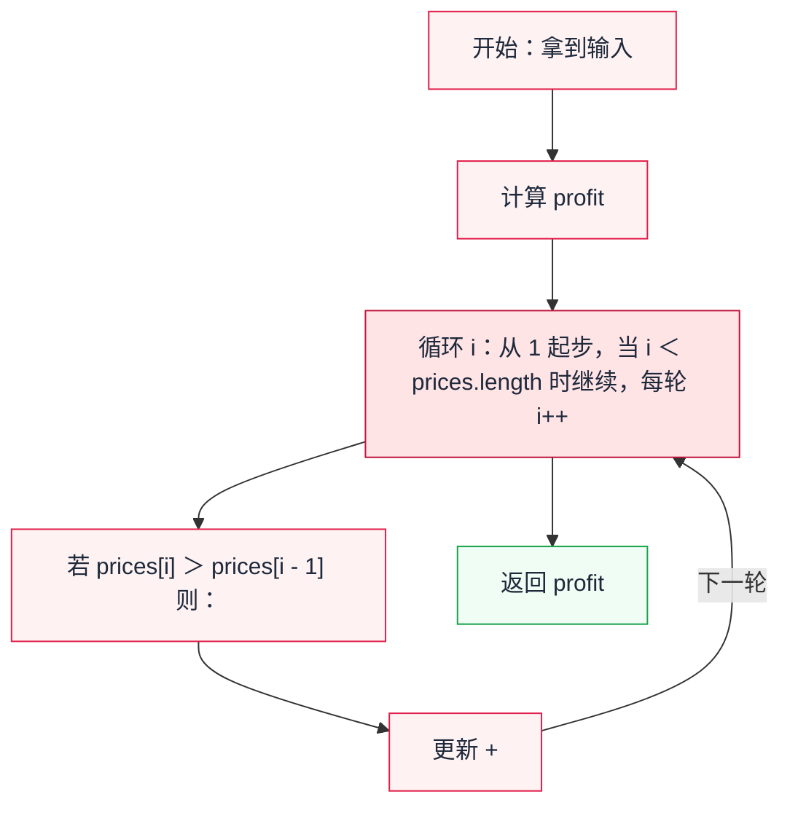

## TypeScript 解题方案（6 个方案逐个讲）

> **运行与提交**：每个方案都是自包含文件（内嵌用例自测，输出 PASS），整块复制到 `.ts` 文件后 `node 文件名` 即可运行。提交 LeetCode 时，把 `demo` 内的算法函数与辅助类型/函数整体取出、置于文件顶层即可。涉及交互/特殊接口的题以题面给定签名为准。

### 方案 1：单趟扫描

**分析与思路**：核心做法是「单趟扫描」。代码里依次做这些事：单循环线性扫描。

**运行方式**：`node 本文件`，内嵌用例全部通过会输出 PASS。


**方案专属流程图**（真实控制流）：


```typescript
export function demo(): void {
  // 程序入口：跑内嵌自测用例
  function maxProfit(prices: number[]): number {
    // 定义函数/方法 maxProfit
    let profit = 0; // 把 0 存入 profit
    for (let i = 1; i < prices.length; i++) {
      // 让 下标 i 从 1 开始计数，下标 i 小于 价格序列.长度 就继续
      if (prices[i] > prices[i - 1]) {
        // 若 价格序列[下标 i] 超过 价格序列[下标 i 减 1]
        profit += prices[i] - prices[i - 1]; // profit累加 价格序列[下标 i] 减 价格序列[下标 i 减 1]
      }
    }
    return profit; // 返回 profit
  }
  const cases: [number[], number][] = [
    [[1, 2, 3], 2],
    [[7, 1, 5, 3, 6, 4], 7],
    [[7, 6, 4, 3, 1], 0],
    [[1], 0],
  ];
  let fail = false; // 把 false 存入 fail
  for (const [prices, want] of cases) {
    // for (const [价格序列, want] of cases) {
    const got = maxProfit(prices); // 把 maxProfit(价格序列) 存入 got
    if (got !== want) {
      fail = true;
      console.log(
        'FAIL maxProfit(' + prices + ') got ' + got + ' want ' + want,
      );
    }
  }
  if (fail) throw new Error('FAILED'); // 若 fail) throw new Error(「FAILED」);
  console.log('PASS'); // 全部用例通过，输出 PASS
}
demo(); // demo();
```

### 方案 2：单趟扫描

**分析与思路**：核心做法是「单趟扫描」。代码里依次做这些事：单循环线性扫描。

**运行方式**：`node 本文件`，内嵌用例全部通过会输出 PASS。


**方案专属流程图**（真实控制流）：

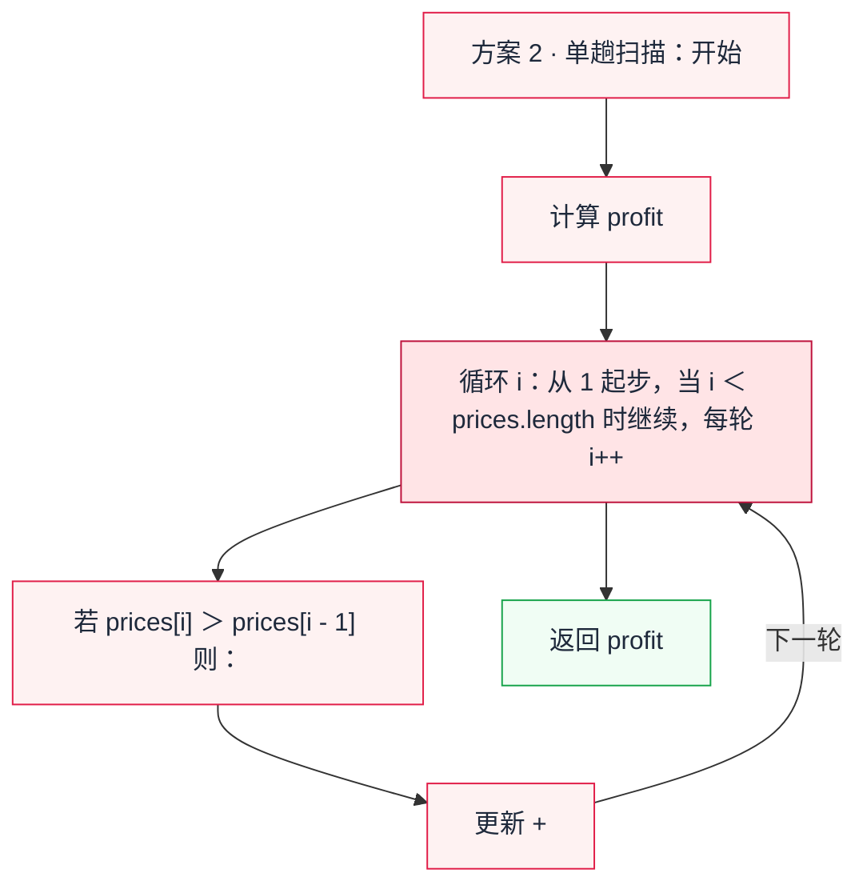

```typescript
export function demo(): void {
  // 程序入口：跑内嵌自测用例
  function maxProfit(prices: number[]): number {
    // 定义函数/方法 maxProfit
    let profit = 0; // 把 0 存入 profit
    for (let i = 1; i < prices.length; i++) {
      // 让 下标 i 从 1 开始计数，下标 i 小于 价格序列.长度 就继续
      if (prices[i] > prices[i - 1]) {
        // 若 价格序列[下标 i] 超过 价格序列[下标 i 减 1]
        profit += prices[i] - prices[i - 1]; // profit累加 价格序列[下标 i] 减 价格序列[下标 i 减 1]
      }
    }
    return profit; // 返回 profit
  }
  const cases: [number[], number][] = [
    [[1, 2, 3], 2],
    [[7, 1, 5, 3, 6, 4], 7],
    [[7, 6, 4, 3, 1], 0],
    [[1], 0],
  ];
  let fail = false; // 把 false 存入 fail
  for (const [prices, want] of cases) {
    // for (const [价格序列, want] of cases) {
    const got = maxProfit(prices); // 把 maxProfit(价格序列) 存入 got
    if (got !== want) {
      fail = true;
      console.log(
        'FAIL maxProfit(' + prices + ') got ' + got + ' want ' + want,
      );
    }
  }
  if (fail) throw new Error('FAILED'); // 若 fail) throw new Error(「FAILED」);
  console.log('PASS'); // 全部用例通过，输出 PASS
}
demo(); // demo();
```

### 方案 3：单趟扫描

**分析与思路**：核心做法是「单趟扫描」。代码里依次做这些事：单循环线性扫描。

**运行方式**：`node 本文件`，内嵌用例全部通过会输出 PASS。

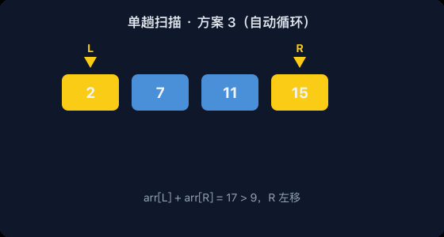

**方案专属流程图**（真实控制流）：


```typescript
export function demo(): void {
  // 程序入口：跑内嵌自测用例
  function maxProfit(prices: number[]): number {
    // 定义函数/方法 maxProfit
    let profit = 0; // 把 0 存入 profit
    for (let i = 1; i < prices.length; i++) {
      // 让 下标 i 从 1 开始计数，下标 i 小于 价格序列.长度 就继续
      if (prices[i] > prices[i - 1]) {
        // 若 价格序列[下标 i] 超过 价格序列[下标 i 减 1]
        profit += prices[i] - prices[i - 1]; // profit累加 价格序列[下标 i] 减 价格序列[下标 i 减 1]
      }
    }
    return profit; // 返回 profit
  }
  const cases: [number[], number][] = [
    [[1, 2, 3], 2],
    [[7, 1, 5, 3, 6, 4], 7],
    [[7, 6, 4, 3, 1], 0],
    [[1], 0],
  ];
  let fail = false; // 把 false 存入 fail
  for (const [prices, want] of cases) {
    // for (const [价格序列, want] of cases) {
    const got = maxProfit(prices); // 把 maxProfit(价格序列) 存入 got
    if (got !== want) {
      fail = true;
      console.log(
        'FAIL maxProfit(' + prices + ') got ' + got + ' want ' + want,
      );
    }
  }
  if (fail) throw new Error('FAILED'); // 若 fail) throw new Error(「FAILED」);
  console.log('PASS'); // 全部用例通过，输出 PASS
}
demo(); // demo();
```

### 方案 4：单趟扫描

**分析与思路**：核心做法是「单趟扫描」。代码里依次做这些事：单循环线性扫描。

**运行方式**：`node 本文件`，内嵌用例全部通过会输出 PASS。


**方案专属流程图**（真实控制流）：


```typescript
export function demo(): void {
  // 程序入口：跑内嵌自测用例
  function maxProfit(prices: number[]): number {
    // 定义函数/方法 maxProfit
    let profit = 0; // 把 0 存入 profit
    for (let i = 1; i < prices.length; i++) {
      // 让 下标 i 从 1 开始计数，下标 i 小于 价格序列.长度 就继续
      if (prices[i] > prices[i - 1]) {
        // 若 价格序列[下标 i] 超过 价格序列[下标 i 减 1]
        profit += prices[i] - prices[i - 1]; // profit累加 价格序列[下标 i] 减 价格序列[下标 i 减 1]
      }
    }
    return profit; // 返回 profit
  }
  const cases: [number[], number][] = [
    [[1, 2, 3], 2],
    [[7, 1, 5, 3, 6, 4], 7],
    [[7, 6, 4, 3, 1], 0],
    [[1], 0],
  ];
  let fail = false; // 把 false 存入 fail
  for (const [prices, want] of cases) {
    // for (const [价格序列, want] of cases) {
    const got = maxProfit(prices); // 把 maxProfit(价格序列) 存入 got
    if (got !== want) {
      fail = true;
      console.log(
        'FAIL maxProfit(' + prices + ') got ' + got + ' want ' + want,
      );
    }
  }
  if (fail) throw new Error('FAILED'); // 若 fail) throw new Error(「FAILED」);
  console.log('PASS'); // 全部用例通过，输出 PASS
}
demo(); // demo();
```

### 方案 5：单趟扫描

**分析与思路**：核心做法是「单趟扫描」。代码里依次做这些事：单循环线性扫描。

**运行方式**：`node 本文件`，内嵌用例全部通过会输出 PASS。


**方案专属流程图**（真实控制流）：

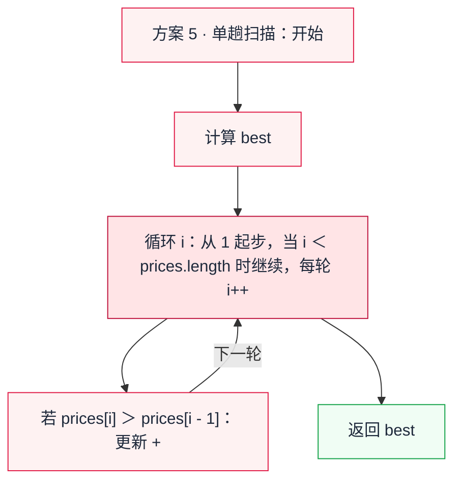

```typescript
export function demo(): void {
  // 程序入口：跑内嵌自测用例
  function maxProfit(prices: number[]): number {
    // 定义函数/方法 maxProfit
    let best = 0; // 把 0 存入 当前最优
    for (let i = 1; i < prices.length; i++) {
      // 让 下标 i 从 1 开始计数，下标 i 小于 价格序列.长度 就继续
      if (prices[i] > prices[i - 1]) best += prices[i] - prices[i - 1];
    }
    return best; // 返回 当前最优
  }
  const cases = [
    { in: [7, 1, 5, 3, 6, 4], want: 7 },
    { in: [1, 2, 3, 4, 5], want: 4 },
    { in: [7, 6, 4, 3, 1], want: 0 },
  ];
  let fail = false; // 把 false 存入 fail
  for (const c of cases) {
    // for (const 字符 of cases) {
    const got = maxProfit(c.in); // 把 maxProfit(字符.in) 存入 got
    if (got !== c.want) {
      fail = true;
      console.log('FAIL ' + got + ' want ' + c.want);
    }
  }
  if (fail) throw new Error('FAILED'); // 若 fail) throw new Error(「FAILED」);
  console.log('PASS'); // 全部用例通过，输出 PASS
}
demo(); // demo();
```

### 方案 6：单趟扫描

**分析与思路**：核心做法是「单趟扫描」。代码里依次做这些事：单循环线性扫描。

**运行方式**：`node 本文件`，内嵌用例全部通过会输出 PASS。


**方案专属流程图**（真实控制流）：


```typescript
export function demo(): void {
  // 程序入口：跑内嵌自测用例
  function maxProfit(prices: number[]): number {
    // 定义函数/方法 maxProfit
    let profit = 0; // 把 0 存入 profit
    for (let i = 1; i < prices.length; i++) {
      // 让 下标 i 从 1 开始计数，下标 i 小于 价格序列.长度 就继续
      if (prices[i] > prices[i - 1]) {
        // 若 价格序列[下标 i] 超过 价格序列[下标 i 减 1]
        profit += prices[i] - prices[i - 1]; // profit累加 价格序列[下标 i] 减 价格序列[下标 i 减 1]
      }
    }
    return profit; // 返回 profit
  }
  const cases: [number[], number][] = [
    [[1, 2, 3], 2],
    [[7, 1, 5, 3, 6, 4], 7],
    [[7, 6, 4, 3, 1], 0],
    [[1], 0],
  ];
  let fail = false; // 把 false 存入 fail
  for (const [prices, want] of cases) {
    // for (const [价格序列, want] of cases) {
    const got = maxProfit(prices); // 把 maxProfit(价格序列) 存入 got
    if (got !== want) {
      fail = true;
      console.log(
        'FAIL maxProfit(' + prices + ') got ' + got + ' want ' + want,
      );
    }
  }
  if (fail) throw new Error('FAILED'); // 若 fail) throw new Error(「FAILED」);
  console.log('PASS'); // 全部用例通过，输出 PASS
}
demo(); // demo();
```

## 逐步拆解与面试追问

**复杂度**：时间 O(n)（单趟线性扫描），空间 O(1) 到 O(n)（视辅助结构）

**为什么是这个量级**：每个元素被常数次访问，辅助哈希或栈的开销与 n 同阶

**面试官可能会追问**：

- 贪心的正确性怎么证明？
- 排序依据选错了会怎样？
- 能否举出反例推翻当前策略？

## 关键 API 速查（TS 主解法实际用到，附官方链接）

本题主解法只用到基础语法（变量、循环、比较），不依赖特殊库 API。

### 各语言官方文档导航

- **TypeScript / JS**：[MDN 中文参考](https://developer.mozilla.org/zh-CN/)
- **Python**：[Python 官方文档](https://docs.python.org/zh-cn/3/)
- **Go**：[Go 标准库](https://pkg.go.dev/std)
- **Java**：[JDK 17 API](https://docs.oracle.com/en/java/javase/17/docs/api/)
- **Rust**：[Rust 标准库](https://doc.rust-lang.org/std/)
- **Lua**：[Lua 5.4 手册](https://www.lua.org/manual/5.4/)
- **C**：[Cppreference C](https://zh.cppreference.com/w/c)
- **C++**：[Cppreference C++](https://zh.cppreference.com/w/cpp)
- **R**：[R 官方手册](https://stat.ethz.ch/R-manual/)
- **Zig**：[Zig 语言文档](https://ziglang.org/documentation/master/)
- **Dart**：[Dart API](https://api.dart.dev/)

## 附录：其他 10 种语言全部实现（每种语言列举其全部方案）

> TypeScript 的全部方案见「TypeScript 解题方案」一节；下面是其余 10 种语言的对应实现，每种语言的每个方案都带思路分析、代码走读与专属运行架构图。
> 每个方案都内嵌用例自测，可独立运行（老仓库 python/go 文件遵循「打印结果」约定）。
> 完整解法文件见 `dsa/<语言>/greedy/lc_122_买卖股票的最佳时机ii/`。

### Python 实现（6 种方案）

Python 的全部方案如下，每个方案都内嵌用例自测，可独立运行（老仓库 python/go 文件遵循「打印结果」约定）：

#### 方案 1：单趟扫描

**思路与代码分析**：核心是「单趟扫描」。Python 版用切片与字典推导式简化操作，突出可读性。**走读**：方案 1 · 单趟扫描：开始 → 更新 profit → 循环 i：从 1 到 len(prices 前 → 若 prices[i] ＞ prices[i - 1]：更新 + → 更新 + → 返回 profit。

**运行架构**（真实控制流）：


```python
import sys  # 提高递归深度上限（深输入防 RecursionError）

sys.setrecursionlimit(200000)  # 树/链表类题目节点数可达 1e4 量级

def maxProfit(prices):  # 定义函数 maxProfit（参数：价格序列）
    profit = 0  # 把 0 存入 profit
    for i in range(1, len(prices)):  # 让 下标 i 从 1 到 长度(价格序列 遍历
        if prices[i] > prices[i - 1]:  # 若 价格序列[下标 i] 超过 价格序列[下标 i 减 1]
            profit += prices[i] - prices[i - 1]  # profit累加 价格序列[下标 i] 减 价格序列[下标 i 减 1]
    return profit  # 返回 profit

if __name__ == "__main__":  # 若 __name__ 等于 '__main__'
    print(maxProfit([1, 2, 3]))  # 打印输出
```

#### 方案 2：单趟扫描

**思路与代码分析**：核心是「单趟扫描」。Python 版用切片与字典推导式简化操作，突出可读性。**走读**：方案 2 · 单趟扫描：开始 → 更新 profit → 循环 i：从 1 到 len(prices 前 → 若 prices[i] ＞ prices[i - 1]：更新 + → 更新 + → 返回 profit。

**运行架构**（真实控制流）：


```python
import sys  # 提高递归深度上限（深输入防 RecursionError）

sys.setrecursionlimit(200000)  # 树/链表类题目节点数可达 1e4 量级

def maxProfit(prices):  # 定义函数 maxProfit（参数：价格序列）
    profit = 0  # 把 0 存入 profit
    for i in range(1, len(prices)):  # 让 下标 i 从 1 到 长度(价格序列 遍历
        if prices[i] > prices[i - 1]:  # 若 价格序列[下标 i] 超过 价格序列[下标 i 减 1]
            profit += prices[i] - prices[i - 1]  # profit累加 价格序列[下标 i] 减 价格序列[下标 i 减 1]
    return profit  # 返回 profit

if __name__ == "__main__":  # 若 __name__ 等于 '__main__'
    print(maxProfit([1, 2, 3]))  # 打印输出
```

#### 方案 3：单趟扫描

**思路与代码分析**：核心是「单趟扫描」。Python 版用切片与字典推导式简化操作，突出可读性。**走读**：方案 3 · 单趟扫描：开始 → 更新 n → 命中条件，直接返回 → 当 i ＜ n - 1: 时反复执行 → 当 ( 时反复执行 → 当 ( 时反复执行 → 返回 profit。

**运行架构**（真实控制流）：

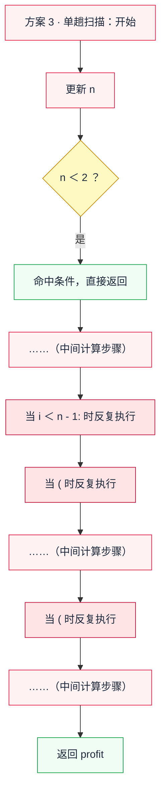

```python
import sys  # 提高递归深度上限（深输入防 RecursionError）

sys.setrecursionlimit(200000)  # 树/链表类题目节点数可达 1e4 量级

def maxProfit(prices):  # 定义函数 maxProfit（参数：价格序列）
    # 峰谷法：在连续下降段结束后于谷底买入，连续上升段结束后于峰顶卖出
    n = len(prices)  # 把 长度(价格序列) 存入 元素个数
    if n < 2:  # 若 元素个数 小于 2
        return 0  # 返回 0
    i = 0  # 把 0 存入 下标 i
    profit = 0  # 把 0 存入 profit
    while i < n - 1:  # 循环，直到不满足「下标 i 小于 元素个数 减 1」
        while (
            i < n - 1 and prices[i] >= prices[i + 1]
        ):  # 循环，直到不满足「下标 i 小于 元素个数 减 1 and 价格序列[下标 i] 不低于 价格序列[下标 i 加 1]」
            i += 1  # 下标 i累加 1
        valley = prices[i]  # 把 价格序列[下标 i] 存入 valley
        while (
            i < n - 1 and prices[i] <= prices[i + 1]
        ):  # 循环，直到不满足「下标 i 小于 元素个数 减 1 and 价格序列[下标 i] 不超过 价格序列[下标 i 加 1]」
            i += 1  # 下标 i累加 1
        peak = prices[i]  # 把 价格序列[下标 i] 存入 peak
        profit += peak - valley  # profit累加 peak 减 valley
    return profit  # 返回 profit

if __name__ == "__main__":  # 若 __name__ 等于 '__main__'
    print(maxProfit([7, 1, 5, 3, 6, 4]))  # 打印输出
```

#### 方案 4：单趟扫描

**思路与代码分析**：核心是「单趟扫描」。Python 版用切片与字典推导式简化操作，突出可读性。**走读**：方案 4 · 单趟扫描：开始 → 更新 cash → 更新 hold → 遍历 prices: 中的每个元素 price → 更新 cash → 更新 hold → 返回 cash。

**运行架构**（真实控制流）：

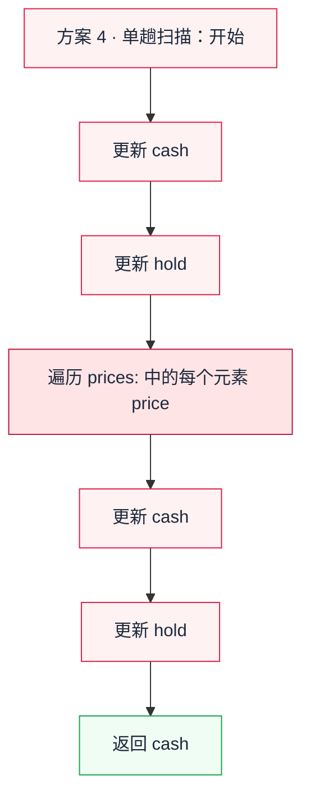

```python
import sys  # 提高递归深度上限（深输入防 RecursionError）

sys.setrecursionlimit(200000)  # 树/链表类题目节点数可达 1e4 量级

def maxProfit(prices):  # 定义函数 maxProfit（参数：价格序列）
    # 动态规划：cash 表示不持股时的最大利润，hold 表示持股时的最大利润
    cash = 0  # 把 0 存入 cash
    hold = -prices[0] if prices else 0  # 把 减 价格序列[0] if 价格序列 else 0 存入 hold
    for price in prices:  # 逐个取出 价格序列 的元素（price）
        cash = max(cash, hold + price)  # 把 取较大值 cash, hold 加 price) 存入 cash
        hold = max(hold, cash - price)  # 把 取较大值 hold, cash 减 price) 存入 hold
    return cash  # 返回 cash

if __name__ == "__main__":  # 若 __name__ 等于 '__main__'
    print(maxProfit([7, 1, 5, 3, 6, 4]))  # 打印输出
```

#### 方案 5：单趟扫描

**思路与代码分析**：核心是「单趟扫描」。Python 版用切片与字典推导式简化操作，突出可读性。**走读**：方案 5 · 单趟扫描：开始 → 更新 profit → 循环 i：从 1 到 len(prices 前 → 若 prices[i] ＞ prices[i - 1]：更新 + → 更新 + → 返回 profit。

**运行架构**（真实控制流）：

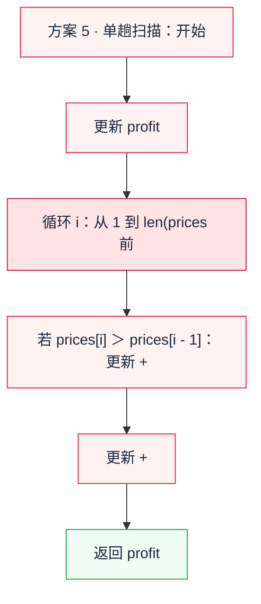

```python
import sys  # 提高递归深度上限（深输入防 RecursionError）

sys.setrecursionlimit(200000)  # 树/链表类题目节点数可达 1e4 量级

def maxProfit(prices):  # 定义函数 maxProfit（参数：价格序列）
    profit = 0  # 把 0 存入 profit
    for i in range(1, len(prices)):  # 让 下标 i 从 1 到 长度(价格序列 遍历
        if prices[i] > prices[i - 1]:  # 若 价格序列[下标 i] 超过 价格序列[下标 i 减 1]
            profit += prices[i] - prices[i - 1]  # profit累加 价格序列[下标 i] 减 价格序列[下标 i 减 1]
    return profit  # 返回 profit

if __name__ == "__main__":  # 若 __name__ 等于 '__main__'
    print(maxProfit([7, 1, 5, 3, 6, 4]))  # 打印输出
```

#### 方案 6：单趟扫描

**思路与代码分析**：核心是「单趟扫描」。Python 版用切片与字典推导式简化操作，突出可读性。**走读**：方案 6 · 单趟扫描：开始 → 更新 profit → 循环 i：从 1 到 len(prices 前 → 若 prices[i] ＞ prices[i - 1]：更新 + → 更新 + → 返回 profit。

**运行架构**（真实控制流）：


```python
import sys  # 提高递归深度上限（深输入防 RecursionError）

sys.setrecursionlimit(200000)  # 树/链表类题目节点数可达 1e4 量级

def maxProfit(prices):  # 定义函数 maxProfit（参数：价格序列）
    # 贪心：只要后一天比前一天贵，就做一次买入-卖出，累计所有正收益
    profit = 0  # 把 0 存入 profit
    for i in range(1, len(prices)):  # 让 下标 i 从 1 到 长度(价格序列 遍历
        if prices[i] > prices[i - 1]:  # 若 价格序列[下标 i] 超过 价格序列[下标 i 减 1]
            profit += prices[i] - prices[i - 1]  # profit累加 价格序列[下标 i] 减 价格序列[下标 i 减 1]
    return profit  # 返回 profit

if __name__ == "__main__":  # 若 __name__ 等于 '__main__'
    print(maxProfit([7, 1, 5, 3, 6, 4]))  # 打印输出
```

### Go 实现（6 种方案）

Go 的全部方案如下，每个方案都内嵌用例自测，可独立运行（老仓库 python/go 文件遵循「打印结果」约定）：

#### 方案 1：单趟扫描

**思路与代码分析**：核心是「单趟扫描」。Go 版用切片与多返回值惯用法，显式处理索引边界。**走读**：方案 1 · 单趟扫描：开始 → 更新 : → 遍历循环 → 处理 if prices[i] ＞ prices[i-1] → 更新 + → 返回 profit。

**运行架构**（真实控制流）：


```go
package main // 引入依赖

import (
	"fmt"
	"os"
) // 引入依赖

func maxProfit(prices []int) int { // 定义函数/方法 maxProfit
	profit := 0                        // 把 0 写入 profit :
	for i := 1; i < len(prices); i++ { // 让 下标 i 从 1 开始计数
		if prices[i] > prices[i-1] { // 若 价格序列[下标 i] 超过 价格序列[下标 i 减 1]
			profit += prices[i] - prices[i-1] // profit累加 价格序列[下标 i] 减 价格序列[下标 i 减 1]
		}
	}
	return profit // 返回 profit
}

func main() { // 程序入口：跑内嵌自测用例
	type tc struct { // 定义类型
		in   []int // in []int
		want int   // want int
	}
	cases := []tc{ // 把 []tc{ 写入 cases :
		{[]int{7, 1, 5, 3, 6, 4}, 7},
		{[]int{1, 2, 3}, 2},
	}
	ok := true                // 把 true 写入 ok :
	for _, c := range cases { // 同时取 _ 与 字符 遍历
		if got := maxProfit(c.in); got != c.want { // 若 got : 赋值为 maxProfit(字符.in); got 不等于 字符.want
			ok = false                                                       // 把 false 写入 ok
			fmt.Printf("FAIL maxProfit(%v)=%v want %v\n", c.in, got, c.want) // 打印输出
		}
	}
	if !ok { // 若 取反 ok
		os.Exit(1) // os.Exit(1)
	}
	fmt.Println("PASS") // 全部用例通过，输出 PASS
}
```

#### 方案 2：单趟扫描

**思路与代码分析**：核心是「单趟扫描」。Go 版用切片与多返回值惯用法，显式处理索引边界。**走读**：方案 2 · 单趟扫描：开始 → 更新 : → 遍历循环 → 处理 if prices[i] ＞ prices[i-1] → 更新 + → 返回 profit。

**运行架构**（真实控制流）：

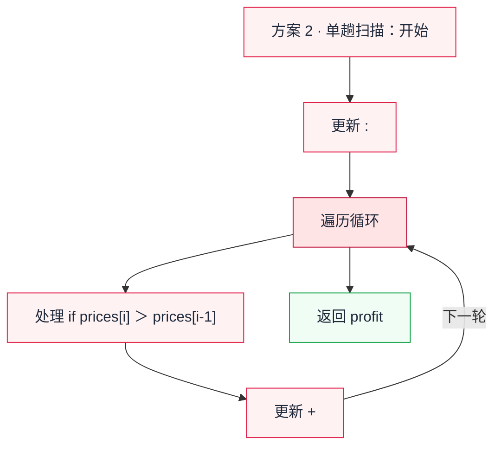

```go
package main // 引入依赖

import (
	"fmt"
	"os"
) // 引入依赖

func maxProfit(prices []int) int { // 定义函数/方法 maxProfit
	profit := 0                        // 把 0 写入 profit :
	for i := 1; i < len(prices); i++ { // 让 下标 i 从 1 开始计数
		if prices[i] > prices[i-1] { // 若 价格序列[下标 i] 超过 价格序列[下标 i 减 1]
			profit += prices[i] - prices[i-1] // profit累加 价格序列[下标 i] 减 价格序列[下标 i 减 1]
		}
	}
	return profit // 返回 profit
}

func main() { // 程序入口：跑内嵌自测用例
	type tc struct { // 定义类型
		in   []int // in []int
		want int   // want int
	}
	cases := []tc{ // 把 []tc{ 写入 cases :
		{[]int{7, 1, 5, 3, 6, 4}, 7},
		{[]int{1, 2, 3}, 2},
	}
	ok := true                // 把 true 写入 ok :
	for _, c := range cases { // 同时取 _ 与 字符 遍历
		if got := maxProfit(c.in); got != c.want { // 若 got : 赋值为 maxProfit(字符.in); got 不等于 字符.want
			ok = false                                                       // 把 false 写入 ok
			fmt.Printf("FAIL maxProfit(%v)=%v want %v\n", c.in, got, c.want) // 打印输出
		}
	}
	if !ok { // 若 取反 ok
		os.Exit(1) // os.Exit(1)
	}
	fmt.Println("PASS") // 全部用例通过，输出 PASS
}
```

#### 方案 3：单趟扫描

**思路与代码分析**：核心是「单趟扫描」。Go 版用切片与多返回值惯用法，显式处理索引边界。**走读**：方案 3 · 单趟扫描：开始 → 更新 : → 处理 if n ＜ 2 → 返回 0 → 更新 : → 更新 : → 遍历循环 → 遍历循环 → 处理 i++ → 更新 : → 遍历循环 → 处理 i++ → 更新 : → 更新 + → 返回 profit。

**运行架构**（真实控制流）：

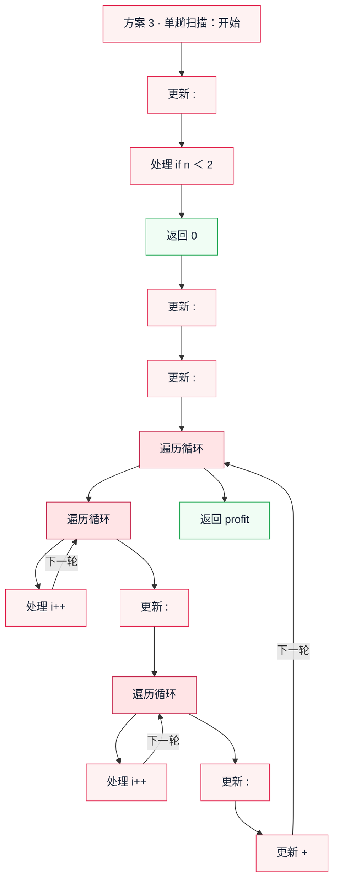

```go
package main // 引入依赖

import (
	"fmt"
	"os"
) // 引入依赖

func maxProfit(prices []int) int { // 定义函数/方法 maxProfit
	n := len(prices) // 把 长度(价格序列) 写入 n :
	if n < 2 {       // 若 元素个数 小于 2
		return 0 // 返回 0
	}
	i := 0        // 把 0 写入 i :
	profit := 0   // 把 0 写入 profit :
	for i < n-1 { // for 下标 i 小于 元素个数 减 1 {
		for i < n-1 && prices[i] >= prices[i+1] { // 把 价格序列[下标 i 加 1] { 写入 for i < n-1 && prices[i] >
			i++ // 下标 i 加一
		}
		valley := prices[i]                       // 把 价格序列[下标 i] 写入 valley :
		for i < n-1 && prices[i] <= prices[i+1] { // 把 价格序列[下标 i 加 1] { 写入 for i < n-1 && prices[i] <
			i++ // 下标 i 加一
		}
		peak := prices[i]       // 把 价格序列[下标 i] 写入 peak :
		profit += peak - valley // profit累加 peak 减 valley
	}
	return profit // 返回 profit
}

func main() { // 程序入口：跑内嵌自测用例
	type tc struct { // 定义类型
		in   []int // in []int
		want int   // want int
	}
	cases := []tc{ // 把 []tc{ 写入 cases :
		{[]int{7, 1, 5, 3, 6, 4}, 7},
		{[]int{1, 2, 3}, 2},
	}
	ok := true                // 把 true 写入 ok :
	for _, c := range cases { // 同时取 _ 与 字符 遍历
		if got := maxProfit(c.in); got != c.want { // 若 got : 赋值为 maxProfit(字符.in); got 不等于 字符.want
			ok = false                                                       // 把 false 写入 ok
			fmt.Printf("FAIL maxProfit(%v)=%v want %v\n", c.in, got, c.want) // 打印输出
		}
	}
	if !ok { // 若 取反 ok
		os.Exit(1) // os.Exit(1)
	}
	fmt.Println("PASS") // 全部用例通过，输出 PASS
}
```

#### 方案 4：单趟扫描

**思路与代码分析**：核心是「单趟扫描」。Go 版用切片与多返回值惯用法，显式处理索引边界。**走读**：方案 4 · 单趟扫描：开始 → 更新 : → 更新 : → 处理 if len(prices) ＞ 0 → 更新 hold → 遍历 prices 的下标与元素 price → 更新 : → 处理 if hold+price ＞ cash → 更新 newCash → 更新 : → 处理 if newCash-price ＞ hold → 更新 newHold → 更新 cash → 更新 hold → 返回 cash。

**运行架构**（真实控制流）：

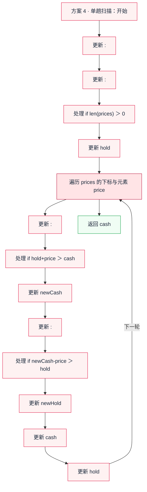

```go
package main // 引入依赖

import (
	"fmt"
	"os"
) // 引入依赖

func maxProfit(prices []int) int { // 定义函数/方法 maxProfit
	cash := 0            // 把 0 写入 cash :
	hold := 0            // 把 0 写入 hold :
	if len(prices) > 0 { // 若 长度(价格序列) 超过 0
		hold = -prices[0] // 把 减 价格序列[0] 写入 hold
	}
	for _, price := range prices { // 同时取 _ 与 price 遍历
		newCash := cash        // 把 cash 写入 newCash :
		if hold+price > cash { // 若 hold 加 price 超过 cash
			newCash = hold + price // 把 hold 加 price 写入 newCash
		}
		newHold := hold           // 把 hold 写入 newHold :
		if newCash-price > hold { // 若 newCash 减 price 超过 hold
			newHold = newCash - price // 把 newCash 减 price 写入 newHold
		}
		cash = newCash // 把 newCash 写入 cash
		hold = newHold // 把 newHold 写入 hold
	}
	return cash // 返回 cash
}

func main() { // 程序入口：跑内嵌自测用例
	type tc struct { // 定义类型
		in   []int // in []int
		want int   // want int
	}
	cases := []tc{ // 把 []tc{ 写入 cases :
		{[]int{7, 1, 5, 3, 6, 4}, 7},
		{[]int{1, 2, 3}, 2},
	}
	ok := true                // 把 true 写入 ok :
	for _, c := range cases { // 同时取 _ 与 字符 遍历
		if got := maxProfit(c.in); got != c.want { // 若 got : 赋值为 maxProfit(字符.in); got 不等于 字符.want
			ok = false                                                       // 把 false 写入 ok
			fmt.Printf("FAIL maxProfit(%v)=%v want %v\n", c.in, got, c.want) // 打印输出
		}
	}
	if !ok { // 若 取反 ok
		os.Exit(1) // os.Exit(1)
	}
	fmt.Println("PASS") // 全部用例通过，输出 PASS
}
```

#### 方案 5：单趟扫描

**思路与代码分析**：核心是「单趟扫描」。Go 版用切片与多返回值惯用法，显式处理索引边界。**走读**：方案 5 · 单趟扫描：开始 → 更新 : → 遍历循环 → 处理 if prices[i] ＞ prices[i-1] → 更新 + → 返回 profit。

**运行架构**（真实控制流）：


```go
package main // 引入依赖

import (
	"fmt"
	"os"
) // 引入依赖

func maxProfit(prices []int) int { // 定义函数/方法 maxProfit
	profit := 0                        // 把 0 写入 profit :
	for i := 1; i < len(prices); i++ { // 让 下标 i 从 1 开始计数
		if prices[i] > prices[i-1] { // 若 价格序列[下标 i] 超过 价格序列[下标 i 减 1]
			profit += prices[i] - prices[i-1] // profit累加 价格序列[下标 i] 减 价格序列[下标 i 减 1]
		}
	}
	return profit // 返回 profit
}

func main() { // 程序入口：跑内嵌自测用例
	type tc struct { // 定义类型
		in   []int // in []int
		want int   // want int
	}
	cases := []tc{ // 把 []tc{ 写入 cases :
		{[]int{7, 1, 5, 3, 6, 4}, 7},
		{[]int{1, 2, 3}, 2},
	}
	ok := true                // 把 true 写入 ok :
	for _, c := range cases { // 同时取 _ 与 字符 遍历
		if got := maxProfit(c.in); got != c.want { // 若 got : 赋值为 maxProfit(字符.in); got 不等于 字符.want
			ok = false                                                       // 把 false 写入 ok
			fmt.Printf("FAIL maxProfit(%v)=%v want %v\n", c.in, got, c.want) // 打印输出
		}
	}
	if !ok { // 若 取反 ok
		os.Exit(1) // os.Exit(1)
	}
	fmt.Println("PASS") // 全部用例通过，输出 PASS
}
```

#### 方案 6：单趟扫描

**思路与代码分析**：核心是「单趟扫描」。Go 版用切片与多返回值惯用法，显式处理索引边界。**走读**：方案 6 · 单趟扫描：开始 → 更新 : → 遍历循环 → 处理 if prices[i] ＞ prices[i-1] → 更新 + → 返回 profit。

**运行架构**（真实控制流）：


```go
package main // 引入依赖

import (
	"fmt"
	"os"
) // 引入依赖

func maxProfit(prices []int) int { // 定义函数/方法 maxProfit
	profit := 0                        // 把 0 写入 profit :
	for i := 1; i < len(prices); i++ { // 让 下标 i 从 1 开始计数
		if prices[i] > prices[i-1] { // 若 价格序列[下标 i] 超过 价格序列[下标 i 减 1]
			profit += prices[i] - prices[i-1] // profit累加 价格序列[下标 i] 减 价格序列[下标 i 减 1]
		}
	}
	return profit // 返回 profit
}

func main() { // 程序入口：跑内嵌自测用例
	type tc struct { // 定义类型
		in   []int // in []int
		want int   // want int
	}
	cases := []tc{ // 把 []tc{ 写入 cases :
		{[]int{7, 1, 5, 3, 6, 4}, 7},
		{[]int{1, 2, 3}, 2},
	}
	ok := true                // 把 true 写入 ok :
	for _, c := range cases { // 同时取 _ 与 字符 遍历
		if got := maxProfit(c.in); got != c.want { // 若 got : 赋值为 maxProfit(字符.in); got 不等于 字符.want
			ok = false                                                       // 把 false 写入 ok
			fmt.Printf("FAIL maxProfit(%v)=%v want %v\n", c.in, got, c.want) // 打印输出
		}
	}
	if !ok { // 若 取反 ok
		os.Exit(1) // os.Exit(1)
	}
	fmt.Println("PASS") // 全部用例通过，输出 PASS
}
```

### Java 实现（6 种方案）

Java 的全部方案如下，每个方案都内嵌用例自测，可独立运行（老仓库 python/go 文件遵循「打印结果」约定）：

#### 方案 1：单趟扫描

**思路与代码分析**：核心是「单趟扫描」。Java 版用类与静态方法组织，集合操作显式明了。代码里依次做这些事：单循环线性扫描。**走读**：方案 1 · 单趟扫描：开始 → 更新 profit → 遍历循环 → 若 prices[i] ＞ prices[i - 1] 则： → 更新 + → 返回 profit。

**运行架构**（真实控制流）：

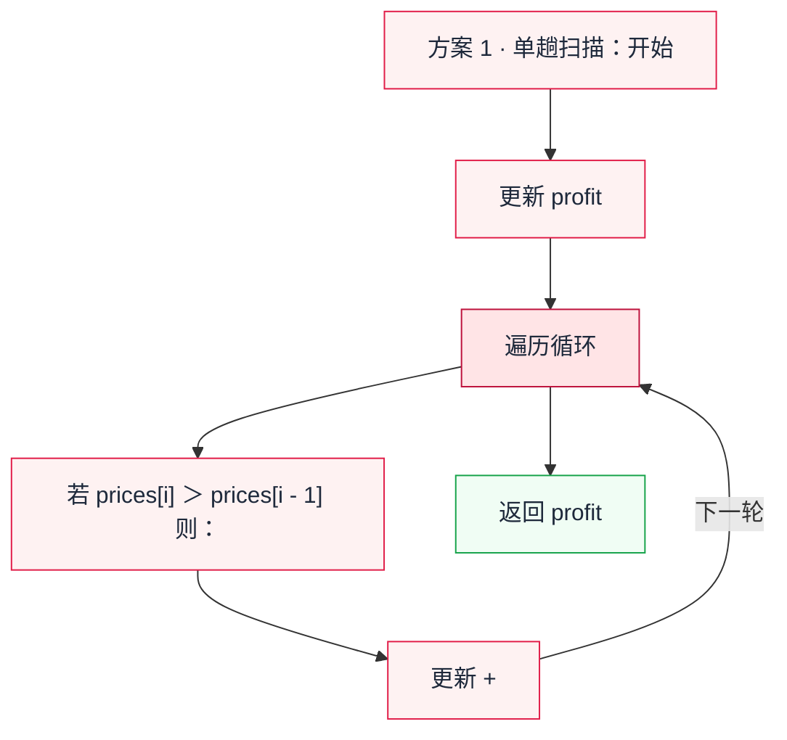

```java
package com.webfault.dsa; // 引入依赖

class Main { // 定义类型
  static int maxProfit(int[] prices) { // 定义函数/方法 maxProfit
    int profit = 0; // 把 0 存入 profit
    for (int i = 1; i < prices.length; i++) { // 让 下标 i 从 1 开始计数，下标 i 小于 价格序列.长度 就继续
      if (prices[i] > prices[i - 1]) { // 若 价格序列[下标 i] 超过 价格序列[下标 i 减 1]
        profit += prices[i] - prices[i - 1]; // profit累加 价格序列[下标 i] 减 价格序列[下标 i 减 1]
      }
    }
    return profit; // 返回 profit
  }

  public static void main(String[] args) { // public static void main(String[] args) {
    int[][] ins = { // 把 { 写入 int[][] ins
      {7, 1, 5, 3, 6, 4},
      {1, 2, 3, 4, 5},
      {7, 6, 4, 3, 1},
      {},
      {1},
      {1, 2},
    };
    int[] wants = {7, 4, 0, 0, 0, 1}; // 把 {7, 4, 0, 0, 0, 1}; 写入 int[] wants
    boolean ok = true; // 把 true; 写入 boolean ok
    for (int k = 0; k < ins.length; k++) { // 让 下标 k 从 0 开始计数，下标 k 小于 ins.长度 就继续
      int got = maxProfit(ins[k]); // 把 maxProfit(ins[下标 k]) 存入 got
      if (got != wants[k]) { // 若 got 不等于 wants[下标 k]
        ok = false; // 把 false; 写入 ok
        System.out.println(
            "FAIL maxProfit("
                + java.util.Arrays.toString(ins[k])
                + ")="
                + got
                + " want "
                + wants[k]); // 打印输出
      }
    }
    if (!ok) throw new RuntimeException("FAILED"); // 若 取反 ok) throw new RuntimeException(「FAILED」);
    System.out.println("PASS"); // 全部用例通过，输出 PASS
  }
}
```

#### 方案 2：单趟扫描

**思路与代码分析**：核心是「单趟扫描」。Java 版用类与静态方法组织，集合操作显式明了。代码里依次做这些事：单循环线性扫描。**走读**：方案 2 · 单趟扫描：开始 → 更新 profit → 遍历循环 → 若 prices[i] ＞ prices[i - 1] 则： → 更新 + → 返回 profit。

**运行架构**（真实控制流）：

```mermaid
graph TD
    N0["方案 2 · 单趟扫描：开始"]
    N1["更新 profit"]
    N2["遍历循环"]
    N3["若 prices[i] ＞ prices[i - 1] 则："]
    N4["更新 +"]
    N5["返回 profit"]
    N0 --> N1
    N1 --> N2
    N2 --> N3
    N3 --> N4
    N4 -- 下一轮 --> N2
    N2 --> N5
    classDef n fill:#fef2f2,stroke:#e11d48,color:#1e293b;
    classDef lp fill:#ffe4e6,stroke:#be123c,color:#1e293b;
    classDef dc fill:#fef9c3,stroke:#ca8a04,color:#1e293b;
    classDef tm fill:#f0fdf4,stroke:#16a34a,color:#1e293b;
    class N0,N1,N3,N4 n;
    class N2 lp;
    class N5 tm;
```

```java
package com.webfault.dsa; // 引入依赖

class Main { // 定义类型
  static int maxProfit(int[] prices) { // 定义函数/方法 maxProfit
    int profit = 0; // 把 0 存入 profit
    for (int i = 1; i < prices.length; i++) { // 让 下标 i 从 1 开始计数，下标 i 小于 价格序列.长度 就继续
      if (prices[i] > prices[i - 1]) { // 若 价格序列[下标 i] 超过 价格序列[下标 i 减 1]
        profit += prices[i] - prices[i - 1]; // profit累加 价格序列[下标 i] 减 价格序列[下标 i 减 1]
      }
    }
    return profit; // 返回 profit
  }

  public static void main(String[] args) { // public static void main(String[] args) {
    int[][] ins = { // 把 { 写入 int[][] ins
      {7, 1, 5, 3, 6, 4},
      {1, 2, 3, 4, 5},
      {7, 6, 4, 3, 1},
      {},
      {1},
      {1, 2},
    };
    int[] wants = {7, 4, 0, 0, 0, 1}; // 把 {7, 4, 0, 0, 0, 1}; 写入 int[] wants
    boolean ok = true; // 把 true; 写入 boolean ok
    for (int k = 0; k < ins.length; k++) { // 让 下标 k 从 0 开始计数，下标 k 小于 ins.长度 就继续
      int got = maxProfit(ins[k]); // 把 maxProfit(ins[下标 k]) 存入 got
      if (got != wants[k]) { // 若 got 不等于 wants[下标 k]
        ok = false; // 把 false; 写入 ok
        System.out.println(
            "FAIL maxProfit("
                + java.util.Arrays.toString(ins[k])
                + ")="
                + got
                + " want "
                + wants[k]); // 打印输出
      }
    }
    if (!ok) throw new RuntimeException("FAILED"); // 若 取反 ok) throw new RuntimeException(「FAILED」);
    System.out.println("PASS"); // 全部用例通过，输出 PASS
  }
}
```

#### 方案 3：单趟扫描

**思路与代码分析**：核心是「单趟扫描」。Java 版用类与静态方法组织，集合操作显式明了。**走读**：方案 3 · 单趟扫描：开始 → 更新 n → 命中条件，直接返回 → 更新 i → 当 (i ＜ n - 1) 时反复执行 → 当 (i ＜ n - 1 且 prices[i] ≥ prices[i + 1]) i++ 时反复执行 → 更新 valley → 当 (i ＜ n - 1 且 prices[i] ≤ prices[i + 1]) i++ 时反复执行 → 更新 peak → 更新 + → 返回 profit。

**运行架构**（真实控制流）：

```mermaid
graph TD
    N0["方案 3 · 单趟扫描：开始"]
    N1["更新 n"]
    N2{"n ＜ 2 ？"}
    N3["命中条件，直接返回"]
    N4["更新 i"]
    N5["当 (i ＜ n - 1) 时反复执行"]
    N6["当 (i ＜ n - 1 且 prices[i] ≥ prices[i + 1]) i++ 时反复执行"]
    N7["更新 valley"]
    N8["当 (i ＜ n - 1 且 prices[i] ≤ prices[i + 1]) i++ 时反复执行"]
    N9["更新 peak"]
    N10["更新 +"]
    N11["返回 profit"]
    N0 --> N1
    N1 --> N2
    N2 -- 是 --> N3
    N2 -- 否 --> N4
    N4 --> N5
    N5 --> N6
    N6 --> N7
    N7 --> N8
    N8 --> N9
    N9 --> N10
    N10 -- 下一轮 --> N5
    N5 --> N11
    classDef n fill:#fef2f2,stroke:#e11d48,color:#1e293b;
    classDef lp fill:#ffe4e6,stroke:#be123c,color:#1e293b;
    classDef dc fill:#fef9c3,stroke:#ca8a04,color:#1e293b;
    classDef tm fill:#f0fdf4,stroke:#16a34a,color:#1e293b;
    class N0,N1,N4,N7,N9,N10 n;
    class N5,N6,N8 lp;
    class N2 dc;
    class N3,N11 tm;
```

```java
package com.webfault.dsa; // 引入依赖

class Main { // 定义类型
  // 峰谷法：在连续下降段结束后于谷底买入，连续上升段结束后于峰顶卖出
  static int maxProfit(int[] prices) { // 定义函数/方法 maxProfit
    int n = prices.length; // 把 价格序列.长度 存入 元素个数
    if (n < 2) return 0; // 若 元素个数 小于 2，直接返回 0
    int i = 0, profit = 0; // 把 0, profit 赋值为 0 存入 下标 i
    while (i < n - 1) { // 循环，直到不满足「下标 i 小于 元素个数 减 1」
      while (i < n - 1 && prices[i] >= prices[i + 1]) i++;
      int valley = prices[i]; // 把 价格序列[下标 i] 存入 valley
      while (i < n - 1 && prices[i] <= prices[i + 1]) i++;
      int peak = prices[i]; // 把 价格序列[下标 i] 存入 peak
      profit += peak - valley; // profit累加 peak 减 valley
    }
    return profit; // 返回 profit
  }

  public static void main(String[] args) { // public static void main(String[] args) {
    int[][] ins = { // 把 { 写入 int[][] ins
      {7, 1, 5, 3, 6, 4},
      {1, 2, 3, 4, 5},
      {7, 6, 4, 3, 1},
      {},
      {1},
      {1, 2},
    };
    int[] wants = {7, 4, 0, 0, 0, 1}; // 把 {7, 4, 0, 0, 0, 1}; 写入 int[] wants
    boolean ok = true; // 把 true; 写入 boolean ok
    for (int k = 0; k < ins.length; k++) { // 让 下标 k 从 0 开始计数，下标 k 小于 ins.长度 就继续
      int got = maxProfit(ins[k]); // 把 maxProfit(ins[下标 k]) 存入 got
      if (got != wants[k]) { // 若 got 不等于 wants[下标 k]
        ok = false; // 把 false; 写入 ok
        System.out.println(
            "FAIL maxProfit("
                + java.util.Arrays.toString(ins[k])
                + ")="
                + got
                + " want "
                + wants[k]); // 打印输出
      }
    }
    if (!ok) throw new RuntimeException("FAILED"); // 若 取反 ok) throw new RuntimeException(「FAILED」);
    System.out.println("PASS"); // 全部用例通过，输出 PASS
  }
}
```

#### 方案 4：单趟扫描

**思路与代码分析**：核心是「单趟扫描」。Java 版用类与静态方法组织，集合操作显式明了。代码里依次做这些事：单循环线性扫描。**走读**：方案 4 · 单趟扫描：开始 → 更新 cash → 更新 hold → 遍历循环 → 更新 cash → 更新 hold → 返回 cash。

**运行架构**（真实控制流）：

```mermaid
graph TD
    N0["方案 4 · 单趟扫描：开始"]
    N1["更新 cash"]
    N2["更新 hold"]
    N3["遍历循环"]
    N4["更新 cash"]
    N5["更新 hold"]
    N6["返回 cash"]
    N0 --> N1
    N1 --> N2
    N2 --> N3
    N3 --> N4
    N4 --> N5
    N5 -- 下一轮 --> N3
    N3 --> N6
    classDef n fill:#fef2f2,stroke:#e11d48,color:#1e293b;
    classDef lp fill:#ffe4e6,stroke:#be123c,color:#1e293b;
    classDef dc fill:#fef9c3,stroke:#ca8a04,color:#1e293b;
    classDef tm fill:#f0fdf4,stroke:#16a34a,color:#1e293b;
    class N0,N1,N2,N4,N5 n;
    class N3 lp;
    class N6 tm;
```

```java
package com.webfault.dsa; // 引入依赖

class Main { // 定义类型
  // 动态规划：cash 表示不持股时的最大利润，hold 表示持股时的最大利润
  static int maxProfit(int[] prices) { // 定义函数/方法 maxProfit
    int cash = 0; // 把 0 存入 cash
    int hold = (prices.length > 0) ? -prices[0] : 0; // 把 (价格序列.长度 超过 0) ? 减 价格序列[0] : 0 存入 hold
    for (int price : prices) { // for (int price : 价格序列) {
      cash = Math.max(cash, hold + price); // 把 Math.取较大值 cash, hold 加 price); 写入 cash
      hold = Math.max(hold, cash - price); // 把 Math.取较大值 hold, cash 减 price); 写入 hold
    }
    return cash; // 返回 cash
  }

  public static void main(String[] args) { // public static void main(String[] args) {
    int[][] ins = { // 把 { 写入 int[][] ins
      {7, 1, 5, 3, 6, 4},
      {1, 2, 3, 4, 5},
      {7, 6, 4, 3, 1},
      {},
      {1},
      {1, 2},
    };
    int[] wants = {7, 4, 0, 0, 0, 1}; // 把 {7, 4, 0, 0, 0, 1}; 写入 int[] wants
    boolean ok = true; // 把 true; 写入 boolean ok
    for (int k = 0; k < ins.length; k++) { // 让 下标 k 从 0 开始计数，下标 k 小于 ins.长度 就继续
      int got = maxProfit(ins[k]); // 把 maxProfit(ins[下标 k]) 存入 got
      if (got != wants[k]) { // 若 got 不等于 wants[下标 k]
        ok = false; // 把 false; 写入 ok
        System.out.println(
            "FAIL maxProfit("
                + java.util.Arrays.toString(ins[k])
                + ")="
                + got
                + " want "
                + wants[k]); // 打印输出
      }
    }
    if (!ok) throw new RuntimeException("FAILED"); // 若 取反 ok) throw new RuntimeException(「FAILED」);
    System.out.println("PASS"); // 全部用例通过，输出 PASS
  }
}
```

#### 方案 5：单趟扫描

**思路与代码分析**：核心是「单趟扫描」。Java 版用类与静态方法组织，集合操作显式明了。代码里依次做这些事：单循环线性扫描。**走读**：方案 5 · 单趟扫描：开始 → 更新 profit → 遍历循环 → 若 prices[i] ＞ prices[i - 1] 则： → 更新 + → 返回 profit。

**运行架构**（真实控制流）：

```mermaid
graph TD
    N0["方案 5 · 单趟扫描：开始"]
    N1["更新 profit"]
    N2["遍历循环"]
    N3["若 prices[i] ＞ prices[i - 1] 则："]
    N4["更新 +"]
    N5["返回 profit"]
    N0 --> N1
    N1 --> N2
    N2 --> N3
    N3 --> N4
    N4 -- 下一轮 --> N2
    N2 --> N5
    classDef n fill:#fef2f2,stroke:#e11d48,color:#1e293b;
    classDef lp fill:#ffe4e6,stroke:#be123c,color:#1e293b;
    classDef dc fill:#fef9c3,stroke:#ca8a04,color:#1e293b;
    classDef tm fill:#f0fdf4,stroke:#16a34a,color:#1e293b;
    class N0,N1,N3,N4 n;
    class N2 lp;
    class N5 tm;
```

```java
package com.webfault.dsa; // 引入依赖

class Main { // 定义类型
  static int maxProfit(int[] prices) { // 定义函数/方法 maxProfit
    int profit = 0; // 把 0 存入 profit
    for (int i = 1; i < prices.length; i++) { // 让 下标 i 从 1 开始计数，下标 i 小于 价格序列.长度 就继续
      if (prices[i] > prices[i - 1]) { // 若 价格序列[下标 i] 超过 价格序列[下标 i 减 1]
        profit += prices[i] - prices[i - 1]; // profit累加 价格序列[下标 i] 减 价格序列[下标 i 减 1]
      }
    }
    return profit; // 返回 profit
  }

  public static void main(String[] args) { // public static void main(String[] args) {
    int[][] ins = { // 把 { 写入 int[][] ins
      {7, 1, 5, 3, 6, 4},
      {1, 2, 3, 4, 5},
      {7, 6, 4, 3, 1},
      {},
      {1},
      {1, 2},
    };
    int[] wants = {7, 4, 0, 0, 0, 1}; // 把 {7, 4, 0, 0, 0, 1}; 写入 int[] wants
    boolean ok = true; // 把 true; 写入 boolean ok
    for (int k = 0; k < ins.length; k++) { // 让 下标 k 从 0 开始计数，下标 k 小于 ins.长度 就继续
      int got = maxProfit(ins[k]); // 把 maxProfit(ins[下标 k]) 存入 got
      if (got != wants[k]) { // 若 got 不等于 wants[下标 k]
        ok = false; // 把 false; 写入 ok
        System.out.println(
            "FAIL maxProfit("
                + java.util.Arrays.toString(ins[k])
                + ")="
                + got
                + " want "
                + wants[k]); // 打印输出
      }
    }
    if (!ok) throw new RuntimeException("FAILED"); // 若 取反 ok) throw new RuntimeException(「FAILED」);
    System.out.println("PASS"); // 全部用例通过，输出 PASS
  }
}
```

#### 方案 6：单趟扫描

**思路与代码分析**：核心是「单趟扫描」。Java 版用类与静态方法组织，集合操作显式明了。代码里依次做这些事：单循环线性扫描。**走读**：方案 6 · 单趟扫描：开始 → 更新 profit → 遍历循环 → 若 prices[i] ＞ prices[i - 1] 则： → 更新 + → 返回 profit。

**运行架构**（真实控制流）：

```mermaid
graph TD
    N0["方案 6 · 单趟扫描：开始"]
    N1["更新 profit"]
    N2["遍历循环"]
    N3["若 prices[i] ＞ prices[i - 1] 则："]
    N4["更新 +"]
    N5["返回 profit"]
    N0 --> N1
    N1 --> N2
    N2 --> N3
    N3 --> N4
    N4 -- 下一轮 --> N2
    N2 --> N5
    classDef n fill:#fef2f2,stroke:#e11d48,color:#1e293b;
    classDef lp fill:#ffe4e6,stroke:#be123c,color:#1e293b;
    classDef dc fill:#fef9c3,stroke:#ca8a04,color:#1e293b;
    classDef tm fill:#f0fdf4,stroke:#16a34a,color:#1e293b;
    class N0,N1,N3,N4 n;
    class N2 lp;
    class N5 tm;
```

```java
package com.webfault.dsa; // 引入依赖

class Main { // 定义类型
  // 贪心：只要后一天比前一天贵，就做一次买入-卖出，累计所有正收益
  static int maxProfit(int[] prices) { // 定义函数/方法 maxProfit
    int profit = 0; // 把 0 存入 profit
    for (int i = 1; i < prices.length; i++) { // 让 下标 i 从 1 开始计数，下标 i 小于 价格序列.长度 就继续
      if (prices[i] > prices[i - 1]) { // 若 价格序列[下标 i] 超过 价格序列[下标 i 减 1]
        profit += prices[i] - prices[i - 1]; // profit累加 价格序列[下标 i] 减 价格序列[下标 i 减 1]
      }
    }
    return profit; // 返回 profit
  }

  public static void main(String[] args) { // public static void main(String[] args) {
    int[][] ins = { // 把 { 写入 int[][] ins
      {7, 1, 5, 3, 6, 4},
      {1, 2, 3, 4, 5},
      {7, 6, 4, 3, 1},
      {},
      {1},
      {1, 2},
    };
    int[] wants = {7, 4, 0, 0, 0, 1}; // 把 {7, 4, 0, 0, 0, 1}; 写入 int[] wants
    boolean ok = true; // 把 true; 写入 boolean ok
    for (int k = 0; k < ins.length; k++) { // 让 下标 k 从 0 开始计数，下标 k 小于 ins.长度 就继续
      int got = maxProfit(ins[k]); // 把 maxProfit(ins[下标 k]) 存入 got
      if (got != wants[k]) { // 若 got 不等于 wants[下标 k]
        ok = false; // 把 false; 写入 ok
        System.out.println(
            "FAIL maxProfit("
                + java.util.Arrays.toString(ins[k])
                + ")="
                + got
                + " want "
                + wants[k]); // 打印输出
      }
    }
    if (!ok) throw new RuntimeException("FAILED"); // 若 取反 ok) throw new RuntimeException(「FAILED」);
    System.out.println("PASS"); // 全部用例通过，输出 PASS
  }
}
```

### Rust 实现（6 种方案）

Rust 的全部方案如下，每个方案都内嵌用例自测，可独立运行（老仓库 python/go 文件遵循「打印结果」约定）：

#### 方案 1：单趟扫描

**思路与代码分析**：核心是「单趟扫描」。Rust 版用所有权移动与切片借用改写同一逻辑，注意 Option 与引用边界。**走读**：方案 1 · 单趟扫描：开始 → 计算 profit → 遍历 1..prices.len() 中的每个元素 i → 处理 if prices[i] ＞ prices[i - 1] → 更新 + → 处理 profit → 返回结果。

**运行架构**（真实控制流）：

```mermaid
graph TD
    N0["方案 1 · 单趟扫描：开始"]
    N1["计算 profit"]
    N2["遍历 1..prices.len() 中的每个元素 i"]
    N3["处理 if prices[i] ＞ prices[i - 1]"]
    N4["更新 +"]
    N5["处理 profit"]
    N6["返回结果"]
    N0 --> N1
    N1 --> N2
    N2 --> N3
    N3 --> N4
    N4 -- 下一轮 --> N2
    N2 --> N5
    N5 --> N6
    classDef n fill:#fef2f2,stroke:#e11d48,color:#1e293b;
    classDef lp fill:#ffe4e6,stroke:#be123c,color:#1e293b;
    classDef dc fill:#fef9c3,stroke:#ca8a04,color:#1e293b;
    classDef tm fill:#f0fdf4,stroke:#16a34a,color:#1e293b;
    class N0,N1,N3,N4,N5 n;
    class N2 lp;
    class N6 tm;
```

```rust
// LeetCode 122. 买卖股票的最佳时机II — Rust 版（方案1）
fn max_profit(prices: &[i32]) -> i32 {
    // 定义函数/方法 max_profit
    let mut profit = 0; // 把 0; 写入 let mut profit
    for i in 1..prices.len() {
        // 逐个取出 1 的元素（下标 i）
        if prices[i] > prices[i - 1] {
            // 若 价格序列[下标 i] 超过 价格序列[下标 i 减 1]
            profit += prices[i] - prices[i - 1]; // profit累加 价格序列[下标 i] 减 价格序列[下标 i 减 1]
        }
    }
    profit // profit
}
fn main() {
    // 程序入口：跑内嵌自测用例
    assert_eq!(max_profit(&[7, 1, 5, 3, 6, 4]), 7); // 断言校验
    assert_eq!(max_profit(&[1, 2, 3, 4, 5]), 4); // 断言校验
    assert_eq!(max_profit(&[7, 6, 4, 3, 1]), 0); // 断言校验
    println!("PASS"); // 全部用例通过，输出 PASS
}
```

#### 方案 2：单趟扫描

**思路与代码分析**：核心是「单趟扫描」。Rust 版用所有权移动与切片借用改写同一逻辑，注意 Option 与引用边界。**走读**：方案 2 · 单趟扫描：开始 → 计算 profit → 遍历 1..prices.len() 中的每个元素 i → 处理 if prices[i] ＞ prices[i - 1] → 更新 + → 处理 profit → 返回结果。

**运行架构**（真实控制流）：

```mermaid
graph TD
    N0["方案 2 · 单趟扫描：开始"]
    N1["计算 profit"]
    N2["遍历 1..prices.len() 中的每个元素 i"]
    N3["处理 if prices[i] ＞ prices[i - 1]"]
    N4["更新 +"]
    N5["处理 profit"]
    N6["返回结果"]
    N0 --> N1
    N1 --> N2
    N2 --> N3
    N3 --> N4
    N4 -- 下一轮 --> N2
    N2 --> N5
    N5 --> N6
    classDef n fill:#fef2f2,stroke:#e11d48,color:#1e293b;
    classDef lp fill:#ffe4e6,stroke:#be123c,color:#1e293b;
    classDef dc fill:#fef9c3,stroke:#ca8a04,color:#1e293b;
    classDef tm fill:#f0fdf4,stroke:#16a34a,color:#1e293b;
    class N0,N1,N3,N4,N5 n;
    class N2 lp;
    class N6 tm;
```

```rust
// LeetCode 122. 买卖股票的最佳时机II — Rust 版（方案2）
fn max_profit(prices: &[i32]) -> i32 {
    // 定义函数/方法 max_profit
    let mut profit = 0; // 把 0; 写入 let mut profit
    for i in 1..prices.len() {
        // 逐个取出 1 的元素（下标 i）
        if prices[i] > prices[i - 1] {
            // 若 价格序列[下标 i] 超过 价格序列[下标 i 减 1]
            profit += prices[i] - prices[i - 1]; // profit累加 价格序列[下标 i] 减 价格序列[下标 i 减 1]
        }
    }
    profit // profit
}
fn main() {
    // 程序入口：跑内嵌自测用例
    assert_eq!(max_profit(&[7, 1, 5, 3, 6, 4]), 7); // 断言校验
    assert_eq!(max_profit(&[1, 2, 3, 4, 5]), 4); // 断言校验
    assert_eq!(max_profit(&[7, 6, 4, 3, 1]), 0); // 断言校验
    println!("PASS"); // 全部用例通过，输出 PASS
}
```

#### 方案 3：单趟扫描

**思路与代码分析**：核心是「单趟扫描」。Rust 版用所有权移动与切片借用改写同一逻辑，注意 Option 与引用边界。**走读**：方案 3 · 单趟扫描：开始 → 计算 profit → 遍历 1..prices.len() 中的每个元素 i → 处理 if prices[i] ＞ prices[i - 1] → 更新 + → 处理 profit → 返回结果。

**运行架构**（真实控制流）：

```mermaid
graph TD
    N0["方案 3 · 单趟扫描：开始"]
    N1["计算 profit"]
    N2["遍历 1..prices.len() 中的每个元素 i"]
    N3["处理 if prices[i] ＞ prices[i - 1]"]
    N4["更新 +"]
    N5["处理 profit"]
    N6["返回结果"]
    N0 --> N1
    N1 --> N2
    N2 --> N3
    N3 --> N4
    N4 -- 下一轮 --> N2
    N2 --> N5
    N5 --> N6
    classDef n fill:#fef2f2,stroke:#e11d48,color:#1e293b;
    classDef lp fill:#ffe4e6,stroke:#be123c,color:#1e293b;
    classDef dc fill:#fef9c3,stroke:#ca8a04,color:#1e293b;
    classDef tm fill:#f0fdf4,stroke:#16a34a,color:#1e293b;
    class N0,N1,N3,N4,N5 n;
    class N2 lp;
    class N6 tm;
```

```rust
// LeetCode 122. 买卖股票的最佳时机II — Rust 版（方案3）
fn max_profit(prices: &[i32]) -> i32 {
    // 定义函数/方法 max_profit
    let mut profit = 0; // 把 0; 写入 let mut profit
    for i in 1..prices.len() {
        // 逐个取出 1 的元素（下标 i）
        if prices[i] > prices[i - 1] {
            // 若 价格序列[下标 i] 超过 价格序列[下标 i 减 1]
            profit += prices[i] - prices[i - 1]; // profit累加 价格序列[下标 i] 减 价格序列[下标 i 减 1]
        }
    }
    profit // profit
}
fn main() {
    // 程序入口：跑内嵌自测用例
    assert_eq!(max_profit(&[7, 1, 5, 3, 6, 4]), 7); // 断言校验
    assert_eq!(max_profit(&[1, 2, 3, 4, 5]), 4); // 断言校验
    assert_eq!(max_profit(&[7, 6, 4, 3, 1]), 0); // 断言校验
    println!("PASS"); // 全部用例通过，输出 PASS
}
```

#### 方案 4：单趟扫描

**思路与代码分析**：核心是「单趟扫描」。Rust 版用所有权移动与切片借用改写同一逻辑，注意 Option 与引用边界。**走读**：方案 4 · 单趟扫描：开始 → 计算 profit → 遍历 1..prices.len() 中的每个元素 i → 处理 if prices[i] ＞ prices[i - 1] → 更新 + → 处理 profit → 返回结果。

**运行架构**（真实控制流）：

```mermaid
graph TD
    N0["方案 4 · 单趟扫描：开始"]
    N1["计算 profit"]
    N2["遍历 1..prices.len() 中的每个元素 i"]
    N3["处理 if prices[i] ＞ prices[i - 1]"]
    N4["更新 +"]
    N5["处理 profit"]
    N6["返回结果"]
    N0 --> N1
    N1 --> N2
    N2 --> N3
    N3 --> N4
    N4 -- 下一轮 --> N2
    N2 --> N5
    N5 --> N6
    classDef n fill:#fef2f2,stroke:#e11d48,color:#1e293b;
    classDef lp fill:#ffe4e6,stroke:#be123c,color:#1e293b;
    classDef dc fill:#fef9c3,stroke:#ca8a04,color:#1e293b;
    classDef tm fill:#f0fdf4,stroke:#16a34a,color:#1e293b;
    class N0,N1,N3,N4,N5 n;
    class N2 lp;
    class N6 tm;
```

```rust
// LeetCode 122. 买卖股票的最佳时机II — Rust 版（方案4）
fn max_profit(prices: &[i32]) -> i32 {
    // 定义函数/方法 max_profit
    let mut profit = 0; // 把 0; 写入 let mut profit
    for i in 1..prices.len() {
        // 逐个取出 1 的元素（下标 i）
        if prices[i] > prices[i - 1] {
            // 若 价格序列[下标 i] 超过 价格序列[下标 i 减 1]
            profit += prices[i] - prices[i - 1]; // profit累加 价格序列[下标 i] 减 价格序列[下标 i 减 1]
        }
    }
    profit // profit
}
fn main() {
    // 程序入口：跑内嵌自测用例
    assert_eq!(max_profit(&[7, 1, 5, 3, 6, 4]), 7); // 断言校验
    assert_eq!(max_profit(&[1, 2, 3, 4, 5]), 4); // 断言校验
    assert_eq!(max_profit(&[7, 6, 4, 3, 1]), 0); // 断言校验
    println!("PASS"); // 全部用例通过，输出 PASS
}
```

#### 方案 5：单趟扫描

**思路与代码分析**：核心是「单趟扫描」。Rust 版用所有权移动与切片借用改写同一逻辑，注意 Option 与引用边界。**走读**：方案 5 · 单趟扫描：开始 → 计算 profit → 遍历 1..prices.len() 中的每个元素 i → 处理 if prices[i] ＞ prices[i - 1] → 更新 + → 处理 profit → 返回结果。

**运行架构**（真实控制流）：

```mermaid
graph TD
    N0["方案 5 · 单趟扫描：开始"]
    N1["计算 profit"]
    N2["遍历 1..prices.len() 中的每个元素 i"]
    N3["处理 if prices[i] ＞ prices[i - 1]"]
    N4["更新 +"]
    N5["处理 profit"]
    N6["返回结果"]
    N0 --> N1
    N1 --> N2
    N2 --> N3
    N3 --> N4
    N4 -- 下一轮 --> N2
    N2 --> N5
    N5 --> N6
    classDef n fill:#fef2f2,stroke:#e11d48,color:#1e293b;
    classDef lp fill:#ffe4e6,stroke:#be123c,color:#1e293b;
    classDef dc fill:#fef9c3,stroke:#ca8a04,color:#1e293b;
    classDef tm fill:#f0fdf4,stroke:#16a34a,color:#1e293b;
    class N0,N1,N3,N4,N5 n;
    class N2 lp;
    class N6 tm;
```

```rust
// LeetCode 122. 买卖股票的最佳时机II — Rust 版（方案5）
fn max_profit(prices: &[i32]) -> i32 {
    // 定义函数/方法 max_profit
    let mut profit = 0; // 把 0; 写入 let mut profit
    for i in 1..prices.len() {
        // 逐个取出 1 的元素（下标 i）
        if prices[i] > prices[i - 1] {
            // 若 价格序列[下标 i] 超过 价格序列[下标 i 减 1]
            profit += prices[i] - prices[i - 1]; // profit累加 价格序列[下标 i] 减 价格序列[下标 i 减 1]
        }
    }
    profit // profit
}
fn main() {
    // 程序入口：跑内嵌自测用例
    assert_eq!(max_profit(&[7, 1, 5, 3, 6, 4]), 7); // 断言校验
    assert_eq!(max_profit(&[1, 2, 3, 4, 5]), 4); // 断言校验
    assert_eq!(max_profit(&[7, 6, 4, 3, 1]), 0); // 断言校验
    println!("PASS"); // 全部用例通过，输出 PASS
}
```

#### 方案 6：单趟扫描

**思路与代码分析**：核心是「单趟扫描」。Rust 版用所有权移动与切片借用改写同一逻辑，注意 Option 与引用边界。**走读**：方案 6 · 单趟扫描：开始 → 计算 profit → 遍历 1..prices.len() 中的每个元素 i → 处理 if prices[i] ＞ prices[i - 1] → 更新 + → 处理 profit → 返回结果。

**运行架构**（真实控制流）：

```mermaid
graph TD
    N0["方案 6 · 单趟扫描：开始"]
    N1["计算 profit"]
    N2["遍历 1..prices.len() 中的每个元素 i"]
    N3["处理 if prices[i] ＞ prices[i - 1]"]
    N4["更新 +"]
    N5["处理 profit"]
    N6["返回结果"]
    N0 --> N1
    N1 --> N2
    N2 --> N3
    N3 --> N4
    N4 -- 下一轮 --> N2
    N2 --> N5
    N5 --> N6
    classDef n fill:#fef2f2,stroke:#e11d48,color:#1e293b;
    classDef lp fill:#ffe4e6,stroke:#be123c,color:#1e293b;
    classDef dc fill:#fef9c3,stroke:#ca8a04,color:#1e293b;
    classDef tm fill:#f0fdf4,stroke:#16a34a,color:#1e293b;
    class N0,N1,N3,N4,N5 n;
    class N2 lp;
    class N6 tm;
```

```rust
// LeetCode 122. 买卖股票的最佳时机II — Rust 版（方案6）
fn max_profit(prices: &[i32]) -> i32 {
    // 定义函数/方法 max_profit
    let mut profit = 0; // 把 0; 写入 let mut profit
    for i in 1..prices.len() {
        // 逐个取出 1 的元素（下标 i）
        if prices[i] > prices[i - 1] {
            // 若 价格序列[下标 i] 超过 价格序列[下标 i 减 1]
            profit += prices[i] - prices[i - 1]; // profit累加 价格序列[下标 i] 减 价格序列[下标 i 减 1]
        }
    }
    profit // profit
}
fn main() {
    // 程序入口：跑内嵌自测用例
    assert_eq!(max_profit(&[7, 1, 5, 3, 6, 4]), 7); // 断言校验
    assert_eq!(max_profit(&[1, 2, 3, 4, 5]), 4); // 断言校验
    assert_eq!(max_profit(&[7, 6, 4, 3, 1]), 0); // 断言校验
    println!("PASS"); // 全部用例通过，输出 PASS
}
```

### Lua 实现（6 种方案）

Lua 的全部方案如下，每个方案都内嵌用例自测，可独立运行（老仓库 python/go 文件遵循「打印结果」约定）：

#### 方案 1：单趟扫描

**思路与代码分析**：核心是「单趟扫描」。Lua 版用表与 ipairs 遍历，注意 ipairs 遇 nil 即停的语义。**走读**：方案 1 · 单趟扫描：开始 → 更新 profit → 循环 i：从 2 到 #prices do → 处理 if prices[i] ＞ prices[i - 1] → 更新 profit → 返回 profit。

**运行架构**（真实控制流）：

```mermaid
graph TD
    N0["方案 1 · 单趟扫描：开始"]
    N1["更新 profit"]
    N2["循环 i：从 2 到 #prices do"]
    N3["处理 if prices[i] ＞ prices[i - 1]"]
    N4["更新 profit"]
    N5["返回 profit"]
    N0 --> N1
    N1 --> N2
    N2 --> N3
    N3 --> N4
    N4 --> N5
    classDef n fill:#fef2f2,stroke:#e11d48,color:#1e293b;
    classDef lp fill:#ffe4e6,stroke:#be123c,color:#1e293b;
    classDef dc fill:#fef9c3,stroke:#ca8a04,color:#1e293b;
    classDef tm fill:#f0fdf4,stroke:#16a34a,color:#1e293b;
    class N0,N1,N3,N4 n;
    class N2 lp;
    class N5 tm;
```

```lua
-- LeetCode 122. 买卖股票的最佳时机II — Lua 版（方案1）
local function max_profit(prices) -- local function max_profit(价格序列)
	local profit = 0 -- 把 0 写入 local profit
	for i = 2, #prices do -- 把 2, #价格序列 do 写入 for i
		if prices[i] > prices[i - 1] then -- 若 价格序列[下标 i] 超过 价格序列[下标 i 减 1] then
			profit = profit + prices[i] - prices[i - 1] -- 把 profit 加 价格序列[下标 i] 减 价格序列[下标 i 减 1] 存入 profit
		end -- 终点
	end -- 终点
	return profit -- 返回 profit
end -- 终点
assert(max_profit({ 7, 1, 5, 3, 6, 4 }) == 7) -- 断言校验
assert(max_profit({ 1, 2, 3, 4, 5 }) == 4) -- 断言校验
assert(max_profit({ 7, 6, 4, 3, 1 }) == 0) -- 断言校验
print("PASS") -- 全部用例通过，输出 PASS
```

#### 方案 2：单趟扫描

**思路与代码分析**：核心是「单趟扫描」。Lua 版用表与 ipairs 遍历，注意 ipairs 遇 nil 即停的语义。**走读**：方案 2 · 单趟扫描：开始 → 更新 profit → 循环 i：从 2 到 #prices do → 处理 if prices[i] ＞ prices[i - 1] → 更新 profit → 返回 profit。

**运行架构**（真实控制流）：

```mermaid
graph TD
    N0["方案 2 · 单趟扫描：开始"]
    N1["更新 profit"]
    N2["循环 i：从 2 到 #prices do"]
    N3["处理 if prices[i] ＞ prices[i - 1]"]
    N4["更新 profit"]
    N5["返回 profit"]
    N0 --> N1
    N1 --> N2
    N2 --> N3
    N3 --> N4
    N4 --> N5
    classDef n fill:#fef2f2,stroke:#e11d48,color:#1e293b;
    classDef lp fill:#ffe4e6,stroke:#be123c,color:#1e293b;
    classDef dc fill:#fef9c3,stroke:#ca8a04,color:#1e293b;
    classDef tm fill:#f0fdf4,stroke:#16a34a,color:#1e293b;
    class N0,N1,N3,N4 n;
    class N2 lp;
    class N5 tm;
```

```lua
-- LeetCode 122. 买卖股票的最佳时机II — Lua 版（方案2）
local function max_profit(prices) -- local function max_profit(价格序列)
	local profit = 0 -- 把 0 写入 local profit
	for i = 2, #prices do -- 把 2, #价格序列 do 写入 for i
		if prices[i] > prices[i - 1] then -- 若 价格序列[下标 i] 超过 价格序列[下标 i 减 1] then
			profit = profit + prices[i] - prices[i - 1] -- 把 profit 加 价格序列[下标 i] 减 价格序列[下标 i 减 1] 存入 profit
		end -- 终点
	end -- 终点
	return profit -- 返回 profit
end -- 终点
assert(max_profit({ 7, 1, 5, 3, 6, 4 }) == 7) -- 断言校验
assert(max_profit({ 1, 2, 3, 4, 5 }) == 4) -- 断言校验
assert(max_profit({ 7, 6, 4, 3, 1 }) == 0) -- 断言校验
print("PASS") -- 全部用例通过，输出 PASS
```

#### 方案 3：单趟扫描

**思路与代码分析**：核心是「单趟扫描」。Lua 版用表与 ipairs 遍历，注意 ipairs 遇 nil 即停的语义。**走读**：方案 3 · 单趟扫描：开始 → 更新 profit → 循环 i：从 2 到 #prices do → 处理 if prices[i] ＞ prices[i - 1] → 更新 profit → 返回 profit。

**运行架构**（真实控制流）：

```mermaid
graph TD
    N0["方案 3 · 单趟扫描：开始"]
    N1["更新 profit"]
    N2["循环 i：从 2 到 #prices do"]
    N3["处理 if prices[i] ＞ prices[i - 1]"]
    N4["更新 profit"]
    N5["返回 profit"]
    N0 --> N1
    N1 --> N2
    N2 --> N3
    N3 --> N4
    N4 --> N5
    classDef n fill:#fef2f2,stroke:#e11d48,color:#1e293b;
    classDef lp fill:#ffe4e6,stroke:#be123c,color:#1e293b;
    classDef dc fill:#fef9c3,stroke:#ca8a04,color:#1e293b;
    classDef tm fill:#f0fdf4,stroke:#16a34a,color:#1e293b;
    class N0,N1,N3,N4 n;
    class N2 lp;
    class N5 tm;
```

```lua
-- LeetCode 122. 买卖股票的最佳时机II — Lua 版（方案3）
local function max_profit(prices) -- local function max_profit(价格序列)
	local profit = 0 -- 把 0 写入 local profit
	for i = 2, #prices do -- 把 2, #价格序列 do 写入 for i
		if prices[i] > prices[i - 1] then -- 若 价格序列[下标 i] 超过 价格序列[下标 i 减 1] then
			profit = profit + prices[i] - prices[i - 1] -- 把 profit 加 价格序列[下标 i] 减 价格序列[下标 i 减 1] 存入 profit
		end -- 终点
	end -- 终点
	return profit -- 返回 profit
end -- 终点
assert(max_profit({ 7, 1, 5, 3, 6, 4 }) == 7) -- 断言校验
assert(max_profit({ 1, 2, 3, 4, 5 }) == 4) -- 断言校验
assert(max_profit({ 7, 6, 4, 3, 1 }) == 0) -- 断言校验
print("PASS") -- 全部用例通过，输出 PASS
```

#### 方案 4：单趟扫描

**思路与代码分析**：核心是「单趟扫描」。Lua 版用表与 ipairs 遍历，注意 ipairs 遇 nil 即停的语义。**走读**：方案 4 · 单趟扫描：开始 → 更新 profit → 循环 i：从 2 到 #prices do → 处理 if prices[i] ＞ prices[i - 1] → 更新 profit → 返回 profit。

**运行架构**（真实控制流）：

```mermaid
graph TD
    N0["方案 4 · 单趟扫描：开始"]
    N1["更新 profit"]
    N2["循环 i：从 2 到 #prices do"]
    N3["处理 if prices[i] ＞ prices[i - 1]"]
    N4["更新 profit"]
    N5["返回 profit"]
    N0 --> N1
    N1 --> N2
    N2 --> N3
    N3 --> N4
    N4 --> N5
    classDef n fill:#fef2f2,stroke:#e11d48,color:#1e293b;
    classDef lp fill:#ffe4e6,stroke:#be123c,color:#1e293b;
    classDef dc fill:#fef9c3,stroke:#ca8a04,color:#1e293b;
    classDef tm fill:#f0fdf4,stroke:#16a34a,color:#1e293b;
    class N0,N1,N3,N4 n;
    class N2 lp;
    class N5 tm;
```

```lua
-- LeetCode 122. 买卖股票的最佳时机II — Lua 版（方案4）
local function max_profit(prices) -- local function max_profit(价格序列)
	local profit = 0 -- 把 0 写入 local profit
	for i = 2, #prices do -- 把 2, #价格序列 do 写入 for i
		if prices[i] > prices[i - 1] then -- 若 价格序列[下标 i] 超过 价格序列[下标 i 减 1] then
			profit = profit + prices[i] - prices[i - 1] -- 把 profit 加 价格序列[下标 i] 减 价格序列[下标 i 减 1] 存入 profit
		end -- 终点
	end -- 终点
	return profit -- 返回 profit
end -- 终点
assert(max_profit({ 7, 1, 5, 3, 6, 4 }) == 7) -- 断言校验
assert(max_profit({ 1, 2, 3, 4, 5 }) == 4) -- 断言校验
assert(max_profit({ 7, 6, 4, 3, 1 }) == 0) -- 断言校验
print("PASS") -- 全部用例通过，输出 PASS
```

#### 方案 5：单趟扫描

**思路与代码分析**：核心是「单趟扫描」。Lua 版用表与 ipairs 遍历，注意 ipairs 遇 nil 即停的语义。**走读**：方案 5 · 单趟扫描：开始 → 更新 profit → 循环 i：从 2 到 #prices do → 处理 if prices[i] ＞ prices[i - 1] → 更新 profit → 返回 profit。

**运行架构**（真实控制流）：

```mermaid
graph TD
    N0["方案 5 · 单趟扫描：开始"]
    N1["更新 profit"]
    N2["循环 i：从 2 到 #prices do"]
    N3["处理 if prices[i] ＞ prices[i - 1]"]
    N4["更新 profit"]
    N5["返回 profit"]
    N0 --> N1
    N1 --> N2
    N2 --> N3
    N3 --> N4
    N4 --> N5
    classDef n fill:#fef2f2,stroke:#e11d48,color:#1e293b;
    classDef lp fill:#ffe4e6,stroke:#be123c,color:#1e293b;
    classDef dc fill:#fef9c3,stroke:#ca8a04,color:#1e293b;
    classDef tm fill:#f0fdf4,stroke:#16a34a,color:#1e293b;
    class N0,N1,N3,N4 n;
    class N2 lp;
    class N5 tm;
```

```lua
-- LeetCode 122. 买卖股票的最佳时机II — Lua 版（方案5）
local function max_profit(prices) -- local function max_profit(价格序列)
	local profit = 0 -- 把 0 写入 local profit
	for i = 2, #prices do -- 把 2, #价格序列 do 写入 for i
		if prices[i] > prices[i - 1] then -- 若 价格序列[下标 i] 超过 价格序列[下标 i 减 1] then
			profit = profit + prices[i] - prices[i - 1] -- 把 profit 加 价格序列[下标 i] 减 价格序列[下标 i 减 1] 存入 profit
		end -- 终点
	end -- 终点
	return profit -- 返回 profit
end -- 终点
assert(max_profit({ 7, 1, 5, 3, 6, 4 }) == 7) -- 断言校验
assert(max_profit({ 1, 2, 3, 4, 5 }) == 4) -- 断言校验
assert(max_profit({ 7, 6, 4, 3, 1 }) == 0) -- 断言校验
print("PASS") -- 全部用例通过，输出 PASS
```

#### 方案 6：单趟扫描

**思路与代码分析**：核心是「单趟扫描」。Lua 版用表与 ipairs 遍历，注意 ipairs 遇 nil 即停的语义。**走读**：方案 6 · 单趟扫描：开始 → 更新 profit → 循环 i：从 2 到 #prices do → 处理 if prices[i] ＞ prices[i - 1] → 更新 profit → 返回 profit。

**运行架构**（真实控制流）：

```mermaid
graph TD
    N0["方案 6 · 单趟扫描：开始"]
    N1["更新 profit"]
    N2["循环 i：从 2 到 #prices do"]
    N3["处理 if prices[i] ＞ prices[i - 1]"]
    N4["更新 profit"]
    N5["返回 profit"]
    N0 --> N1
    N1 --> N2
    N2 --> N3
    N3 --> N4
    N4 --> N5
    classDef n fill:#fef2f2,stroke:#e11d48,color:#1e293b;
    classDef lp fill:#ffe4e6,stroke:#be123c,color:#1e293b;
    classDef dc fill:#fef9c3,stroke:#ca8a04,color:#1e293b;
    classDef tm fill:#f0fdf4,stroke:#16a34a,color:#1e293b;
    class N0,N1,N3,N4 n;
    class N2 lp;
    class N5 tm;
```

```lua
-- LeetCode 122. 买卖股票的最佳时机II — Lua 版（方案6）
local function max_profit(prices) -- local function max_profit(价格序列)
	local profit = 0 -- 把 0 写入 local profit
	for i = 2, #prices do -- 把 2, #价格序列 do 写入 for i
		if prices[i] > prices[i - 1] then -- 若 价格序列[下标 i] 超过 价格序列[下标 i 减 1] then
			profit = profit + prices[i] - prices[i - 1] -- 把 profit 加 价格序列[下标 i] 减 价格序列[下标 i 减 1] 存入 profit
		end -- 终点
	end -- 终点
	return profit -- 返回 profit
end -- 终点
assert(max_profit({ 7, 1, 5, 3, 6, 4 }) == 7) -- 断言校验
assert(max_profit({ 1, 2, 3, 4, 5 }) == 4) -- 断言校验
assert(max_profit({ 7, 6, 4, 3, 1 }) == 0) -- 断言校验
print("PASS") -- 全部用例通过，输出 PASS
```

### C 实现（6 种方案）

C 的全部方案如下，每个方案都内嵌用例自测，可独立运行（老仓库 python/go 文件遵循「打印结果」约定）：

#### 方案 1：单趟扫描

**思路与代码分析**：核心是「单趟扫描」。C 版手动管理下标与内存，循环边界全部显式写出。代码里依次做这些事：单循环线性扫描。**走读**：方案 1 · 单趟扫描：开始 → 更新 profit → 遍历循环 → 若 prices[i] ＞ prices[i - 1]：更新 + → 更新 + → 返回 profit。

**运行架构**（真实控制流）：

```mermaid
graph TD
    N0["方案 1 · 单趟扫描：开始"]
    N1["更新 profit"]
    N2["遍历循环"]
    N3["若 prices[i] ＞ prices[i - 1]：更新 +"]
    N4["更新 +"]
    N5["返回 profit"]
    N0 --> N1
    N1 --> N2
    N2 --> N3
    N3 --> N4
    N4 -- 下一轮 --> N2
    N2 --> N5
    classDef n fill:#fef2f2,stroke:#e11d48,color:#1e293b;
    classDef lp fill:#ffe4e6,stroke:#be123c,color:#1e293b;
    classDef dc fill:#fef9c3,stroke:#ca8a04,color:#1e293b;
    classDef tm fill:#f0fdf4,stroke:#16a34a,color:#1e293b;
    class N0,N1,N3,N4 n;
    class N2 lp;
    class N5 tm;
```

```c
/* LeetCode 122. 买卖股票的最佳时机II — C 版（方案1） */
#include <stdio.h>                                // 引入头文件
static int max_profit(const int *prices, int n) { // 定义函数/方法 max_profit
    int profit = 0;                               // 把 0 存入 profit
    for (int i = 1; i < n; i++) { // 让 下标 i 从 1 开始计数，下标 i 小于 元素个数 就继续
        if (prices[i] > prices[i - 1])
            profit += prices[i] - prices[i - 1];
    }
    return profit; // 返回 profit
}
int main(void) { // 程序入口：跑内嵌自测用例
    if (max_profit((int[]){7, 1, 5, 3, 6, 4}, 6) != 7) {
        printf("FAIL 1\n");
        return 1;
    }
    if (max_profit((int[]){1, 2, 3, 4, 5}, 5) != 4) {
        printf("FAIL 2\n");
        return 1;
    }
    if (max_profit((int[]){7, 6, 4, 3, 1}, 5) != 0) {
        printf("FAIL 3\n");
        return 1;
    }
    printf("PASS\n"); // 全部用例通过，输出 PASS
    return 0;         // 返回 0
}
```

#### 方案 2：单趟扫描

**思路与代码分析**：核心是「单趟扫描」。C 版手动管理下标与内存，循环边界全部显式写出。代码里依次做这些事：单循环线性扫描。**走读**：方案 2 · 单趟扫描：开始 → 更新 profit → 遍历循环 → 若 prices[i] ＞ prices[i - 1]：更新 + → 更新 + → 返回 profit。

**运行架构**（真实控制流）：

```mermaid
graph TD
    N0["方案 2 · 单趟扫描：开始"]
    N1["更新 profit"]
    N2["遍历循环"]
    N3["若 prices[i] ＞ prices[i - 1]：更新 +"]
    N4["更新 +"]
    N5["返回 profit"]
    N0 --> N1
    N1 --> N2
    N2 --> N3
    N3 --> N4
    N4 -- 下一轮 --> N2
    N2 --> N5
    classDef n fill:#fef2f2,stroke:#e11d48,color:#1e293b;
    classDef lp fill:#ffe4e6,stroke:#be123c,color:#1e293b;
    classDef dc fill:#fef9c3,stroke:#ca8a04,color:#1e293b;
    classDef tm fill:#f0fdf4,stroke:#16a34a,color:#1e293b;
    class N0,N1,N3,N4 n;
    class N2 lp;
    class N5 tm;
```

```c
/* LeetCode 122. 买卖股票的最佳时机II — C 版（方案2） */
#include <stdio.h>                                // 引入头文件
static int max_profit(const int *prices, int n) { // 定义函数/方法 max_profit
    int profit = 0;                               // 把 0 存入 profit
    for (int i = 1; i < n; i++) { // 让 下标 i 从 1 开始计数，下标 i 小于 元素个数 就继续
        if (prices[i] > prices[i - 1])
            profit += prices[i] - prices[i - 1];
    }
    return profit; // 返回 profit
}
int main(void) { // 程序入口：跑内嵌自测用例
    if (max_profit((int[]){7, 1, 5, 3, 6, 4}, 6) != 7) {
        printf("FAIL 1\n");
        return 1;
    }
    if (max_profit((int[]){1, 2, 3, 4, 5}, 5) != 4) {
        printf("FAIL 2\n");
        return 1;
    }
    if (max_profit((int[]){7, 6, 4, 3, 1}, 5) != 0) {
        printf("FAIL 3\n");
        return 1;
    }
    printf("PASS\n"); // 全部用例通过，输出 PASS
    return 0;         // 返回 0
}
```

#### 方案 3：单趟扫描

**思路与代码分析**：核心是「单趟扫描」。C 版手动管理下标与内存，循环边界全部显式写出。代码里依次做这些事：单循环线性扫描。**走读**：方案 3 · 单趟扫描：开始 → 更新 profit → 遍历循环 → 若 prices[i] ＞ prices[i - 1]：更新 + → 更新 + → 返回 profit。

**运行架构**（真实控制流）：

```mermaid
graph TD
    N0["方案 3 · 单趟扫描：开始"]
    N1["更新 profit"]
    N2["遍历循环"]
    N3["若 prices[i] ＞ prices[i - 1]：更新 +"]
    N4["更新 +"]
    N5["返回 profit"]
    N0 --> N1
    N1 --> N2
    N2 --> N3
    N3 --> N4
    N4 -- 下一轮 --> N2
    N2 --> N5
    classDef n fill:#fef2f2,stroke:#e11d48,color:#1e293b;
    classDef lp fill:#ffe4e6,stroke:#be123c,color:#1e293b;
    classDef dc fill:#fef9c3,stroke:#ca8a04,color:#1e293b;
    classDef tm fill:#f0fdf4,stroke:#16a34a,color:#1e293b;
    class N0,N1,N3,N4 n;
    class N2 lp;
    class N5 tm;
```

```c
/* LeetCode 122. 买卖股票的最佳时机II — C 版（方案3） */
#include <stdio.h>                                // 引入头文件
static int max_profit(const int *prices, int n) { // 定义函数/方法 max_profit
    int profit = 0;                               // 把 0 存入 profit
    for (int i = 1; i < n; i++) { // 让 下标 i 从 1 开始计数，下标 i 小于 元素个数 就继续
        if (prices[i] > prices[i - 1])
            profit += prices[i] - prices[i - 1];
    }
    return profit; // 返回 profit
}
int main(void) { // 程序入口：跑内嵌自测用例
    if (max_profit((int[]){7, 1, 5, 3, 6, 4}, 6) != 7) {
        printf("FAIL 1\n");
        return 1;
    }
    if (max_profit((int[]){1, 2, 3, 4, 5}, 5) != 4) {
        printf("FAIL 2\n");
        return 1;
    }
    if (max_profit((int[]){7, 6, 4, 3, 1}, 5) != 0) {
        printf("FAIL 3\n");
        return 1;
    }
    printf("PASS\n"); // 全部用例通过，输出 PASS
    return 0;         // 返回 0
}
```

#### 方案 4：单趟扫描

**思路与代码分析**：核心是「单趟扫描」。C 版手动管理下标与内存，循环边界全部显式写出。代码里依次做这些事：单循环线性扫描。**走读**：方案 4 · 单趟扫描：开始 → 更新 profit → 遍历循环 → 若 prices[i] ＞ prices[i - 1]：更新 + → 更新 + → 返回 profit。

**运行架构**（真实控制流）：

```mermaid
graph TD
    N0["方案 4 · 单趟扫描：开始"]
    N1["更新 profit"]
    N2["遍历循环"]
    N3["若 prices[i] ＞ prices[i - 1]：更新 +"]
    N4["更新 +"]
    N5["返回 profit"]
    N0 --> N1
    N1 --> N2
    N2 --> N3
    N3 --> N4
    N4 -- 下一轮 --> N2
    N2 --> N5
    classDef n fill:#fef2f2,stroke:#e11d48,color:#1e293b;
    classDef lp fill:#ffe4e6,stroke:#be123c,color:#1e293b;
    classDef dc fill:#fef9c3,stroke:#ca8a04,color:#1e293b;
    classDef tm fill:#f0fdf4,stroke:#16a34a,color:#1e293b;
    class N0,N1,N3,N4 n;
    class N2 lp;
    class N5 tm;
```

```c
/* LeetCode 122. 买卖股票的最佳时机II — C 版（方案4） */
#include <stdio.h>                                // 引入头文件
static int max_profit(const int *prices, int n) { // 定义函数/方法 max_profit
    int profit = 0;                               // 把 0 存入 profit
    for (int i = 1; i < n; i++) { // 让 下标 i 从 1 开始计数，下标 i 小于 元素个数 就继续
        if (prices[i] > prices[i - 1])
            profit += prices[i] - prices[i - 1];
    }
    return profit; // 返回 profit
}
int main(void) { // 程序入口：跑内嵌自测用例
    if (max_profit((int[]){7, 1, 5, 3, 6, 4}, 6) != 7) {
        printf("FAIL 1\n");
        return 1;
    }
    if (max_profit((int[]){1, 2, 3, 4, 5}, 5) != 4) {
        printf("FAIL 2\n");
        return 1;
    }
    if (max_profit((int[]){7, 6, 4, 3, 1}, 5) != 0) {
        printf("FAIL 3\n");
        return 1;
    }
    printf("PASS\n"); // 全部用例通过，输出 PASS
    return 0;         // 返回 0
}
```

#### 方案 5：单趟扫描

**思路与代码分析**：核心是「单趟扫描」。C 版手动管理下标与内存，循环边界全部显式写出。代码里依次做这些事：单循环线性扫描。**走读**：方案 5 · 单趟扫描：开始 → 更新 profit → 遍历循环 → 若 prices[i] ＞ prices[i - 1]：更新 + → 更新 + → 返回 profit。

**运行架构**（真实控制流）：

```mermaid
graph TD
    N0["方案 5 · 单趟扫描：开始"]
    N1["更新 profit"]
    N2["遍历循环"]
    N3["若 prices[i] ＞ prices[i - 1]：更新 +"]
    N4["更新 +"]
    N5["返回 profit"]
    N0 --> N1
    N1 --> N2
    N2 --> N3
    N3 --> N4
    N4 -- 下一轮 --> N2
    N2 --> N5
    classDef n fill:#fef2f2,stroke:#e11d48,color:#1e293b;
    classDef lp fill:#ffe4e6,stroke:#be123c,color:#1e293b;
    classDef dc fill:#fef9c3,stroke:#ca8a04,color:#1e293b;
    classDef tm fill:#f0fdf4,stroke:#16a34a,color:#1e293b;
    class N0,N1,N3,N4 n;
    class N2 lp;
    class N5 tm;
```

```c
/* LeetCode 122. 买卖股票的最佳时机II — C 版（方案5） */
#include <stdio.h>                                // 引入头文件
static int max_profit(const int *prices, int n) { // 定义函数/方法 max_profit
    int profit = 0;                               // 把 0 存入 profit
    for (int i = 1; i < n; i++) { // 让 下标 i 从 1 开始计数，下标 i 小于 元素个数 就继续
        if (prices[i] > prices[i - 1])
            profit += prices[i] - prices[i - 1];
    }
    return profit; // 返回 profit
}
int main(void) { // 程序入口：跑内嵌自测用例
    if (max_profit((int[]){7, 1, 5, 3, 6, 4}, 6) != 7) {
        printf("FAIL 1\n");
        return 1;
    }
    if (max_profit((int[]){1, 2, 3, 4, 5}, 5) != 4) {
        printf("FAIL 2\n");
        return 1;
    }
    if (max_profit((int[]){7, 6, 4, 3, 1}, 5) != 0) {
        printf("FAIL 3\n");
        return 1;
    }
    printf("PASS\n"); // 全部用例通过，输出 PASS
    return 0;         // 返回 0
}
```

#### 方案 6：单趟扫描

**思路与代码分析**：核心是「单趟扫描」。C 版手动管理下标与内存，循环边界全部显式写出。代码里依次做这些事：单循环线性扫描。**走读**：方案 6 · 单趟扫描：开始 → 更新 profit → 遍历循环 → 若 prices[i] ＞ prices[i - 1]：更新 + → 更新 + → 返回 profit。

**运行架构**（真实控制流）：

```mermaid
graph TD
    N0["方案 6 · 单趟扫描：开始"]
    N1["更新 profit"]
    N2["遍历循环"]
    N3["若 prices[i] ＞ prices[i - 1]：更新 +"]
    N4["更新 +"]
    N5["返回 profit"]
    N0 --> N1
    N1 --> N2
    N2 --> N3
    N3 --> N4
    N4 -- 下一轮 --> N2
    N2 --> N5
    classDef n fill:#fef2f2,stroke:#e11d48,color:#1e293b;
    classDef lp fill:#ffe4e6,stroke:#be123c,color:#1e293b;
    classDef dc fill:#fef9c3,stroke:#ca8a04,color:#1e293b;
    classDef tm fill:#f0fdf4,stroke:#16a34a,color:#1e293b;
    class N0,N1,N3,N4 n;
    class N2 lp;
    class N5 tm;
```

```c
/* LeetCode 122. 买卖股票的最佳时机II — C 版（方案6） */
#include <stdio.h>                                // 引入头文件
static int max_profit(const int *prices, int n) { // 定义函数/方法 max_profit
    int profit = 0;                               // 把 0 存入 profit
    for (int i = 1; i < n; i++) { // 让 下标 i 从 1 开始计数，下标 i 小于 元素个数 就继续
        if (prices[i] > prices[i - 1])
            profit += prices[i] - prices[i - 1];
    }
    return profit; // 返回 profit
}
int main(void) { // 程序入口：跑内嵌自测用例
    if (max_profit((int[]){7, 1, 5, 3, 6, 4}, 6) != 7) {
        printf("FAIL 1\n");
        return 1;
    }
    if (max_profit((int[]){1, 2, 3, 4, 5}, 5) != 4) {
        printf("FAIL 2\n");
        return 1;
    }
    if (max_profit((int[]){7, 6, 4, 3, 1}, 5) != 0) {
        printf("FAIL 3\n");
        return 1;
    }
    printf("PASS\n"); // 全部用例通过，输出 PASS
    return 0;         // 返回 0
}
```

### C++ 实现（6 种方案）

C++ 的全部方案如下，每个方案都内嵌用例自测，可独立运行（老仓库 python/go 文件遵循「打印结果」约定）：

#### 方案 1：单趟扫描

**思路与代码分析**：核心是「单趟扫描」。C++ 版用 STL 容器与迭代器，减少手写下标错误。代码里依次做这些事：单循环线性扫描。**走读**：方案 1 · 单趟扫描：开始 → 更新 profit → 遍历循环 → 处理 ++i) → 若 prices[i] ＞ prices[i - 1]：更新 + → 更新 + → 返回 profit。

**运行架构**（真实控制流）：

```mermaid
graph TD
    N0["方案 1 · 单趟扫描：开始"]
    N1["更新 profit"]
    N2["遍历循环"]
    N3["处理 ++i)"]
    N4["若 prices[i] ＞ prices[i - 1]：更新 +"]
    N5["更新 +"]
    N6["返回 profit"]
    N0 --> N1
    N1 --> N2
    N2 --> N3
    N3 --> N4
    N4 --> N5
    N5 --> N6
    classDef n fill:#fef2f2,stroke:#e11d48,color:#1e293b;
    classDef lp fill:#ffe4e6,stroke:#be123c,color:#1e293b;
    classDef dc fill:#fef9c3,stroke:#ca8a04,color:#1e293b;
    classDef tm fill:#f0fdf4,stroke:#16a34a,color:#1e293b;
    class N0,N1,N3,N4,N5 n;
    class N2 lp;
    class N6 tm;
```

```cpp
// LeetCode 122. 买卖股票的最佳时机II — C++ 版（方案1）
#include <cassert>                                     // 引入头文件
#include <iostream>                                    // 引入头文件
#include <vector>                                      // 引入头文件
static int maxProfit(const std::vector<int> &prices) { // 定义函数/方法 maxProfit
    int profit = 0;                                    // 把 0 存入 profit
    for (size_t i = 1; i < prices.size();
         ++i) { // 让 下标 i 从 1 开始计数，下标 i 小于 价格序列.大小() 就继续
        if (prices[i] > prices[i - 1])
            profit += prices[i] - prices[i - 1];
    }
    return profit; // 返回 profit
}
int main() {                                    // 程序入口：跑内嵌自测用例
    assert(maxProfit({7, 1, 5, 3, 6, 4}) == 7); // 断言校验
    assert(maxProfit({1, 2, 3, 4, 5}) == 4);    // 断言校验
    assert(maxProfit({7, 6, 4, 3, 1}) == 0);    // 断言校验
    std::cout << "PASS" << std::endl;           // 全部用例通过，输出 PASS
    return 0;                                   // 返回 0
}
```

#### 方案 2：单趟扫描

**思路与代码分析**：核心是「单趟扫描」。C++ 版用 STL 容器与迭代器，减少手写下标错误。代码里依次做这些事：单循环线性扫描。**走读**：方案 2 · 单趟扫描：开始 → 更新 profit → 遍历循环 → 处理 ++i) → 若 prices[i] ＞ prices[i - 1]：更新 + → 更新 + → 返回 profit。

**运行架构**（真实控制流）：

```mermaid
graph TD
    N0["方案 2 · 单趟扫描：开始"]
    N1["更新 profit"]
    N2["遍历循环"]
    N3["处理 ++i)"]
    N4["若 prices[i] ＞ prices[i - 1]：更新 +"]
    N5["更新 +"]
    N6["返回 profit"]
    N0 --> N1
    N1 --> N2
    N2 --> N3
    N3 --> N4
    N4 --> N5
    N5 --> N6
    classDef n fill:#fef2f2,stroke:#e11d48,color:#1e293b;
    classDef lp fill:#ffe4e6,stroke:#be123c,color:#1e293b;
    classDef dc fill:#fef9c3,stroke:#ca8a04,color:#1e293b;
    classDef tm fill:#f0fdf4,stroke:#16a34a,color:#1e293b;
    class N0,N1,N3,N4,N5 n;
    class N2 lp;
    class N6 tm;
```

```cpp
// LeetCode 122. 买卖股票的最佳时机II — C++ 版（方案2）
#include <cassert>                                     // 引入头文件
#include <iostream>                                    // 引入头文件
#include <vector>                                      // 引入头文件
static int maxProfit(const std::vector<int> &prices) { // 定义函数/方法 maxProfit
    int profit = 0;                                    // 把 0 存入 profit
    for (size_t i = 1; i < prices.size();
         ++i) { // 让 下标 i 从 1 开始计数，下标 i 小于 价格序列.大小() 就继续
        if (prices[i] > prices[i - 1])
            profit += prices[i] - prices[i - 1];
    }
    return profit; // 返回 profit
}
int main() {                                    // 程序入口：跑内嵌自测用例
    assert(maxProfit({7, 1, 5, 3, 6, 4}) == 7); // 断言校验
    assert(maxProfit({1, 2, 3, 4, 5}) == 4);    // 断言校验
    assert(maxProfit({7, 6, 4, 3, 1}) == 0);    // 断言校验
    std::cout << "PASS" << std::endl;           // 全部用例通过，输出 PASS
    return 0;                                   // 返回 0
}
```

#### 方案 3：单趟扫描

**思路与代码分析**：核心是「单趟扫描」。C++ 版用 STL 容器与迭代器，减少手写下标错误。代码里依次做这些事：单循环线性扫描。**走读**：方案 3 · 单趟扫描：开始 → 更新 profit → 遍历循环 → 处理 ++i) → 若 prices[i] ＞ prices[i - 1]：更新 + → 更新 + → 返回 profit。

**运行架构**（真实控制流）：

```mermaid
graph TD
    N0["方案 3 · 单趟扫描：开始"]
    N1["更新 profit"]
    N2["遍历循环"]
    N3["处理 ++i)"]
    N4["若 prices[i] ＞ prices[i - 1]：更新 +"]
    N5["更新 +"]
    N6["返回 profit"]
    N0 --> N1
    N1 --> N2
    N2 --> N3
    N3 --> N4
    N4 --> N5
    N5 --> N6
    classDef n fill:#fef2f2,stroke:#e11d48,color:#1e293b;
    classDef lp fill:#ffe4e6,stroke:#be123c,color:#1e293b;
    classDef dc fill:#fef9c3,stroke:#ca8a04,color:#1e293b;
    classDef tm fill:#f0fdf4,stroke:#16a34a,color:#1e293b;
    class N0,N1,N3,N4,N5 n;
    class N2 lp;
    class N6 tm;
```

```cpp
// LeetCode 122. 买卖股票的最佳时机II — C++ 版（方案3）
#include <cassert>                                     // 引入头文件
#include <iostream>                                    // 引入头文件
#include <vector>                                      // 引入头文件
static int maxProfit(const std::vector<int> &prices) { // 定义函数/方法 maxProfit
    int profit = 0;                                    // 把 0 存入 profit
    for (size_t i = 1; i < prices.size();
         ++i) { // 让 下标 i 从 1 开始计数，下标 i 小于 价格序列.大小() 就继续
        if (prices[i] > prices[i - 1])
            profit += prices[i] - prices[i - 1];
    }
    return profit; // 返回 profit
}
int main() {                                    // 程序入口：跑内嵌自测用例
    assert(maxProfit({7, 1, 5, 3, 6, 4}) == 7); // 断言校验
    assert(maxProfit({1, 2, 3, 4, 5}) == 4);    // 断言校验
    assert(maxProfit({7, 6, 4, 3, 1}) == 0);    // 断言校验
    std::cout << "PASS" << std::endl;           // 全部用例通过，输出 PASS
    return 0;                                   // 返回 0
}
```

#### 方案 4：单趟扫描

**思路与代码分析**：核心是「单趟扫描」。C++ 版用 STL 容器与迭代器，减少手写下标错误。代码里依次做这些事：单循环线性扫描。**走读**：方案 4 · 单趟扫描：开始 → 更新 profit → 遍历循环 → 处理 ++i) → 若 prices[i] ＞ prices[i - 1]：更新 + → 更新 + → 返回 profit。

**运行架构**（真实控制流）：

```mermaid
graph TD
    N0["方案 4 · 单趟扫描：开始"]
    N1["更新 profit"]
    N2["遍历循环"]
    N3["处理 ++i)"]
    N4["若 prices[i] ＞ prices[i - 1]：更新 +"]
    N5["更新 +"]
    N6["返回 profit"]
    N0 --> N1
    N1 --> N2
    N2 --> N3
    N3 --> N4
    N4 --> N5
    N5 --> N6
    classDef n fill:#fef2f2,stroke:#e11d48,color:#1e293b;
    classDef lp fill:#ffe4e6,stroke:#be123c,color:#1e293b;
    classDef dc fill:#fef9c3,stroke:#ca8a04,color:#1e293b;
    classDef tm fill:#f0fdf4,stroke:#16a34a,color:#1e293b;
    class N0,N1,N3,N4,N5 n;
    class N2 lp;
    class N6 tm;
```

```cpp
// LeetCode 122. 买卖股票的最佳时机II — C++ 版（方案4）
#include <cassert>                                     // 引入头文件
#include <iostream>                                    // 引入头文件
#include <vector>                                      // 引入头文件
static int maxProfit(const std::vector<int> &prices) { // 定义函数/方法 maxProfit
    int profit = 0;                                    // 把 0 存入 profit
    for (size_t i = 1; i < prices.size();
         ++i) { // 让 下标 i 从 1 开始计数，下标 i 小于 价格序列.大小() 就继续
        if (prices[i] > prices[i - 1])
            profit += prices[i] - prices[i - 1];
    }
    return profit; // 返回 profit
}
int main() {                                    // 程序入口：跑内嵌自测用例
    assert(maxProfit({7, 1, 5, 3, 6, 4}) == 7); // 断言校验
    assert(maxProfit({1, 2, 3, 4, 5}) == 4);    // 断言校验
    assert(maxProfit({7, 6, 4, 3, 1}) == 0);    // 断言校验
    std::cout << "PASS" << std::endl;           // 全部用例通过，输出 PASS
    return 0;                                   // 返回 0
}
```

#### 方案 5：单趟扫描

**思路与代码分析**：核心是「单趟扫描」。C++ 版用 STL 容器与迭代器，减少手写下标错误。代码里依次做这些事：单循环线性扫描。**走读**：方案 5 · 单趟扫描：开始 → 更新 profit → 遍历循环 → 处理 ++i) → 若 prices[i] ＞ prices[i - 1]：更新 + → 更新 + → 返回 profit。

**运行架构**（真实控制流）：

```mermaid
graph TD
    N0["方案 5 · 单趟扫描：开始"]
    N1["更新 profit"]
    N2["遍历循环"]
    N3["处理 ++i)"]
    N4["若 prices[i] ＞ prices[i - 1]：更新 +"]
    N5["更新 +"]
    N6["返回 profit"]
    N0 --> N1
    N1 --> N2
    N2 --> N3
    N3 --> N4
    N4 --> N5
    N5 --> N6
    classDef n fill:#fef2f2,stroke:#e11d48,color:#1e293b;
    classDef lp fill:#ffe4e6,stroke:#be123c,color:#1e293b;
    classDef dc fill:#fef9c3,stroke:#ca8a04,color:#1e293b;
    classDef tm fill:#f0fdf4,stroke:#16a34a,color:#1e293b;
    class N0,N1,N3,N4,N5 n;
    class N2 lp;
    class N6 tm;
```

```cpp
// LeetCode 122. 买卖股票的最佳时机II — C++ 版（方案5）
#include <cassert>                                     // 引入头文件
#include <iostream>                                    // 引入头文件
#include <vector>                                      // 引入头文件
static int maxProfit(const std::vector<int> &prices) { // 定义函数/方法 maxProfit
    int profit = 0;                                    // 把 0 存入 profit
    for (size_t i = 1; i < prices.size();
         ++i) { // 让 下标 i 从 1 开始计数，下标 i 小于 价格序列.大小() 就继续
        if (prices[i] > prices[i - 1])
            profit += prices[i] - prices[i - 1];
    }
    return profit; // 返回 profit
}
int main() {                                    // 程序入口：跑内嵌自测用例
    assert(maxProfit({7, 1, 5, 3, 6, 4}) == 7); // 断言校验
    assert(maxProfit({1, 2, 3, 4, 5}) == 4);    // 断言校验
    assert(maxProfit({7, 6, 4, 3, 1}) == 0);    // 断言校验
    std::cout << "PASS" << std::endl;           // 全部用例通过，输出 PASS
    return 0;                                   // 返回 0
}
```

#### 方案 6：单趟扫描

**思路与代码分析**：核心是「单趟扫描」。C++ 版用 STL 容器与迭代器，减少手写下标错误。代码里依次做这些事：单循环线性扫描。**走读**：方案 6 · 单趟扫描：开始 → 更新 profit → 遍历循环 → 处理 ++i) → 若 prices[i] ＞ prices[i - 1]：更新 + → 更新 + → 返回 profit。

**运行架构**（真实控制流）：

```mermaid
graph TD
    N0["方案 6 · 单趟扫描：开始"]
    N1["更新 profit"]
    N2["遍历循环"]
    N3["处理 ++i)"]
    N4["若 prices[i] ＞ prices[i - 1]：更新 +"]
    N5["更新 +"]
    N6["返回 profit"]
    N0 --> N1
    N1 --> N2
    N2 --> N3
    N3 --> N4
    N4 --> N5
    N5 --> N6
    classDef n fill:#fef2f2,stroke:#e11d48,color:#1e293b;
    classDef lp fill:#ffe4e6,stroke:#be123c,color:#1e293b;
    classDef dc fill:#fef9c3,stroke:#ca8a04,color:#1e293b;
    classDef tm fill:#f0fdf4,stroke:#16a34a,color:#1e293b;
    class N0,N1,N3,N4,N5 n;
    class N2 lp;
    class N6 tm;
```

```cpp
// LeetCode 122. 买卖股票的最佳时机II — C++ 版（方案6）
#include <cassert>                                     // 引入头文件
#include <iostream>                                    // 引入头文件
#include <vector>                                      // 引入头文件
static int maxProfit(const std::vector<int> &prices) { // 定义函数/方法 maxProfit
    int profit = 0;                                    // 把 0 存入 profit
    for (size_t i = 1; i < prices.size();
         ++i) { // 让 下标 i 从 1 开始计数，下标 i 小于 价格序列.大小() 就继续
        if (prices[i] > prices[i - 1])
            profit += prices[i] - prices[i - 1];
    }
    return profit; // 返回 profit
}
int main() {                                    // 程序入口：跑内嵌自测用例
    assert(maxProfit({7, 1, 5, 3, 6, 4}) == 7); // 断言校验
    assert(maxProfit({1, 2, 3, 4, 5}) == 4);    // 断言校验
    assert(maxProfit({7, 6, 4, 3, 1}) == 0);    // 断言校验
    std::cout << "PASS" << std::endl;           // 全部用例通过，输出 PASS
    return 0;                                   // 返回 0
}
```

### R 实现（6 种方案）

R 的全部方案如下，每个方案都内嵌用例自测，可独立运行（老仓库 python/go 文件遵循「打印结果」约定）：

#### 方案 1：单趟扫描

**思路与代码分析**：核心是「单趟扫描」。R 版用向量化思维与 1 起始下标，注意 1:n 的降序陷阱。代码里依次做这些事：单循环线性扫描。**走读**：方案 1 · 单趟扫描：开始 → 处理 profit ＜- 0L → 循环 i：遍历 2:length(prices) → 若 prices[i] ＞ prices[i - 1L]：处理 profit ＜- profit + prices[i] → 处理 profit ＜- profit + prices[i] → 处理 profit → 返回结果。

**运行架构**（真实控制流）：

```mermaid
graph TD
    N0["方案 1 · 单趟扫描：开始"]
    N1["处理 profit ＜- 0L"]
    N2["循环 i：遍历 2:length(prices)"]
    N3["若 prices[i] ＞ prices[i - 1L]：处理 profit ＜- profit + prices[i]"]
    N4["处理 profit ＜- profit + prices[i]"]
    N5["处理 profit"]
    N6["返回结果"]
    N0 --> N1
    N1 --> N2
    N2 --> N3
    N3 --> N4
    N4 -- 下一轮 --> N2
    N2 --> N5
    N5 --> N6
    classDef n fill:#fef2f2,stroke:#e11d48,color:#1e293b;
    classDef lp fill:#ffe4e6,stroke:#be123c,color:#1e293b;
    classDef dc fill:#fef9c3,stroke:#ca8a04,color:#1e293b;
    classDef tm fill:#f0fdf4,stroke:#16a34a,color:#1e293b;
    class N0,N1,N3,N4,N5 n;
    class N2 lp;
    class N6 tm;
```

```r
# — R 版（方案1） 定义函数 max_profit（参数：价格序列）
max_profit <- function(prices) {
    profit <- 0L  # 把 0L 存入 profit
    for (i in 2:length(prices)) {
        # for (下标 i in 2:长度(价格序列)) {
        if (prices[i] > prices[i - 1L])
            profit <- profit + prices[i] - prices[i - 1L]
    }
    profit  # profit
}
stopifnot(max_profit(c(7L, 1L, 5L, 3L, 6L, 4L)) == 7L)  # 断言校验
stopifnot(max_profit(c(1L, 2L, 3L, 4L, 5L)) == 4L)  # 断言校验
stopifnot(max_profit(c(7L, 6L, 4L, 3L, 1L)) == 0L)  # 断言校验
cat("PASS\n")  # 全部用例通过，输出 PASS
```

#### 方案 2：单趟扫描

**思路与代码分析**：核心是「单趟扫描」。R 版用向量化思维与 1 起始下标，注意 1:n 的降序陷阱。代码里依次做这些事：单循环线性扫描。**走读**：方案 2 · 单趟扫描：开始 → 处理 profit ＜- 0L → 循环 i：遍历 2:length(prices) → 若 prices[i] ＞ prices[i - 1L]：处理 profit ＜- profit + prices[i] → 处理 profit ＜- profit + prices[i] → 处理 profit → 返回结果。

**运行架构**（真实控制流）：

```mermaid
graph TD
    N0["方案 2 · 单趟扫描：开始"]
    N1["处理 profit ＜- 0L"]
    N2["循环 i：遍历 2:length(prices)"]
    N3["若 prices[i] ＞ prices[i - 1L]：处理 profit ＜- profit + prices[i]"]
    N4["处理 profit ＜- profit + prices[i]"]
    N5["处理 profit"]
    N6["返回结果"]
    N0 --> N1
    N1 --> N2
    N2 --> N3
    N3 --> N4
    N4 -- 下一轮 --> N2
    N2 --> N5
    N5 --> N6
    classDef n fill:#fef2f2,stroke:#e11d48,color:#1e293b;
    classDef lp fill:#ffe4e6,stroke:#be123c,color:#1e293b;
    classDef dc fill:#fef9c3,stroke:#ca8a04,color:#1e293b;
    classDef tm fill:#f0fdf4,stroke:#16a34a,color:#1e293b;
    class N0,N1,N3,N4,N5 n;
    class N2 lp;
    class N6 tm;
```

```r
# — R 版（方案2） 定义函数 max_profit（参数：价格序列）
max_profit <- function(prices) {
    profit <- 0L  # 把 0L 存入 profit
    for (i in 2:length(prices)) {
        # for (下标 i in 2:长度(价格序列)) {
        if (prices[i] > prices[i - 1L])
            profit <- profit + prices[i] - prices[i - 1L]
    }
    profit  # profit
}
stopifnot(max_profit(c(7L, 1L, 5L, 3L, 6L, 4L)) == 7L)  # 断言校验
stopifnot(max_profit(c(1L, 2L, 3L, 4L, 5L)) == 4L)  # 断言校验
stopifnot(max_profit(c(7L, 6L, 4L, 3L, 1L)) == 0L)  # 断言校验
cat("PASS\n")  # 全部用例通过，输出 PASS
```

#### 方案 3：单趟扫描

**思路与代码分析**：核心是「单趟扫描」。R 版用向量化思维与 1 起始下标，注意 1:n 的降序陷阱。代码里依次做这些事：单循环线性扫描。**走读**：方案 3 · 单趟扫描：开始 → 处理 profit ＜- 0L → 循环 i：遍历 2:length(prices) → 若 prices[i] ＞ prices[i - 1L]：处理 profit ＜- profit + prices[i] → 处理 profit ＜- profit + prices[i] → 处理 profit → 返回结果。

**运行架构**（真实控制流）：

```mermaid
graph TD
    N0["方案 3 · 单趟扫描：开始"]
    N1["处理 profit ＜- 0L"]
    N2["循环 i：遍历 2:length(prices)"]
    N3["若 prices[i] ＞ prices[i - 1L]：处理 profit ＜- profit + prices[i]"]
    N4["处理 profit ＜- profit + prices[i]"]
    N5["处理 profit"]
    N6["返回结果"]
    N0 --> N1
    N1 --> N2
    N2 --> N3
    N3 --> N4
    N4 -- 下一轮 --> N2
    N2 --> N5
    N5 --> N6
    classDef n fill:#fef2f2,stroke:#e11d48,color:#1e293b;
    classDef lp fill:#ffe4e6,stroke:#be123c,color:#1e293b;
    classDef dc fill:#fef9c3,stroke:#ca8a04,color:#1e293b;
    classDef tm fill:#f0fdf4,stroke:#16a34a,color:#1e293b;
    class N0,N1,N3,N4,N5 n;
    class N2 lp;
    class N6 tm;
```

```r
# — R 版（方案3） 定义函数 max_profit（参数：价格序列）
max_profit <- function(prices) {
    profit <- 0L  # 把 0L 存入 profit
    for (i in 2:length(prices)) {
        # for (下标 i in 2:长度(价格序列)) {
        if (prices[i] > prices[i - 1L])
            profit <- profit + prices[i] - prices[i - 1L]
    }
    profit  # profit
}
stopifnot(max_profit(c(7L, 1L, 5L, 3L, 6L, 4L)) == 7L)  # 断言校验
stopifnot(max_profit(c(1L, 2L, 3L, 4L, 5L)) == 4L)  # 断言校验
stopifnot(max_profit(c(7L, 6L, 4L, 3L, 1L)) == 0L)  # 断言校验
cat("PASS\n")  # 全部用例通过，输出 PASS
```

#### 方案 4：单趟扫描

**思路与代码分析**：核心是「单趟扫描」。R 版用向量化思维与 1 起始下标，注意 1:n 的降序陷阱。代码里依次做这些事：单循环线性扫描。**走读**：方案 4 · 单趟扫描：开始 → 处理 profit ＜- 0L → 循环 i：遍历 2:length(prices) → 若 prices[i] ＞ prices[i - 1L]：处理 profit ＜- profit + prices[i] → 处理 profit ＜- profit + prices[i] → 处理 profit → 返回结果。

**运行架构**（真实控制流）：

```mermaid
graph TD
    N0["方案 4 · 单趟扫描：开始"]
    N1["处理 profit ＜- 0L"]
    N2["循环 i：遍历 2:length(prices)"]
    N3["若 prices[i] ＞ prices[i - 1L]：处理 profit ＜- profit + prices[i]"]
    N4["处理 profit ＜- profit + prices[i]"]
    N5["处理 profit"]
    N6["返回结果"]
    N0 --> N1
    N1 --> N2
    N2 --> N3
    N3 --> N4
    N4 -- 下一轮 --> N2
    N2 --> N5
    N5 --> N6
    classDef n fill:#fef2f2,stroke:#e11d48,color:#1e293b;
    classDef lp fill:#ffe4e6,stroke:#be123c,color:#1e293b;
    classDef dc fill:#fef9c3,stroke:#ca8a04,color:#1e293b;
    classDef tm fill:#f0fdf4,stroke:#16a34a,color:#1e293b;
    class N0,N1,N3,N4,N5 n;
    class N2 lp;
    class N6 tm;
```

```r
# — R 版（方案4） 定义函数 max_profit（参数：价格序列）
max_profit <- function(prices) {
    profit <- 0L  # 把 0L 存入 profit
    for (i in 2:length(prices)) {
        # for (下标 i in 2:长度(价格序列)) {
        if (prices[i] > prices[i - 1L])
            profit <- profit + prices[i] - prices[i - 1L]
    }
    profit  # profit
}
stopifnot(max_profit(c(7L, 1L, 5L, 3L, 6L, 4L)) == 7L)  # 断言校验
stopifnot(max_profit(c(1L, 2L, 3L, 4L, 5L)) == 4L)  # 断言校验
stopifnot(max_profit(c(7L, 6L, 4L, 3L, 1L)) == 0L)  # 断言校验
cat("PASS\n")  # 全部用例通过，输出 PASS
```

#### 方案 5：单趟扫描

**思路与代码分析**：核心是「单趟扫描」。R 版用向量化思维与 1 起始下标，注意 1:n 的降序陷阱。代码里依次做这些事：单循环线性扫描。**走读**：方案 5 · 单趟扫描：开始 → 处理 profit ＜- 0L → 循环 i：遍历 2:length(prices) → 若 prices[i] ＞ prices[i - 1L]：处理 profit ＜- profit + prices[i] → 处理 profit ＜- profit + prices[i] → 处理 profit → 返回结果。

**运行架构**（真实控制流）：

```mermaid
graph TD
    N0["方案 5 · 单趟扫描：开始"]
    N1["处理 profit ＜- 0L"]
    N2["循环 i：遍历 2:length(prices)"]
    N3["若 prices[i] ＞ prices[i - 1L]：处理 profit ＜- profit + prices[i]"]
    N4["处理 profit ＜- profit + prices[i]"]
    N5["处理 profit"]
    N6["返回结果"]
    N0 --> N1
    N1 --> N2
    N2 --> N3
    N3 --> N4
    N4 -- 下一轮 --> N2
    N2 --> N5
    N5 --> N6
    classDef n fill:#fef2f2,stroke:#e11d48,color:#1e293b;
    classDef lp fill:#ffe4e6,stroke:#be123c,color:#1e293b;
    classDef dc fill:#fef9c3,stroke:#ca8a04,color:#1e293b;
    classDef tm fill:#f0fdf4,stroke:#16a34a,color:#1e293b;
    class N0,N1,N3,N4,N5 n;
    class N2 lp;
    class N6 tm;
```

```r
# — R 版（方案5） 定义函数 max_profit（参数：价格序列）
max_profit <- function(prices) {
    profit <- 0L  # 把 0L 存入 profit
    for (i in 2:length(prices)) {
        # for (下标 i in 2:长度(价格序列)) {
        if (prices[i] > prices[i - 1L])
            profit <- profit + prices[i] - prices[i - 1L]
    }
    profit  # profit
}
stopifnot(max_profit(c(7L, 1L, 5L, 3L, 6L, 4L)) == 7L)  # 断言校验
stopifnot(max_profit(c(1L, 2L, 3L, 4L, 5L)) == 4L)  # 断言校验
stopifnot(max_profit(c(7L, 6L, 4L, 3L, 1L)) == 0L)  # 断言校验
cat("PASS\n")  # 全部用例通过，输出 PASS
```

#### 方案 6：单趟扫描

**思路与代码分析**：核心是「单趟扫描」。R 版用向量化思维与 1 起始下标，注意 1:n 的降序陷阱。代码里依次做这些事：单循环线性扫描。**走读**：方案 6 · 单趟扫描：开始 → 处理 profit ＜- 0L → 循环 i：遍历 2:length(prices) → 若 prices[i] ＞ prices[i - 1L]：处理 profit ＜- profit + prices[i] → 处理 profit ＜- profit + prices[i] → 处理 profit → 返回结果。

**运行架构**（真实控制流）：

```mermaid
graph TD
    N0["方案 6 · 单趟扫描：开始"]
    N1["处理 profit ＜- 0L"]
    N2["循环 i：遍历 2:length(prices)"]
    N3["若 prices[i] ＞ prices[i - 1L]：处理 profit ＜- profit + prices[i]"]
    N4["处理 profit ＜- profit + prices[i]"]
    N5["处理 profit"]
    N6["返回结果"]
    N0 --> N1
    N1 --> N2
    N2 --> N3
    N3 --> N4
    N4 -- 下一轮 --> N2
    N2 --> N5
    N5 --> N6
    classDef n fill:#fef2f2,stroke:#e11d48,color:#1e293b;
    classDef lp fill:#ffe4e6,stroke:#be123c,color:#1e293b;
    classDef dc fill:#fef9c3,stroke:#ca8a04,color:#1e293b;
    classDef tm fill:#f0fdf4,stroke:#16a34a,color:#1e293b;
    class N0,N1,N3,N4,N5 n;
    class N2 lp;
    class N6 tm;
```

```r
# — R 版（方案6） 定义函数 max_profit（参数：价格序列）
max_profit <- function(prices) {
    profit <- 0L  # 把 0L 存入 profit
    for (i in 2:length(prices)) {
        # for (下标 i in 2:长度(价格序列)) {
        if (prices[i] > prices[i - 1L])
            profit <- profit + prices[i] - prices[i - 1L]
    }
    profit  # profit
}
stopifnot(max_profit(c(7L, 1L, 5L, 3L, 6L, 4L)) == 7L)  # 断言校验
stopifnot(max_profit(c(1L, 2L, 3L, 4L, 5L)) == 4L)  # 断言校验
stopifnot(max_profit(c(7L, 6L, 4L, 3L, 1L)) == 0L)  # 断言校验
cat("PASS\n")  # 全部用例通过，输出 PASS
```

### Zig 实现（6 种方案）

Zig 的全部方案如下，每个方案都内嵌用例自测，可独立运行（老仓库 python/go 文件遵循「打印结果」约定）：

#### 方案 1：单趟扫描

**思路与代码分析**：核心是「单趟扫描」。Zig 版显式分配与清零，整型边界处理严格。代码里依次做这些事：单循环线性扫描。**走读**：方案 1 · 单趟扫描：开始 → 计算 profit → 遍历集合元素 → 若 prices[i] ＞ prices[i - 1]：更新 + → 返回 profit。

**运行架构**（真实控制流）：

```mermaid
graph TD
    N0["方案 1 · 单趟扫描：开始"]
    N1["计算 profit"]
    N2["遍历集合元素"]
    N3["若 prices[i] ＞ prices[i - 1]：更新 +"]
    N4["返回 profit"]
    N0 --> N1
    N1 --> N2
    N2 --> N3
    N3 -- 下一轮 --> N2
    N2 --> N4
    classDef n fill:#fef2f2,stroke:#e11d48,color:#1e293b;
    classDef lp fill:#ffe4e6,stroke:#be123c,color:#1e293b;
    classDef dc fill:#fef9c3,stroke:#ca8a04,color:#1e293b;
    classDef tm fill:#f0fdf4,stroke:#16a34a,color:#1e293b;
    class N0,N1,N3 n;
    class N2 lp;
    class N4 tm;
```

```zig
// LeetCode 122. 买卖股票的最佳时机II — Zig 版（方案1）
const std = @import("std"); // 把 @import(「std」) 存入 std
fn maxProfit(prices: []const i32) i32 { // 定义函数/方法 maxProfit
    var profit: i32 = 0; // 把 0; 写入 var profit: i32
    for (1..prices.len) |i| { // 逐个取出 1..价格序列.长度 的元素（下标 i）
        if (prices[i] > prices[i - 1]) profit += prices[i] - prices[i - 1];
    }
    return profit; // 返回 profit
}
pub fn main() !void { // 程序入口：跑内嵌自测用例
    if (maxProfit(&[_]i32{ 7, 1, 5, 3, 6, 4 }) != 7) return error.TestFailed;
    if (maxProfit(&[_]i32{ 1, 2, 3, 4, 5 }) != 4) return error.TestFailed;
    if (maxProfit(&[_]i32{ 7, 6, 4, 3, 1 }) != 0) return error.TestFailed;
    std.debug.print("PASS\n", .{}); // 全部用例通过，输出 PASS
}
```

#### 方案 2：单趟扫描

**思路与代码分析**：核心是「单趟扫描」。Zig 版显式分配与清零，整型边界处理严格。代码里依次做这些事：单循环线性扫描。**走读**：方案 2 · 单趟扫描：开始 → 计算 profit → 遍历集合元素 → 若 prices[i] ＞ prices[i - 1]：更新 + → 返回 profit。

**运行架构**（真实控制流）：

```mermaid
graph TD
    N0["方案 2 · 单趟扫描：开始"]
    N1["计算 profit"]
    N2["遍历集合元素"]
    N3["若 prices[i] ＞ prices[i - 1]：更新 +"]
    N4["返回 profit"]
    N0 --> N1
    N1 --> N2
    N2 --> N3
    N3 -- 下一轮 --> N2
    N2 --> N4
    classDef n fill:#fef2f2,stroke:#e11d48,color:#1e293b;
    classDef lp fill:#ffe4e6,stroke:#be123c,color:#1e293b;
    classDef dc fill:#fef9c3,stroke:#ca8a04,color:#1e293b;
    classDef tm fill:#f0fdf4,stroke:#16a34a,color:#1e293b;
    class N0,N1,N3 n;
    class N2 lp;
    class N4 tm;
```

```zig
// LeetCode 122. 买卖股票的最佳时机II — Zig 版（方案2）
const std = @import("std"); // 把 @import(「std」) 存入 std
fn maxProfit(prices: []const i32) i32 { // 定义函数/方法 maxProfit
    var profit: i32 = 0; // 把 0; 写入 var profit: i32
    for (1..prices.len) |i| { // 逐个取出 1..价格序列.长度 的元素（下标 i）
        if (prices[i] > prices[i - 1]) profit += prices[i] - prices[i - 1];
    }
    return profit; // 返回 profit
}
pub fn main() !void { // 程序入口：跑内嵌自测用例
    if (maxProfit(&[_]i32{ 7, 1, 5, 3, 6, 4 }) != 7) return error.TestFailed;
    if (maxProfit(&[_]i32{ 1, 2, 3, 4, 5 }) != 4) return error.TestFailed;
    if (maxProfit(&[_]i32{ 7, 6, 4, 3, 1 }) != 0) return error.TestFailed;
    std.debug.print("PASS\n", .{}); // 全部用例通过，输出 PASS
}
```

#### 方案 3：单趟扫描

**思路与代码分析**：核心是「单趟扫描」。Zig 版显式分配与清零，整型边界处理严格。代码里依次做这些事：单循环线性扫描。**走读**：方案 3 · 单趟扫描：开始 → 计算 profit → 遍历集合元素 → 若 prices[i] ＞ prices[i - 1]：更新 + → 返回 profit。

**运行架构**（真实控制流）：

```mermaid
graph TD
    N0["方案 3 · 单趟扫描：开始"]
    N1["计算 profit"]
    N2["遍历集合元素"]
    N3["若 prices[i] ＞ prices[i - 1]：更新 +"]
    N4["返回 profit"]
    N0 --> N1
    N1 --> N2
    N2 --> N3
    N3 -- 下一轮 --> N2
    N2 --> N4
    classDef n fill:#fef2f2,stroke:#e11d48,color:#1e293b;
    classDef lp fill:#ffe4e6,stroke:#be123c,color:#1e293b;
    classDef dc fill:#fef9c3,stroke:#ca8a04,color:#1e293b;
    classDef tm fill:#f0fdf4,stroke:#16a34a,color:#1e293b;
    class N0,N1,N3 n;
    class N2 lp;
    class N4 tm;
```

```zig
// LeetCode 122. 买卖股票的最佳时机II — Zig 版（方案3）
const std = @import("std"); // 把 @import(「std」) 存入 std
fn maxProfit(prices: []const i32) i32 { // 定义函数/方法 maxProfit
    var profit: i32 = 0; // 把 0; 写入 var profit: i32
    for (1..prices.len) |i| { // 逐个取出 1..价格序列.长度 的元素（下标 i）
        if (prices[i] > prices[i - 1]) profit += prices[i] - prices[i - 1];
    }
    return profit; // 返回 profit
}
pub fn main() !void { // 程序入口：跑内嵌自测用例
    if (maxProfit(&[_]i32{ 7, 1, 5, 3, 6, 4 }) != 7) return error.TestFailed;
    if (maxProfit(&[_]i32{ 1, 2, 3, 4, 5 }) != 4) return error.TestFailed;
    if (maxProfit(&[_]i32{ 7, 6, 4, 3, 1 }) != 0) return error.TestFailed;
    std.debug.print("PASS\n", .{}); // 全部用例通过，输出 PASS
}
```

#### 方案 4：单趟扫描

**思路与代码分析**：核心是「单趟扫描」。Zig 版显式分配与清零，整型边界处理严格。代码里依次做这些事：单循环线性扫描。**走读**：方案 4 · 单趟扫描：开始 → 计算 profit → 遍历集合元素 → 若 prices[i] ＞ prices[i - 1]：更新 + → 返回 profit。

**运行架构**（真实控制流）：

```mermaid
graph TD
    N0["方案 4 · 单趟扫描：开始"]
    N1["计算 profit"]
    N2["遍历集合元素"]
    N3["若 prices[i] ＞ prices[i - 1]：更新 +"]
    N4["返回 profit"]
    N0 --> N1
    N1 --> N2
    N2 --> N3
    N3 -- 下一轮 --> N2
    N2 --> N4
    classDef n fill:#fef2f2,stroke:#e11d48,color:#1e293b;
    classDef lp fill:#ffe4e6,stroke:#be123c,color:#1e293b;
    classDef dc fill:#fef9c3,stroke:#ca8a04,color:#1e293b;
    classDef tm fill:#f0fdf4,stroke:#16a34a,color:#1e293b;
    class N0,N1,N3 n;
    class N2 lp;
    class N4 tm;
```

```zig
// LeetCode 122. 买卖股票的最佳时机II — Zig 版（方案4）
const std = @import("std"); // 把 @import(「std」) 存入 std
fn maxProfit(prices: []const i32) i32 { // 定义函数/方法 maxProfit
    var profit: i32 = 0; // 把 0; 写入 var profit: i32
    for (1..prices.len) |i| { // 逐个取出 1..价格序列.长度 的元素（下标 i）
        if (prices[i] > prices[i - 1]) profit += prices[i] - prices[i - 1];
    }
    return profit; // 返回 profit
}
pub fn main() !void { // 程序入口：跑内嵌自测用例
    if (maxProfit(&[_]i32{ 7, 1, 5, 3, 6, 4 }) != 7) return error.TestFailed;
    if (maxProfit(&[_]i32{ 1, 2, 3, 4, 5 }) != 4) return error.TestFailed;
    if (maxProfit(&[_]i32{ 7, 6, 4, 3, 1 }) != 0) return error.TestFailed;
    std.debug.print("PASS\n", .{}); // 全部用例通过，输出 PASS
}
```

#### 方案 5：单趟扫描

**思路与代码分析**：核心是「单趟扫描」。Zig 版显式分配与清零，整型边界处理严格。代码里依次做这些事：单循环线性扫描。**走读**：方案 5 · 单趟扫描：开始 → 计算 profit → 遍历集合元素 → 若 prices[i] ＞ prices[i - 1]：更新 + → 返回 profit。

**运行架构**（真实控制流）：

```mermaid
graph TD
    N0["方案 5 · 单趟扫描：开始"]
    N1["计算 profit"]
    N2["遍历集合元素"]
    N3["若 prices[i] ＞ prices[i - 1]：更新 +"]
    N4["返回 profit"]
    N0 --> N1
    N1 --> N2
    N2 --> N3
    N3 -- 下一轮 --> N2
    N2 --> N4
    classDef n fill:#fef2f2,stroke:#e11d48,color:#1e293b;
    classDef lp fill:#ffe4e6,stroke:#be123c,color:#1e293b;
    classDef dc fill:#fef9c3,stroke:#ca8a04,color:#1e293b;
    classDef tm fill:#f0fdf4,stroke:#16a34a,color:#1e293b;
    class N0,N1,N3 n;
    class N2 lp;
    class N4 tm;
```

```zig
// LeetCode 122. 买卖股票的最佳时机II — Zig 版（方案5）
const std = @import("std"); // 把 @import(「std」) 存入 std
fn maxProfit(prices: []const i32) i32 { // 定义函数/方法 maxProfit
    var profit: i32 = 0; // 把 0; 写入 var profit: i32
    for (1..prices.len) |i| { // 逐个取出 1..价格序列.长度 的元素（下标 i）
        if (prices[i] > prices[i - 1]) profit += prices[i] - prices[i - 1];
    }
    return profit; // 返回 profit
}
pub fn main() !void { // 程序入口：跑内嵌自测用例
    if (maxProfit(&[_]i32{ 7, 1, 5, 3, 6, 4 }) != 7) return error.TestFailed;
    if (maxProfit(&[_]i32{ 1, 2, 3, 4, 5 }) != 4) return error.TestFailed;
    if (maxProfit(&[_]i32{ 7, 6, 4, 3, 1 }) != 0) return error.TestFailed;
    std.debug.print("PASS\n", .{}); // 全部用例通过，输出 PASS
}
```

#### 方案 6：单趟扫描

**思路与代码分析**：核心是「单趟扫描」。Zig 版显式分配与清零，整型边界处理严格。代码里依次做这些事：单循环线性扫描。**走读**：方案 6 · 单趟扫描：开始 → 计算 profit → 遍历集合元素 → 若 prices[i] ＞ prices[i - 1]：更新 + → 返回 profit。

**运行架构**（真实控制流）：

```mermaid
graph TD
    N0["方案 6 · 单趟扫描：开始"]
    N1["计算 profit"]
    N2["遍历集合元素"]
    N3["若 prices[i] ＞ prices[i - 1]：更新 +"]
    N4["返回 profit"]
    N0 --> N1
    N1 --> N2
    N2 --> N3
    N3 -- 下一轮 --> N2
    N2 --> N4
    classDef n fill:#fef2f2,stroke:#e11d48,color:#1e293b;
    classDef lp fill:#ffe4e6,stroke:#be123c,color:#1e293b;
    classDef dc fill:#fef9c3,stroke:#ca8a04,color:#1e293b;
    classDef tm fill:#f0fdf4,stroke:#16a34a,color:#1e293b;
    class N0,N1,N3 n;
    class N2 lp;
    class N4 tm;
```

```zig
// LeetCode 122. 买卖股票的最佳时机II — Zig 版（方案6）
const std = @import("std"); // 把 @import(「std」) 存入 std
fn maxProfit(prices: []const i32) i32 { // 定义函数/方法 maxProfit
    var profit: i32 = 0; // 把 0; 写入 var profit: i32
    for (1..prices.len) |i| { // 逐个取出 1..价格序列.长度 的元素（下标 i）
        if (prices[i] > prices[i - 1]) profit += prices[i] - prices[i - 1];
    }
    return profit; // 返回 profit
}
pub fn main() !void { // 程序入口：跑内嵌自测用例
    if (maxProfit(&[_]i32{ 7, 1, 5, 3, 6, 4 }) != 7) return error.TestFailed;
    if (maxProfit(&[_]i32{ 1, 2, 3, 4, 5 }) != 4) return error.TestFailed;
    if (maxProfit(&[_]i32{ 7, 6, 4, 3, 1 }) != 0) return error.TestFailed;
    std.debug.print("PASS\n", .{}); // 全部用例通过，输出 PASS
}
```

### Dart 实现（6 种方案）

Dart 的全部方案如下，每个方案都内嵌用例自测，可独立运行（老仓库 python/go 文件遵循「打印结果」约定）：

#### 方案 1：单趟扫描

**思路与代码分析**：核心是「单趟扫描」。Dart 版用可空类型标注与集合方法，注意空安全。代码里依次做这些事：单循环线性扫描。**走读**：方案 1 · 单趟扫描：开始 → 计算 profit → 遍历循环 → 若 prices[i] ＞ prices[i - 1] 则： → 更新 + → 处理 prices[i] - prices[i - 1] → 返回 profit。

**运行架构**（真实控制流）：

```mermaid
graph TD
    N0["方案 1 · 单趟扫描：开始"]
    N1["计算 profit"]
    N2["遍历循环"]
    N3["若 prices[i] ＞ prices[i - 1] 则："]
    N4["更新 +"]
    N5["处理 prices[i] - prices[i - 1]"]
    N6["返回 profit"]
    N0 --> N1
    N1 --> N2
    N2 --> N3
    N3 --> N4
    N4 --> N5
    N5 -- 下一轮 --> N2
    N2 --> N6
    classDef n fill:#fef2f2,stroke:#e11d48,color:#1e293b;
    classDef lp fill:#ffe4e6,stroke:#be123c,color:#1e293b;
    classDef dc fill:#fef9c3,stroke:#ca8a04,color:#1e293b;
    classDef tm fill:#f0fdf4,stroke:#16a34a,color:#1e293b;
    class N0,N1,N3,N4,N5 n;
    class N2 lp;
    class N6 tm;
```

```dart
// LeetCode 122. 买卖股票的最佳时机II — Dart 版（方案1）
int maxProfit(List<int> prices) {
  // 定义函数/方法 maxProfit
  var profit = 0; // 把 0 存入 profit
  for (var i = 1; i < prices.length; i++) {
    // 让 下标 i 从 1 开始计数，下标 i 小于 价格序列.长度 就继续
    if (prices[i] > prices[i - 1]) {
      // 若 价格序列[下标 i] 超过 价格序列[下标 i 减 1]
      profit +=
          prices[i] - prices[i - 1]; // profit累加 价格序列[下标 i] 减 价格序列[下标 i 减 1]
    }
  }
  return profit; // 返回 profit
}

void main() {
  // 程序入口：跑内嵌自测用例
  if (maxProfit([7, 1, 5, 3, 6, 4]) != 7) throw StateError('c1');
  if (maxProfit([1, 2, 3, 4, 5]) != 4)
    throw StateError(
      'c2',
    ); // 若 maxProfit([1, 2, 3, 4, 5]) 不等于 4) throw StateError('c2');
  if (maxProfit([7, 6, 4, 3, 1]) != 0)
    throw StateError(
      'c3',
    ); // 若 maxProfit([7, 6, 4, 3, 1]) 不等于 0) throw StateError('c3');
  print('PASS'); // 全部用例通过，输出 PASS
}
```

#### 方案 2：单趟扫描

**思路与代码分析**：核心是「单趟扫描」。Dart 版用可空类型标注与集合方法，注意空安全。代码里依次做这些事：单循环线性扫描。**走读**：方案 2 · 单趟扫描：开始 → 计算 profit → 遍历循环 → 若 prices[i] ＞ prices[i - 1] 则： → 更新 + → 处理 prices[i] - prices[i - 1] → 返回 profit。

**运行架构**（真实控制流）：

```mermaid
graph TD
    N0["方案 2 · 单趟扫描：开始"]
    N1["计算 profit"]
    N2["遍历循环"]
    N3["若 prices[i] ＞ prices[i - 1] 则："]
    N4["更新 +"]
    N5["处理 prices[i] - prices[i - 1]"]
    N6["返回 profit"]
    N0 --> N1
    N1 --> N2
    N2 --> N3
    N3 --> N4
    N4 --> N5
    N5 -- 下一轮 --> N2
    N2 --> N6
    classDef n fill:#fef2f2,stroke:#e11d48,color:#1e293b;
    classDef lp fill:#ffe4e6,stroke:#be123c,color:#1e293b;
    classDef dc fill:#fef9c3,stroke:#ca8a04,color:#1e293b;
    classDef tm fill:#f0fdf4,stroke:#16a34a,color:#1e293b;
    class N0,N1,N3,N4,N5 n;
    class N2 lp;
    class N6 tm;
```

```dart
// LeetCode 122. 买卖股票的最佳时机II — Dart 版（方案2）
int maxProfit(List<int> prices) {
  // 定义函数/方法 maxProfit
  var profit = 0; // 把 0 存入 profit
  for (var i = 1; i < prices.length; i++) {
    // 让 下标 i 从 1 开始计数，下标 i 小于 价格序列.长度 就继续
    if (prices[i] > prices[i - 1]) {
      // 若 价格序列[下标 i] 超过 价格序列[下标 i 减 1]
      profit +=
          prices[i] - prices[i - 1]; // profit累加 价格序列[下标 i] 减 价格序列[下标 i 减 1]
    }
  }
  return profit; // 返回 profit
}

void main() {
  // 程序入口：跑内嵌自测用例
  if (maxProfit([7, 1, 5, 3, 6, 4]) != 7) throw StateError('c1');
  if (maxProfit([1, 2, 3, 4, 5]) != 4)
    throw StateError(
      'c2',
    ); // 若 maxProfit([1, 2, 3, 4, 5]) 不等于 4) throw StateError('c2');
  if (maxProfit([7, 6, 4, 3, 1]) != 0)
    throw StateError(
      'c3',
    ); // 若 maxProfit([7, 6, 4, 3, 1]) 不等于 0) throw StateError('c3');
  print('PASS'); // 全部用例通过，输出 PASS
}
```

#### 方案 3：单趟扫描

**思路与代码分析**：核心是「单趟扫描」。Dart 版用可空类型标注与集合方法，注意空安全。代码里依次做这些事：单循环线性扫描。**走读**：方案 3 · 单趟扫描：开始 → 计算 profit → 遍历循环 → 若 prices[i] ＞ prices[i - 1] 则： → 更新 + → 处理 prices[i] - prices[i - 1] → 返回 profit。

**运行架构**（真实控制流）：

```mermaid
graph TD
    N0["方案 3 · 单趟扫描：开始"]
    N1["计算 profit"]
    N2["遍历循环"]
    N3["若 prices[i] ＞ prices[i - 1] 则："]
    N4["更新 +"]
    N5["处理 prices[i] - prices[i - 1]"]
    N6["返回 profit"]
    N0 --> N1
    N1 --> N2
    N2 --> N3
    N3 --> N4
    N4 --> N5
    N5 -- 下一轮 --> N2
    N2 --> N6
    classDef n fill:#fef2f2,stroke:#e11d48,color:#1e293b;
    classDef lp fill:#ffe4e6,stroke:#be123c,color:#1e293b;
    classDef dc fill:#fef9c3,stroke:#ca8a04,color:#1e293b;
    classDef tm fill:#f0fdf4,stroke:#16a34a,color:#1e293b;
    class N0,N1,N3,N4,N5 n;
    class N2 lp;
    class N6 tm;
```

```dart
// LeetCode 122. 买卖股票的最佳时机II — Dart 版（方案3）
int maxProfit(List<int> prices) {
  // 定义函数/方法 maxProfit
  var profit = 0; // 把 0 存入 profit
  for (var i = 1; i < prices.length; i++) {
    // 让 下标 i 从 1 开始计数，下标 i 小于 价格序列.长度 就继续
    if (prices[i] > prices[i - 1]) {
      // 若 价格序列[下标 i] 超过 价格序列[下标 i 减 1]
      profit +=
          prices[i] - prices[i - 1]; // profit累加 价格序列[下标 i] 减 价格序列[下标 i 减 1]
    }
  }
  return profit; // 返回 profit
}

void main() {
  // 程序入口：跑内嵌自测用例
  if (maxProfit([7, 1, 5, 3, 6, 4]) != 7) throw StateError('c1');
  if (maxProfit([1, 2, 3, 4, 5]) != 4)
    throw StateError(
      'c2',
    ); // 若 maxProfit([1, 2, 3, 4, 5]) 不等于 4) throw StateError('c2');
  if (maxProfit([7, 6, 4, 3, 1]) != 0)
    throw StateError(
      'c3',
    ); // 若 maxProfit([7, 6, 4, 3, 1]) 不等于 0) throw StateError('c3');
  print('PASS'); // 全部用例通过，输出 PASS
}
```

#### 方案 4：单趟扫描

**思路与代码分析**：核心是「单趟扫描」。Dart 版用可空类型标注与集合方法，注意空安全。代码里依次做这些事：单循环线性扫描。**走读**：方案 4 · 单趟扫描：开始 → 计算 profit → 遍历循环 → 若 prices[i] ＞ prices[i - 1] 则： → 更新 + → 处理 prices[i] - prices[i - 1] → 返回 profit。

**运行架构**（真实控制流）：

```mermaid
graph TD
    N0["方案 4 · 单趟扫描：开始"]
    N1["计算 profit"]
    N2["遍历循环"]
    N3["若 prices[i] ＞ prices[i - 1] 则："]
    N4["更新 +"]
    N5["处理 prices[i] - prices[i - 1]"]
    N6["返回 profit"]
    N0 --> N1
    N1 --> N2
    N2 --> N3
    N3 --> N4
    N4 --> N5
    N5 -- 下一轮 --> N2
    N2 --> N6
    classDef n fill:#fef2f2,stroke:#e11d48,color:#1e293b;
    classDef lp fill:#ffe4e6,stroke:#be123c,color:#1e293b;
    classDef dc fill:#fef9c3,stroke:#ca8a04,color:#1e293b;
    classDef tm fill:#f0fdf4,stroke:#16a34a,color:#1e293b;
    class N0,N1,N3,N4,N5 n;
    class N2 lp;
    class N6 tm;
```

```dart
// LeetCode 122. 买卖股票的最佳时机II — Dart 版（方案4）
int maxProfit(List<int> prices) {
  // 定义函数/方法 maxProfit
  var profit = 0; // 把 0 存入 profit
  for (var i = 1; i < prices.length; i++) {
    // 让 下标 i 从 1 开始计数，下标 i 小于 价格序列.长度 就继续
    if (prices[i] > prices[i - 1]) {
      // 若 价格序列[下标 i] 超过 价格序列[下标 i 减 1]
      profit +=
          prices[i] - prices[i - 1]; // profit累加 价格序列[下标 i] 减 价格序列[下标 i 减 1]
    }
  }
  return profit; // 返回 profit
}

void main() {
  // 程序入口：跑内嵌自测用例
  if (maxProfit([7, 1, 5, 3, 6, 4]) != 7) throw StateError('c1');
  if (maxProfit([1, 2, 3, 4, 5]) != 4)
    throw StateError(
      'c2',
    ); // 若 maxProfit([1, 2, 3, 4, 5]) 不等于 4) throw StateError('c2');
  if (maxProfit([7, 6, 4, 3, 1]) != 0)
    throw StateError(
      'c3',
    ); // 若 maxProfit([7, 6, 4, 3, 1]) 不等于 0) throw StateError('c3');
  print('PASS'); // 全部用例通过，输出 PASS
}
```

#### 方案 5：单趟扫描

**思路与代码分析**：核心是「单趟扫描」。Dart 版用可空类型标注与集合方法，注意空安全。代码里依次做这些事：单循环线性扫描。**走读**：方案 5 · 单趟扫描：开始 → 计算 profit → 遍历循环 → 若 prices[i] ＞ prices[i - 1] 则： → 更新 + → 处理 prices[i] - prices[i - 1] → 返回 profit。

**运行架构**（真实控制流）：

```mermaid
graph TD
    N0["方案 5 · 单趟扫描：开始"]
    N1["计算 profit"]
    N2["遍历循环"]
    N3["若 prices[i] ＞ prices[i - 1] 则："]
    N4["更新 +"]
    N5["处理 prices[i] - prices[i - 1]"]
    N6["返回 profit"]
    N0 --> N1
    N1 --> N2
    N2 --> N3
    N3 --> N4
    N4 --> N5
    N5 -- 下一轮 --> N2
    N2 --> N6
    classDef n fill:#fef2f2,stroke:#e11d48,color:#1e293b;
    classDef lp fill:#ffe4e6,stroke:#be123c,color:#1e293b;
    classDef dc fill:#fef9c3,stroke:#ca8a04,color:#1e293b;
    classDef tm fill:#f0fdf4,stroke:#16a34a,color:#1e293b;
    class N0,N1,N3,N4,N5 n;
    class N2 lp;
    class N6 tm;
```

```dart
// LeetCode 122. 买卖股票的最佳时机II — Dart 版（方案5）
int maxProfit(List<int> prices) {
  // 定义函数/方法 maxProfit
  var profit = 0; // 把 0 存入 profit
  for (var i = 1; i < prices.length; i++) {
    // 让 下标 i 从 1 开始计数，下标 i 小于 价格序列.长度 就继续
    if (prices[i] > prices[i - 1]) {
      // 若 价格序列[下标 i] 超过 价格序列[下标 i 减 1]
      profit +=
          prices[i] - prices[i - 1]; // profit累加 价格序列[下标 i] 减 价格序列[下标 i 减 1]
    }
  }
  return profit; // 返回 profit
}

void main() {
  // 程序入口：跑内嵌自测用例
  if (maxProfit([7, 1, 5, 3, 6, 4]) != 7) throw StateError('c1');
  if (maxProfit([1, 2, 3, 4, 5]) != 4)
    throw StateError(
      'c2',
    ); // 若 maxProfit([1, 2, 3, 4, 5]) 不等于 4) throw StateError('c2');
  if (maxProfit([7, 6, 4, 3, 1]) != 0)
    throw StateError(
      'c3',
    ); // 若 maxProfit([7, 6, 4, 3, 1]) 不等于 0) throw StateError('c3');
  print('PASS'); // 全部用例通过，输出 PASS
}
```

#### 方案 6：单趟扫描

**思路与代码分析**：核心是「单趟扫描」。Dart 版用可空类型标注与集合方法，注意空安全。代码里依次做这些事：单循环线性扫描。**走读**：方案 6 · 单趟扫描：开始 → 计算 profit → 遍历循环 → 若 prices[i] ＞ prices[i - 1] 则： → 更新 + → 处理 prices[i] - prices[i - 1] → 返回 profit。

**运行架构**（真实控制流）：

```mermaid
graph TD
    N0["方案 6 · 单趟扫描：开始"]
    N1["计算 profit"]
    N2["遍历循环"]
    N3["若 prices[i] ＞ prices[i - 1] 则："]
    N4["更新 +"]
    N5["处理 prices[i] - prices[i - 1]"]
    N6["返回 profit"]
    N0 --> N1
    N1 --> N2
    N2 --> N3
    N3 --> N4
    N4 --> N5
    N5 -- 下一轮 --> N2
    N2 --> N6
    classDef n fill:#fef2f2,stroke:#e11d48,color:#1e293b;
    classDef lp fill:#ffe4e6,stroke:#be123c,color:#1e293b;
    classDef dc fill:#fef9c3,stroke:#ca8a04,color:#1e293b;
    classDef tm fill:#f0fdf4,stroke:#16a34a,color:#1e293b;
    class N0,N1,N3,N4,N5 n;
    class N2 lp;
    class N6 tm;
```

```dart
// LeetCode 122. 买卖股票的最佳时机II — Dart 版（方案6）
int maxProfit(List<int> prices) {
  // 定义函数/方法 maxProfit
  var profit = 0; // 把 0 存入 profit
  for (var i = 1; i < prices.length; i++) {
    // 让 下标 i 从 1 开始计数，下标 i 小于 价格序列.长度 就继续
    if (prices[i] > prices[i - 1]) {
      // 若 价格序列[下标 i] 超过 价格序列[下标 i 减 1]
      profit +=
          prices[i] - prices[i - 1]; // profit累加 价格序列[下标 i] 减 价格序列[下标 i 减 1]
    }
  }
  return profit; // 返回 profit
}

void main() {
  // 程序入口：跑内嵌自测用例
  if (maxProfit([7, 1, 5, 3, 6, 4]) != 7) throw StateError('c1');
  if (maxProfit([1, 2, 3, 4, 5]) != 4)
    throw StateError(
      'c2',
    ); // 若 maxProfit([1, 2, 3, 4, 5]) 不等于 4) throw StateError('c2');
  if (maxProfit([7, 6, 4, 3, 1]) != 0)
    throw StateError(
      'c3',
    ); // 若 maxProfit([7, 6, 4, 3, 1]) 不等于 0) throw StateError('c3');
  print('PASS'); // 全部用例通过，输出 PASS
}
```

---

## 内容总结

- **买卖股票的最佳时机ii**（贪心 · Medium）：共 6 个方案，主线思路「单趟扫描」；时间 O(n)（单趟线性扫描）；动画演示贪心边界过程，附录给出 11 种语言 × 全部方案的可运行实现。
- 来源博客：[https://blog.csdn.net/tyro_java/article/details/134633617](https://blog.csdn.net/tyro_java/article/details/134633617)
- 导航：[📋 总目录](../) ｜ [← 098 缺失的第一个正数](../098_缺失的第一个正数/) ｜ [100 换水问题 →](../100_换水问题/)
