# 100 · 换水问题（第五阶段 · 贪心策略 · Medium）

> **难度**：⭐⭐ Medium ｜ **专题**：贪心
> **学习定位**：第五阶段 · 贪心策略第 100 篇 ｜ **解法数**：2
> **内容总结**：**换水问题**（贪心 · Medium）：共 2 个方案，主线思路「迭代指针处理」；时间 O(n)（单趟线性扫描）；动画演示贪心边界过程，附录给出 11 种语言 × 全部方案的可运行实现。

---

## 题目描述

超市正在促销，你可以用 `numExchange` 个空水瓶从超市兑换一瓶水。最开始，你一共购入了 `numBottles` 瓶水。

如果喝掉了水瓶中的水，那么水瓶就会变成空的。

给你两个整数 `numBottles` 和 `numExchange` ，返回你 最多 可以喝到多少瓶水。

- 主函数签名：`function numWaterBottles(numBottles: number, numExchange: number): number`

**用例（来自原题）**：

**示例 1**

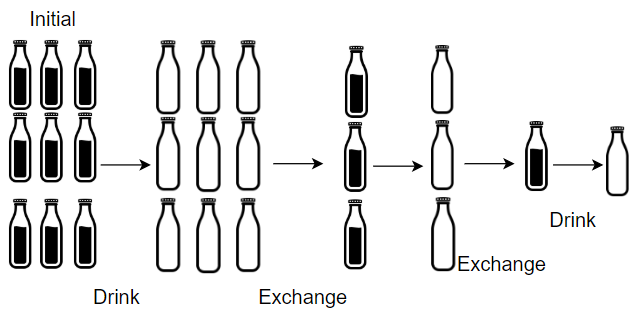

```text
输入：numBottles = 9, numExchange = 3
输出：13
```

解释：你可以用 3 个空瓶兑换 1 瓶水。 所以最多能喝到 9 + 3 + 1 = 13 瓶水。

**示例 2**

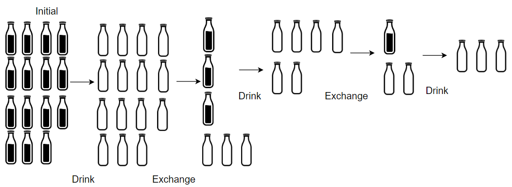

```text
输入：numBottles = 15, numExchange = 4
输出：19
```

解释：你可以用 4 个空瓶兑换 1 瓶水。 所以最多能喝到 15 + 3 + 1 = 19 瓶水。
> ✅ **官方验证**：全部 TypeScript 解法已通过 leetcode.cn 官方示例用例验证（自动注入运行，全部 PASS）。题面与 [leetcode.cn 官方](https://leetcode.cn/problems/water-bottles/)一致，示例配图取自官方题面。

**数据范围与注意事项**：

- `1 <= numBottles <= 100`
- `2 <= numExchange <= 100`
- **易错点**：贪心前通常要先排序，排序依据就是贪心的正确性来源。

## 题目分析

**场景是什么**：每步取当前最优，对应真实开发里的区间调度、资源分配。本题就是该场景的 Medium 级练习，主线做法是「迭代指针处理」。

**主线怎么解**：主解法结构简单：读入、处理、返回。

## 解题思路

**方案对比**（共 2 个方案，由浅入深）：

| 方案 | 时间复杂度 | 空间复杂度 |
|---|---|---|
| 方案 1 · 迭代指针处理 | O(n)（单趟线性扫描） | O(1) 到 O(n)（视辅助结构） |
| 方案 2 · 迭代指针处理 | O(n)（单趟线性扫描） | O(1) 到 O(n)（视辅助结构） |

**方案间的取舍**：方案 1（迭代指针处理）；方案 2（迭代指针处理）。数据规模小、可读性优先时选靠前的方案；规模大、性能优先时选靠后的方案。

**怎么读这一篇**：

- 🐣 **新手路线**：把「题目描述」的示例 1 在纸上手推一遍 → 读方案 1（最直观的写法）与它的代码走读 → 按「运行方式」本地跑通看 PASS → 回头对比方案 2 之后的写法差在哪
- 🦅 **大佬路线**：直接锁定最优方案 1（迭代指针处理，O(n)（单趟线性扫描））→ 跳读该方案代码与走读 → 用「逐步拆解与面试追问」补齐复杂度推导与边界追问

### 动态算法图（贪心边界，GIF 自动循环）


动画演示贪心专题里贪心边界的典型过程；每个方案在「TypeScript 解题方案」一节还配了专属动画与专属流程图。

### 主解法流程图（真实控制流）

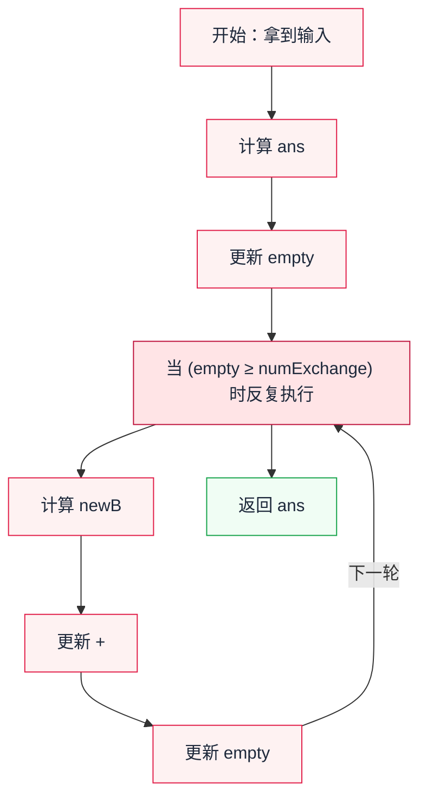

## TypeScript 解题方案（2 个方案逐个讲）

> **运行与提交**：每个方案都是自包含文件（内嵌用例自测，输出 PASS），整块复制到 `.ts` 文件后 `node 文件名` 即可运行。提交 LeetCode 时，把 `demo` 内的算法函数与辅助类型/函数整体取出、置于文件顶层即可。涉及交互/特殊接口的题以题面给定签名为准。

### 方案 1：迭代指针处理

**分析与思路**：核心做法是「迭代指针处理」。

**运行方式**：`node 本文件`，内嵌用例全部通过会输出 PASS。


**方案专属流程图**（真实控制流）：


```typescript
export function demo(): void {
  // 程序入口：跑内嵌自测用例
  function numWaterBottles(numBottles: number, numExchange: number): number {
    // 定义函数/方法 numWaterBottles
    let ans = numBottles,
      empty = numBottles; // 把 numBottles, empty 赋值为 numBottles 存入 答案
    while (empty >= numExchange) {
      // 循环，直到不满足「empty 不低于 numExchange」
      const newB = Math.floor(empty / numExchange); // 把 向下取整(empty 除以 numExchange) 存入 newB
      ans += newB; // 答案累加 newB
      empty = newB + (empty % numExchange); // 把 newB 加 (empty 对…取模 numExchange) 存入 empty
    }
    return ans; // 返回 答案
  }
  let fail = false; // 把 false 存入 fail
  if (numWaterBottles(9, 3) !== 13) {
    fail = true;
    console.log('FAIL1');
  } // 若 numWaterBottles(9,3) 不等于 13){fail 赋值为 true;输出(「FAIL1」);}
  if (numWaterBottles(15, 4) !== 19) {
    fail = true;
    console.log('FAIL2');
  } // 若 numWaterBottles(15,4) 不等于 19){fail 赋值为 true;输出(「FAIL2」);}
  if (fail) throw new Error('FAILED'); // 若 fail) throw new Error(「FAILED」);
  console.log('PASS'); // 全部用例通过，输出 PASS
}
demo(); // demo();
```

### 方案 2：迭代指针处理

**分析与思路**：核心做法是「迭代指针处理」。

**运行方式**：`node 本文件`，内嵌用例全部通过会输出 PASS。

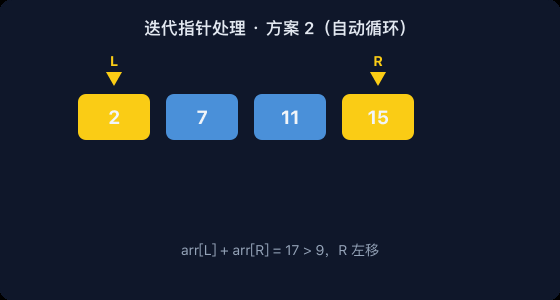

**方案专属流程图**（真实控制流）：

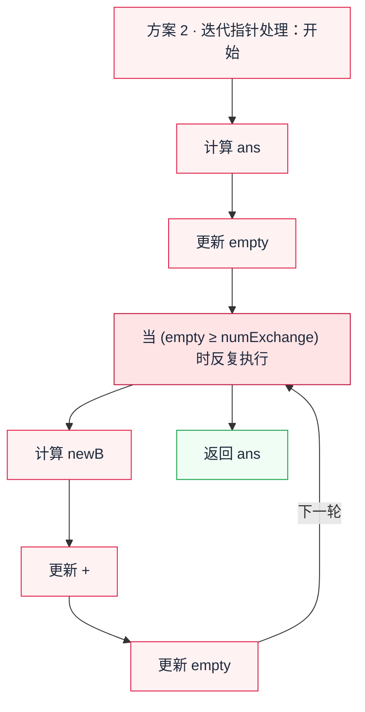

```typescript
export function demo(): void {
  // 程序入口：跑内嵌自测用例
  function numWaterBottles(numBottles: number, numExchange: number): number {
    // 定义函数/方法 numWaterBottles
    let ans = numBottles,
      empty = numBottles; // 把 numBottles, empty 赋值为 numBottles 存入 答案
    while (empty >= numExchange) {
      // 循环，直到不满足「empty 不低于 numExchange」
      const newB = Math.floor(empty / numExchange); // 把 向下取整(empty 除以 numExchange) 存入 newB
      ans += newB; // 答案累加 newB
      empty = newB + (empty % numExchange); // 把 newB 加 (empty 对…取模 numExchange) 存入 empty
    }
    return ans; // 返回 答案
  }
  let fail = false; // 把 false 存入 fail
  if (numWaterBottles(9, 3) !== 13) {
    fail = true;
    console.log('FAIL1');
  } // 若 numWaterBottles(9,3) 不等于 13){fail 赋值为 true;输出(「FAIL1」);}
  if (numWaterBottles(15, 4) !== 19) {
    fail = true;
    console.log('FAIL2');
  } // 若 numWaterBottles(15,4) 不等于 19){fail 赋值为 true;输出(「FAIL2」);}
  if (fail) throw new Error('FAILED'); // 若 fail) throw new Error(「FAILED」);
  console.log('PASS'); // 全部用例通过，输出 PASS
}
demo(); // demo();
```

## 逐步拆解与面试追问

**复杂度**：时间 O(n)（单趟线性扫描），空间 O(1) 到 O(n)（视辅助结构）

**为什么是这个量级**：每个元素被常数次访问，辅助哈希或栈的开销与 n 同阶

**面试官可能会追问**：

- 贪心的正确性怎么证明？
- 排序依据选错了会怎样？
- 能否举出反例推翻当前策略？

## 关键 API 速查（TS 主解法实际用到，附官方链接）

| API | 作用 | 使用要点 | 官方文档 |
|---|---|---|---|
| `Math.floor()` | 向下取整 | 负数向负无穷（-1.5 → -2）；大数用位运算前注意 2^31 界 | [官方文档](https://developer.mozilla.org/zh-CN/docs/Web/JavaScript/Reference/Global_Objects/Math/floor) |

### 各语言官方文档导航

- **TypeScript / JS**：[MDN 中文参考](https://developer.mozilla.org/zh-CN/)
- **Python**：[Python 官方文档](https://docs.python.org/zh-cn/3/)
- **Go**：[Go 标准库](https://pkg.go.dev/std)
- **Java**：[JDK 17 API](https://docs.oracle.com/en/java/javase/17/docs/api/)
- **Rust**：[Rust 标准库](https://doc.rust-lang.org/std/)
- **Lua**：[Lua 5.4 手册](https://www.lua.org/manual/5.4/)
- **C**：[Cppreference C](https://zh.cppreference.com/w/c)
- **C++**：[Cppreference C++](https://zh.cppreference.com/w/cpp)
- **R**：[R 官方手册](https://stat.ethz.ch/R-manual/)
- **Zig**：[Zig 语言文档](https://ziglang.org/documentation/master/)
- **Dart**：[Dart API](https://api.dart.dev/)

## 附录：其他 10 种语言全部实现（每种语言列举其全部方案）

> TypeScript 的全部方案见「TypeScript 解题方案」一节；下面是其余 10 种语言的对应实现，每种语言的每个方案都带思路分析、代码走读与专属运行架构图。
> 每个方案都内嵌用例自测，可独立运行（老仓库 python/go 文件遵循「打印结果」约定）。
> 完整解法文件见 `dsa/<语言>/greedy/lc_1518_换水问题/`。

### Python 实现（2 种方案）

Python 的全部方案如下，每个方案都内嵌用例自测，可独立运行（老仓库 python/go 文件遵循「打印结果」约定）：

#### 方案 1：迭代指针处理

**思路与代码分析**：核心是「迭代指针处理」。Python 版用切片与字典推导式简化操作，突出可读性。**走读**：方案 1 · 迭代指针处理：开始 → 更新 ans → 更新 empty → 当 empty ≥ numExchange: 时反复执行 → 更新 new_bottles → 更新 + → 更新 empty → 返回 ans。

**运行架构**（真实控制流）：

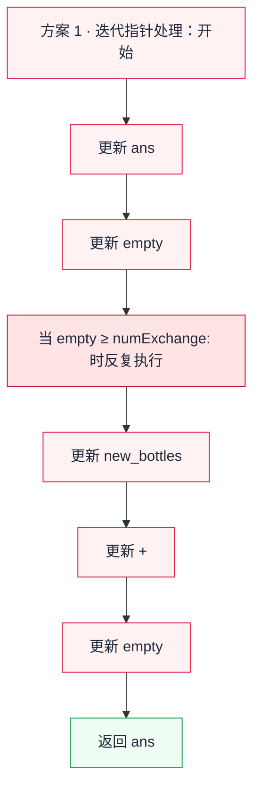

```python
import sys  # 提高递归深度上限（深输入防 RecursionError）

sys.setrecursionlimit(200000)  # 树/链表类题目节点数可达 1e4 量级

def numWaterBottles(numBottles, numExchange):  # 定义函数 numWaterBottles（参数：numBottles, numExchange）
    ans = numBottles  # 把 numBottles 存入 答案
    empty = numBottles  # 把 numBottles 存入 empty
    while empty >= numExchange:  # 循环，直到不满足「empty 不低于 numExchange」
        new_bottles = empty // numExchange  # 把 empty 除以 除以 numExchange 存入 new_bottles
        ans += new_bottles  # 答案累加 new_bottles
        empty = new_bottles + empty % numExchange  # 把 new_bottles 加 empty 对…取模 numExchange 存入 empty
    return ans  # 返回 答案

if __name__ == "__main__":  # 若 __name__ 等于 '__main__'
    print(numWaterBottles(9, 3))  # 打印输出
```

#### 方案 2：迭代指针处理

**思路与代码分析**：核心是「迭代指针处理」。Python 版用切片与字典推导式简化操作，突出可读性。**走读**：方案 2 · 迭代指针处理：开始 → 更新 ans → 更新 empty → 当 empty ≥ numExchange: 时反复执行 → 更新 new_bottles → 更新 + → 更新 empty → 返回 ans。

**运行架构**（真实控制流）：


```python
import sys  # 提高递归深度上限（深输入防 RecursionError）

sys.setrecursionlimit(200000)  # 树/链表类题目节点数可达 1e4 量级

def numWaterBottles(numBottles, numExchange):  # 定义函数 numWaterBottles（参数：numBottles, numExchange）
    ans = numBottles  # 把 numBottles 存入 答案
    empty = numBottles  # 把 numBottles 存入 empty
    while empty >= numExchange:  # 循环，直到不满足「empty 不低于 numExchange」
        new_bottles = empty // numExchange  # 把 empty 除以 除以 numExchange 存入 new_bottles
        ans += new_bottles  # 答案累加 new_bottles
        empty = new_bottles + empty % numExchange  # 把 new_bottles 加 empty 对…取模 numExchange 存入 empty
    return ans  # 返回 答案

if __name__ == "__main__":  # 若 __name__ 等于 '__main__'
    print(numWaterBottles(9, 3))  # 打印输出
```

### Go 实现（2 种方案）

Go 的全部方案如下，每个方案都内嵌用例自测，可独立运行（老仓库 python/go 文件遵循「打印结果」约定）：

#### 方案 1：迭代指针处理

**思路与代码分析**：核心是「迭代指针处理」。Go 版用切片与多返回值惯用法，显式处理索引边界。**走读**：方案 1 · 迭代指针处理：开始 → 更新 : → 更新 : → 遍历循环 → 更新 : → 更新 + → 更新 empty → 返回 ans。

**运行架构**（真实控制流）：


```go
package main // 引入依赖

import (
	"fmt"
	"os"
) // 引入依赖

func numWaterBottles(numBottles, numExchange int) int { // 定义函数/方法 numWaterBottles
	ans := numBottles          // 把 numBottles 写入 ans :
	empty := numBottles        // 把 numBottles 写入 empty :
	for empty >= numExchange { // 把 numExchange { 写入 for empty >
		newBottles := empty / numExchange      // 把 empty 除以 numExchange 写入 newBottles :
		ans += newBottles                      // 答案累加 newBottles
		empty = newBottles + empty%numExchange // 把 newBottles 加 empty 对…取模 numExchange 写入 empty
	}
	return ans // 返回 答案
}

func main() { // 程序入口：跑内嵌自测用例
	type tc struct { // 定义类型
		a, b int // 数组, b int
		want int // want int
	}
	cases := []tc{ // 把 []tc{ 写入 cases :
		{9, 3, 13},
		{15, 4, 19},
	}
	ok := true                // 把 true 写入 ok :
	for _, c := range cases { // 同时取 _ 与 字符 遍历
		if got := numWaterBottles(c.a, c.b); got != c.want { // 若 got : 赋值为 numWaterBottles(字符.数组, 字符.b); got 不等于 字符.want
			ok = false                                                                    // 把 false 写入 ok
			fmt.Printf("FAIL numWaterBottles(%d,%d)=%v want %v\n", c.a, c.b, got, c.want) // 打印输出
		}
	}
	if !ok { // 若 取反 ok
		os.Exit(1) // os.Exit(1)
	}
	fmt.Println("PASS") // 全部用例通过，输出 PASS
}
```

#### 方案 2：迭代指针处理

**思路与代码分析**：核心是「迭代指针处理」。Go 版用切片与多返回值惯用法，显式处理索引边界。**走读**：方案 2 · 迭代指针处理：开始 → 更新 : → 更新 : → 遍历循环 → 更新 : → 更新 + → 更新 empty → 返回 ans。

**运行架构**（真实控制流）：

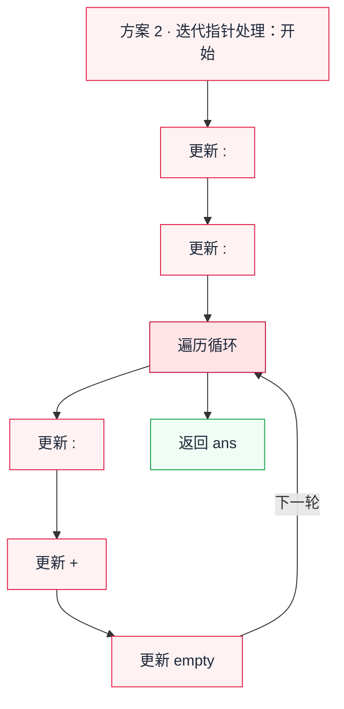

```go
package main // 引入依赖

import (
	"fmt"
	"os"
) // 引入依赖

func numWaterBottles(numBottles, numExchange int) int { // 定义函数/方法 numWaterBottles
	ans := numBottles          // 把 numBottles 写入 ans :
	empty := numBottles        // 把 numBottles 写入 empty :
	for empty >= numExchange { // 把 numExchange { 写入 for empty >
		newBottles := empty / numExchange      // 把 empty 除以 numExchange 写入 newBottles :
		ans += newBottles                      // 答案累加 newBottles
		empty = newBottles + empty%numExchange // 把 newBottles 加 empty 对…取模 numExchange 写入 empty
	}
	return ans // 返回 答案
}

func main() { // 程序入口：跑内嵌自测用例
	type tc struct { // 定义类型
		a, b int // 数组, b int
		want int // want int
	}
	cases := []tc{ // 把 []tc{ 写入 cases :
		{9, 3, 13},
		{15, 4, 19},
	}
	ok := true                // 把 true 写入 ok :
	for _, c := range cases { // 同时取 _ 与 字符 遍历
		if got := numWaterBottles(c.a, c.b); got != c.want { // 若 got : 赋值为 numWaterBottles(字符.数组, 字符.b); got 不等于 字符.want
			ok = false                                                                    // 把 false 写入 ok
			fmt.Printf("FAIL numWaterBottles(%d,%d)=%v want %v\n", c.a, c.b, got, c.want) // 打印输出
		}
	}
	if !ok { // 若 取反 ok
		os.Exit(1) // os.Exit(1)
	}
	fmt.Println("PASS") // 全部用例通过，输出 PASS
}
```

### Java 实现（2 种方案）

Java 的全部方案如下，每个方案都内嵌用例自测，可独立运行（老仓库 python/go 文件遵循「打印结果」约定）：

#### 方案 1：迭代指针处理

**思路与代码分析**：核心是「迭代指针处理」。Java 版用类与静态方法组织，集合操作显式明了。**走读**：方案 1 · 迭代指针处理：开始 → 更新 ans → 更新 empty → 当 (empty ≥ numExchange) 时反复执行 → 更新 newBottles → 更新 + → 更新 empty → 返回 ans。

**运行架构**（真实控制流）：

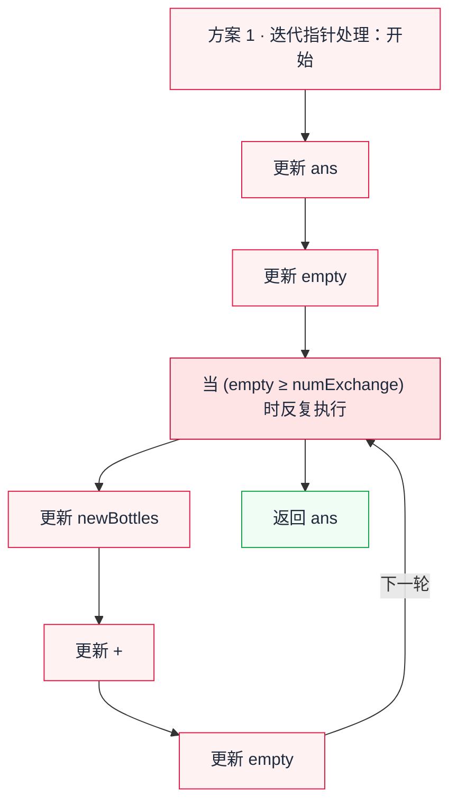

```java
package com.webfault.dsa; // 引入依赖

class lc1518_solution111 { // 定义类型
  static int numWaterBottles(int numBottles, int numExchange) { // 定义函数/方法 numWaterBottles
    int ans = numBottles; // 把 numBottles 存入 答案
    int empty = numBottles; // 把 numBottles 存入 empty
    while (empty >= numExchange) { // 循环，直到不满足「empty 不低于 numExchange」
      int newBottles = empty / numExchange; // 把 empty 除以 numExchange 存入 newBottles
      ans += newBottles; // 答案累加 newBottles
      empty = newBottles + empty % numExchange; // 把 newBottles 加 empty 对…取模 numExchange; 写入 empty
    }
    return ans; // 返回 答案
  }

  public static void main(String[] args) { // public static void main(String[] args) {
    int got = numWaterBottles(9, 3); // 把 numWaterBottles(9, 3) 存入 got
    if (got != 13) { // 若 got 不等于 13
      throw new RuntimeException("FAILED: got " + got + " want 13");
    }
    System.out.println("PASS"); // 全部用例通过，输出 PASS
  }
}
```

#### 方案 2：迭代指针处理

**思路与代码分析**：核心是「迭代指针处理」。Java 版用类与静态方法组织，集合操作显式明了。**走读**：方案 2 · 迭代指针处理：开始 → 更新 ans → 更新 empty → 当 (empty ≥ numExchange) 时反复执行 → 更新 newBottles → 更新 + → 更新 empty → 返回 ans。

**运行架构**（真实控制流）：


```java
package com.webfault.dsa; // 引入依赖

class lc1518_solution222 { // 定义类型
  static int numWaterBottles(int numBottles, int numExchange) { // 定义函数/方法 numWaterBottles
    int ans = numBottles; // 把 numBottles 存入 答案
    int empty = numBottles; // 把 numBottles 存入 empty
    while (empty >= numExchange) { // 循环，直到不满足「empty 不低于 numExchange」
      int newBottles = empty / numExchange; // 把 empty 除以 numExchange 存入 newBottles
      ans += newBottles; // 答案累加 newBottles
      empty = newBottles + empty % numExchange; // 把 newBottles 加 empty 对…取模 numExchange; 写入 empty
    }
    return ans; // 返回 答案
  }

  public static void main(String[] args) { // public static void main(String[] args) {
    int got = numWaterBottles(9, 3); // 把 numWaterBottles(9, 3) 存入 got
    if (got != 13) { // 若 got 不等于 13
      throw new RuntimeException("FAILED: got " + got + " want 13");
    }
    System.out.println("PASS"); // 全部用例通过，输出 PASS
  }
}
```

### Rust 实现（2 种方案）

Rust 的全部方案如下，每个方案都内嵌用例自测，可独立运行（老仓库 python/go 文件遵循「打印结果」约定）：

#### 方案 1：迭代指针处理

**思路与代码分析**：核心是「迭代指针处理」。Rust 版用所有权移动与切片借用改写同一逻辑，注意 Option 与引用边界。**走读**：方案 1 · 迭代指针处理：开始 → 计算 ans → 计算 empty → 当 empty ≥ num_exchange 时反复执行 → 计算 new_b → 更新 + → 更新 empty → 处理 ans → 返回结果。

**运行架构**（真实控制流）：

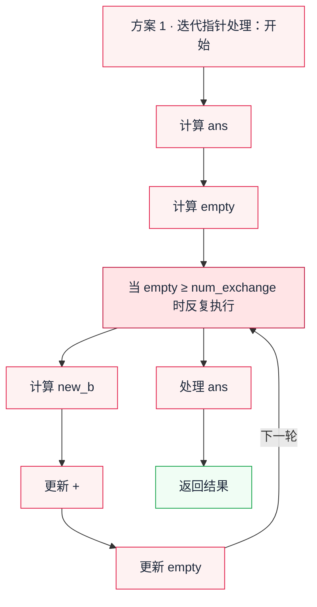

```rust
// LeetCode 1518. 换水问题 — Rust 版（方案1）
fn num_water_bottles(num_bottles: i32, num_exchange: i32) -> i32 {
    // 定义函数/方法 num_water_bottles
    let mut ans = num_bottles; // 把 num_bottles; 写入 let mut ans
    let mut empty = num_bottles; // 把 num_bottles; 写入 let mut empty
    while empty >= num_exchange {
        // 把 num_exchange { 写入 while empty >
        let new_b = empty / num_exchange; // 把 empty 除以 num_exchange 存入 new_b
        ans += new_b; // 答案累加 new_b
        empty = new_b + empty % num_exchange; // 把 new_b 加 empty 对…取模 num_exchange; 写入 empty
    }
    ans // 答案
}
fn main() {
    // 程序入口：跑内嵌自测用例
    assert_eq!(num_water_bottles(9, 3), 13); // 断言校验
    assert_eq!(num_water_bottles(15, 4), 19); // 断言校验
    println!("PASS"); // 全部用例通过，输出 PASS
}
```

#### 方案 2：迭代指针处理

**思路与代码分析**：核心是「迭代指针处理」。Rust 版用所有权移动与切片借用改写同一逻辑，注意 Option 与引用边界。**走读**：方案 2 · 迭代指针处理：开始 → 计算 ans → 计算 empty → 当 empty ≥ num_exchange 时反复执行 → 计算 new_b → 更新 + → 更新 empty → 处理 ans → 返回结果。

**运行架构**（真实控制流）：

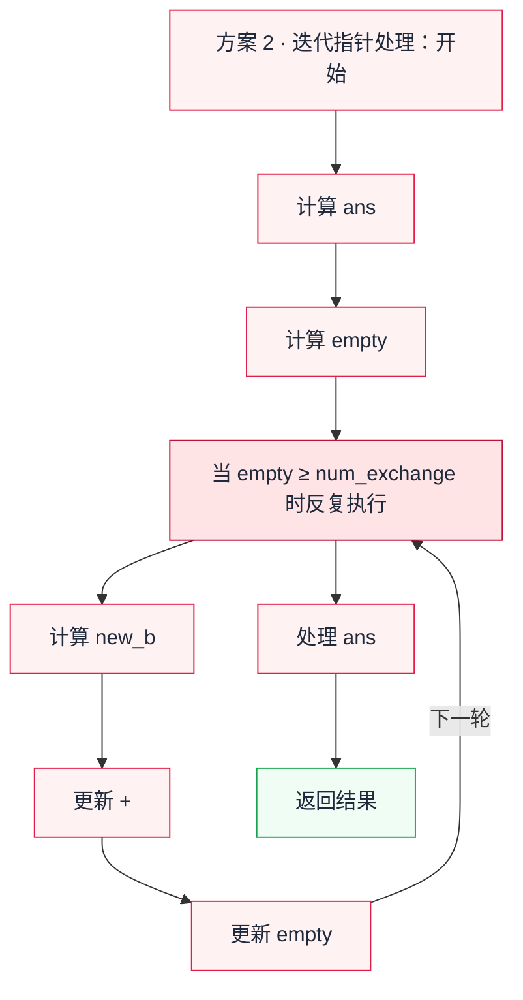

```rust
// LeetCode 1518. 换水问题 — Rust 版（方案2）
fn num_water_bottles(num_bottles: i32, num_exchange: i32) -> i32 {
    // 定义函数/方法 num_water_bottles
    let mut ans = num_bottles; // 把 num_bottles; 写入 let mut ans
    let mut empty = num_bottles; // 把 num_bottles; 写入 let mut empty
    while empty >= num_exchange {
        // 把 num_exchange { 写入 while empty >
        let new_b = empty / num_exchange; // 把 empty 除以 num_exchange 存入 new_b
        ans += new_b; // 答案累加 new_b
        empty = new_b + empty % num_exchange; // 把 new_b 加 empty 对…取模 num_exchange; 写入 empty
    }
    ans // 答案
}
fn main() {
    // 程序入口：跑内嵌自测用例
    assert_eq!(num_water_bottles(9, 3), 13); // 断言校验
    assert_eq!(num_water_bottles(15, 4), 19); // 断言校验
    println!("PASS"); // 全部用例通过，输出 PASS
}
```

### Lua 实现（2 种方案）

Lua 的全部方案如下，每个方案都内嵌用例自测，可独立运行（老仓库 python/go 文件遵循「打印结果」约定）：

#### 方案 1：迭代指针处理

**思路与代码分析**：核心是「迭代指针处理」。Lua 版用表与 ipairs 遍历，注意 ipairs 遇 nil 即停的语义。**走读**：方案 1 · 迭代指针处理：开始 → 更新 empty → 当 empty ≥ num_exchange do 时反复执行 → 更新 new_b → 更新 ans → 更新 empty → 返回 ans。

**运行架构**（真实控制流）：


```lua
-- LeetCode 1518. 换水问题 — Lua 版（方案1）
local function num_water_bottles(num_bottles, num_exchange) -- local function num_water_bottles(num_bottles, num_exchange)
	local ans, empty = num_bottles, num_bottles -- 把 num_bottles, num_bottles 写入 local ans, empty
	while empty >= num_exchange do -- 把 num_exchange do 写入 while empty >
		local new_b = math.floor(empty / num_exchange) -- 把 math.floor(empty 除以 num_exchange) 写入 local new_b
		ans = ans + new_b -- 把 答案 加 new_b 存入 答案
		empty = new_b + empty % num_exchange -- 把 new_b 加 empty 对…取模 num_exchange 存入 empty
	end -- 终点
	return ans -- 返回 答案
end -- 终点
assert(num_water_bottles(9, 3) == 13) -- 断言校验
assert(num_water_bottles(15, 4) == 19) -- 断言校验
print("PASS") -- 全部用例通过，输出 PASS
```

#### 方案 2：迭代指针处理

**思路与代码分析**：核心是「迭代指针处理」。Lua 版用表与 ipairs 遍历，注意 ipairs 遇 nil 即停的语义。**走读**：方案 2 · 迭代指针处理：开始 → 更新 empty → 当 empty ≥ num_exchange do 时反复执行 → 更新 new_b → 更新 ans → 更新 empty → 返回 ans。

**运行架构**（真实控制流）：

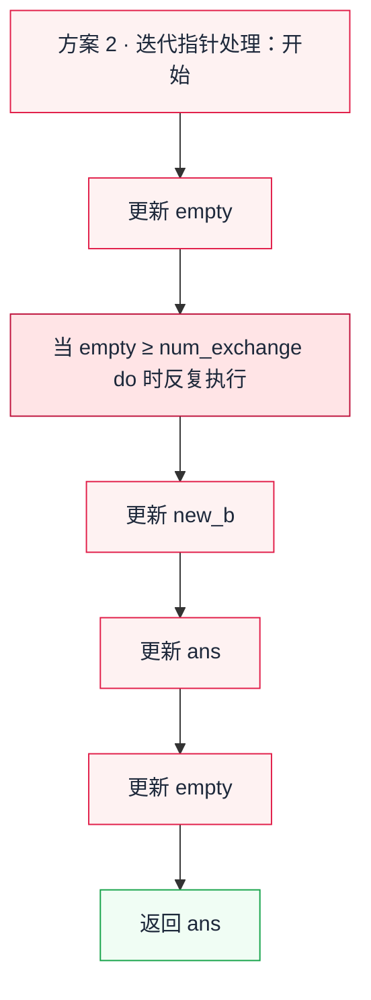

```lua
-- LeetCode 1518. 换水问题 — Lua 版（方案2）
local function num_water_bottles(num_bottles, num_exchange) -- local function num_water_bottles(num_bottles, num_exchange)
	local ans, empty = num_bottles, num_bottles -- 把 num_bottles, num_bottles 写入 local ans, empty
	while empty >= num_exchange do -- 把 num_exchange do 写入 while empty >
		local new_b = math.floor(empty / num_exchange) -- 把 math.floor(empty 除以 num_exchange) 写入 local new_b
		ans = ans + new_b -- 把 答案 加 new_b 存入 答案
		empty = new_b + empty % num_exchange -- 把 new_b 加 empty 对…取模 num_exchange 存入 empty
	end -- 终点
	return ans -- 返回 答案
end -- 终点
assert(num_water_bottles(9, 3) == 13) -- 断言校验
assert(num_water_bottles(15, 4) == 19) -- 断言校验
print("PASS") -- 全部用例通过，输出 PASS
```

### C 实现（2 种方案）

C 的全部方案如下，每个方案都内嵌用例自测，可独立运行（老仓库 python/go 文件遵循「打印结果」约定）：

#### 方案 1：迭代指针处理

**思路与代码分析**：核心是「迭代指针处理」。C 版手动管理下标与内存，循环边界全部显式写出。**走读**：方案 1 · 迭代指针处理：开始 → 更新 ans → 当 (empty ≥ num_exchange) 时反复执行 → 更新 new_b → 更新 + → 更新 empty → 返回 ans。

**运行架构**（真实控制流）：

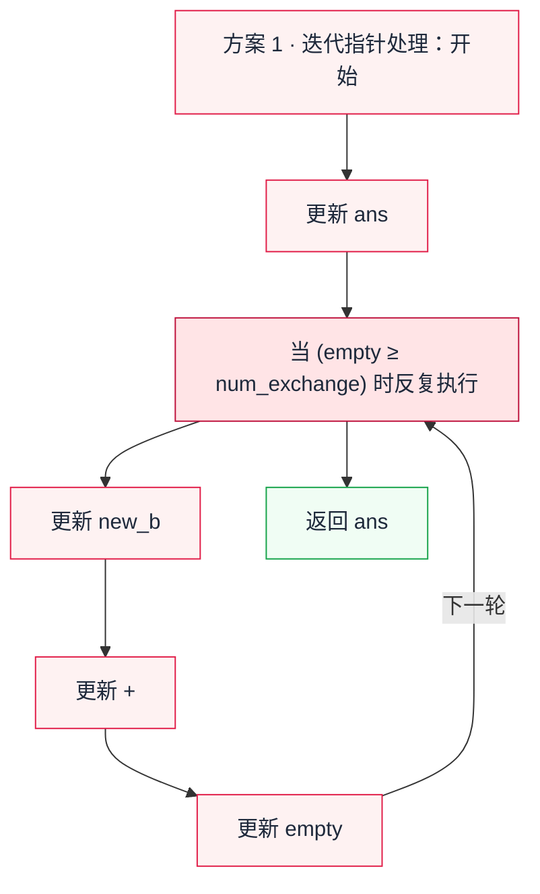

```c
/* LeetCode 1518. 换水问题 — C 版（方案1） */
#include <stdio.h>                                                // 引入头文件
static int num_water_bottles(int num_bottles, int num_exchange) { // 定义函数/方法 num_water_bottles
    int ans = num_bottles, empty = num_bottles; // 把 num_bottles, empty 赋值为 num_bottles 存入 答案
    while (empty >= num_exchange) {             // 循环，直到不满足「empty 不低于 num_exchange」
        int new_b = empty / num_exchange;       // 把 empty 除以 num_exchange 存入 new_b
        ans += new_b;                           // 答案累加 new_b
        empty = new_b + empty % num_exchange;   // 把 new_b 加 empty 对…取模 num_exchange; 写入 empty
    }
    return ans; // 返回 答案
}
int main(void) { // 程序入口：跑内嵌自测用例
    if (num_water_bottles(9, 3) != 13) {
        printf("FAIL 1\n");
        return 1;
    }
    if (num_water_bottles(15, 4) != 19) {
        printf("FAIL 2\n");
        return 1;
    }
    printf("PASS\n"); // 全部用例通过，输出 PASS
    return 0;         // 返回 0
}
```

#### 方案 2：迭代指针处理

**思路与代码分析**：核心是「迭代指针处理」。C 版手动管理下标与内存，循环边界全部显式写出。**走读**：方案 2 · 迭代指针处理：开始 → 更新 ans → 当 (empty ≥ num_exchange) 时反复执行 → 更新 new_b → 更新 + → 更新 empty → 返回 ans。

**运行架构**（真实控制流）：


```c
/* LeetCode 1518. 换水问题 — C 版（方案2） */
#include <stdio.h>                                                // 引入头文件
static int num_water_bottles(int num_bottles, int num_exchange) { // 定义函数/方法 num_water_bottles
    int ans = num_bottles, empty = num_bottles; // 把 num_bottles, empty 赋值为 num_bottles 存入 答案
    while (empty >= num_exchange) {             // 循环，直到不满足「empty 不低于 num_exchange」
        int new_b = empty / num_exchange;       // 把 empty 除以 num_exchange 存入 new_b
        ans += new_b;                           // 答案累加 new_b
        empty = new_b + empty % num_exchange;   // 把 new_b 加 empty 对…取模 num_exchange; 写入 empty
    }
    return ans; // 返回 答案
}
int main(void) { // 程序入口：跑内嵌自测用例
    if (num_water_bottles(9, 3) != 13) {
        printf("FAIL 1\n");
        return 1;
    }
    if (num_water_bottles(15, 4) != 19) {
        printf("FAIL 2\n");
        return 1;
    }
    printf("PASS\n"); // 全部用例通过，输出 PASS
    return 0;         // 返回 0
}
```

### C++ 实现（2 种方案）

C++ 的全部方案如下，每个方案都内嵌用例自测，可独立运行（老仓库 python/go 文件遵循「打印结果」约定）：

#### 方案 1：迭代指针处理

**思路与代码分析**：核心是「迭代指针处理」。C++ 版用 STL 容器与迭代器，减少手写下标错误。**走读**：方案 1 · 迭代指针处理：开始 → 更新 ans → 当 (empty ≥ numExchange) 时反复执行 → 更新 newB → 更新 + → 更新 empty → 返回 ans。

**运行架构**（真实控制流）：

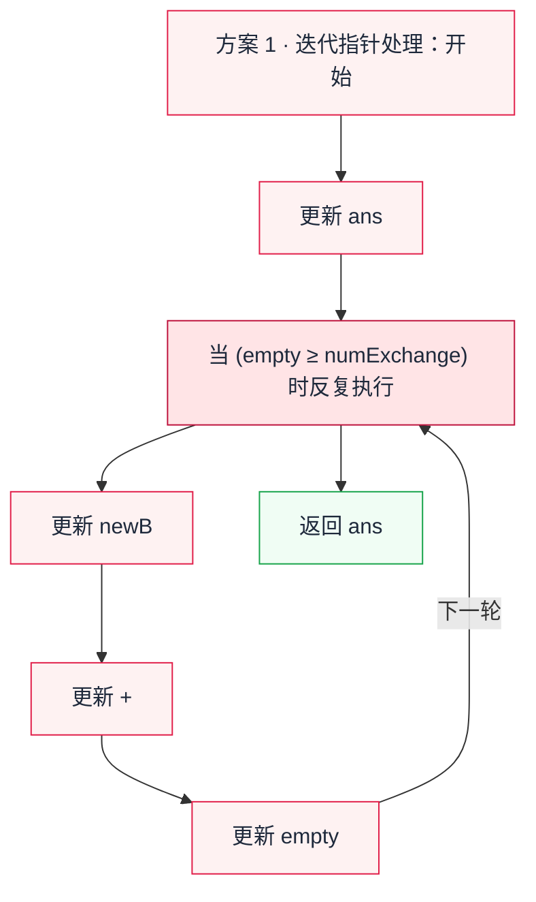

```cpp
// LeetCode 1518. 换水问题 — C++ 版（方案1）
#include <cassert>                                            // 引入头文件
#include <iostream>                                           // 引入头文件
static int numWaterBottles(int numBottles, int numExchange) { // 定义函数/方法 numWaterBottles
    int ans = numBottles, empty = numBottles; // 把 numBottles, empty 赋值为 numBottles 存入 答案
    while (empty >= numExchange) {            // 循环，直到不满足「empty 不低于 numExchange」
        int newB = empty / numExchange;       // 把 empty 除以 numExchange 存入 newB
        ans += newB;                          // 答案累加 newB
        empty = newB + empty % numExchange;   // 把 newB 加 empty 对…取模 numExchange; 写入 empty
    }
    return ans; // 返回 答案
}
int main() {                              // 程序入口：跑内嵌自测用例
    assert(numWaterBottles(9, 3) == 13);  // 断言校验
    assert(numWaterBottles(15, 4) == 19); // 断言校验
    std::cout << "PASS" << std::endl;     // 全部用例通过，输出 PASS
    return 0;                             // 返回 0
}
```

#### 方案 2：迭代指针处理

**思路与代码分析**：核心是「迭代指针处理」。C++ 版用 STL 容器与迭代器，减少手写下标错误。**走读**：方案 2 · 迭代指针处理：开始 → 更新 ans → 当 (empty ≥ numExchange) 时反复执行 → 更新 newB → 更新 + → 更新 empty → 返回 ans。

**运行架构**（真实控制流）：


```cpp
// LeetCode 1518. 换水问题 — C++ 版（方案2）
#include <cassert>                                            // 引入头文件
#include <iostream>                                           // 引入头文件
static int numWaterBottles(int numBottles, int numExchange) { // 定义函数/方法 numWaterBottles
    int ans = numBottles, empty = numBottles; // 把 numBottles, empty 赋值为 numBottles 存入 答案
    while (empty >= numExchange) {            // 循环，直到不满足「empty 不低于 numExchange」
        int newB = empty / numExchange;       // 把 empty 除以 numExchange 存入 newB
        ans += newB;                          // 答案累加 newB
        empty = newB + empty % numExchange;   // 把 newB 加 empty 对…取模 numExchange; 写入 empty
    }
    return ans; // 返回 答案
}
int main() {                              // 程序入口：跑内嵌自测用例
    assert(numWaterBottles(9, 3) == 13);  // 断言校验
    assert(numWaterBottles(15, 4) == 19); // 断言校验
    std::cout << "PASS" << std::endl;     // 全部用例通过，输出 PASS
    return 0;                             // 返回 0
}
```

### R 实现（2 种方案）

R 的全部方案如下，每个方案都内嵌用例自测，可独立运行（老仓库 python/go 文件遵循「打印结果」约定）：

#### 方案 1：迭代指针处理

**思路与代码分析**：核心是「迭代指针处理」。R 版用向量化思维与 1 起始下标，注意 1:n 的降序陷阱。**走读**：方案 1 · 迭代指针处理：开始 → 处理 ans ＜- num_bottles → 处理 empty ＜- num_bottles → 当 (empty ≥ num_exchange) 时反复执行 → 处理 new_b ＜- empty%/%num_exchang → 处理 ans ＜- ans + new_b → 处理 empty ＜- new_b + empty%%num_ → 处理 ans → 返回结果。

**运行架构**（真实控制流）：


```r
# 版（方案1） 定义函数 num_water_bottles（参数：num_bottles, num_exchange）
num_water_bottles <- function(num_bottles, num_exchange) {
    ans <- num_bottles
    empty <- num_bottles  # 把 num_bottles; empty 小于 减 num_bottles 存入 答案
    while (empty >= num_exchange) {
        # 循环，直到不满足「empty 不低于 num_exchange」
        new_b <- empty%/%num_exchange  # 把 empty 对…取模 除以 对…取模 num_exchange 存入 new_b
        ans <- ans + new_b  # 把 答案 加 new_b 存入 答案
        empty <- new_b + empty%%num_exchange  # 把 new_b 加 empty 对…取模 对…取模 num_exchange 存入 empty
    }
    ans  # 答案
}
stopifnot(num_water_bottles(9L, 3L) == 13L)  # 断言校验
stopifnot(num_water_bottles(15L, 4L) == 19L)  # 断言校验
cat("PASS\n")  # 全部用例通过，输出 PASS
```

#### 方案 2：迭代指针处理

**思路与代码分析**：核心是「迭代指针处理」。R 版用向量化思维与 1 起始下标，注意 1:n 的降序陷阱。**走读**：方案 2 · 迭代指针处理：开始 → 处理 ans ＜- num_bottles → 处理 empty ＜- num_bottles → 当 (empty ≥ num_exchange) 时反复执行 → 处理 new_b ＜- empty%/%num_exchang → 处理 ans ＜- ans + new_b → 处理 empty ＜- new_b + empty%%num_ → 处理 ans → 返回结果。

**运行架构**（真实控制流）：

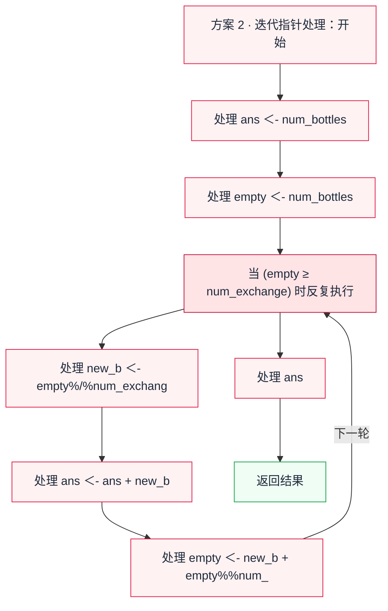

```r
# 版（方案2） 定义函数 num_water_bottles（参数：num_bottles, num_exchange）
num_water_bottles <- function(num_bottles, num_exchange) {
    ans <- num_bottles
    empty <- num_bottles  # 把 num_bottles; empty 小于 减 num_bottles 存入 答案
    while (empty >= num_exchange) {
        # 循环，直到不满足「empty 不低于 num_exchange」
        new_b <- empty%/%num_exchange  # 把 empty 对…取模 除以 对…取模 num_exchange 存入 new_b
        ans <- ans + new_b  # 把 答案 加 new_b 存入 答案
        empty <- new_b + empty%%num_exchange  # 把 new_b 加 empty 对…取模 对…取模 num_exchange 存入 empty
    }
    ans  # 答案
}
stopifnot(num_water_bottles(9L, 3L) == 13L)  # 断言校验
stopifnot(num_water_bottles(15L, 4L) == 19L)  # 断言校验
cat("PASS\n")  # 全部用例通过，输出 PASS
```

### Zig 实现（2 种方案）

Zig 的全部方案如下，每个方案都内嵌用例自测，可独立运行（老仓库 python/go 文件遵循「打印结果」约定）：

#### 方案 1：迭代指针处理

**思路与代码分析**：核心是「迭代指针处理」。Zig 版显式分配与清零，整型边界处理严格。**走读**：方案 1 · 迭代指针处理：开始 → 计算 ans → 计算 empty → 当 (empty ≥ numExchange) 时反复执行 → 计算 newB → 更新 + → 更新 empty → 返回 ans。

**运行架构**（真实控制流）：

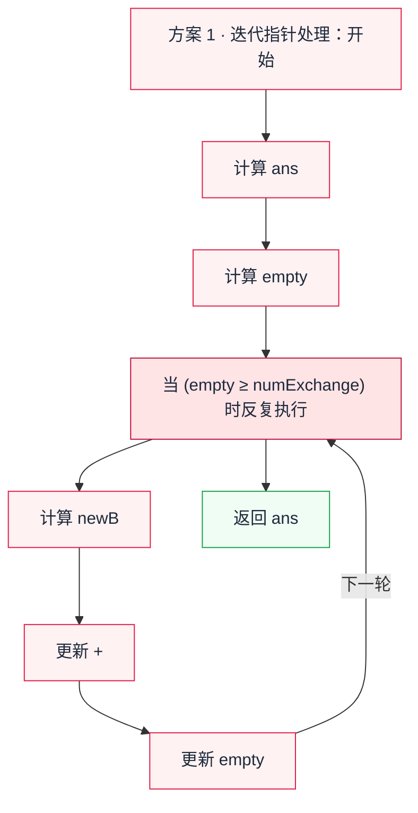

```zig
// LeetCode 1518. 换水问题 — Zig 版（方案1）
const std = @import("std"); // 把 @import(「std」) 存入 std
fn numWaterBottles(numBottles: i32, numExchange: i32) i32 { // 定义函数/方法 numWaterBottles
    var ans = numBottles; // 把 numBottles 存入 答案
    var empty = numBottles; // 把 numBottles 存入 empty
    while (empty >= numExchange) { // 循环，直到不满足「empty 不低于 numExchange」
        const newB = @divTrunc(empty, numExchange); // 把 @divTrunc(empty, numExchange) 存入 newB
        ans += newB; // 答案累加 newB
        empty = newB + @mod(empty, numExchange); // 把 newB 加 @mod(empty, numExchange); 写入 empty
    }
    return ans; // 返回 答案
}
pub fn main() !void { // 程序入口：跑内嵌自测用例
    if (numWaterBottles(9, 3) != 13) return error.TestFailed; // 若 numWaterBottles(9, 3) 不等于 13，直接返回 error.TestFailed
    if (numWaterBottles(15, 4) != 19) return error.TestFailed; // 若 numWaterBottles(15, 4) 不等于 19，直接返回 error.TestFailed
    std.debug.print("PASS\n", .{}); // 全部用例通过，输出 PASS
}
```

#### 方案 2：迭代指针处理

**思路与代码分析**：核心是「迭代指针处理」。Zig 版显式分配与清零，整型边界处理严格。**走读**：方案 2 · 迭代指针处理：开始 → 计算 ans → 计算 empty → 当 (empty ≥ numExchange) 时反复执行 → 计算 newB → 更新 + → 更新 empty → 返回 ans。

**运行架构**（真实控制流）：

```mermaid
graph TD
    N0["方案 2 · 迭代指针处理：开始"]
    N1["计算 ans"]
    N2["计算 empty"]
    N3["当 (empty ≥ numExchange) 时反复执行"]
    N4["计算 newB"]
    N5["更新 +"]
    N6["更新 empty"]
    N7["返回 ans"]
    N0 --> N1
    N1 --> N2
    N2 --> N3
    N3 --> N4
    N4 --> N5
    N5 --> N6
    N6 -- 下一轮 --> N3
    N3 --> N7
    classDef n fill:#fef2f2,stroke:#e11d48,color:#1e293b;
    classDef lp fill:#ffe4e6,stroke:#be123c,color:#1e293b;
    classDef dc fill:#fef9c3,stroke:#ca8a04,color:#1e293b;
    classDef tm fill:#f0fdf4,stroke:#16a34a,color:#1e293b;
    class N0,N1,N2,N4,N5,N6 n;
    class N3 lp;
    class N7 tm;
```

```zig
// LeetCode 1518. 换水问题 — Zig 版（方案2）
const std = @import("std"); // 把 @import(「std」) 存入 std
fn numWaterBottles(numBottles: i32, numExchange: i32) i32 { // 定义函数/方法 numWaterBottles
    var ans = numBottles; // 把 numBottles 存入 答案
    var empty = numBottles; // 把 numBottles 存入 empty
    while (empty >= numExchange) { // 循环，直到不满足「empty 不低于 numExchange」
        const newB = @divTrunc(empty, numExchange); // 把 @divTrunc(empty, numExchange) 存入 newB
        ans += newB; // 答案累加 newB
        empty = newB + @mod(empty, numExchange); // 把 newB 加 @mod(empty, numExchange); 写入 empty
    }
    return ans; // 返回 答案
}
pub fn main() !void { // 程序入口：跑内嵌自测用例
    if (numWaterBottles(9, 3) != 13) return error.TestFailed; // 若 numWaterBottles(9, 3) 不等于 13，直接返回 error.TestFailed
    if (numWaterBottles(15, 4) != 19) return error.TestFailed; // 若 numWaterBottles(15, 4) 不等于 19，直接返回 error.TestFailed
    std.debug.print("PASS\n", .{}); // 全部用例通过，输出 PASS
}
```

### Dart 实现（2 种方案）

Dart 的全部方案如下，每个方案都内嵌用例自测，可独立运行（老仓库 python/go 文件遵循「打印结果」约定）：

#### 方案 1：迭代指针处理

**思路与代码分析**：核心是「迭代指针处理」。Dart 版用可空类型标注与集合方法，注意空安全。**走读**：方案 1 · 迭代指针处理：开始 → 计算 ans → 计算 empty → 当 (empty ≥ numExchange) 时反复执行 → 更新 newB → 更新 + → 更新 empty → 处理 newB + empty % numExchange → 返回 ans。

**运行架构**（真实控制流）：

```mermaid
graph TD
    N0["方案 1 · 迭代指针处理：开始"]
    N1["计算 ans"]
    N2["计算 empty"]
    N3["当 (empty ≥ numExchange) 时反复执行"]
    N4["更新 newB"]
    N5["更新 +"]
    N6["更新 empty"]
    N7["处理 newB + empty % numExchange"]
    N8["返回 ans"]
    N0 --> N1
    N1 --> N2
    N2 --> N3
    N3 --> N4
    N4 --> N5
    N5 --> N6
    N6 --> N7
    N7 -- 下一轮 --> N3
    N3 --> N8
    classDef n fill:#fef2f2,stroke:#e11d48,color:#1e293b;
    classDef lp fill:#ffe4e6,stroke:#be123c,color:#1e293b;
    classDef dc fill:#fef9c3,stroke:#ca8a04,color:#1e293b;
    classDef tm fill:#f0fdf4,stroke:#16a34a,color:#1e293b;
    class N0,N1,N2,N4,N5,N6,N7 n;
    class N3 lp;
    class N8 tm;
```

```dart
// LeetCode 1518. 换水问题 — Dart 版（方案1）
int numWaterBottles(int numBottles, int numExchange) {
  // 定义函数/方法 numWaterBottles
  var ans = numBottles; // 把 numBottles 存入 答案
  var empty = numBottles; // 把 numBottles 存入 empty
  while (empty >= numExchange) {
    // 循环，直到不满足「empty 不低于 numExchange」
    final newB = empty ~/ numExchange; // 把 empty ~ 除以 numExchange 存入 newB
    ans += newB; // 答案累加 newB
    empty =
        newB + empty % numExchange; // 把 newB 加 empty 对…取模 numExchange 存入 empty
  }
  return ans; // 返回 答案
}

void main() {
  // 程序入口：跑内嵌自测用例
  if (numWaterBottles(9, 3) != 13)
    throw StateError(
      'c1',
    ); // 若 numWaterBottles(9, 3) 不等于 13) throw StateError('c1');
  if (numWaterBottles(15, 4) != 19)
    throw StateError(
      'c2',
    ); // 若 numWaterBottles(15, 4) 不等于 19) throw StateError('c2');
  print('PASS'); // 全部用例通过，输出 PASS
}
```

#### 方案 2：迭代指针处理

**思路与代码分析**：核心是「迭代指针处理」。Dart 版用可空类型标注与集合方法，注意空安全。**走读**：方案 2 · 迭代指针处理：开始 → 计算 ans → 计算 empty → 当 (empty ≥ numExchange) 时反复执行 → 更新 newB → 更新 + → 更新 empty → 处理 newB + empty % numExchange → 返回 ans。

**运行架构**（真实控制流）：

```mermaid
graph TD
    N0["方案 2 · 迭代指针处理：开始"]
    N1["计算 ans"]
    N2["计算 empty"]
    N3["当 (empty ≥ numExchange) 时反复执行"]
    N4["更新 newB"]
    N5["更新 +"]
    N6["更新 empty"]
    N7["处理 newB + empty % numExchange"]
    N8["返回 ans"]
    N0 --> N1
    N1 --> N2
    N2 --> N3
    N3 --> N4
    N4 --> N5
    N5 --> N6
    N6 --> N7
    N7 -- 下一轮 --> N3
    N3 --> N8
    classDef n fill:#fef2f2,stroke:#e11d48,color:#1e293b;
    classDef lp fill:#ffe4e6,stroke:#be123c,color:#1e293b;
    classDef dc fill:#fef9c3,stroke:#ca8a04,color:#1e293b;
    classDef tm fill:#f0fdf4,stroke:#16a34a,color:#1e293b;
    class N0,N1,N2,N4,N5,N6,N7 n;
    class N3 lp;
    class N8 tm;
```

```dart
// LeetCode 1518. 换水问题 — Dart 版（方案2）
int numWaterBottles(int numBottles, int numExchange) {
  // 定义函数/方法 numWaterBottles
  var ans = numBottles; // 把 numBottles 存入 答案
  var empty = numBottles; // 把 numBottles 存入 empty
  while (empty >= numExchange) {
    // 循环，直到不满足「empty 不低于 numExchange」
    final newB = empty ~/ numExchange; // 把 empty ~ 除以 numExchange 存入 newB
    ans += newB; // 答案累加 newB
    empty =
        newB + empty % numExchange; // 把 newB 加 empty 对…取模 numExchange 存入 empty
  }
  return ans; // 返回 答案
}

void main() {
  // 程序入口：跑内嵌自测用例
  if (numWaterBottles(9, 3) != 13)
    throw StateError(
      'c1',
    ); // 若 numWaterBottles(9, 3) 不等于 13) throw StateError('c1');
  if (numWaterBottles(15, 4) != 19)
    throw StateError(
      'c2',
    ); // 若 numWaterBottles(15, 4) 不等于 19) throw StateError('c2');
  print('PASS'); // 全部用例通过，输出 PASS
}
```

---

## 内容总结

- **换水问题**（贪心 · Medium）：共 2 个方案，主线思路「迭代指针处理」；时间 O(n)（单趟线性扫描）；动画演示贪心边界过程，附录给出 11 种语言 × 全部方案的可运行实现。
- 来源博客：[https://blog.csdn.net/tyro_java/article/details/145386044](https://blog.csdn.net/tyro_java/article/details/145386044)
- 导航：[📋 总目录](../) ｜ [← 099 买卖股票的最佳时机ii](../099_买卖股票的最佳时机ii/) ｜ [101 无重叠区间 →](../101_无重叠区间/)
