# 101 · 无重叠区间（第五阶段 · 贪心策略 · Medium）

> **难度**：⭐⭐ Medium ｜ **专题**：贪心
> **学习定位**：第五阶段 · 贪心策略第 101 篇 ｜ **解法数**：2
> **内容总结**：**无重叠区间**（贪心 · Medium）：共 2 个方案，主线思路「排序预处理」；时间 O(n)（单趟线性扫描）；动画演示贪心边界过程，附录给出 11 种语言 × 全部方案的可运行实现。

---

## 题目描述

给定一个区间的集合 `intervals` ，其中 `intervals[i] = [start_i, end_i]` 。返回 需要移除区间的最小数量，使剩余区间互不重叠 。

注意 只在一点上接触的区间是 不重叠的。例如 `[1, 2]` 和 `[2, 3]` 是不重叠的。

- 主函数签名：`function eraseOverlapIntervals(intervals: number[][][] | null): number`

**用例（来自原题）**：

**示例 1**

```text
输入: intervals = [[1,2],[2,3],[3,4],[1,3]]
输出: 1
```

解释：移除 [1,3] 后，剩下的区间没有重叠。

**示例 2**

```text
输入: intervals = [ [1,2], [1,2], [1,2] ]
输出: 2
```

解释：你需要移除两个 [1,2] 来使剩下的区间没有重叠。

**示例 3**

```text
输入: intervals = [ [1,2], [2,3] ]
输出: 0
```

解释：你不需要移除任何区间，因为它们已经是无重叠的了。
> ✅ **官方验证**：全部 TypeScript 解法已通过 leetcode.cn 官方示例用例验证（自动注入运行，全部 PASS）。题面与 [leetcode.cn 官方](https://leetcode.cn/problems/non-overlapping-intervals/)一致，示例配图取自官方题面。

**数据范围与注意事项**：

- `1 <= intervals.length <= 10^5`
- `intervals[i].length == 2`
- `-5  10^4 <= start_i < end_i <= 5  10^4`
- **易错点**：贪心前通常要先排序，排序依据就是贪心的正确性来源。

## 题目分析

**场景是什么**：每步取当前最优，对应真实开发里的区间调度、资源分配。本题就是该场景的 Medium 级练习，主线做法是「排序预处理」。

**主线怎么解**：把主解法从头到尾过一遍，它其实在依次做这几件事：先排序再处理 → 单循环线性扫描。

## 解题思路

**方案对比**（共 2 个方案，由浅入深）：

| 方案 | 时间复杂度 | 空间复杂度 |
|---|---|---|
| 方案 1 · 排序预处理 | O(n)（单趟线性扫描） | O(1) 到 O(n)（视辅助结构） |
| 方案 2 · 排序预处理 | O(n)（单趟线性扫描） | O(1) 到 O(n)（视辅助结构） |

**方案间的取舍**：方案 1（排序预处理）；方案 2（排序预处理）。数据规模小、可读性优先时选靠前的方案；规模大、性能优先时选靠后的方案。

**怎么读这一篇**：

- 🐣 **新手路线**：把「题目描述」的示例 1 在纸上手推一遍 → 读方案 1（最直观的写法）与它的代码走读 → 按「运行方式」本地跑通看 PASS → 回头对比方案 2 之后的写法差在哪
- 🦅 **大佬路线**：直接锁定最优方案 1（排序预处理，O(n)（单趟线性扫描））→ 跳读该方案代码与走读 → 用「逐步拆解与面试追问」补齐复杂度推导与边界追问

### 动态算法图（贪心边界，GIF 自动循环）


动画演示贪心专题里贪心边界的典型过程；每个方案在「TypeScript 解题方案」一节还配了专属动画与专属流程图。

### 主解法流程图（真实控制流）

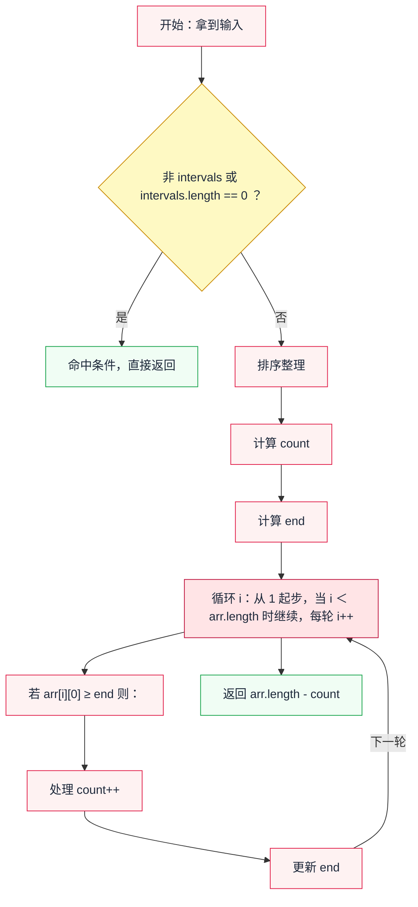

## TypeScript 解题方案（2 个方案逐个讲）

> **运行与提交**：每个方案都是自包含文件（内嵌用例自测，输出 PASS），整块复制到 `.ts` 文件后 `node 文件名` 即可运行。提交 LeetCode 时，把 `demo` 内的算法函数与辅助类型/函数整体取出、置于文件顶层即可。涉及交互/特殊接口的题以题面给定签名为准。

### 方案 1：排序预处理

**分析与思路**：核心做法是「排序预处理」。代码里依次做这些事：先排序再处理；单循环线性扫描。

**运行方式**：`node 本文件`，内嵌用例全部通过会输出 PASS。


**方案专属流程图**（真实控制流）：

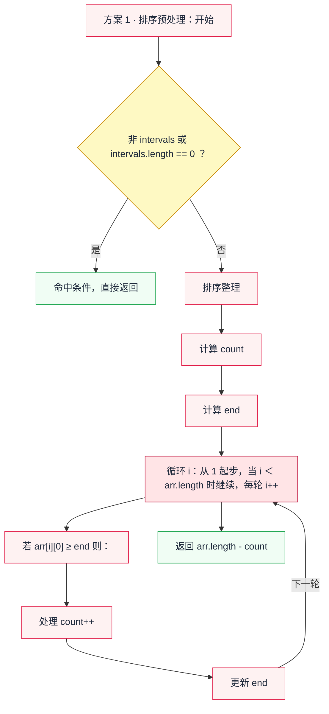

```typescript
export function demo(): void {
  // 程序入口：跑内嵌自测用例
  function eraseOverlapIntervals(intervals: number[][][] | null): number {
    // 定义函数/方法 eraseOverlapIntervals
    if (!intervals || intervals.length === 0) return 0; // 若 取反 intervals 或 intervals.长度 全等于 0，直接返回 0
    const arr = intervals.slice().sort((a, b) => a[1] - b[1]);
    let count = 1; // 把 1 存入 计数
    let end = arr[0][1]; // 把 数组[0][1] 存入 终点
    for (let i = 1; i < arr.length; i++) {
      // 让 下标 i 从 1 开始计数，下标 i 小于 数组.长度 就继续
      if (arr[i][0] >= end) {
        count++;
        end = arr[i][1];
      } // 若 数组[下标 i][0] 不低于 终点) { 计数 加一 ; 终点 赋值为 数组[下标 i][1]; }
    }
    return arr.length - count; // 返回 数组.长度 减 计数
  }
  const cases = [
    {
      in: [
        [1, 2],
        [2, 3],
        [3, 4],
        [1, 3],
      ],
      want: 1,
    },
    { in: [], want: 0 },
    {
      in: [
        [1, 2],
        [1, 3],
        [1, 4],
      ],
      want: 2,
    },
    { in: null, want: 0 },
  ];
  let fail = false; // 把 false 存入 fail
  for (const c of cases) {
    // for (const 字符 of cases) {
    const got = eraseOverlapIntervals(c.in); // 把 eraseOverlapIntervals(字符.in) 存入 got
    if (got !== c.want) {
      fail = true;
      console.log(
        'FAIL eraseOverlapIntervals(' +
          JSON.stringify(c.in) +
          ')=' +
          got +
          ' want ' +
          c.want,
      );
    }
  }
  if (fail) throw new Error('FAILED'); // 若 fail) throw new Error(「FAILED」);
  console.log('PASS'); // 全部用例通过，输出 PASS
}
demo(); // demo();
```

### 方案 2：排序预处理

**分析与思路**：核心做法是「排序预处理」。代码里依次做这些事：先排序再处理；单循环线性扫描。

**运行方式**：`node 本文件`，内嵌用例全部通过会输出 PASS。

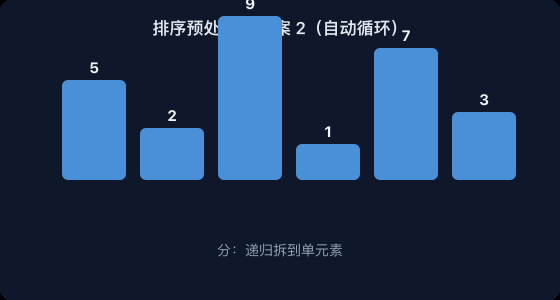

**方案专属流程图**（真实控制流）：


```typescript
export function demo(): void {
  // 程序入口：跑内嵌自测用例
  function eraseOverlapIntervals(intervals: number[][][] | null): number {
    // 定义函数/方法 eraseOverlapIntervals
    if (!intervals || intervals.length === 0) return 0; // 若 取反 intervals 或 intervals.长度 全等于 0，直接返回 0
    const arr = intervals.slice().sort((a, b) => a[1] - b[1]);
    let count = 1; // 把 1 存入 计数
    let end = arr[0][1]; // 把 数组[0][1] 存入 终点
    for (let i = 1; i < arr.length; i++) {
      // 让 下标 i 从 1 开始计数，下标 i 小于 数组.长度 就继续
      if (arr[i][0] >= end) {
        count++;
        end = arr[i][1];
      } // 若 数组[下标 i][0] 不低于 终点) { 计数 加一 ; 终点 赋值为 数组[下标 i][1]; }
    }
    return arr.length - count; // 返回 数组.长度 减 计数
  }
  const cases = [
    {
      in: [
        [1, 2],
        [2, 3],
        [3, 4],
        [1, 3],
      ],
      want: 1,
    },
    { in: [], want: 0 },
    {
      in: [
        [1, 2],
        [1, 3],
        [1, 4],
      ],
      want: 2,
    },
    { in: null, want: 0 },
  ];
  let fail = false; // 把 false 存入 fail
  for (const c of cases) {
    // for (const 字符 of cases) {
    const got = eraseOverlapIntervals(c.in); // 把 eraseOverlapIntervals(字符.in) 存入 got
    if (got !== c.want) {
      fail = true;
      console.log(
        'FAIL eraseOverlapIntervals(' +
          JSON.stringify(c.in) +
          ')=' +
          got +
          ' want ' +
          c.want,
      );
    }
  }
  if (fail) throw new Error('FAILED'); // 若 fail) throw new Error(「FAILED」);
  console.log('PASS'); // 全部用例通过，输出 PASS
}
demo(); // demo();
```

## 逐步拆解与面试追问

**复杂度**：时间 O(n)（单趟线性扫描），空间 O(1) 到 O(n)（视辅助结构）

**为什么是这个量级**：每个元素被常数次访问，辅助哈希或栈的开销与 n 同阶

**面试官可能会追问**：

- 贪心的正确性怎么证明？
- 排序依据选错了会怎样？
- 能否举出反例推翻当前策略？

## 关键 API 速查（TS 主解法实际用到，附官方链接）

| API | 作用 | 使用要点 | 官方文档 |
|---|---|---|---|
| `Array.prototype.sort()` | 原地排序 | 默认按字符串 Unicode 序（10 会排在 2 前），数字必须传 (a,b)=>a-b；V8 用 TimSort，稳定，O(n log n)；返回原数组引用 | [官方文档](https://developer.mozilla.org/zh-CN/docs/Web/JavaScript/Reference/Global_Objects/Array/sort) |
| `Array/String slice()` | 切片（不改原数组） | slice(start,end) 含头不含尾；负数从尾计；常用于复制数组（slice()） | [官方文档](https://developer.mozilla.org/zh-CN/docs/Web/JavaScript/Reference/Global_Objects/Array/slice) |
| `JSON.stringify()` | 序列化为 JSON 字符串 | 常用于结构化比较（深度相等判定）；undefined/函数/循环引用会被丢弃或抛错 | [官方文档](https://developer.mozilla.org/zh-CN/docs/Web/JavaScript/Reference/Global_Objects/JSON/stringify) |

### 各语言官方文档导航

- **TypeScript / JS**：[MDN 中文参考](https://developer.mozilla.org/zh-CN/)
- **Python**：[Python 官方文档](https://docs.python.org/zh-cn/3/)
- **Go**：[Go 标准库](https://pkg.go.dev/std)
- **Java**：[JDK 17 API](https://docs.oracle.com/en/java/javase/17/docs/api/)
- **Rust**：[Rust 标准库](https://doc.rust-lang.org/std/)
- **Lua**：[Lua 5.4 手册](https://www.lua.org/manual/5.4/)
- **C**：[Cppreference C](https://zh.cppreference.com/w/c)
- **C++**：[Cppreference C++](https://zh.cppreference.com/w/cpp)
- **R**：[R 官方手册](https://stat.ethz.ch/R-manual/)
- **Zig**：[Zig 语言文档](https://ziglang.org/documentation/master/)
- **Dart**：[Dart API](https://api.dart.dev/)

## 附录：其他 10 种语言全部实现（每种语言列举其全部方案）

> TypeScript 的全部方案见「TypeScript 解题方案」一节；下面是其余 10 种语言的对应实现，每种语言的每个方案都带思路分析、代码走读与专属运行架构图。
> 每个方案都内嵌用例自测，可独立运行（老仓库 python/go 文件遵循「打印结果」约定）。
> 完整解法文件见 `dsa/<语言>/greedy/lc_435_无重叠区间/`。

### Python 实现（2 种方案）

Python 的全部方案如下，每个方案都内嵌用例自测，可独立运行（老仓库 python/go 文件遵循「打印结果」约定）：

#### 方案 1：排序预处理

**思路与代码分析**：核心是「排序预处理」。Python 版用切片与字典推导式简化操作，突出可读性。代码里依次做这些事：先排序再处理。**走读**：方案 1 · 排序预处理：开始 → 命中条件，直接返回 → 排序整理 → 更新 count → 更新 end → 循环 i：从 1 到 len(intervals 前 → 若 intervals[i][0] ≥ end：更新 + → 更新 + → 更新 end → 返回 len(intervals) - count。

**运行架构**（真实控制流）：

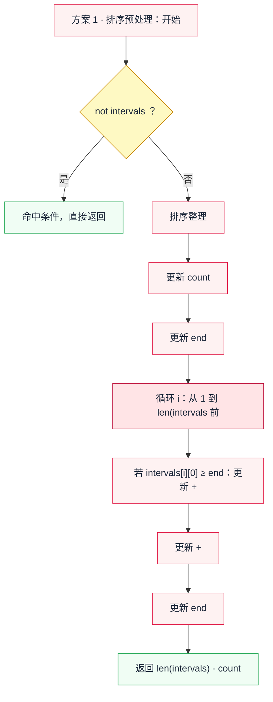

```python
import sys  # 提高递归深度上限（深输入防 RecursionError）

sys.setrecursionlimit(200000)  # 树/链表类题目节点数可达 1e4 量级

def eraseOverlapIntervals(intervals):  # 定义函数 eraseOverlapIntervals（参数：intervals）
    if not intervals:  # 若 not intervals
        return 0  # 返回 0
    intervals.sort(key=lambda x: x[1])  # 排序
    count = 1  # 把 1 存入 计数
    end = intervals[0][1]  # 把 intervals[0][1] 存入 终点
    for i in range(1, len(intervals)):  # 让 下标 i 从 1 到 长度(intervals 遍历
        if intervals[i][0] >= end:  # 若 intervals[下标 i][0] 不低于 终点
            count += 1  # 计数累加 1
            end = intervals[i][1]  # 把 intervals[下标 i][1] 存入 终点
    return len(intervals) - count  # 返回 长度(intervals) 减 计数

if __name__ == "__main__":  # 若 __name__ 等于 '__main__'
    print(eraseOverlapIntervals(None))  # 打印输出
```

#### 方案 2：排序预处理

**思路与代码分析**：核心是「排序预处理」。Python 版用切片与字典推导式简化操作，突出可读性。代码里依次做这些事：先排序再处理。**走读**：方案 2 · 排序预处理：开始 → 命中条件，直接返回 → 排序整理 → 更新 count → 更新 end → 循环 i：从 1 到 len(intervals 前 → 若 intervals[i][0] ≥ end：更新 + → 更新 + → 更新 end → 返回 len(intervals) - count。

**运行架构**（真实控制流）：


```python
import sys  # 提高递归深度上限（深输入防 RecursionError）

sys.setrecursionlimit(200000)  # 树/链表类题目节点数可达 1e4 量级

def eraseOverlapIntervals(intervals):  # 定义函数 eraseOverlapIntervals（参数：intervals）
    if not intervals:  # 若 not intervals
        return 0  # 返回 0
    intervals.sort(key=lambda x: x[1])  # 排序
    count = 1  # 把 1 存入 计数
    end = intervals[0][1]  # 把 intervals[0][1] 存入 终点
    for i in range(1, len(intervals)):  # 让 下标 i 从 1 到 长度(intervals 遍历
        if intervals[i][0] >= end:  # 若 intervals[下标 i][0] 不低于 终点
            count += 1  # 计数累加 1
            end = intervals[i][1]  # 把 intervals[下标 i][1] 存入 终点
    return len(intervals) - count  # 返回 长度(intervals) 减 计数

if __name__ == "__main__":  # 若 __name__ 等于 '__main__'
    print(eraseOverlapIntervals(None))  # 打印输出
```

### Go 实现（2 种方案）

Go 的全部方案如下，每个方案都内嵌用例自测，可独立运行（老仓库 python/go 文件遵循「打印结果」约定）：

#### 方案 1：排序预处理

**思路与代码分析**：核心是「排序预处理」。Go 版用切片与多返回值惯用法，显式处理索引边界。**走读**：方案 1 · 排序预处理：开始 → 处理 if len(intervals) == 0 → 返回 0 → 调用 sort.Slice(intervals, func(i → 更新 : → 更新 : → 遍历循环 → 处理 if intervals[i][0] ≥ end → 处理 count++ → 更新 end → 返回 len(intervals) - count。

**运行架构**（真实控制流）：


```go
package main // 引入依赖

import (
	"fmt"
	"os"
	"sort"
) // 引入依赖

func eraseOverlapIntervals(intervals [][]int) int { // 定义函数/方法 eraseOverlapIntervals
	if len(intervals) == 0 { // 若 长度(intervals) 等于 0
		return 0 // 返回 0
	}
	sort.Slice(intervals, func(i, j int) bool { return intervals[i][1] < intervals[j][1] })
	count := 1                            // 把 1 写入 count :
	end := intervals[0][1]                // 把 intervals[0][1] 写入 end :
	for i := 1; i < len(intervals); i++ { // 让 下标 i 从 1 开始计数
		if intervals[i][0] >= end { // 若 intervals[下标 i][0] 不低于 终点
			count++               // 计数 加一
			end = intervals[i][1] // 把 intervals[下标 i][1] 写入 终点
		}
	}
	return len(intervals) - count // 返回 长度(intervals) 减 计数
}

func main() { // 程序入口：跑内嵌自测用例
	type tc struct { // 定义类型
		in   [][]int // in [][]int
		want int     // want int
	}
	cases := []tc{ // 把 []tc{ 写入 cases :
		{[][]int{{1, 2}, {2, 3}, {3, 4}, {1, 3}}, 1},
		{[][]int{{1, 2}, {1, 2}, {1, 2}}, 2},
	}
	ok := true                // 把 true 写入 ok :
	for _, c := range cases { // 同时取 _ 与 字符 遍历
		if got := eraseOverlapIntervals(c.in); got != c.want { // 若 got : 赋值为 eraseOverlapIntervals(字符.in); got 不等于 字符.want
			ok = false                                                                   // 把 false 写入 ok
			fmt.Printf("FAIL eraseOverlapIntervals(%v)=%v want %v\n", c.in, got, c.want) // 打印输出
		}
	}
	if !ok { // 若 取反 ok
		os.Exit(1) // os.Exit(1)
	}
	fmt.Println("PASS") // 全部用例通过，输出 PASS
}
```

#### 方案 2：排序预处理

**思路与代码分析**：核心是「排序预处理」。Go 版用切片与多返回值惯用法，显式处理索引边界。**走读**：方案 2 · 排序预处理：开始 → 处理 if len(intervals) == 0 → 返回 0 → 调用 sort.Slice(intervals, func(i → 更新 : → 更新 : → 遍历循环 → 处理 if intervals[i][0] ≥ end → 处理 count++ → 更新 end → 返回 len(intervals) - count。

**运行架构**（真实控制流）：

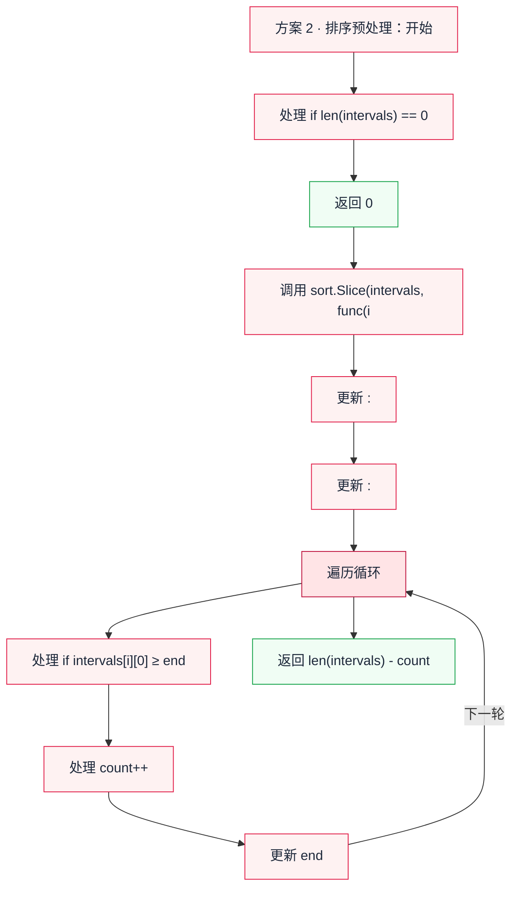

```go
package main // 引入依赖

import (
	"fmt"
	"os"
	"sort"
) // 引入依赖

func eraseOverlapIntervals(intervals [][]int) int { // 定义函数/方法 eraseOverlapIntervals
	if len(intervals) == 0 { // 若 长度(intervals) 等于 0
		return 0 // 返回 0
	}
	sort.Slice(intervals, func(i, j int) bool { return intervals[i][1] < intervals[j][1] })
	count := 1                            // 把 1 写入 count :
	end := intervals[0][1]                // 把 intervals[0][1] 写入 end :
	for i := 1; i < len(intervals); i++ { // 让 下标 i 从 1 开始计数
		if intervals[i][0] >= end { // 若 intervals[下标 i][0] 不低于 终点
			count++               // 计数 加一
			end = intervals[i][1] // 把 intervals[下标 i][1] 写入 终点
		}
	}
	return len(intervals) - count // 返回 长度(intervals) 减 计数
}

func main() { // 程序入口：跑内嵌自测用例
	type tc struct { // 定义类型
		in   [][]int // in [][]int
		want int     // want int
	}
	cases := []tc{ // 把 []tc{ 写入 cases :
		{[][]int{{1, 2}, {2, 3}, {3, 4}, {1, 3}}, 1},
		{[][]int{{1, 2}, {1, 2}, {1, 2}}, 2},
	}
	ok := true                // 把 true 写入 ok :
	for _, c := range cases { // 同时取 _ 与 字符 遍历
		if got := eraseOverlapIntervals(c.in); got != c.want { // 若 got : 赋值为 eraseOverlapIntervals(字符.in); got 不等于 字符.want
			ok = false                                                                   // 把 false 写入 ok
			fmt.Printf("FAIL eraseOverlapIntervals(%v)=%v want %v\n", c.in, got, c.want) // 打印输出
		}
	}
	if !ok { // 若 取反 ok
		os.Exit(1) // os.Exit(1)
	}
	fmt.Println("PASS") // 全部用例通过，输出 PASS
}
```

### Java 实现（2 种方案）

Java 的全部方案如下，每个方案都内嵌用例自测，可独立运行（老仓库 python/go 文件遵循「打印结果」约定）：

#### 方案 1：排序预处理

**思路与代码分析**：核心是「排序预处理」。Java 版用类与静态方法组织，集合操作显式明了。代码里依次做这些事：先排序再处理；单循环线性扫描。**走读**：方案 1 · 排序预处理：开始 → 命中条件，直接返回 → 排序整理 → 更新 n → 更新 right → 更新 ans → 遍历循环 → 若 intervals[i][0] ≥ right 则： → 处理 ++ans → 更新 right → 返回 n - ans。

**运行架构**（真实控制流）：

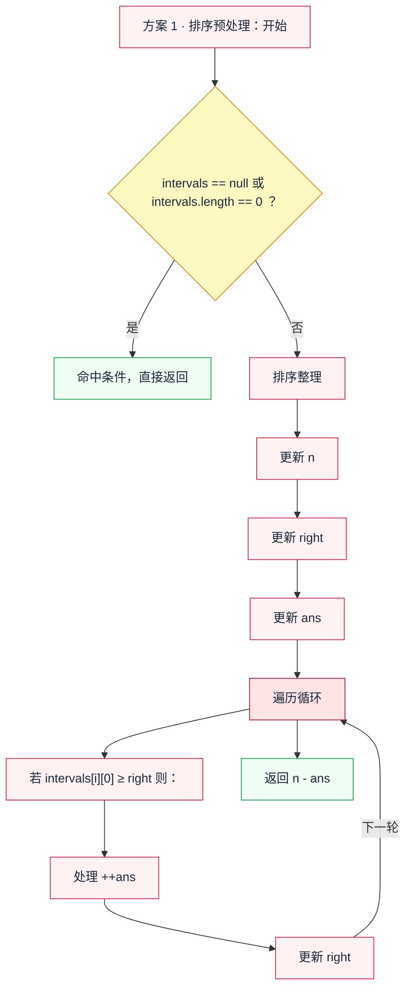

```java
package com.webfault.dsa; // 引入依赖

import java.util.*; // 引入依赖

class lc435_solution111 { // 定义类型
  static int eraseOverlapIntervals(int[][] intervals) { // 定义函数/方法 eraseOverlapIntervals
    if (intervals == null || intervals.length == 0)
      return 0; // 若 intervals 等于 null 或 intervals.长度 等于 0，直接返回 0
    Arrays.sort(intervals, (a, b) -> a[1] - b[1]); // 排序
    int n = intervals.length; // 把 intervals.长度 存入 元素个数
    int right = intervals[0][1]; // 把 intervals[0][1] 存入 右边界
    int ans = 1; // 把 1 存入 答案
    for (int i = 1; i < n; i++) { // 让 下标 i 从 1 开始计数，下标 i 小于 元素个数 就继续
      if (intervals[i][0] >= right) { // 若 intervals[下标 i][0] 不低于 右边界
        ++ans; // 加一 答案;
        right = intervals[i][1]; // 把 intervals[下标 i][1]; 写入 右边界
      }
    }
    return n - ans; // 返回 元素个数 减 答案
  }

  public static void main(String[] args) { // public static void main(String[] args) {
    int gotNull = eraseOverlapIntervals(null); // 把 eraseOverlapIntervals(null) 存入 gotNull
    if (gotNull != 0) throw new RuntimeException("FAILED null: got " + gotNull);
    int[][] intervals = {
      {1, 2}, {2, 3}, {3, 4}, {1, 3}
    }; // 把 {{1, 2}, {2, 3}, {3, 4}, {1, 3}}; 写入 int[][] intervals
    int got = eraseOverlapIntervals(intervals); // 把 eraseOverlapIntervals(intervals) 存入 got
    if (got != 1) throw new RuntimeException("FAILED: got " + got + " want 1");
    System.out.println("PASS"); // 全部用例通过，输出 PASS
  }
}
```

#### 方案 2：排序预处理

**思路与代码分析**：核心是「排序预处理」。Java 版用类与静态方法组织，集合操作显式明了。代码里依次做这些事：先排序再处理；双重循环遍历。**走读**：方案 2 · 排序预处理：开始 → 命中条件，直接返回 → 排序整理 → 更新 n → 更新 f → 调用 Arrays.fill(f, 1) → 遍历循环 → 遍历循环 → 若 intervals[j][1] ≤ intervals[i][0] 则： → 更新 f[i] → 更新 maxF → 遍历循环 → 返回 n - maxF。

**运行架构**（真实控制流）：

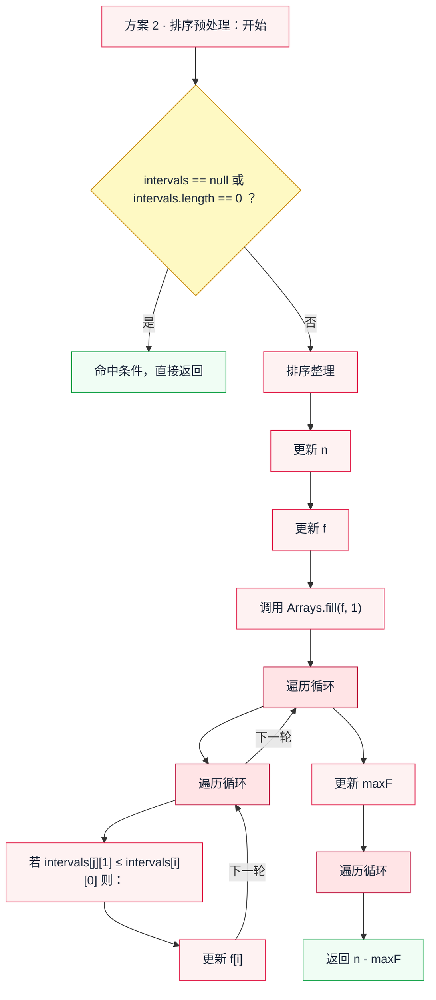

```java
package com.webfault.dsa; // 引入依赖

import java.util.*; // 引入依赖

class lc435_solution222 { // 定义类型
  static int eraseOverlapIntervals(int[][] intervals) { // 定义函数/方法 eraseOverlapIntervals
    if (intervals == null || intervals.length == 0)
      return 0; // 若 intervals 等于 null 或 intervals.长度 等于 0，直接返回 0
    Arrays.sort(intervals, (a, b) -> a[0] - b[0]); // 排序
    int n = intervals.length; // 把 intervals.长度 存入 元素个数
    int[] f = new int[n]; // 把 new int[元素个数]; 写入 int[] f
    Arrays.fill(f, 1); // Arrays.fill(f, 1);
    for (int i = 1; i < n; i++) { // 让 下标 i 从 1 开始计数，下标 i 小于 元素个数 就继续
      for (int j = 0; j < i; j++) { // 让 下标 j 从 0 开始计数，下标 j 小于 下标 i 就继续
        if (intervals[j][1] <= intervals[i][0]) { // 若 intervals[下标 j][1] 不超过 intervals[下标 i][0]
          f[i] = Math.max(f[i], f[j] + 1); // 把 Math.取较大值 f[下标 i], f[下标 j] 加 1); 写入 f[i]
        }
      }
    }
    int maxF = 0; // 把 0 存入 maxF
    for (int v : f) maxF = Math.max(maxF, v); // 把 Math.取较大值 maxF, 值); 写入 for (int v : f) maxF
    return n - maxF; // 返回 元素个数 减 maxF
  }

  public static void main(String[] args) { // public static void main(String[] args) {
    int gotNull = eraseOverlapIntervals(null); // 把 eraseOverlapIntervals(null) 存入 gotNull
    if (gotNull != 0) throw new RuntimeException("FAILED null: got " + gotNull);
    int[][] intervals = {
      {1, 2}, {2, 3}, {3, 4}, {1, 3}
    }; // 把 {{1, 2}, {2, 3}, {3, 4}, {1, 3}}; 写入 int[][] intervals
    int got = eraseOverlapIntervals(intervals); // 把 eraseOverlapIntervals(intervals) 存入 got
    if (got != 1) throw new RuntimeException("FAILED: got " + got + " want 1");
    System.out.println("PASS"); // 全部用例通过，输出 PASS
  }
}
```

### Rust 实现（2 种方案）

Rust 的全部方案如下，每个方案都内嵌用例自测，可独立运行（老仓库 python/go 文件遵循「打印结果」约定）：

#### 方案 1：排序预处理

**思路与代码分析**：核心是「排序预处理」。Rust 版用所有权移动与切片借用改写同一逻辑，注意 Option 与引用边界。**走读**：方案 1 · 排序预处理：开始 → 处理 if intervals.is_empty() → 返回 0 → 计算 arr → 调用 arr.sort_by_key(｜x｜ x[1]) → 计算 count → 计算 end → 遍历 arr.iter().skip(1) 中的每个元素 iv → 处理 if iv[0] ≥ end → 更新 + → 更新 end → 调用 arr.len() as i32 - count。

**运行架构**（真实控制流）：


```rust
// LeetCode 435. 无重叠区间 — Rust 版（方案1）
fn erase_overlap_intervals(intervals: Vec<Vec<i32>>) -> i32 {
    // 定义函数/方法 erase_overlap_intervals
    if intervals.is_empty() {
        return 0;
    } // 若 intervals 是否为空 { return 0; }
    let mut arr = intervals; // 把 intervals; 写入 let mut arr
    arr.sort_by_key(|x| x[1]); // 数组.sort_by_key( 按位或 x 按位或 x[1]);
    let mut count = 1; // 把 1; 写入 let mut count
    let mut end = arr[0][1]; // 把 数组[0][1]; 写入 let mut end
    for iv in arr.iter().skip(1) {
        // 逐个取出 数组 的元素（iv）
        if iv[0] >= end {
            count += 1;
            end = iv[1];
        } // 若 iv[0] 不低于 终点 { 计数 累加 1; 终点 赋值为 iv[1]; }
    }
    arr.len() as i32 - count // 数组.长度() as i32 减 计数
}
fn main() {
    // 程序入口：跑内嵌自测用例
    assert_eq!(
        erase_overlap_intervals(vec![vec![1, 2], vec![2, 3], vec![3, 4], vec![1, 3]]),
        1
    ); // 断言校验
    assert_eq!(erase_overlap_intervals(vec![]), 0); // 断言校验
    assert_eq!(
        erase_overlap_intervals(vec![vec![1, 2], vec![1, 2], vec![1, 2]]),
        2
    ); // 断言校验
    println!("PASS"); // 全部用例通过，输出 PASS
}
```

#### 方案 2：排序预处理

**思路与代码分析**：核心是「排序预处理」。Rust 版用所有权移动与切片借用改写同一逻辑，注意 Option 与引用边界。**走读**：方案 2 · 排序预处理：开始 → 处理 if intervals.is_empty() → 返回 0 → 计算 arr → 调用 arr.sort_by_key(｜x｜ x[1]) → 计算 count → 计算 end → 遍历 arr.iter().skip(1) 中的每个元素 iv → 处理 if iv[0] ≥ end → 更新 + → 更新 end → 调用 arr.len() as i32 - count。

**运行架构**（真实控制流）：

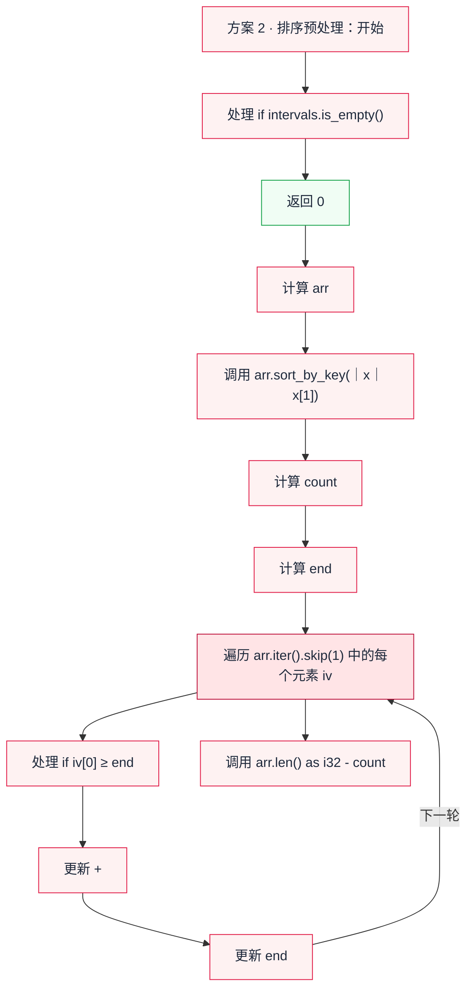

```rust
// LeetCode 435. 无重叠区间 — Rust 版（方案2）
fn erase_overlap_intervals(intervals: Vec<Vec<i32>>) -> i32 {
    // 定义函数/方法 erase_overlap_intervals
    if intervals.is_empty() {
        return 0;
    } // 若 intervals 是否为空 { return 0; }
    let mut arr = intervals; // 把 intervals; 写入 let mut arr
    arr.sort_by_key(|x| x[1]); // 数组.sort_by_key( 按位或 x 按位或 x[1]);
    let mut count = 1; // 把 1; 写入 let mut count
    let mut end = arr[0][1]; // 把 数组[0][1]; 写入 let mut end
    for iv in arr.iter().skip(1) {
        // 逐个取出 数组 的元素（iv）
        if iv[0] >= end {
            count += 1;
            end = iv[1];
        } // 若 iv[0] 不低于 终点 { 计数 累加 1; 终点 赋值为 iv[1]; }
    }
    arr.len() as i32 - count // 数组.长度() as i32 减 计数
}
fn main() {
    // 程序入口：跑内嵌自测用例
    assert_eq!(
        erase_overlap_intervals(vec![vec![1, 2], vec![2, 3], vec![3, 4], vec![1, 3]]),
        1
    ); // 断言校验
    assert_eq!(erase_overlap_intervals(vec![]), 0); // 断言校验
    assert_eq!(
        erase_overlap_intervals(vec![vec![1, 2], vec![1, 2], vec![1, 2]]),
        2
    ); // 断言校验
    println!("PASS"); // 全部用例通过，输出 PASS
}
```

### Lua 实现（2 种方案）

Lua 的全部方案如下，每个方案都内嵌用例自测，可独立运行（老仓库 python/go 文件遵循「打印结果」约定）：

#### 方案 1：排序预处理

**思路与代码分析**：核心是「排序预处理」。Lua 版用表与 ipairs 遍历，注意 ipairs 遇 nil 即停的语义。代码里依次做这些事：先排序再处理。**走读**：方案 1 · 排序预处理：开始 → 处理 if #intervals == 0 then → 返回 0 → 更新 arr → 遍历 ipairs(intervals) do 中的每个元素 iv → 更新 arr[i] → 排序整理 → 返回 a[2] ＜ b[2] → 更新 end_ → 循环 i：从 2 到 #arr do → 处理 if arr[i][1] ≥ end_ then → 更新 count → 更新 end_ → 返回 #arr - count。

**运行架构**（真实控制流）：

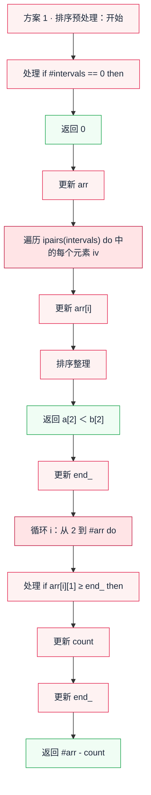

```lua
-- LeetCode 435. 无重叠区间 — Lua 版（方案1）
local function erase_overlap_intervals(intervals) -- local function erase_overlap_intervals(intervals)
	if #intervals == 0 then
		return 0
	end -- 若 #intervals 等于 0 then return 0 终点
	local arr = {} -- 把 {} 写入 local arr
	for i, iv in ipairs(intervals) do
		arr[i] = { iv[1], iv[2] }
	end -- 遍历取 iv
	table.sort(arr, function(a, b)
		return a[2] < b[2]
	end) -- 排序
	local count, end_ = 1, arr[1][2] -- 把 1, 数组[1][2] 写入 local count, end_
	for i = 2, #arr do -- 把 2, #数组 do 写入 for i
		if arr[i][1] >= end_ then -- 若 数组[下标 i][1] 不低于 end_ then
			count = count + 1 -- 把 计数 加 1 存入 计数
			end_ = arr[i][2] -- 把 数组[下标 i][2] 存入 end_
		end -- 终点
	end -- 终点
	return #arr - count -- 返回 #数组 减 计数
end -- 终点
assert(erase_overlap_intervals({ { 1, 2 }, { 2, 3 }, { 3, 4 }, { 1, 3 } }) == 1) -- 断言校验
assert(erase_overlap_intervals({}) == 0) -- 断言校验
assert(erase_overlap_intervals({ { 1, 2 }, { 1, 2 }, { 1, 2 } }) == 2) -- 断言校验
print("PASS") -- 全部用例通过，输出 PASS
```

#### 方案 2：排序预处理

**思路与代码分析**：核心是「排序预处理」。Lua 版用表与 ipairs 遍历，注意 ipairs 遇 nil 即停的语义。代码里依次做这些事：先排序再处理。**走读**：方案 2 · 排序预处理：开始 → 处理 if #intervals == 0 then → 返回 0 → 更新 arr → 遍历 ipairs(intervals) do 中的每个元素 iv → 更新 arr[i] → 排序整理 → 返回 a[2] ＜ b[2] → 更新 end_ → 循环 i：从 2 到 #arr do → 处理 if arr[i][1] ≥ end_ then → 更新 count → 更新 end_ → 返回 #arr - count。

**运行架构**（真实控制流）：


```lua
-- LeetCode 435. 无重叠区间 — Lua 版（方案2）
local function erase_overlap_intervals(intervals) -- local function erase_overlap_intervals(intervals)
	if #intervals == 0 then
		return 0
	end -- 若 #intervals 等于 0 then return 0 终点
	local arr = {} -- 把 {} 写入 local arr
	for i, iv in ipairs(intervals) do
		arr[i] = { iv[1], iv[2] }
	end -- 遍历取 iv
	table.sort(arr, function(a, b)
		return a[2] < b[2]
	end) -- 排序
	local count, end_ = 1, arr[1][2] -- 把 1, 数组[1][2] 写入 local count, end_
	for i = 2, #arr do -- 把 2, #数组 do 写入 for i
		if arr[i][1] >= end_ then -- 若 数组[下标 i][1] 不低于 end_ then
			count = count + 1 -- 把 计数 加 1 存入 计数
			end_ = arr[i][2] -- 把 数组[下标 i][2] 存入 end_
		end -- 终点
	end -- 终点
	return #arr - count -- 返回 #数组 减 计数
end -- 终点
assert(erase_overlap_intervals({ { 1, 2 }, { 2, 3 }, { 3, 4 }, { 1, 3 } }) == 1) -- 断言校验
assert(erase_overlap_intervals({}) == 0) -- 断言校验
assert(erase_overlap_intervals({ { 1, 2 }, { 1, 2 }, { 1, 2 } }) == 2) -- 断言校验
print("PASS") -- 全部用例通过，输出 PASS
```

### C 实现（2 种方案）

C 的全部方案如下，每个方案都内嵌用例自测，可独立运行（老仓库 python/go 文件遵循「打印结果」约定）：

#### 方案 1：排序预处理

**思路与代码分析**：核心是「排序预处理」。C 版手动管理下标与内存，循环边界全部显式写出。代码里依次做这些事：双重循环遍历。**走读**：方案 1 · 排序预处理：开始 → 命中条件，直接返回 → 处理 int arr[256][2] → 遍历循环 → 更新 arr[i][0] → 更新 arr[i][1] → 调用 qsort(arr, n, sizeof(int) * → 更新 count → 遍历循环 → 若 arr[i][0] ≥ end 则： → 处理 count++ → 更新 end → 返回 n - count。

**运行架构**（真实控制流）：


```c
/* LeetCode 435. 无重叠区间 — C 版（方案1） */
#include <stdio.h>  // 引入头文件
#include <stdlib.h> // 引入头文件
static int cmp_iv(const void *a, const void *b) { return ((const int *)a)[1] - ((const int *)b)[1]; }
static int erase_overlap_intervals(int intervals[][2], int n) { // 定义函数/方法 erase_overlap_intervals
    if (n == 0)
        return 0;    // 若 元素个数 等于 0，直接返回 0
    int arr[256][2]; // int 数组[256][2];
    for (int i = 0; i < n; i++) {
        arr[i][0] = intervals[i][0];
        arr[i][1] = intervals[i][1];
    } // 让 下标 i 从 0 开始计数，下标 i 小于 元素个数 就继续
    qsort(arr, n, sizeof(int) * 2, cmp_iv); // qsort(数组, 元素个数, sizeof(int) 乘 2, cmp_iv);
    int count = 1, end = arr[0][1];         // 把 1, 终点 赋值为 数组[0][1] 存入 计数
    for (int i = 1; i < n; i++) { // 让 下标 i 从 1 开始计数，下标 i 小于 元素个数 就继续
        if (arr[i][0] >= end) {
            count++;
            end = arr[i][1];
        } // 若 数组[下标 i][0] 不低于 终点) { 计数 加一 ; 终点 赋值为 数组[下标 i][1]; }
    }
    return n - count; // 返回 元素个数 减 计数
}
int main(void) {                                    // 程序入口：跑内嵌自测用例
    int v1[][2] = {{1, 2}, {2, 3}, {3, 4}, {1, 3}}; // 把 {{1,2},{2,3},{3,4},{1,3}}; 写入 int v1[][2]
    int v3[][2] = {{1, 2}, {1, 2}, {1, 2}};         // 把 {{1,2},{1,2},{1,2}}; 写入 int v3[][2]
    if (erase_overlap_intervals(v1, 4) != 1) {
        printf("FAIL 1\n");
        return 1;
    }
    if (erase_overlap_intervals(NULL, 0) != 0) {
        printf("FAIL 2\n");
        return 1;
    }
    if (erase_overlap_intervals(v3, 3) != 2) {
        printf("FAIL 3\n");
        return 1;
    }
    printf("PASS\n"); // 全部用例通过，输出 PASS
    return 0;         // 返回 0
}
```

#### 方案 2：排序预处理

**思路与代码分析**：核心是「排序预处理」。C 版手动管理下标与内存，循环边界全部显式写出。代码里依次做这些事：双重循环遍历。**走读**：方案 2 · 排序预处理：开始 → 命中条件，直接返回 → 处理 int arr[256][2] → 遍历循环 → 更新 arr[i][0] → 更新 arr[i][1] → 调用 qsort(arr, n, sizeof(int) * → 更新 count → 遍历循环 → 若 arr[i][0] ≥ end 则： → 处理 count++ → 更新 end → 返回 n - count。

**运行架构**（真实控制流）：

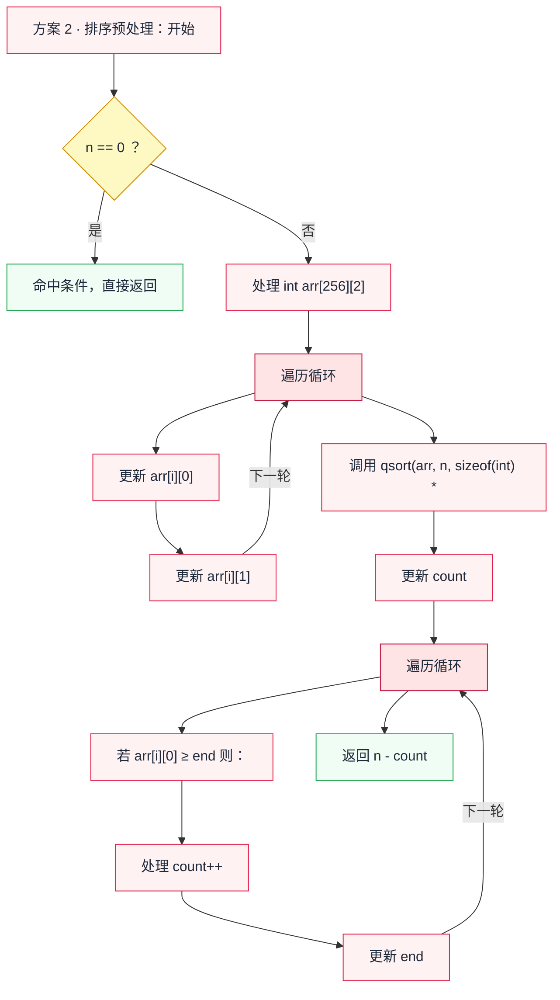

```c
/* LeetCode 435. 无重叠区间 — C 版（方案2） */
#include <stdio.h>  // 引入头文件
#include <stdlib.h> // 引入头文件
static int cmp_iv(const void *a, const void *b) { return ((const int *)a)[1] - ((const int *)b)[1]; }
static int erase_overlap_intervals(int intervals[][2], int n) { // 定义函数/方法 erase_overlap_intervals
    if (n == 0)
        return 0;    // 若 元素个数 等于 0，直接返回 0
    int arr[256][2]; // int 数组[256][2];
    for (int i = 0; i < n; i++) {
        arr[i][0] = intervals[i][0];
        arr[i][1] = intervals[i][1];
    } // 让 下标 i 从 0 开始计数，下标 i 小于 元素个数 就继续
    qsort(arr, n, sizeof(int) * 2, cmp_iv); // qsort(数组, 元素个数, sizeof(int) 乘 2, cmp_iv);
    int count = 1, end = arr[0][1];         // 把 1, 终点 赋值为 数组[0][1] 存入 计数
    for (int i = 1; i < n; i++) { // 让 下标 i 从 1 开始计数，下标 i 小于 元素个数 就继续
        if (arr[i][0] >= end) {
            count++;
            end = arr[i][1];
        } // 若 数组[下标 i][0] 不低于 终点) { 计数 加一 ; 终点 赋值为 数组[下标 i][1]; }
    }
    return n - count; // 返回 元素个数 减 计数
}
int main(void) {                                    // 程序入口：跑内嵌自测用例
    int v1[][2] = {{1, 2}, {2, 3}, {3, 4}, {1, 3}}; // 把 {{1,2},{2,3},{3,4},{1,3}}; 写入 int v1[][2]
    int v3[][2] = {{1, 2}, {1, 2}, {1, 2}};         // 把 {{1,2},{1,2},{1,2}}; 写入 int v3[][2]
    if (erase_overlap_intervals(v1, 4) != 1) {
        printf("FAIL 1\n");
        return 1;
    }
    if (erase_overlap_intervals(NULL, 0) != 0) {
        printf("FAIL 2\n");
        return 1;
    }
    if (erase_overlap_intervals(v3, 3) != 2) {
        printf("FAIL 3\n");
        return 1;
    }
    printf("PASS\n"); // 全部用例通过，输出 PASS
    return 0;         // 返回 0
}
```

### C++ 实现（2 种方案）

C++ 的全部方案如下，每个方案都内嵌用例自测，可独立运行（老仓库 python/go 文件遵循「打印结果」约定）：

#### 方案 1：排序预处理

**思路与代码分析**：核心是「排序预处理」。C++ 版用 STL 容器与迭代器，减少手写下标错误。代码里依次做这些事：单循环线性扫描。**走读**：方案 1 · 排序预处理：开始 → 命中条件，直接返回 → 处理 std::sort(intervals.begin(), → 更新 count → 更新 end → 遍历循环 → 处理 ++i) → 若 intervals[i][0] ≥ end 则： → 处理 ++count → 更新 end → 返回 static_cast＜int＞(intervals.size()) - → 处理 count。

**运行架构**（真实控制流）：

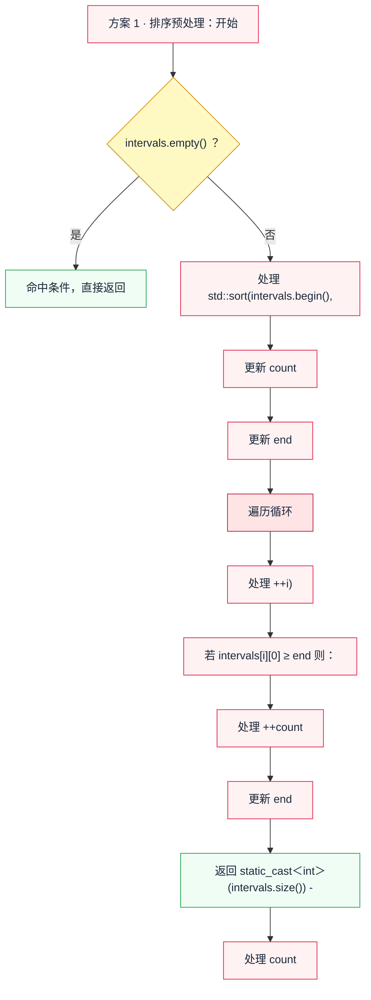

```cpp
// LeetCode 435. 无重叠区间 — C++ 版（方案1）
#include <algorithm> // 引入头文件
#include <cassert>   // 引入头文件
#include <iostream>  // 引入头文件
#include <vector>    // 引入头文件
static int
eraseOverlapIntervals(std::vector<std::vector<int>> intervals) { // 定义函数/方法 eraseOverlapIntervals
    if (intervals.empty())
        return 0; // 若 intervals 是否为空，直接返回 0
    std::sort(intervals.begin(), intervals.end(), [](auto &a, auto &b) { return a[1] < b[1]; });
    int count = 1;             // 把 1 存入 计数
    int end = intervals[0][1]; // 把 intervals[0][1] 存入 终点
    for (size_t i = 1; i < intervals.size();
         ++i) { // 让 下标 i 从 1 开始计数，下标 i 小于 intervals.大小() 就继续
        if (intervals[i][0] >= end) {
            ++count;
            end = intervals[i][1];
        }
    }
    return static_cast<int>(intervals.size()) -
           count; // 返回 static_cast 小于 int 超过 (intervals.大小()) 减 计数
}
int main() { // 程序入口：跑内嵌自测用例
    assert(eraseOverlapIntervals({{1, 2}, {2, 3}, {3, 4}, {1, 3}}) == 1); // 断言校验
    assert(eraseOverlapIntervals({}) == 0);                               // 断言校验
    assert(eraseOverlapIntervals({{1, 2}, {1, 2}, {1, 2}}) == 2);         // 断言校验
    std::cout << "PASS" << std::endl;                                     // 全部用例通过，输出 PASS
    return 0;                                                             // 返回 0
}
```

#### 方案 2：排序预处理

**思路与代码分析**：核心是「排序预处理」。C++ 版用 STL 容器与迭代器，减少手写下标错误。代码里依次做这些事：单循环线性扫描。**走读**：方案 2 · 排序预处理：开始 → 命中条件，直接返回 → 处理 std::sort(intervals.begin(), → 更新 count → 更新 end → 遍历循环 → 处理 ++i) → 若 intervals[i][0] ≥ end 则： → 处理 ++count → 更新 end → 返回 static_cast＜int＞(intervals.size()) - → 处理 count。

**运行架构**（真实控制流）：


```cpp
// LeetCode 435. 无重叠区间 — C++ 版（方案2）
#include <algorithm> // 引入头文件
#include <cassert>   // 引入头文件
#include <iostream>  // 引入头文件
#include <vector>    // 引入头文件
static int
eraseOverlapIntervals(std::vector<std::vector<int>> intervals) { // 定义函数/方法 eraseOverlapIntervals
    if (intervals.empty())
        return 0; // 若 intervals 是否为空，直接返回 0
    std::sort(intervals.begin(), intervals.end(), [](auto &a, auto &b) { return a[1] < b[1]; });
    int count = 1;             // 把 1 存入 计数
    int end = intervals[0][1]; // 把 intervals[0][1] 存入 终点
    for (size_t i = 1; i < intervals.size();
         ++i) { // 让 下标 i 从 1 开始计数，下标 i 小于 intervals.大小() 就继续
        if (intervals[i][0] >= end) {
            ++count;
            end = intervals[i][1];
        }
    }
    return static_cast<int>(intervals.size()) -
           count; // 返回 static_cast 小于 int 超过 (intervals.大小()) 减 计数
}
int main() { // 程序入口：跑内嵌自测用例
    assert(eraseOverlapIntervals({{1, 2}, {2, 3}, {3, 4}, {1, 3}}) == 1); // 断言校验
    assert(eraseOverlapIntervals({}) == 0);                               // 断言校验
    assert(eraseOverlapIntervals({{1, 2}, {1, 2}, {1, 2}}) == 2);         // 断言校验
    std::cout << "PASS" << std::endl;                                     // 全部用例通过，输出 PASS
    return 0;                                                             // 返回 0
}
```

### R 实现（2 种方案）

R 的全部方案如下，每个方案都内嵌用例自测，可独立运行（老仓库 python/go 文件遵循「打印结果」约定）：

#### 方案 1：排序预处理

**思路与代码分析**：核心是「排序预处理」。R 版用向量化思维与 1 起始下标，注意 1:n 的降序陷阱。代码里依次做这些事：单循环线性扫描。**走读**：方案 1 · 排序预处理：开始 → 命中条件，直接返回 → 处理 ord ＜- order(intervals[, 2]) → 更新 drop → 处理 count ＜- 1L → 处理 end_ ＜- arr[1, 2] → 循环 i：遍历 2:nrow(arr) → 若 arr[i, 1] ≥ end_ 则： → 处理 count ＜- count + 1L → 处理 end_ ＜- arr[i, 2] → 调用 nrow(arr) - count。

**运行架构**（真实控制流）：

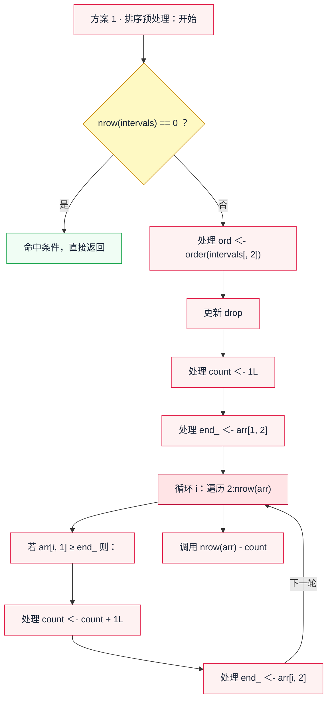

```r
# 版（方案1） 定义函数 erase_overlap_intervals（参数：intervals）
erase_overlap_intervals <- function(intervals) {
    if (nrow(intervals) == 0)
        return(0L)  # 若 nrow(intervals) 等于 0) return(0L
    ord <- order(intervals[, 2])  # 把 order(intervals[, 2]) 存入 ord
    arr <- intervals[ord, , drop = FALSE]  # 把 intervals[ord, , drop 赋值为 FALSE] 存入 数组
    count <- 1L
    end_ <- arr[1, 2]  # 把 1L; end_ 小于 减 数组[1, 2] 存入 计数
    for (i in 2:nrow(arr)) {
        # for (下标 i in 2:nrow(数组)) {
        if (arr[i, 1] >= end_) {
            count <- count + 1L
            end_ <- arr[i, 2]
        }
    }
    nrow(arr) - count  # nrow(数组) 减 计数
}
m1 <- matrix(c(1, 2, 2, 3, 3, 4, 1, 3), ncol = 2, byrow = TRUE)
m3 <- matrix(c(1, 2, 1, 2, 1, 2), ncol = 2, byrow = TRUE)  # 把 矩阵(字符(1, 2, 1, 2, 1, 2), ncol 赋值为 2, byrow 赋值为 TRUE) 存入 m3
stopifnot(erase_overlap_intervals(m1) == 1L)  # 断言校验
stopifnot(erase_overlap_intervals(matrix(integer(0), ncol = 2)) == 0L)  # 断言校验
stopifnot(erase_overlap_intervals(m3) == 2L)  # 断言校验
cat("PASS\n")  # 全部用例通过，输出 PASS
```

#### 方案 2：排序预处理

**思路与代码分析**：核心是「排序预处理」。R 版用向量化思维与 1 起始下标，注意 1:n 的降序陷阱。代码里依次做这些事：单循环线性扫描。**走读**：方案 2 · 排序预处理：开始 → 命中条件，直接返回 → 处理 ord ＜- order(intervals[, 2]) → 更新 drop → 处理 count ＜- 1L → 处理 end_ ＜- arr[1, 2] → 循环 i：遍历 2:nrow(arr) → 若 arr[i, 1] ≥ end_ 则： → 处理 count ＜- count + 1L → 处理 end_ ＜- arr[i, 2] → 调用 nrow(arr) - count。

**运行架构**（真实控制流）：


```r
# 版（方案2） 定义函数 erase_overlap_intervals（参数：intervals）
erase_overlap_intervals <- function(intervals) {
    if (nrow(intervals) == 0)
        return(0L)  # 若 nrow(intervals) 等于 0) return(0L
    ord <- order(intervals[, 2])  # 把 order(intervals[, 2]) 存入 ord
    arr <- intervals[ord, , drop = FALSE]  # 把 intervals[ord, , drop 赋值为 FALSE] 存入 数组
    count <- 1L
    end_ <- arr[1, 2]  # 把 1L; end_ 小于 减 数组[1, 2] 存入 计数
    for (i in 2:nrow(arr)) {
        # for (下标 i in 2:nrow(数组)) {
        if (arr[i, 1] >= end_) {
            count <- count + 1L
            end_ <- arr[i, 2]
        }
    }
    nrow(arr) - count  # nrow(数组) 减 计数
}
m1 <- matrix(c(1, 2, 2, 3, 3, 4, 1, 3), ncol = 2, byrow = TRUE)
m3 <- matrix(c(1, 2, 1, 2, 1, 2), ncol = 2, byrow = TRUE)  # 把 矩阵(字符(1, 2, 1, 2, 1, 2), ncol 赋值为 2, byrow 赋值为 TRUE) 存入 m3
stopifnot(erase_overlap_intervals(m1) == 1L)  # 断言校验
stopifnot(erase_overlap_intervals(matrix(integer(0), ncol = 2)) == 0L)  # 断言校验
stopifnot(erase_overlap_intervals(m3) == 2L)  # 断言校验
cat("PASS\n")  # 全部用例通过，输出 PASS
```

### Zig 实现（2 种方案）

Zig 的全部方案如下，每个方案都内嵌用例自测，可独立运行（老仓库 python/go 文件遵循「打印结果」约定）：

#### 方案 1：排序预处理

**思路与代码分析**：核心是「排序预处理」。Zig 版显式分配与清零，整型边界处理严格。代码里依次做这些事：双重循环遍历。**走读**：方案 1 · 排序预处理：开始 → 命中条件，直接返回 → 计算 arr → 遍历集合元素 → 计算 S → 返回 a.e ＜ b.e → 处理 std.sort.pdq(IV, arr[0..inte → 计算 count → 计算 end → 遍历集合元素 → 若 arr[i].s ≥ end 则： → 更新 + → 更新 end → 返回 @as(i32, @intCast(intervals.len)) - count。

**运行架构**（真实控制流）：

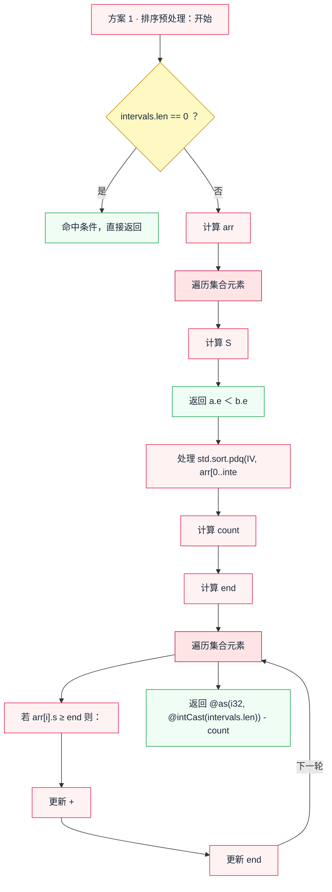

```zig
// LeetCode 435. 无重叠区间 — Zig 版（方案1）
const std = @import("std"); // 把 @import(「std」) 存入 std
const IV = struct { s: i32, e: i32 }; // 把 struct { 字符串: i32, e: i32 } 存入 IV
fn eraseOverlapIntervals(intervals: []const [2]i32) i32 { // 定义函数/方法 eraseOverlapIntervals
    if (intervals.len == 0) return 0; // 若 intervals.长度 等于 0，直接返回 0
    var arr: [256]IV = undefined; // 把 undefined; 写入 var arr: [256]IV
    for (intervals, 0..) |iv, i| arr[i] = .{ .s = iv[0], .e = iv[1] };
    const S = struct { // 把 struct { 存入 S
        fn lt(_: void, a: IV, b: IV) bool {
            return a.e < b.e;
        } // 定义函数/方法 lt
    };
    std.sort.pdq(IV, arr[0..intervals.len], {}, S.lt); // std.sort.pdq(IV, 数组[0..intervals.长度], {}, S.lt);
    var count: i32 = 1; // 把 1; 写入 var count: i32
    var end: i32 = arr[0].e; // 把 数组[0].e; 写入 var end: i32
    for (1..intervals.len) |i| { // 逐个取出 1..intervals.长度 的元素（下标 i）
        if (arr[i].s >= end) {
            count += 1;
            end = arr[i].e;
        } // 若 数组[下标 i].字符串 不低于 终点) { 计数 累加 1; 终点 赋值为 数组[下标 i].e; }
    }
    return @as(i32, @intCast(intervals.len)) - count; // 返回 @as(i32, @intCast(intervals.长度)) 减 计数
}
pub fn main() !void { // 程序入口：跑内嵌自测用例
    if (eraseOverlapIntervals(&[_][2]i32{ .{ 1, 2 }, .{ 2, 3 }, .{ 3, 4 }, .{ 1, 3 } }) != 1) return error.TestFailed;
    if (eraseOverlapIntervals(&[_][2]i32{}) != 0) return error.TestFailed;
    if (eraseOverlapIntervals(&[_][2]i32{ .{ 1, 2 }, .{ 1, 2 }, .{ 1, 2 } }) != 2) return error.TestFailed;
    std.debug.print("PASS\n", .{}); // 全部用例通过，输出 PASS
}
```

#### 方案 2：排序预处理

**思路与代码分析**：核心是「排序预处理」。Zig 版显式分配与清零，整型边界处理严格。代码里依次做这些事：双重循环遍历。**走读**：方案 2 · 排序预处理：开始 → 命中条件，直接返回 → 计算 arr → 遍历集合元素 → 计算 S → 返回 a.e ＜ b.e → 处理 std.sort.pdq(IV, arr[0..inte → 计算 count → 计算 end → 遍历集合元素 → 若 arr[i].s ≥ end 则： → 更新 + → 更新 end → 返回 @as(i32, @intCast(intervals.len)) - count。

**运行架构**（真实控制流）：

```mermaid
graph TD
    N0["方案 2 · 排序预处理：开始"]
    N1{"intervals.len == 0 ？"}
    N2["命中条件，直接返回"]
    N3["计算 arr"]
    N4["遍历集合元素"]
    N5["计算 S"]
    N6["返回 a.e ＜ b.e"]
    N7["处理 std.sort.pdq(IV, arr[0..inte"]
    N8["计算 count"]
    N9["计算 end"]
    N10["遍历集合元素"]
    N11["若 arr[i].s ≥ end 则："]
    N12["更新 +"]
    N13["更新 end"]
    N14["返回 @as(i32, @intCast(intervals.len)) - count"]
    N0 --> N1
    N1 -- 是 --> N2
    N1 -- 否 --> N3
    N3 --> N4
    N4 --> N5
    N5 --> N6
    N6 --> N7
    N7 --> N8
    N8 --> N9
    N9 --> N10
    N10 --> N11
    N11 --> N12
    N12 --> N13
    N13 -- 下一轮 --> N10
    N10 --> N14
    classDef n fill:#fef2f2,stroke:#e11d48,color:#1e293b;
    classDef lp fill:#ffe4e6,stroke:#be123c,color:#1e293b;
    classDef dc fill:#fef9c3,stroke:#ca8a04,color:#1e293b;
    classDef tm fill:#f0fdf4,stroke:#16a34a,color:#1e293b;
    class N0,N3,N5,N7,N8,N9,N11,N12,N13 n;
    class N4,N10 lp;
    class N1 dc;
    class N2,N6,N14 tm;
```

```zig
// LeetCode 435. 无重叠区间 — Zig 版（方案2）
const std = @import("std"); // 把 @import(「std」) 存入 std
const IV = struct { s: i32, e: i32 }; // 把 struct { 字符串: i32, e: i32 } 存入 IV
fn eraseOverlapIntervals(intervals: []const [2]i32) i32 { // 定义函数/方法 eraseOverlapIntervals
    if (intervals.len == 0) return 0; // 若 intervals.长度 等于 0，直接返回 0
    var arr: [256]IV = undefined; // 把 undefined; 写入 var arr: [256]IV
    for (intervals, 0..) |iv, i| arr[i] = .{ .s = iv[0], .e = iv[1] };
    const S = struct { // 把 struct { 存入 S
        fn lt(_: void, a: IV, b: IV) bool {
            return a.e < b.e;
        } // 定义函数/方法 lt
    };
    std.sort.pdq(IV, arr[0..intervals.len], {}, S.lt); // std.sort.pdq(IV, 数组[0..intervals.长度], {}, S.lt);
    var count: i32 = 1; // 把 1; 写入 var count: i32
    var end: i32 = arr[0].e; // 把 数组[0].e; 写入 var end: i32
    for (1..intervals.len) |i| { // 逐个取出 1..intervals.长度 的元素（下标 i）
        if (arr[i].s >= end) {
            count += 1;
            end = arr[i].e;
        } // 若 数组[下标 i].字符串 不低于 终点) { 计数 累加 1; 终点 赋值为 数组[下标 i].e; }
    }
    return @as(i32, @intCast(intervals.len)) - count; // 返回 @as(i32, @intCast(intervals.长度)) 减 计数
}
pub fn main() !void { // 程序入口：跑内嵌自测用例
    if (eraseOverlapIntervals(&[_][2]i32{ .{ 1, 2 }, .{ 2, 3 }, .{ 3, 4 }, .{ 1, 3 } }) != 1) return error.TestFailed;
    if (eraseOverlapIntervals(&[_][2]i32{}) != 0) return error.TestFailed;
    if (eraseOverlapIntervals(&[_][2]i32{ .{ 1, 2 }, .{ 1, 2 }, .{ 1, 2 } }) != 2) return error.TestFailed;
    std.debug.print("PASS\n", .{}); // 全部用例通过，输出 PASS
}
```

### Dart 实现（2 种方案）

Dart 的全部方案如下，每个方案都内嵌用例自测，可独立运行（老仓库 python/go 文件遵循「打印结果」约定）：

#### 方案 1：排序预处理

**思路与代码分析**：核心是「排序预处理」。Dart 版用可空类型标注与集合方法，注意空安全。代码里依次做这些事：先排序再处理；单循环线性扫描。**走读**：方案 1 · 排序预处理：开始 → 命中条件，直接返回 → 更新 arr → 处理 List＜List＜int＞＞.from( → 处理 intervals, → 处理 ) → 排序整理 → 计算 count → 计算 end → 遍历循环 → 若 arr[i][0] ≥ end 则： → 处理 count++ → 更新 end → 返回 arr.length - count。

**运行架构**（真实控制流）：

```mermaid
graph TD
    N0["方案 1 · 排序预处理：开始"]
    N1{"intervals.isEmpty ？"}
    N2["命中条件，直接返回"]
    N3["更新 arr"]
    N4["处理 List＜List＜int＞＞.from("]
    N5["处理 intervals,"]
    N6["处理 )"]
    N7["排序整理"]
    N8["计算 count"]
    N9["计算 end"]
    N10["遍历循环"]
    N11["若 arr[i][0] ≥ end 则："]
    N12["处理 count++"]
    N13["更新 end"]
    N14["返回 arr.length - count"]
    N0 --> N1
    N1 -- 是 --> N2
    N1 -- 否 --> N3
    N3 --> N4
    N4 --> N5
    N5 --> N6
    N6 --> N7
    N7 --> N8
    N8 --> N9
    N9 --> N10
    N10 --> N11
    N11 --> N12
    N12 --> N13
    N13 -- 下一轮 --> N10
    N10 --> N14
    classDef n fill:#fef2f2,stroke:#e11d48,color:#1e293b;
    classDef lp fill:#ffe4e6,stroke:#be123c,color:#1e293b;
    classDef dc fill:#fef9c3,stroke:#ca8a04,color:#1e293b;
    classDef tm fill:#f0fdf4,stroke:#16a34a,color:#1e293b;
    class N0,N3,N4,N5,N6,N7,N8,N9,N11,N12,N13 n;
    class N10 lp;
    class N1 dc;
    class N2,N14 tm;
```

```dart
// LeetCode 435. 无重叠区间 — Dart 版（方案1）
int eraseOverlapIntervals(List<List<int>> intervals) {
  // 定义函数/方法 eraseOverlapIntervals
  if (intervals.isEmpty) return 0; // 若 intervals.isEmpty，直接返回 0
  final arr =
      List<List<int>>.from(
          intervals,
        ) // 把 List 小于 List 小于 int 超过 超过 .from(intervals) 存入 数组
        ..sort((a, b) => a[1].compareTo(b[1]));
  var count = 1; // 把 1 存入 计数
  var end = arr[0][1]; // 把 数组[0][1] 存入 终点
  for (var i = 1; i < arr.length; i++) {
    // 让 下标 i 从 1 开始计数，下标 i 小于 数组.长度 就继续
    if (arr[i][0] >= end) {
      // 若 数组[下标 i][0] 不低于 终点
      count++; // 计数 加一
      end = arr[i][1]; // 把 数组[下标 i][1] 存入 终点
    }
  }
  return arr.length - count; // 返回 数组.长度 减 计数
}

void main() {
  // 程序入口：跑内嵌自测用例
  if (eraseOverlapIntervals([
        [1, 2],
        [2, 3],
        [3, 4],
        [1, 3], // [1, 3]
      ]) !=
      1)
    throw StateError('c1'); // 把 1) throw StateError('c1'); 写入 ]) !
  if (eraseOverlapIntervals([]) != 0)
    throw StateError(
      'c2',
    ); // 若 eraseOverlapIntervals([]) 不等于 0) throw StateError('c2');
  if (eraseOverlapIntervals([
        [1, 2],
        [1, 2],
        [1, 2], // [1, 2]
      ]) !=
      2)
    throw StateError('c3'); // 把 2) throw StateError('c3'); 写入 ]) !
  print('PASS'); // 全部用例通过，输出 PASS
}
```

#### 方案 2：排序预处理

**思路与代码分析**：核心是「排序预处理」。Dart 版用可空类型标注与集合方法，注意空安全。代码里依次做这些事：先排序再处理；单循环线性扫描。**走读**：方案 2 · 排序预处理：开始 → 命中条件，直接返回 → 更新 arr → 处理 List＜List＜int＞＞.from( → 处理 intervals, → 处理 ) → 排序整理 → 计算 count → 计算 end → 遍历循环 → 若 arr[i][0] ≥ end 则： → 处理 count++ → 更新 end → 返回 arr.length - count。

**运行架构**（真实控制流）：

```mermaid
graph TD
    N0["方案 2 · 排序预处理：开始"]
    N1{"intervals.isEmpty ？"}
    N2["命中条件，直接返回"]
    N3["更新 arr"]
    N4["处理 List＜List＜int＞＞.from("]
    N5["处理 intervals,"]
    N6["处理 )"]
    N7["排序整理"]
    N8["计算 count"]
    N9["计算 end"]
    N10["遍历循环"]
    N11["若 arr[i][0] ≥ end 则："]
    N12["处理 count++"]
    N13["更新 end"]
    N14["返回 arr.length - count"]
    N0 --> N1
    N1 -- 是 --> N2
    N1 -- 否 --> N3
    N3 --> N4
    N4 --> N5
    N5 --> N6
    N6 --> N7
    N7 --> N8
    N8 --> N9
    N9 --> N10
    N10 --> N11
    N11 --> N12
    N12 --> N13
    N13 -- 下一轮 --> N10
    N10 --> N14
    classDef n fill:#fef2f2,stroke:#e11d48,color:#1e293b;
    classDef lp fill:#ffe4e6,stroke:#be123c,color:#1e293b;
    classDef dc fill:#fef9c3,stroke:#ca8a04,color:#1e293b;
    classDef tm fill:#f0fdf4,stroke:#16a34a,color:#1e293b;
    class N0,N3,N4,N5,N6,N7,N8,N9,N11,N12,N13 n;
    class N10 lp;
    class N1 dc;
    class N2,N14 tm;
```

```dart
// LeetCode 435. 无重叠区间 — Dart 版（方案2）
int eraseOverlapIntervals(List<List<int>> intervals) {
  // 定义函数/方法 eraseOverlapIntervals
  if (intervals.isEmpty) return 0; // 若 intervals.isEmpty，直接返回 0
  final arr =
      List<List<int>>.from(
          intervals,
        ) // 把 List 小于 List 小于 int 超过 超过 .from(intervals) 存入 数组
        ..sort((a, b) => a[1].compareTo(b[1]));
  var count = 1; // 把 1 存入 计数
  var end = arr[0][1]; // 把 数组[0][1] 存入 终点
  for (var i = 1; i < arr.length; i++) {
    // 让 下标 i 从 1 开始计数，下标 i 小于 数组.长度 就继续
    if (arr[i][0] >= end) {
      // 若 数组[下标 i][0] 不低于 终点
      count++; // 计数 加一
      end = arr[i][1]; // 把 数组[下标 i][1] 存入 终点
    }
  }
  return arr.length - count; // 返回 数组.长度 减 计数
}

void main() {
  // 程序入口：跑内嵌自测用例
  if (eraseOverlapIntervals([
        [1, 2],
        [2, 3],
        [3, 4],
        [1, 3], // [1, 3]
      ]) !=
      1)
    throw StateError('c1'); // 把 1) throw StateError('c1'); 写入 ]) !
  if (eraseOverlapIntervals([]) != 0)
    throw StateError(
      'c2',
    ); // 若 eraseOverlapIntervals([]) 不等于 0) throw StateError('c2');
  if (eraseOverlapIntervals([
        [1, 2],
        [1, 2],
        [1, 2], // [1, 2]
      ]) !=
      2)
    throw StateError('c3'); // 把 2) throw StateError('c3'); 写入 ]) !
  print('PASS'); // 全部用例通过，输出 PASS
}
```

---

## 内容总结

- **无重叠区间**（贪心 · Medium）：共 2 个方案，主线思路「排序预处理」；时间 O(n)（单趟线性扫描）；动画演示贪心边界过程，附录给出 11 种语言 × 全部方案的可运行实现。
- 来源博客：[https://blog.csdn.net/tyro_java/article/details/145244140](https://blog.csdn.net/tyro_java/article/details/145244140)
- 导航：[📋 总目录](../) ｜ [← 100 换水问题](../100_换水问题/) ｜ [102 用最少数量的箭引爆气球 →](../102_用最少数量的箭引爆气球/)
