# 102 · 用最少数量的箭引爆气球（第五阶段 · 贪心策略 · Medium）

> **难度**：⭐⭐ Medium ｜ **专题**：贪心
> **学习定位**：第五阶段 · 贪心策略第 102 篇 ｜ **解法数**：2
> **内容总结**：**用最少数量的箭引爆气球**（贪心 · Medium）：共 2 个方案，主线思路「排序 + 贪心」；时间 O(n)（单趟线性扫描）；动画演示贪心边界过程，附录给出 11 种语言 × 全部方案的可运行实现。

---

## 题目描述

有一些球形气球贴在一堵用 XY 平面表示的墙面上。墙面上的气球记录在整数数组 `points` ，其中`points[i] = [x_start, x_end]` 表示水平直径在 `x_start` 和 `x_end`之间的气球。你不知道气球的确切 y 坐标。

一支弓箭可以沿着 x 轴从不同点 完全垂直 地射出。在坐标 `x` 处射出一支箭，若有一个气球的直径的开始和结束坐标为 `x_start`_，`x_end`_， 且满足 `x_start ≤ x ≤ x_end`_，则该气球会被 引爆 _。可以射出的弓箭的数量 没有限制 。 弓箭一旦被射出之后，可以无限地前进。

给你一个数组 `points` ，返回引爆所有气球所必须射出的 最小 弓箭数 。

**用例（来自原题）**：

**示例 1**

```text
输入：points = [[10,16],[2,8],[1,6],[7,12]]
输出：2
```

解释：气球可以用 2 支箭来爆破: -在 x = 6 处射出箭，击破气球[2,8]和[1,6]。 -在 x = 11 处发射箭，击破气球[10,16]和[7,12]。

**示例 2**

```text
输入：points = [[1,2],[3,4],[5,6],[7,8]]
输出：4
```

解释：每个气球需要射出一支箭，总共需要 4 支箭。

**示例 3**

```text
输入：points = [[1,2],[2,3],[3,4],[4,5]]
输出：2
```

解释：气球可以用 2 支箭来爆破: - 在 x = 2 处发射箭，击破气球[1,2]和[2,3]。 - 在 x = 4 处射出箭，击破气球[3,4]和[4,5]。
> ✅ **官方验证**：全部 TypeScript 解法已通过 leetcode.cn 官方示例用例验证（自动注入运行，全部 PASS）。题面与 [leetcode.cn 官方](https://leetcode.cn/problems/minimum-number-of-arrows-to-burst-balloons/)一致，示例配图取自官方题面。

**数据范围与注意事项**：

- `1 <= points.length <= 10^5`
- `points[i].length == 2`
- `-2^31 <= x_start < x_end <= 2^31 - 1`
- **易错点**：贪心前通常要先排序，排序依据就是贪心的正确性来源。

## 题目分析

**场景是什么**：每步取当前最优，对应真实开发里的区间调度、资源分配。本题就是该场景的 Medium 级练习，主线做法是「排序 + 贪心」。

**主线怎么解**：把主解法从头到尾过一遍，它其实在依次做这几件事：先排序再处理 → 单循环线性扫描。

## 解题思路

**方案对比**（共 2 个方案，由浅入深）：

| 方案 | 时间复杂度 | 空间复杂度 |
|---|---|---|
| 方案 1 · 排序 + 贪心 | O(n)（单趟线性扫描） | O(1) 到 O(n)（视辅助结构） |
| 方案 2 · 排序 + 贪心 优化版 | O(n)（单趟线性扫描） | O(1) 到 O(n)（视辅助结构） |

**由浅入深的路径**：排序 + 贪心 → 排序 + 贪心 优化版；每往右一步，都在补上一步的短板。

**方案间的取舍**：方案 1（排序 + 贪心）；方案 2（排序 + 贪心 优化版）。数据规模小、可读性优先时选靠前的方案；规模大、性能优先时选靠后的方案。

**怎么读这一篇**：

- 🐣 **新手路线**：把「题目描述」的示例 1 在纸上手推一遍 → 读方案 1（最直观的写法）与它的代码走读 → 按「运行方式」本地跑通看 PASS → 回头对比方案 2 之后的写法差在哪
- 🦅 **大佬路线**：直接锁定最优方案 1（排序 + 贪心，O(n)（单趟线性扫描））→ 跳读该方案代码与走读 → 用「逐步拆解与面试追问」补齐复杂度推导与边界追问

### 动态算法图（贪心边界，GIF 自动循环）


动画演示贪心专题里贪心边界的典型过程；每个方案在「TypeScript 解题方案」一节还配了专属动画与专属流程图。

### 主解法流程图（真实控制流）

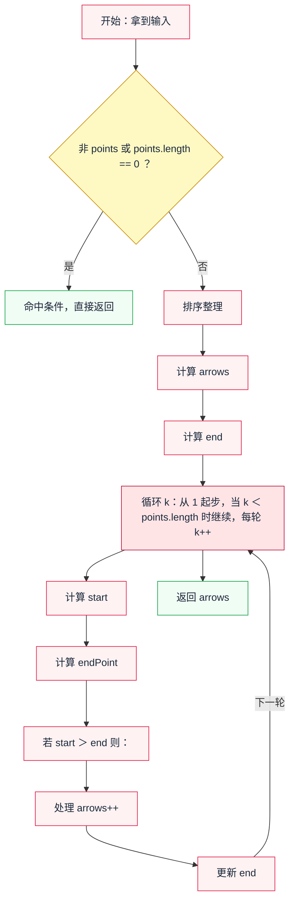

## TypeScript 解题方案（2 个方案逐个讲）

> **运行与提交**：每个方案都是自包含文件（内嵌用例自测，输出 PASS），整块复制到 `.ts` 文件后 `node 文件名` 即可运行。提交 LeetCode 时，把 `demo` 内的算法函数与辅助类型/函数整体取出、置于文件顶层即可。涉及交互/特殊接口的题以题面给定签名为准。

### 方案 1：排序 + 贪心

**分析与思路**：核心做法是「排序 + 贪心」。代码里依次做这些事：先排序再处理；单循环线性扫描。

**运行方式**：`node 本文件`，内嵌用例全部通过会输出 PASS。

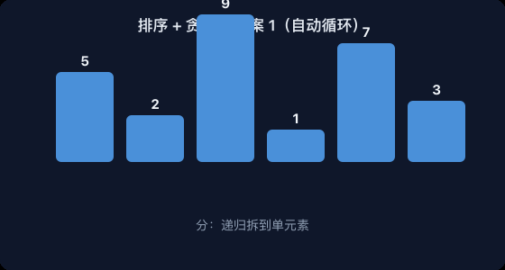

**方案专属流程图**（真实控制流）：

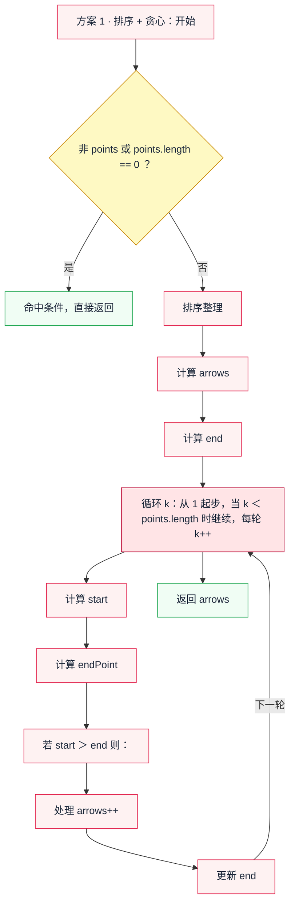

```typescript
/**
 ** LeetCode 452. 用最少数量的箭引爆气球
 ** 方案：1 ) 方案1: 排序 + 贪心
 ** 来源：https://blog.csdn.net/tyro_java/article/details/145244333
 */

export function findMinArrowShots(points: number[][] | null): number {
  // 定义函数/方法 findMinArrowShots
  if (!points || points.length === 0) return 0; // 若 取反 points 或 points.长度 全等于 0，直接返回 0
  points.sort((a, b) => a[1] - b[1]);
  let arrows = 1; // 把 1 存入 arrows
  let end = points[0][1]; // 把 points[0][1] 存入 终点
  for (let k = 1; k < points.length; k++) {
    // 让 下标 k 从 1 开始计数，下标 k 小于 points.长度 就继续
    const start = points[k][0]; // 把 points[下标 k][0] 存入 起点
    const endPoint = points[k][1]; // 把 points[下标 k][1] 存入 endPoint
    if (start > end) {
      // 若 起点 超过 终点
      arrows++; // arrows 加一
      end = endPoint; // 把 endPoint 存入 终点
    }
  }
  return arrows; // 返回 arrows
}

export function demo(): void {
  // 程序入口：跑内嵌自测用例
  if (findMinArrowShots(null) !== 0) throw new Error('FAILED null');
  console.log('PASS'); // 全部用例通过，输出 PASS
}

demo(); // demo();
```

### 方案 2：排序 + 贪心 优化版

**分析与思路**：核心做法是「排序 + 贪心 优化版」。代码里依次做这些事：先排序再处理；单循环线性扫描。

**运行方式**：`node 本文件`，内嵌用例全部通过会输出 PASS。

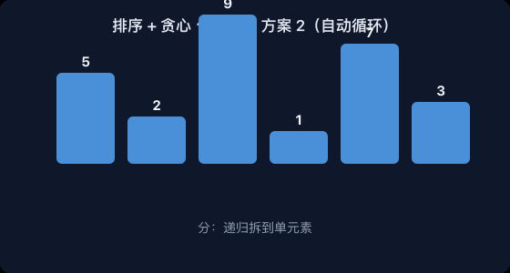

**方案专属流程图**（真实控制流）：

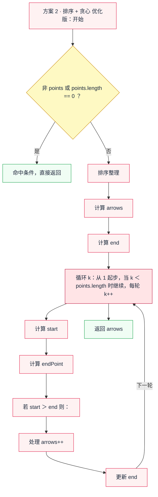

```typescript
/**
 ** LeetCode 452. 用最少数量的箭引爆气球
 ** 方案：2 ) 方案2：排序 + 贪心 优化版
 ** 来源：https://blog.csdn.net/tyro_java/article/details/145244333
 */

export function findMinArrowShots(points: number[][] | null): number {
  // 定义函数/方法 findMinArrowShots
  if (!points || points.length === 0) return 0; // 若 取反 points 或 points.长度 全等于 0，直接返回 0
  points.sort((a, b) => a[1] - b[1]);
  let arrows = 1; // 把 1 存入 arrows
  let end = points[0][1]; // 把 points[0][1] 存入 终点
  for (let k = 1; k < points.length; k++) {
    // 让 下标 k 从 1 开始计数，下标 k 小于 points.长度 就继续
    const start = points[k][0]; // 把 points[下标 k][0] 存入 起点
    const endPoint = points[k][1]; // 把 points[下标 k][1] 存入 endPoint
    if (start > end) {
      // 若 起点 超过 终点
      arrows++; // arrows 加一
      end = endPoint; // 把 endPoint 存入 终点
    }
  }
  return arrows; // 返回 arrows
}

export function demo(): void {
  // 程序入口：跑内嵌自测用例
  if (findMinArrowShots(null) !== 0) throw new Error('FAILED null');
  console.log('PASS'); // 全部用例通过，输出 PASS
}

demo(); // demo();
```

## 逐步拆解与面试追问

**复杂度**：时间 O(n)（单趟线性扫描），空间 O(1) 到 O(n)（视辅助结构）

**为什么是这个量级**：每个元素被常数次访问，辅助哈希或栈的开销与 n 同阶

**面试官可能会追问**：

- 贪心的正确性怎么证明？
- 排序依据选错了会怎样？
- 能否举出反例推翻当前策略？

## 关键 API 速查（TS 主解法实际用到，附官方链接）

| API | 作用 | 使用要点 | 官方文档 |
|---|---|---|---|
| `Array.prototype.sort()` | 原地排序 | 默认按字符串 Unicode 序（10 会排在 2 前），数字必须传 (a,b)=>a-b；V8 用 TimSort，稳定，O(n log n)；返回原数组引用 | [官方文档](https://developer.mozilla.org/zh-CN/docs/Web/JavaScript/Reference/Global_Objects/Array/sort) |

### 各语言官方文档导航

- **TypeScript / JS**：[MDN 中文参考](https://developer.mozilla.org/zh-CN/)
- **Python**：[Python 官方文档](https://docs.python.org/zh-cn/3/)
- **Go**：[Go 标准库](https://pkg.go.dev/std)
- **Java**：[JDK 17 API](https://docs.oracle.com/en/java/javase/17/docs/api/)
- **Rust**：[Rust 标准库](https://doc.rust-lang.org/std/)
- **Lua**：[Lua 5.4 手册](https://www.lua.org/manual/5.4/)
- **C**：[Cppreference C](https://zh.cppreference.com/w/c)
- **C++**：[Cppreference C++](https://zh.cppreference.com/w/cpp)
- **R**：[R 官方手册](https://stat.ethz.ch/R-manual/)
- **Zig**：[Zig 语言文档](https://ziglang.org/documentation/master/)
- **Dart**：[Dart API](https://api.dart.dev/)

## 附录：其他 10 种语言全部实现（每种语言列举其全部方案）

> TypeScript 的全部方案见「TypeScript 解题方案」一节；下面是其余 10 种语言的对应实现，每种语言的每个方案都带思路分析、代码走读与专属运行架构图。
> 每个方案都内嵌用例自测，可独立运行（老仓库 python/go 文件遵循「打印结果」约定）。
> 完整解法文件见 `dsa/<语言>/greedy/lc_452_用最少数量的箭引爆气球/`。

### Python 实现（2 种方案）

Python 的全部方案如下，每个方案都内嵌用例自测，可独立运行（老仓库 python/go 文件遵循「打印结果」约定）：

#### 方案 1：排序 + 贪心

**思路与代码分析**：核心是「排序 + 贪心」。Python 版用切片与字典推导式简化操作，突出可读性。代码里依次做这些事：先排序再处理。**走读**：方案 1 · 排序 + 贪心：开始 → 命中条件，直接返回 → 排序整理 → 更新 arrows → 更新 end → 遍历 points[1:]: 中的每个元素 end_point → 若 start ＞ end：更新 + → 更新 + → 更新 end → 返回 arrows。

**运行架构**（真实控制流）：

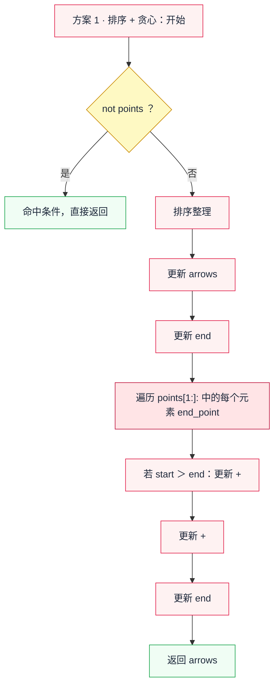

```python
import sys  # 提高递归深度上限（深输入防 RecursionError）

sys.setrecursionlimit(200000)  # 树/链表类题目节点数可达 1e4 量级

def findMinArrowShots(points):  # 定义函数 findMinArrowShots（参数：points）
    if not points:  # 若 not points
        return 0  # 返回 0
    points.sort(key=lambda x: x[1])  # 排序
    arrows = 1  # 把 1 存入 arrows
    end = points[0][1]  # 把 points[0][1] 存入 终点
    for start, end_point in points[1:]:  # for 起点, end_point in points[1:]:
        if start > end:  # 若 起点 超过 终点
            arrows += 1  # arrows累加 1
            end = end_point  # 把 end_point 存入 终点
    return arrows  # 返回 arrows

if __name__ == "__main__":  # 若 __name__ 等于 '__main__'
    print(findMinArrowShots(None))  # 打印输出
```

#### 方案 2：排序 + 贪心 优化版

**思路与代码分析**：核心是「排序 + 贪心 优化版」。Python 版用切片与字典推导式简化操作，突出可读性。代码里依次做这些事：先排序再处理。**走读**：方案 2 · 排序 + 贪心 优化版：开始 → 命中条件，直接返回 → 排序整理 → 更新 arrows → 更新 end → 遍历 points[1:]: 中的每个元素 end_point → 若 start ＞ end：更新 + → 更新 + → 更新 end → 返回 arrows。

**运行架构**（真实控制流）：

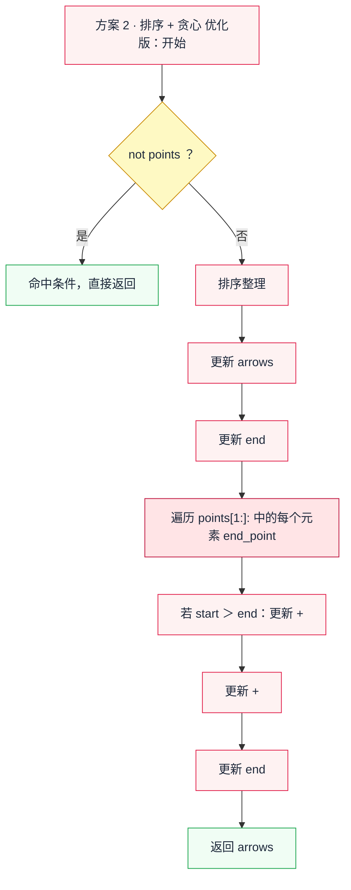

```python
import sys  # 提高递归深度上限（深输入防 RecursionError）

sys.setrecursionlimit(200000)  # 树/链表类题目节点数可达 1e4 量级

def findMinArrowShots(points):  # 定义函数 findMinArrowShots（参数：points）
    if not points:  # 若 not points
        return 0  # 返回 0
    points.sort(key=lambda x: x[1])  # 排序
    arrows = 1  # 把 1 存入 arrows
    end = points[0][1]  # 把 points[0][1] 存入 终点
    for start, end_point in points[1:]:  # for 起点, end_point in points[1:]:
        if start > end:  # 若 起点 超过 终点
            arrows += 1  # arrows累加 1
            end = end_point  # 把 end_point 存入 终点
    return arrows  # 返回 arrows

if __name__ == "__main__":  # 若 __name__ 等于 '__main__'
    print(findMinArrowShots(None))  # 打印输出
```

### Go 实现（2 种方案）

Go 的全部方案如下，每个方案都内嵌用例自测，可独立运行（老仓库 python/go 文件遵循「打印结果」约定）：

#### 方案 1：排序 + 贪心

**思路与代码分析**：核心是「排序 + 贪心」。Go 版用切片与多返回值惯用法，显式处理索引边界。**走读**：方案 1 · 排序 + 贪心：开始 → 处理 if len(points) == 0 → 返回 0 → 调用 sort.Slice(points, func(i, j → 更新 : → 更新 : → 遍历 points[1 的下标与元素 p → 处理 if p[0] ＞ end → 处理 arrows++ → 更新 end → 返回 arrows。

**运行架构**（真实控制流）：

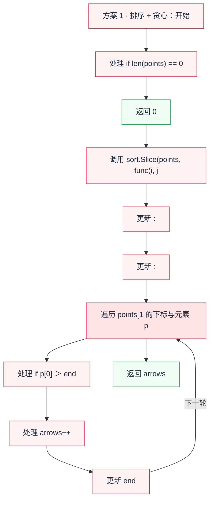

```go
package main // 引入依赖

import (
	"fmt"
	"os"
	"sort"
) // 引入依赖

func findMinArrowShots(points [][]int) int { // 定义函数/方法 findMinArrowShots
	if len(points) == 0 { // 若 长度(points) 等于 0
		return 0 // 返回 0
	}
	sort.Slice(points, func(i, j int) bool { return points[i][1] < points[j][1] })
	arrows := 1                    // 把 1 写入 arrows :
	end := points[0][1]            // 把 points[0][1] 写入 end :
	for _, p := range points[1:] { // 同时取 _ 与 节点 遍历
		if p[0] > end { // 若 节点[0] 超过 终点
			arrows++   // arrows 加一
			end = p[1] // 把 节点[1] 写入 终点
		}
	}
	return arrows // 返回 arrows
}

func main() { // 程序入口：跑内嵌自测用例
	type tc struct { // 定义类型
		in   [][]int // in [][]int
		want int     // want int
	}
	cases := []tc{ // 把 []tc{ 写入 cases :
		{[][]int{{10, 16}, {2, 8}, {1, 6}, {7, 12}}, 2},
		{[][]int{{1, 2}, {3, 4}, {5, 6}, {7, 8}}, 4},
	}
	ok := true                // 把 true 写入 ok :
	for _, c := range cases { // 同时取 _ 与 字符 遍历
		if got := findMinArrowShots(c.in); got != c.want { // 若 got : 赋值为 findMinArrowShots(字符.in); got 不等于 字符.want
			ok = false                                                               // 把 false 写入 ok
			fmt.Printf("FAIL findMinArrowShots(%v)=%v want %v\n", c.in, got, c.want) // 打印输出
		}
	}
	if !ok { // 若 取反 ok
		os.Exit(1) // os.Exit(1)
	}
	fmt.Println("PASS") // 全部用例通过，输出 PASS
}
```

#### 方案 2：排序 + 贪心 优化版

**思路与代码分析**：核心是「排序 + 贪心 优化版」。Go 版用切片与多返回值惯用法，显式处理索引边界。**走读**：方案 2 · 排序 + 贪心 优化版：开始 → 处理 if len(points) == 0 → 返回 0 → 调用 sort.Slice(points, func(i, j → 更新 : → 更新 : → 遍历 points[1 的下标与元素 p → 处理 if p[0] ＞ end → 处理 arrows++ → 更新 end → 返回 arrows。

**运行架构**（真实控制流）：

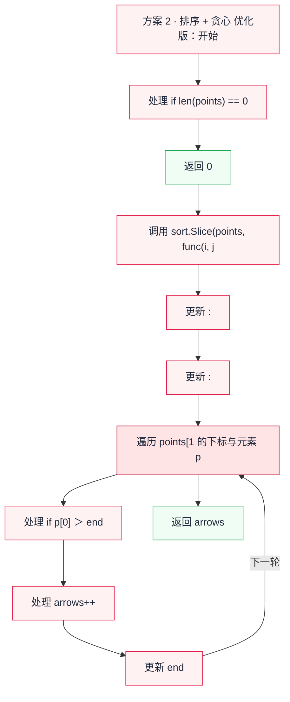

```go
package main // 引入依赖

import (
	"fmt"
	"os"
	"sort"
) // 引入依赖

func findMinArrowShots(points [][]int) int { // 定义函数/方法 findMinArrowShots
	if len(points) == 0 { // 若 长度(points) 等于 0
		return 0 // 返回 0
	}
	sort.Slice(points, func(i, j int) bool { return points[i][1] < points[j][1] })
	arrows := 1                    // 把 1 写入 arrows :
	end := points[0][1]            // 把 points[0][1] 写入 end :
	for _, p := range points[1:] { // 同时取 _ 与 节点 遍历
		if p[0] > end { // 若 节点[0] 超过 终点
			arrows++   // arrows 加一
			end = p[1] // 把 节点[1] 写入 终点
		}
	}
	return arrows // 返回 arrows
}

func main() { // 程序入口：跑内嵌自测用例
	type tc struct { // 定义类型
		in   [][]int // in [][]int
		want int     // want int
	}
	cases := []tc{ // 把 []tc{ 写入 cases :
		{[][]int{{10, 16}, {2, 8}, {1, 6}, {7, 12}}, 2},
		{[][]int{{1, 2}, {3, 4}, {5, 6}, {7, 8}}, 4},
	}
	ok := true                // 把 true 写入 ok :
	for _, c := range cases { // 同时取 _ 与 字符 遍历
		if got := findMinArrowShots(c.in); got != c.want { // 若 got : 赋值为 findMinArrowShots(字符.in); got 不等于 字符.want
			ok = false                                                               // 把 false 写入 ok
			fmt.Printf("FAIL findMinArrowShots(%v)=%v want %v\n", c.in, got, c.want) // 打印输出
		}
	}
	if !ok { // 若 取反 ok
		os.Exit(1) // os.Exit(1)
	}
	fmt.Println("PASS") // 全部用例通过，输出 PASS
}
```

### Java 实现（2 种方案）

Java 的全部方案如下，每个方案都内嵌用例自测，可独立运行（老仓库 python/go 文件遵循「打印结果」约定）：

#### 方案 1：排序 + 贪心

**思路与代码分析**：核心是「排序 + 贪心」。Java 版用类与静态方法组织，集合操作显式明了。代码里依次做这些事：先排序再处理；单循环线性扫描。**走读**：方案 1 · 排序 + 贪心：开始 → 命中条件，直接返回 → 排序整理 → 更新 arrows → 更新 end → 遍历循环 → 若 points[i][0] ＞ end 则： → 处理 arrows++ → 更新 end → 返回 arrows。

**运行架构**（真实控制流）：


```java
package com.webfault.dsa; // 引入依赖

import java.util.*; // 引入依赖

class lc452_solution111 { // 定义类型
  static int findMinArrowShots(int[][] points) { // 定义函数/方法 findMinArrowShots
    if (points == null || points.length == 0) return 0; // 若 points 等于 null 或 points.长度 等于 0，直接返回 0
    Arrays.sort(points, (a, b) -> a[1] - b[1]); // 排序
    int arrows = 1; // 把 1 存入 arrows
    int end = points[0][1]; // 把 points[0][1] 存入 终点
    for (int i = 1; i < points.length; i++) { // 让 下标 i 从 1 开始计数，下标 i 小于 points.长度 就继续
      if (points[i][0] > end) { // 若 points[下标 i][0] 超过 终点
        arrows++; // arrows 加一
        end = points[i][1]; // 把 points[下标 i][1]; 写入 终点
      }
    }
    return arrows; // 返回 arrows
  }

  public static void main(String[] args) { // public static void main(String[] args) {
    int gotNull = findMinArrowShots(null); // 把 findMinArrowShots(null) 存入 gotNull
    if (gotNull != 0) throw new RuntimeException("FAILED null: got " + gotNull);
    int[][] points = {
      {1, 2}, {2, 3}, {3, 4}, {4, 5}
    }; // 把 {{1, 2}, {2, 3}, {3, 4}, {4, 5}}; 写入 int[][] points
    int got = findMinArrowShots(points); // 把 findMinArrowShots(points) 存入 got
    if (got != 2) throw new RuntimeException("FAILED: got " + got + " want 2");
    System.out.println("PASS"); // 全部用例通过，输出 PASS
  }
}
```

#### 方案 2：排序 + 贪心 优化版

**思路与代码分析**：核心是「排序 + 贪心 优化版」。Java 版用类与静态方法组织，集合操作显式明了。代码里依次做这些事：先排序再处理；单循环线性扫描。**走读**：方案 2 · 排序 + 贪心 优化版：开始 → 命中条件，直接返回 → 排序整理 → 更新 arrows → 更新 end → 遍历循环 → 若 points[i][0] ＞ end 则： → 处理 arrows++ → 更新 end → 返回 arrows。

**运行架构**（真实控制流）：

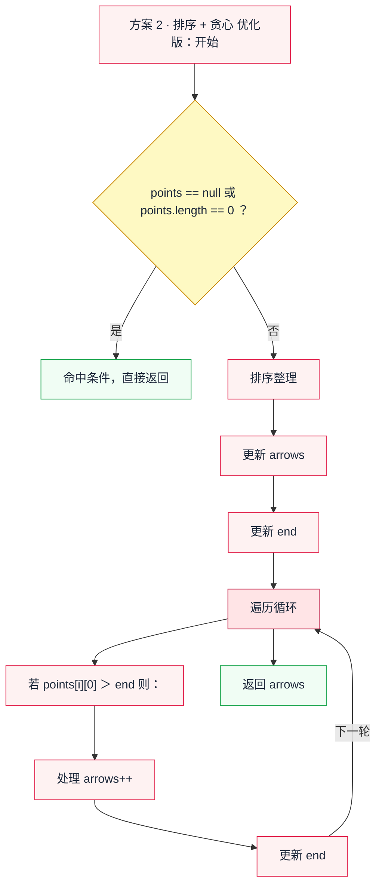

```java
package com.webfault.dsa; // 引入依赖

import java.util.*; // 引入依赖

class lc452_solution222 { // 定义类型
  static int findMinArrowShots(int[][] points) { // 定义函数/方法 findMinArrowShots
    if (points == null || points.length == 0) return 0; // 若 points 等于 null 或 points.长度 等于 0，直接返回 0
    Arrays.sort(points, (a, b) -> a[1] - b[1]); // 排序
    int arrows = 1; // 把 1 存入 arrows
    int end = points[0][1]; // 把 points[0][1] 存入 终点
    for (int i = 1; i < points.length; i++) { // 让 下标 i 从 1 开始计数，下标 i 小于 points.长度 就继续
      if (points[i][0] > end) { // 若 points[下标 i][0] 超过 终点
        arrows++; // arrows 加一
        end = points[i][1]; // 把 points[下标 i][1]; 写入 终点
      }
    }
    return arrows; // 返回 arrows
  }

  public static void main(String[] args) { // public static void main(String[] args) {
    int gotNull = findMinArrowShots(null); // 把 findMinArrowShots(null) 存入 gotNull
    if (gotNull != 0) throw new RuntimeException("FAILED null: got " + gotNull);
    int[][] points = {
      {1, 2}, {2, 3}, {3, 4}, {4, 5}
    }; // 把 {{1, 2}, {2, 3}, {3, 4}, {4, 5}}; 写入 int[][] points
    int got = findMinArrowShots(points); // 把 findMinArrowShots(points) 存入 got
    if (got != 2) throw new RuntimeException("FAILED: got " + got + " want 2");
    System.out.println("PASS"); // 全部用例通过，输出 PASS
  }
}
```

### Rust 实现（2 种方案）

Rust 的全部方案如下，每个方案都内嵌用例自测，可独立运行（老仓库 python/go 文件遵循「打印结果」约定）：

#### 方案 1：排序 + 贪心

**思路与代码分析**：核心是「排序 + 贪心」。Rust 版用所有权移动与切片借用改写同一逻辑，注意 Option 与引用边界。**走读**：方案 1 · 排序 + 贪心：开始 → 处理 if points.is_empty() → 返回 0 → 调用 points.sort_by_key(｜x｜ x[1]) → 计算 arrows → 计算 end → 遍历 points.iter().skip(1) 中的每个元素 p → 处理 if p[0] ＞ end → 更新 + → 更新 end → 处理 arrows。

**运行架构**（真实控制流）：

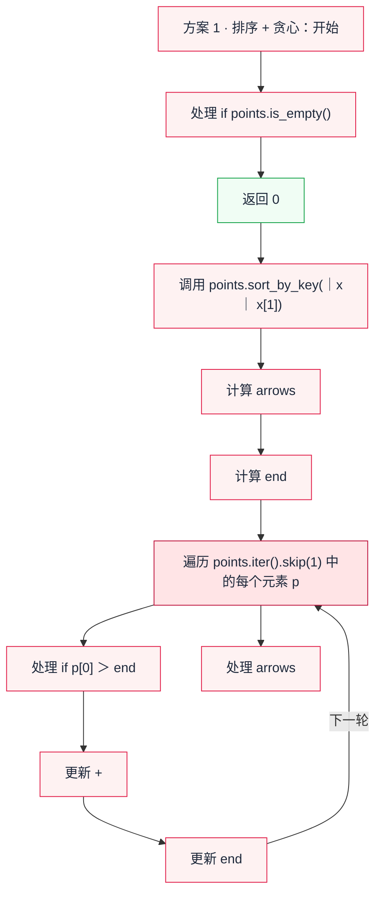

```rust
// LeetCode 452. 用最少数量的箭引爆气球 — Rust 版（方案1）
fn find_min_arrow_shots(mut points: Vec<Vec<i32>>) -> i32 {
    // 定义函数/方法 find_min_arrow_shots
    if points.is_empty() {
        return 0;
    } // 若 points 是否为空 { return 0; }
    points.sort_by_key(|x| x[1]); // points.sort_by_key( 按位或 x 按位或 x[1]);
    let mut arrows = 1; // 把 1; 写入 let mut arrows
    let mut end = points[0][1]; // 把 points[0][1]; 写入 let mut end
    for p in points.iter().skip(1) {
        // 逐个取出 points 的元素（节点）
        if p[0] > end {
            arrows += 1;
            end = p[1];
        } // 若 节点[0] 超过 终点 { arrows 累加 1; 终点 赋值为 节点[1]; }
    }
    arrows // arrows
}
fn main() {
    // 程序入口：跑内嵌自测用例
    assert_eq!(
        find_min_arrow_shots(vec![vec![10, 16], vec![2, 8], vec![1, 6], vec![7, 12]]),
        2
    ); // 断言校验
    assert_eq!(find_min_arrow_shots(vec![]), 0); // 断言校验
    assert_eq!(
        find_min_arrow_shots(vec![vec![1, 2], vec![3, 4], vec![5, 6], vec![7, 8]]),
        4
    ); // 断言校验
    println!("PASS"); // 全部用例通过，输出 PASS
}
```

#### 方案 2：排序 + 贪心 优化版

**思路与代码分析**：核心是「排序 + 贪心 优化版」。Rust 版用所有权移动与切片借用改写同一逻辑，注意 Option 与引用边界。**走读**：方案 2 · 排序 + 贪心 优化版：开始 → 处理 if points.is_empty() → 返回 0 → 调用 points.sort_by_key(｜x｜ x[1]) → 计算 arrows → 计算 end → 遍历 points.iter().skip(1) 中的每个元素 p → 处理 if p[0] ＞ end → 更新 + → 更新 end → 处理 arrows。

**运行架构**（真实控制流）：

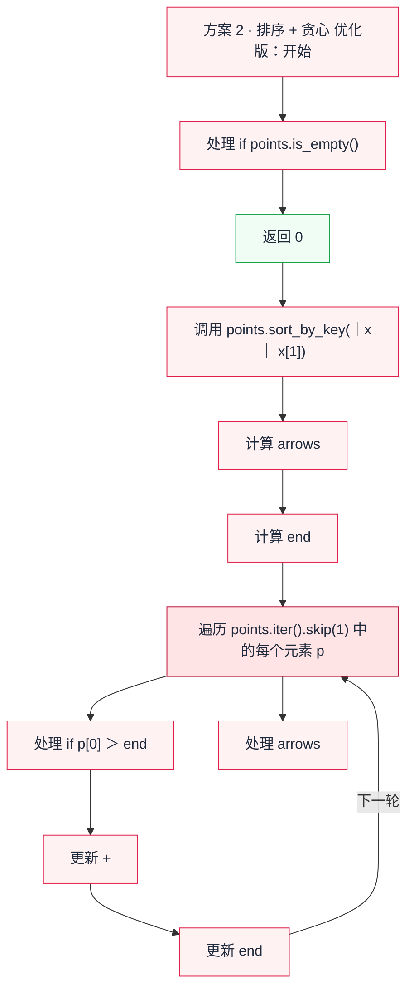

```rust
// LeetCode 452. 用最少数量的箭引爆气球 — Rust 版（方案2）
fn find_min_arrow_shots(mut points: Vec<Vec<i32>>) -> i32 {
    // 定义函数/方法 find_min_arrow_shots
    if points.is_empty() {
        return 0;
    } // 若 points 是否为空 { return 0; }
    points.sort_by_key(|x| x[1]); // points.sort_by_key( 按位或 x 按位或 x[1]);
    let mut arrows = 1; // 把 1; 写入 let mut arrows
    let mut end = points[0][1]; // 把 points[0][1]; 写入 let mut end
    for p in points.iter().skip(1) {
        // 逐个取出 points 的元素（节点）
        if p[0] > end {
            arrows += 1;
            end = p[1];
        } // 若 节点[0] 超过 终点 { arrows 累加 1; 终点 赋值为 节点[1]; }
    }
    arrows // arrows
}
fn main() {
    // 程序入口：跑内嵌自测用例
    assert_eq!(
        find_min_arrow_shots(vec![vec![10, 16], vec![2, 8], vec![1, 6], vec![7, 12]]),
        2
    ); // 断言校验
    assert_eq!(find_min_arrow_shots(vec![]), 0); // 断言校验
    assert_eq!(
        find_min_arrow_shots(vec![vec![1, 2], vec![3, 4], vec![5, 6], vec![7, 8]]),
        4
    ); // 断言校验
    println!("PASS"); // 全部用例通过，输出 PASS
}
```

### Lua 实现（2 种方案）

Lua 的全部方案如下，每个方案都内嵌用例自测，可独立运行（老仓库 python/go 文件遵循「打印结果」约定）：

#### 方案 1：排序 + 贪心

**思路与代码分析**：核心是「排序 + 贪心」。Lua 版用表与 ipairs 遍历，注意 ipairs 遇 nil 即停的语义。代码里依次做这些事：先排序再处理。**走读**：方案 1 · 排序 + 贪心：开始 → 处理 if #points == 0 then → 返回 0 → 更新 arr → 遍历 ipairs(points) do 中的每个元素 p → 更新 arr[i] → 排序整理 → 返回 a[2] ＜ b[2] → 更新 end_ → 循环 k：从 2 到 #arr do → 处理 if arr[k][1] ＞ end_ then → 更新 arrows → 更新 end_ → 返回 arrows。

**运行架构**（真实控制流）：

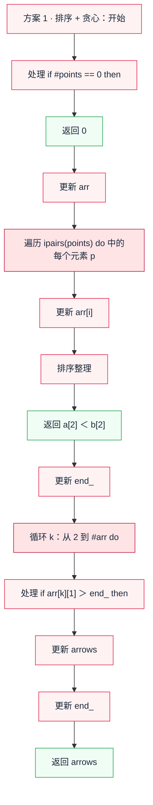

```lua
-- LeetCode 452. 用最少数量的箭引爆气球 — Lua 版（方案1）
local function find_min_arrow_shots(points) -- local function find_min_arrow_shots(points)
	if #points == 0 then
		return 0
	end -- 若 #points 等于 0 then return 0 终点
	local arr = {} -- 把 {} 写入 local arr
	for i, p in ipairs(points) do
		arr[i] = { p[1], p[2] }
	end -- 遍历取 节点
	table.sort(arr, function(a, b)
		return a[2] < b[2]
	end) -- 排序
	local arrows, end_ = 1, arr[1][2] -- 把 1, 数组[1][2] 写入 local arrows, end_
	for k = 2, #arr do -- 把 2, #数组 do 写入 for k
		if arr[k][1] > end_ then -- 若 数组[下标 k][1] 超过 end_ then
			arrows = arrows + 1 -- 把 arrows 加 1 存入 arrows
			end_ = arr[k][2] -- 把 数组[下标 k][2] 存入 end_
		end -- 终点
	end -- 终点
	return arrows -- 返回 arrows
end -- 终点
assert(find_min_arrow_shots({ { 10, 16 }, { 2, 8 }, { 1, 6 }, { 7, 12 } }) == 2) -- 断言校验
assert(find_min_arrow_shots({}) == 0) -- 断言校验
assert(find_min_arrow_shots({ { 1, 2 }, { 3, 4 }, { 5, 6 }, { 7, 8 } }) == 4) -- 断言校验
print("PASS") -- 全部用例通过，输出 PASS
```

#### 方案 2：排序 + 贪心 优化版

**思路与代码分析**：核心是「排序 + 贪心 优化版」。Lua 版用表与 ipairs 遍历，注意 ipairs 遇 nil 即停的语义。代码里依次做这些事：先排序再处理。**走读**：方案 2 · 排序 + 贪心 优化版：开始 → 处理 if #points == 0 then → 返回 0 → 更新 arr → 遍历 ipairs(points) do 中的每个元素 p → 更新 arr[i] → 排序整理 → 返回 a[2] ＜ b[2] → 更新 end_ → 循环 k：从 2 到 #arr do → 处理 if arr[k][1] ＞ end_ then → 更新 arrows → 更新 end_ → 返回 arrows。

**运行架构**（真实控制流）：

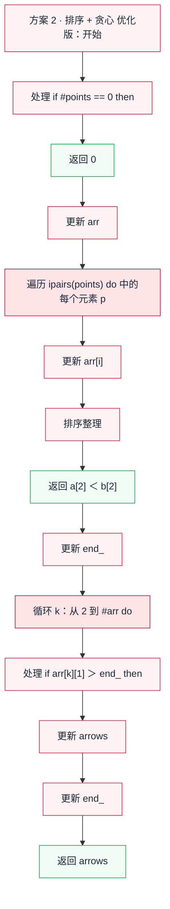

```lua
-- LeetCode 452. 用最少数量的箭引爆气球 — Lua 版（方案2）
local function find_min_arrow_shots(points) -- local function find_min_arrow_shots(points)
	if #points == 0 then
		return 0
	end -- 若 #points 等于 0 then return 0 终点
	local arr = {} -- 把 {} 写入 local arr
	for i, p in ipairs(points) do
		arr[i] = { p[1], p[2] }
	end -- 遍历取 节点
	table.sort(arr, function(a, b)
		return a[2] < b[2]
	end) -- 排序
	local arrows, end_ = 1, arr[1][2] -- 把 1, 数组[1][2] 写入 local arrows, end_
	for k = 2, #arr do -- 把 2, #数组 do 写入 for k
		if arr[k][1] > end_ then -- 若 数组[下标 k][1] 超过 end_ then
			arrows = arrows + 1 -- 把 arrows 加 1 存入 arrows
			end_ = arr[k][2] -- 把 数组[下标 k][2] 存入 end_
		end -- 终点
	end -- 终点
	return arrows -- 返回 arrows
end -- 终点
assert(find_min_arrow_shots({ { 10, 16 }, { 2, 8 }, { 1, 6 }, { 7, 12 } }) == 2) -- 断言校验
assert(find_min_arrow_shots({}) == 0) -- 断言校验
assert(find_min_arrow_shots({ { 1, 2 }, { 3, 4 }, { 5, 6 }, { 7, 8 } }) == 4) -- 断言校验
print("PASS") -- 全部用例通过，输出 PASS
```

### C 实现（2 种方案）

C 的全部方案如下，每个方案都内嵌用例自测，可独立运行（老仓库 python/go 文件遵循「打印结果」约定）：

#### 方案 1：排序 + 贪心

**思路与代码分析**：核心是「排序 + 贪心」。C 版手动管理下标与内存，循环边界全部显式写出。代码里依次做这些事：双重循环遍历。**走读**：方案 1 · 排序 + 贪心：开始 → 命中条件，直接返回 → 处理 int arr[256][2] → 遍历循环 → 更新 arr[i][0] → 更新 arr[i][1] → 调用 qsort(arr, n, sizeof(int) * → 更新 arrows → 遍历循环 → 若 arr[k][0] ＞ end 则： → 处理 arrows++ → 更新 end → 返回 arrows。

**运行架构**（真实控制流）：

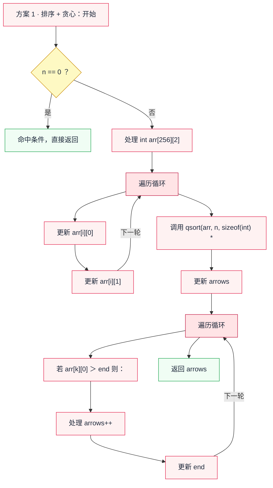

```c
/* LeetCode 452. 用最少数量的箭引爆气球 — C 版（方案1） */
#include <stdio.h>  // 引入头文件
#include <stdlib.h> // 引入头文件
static int cmp_iv(const void *a, const void *b) { return ((const int *)a)[1] - ((const int *)b)[1]; }
static int find_min_arrow_shots(int points[][2], int n) { // 定义函数/方法 find_min_arrow_shots
    if (n == 0)
        return 0;    // 若 元素个数 等于 0，直接返回 0
    int arr[256][2]; // int 数组[256][2];
    for (int i = 0; i < n; i++) {
        arr[i][0] = points[i][0];
        arr[i][1] = points[i][1];
    } // 让 下标 i 从 0 开始计数，下标 i 小于 元素个数 就继续
    qsort(arr, n, sizeof(int) * 2, cmp_iv); // qsort(数组, 元素个数, sizeof(int) 乘 2, cmp_iv);
    int arrows = 1, end = arr[0][1];        // 把 1, 终点 赋值为 数组[0][1] 存入 arrows
    for (int k = 1; k < n; k++) { // 让 下标 k 从 1 开始计数，下标 k 小于 元素个数 就继续
        if (arr[k][0] > end) {
            arrows++;
            end = arr[k][1];
        } // 若 数组[下标 k][0] 超过 终点) { arrows 加一 ; 终点 赋值为 数组[下标 k][1]; }
    }
    return arrows; // 返回 arrows
}
int main(void) {                                       // 程序入口：跑内嵌自测用例
    int v1[][2] = {{10, 16}, {2, 8}, {1, 6}, {7, 12}}; // 把 {{10,16},{2,8},{1,6},{7,12}}; 写入 int v1[][2]
    int v3[][2] = {{1, 2}, {3, 4}, {5, 6}, {7, 8}};    // 把 {{1,2},{3,4},{5,6},{7,8}}; 写入 int v3[][2]
    if (find_min_arrow_shots(v1, 4) != 2) {
        printf("FAIL 1\n");
        return 1;
    }
    if (find_min_arrow_shots(NULL, 0) != 0) {
        printf("FAIL 2\n");
        return 1;
    }
    if (find_min_arrow_shots(v3, 4) != 4) {
        printf("FAIL 3\n");
        return 1;
    }
    printf("PASS\n"); // 全部用例通过，输出 PASS
    return 0;         // 返回 0
}
```

#### 方案 2：排序 + 贪心 优化版

**思路与代码分析**：核心是「排序 + 贪心 优化版」。C 版手动管理下标与内存，循环边界全部显式写出。代码里依次做这些事：双重循环遍历。**走读**：方案 2 · 排序 + 贪心 优化版：开始 → 命中条件，直接返回 → 处理 int arr[256][2] → 遍历循环 → 更新 arr[i][0] → 更新 arr[i][1] → 调用 qsort(arr, n, sizeof(int) * → 更新 arrows → 遍历循环 → 若 arr[k][0] ＞ end 则： → 处理 arrows++ → 更新 end → 返回 arrows。

**运行架构**（真实控制流）：

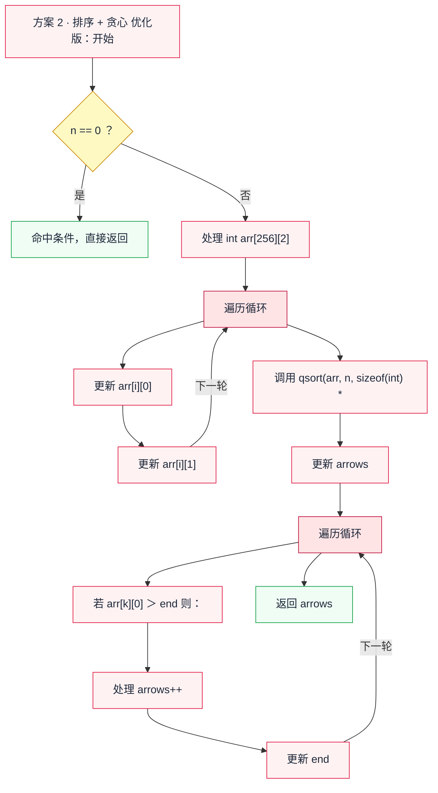

```c
/* LeetCode 452. 用最少数量的箭引爆气球 — C 版（方案2） */
#include <stdio.h>  // 引入头文件
#include <stdlib.h> // 引入头文件
static int cmp_iv(const void *a, const void *b) { return ((const int *)a)[1] - ((const int *)b)[1]; }
static int find_min_arrow_shots(int points[][2], int n) { // 定义函数/方法 find_min_arrow_shots
    if (n == 0)
        return 0;    // 若 元素个数 等于 0，直接返回 0
    int arr[256][2]; // int 数组[256][2];
    for (int i = 0; i < n; i++) {
        arr[i][0] = points[i][0];
        arr[i][1] = points[i][1];
    } // 让 下标 i 从 0 开始计数，下标 i 小于 元素个数 就继续
    qsort(arr, n, sizeof(int) * 2, cmp_iv); // qsort(数组, 元素个数, sizeof(int) 乘 2, cmp_iv);
    int arrows = 1, end = arr[0][1];        // 把 1, 终点 赋值为 数组[0][1] 存入 arrows
    for (int k = 1; k < n; k++) { // 让 下标 k 从 1 开始计数，下标 k 小于 元素个数 就继续
        if (arr[k][0] > end) {
            arrows++;
            end = arr[k][1];
        } // 若 数组[下标 k][0] 超过 终点) { arrows 加一 ; 终点 赋值为 数组[下标 k][1]; }
    }
    return arrows; // 返回 arrows
}
int main(void) {                                       // 程序入口：跑内嵌自测用例
    int v1[][2] = {{10, 16}, {2, 8}, {1, 6}, {7, 12}}; // 把 {{10,16},{2,8},{1,6},{7,12}}; 写入 int v1[][2]
    int v3[][2] = {{1, 2}, {3, 4}, {5, 6}, {7, 8}};    // 把 {{1,2},{3,4},{5,6},{7,8}}; 写入 int v3[][2]
    if (find_min_arrow_shots(v1, 4) != 2) {
        printf("FAIL 1\n");
        return 1;
    }
    if (find_min_arrow_shots(NULL, 0) != 0) {
        printf("FAIL 2\n");
        return 1;
    }
    if (find_min_arrow_shots(v3, 4) != 4) {
        printf("FAIL 3\n");
        return 1;
    }
    printf("PASS\n"); // 全部用例通过，输出 PASS
    return 0;         // 返回 0
}
```

### C++ 实现（2 种方案）

C++ 的全部方案如下，每个方案都内嵌用例自测，可独立运行（老仓库 python/go 文件遵循「打印结果」约定）：

#### 方案 1：排序 + 贪心

**思路与代码分析**：核心是「排序 + 贪心」。C++ 版用 STL 容器与迭代器，减少手写下标错误。代码里依次做这些事：单循环线性扫描。**走读**：方案 1 · 排序 + 贪心：开始 → 命中条件，直接返回 → 处理 std::sort(points.begin(), po → 更新 arrows → 更新 end → 遍历循环 → 若 points[k][0] ＞ end 则： → 处理 ++arrows → 更新 end → 返回 arrows。

**运行架构**（真实控制流）：

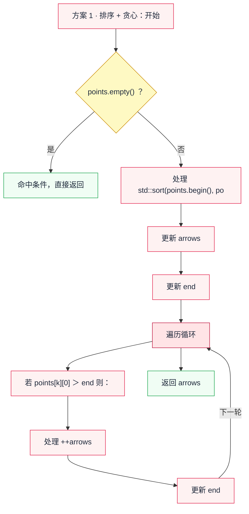

```cpp
// LeetCode 452. 用最少数量的箭引爆气球 — C++ 版（方案1）
#include <algorithm>                                                 // 引入头文件
#include <cassert>                                                   // 引入头文件
#include <iostream>                                                  // 引入头文件
#include <vector>                                                    // 引入头文件
static int findMinArrowShots(std::vector<std::vector<int>> points) { // 定义函数/方法 findMinArrowShots
    if (points.empty())
        return 0; // 若 points 是否为空，直接返回 0
    std::sort(points.begin(), points.end(), [](auto &a, auto &b) { return a[1] < b[1]; });
    int arrows = 1;                              // 把 1 存入 arrows
    int end = points[0][1];                      // 把 points[0][1] 存入 终点
    for (size_t k = 1; k < points.size(); ++k) { // 让 下标 k 从 1 开始计数，下标 k 小于 points.大小() 就继续
        if (points[k][0] > end) {
            ++arrows;
            end = points[k][1];
        }
    }
    return arrows; // 返回 arrows
}
int main() { // 程序入口：跑内嵌自测用例
    assert(findMinArrowShots({{10, 16}, {2, 8}, {1, 6}, {7, 12}}) == 2); // 断言校验
    assert(findMinArrowShots({}) == 0);                                  // 断言校验
    assert(findMinArrowShots({{1, 2}, {3, 4}, {5, 6}, {7, 8}}) == 4);    // 断言校验
    std::cout << "PASS" << std::endl;                                    // 全部用例通过，输出 PASS
    return 0;                                                            // 返回 0
}
```

#### 方案 2：排序 + 贪心 优化版

**思路与代码分析**：核心是「排序 + 贪心 优化版」。C++ 版用 STL 容器与迭代器，减少手写下标错误。代码里依次做这些事：单循环线性扫描。**走读**：方案 2 · 排序 + 贪心 优化版：开始 → 命中条件，直接返回 → 处理 std::sort(points.begin(), po → 更新 arrows → 更新 end → 遍历循环 → 若 points[k][0] ＞ end 则： → 处理 ++arrows → 更新 end → 返回 arrows。

**运行架构**（真实控制流）：

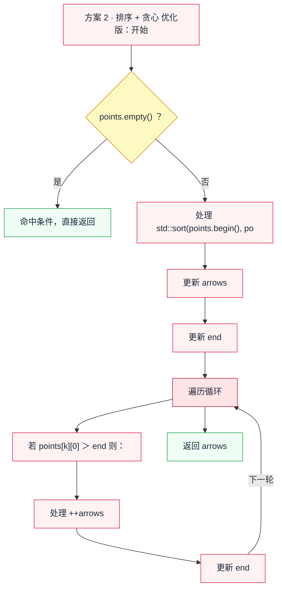

```cpp
// LeetCode 452. 用最少数量的箭引爆气球 — C++ 版（方案2）
#include <algorithm>                                                 // 引入头文件
#include <cassert>                                                   // 引入头文件
#include <iostream>                                                  // 引入头文件
#include <vector>                                                    // 引入头文件
static int findMinArrowShots(std::vector<std::vector<int>> points) { // 定义函数/方法 findMinArrowShots
    if (points.empty())
        return 0; // 若 points 是否为空，直接返回 0
    std::sort(points.begin(), points.end(), [](auto &a, auto &b) { return a[1] < b[1]; });
    int arrows = 1;                              // 把 1 存入 arrows
    int end = points[0][1];                      // 把 points[0][1] 存入 终点
    for (size_t k = 1; k < points.size(); ++k) { // 让 下标 k 从 1 开始计数，下标 k 小于 points.大小() 就继续
        if (points[k][0] > end) {
            ++arrows;
            end = points[k][1];
        }
    }
    return arrows; // 返回 arrows
}
int main() { // 程序入口：跑内嵌自测用例
    assert(findMinArrowShots({{10, 16}, {2, 8}, {1, 6}, {7, 12}}) == 2); // 断言校验
    assert(findMinArrowShots({}) == 0);                                  // 断言校验
    assert(findMinArrowShots({{1, 2}, {3, 4}, {5, 6}, {7, 8}}) == 4);    // 断言校验
    std::cout << "PASS" << std::endl;                                    // 全部用例通过，输出 PASS
    return 0;                                                            // 返回 0
}
```

### R 实现（2 种方案）

R 的全部方案如下，每个方案都内嵌用例自测，可独立运行（老仓库 python/go 文件遵循「打印结果」约定）：

#### 方案 1：排序 + 贪心

**思路与代码分析**：核心是「排序 + 贪心」。R 版用向量化思维与 1 起始下标，注意 1:n 的降序陷阱。代码里依次做这些事：单循环线性扫描。**走读**：方案 1 · 排序 + 贪心：开始 → 命中条件，直接返回 → 更新 drop → 处理 arrows ＜- 1L → 处理 end_ ＜- arr[1, 2] → 循环 k：遍历 2:nrow(arr) → 若 arr[k, 1] ＞ end_ 则： → 处理 arrows ＜- arrows + 1L → 处理 end_ ＜- arr[k, 2] → 处理 arrows。

**运行架构**（真实控制流）：

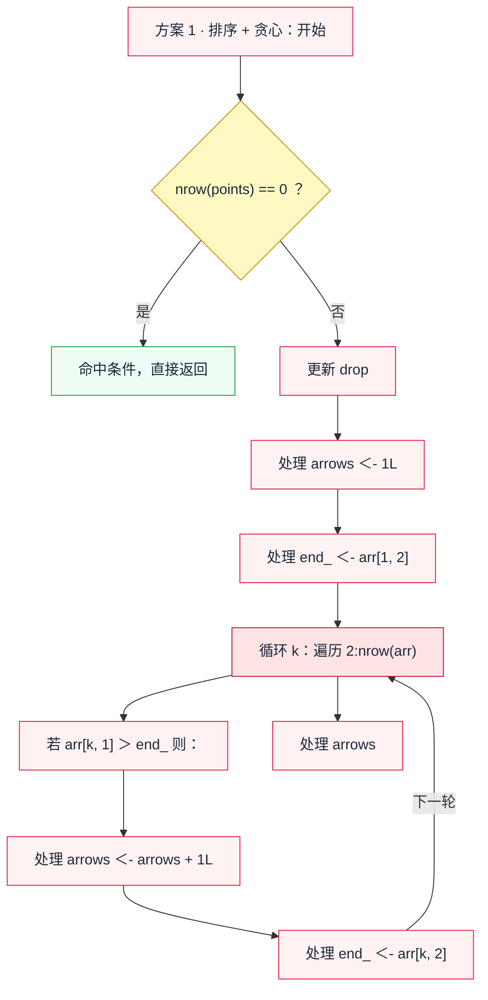

```r
# 用最少数量的箭引爆气球 — R 版（方案1） 定义函数 find_min_arrow_shots（参数：points）
find_min_arrow_shots <- function(points) {
    if (nrow(points) == 0)
        return(0L)  # 若 nrow(points) 等于 0) return(0L
    arr <- points[order(points[, 2]), , drop = FALSE]  # 把 points[order(points[, 2]), , drop 赋值为 FALSE] 存入 数组
    arrows <- 1L
    end_ <- arr[1, 2]  # 把 1L; end_ 小于 减 数组[1, 2] 存入 arrows
    for (k in 2:nrow(arr)) {
        # for (下标 k in 2:nrow(数组)) {
        if (arr[k, 1] > end_) {
            arrows <- arrows + 1L
            end_ <- arr[k, 2]
        }
    }
    arrows  # arrows
}
m1 <- matrix(c(10, 16, 2, 8, 1, 6, 7, 12), ncol = 2, byrow = TRUE)
m3 <- matrix(c(1, 2, 3, 4, 5, 6, 7, 8), ncol = 2, byrow = TRUE)
stopifnot(find_min_arrow_shots(m1) == 2L)  # 断言校验
stopifnot(find_min_arrow_shots(matrix(integer(0), ncol = 2)) == 0L)  # 断言校验
stopifnot(find_min_arrow_shots(m3) == 4L)  # 断言校验
cat("PASS\n")  # 全部用例通过，输出 PASS
```

#### 方案 2：排序 + 贪心 优化版

**思路与代码分析**：核心是「排序 + 贪心 优化版」。R 版用向量化思维与 1 起始下标，注意 1:n 的降序陷阱。代码里依次做这些事：单循环线性扫描。**走读**：方案 2 · 排序 + 贪心 优化版：开始 → 命中条件，直接返回 → 更新 drop → 处理 arrows ＜- 1L → 处理 end_ ＜- arr[1, 2] → 循环 k：遍历 2:nrow(arr) → 若 arr[k, 1] ＞ end_ 则： → 处理 arrows ＜- arrows + 1L → 处理 end_ ＜- arr[k, 2] → 处理 arrows。

**运行架构**（真实控制流）：

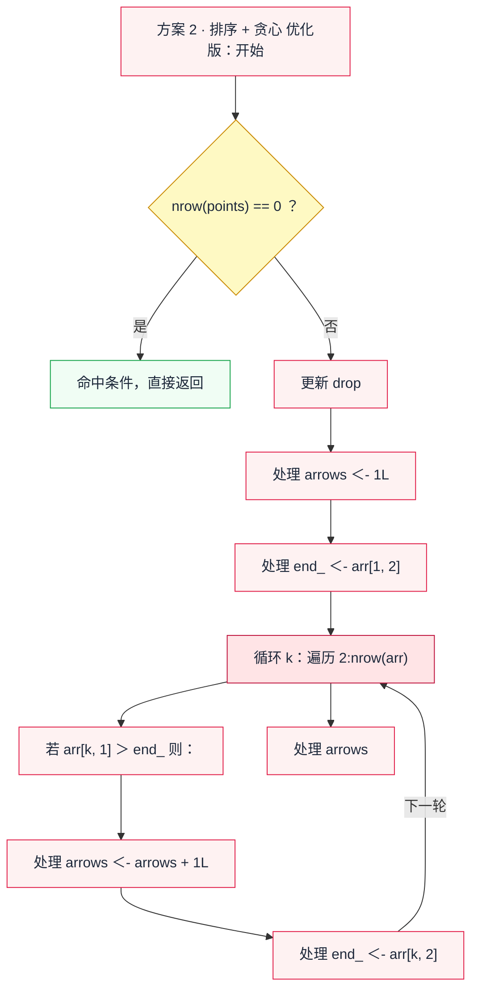

```r
# 用最少数量的箭引爆气球 — R 版（方案2） 定义函数 find_min_arrow_shots（参数：points）
find_min_arrow_shots <- function(points) {
    if (nrow(points) == 0)
        return(0L)  # 若 nrow(points) 等于 0) return(0L
    arr <- points[order(points[, 2]), , drop = FALSE]  # 把 points[order(points[, 2]), , drop 赋值为 FALSE] 存入 数组
    arrows <- 1L
    end_ <- arr[1, 2]  # 把 1L; end_ 小于 减 数组[1, 2] 存入 arrows
    for (k in 2:nrow(arr)) {
        # for (下标 k in 2:nrow(数组)) {
        if (arr[k, 1] > end_) {
            arrows <- arrows + 1L
            end_ <- arr[k, 2]
        }
    }
    arrows  # arrows
}
m1 <- matrix(c(10, 16, 2, 8, 1, 6, 7, 12), ncol = 2, byrow = TRUE)
m3 <- matrix(c(1, 2, 3, 4, 5, 6, 7, 8), ncol = 2, byrow = TRUE)
stopifnot(find_min_arrow_shots(m1) == 2L)  # 断言校验
stopifnot(find_min_arrow_shots(matrix(integer(0), ncol = 2)) == 0L)  # 断言校验
stopifnot(find_min_arrow_shots(m3) == 4L)  # 断言校验
cat("PASS\n")  # 全部用例通过，输出 PASS
```

### Zig 实现（2 种方案）

Zig 的全部方案如下，每个方案都内嵌用例自测，可独立运行（老仓库 python/go 文件遵循「打印结果」约定）：

#### 方案 1：排序 + 贪心

**思路与代码分析**：核心是「排序 + 贪心」。Zig 版显式分配与清零，整型边界处理严格。代码里依次做这些事：双重循环遍历。**走读**：方案 1 · 排序 + 贪心：开始 → 命中条件，直接返回 → 计算 arr → 遍历集合元素 → 计算 S → 返回 a.e ＜ b.e → 处理 std.sort.pdq(IV, arr[0..poin → 计算 arrows → 计算 end → 遍历集合元素 → 若 arr[k].s ＞ end 则： → 更新 + → 更新 end → 返回 arrows。

**运行架构**（真实控制流）：

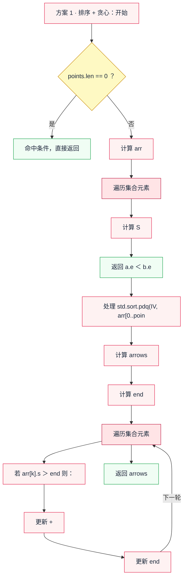

```zig
// LeetCode 452. 用最少数量的箭引爆气球 — Zig 版（方案1）
const std = @import("std"); // 把 @import(「std」) 存入 std
const IV = struct { s: i32, e: i32 }; // 把 struct { 字符串: i32, e: i32 } 存入 IV
fn findMinArrowShots(points: []const [2]i32) i32 { // 定义函数/方法 findMinArrowShots
    if (points.len == 0) return 0; // 若 points.长度 等于 0，直接返回 0
    var arr: [256]IV = undefined; // 把 undefined; 写入 var arr: [256]IV
    for (points, 0..) |p, i| arr[i] = .{ .s = p[0], .e = p[1] };
    const S = struct { // 把 struct { 存入 S
        fn lt(_: void, a: IV, b: IV) bool {
            return a.e < b.e;
        } // 定义函数/方法 lt
    };
    std.sort.pdq(IV, arr[0..points.len], {}, S.lt); // std.sort.pdq(IV, 数组[0..points.长度], {}, S.lt);
    var arrows: i32 = 1; // 把 1; 写入 var arrows: i32
    var end: i32 = arr[0].e; // 把 数组[0].e; 写入 var end: i32
    for (1..points.len) |k| { // 逐个取出 1..points.长度 的元素（下标 k）
        if (arr[k].s > end) {
            arrows += 1;
            end = arr[k].e;
        } // 若 数组[下标 k].字符串 超过 终点) { arrows 累加 1; 终点 赋值为 数组[下标 k].e; }
    }
    return arrows; // 返回 arrows
}
pub fn main() !void { // 程序入口：跑内嵌自测用例
    if (findMinArrowShots(&[_][2]i32{ .{ 10, 16 }, .{ 2, 8 }, .{ 1, 6 }, .{ 7, 12 } }) != 2) return error.TestFailed;
    if (findMinArrowShots(&[_][2]i32{}) != 0) return error.TestFailed;
    if (findMinArrowShots(&[_][2]i32{ .{ 1, 2 }, .{ 3, 4 }, .{ 5, 6 }, .{ 7, 8 } }) != 4) return error.TestFailed;
    std.debug.print("PASS\n", .{}); // 全部用例通过，输出 PASS
}
```

#### 方案 2：排序 + 贪心 优化版

**思路与代码分析**：核心是「排序 + 贪心 优化版」。Zig 版显式分配与清零，整型边界处理严格。代码里依次做这些事：双重循环遍历。**走读**：方案 2 · 排序 + 贪心 优化版：开始 → 命中条件，直接返回 → 计算 arr → 遍历集合元素 → 计算 S → 返回 a.e ＜ b.e → 处理 std.sort.pdq(IV, arr[0..poin → 计算 arrows → 计算 end → 遍历集合元素 → 若 arr[k].s ＞ end 则： → 更新 + → 更新 end → 返回 arrows。

**运行架构**（真实控制流）：

```mermaid
graph TD
    N0["方案 2 · 排序 + 贪心 优化版：开始"]
    N1{"points.len == 0 ？"}
    N2["命中条件，直接返回"]
    N3["计算 arr"]
    N4["遍历集合元素"]
    N5["计算 S"]
    N6["返回 a.e ＜ b.e"]
    N7["处理 std.sort.pdq(IV, arr[0..poin"]
    N8["计算 arrows"]
    N9["计算 end"]
    N10["遍历集合元素"]
    N11["若 arr[k].s ＞ end 则："]
    N12["更新 +"]
    N13["更新 end"]
    N14["返回 arrows"]
    N0 --> N1
    N1 -- 是 --> N2
    N1 -- 否 --> N3
    N3 --> N4
    N4 --> N5
    N5 --> N6
    N6 --> N7
    N7 --> N8
    N8 --> N9
    N9 --> N10
    N10 --> N11
    N11 --> N12
    N12 --> N13
    N13 -- 下一轮 --> N10
    N10 --> N14
    classDef n fill:#fef2f2,stroke:#e11d48,color:#1e293b;
    classDef lp fill:#ffe4e6,stroke:#be123c,color:#1e293b;
    classDef dc fill:#fef9c3,stroke:#ca8a04,color:#1e293b;
    classDef tm fill:#f0fdf4,stroke:#16a34a,color:#1e293b;
    class N0,N3,N5,N7,N8,N9,N11,N12,N13 n;
    class N4,N10 lp;
    class N1 dc;
    class N2,N6,N14 tm;
```

```zig
// LeetCode 452. 用最少数量的箭引爆气球 — Zig 版（方案2）
const std = @import("std"); // 把 @import(「std」) 存入 std
const IV = struct { s: i32, e: i32 }; // 把 struct { 字符串: i32, e: i32 } 存入 IV
fn findMinArrowShots(points: []const [2]i32) i32 { // 定义函数/方法 findMinArrowShots
    if (points.len == 0) return 0; // 若 points.长度 等于 0，直接返回 0
    var arr: [256]IV = undefined; // 把 undefined; 写入 var arr: [256]IV
    for (points, 0..) |p, i| arr[i] = .{ .s = p[0], .e = p[1] };
    const S = struct { // 把 struct { 存入 S
        fn lt(_: void, a: IV, b: IV) bool {
            return a.e < b.e;
        } // 定义函数/方法 lt
    };
    std.sort.pdq(IV, arr[0..points.len], {}, S.lt); // std.sort.pdq(IV, 数组[0..points.长度], {}, S.lt);
    var arrows: i32 = 1; // 把 1; 写入 var arrows: i32
    var end: i32 = arr[0].e; // 把 数组[0].e; 写入 var end: i32
    for (1..points.len) |k| { // 逐个取出 1..points.长度 的元素（下标 k）
        if (arr[k].s > end) {
            arrows += 1;
            end = arr[k].e;
        } // 若 数组[下标 k].字符串 超过 终点) { arrows 累加 1; 终点 赋值为 数组[下标 k].e; }
    }
    return arrows; // 返回 arrows
}
pub fn main() !void { // 程序入口：跑内嵌自测用例
    if (findMinArrowShots(&[_][2]i32{ .{ 10, 16 }, .{ 2, 8 }, .{ 1, 6 }, .{ 7, 12 } }) != 2) return error.TestFailed;
    if (findMinArrowShots(&[_][2]i32{}) != 0) return error.TestFailed;
    if (findMinArrowShots(&[_][2]i32{ .{ 1, 2 }, .{ 3, 4 }, .{ 5, 6 }, .{ 7, 8 } }) != 4) return error.TestFailed;
    std.debug.print("PASS\n", .{}); // 全部用例通过，输出 PASS
}
```

### Dart 实现（2 种方案）

Dart 的全部方案如下，每个方案都内嵌用例自测，可独立运行（老仓库 python/go 文件遵循「打印结果」约定）：

#### 方案 1：排序 + 贪心

**思路与代码分析**：核心是「排序 + 贪心」。Dart 版用可空类型标注与集合方法，注意空安全。代码里依次做这些事：先排序再处理；单循环线性扫描。**走读**：方案 1 · 排序 + 贪心：开始 → 命中条件，直接返回 → 更新 arr → 处理 List＜List＜int＞＞.from( → 处理 points, → 处理 ) → 排序整理 → 计算 arrows → 计算 end → 遍历循环 → 若 arr[k][0] ＞ end 则： → 处理 arrows++ → 更新 end → 返回 arrows。

**运行架构**（真实控制流）：

```mermaid
graph TD
    N0["方案 1 · 排序 + 贪心：开始"]
    N1{"points.isEmpty ？"}
    N2["命中条件，直接返回"]
    N3["更新 arr"]
    N4["处理 List＜List＜int＞＞.from("]
    N5["处理 points,"]
    N6["处理 )"]
    N7["排序整理"]
    N8["计算 arrows"]
    N9["计算 end"]
    N10["遍历循环"]
    N11["若 arr[k][0] ＞ end 则："]
    N12["处理 arrows++"]
    N13["更新 end"]
    N14["返回 arrows"]
    N0 --> N1
    N1 -- 是 --> N2
    N1 -- 否 --> N3
    N3 --> N4
    N4 --> N5
    N5 --> N6
    N6 --> N7
    N7 --> N8
    N8 --> N9
    N9 --> N10
    N10 --> N11
    N11 --> N12
    N12 --> N13
    N13 -- 下一轮 --> N10
    N10 --> N14
    classDef n fill:#fef2f2,stroke:#e11d48,color:#1e293b;
    classDef lp fill:#ffe4e6,stroke:#be123c,color:#1e293b;
    classDef dc fill:#fef9c3,stroke:#ca8a04,color:#1e293b;
    classDef tm fill:#f0fdf4,stroke:#16a34a,color:#1e293b;
    class N0,N3,N4,N5,N6,N7,N8,N9,N11,N12,N13 n;
    class N10 lp;
    class N1 dc;
    class N2,N14 tm;
```

```dart
// LeetCode 452. 用最少数量的箭引爆气球 — Dart 版（方案1）
int findMinArrowShots(List<List<int>> points) {
  // 定义函数/方法 findMinArrowShots
  if (points.isEmpty) return 0; // 若 points.isEmpty，直接返回 0
  final arr =
      List<List<int>>.from(
          points,
        ) // 把 List 小于 List 小于 int 超过 超过 .from(points) 存入 数组
        ..sort((a, b) => a[1].compareTo(b[1]));
  var arrows = 1; // 把 1 存入 arrows
  var end = arr[0][1]; // 把 数组[0][1] 存入 终点
  for (var k = 1; k < arr.length; k++) {
    // 让 下标 k 从 1 开始计数，下标 k 小于 数组.长度 就继续
    if (arr[k][0] > end) {
      // 若 数组[下标 k][0] 超过 终点
      arrows++; // arrows 加一
      end = arr[k][1]; // 把 数组[下标 k][1] 存入 终点
    }
  }
  return arrows; // 返回 arrows
}

void main() {
  // 程序入口：跑内嵌自测用例
  if (findMinArrowShots([
        [10, 16],
        [2, 8],
        [1, 6],
        [7, 12], // [7, 12]
      ]) !=
      2)
    throw StateError('c1'); // 把 2) throw StateError('c1'); 写入 ]) !
  if (findMinArrowShots([]) != 0)
    throw StateError(
      'c2',
    ); // 若 findMinArrowShots([]) 不等于 0) throw StateError('c2');
  if (findMinArrowShots([
        [1, 2],
        [3, 4],
        [5, 6],
        [7, 8], // [7, 8]
      ]) !=
      4)
    throw StateError('c3'); // 把 4) throw StateError('c3'); 写入 ]) !
  print('PASS'); // 全部用例通过，输出 PASS
}
```

#### 方案 2：排序 + 贪心 优化版

**思路与代码分析**：核心是「排序 + 贪心 优化版」。Dart 版用可空类型标注与集合方法，注意空安全。代码里依次做这些事：先排序再处理；单循环线性扫描。**走读**：方案 2 · 排序 + 贪心 优化版：开始 → 命中条件，直接返回 → 更新 arr → 处理 List＜List＜int＞＞.from( → 处理 points, → 处理 ) → 排序整理 → 计算 arrows → 计算 end → 遍历循环 → 若 arr[k][0] ＞ end 则： → 处理 arrows++ → 更新 end → 返回 arrows。

**运行架构**（真实控制流）：

```mermaid
graph TD
    N0["方案 2 · 排序 + 贪心 优化版：开始"]
    N1{"points.isEmpty ？"}
    N2["命中条件，直接返回"]
    N3["更新 arr"]
    N4["处理 List＜List＜int＞＞.from("]
    N5["处理 points,"]
    N6["处理 )"]
    N7["排序整理"]
    N8["计算 arrows"]
    N9["计算 end"]
    N10["遍历循环"]
    N11["若 arr[k][0] ＞ end 则："]
    N12["处理 arrows++"]
    N13["更新 end"]
    N14["返回 arrows"]
    N0 --> N1
    N1 -- 是 --> N2
    N1 -- 否 --> N3
    N3 --> N4
    N4 --> N5
    N5 --> N6
    N6 --> N7
    N7 --> N8
    N8 --> N9
    N9 --> N10
    N10 --> N11
    N11 --> N12
    N12 --> N13
    N13 -- 下一轮 --> N10
    N10 --> N14
    classDef n fill:#fef2f2,stroke:#e11d48,color:#1e293b;
    classDef lp fill:#ffe4e6,stroke:#be123c,color:#1e293b;
    classDef dc fill:#fef9c3,stroke:#ca8a04,color:#1e293b;
    classDef tm fill:#f0fdf4,stroke:#16a34a,color:#1e293b;
    class N0,N3,N4,N5,N6,N7,N8,N9,N11,N12,N13 n;
    class N10 lp;
    class N1 dc;
    class N2,N14 tm;
```

```dart
// LeetCode 452. 用最少数量的箭引爆气球 — Dart 版（方案2）
int findMinArrowShots(List<List<int>> points) {
  // 定义函数/方法 findMinArrowShots
  if (points.isEmpty) return 0; // 若 points.isEmpty，直接返回 0
  final arr =
      List<List<int>>.from(
          points,
        ) // 把 List 小于 List 小于 int 超过 超过 .from(points) 存入 数组
        ..sort((a, b) => a[1].compareTo(b[1]));
  var arrows = 1; // 把 1 存入 arrows
  var end = arr[0][1]; // 把 数组[0][1] 存入 终点
  for (var k = 1; k < arr.length; k++) {
    // 让 下标 k 从 1 开始计数，下标 k 小于 数组.长度 就继续
    if (arr[k][0] > end) {
      // 若 数组[下标 k][0] 超过 终点
      arrows++; // arrows 加一
      end = arr[k][1]; // 把 数组[下标 k][1] 存入 终点
    }
  }
  return arrows; // 返回 arrows
}

void main() {
  // 程序入口：跑内嵌自测用例
  if (findMinArrowShots([
        [10, 16],
        [2, 8],
        [1, 6],
        [7, 12], // [7, 12]
      ]) !=
      2)
    throw StateError('c1'); // 把 2) throw StateError('c1'); 写入 ]) !
  if (findMinArrowShots([]) != 0)
    throw StateError(
      'c2',
    ); // 若 findMinArrowShots([]) 不等于 0) throw StateError('c2');
  if (findMinArrowShots([
        [1, 2],
        [3, 4],
        [5, 6],
        [7, 8], // [7, 8]
      ]) !=
      4)
    throw StateError('c3'); // 把 4) throw StateError('c3'); 写入 ]) !
  print('PASS'); // 全部用例通过，输出 PASS
}
```

---

## 内容总结

- **用最少数量的箭引爆气球**（贪心 · Medium）：共 2 个方案，主线思路「排序 + 贪心」；时间 O(n)（单趟线性扫描）；动画演示贪心边界过程，附录给出 11 种语言 × 全部方案的可运行实现。
- 来源博客：[https://blog.csdn.net/tyro_java/article/details/145244333](https://blog.csdn.net/tyro_java/article/details/145244333)
- 导航：[📋 总目录](../) ｜ [← 101 无重叠区间](../101_无重叠区间/) ｜ [103 分饼干 →](../103_分饼干/)
