# 103 · 分饼干（第五阶段 · 贪心策略 · Medium）

> **难度**：⭐⭐ Medium ｜ **专题**：贪心
> **学习定位**：第五阶段 · 贪心策略第 103 篇 ｜ **解法数**：6
> **内容总结**：**分饼干**（贪心 · Medium）：共 6 个方案，主线思路「排序预处理」；时间 O(n)（单趟线性扫描）；动画演示贪心边界过程，附录给出 11 种语言 × 全部方案的可运行实现。

---

## 题目描述

假设你是一位很棒的家长，想要给你的孩子们一些小饼干。但是，每个孩子最多只能给一块饼干。

对每个孩子 `i`，都有一个胃口值 `g[i]`_，这是能让孩子们满足胃口的饼干的最小尺寸；并且每块饼干 `j`，都有一个尺寸 `s[j]`_ 。如果 `s[j] >= g[i]`，我们可以将这个饼干 `j` 分配给孩子 `i` ，这个孩子会得到满足。你的目标是满足尽可能多的孩子，并输出这个最大数值。
 

示例 1:

输入: g = [1,2,3], s = [1,1]
输出: 1
解释：你有三个孩子和两块小饼干，3 个孩子的胃口值分别是：1,2,3。
虽然你有两块小饼干，由于他们的尺寸都是 1，你只能让胃口值是 1 的孩子满足。
所以你应该输出 1。

示例 2:

输入: g = [1,2], s = [1,2,3]
输出: 2
解释：你有两个孩子和三块小饼干，2 个孩子的胃口值分别是 1,2。
你拥有的饼干数量和尺寸都足以让所有孩子满足。
所以你应该输出 2。

提示：

 `1 
 `0 
 `1

注意：本题与 2410. 运动员和训练师的最大匹配数 题相同。

- 主函数签名：`function findContentChildren(g: number[], s: number[]): number`

**用例演示**（摘自主解法内嵌自测，输入到输出一目了然）：

```typescript
  const cases: { g: number[]; s: number[]; want: number }[] = [
    { g: [1, 2, 3], s: [1, 1], want: 1 },
    { g: [1, 2], s: [1, 2, 3], want: 2 },
  ];
```

> 题面与 [leetcode.cn 官方](https://leetcode.cn/problems/assign-cookies/)一致，示例配图取自官方题面。

**数据范围与注意事项**：

- `1 <= g.length <= 3  10^4`
- `0 <= s.length <= 3  10^4`
- `1 <= g[i], s[j] <= 2^31 - 1`
- **易错点**：贪心前通常要先排序，排序依据就是贪心的正确性来源。

## 题目分析

**场景是什么**：每步取当前最优，对应真实开发里的区间调度、资源分配。本题就是该场景的 Medium 级练习，主线做法是「排序预处理」。

**主线怎么解**：把主解法从头到尾过一遍，它其实在依次做这几件事：先排序再处理。

## 解题思路

**方案对比**（共 6 个方案，由浅入深）：

| 方案 | 时间复杂度 | 空间复杂度 |
|---|---|---|
| 方案 1 · 排序预处理 | O(n)（单趟线性扫描） | O(1) 到 O(n)（视辅助结构） |
| 方案 2 · 排序预处理 | O(n)（单趟线性扫描） | O(1) 到 O(n)（视辅助结构） |
| 方案 3 · 双指针收缩 | O(n)（单趟线性扫描） | O(1) 到 O(n)（视辅助结构） |
| 方案 4 · 排序预处理 | O(n)（单趟线性扫描） | O(1) 到 O(n)（视辅助结构） |
| 方案 5 · 排序预处理 | O(n)（单趟线性扫描） | O(1) 到 O(n)（视辅助结构） |
| 方案 6 · 排序预处理 | O(n²)（两层嵌套扫描） | O(1) 到 O(n) |

**由浅入深的路径**：排序预处理 → 双指针收缩；每往右一步，都在补上一步的短板。

**方案间的取舍**：方案 1（排序预处理）；方案 2（排序预处理）；方案 3（双指针收缩）；方案 4（排序预处理）；方案 5（排序预处理）；方案 6（排序预处理）。数据规模小、可读性优先时选靠前的方案；规模大、性能优先时选靠后的方案。

**怎么读这一篇**：

- 🐣 **新手路线**：把「题目描述」的示例 1 在纸上手推一遍 → 读方案 1（最直观的写法）与它的代码走读 → 按「运行方式」本地跑通看 PASS → 回头对比方案 2 之后的写法差在哪
- 🦅 **大佬路线**：直接锁定最优方案 1（排序预处理，O(n)（单趟线性扫描））→ 跳读该方案代码与走读 → 用「逐步拆解与面试追问」补齐复杂度推导与边界追问

### 动态算法图（贪心边界，GIF 自动循环）


动画演示贪心专题里贪心边界的典型过程；每个方案在「TypeScript 解题方案」一节还配了专属动画与专属流程图。

### 主解法流程图（真实控制流）

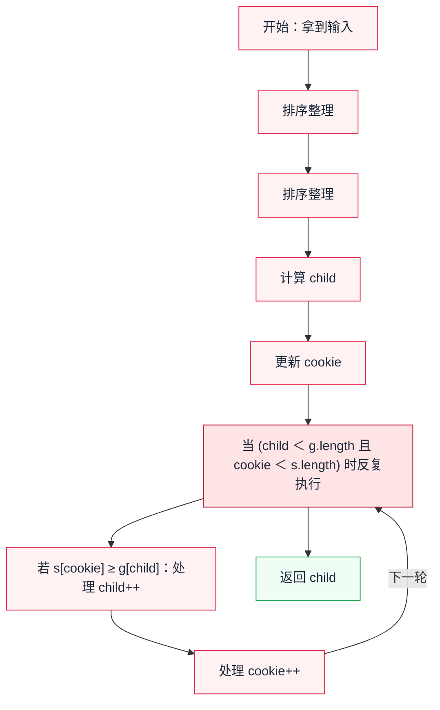

## TypeScript 解题方案（6 个方案逐个讲）

> **运行与提交**：每个方案都是自包含文件（内嵌用例自测，输出 PASS），整块复制到 `.ts` 文件后 `node 文件名` 即可运行。提交 LeetCode 时，把 `demo` 内的算法函数与辅助类型/函数整体取出、置于文件顶层即可。涉及交互/特殊接口的题以题面给定签名为准。

### 方案 1：排序预处理

**分析与思路**：核心做法是「排序预处理」。代码里依次做这些事：先排序再处理。

**运行方式**：`node 本文件`，内嵌用例全部通过会输出 PASS。


**方案专属流程图**（真实控制流）：

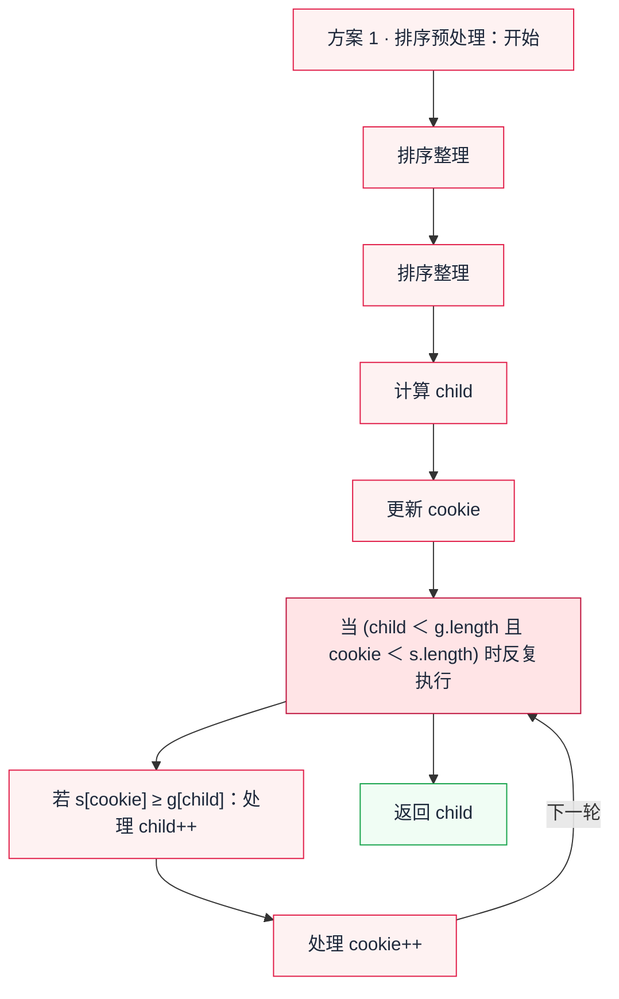

```typescript
export function demo(): void {
  // 程序入口：跑内嵌自测用例
  function findContentChildren(g: number[], s: number[]): number {
    // 定义函数/方法 findContentChildren
    g.sort((a, b) => a - b);
    s.sort((a, b) => a - b);
    let child = 0,
      cookie = 0; // 把 0, cookie 赋值为 0 存入 子节点
    while (child < g.length && cookie < s.length) {
      // 循环，直到不满足「子节点 小于 g.长度 且 cookie 小于 字符串.长度」
      if (s[cookie] >= g[child]) child++; // 若 字符串[cookie] 不低于 g[子节点]) 子节点 加一 ;
      cookie++; // cookie 加一
    }
    return child; // 返回 子节点
  }
  const cases: { g: number[]; s: number[]; want: number }[] = [
    { g: [1, 2, 3], s: [1, 1], want: 1 },
    { g: [1, 2], s: [1, 2, 3], want: 2 },
  ];
  let fail = false; // 把 false 存入 fail
  for (const c of cases) {
    // for (const 字符 of cases) {
    const got = findContentChildren(c.g.slice(), c.s.slice()); // 把 findContentChildren(字符.g 截取 ), 字符.字符串 截取 )) 存入 got
    if (got !== c.want) {
      fail = true;
      console.log('FAIL', c, 'got', got);
    }
  }
  if (fail) throw new Error('FAILED'); // 若 fail) throw new Error(「FAILED」);
  console.log('PASS'); // 全部用例通过，输出 PASS
}
demo(); // demo();
```

### 方案 2：排序预处理

**分析与思路**：核心做法是「排序预处理」。代码里依次做这些事：先排序再处理。

**运行方式**：`node 本文件`，内嵌用例全部通过会输出 PASS。


**方案专属流程图**（真实控制流）：


```typescript
export function demo(): void {
  // 程序入口：跑内嵌自测用例
  function findContentChildren(g: number[], s: number[]): number {
    // 定义函数/方法 findContentChildren
    g.sort((a, b) => a - b);
    s.sort((a, b) => a - b);
    let child = 0,
      cookie = 0; // 把 0, cookie 赋值为 0 存入 子节点
    while (child < g.length && cookie < s.length) {
      // 循环，直到不满足「子节点 小于 g.长度 且 cookie 小于 字符串.长度」
      if (s[cookie] >= g[child]) child++; // 若 字符串[cookie] 不低于 g[子节点]) 子节点 加一 ;
      cookie++; // cookie 加一
    }
    return child; // 返回 子节点
  }
  const cases: { g: number[]; s: number[]; want: number }[] = [
    { g: [1, 2, 3], s: [1, 1], want: 1 },
    { g: [1, 2], s: [1, 2, 3], want: 2 },
  ];
  let fail = false; // 把 false 存入 fail
  for (const c of cases) {
    // for (const 字符 of cases) {
    const got = findContentChildren(c.g.slice(), c.s.slice()); // 把 findContentChildren(字符.g 截取 ), 字符.字符串 截取 )) 存入 got
    if (got !== c.want) {
      fail = true;
      console.log('FAIL', c, 'got', got);
    }
  }
  if (fail) throw new Error('FAILED'); // 若 fail) throw new Error(「FAILED」);
  console.log('PASS'); // 全部用例通过，输出 PASS
}
demo(); // demo();
```

### 方案 3：双指针收缩

**分析与思路**：核心做法是「双指针收缩」。

**运行方式**：`node 本文件`，内嵌用例全部通过会输出 PASS。

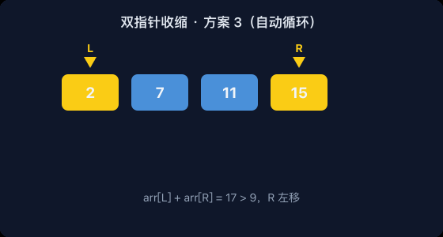

**方案专属流程图**（真实控制流）：

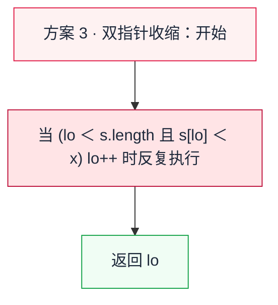

```typescript
export function demo(): void {
  // 程序入口：跑内嵌自测用例
  function bisectLeft(s: number[], x: number, lo: number): number {
    // 定义函数/方法 bisectLeft
    while (lo < s.length && s[lo] < x) lo++; // 循环，直到不满足「左边界 小于 字符串.长度 且 字符串[左边界] 小于 x) 左边界 加一 ;」
    return lo; // 返回 左边界
  }
  function findContentChildren(g: number[], s: number[]): number {
    // 定义函数/方法 findContentChildren
    g.sort((a, b) => a - b);
    s.sort((a, b) => a - b);
    let j = 0,
      count = 0; // 把 0, 计数 赋值为 0 存入 下标 j
    for (const child of g) {
      // for (const 子节点 of g) {
      const k = bisectLeft(s, child, j); // 把 bisectLeft(字符串, 子节点, 下标 j) 存入 下标 k
      if (k < s.length) {
        count++;
        j = k + 1;
      } else break; // 若 下标 k 小于 字符串.长度) { 计数 加一 ; 下标 j 赋值为 下标 k 加 1; } else break;
    }
    return count; // 返回 计数
  }
  const cases: { g: number[]; s: number[]; want: number }[] = [
    { g: [1, 2, 3], s: [1, 1], want: 1 },
    { g: [1, 2], s: [1, 2, 3], want: 2 },
  ];
  let fail = false; // 把 false 存入 fail
  for (const c of cases) {
    // for (const 字符 of cases) {
    const got = findContentChildren(c.g.slice(), c.s.slice()); // 把 findContentChildren(字符.g 截取 ), 字符.字符串 截取 )) 存入 got
    if (got !== c.want) {
      fail = true;
      console.log('FAIL', c, 'got', got);
    }
  }
  if (fail) throw new Error('FAILED'); // 若 fail) throw new Error(「FAILED」);
  console.log('PASS'); // 全部用例通过，输出 PASS
}
demo(); // demo();
```

### 方案 4：排序预处理

**分析与思路**：核心做法是「排序预处理」。代码里依次做这些事：先排序再处理。

**运行方式**：`node 本文件`，内嵌用例全部通过会输出 PASS。


**方案专属流程图**（真实控制流）：

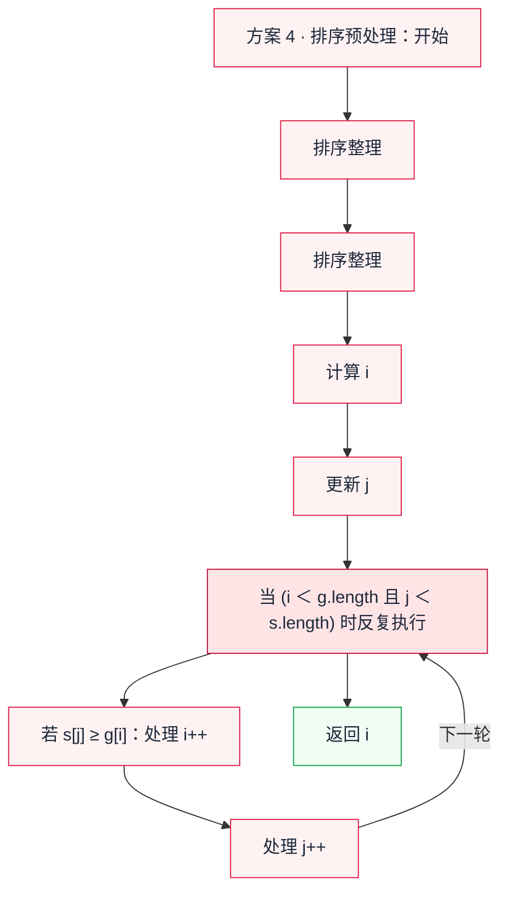

```typescript
export function demo(): void {
  // 程序入口：跑内嵌自测用例
  function findContentChildren(g: number[], s: number[]): number {
    // 定义函数/方法 findContentChildren
    g.sort((a, b) => a - b);
    s.sort((a, b) => a - b);
    let i = 0,
      j = 0; // 把 0, 下标 j 赋值为 0 存入 下标 i
    while (i < g.length && j < s.length) {
      // 循环，直到不满足「下标 i 小于 g.长度 且 下标 j 小于 字符串.长度」
      if (s[j] >= g[i]) i++; // 若 字符串[下标 j] 不低于 g[下标 i]) 下标 i 加一 ;
      j++; // 下标 j 加一
    }
    return i; // 返回 下标 i
  }
  const cases: { g: number[]; s: number[]; want: number }[] = [
    { g: [1, 2, 3], s: [1, 1], want: 1 },
    { g: [1, 2], s: [1, 2, 3], want: 2 },
  ];
  let fail = false; // 把 false 存入 fail
  for (const c of cases) {
    // for (const 字符 of cases) {
    const got = findContentChildren(c.g.slice(), c.s.slice()); // 把 findContentChildren(字符.g 截取 ), 字符.字符串 截取 )) 存入 got
    if (got !== c.want) {
      fail = true;
      console.log('FAIL', c, 'got', got);
    }
  }
  if (fail) throw new Error('FAILED'); // 若 fail) throw new Error(「FAILED」);
  console.log('PASS'); // 全部用例通过，输出 PASS
}
demo(); // demo();
```

### 方案 5：排序预处理

**分析与思路**：核心做法是「排序预处理」。代码里依次做这些事：先排序再处理；单循环线性扫描。

**运行方式**：`node 本文件`，内嵌用例全部通过会输出 PASS。


**方案专属流程图**（真实控制流）：

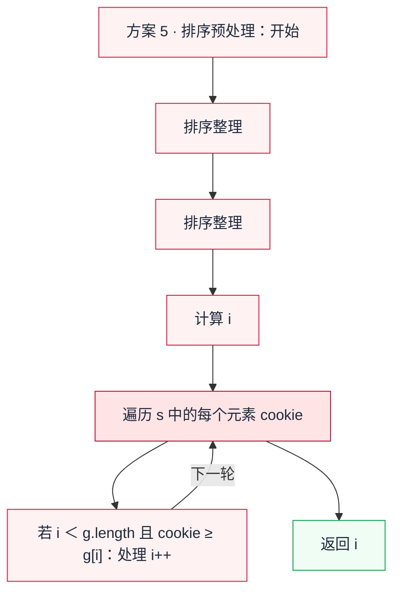

```typescript
export function demo(): void {
  // 程序入口：跑内嵌自测用例
  function findContentChildren(g: number[], s: number[]): number {
    // 定义函数/方法 findContentChildren
    g.sort((a, b) => a - b);
    s.sort((a, b) => a - b);
    let i = 0; // 把 0 存入 下标 i
    for (const cookie of s) {
      // for (const cookie of 字符串) {
      if (i < g.length && cookie >= g[i]) i++; // 若 下标 i 小于 g.长度 且 cookie 不低于 g[下标 i]) 下标 i 加一 ;
    }
    return i; // 返回 下标 i
  }
  const cases: { g: number[]; s: number[]; want: number }[] = [
    { g: [1, 2, 3], s: [1, 1], want: 1 },
    { g: [1, 2], s: [1, 2, 3], want: 2 },
  ];
  let fail = false; // 把 false 存入 fail
  for (const c of cases) {
    // for (const 字符 of cases) {
    const got = findContentChildren(c.g.slice(), c.s.slice()); // 把 findContentChildren(字符.g 截取 ), 字符.字符串 截取 )) 存入 got
    if (got !== c.want) {
      fail = true;
      console.log('FAIL', c, 'got', got);
    }
  }
  if (fail) throw new Error('FAILED'); // 若 fail) throw new Error(「FAILED」);
  console.log('PASS'); // 全部用例通过，输出 PASS
}
demo(); // demo();
```

### 方案 6：排序预处理

**分析与思路**：核心做法是「排序预处理」。代码里依次做这些事：先排序再处理；单循环线性扫描。

**运行方式**：`node 本文件`，内嵌用例全部通过会输出 PASS。

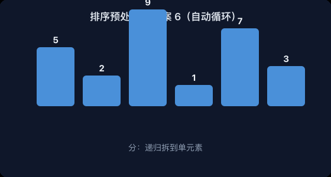

**方案专属流程图**（真实控制流）：

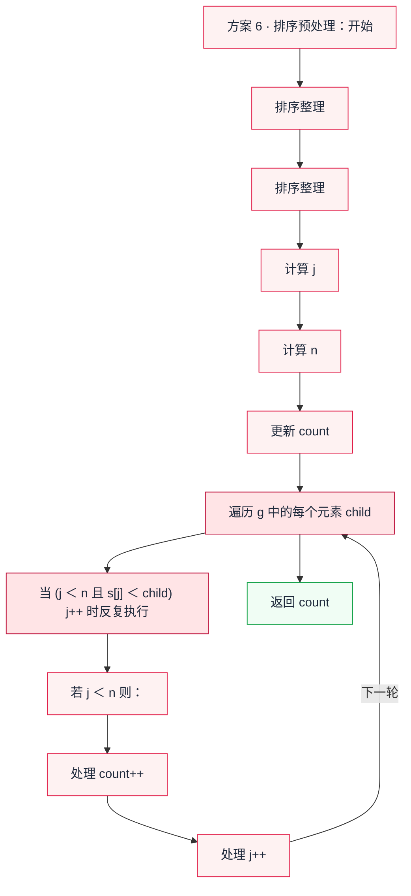

```typescript
export function demo(): void {
  // 程序入口：跑内嵌自测用例
  function findContentChildren(g: number[], s: number[]): number {
    // 定义函数/方法 findContentChildren
    g.sort((a, b) => a - b);
    s.sort((a, b) => a - b);
    let j = 0; // 把 0 存入 下标 j
    let n = s.length,
      count = 0; // 把 字符串.长度, 计数 赋值为 0 存入 元素个数
    for (const child of g) {
      // for (const 子节点 of g) {
      while (j < n && s[j] < child) j++; // 循环，直到不满足「下标 j 小于 元素个数 且 字符串[下标 j] 小于 子节点) 下标 j 加一 ;」
      if (j < n) {
        count++;
        j++;
      } else break; // 若 下标 j 小于 元素个数) { 计数 加一 ; 下标 j 加一 ; } else break;
    }
    return count; // 返回 计数
  }
  const cases: { g: number[]; s: number[]; want: number }[] = [
    { g: [1, 2, 3], s: [1, 1], want: 1 },
    { g: [1, 2], s: [1, 2, 3], want: 2 },
  ];
  let fail = false; // 把 false 存入 fail
  for (const c of cases) {
    // for (const 字符 of cases) {
    const got = findContentChildren(c.g.slice(), c.s.slice()); // 把 findContentChildren(字符.g 截取 ), 字符.字符串 截取 )) 存入 got
    if (got !== c.want) {
      fail = true;
      console.log('FAIL', c, 'got', got);
    }
  }
  if (fail) throw new Error('FAILED'); // 若 fail) throw new Error(「FAILED」);
  console.log('PASS'); // 全部用例通过，输出 PASS
}
demo(); // demo();
```

## 逐步拆解与面试追问

**复杂度**：时间 O(n)（单趟线性扫描），空间 O(1) 到 O(n)（视辅助结构）

**为什么是这个量级**：每个元素被常数次访问，辅助哈希或栈的开销与 n 同阶

**面试官可能会追问**：

- 贪心的正确性怎么证明？
- 排序依据选错了会怎样？
- 能否举出反例推翻当前策略？

## 关键 API 速查（TS 主解法实际用到，附官方链接）

| API | 作用 | 使用要点 | 官方文档 |
|---|---|---|---|
| `Array.prototype.sort()` | 原地排序 | 默认按字符串 Unicode 序（10 会排在 2 前），数字必须传 (a,b)=>a-b；V8 用 TimSort，稳定，O(n log n)；返回原数组引用 | [官方文档](https://developer.mozilla.org/zh-CN/docs/Web/JavaScript/Reference/Global_Objects/Array/sort) |
| `Array/String slice()` | 切片（不改原数组） | slice(start,end) 含头不含尾；负数从尾计；常用于复制数组（slice()） | [官方文档](https://developer.mozilla.org/zh-CN/docs/Web/JavaScript/Reference/Global_Objects/Array/slice) |

### 各语言官方文档导航

- **TypeScript / JS**：[MDN 中文参考](https://developer.mozilla.org/zh-CN/)
- **Python**：[Python 官方文档](https://docs.python.org/zh-cn/3/)
- **Go**：[Go 标准库](https://pkg.go.dev/std)
- **Java**：[JDK 17 API](https://docs.oracle.com/en/java/javase/17/docs/api/)
- **Rust**：[Rust 标准库](https://doc.rust-lang.org/std/)
- **Lua**：[Lua 5.4 手册](https://www.lua.org/manual/5.4/)
- **C**：[Cppreference C](https://zh.cppreference.com/w/c)
- **C++**：[Cppreference C++](https://zh.cppreference.com/w/cpp)
- **R**：[R 官方手册](https://stat.ethz.ch/R-manual/)
- **Zig**：[Zig 语言文档](https://ziglang.org/documentation/master/)
- **Dart**：[Dart API](https://api.dart.dev/)

## 附录：其他 10 种语言全部实现（每种语言列举其全部方案）

> TypeScript 的全部方案见「TypeScript 解题方案」一节；下面是其余 10 种语言的对应实现，每种语言的每个方案都带思路分析、代码走读与专属运行架构图。
> 每个方案都内嵌用例自测，可独立运行（老仓库 python/go 文件遵循「打印结果」约定）。
> 完整解法文件见 `dsa/<语言>/greedy/lc_455_分饼干/`。

### Python 实现（6 种方案）

Python 的全部方案如下，每个方案都内嵌用例自测，可独立运行（老仓库 python/go 文件遵循「打印结果」约定）：

#### 方案 1：排序预处理

**思路与代码分析**：核心是「排序预处理」。Python 版用切片与字典推导式简化操作，突出可读性。代码里依次做这些事：先排序再处理。**走读**：方案 1 · 排序预处理：开始 → 排序整理 → 排序整理 → 更新 child → 更新 cookie → 当 child ＜ len(g) and cookie ＜ len( 时反复执行 → 处理 s → 处理 ): → 若 s[cookie] ≥ g[child]：更新 + → 更新 + → 更新 + → 返回 child。

**运行架构**（真实控制流）：


```python
import sys  # 提高递归深度上限（深输入防 RecursionError）

sys.setrecursionlimit(200000)  # 树/链表类题目节点数可达 1e4 量级

def findContentChildren(g, s):  # 定义函数 findContentChildren（参数：g, 字符串）
    g.sort()  # 排序
    s.sort()  # 排序
    child = 0  # 把 0 存入 子节点
    cookie = 0  # 把 0 存入 cookie
    while child < len(g) and cookie < len(
        s
    ):  # 循环，直到不满足「子节点 小于 长度(g) and cookie 小于 长度(字符串」
        if s[cookie] >= g[child]:  # 若 字符串[cookie] 不低于 g[子节点]
            child += 1  # 子节点累加 1
        cookie += 1  # cookie累加 1
    return child  # 返回 子节点

if __name__ == "__main__":  # 若 __name__ 等于 '__main__'
    print(findContentChildren([1, 2, 3], [1, 1]))  # 打印输出
    print(findContentChildren([1, 2], [1, 2, 3]))  # 打印输出
```

#### 方案 2：排序预处理

**思路与代码分析**：核心是「排序预处理」。Python 版用切片与字典推导式简化操作，突出可读性。代码里依次做这些事：先排序再处理。**走读**：方案 2 · 排序预处理：开始 → 排序整理 → 排序整理 → 更新 child → 更新 cookie → 当 child ＜ len(g) and cookie ＜ len( 时反复执行 → 处理 s → 处理 ): → 若 s[cookie] ≥ g[child]：更新 + → 更新 + → 更新 + → 返回 child。

**运行架构**（真实控制流）：

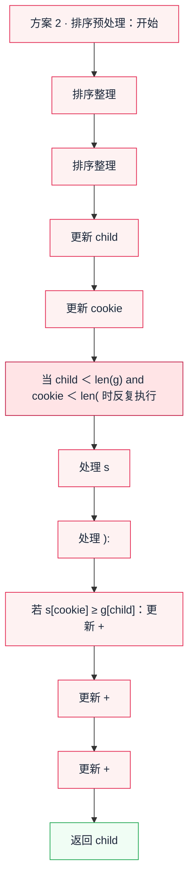

```python
import sys  # 提高递归深度上限（深输入防 RecursionError）

sys.setrecursionlimit(200000)  # 树/链表类题目节点数可达 1e4 量级

def findContentChildren(g, s):  # 定义函数 findContentChildren（参数：g, 字符串）
    g.sort()  # 排序
    s.sort()  # 排序
    child = 0  # 把 0 存入 子节点
    cookie = 0  # 把 0 存入 cookie
    while child < len(g) and cookie < len(
        s
    ):  # 循环，直到不满足「子节点 小于 长度(g) and cookie 小于 长度(字符串」
        if s[cookie] >= g[child]:  # 若 字符串[cookie] 不低于 g[子节点]
            child += 1  # 子节点累加 1
        cookie += 1  # cookie累加 1
    return child  # 返回 子节点

if __name__ == "__main__":  # 若 __name__ 等于 '__main__'
    print(findContentChildren([1, 2, 3], [1, 1]))  # 打印输出
    print(findContentChildren([1, 2], [1, 2, 3]))  # 打印输出
```

#### 方案 3：双指针收缩

**思路与代码分析**：核心是「双指针收缩」。Python 版用切片与字典推导式简化操作，突出可读性。代码里依次做这些事：先排序再处理。**走读**：方案 3 · 双指针收缩：开始 → 排序整理 → 排序整理 → 更新 j → 更新 count → 遍历 g: 中的每个元素 child → 更新 k → 若 k ＜ len(s)：更新 + → 更新 + → 更新 j → 跳出循环（break） → 返回 count。

**运行架构**（真实控制流）：

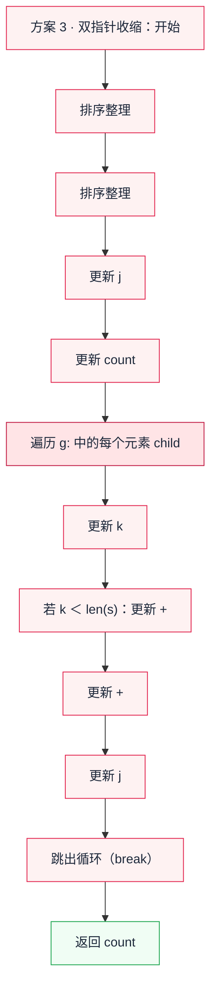

```python
import sys  # 提高递归深度上限（深输入防 RecursionError）

sys.setrecursionlimit(200000)  # 树/链表类题目节点数可达 1e4 量级
import bisect  # 引入依赖

def findContentChildren(g, s):  # 定义函数 findContentChildren（参数：g, 字符串）
    # 排序后用指针贪心匹配，剩余饼干用二分查找定位可满足的最小饼干
    g.sort()  # 排序
    s.sort()  # 排序
    j = 0  # 把 0 存入 下标 j
    count = 0  # 把 0 存入 计数
    for child in g:  # 逐个取出 g 的元素（子节点）
        k = bisect.bisect_left(s, child, j)  # 把 bisect.bisect_left(字符串, 子节点, 下标 j) 存入 下标 k
        if k < len(s):  # 若 下标 k 小于 长度(字符串
            count += 1  # 计数累加 1
            j = k + 1  # 把 下标 k 加 1 存入 下标 j
        else:  # 否则
            break  # 跳出循环
    return count  # 返回 计数

if __name__ == "__main__":  # 若 __name__ 等于 '__main__'
    print(findContentChildren([1, 2, 3], [1, 1]))  # 打印输出
    print(findContentChildren([1, 2], [1, 2, 3]))  # 打印输出
```

#### 方案 4：排序预处理

**思路与代码分析**：核心是「排序预处理」。Python 版用切片与字典推导式简化操作，突出可读性。代码里依次做这些事：先排序再处理。**走读**：方案 4 · 排序预处理：开始 → 排序整理 → 排序整理 → 更新 i → 当 i ＜ len(g) and j ＜ len(s): 时反复执行 → 若 s[j] ≥ g[i]：更新 + → 更新 + → 更新 + → 返回 i。

**运行架构**（真实控制流）：

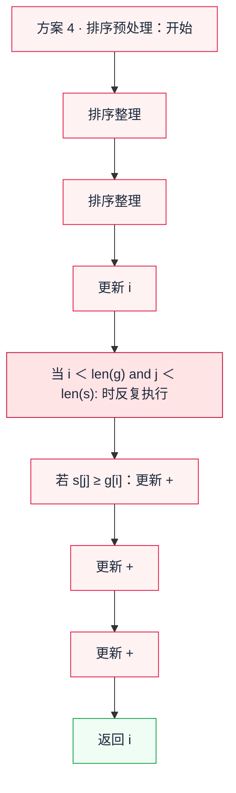

```python
import sys  # 提高递归深度上限（深输入防 RecursionError）

sys.setrecursionlimit(200000)  # 树/链表类题目节点数可达 1e4 量级

def findContentChildren(g, s):  # 定义函数 findContentChildren（参数：g, 字符串）
    # 贪心：对每个孩子分配 >= 其胃口的最小饼干（计数版，避免越界）
    g.sort()  # 排序
    s.sort()  # 排序
    i = j = 0  # 把 下标 j 赋值为 0 存入 下标 i
    while i < len(g) and j < len(s):  # 循环，直到不满足「下标 i 小于 长度(g) and 下标 j 小于 长度(字符串」
        if s[j] >= g[i]:  # 若 字符串[下标 j] 不低于 g[下标 i]
            i += 1  # 下标 i累加 1
        j += 1  # 下标 j累加 1
    return i  # 返回 下标 i

if __name__ == "__main__":  # 若 __name__ 等于 '__main__'
    print(findContentChildren([1, 2, 3], [1, 1]))  # 打印输出
    print(findContentChildren([1, 2], [1, 2, 3]))  # 打印输出
```

#### 方案 5：排序预处理

**思路与代码分析**：核心是「排序预处理」。Python 版用切片与字典推导式简化操作，突出可读性。代码里依次做这些事：先排序再处理。**走读**：方案 5 · 排序预处理：开始 → 排序整理 → 排序整理 → 更新 i → 遍历 s: 中的每个元素 cookie → 若 i ＜ len(g) and cookie ≥ g[i]：更新 + → 更新 + → 返回 i。

**运行架构**（真实控制流）：

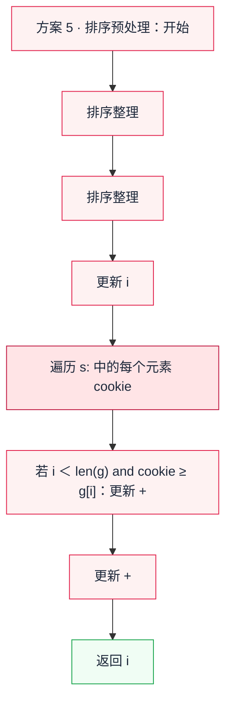

```python
import sys  # 提高递归深度上限（深输入防 RecursionError）

sys.setrecursionlimit(200000)  # 树/链表类题目节点数可达 1e4 量级

def findContentChildren(g, s):  # 定义函数 findContentChildren（参数：g, 字符串）
    # 贪心双指针：均升序排序后，用每块饼干去满足当前最小胃口的孩子
    g.sort()  # 排序
    s.sort()  # 排序
    i = 0  # 把 0 存入 下标 i
    for cookie in s:  # 逐个取出 字符串 的元素（cookie）
        if i < len(g) and cookie >= g[i]:  # 若 下标 i 小于 长度(g) and cookie 不低于 g[下标 i]
            i += 1  # 下标 i累加 1
    return i  # 返回 下标 i

if __name__ == "__main__":  # 若 __name__ 等于 '__main__'
    print(findContentChildren([1, 2, 3], [1, 1]))  # 打印输出
    print(findContentChildren([1, 2], [1, 2, 3]))  # 打印输出
```

#### 方案 6：排序预处理

**思路与代码分析**：核心是「排序预处理」。Python 版用切片与字典推导式简化操作，突出可读性。代码里依次做这些事：先排序再处理。**走读**：方案 6 · 排序预处理：开始 → 排序整理 → 排序整理 → 更新 j → 更新 n → 更新 count → 遍历 g: 中的每个元素 child → 当 ( 时反复执行 → 处理 j ＜ n and s[j] ＜ child → 处理 ): → 更新 + → 若 j ＜ n：更新 + → 更新 + → 更新 + → 跳出循环（break） → 返回 count。

**运行架构**（真实控制流）：

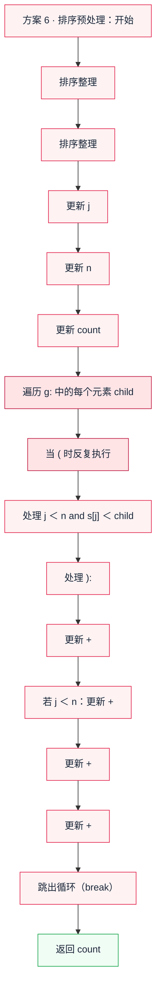

```python
import sys  # 提高递归深度上限（深输入防 RecursionError）

sys.setrecursionlimit(200000)  # 树/链表类题目节点数可达 1e4 量级

def findContentChildren(g, s):  # 定义函数 findContentChildren（参数：g, 字符串）
    # 双指针：遍历孩子，为其寻找第一块能满足的最小饼干；计满足条件的孩子数
    g.sort()  # 排序
    s.sort()  # 排序
    j = 0  # 把 0 存入 下标 j
    n = len(s)  # 把 长度(字符串) 存入 元素个数
    count = 0  # 把 0 存入 计数
    for child in g:  # 逐个取出 g 的元素（子节点）
        while (
            j < n and s[j] < child
        ):  # 循环，直到不满足「下标 j 小于 元素个数 and 字符串[下标 j] 小于 子节点」
            j += 1  # 下标 j累加 1
        if j < n:  # 若 下标 j 小于 元素个数
            count += 1  # 计数累加 1
            j += 1  # 下标 j累加 1
        else:  # 否则
            break  # 跳出循环
    return count  # 返回 计数

if __name__ == "__main__":  # 若 __name__ 等于 '__main__'
    print(findContentChildren([1, 2, 3], [1, 1]))  # 打印输出
    print(findContentChildren([1, 2], [1, 2, 3]))  # 打印输出
```

### Go 实现（6 种方案）

Go 的全部方案如下，每个方案都内嵌用例自测，可独立运行（老仓库 python/go 文件遵循「打印结果」约定）：

#### 方案 1：排序预处理

**思路与代码分析**：核心是「排序预处理」。Go 版用切片与多返回值惯用法，显式处理索引边界。**走读**：方案 1 · 排序预处理：开始 → 调用 sort.Ints(g) → 调用 sort.Ints(s) → 更新 : → 更新 : → 遍历循环 → 处理 if s[cookie] ≥ g[child] → 处理 child++ → 处理 cookie++ → 返回 child。

**运行架构**（真实控制流）：

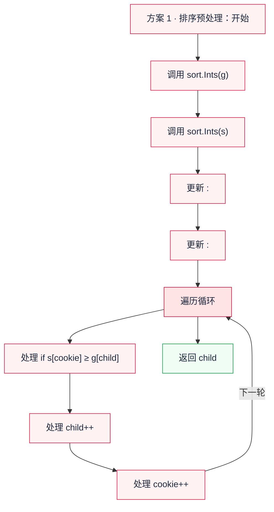

```go
package main // 引入依赖
import (
	"fmt"
	"os"
	"sort"
) // 引入依赖
func findContentChildren(g []int, s []int) int { // 定义函数/方法 findContentChildren
	sort.Ints(g)                            // sort.Ints(g)
	sort.Ints(s)                            // sort.Ints(字符串)
	child := 0                              // 把 0 写入 child :
	cookie := 0                             // 把 0 写入 cookie :
	for child < len(g) && cookie < len(s) { // for 子节点 小于 长度(g) 且 cookie 小于 长度(字符串) {
		if s[cookie] >= g[child] { // 若 字符串[cookie] 不低于 g[子节点]
			child++ // 子节点 加一
		}
		cookie++ // cookie 加一
	}
	return child // 返回 子节点
}
func main() { // 程序入口：跑内嵌自测用例
	cases := []struct {
		g    []int
		s    []int
		want int
	}{ // 把 []struct{ g []int; 字符串 []int; want int }{ 写入 cases :
		{[]int{1, 2, 3}, []int{1, 1}, 1},
		{[]int{1, 2}, []int{1, 2, 3}, 2},
	}
	ok := true                // 把 true 写入 ok :
	for _, c := range cases { // 同时取 _ 与 字符 遍历
		if got := findContentChildren(c.g, c.s); got != c.want {
			ok = false
			fmt.Printf("FAIL got %d want %d\n", got, c.want) // 打印输出
		}
	}
	if !ok {
		os.Exit(1)
	} // 若 取反 ok { os.Exit(1) }
	fmt.Println("PASS") // 全部用例通过，输出 PASS
}
```

#### 方案 2：排序预处理

**思路与代码分析**：核心是「排序预处理」。Go 版用切片与多返回值惯用法，显式处理索引边界。**走读**：方案 2 · 排序预处理：开始 → 调用 sort.Ints(g) → 调用 sort.Ints(s) → 更新 : → 更新 : → 遍历循环 → 处理 if s[cookie] ≥ g[child] → 处理 child++ → 处理 cookie++ → 返回 child。

**运行架构**（真实控制流）：


```go
package main // 引入依赖
import (
	"fmt"
	"os"
	"sort"
) // 引入依赖
func findContentChildren(g []int, s []int) int { // 定义函数/方法 findContentChildren
	sort.Ints(g)                            // sort.Ints(g)
	sort.Ints(s)                            // sort.Ints(字符串)
	child := 0                              // 把 0 写入 child :
	cookie := 0                             // 把 0 写入 cookie :
	for child < len(g) && cookie < len(s) { // for 子节点 小于 长度(g) 且 cookie 小于 长度(字符串) {
		if s[cookie] >= g[child] { // 若 字符串[cookie] 不低于 g[子节点]
			child++ // 子节点 加一
		}
		cookie++ // cookie 加一
	}
	return child // 返回 子节点
}
func main() { // 程序入口：跑内嵌自测用例
	cases := []struct {
		g    []int
		s    []int
		want int
	}{ // 把 []struct{ g []int; 字符串 []int; want int }{ 写入 cases :
		{[]int{1, 2, 3}, []int{1, 1}, 1},
		{[]int{1, 2}, []int{1, 2, 3}, 2},
	}
	ok := true                // 把 true 写入 ok :
	for _, c := range cases { // 同时取 _ 与 字符 遍历
		if got := findContentChildren(c.g, c.s); got != c.want {
			ok = false
			fmt.Printf("FAIL got %d want %d\n", got, c.want) // 打印输出
		}
	}
	if !ok {
		os.Exit(1)
	} // 若 取反 ok { os.Exit(1) }
	fmt.Println("PASS") // 全部用例通过，输出 PASS
}
```

#### 方案 3：双指针收缩

**思路与代码分析**：核心是「双指针收缩」。Go 版用切片与多返回值惯用法，显式处理索引边界。**走读**：方案 3 · 双指针收缩：开始 → 调用 sort.Ints(g) → 调用 sort.Ints(s) → 更新 : → 更新 : → 遍历 g 的下标与元素 child → 更新 : → 处理 if k ＜ len(s) → 处理 count++ → 更新 j → 跳出循环（break） → 返回 count。

**运行架构**（真实控制流）：

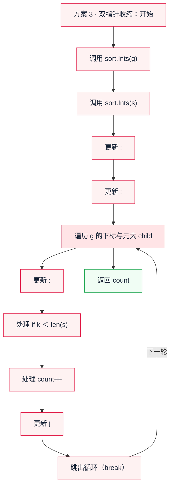

```go
package main // 引入依赖
import (
	"fmt"
	"os"
	"sort"
) // 引入依赖
func bisectLeft(s []int, x int, lo int) int { // 定义函数/方法 bisectLeft
	for lo < len(s) && s[lo] < x { // for 左边界 小于 长度(字符串) 且 字符串[左边界] 小于 x {
		lo++ // 左边界 加一
	}
	return lo // 返回 左边界
}
func findContentChildren(g []int, s []int) int { // 定义函数/方法 findContentChildren
	sort.Ints(g)              // sort.Ints(g)
	sort.Ints(s)              // sort.Ints(字符串)
	j := 0                    // 把 0 写入 j :
	count := 0                // 把 0 写入 count :
	for _, child := range g { // 同时取 _ 与 子节点 遍历
		k := bisectLeft(s, child, j) // 把 bisectLeft(字符串, 子节点, 下标 j) 写入 k :
		if k < len(s) {              // 若 下标 k 小于 长度(字符串
			count++   // 计数 加一
			j = k + 1 // 把 下标 k 加 1 写入 下标 j
		} else { // 否则
			break // 跳出循环
		}
	}
	return count // 返回 计数
}
func main() { // 程序入口：跑内嵌自测用例
	cases := []struct {
		g    []int
		s    []int
		want int
	}{ // 把 []struct{ g []int; 字符串 []int; want int }{ 写入 cases :
		{[]int{1, 2, 3}, []int{1, 1}, 1},
		{[]int{1, 2}, []int{1, 2, 3}, 2},
	}
	ok := true                // 把 true 写入 ok :
	for _, c := range cases { // 同时取 _ 与 字符 遍历
		if got := findContentChildren(c.g, c.s); got != c.want {
			ok = false
			fmt.Printf("FAIL got %d want %d\n", got, c.want) // 打印输出
		}
	}
	if !ok {
		os.Exit(1)
	} // 若 取反 ok { os.Exit(1) }
	fmt.Println("PASS") // 全部用例通过，输出 PASS
}
```

#### 方案 4：排序预处理

**思路与代码分析**：核心是「排序预处理」。Go 版用切片与多返回值惯用法，显式处理索引边界。**走读**：方案 4 · 排序预处理：开始 → 调用 sort.Ints(g) → 调用 sort.Ints(s) → 更新 : → 遍历循环 → 处理 if s[j] ≥ g[i] → 处理 i++ → 处理 j++ → 返回 i。

**运行架构**（真实控制流）：

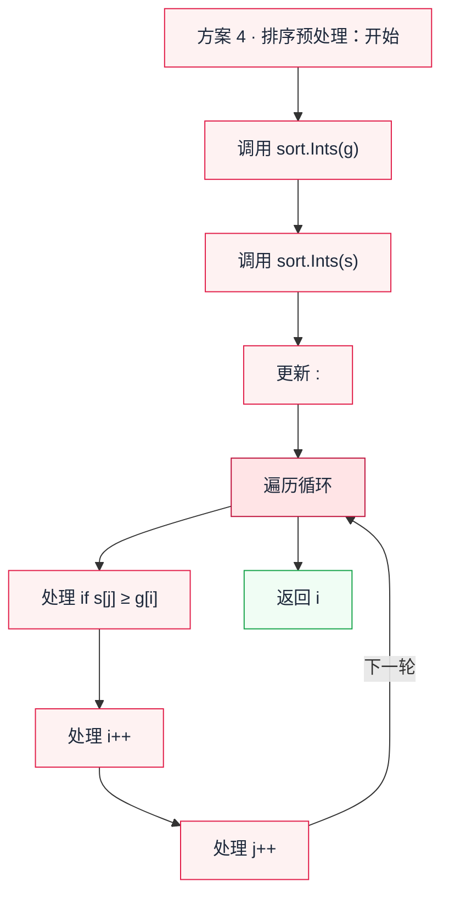

```go
package main // 引入依赖
import (
	"fmt"
	"os"
	"sort"
) // 引入依赖
func findContentChildren(g []int, s []int) int { // 定义函数/方法 findContentChildren
	sort.Ints(g)                   // sort.Ints(g)
	sort.Ints(s)                   // sort.Ints(字符串)
	i, j := 0, 0                   // 把 0, 0 写入 i, j :
	for i < len(g) && j < len(s) { // for 下标 i 小于 长度(g) 且 下标 j 小于 长度(字符串) {
		if s[j] >= g[i] { // 若 字符串[下标 j] 不低于 g[下标 i]
			i++ // 下标 i 加一
		}
		j++ // 下标 j 加一
	}
	return i // 返回 下标 i
}
func main() { // 程序入口：跑内嵌自测用例
	cases := []struct {
		g    []int
		s    []int
		want int
	}{ // 把 []struct{ g []int; 字符串 []int; want int }{ 写入 cases :
		{[]int{1, 2, 3}, []int{1, 1}, 1},
		{[]int{1, 2}, []int{1, 2, 3}, 2},
	}
	ok := true                // 把 true 写入 ok :
	for _, c := range cases { // 同时取 _ 与 字符 遍历
		if got := findContentChildren(c.g, c.s); got != c.want {
			ok = false
			fmt.Printf("FAIL got %d want %d\n", got, c.want) // 打印输出
		}
	}
	if !ok {
		os.Exit(1)
	} // 若 取反 ok { os.Exit(1) }
	fmt.Println("PASS") // 全部用例通过，输出 PASS
}
```

#### 方案 5：排序预处理

**思路与代码分析**：核心是「排序预处理」。Go 版用切片与多返回值惯用法，显式处理索引边界。**走读**：方案 5 · 排序预处理：开始 → 调用 sort.Ints(g) → 调用 sort.Ints(s) → 更新 : → 遍历 s 的下标与元素 cookie → 处理 if i ＜ len(g) 且 cookie ≥ g → 处理 i++ → 返回 i。

**运行架构**（真实控制流）：

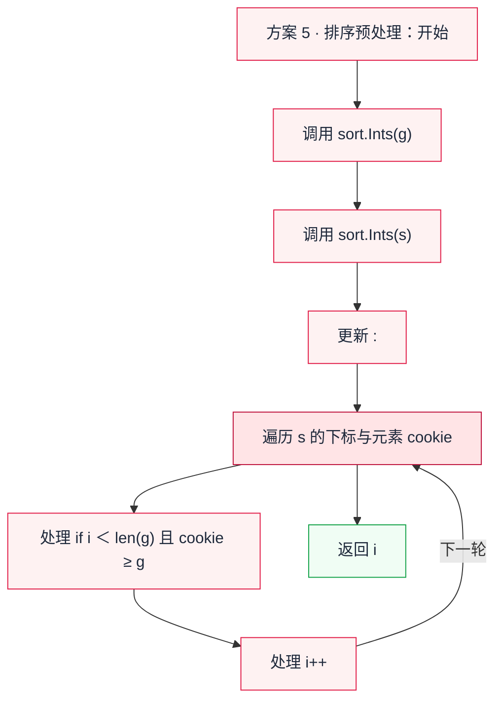

```go
package main // 引入依赖
import (
	"fmt"
	"os"
	"sort"
) // 引入依赖
func findContentChildren(g []int, s []int) int { // 定义函数/方法 findContentChildren
	sort.Ints(g)               // sort.Ints(g)
	sort.Ints(s)               // sort.Ints(字符串)
	i := 0                     // 把 0 写入 i :
	for _, cookie := range s { // 同时取 _ 与 cookie 遍历
		if i < len(g) && cookie >= g[i] { // 若 下标 i 小于 长度(g) 且 cookie 不低于 g[下标 i]
			i++ // 下标 i 加一
		}
	}
	return i // 返回 下标 i
}
func main() { // 程序入口：跑内嵌自测用例
	cases := []struct {
		g    []int
		s    []int
		want int
	}{ // 把 []struct{ g []int; 字符串 []int; want int }{ 写入 cases :
		{[]int{1, 2, 3}, []int{1, 1}, 1},
		{[]int{1, 2}, []int{1, 2, 3}, 2},
	}
	ok := true                // 把 true 写入 ok :
	for _, c := range cases { // 同时取 _ 与 字符 遍历
		if got := findContentChildren(c.g, c.s); got != c.want {
			ok = false
			fmt.Printf("FAIL got %d want %d\n", got, c.want) // 打印输出
		}
	}
	if !ok {
		os.Exit(1)
	} // 若 取反 ok { os.Exit(1) }
	fmt.Println("PASS") // 全部用例通过，输出 PASS
}
```

#### 方案 6：排序预处理

**思路与代码分析**：核心是「排序预处理」。Go 版用切片与多返回值惯用法，显式处理索引边界。**走读**：方案 6 · 排序预处理：开始 → 调用 sort.Ints(g) → 调用 sort.Ints(s) → 更新 : → 更新 : → 更新 : → 遍历 g 的下标与元素 child → 遍历循环 → 处理 j++ → 处理 if j ＜ n → 处理 count++ → 处理 j++ → 跳出循环（break） → 返回 count。

**运行架构**（真实控制流）：

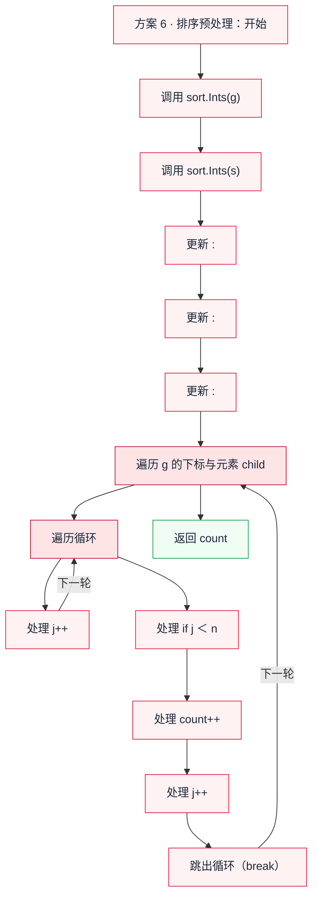

```go
package main // 引入依赖
import (
	"fmt"
	"os"
	"sort"
) // 引入依赖
func findContentChildren(g []int, s []int) int { // 定义函数/方法 findContentChildren
	sort.Ints(g)              // sort.Ints(g)
	sort.Ints(s)              // sort.Ints(字符串)
	j := 0                    // 把 0 写入 j :
	n := len(s)               // 把 长度(字符串) 写入 n :
	count := 0                // 把 0 写入 count :
	for _, child := range g { // 同时取 _ 与 子节点 遍历
		for j < n && s[j] < child { // for 下标 j 小于 元素个数 且 字符串[下标 j] 小于 子节点 {
			j++ // 下标 j 加一
		}
		if j < n { // 若 下标 j 小于 元素个数
			count++ // 计数 加一
			j++     // 下标 j 加一
		} else { // 否则
			break // 跳出循环
		}
	}
	return count // 返回 计数
}
func main() { // 程序入口：跑内嵌自测用例
	cases := []struct {
		g    []int
		s    []int
		want int
	}{ // 把 []struct{ g []int; 字符串 []int; want int }{ 写入 cases :
		{[]int{1, 2, 3}, []int{1, 1}, 1},
		{[]int{1, 2}, []int{1, 2, 3}, 2},
	}
	ok := true                // 把 true 写入 ok :
	for _, c := range cases { // 同时取 _ 与 字符 遍历
		if got := findContentChildren(c.g, c.s); got != c.want {
			ok = false
			fmt.Printf("FAIL got %d want %d\n", got, c.want) // 打印输出
		}
	}
	if !ok {
		os.Exit(1)
	} // 若 取反 ok { os.Exit(1) }
	fmt.Println("PASS") // 全部用例通过，输出 PASS
}
```

### Java 实现（6 种方案）

Java 的全部方案如下，每个方案都内嵌用例自测，可独立运行（老仓库 python/go 文件遵循「打印结果」约定）：

#### 方案 1：排序预处理

**思路与代码分析**：核心是「排序预处理」。Java 版用类与静态方法组织，集合操作显式明了。代码里依次做这些事：先排序再处理。**走读**：方案 1 · 排序预处理：开始 → 排序整理 → 排序整理 → 更新 i → 当 (i ＜ g.length 且 j ＜ s.length) 时反复执行 → 若 s[j] ≥ g[i] 则： → 处理 ans++ → 处理 i++ → 处理 j++ → 处理 j++ → 返回 ans。

**运行架构**（真实控制流）：

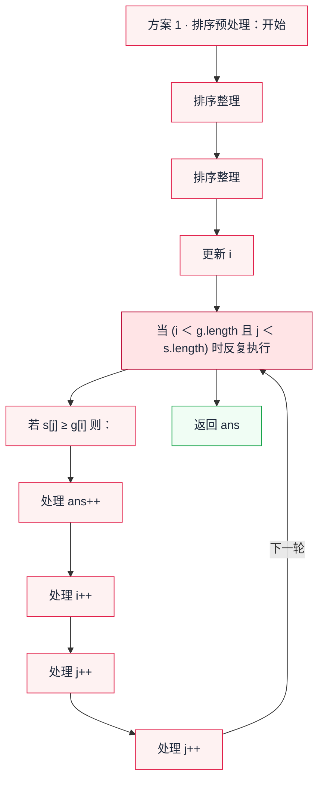

```java
package com.webfault.dsa; // 引入依赖

import java.util.Arrays; // 引入依赖

class Main { // 定义类型
  static int findContentChildren(int[] g, int[] s) { // 定义函数/方法 findContentChildren
    Arrays.sort(g);
    Arrays.sort(s); // 排序
    int i = 0, j = 0, ans = 0; // 把 0, 下标 j 赋值为 0, 答案 赋值为 0 存入 下标 i
    while (i < g.length && j < s.length) { // 循环，直到不满足「下标 i 小于 g.长度 且 下标 j 小于 字符串.长度」
      if (s[j] >= g[i]) {
        ans++;
        i++;
        j++;
      } else {
        j++;
      }
    }
    return ans; // 返回 答案
  }

  public static void main(String[] args) { // public static void main(String[] args) {
    int[][] g = {{1, 2, 3}, {1, 2}, {1, 2, 3}};
    int[][] s = {{1, 1}, {1, 2, 3}, {3}};
    int[] ws = {1, 2, 1};
    boolean ok = true; // 把 true; 写入 boolean ok
    for (int i = 0; i < g.length; i++) { // 让 下标 i 从 0 开始计数，下标 i 小于 g.长度 就继续
      int got = findContentChildren(g[i], s[i]); // 把 findContentChildren(g[下标 i], 字符串[下标 i]) 存入 got
      if (got != ws[i]) {
        ok = false;
        System.out.println("FAIL " + got + " want " + ws[i]);
      }
    }
    if (!ok) throw new RuntimeException("FAILED"); // 若 取反 ok) throw new RuntimeException(「FAILED」);
    System.out.println("PASS"); // 全部用例通过，输出 PASS
  }
}
```

#### 方案 2：排序预处理

**思路与代码分析**：核心是「排序预处理」。Java 版用类与静态方法组织，集合操作显式明了。代码里依次做这些事：先排序再处理。**走读**：方案 2 · 排序预处理：开始 → 排序整理 → 排序整理 → 更新 child → 当 (child ＜ g.length 且 cookie ＜ s.length) 时反复执行 → 若 s[cookie] ≥ g[child]：处理 child++ → 处理 cookie++ → 返回 child。

**运行架构**（真实控制流）：

```mermaid
graph TD
    N0["方案 2 · 排序预处理：开始"]
    N1["排序整理"]
    N2["排序整理"]
    N3["更新 child"]
    N4["当 (child ＜ g.length 且 cookie ＜ s.length) 时反复执行"]
    N5["若 s[cookie] ≥ g[child]：处理 child++"]
    N6["处理 cookie++"]
    N7["返回 child"]
    N0 --> N1
    N1 --> N2
    N2 --> N3
    N3 --> N4
    N4 --> N5
    N5 --> N6
    N6 -- 下一轮 --> N4
    N4 --> N7
    classDef n fill:#fef2f2,stroke:#e11d48,color:#1e293b;
    classDef lp fill:#ffe4e6,stroke:#be123c,color:#1e293b;
    classDef dc fill:#fef9c3,stroke:#ca8a04,color:#1e293b;
    classDef tm fill:#f0fdf4,stroke:#16a34a,color:#1e293b;
    class N0,N1,N2,N3,N5,N6 n;
    class N4 lp;
    class N7 tm;
```

```java
package com.webfault.dsa; // 引入依赖

import java.util.*; // 引入依赖

class Lc455 { // 定义类型
  int findContentChildren(int[] g, int[] s) { // 定义函数/方法 findContentChildren
    Arrays.sort(g);
    Arrays.sort(s); // 排序
    int child = 0, cookie = 0; // 把 0, cookie 赋值为 0 存入 子节点
    while (child < g.length && cookie < s.length) { // 循环，直到不满足「子节点 小于 g.长度 且 cookie 小于 字符串.长度」
      if (s[cookie] >= g[child]) child++; // 若 字符串[cookie] 不低于 g[子节点]) 子节点 加一 ;
      cookie++; // cookie 加一
    }
    return child; // 返回 子节点
  }

  public static void main(String[] args) { // public static void main(String[] args){
    Lc455 s = new Lc455(); // 把 new Lc455(); 写入 Lc455 s
    boolean ok = true; // 把 true; 写入 boolean ok
    if (s.findContentChildren(new int[] {1, 2, 3}, new int[] {1, 1}) != 1) {
      ok = false;
      System.out.println("FAIL1");
    }
    if (s.findContentChildren(new int[] {1, 2}, new int[] {1, 2, 3}) != 2) {
      ok = false;
      System.out.println("FAIL2");
    }
    if (!ok) throw new RuntimeException("FAILED"); // 若 取反 ok) throw new RuntimeException(「FAILED」);
    System.out.println("PASS"); // 全部用例通过，输出 PASS
  }
}
```

#### 方案 3：双指针收缩

**思路与代码分析**：核心是「双指针收缩」。Java 版用类与静态方法组织，集合操作显式明了。代码里依次做这些事：先排序再处理。**走读**：方案 3 · 双指针收缩：开始 → 排序整理 → 排序整理 → 更新 child → 当 (child ＜ g.length 且 cookie ＜ s.length) 时反复执行 → 若 s[cookie] ≥ g[child]：处理 child++ → 处理 cookie++ → 返回 child。

**运行架构**（真实控制流）：

```mermaid
graph TD
    N0["方案 3 · 双指针收缩：开始"]
    N1["排序整理"]
    N2["排序整理"]
    N3["更新 child"]
    N4["当 (child ＜ g.length 且 cookie ＜ s.length) 时反复执行"]
    N5["若 s[cookie] ≥ g[child]：处理 child++"]
    N6["处理 cookie++"]
    N7["返回 child"]
    N0 --> N1
    N1 --> N2
    N2 --> N3
    N3 --> N4
    N4 --> N5
    N5 --> N6
    N6 -- 下一轮 --> N4
    N4 --> N7
    classDef n fill:#fef2f2,stroke:#e11d48,color:#1e293b;
    classDef lp fill:#ffe4e6,stroke:#be123c,color:#1e293b;
    classDef dc fill:#fef9c3,stroke:#ca8a04,color:#1e293b;
    classDef tm fill:#f0fdf4,stroke:#16a34a,color:#1e293b;
    class N0,N1,N2,N3,N5,N6 n;
    class N4 lp;
    class N7 tm;
```

```java
package com.webfault.dsa; // 引入依赖

import java.util.*; // 引入依赖

class Lc455 { // 定义类型
  int findContentChildren(int[] g, int[] s) { // 定义函数/方法 findContentChildren
    Arrays.sort(g);
    Arrays.sort(s); // 排序
    int child = 0, cookie = 0; // 把 0, cookie 赋值为 0 存入 子节点
    while (child < g.length && cookie < s.length) { // 循环，直到不满足「子节点 小于 g.长度 且 cookie 小于 字符串.长度」
      if (s[cookie] >= g[child]) child++; // 若 字符串[cookie] 不低于 g[子节点]) 子节点 加一 ;
      cookie++; // cookie 加一
    }
    return child; // 返回 子节点
  }

  public static void main(String[] args) { // public static void main(String[] args){
    Lc455 s = new Lc455(); // 把 new Lc455(); 写入 Lc455 s
    boolean ok = true; // 把 true; 写入 boolean ok
    if (s.findContentChildren(new int[] {1, 2, 3}, new int[] {1, 1}) != 1) {
      ok = false;
      System.out.println("FAIL1");
    }
    if (s.findContentChildren(new int[] {1, 2}, new int[] {1, 2, 3}) != 2) {
      ok = false;
      System.out.println("FAIL2");
    }
    if (!ok) throw new RuntimeException("FAILED"); // 若 取反 ok) throw new RuntimeException(「FAILED」);
    System.out.println("PASS"); // 全部用例通过，输出 PASS
  }
}
```

#### 方案 4：排序预处理

**思路与代码分析**：核心是「排序预处理」。Java 版用类与静态方法组织，集合操作显式明了。代码里依次做这些事：先排序再处理。**走读**：方案 4 · 排序预处理：开始 → 排序整理 → 排序整理 → 更新 child → 当 (child ＜ g.length 且 cookie ＜ s.length) 时反复执行 → 若 s[cookie] ≥ g[child]：处理 child++ → 处理 cookie++ → 返回 child。

**运行架构**（真实控制流）：

```mermaid
graph TD
    N0["方案 4 · 排序预处理：开始"]
    N1["排序整理"]
    N2["排序整理"]
    N3["更新 child"]
    N4["当 (child ＜ g.length 且 cookie ＜ s.length) 时反复执行"]
    N5["若 s[cookie] ≥ g[child]：处理 child++"]
    N6["处理 cookie++"]
    N7["返回 child"]
    N0 --> N1
    N1 --> N2
    N2 --> N3
    N3 --> N4
    N4 --> N5
    N5 --> N6
    N6 -- 下一轮 --> N4
    N4 --> N7
    classDef n fill:#fef2f2,stroke:#e11d48,color:#1e293b;
    classDef lp fill:#ffe4e6,stroke:#be123c,color:#1e293b;
    classDef dc fill:#fef9c3,stroke:#ca8a04,color:#1e293b;
    classDef tm fill:#f0fdf4,stroke:#16a34a,color:#1e293b;
    class N0,N1,N2,N3,N5,N6 n;
    class N4 lp;
    class N7 tm;
```

```java
package com.webfault.dsa; // 引入依赖

import java.util.*; // 引入依赖

class Lc455 { // 定义类型
  int findContentChildren(int[] g, int[] s) { // 定义函数/方法 findContentChildren
    Arrays.sort(g);
    Arrays.sort(s); // 排序
    int child = 0, cookie = 0; // 把 0, cookie 赋值为 0 存入 子节点
    while (child < g.length && cookie < s.length) { // 循环，直到不满足「子节点 小于 g.长度 且 cookie 小于 字符串.长度」
      if (s[cookie] >= g[child]) child++; // 若 字符串[cookie] 不低于 g[子节点]) 子节点 加一 ;
      cookie++; // cookie 加一
    }
    return child; // 返回 子节点
  }

  public static void main(String[] args) { // public static void main(String[] args){
    Lc455 s = new Lc455(); // 把 new Lc455(); 写入 Lc455 s
    boolean ok = true; // 把 true; 写入 boolean ok
    if (s.findContentChildren(new int[] {1, 2, 3}, new int[] {1, 1}) != 1) {
      ok = false;
      System.out.println("FAIL1");
    }
    if (s.findContentChildren(new int[] {1, 2}, new int[] {1, 2, 3}) != 2) {
      ok = false;
      System.out.println("FAIL2");
    }
    if (!ok) throw new RuntimeException("FAILED"); // 若 取反 ok) throw new RuntimeException(「FAILED」);
    System.out.println("PASS"); // 全部用例通过，输出 PASS
  }
}
```

#### 方案 5：排序预处理

**思路与代码分析**：核心是「排序预处理」。Java 版用类与静态方法组织，集合操作显式明了。代码里依次做这些事：先排序再处理。**走读**：方案 5 · 排序预处理：开始 → 排序整理 → 排序整理 → 更新 child → 当 (child ＜ g.length 且 cookie ＜ s.length) 时反复执行 → 若 s[cookie] ≥ g[child]：处理 child++ → 处理 cookie++ → 返回 child。

**运行架构**（真实控制流）：

```mermaid
graph TD
    N0["方案 5 · 排序预处理：开始"]
    N1["排序整理"]
    N2["排序整理"]
    N3["更新 child"]
    N4["当 (child ＜ g.length 且 cookie ＜ s.length) 时反复执行"]
    N5["若 s[cookie] ≥ g[child]：处理 child++"]
    N6["处理 cookie++"]
    N7["返回 child"]
    N0 --> N1
    N1 --> N2
    N2 --> N3
    N3 --> N4
    N4 --> N5
    N5 --> N6
    N6 -- 下一轮 --> N4
    N4 --> N7
    classDef n fill:#fef2f2,stroke:#e11d48,color:#1e293b;
    classDef lp fill:#ffe4e6,stroke:#be123c,color:#1e293b;
    classDef dc fill:#fef9c3,stroke:#ca8a04,color:#1e293b;
    classDef tm fill:#f0fdf4,stroke:#16a34a,color:#1e293b;
    class N0,N1,N2,N3,N5,N6 n;
    class N4 lp;
    class N7 tm;
```

```java
package com.webfault.dsa; // 引入依赖

import java.util.*; // 引入依赖

class Lc455 { // 定义类型
  int findContentChildren(int[] g, int[] s) { // 定义函数/方法 findContentChildren
    Arrays.sort(g);
    Arrays.sort(s); // 排序
    int child = 0, cookie = 0; // 把 0, cookie 赋值为 0 存入 子节点
    while (child < g.length && cookie < s.length) { // 循环，直到不满足「子节点 小于 g.长度 且 cookie 小于 字符串.长度」
      if (s[cookie] >= g[child]) child++; // 若 字符串[cookie] 不低于 g[子节点]) 子节点 加一 ;
      cookie++; // cookie 加一
    }
    return child; // 返回 子节点
  }

  public static void main(String[] args) { // public static void main(String[] args){
    Lc455 s = new Lc455(); // 把 new Lc455(); 写入 Lc455 s
    boolean ok = true; // 把 true; 写入 boolean ok
    if (s.findContentChildren(new int[] {1, 2, 3}, new int[] {1, 1}) != 1) {
      ok = false;
      System.out.println("FAIL1");
    }
    if (s.findContentChildren(new int[] {1, 2}, new int[] {1, 2, 3}) != 2) {
      ok = false;
      System.out.println("FAIL2");
    }
    if (!ok) throw new RuntimeException("FAILED"); // 若 取反 ok) throw new RuntimeException(「FAILED」);
    System.out.println("PASS"); // 全部用例通过，输出 PASS
  }
}
```

#### 方案 6：排序预处理

**思路与代码分析**：核心是「排序预处理」。Java 版用类与静态方法组织，集合操作显式明了。代码里依次做这些事：先排序再处理。**走读**：方案 6 · 排序预处理：开始 → 排序整理 → 排序整理 → 更新 child → 当 (child ＜ g.length 且 cookie ＜ s.length) 时反复执行 → 若 s[cookie] ≥ g[child]：处理 child++ → 处理 cookie++ → 返回 child。

**运行架构**（真实控制流）：

```mermaid
graph TD
    N0["方案 6 · 排序预处理：开始"]
    N1["排序整理"]
    N2["排序整理"]
    N3["更新 child"]
    N4["当 (child ＜ g.length 且 cookie ＜ s.length) 时反复执行"]
    N5["若 s[cookie] ≥ g[child]：处理 child++"]
    N6["处理 cookie++"]
    N7["返回 child"]
    N0 --> N1
    N1 --> N2
    N2 --> N3
    N3 --> N4
    N4 --> N5
    N5 --> N6
    N6 -- 下一轮 --> N4
    N4 --> N7
    classDef n fill:#fef2f2,stroke:#e11d48,color:#1e293b;
    classDef lp fill:#ffe4e6,stroke:#be123c,color:#1e293b;
    classDef dc fill:#fef9c3,stroke:#ca8a04,color:#1e293b;
    classDef tm fill:#f0fdf4,stroke:#16a34a,color:#1e293b;
    class N0,N1,N2,N3,N5,N6 n;
    class N4 lp;
    class N7 tm;
```

```java
package com.webfault.dsa; // 引入依赖

import java.util.*; // 引入依赖

class Lc455 { // 定义类型
  int findContentChildren(int[] g, int[] s) { // 定义函数/方法 findContentChildren
    Arrays.sort(g);
    Arrays.sort(s); // 排序
    int child = 0, cookie = 0; // 把 0, cookie 赋值为 0 存入 子节点
    while (child < g.length && cookie < s.length) { // 循环，直到不满足「子节点 小于 g.长度 且 cookie 小于 字符串.长度」
      if (s[cookie] >= g[child]) child++; // 若 字符串[cookie] 不低于 g[子节点]) 子节点 加一 ;
      cookie++; // cookie 加一
    }
    return child; // 返回 子节点
  }

  public static void main(String[] args) { // public static void main(String[] args){
    Lc455 s = new Lc455(); // 把 new Lc455(); 写入 Lc455 s
    boolean ok = true; // 把 true; 写入 boolean ok
    if (s.findContentChildren(new int[] {1, 2, 3}, new int[] {1, 1}) != 1) {
      ok = false;
      System.out.println("FAIL1");
    }
    if (s.findContentChildren(new int[] {1, 2}, new int[] {1, 2, 3}) != 2) {
      ok = false;
      System.out.println("FAIL2");
    }
    if (!ok) throw new RuntimeException("FAILED"); // 若 取反 ok) throw new RuntimeException(「FAILED」);
    System.out.println("PASS"); // 全部用例通过，输出 PASS
  }
}
```

### Rust 实现（6 种方案）

Rust 的全部方案如下，每个方案都内嵌用例自测，可独立运行（老仓库 python/go 文件遵循「打印结果」约定）：

#### 方案 1：排序预处理

**思路与代码分析**：核心是「排序预处理」。Rust 版用所有权移动与切片借用改写同一逻辑，注意 Option 与引用边界。代码里依次做这些事：先排序再处理。**走读**：方案 1 · 排序预处理：开始 → 排序整理 → 排序整理 → 计算 let (mut child, mut cook → 当 child ＜ g.len() 且 cookie ＜ s.len() 时反复执行 → 处理 if s[cookie] ≥ g[child] → 更新 + → 更新 + → 处理 child as i32 → 返回结果。

**运行架构**（真实控制流）：

```mermaid
graph TD
    N0["方案 1 · 排序预处理：开始"]
    N1["排序整理"]
    N2["排序整理"]
    N3["计算 let (mut child, mut cook"]
    N4["当 child ＜ g.len() 且 cookie ＜ s.len() 时反复执行"]
    N5["处理 if s[cookie] ≥ g[child]"]
    N6["更新 +"]
    N7["更新 +"]
    N8["处理 child as i32"]
    N9["返回结果"]
    N0 --> N1
    N1 --> N2
    N2 --> N3
    N3 --> N4
    N4 --> N5
    N5 --> N6
    N6 --> N7
    N7 -- 下一轮 --> N4
    N4 --> N8
    N8 --> N9
    classDef n fill:#fef2f2,stroke:#e11d48,color:#1e293b;
    classDef lp fill:#ffe4e6,stroke:#be123c,color:#1e293b;
    classDef dc fill:#fef9c3,stroke:#ca8a04,color:#1e293b;
    classDef tm fill:#f0fdf4,stroke:#16a34a,color:#1e293b;
    class N0,N1,N2,N3,N5,N6,N7,N8 n;
    class N4 lp;
    class N9 tm;
```

```rust
// LeetCode 455. 分发饼干 — Rust 版（方案1）
fn find_content_children(mut g: Vec<i32>, mut s: Vec<i32>) -> i32 {
    // 定义函数/方法 find_content_children
    g.sort(); // 排序
    s.sort(); // 排序
    let (mut child, mut cookie) = (0usize, 0usize); // 把 (0usize, 0usize); 写入 let (mut child, mut cookie)
    while child < g.len() && cookie < s.len() {
        // while 子节点 小于 g.长度() 且 cookie 小于 字符串.长度() {
        if s[cookie] >= g[child] {
            child += 1;
        } // 若 字符串[cookie] 不低于 g[子节点] { 子节点 累加 1; }
        cookie += 1; // cookie累加 1
    }
    child as i32 // 子节点 as i32
}
fn main() {
    // 程序入口：跑内嵌自测用例
    assert_eq!(find_content_children(vec![1, 2, 3], vec![1, 1]), 1); // 断言校验
    assert_eq!(find_content_children(vec![1, 2], vec![1, 2, 3]), 2); // 断言校验
    println!("PASS"); // 全部用例通过，输出 PASS
}
```

#### 方案 2：排序预处理

**思路与代码分析**：核心是「排序预处理」。Rust 版用所有权移动与切片借用改写同一逻辑，注意 Option 与引用边界。代码里依次做这些事：先排序再处理。**走读**：方案 2 · 排序预处理：开始 → 排序整理 → 排序整理 → 计算 let (mut child, mut cook → 当 child ＜ g.len() 且 cookie ＜ s.len() 时反复执行 → 处理 if s[cookie] ≥ g[child] → 更新 + → 更新 + → 处理 child as i32 → 返回结果。

**运行架构**（真实控制流）：

```mermaid
graph TD
    N0["方案 2 · 排序预处理：开始"]
    N1["排序整理"]
    N2["排序整理"]
    N3["计算 let (mut child, mut cook"]
    N4["当 child ＜ g.len() 且 cookie ＜ s.len() 时反复执行"]
    N5["处理 if s[cookie] ≥ g[child]"]
    N6["更新 +"]
    N7["更新 +"]
    N8["处理 child as i32"]
    N9["返回结果"]
    N0 --> N1
    N1 --> N2
    N2 --> N3
    N3 --> N4
    N4 --> N5
    N5 --> N6
    N6 --> N7
    N7 -- 下一轮 --> N4
    N4 --> N8
    N8 --> N9
    classDef n fill:#fef2f2,stroke:#e11d48,color:#1e293b;
    classDef lp fill:#ffe4e6,stroke:#be123c,color:#1e293b;
    classDef dc fill:#fef9c3,stroke:#ca8a04,color:#1e293b;
    classDef tm fill:#f0fdf4,stroke:#16a34a,color:#1e293b;
    class N0,N1,N2,N3,N5,N6,N7,N8 n;
    class N4 lp;
    class N9 tm;
```

```rust
// LeetCode 455. 分发饼干 — Rust 版（方案2）
fn find_content_children(mut g: Vec<i32>, mut s: Vec<i32>) -> i32 {
    // 定义函数/方法 find_content_children
    g.sort(); // 排序
    s.sort(); // 排序
    let (mut child, mut cookie) = (0usize, 0usize); // 把 (0usize, 0usize); 写入 let (mut child, mut cookie)
    while child < g.len() && cookie < s.len() {
        // while 子节点 小于 g.长度() 且 cookie 小于 字符串.长度() {
        if s[cookie] >= g[child] {
            child += 1;
        } // 若 字符串[cookie] 不低于 g[子节点] { 子节点 累加 1; }
        cookie += 1; // cookie累加 1
    }
    child as i32 // 子节点 as i32
}
fn main() {
    // 程序入口：跑内嵌自测用例
    assert_eq!(find_content_children(vec![1, 2, 3], vec![1, 1]), 1); // 断言校验
    assert_eq!(find_content_children(vec![1, 2], vec![1, 2, 3]), 2); // 断言校验
    println!("PASS"); // 全部用例通过，输出 PASS
}
```

#### 方案 3：双指针收缩

**思路与代码分析**：核心是「双指针收缩」。Rust 版用所有权移动与切片借用改写同一逻辑，注意 Option 与引用边界。代码里依次做这些事：先排序再处理。**走读**：方案 3 · 双指针收缩：开始 → 排序整理 → 排序整理 → 计算 let (mut child, mut cook → 当 child ＜ g.len() 且 cookie ＜ s.len() 时反复执行 → 处理 if s[cookie] ≥ g[child] → 更新 + → 更新 + → 处理 child as i32 → 返回结果。

**运行架构**（真实控制流）：

```mermaid
graph TD
    N0["方案 3 · 双指针收缩：开始"]
    N1["排序整理"]
    N2["排序整理"]
    N3["计算 let (mut child, mut cook"]
    N4["当 child ＜ g.len() 且 cookie ＜ s.len() 时反复执行"]
    N5["处理 if s[cookie] ≥ g[child]"]
    N6["更新 +"]
    N7["更新 +"]
    N8["处理 child as i32"]
    N9["返回结果"]
    N0 --> N1
    N1 --> N2
    N2 --> N3
    N3 --> N4
    N4 --> N5
    N5 --> N6
    N6 --> N7
    N7 -- 下一轮 --> N4
    N4 --> N8
    N8 --> N9
    classDef n fill:#fef2f2,stroke:#e11d48,color:#1e293b;
    classDef lp fill:#ffe4e6,stroke:#be123c,color:#1e293b;
    classDef dc fill:#fef9c3,stroke:#ca8a04,color:#1e293b;
    classDef tm fill:#f0fdf4,stroke:#16a34a,color:#1e293b;
    class N0,N1,N2,N3,N5,N6,N7,N8 n;
    class N4 lp;
    class N9 tm;
```

```rust
// LeetCode 455. 分发饼干 — Rust 版（方案3）
fn find_content_children(mut g: Vec<i32>, mut s: Vec<i32>) -> i32 {
    // 定义函数/方法 find_content_children
    g.sort(); // 排序
    s.sort(); // 排序
    let (mut child, mut cookie) = (0usize, 0usize); // 把 (0usize, 0usize); 写入 let (mut child, mut cookie)
    while child < g.len() && cookie < s.len() {
        // while 子节点 小于 g.长度() 且 cookie 小于 字符串.长度() {
        if s[cookie] >= g[child] {
            child += 1;
        } // 若 字符串[cookie] 不低于 g[子节点] { 子节点 累加 1; }
        cookie += 1; // cookie累加 1
    }
    child as i32 // 子节点 as i32
}
fn main() {
    // 程序入口：跑内嵌自测用例
    assert_eq!(find_content_children(vec![1, 2, 3], vec![1, 1]), 1); // 断言校验
    assert_eq!(find_content_children(vec![1, 2], vec![1, 2, 3]), 2); // 断言校验
    println!("PASS"); // 全部用例通过，输出 PASS
}
```

#### 方案 4：排序预处理

**思路与代码分析**：核心是「排序预处理」。Rust 版用所有权移动与切片借用改写同一逻辑，注意 Option 与引用边界。代码里依次做这些事：先排序再处理。**走读**：方案 4 · 排序预处理：开始 → 排序整理 → 排序整理 → 计算 let (mut child, mut cook → 当 child ＜ g.len() 且 cookie ＜ s.len() 时反复执行 → 处理 if s[cookie] ≥ g[child] → 更新 + → 更新 + → 处理 child as i32 → 返回结果。

**运行架构**（真实控制流）：

```mermaid
graph TD
    N0["方案 4 · 排序预处理：开始"]
    N1["排序整理"]
    N2["排序整理"]
    N3["计算 let (mut child, mut cook"]
    N4["当 child ＜ g.len() 且 cookie ＜ s.len() 时反复执行"]
    N5["处理 if s[cookie] ≥ g[child]"]
    N6["更新 +"]
    N7["更新 +"]
    N8["处理 child as i32"]
    N9["返回结果"]
    N0 --> N1
    N1 --> N2
    N2 --> N3
    N3 --> N4
    N4 --> N5
    N5 --> N6
    N6 --> N7
    N7 -- 下一轮 --> N4
    N4 --> N8
    N8 --> N9
    classDef n fill:#fef2f2,stroke:#e11d48,color:#1e293b;
    classDef lp fill:#ffe4e6,stroke:#be123c,color:#1e293b;
    classDef dc fill:#fef9c3,stroke:#ca8a04,color:#1e293b;
    classDef tm fill:#f0fdf4,stroke:#16a34a,color:#1e293b;
    class N0,N1,N2,N3,N5,N6,N7,N8 n;
    class N4 lp;
    class N9 tm;
```

```rust
// LeetCode 455. 分发饼干 — Rust 版（方案4）
fn find_content_children(mut g: Vec<i32>, mut s: Vec<i32>) -> i32 {
    // 定义函数/方法 find_content_children
    g.sort(); // 排序
    s.sort(); // 排序
    let (mut child, mut cookie) = (0usize, 0usize); // 把 (0usize, 0usize); 写入 let (mut child, mut cookie)
    while child < g.len() && cookie < s.len() {
        // while 子节点 小于 g.长度() 且 cookie 小于 字符串.长度() {
        if s[cookie] >= g[child] {
            child += 1;
        } // 若 字符串[cookie] 不低于 g[子节点] { 子节点 累加 1; }
        cookie += 1; // cookie累加 1
    }
    child as i32 // 子节点 as i32
}
fn main() {
    // 程序入口：跑内嵌自测用例
    assert_eq!(find_content_children(vec![1, 2, 3], vec![1, 1]), 1); // 断言校验
    assert_eq!(find_content_children(vec![1, 2], vec![1, 2, 3]), 2); // 断言校验
    println!("PASS"); // 全部用例通过，输出 PASS
}
```

#### 方案 5：排序预处理

**思路与代码分析**：核心是「排序预处理」。Rust 版用所有权移动与切片借用改写同一逻辑，注意 Option 与引用边界。代码里依次做这些事：先排序再处理。**走读**：方案 5 · 排序预处理：开始 → 排序整理 → 排序整理 → 计算 let (mut child, mut cook → 当 child ＜ g.len() 且 cookie ＜ s.len() 时反复执行 → 处理 if s[cookie] ≥ g[child] → 更新 + → 更新 + → 处理 child as i32 → 返回结果。

**运行架构**（真实控制流）：

```mermaid
graph TD
    N0["方案 5 · 排序预处理：开始"]
    N1["排序整理"]
    N2["排序整理"]
    N3["计算 let (mut child, mut cook"]
    N4["当 child ＜ g.len() 且 cookie ＜ s.len() 时反复执行"]
    N5["处理 if s[cookie] ≥ g[child]"]
    N6["更新 +"]
    N7["更新 +"]
    N8["处理 child as i32"]
    N9["返回结果"]
    N0 --> N1
    N1 --> N2
    N2 --> N3
    N3 --> N4
    N4 --> N5
    N5 --> N6
    N6 --> N7
    N7 -- 下一轮 --> N4
    N4 --> N8
    N8 --> N9
    classDef n fill:#fef2f2,stroke:#e11d48,color:#1e293b;
    classDef lp fill:#ffe4e6,stroke:#be123c,color:#1e293b;
    classDef dc fill:#fef9c3,stroke:#ca8a04,color:#1e293b;
    classDef tm fill:#f0fdf4,stroke:#16a34a,color:#1e293b;
    class N0,N1,N2,N3,N5,N6,N7,N8 n;
    class N4 lp;
    class N9 tm;
```

```rust
// LeetCode 455. 分发饼干 — Rust 版（方案5）
fn find_content_children(mut g: Vec<i32>, mut s: Vec<i32>) -> i32 {
    // 定义函数/方法 find_content_children
    g.sort(); // 排序
    s.sort(); // 排序
    let (mut child, mut cookie) = (0usize, 0usize); // 把 (0usize, 0usize); 写入 let (mut child, mut cookie)
    while child < g.len() && cookie < s.len() {
        // while 子节点 小于 g.长度() 且 cookie 小于 字符串.长度() {
        if s[cookie] >= g[child] {
            child += 1;
        } // 若 字符串[cookie] 不低于 g[子节点] { 子节点 累加 1; }
        cookie += 1; // cookie累加 1
    }
    child as i32 // 子节点 as i32
}
fn main() {
    // 程序入口：跑内嵌自测用例
    assert_eq!(find_content_children(vec![1, 2, 3], vec![1, 1]), 1); // 断言校验
    assert_eq!(find_content_children(vec![1, 2], vec![1, 2, 3]), 2); // 断言校验
    println!("PASS"); // 全部用例通过，输出 PASS
}
```

#### 方案 6：排序预处理

**思路与代码分析**：核心是「排序预处理」。Rust 版用所有权移动与切片借用改写同一逻辑，注意 Option 与引用边界。代码里依次做这些事：先排序再处理。**走读**：方案 6 · 排序预处理：开始 → 排序整理 → 排序整理 → 计算 let (mut child, mut cook → 当 child ＜ g.len() 且 cookie ＜ s.len() 时反复执行 → 处理 if s[cookie] ≥ g[child] → 更新 + → 更新 + → 处理 child as i32 → 返回结果。

**运行架构**（真实控制流）：

```mermaid
graph TD
    N0["方案 6 · 排序预处理：开始"]
    N1["排序整理"]
    N2["排序整理"]
    N3["计算 let (mut child, mut cook"]
    N4["当 child ＜ g.len() 且 cookie ＜ s.len() 时反复执行"]
    N5["处理 if s[cookie] ≥ g[child]"]
    N6["更新 +"]
    N7["更新 +"]
    N8["处理 child as i32"]
    N9["返回结果"]
    N0 --> N1
    N1 --> N2
    N2 --> N3
    N3 --> N4
    N4 --> N5
    N5 --> N6
    N6 --> N7
    N7 -- 下一轮 --> N4
    N4 --> N8
    N8 --> N9
    classDef n fill:#fef2f2,stroke:#e11d48,color:#1e293b;
    classDef lp fill:#ffe4e6,stroke:#be123c,color:#1e293b;
    classDef dc fill:#fef9c3,stroke:#ca8a04,color:#1e293b;
    classDef tm fill:#f0fdf4,stroke:#16a34a,color:#1e293b;
    class N0,N1,N2,N3,N5,N6,N7,N8 n;
    class N4 lp;
    class N9 tm;
```

```rust
// LeetCode 455. 分发饼干 — Rust 版（方案6）
fn find_content_children(mut g: Vec<i32>, mut s: Vec<i32>) -> i32 {
    // 定义函数/方法 find_content_children
    g.sort(); // 排序
    s.sort(); // 排序
    let (mut child, mut cookie) = (0usize, 0usize); // 把 (0usize, 0usize); 写入 let (mut child, mut cookie)
    while child < g.len() && cookie < s.len() {
        // while 子节点 小于 g.长度() 且 cookie 小于 字符串.长度() {
        if s[cookie] >= g[child] {
            child += 1;
        } // 若 字符串[cookie] 不低于 g[子节点] { 子节点 累加 1; }
        cookie += 1; // cookie累加 1
    }
    child as i32 // 子节点 as i32
}
fn main() {
    // 程序入口：跑内嵌自测用例
    assert_eq!(find_content_children(vec![1, 2, 3], vec![1, 1]), 1); // 断言校验
    assert_eq!(find_content_children(vec![1, 2], vec![1, 2, 3]), 2); // 断言校验
    println!("PASS"); // 全部用例通过，输出 PASS
}
```

### Lua 实现（6 种方案）

Lua 的全部方案如下，每个方案都内嵌用例自测，可独立运行（老仓库 python/go 文件遵循「打印结果」约定）：

#### 方案 1：排序预处理

**思路与代码分析**：核心是「排序预处理」。Lua 版用表与 ipairs 遍历，注意 ipairs 遇 nil 即停的语义。代码里依次做这些事：先排序再处理。**走读**：方案 1 · 排序预处理：开始 → 排序整理 → 排序整理 → 更新 cookie → 当 child ≤ #g and cookie ≤ #s do 时反复执行 → 处理 if s[cookie] ≥ g[child] the → 更新 child → 更新 cookie → 返回 child - 1。

**运行架构**（真实控制流）：

```mermaid
graph TD
    N0["方案 1 · 排序预处理：开始"]
    N1["排序整理"]
    N2["排序整理"]
    N3["更新 cookie"]
    N4["当 child ≤ #g and cookie ≤ #s do 时反复执行"]
    N5["处理 if s[cookie] ≥ g[child] the"]
    N6["更新 child"]
    N7["更新 cookie"]
    N8["返回 child - 1"]
    N0 --> N1
    N1 --> N2
    N2 --> N3
    N3 --> N4
    N4 --> N5
    N5 --> N6
    N6 --> N7
    N7 --> N8
    classDef n fill:#fef2f2,stroke:#e11d48,color:#1e293b;
    classDef lp fill:#ffe4e6,stroke:#be123c,color:#1e293b;
    classDef dc fill:#fef9c3,stroke:#ca8a04,color:#1e293b;
    classDef tm fill:#f0fdf4,stroke:#16a34a,color:#1e293b;
    class N0,N1,N2,N3,N5,N6,N7 n;
    class N4 lp;
    class N8 tm;
```

```lua
-- LeetCode 455. 分发饼干 — Lua 版（方案1）
local function find_content_children(g, s) -- local function find_content_children(g, 字符串)
	table.sort(g) -- 排序
	table.sort(s) -- 排序
	local child, cookie = 1, 1 -- 把 1, 1 写入 local child, cookie
	while child <= #g and cookie <= #s do -- 把 #g and cookie 不超过 #字符串 do 写入 while child <
		if s[cookie] >= g[child] then
			child = child + 1
		end -- 若 字符串[cookie] 不低于 g[子节点] then 子节点 赋值为 子节点 加 1 终点
		cookie = cookie + 1 -- 把 cookie 加 1 存入 cookie
	end -- 终点
	return child - 1 -- 返回 子节点 减 1
end -- 终点
assert(find_content_children({ 1, 2, 3 }, { 1, 1 }) == 1) -- 断言校验
assert(find_content_children({ 1, 2 }, { 1, 2, 3 }) == 2) -- 断言校验
print("PASS") -- 全部用例通过，输出 PASS
```

#### 方案 2：排序预处理

**思路与代码分析**：核心是「排序预处理」。Lua 版用表与 ipairs 遍历，注意 ipairs 遇 nil 即停的语义。代码里依次做这些事：先排序再处理。**走读**：方案 2 · 排序预处理：开始 → 排序整理 → 排序整理 → 更新 cookie → 当 child ≤ #g and cookie ≤ #s do 时反复执行 → 处理 if s[cookie] ≥ g[child] the → 更新 child → 更新 cookie → 返回 child - 1。

**运行架构**（真实控制流）：

```mermaid
graph TD
    N0["方案 2 · 排序预处理：开始"]
    N1["排序整理"]
    N2["排序整理"]
    N3["更新 cookie"]
    N4["当 child ≤ #g and cookie ≤ #s do 时反复执行"]
    N5["处理 if s[cookie] ≥ g[child] the"]
    N6["更新 child"]
    N7["更新 cookie"]
    N8["返回 child - 1"]
    N0 --> N1
    N1 --> N2
    N2 --> N3
    N3 --> N4
    N4 --> N5
    N5 --> N6
    N6 --> N7
    N7 --> N8
    classDef n fill:#fef2f2,stroke:#e11d48,color:#1e293b;
    classDef lp fill:#ffe4e6,stroke:#be123c,color:#1e293b;
    classDef dc fill:#fef9c3,stroke:#ca8a04,color:#1e293b;
    classDef tm fill:#f0fdf4,stroke:#16a34a,color:#1e293b;
    class N0,N1,N2,N3,N5,N6,N7 n;
    class N4 lp;
    class N8 tm;
```

```lua
-- LeetCode 455. 分发饼干 — Lua 版（方案2）
local function find_content_children(g, s) -- local function find_content_children(g, 字符串)
	table.sort(g) -- 排序
	table.sort(s) -- 排序
	local child, cookie = 1, 1 -- 把 1, 1 写入 local child, cookie
	while child <= #g and cookie <= #s do -- 把 #g and cookie 不超过 #字符串 do 写入 while child <
		if s[cookie] >= g[child] then
			child = child + 1
		end -- 若 字符串[cookie] 不低于 g[子节点] then 子节点 赋值为 子节点 加 1 终点
		cookie = cookie + 1 -- 把 cookie 加 1 存入 cookie
	end -- 终点
	return child - 1 -- 返回 子节点 减 1
end -- 终点
assert(find_content_children({ 1, 2, 3 }, { 1, 1 }) == 1) -- 断言校验
assert(find_content_children({ 1, 2 }, { 1, 2, 3 }) == 2) -- 断言校验
print("PASS") -- 全部用例通过，输出 PASS
```

#### 方案 3：双指针收缩

**思路与代码分析**：核心是「双指针收缩」。Lua 版用表与 ipairs 遍历，注意 ipairs 遇 nil 即停的语义。代码里依次做这些事：先排序再处理。**走读**：方案 3 · 双指针收缩：开始 → 排序整理 → 排序整理 → 更新 cookie → 当 child ≤ #g and cookie ≤ #s do 时反复执行 → 处理 if s[cookie] ≥ g[child] the → 更新 child → 更新 cookie → 返回 child - 1。

**运行架构**（真实控制流）：

```mermaid
graph TD
    N0["方案 3 · 双指针收缩：开始"]
    N1["排序整理"]
    N2["排序整理"]
    N3["更新 cookie"]
    N4["当 child ≤ #g and cookie ≤ #s do 时反复执行"]
    N5["处理 if s[cookie] ≥ g[child] the"]
    N6["更新 child"]
    N7["更新 cookie"]
    N8["返回 child - 1"]
    N0 --> N1
    N1 --> N2
    N2 --> N3
    N3 --> N4
    N4 --> N5
    N5 --> N6
    N6 --> N7
    N7 --> N8
    classDef n fill:#fef2f2,stroke:#e11d48,color:#1e293b;
    classDef lp fill:#ffe4e6,stroke:#be123c,color:#1e293b;
    classDef dc fill:#fef9c3,stroke:#ca8a04,color:#1e293b;
    classDef tm fill:#f0fdf4,stroke:#16a34a,color:#1e293b;
    class N0,N1,N2,N3,N5,N6,N7 n;
    class N4 lp;
    class N8 tm;
```

```lua
-- LeetCode 455. 分发饼干 — Lua 版（方案3）
local function find_content_children(g, s) -- local function find_content_children(g, 字符串)
	table.sort(g) -- 排序
	table.sort(s) -- 排序
	local child, cookie = 1, 1 -- 把 1, 1 写入 local child, cookie
	while child <= #g and cookie <= #s do -- 把 #g and cookie 不超过 #字符串 do 写入 while child <
		if s[cookie] >= g[child] then
			child = child + 1
		end -- 若 字符串[cookie] 不低于 g[子节点] then 子节点 赋值为 子节点 加 1 终点
		cookie = cookie + 1 -- 把 cookie 加 1 存入 cookie
	end -- 终点
	return child - 1 -- 返回 子节点 减 1
end -- 终点
assert(find_content_children({ 1, 2, 3 }, { 1, 1 }) == 1) -- 断言校验
assert(find_content_children({ 1, 2 }, { 1, 2, 3 }) == 2) -- 断言校验
print("PASS") -- 全部用例通过，输出 PASS
```

#### 方案 4：排序预处理

**思路与代码分析**：核心是「排序预处理」。Lua 版用表与 ipairs 遍历，注意 ipairs 遇 nil 即停的语义。代码里依次做这些事：先排序再处理。**走读**：方案 4 · 排序预处理：开始 → 排序整理 → 排序整理 → 更新 cookie → 当 child ≤ #g and cookie ≤ #s do 时反复执行 → 处理 if s[cookie] ≥ g[child] the → 更新 child → 更新 cookie → 返回 child - 1。

**运行架构**（真实控制流）：

```mermaid
graph TD
    N0["方案 4 · 排序预处理：开始"]
    N1["排序整理"]
    N2["排序整理"]
    N3["更新 cookie"]
    N4["当 child ≤ #g and cookie ≤ #s do 时反复执行"]
    N5["处理 if s[cookie] ≥ g[child] the"]
    N6["更新 child"]
    N7["更新 cookie"]
    N8["返回 child - 1"]
    N0 --> N1
    N1 --> N2
    N2 --> N3
    N3 --> N4
    N4 --> N5
    N5 --> N6
    N6 --> N7
    N7 --> N8
    classDef n fill:#fef2f2,stroke:#e11d48,color:#1e293b;
    classDef lp fill:#ffe4e6,stroke:#be123c,color:#1e293b;
    classDef dc fill:#fef9c3,stroke:#ca8a04,color:#1e293b;
    classDef tm fill:#f0fdf4,stroke:#16a34a,color:#1e293b;
    class N0,N1,N2,N3,N5,N6,N7 n;
    class N4 lp;
    class N8 tm;
```

```lua
-- LeetCode 455. 分发饼干 — Lua 版（方案4）
local function find_content_children(g, s) -- local function find_content_children(g, 字符串)
	table.sort(g) -- 排序
	table.sort(s) -- 排序
	local child, cookie = 1, 1 -- 把 1, 1 写入 local child, cookie
	while child <= #g and cookie <= #s do -- 把 #g and cookie 不超过 #字符串 do 写入 while child <
		if s[cookie] >= g[child] then
			child = child + 1
		end -- 若 字符串[cookie] 不低于 g[子节点] then 子节点 赋值为 子节点 加 1 终点
		cookie = cookie + 1 -- 把 cookie 加 1 存入 cookie
	end -- 终点
	return child - 1 -- 返回 子节点 减 1
end -- 终点
assert(find_content_children({ 1, 2, 3 }, { 1, 1 }) == 1) -- 断言校验
assert(find_content_children({ 1, 2 }, { 1, 2, 3 }) == 2) -- 断言校验
print("PASS") -- 全部用例通过，输出 PASS
```

#### 方案 5：排序预处理

**思路与代码分析**：核心是「排序预处理」。Lua 版用表与 ipairs 遍历，注意 ipairs 遇 nil 即停的语义。代码里依次做这些事：先排序再处理。**走读**：方案 5 · 排序预处理：开始 → 排序整理 → 排序整理 → 更新 cookie → 当 child ≤ #g and cookie ≤ #s do 时反复执行 → 处理 if s[cookie] ≥ g[child] the → 更新 child → 更新 cookie → 返回 child - 1。

**运行架构**（真实控制流）：

```mermaid
graph TD
    N0["方案 5 · 排序预处理：开始"]
    N1["排序整理"]
    N2["排序整理"]
    N3["更新 cookie"]
    N4["当 child ≤ #g and cookie ≤ #s do 时反复执行"]
    N5["处理 if s[cookie] ≥ g[child] the"]
    N6["更新 child"]
    N7["更新 cookie"]
    N8["返回 child - 1"]
    N0 --> N1
    N1 --> N2
    N2 --> N3
    N3 --> N4
    N4 --> N5
    N5 --> N6
    N6 --> N7
    N7 --> N8
    classDef n fill:#fef2f2,stroke:#e11d48,color:#1e293b;
    classDef lp fill:#ffe4e6,stroke:#be123c,color:#1e293b;
    classDef dc fill:#fef9c3,stroke:#ca8a04,color:#1e293b;
    classDef tm fill:#f0fdf4,stroke:#16a34a,color:#1e293b;
    class N0,N1,N2,N3,N5,N6,N7 n;
    class N4 lp;
    class N8 tm;
```

```lua
-- LeetCode 455. 分发饼干 — Lua 版（方案5）
local function find_content_children(g, s) -- local function find_content_children(g, 字符串)
	table.sort(g) -- 排序
	table.sort(s) -- 排序
	local child, cookie = 1, 1 -- 把 1, 1 写入 local child, cookie
	while child <= #g and cookie <= #s do -- 把 #g and cookie 不超过 #字符串 do 写入 while child <
		if s[cookie] >= g[child] then
			child = child + 1
		end -- 若 字符串[cookie] 不低于 g[子节点] then 子节点 赋值为 子节点 加 1 终点
		cookie = cookie + 1 -- 把 cookie 加 1 存入 cookie
	end -- 终点
	return child - 1 -- 返回 子节点 减 1
end -- 终点
assert(find_content_children({ 1, 2, 3 }, { 1, 1 }) == 1) -- 断言校验
assert(find_content_children({ 1, 2 }, { 1, 2, 3 }) == 2) -- 断言校验
print("PASS") -- 全部用例通过，输出 PASS
```

#### 方案 6：排序预处理

**思路与代码分析**：核心是「排序预处理」。Lua 版用表与 ipairs 遍历，注意 ipairs 遇 nil 即停的语义。代码里依次做这些事：先排序再处理。**走读**：方案 6 · 排序预处理：开始 → 排序整理 → 排序整理 → 更新 cookie → 当 child ≤ #g and cookie ≤ #s do 时反复执行 → 处理 if s[cookie] ≥ g[child] the → 更新 child → 更新 cookie → 返回 child - 1。

**运行架构**（真实控制流）：

```mermaid
graph TD
    N0["方案 6 · 排序预处理：开始"]
    N1["排序整理"]
    N2["排序整理"]
    N3["更新 cookie"]
    N4["当 child ≤ #g and cookie ≤ #s do 时反复执行"]
    N5["处理 if s[cookie] ≥ g[child] the"]
    N6["更新 child"]
    N7["更新 cookie"]
    N8["返回 child - 1"]
    N0 --> N1
    N1 --> N2
    N2 --> N3
    N3 --> N4
    N4 --> N5
    N5 --> N6
    N6 --> N7
    N7 --> N8
    classDef n fill:#fef2f2,stroke:#e11d48,color:#1e293b;
    classDef lp fill:#ffe4e6,stroke:#be123c,color:#1e293b;
    classDef dc fill:#fef9c3,stroke:#ca8a04,color:#1e293b;
    classDef tm fill:#f0fdf4,stroke:#16a34a,color:#1e293b;
    class N0,N1,N2,N3,N5,N6,N7 n;
    class N4 lp;
    class N8 tm;
```

```lua
-- LeetCode 455. 分发饼干 — Lua 版（方案6）
local function find_content_children(g, s) -- local function find_content_children(g, 字符串)
	table.sort(g) -- 排序
	table.sort(s) -- 排序
	local child, cookie = 1, 1 -- 把 1, 1 写入 local child, cookie
	while child <= #g and cookie <= #s do -- 把 #g and cookie 不超过 #字符串 do 写入 while child <
		if s[cookie] >= g[child] then
			child = child + 1
		end -- 若 字符串[cookie] 不低于 g[子节点] then 子节点 赋值为 子节点 加 1 终点
		cookie = cookie + 1 -- 把 cookie 加 1 存入 cookie
	end -- 终点
	return child - 1 -- 返回 子节点 减 1
end -- 终点
assert(find_content_children({ 1, 2, 3 }, { 1, 1 }) == 1) -- 断言校验
assert(find_content_children({ 1, 2 }, { 1, 2, 3 }) == 2) -- 断言校验
print("PASS") -- 全部用例通过，输出 PASS
```

### C 实现（6 种方案）

C 的全部方案如下，每个方案都内嵌用例自测，可独立运行（老仓库 python/go 文件遵循「打印结果」约定）：

#### 方案 1：排序预处理

**思路与代码分析**：核心是「排序预处理」。C 版手动管理下标与内存，循环边界全部显式写出。**走读**：方案 1 · 排序预处理：开始 → 调用 qsort(g, ng, sizeof(int), cm → 调用 qsort(s, ns, sizeof(int), cm → 更新 child → 当 (child ＜ ng 且 cookie ＜ ns) 时反复执行 → 若 s[cookie] ≥ g[child]：处理 child++ → 处理 child++ → 处理 cookie++ → 返回 child。

**运行架构**（真实控制流）：

```mermaid
graph TD
    N0["方案 1 · 排序预处理：开始"]
    N1["调用 qsort(g, ng, sizeof(int), cm"]
    N2["调用 qsort(s, ns, sizeof(int), cm"]
    N3["更新 child"]
    N4["当 (child ＜ ng 且 cookie ＜ ns) 时反复执行"]
    N5["若 s[cookie] ≥ g[child]：处理 child++"]
    N6["处理 child++"]
    N7["处理 cookie++"]
    N8["返回 child"]
    N0 --> N1
    N1 --> N2
    N2 --> N3
    N3 --> N4
    N4 --> N5
    N5 --> N6
    N6 --> N7
    N7 -- 下一轮 --> N4
    N4 --> N8
    classDef n fill:#fef2f2,stroke:#e11d48,color:#1e293b;
    classDef lp fill:#ffe4e6,stroke:#be123c,color:#1e293b;
    classDef dc fill:#fef9c3,stroke:#ca8a04,color:#1e293b;
    classDef tm fill:#f0fdf4,stroke:#16a34a,color:#1e293b;
    class N0,N1,N2,N3,N5,N6,N7 n;
    class N4 lp;
    class N8 tm;
```

```c
/* LeetCode 455. 分发饼干 — C 版（方案1） */
#include <stdio.h>  // 引入头文件
#include <stdlib.h> // 引入头文件
static int cmp_int(const void *a, const void *b) { return *(const int *)a - *(const int *)b; }
static int find_content_children(int *g, int ng, int *s, int ns) { // 定义函数/方法 find_content_children
    qsort(g, ng, sizeof(int), cmp_int);                            // qsort(g, ng, sizeof(int), cmp_int);
    qsort(s, ns, sizeof(int), cmp_int); // qsort(字符串, ns, sizeof(int), cmp_int);
    int child = 0, cookie = 0;          // 把 0, cookie 赋值为 0 存入 子节点
    while (child < ng && cookie < ns) { // 循环，直到不满足「子节点 小于 ng 且 cookie 小于 ns」
        if (s[cookie] >= g[child])
            child++; // 若 字符串[cookie] 不低于 g[子节点]) 子节点 加一 ;
        cookie++;    // cookie 加一
    }
    return child; // 返回 子节点
}
int main(void) {                         // 程序入口：跑内嵌自测用例
    int g1[] = {1, 2, 3}, s1[] = {1, 1}; // 把 {1,2,3}, s1[] 赋值为 {1,1}; 写入 int g1[]
    int g2[] = {1, 2}, s2[] = {1, 2, 3}; // 把 {1,2}, s2[] 赋值为 {1,2,3}; 写入 int g2[]
    if (find_content_children(g1, 3, s1, 2) != 1) {
        printf("FAIL 1\n");
        return 1;
    }
    if (find_content_children(g2, 2, s2, 3) != 2) {
        printf("FAIL 2\n");
        return 1;
    }
    printf("PASS\n"); // 全部用例通过，输出 PASS
    return 0;         // 返回 0
}
```

#### 方案 2：排序预处理

**思路与代码分析**：核心是「排序预处理」。C 版手动管理下标与内存，循环边界全部显式写出。**走读**：方案 2 · 排序预处理：开始 → 调用 qsort(g, ng, sizeof(int), cm → 调用 qsort(s, ns, sizeof(int), cm → 更新 child → 当 (child ＜ ng 且 cookie ＜ ns) 时反复执行 → 若 s[cookie] ≥ g[child]：处理 child++ → 处理 child++ → 处理 cookie++ → 返回 child。

**运行架构**（真实控制流）：

```mermaid
graph TD
    N0["方案 2 · 排序预处理：开始"]
    N1["调用 qsort(g, ng, sizeof(int), cm"]
    N2["调用 qsort(s, ns, sizeof(int), cm"]
    N3["更新 child"]
    N4["当 (child ＜ ng 且 cookie ＜ ns) 时反复执行"]
    N5["若 s[cookie] ≥ g[child]：处理 child++"]
    N6["处理 child++"]
    N7["处理 cookie++"]
    N8["返回 child"]
    N0 --> N1
    N1 --> N2
    N2 --> N3
    N3 --> N4
    N4 --> N5
    N5 --> N6
    N6 --> N7
    N7 -- 下一轮 --> N4
    N4 --> N8
    classDef n fill:#fef2f2,stroke:#e11d48,color:#1e293b;
    classDef lp fill:#ffe4e6,stroke:#be123c,color:#1e293b;
    classDef dc fill:#fef9c3,stroke:#ca8a04,color:#1e293b;
    classDef tm fill:#f0fdf4,stroke:#16a34a,color:#1e293b;
    class N0,N1,N2,N3,N5,N6,N7 n;
    class N4 lp;
    class N8 tm;
```

```c
/* LeetCode 455. 分发饼干 — C 版（方案2） */
#include <stdio.h>  // 引入头文件
#include <stdlib.h> // 引入头文件
static int cmp_int(const void *a, const void *b) { return *(const int *)a - *(const int *)b; }
static int find_content_children(int *g, int ng, int *s, int ns) { // 定义函数/方法 find_content_children
    qsort(g, ng, sizeof(int), cmp_int);                            // qsort(g, ng, sizeof(int), cmp_int);
    qsort(s, ns, sizeof(int), cmp_int); // qsort(字符串, ns, sizeof(int), cmp_int);
    int child = 0, cookie = 0;          // 把 0, cookie 赋值为 0 存入 子节点
    while (child < ng && cookie < ns) { // 循环，直到不满足「子节点 小于 ng 且 cookie 小于 ns」
        if (s[cookie] >= g[child])
            child++; // 若 字符串[cookie] 不低于 g[子节点]) 子节点 加一 ;
        cookie++;    // cookie 加一
    }
    return child; // 返回 子节点
}
int main(void) {                         // 程序入口：跑内嵌自测用例
    int g1[] = {1, 2, 3}, s1[] = {1, 1}; // 把 {1,2,3}, s1[] 赋值为 {1,1}; 写入 int g1[]
    int g2[] = {1, 2}, s2[] = {1, 2, 3}; // 把 {1,2}, s2[] 赋值为 {1,2,3}; 写入 int g2[]
    if (find_content_children(g1, 3, s1, 2) != 1) {
        printf("FAIL 1\n");
        return 1;
    }
    if (find_content_children(g2, 2, s2, 3) != 2) {
        printf("FAIL 2\n");
        return 1;
    }
    printf("PASS\n"); // 全部用例通过，输出 PASS
    return 0;         // 返回 0
}
```

#### 方案 3：双指针收缩

**思路与代码分析**：核心是「双指针收缩」。C 版手动管理下标与内存，循环边界全部显式写出。**走读**：方案 3 · 双指针收缩：开始 → 调用 qsort(g, ng, sizeof(int), cm → 调用 qsort(s, ns, sizeof(int), cm → 更新 child → 当 (child ＜ ng 且 cookie ＜ ns) 时反复执行 → 若 s[cookie] ≥ g[child]：处理 child++ → 处理 child++ → 处理 cookie++ → 返回 child。

**运行架构**（真实控制流）：

```mermaid
graph TD
    N0["方案 3 · 双指针收缩：开始"]
    N1["调用 qsort(g, ng, sizeof(int), cm"]
    N2["调用 qsort(s, ns, sizeof(int), cm"]
    N3["更新 child"]
    N4["当 (child ＜ ng 且 cookie ＜ ns) 时反复执行"]
    N5["若 s[cookie] ≥ g[child]：处理 child++"]
    N6["处理 child++"]
    N7["处理 cookie++"]
    N8["返回 child"]
    N0 --> N1
    N1 --> N2
    N2 --> N3
    N3 --> N4
    N4 --> N5
    N5 --> N6
    N6 --> N7
    N7 -- 下一轮 --> N4
    N4 --> N8
    classDef n fill:#fef2f2,stroke:#e11d48,color:#1e293b;
    classDef lp fill:#ffe4e6,stroke:#be123c,color:#1e293b;
    classDef dc fill:#fef9c3,stroke:#ca8a04,color:#1e293b;
    classDef tm fill:#f0fdf4,stroke:#16a34a,color:#1e293b;
    class N0,N1,N2,N3,N5,N6,N7 n;
    class N4 lp;
    class N8 tm;
```

```c
/* LeetCode 455. 分发饼干 — C 版（方案3） */
#include <stdio.h>  // 引入头文件
#include <stdlib.h> // 引入头文件
static int cmp_int(const void *a, const void *b) { return *(const int *)a - *(const int *)b; }
static int find_content_children(int *g, int ng, int *s, int ns) { // 定义函数/方法 find_content_children
    qsort(g, ng, sizeof(int), cmp_int);                            // qsort(g, ng, sizeof(int), cmp_int);
    qsort(s, ns, sizeof(int), cmp_int); // qsort(字符串, ns, sizeof(int), cmp_int);
    int child = 0, cookie = 0;          // 把 0, cookie 赋值为 0 存入 子节点
    while (child < ng && cookie < ns) { // 循环，直到不满足「子节点 小于 ng 且 cookie 小于 ns」
        if (s[cookie] >= g[child])
            child++; // 若 字符串[cookie] 不低于 g[子节点]) 子节点 加一 ;
        cookie++;    // cookie 加一
    }
    return child; // 返回 子节点
}
int main(void) {                         // 程序入口：跑内嵌自测用例
    int g1[] = {1, 2, 3}, s1[] = {1, 1}; // 把 {1,2,3}, s1[] 赋值为 {1,1}; 写入 int g1[]
    int g2[] = {1, 2}, s2[] = {1, 2, 3}; // 把 {1,2}, s2[] 赋值为 {1,2,3}; 写入 int g2[]
    if (find_content_children(g1, 3, s1, 2) != 1) {
        printf("FAIL 1\n");
        return 1;
    }
    if (find_content_children(g2, 2, s2, 3) != 2) {
        printf("FAIL 2\n");
        return 1;
    }
    printf("PASS\n"); // 全部用例通过，输出 PASS
    return 0;         // 返回 0
}
```

#### 方案 4：排序预处理

**思路与代码分析**：核心是「排序预处理」。C 版手动管理下标与内存，循环边界全部显式写出。**走读**：方案 4 · 排序预处理：开始 → 调用 qsort(g, ng, sizeof(int), cm → 调用 qsort(s, ns, sizeof(int), cm → 更新 child → 当 (child ＜ ng 且 cookie ＜ ns) 时反复执行 → 若 s[cookie] ≥ g[child]：处理 child++ → 处理 child++ → 处理 cookie++ → 返回 child。

**运行架构**（真实控制流）：

```mermaid
graph TD
    N0["方案 4 · 排序预处理：开始"]
    N1["调用 qsort(g, ng, sizeof(int), cm"]
    N2["调用 qsort(s, ns, sizeof(int), cm"]
    N3["更新 child"]
    N4["当 (child ＜ ng 且 cookie ＜ ns) 时反复执行"]
    N5["若 s[cookie] ≥ g[child]：处理 child++"]
    N6["处理 child++"]
    N7["处理 cookie++"]
    N8["返回 child"]
    N0 --> N1
    N1 --> N2
    N2 --> N3
    N3 --> N4
    N4 --> N5
    N5 --> N6
    N6 --> N7
    N7 -- 下一轮 --> N4
    N4 --> N8
    classDef n fill:#fef2f2,stroke:#e11d48,color:#1e293b;
    classDef lp fill:#ffe4e6,stroke:#be123c,color:#1e293b;
    classDef dc fill:#fef9c3,stroke:#ca8a04,color:#1e293b;
    classDef tm fill:#f0fdf4,stroke:#16a34a,color:#1e293b;
    class N0,N1,N2,N3,N5,N6,N7 n;
    class N4 lp;
    class N8 tm;
```

```c
/* LeetCode 455. 分发饼干 — C 版（方案4） */
#include <stdio.h>  // 引入头文件
#include <stdlib.h> // 引入头文件
static int cmp_int(const void *a, const void *b) { return *(const int *)a - *(const int *)b; }
static int find_content_children(int *g, int ng, int *s, int ns) { // 定义函数/方法 find_content_children
    qsort(g, ng, sizeof(int), cmp_int);                            // qsort(g, ng, sizeof(int), cmp_int);
    qsort(s, ns, sizeof(int), cmp_int); // qsort(字符串, ns, sizeof(int), cmp_int);
    int child = 0, cookie = 0;          // 把 0, cookie 赋值为 0 存入 子节点
    while (child < ng && cookie < ns) { // 循环，直到不满足「子节点 小于 ng 且 cookie 小于 ns」
        if (s[cookie] >= g[child])
            child++; // 若 字符串[cookie] 不低于 g[子节点]) 子节点 加一 ;
        cookie++;    // cookie 加一
    }
    return child; // 返回 子节点
}
int main(void) {                         // 程序入口：跑内嵌自测用例
    int g1[] = {1, 2, 3}, s1[] = {1, 1}; // 把 {1,2,3}, s1[] 赋值为 {1,1}; 写入 int g1[]
    int g2[] = {1, 2}, s2[] = {1, 2, 3}; // 把 {1,2}, s2[] 赋值为 {1,2,3}; 写入 int g2[]
    if (find_content_children(g1, 3, s1, 2) != 1) {
        printf("FAIL 1\n");
        return 1;
    }
    if (find_content_children(g2, 2, s2, 3) != 2) {
        printf("FAIL 2\n");
        return 1;
    }
    printf("PASS\n"); // 全部用例通过，输出 PASS
    return 0;         // 返回 0
}
```

#### 方案 5：排序预处理

**思路与代码分析**：核心是「排序预处理」。C 版手动管理下标与内存，循环边界全部显式写出。**走读**：方案 5 · 排序预处理：开始 → 调用 qsort(g, ng, sizeof(int), cm → 调用 qsort(s, ns, sizeof(int), cm → 更新 child → 当 (child ＜ ng 且 cookie ＜ ns) 时反复执行 → 若 s[cookie] ≥ g[child]：处理 child++ → 处理 child++ → 处理 cookie++ → 返回 child。

**运行架构**（真实控制流）：

```mermaid
graph TD
    N0["方案 5 · 排序预处理：开始"]
    N1["调用 qsort(g, ng, sizeof(int), cm"]
    N2["调用 qsort(s, ns, sizeof(int), cm"]
    N3["更新 child"]
    N4["当 (child ＜ ng 且 cookie ＜ ns) 时反复执行"]
    N5["若 s[cookie] ≥ g[child]：处理 child++"]
    N6["处理 child++"]
    N7["处理 cookie++"]
    N8["返回 child"]
    N0 --> N1
    N1 --> N2
    N2 --> N3
    N3 --> N4
    N4 --> N5
    N5 --> N6
    N6 --> N7
    N7 -- 下一轮 --> N4
    N4 --> N8
    classDef n fill:#fef2f2,stroke:#e11d48,color:#1e293b;
    classDef lp fill:#ffe4e6,stroke:#be123c,color:#1e293b;
    classDef dc fill:#fef9c3,stroke:#ca8a04,color:#1e293b;
    classDef tm fill:#f0fdf4,stroke:#16a34a,color:#1e293b;
    class N0,N1,N2,N3,N5,N6,N7 n;
    class N4 lp;
    class N8 tm;
```

```c
/* LeetCode 455. 分发饼干 — C 版（方案5） */
#include <stdio.h>  // 引入头文件
#include <stdlib.h> // 引入头文件
static int cmp_int(const void *a, const void *b) { return *(const int *)a - *(const int *)b; }
static int find_content_children(int *g, int ng, int *s, int ns) { // 定义函数/方法 find_content_children
    qsort(g, ng, sizeof(int), cmp_int);                            // qsort(g, ng, sizeof(int), cmp_int);
    qsort(s, ns, sizeof(int), cmp_int); // qsort(字符串, ns, sizeof(int), cmp_int);
    int child = 0, cookie = 0;          // 把 0, cookie 赋值为 0 存入 子节点
    while (child < ng && cookie < ns) { // 循环，直到不满足「子节点 小于 ng 且 cookie 小于 ns」
        if (s[cookie] >= g[child])
            child++; // 若 字符串[cookie] 不低于 g[子节点]) 子节点 加一 ;
        cookie++;    // cookie 加一
    }
    return child; // 返回 子节点
}
int main(void) {                         // 程序入口：跑内嵌自测用例
    int g1[] = {1, 2, 3}, s1[] = {1, 1}; // 把 {1,2,3}, s1[] 赋值为 {1,1}; 写入 int g1[]
    int g2[] = {1, 2}, s2[] = {1, 2, 3}; // 把 {1,2}, s2[] 赋值为 {1,2,3}; 写入 int g2[]
    if (find_content_children(g1, 3, s1, 2) != 1) {
        printf("FAIL 1\n");
        return 1;
    }
    if (find_content_children(g2, 2, s2, 3) != 2) {
        printf("FAIL 2\n");
        return 1;
    }
    printf("PASS\n"); // 全部用例通过，输出 PASS
    return 0;         // 返回 0
}
```

#### 方案 6：排序预处理

**思路与代码分析**：核心是「排序预处理」。C 版手动管理下标与内存，循环边界全部显式写出。**走读**：方案 6 · 排序预处理：开始 → 调用 qsort(g, ng, sizeof(int), cm → 调用 qsort(s, ns, sizeof(int), cm → 更新 child → 当 (child ＜ ng 且 cookie ＜ ns) 时反复执行 → 若 s[cookie] ≥ g[child]：处理 child++ → 处理 child++ → 处理 cookie++ → 返回 child。

**运行架构**（真实控制流）：

```mermaid
graph TD
    N0["方案 6 · 排序预处理：开始"]
    N1["调用 qsort(g, ng, sizeof(int), cm"]
    N2["调用 qsort(s, ns, sizeof(int), cm"]
    N3["更新 child"]
    N4["当 (child ＜ ng 且 cookie ＜ ns) 时反复执行"]
    N5["若 s[cookie] ≥ g[child]：处理 child++"]
    N6["处理 child++"]
    N7["处理 cookie++"]
    N8["返回 child"]
    N0 --> N1
    N1 --> N2
    N2 --> N3
    N3 --> N4
    N4 --> N5
    N5 --> N6
    N6 --> N7
    N7 -- 下一轮 --> N4
    N4 --> N8
    classDef n fill:#fef2f2,stroke:#e11d48,color:#1e293b;
    classDef lp fill:#ffe4e6,stroke:#be123c,color:#1e293b;
    classDef dc fill:#fef9c3,stroke:#ca8a04,color:#1e293b;
    classDef tm fill:#f0fdf4,stroke:#16a34a,color:#1e293b;
    class N0,N1,N2,N3,N5,N6,N7 n;
    class N4 lp;
    class N8 tm;
```

```c
/* LeetCode 455. 分发饼干 — C 版（方案6） */
#include <stdio.h>  // 引入头文件
#include <stdlib.h> // 引入头文件
static int cmp_int(const void *a, const void *b) { return *(const int *)a - *(const int *)b; }
static int find_content_children(int *g, int ng, int *s, int ns) { // 定义函数/方法 find_content_children
    qsort(g, ng, sizeof(int), cmp_int);                            // qsort(g, ng, sizeof(int), cmp_int);
    qsort(s, ns, sizeof(int), cmp_int); // qsort(字符串, ns, sizeof(int), cmp_int);
    int child = 0, cookie = 0;          // 把 0, cookie 赋值为 0 存入 子节点
    while (child < ng && cookie < ns) { // 循环，直到不满足「子节点 小于 ng 且 cookie 小于 ns」
        if (s[cookie] >= g[child])
            child++; // 若 字符串[cookie] 不低于 g[子节点]) 子节点 加一 ;
        cookie++;    // cookie 加一
    }
    return child; // 返回 子节点
}
int main(void) {                         // 程序入口：跑内嵌自测用例
    int g1[] = {1, 2, 3}, s1[] = {1, 1}; // 把 {1,2,3}, s1[] 赋值为 {1,1}; 写入 int g1[]
    int g2[] = {1, 2}, s2[] = {1, 2, 3}; // 把 {1,2}, s2[] 赋值为 {1,2,3}; 写入 int g2[]
    if (find_content_children(g1, 3, s1, 2) != 1) {
        printf("FAIL 1\n");
        return 1;
    }
    if (find_content_children(g2, 2, s2, 3) != 2) {
        printf("FAIL 2\n");
        return 1;
    }
    printf("PASS\n"); // 全部用例通过，输出 PASS
    return 0;         // 返回 0
}
```

### C++ 实现（6 种方案）

C++ 的全部方案如下，每个方案都内嵌用例自测，可独立运行（老仓库 python/go 文件遵循「打印结果」约定）：

#### 方案 1：排序预处理

**思路与代码分析**：核心是「排序预处理」。C++ 版用 STL 容器与迭代器，减少手写下标错误。**走读**：方案 1 · 排序预处理：开始 → 处理 std::sort(g.begin(), g.end() → 处理 std::sort(s.begin(), s.end() → 更新 child → 当 (child ＜ g.size() 且 时反复执行 → 处理 cookie ＜ s.size()) → 若 s[cookie] ≥ g[child]：处理 ++child → 处理 ++child → 处理 ++cookie → 返回 static_cast＜int＞(child)。

**运行架构**（真实控制流）：

```mermaid
graph TD
    N0["方案 1 · 排序预处理：开始"]
    N1["处理 std::sort(g.begin(), g.end()"]
    N2["处理 std::sort(s.begin(), s.end()"]
    N3["更新 child"]
    N4["当 (child ＜ g.size() 且 时反复执行"]
    N5["处理 cookie ＜ s.size())"]
    N6["若 s[cookie] ≥ g[child]：处理 ++child"]
    N7["处理 ++child"]
    N8["处理 ++cookie"]
    N9["返回 static_cast＜int＞(child)"]
    N0 --> N1
    N1 --> N2
    N2 --> N3
    N3 --> N4
    N4 --> N5
    N5 --> N6
    N6 --> N7
    N7 --> N8
    N8 --> N9
    classDef n fill:#fef2f2,stroke:#e11d48,color:#1e293b;
    classDef lp fill:#ffe4e6,stroke:#be123c,color:#1e293b;
    classDef dc fill:#fef9c3,stroke:#ca8a04,color:#1e293b;
    classDef tm fill:#f0fdf4,stroke:#16a34a,color:#1e293b;
    class N0,N1,N2,N3,N5,N6,N7,N8 n;
    class N4 lp;
    class N9 tm;
```

```cpp
// LeetCode 455. 分发饼干 — C++ 版（方案1）
#include <algorithm>                                                     // 引入头文件
#include <cassert>                                                       // 引入头文件
#include <iostream>                                                      // 引入头文件
#include <vector>                                                        // 引入头文件
static int findContentChildren(std::vector<int> g, std::vector<int> s) { // 定义函数/方法 findContentChildren
    std::sort(g.begin(), g.end()); // std::sort(g 迭代位置 , g.终点());
    std::sort(s.begin(), s.end()); // std::sort(字符串 迭代位置 , 字符串.终点());
    size_t child = 0, cookie = 0;  // 把 0, cookie 赋值为 0; 写入 size_t child
    while (child < g.size() &&
           cookie < s.size()) { // 循环，直到不满足「子节点 小于 g.大小() 且 cookie 小于 字符串.大小(」
        if (s[cookie] >= g[child])
            ++child; // 若 字符串[cookie] 不低于 g[子节点]) 加一 子节点;
        ++cookie;    // 加一 cookie;
    }
    return static_cast<int>(child); // 返回 static_cast 小于 int 超过 (子节点)
}
int main() {                                             // 程序入口：跑内嵌自测用例
    assert(findContentChildren({1, 2, 3}, {1, 1}) == 1); // 断言校验
    assert(findContentChildren({1, 2}, {1, 2, 3}) == 2); // 断言校验
    std::cout << "PASS" << std::endl;                    // 全部用例通过，输出 PASS
    return 0;                                            // 返回 0
}
```

#### 方案 2：排序预处理

**思路与代码分析**：核心是「排序预处理」。C++ 版用 STL 容器与迭代器，减少手写下标错误。**走读**：方案 2 · 排序预处理：开始 → 处理 std::sort(g.begin(), g.end() → 处理 std::sort(s.begin(), s.end() → 更新 child → 当 (child ＜ g.size() 且 时反复执行 → 处理 cookie ＜ s.size()) → 若 s[cookie] ≥ g[child]：处理 ++child → 处理 ++child → 处理 ++cookie → 返回 static_cast＜int＞(child)。

**运行架构**（真实控制流）：

```mermaid
graph TD
    N0["方案 2 · 排序预处理：开始"]
    N1["处理 std::sort(g.begin(), g.end()"]
    N2["处理 std::sort(s.begin(), s.end()"]
    N3["更新 child"]
    N4["当 (child ＜ g.size() 且 时反复执行"]
    N5["处理 cookie ＜ s.size())"]
    N6["若 s[cookie] ≥ g[child]：处理 ++child"]
    N7["处理 ++child"]
    N8["处理 ++cookie"]
    N9["返回 static_cast＜int＞(child)"]
    N0 --> N1
    N1 --> N2
    N2 --> N3
    N3 --> N4
    N4 --> N5
    N5 --> N6
    N6 --> N7
    N7 --> N8
    N8 --> N9
    classDef n fill:#fef2f2,stroke:#e11d48,color:#1e293b;
    classDef lp fill:#ffe4e6,stroke:#be123c,color:#1e293b;
    classDef dc fill:#fef9c3,stroke:#ca8a04,color:#1e293b;
    classDef tm fill:#f0fdf4,stroke:#16a34a,color:#1e293b;
    class N0,N1,N2,N3,N5,N6,N7,N8 n;
    class N4 lp;
    class N9 tm;
```

```cpp
// LeetCode 455. 分发饼干 — C++ 版（方案2）
#include <algorithm>                                                     // 引入头文件
#include <cassert>                                                       // 引入头文件
#include <iostream>                                                      // 引入头文件
#include <vector>                                                        // 引入头文件
static int findContentChildren(std::vector<int> g, std::vector<int> s) { // 定义函数/方法 findContentChildren
    std::sort(g.begin(), g.end()); // std::sort(g 迭代位置 , g.终点());
    std::sort(s.begin(), s.end()); // std::sort(字符串 迭代位置 , 字符串.终点());
    size_t child = 0, cookie = 0;  // 把 0, cookie 赋值为 0; 写入 size_t child
    while (child < g.size() &&
           cookie < s.size()) { // 循环，直到不满足「子节点 小于 g.大小() 且 cookie 小于 字符串.大小(」
        if (s[cookie] >= g[child])
            ++child; // 若 字符串[cookie] 不低于 g[子节点]) 加一 子节点;
        ++cookie;    // 加一 cookie;
    }
    return static_cast<int>(child); // 返回 static_cast 小于 int 超过 (子节点)
}
int main() {                                             // 程序入口：跑内嵌自测用例
    assert(findContentChildren({1, 2, 3}, {1, 1}) == 1); // 断言校验
    assert(findContentChildren({1, 2}, {1, 2, 3}) == 2); // 断言校验
    std::cout << "PASS" << std::endl;                    // 全部用例通过，输出 PASS
    return 0;                                            // 返回 0
}
```

#### 方案 3：双指针收缩

**思路与代码分析**：核心是「双指针收缩」。C++ 版用 STL 容器与迭代器，减少手写下标错误。**走读**：方案 3 · 双指针收缩：开始 → 处理 std::sort(g.begin(), g.end() → 处理 std::sort(s.begin(), s.end() → 更新 child → 当 (child ＜ g.size() 且 时反复执行 → 处理 cookie ＜ s.size()) → 若 s[cookie] ≥ g[child]：处理 ++child → 处理 ++child → 处理 ++cookie → 返回 static_cast＜int＞(child)。

**运行架构**（真实控制流）：

```mermaid
graph TD
    N0["方案 3 · 双指针收缩：开始"]
    N1["处理 std::sort(g.begin(), g.end()"]
    N2["处理 std::sort(s.begin(), s.end()"]
    N3["更新 child"]
    N4["当 (child ＜ g.size() 且 时反复执行"]
    N5["处理 cookie ＜ s.size())"]
    N6["若 s[cookie] ≥ g[child]：处理 ++child"]
    N7["处理 ++child"]
    N8["处理 ++cookie"]
    N9["返回 static_cast＜int＞(child)"]
    N0 --> N1
    N1 --> N2
    N2 --> N3
    N3 --> N4
    N4 --> N5
    N5 --> N6
    N6 --> N7
    N7 --> N8
    N8 --> N9
    classDef n fill:#fef2f2,stroke:#e11d48,color:#1e293b;
    classDef lp fill:#ffe4e6,stroke:#be123c,color:#1e293b;
    classDef dc fill:#fef9c3,stroke:#ca8a04,color:#1e293b;
    classDef tm fill:#f0fdf4,stroke:#16a34a,color:#1e293b;
    class N0,N1,N2,N3,N5,N6,N7,N8 n;
    class N4 lp;
    class N9 tm;
```

```cpp
// LeetCode 455. 分发饼干 — C++ 版（方案3）
#include <algorithm>                                                     // 引入头文件
#include <cassert>                                                       // 引入头文件
#include <iostream>                                                      // 引入头文件
#include <vector>                                                        // 引入头文件
static int findContentChildren(std::vector<int> g, std::vector<int> s) { // 定义函数/方法 findContentChildren
    std::sort(g.begin(), g.end()); // std::sort(g 迭代位置 , g.终点());
    std::sort(s.begin(), s.end()); // std::sort(字符串 迭代位置 , 字符串.终点());
    size_t child = 0, cookie = 0;  // 把 0, cookie 赋值为 0; 写入 size_t child
    while (child < g.size() &&
           cookie < s.size()) { // 循环，直到不满足「子节点 小于 g.大小() 且 cookie 小于 字符串.大小(」
        if (s[cookie] >= g[child])
            ++child; // 若 字符串[cookie] 不低于 g[子节点]) 加一 子节点;
        ++cookie;    // 加一 cookie;
    }
    return static_cast<int>(child); // 返回 static_cast 小于 int 超过 (子节点)
}
int main() {                                             // 程序入口：跑内嵌自测用例
    assert(findContentChildren({1, 2, 3}, {1, 1}) == 1); // 断言校验
    assert(findContentChildren({1, 2}, {1, 2, 3}) == 2); // 断言校验
    std::cout << "PASS" << std::endl;                    // 全部用例通过，输出 PASS
    return 0;                                            // 返回 0
}
```

#### 方案 4：排序预处理

**思路与代码分析**：核心是「排序预处理」。C++ 版用 STL 容器与迭代器，减少手写下标错误。**走读**：方案 4 · 排序预处理：开始 → 处理 std::sort(g.begin(), g.end() → 处理 std::sort(s.begin(), s.end() → 更新 child → 当 (child ＜ g.size() 且 时反复执行 → 处理 cookie ＜ s.size()) → 若 s[cookie] ≥ g[child]：处理 ++child → 处理 ++child → 处理 ++cookie → 返回 static_cast＜int＞(child)。

**运行架构**（真实控制流）：

```mermaid
graph TD
    N0["方案 4 · 排序预处理：开始"]
    N1["处理 std::sort(g.begin(), g.end()"]
    N2["处理 std::sort(s.begin(), s.end()"]
    N3["更新 child"]
    N4["当 (child ＜ g.size() 且 时反复执行"]
    N5["处理 cookie ＜ s.size())"]
    N6["若 s[cookie] ≥ g[child]：处理 ++child"]
    N7["处理 ++child"]
    N8["处理 ++cookie"]
    N9["返回 static_cast＜int＞(child)"]
    N0 --> N1
    N1 --> N2
    N2 --> N3
    N3 --> N4
    N4 --> N5
    N5 --> N6
    N6 --> N7
    N7 --> N8
    N8 --> N9
    classDef n fill:#fef2f2,stroke:#e11d48,color:#1e293b;
    classDef lp fill:#ffe4e6,stroke:#be123c,color:#1e293b;
    classDef dc fill:#fef9c3,stroke:#ca8a04,color:#1e293b;
    classDef tm fill:#f0fdf4,stroke:#16a34a,color:#1e293b;
    class N0,N1,N2,N3,N5,N6,N7,N8 n;
    class N4 lp;
    class N9 tm;
```

```cpp
// LeetCode 455. 分发饼干 — C++ 版（方案4）
#include <algorithm>                                                     // 引入头文件
#include <cassert>                                                       // 引入头文件
#include <iostream>                                                      // 引入头文件
#include <vector>                                                        // 引入头文件
static int findContentChildren(std::vector<int> g, std::vector<int> s) { // 定义函数/方法 findContentChildren
    std::sort(g.begin(), g.end()); // std::sort(g 迭代位置 , g.终点());
    std::sort(s.begin(), s.end()); // std::sort(字符串 迭代位置 , 字符串.终点());
    size_t child = 0, cookie = 0;  // 把 0, cookie 赋值为 0; 写入 size_t child
    while (child < g.size() &&
           cookie < s.size()) { // 循环，直到不满足「子节点 小于 g.大小() 且 cookie 小于 字符串.大小(」
        if (s[cookie] >= g[child])
            ++child; // 若 字符串[cookie] 不低于 g[子节点]) 加一 子节点;
        ++cookie;    // 加一 cookie;
    }
    return static_cast<int>(child); // 返回 static_cast 小于 int 超过 (子节点)
}
int main() {                                             // 程序入口：跑内嵌自测用例
    assert(findContentChildren({1, 2, 3}, {1, 1}) == 1); // 断言校验
    assert(findContentChildren({1, 2}, {1, 2, 3}) == 2); // 断言校验
    std::cout << "PASS" << std::endl;                    // 全部用例通过，输出 PASS
    return 0;                                            // 返回 0
}
```

#### 方案 5：排序预处理

**思路与代码分析**：核心是「排序预处理」。C++ 版用 STL 容器与迭代器，减少手写下标错误。**走读**：方案 5 · 排序预处理：开始 → 处理 std::sort(g.begin(), g.end() → 处理 std::sort(s.begin(), s.end() → 更新 child → 当 (child ＜ g.size() 且 时反复执行 → 处理 cookie ＜ s.size()) → 若 s[cookie] ≥ g[child]：处理 ++child → 处理 ++child → 处理 ++cookie → 返回 static_cast＜int＞(child)。

**运行架构**（真实控制流）：

```mermaid
graph TD
    N0["方案 5 · 排序预处理：开始"]
    N1["处理 std::sort(g.begin(), g.end()"]
    N2["处理 std::sort(s.begin(), s.end()"]
    N3["更新 child"]
    N4["当 (child ＜ g.size() 且 时反复执行"]
    N5["处理 cookie ＜ s.size())"]
    N6["若 s[cookie] ≥ g[child]：处理 ++child"]
    N7["处理 ++child"]
    N8["处理 ++cookie"]
    N9["返回 static_cast＜int＞(child)"]
    N0 --> N1
    N1 --> N2
    N2 --> N3
    N3 --> N4
    N4 --> N5
    N5 --> N6
    N6 --> N7
    N7 --> N8
    N8 --> N9
    classDef n fill:#fef2f2,stroke:#e11d48,color:#1e293b;
    classDef lp fill:#ffe4e6,stroke:#be123c,color:#1e293b;
    classDef dc fill:#fef9c3,stroke:#ca8a04,color:#1e293b;
    classDef tm fill:#f0fdf4,stroke:#16a34a,color:#1e293b;
    class N0,N1,N2,N3,N5,N6,N7,N8 n;
    class N4 lp;
    class N9 tm;
```

```cpp
// LeetCode 455. 分发饼干 — C++ 版（方案5）
#include <algorithm>                                                     // 引入头文件
#include <cassert>                                                       // 引入头文件
#include <iostream>                                                      // 引入头文件
#include <vector>                                                        // 引入头文件
static int findContentChildren(std::vector<int> g, std::vector<int> s) { // 定义函数/方法 findContentChildren
    std::sort(g.begin(), g.end()); // std::sort(g 迭代位置 , g.终点());
    std::sort(s.begin(), s.end()); // std::sort(字符串 迭代位置 , 字符串.终点());
    size_t child = 0, cookie = 0;  // 把 0, cookie 赋值为 0; 写入 size_t child
    while (child < g.size() &&
           cookie < s.size()) { // 循环，直到不满足「子节点 小于 g.大小() 且 cookie 小于 字符串.大小(」
        if (s[cookie] >= g[child])
            ++child; // 若 字符串[cookie] 不低于 g[子节点]) 加一 子节点;
        ++cookie;    // 加一 cookie;
    }
    return static_cast<int>(child); // 返回 static_cast 小于 int 超过 (子节点)
}
int main() {                                             // 程序入口：跑内嵌自测用例
    assert(findContentChildren({1, 2, 3}, {1, 1}) == 1); // 断言校验
    assert(findContentChildren({1, 2}, {1, 2, 3}) == 2); // 断言校验
    std::cout << "PASS" << std::endl;                    // 全部用例通过，输出 PASS
    return 0;                                            // 返回 0
}
```

#### 方案 6：排序预处理

**思路与代码分析**：核心是「排序预处理」。C++ 版用 STL 容器与迭代器，减少手写下标错误。**走读**：方案 6 · 排序预处理：开始 → 处理 std::sort(g.begin(), g.end() → 处理 std::sort(s.begin(), s.end() → 更新 child → 当 (child ＜ g.size() 且 时反复执行 → 处理 cookie ＜ s.size()) → 若 s[cookie] ≥ g[child]：处理 ++child → 处理 ++child → 处理 ++cookie → 返回 static_cast＜int＞(child)。

**运行架构**（真实控制流）：

```mermaid
graph TD
    N0["方案 6 · 排序预处理：开始"]
    N1["处理 std::sort(g.begin(), g.end()"]
    N2["处理 std::sort(s.begin(), s.end()"]
    N3["更新 child"]
    N4["当 (child ＜ g.size() 且 时反复执行"]
    N5["处理 cookie ＜ s.size())"]
    N6["若 s[cookie] ≥ g[child]：处理 ++child"]
    N7["处理 ++child"]
    N8["处理 ++cookie"]
    N9["返回 static_cast＜int＞(child)"]
    N0 --> N1
    N1 --> N2
    N2 --> N3
    N3 --> N4
    N4 --> N5
    N5 --> N6
    N6 --> N7
    N7 --> N8
    N8 --> N9
    classDef n fill:#fef2f2,stroke:#e11d48,color:#1e293b;
    classDef lp fill:#ffe4e6,stroke:#be123c,color:#1e293b;
    classDef dc fill:#fef9c3,stroke:#ca8a04,color:#1e293b;
    classDef tm fill:#f0fdf4,stroke:#16a34a,color:#1e293b;
    class N0,N1,N2,N3,N5,N6,N7,N8 n;
    class N4 lp;
    class N9 tm;
```

```cpp
// LeetCode 455. 分发饼干 — C++ 版（方案6）
#include <algorithm>                                                     // 引入头文件
#include <cassert>                                                       // 引入头文件
#include <iostream>                                                      // 引入头文件
#include <vector>                                                        // 引入头文件
static int findContentChildren(std::vector<int> g, std::vector<int> s) { // 定义函数/方法 findContentChildren
    std::sort(g.begin(), g.end()); // std::sort(g 迭代位置 , g.终点());
    std::sort(s.begin(), s.end()); // std::sort(字符串 迭代位置 , 字符串.终点());
    size_t child = 0, cookie = 0;  // 把 0, cookie 赋值为 0; 写入 size_t child
    while (child < g.size() &&
           cookie < s.size()) { // 循环，直到不满足「子节点 小于 g.大小() 且 cookie 小于 字符串.大小(」
        if (s[cookie] >= g[child])
            ++child; // 若 字符串[cookie] 不低于 g[子节点]) 加一 子节点;
        ++cookie;    // 加一 cookie;
    }
    return static_cast<int>(child); // 返回 static_cast 小于 int 超过 (子节点)
}
int main() {                                             // 程序入口：跑内嵌自测用例
    assert(findContentChildren({1, 2, 3}, {1, 1}) == 1); // 断言校验
    assert(findContentChildren({1, 2}, {1, 2, 3}) == 2); // 断言校验
    std::cout << "PASS" << std::endl;                    // 全部用例通过，输出 PASS
    return 0;                                            // 返回 0
}
```

### R 实现（6 种方案）

R 的全部方案如下，每个方案都内嵌用例自测，可独立运行（老仓库 python/go 文件遵循「打印结果」约定）：

#### 方案 1：排序预处理

**思路与代码分析**：核心是「排序预处理」。R 版用向量化思维与 1 起始下标，注意 1:n 的降序陷阱。**走读**：方案 1 · 排序预处理：开始 → 处理 g ＜- sort(g) → 处理 s ＜- sort(s) → 处理 child ＜- 1L → 处理 cookie ＜- 1L → 当 (child ≤ length(g) 且 cookie ≤ length(s)) 时反复执行 → 若 s[cookie] ≥ g[child]：处理 child ＜- child + 1L → 处理 child ＜- child + 1L → 处理 cookie ＜- cookie + 1L → 处理 child - 1L → 返回结果。

**运行架构**（真实控制流）：

```mermaid
graph TD
    N0["方案 1 · 排序预处理：开始"]
    N1["处理 g ＜- sort(g)"]
    N2["处理 s ＜- sort(s)"]
    N3["处理 child ＜- 1L"]
    N4["处理 cookie ＜- 1L"]
    N5["当 (child ≤ length(g) 且 cookie ≤ length(s)) 时反复执行"]
    N6["若 s[cookie] ≥ g[child]：处理 child ＜- child + 1L"]
    N7["处理 child ＜- child + 1L"]
    N8["处理 cookie ＜- cookie + 1L"]
    N9["处理 child - 1L"]
    N10["返回结果"]
    N0 --> N1
    N1 --> N2
    N2 --> N3
    N3 --> N4
    N4 --> N5
    N5 --> N6
    N6 --> N7
    N7 --> N8
    N8 -- 下一轮 --> N5
    N5 --> N9
    N9 --> N10
    classDef n fill:#fef2f2,stroke:#e11d48,color:#1e293b;
    classDef lp fill:#ffe4e6,stroke:#be123c,color:#1e293b;
    classDef dc fill:#fef9c3,stroke:#ca8a04,color:#1e293b;
    classDef tm fill:#f0fdf4,stroke:#16a34a,color:#1e293b;
    class N0,N1,N2,N3,N4,N6,N7,N8,N9 n;
    class N5 lp;
    class N10 tm;
```

```r
# 版（方案1） 定义函数 find_content_children（参数：g, 字符串）
find_content_children <- function(g, s) {
    g <- sort(g)
    s <- sort(s)  # 把 sort(g); 字符串 小于 减 sort(字符串) 存入 g
    child <- 1L
    cookie <- 1L  # 把 1L; cookie 小于 减 1L 存入 子节点
    while (child <= length(g) && cookie <= length(s)) {
        # 循环，直到不满足「子节点 不超过 长度(g) 且 cookie 不超过 长度(字符串」
        if (s[cookie] >= g[child])
            child <- child + 1L  # 若 字符串[cookie] 不低于 g[子节点]) 子节点 小于 减 子节点 加 1L
        cookie <- cookie + 1L  # 把 cookie 加 1L 存入 cookie
    }
    child - 1L  # 子节点 减 1L
}
stopifnot(find_content_children(c(1, 2, 3), c(1, 1)) == 1)  # 断言校验
stopifnot(find_content_children(c(1, 2), c(1, 2, 3)) == 2)  # 断言校验
cat("PASS\n")  # 全部用例通过，输出 PASS
```

#### 方案 2：排序预处理

**思路与代码分析**：核心是「排序预处理」。R 版用向量化思维与 1 起始下标，注意 1:n 的降序陷阱。**走读**：方案 2 · 排序预处理：开始 → 处理 g ＜- sort(g) → 处理 s ＜- sort(s) → 处理 child ＜- 1L → 处理 cookie ＜- 1L → 当 (child ≤ length(g) 且 cookie ≤ length(s)) 时反复执行 → 若 s[cookie] ≥ g[child]：处理 child ＜- child + 1L → 处理 child ＜- child + 1L → 处理 cookie ＜- cookie + 1L → 处理 child - 1L → 返回结果。

**运行架构**（真实控制流）：

```mermaid
graph TD
    N0["方案 2 · 排序预处理：开始"]
    N1["处理 g ＜- sort(g)"]
    N2["处理 s ＜- sort(s)"]
    N3["处理 child ＜- 1L"]
    N4["处理 cookie ＜- 1L"]
    N5["当 (child ≤ length(g) 且 cookie ≤ length(s)) 时反复执行"]
    N6["若 s[cookie] ≥ g[child]：处理 child ＜- child + 1L"]
    N7["处理 child ＜- child + 1L"]
    N8["处理 cookie ＜- cookie + 1L"]
    N9["处理 child - 1L"]
    N10["返回结果"]
    N0 --> N1
    N1 --> N2
    N2 --> N3
    N3 --> N4
    N4 --> N5
    N5 --> N6
    N6 --> N7
    N7 --> N8
    N8 -- 下一轮 --> N5
    N5 --> N9
    N9 --> N10
    classDef n fill:#fef2f2,stroke:#e11d48,color:#1e293b;
    classDef lp fill:#ffe4e6,stroke:#be123c,color:#1e293b;
    classDef dc fill:#fef9c3,stroke:#ca8a04,color:#1e293b;
    classDef tm fill:#f0fdf4,stroke:#16a34a,color:#1e293b;
    class N0,N1,N2,N3,N4,N6,N7,N8,N9 n;
    class N5 lp;
    class N10 tm;
```

```r
# 版（方案2） 定义函数 find_content_children（参数：g, 字符串）
find_content_children <- function(g, s) {
    g <- sort(g)
    s <- sort(s)  # 把 sort(g); 字符串 小于 减 sort(字符串) 存入 g
    child <- 1L
    cookie <- 1L  # 把 1L; cookie 小于 减 1L 存入 子节点
    while (child <= length(g) && cookie <= length(s)) {
        # 循环，直到不满足「子节点 不超过 长度(g) 且 cookie 不超过 长度(字符串」
        if (s[cookie] >= g[child])
            child <- child + 1L  # 若 字符串[cookie] 不低于 g[子节点]) 子节点 小于 减 子节点 加 1L
        cookie <- cookie + 1L  # 把 cookie 加 1L 存入 cookie
    }
    child - 1L  # 子节点 减 1L
}
stopifnot(find_content_children(c(1, 2, 3), c(1, 1)) == 1)  # 断言校验
stopifnot(find_content_children(c(1, 2), c(1, 2, 3)) == 2)  # 断言校验
cat("PASS\n")  # 全部用例通过，输出 PASS
```

#### 方案 3：双指针收缩

**思路与代码分析**：核心是「双指针收缩」。R 版用向量化思维与 1 起始下标，注意 1:n 的降序陷阱。**走读**：方案 3 · 双指针收缩：开始 → 处理 g ＜- sort(g) → 处理 s ＜- sort(s) → 处理 child ＜- 1L → 处理 cookie ＜- 1L → 当 (child ≤ length(g) 且 cookie ≤ length(s)) 时反复执行 → 若 s[cookie] ≥ g[child]：处理 child ＜- child + 1L → 处理 child ＜- child + 1L → 处理 cookie ＜- cookie + 1L → 处理 child - 1L → 返回结果。

**运行架构**（真实控制流）：

```mermaid
graph TD
    N0["方案 3 · 双指针收缩：开始"]
    N1["处理 g ＜- sort(g)"]
    N2["处理 s ＜- sort(s)"]
    N3["处理 child ＜- 1L"]
    N4["处理 cookie ＜- 1L"]
    N5["当 (child ≤ length(g) 且 cookie ≤ length(s)) 时反复执行"]
    N6["若 s[cookie] ≥ g[child]：处理 child ＜- child + 1L"]
    N7["处理 child ＜- child + 1L"]
    N8["处理 cookie ＜- cookie + 1L"]
    N9["处理 child - 1L"]
    N10["返回结果"]
    N0 --> N1
    N1 --> N2
    N2 --> N3
    N3 --> N4
    N4 --> N5
    N5 --> N6
    N6 --> N7
    N7 --> N8
    N8 -- 下一轮 --> N5
    N5 --> N9
    N9 --> N10
    classDef n fill:#fef2f2,stroke:#e11d48,color:#1e293b;
    classDef lp fill:#ffe4e6,stroke:#be123c,color:#1e293b;
    classDef dc fill:#fef9c3,stroke:#ca8a04,color:#1e293b;
    classDef tm fill:#f0fdf4,stroke:#16a34a,color:#1e293b;
    class N0,N1,N2,N3,N4,N6,N7,N8,N9 n;
    class N5 lp;
    class N10 tm;
```

```r
# 版（方案3） 定义函数 find_content_children（参数：g, 字符串）
find_content_children <- function(g, s) {
    g <- sort(g)
    s <- sort(s)  # 把 sort(g); 字符串 小于 减 sort(字符串) 存入 g
    child <- 1L
    cookie <- 1L  # 把 1L; cookie 小于 减 1L 存入 子节点
    while (child <= length(g) && cookie <= length(s)) {
        # 循环，直到不满足「子节点 不超过 长度(g) 且 cookie 不超过 长度(字符串」
        if (s[cookie] >= g[child])
            child <- child + 1L  # 若 字符串[cookie] 不低于 g[子节点]) 子节点 小于 减 子节点 加 1L
        cookie <- cookie + 1L  # 把 cookie 加 1L 存入 cookie
    }
    child - 1L  # 子节点 减 1L
}
stopifnot(find_content_children(c(1, 2, 3), c(1, 1)) == 1)  # 断言校验
stopifnot(find_content_children(c(1, 2), c(1, 2, 3)) == 2)  # 断言校验
cat("PASS\n")  # 全部用例通过，输出 PASS
```

#### 方案 4：排序预处理

**思路与代码分析**：核心是「排序预处理」。R 版用向量化思维与 1 起始下标，注意 1:n 的降序陷阱。**走读**：方案 4 · 排序预处理：开始 → 处理 g ＜- sort(g) → 处理 s ＜- sort(s) → 处理 child ＜- 1L → 处理 cookie ＜- 1L → 当 (child ≤ length(g) 且 cookie ≤ length(s)) 时反复执行 → 若 s[cookie] ≥ g[child]：处理 child ＜- child + 1L → 处理 child ＜- child + 1L → 处理 cookie ＜- cookie + 1L → 处理 child - 1L → 返回结果。

**运行架构**（真实控制流）：

```mermaid
graph TD
    N0["方案 4 · 排序预处理：开始"]
    N1["处理 g ＜- sort(g)"]
    N2["处理 s ＜- sort(s)"]
    N3["处理 child ＜- 1L"]
    N4["处理 cookie ＜- 1L"]
    N5["当 (child ≤ length(g) 且 cookie ≤ length(s)) 时反复执行"]
    N6["若 s[cookie] ≥ g[child]：处理 child ＜- child + 1L"]
    N7["处理 child ＜- child + 1L"]
    N8["处理 cookie ＜- cookie + 1L"]
    N9["处理 child - 1L"]
    N10["返回结果"]
    N0 --> N1
    N1 --> N2
    N2 --> N3
    N3 --> N4
    N4 --> N5
    N5 --> N6
    N6 --> N7
    N7 --> N8
    N8 -- 下一轮 --> N5
    N5 --> N9
    N9 --> N10
    classDef n fill:#fef2f2,stroke:#e11d48,color:#1e293b;
    classDef lp fill:#ffe4e6,stroke:#be123c,color:#1e293b;
    classDef dc fill:#fef9c3,stroke:#ca8a04,color:#1e293b;
    classDef tm fill:#f0fdf4,stroke:#16a34a,color:#1e293b;
    class N0,N1,N2,N3,N4,N6,N7,N8,N9 n;
    class N5 lp;
    class N10 tm;
```

```r
# 版（方案4） 定义函数 find_content_children（参数：g, 字符串）
find_content_children <- function(g, s) {
    g <- sort(g)
    s <- sort(s)  # 把 sort(g); 字符串 小于 减 sort(字符串) 存入 g
    child <- 1L
    cookie <- 1L  # 把 1L; cookie 小于 减 1L 存入 子节点
    while (child <= length(g) && cookie <= length(s)) {
        # 循环，直到不满足「子节点 不超过 长度(g) 且 cookie 不超过 长度(字符串」
        if (s[cookie] >= g[child])
            child <- child + 1L  # 若 字符串[cookie] 不低于 g[子节点]) 子节点 小于 减 子节点 加 1L
        cookie <- cookie + 1L  # 把 cookie 加 1L 存入 cookie
    }
    child - 1L  # 子节点 减 1L
}
stopifnot(find_content_children(c(1, 2, 3), c(1, 1)) == 1)  # 断言校验
stopifnot(find_content_children(c(1, 2), c(1, 2, 3)) == 2)  # 断言校验
cat("PASS\n")  # 全部用例通过，输出 PASS
```

#### 方案 5：排序预处理

**思路与代码分析**：核心是「排序预处理」。R 版用向量化思维与 1 起始下标，注意 1:n 的降序陷阱。**走读**：方案 5 · 排序预处理：开始 → 处理 g ＜- sort(g) → 处理 s ＜- sort(s) → 处理 child ＜- 1L → 处理 cookie ＜- 1L → 当 (child ≤ length(g) 且 cookie ≤ length(s)) 时反复执行 → 若 s[cookie] ≥ g[child]：处理 child ＜- child + 1L → 处理 child ＜- child + 1L → 处理 cookie ＜- cookie + 1L → 处理 child - 1L → 返回结果。

**运行架构**（真实控制流）：

```mermaid
graph TD
    N0["方案 5 · 排序预处理：开始"]
    N1["处理 g ＜- sort(g)"]
    N2["处理 s ＜- sort(s)"]
    N3["处理 child ＜- 1L"]
    N4["处理 cookie ＜- 1L"]
    N5["当 (child ≤ length(g) 且 cookie ≤ length(s)) 时反复执行"]
    N6["若 s[cookie] ≥ g[child]：处理 child ＜- child + 1L"]
    N7["处理 child ＜- child + 1L"]
    N8["处理 cookie ＜- cookie + 1L"]
    N9["处理 child - 1L"]
    N10["返回结果"]
    N0 --> N1
    N1 --> N2
    N2 --> N3
    N3 --> N4
    N4 --> N5
    N5 --> N6
    N6 --> N7
    N7 --> N8
    N8 -- 下一轮 --> N5
    N5 --> N9
    N9 --> N10
    classDef n fill:#fef2f2,stroke:#e11d48,color:#1e293b;
    classDef lp fill:#ffe4e6,stroke:#be123c,color:#1e293b;
    classDef dc fill:#fef9c3,stroke:#ca8a04,color:#1e293b;
    classDef tm fill:#f0fdf4,stroke:#16a34a,color:#1e293b;
    class N0,N1,N2,N3,N4,N6,N7,N8,N9 n;
    class N5 lp;
    class N10 tm;
```

```r
# 版（方案5） 定义函数 find_content_children（参数：g, 字符串）
find_content_children <- function(g, s) {
    g <- sort(g)
    s <- sort(s)  # 把 sort(g); 字符串 小于 减 sort(字符串) 存入 g
    child <- 1L
    cookie <- 1L  # 把 1L; cookie 小于 减 1L 存入 子节点
    while (child <= length(g) && cookie <= length(s)) {
        # 循环，直到不满足「子节点 不超过 长度(g) 且 cookie 不超过 长度(字符串」
        if (s[cookie] >= g[child])
            child <- child + 1L  # 若 字符串[cookie] 不低于 g[子节点]) 子节点 小于 减 子节点 加 1L
        cookie <- cookie + 1L  # 把 cookie 加 1L 存入 cookie
    }
    child - 1L  # 子节点 减 1L
}
stopifnot(find_content_children(c(1, 2, 3), c(1, 1)) == 1)  # 断言校验
stopifnot(find_content_children(c(1, 2), c(1, 2, 3)) == 2)  # 断言校验
cat("PASS\n")  # 全部用例通过，输出 PASS
```

#### 方案 6：排序预处理

**思路与代码分析**：核心是「排序预处理」。R 版用向量化思维与 1 起始下标，注意 1:n 的降序陷阱。**走读**：方案 6 · 排序预处理：开始 → 处理 g ＜- sort(g) → 处理 s ＜- sort(s) → 处理 child ＜- 1L → 处理 cookie ＜- 1L → 当 (child ≤ length(g) 且 cookie ≤ length(s)) 时反复执行 → 若 s[cookie] ≥ g[child]：处理 child ＜- child + 1L → 处理 child ＜- child + 1L → 处理 cookie ＜- cookie + 1L → 处理 child - 1L → 返回结果。

**运行架构**（真实控制流）：

```mermaid
graph TD
    N0["方案 6 · 排序预处理：开始"]
    N1["处理 g ＜- sort(g)"]
    N2["处理 s ＜- sort(s)"]
    N3["处理 child ＜- 1L"]
    N4["处理 cookie ＜- 1L"]
    N5["当 (child ≤ length(g) 且 cookie ≤ length(s)) 时反复执行"]
    N6["若 s[cookie] ≥ g[child]：处理 child ＜- child + 1L"]
    N7["处理 child ＜- child + 1L"]
    N8["处理 cookie ＜- cookie + 1L"]
    N9["处理 child - 1L"]
    N10["返回结果"]
    N0 --> N1
    N1 --> N2
    N2 --> N3
    N3 --> N4
    N4 --> N5
    N5 --> N6
    N6 --> N7
    N7 --> N8
    N8 -- 下一轮 --> N5
    N5 --> N9
    N9 --> N10
    classDef n fill:#fef2f2,stroke:#e11d48,color:#1e293b;
    classDef lp fill:#ffe4e6,stroke:#be123c,color:#1e293b;
    classDef dc fill:#fef9c3,stroke:#ca8a04,color:#1e293b;
    classDef tm fill:#f0fdf4,stroke:#16a34a,color:#1e293b;
    class N0,N1,N2,N3,N4,N6,N7,N8,N9 n;
    class N5 lp;
    class N10 tm;
```

```r
# 版（方案6） 定义函数 find_content_children（参数：g, 字符串）
find_content_children <- function(g, s) {
    g <- sort(g)
    s <- sort(s)  # 把 sort(g); 字符串 小于 减 sort(字符串) 存入 g
    child <- 1L
    cookie <- 1L  # 把 1L; cookie 小于 减 1L 存入 子节点
    while (child <= length(g) && cookie <= length(s)) {
        # 循环，直到不满足「子节点 不超过 长度(g) 且 cookie 不超过 长度(字符串」
        if (s[cookie] >= g[child])
            child <- child + 1L  # 若 字符串[cookie] 不低于 g[子节点]) 子节点 小于 减 子节点 加 1L
        cookie <- cookie + 1L  # 把 cookie 加 1L 存入 cookie
    }
    child - 1L  # 子节点 减 1L
}
stopifnot(find_content_children(c(1, 2, 3), c(1, 1)) == 1)  # 断言校验
stopifnot(find_content_children(c(1, 2), c(1, 2, 3)) == 2)  # 断言校验
cat("PASS\n")  # 全部用例通过，输出 PASS
```

### Zig 实现（6 种方案）

Zig 的全部方案如下，每个方案都内嵌用例自测，可独立运行（老仓库 python/go 文件遵循「打印结果」约定）：

#### 方案 1：排序预处理

**思路与代码分析**：核心是「排序预处理」。Zig 版显式分配与清零，整型边界处理严格。**走读**：方案 1 · 排序预处理：开始 → 计算 g → 计算 s → 处理 std.sort.pdq(i32, g, → 处理 std.sort.pdq(i32, s, → 计算 child → 计算 cookie → 当 (child ＜ g.len and cookie ＜ s.len) 时反复执行 → 若 s[cookie] ≥ g[child]：更新 + → 更新 + → 返回 @intCast(child)。

**运行架构**（真实控制流）：

```mermaid
graph TD
    N0["方案 1 · 排序预处理：开始"]
    N1["计算 g"]
    N2["计算 s"]
    N3["处理 std.sort.pdq(i32, g,"]
    N4["处理 std.sort.pdq(i32, s,"]
    N5["计算 child"]
    N6["计算 cookie"]
    N7["当 (child ＜ g.len and cookie ＜ s.len) 时反复执行"]
    N8["若 s[cookie] ≥ g[child]：更新 +"]
    N9["更新 +"]
    N10["返回 @intCast(child)"]
    N0 --> N1
    N1 --> N2
    N2 --> N3
    N3 --> N4
    N4 --> N5
    N5 --> N6
    N6 --> N7
    N7 --> N8
    N8 --> N9
    N9 -- 下一轮 --> N7
    N7 --> N10
    classDef n fill:#fef2f2,stroke:#e11d48,color:#1e293b;
    classDef lp fill:#ffe4e6,stroke:#be123c,color:#1e293b;
    classDef dc fill:#fef9c3,stroke:#ca8a04,color:#1e293b;
    classDef tm fill:#f0fdf4,stroke:#16a34a,color:#1e293b;
    class N0,N1,N2,N3,N4,N5,N6,N8,N9 n;
    class N7 lp;
    class N10 tm;
```

```zig
// LeetCode 455. 分发饼干 — Zig 版（方案1）
const std = @import("std"); // 把 @import(「std」) 存入 std
fn findContentChildren(g_in: []const i32, s_in: []const i32, alloc: std.mem.Allocator) i32 { // 定义函数/方法 findContentChildren
    const g = alloc.dupe(i32, g_in) catch unreachable; // 把 alloc.dupe(i32, g_in) catch unreachable 存入 g
    const s = alloc.dupe(i32, s_in) catch unreachable; // 把 alloc.dupe(i32, s_in) catch unreachable 存入 字符串
    std.sort.pdq(i32, g, {}, std.sort.asc(i32)); // std.sort.pdq(i32, g, {}, std.sort.asc(i32));
    std.sort.pdq(i32, s, {}, std.sort.asc(i32)); // std.sort.pdq(i32, 字符串, {}, std.sort.asc(i32));
    var child: usize = 0; // 把 0; 写入 var child: usize
    var cookie: usize = 0; // 把 0; 写入 var cookie: usize
    while (child < g.len and cookie < s.len) { // 循环，直到不满足「子节点 小于 g.长度 and cookie 小于 字符串.长度」
        if (s[cookie] >= g[child]) child += 1; // 若 字符串[cookie] 不低于 g[子节点]) 子节点 累加 1;
        cookie += 1; // cookie累加 1
    }
    return @intCast(child); // 返回 @intCast(子节点)
}
pub fn main() !void { // 程序入口：跑内嵌自测用例
    var arena = std.heap.ArenaAllocator.init(std.heap.page_allocator); // 把 std.堆.ArenaAllocator.init(std.堆.page_allocator) 存入 arena
    defer arena.deinit(); // defer arena.deinit();
    const alloc = arena.allocator(); // 把 arena.allocator() 存入 alloc
    if (findContentChildren(&[_]i32{ 1, 2, 3 }, &[_]i32{ 1, 1 }, alloc) != 1) return error.TestFailed;
    if (findContentChildren(&[_]i32{ 1, 2 }, &[_]i32{ 1, 2, 3 }, alloc) != 2) return error.TestFailed;
    std.debug.print("PASS\n", .{}); // 全部用例通过，输出 PASS
}
```

#### 方案 2：排序预处理

**思路与代码分析**：核心是「排序预处理」。Zig 版显式分配与清零，整型边界处理严格。**走读**：方案 2 · 排序预处理：开始 → 计算 g → 计算 s → 处理 std.sort.pdq(i32, g, → 处理 std.sort.pdq(i32, s, → 计算 child → 计算 cookie → 当 (child ＜ g.len and cookie ＜ s.len) 时反复执行 → 若 s[cookie] ≥ g[child]：更新 + → 更新 + → 返回 @intCast(child)。

**运行架构**（真实控制流）：

```mermaid
graph TD
    N0["方案 2 · 排序预处理：开始"]
    N1["计算 g"]
    N2["计算 s"]
    N3["处理 std.sort.pdq(i32, g,"]
    N4["处理 std.sort.pdq(i32, s,"]
    N5["计算 child"]
    N6["计算 cookie"]
    N7["当 (child ＜ g.len and cookie ＜ s.len) 时反复执行"]
    N8["若 s[cookie] ≥ g[child]：更新 +"]
    N9["更新 +"]
    N10["返回 @intCast(child)"]
    N0 --> N1
    N1 --> N2
    N2 --> N3
    N3 --> N4
    N4 --> N5
    N5 --> N6
    N6 --> N7
    N7 --> N8
    N8 --> N9
    N9 -- 下一轮 --> N7
    N7 --> N10
    classDef n fill:#fef2f2,stroke:#e11d48,color:#1e293b;
    classDef lp fill:#ffe4e6,stroke:#be123c,color:#1e293b;
    classDef dc fill:#fef9c3,stroke:#ca8a04,color:#1e293b;
    classDef tm fill:#f0fdf4,stroke:#16a34a,color:#1e293b;
    class N0,N1,N2,N3,N4,N5,N6,N8,N9 n;
    class N7 lp;
    class N10 tm;
```

```zig
// LeetCode 455. 分发饼干 — Zig 版（方案2）
const std = @import("std"); // 把 @import(「std」) 存入 std
fn findContentChildren(g_in: []const i32, s_in: []const i32, alloc: std.mem.Allocator) i32 { // 定义函数/方法 findContentChildren
    const g = alloc.dupe(i32, g_in) catch unreachable; // 把 alloc.dupe(i32, g_in) catch unreachable 存入 g
    const s = alloc.dupe(i32, s_in) catch unreachable; // 把 alloc.dupe(i32, s_in) catch unreachable 存入 字符串
    std.sort.pdq(i32, g, {}, std.sort.asc(i32)); // std.sort.pdq(i32, g, {}, std.sort.asc(i32));
    std.sort.pdq(i32, s, {}, std.sort.asc(i32)); // std.sort.pdq(i32, 字符串, {}, std.sort.asc(i32));
    var child: usize = 0; // 把 0; 写入 var child: usize
    var cookie: usize = 0; // 把 0; 写入 var cookie: usize
    while (child < g.len and cookie < s.len) { // 循环，直到不满足「子节点 小于 g.长度 and cookie 小于 字符串.长度」
        if (s[cookie] >= g[child]) child += 1; // 若 字符串[cookie] 不低于 g[子节点]) 子节点 累加 1;
        cookie += 1; // cookie累加 1
    }
    return @intCast(child); // 返回 @intCast(子节点)
}
pub fn main() !void { // 程序入口：跑内嵌自测用例
    var arena = std.heap.ArenaAllocator.init(std.heap.page_allocator); // 把 std.堆.ArenaAllocator.init(std.堆.page_allocator) 存入 arena
    defer arena.deinit(); // defer arena.deinit();
    const alloc = arena.allocator(); // 把 arena.allocator() 存入 alloc
    if (findContentChildren(&[_]i32{ 1, 2, 3 }, &[_]i32{ 1, 1 }, alloc) != 1) return error.TestFailed;
    if (findContentChildren(&[_]i32{ 1, 2 }, &[_]i32{ 1, 2, 3 }, alloc) != 2) return error.TestFailed;
    std.debug.print("PASS\n", .{}); // 全部用例通过，输出 PASS
}
```

#### 方案 3：双指针收缩

**思路与代码分析**：核心是「双指针收缩」。Zig 版显式分配与清零，整型边界处理严格。**走读**：方案 3 · 双指针收缩：开始 → 计算 g → 计算 s → 处理 std.sort.pdq(i32, g, → 处理 std.sort.pdq(i32, s, → 计算 child → 计算 cookie → 当 (child ＜ g.len and cookie ＜ s.len) 时反复执行 → 若 s[cookie] ≥ g[child]：更新 + → 更新 + → 返回 @intCast(child)。

**运行架构**（真实控制流）：

```mermaid
graph TD
    N0["方案 3 · 双指针收缩：开始"]
    N1["计算 g"]
    N2["计算 s"]
    N3["处理 std.sort.pdq(i32, g,"]
    N4["处理 std.sort.pdq(i32, s,"]
    N5["计算 child"]
    N6["计算 cookie"]
    N7["当 (child ＜ g.len and cookie ＜ s.len) 时反复执行"]
    N8["若 s[cookie] ≥ g[child]：更新 +"]
    N9["更新 +"]
    N10["返回 @intCast(child)"]
    N0 --> N1
    N1 --> N2
    N2 --> N3
    N3 --> N4
    N4 --> N5
    N5 --> N6
    N6 --> N7
    N7 --> N8
    N8 --> N9
    N9 -- 下一轮 --> N7
    N7 --> N10
    classDef n fill:#fef2f2,stroke:#e11d48,color:#1e293b;
    classDef lp fill:#ffe4e6,stroke:#be123c,color:#1e293b;
    classDef dc fill:#fef9c3,stroke:#ca8a04,color:#1e293b;
    classDef tm fill:#f0fdf4,stroke:#16a34a,color:#1e293b;
    class N0,N1,N2,N3,N4,N5,N6,N8,N9 n;
    class N7 lp;
    class N10 tm;
```

```zig
// LeetCode 455. 分发饼干 — Zig 版（方案3）
const std = @import("std"); // 把 @import(「std」) 存入 std
fn findContentChildren(g_in: []const i32, s_in: []const i32, alloc: std.mem.Allocator) i32 { // 定义函数/方法 findContentChildren
    const g = alloc.dupe(i32, g_in) catch unreachable; // 把 alloc.dupe(i32, g_in) catch unreachable 存入 g
    const s = alloc.dupe(i32, s_in) catch unreachable; // 把 alloc.dupe(i32, s_in) catch unreachable 存入 字符串
    std.sort.pdq(i32, g, {}, std.sort.asc(i32)); // std.sort.pdq(i32, g, {}, std.sort.asc(i32));
    std.sort.pdq(i32, s, {}, std.sort.asc(i32)); // std.sort.pdq(i32, 字符串, {}, std.sort.asc(i32));
    var child: usize = 0; // 把 0; 写入 var child: usize
    var cookie: usize = 0; // 把 0; 写入 var cookie: usize
    while (child < g.len and cookie < s.len) { // 循环，直到不满足「子节点 小于 g.长度 and cookie 小于 字符串.长度」
        if (s[cookie] >= g[child]) child += 1; // 若 字符串[cookie] 不低于 g[子节点]) 子节点 累加 1;
        cookie += 1; // cookie累加 1
    }
    return @intCast(child); // 返回 @intCast(子节点)
}
pub fn main() !void { // 程序入口：跑内嵌自测用例
    var arena = std.heap.ArenaAllocator.init(std.heap.page_allocator); // 把 std.堆.ArenaAllocator.init(std.堆.page_allocator) 存入 arena
    defer arena.deinit(); // defer arena.deinit();
    const alloc = arena.allocator(); // 把 arena.allocator() 存入 alloc
    if (findContentChildren(&[_]i32{ 1, 2, 3 }, &[_]i32{ 1, 1 }, alloc) != 1) return error.TestFailed;
    if (findContentChildren(&[_]i32{ 1, 2 }, &[_]i32{ 1, 2, 3 }, alloc) != 2) return error.TestFailed;
    std.debug.print("PASS\n", .{}); // 全部用例通过，输出 PASS
}
```

#### 方案 4：排序预处理

**思路与代码分析**：核心是「排序预处理」。Zig 版显式分配与清零，整型边界处理严格。**走读**：方案 4 · 排序预处理：开始 → 计算 g → 计算 s → 处理 std.sort.pdq(i32, g, → 处理 std.sort.pdq(i32, s, → 计算 child → 计算 cookie → 当 (child ＜ g.len and cookie ＜ s.len) 时反复执行 → 若 s[cookie] ≥ g[child]：更新 + → 更新 + → 返回 @intCast(child)。

**运行架构**（真实控制流）：

```mermaid
graph TD
    N0["方案 4 · 排序预处理：开始"]
    N1["计算 g"]
    N2["计算 s"]
    N3["处理 std.sort.pdq(i32, g,"]
    N4["处理 std.sort.pdq(i32, s,"]
    N5["计算 child"]
    N6["计算 cookie"]
    N7["当 (child ＜ g.len and cookie ＜ s.len) 时反复执行"]
    N8["若 s[cookie] ≥ g[child]：更新 +"]
    N9["更新 +"]
    N10["返回 @intCast(child)"]
    N0 --> N1
    N1 --> N2
    N2 --> N3
    N3 --> N4
    N4 --> N5
    N5 --> N6
    N6 --> N7
    N7 --> N8
    N8 --> N9
    N9 -- 下一轮 --> N7
    N7 --> N10
    classDef n fill:#fef2f2,stroke:#e11d48,color:#1e293b;
    classDef lp fill:#ffe4e6,stroke:#be123c,color:#1e293b;
    classDef dc fill:#fef9c3,stroke:#ca8a04,color:#1e293b;
    classDef tm fill:#f0fdf4,stroke:#16a34a,color:#1e293b;
    class N0,N1,N2,N3,N4,N5,N6,N8,N9 n;
    class N7 lp;
    class N10 tm;
```

```zig
// LeetCode 455. 分发饼干 — Zig 版（方案4）
const std = @import("std"); // 把 @import(「std」) 存入 std
fn findContentChildren(g_in: []const i32, s_in: []const i32, alloc: std.mem.Allocator) i32 { // 定义函数/方法 findContentChildren
    const g = alloc.dupe(i32, g_in) catch unreachable; // 把 alloc.dupe(i32, g_in) catch unreachable 存入 g
    const s = alloc.dupe(i32, s_in) catch unreachable; // 把 alloc.dupe(i32, s_in) catch unreachable 存入 字符串
    std.sort.pdq(i32, g, {}, std.sort.asc(i32)); // std.sort.pdq(i32, g, {}, std.sort.asc(i32));
    std.sort.pdq(i32, s, {}, std.sort.asc(i32)); // std.sort.pdq(i32, 字符串, {}, std.sort.asc(i32));
    var child: usize = 0; // 把 0; 写入 var child: usize
    var cookie: usize = 0; // 把 0; 写入 var cookie: usize
    while (child < g.len and cookie < s.len) { // 循环，直到不满足「子节点 小于 g.长度 and cookie 小于 字符串.长度」
        if (s[cookie] >= g[child]) child += 1; // 若 字符串[cookie] 不低于 g[子节点]) 子节点 累加 1;
        cookie += 1; // cookie累加 1
    }
    return @intCast(child); // 返回 @intCast(子节点)
}
pub fn main() !void { // 程序入口：跑内嵌自测用例
    var arena = std.heap.ArenaAllocator.init(std.heap.page_allocator); // 把 std.堆.ArenaAllocator.init(std.堆.page_allocator) 存入 arena
    defer arena.deinit(); // defer arena.deinit();
    const alloc = arena.allocator(); // 把 arena.allocator() 存入 alloc
    if (findContentChildren(&[_]i32{ 1, 2, 3 }, &[_]i32{ 1, 1 }, alloc) != 1) return error.TestFailed;
    if (findContentChildren(&[_]i32{ 1, 2 }, &[_]i32{ 1, 2, 3 }, alloc) != 2) return error.TestFailed;
    std.debug.print("PASS\n", .{}); // 全部用例通过，输出 PASS
}
```

#### 方案 5：排序预处理

**思路与代码分析**：核心是「排序预处理」。Zig 版显式分配与清零，整型边界处理严格。**走读**：方案 5 · 排序预处理：开始 → 计算 g → 计算 s → 处理 std.sort.pdq(i32, g, → 处理 std.sort.pdq(i32, s, → 计算 child → 计算 cookie → 当 (child ＜ g.len and cookie ＜ s.len) 时反复执行 → 若 s[cookie] ≥ g[child]：更新 + → 更新 + → 返回 @intCast(child)。

**运行架构**（真实控制流）：

```mermaid
graph TD
    N0["方案 5 · 排序预处理：开始"]
    N1["计算 g"]
    N2["计算 s"]
    N3["处理 std.sort.pdq(i32, g,"]
    N4["处理 std.sort.pdq(i32, s,"]
    N5["计算 child"]
    N6["计算 cookie"]
    N7["当 (child ＜ g.len and cookie ＜ s.len) 时反复执行"]
    N8["若 s[cookie] ≥ g[child]：更新 +"]
    N9["更新 +"]
    N10["返回 @intCast(child)"]
    N0 --> N1
    N1 --> N2
    N2 --> N3
    N3 --> N4
    N4 --> N5
    N5 --> N6
    N6 --> N7
    N7 --> N8
    N8 --> N9
    N9 -- 下一轮 --> N7
    N7 --> N10
    classDef n fill:#fef2f2,stroke:#e11d48,color:#1e293b;
    classDef lp fill:#ffe4e6,stroke:#be123c,color:#1e293b;
    classDef dc fill:#fef9c3,stroke:#ca8a04,color:#1e293b;
    classDef tm fill:#f0fdf4,stroke:#16a34a,color:#1e293b;
    class N0,N1,N2,N3,N4,N5,N6,N8,N9 n;
    class N7 lp;
    class N10 tm;
```

```zig
// LeetCode 455. 分发饼干 — Zig 版（方案5）
const std = @import("std"); // 把 @import(「std」) 存入 std
fn findContentChildren(g_in: []const i32, s_in: []const i32, alloc: std.mem.Allocator) i32 { // 定义函数/方法 findContentChildren
    const g = alloc.dupe(i32, g_in) catch unreachable; // 把 alloc.dupe(i32, g_in) catch unreachable 存入 g
    const s = alloc.dupe(i32, s_in) catch unreachable; // 把 alloc.dupe(i32, s_in) catch unreachable 存入 字符串
    std.sort.pdq(i32, g, {}, std.sort.asc(i32)); // std.sort.pdq(i32, g, {}, std.sort.asc(i32));
    std.sort.pdq(i32, s, {}, std.sort.asc(i32)); // std.sort.pdq(i32, 字符串, {}, std.sort.asc(i32));
    var child: usize = 0; // 把 0; 写入 var child: usize
    var cookie: usize = 0; // 把 0; 写入 var cookie: usize
    while (child < g.len and cookie < s.len) { // 循环，直到不满足「子节点 小于 g.长度 and cookie 小于 字符串.长度」
        if (s[cookie] >= g[child]) child += 1; // 若 字符串[cookie] 不低于 g[子节点]) 子节点 累加 1;
        cookie += 1; // cookie累加 1
    }
    return @intCast(child); // 返回 @intCast(子节点)
}
pub fn main() !void { // 程序入口：跑内嵌自测用例
    var arena = std.heap.ArenaAllocator.init(std.heap.page_allocator); // 把 std.堆.ArenaAllocator.init(std.堆.page_allocator) 存入 arena
    defer arena.deinit(); // defer arena.deinit();
    const alloc = arena.allocator(); // 把 arena.allocator() 存入 alloc
    if (findContentChildren(&[_]i32{ 1, 2, 3 }, &[_]i32{ 1, 1 }, alloc) != 1) return error.TestFailed;
    if (findContentChildren(&[_]i32{ 1, 2 }, &[_]i32{ 1, 2, 3 }, alloc) != 2) return error.TestFailed;
    std.debug.print("PASS\n", .{}); // 全部用例通过，输出 PASS
}
```

#### 方案 6：排序预处理

**思路与代码分析**：核心是「排序预处理」。Zig 版显式分配与清零，整型边界处理严格。**走读**：方案 6 · 排序预处理：开始 → 计算 g → 计算 s → 处理 std.sort.pdq(i32, g, → 处理 std.sort.pdq(i32, s, → 计算 child → 计算 cookie → 当 (child ＜ g.len and cookie ＜ s.len) 时反复执行 → 若 s[cookie] ≥ g[child]：更新 + → 更新 + → 返回 @intCast(child)。

**运行架构**（真实控制流）：

```mermaid
graph TD
    N0["方案 6 · 排序预处理：开始"]
    N1["计算 g"]
    N2["计算 s"]
    N3["处理 std.sort.pdq(i32, g,"]
    N4["处理 std.sort.pdq(i32, s,"]
    N5["计算 child"]
    N6["计算 cookie"]
    N7["当 (child ＜ g.len and cookie ＜ s.len) 时反复执行"]
    N8["若 s[cookie] ≥ g[child]：更新 +"]
    N9["更新 +"]
    N10["返回 @intCast(child)"]
    N0 --> N1
    N1 --> N2
    N2 --> N3
    N3 --> N4
    N4 --> N5
    N5 --> N6
    N6 --> N7
    N7 --> N8
    N8 --> N9
    N9 -- 下一轮 --> N7
    N7 --> N10
    classDef n fill:#fef2f2,stroke:#e11d48,color:#1e293b;
    classDef lp fill:#ffe4e6,stroke:#be123c,color:#1e293b;
    classDef dc fill:#fef9c3,stroke:#ca8a04,color:#1e293b;
    classDef tm fill:#f0fdf4,stroke:#16a34a,color:#1e293b;
    class N0,N1,N2,N3,N4,N5,N6,N8,N9 n;
    class N7 lp;
    class N10 tm;
```

```zig
// LeetCode 455. 分发饼干 — Zig 版（方案6）
const std = @import("std"); // 把 @import(「std」) 存入 std
fn findContentChildren(g_in: []const i32, s_in: []const i32, alloc: std.mem.Allocator) i32 { // 定义函数/方法 findContentChildren
    const g = alloc.dupe(i32, g_in) catch unreachable; // 把 alloc.dupe(i32, g_in) catch unreachable 存入 g
    const s = alloc.dupe(i32, s_in) catch unreachable; // 把 alloc.dupe(i32, s_in) catch unreachable 存入 字符串
    std.sort.pdq(i32, g, {}, std.sort.asc(i32)); // std.sort.pdq(i32, g, {}, std.sort.asc(i32));
    std.sort.pdq(i32, s, {}, std.sort.asc(i32)); // std.sort.pdq(i32, 字符串, {}, std.sort.asc(i32));
    var child: usize = 0; // 把 0; 写入 var child: usize
    var cookie: usize = 0; // 把 0; 写入 var cookie: usize
    while (child < g.len and cookie < s.len) { // 循环，直到不满足「子节点 小于 g.长度 and cookie 小于 字符串.长度」
        if (s[cookie] >= g[child]) child += 1; // 若 字符串[cookie] 不低于 g[子节点]) 子节点 累加 1;
        cookie += 1; // cookie累加 1
    }
    return @intCast(child); // 返回 @intCast(子节点)
}
pub fn main() !void { // 程序入口：跑内嵌自测用例
    var arena = std.heap.ArenaAllocator.init(std.heap.page_allocator); // 把 std.堆.ArenaAllocator.init(std.堆.page_allocator) 存入 arena
    defer arena.deinit(); // defer arena.deinit();
    const alloc = arena.allocator(); // 把 arena.allocator() 存入 alloc
    if (findContentChildren(&[_]i32{ 1, 2, 3 }, &[_]i32{ 1, 1 }, alloc) != 1) return error.TestFailed;
    if (findContentChildren(&[_]i32{ 1, 2 }, &[_]i32{ 1, 2, 3 }, alloc) != 2) return error.TestFailed;
    std.debug.print("PASS\n", .{}); // 全部用例通过，输出 PASS
}
```

### Dart 实现（6 种方案）

Dart 的全部方案如下，每个方案都内嵌用例自测，可独立运行（老仓库 python/go 文件遵循「打印结果」约定）：

#### 方案 1：排序预处理

**思路与代码分析**：核心是「排序预处理」。Dart 版用可空类型标注与集合方法，注意空安全。代码里依次做这些事：先排序再处理。**走读**：方案 1 · 排序预处理：开始 → 排序整理 → 更新 ss → 排序整理 → 计算 child → 当 (child ＜ gg.length 且 cookie ＜ ss.length) 时反复执行 → 若 ss[cookie] ≥ gg[child]：处理 child++ → 处理 cookie++ → 返回 child。

**运行架构**（真实控制流）：

```mermaid
graph TD
    N0["方案 1 · 排序预处理：开始"]
    N1["排序整理"]
    N2["更新 ss"]
    N3["排序整理"]
    N4["计算 child"]
    N5["当 (child ＜ gg.length 且 cookie ＜ ss.length) 时反复执行"]
    N6["若 ss[cookie] ≥ gg[child]：处理 child++"]
    N7["处理 cookie++"]
    N8["返回 child"]
    N0 --> N1
    N1 --> N2
    N2 --> N3
    N3 --> N4
    N4 --> N5
    N5 --> N6
    N6 --> N7
    N7 -- 下一轮 --> N5
    N5 --> N8
    classDef n fill:#fef2f2,stroke:#e11d48,color:#1e293b;
    classDef lp fill:#ffe4e6,stroke:#be123c,color:#1e293b;
    classDef dc fill:#fef9c3,stroke:#ca8a04,color:#1e293b;
    classDef tm fill:#f0fdf4,stroke:#16a34a,color:#1e293b;
    class N0,N1,N2,N3,N4,N6,N7 n;
    class N5 lp;
    class N8 tm;
```

```dart
// LeetCode 455. 分发饼干 — Dart 版（方案1）
int findContentChildren(List<int> g, List<int> s) {
  // 定义函数/方法 findContentChildren
  final gg = List<int>.from(g)..sort(); // 把 List 小于 int 超过 .from(g). 排序 ) 存入 gg
  final ss = List<int>.from(s)
    ..sort(); // 把 List 小于 int 超过 .from(字符串). 排序 ) 存入 ss
  var child = 0, cookie = 0; // 把 0, cookie 赋值为 0 存入 子节点
  while (child < gg.length && cookie < ss.length) {
    // 循环，直到不满足「子节点 小于 gg.长度 且 cookie 小于 ss.长度」
    if (ss[cookie] >= gg[child]) child++; // 若 ss[cookie] 不低于 gg[子节点]) 子节点 加一 ;
    cookie++; // cookie 加一
  }
  return child; // 返回 子节点
}

void main() {
  // 程序入口：跑内嵌自测用例
  if (findContentChildren([1, 2, 3], [1, 1]) != 1) throw StateError('c1');
  if (findContentChildren([1, 2], [1, 2, 3]) != 2) throw StateError('c2');
  print('PASS'); // 全部用例通过，输出 PASS
}
```

#### 方案 2：排序预处理

**思路与代码分析**：核心是「排序预处理」。Dart 版用可空类型标注与集合方法，注意空安全。代码里依次做这些事：先排序再处理。**走读**：方案 2 · 排序预处理：开始 → 排序整理 → 更新 ss → 排序整理 → 计算 child → 当 (child ＜ gg.length 且 cookie ＜ ss.length) 时反复执行 → 若 ss[cookie] ≥ gg[child]：处理 child++ → 处理 cookie++ → 返回 child。

**运行架构**（真实控制流）：

```mermaid
graph TD
    N0["方案 2 · 排序预处理：开始"]
    N1["排序整理"]
    N2["更新 ss"]
    N3["排序整理"]
    N4["计算 child"]
    N5["当 (child ＜ gg.length 且 cookie ＜ ss.length) 时反复执行"]
    N6["若 ss[cookie] ≥ gg[child]：处理 child++"]
    N7["处理 cookie++"]
    N8["返回 child"]
    N0 --> N1
    N1 --> N2
    N2 --> N3
    N3 --> N4
    N4 --> N5
    N5 --> N6
    N6 --> N7
    N7 -- 下一轮 --> N5
    N5 --> N8
    classDef n fill:#fef2f2,stroke:#e11d48,color:#1e293b;
    classDef lp fill:#ffe4e6,stroke:#be123c,color:#1e293b;
    classDef dc fill:#fef9c3,stroke:#ca8a04,color:#1e293b;
    classDef tm fill:#f0fdf4,stroke:#16a34a,color:#1e293b;
    class N0,N1,N2,N3,N4,N6,N7 n;
    class N5 lp;
    class N8 tm;
```

```dart
// LeetCode 455. 分发饼干 — Dart 版（方案2）
int findContentChildren(List<int> g, List<int> s) {
  // 定义函数/方法 findContentChildren
  final gg = List<int>.from(g)..sort(); // 把 List 小于 int 超过 .from(g). 排序 ) 存入 gg
  final ss = List<int>.from(s)
    ..sort(); // 把 List 小于 int 超过 .from(字符串). 排序 ) 存入 ss
  var child = 0, cookie = 0; // 把 0, cookie 赋值为 0 存入 子节点
  while (child < gg.length && cookie < ss.length) {
    // 循环，直到不满足「子节点 小于 gg.长度 且 cookie 小于 ss.长度」
    if (ss[cookie] >= gg[child]) child++; // 若 ss[cookie] 不低于 gg[子节点]) 子节点 加一 ;
    cookie++; // cookie 加一
  }
  return child; // 返回 子节点
}

void main() {
  // 程序入口：跑内嵌自测用例
  if (findContentChildren([1, 2, 3], [1, 1]) != 1) throw StateError('c1');
  if (findContentChildren([1, 2], [1, 2, 3]) != 2) throw StateError('c2');
  print('PASS'); // 全部用例通过，输出 PASS
}
```

#### 方案 3：双指针收缩

**思路与代码分析**：核心是「双指针收缩」。Dart 版用可空类型标注与集合方法，注意空安全。代码里依次做这些事：先排序再处理。**走读**：方案 3 · 双指针收缩：开始 → 排序整理 → 更新 ss → 排序整理 → 计算 child → 当 (child ＜ gg.length 且 cookie ＜ ss.length) 时反复执行 → 若 ss[cookie] ≥ gg[child]：处理 child++ → 处理 cookie++ → 返回 child。

**运行架构**（真实控制流）：

```mermaid
graph TD
    N0["方案 3 · 双指针收缩：开始"]
    N1["排序整理"]
    N2["更新 ss"]
    N3["排序整理"]
    N4["计算 child"]
    N5["当 (child ＜ gg.length 且 cookie ＜ ss.length) 时反复执行"]
    N6["若 ss[cookie] ≥ gg[child]：处理 child++"]
    N7["处理 cookie++"]
    N8["返回 child"]
    N0 --> N1
    N1 --> N2
    N2 --> N3
    N3 --> N4
    N4 --> N5
    N5 --> N6
    N6 --> N7
    N7 -- 下一轮 --> N5
    N5 --> N8
    classDef n fill:#fef2f2,stroke:#e11d48,color:#1e293b;
    classDef lp fill:#ffe4e6,stroke:#be123c,color:#1e293b;
    classDef dc fill:#fef9c3,stroke:#ca8a04,color:#1e293b;
    classDef tm fill:#f0fdf4,stroke:#16a34a,color:#1e293b;
    class N0,N1,N2,N3,N4,N6,N7 n;
    class N5 lp;
    class N8 tm;
```

```dart
// LeetCode 455. 分发饼干 — Dart 版（方案3）
int findContentChildren(List<int> g, List<int> s) {
  // 定义函数/方法 findContentChildren
  final gg = List<int>.from(g)..sort(); // 把 List 小于 int 超过 .from(g). 排序 ) 存入 gg
  final ss = List<int>.from(s)
    ..sort(); // 把 List 小于 int 超过 .from(字符串). 排序 ) 存入 ss
  var child = 0, cookie = 0; // 把 0, cookie 赋值为 0 存入 子节点
  while (child < gg.length && cookie < ss.length) {
    // 循环，直到不满足「子节点 小于 gg.长度 且 cookie 小于 ss.长度」
    if (ss[cookie] >= gg[child]) child++; // 若 ss[cookie] 不低于 gg[子节点]) 子节点 加一 ;
    cookie++; // cookie 加一
  }
  return child; // 返回 子节点
}

void main() {
  // 程序入口：跑内嵌自测用例
  if (findContentChildren([1, 2, 3], [1, 1]) != 1) throw StateError('c1');
  if (findContentChildren([1, 2], [1, 2, 3]) != 2) throw StateError('c2');
  print('PASS'); // 全部用例通过，输出 PASS
}
```

#### 方案 4：排序预处理

**思路与代码分析**：核心是「排序预处理」。Dart 版用可空类型标注与集合方法，注意空安全。代码里依次做这些事：先排序再处理。**走读**：方案 4 · 排序预处理：开始 → 排序整理 → 更新 ss → 排序整理 → 计算 child → 当 (child ＜ gg.length 且 cookie ＜ ss.length) 时反复执行 → 若 ss[cookie] ≥ gg[child]：处理 child++ → 处理 cookie++ → 返回 child。

**运行架构**（真实控制流）：

```mermaid
graph TD
    N0["方案 4 · 排序预处理：开始"]
    N1["排序整理"]
    N2["更新 ss"]
    N3["排序整理"]
    N4["计算 child"]
    N5["当 (child ＜ gg.length 且 cookie ＜ ss.length) 时反复执行"]
    N6["若 ss[cookie] ≥ gg[child]：处理 child++"]
    N7["处理 cookie++"]
    N8["返回 child"]
    N0 --> N1
    N1 --> N2
    N2 --> N3
    N3 --> N4
    N4 --> N5
    N5 --> N6
    N6 --> N7
    N7 -- 下一轮 --> N5
    N5 --> N8
    classDef n fill:#fef2f2,stroke:#e11d48,color:#1e293b;
    classDef lp fill:#ffe4e6,stroke:#be123c,color:#1e293b;
    classDef dc fill:#fef9c3,stroke:#ca8a04,color:#1e293b;
    classDef tm fill:#f0fdf4,stroke:#16a34a,color:#1e293b;
    class N0,N1,N2,N3,N4,N6,N7 n;
    class N5 lp;
    class N8 tm;
```

```dart
// LeetCode 455. 分发饼干 — Dart 版（方案4）
int findContentChildren(List<int> g, List<int> s) {
  // 定义函数/方法 findContentChildren
  final gg = List<int>.from(g)..sort(); // 把 List 小于 int 超过 .from(g). 排序 ) 存入 gg
  final ss = List<int>.from(s)
    ..sort(); // 把 List 小于 int 超过 .from(字符串). 排序 ) 存入 ss
  var child = 0, cookie = 0; // 把 0, cookie 赋值为 0 存入 子节点
  while (child < gg.length && cookie < ss.length) {
    // 循环，直到不满足「子节点 小于 gg.长度 且 cookie 小于 ss.长度」
    if (ss[cookie] >= gg[child]) child++; // 若 ss[cookie] 不低于 gg[子节点]) 子节点 加一 ;
    cookie++; // cookie 加一
  }
  return child; // 返回 子节点
}

void main() {
  // 程序入口：跑内嵌自测用例
  if (findContentChildren([1, 2, 3], [1, 1]) != 1) throw StateError('c1');
  if (findContentChildren([1, 2], [1, 2, 3]) != 2) throw StateError('c2');
  print('PASS'); // 全部用例通过，输出 PASS
}
```

#### 方案 5：排序预处理

**思路与代码分析**：核心是「排序预处理」。Dart 版用可空类型标注与集合方法，注意空安全。代码里依次做这些事：先排序再处理。**走读**：方案 5 · 排序预处理：开始 → 排序整理 → 更新 ss → 排序整理 → 计算 child → 当 (child ＜ gg.length 且 cookie ＜ ss.length) 时反复执行 → 若 ss[cookie] ≥ gg[child]：处理 child++ → 处理 cookie++ → 返回 child。

**运行架构**（真实控制流）：

```mermaid
graph TD
    N0["方案 5 · 排序预处理：开始"]
    N1["排序整理"]
    N2["更新 ss"]
    N3["排序整理"]
    N4["计算 child"]
    N5["当 (child ＜ gg.length 且 cookie ＜ ss.length) 时反复执行"]
    N6["若 ss[cookie] ≥ gg[child]：处理 child++"]
    N7["处理 cookie++"]
    N8["返回 child"]
    N0 --> N1
    N1 --> N2
    N2 --> N3
    N3 --> N4
    N4 --> N5
    N5 --> N6
    N6 --> N7
    N7 -- 下一轮 --> N5
    N5 --> N8
    classDef n fill:#fef2f2,stroke:#e11d48,color:#1e293b;
    classDef lp fill:#ffe4e6,stroke:#be123c,color:#1e293b;
    classDef dc fill:#fef9c3,stroke:#ca8a04,color:#1e293b;
    classDef tm fill:#f0fdf4,stroke:#16a34a,color:#1e293b;
    class N0,N1,N2,N3,N4,N6,N7 n;
    class N5 lp;
    class N8 tm;
```

```dart
// LeetCode 455. 分发饼干 — Dart 版（方案5）
int findContentChildren(List<int> g, List<int> s) {
  // 定义函数/方法 findContentChildren
  final gg = List<int>.from(g)..sort(); // 把 List 小于 int 超过 .from(g). 排序 ) 存入 gg
  final ss = List<int>.from(s)
    ..sort(); // 把 List 小于 int 超过 .from(字符串). 排序 ) 存入 ss
  var child = 0, cookie = 0; // 把 0, cookie 赋值为 0 存入 子节点
  while (child < gg.length && cookie < ss.length) {
    // 循环，直到不满足「子节点 小于 gg.长度 且 cookie 小于 ss.长度」
    if (ss[cookie] >= gg[child]) child++; // 若 ss[cookie] 不低于 gg[子节点]) 子节点 加一 ;
    cookie++; // cookie 加一
  }
  return child; // 返回 子节点
}

void main() {
  // 程序入口：跑内嵌自测用例
  if (findContentChildren([1, 2, 3], [1, 1]) != 1) throw StateError('c1');
  if (findContentChildren([1, 2], [1, 2, 3]) != 2) throw StateError('c2');
  print('PASS'); // 全部用例通过，输出 PASS
}
```

#### 方案 6：排序预处理

**思路与代码分析**：核心是「排序预处理」。Dart 版用可空类型标注与集合方法，注意空安全。代码里依次做这些事：先排序再处理。**走读**：方案 6 · 排序预处理：开始 → 排序整理 → 更新 ss → 排序整理 → 计算 child → 当 (child ＜ gg.length 且 cookie ＜ ss.length) 时反复执行 → 若 ss[cookie] ≥ gg[child]：处理 child++ → 处理 cookie++ → 返回 child。

**运行架构**（真实控制流）：

```mermaid
graph TD
    N0["方案 6 · 排序预处理：开始"]
    N1["排序整理"]
    N2["更新 ss"]
    N3["排序整理"]
    N4["计算 child"]
    N5["当 (child ＜ gg.length 且 cookie ＜ ss.length) 时反复执行"]
    N6["若 ss[cookie] ≥ gg[child]：处理 child++"]
    N7["处理 cookie++"]
    N8["返回 child"]
    N0 --> N1
    N1 --> N2
    N2 --> N3
    N3 --> N4
    N4 --> N5
    N5 --> N6
    N6 --> N7
    N7 -- 下一轮 --> N5
    N5 --> N8
    classDef n fill:#fef2f2,stroke:#e11d48,color:#1e293b;
    classDef lp fill:#ffe4e6,stroke:#be123c,color:#1e293b;
    classDef dc fill:#fef9c3,stroke:#ca8a04,color:#1e293b;
    classDef tm fill:#f0fdf4,stroke:#16a34a,color:#1e293b;
    class N0,N1,N2,N3,N4,N6,N7 n;
    class N5 lp;
    class N8 tm;
```

```dart
// LeetCode 455. 分发饼干 — Dart 版（方案6）
int findContentChildren(List<int> g, List<int> s) {
  // 定义函数/方法 findContentChildren
  final gg = List<int>.from(g)..sort(); // 把 List 小于 int 超过 .from(g). 排序 ) 存入 gg
  final ss = List<int>.from(s)
    ..sort(); // 把 List 小于 int 超过 .from(字符串). 排序 ) 存入 ss
  var child = 0, cookie = 0; // 把 0, cookie 赋值为 0 存入 子节点
  while (child < gg.length && cookie < ss.length) {
    // 循环，直到不满足「子节点 小于 gg.长度 且 cookie 小于 ss.长度」
    if (ss[cookie] >= gg[child]) child++; // 若 ss[cookie] 不低于 gg[子节点]) 子节点 加一 ;
    cookie++; // cookie 加一
  }
  return child; // 返回 子节点
}

void main() {
  // 程序入口：跑内嵌自测用例
  if (findContentChildren([1, 2, 3], [1, 1]) != 1) throw StateError('c1');
  if (findContentChildren([1, 2], [1, 2, 3]) != 2) throw StateError('c2');
  print('PASS'); // 全部用例通过，输出 PASS
}
```

---

## 内容总结

- **分饼干**（贪心 · Medium）：共 6 个方案，主线思路「排序预处理」；时间 O(n)（单趟线性扫描）；动画演示贪心边界过程，附录给出 11 种语言 × 全部方案的可运行实现。
- 来源博客：[https://blog.csdn.net/tyro_java/article/details/134668646](https://blog.csdn.net/tyro_java/article/details/134668646)
- 导航：[📋 总目录](../) ｜ [← 102 用最少数量的箭引爆气球](../102_用最少数量的箭引爆气球/) ｜ [104 跳跃游戏 ii →](../104_跳跃游戏_ii/)
