# 104 · 跳跃游戏 ii（第五阶段 · 贪心策略 · Medium）

> **难度**：⭐⭐ Medium ｜ **专题**：贪心
> **学习定位**：第五阶段 · 贪心策略第 104 篇 ｜ **解法数**：2
> **内容总结**：**跳跃游戏 ii**（贪心 · Medium）：共 2 个方案，主线思路「反向查找出发位置」；时间 O(n²)（两层嵌套扫描）；动画演示贪心边界过程，附录给出 11 种语言 × 全部方案的可运行实现。

---

## 题目描述

给定一个长度为 `n` 的 0 索引整数数组 `nums`。初始位置在下标 0。

每个元素 `nums[i]` 表示从索引 `i` 向后跳转的最大长度。换句话说，如果你在索引 `i` 处，你可以跳转到任意 `(i + j)` 处：

 `0 
 `i + j 

返回到达 `n - 1` 的最小跳跃次数。测试用例保证可以到达 `n - 1`。

**用例（来自原题）**：

**示例 1**

```text
输入: nums = [2,3,1,1,4]
输出: 2
```

解释：跳到最后一个位置的最小跳跃数是 2。 从下标为 0 跳到下标为 1 的位置，跳 1 步，然后跳 3 步到达数组的最后一个位置。

**示例 2**

```text
输入: nums = [2,3,0,1,4]
输出: 2
```
> ✅ **官方验证**：全部 TypeScript 解法已通过 leetcode.cn 官方示例用例验证（自动注入运行，全部 PASS）。题面与 [leetcode.cn 官方](https://leetcode.cn/problems/jump-game-ii/)一致，示例配图取自官方题面。

**数据范围与注意事项**：

- `1 <= nums.length <= 10^4`
- `0 <= nums[i] <= 1000`
- 题目保证可以到达 `n - 1`
- **易错点**：贪心前通常要先排序，排序依据就是贪心的正确性来源。

## 题目分析

**场景是什么**：每步取当前最优，对应真实开发里的区间调度、资源分配。本题就是该场景的 Medium 级练习，主线做法是「反向查找出发位置」。

**主线怎么解**：把主解法从头到尾过一遍，它其实在依次做这几件事：单循环线性扫描。

## 解题思路

**方案对比**（共 2 个方案，由浅入深）：

| 方案 | 时间复杂度 | 空间复杂度 |
|---|---|---|
| 方案 1 · 反向查找出发位置 | O(n²)（两层嵌套扫描） | O(1) 到 O(n) |
| 方案 2 · 正向查找可到达的最大位置 | O(n)（单趟线性扫描） | O(1) 到 O(n)（视辅助结构） |

**由浅入深的路径**：反向查找出发位置 → 正向查找可到达的最大位置；每往右一步，都在补上一步的短板。

**方案间的取舍**：方案 1（反向查找出发位置）；方案 2（正向查找可到达的最大位置）。数据规模小、可读性优先时选靠前的方案；规模大、性能优先时选靠后的方案。

**怎么读这一篇**：

- 🐣 **新手路线**：把「题目描述」的示例 1 在纸上手推一遍 → 读方案 1（最直观的写法）与它的代码走读 → 按「运行方式」本地跑通看 PASS → 回头对比方案 2 之后的写法差在哪
- 🦅 **大佬路线**：直接锁定最优方案 2（正向查找可到达的最大位置，O(n)（单趟线性扫描））→ 跳读该方案代码与走读 → 用「逐步拆解与面试追问」补齐复杂度推导与边界追问

### 动态算法图（贪心边界，GIF 自动循环）


动画演示贪心专题里贪心边界的典型过程；每个方案在「TypeScript 解题方案」一节还配了专属动画与专属流程图。

### 主解法流程图（真实控制流）

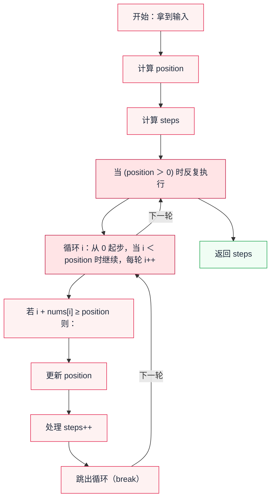

## TypeScript 解题方案（2 个方案逐个讲）

> **运行与提交**：每个方案都是自包含文件（内嵌用例自测，输出 PASS），整块复制到 `.ts` 文件后 `node 文件名` 即可运行。提交 LeetCode 时，把 `demo` 内的算法函数与辅助类型/函数整体取出、置于文件顶层即可。涉及交互/特殊接口的题以题面给定签名为准。

### 方案 1：反向查找出发位置

**分析与思路**：核心做法是「反向查找出发位置」。代码里依次做这些事：单循环线性扫描。

**运行方式**：`node 本文件`，内嵌用例全部通过会输出 PASS。

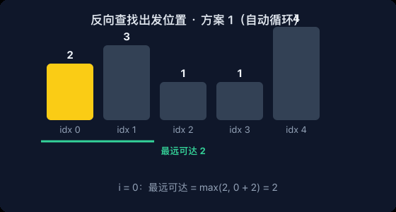

**方案专属流程图**（真实控制流）：

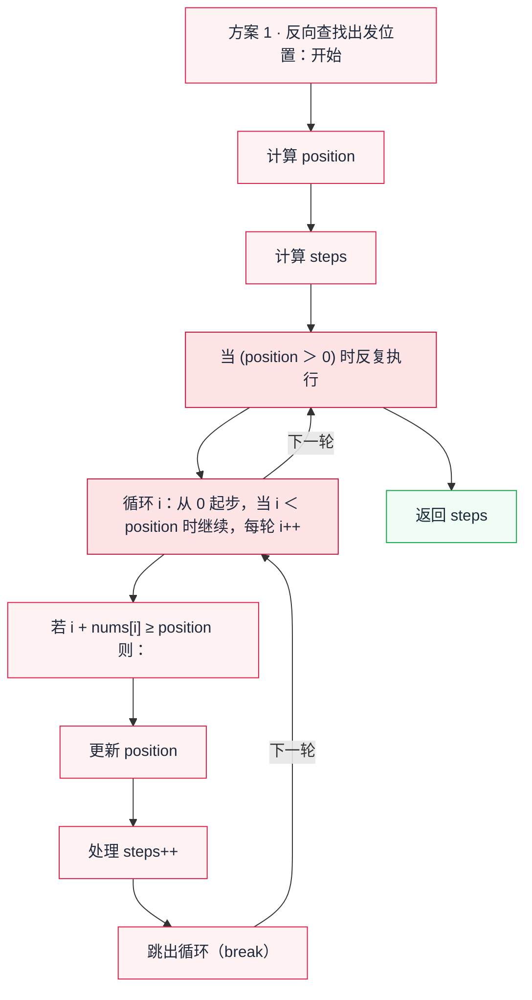

```typescript
/**
 ** LeetCode 45. 跳跃游戏 II
 ** 方案：1 ) 方案1: 反向查找出发位置
 ** 来源：https://blog.csdn.net/tyro_java/article/details/145241433
 */

export function jump(nums: number[]): number {
  // 定义函数/方法 jump
  let position = nums.length - 1; // 把 数组.长度 减 1 存入 position
  let steps = 0; // 把 0 存入 steps
  while (position > 0) {
    // 循环，直到不满足「position 超过 0」
    for (let i = 0; i < position; i++) {
      // 让 下标 i 从 0 开始计数，下标 i 小于 position 就继续
      if (i + nums[i] >= position) {
        // 若 下标 i 加 数组[下标 i] 不低于 position
        position = i; // 把 下标 i 存入 position
        steps++; // steps 加一
        break; // 跳出循环
      }
    }
  }
  return steps; // 返回 steps
}

export function demo(): void {
  // 程序入口：跑内嵌自测用例
  if (jump([2, 3, 1, 1, 4]) !== 2)
    throw new Error('FAILED 1: ' + jump([2, 3, 1, 1, 4]));
  if (jump([2, 1]) !== 1) throw new Error('FAILED 2'); // 若 jump([2, 1]) 不等于 1) throw new Error(「FAILED 2」);
  console.log('PASS'); // 全部用例通过，输出 PASS
}

demo(); // demo();
```

### 方案 2：正向查找可到达的最大位置

**分析与思路**：核心做法是「正向查找可到达的最大位置」。代码里依次做这些事：单循环线性扫描。

**运行方式**：`node 本文件`，内嵌用例全部通过会输出 PASS。

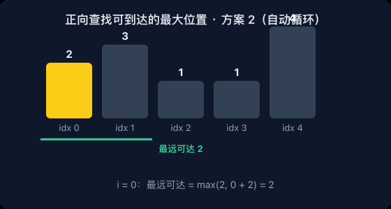

**方案专属流程图**（真实控制流）：

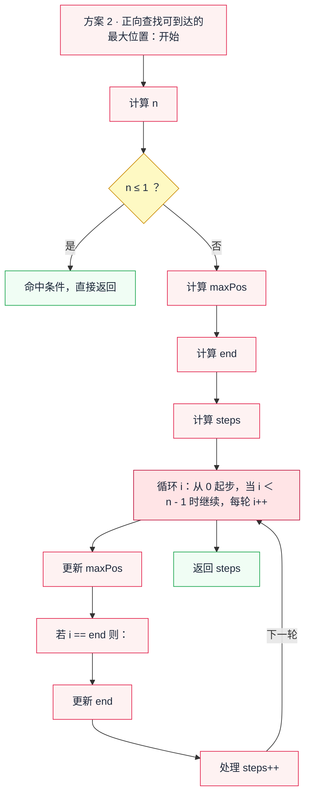

```typescript
/**
 ** LeetCode 45. 跳跃游戏 II
 ** 方案：2 ) 方案2: 正向查找可到达的最大位置
 ** 来源：https://blog.csdn.net/tyro_java/article/details/145241433
 */

export function jump(nums: number[]): number {
  // 定义函数/方法 jump
  const n = nums.length; // 把 数组.长度 存入 元素个数
  if (n <= 1) return 0; // 若 元素个数 不超过 1，直接返回 0
  let maxPos = 0; // 把 0 存入 maxPos
  let end = 0; // 把 0 存入 终点
  let steps = 0; // 把 0 存入 steps
  for (let i = 0; i < n - 1; i++) {
    // 让 下标 i 从 0 开始计数，下标 i 小于 元素个数 减 1 就继续
    maxPos = Math.max(maxPos, i + nums[i]); // 把 Math.取较大值 maxPos, 下标 i 加 数组[下标 i]) 存入 maxPos
    if (i === end) {
      // 若 下标 i 全等于 终点
      end = maxPos; // 把 maxPos 存入 终点
      steps++; // steps 加一
    }
  }
  return steps; // 返回 steps
}

export function demo(): void {
  // 程序入口：跑内嵌自测用例
  if (jump([2, 3, 1, 1, 4]) !== 2)
    throw new Error('FAILED 1: ' + jump([2, 3, 1, 1, 4]));
  if (jump([2, 1]) !== 1) throw new Error('FAILED 2'); // 若 jump([2, 1]) 不等于 1) throw new Error(「FAILED 2」);
  console.log('PASS'); // 全部用例通过，输出 PASS
}

demo(); // demo();
```

## 逐步拆解与面试追问

**复杂度**：时间 O(n²)（两层嵌套扫描），空间 O(1) 到 O(n)

**为什么是这个量级**：外层定起点、内层扫终点，n 个起点各扫 n 次

**面试官可能会追问**：

- 贪心的正确性怎么证明？
- 排序依据选错了会怎样？
- 能否举出反例推翻当前策略？

## 关键 API 速查（TS 主解法实际用到，附官方链接）

本题主解法只用到基础语法（变量、循环、比较），不依赖特殊库 API。

### 各语言官方文档导航

- **TypeScript / JS**：[MDN 中文参考](https://developer.mozilla.org/zh-CN/)
- **Python**：[Python 官方文档](https://docs.python.org/zh-cn/3/)
- **Go**：[Go 标准库](https://pkg.go.dev/std)
- **Java**：[JDK 17 API](https://docs.oracle.com/en/java/javase/17/docs/api/)
- **Rust**：[Rust 标准库](https://doc.rust-lang.org/std/)
- **Lua**：[Lua 5.4 手册](https://www.lua.org/manual/5.4/)
- **C**：[Cppreference C](https://zh.cppreference.com/w/c)
- **C++**：[Cppreference C++](https://zh.cppreference.com/w/cpp)
- **R**：[R 官方手册](https://stat.ethz.ch/R-manual/)
- **Zig**：[Zig 语言文档](https://ziglang.org/documentation/master/)
- **Dart**：[Dart API](https://api.dart.dev/)

## 附录：其他 10 种语言全部实现（每种语言列举其全部方案）

> TypeScript 的全部方案见「TypeScript 解题方案」一节；下面是其余 10 种语言的对应实现，每种语言的每个方案都带思路分析、代码走读与专属运行架构图。
> 每个方案都内嵌用例自测，可独立运行（老仓库 python/go 文件遵循「打印结果」约定）。
> 完整解法文件见 `dsa/<语言>/greedy/lc_45_跳跃游戏_ii/`。

### Python 实现（2 种方案）

Python 的全部方案如下，每个方案都内嵌用例自测，可独立运行（老仓库 python/go 文件遵循「打印结果」约定）：

#### 方案 1：反向查找出发位置

**思路与代码分析**：核心是「反向查找出发位置」。Python 版用切片与字典推导式简化操作，突出可读性。**走读**：方案 1 · 反向查找出发位置：开始 → 更新 position → 更新 steps → 当 position ＞ 0: 时反复执行 → 循环 i：从 0 到 position 前 → 若 i + nums[i] ≥ position：更新 position → 更新 position → 更新 + → 跳出循环（break） → 返回 steps。

**运行架构**（真实控制流）：

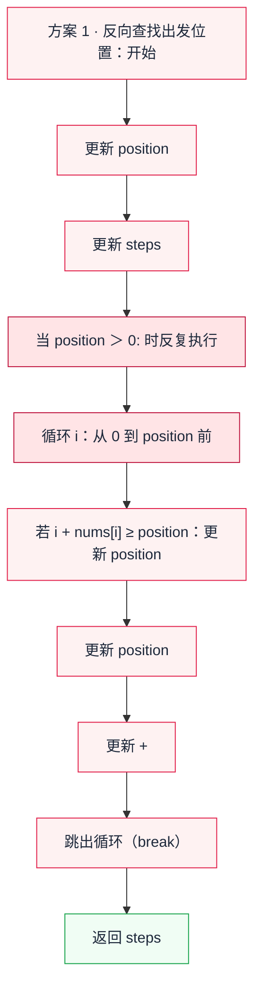

```python
import sys  # 提高递归深度上限（深输入防 RecursionError）

sys.setrecursionlimit(200000)  # 树/链表类题目节点数可达 1e4 量级

def jump(nums):  # 定义函数 jump（参数：数组）
    # 反向贪心：从终点出发，每次找最靠左能跳到当前位置的点，步数 +1
    position = len(nums) - 1  # 把 长度(数组) 减 1 存入 position
    steps = 0  # 把 0 存入 steps
    while position > 0:  # 循环，直到不满足「position 超过 0」
        for i in range(position):  # 让 下标 i 从 position 遍历
            if i + nums[i] >= position:  # 若 下标 i 加 数组[下标 i] 不低于 position
                position = i  # 把 下标 i 存入 position
                steps += 1  # steps累加 1
                break  # 跳出循环
    return steps  # 返回 steps

if __name__ == "__main__":  # 若 __name__ 等于 '__main__'
    print(jump([2, 3, 1, 1, 4]))  # 打印输出
```

#### 方案 2：正向查找可到达的最大位置

**思路与代码分析**：核心是「正向查找可到达的最大位置」。Python 版用切片与字典推导式简化操作，突出可读性。**走读**：方案 2 · 正向查找可到达的最大位置：开始 → 更新 n → 命中条件，直接返回 → 更新 max_pos → 更新 end → 更新 steps → 循环 i：从 0 到 n - 1 前 → 更新 max_pos → 若 i == end：更新 end → 更新 end → 更新 + → 返回 steps。

**运行架构**（真实控制流）：

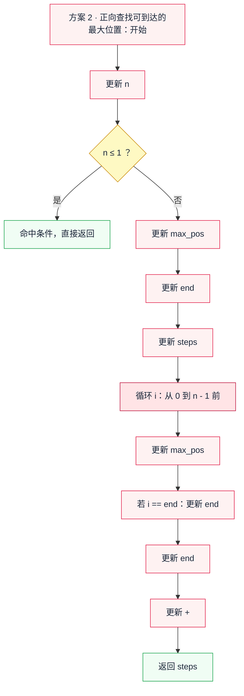

```python
import sys  # 提高递归深度上限（深输入防 RecursionError）

sys.setrecursionlimit(200000)  # 树/链表类题目节点数可达 1e4 量级

def jump(nums):  # 定义函数 jump（参数：数组）
    # 正向贪心（BFS 思想）：维护本层最远 end 与下一层最远 max_pos，跨层即 +1 步
    n = len(nums)  # 把 长度(数组) 存入 元素个数
    if n <= 1:  # 若 元素个数 不超过 1
        return 0  # 返回 0
    max_pos = 0  # 把 0 存入 max_pos
    end = 0  # 把 0 存入 终点
    steps = 0  # 把 0 存入 steps
    for i in range(n - 1):  # 让 下标 i 从 元素个数 减 1 遍历
        max_pos = max(max_pos, i + nums[i])  # 把 取较大值 max_pos, 下标 i 加 数组[下标 i]) 存入 max_pos
        if i == end:  # 若 下标 i 等于 终点
            end = max_pos  # 把 max_pos 存入 终点
            steps += 1  # steps累加 1
    return steps  # 返回 steps

if __name__ == "__main__":  # 若 __name__ 等于 '__main__'
    print(jump([2, 3, 1, 1, 4]))  # 打印输出
```

### Go 实现（2 种方案）

Go 的全部方案如下，每个方案都内嵌用例自测，可独立运行（老仓库 python/go 文件遵循「打印结果」约定）：

#### 方案 1：反向查找出发位置

**思路与代码分析**：核心是「反向查找出发位置」。Go 版用切片与多返回值惯用法，显式处理索引边界。**走读**：方案 1 · 反向查找出发位置：开始 → 更新 : → 更新 : → 遍历循环 → 遍历循环 → 处理 if i+nums[i] ≥ position → 更新 position → 处理 steps++ → 跳出循环（break） → 返回 steps。

**运行架构**（真实控制流）：

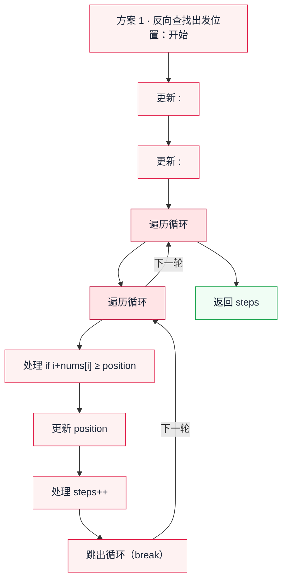

```go
package main // 引入依赖

import (
	"fmt"
	"os"
) // 引入依赖

func jump(nums []int) int { // 定义函数/方法 jump
	position := len(nums) - 1 // 把 长度(数组) 减 1 写入 position :
	steps := 0                // 把 0 写入 steps :
	for position > 0 {        // for position 超过 0 {
		for i := 0; i < position; i++ { // 让 下标 i 从 0 开始计数
			if i+nums[i] >= position { // 若 下标 i 加 数组[下标 i] 不低于 position
				position = i // 把 下标 i 写入 position
				steps++      // steps 加一
				break        // 跳出循环
			}
		}
	}
	return steps // 返回 steps
}

func main() { // 程序入口：跑内嵌自测用例
	type tc struct { // 定义类型
		in   []int // in []int
		want int   // want int
	}
	cases := []tc{ // 把 []tc{ 写入 cases :
		{[]int{2, 3, 1, 1, 4}, 2},
		{[]int{1}, 0},
	}
	ok := true                // 把 true 写入 ok :
	for _, c := range cases { // 同时取 _ 与 字符 遍历
		if got := jump(c.in); got != c.want { // 若 got : 赋值为 jump(字符.in); got 不等于 字符.want
			ok = false                                                  // 把 false 写入 ok
			fmt.Printf("FAIL jump(%v)=%v want %v\n", c.in, got, c.want) // 打印输出
		}
	}
	if !ok { // 若 取反 ok
		os.Exit(1) // os.Exit(1)
	}
	fmt.Println("PASS") // 全部用例通过，输出 PASS
}
```

#### 方案 2：正向查找可到达的最大位置

**思路与代码分析**：核心是「正向查找可到达的最大位置」。Go 版用切片与多返回值惯用法，显式处理索引边界。**走读**：方案 2 · 正向查找可到达的最大位置：开始 → 更新 : → 处理 if n ≤ 1 → 返回 0 → 更新 : → 更新 : → 更新 : → 遍历循环 → 处理 if i+nums[i] ＞ maxPos → 更新 maxPos → 处理 if i == end → 更新 end → 处理 steps++ → 返回 steps。

**运行架构**（真实控制流）：

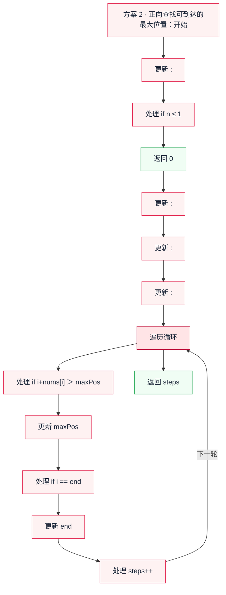

```go
package main // 引入依赖

import (
	"fmt"
	"os"
) // 引入依赖

func jump(nums []int) int { // 定义函数/方法 jump
	n := len(nums) // 把 长度(数组) 写入 n :
	if n <= 1 {    // 若 元素个数 不超过 1
		return 0 // 返回 0
	}
	maxPos := 0                // 把 0 写入 maxPos :
	end := 0                   // 把 0 写入 end :
	steps := 0                 // 把 0 写入 steps :
	for i := 0; i < n-1; i++ { // 让 下标 i 从 0 开始计数
		if i+nums[i] > maxPos { // 若 下标 i 加 数组[下标 i] 超过 maxPos
			maxPos = i + nums[i] // 把 下标 i 加 数组[下标 i] 写入 maxPos
		}
		if i == end { // 若 下标 i 等于 终点
			end = maxPos // 把 maxPos 写入 终点
			steps++      // steps 加一
		}
	}
	return steps // 返回 steps
}

func main() { // 程序入口：跑内嵌自测用例
	type tc struct { // 定义类型
		in   []int // in []int
		want int   // want int
	}
	cases := []tc{ // 把 []tc{ 写入 cases :
		{[]int{2, 3, 1, 1, 4}, 2},
		{[]int{1}, 0},
	}
	ok := true                // 把 true 写入 ok :
	for _, c := range cases { // 同时取 _ 与 字符 遍历
		if got := jump(c.in); got != c.want { // 若 got : 赋值为 jump(字符.in); got 不等于 字符.want
			ok = false                                                  // 把 false 写入 ok
			fmt.Printf("FAIL jump(%v)=%v want %v\n", c.in, got, c.want) // 打印输出
		}
	}
	if !ok { // 若 取反 ok
		os.Exit(1) // os.Exit(1)
	}
	fmt.Println("PASS") // 全部用例通过，输出 PASS
}
```

### Java 实现（2 种方案）

Java 的全部方案如下，每个方案都内嵌用例自测，可独立运行（老仓库 python/go 文件遵循「打印结果」约定）：

#### 方案 1：反向查找出发位置

**思路与代码分析**：核心是「反向查找出发位置」。Java 版用类与静态方法组织，集合操作显式明了。代码里依次做这些事：单循环线性扫描。**走读**：方案 1 · 反向查找出发位置：开始 → 更新 n → 更新 position → 更新 steps → 当 (position ＞ 0) 时反复执行 → 遍历循环 → 若 i + nums[i] ≥ position 则： → 更新 position → 处理 steps++ → 跳出循环（break） → 返回 steps。

**运行架构**（真实控制流）：

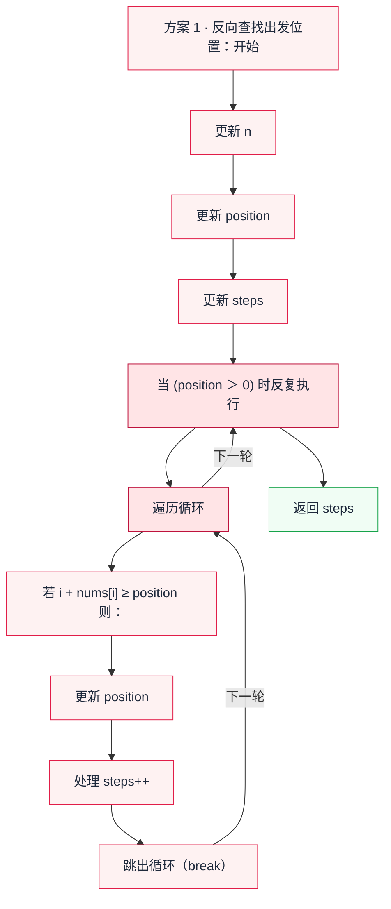

```java
package com.webfault.dsa; // 引入依赖

class lc45_solution111 { // 定义类型
  static int jump(int[] nums) { // 定义函数/方法 jump
    int n = nums.length; // 把 数组.长度 存入 元素个数
    int position = n - 1; // 把 元素个数 减 1 存入 position
    int steps = 0; // 把 0 存入 steps
    while (position > 0) { // 循环，直到不满足「position 超过 0」
      for (int i = 0; i < position; i++) { // 让 下标 i 从 0 开始计数，下标 i 小于 position 就继续
        if (i + nums[i] >= position) { // 若 下标 i 加 数组[下标 i] 不低于 position
          position = i; // 把 下标 i; 写入 position
          steps++; // steps 加一
          break; // 跳出循环
        }
      }
    }
    return steps; // 返回 steps
  }

  public static void main(String[] args) { // public static void main(String[] args) {
    int got = jump(new int[] {2, 3, 1, 1, 4}); // 把 jump(new int[]{2, 3, 1, 1, 4}) 存入 got
    if (got != 2) throw new RuntimeException("FAILED: got " + got + " want 2");
    System.out.println("PASS"); // 全部用例通过，输出 PASS
  }
}
```

#### 方案 2：正向查找可到达的最大位置

**思路与代码分析**：核心是「正向查找可到达的最大位置」。Java 版用类与静态方法组织，集合操作显式明了。代码里依次做这些事：单循环线性扫描。**走读**：方案 2 · 正向查找可到达的最大位置：开始 → 更新 n → 更新 maxPos → 遍历循环 → 更新 maxPos → 若 i == end 则： → 更新 end → 处理 steps++ → 返回 steps。

**运行架构**（真实控制流）：

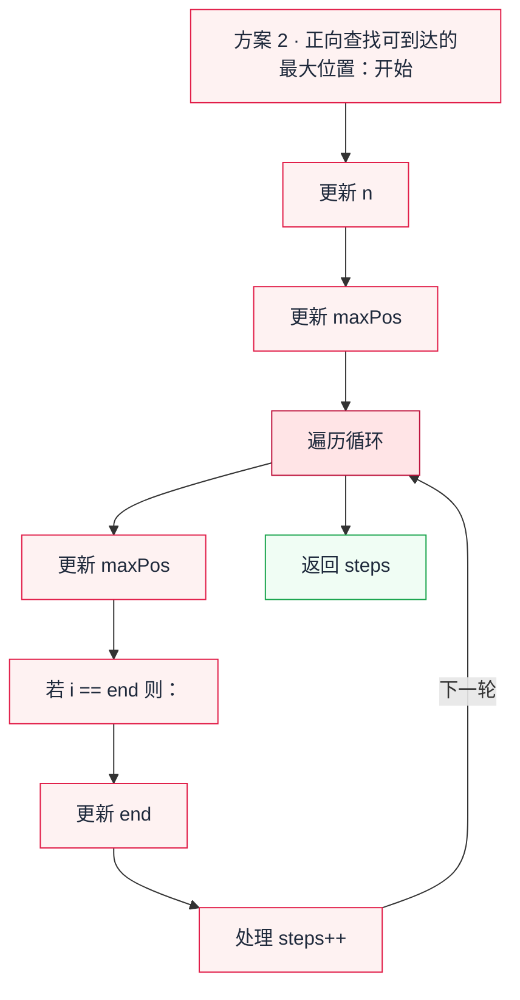

```java
package com.webfault.dsa; // 引入依赖

class lc45_solution222 { // 定义类型
  static int jump(int[] nums) { // 定义函数/方法 jump
    int n = nums.length; // 把 数组.长度 存入 元素个数
    int maxPos = 0, end = 0, steps = 0; // 把 0, 终点 赋值为 0, steps 赋值为 0 存入 maxPos
    for (int i = 0; i < n - 1; i++) { // 让 下标 i 从 0 开始计数，下标 i 小于 元素个数 减 1 就继续
      maxPos = Math.max(maxPos, i + nums[i]); // 把 Math.取较大值 maxPos, 下标 i 加 数组[下标 i]); 写入 maxPos
      if (i == end) { // 若 下标 i 等于 终点
        end = maxPos; // 把 maxPos; 写入 终点
        steps++; // steps 加一
      }
    }
    return steps; // 返回 steps
  }

  public static void main(String[] args) { // public static void main(String[] args) {
    int got = jump(new int[] {2, 3, 1, 1, 4}); // 把 jump(new int[]{2, 3, 1, 1, 4}) 存入 got
    if (got != 2) throw new RuntimeException("FAILED: got " + got + " want 2");
    System.out.println("PASS"); // 全部用例通过，输出 PASS
  }
}
```

### Rust 实现（2 种方案）

Rust 的全部方案如下，每个方案都内嵌用例自测，可独立运行（老仓库 python/go 文件遵循「打印结果」约定）：

#### 方案 1：反向查找出发位置

**思路与代码分析**：核心是「反向查找出发位置」。Rust 版用所有权移动与切片借用改写同一逻辑，注意 Option 与引用边界。**走读**：方案 1 · 反向查找出发位置：开始 → 计算 position → 计算 steps → 当 position ＞ 0 时反复执行 → 遍历 0..position 中的每个元素 i → 处理 if i + nums[i] as usize ≥ p → 更新 position → 更新 + → 跳出循环（break） → 处理 steps → 返回结果。

**运行架构**（真实控制流）：

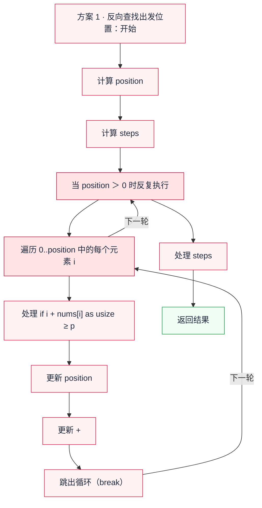

```rust
// LeetCode 45. 跳跃游戏II — Rust 版（方案1）
fn jump(nums: Vec<i32>) -> i32 {
    // 定义函数/方法 jump
    let mut position = nums.len() - 1; // 把 数组.长度() 减 1; 写入 let mut position
    let mut steps = 0; // 把 0; 写入 let mut steps
    while position > 0 {
        // while position 超过 0 {
        for i in 0..position {
            // 逐个取出 0 的元素（下标 i）
            if i + nums[i] as usize >= position {
                // 若 下标 i 加 数组[下标 i] as usize 不低于 position
                position = i; // 把 下标 i; 写入 position
                steps += 1; // steps累加 1
                break; // 跳出循环
            }
        }
    }
    steps // steps
}
fn main() {
    // 程序入口：跑内嵌自测用例
    assert_eq!(jump(vec![2, 3, 1, 1, 4]), 2); // 断言校验
    assert_eq!(jump(vec![2, 3, 0, 1, 4]), 2); // 断言校验
    assert_eq!(jump(vec![1]), 0); // 断言校验
    println!("PASS"); // 全部用例通过，输出 PASS
}
```

#### 方案 2：正向查找可到达的最大位置

**思路与代码分析**：核心是「正向查找可到达的最大位置」。Rust 版用所有权移动与切片借用改写同一逻辑，注意 Option 与引用边界。**走读**：方案 2 · 正向查找可到达的最大位置：开始 → 计算 position → 计算 steps → 当 position ＞ 0 时反复执行 → 遍历 0..position 中的每个元素 i → 处理 if i + nums[i] as usize ≥ p → 更新 position → 更新 + → 跳出循环（break） → 处理 steps → 返回结果。

**运行架构**（真实控制流）：

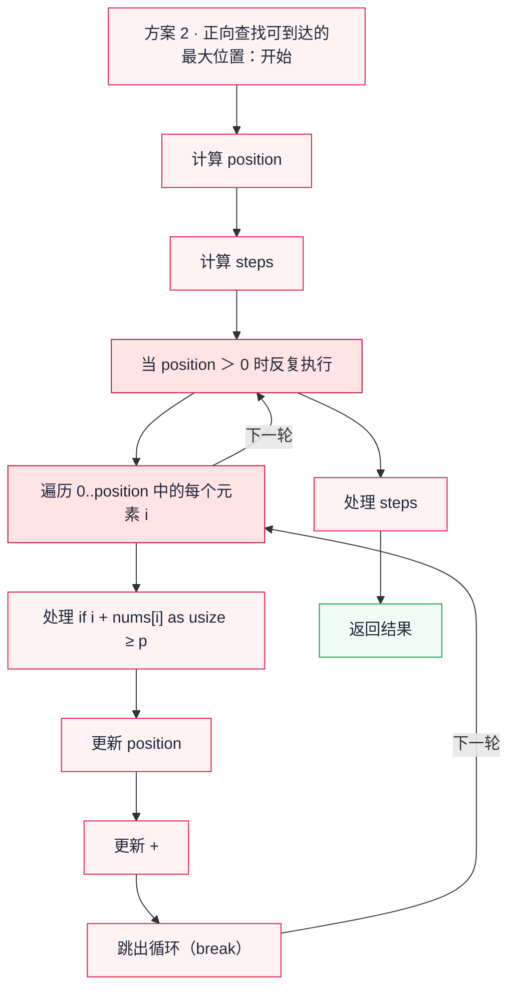

```rust
// LeetCode 45. 跳跃游戏II — Rust 版（方案2）
fn jump(nums: Vec<i32>) -> i32 {
    // 定义函数/方法 jump
    let mut position = nums.len() - 1; // 把 数组.长度() 减 1; 写入 let mut position
    let mut steps = 0; // 把 0; 写入 let mut steps
    while position > 0 {
        // while position 超过 0 {
        for i in 0..position {
            // 逐个取出 0 的元素（下标 i）
            if i + nums[i] as usize >= position {
                // 若 下标 i 加 数组[下标 i] as usize 不低于 position
                position = i; // 把 下标 i; 写入 position
                steps += 1; // steps累加 1
                break; // 跳出循环
            }
        }
    }
    steps // steps
}
fn main() {
    // 程序入口：跑内嵌自测用例
    assert_eq!(jump(vec![2, 3, 1, 1, 4]), 2); // 断言校验
    assert_eq!(jump(vec![2, 3, 0, 1, 4]), 2); // 断言校验
    assert_eq!(jump(vec![1]), 0); // 断言校验
    println!("PASS"); // 全部用例通过，输出 PASS
}
```

### Lua 实现（2 种方案）

Lua 的全部方案如下，每个方案都内嵌用例自测，可独立运行（老仓库 python/go 文件遵循「打印结果」约定）：

#### 方案 1：反向查找出发位置

**思路与代码分析**：核心是「反向查找出发位置」。Lua 版用表与 ipairs 遍历，注意 ipairs 遇 nil 即停的语义。**走读**：方案 1 · 反向查找出发位置：开始 → 更新 steps → 当 position ＞ 1 do 时反复执行 → 循环 i：从 1 到 position - 1 do → 处理 if i - 1 + nums[i] ≥ positi → 更新 position → 更新 steps → 跳出循环（break） → 返回 steps。

**运行架构**（真实控制流）：

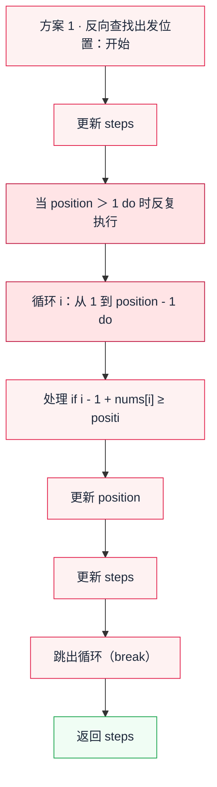

```lua
-- LeetCode 45. 跳跃游戏II — Lua 版（方案1）
local function jump(nums) -- local function jump(数组)
	local position, steps = #nums, 0 -- 把 #数组, 0 写入 local position, steps
	while position > 1 do -- while position 超过 1 do
		for i = 1, position - 1 do -- 让 下标 i 从 1 走到 position（Lua 1 基）
			if i - 1 + nums[i] >= position - 1 then -- 若 下标 i 减 1 加 数组[下标 i] 不低于 position 减 1 then
				position = i -- 把 下标 i 存入 position
				steps = steps + 1 -- 把 steps 加 1 存入 steps
				break -- 跳出循环
			end -- 终点
		end -- 终点
	end -- 终点
	return steps -- 返回 steps
end -- 终点
assert(jump({ 2, 3, 1, 1, 4 }) == 2) -- 断言校验
assert(jump({ 2, 3, 0, 1, 4 }) == 2) -- 断言校验
assert(jump({ 1 }) == 0) -- 断言校验
print("PASS") -- 全部用例通过，输出 PASS
```

#### 方案 2：正向查找可到达的最大位置

**思路与代码分析**：核心是「正向查找可到达的最大位置」。Lua 版用表与 ipairs 遍历，注意 ipairs 遇 nil 即停的语义。**走读**：方案 2 · 正向查找可到达的最大位置：开始 → 更新 steps → 当 position ＞ 1 do 时反复执行 → 循环 i：从 1 到 position - 1 do → 处理 if i - 1 + nums[i] ≥ positi → 更新 position → 更新 steps → 跳出循环（break） → 返回 steps。

**运行架构**（真实控制流）：

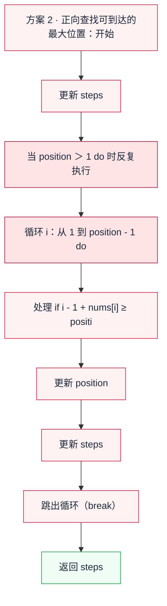

```lua
-- LeetCode 45. 跳跃游戏II — Lua 版（方案2）
local function jump(nums) -- local function jump(数组)
	local position, steps = #nums, 0 -- 把 #数组, 0 写入 local position, steps
	while position > 1 do -- while position 超过 1 do
		for i = 1, position - 1 do -- 让 下标 i 从 1 走到 position（Lua 1 基）
			if i - 1 + nums[i] >= position - 1 then -- 若 下标 i 减 1 加 数组[下标 i] 不低于 position 减 1 then
				position = i -- 把 下标 i 存入 position
				steps = steps + 1 -- 把 steps 加 1 存入 steps
				break -- 跳出循环
			end -- 终点
		end -- 终点
	end -- 终点
	return steps -- 返回 steps
end -- 终点
assert(jump({ 2, 3, 1, 1, 4 }) == 2) -- 断言校验
assert(jump({ 2, 3, 0, 1, 4 }) == 2) -- 断言校验
assert(jump({ 1 }) == 0) -- 断言校验
print("PASS") -- 全部用例通过，输出 PASS
```

### C 实现（2 种方案）

C 的全部方案如下，每个方案都内嵌用例自测，可独立运行（老仓库 python/go 文件遵循「打印结果」约定）：

#### 方案 1：反向查找出发位置

**思路与代码分析**：核心是「反向查找出发位置」。C 版手动管理下标与内存，循环边界全部显式写出。代码里依次做这些事：单循环线性扫描。**走读**：方案 1 · 反向查找出发位置：开始 → 更新 position → 当 (position ＞ 0) 时反复执行 → 遍历循环 → 若 i + nums[i] ≥ position 则： → 更新 position → 处理 steps++ → 跳出循环（break） → 返回 steps。

**运行架构**（真实控制流）：

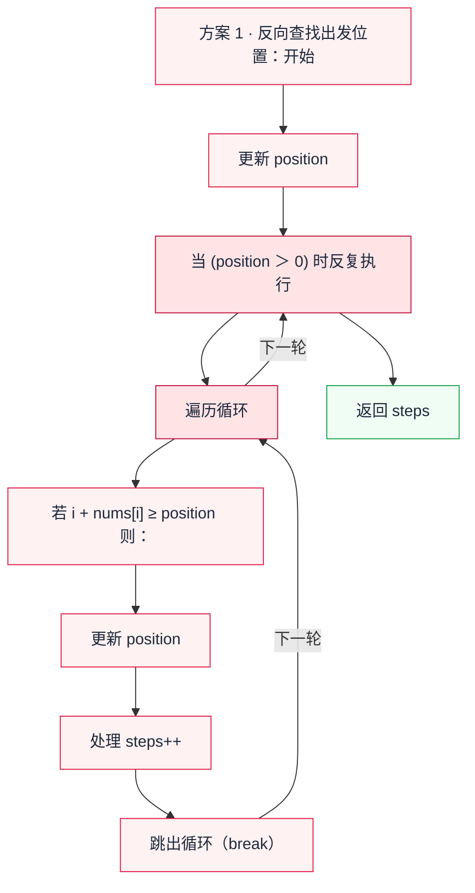

```c
/* LeetCode 45. 跳跃游戏II — C 版（方案1） */
#include <stdio.h>                        // 引入头文件
static int jump(const int *nums, int n) { // 定义函数/方法 jump
    int position = n - 1, steps = 0;      // 把 元素个数 减 1, steps 赋值为 0 存入 position
    while (position > 0) {                // 循环，直到不满足「position 超过 0」
        for (int i = 0; i < position; i++) { // 让 下标 i 从 0 开始计数，下标 i 小于 position 就继续
            if (i + nums[i] >= position) {
                position = i;
                steps++;
                break;
            }
        }
    }
    return steps; // 返回 steps
}
int main(void) { // 程序入口：跑内嵌自测用例
    if (jump((int[]){2, 3, 1, 1, 4}, 5) != 2) {
        printf("FAIL 1\n");
        return 1;
    }
    if (jump((int[]){2, 3, 0, 1, 4}, 5) != 2) {
        printf("FAIL 2\n");
        return 1;
    }
    if (jump((int[]){1}, 1) != 0) {
        printf("FAIL 3\n");
        return 1;
    }                 // 若 jump((int[]){1}, 1) 不等于 0) { 输出「FAIL 3 」); return 1; }
    printf("PASS\n"); // 全部用例通过，输出 PASS
    return 0;         // 返回 0
}
```

#### 方案 2：正向查找可到达的最大位置

**思路与代码分析**：核心是「正向查找可到达的最大位置」。C 版手动管理下标与内存，循环边界全部显式写出。代码里依次做这些事：单循环线性扫描。**走读**：方案 2 · 正向查找可到达的最大位置：开始 → 更新 position → 当 (position ＞ 0) 时反复执行 → 遍历循环 → 若 i + nums[i] ≥ position 则： → 更新 position → 处理 steps++ → 跳出循环（break） → 返回 steps。

**运行架构**（真实控制流）：


```c
/* LeetCode 45. 跳跃游戏II — C 版（方案2） */
#include <stdio.h>                        // 引入头文件
static int jump(const int *nums, int n) { // 定义函数/方法 jump
    int position = n - 1, steps = 0;      // 把 元素个数 减 1, steps 赋值为 0 存入 position
    while (position > 0) {                // 循环，直到不满足「position 超过 0」
        for (int i = 0; i < position; i++) { // 让 下标 i 从 0 开始计数，下标 i 小于 position 就继续
            if (i + nums[i] >= position) {
                position = i;
                steps++;
                break;
            }
        }
    }
    return steps; // 返回 steps
}
int main(void) { // 程序入口：跑内嵌自测用例
    if (jump((int[]){2, 3, 1, 1, 4}, 5) != 2) {
        printf("FAIL 1\n");
        return 1;
    }
    if (jump((int[]){2, 3, 0, 1, 4}, 5) != 2) {
        printf("FAIL 2\n");
        return 1;
    }
    if (jump((int[]){1}, 1) != 0) {
        printf("FAIL 3\n");
        return 1;
    }                 // 若 jump((int[]){1}, 1) 不等于 0) { 输出「FAIL 3 」); return 1; }
    printf("PASS\n"); // 全部用例通过，输出 PASS
    return 0;         // 返回 0
}
```

### C++ 实现（2 种方案）

C++ 的全部方案如下，每个方案都内嵌用例自测，可独立运行（老仓库 python/go 文件遵循「打印结果」约定）：

#### 方案 1：反向查找出发位置

**思路与代码分析**：核心是「反向查找出发位置」。C++ 版用 STL 容器与迭代器，减少手写下标错误。代码里依次做这些事：单循环线性扫描。**走读**：方案 1 · 反向查找出发位置：开始 → 更新 position → 当 (position ＞ 0) 时反复执行 → 遍历循环 → 若 i + nums[i] ≥ position 则： → 更新 position → 处理 ++steps → 跳出循环（break） → 返回 steps。

**运行架构**（真实控制流）：


```cpp
// LeetCode 45. 跳跃游戏II — C++ 版（方案1）
#include <cassert>                              // 引入头文件
#include <iostream>                             // 引入头文件
#include <vector>                               // 引入头文件
static int jump(const std::vector<int> &nums) { // 定义函数/方法 jump
    int position = static_cast<int>(nums.size()) - 1, steps = 0;
    while (position > 0) {                   // 循环，直到不满足「position 超过 0」
        for (int i = 0; i < position; ++i) { // 让 下标 i 从 0 开始计数，下标 i 小于 position 就继续
            if (i + nums[i] >= position) {
                position = i;
                ++steps;
                break;
            }
        }
    }
    return steps; // 返回 steps
}
int main() {                            // 程序入口：跑内嵌自测用例
    assert(jump({2, 3, 1, 1, 4}) == 2); // 断言校验
    assert(jump({2, 3, 0, 1, 4}) == 2); // 断言校验
    assert(jump({1}) == 0);             // 断言校验
    std::cout << "PASS" << std::endl;   // 全部用例通过，输出 PASS
    return 0;                           // 返回 0
}
```

#### 方案 2：正向查找可到达的最大位置

**思路与代码分析**：核心是「正向查找可到达的最大位置」。C++ 版用 STL 容器与迭代器，减少手写下标错误。代码里依次做这些事：单循环线性扫描。**走读**：方案 2 · 正向查找可到达的最大位置：开始 → 更新 position → 当 (position ＞ 0) 时反复执行 → 遍历循环 → 若 i + nums[i] ≥ position 则： → 更新 position → 处理 ++steps → 跳出循环（break） → 返回 steps。

**运行架构**（真实控制流）：


```cpp
// LeetCode 45. 跳跃游戏II — C++ 版（方案2）
#include <cassert>                              // 引入头文件
#include <iostream>                             // 引入头文件
#include <vector>                               // 引入头文件
static int jump(const std::vector<int> &nums) { // 定义函数/方法 jump
    int position = static_cast<int>(nums.size()) - 1, steps = 0;
    while (position > 0) {                   // 循环，直到不满足「position 超过 0」
        for (int i = 0; i < position; ++i) { // 让 下标 i 从 0 开始计数，下标 i 小于 position 就继续
            if (i + nums[i] >= position) {
                position = i;
                ++steps;
                break;
            }
        }
    }
    return steps; // 返回 steps
}
int main() {                            // 程序入口：跑内嵌自测用例
    assert(jump({2, 3, 1, 1, 4}) == 2); // 断言校验
    assert(jump({2, 3, 0, 1, 4}) == 2); // 断言校验
    assert(jump({1}) == 0);             // 断言校验
    std::cout << "PASS" << std::endl;   // 全部用例通过，输出 PASS
    return 0;                           // 返回 0
}
```

### R 实现（2 种方案）

R 的全部方案如下，每个方案都内嵌用例自测，可独立运行（老仓库 python/go 文件遵循「打印结果」约定）：

#### 方案 1：反向查找出发位置

**思路与代码分析**：核心是「反向查找出发位置」。R 版用向量化思维与 1 起始下标，注意 1:n 的降序陷阱。代码里依次做这些事：单循环线性扫描。**走读**：方案 1 · 反向查找出发位置：开始 → 处理 position ＜- length(nums) → 处理 steps ＜- 0L → 当 (position ＞ 1L) 时反复执行 → 循环 i：遍历 1:(position - 1L) → 若 (i - 1L) + nums[i] ≥ position - 1L 则： → 处理 position ＜- i → 处理 steps ＜- steps + 1L → 跳出循环（break） → 处理 steps → 返回结果。

**运行架构**（真实控制流）：

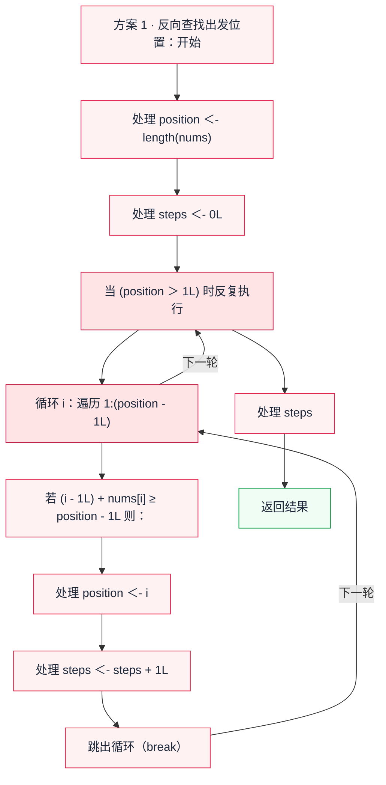

```r
# 版（方案1） 定义函数 jump（参数：数组）
jump <- function(nums) {
    position <- length(nums)
    steps <- 0L  # 把 长度(数组); steps 小于 减 0L 存入 position
    while (position > 1L) {
        # 循环，直到不满足「position 超过 1L」 for (下标 i in 1:(position 减 1L)) { 若 (下标 i 减 1L) 加
        # 数组[下标 i] 不低于 position 减 1L
        for (i in 1:(position - 1L)) {
            if ((i - 1L) + nums[i] >= position - 1L) {
                position <- i  # 把 下标 i 存入 position
                steps <- steps + 1L  # 把 steps 加 1L 存入 steps
                break  # 跳出循环
            }
        }
    }
    steps  # steps
}
stopifnot(jump(c(2, 3, 1, 1, 4)) == 2)  # 断言校验
stopifnot(jump(c(2, 3, 0, 1, 4)) == 2)  # 断言校验
stopifnot(jump(c(1)) == 0)  # 断言校验
cat("PASS\n")  # 全部用例通过，输出 PASS
```

#### 方案 2：正向查找可到达的最大位置

**思路与代码分析**：核心是「正向查找可到达的最大位置」。R 版用向量化思维与 1 起始下标，注意 1:n 的降序陷阱。代码里依次做这些事：单循环线性扫描。**走读**：方案 2 · 正向查找可到达的最大位置：开始 → 处理 position ＜- length(nums) → 处理 steps ＜- 0L → 当 (position ＞ 1L) 时反复执行 → 循环 i：遍历 1:(position - 1L) → 若 (i - 1L) + nums[i] ≥ position - 1L 则： → 处理 position ＜- i → 处理 steps ＜- steps + 1L → 跳出循环（break） → 处理 steps → 返回结果。

**运行架构**（真实控制流）：

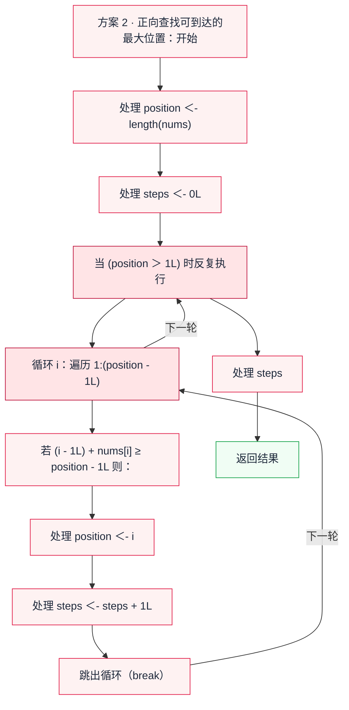

```r
# 版（方案2） 定义函数 jump（参数：数组）
jump <- function(nums) {
    position <- length(nums)
    steps <- 0L  # 把 长度(数组); steps 小于 减 0L 存入 position
    while (position > 1L) {
        # 循环，直到不满足「position 超过 1L」 for (下标 i in 1:(position 减 1L)) { 若 (下标 i 减 1L) 加
        # 数组[下标 i] 不低于 position 减 1L
        for (i in 1:(position - 1L)) {
            if ((i - 1L) + nums[i] >= position - 1L) {
                position <- i  # 把 下标 i 存入 position
                steps <- steps + 1L  # 把 steps 加 1L 存入 steps
                break  # 跳出循环
            }
        }
    }
    steps  # steps
}
stopifnot(jump(c(2, 3, 1, 1, 4)) == 2)  # 断言校验
stopifnot(jump(c(2, 3, 0, 1, 4)) == 2)  # 断言校验
stopifnot(jump(c(1)) == 0)  # 断言校验
cat("PASS\n")  # 全部用例通过，输出 PASS
```

### Zig 实现（2 种方案）

Zig 的全部方案如下，每个方案都内嵌用例自测，可独立运行（老仓库 python/go 文件遵循「打印结果」约定）：

#### 方案 1：反向查找出发位置

**思路与代码分析**：核心是「反向查找出发位置」。Zig 版显式分配与清零，整型边界处理严格。代码里依次做这些事：单循环线性扫描。**走读**：方案 1 · 反向查找出发位置：开始 → 计算 position → 计算 steps → 当 (position ＞ 0) 时反复执行 → 遍历集合元素 → 若 i + @as(usize, @intCast(nums[i])) ≥ position 则： → 更新 position → 更新 + → 跳出循环（break） → 返回 steps。

**运行架构**（真实控制流）：

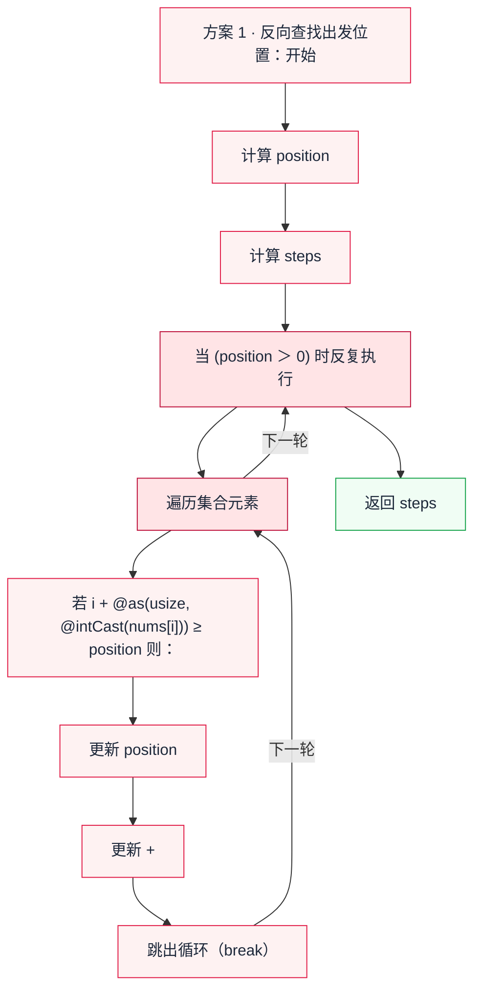

```zig
// LeetCode 45. 跳跃游戏II — Zig 版（方案1）
const std = @import("std"); // 把 @import(「std」) 存入 std
fn jump(nums: []const i32) i32 { // 定义函数/方法 jump
    var position: usize = nums.len - 1; // 把 数组.长度 减 1; 写入 var position: usize
    var steps: i32 = 0; // 把 0; 写入 var steps: i32
    while (position > 0) { // 循环，直到不满足「position 超过 0」
        for (0..position) |i| { // 让 下标 i 从 0 走到 position 减一
            if (i + @as(usize, @intCast(nums[i])) >= position) { // 若 下标 i 加 @as(usize, @intCast(数组[下标 i])) 不低于 position
                position = i; // 把 下标 i; 写入 position
                steps += 1; // steps累加 1
                break; // 跳出循环
            }
        }
    }
    return steps; // 返回 steps
}
pub fn main() !void { // 程序入口：跑内嵌自测用例
    if (jump(&[_]i32{ 2, 3, 1, 1, 4 }) != 2) return error.TestFailed;
    if (jump(&[_]i32{ 2, 3, 0, 1, 4 }) != 2) return error.TestFailed;
    if (jump(&[_]i32{1}) != 0) return error.TestFailed; // 若 jump( 按位与 [_]i32{1}) 不等于 0，直接返回 error.TestFailed
    std.debug.print("PASS\n", .{}); // 全部用例通过，输出 PASS
}
```

#### 方案 2：正向查找可到达的最大位置

**思路与代码分析**：核心是「正向查找可到达的最大位置」。Zig 版显式分配与清零，整型边界处理严格。代码里依次做这些事：单循环线性扫描。**走读**：方案 2 · 正向查找可到达的最大位置：开始 → 计算 position → 计算 steps → 当 (position ＞ 0) 时反复执行 → 遍历集合元素 → 若 i + @as(usize, @intCast(nums[i])) ≥ position 则： → 更新 position → 更新 + → 跳出循环（break） → 返回 steps。

**运行架构**（真实控制流）：

```mermaid
graph TD
    N0["方案 2 · 正向查找可到达的最大位置：开始"]
    N1["计算 position"]
    N2["计算 steps"]
    N3["当 (position ＞ 0) 时反复执行"]
    N4["遍历集合元素"]
    N5["若 i + @as(usize, @intCast(nums[i])) ≥ position 则："]
    N6["更新 position"]
    N7["更新 +"]
    N8["跳出循环（break）"]
    N9["返回 steps"]
    N0 --> N1
    N1 --> N2
    N2 --> N3
    N3 --> N4
    N4 --> N5
    N5 --> N6
    N6 --> N7
    N7 --> N8
    N8 -- 下一轮 --> N4
    N4 -- 下一轮 --> N3
    N3 --> N9
    classDef n fill:#fef2f2,stroke:#e11d48,color:#1e293b;
    classDef lp fill:#ffe4e6,stroke:#be123c,color:#1e293b;
    classDef dc fill:#fef9c3,stroke:#ca8a04,color:#1e293b;
    classDef tm fill:#f0fdf4,stroke:#16a34a,color:#1e293b;
    class N0,N1,N2,N5,N6,N7,N8 n;
    class N3,N4 lp;
    class N9 tm;
```

```zig
// LeetCode 45. 跳跃游戏II — Zig 版（方案2）
const std = @import("std"); // 把 @import(「std」) 存入 std
fn jump(nums: []const i32) i32 { // 定义函数/方法 jump
    var position: usize = nums.len - 1; // 把 数组.长度 减 1; 写入 var position: usize
    var steps: i32 = 0; // 把 0; 写入 var steps: i32
    while (position > 0) { // 循环，直到不满足「position 超过 0」
        for (0..position) |i| { // 让 下标 i 从 0 走到 position 减一
            if (i + @as(usize, @intCast(nums[i])) >= position) { // 若 下标 i 加 @as(usize, @intCast(数组[下标 i])) 不低于 position
                position = i; // 把 下标 i; 写入 position
                steps += 1; // steps累加 1
                break; // 跳出循环
            }
        }
    }
    return steps; // 返回 steps
}
pub fn main() !void { // 程序入口：跑内嵌自测用例
    if (jump(&[_]i32{ 2, 3, 1, 1, 4 }) != 2) return error.TestFailed;
    if (jump(&[_]i32{ 2, 3, 0, 1, 4 }) != 2) return error.TestFailed;
    if (jump(&[_]i32{1}) != 0) return error.TestFailed; // 若 jump( 按位与 [_]i32{1}) 不等于 0，直接返回 error.TestFailed
    std.debug.print("PASS\n", .{}); // 全部用例通过，输出 PASS
}
```

### Dart 实现（2 种方案）

Dart 的全部方案如下，每个方案都内嵌用例自测，可独立运行（老仓库 python/go 文件遵循「打印结果」约定）：

#### 方案 1：反向查找出发位置

**思路与代码分析**：核心是「反向查找出发位置」。Dart 版用可空类型标注与集合方法，注意空安全。代码里依次做这些事：单循环线性扫描。**走读**：方案 1 · 反向查找出发位置：开始 → 计算 position → 计算 steps → 当 (position ＞ 0) 时反复执行 → 遍历循环 → 若 i + nums[i] ≥ position 则： → 更新 position → 处理 steps++ → 跳出循环（break） → 返回 steps。

**运行架构**（真实控制流）：

```mermaid
graph TD
    N0["方案 1 · 反向查找出发位置：开始"]
    N1["计算 position"]
    N2["计算 steps"]
    N3["当 (position ＞ 0) 时反复执行"]
    N4["遍历循环"]
    N5["若 i + nums[i] ≥ position 则："]
    N6["更新 position"]
    N7["处理 steps++"]
    N8["跳出循环（break）"]
    N9["返回 steps"]
    N0 --> N1
    N1 --> N2
    N2 --> N3
    N3 --> N4
    N4 --> N5
    N5 --> N6
    N6 --> N7
    N7 --> N8
    N8 -- 下一轮 --> N4
    N4 -- 下一轮 --> N3
    N3 --> N9
    classDef n fill:#fef2f2,stroke:#e11d48,color:#1e293b;
    classDef lp fill:#ffe4e6,stroke:#be123c,color:#1e293b;
    classDef dc fill:#fef9c3,stroke:#ca8a04,color:#1e293b;
    classDef tm fill:#f0fdf4,stroke:#16a34a,color:#1e293b;
    class N0,N1,N2,N5,N6,N7,N8 n;
    class N3,N4 lp;
    class N9 tm;
```

```dart
// LeetCode 45. 跳跃游戏II — Dart 版（方案1）
int jump(List<int> nums) {
  // 定义函数/方法 jump
  var position = nums.length - 1; // 把 数组.长度 减 1 存入 position
  var steps = 0; // 把 0 存入 steps
  while (position > 0) {
    // 循环，直到不满足「position 超过 0」
    for (var i = 0; i < position; i++) {
      // 让 下标 i 从 0 开始计数，下标 i 小于 position 就继续
      if (i + nums[i] >= position) {
        // 若 下标 i 加 数组[下标 i] 不低于 position
        position = i; // 把 下标 i 存入 position
        steps++; // steps 加一
        break; // 跳出循环
      }
    }
  }
  return steps; // 返回 steps
}

void main() {
  // 程序入口：跑内嵌自测用例
  if (jump([2, 3, 1, 1, 4]) != 2)
    throw StateError(
      'c1',
    ); // 若 jump([2, 3, 1, 1, 4]) 不等于 2) throw StateError('c1');
  if (jump([2, 3, 0, 1, 4]) != 2)
    throw StateError(
      'c2',
    ); // 若 jump([2, 3, 0, 1, 4]) 不等于 2) throw StateError('c2');
  if (jump([1]) != 0)
    throw StateError('c3'); // 若 jump([1]) 不等于 0) throw StateError('c3');
  print('PASS'); // 全部用例通过，输出 PASS
}
```

#### 方案 2：正向查找可到达的最大位置

**思路与代码分析**：核心是「正向查找可到达的最大位置」。Dart 版用可空类型标注与集合方法，注意空安全。代码里依次做这些事：单循环线性扫描。**走读**：方案 2 · 正向查找可到达的最大位置：开始 → 计算 position → 计算 steps → 当 (position ＞ 0) 时反复执行 → 遍历循环 → 若 i + nums[i] ≥ position 则： → 更新 position → 处理 steps++ → 跳出循环（break） → 返回 steps。

**运行架构**（真实控制流）：

```mermaid
graph TD
    N0["方案 2 · 正向查找可到达的最大位置：开始"]
    N1["计算 position"]
    N2["计算 steps"]
    N3["当 (position ＞ 0) 时反复执行"]
    N4["遍历循环"]
    N5["若 i + nums[i] ≥ position 则："]
    N6["更新 position"]
    N7["处理 steps++"]
    N8["跳出循环（break）"]
    N9["返回 steps"]
    N0 --> N1
    N1 --> N2
    N2 --> N3
    N3 --> N4
    N4 --> N5
    N5 --> N6
    N6 --> N7
    N7 --> N8
    N8 -- 下一轮 --> N4
    N4 -- 下一轮 --> N3
    N3 --> N9
    classDef n fill:#fef2f2,stroke:#e11d48,color:#1e293b;
    classDef lp fill:#ffe4e6,stroke:#be123c,color:#1e293b;
    classDef dc fill:#fef9c3,stroke:#ca8a04,color:#1e293b;
    classDef tm fill:#f0fdf4,stroke:#16a34a,color:#1e293b;
    class N0,N1,N2,N5,N6,N7,N8 n;
    class N3,N4 lp;
    class N9 tm;
```

```dart
// LeetCode 45. 跳跃游戏II — Dart 版（方案2）
int jump(List<int> nums) {
  // 定义函数/方法 jump
  var position = nums.length - 1; // 把 数组.长度 减 1 存入 position
  var steps = 0; // 把 0 存入 steps
  while (position > 0) {
    // 循环，直到不满足「position 超过 0」
    for (var i = 0; i < position; i++) {
      // 让 下标 i 从 0 开始计数，下标 i 小于 position 就继续
      if (i + nums[i] >= position) {
        // 若 下标 i 加 数组[下标 i] 不低于 position
        position = i; // 把 下标 i 存入 position
        steps++; // steps 加一
        break; // 跳出循环
      }
    }
  }
  return steps; // 返回 steps
}

void main() {
  // 程序入口：跑内嵌自测用例
  if (jump([2, 3, 1, 1, 4]) != 2)
    throw StateError(
      'c1',
    ); // 若 jump([2, 3, 1, 1, 4]) 不等于 2) throw StateError('c1');
  if (jump([2, 3, 0, 1, 4]) != 2)
    throw StateError(
      'c2',
    ); // 若 jump([2, 3, 0, 1, 4]) 不等于 2) throw StateError('c2');
  if (jump([1]) != 0)
    throw StateError('c3'); // 若 jump([1]) 不等于 0) throw StateError('c3');
  print('PASS'); // 全部用例通过，输出 PASS
}
```

---

## 内容总结

- **跳跃游戏 ii**（贪心 · Medium）：共 2 个方案，主线思路「反向查找出发位置」；时间 O(n²)（两层嵌套扫描）；动画演示贪心边界过程，附录给出 11 种语言 × 全部方案的可运行实现。
- 来源博客：[https://blog.csdn.net/tyro_java/article/details/145241433](https://blog.csdn.net/tyro_java/article/details/145241433)
- 导航：[📋 总目录](../) ｜ [← 103 分饼干](../103_分饼干/) ｜ [105 跳跃游戏 →](../105_跳跃游戏/)
