# 105 · 跳跃游戏（第五阶段 · 贪心策略 · Medium）

> **难度**：⭐⭐ Medium ｜ **专题**：贪心
> **学习定位**：第五阶段 · 贪心策略第 105 篇 ｜ **解法数**：1
> **内容总结**：**跳跃游戏**（贪心 · Medium）：共 1 个方案，主线思路「单趟扫描」；时间 O(n)（单趟线性扫描）；动画演示贪心边界过程，附录给出 11 种语言 × 全部方案的可运行实现。

---

## 题目描述

给你一个非负整数数组 `nums` ，你最初位于数组的 第一个下标 。数组中的每个元素代表你在该位置可以跳跃的最大长度。

判断你是否能够到达最后一个下标，如果可以，返回 `true` ；否则，返回 `false` 。

示例 1：

输入：nums = [2,3,1,1,4]
输出：true
解释：可以先跳 1 步，从下标 0 到达下标 1, 然后再从下标 1 跳 3 步到达最后一个下标。

示例 2：

输入：nums = [3,2,1,0,4]
输出：false
解释：无论怎样，总会到达下标为 3 的位置。但该下标的最大跳跃长度是 0 ， 所以永远不可能到达最后一个下标。

提示：

 `1 
 `0

> 题面与 [leetcode.cn 官方](https://leetcode.cn/problems/jump-game/)一致，示例配图取自官方题面。

**数据范围与注意事项**：

- `1 <= nums.length <= 10^4`
- `0 <= nums[i] <= 10^5`
- **易错点**：贪心前通常要先排序，排序依据就是贪心的正确性来源。

## 题目分析

**场景是什么**：每步取当前最优，对应真实开发里的区间调度、资源分配。本题就是该场景的 Medium 级练习，主线做法是「单趟扫描」。

**主线怎么解**：把主解法从头到尾过一遍，它其实在依次做这几件事：单循环线性扫描。

## 解题思路

**方案对比**（共 1 个方案，由浅入深）：

| 方案 | 时间复杂度 | 空间复杂度 |
|---|---|---|
| 方案 1 · 单趟扫描 | O(n)（单趟线性扫描） | O(1) 到 O(n)（视辅助结构） |

**怎么读这一篇**：

- 🐣 **新手路线**：把「题目描述」的示例 1 在纸上手推一遍 → 读方案 1（最直观的写法）与它的代码走读 → 按「运行方式」本地跑通看 PASS → 回头对比方案 2 之后的写法差在哪
- 🦅 **大佬路线**：直接锁定最优方案 1（单趟扫描，O(n)（单趟线性扫描））→ 跳读该方案代码与走读 → 用「逐步拆解与面试追问」补齐复杂度推导与边界追问

### 动态算法图（贪心边界，GIF 自动循环）


动画演示贪心专题里贪心边界的典型过程；每个方案在「TypeScript 解题方案」一节还配了专属动画与专属流程图。

### 主解法流程图（真实控制流）

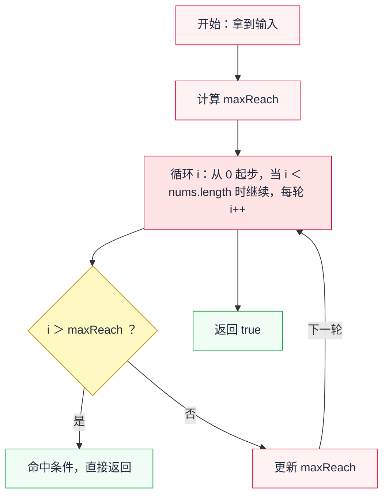

## TypeScript 解题方案（1 个方案逐个讲）

> **运行与提交**：每个方案都是自包含文件（内嵌用例自测，输出 PASS），整块复制到 `.ts` 文件后 `node 文件名` 即可运行。提交 LeetCode 时，把 `demo` 内的算法函数与辅助类型/函数整体取出、置于文件顶层即可。涉及交互/特殊接口的题以题面给定签名为准。

### 方案 1：单趟扫描

**分析与思路**：核心做法是「单趟扫描」。代码里依次做这些事：单循环线性扫描。

**运行方式**：`node 本文件`，内嵌用例全部通过会输出 PASS。


**方案专属流程图**（真实控制流）：

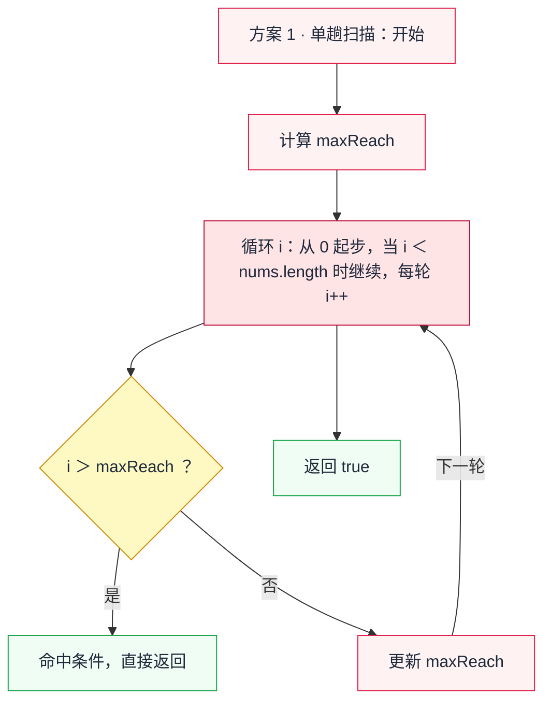

```typescript
/**
 ** LeetCode 55. 跳跃游戏
 ** 来源：https://blog.csdn.net/tyro_java/article/details/145241347
 */

export function canJump(nums: number[]): boolean {
  // 定义函数/方法 canJump
  let maxReach = 0; // 把 0 存入 maxReach
  for (let i = 0; i < nums.length; i++) {
    // 让 下标 i 从 0 开始计数，下标 i 小于 数组.长度 就继续
    if (i > maxReach) return false; // 若 下标 i 超过 maxReach，直接返回 false
    maxReach = Math.max(maxReach, i + nums[i]); // 把 Math.取较大值 maxReach, 下标 i 加 数组[下标 i]) 存入 maxReach
  }
  return true; // 返回 true
}

export function demo(): void {
  // 程序入口：跑内嵌自测用例
  if (!canJump([2, 3, 1, 1, 4])) throw new Error('FAILED 1'); // 若 取反 canJump([2, 3, 1, 1, 4])) throw new Error(「FAILED 1」);
  if (canJump([3, 2, 1, 0, 4])) throw new Error('FAILED 2'); // 若 canJump([3, 2, 1, 0, 4])) throw new Error(「FAILED 2」);
  console.log('PASS'); // 全部用例通过，输出 PASS
}

demo(); // demo();
```

## 逐步拆解与面试追问

**复杂度**：时间 O(n)（单趟线性扫描），空间 O(1) 到 O(n)（视辅助结构）

**为什么是这个量级**：每个元素被常数次访问，辅助哈希或栈的开销与 n 同阶

**面试官可能会追问**：

- 贪心的正确性怎么证明？
- 排序依据选错了会怎样？
- 能否举出反例推翻当前策略？

## 关键 API 速查（TS 主解法实际用到，附官方链接）

| API | 作用 | 使用要点 | 官方文档 |
|---|---|---|---|
| `Math.max()` | 最大值 | 配展开 Math.max(...arr)；空参返回 -Infinity；超大数组注意展开参数上限 | [官方文档](https://developer.mozilla.org/zh-CN/docs/Web/JavaScript/Reference/Global_Objects/Math/max) |

### 各语言官方文档导航

- **TypeScript / JS**：[MDN 中文参考](https://developer.mozilla.org/zh-CN/)
- **Python**：[Python 官方文档](https://docs.python.org/zh-cn/3/)
- **Go**：[Go 标准库](https://pkg.go.dev/std)
- **Java**：[JDK 17 API](https://docs.oracle.com/en/java/javase/17/docs/api/)
- **Rust**：[Rust 标准库](https://doc.rust-lang.org/std/)
- **Lua**：[Lua 5.4 手册](https://www.lua.org/manual/5.4/)
- **C**：[Cppreference C](https://zh.cppreference.com/w/c)
- **C++**：[Cppreference C++](https://zh.cppreference.com/w/cpp)
- **R**：[R 官方手册](https://stat.ethz.ch/R-manual/)
- **Zig**：[Zig 语言文档](https://ziglang.org/documentation/master/)
- **Dart**：[Dart API](https://api.dart.dev/)

## 附录：其他 10 种语言全部实现（每种语言列举其全部方案）

> TypeScript 的全部方案见「TypeScript 解题方案」一节；下面是其余 10 种语言的对应实现，每种语言的每个方案都带思路分析、代码走读与专属运行架构图。
> 每个方案都内嵌用例自测，可独立运行（老仓库 python/go 文件遵循「打印结果」约定）。
> 完整解法文件见 `dsa/<语言>/greedy/lc_55_跳跃游戏/`。

### Python 实现（1 种方案）

Python 的全部方案如下，每个方案都内嵌用例自测，可独立运行（老仓库 python/go 文件遵循「打印结果」约定）：

#### 方案 1：单趟扫描

**思路与代码分析**：核心是「单趟扫描」。Python 版用切片与字典推导式简化操作，突出可读性。**走读**：方案 1 · 单趟扫描：开始 → 更新 max_reach → 遍历 enumerate(nums): 中的每个元素 step → 命中条件，直接返回 → 更新 max_reach → 返回 True。

**运行架构**（真实控制流）：

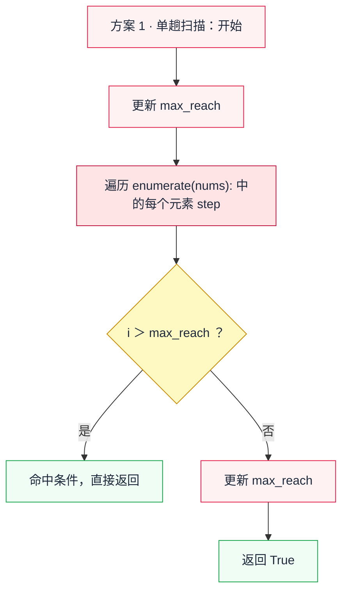

```python
import sys  # 提高递归深度上限（深输入防 RecursionError）

sys.setrecursionlimit(200000)  # 树/链表类题目节点数可达 1e4 量级

def canJump(nums):  # 定义函数 canJump（参数：数组）
    # 贪心：维护当前能到达的最远下标，若遇到下标已超过最远则失败
    max_reach = 0  # 把 0 存入 max_reach
    for i, step in enumerate(nums):  # 同时取 下标 i 与 步数 遍历
        if i > max_reach:  # 若 下标 i 超过 max_reach
            return False  # 返回 False
        max_reach = max(max_reach, i + step)  # 把 取较大值 max_reach, 下标 i 加 步数) 存入 max_reach
    return True  # 返回 True

if __name__ == "__main__":  # 若 __name__ 等于 '__main__'
    print(canJump([2, 3, 1, 1, 4]))  # 打印输出
    print(canJump([3, 2, 1, 0, 4]))  # 打印输出
```

### Go 实现（1 种方案）

Go 的全部方案如下，每个方案都内嵌用例自测，可独立运行（老仓库 python/go 文件遵循「打印结果」约定）：

#### 方案 1：单趟扫描

**思路与代码分析**：核心是「单趟扫描」。Go 版用切片与多返回值惯用法，显式处理索引边界。**走读**：方案 1 · 单趟扫描：开始 → 更新 : → 遍历 nums 的下标与元素 step → 处理 if i ＞ maxReach → 返回 false → 处理 if i+step ＞ maxReach → 更新 maxReach → 返回 true。

**运行架构**（真实控制流）：

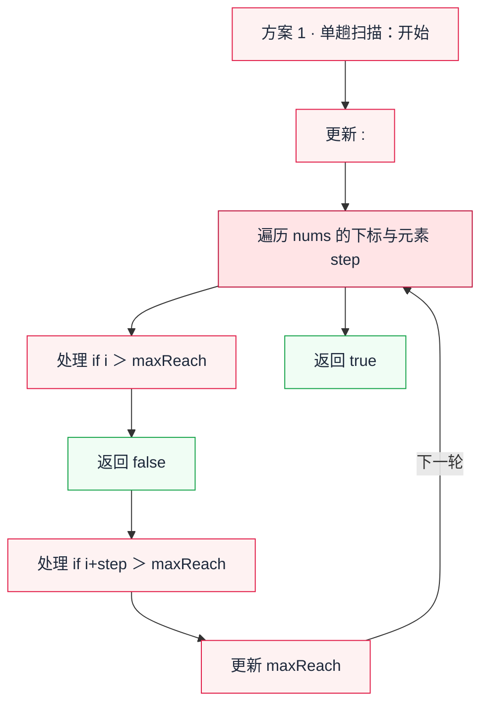

```go
package main // 引入依赖

import (
	"fmt"
	"os"
) // 引入依赖

func canJump(nums []int) bool { // 定义函数/方法 canJump
	maxReach := 0               // 把 0 写入 maxReach :
	for i, step := range nums { // 同时取 下标 i 与 步数 遍历
		if i > maxReach { // 若 下标 i 超过 maxReach
			return false // 返回 false
		}
		if i+step > maxReach { // 若 下标 i 加 步数 超过 maxReach
			maxReach = i + step // 把 下标 i 加 步数 写入 maxReach
		}
	}
	return true // 返回 true
}

func main() { // 程序入口：跑内嵌自测用例
	type tc struct { // 定义类型
		in   []int // in []int
		want bool  // want bool
	}
	cases := []tc{ // 把 []tc{ 写入 cases :
		{[]int{2, 3, 1, 1, 4}, true},
		{[]int{3, 2, 1, 0, 4}, false},
	}
	ok := true                // 把 true 写入 ok :
	for _, c := range cases { // 同时取 _ 与 字符 遍历
		if got := canJump(c.in); got != c.want { // 若 got : 赋值为 canJump(字符.in); got 不等于 字符.want
			ok = false                                                     // 把 false 写入 ok
			fmt.Printf("FAIL canJump(%v)=%v want %v\n", c.in, got, c.want) // 打印输出
		}
	}
	if !ok { // 若 取反 ok
		os.Exit(1) // os.Exit(1)
	}
	fmt.Println("PASS") // 全部用例通过，输出 PASS
}
```

### Java 实现（1 种方案）

Java 的全部方案如下，每个方案都内嵌用例自测，可独立运行（老仓库 python/go 文件遵循「打印结果」约定）：

#### 方案 1：单趟扫描

**思路与代码分析**：核心是「单趟扫描」。Java 版用类与静态方法组织，集合操作显式明了。代码里依次做这些事：单循环线性扫描。**走读**：方案 1 · 单趟扫描：开始 → 更新 maxReach → 遍历循环 → 命中条件，直接返回 → 更新 maxReach → 调用 Math.max(maxReach, i + nums[ → 返回 true。

**运行架构**（真实控制流）：

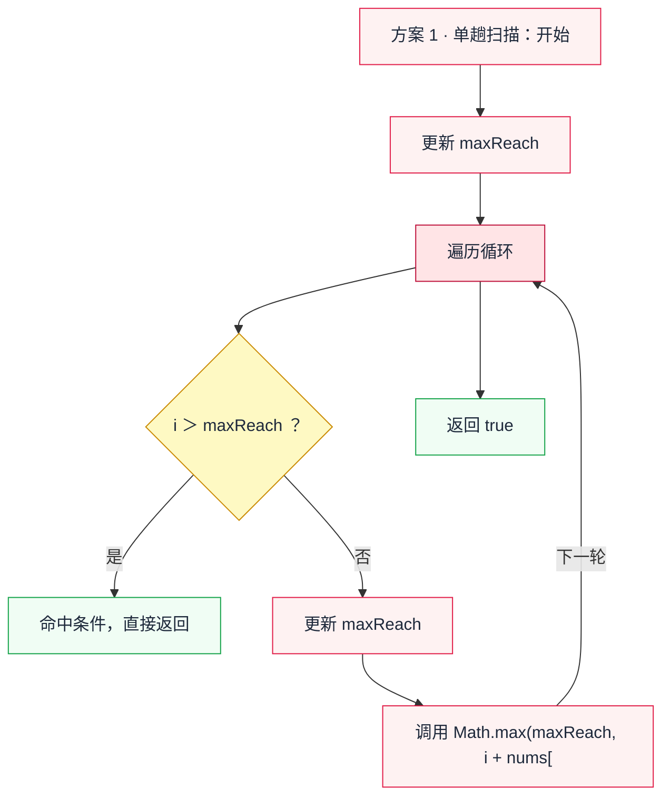

```java
package com.webfault.dsa; // 引入依赖

class lc55_solution1 { // 定义类型
  static boolean canJump(int[] nums) { // 定义函数/方法 canJump
    int maxReach = 0; // 把 0 存入 maxReach
    for (int i = 0; i < nums.length; i++) { // 让 下标 i 从 0 开始计数，下标 i 小于 数组.长度 就继续
      if (i > maxReach) return false; // 若 下标 i 超过 maxReach，直接返回 false
      maxReach =
          Math.max(maxReach, i + nums[i]); // 把 Math.取较大值 maxReach, 下标 i 加 数组[下标 i]); 写入 maxReach
    }
    return true; // 返回 true
  }

  public static void main(String[] args) { // public static void main(String[] args) {
    boolean a =
        canJump(new int[] {2, 3, 1, 1, 4}); // 把 canJump(new int[]{2, 3, 1, 1, 4}); 写入 boolean a
    if (!a) throw new RuntimeException("FAILED: canJump([2,3,1,1,4]) want true");
    boolean b =
        canJump(new int[] {3, 2, 1, 0, 4}); // 把 canJump(new int[]{3, 2, 1, 0, 4}); 写入 boolean b
    if (b) throw new RuntimeException("FAILED: canJump([3,2,1,0,4]) want false");
    System.out.println("PASS"); // 全部用例通过，输出 PASS
  }
}
```

### Rust 实现（1 种方案）

Rust 的全部方案如下，每个方案都内嵌用例自测，可独立运行（老仓库 python/go 文件遵循「打印结果」约定）：

#### 方案 1：单趟扫描

**思路与代码分析**：核心是「单趟扫描」。Rust 版用所有权移动与切片借用改写同一逻辑，注意 Option 与引用边界。**走读**：方案 1 · 单趟扫描：开始 → 计算 max_reach → 遍历 0..nums.len() 中的每个元素 i → 处理 if i ＞ max_reach → 返回 false → 计算 r → 处理 if r ＞ max_reach → 更新 max_reach → 处理 true。

**运行架构**（真实控制流）：

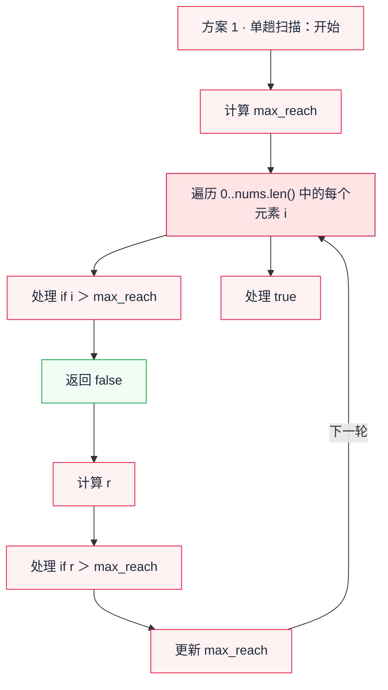

```rust
// LeetCode 55. 跳跃游戏 — Rust 版（方案1）
fn can_jump(nums: Vec<i32>) -> bool {
    // 定义函数/方法 can_jump
    let mut max_reach = 0usize; // 把 0usize; 写入 let mut max_reach
    for i in 0..nums.len() {
        // 逐个取出 0 的元素（下标 i）
        if i > max_reach {
            return false;
        } // 若 下标 i 超过 max_reach { return false; }
        let r = i + nums[i] as usize; // 把 下标 i 加 数组[下标 i] as usize 存入 右指针
        if r > max_reach {
            max_reach = r;
        } // 若 右指针 超过 max_reach { max_reach 赋值为 右指针; }
    }
    true // true
}
fn main() {
    // 程序入口：跑内嵌自测用例
    assert!(can_jump(vec![2, 3, 1, 1, 4])); // 断言校验
    assert!(!can_jump(vec![3, 2, 1, 0, 4])); // 断言校验
    println!("PASS"); // 全部用例通过，输出 PASS
}
```

### Lua 实现（1 种方案）

Lua 的全部方案如下，每个方案都内嵌用例自测，可独立运行（老仓库 python/go 文件遵循「打印结果」约定）：

#### 方案 1：单趟扫描

**思路与代码分析**：核心是「单趟扫描」。Lua 版用表与 ipairs 遍历，注意 ipairs 遇 nil 即停的语义。**走读**：方案 1 · 单趟扫描：开始 → 更新 max_reach → 循环 i：从 1 到 #nums do → 处理 if i - 1 ＞ max_reach then → 返回 false → 更新 r → 处理 if r ＞ max_reach then → 更新 max_reach → 返回 true。

**运行架构**（真实控制流）：

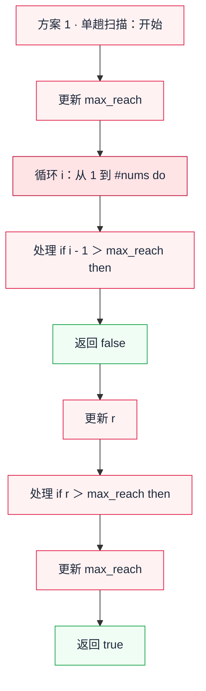

```lua
-- LeetCode 55. 跳跃游戏 — Lua 版（方案1）
local function can_jump(nums) -- local function can_jump(数组)
	local max_reach = 0 -- 把 0 写入 local max_reach
	for i = 1, #nums do -- 把 1, #数组 do 写入 for i
		if i - 1 > max_reach then
			return false
		end -- 若 下标 i 减 1 超过 max_reach then return false 终点
		local r = (i - 1) + nums[i] -- 把 (下标 i 减 1) 加 数组[下标 i] 写入 local r
		if r > max_reach then
			max_reach = r
		end -- 若 右指针 超过 max_reach then max_reach 赋值为 右指针 终点
	end -- 终点
	return true -- 返回 true
end -- 终点
assert(can_jump({ 2, 3, 1, 1, 4 }) == true) -- 断言校验
assert(can_jump({ 3, 2, 1, 0, 4 }) == false) -- 断言校验
print("PASS") -- 全部用例通过，输出 PASS
```

### C 实现（1 种方案）

C 的全部方案如下，每个方案都内嵌用例自测，可独立运行（老仓库 python/go 文件遵循「打印结果」约定）：

#### 方案 1：单趟扫描

**思路与代码分析**：核心是「单趟扫描」。C 版手动管理下标与内存，循环边界全部显式写出。代码里依次做这些事：单循环线性扫描。**走读**：方案 1 · 单趟扫描：开始 → 更新 max_reach → 遍历循环 → 命中条件，直接返回 → 若 i + nums[i] ＞ max_reach：更新 max_reach → 更新 max_reach → 返回 1。

**运行架构**（真实控制流）：

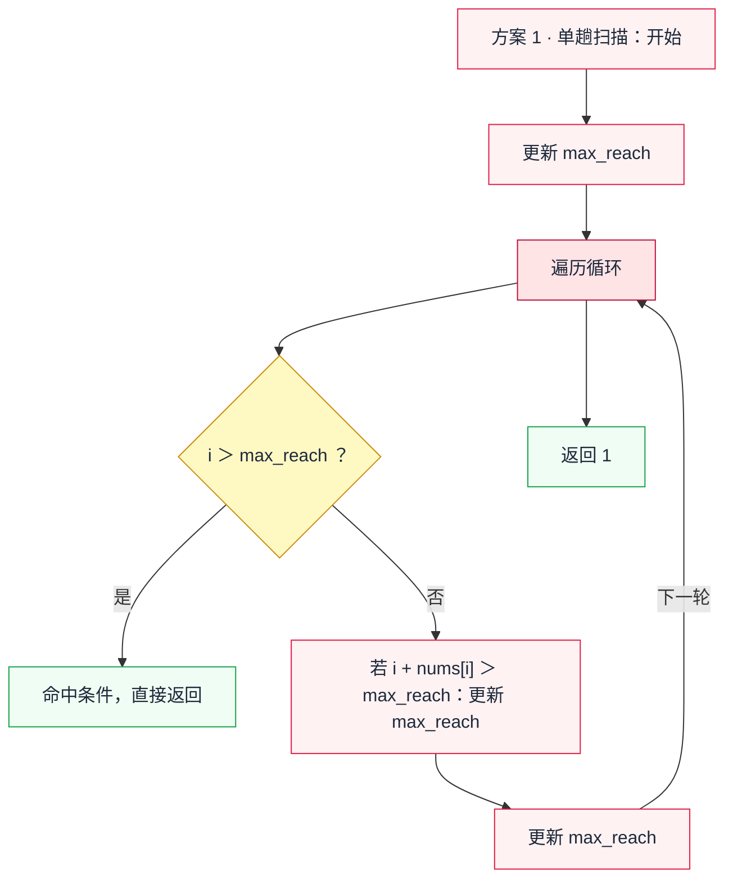

```c
/* LeetCode 55. 跳跃游戏 — C 版（方案1） */
#include <stdio.h>                            // 引入头文件
static int can_jump(const int *nums, int n) { // 定义函数/方法 can_jump
    int max_reach = 0;                        // 把 0 存入 max_reach
    for (int i = 0; i < n; i++) { // 让 下标 i 从 0 开始计数，下标 i 小于 元素个数 就继续
        if (i > max_reach)
            return 0; // 若 下标 i 超过 max_reach，直接返回 0
        if (i + nums[i] > max_reach)
            max_reach = i + nums[i];
    }
    return 1; // 返回 1
}
int main(void) { // 程序入口：跑内嵌自测用例
    if (!can_jump((int[]){2, 3, 1, 1, 4}, 5)) {
        printf("FAIL 1\n");
        return 1;
    }
    if (can_jump((int[]){3, 2, 1, 0, 4}, 5)) {
        printf("FAIL 2\n");
        return 1;
    }
    printf("PASS\n"); // 全部用例通过，输出 PASS
    return 0;         // 返回 0
}
```

### C++ 实现（1 种方案）

C++ 的全部方案如下，每个方案都内嵌用例自测，可独立运行（老仓库 python/go 文件遵循「打印结果」约定）：

#### 方案 1：单趟扫描

**思路与代码分析**：核心是「单趟扫描」。C++ 版用 STL 容器与迭代器，减少手写下标错误。代码里依次做这些事：单循环线性扫描。**走读**：方案 1 · 单趟扫描：开始 → 更新 maxReach → 遍历循环 → 处理 ++i) → 命中条件，直接返回 → 更新 maxReach → 处理 i + nums[i]) → 返回 true。

**运行架构**（真实控制流）：

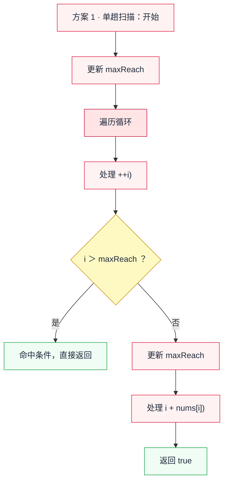

```cpp
// LeetCode 55. 跳跃游戏 — C++ 版（方案1）
#include <cassert>                                  // 引入头文件
#include <iostream>                                 // 引入头文件
#include <vector>                                   // 引入头文件
static bool canJump(const std::vector<int> &nums) { // 定义函数/方法 canJump
    int maxReach = 0;                               // 把 0 存入 maxReach
    for (int i = 0; i < static_cast<int>(nums.size());
         ++i) { // 让 下标 i 从 0 开始计数，下标 i 小于 static_cast 小于 int 超过 (数组.大小()) 就继续
        if (i > maxReach)
            return false; // 若 下标 i 超过 maxReach，直接返回 false
        maxReach = std::max(maxReach,
                            i + nums[i]); // 把 std::取较大值 maxReach, 下标 i 加 数组[下标 i]); 写入 maxReach
    }
    return true; // 返回 true
}
int main() {                           // 程序入口：跑内嵌自测用例
    assert(canJump({2, 3, 1, 1, 4}));  // 断言校验
    assert(!canJump({3, 2, 1, 0, 4})); // 断言校验
    std::cout << "PASS" << std::endl;  // 全部用例通过，输出 PASS
    return 0;                          // 返回 0
}
```

### R 实现（1 种方案）

R 的全部方案如下，每个方案都内嵌用例自测，可独立运行（老仓库 python/go 文件遵循「打印结果」约定）：

#### 方案 1：单趟扫描

**思路与代码分析**：核心是「单趟扫描」。R 版用向量化思维与 1 起始下标，注意 1:n 的降序陷阱。代码里依次做这些事：单循环线性扫描。**走读**：方案 1 · 单趟扫描：开始 → 处理 max_reach ＜- 0L → 循环 i：遍历 seq_along(nums) → 命中条件，直接返回 → 处理 r ＜- (i - 1L) + nums[i] → 若 r ＞ max_reach：处理 max_reach ＜- r → 处理 max_reach ＜- r → 处理 TRUE。

**运行架构**（真实控制流）：

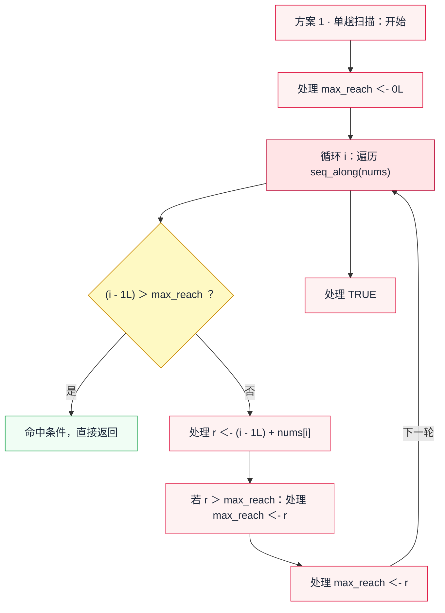

```r
# 版（方案1） 定义函数 can_jump（参数：数组）
can_jump <- function(nums) {
    max_reach <- 0L  # 把 0L 存入 max_reach
    for (i in seq_along(nums)) {
        # for (下标 i in seq_along(数组)) {
        if ((i - 1L) > max_reach)
            return(FALSE)  # 若 (下标 i 减 1L) 超过 max_reach) return(FALSE
        r <- (i - 1L) + nums[i]  # 把 (下标 i 减 1L) 加 数组[下标 i] 存入 右指针
        if (r > max_reach)
            max_reach <- r  # 若 右指针 超过 max_reach) max_reach 小于 减 右指针
    }
    TRUE  # TRUE
}
stopifnot(can_jump(c(2, 3, 1, 1, 4)))  # 断言校验
stopifnot(!can_jump(c(3, 2, 1, 0, 4)))  # 断言校验
cat("PASS\n")  # 全部用例通过，输出 PASS
```

### Zig 实现（1 种方案）

Zig 的全部方案如下，每个方案都内嵌用例自测，可独立运行（老仓库 python/go 文件遵循「打印结果」约定）：

#### 方案 1：单趟扫描

**思路与代码分析**：核心是「单趟扫描」。Zig 版显式分配与清零，整型边界处理严格。代码里依次做这些事：单循环线性扫描。**走读**：方案 1 · 单趟扫描：开始 → 计算 max_reach → 遍历集合元素 → 命中条件，直接返回 → 计算 r → 若 r ＞ max_reach：更新 max_reach → 返回 true。

**运行架构**（真实控制流）：

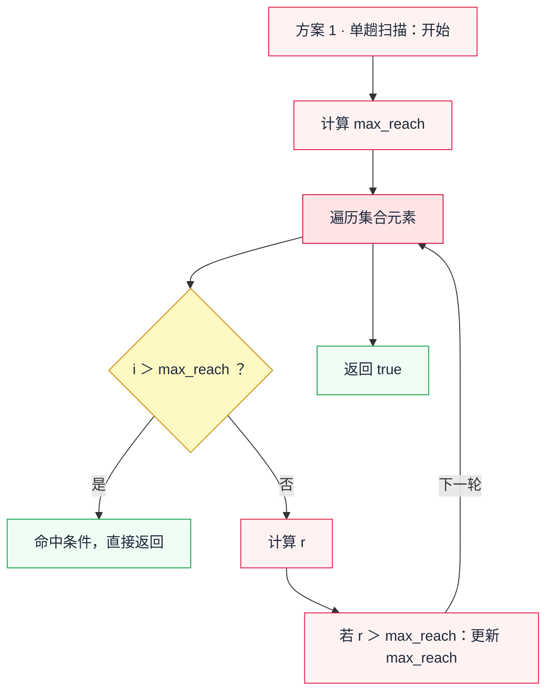

```zig
// LeetCode 55. 跳跃游戏 — Zig 版（方案1）
const std = @import("std"); // 把 @import(「std」) 存入 std
fn canJump(nums: []const i32) bool { // 定义函数/方法 canJump
    var max_reach: usize = 0; // 把 0; 写入 var max_reach: usize
    for (nums, 0..) |v, i| { // for (数组, 0..) 按位或 值, 下标 i 按位或 {
        if (i > max_reach) return false; // 若 下标 i 超过 max_reach，直接返回 false
        const r = i + @as(usize, @intCast(v)); // 把 下标 i 加 @as(usize, @intCast(值)) 存入 右指针
        if (r > max_reach) max_reach = r; // 若 右指针 超过 max_reach) max_reach 赋值为 右指针;
    }
    return true; // 返回 true
}
pub fn main() !void { // 程序入口：跑内嵌自测用例
    if (!canJump(&[_]i32{ 2, 3, 1, 1, 4 })) return error.TestFailed;
    if (canJump(&[_]i32{ 3, 2, 1, 0, 4 })) return error.TestFailed;
    std.debug.print("PASS\n", .{}); // 全部用例通过，输出 PASS
}
```

### Dart 实现（1 种方案）

Dart 的全部方案如下，每个方案都内嵌用例自测，可独立运行（老仓库 python/go 文件遵循「打印结果」约定）：

#### 方案 1：单趟扫描

**思路与代码分析**：核心是「单趟扫描」。Dart 版用可空类型标注与集合方法，注意空安全。代码里依次做这些事：单循环线性扫描。**走读**：方案 1 · 单趟扫描：开始 → 计算 maxReach → 遍历循环 → 命中条件，直接返回 → 更新 r → 若 r ＞ maxReach：更新 maxReach → 返回 true。

**运行架构**（真实控制流）：

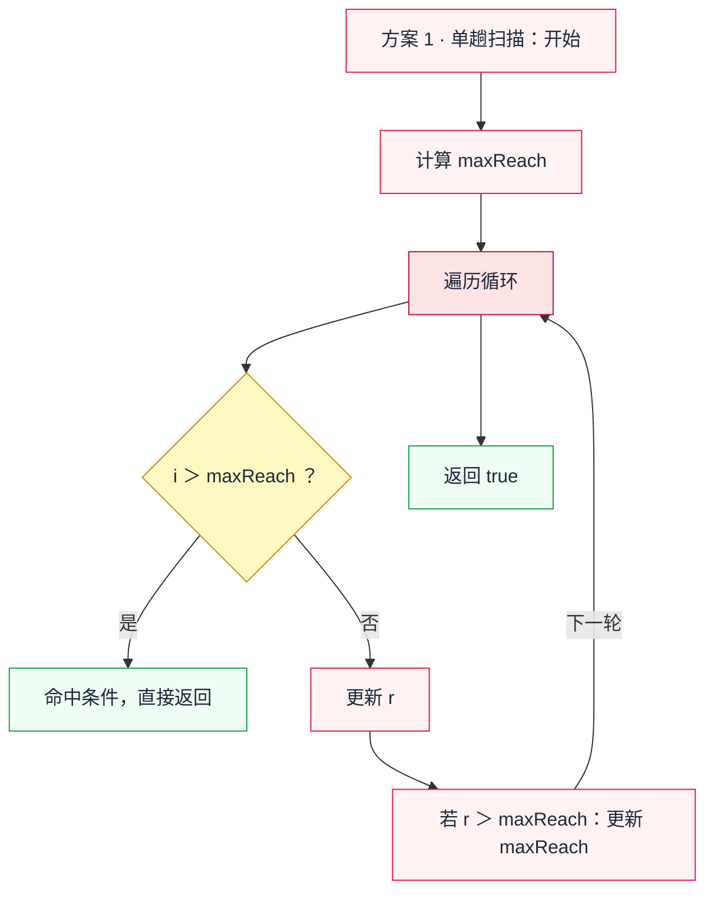

```dart
// LeetCode 55. 跳跃游戏 — Dart 版（方案1）
bool canJump(List<int> nums) {
  // 定义函数/方法 canJump
  var maxReach = 0; // 把 0 存入 maxReach
  for (var i = 0; i < nums.length; i++) {
    // 让 下标 i 从 0 开始计数，下标 i 小于 数组.长度 就继续
    if (i > maxReach) return false; // 若 下标 i 超过 maxReach，直接返回 false
    final r = i + nums[i]; // 把 下标 i 加 数组[下标 i] 存入 右指针
    if (r > maxReach) maxReach = r; // 若 右指针 超过 maxReach) maxReach 赋值为 右指针;
  }
  return true; // 返回 true
}

void main() {
  // 程序入口：跑内嵌自测用例
  if (!canJump([2, 3, 1, 1, 4]))
    throw StateError(
      'c1',
    ); // 若 取反 canJump([2, 3, 1, 1, 4])) throw StateError('c1');
  if (canJump([3, 2, 1, 0, 4]))
    throw StateError(
      'c2',
    ); // 若 canJump([3, 2, 1, 0, 4])) throw StateError('c2');
  print('PASS'); // 全部用例通过，输出 PASS
}
```

---

## 内容总结

- **跳跃游戏**（贪心 · Medium）：共 1 个方案，主线思路「单趟扫描」；时间 O(n)（单趟线性扫描）；动画演示贪心边界过程，附录给出 11 种语言 × 全部方案的可运行实现。
- 来源博客：[https://blog.csdn.net/tyro_java/article/details/145241347](https://blog.csdn.net/tyro_java/article/details/145241347)
- 导航：[📋 总目录](../) ｜ [← 104 跳跃游戏 ii](../104_跳跃游戏_ii/) ｜ [106 dota2 参议院 →](../106_dota2_参议院/)
