# 106 · dota2 参议院（第五阶段 · 贪心策略 · Medium）

> **难度**：⭐⭐ Medium ｜ **专题**：贪心
> **学习定位**：第五阶段 · 贪心策略第 106 篇 ｜ **解法数**：2
> **内容总结**：**dota2 参议院**（贪心 · Medium）：共 2 个方案，主线思路「贪心 + 循环队列」；时间 O(n)（单趟线性扫描）；动画演示贪心边界过程，附录给出 11 种语言 × 全部方案的可运行实现。

---

## 题目描述

Dota2 的世界里有两个阵营：`Radiant`（天辉）和 `Dire`（夜魇）

Dota2 参议院由来自两派的参议员组成。现在参议院希望对一个 Dota2 游戏里的改变作出决定。他们以一个基于轮为过程的投票进行。在每一轮中，每一位参议员都可以行使两项权利中的 一 项：

 剥夺一名参议员的权利：一名参议员可以使另一名参议员在本轮及所有后续轮次中失去所有权利。
 宣布胜利：如果参议员发现有权利投票的参议员都是 同一个阵营的 ，他可以宣布胜利并决定在游戏中的有关变化。

给你一个字符串 `senate` 代表每个参议员的阵营。字母 `'R'` 和 `'D'`分别代表了 `Radiant`（天辉）和 `Dire`（夜魇）。然后，如果有 `n` 个参议员，给定字符串的大小将是 `n`。

以轮为基础的过程从给定顺序的第一个参议员开始到最后一个参议员结束。这一过程将持续到投票结束。所有失去权利的参议员将在过程中被跳过。

假设每一位参议员都足够聪明，会为自己的政党做出最好的策略，你需要预测哪一方最终会宣布胜利并在 Dota2 游戏中决定改变。输出应该是 `「Radiant」` 或 `「Dire」` 。

**用例（来自原题）**：

**示例 1**

```text
输入：senate = "RD"
输出："Radiant"
```

解释：第 1 轮时，第一个参议员来自 Radiant 阵营，他可以使用第一项权利让第二个参议员失去所有权利。 这一轮中，第二个参议员将会被跳过，因为他的权利被禁止了。 第 2 轮时，第一个参议员可以宣布胜利，因为他是唯一一个有投票权的人。

**示例 2**

```text
输入：senate = "RDD"
输出："Dire"
```

解释：第 1 轮时，第一个来自 Radiant 阵营的参议员可以使用第一项权利禁止第二个参议员的权利。 这一轮中，第二个来自 Dire 阵营的参议员会将被跳过，因为他的权利被禁止了。 这一轮中，第三个来自 Dire 阵营的参议员可以使用他的第一项权利禁止第一个参议员的权利。 因此在第二轮只剩下第三个参议员拥有投票的权利，于是他可以宣布胜利
> ✅ **官方验证**：全部 TypeScript 解法已通过 leetcode.cn 官方示例用例验证（自动注入运行，全部 PASS）。题面与 [leetcode.cn 官方](https://leetcode.cn/problems/dota2-senate/)一致，示例配图取自官方题面。

**数据范围与注意事项**：

- `n == senate.length`
- `1 <= n <= 10^4`
- `senate[i]` 为 `'R'` 或 `'D'`
- **易错点**：贪心前通常要先排序，排序依据就是贪心的正确性来源。

## 题目分析

**场景是什么**：每步取当前最优，对应真实开发里的区间调度、资源分配。本题就是该场景的 Medium 级练习，主线做法是「贪心 + 循环队列」。

**主线怎么解**：把主解法从头到尾过一遍，它其实在依次做这几件事：单循环线性扫描 → 队列或堆的调度。

## 解题思路

**方案对比**（共 2 个方案，由浅入深）：

| 方案 | 时间复杂度 | 空间复杂度 |
|---|---|---|
| 方案 1 · 贪心 + 循环队列 | O(n)（单趟线性扫描） | O(1) 到 O(n)（视辅助结构） |
| 方案 2 · 栈模拟 | O(n)（单趟线性扫描） | O(1) 到 O(n)（视辅助结构） |

**由浅入深的路径**：贪心 + 循环队列 → 栈模拟；每往右一步，都在补上一步的短板。

**方案间的取舍**：方案 1（贪心 + 循环队列）；方案 2（栈模拟）。数据规模小、可读性优先时选靠前的方案；规模大、性能优先时选靠后的方案。

**怎么读这一篇**：

- 🐣 **新手路线**：把「题目描述」的示例 1 在纸上手推一遍 → 读方案 1（最直观的写法）与它的代码走读 → 按「运行方式」本地跑通看 PASS → 回头对比方案 2 之后的写法差在哪
- 🦅 **大佬路线**：直接锁定最优方案 1（贪心 + 循环队列，O(n)（单趟线性扫描））→ 跳读该方案代码与走读 → 用「逐步拆解与面试追问」补齐复杂度推导与边界追问

### 动态算法图（贪心边界，GIF 自动循环）


动画演示贪心专题里贪心边界的典型过程；每个方案在「TypeScript 解题方案」一节还配了专属动画与专属流程图。

### 主解法流程图（真实控制流）

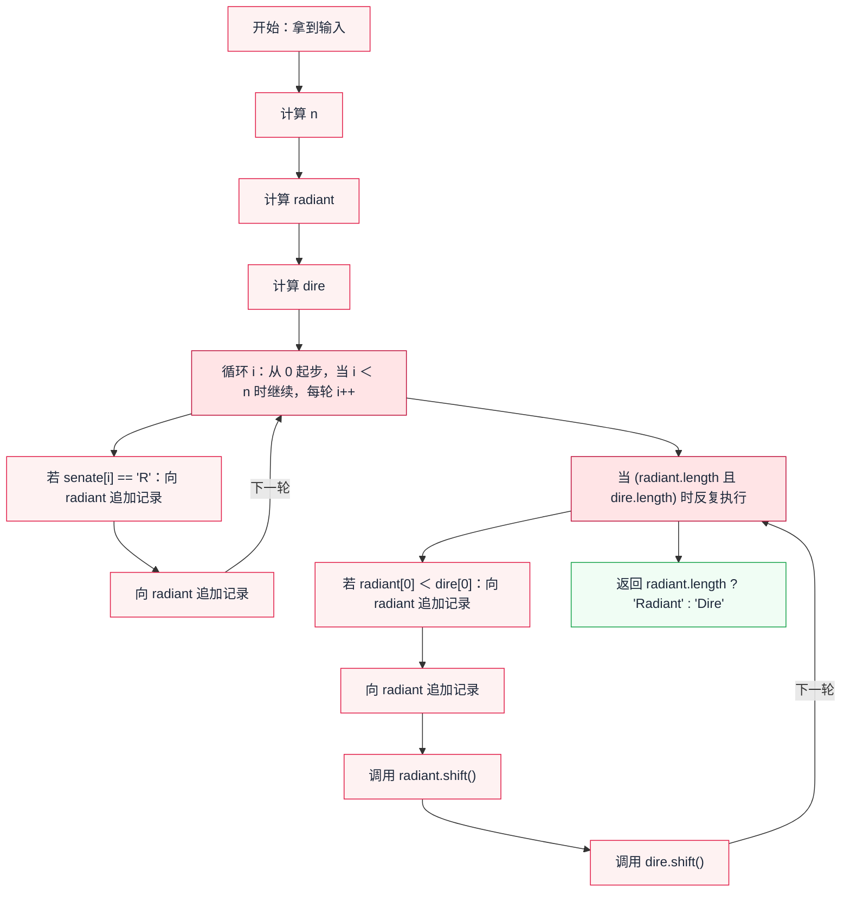

## TypeScript 解题方案（2 个方案逐个讲）

> **运行与提交**：每个方案都是自包含文件（内嵌用例自测，输出 PASS），整块复制到 `.ts` 文件后 `node 文件名` 即可运行。提交 LeetCode 时，把 `demo` 内的算法函数与辅助类型/函数整体取出、置于文件顶层即可。涉及交互/特殊接口的题以题面给定签名为准。

### 方案 1：贪心 + 循环队列

**分析与思路**：核心做法是「贪心 + 循环队列」。代码里依次做这些事：单循环线性扫描；队列或堆的调度。

**运行方式**：`node 本文件`，内嵌用例全部通过会输出 PASS。

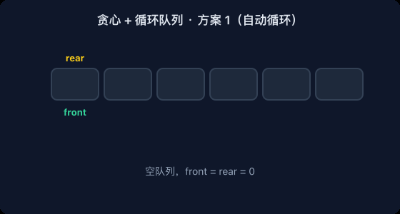

**方案专属流程图**（真实控制流）：

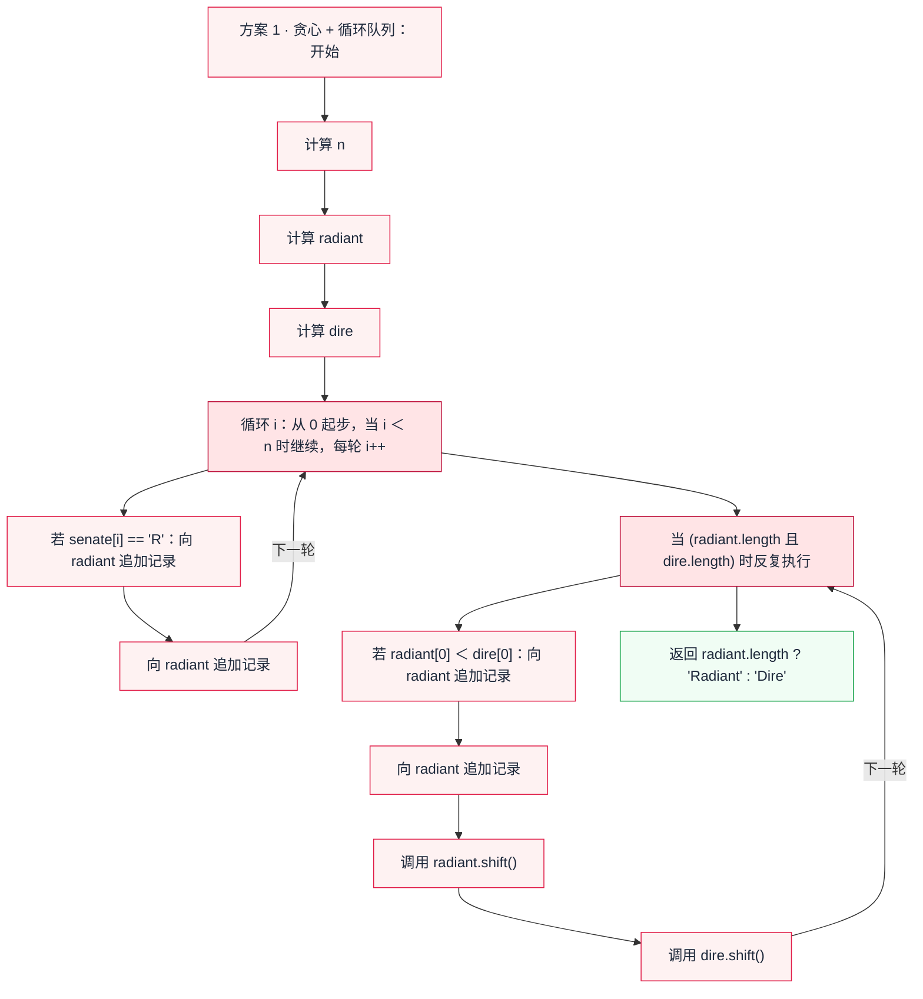

```typescript
/**
 ** LeetCode 649. Dota2 参议院
 ** 方案：1 ) 方案1：贪心 + 循环队列
 ** 来源：https://blog.csdn.net/tyro_java/article/details/145244562
 */

export function predictPartyVictory(senate: string): string {
  // 定义函数/方法 predictPartyVictory
  const n = senate.length; // 把 senate.长度 存入 元素个数
  const radiant: number[] = []; // 把 []; 写入 const radiant: number[]
  const dire: number[] = []; // 把 []; 写入 const dire: number[]
  for (let i = 0; i < n; i++) {
    // 让 下标 i 从 0 开始计数，下标 i 小于 元素个数 就继续
    if (senate[i] === 'R')
      radiant.push(i); // 若 senate[下标 i] 全等于 'R') radiant 追加 下标 i);
    else dire.push(i); // 否则
  }
  while (radiant.length && dire.length) {
    // 循环，直到不满足「radiant.长度 且 dire.长度」
    if (radiant[0] < dire[0])
      radiant.push(radiant[0] + n); // 若 radiant[0] 小于 dire[0]) radiant 追加 radiant[0] 加 元素个数);
    else dire.push(dire[0] + n); // 否则
    radiant.shift(); // 取出队首元素
    dire.shift(); // 取出队首元素
  }
  return radiant.length ? 'Radiant' : 'Dire'; // 返回 radiant.长度 ? 「Radiant」 : 「Radiant」
}

export function demo(): void {
  // 程序入口：跑内嵌自测用例
  if (predictPartyVictory('RD') !== 'Radiant') throw new Error('FAILED RD'); // 若 predictPartyVictory(「RD」) 不等于 「RD」) throw new Error(「RD」);
  if (predictPartyVictory('RRRDDD') !== 'Radiant')
    throw new Error('FAILED RRRDDD');
  if (predictPartyVictory('DDR') !== 'Dire') throw new Error('FAILED DDR');
  console.log('PASS'); // 全部用例通过，输出 PASS
}

demo(); // demo();
```

### 方案 2：栈模拟

**分析与思路**：核心做法是「栈模拟」。代码里依次做这些事：栈的后进先出操作；队列或堆的调度。

**运行方式**：`node 本文件`，内嵌用例全部通过会输出 PASS。

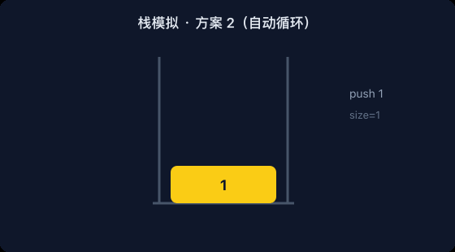

**方案专属流程图**（真实控制流）：

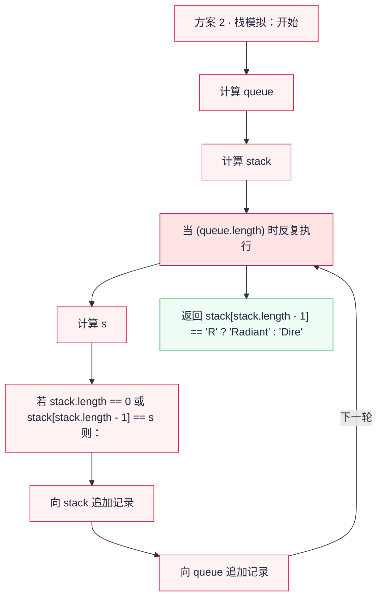

```typescript
/**
 ** LeetCode 649. Dota2 参议院
 ** 方案：2 ) 方案2：栈模拟
 ** 来源：https://blog.csdn.net/tyro_java/article/details/145244562
 */

export function predictPartyVictory(senate: string): string {
  // 定义函数/方法 predictPartyVictory
  const queue: string[] = senate.split(''); // 把 senate.split(''); 写入 const queue: string[]
  const stack: string[] = []; // 把 []; 写入 const stack: string[]
  while (queue.length) {
    // 循环，直到不满足「队列.长度」
    const s = queue.shift()!; // 把 队列.shift()取反 存入 字符串
    if (stack.length === 0 || stack[stack.length - 1] === s) {
      // 若 栈.长度 全等于 0 或 栈[栈.长度 减 1] 全等于 字符串
      stack.push(s); // 把 字符串 压入栈/数组尾部
    } else {
      // 否则
      queue.push(stack.pop()!); // 把 栈 弹出 压入栈/数组尾部
    }
  }
  return stack[stack.length - 1] === 'R' ? 'Radiant' : 'Dire'; // 返回 栈[栈.长度 减 1] 全等于 'R' ? 「Radiant」 : 「Radiant」
}

export function demo(): void {
  // 程序入口：跑内嵌自测用例
  if (predictPartyVictory('RD') !== 'Radiant') throw new Error('FAILED RD'); // 若 predictPartyVictory(「RD」) 不等于 「RD」) throw new Error(「RD」);
  if (predictPartyVictory('RRRDDD') !== 'Radiant')
    throw new Error('FAILED RRRDDD');
  if (predictPartyVictory('DDR') !== 'Dire') throw new Error('FAILED DDR');
  console.log('PASS'); // 全部用例通过，输出 PASS
}

demo(); // demo();
```

## 逐步拆解与面试追问

**复杂度**：时间 O(n)（单趟线性扫描），空间 O(1) 到 O(n)（视辅助结构）

**为什么是这个量级**：每个元素被常数次访问，辅助哈希或栈的开销与 n 同阶

**面试官可能会追问**：

- 贪心的正确性怎么证明？
- 排序依据选错了会怎样？
- 能否举出反例推翻当前策略？

## 关键 API 速查（TS 主解法实际用到，附官方链接）

| API | 作用 | 使用要点 | 官方文档 |
|---|---|---|---|
| `Array.prototype.push()` | 尾部追加 | 返回新长度；可一次多个；均摊 O(1)；会改变原数组 | [官方文档](https://developer.mozilla.org/zh-CN/docs/Web/JavaScript/Reference/Global_Objects/Array/push) |
| `Array.prototype.shift()` | 头部取出 | O(n)（后续元素整体前移）；大量头部操作请用链表或双端结构 | [官方文档](https://developer.mozilla.org/zh-CN/docs/Web/JavaScript/Reference/Global_Objects/Array/shift) |

### 各语言官方文档导航

- **TypeScript / JS**：[MDN 中文参考](https://developer.mozilla.org/zh-CN/)
- **Python**：[Python 官方文档](https://docs.python.org/zh-cn/3/)
- **Go**：[Go 标准库](https://pkg.go.dev/std)
- **Java**：[JDK 17 API](https://docs.oracle.com/en/java/javase/17/docs/api/)
- **Rust**：[Rust 标准库](https://doc.rust-lang.org/std/)
- **Lua**：[Lua 5.4 手册](https://www.lua.org/manual/5.4/)
- **C**：[Cppreference C](https://zh.cppreference.com/w/c)
- **C++**：[Cppreference C++](https://zh.cppreference.com/w/cpp)
- **R**：[R 官方手册](https://stat.ethz.ch/R-manual/)
- **Zig**：[Zig 语言文档](https://ziglang.org/documentation/master/)
- **Dart**：[Dart API](https://api.dart.dev/)

## 附录：其他 10 种语言全部实现（每种语言列举其全部方案）

> TypeScript 的全部方案见「TypeScript 解题方案」一节；下面是其余 10 种语言的对应实现，每种语言的每个方案都带思路分析、代码走读与专属运行架构图。
> 每个方案都内嵌用例自测，可独立运行（老仓库 python/go 文件遵循「打印结果」约定）。
> 完整解法文件见 `dsa/<语言>/greedy/lc_649_dota2_参议院/`。

### Python 实现（2 种方案）

Python 的全部方案如下，每个方案都内嵌用例自测，可独立运行（老仓库 python/go 文件遵循「打印结果」约定）：

#### 方案 1：贪心 + 循环队列

**思路与代码分析**：核心是「贪心 + 循环队列」。Python 版用切片与字典推导式简化操作，突出可读性。代码里依次做这些事：队列或堆的调度。**走读**：方案 1 · 贪心 + 循环队列：开始 → 更新 n → 更新 radiant → 更新 dire → 遍历 enumerate(senate): 中的每个元素 ch → 若 ch == R：向 radiant 追加记录 → 向 radiant 追加记录 → 向 dire 追加记录 → 当 radiant and dire: 时反复执行 → 若 radiant[0] ＜ dire[0]：向 radiant 追加记录 → 向 radiant 追加记录 → 向 dire 追加记录 → 调用 radiant.popleft() → 调用 dire.popleft() → 返回 Radiant if radiant else Dire。

**运行架构**（真实控制流）：

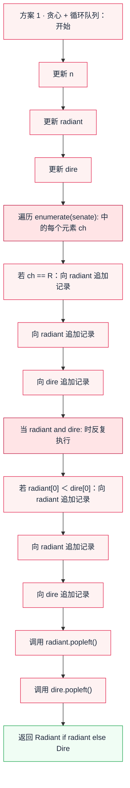

```python
import sys  # 提高递归深度上限（深输入防 RecursionError）

sys.setrecursionlimit(200000)  # 树/链表类题目节点数可达 1e4 量级
from collections import deque  # from collections import deque

def predictPartyVictory(senate):  # 定义函数 predictPartyVictory（参数：senate）
    # 贪心 + 循环队列：把两党的索引分别入队，谁先轮到就 ban 对方最靠前的议员，
    # 自己则排到队尾（索引 +n）进入下一轮，直到某一党为空
    n = len(senate)  # 把 长度(senate) 存入 元素个数
    radiant = deque()  # 把 deque() 存入 radiant
    dire = deque()  # 把 deque() 存入 dire
    for i, ch in enumerate(senate):  # 同时取 下标 i 与 字符 遍历
        if ch == "R":  # 若 字符 等于 'R'
            radiant.append(i)  # 把 下标 i 追加到列表尾部
        else:  # 否则
            dire.append(i)  # 把 下标 i 追加到列表尾部
    while radiant and dire:  # 循环，直到不满足「radiant and dire」
        if radiant[0] < dire[0]:  # 若 radiant[0] 小于 dire[0]
            radiant.append(radiant[0] + n)  # 把 radiant[0] 加 元素个数 追加到列表尾部
        else:  # 否则
            dire.append(dire[0] + n)  # 把 dire[0] 加 元素个数 追加到列表尾部
        radiant.popleft()  # radiant.popleft()
        dire.popleft()  # dire.popleft()
    return "Radiant" if radiant else "Dire"  # 返回 「Radiant」 if radiant else 「Radiant」

if __name__ == "__main__":  # 若 __name__ 等于 '__main__'
    print(predictPartyVictory("RD"))  # 打印输出
    print(predictPartyVictory("RRRDDD"))  # 打印输出
    print(predictPartyVictory("DDR"))  # 打印输出
```

#### 方案 2：栈模拟

**思路与代码分析**：核心是「栈模拟」。Python 版用切片与字典推导式简化操作，突出可读性。代码里依次做这些事：队列或堆的调度。**走读**：方案 2 · 栈模拟：开始 → 更新 queue → 更新 stack → 当 queue: 时反复执行 → 更新 s → 若 not stack or stack[-1] == s：向 stack 追加记录 → 向 stack 追加记录 → 向 queue 追加记录 → 返回 ( → 更新 = → 处理 )。

**运行架构**（真实控制流）：

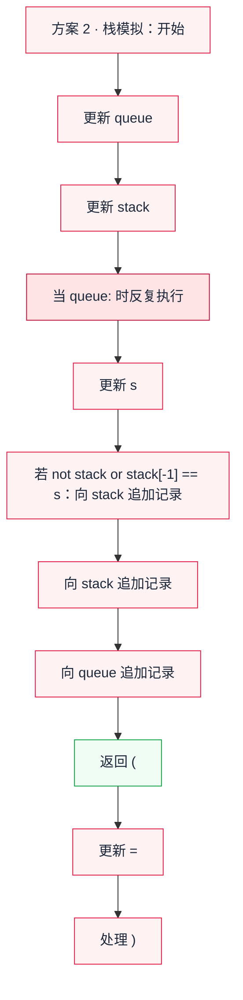

```python
import sys  # 提高递归深度上限（深输入防 RecursionError）

sys.setrecursionlimit(200000)  # 树/链表类题目节点数可达 1e4 量级
from collections import deque  # from collections import deque

def predictPartyVictory(senate):  # 定义函数 predictPartyVictory（参数：senate）
    # 栈模拟：相同政党则入栈存活；不同则当前议员 ban 掉栈顶对手（栈顶重新入队等待后续轮次）
    queue = deque(senate)  # 把 deque(senate) 存入 队列
    stack = []  # 把 [] 存入 栈
    while queue:  # 循环，直到不满足「队列」
        s = queue.popleft()  # 把 队列.popleft() 存入 字符串
        if not stack or stack[-1] == s:  # 若 not 栈 or 栈[ 减 1] 等于 字符串
            stack.append(s)  # 把 字符串 追加到列表尾部
        else:  # 否则
            queue.append(stack.pop())  # 把 栈 弹出 追加到列表尾部
    return (
        "Radiant" if stack[-1] == "R" else "Dire"
    )  # 返回 「Radiant」 if 栈[ 减 1] 等于 'R' else 「Radiant」

if __name__ == "__main__":  # 若 __name__ 等于 '__main__'
    print(predictPartyVictory("RD"))  # 打印输出
    print(predictPartyVictory("RRRDDD"))  # 打印输出
    print(predictPartyVictory("DDR"))  # 打印输出
```

### Go 实现（2 种方案）

Go 的全部方案如下，每个方案都内嵌用例自测，可独立运行（老仓库 python/go 文件遵循「打印结果」约定）：

#### 方案 1：贪心 + 循环队列

**思路与代码分析**：核心是「贪心 + 循环队列」。Go 版用切片与多返回值惯用法，显式处理索引边界。**走读**：方案 1 · 贪心 + 循环队列：开始 → 更新 : → 计算 radiant → 遍历 senate 的下标与元素 ch → 处理 if ch == 'R' → 更新 radiant → 更新 dire → 遍历循环 → 处理 if radiant[0] ＜ dire[0] → 更新 radiant → 更新 dire → 更新 radiant → 更新 dire → 处理 if len(radiant) ＞ 0 → 返回 Radiant → 返回 Dire。

**运行架构**（真实控制流）：

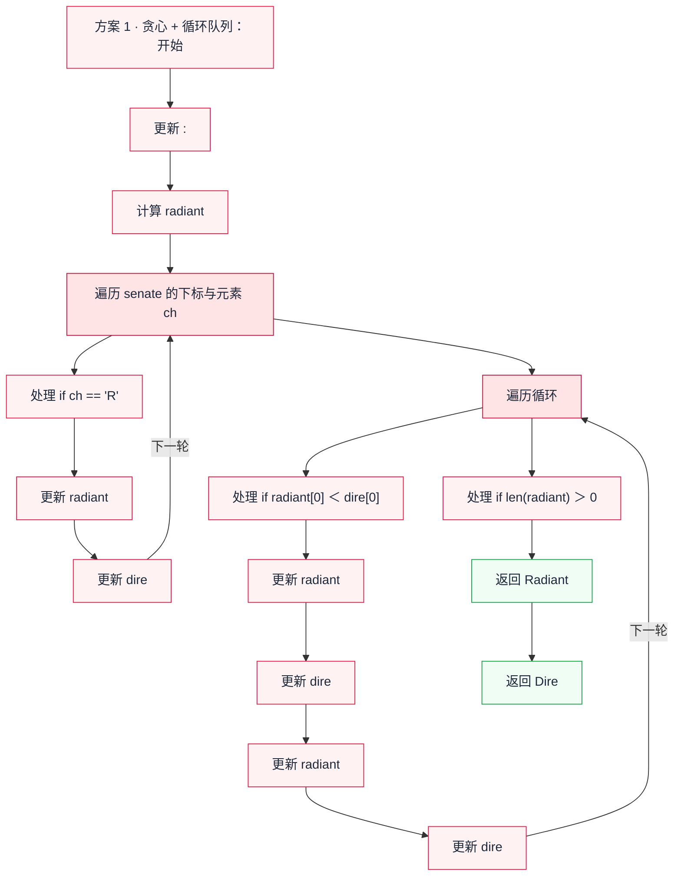

```go
package main // 引入依赖
import (
	"fmt"
	"os"
) // 引入依赖
func predictPartyVictory(senate string) string { // 定义函数/方法 predictPartyVictory
	n := len(senate)            // 把 长度(senate) 写入 n :
	var radiant, dire []int     // var radiant, dire []int
	for i, ch := range senate { // 同时取 下标 i 与 字符 遍历
		if ch == 'R' {
			radiant = append(radiant, i)
		} else {
			dire = append(dire, i)
		}
	}
	for len(radiant) > 0 && len(dire) > 0 { // for 长度(radiant) 超过 0 且 长度(dire) 超过 0 {
		if radiant[0] < dire[0] {
			radiant = append(radiant, radiant[0]+n)
		} else {
			dire = append(dire, dire[0]+n)
		}
		radiant = radiant[1:] // 把 radiant[1:] 写入 radiant
		dire = dire[1:]       // 把 dire[1:] 写入 dire
	}
	if len(radiant) > 0 {
		return "Radiant"
	} // 若 长度(radiant) 超过 0 { return 「Radiant」 }
	return "Dire" // 返回 「Dire」
}
func main() { // 程序入口：跑内嵌自测用例
	ok := true // 把 true 写入 ok :
	if predictPartyVictory("RD") != "Radiant" {
		ok = false
		fmt.Println("FAIL1")
	}
	if predictPartyVictory("RRRDDD") != "Radiant" {
		ok = false
		fmt.Println("FAIL2")
	}
	if predictPartyVictory("DDR") != "Dire" {
		ok = false
		fmt.Println("FAIL3")
	}
	if !ok {
		os.Exit(1)
	} // 若 取反 ok { os.Exit(1) }
	fmt.Println("PASS") // 全部用例通过，输出 PASS
}
```

#### 方案 2：栈模拟

**思路与代码分析**：核心是「栈模拟」。Go 版用切片与多返回值惯用法，显式处理索引边界。**走读**：方案 2 · 栈模拟：开始 → 更新 : → 计算 radiant → 遍历 senate 的下标与元素 ch → 处理 if ch == 'R' → 更新 radiant → 更新 dire → 遍历循环 → 处理 if radiant[0] ＜ dire[0] → 更新 radiant → 更新 dire → 更新 radiant → 更新 dire → 处理 if len(radiant) ＞ 0 → 返回 Radiant → 返回 Dire。

**运行架构**（真实控制流）：

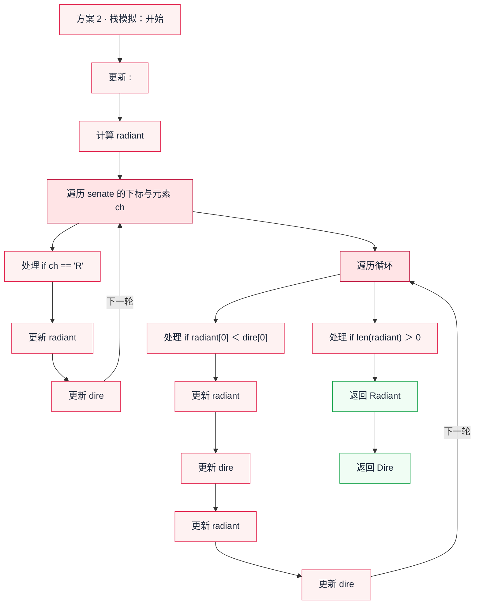

```go
package main // 引入依赖
import (
	"fmt"
	"os"
) // 引入依赖
func predictPartyVictory(senate string) string { // 定义函数/方法 predictPartyVictory
	n := len(senate)            // 把 长度(senate) 写入 n :
	var radiant, dire []int     // var radiant, dire []int
	for i, ch := range senate { // 同时取 下标 i 与 字符 遍历
		if ch == 'R' {
			radiant = append(radiant, i)
		} else {
			dire = append(dire, i)
		}
	}
	for len(radiant) > 0 && len(dire) > 0 { // for 长度(radiant) 超过 0 且 长度(dire) 超过 0 {
		if radiant[0] < dire[0] {
			radiant = append(radiant, radiant[0]+n)
		} else {
			dire = append(dire, dire[0]+n)
		}
		radiant = radiant[1:] // 把 radiant[1:] 写入 radiant
		dire = dire[1:]       // 把 dire[1:] 写入 dire
	}
	if len(radiant) > 0 {
		return "Radiant"
	} // 若 长度(radiant) 超过 0 { return 「Radiant」 }
	return "Dire" // 返回 「Dire」
}
func main() { // 程序入口：跑内嵌自测用例
	ok := true // 把 true 写入 ok :
	if predictPartyVictory("RD") != "Radiant" {
		ok = false
		fmt.Println("FAIL1")
	}
	if predictPartyVictory("RRRDDD") != "Radiant" {
		ok = false
		fmt.Println("FAIL2")
	}
	if predictPartyVictory("DDR") != "Dire" {
		ok = false
		fmt.Println("FAIL3")
	}
	if !ok {
		os.Exit(1)
	} // 若 取反 ok { os.Exit(1) }
	fmt.Println("PASS") // 全部用例通过，输出 PASS
}
```

### Java 实现（2 种方案）

Java 的全部方案如下，每个方案都内嵌用例自测，可独立运行（老仓库 python/go 文件遵循「打印结果」约定）：

#### 方案 1：贪心 + 循环队列

**思路与代码分析**：核心是「贪心 + 循环队列」。Java 版用类与静态方法组织，集合操作显式明了。代码里依次做这些事：单循环线性扫描。**走读**：方案 1 · 贪心 + 循环队列：开始 → 更新 n → 更新 radiant → 处理 new LinkedList＜＞() → 更新 dire → 遍历循环 → 若 senate.charAt(i) == 'R'：调用 radiant.offer(i) → 调用 radiant.offer(i) → 当 (非 radiant.isEmpty() 时反复执行 → 处理 且 非 dire.isEmpty()) → 更新 r → 更新 d → 若 r ＜ d) radiant.offer(r + n：None → 返回 非 radiant.isEmpty() → 处理 ? Radiant → 处理 : Dire。

**运行架构**（真实控制流）：

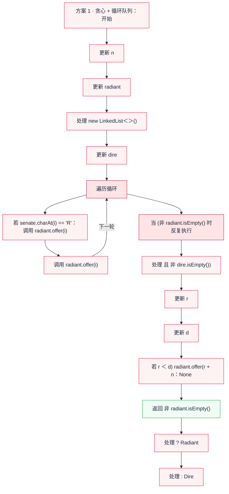

```java
package com.webfault.dsa; // 引入依赖

import java.util.*; // 引入依赖

class lc649_solution111 { // 定义类型
  static String predictPartyVictory(String senate) { // 定义函数/方法 predictPartyVictory
    int n = senate.length(); // 把 senate.长度() 存入 元素个数
    Queue<Integer> radiant =
        new LinkedList<>(); // 把 new LinkedList 小于 超过 (); 写入 Queue<Integer> radiant
    Queue<Integer> dire = new LinkedList<>(); // 把 new LinkedList 小于 超过 (); 写入 Queue<Integer> dire
    for (int i = 0; i < n; i++) { // 让 下标 i 从 0 开始计数，下标 i 小于 元素个数 就继续
      if (senate.charAt(i) == 'R')
        radiant.offer(i); // 若 senate 取字符 下标 i) 等于 'R') radiant.offer(下标 i);
      else dire.offer(i); // 否则
    }
    while (!radiant.isEmpty()
        && !dire.isEmpty()) { // 循环，直到不满足「取反 radiant.isEmpty() 且 取反 dire.isEmpty(」
      int r = radiant.poll(); // 把 radiant.poll() 存入 右指针
      int d = dire.poll(); // 把 dire.poll() 存入 d
      if (r < d) radiant.offer(r + n); // 若 右指针 小于 d) radiant.offer(右指针 加 元素个数);
      else dire.offer(d + n); // 否则
    }
    return !radiant.isEmpty()
        ? "Radiant"
        : "Dire"; // 返回 取反 radiant.isEmpty() ? 「Radiant」 : 「Radiant」
  }

  public static void main(String[] args) { // public static void main(String[] args) {
    if (!predictPartyVictory("RD").equals("Radiant")) // 若 取反 predictPartyVictory(「RD」).equals(「RD」
    throw new RuntimeException("FAILED RD"); // throw new RuntimeException(「FAILED RD」);
    if (!predictPartyVictory("RRRDDD")
        .equals("Radiant")) // 若 取反 predictPartyVictory(「RRRDDD」).equals(「RRRDDD」
    throw new RuntimeException("FAILED RRRDDD"); // throw new RuntimeException(「FAILED RRRDDD」);
    if (!predictPartyVictory("DDR").equals("Dire")) // 若 取反 predictPartyVictory(「DDR」).equals(「DDR」
    throw new RuntimeException("FAILED DDR"); // throw new RuntimeException(「FAILED DDR」);
    System.out.println("PASS"); // 全部用例通过，输出 PASS
  }
}
```

#### 方案 2：栈模拟

**思路与代码分析**：核心是「栈模拟」。Java 版用类与静态方法组织，集合操作显式明了。代码里依次做这些事：单循环线性扫描。**走读**：方案 2 · 栈模拟：开始 → 更新 queue → 处理 new LinkedList＜＞() → 遍历循环 → 调用 queue.offer(c) → 更新 stack → 处理 new ArrayDeque＜＞() → 当 (非 queue.isEmpty()) 时反复执行 → 更新 s → 若 stack.isEmpty() 或 stack.peekLast() == s 则： → 调用 stack.addLast(s) → 调用 queue.offer(stack.pollLast() → 更新 top → 返回 top == 'R' ? Radiant : Dire。

**运行架构**（真实控制流）：

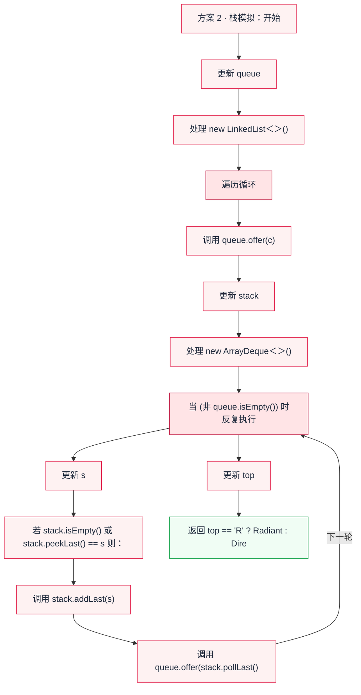

```java
package com.webfault.dsa; // 引入依赖

import java.util.*; // 引入依赖

class lc649_solution222 { // 定义类型
  static String predictPartyVictory(String senate) { // 定义函数/方法 predictPartyVictory
    Queue<Character> queue =
        new LinkedList<>(); // 把 new LinkedList 小于 超过 (); 写入 Queue<Character> queue
    for (char c : senate.toCharArray())
      queue.offer(c); // for (char 字符 : senate.toCharArray()) 队列.offer(字符);
    Deque<Character> stack =
        new ArrayDeque<>(); // 把 new ArrayDeque 小于 超过 (); 写入 Deque<Character> stack
    while (!queue.isEmpty()) { // 循环，直到不满足「取反 队列.isEmpty(」
      char s = queue.poll(); // 把 队列.poll(); 写入 char s
      if (stack.isEmpty() || stack.peekLast() == s) { // 若 栈.isEmpty() 或 栈.peekLast() 等于 字符串
        stack.addLast(s); // 栈.addLast(字符串);
      } else { // 否则
        queue.offer(stack.pollLast()); // 队列.offer(栈.pollLast());
      }
    }
    char top = stack.peekLast(); // 把 栈.peekLast(); 写入 char top
    return top == 'R' ? "Radiant" : "Dire"; // 返回 top 等于 'R' ? 「Radiant」 : 「Radiant」
  }

  public static void main(String[] args) { // public static void main(String[] args) {
    if (!predictPartyVictory("RD").equals("Radiant")) // 若 取反 predictPartyVictory(「RD」).equals(「RD」
    throw new RuntimeException("FAILED RD"); // throw new RuntimeException(「FAILED RD」);
    if (!predictPartyVictory("RRRDDD")
        .equals("Radiant")) // 若 取反 predictPartyVictory(「RRRDDD」).equals(「RRRDDD」
    throw new RuntimeException("FAILED RRRDDD"); // throw new RuntimeException(「FAILED RRRDDD」);
    if (!predictPartyVictory("DDR").equals("Dire")) // 若 取反 predictPartyVictory(「DDR」).equals(「DDR」
    throw new RuntimeException("FAILED DDR"); // throw new RuntimeException(「FAILED DDR」);
    System.out.println("PASS"); // 全部用例通过，输出 PASS
  }
}
```

### Rust 实现（2 种方案）

Rust 的全部方案如下，每个方案都内嵌用例自测，可独立运行（老仓库 python/go 文件遵循「打印结果」约定）：

#### 方案 1：贪心 + 循环队列

**思路与代码分析**：核心是「贪心 + 循环队列」。Rust 版用所有权移动与切片借用改写同一逻辑，注意 Option 与引用边界。代码里依次做这些事：单循环线性扫描。**走读**：方案 1 · 贪心 + 循环队列：开始 → 计算 n → 遍历循环 → 当 非 radiant.is_empty() 且 非 dire.is_empty() 时反复执行 → 返回结果。

**运行架构**（真实控制流）：

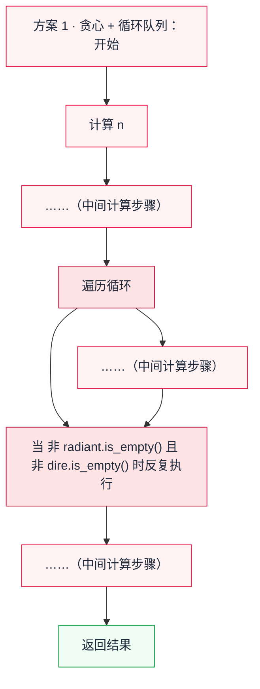

```rust
// LeetCode 649. Dota2参议院 — Rust 版（方案1）
fn predict_party_victory(senate: &str) -> String {
    // 定义函数/方法 predict_party_victory
    let n = senate.len() as i32; // 把 senate.长度() as i32 存入 元素个数
    let mut radiant: std::collections::VecDeque<i32> = Default::default();
    let mut dire: std::collections::VecDeque<i32> = Default::default();
    for (i, c) in senate.chars().enumerate() {
        // for (下标 i, 字符) in senate.chars().enumerate() {
        if c == 'R' {
            radiant.push_back(i as i32);
        } else {
            dire.push_back(i as i32);
        }
    }
    while !radiant.is_empty() && !dire.is_empty() {
        // while 取反 radiant 是否为空 且 取反 dire 是否为空 {
        let r = radiant.pop_front().unwrap(); // 把 radiant.pop_front().unwrap() 存入 右指针
        let d = dire.pop_front().unwrap(); // 把 dire.pop_front().unwrap() 存入 d
        if r < d {
            radiant.push_back(r + n);
        } else {
            dire.push_back(d + n);
        }
    }
    if radiant.is_empty() {
        "Dire".to_string()
    } else {
        "Radiant".to_string()
    }
}
fn main() {
    // 程序入口：跑内嵌自测用例
    assert_eq!(predict_party_victory("RD"), "Radiant"); // 断言校验
    assert_eq!(predict_party_victory("DDR"), "Dire"); // 断言校验
    println!("PASS"); // 全部用例通过，输出 PASS
}
```

#### 方案 2：栈模拟

**思路与代码分析**：核心是「栈模拟」。Rust 版用所有权移动与切片借用改写同一逻辑，注意 Option 与引用边界。代码里依次做这些事：单循环线性扫描。**走读**：方案 2 · 栈模拟：开始 → 计算 n → 遍历循环 → 当 非 radiant.is_empty() 且 非 dire.is_empty() 时反复执行 → 返回结果。

**运行架构**（真实控制流）：

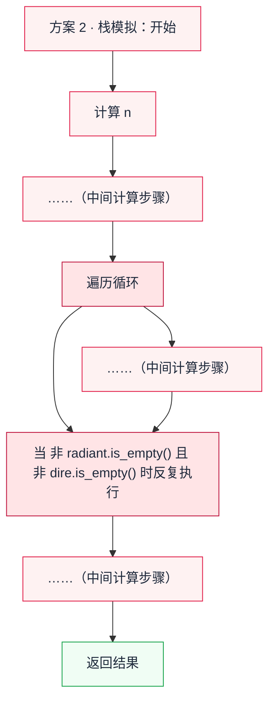

```rust
// LeetCode 649. Dota2参议院 — Rust 版（方案2）
fn predict_party_victory(senate: &str) -> String {
    // 定义函数/方法 predict_party_victory
    let n = senate.len() as i32; // 把 senate.长度() as i32 存入 元素个数
    let mut radiant: std::collections::VecDeque<i32> = Default::default();
    let mut dire: std::collections::VecDeque<i32> = Default::default();
    for (i, c) in senate.chars().enumerate() {
        // for (下标 i, 字符) in senate.chars().enumerate() {
        if c == 'R' {
            radiant.push_back(i as i32);
        } else {
            dire.push_back(i as i32);
        }
    }
    while !radiant.is_empty() && !dire.is_empty() {
        // while 取反 radiant 是否为空 且 取反 dire 是否为空 {
        let r = radiant.pop_front().unwrap(); // 把 radiant.pop_front().unwrap() 存入 右指针
        let d = dire.pop_front().unwrap(); // 把 dire.pop_front().unwrap() 存入 d
        if r < d {
            radiant.push_back(r + n);
        } else {
            dire.push_back(d + n);
        }
    }
    if radiant.is_empty() {
        "Dire".to_string()
    } else {
        "Radiant".to_string()
    }
}
fn main() {
    // 程序入口：跑内嵌自测用例
    assert_eq!(predict_party_victory("RD"), "Radiant"); // 断言校验
    assert_eq!(predict_party_victory("DDR"), "Dire"); // 断言校验
    println!("PASS"); // 全部用例通过，输出 PASS
}
```

### Lua 实现（2 种方案）

Lua 的全部方案如下，每个方案都内嵌用例自测，可独立运行（老仓库 python/go 文件遵循「打印结果」约定）：

#### 方案 1：贪心 + 循环队列

**思路与代码分析**：核心是「贪心 + 循环队列」。Lua 版用表与 ipairs 遍历，注意 ipairs 遇 nil 即停的语义。**走读**：方案 1 · 贪心 + 循环队列：开始 → 更新 n → 循环 i：从 1 到 n do → 当 rh ≤ #radiant and dh ≤ #dire do 时反复执行 → 返回 Dire → 返回 Radiant。

**运行架构**（真实控制流）：

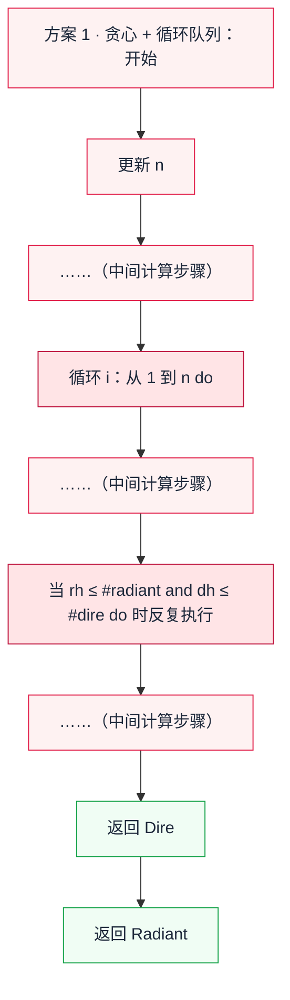

```lua
-- LeetCode 649. Dota2参议院 — Lua 版（方案1）
local function predict_party_victory(senate) -- local function predict_party_victory(senate)
	local n = #senate -- 把 #senate 写入 local n
	local radiant, dire = {}, {} -- 把 {}, {} 写入 local radiant, dire
	local rh, dh = 1, 1 -- 把 1, 1 写入 local rh, dh
	for i = 1, n do -- 让 下标 i 从 1 走到 元素个数（Lua 1 基）
		if senate:sub(i, i) == "R" then
			radiant[#radiant + 1] = i - 1
		else
			dire[#dire + 1] = i - 1
		end
	end -- 终点
	while rh <= #radiant and dh <= #dire do -- 把 #radiant and dh 不超过 #dire do 写入 while rh <
		local r = radiant[rh]
		rh = rh + 1 -- 把 radiant[rh]; rh 赋值为 rh 加 1 写入 local r
		local d = dire[dh]
		dh = dh + 1 -- 把 dire[dh]; dh 赋值为 dh 加 1 写入 local d
		if r < d then
			radiant[#radiant + 1] = r + n
		else
			dire[#dire + 1] = d + n
		end
	end -- 终点
	if rh > #radiant then
		return "Dire"
	else
		return "Radiant"
	end -- 若 rh 超过 #radiant then return 「Dire」 else return 「Dire」 终点
end -- 终点
assert(predict_party_victory("RD") == "Radiant") -- 断言校验
assert(predict_party_victory("DDR") == "Dire") -- 断言校验
print("PASS") -- 全部用例通过，输出 PASS
```

#### 方案 2：栈模拟

**思路与代码分析**：核心是「栈模拟」。Lua 版用表与 ipairs 遍历，注意 ipairs 遇 nil 即停的语义。**走读**：方案 2 · 栈模拟：开始 → 更新 n → 循环 i：从 1 到 n do → 当 rh ≤ #radiant and dh ≤ #dire do 时反复执行 → 返回 Dire → 返回 Radiant。

**运行架构**（真实控制流）：

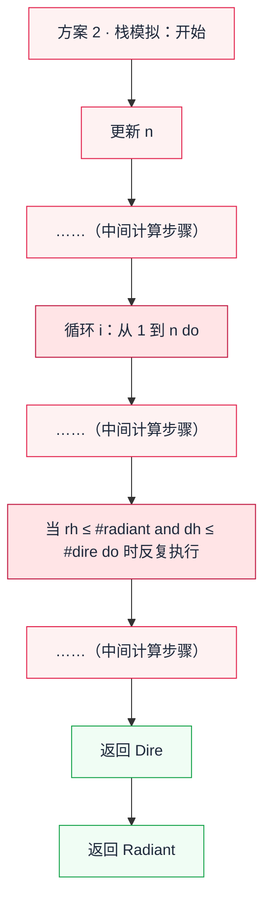

```lua
-- LeetCode 649. Dota2参议院 — Lua 版（方案2）
local function predict_party_victory(senate) -- local function predict_party_victory(senate)
	local n = #senate -- 把 #senate 写入 local n
	local radiant, dire = {}, {} -- 把 {}, {} 写入 local radiant, dire
	local rh, dh = 1, 1 -- 把 1, 1 写入 local rh, dh
	for i = 1, n do -- 让 下标 i 从 1 走到 元素个数（Lua 1 基）
		if senate:sub(i, i) == "R" then
			radiant[#radiant + 1] = i - 1
		else
			dire[#dire + 1] = i - 1
		end
	end -- 终点
	while rh <= #radiant and dh <= #dire do -- 把 #radiant and dh 不超过 #dire do 写入 while rh <
		local r = radiant[rh]
		rh = rh + 1 -- 把 radiant[rh]; rh 赋值为 rh 加 1 写入 local r
		local d = dire[dh]
		dh = dh + 1 -- 把 dire[dh]; dh 赋值为 dh 加 1 写入 local d
		if r < d then
			radiant[#radiant + 1] = r + n
		else
			dire[#dire + 1] = d + n
		end
	end -- 终点
	if rh > #radiant then
		return "Dire"
	else
		return "Radiant"
	end -- 若 rh 超过 #radiant then return 「Dire」 else return 「Dire」 终点
end -- 终点
assert(predict_party_victory("RD") == "Radiant") -- 断言校验
assert(predict_party_victory("DDR") == "Dire") -- 断言校验
print("PASS") -- 全部用例通过，输出 PASS
```

### C 实现（2 种方案）

C 的全部方案如下，每个方案都内嵌用例自测，可独立运行（老仓库 python/go 文件遵循「打印结果」约定）：

#### 方案 1：贪心 + 循环队列

**思路与代码分析**：核心是「贪心 + 循环队列」。C 版手动管理下标与内存，循环边界全部显式写出。代码里依次做这些事：单循环线性扫描。**走读**：方案 1 · 贪心 + 循环队列：开始 → 更新 n → 处理 int radiant[8192], dire[8192 → 更新 rn → 遍历循环 → 若 senate[i] == 'R'：更新 radiant[rn++] → 更新 radiant[rn++] → 更新 dire[dn++] → 当 (rh ＜ rn 且 dh ＜ dn) 时反复执行 → 更新 r → 更新 d → 若 r ＜ d：更新 radiant[rn++] → 更新 radiant[rn++] → 更新 dire[dn++] → 返回 rh ≥ rn ? Dire : Radiant。

**运行架构**（真实控制流）：

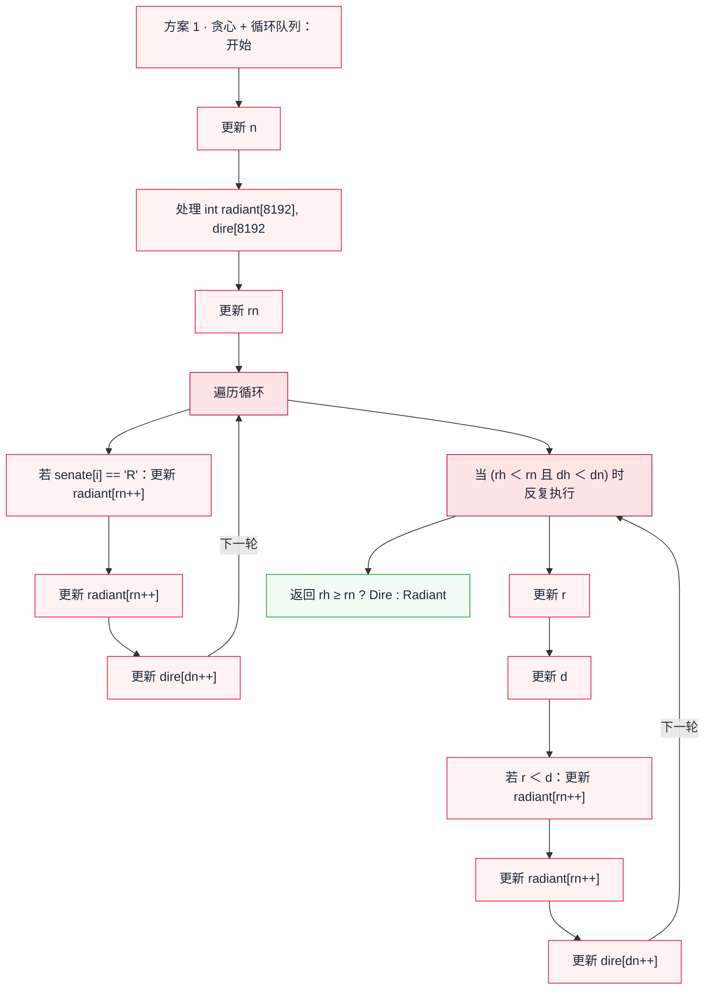

```c
/* LeetCode 649. Dota2参议院 — C 版（方案1） */
#include <stdio.h>  // 引入头文件
#include <string.h> // 引入头文件
static const char *predict_party_victory(const char *senate) {
    int n = (int)strlen(senate);        // 把 (int)strlen(senate) 存入 元素个数
    int radiant[8192], dire[8192];      // int radiant[8192], dire[8192];
    int rn = 0, dn = 0, rh = 0, dh = 0; // 把 0, dn 赋值为 0, rh 赋值为 0, dh 赋值为 0 存入 rn
    for (int i = 0; i < n; i++) { // 让 下标 i 从 0 开始计数，下标 i 小于 元素个数 就继续
        if (senate[i] == 'R')
            radiant[rn++] = i; // 若 senate[下标 i] 等于 'R') radiant[rn 加一 ] 赋值为 下标 i;
        else
            dire[dn++] = i; // 否则
    }
    while (rh < rn && dh < dn) { // 循环，直到不满足「rh 小于 rn 且 dh 小于 dn」
        int r = radiant[rh++];   // 把 radiant[rh 加一 ] 存入 右指针
        int d = dire[dh++];      // 把 dire[dh 加一 ] 存入 d
        if (r < d)
            radiant[rn++] = r + n; // 若 右指针 小于 d) radiant[rn 加一 ] 赋值为 右指针 加 元素个数;
        else
            dire[dn++] = d + n; // 否则
    }
    return rh >= rn ? "Dire" : "Radiant"; // 返回 rh 不低于 rn ? 「Dire」 : 「Dire」
}
int main(void) { // 程序入口：跑内嵌自测用例
    if (strcmp(predict_party_victory("RD"), "Radiant") != 0) {
        printf("FAIL 1\n");
        return 1;
    }
    if (strcmp(predict_party_victory("DDR"), "Dire") != 0) {
        printf("FAIL 2\n");
        return 1;
    }
    printf("PASS\n"); // 全部用例通过，输出 PASS
    return 0;         // 返回 0
}
```

#### 方案 2：栈模拟

**思路与代码分析**：核心是「栈模拟」。C 版手动管理下标与内存，循环边界全部显式写出。代码里依次做这些事：单循环线性扫描。**走读**：方案 2 · 栈模拟：开始 → 更新 n → 处理 int radiant[8192], dire[8192 → 更新 rn → 遍历循环 → 若 senate[i] == 'R'：更新 radiant[rn++] → 更新 radiant[rn++] → 更新 dire[dn++] → 当 (rh ＜ rn 且 dh ＜ dn) 时反复执行 → 更新 r → 更新 d → 若 r ＜ d：更新 radiant[rn++] → 更新 radiant[rn++] → 更新 dire[dn++] → 返回 rh ≥ rn ? Dire : Radiant。

**运行架构**（真实控制流）：

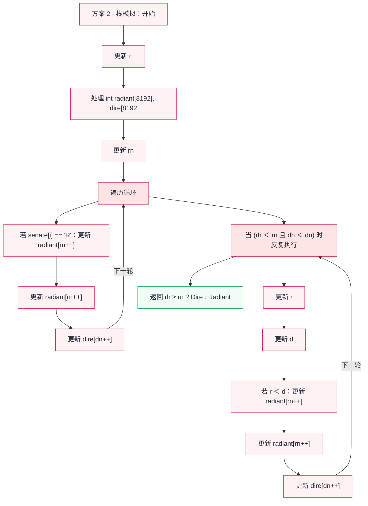

```c
/* LeetCode 649. Dota2参议院 — C 版（方案2） */
#include <stdio.h>  // 引入头文件
#include <string.h> // 引入头文件
static const char *predict_party_victory(const char *senate) {
    int n = (int)strlen(senate);        // 把 (int)strlen(senate) 存入 元素个数
    int radiant[8192], dire[8192];      // int radiant[8192], dire[8192];
    int rn = 0, dn = 0, rh = 0, dh = 0; // 把 0, dn 赋值为 0, rh 赋值为 0, dh 赋值为 0 存入 rn
    for (int i = 0; i < n; i++) { // 让 下标 i 从 0 开始计数，下标 i 小于 元素个数 就继续
        if (senate[i] == 'R')
            radiant[rn++] = i; // 若 senate[下标 i] 等于 'R') radiant[rn 加一 ] 赋值为 下标 i;
        else
            dire[dn++] = i; // 否则
    }
    while (rh < rn && dh < dn) { // 循环，直到不满足「rh 小于 rn 且 dh 小于 dn」
        int r = radiant[rh++];   // 把 radiant[rh 加一 ] 存入 右指针
        int d = dire[dh++];      // 把 dire[dh 加一 ] 存入 d
        if (r < d)
            radiant[rn++] = r + n; // 若 右指针 小于 d) radiant[rn 加一 ] 赋值为 右指针 加 元素个数;
        else
            dire[dn++] = d + n; // 否则
    }
    return rh >= rn ? "Dire" : "Radiant"; // 返回 rh 不低于 rn ? 「Dire」 : 「Dire」
}
int main(void) { // 程序入口：跑内嵌自测用例
    if (strcmp(predict_party_victory("RD"), "Radiant") != 0) {
        printf("FAIL 1\n");
        return 1;
    }
    if (strcmp(predict_party_victory("DDR"), "Dire") != 0) {
        printf("FAIL 2\n");
        return 1;
    }
    printf("PASS\n"); // 全部用例通过，输出 PASS
    return 0;         // 返回 0
}
```

### C++ 实现（2 种方案）

C++ 的全部方案如下，每个方案都内嵌用例自测，可独立运行（老仓库 python/go 文件遵循「打印结果」约定）：

#### 方案 1：贪心 + 循环队列

**思路与代码分析**：核心是「贪心 + 循环队列」。C++ 版用 STL 容器与迭代器，减少手写下标错误。代码里依次做这些事：单循环线性扫描；队列或堆的调度。**走读**：方案 1 · 贪心 + 循环队列：开始 → 更新 n → 遍历循环 → 当 (非 radiant.empty() 且 时反复执行 → 返回 radiant.empty() ? Dire : Radiant。

**运行架构**（真实控制流）：

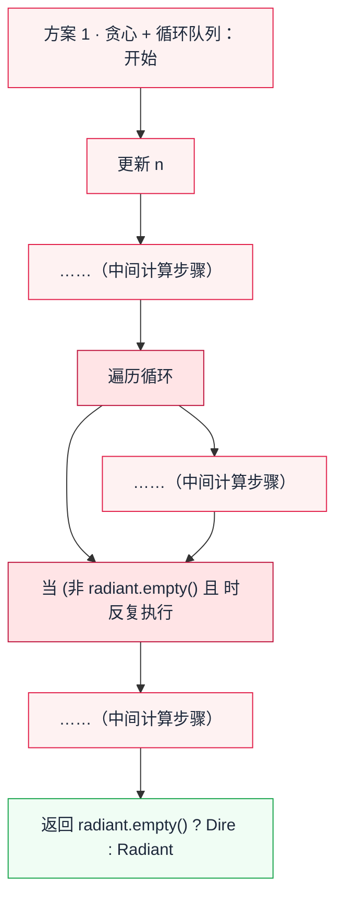

```cpp
// LeetCode 649. Dota2参议院 — C++ 版（方案1）
#include <cassert>  // 引入头文件
#include <deque>    // 引入头文件
#include <iostream> // 引入头文件
#include <string>   // 引入头文件
static std::string predictPartyVictory(const std::string &senate) {
    int n = static_cast<int>(senate.size()); // 把 static_cast 小于 int 超过 (senate.大小()) 存入 元素个数
    std::deque<int> radiant, dire;           // std::deque 小于 int 超过 radiant, dire;
    for (int i = 0; i < n; ++i) { // 让 下标 i 从 0 开始计数，下标 i 小于 元素个数 就继续
        if (senate[i] == 'R')
            radiant.push_back(i); // 若 senate[下标 i] 等于 'R') radiant 追加 下标 i);
        else
            dire.push_back(i); // 否则
    }
    while (!radiant.empty() &&
           !dire.empty()) { // 循环，直到不满足「取反 radiant 是否为空 且 取反 dire.empty(」
        int r = radiant.front(); // 把 radiant.front() 存入 右指针
        radiant.pop_front();     // radiant.pop_front();
        int d = dire.front();    // 把 dire.front() 存入 d
        dire.pop_front();        // dire.pop_front();
        if (r < d)
            radiant.push_back(r + n); // 若 右指针 小于 d) radiant 追加 右指针 加 元素个数);
        else
            dire.push_back(d + n); // 否则
    }
    return radiant.empty() ? "Dire" : "Radiant"; // 返回 radiant 是否为空 ? 「Dire」 : 「Dire」
}
int main() {                                        // 程序入口：跑内嵌自测用例
    assert(predictPartyVictory("RD") == "Radiant"); // 断言校验
    assert(predictPartyVictory("DDR") == "Dire");   // 断言校验
    std::cout << "PASS" << std::endl;               // 全部用例通过，输出 PASS
    return 0;                                       // 返回 0
}
```

#### 方案 2：栈模拟

**思路与代码分析**：核心是「栈模拟」。C++ 版用 STL 容器与迭代器，减少手写下标错误。代码里依次做这些事：单循环线性扫描；队列或堆的调度。**走读**：方案 2 · 栈模拟：开始 → 更新 n → 遍历循环 → 当 (非 radiant.empty() 且 时反复执行 → 返回 radiant.empty() ? Dire : Radiant。

**运行架构**（真实控制流）：

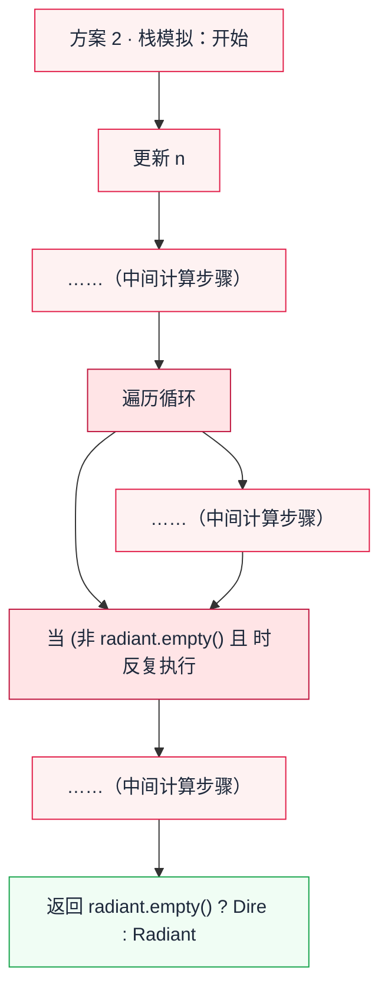

```cpp
// LeetCode 649. Dota2参议院 — C++ 版（方案2）
#include <cassert>  // 引入头文件
#include <deque>    // 引入头文件
#include <iostream> // 引入头文件
#include <string>   // 引入头文件
static std::string predictPartyVictory(const std::string &senate) {
    int n = static_cast<int>(senate.size()); // 把 static_cast 小于 int 超过 (senate.大小()) 存入 元素个数
    std::deque<int> radiant, dire;           // std::deque 小于 int 超过 radiant, dire;
    for (int i = 0; i < n; ++i) { // 让 下标 i 从 0 开始计数，下标 i 小于 元素个数 就继续
        if (senate[i] == 'R')
            radiant.push_back(i); // 若 senate[下标 i] 等于 'R') radiant 追加 下标 i);
        else
            dire.push_back(i); // 否则
    }
    while (!radiant.empty() &&
           !dire.empty()) { // 循环，直到不满足「取反 radiant 是否为空 且 取反 dire.empty(」
        int r = radiant.front(); // 把 radiant.front() 存入 右指针
        radiant.pop_front();     // radiant.pop_front();
        int d = dire.front();    // 把 dire.front() 存入 d
        dire.pop_front();        // dire.pop_front();
        if (r < d)
            radiant.push_back(r + n); // 若 右指针 小于 d) radiant 追加 右指针 加 元素个数);
        else
            dire.push_back(d + n); // 否则
    }
    return radiant.empty() ? "Dire" : "Radiant"; // 返回 radiant 是否为空 ? 「Dire」 : 「Dire」
}
int main() {                                        // 程序入口：跑内嵌自测用例
    assert(predictPartyVictory("RD") == "Radiant"); // 断言校验
    assert(predictPartyVictory("DDR") == "Dire");   // 断言校验
    std::cout << "PASS" << std::endl;               // 全部用例通过，输出 PASS
    return 0;                                       // 返回 0
}
```

### R 实现（2 种方案）

R 的全部方案如下，每个方案都内嵌用例自测，可独立运行（老仓库 python/go 文件遵循「打印结果」约定）：

#### 方案 1：贪心 + 循环队列

**思路与代码分析**：核心是「贪心 + 循环队列」。R 版用向量化思维与 1 起始下标，注意 1:n 的降序陷阱。**走读**：方案 1 · 贪心 + 循环队列：开始 → 处理 chars ＜- strsplit(senate, → 当 (rh ≤ length(radiant) 且 dh ≤ length(dire)) 时反复执行 → 返回结果。

**运行架构**（真实控制流）：

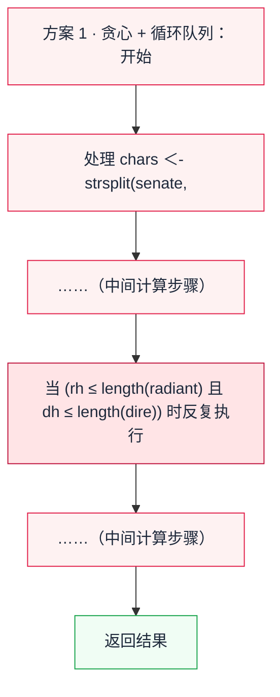

```r
# 版（方案1） 定义函数 predict_party_victory（参数：senate）
predict_party_victory <- function(senate) {
    chars <- strsplit(senate, "")[[1]]  # 把 strsplit(senate, 「」)[[1]] 存入 chars
    n <- length(chars)  # 把 长度(chars) 存入 元素个数
    radiant <- which(chars == "R") - 1L  # 把 which(chars 等于 「R」) 减 1L 存入 radiant
    dire <- which(chars != "R") - 1L  # 把 which(chars 不等于 「R」) 减 1L 存入 dire
    rh <- 1L
    dh <- 1L  # 把 1L; dh 小于 减 1L 存入 rh
    while (rh <= length(radiant) && dh <= length(dire)) {
        # 循环，直到不满足「rh 不超过 长度(radiant) 且 dh 不超过 长度(dire」
        r <- radiant[rh]
        rh <- rh + 1L  # 把 radiant[rh]; rh 小于 减 rh 加 1L 存入 右指针
        d <- dire[dh]
        dh <- dh + 1L  # 把 dire[dh]; dh 小于 减 dh 加 1L 存入 d
        if (r < d)
            radiant <- c(radiant, r + n) else dire <- c(dire, d + n)
    }
    if (rh > length(radiant))
        "Dire" else "Radiant"  # 若 rh 超过 长度(radiant)) 「Dire」 else 「Dire」
}
stopifnot(predict_party_victory("RD") == "Radiant")  # 断言校验
stopifnot(predict_party_victory("DDR") == "Dire")  # 断言校验
cat("PASS\n")  # 全部用例通过，输出 PASS
```

#### 方案 2：栈模拟

**思路与代码分析**：核心是「栈模拟」。R 版用向量化思维与 1 起始下标，注意 1:n 的降序陷阱。**走读**：方案 2 · 栈模拟：开始 → 处理 chars ＜- strsplit(senate, → 当 (rh ≤ length(radiant) 且 dh ≤ length(dire)) 时反复执行 → 返回结果。

**运行架构**（真实控制流）：

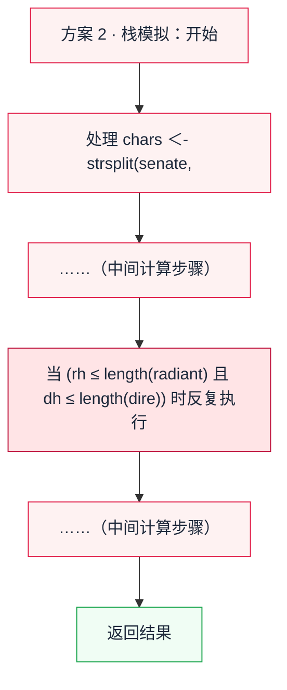

```r
# 版（方案2） 定义函数 predict_party_victory（参数：senate）
predict_party_victory <- function(senate) {
    chars <- strsplit(senate, "")[[1]]  # 把 strsplit(senate, 「」)[[1]] 存入 chars
    n <- length(chars)  # 把 长度(chars) 存入 元素个数
    radiant <- which(chars == "R") - 1L  # 把 which(chars 等于 「R」) 减 1L 存入 radiant
    dire <- which(chars != "R") - 1L  # 把 which(chars 不等于 「R」) 减 1L 存入 dire
    rh <- 1L
    dh <- 1L  # 把 1L; dh 小于 减 1L 存入 rh
    while (rh <= length(radiant) && dh <= length(dire)) {
        # 循环，直到不满足「rh 不超过 长度(radiant) 且 dh 不超过 长度(dire」
        r <- radiant[rh]
        rh <- rh + 1L  # 把 radiant[rh]; rh 小于 减 rh 加 1L 存入 右指针
        d <- dire[dh]
        dh <- dh + 1L  # 把 dire[dh]; dh 小于 减 dh 加 1L 存入 d
        if (r < d)
            radiant <- c(radiant, r + n) else dire <- c(dire, d + n)
    }
    if (rh > length(radiant))
        "Dire" else "Radiant"  # 若 rh 超过 长度(radiant)) 「Dire」 else 「Dire」
}
stopifnot(predict_party_victory("RD") == "Radiant")  # 断言校验
stopifnot(predict_party_victory("DDR") == "Dire")  # 断言校验
cat("PASS\n")  # 全部用例通过，输出 PASS
```

### Zig 实现（2 种方案）

Zig 的全部方案如下，每个方案都内嵌用例自测，可独立运行（老仓库 python/go 文件遵循「打印结果」约定）：

#### 方案 1：贪心 + 循环队列

**思路与代码分析**：核心是「贪心 + 循环队列」。Zig 版显式分配与清零，整型边界处理严格。代码里依次做这些事：单循环线性扫描。**走读**：方案 1 · 贪心 + 循环队列：开始 → 计算 n → 遍历集合元素 → 当 (rh ＜ rn and dh ＜ dn) 时反复执行 → 返回 if (rh ≥ rn) Dire else Radiant。

**运行架构**（真实控制流）：

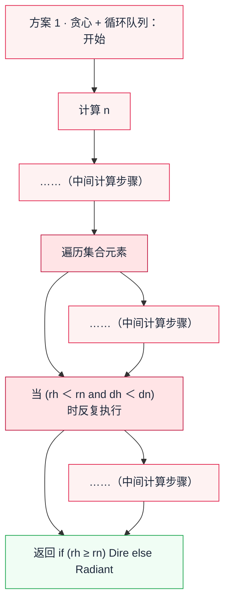

```zig
// LeetCode 649. Dota2参议院 — Zig 版（方案1）
const std = @import("std"); // 把 @import(「std」) 存入 std
fn predictPartyVictory(senate: []const u8) []const u8 { // 定义函数/方法 predictPartyVictory
    const n: i32 = @intCast(senate.len); // 把 @intCast(senate.长度); 写入 const n: i32
    var radiant_buf: [8192]i32 = undefined; // 把 undefined; 写入 var radiant_buf: [8192]i32
    var dire_buf: [8192]i32 = undefined; // 把 undefined; 写入 var dire_buf: [8192]i32
    var rn: usize = 0; // 把 0; 写入 var rn: usize
    var dn: usize = 0; // 把 0; 写入 var dn: usize
    var rh: usize = 0; // 把 0; 写入 var rh: usize
    var dh: usize = 0; // 把 0; 写入 var dh: usize
    for (senate, 0..) |c, i| { // for (senate, 0..) 按位或 字符, 下标 i 按位或 {
        if (c == 'R') { // 若 字符 等于 'R'
            radiant_buf[rn] = @intCast(i); // 把 @intCast(下标 i); 写入 radiant_buf[rn]
            rn += 1; // rn累加 1
        } else { // 否则
            dire_buf[dn] = @intCast(i); // 把 @intCast(下标 i); 写入 dire_buf[dn]
            dn += 1; // dn累加 1
        }
    }
    while (rh < rn and dh < dn) { // 循环，直到不满足「rh 小于 rn and dh 小于 dn」
        const r = radiant_buf[rh]; // 把 radiant_buf[rh] 存入 右指针
        rh += 1; // rh累加 1
        const d = dire_buf[dh]; // 把 dire_buf[dh] 存入 d
        dh += 1; // dh累加 1
        if (r < d) { // 若 右指针 小于 d
            radiant_buf[rn] = r + n; // 把 右指针 加 元素个数; 写入 radiant_buf[rn]
            rn += 1; // rn累加 1
        } else { // 否则
            dire_buf[dn] = d + n; // 把 d 加 元素个数; 写入 dire_buf[dn]
            dn += 1; // dn累加 1
        }
    }
    return if (rh >= rn) "Dire" else "Radiant"; // 返回 if (rh 不低于 rn) 「Dire」 else 「Dire」
}
pub fn main() !void { // 程序入口：跑内嵌自测用例
    if (!std.mem.eql(u8, predictPartyVictory("RD"), "Radiant")) return error.TestFailed;
    if (!std.mem.eql(u8, predictPartyVictory("DDR"), "Dire")) return error.TestFailed;
    std.debug.print("PASS\n", .{}); // 全部用例通过，输出 PASS
}
```

#### 方案 2：栈模拟

**思路与代码分析**：核心是「栈模拟」。Zig 版显式分配与清零，整型边界处理严格。代码里依次做这些事：单循环线性扫描。**走读**：方案 2 · 栈模拟：开始 → 计算 n → 遍历集合元素 → 当 (rh ＜ rn and dh ＜ dn) 时反复执行 → 返回 if (rh ≥ rn) Dire else Radiant。

**运行架构**（真实控制流）：

```mermaid
graph TD
    N0["方案 2 · 栈模拟：开始"]
    N1["计算 n"]
    D1["……（中间计算步骤）"]
    N8["遍历集合元素"]
    D2["……（中间计算步骤）"]
    N14["当 (rh ＜ rn and dh ＜ dn) 时反复执行"]
    D3["……（中间计算步骤）"]
    N24["返回 if (rh ≥ rn) Dire else Radiant"]
    N0 --> N1
    N8 --> N14
    N14 --> N24
    N1 --> D1
    D1 --> N8
    N8 --> D2
    D2 --> N14
    N14 --> D3
    D3 --> N24
    classDef n fill:#fef2f2,stroke:#e11d48,color:#1e293b;
    classDef lp fill:#ffe4e6,stroke:#be123c,color:#1e293b;
    classDef dc fill:#fef9c3,stroke:#ca8a04,color:#1e293b;
    classDef tm fill:#f0fdf4,stroke:#16a34a,color:#1e293b;
    class N0,N1,D1,D2,D3 n;
    class N8,N14 lp;
    class N24 tm;
```

```zig
// LeetCode 649. Dota2参议院 — Zig 版（方案2）
const std = @import("std"); // 把 @import(「std」) 存入 std
fn predictPartyVictory(senate: []const u8) []const u8 { // 定义函数/方法 predictPartyVictory
    const n: i32 = @intCast(senate.len); // 把 @intCast(senate.长度); 写入 const n: i32
    var radiant_buf: [8192]i32 = undefined; // 把 undefined; 写入 var radiant_buf: [8192]i32
    var dire_buf: [8192]i32 = undefined; // 把 undefined; 写入 var dire_buf: [8192]i32
    var rn: usize = 0; // 把 0; 写入 var rn: usize
    var dn: usize = 0; // 把 0; 写入 var dn: usize
    var rh: usize = 0; // 把 0; 写入 var rh: usize
    var dh: usize = 0; // 把 0; 写入 var dh: usize
    for (senate, 0..) |c, i| { // for (senate, 0..) 按位或 字符, 下标 i 按位或 {
        if (c == 'R') { // 若 字符 等于 'R'
            radiant_buf[rn] = @intCast(i); // 把 @intCast(下标 i); 写入 radiant_buf[rn]
            rn += 1; // rn累加 1
        } else { // 否则
            dire_buf[dn] = @intCast(i); // 把 @intCast(下标 i); 写入 dire_buf[dn]
            dn += 1; // dn累加 1
        }
    }
    while (rh < rn and dh < dn) { // 循环，直到不满足「rh 小于 rn and dh 小于 dn」
        const r = radiant_buf[rh]; // 把 radiant_buf[rh] 存入 右指针
        rh += 1; // rh累加 1
        const d = dire_buf[dh]; // 把 dire_buf[dh] 存入 d
        dh += 1; // dh累加 1
        if (r < d) { // 若 右指针 小于 d
            radiant_buf[rn] = r + n; // 把 右指针 加 元素个数; 写入 radiant_buf[rn]
            rn += 1; // rn累加 1
        } else { // 否则
            dire_buf[dn] = d + n; // 把 d 加 元素个数; 写入 dire_buf[dn]
            dn += 1; // dn累加 1
        }
    }
    return if (rh >= rn) "Dire" else "Radiant"; // 返回 if (rh 不低于 rn) 「Dire」 else 「Dire」
}
pub fn main() !void { // 程序入口：跑内嵌自测用例
    if (!std.mem.eql(u8, predictPartyVictory("RD"), "Radiant")) return error.TestFailed;
    if (!std.mem.eql(u8, predictPartyVictory("DDR"), "Dire")) return error.TestFailed;
    std.debug.print("PASS\n", .{}); // 全部用例通过，输出 PASS
}
```

### Dart 实现（2 种方案）

Dart 的全部方案如下，每个方案都内嵌用例自测，可独立运行（老仓库 python/go 文件遵循「打印结果」约定）：

#### 方案 1：贪心 + 循环队列

**思路与代码分析**：核心是「贪心 + 循环队列」。Dart 版用可空类型标注与集合方法，注意空安全。代码里依次做这些事：单循环线性扫描。**走读**：方案 1 · 贪心 + 循环队列：开始 → 更新 n → 遍历循环 → 当 (rh ＜ radiant.length 且 dh ＜ dire.length) 时反复执行 → 返回 rh ≥ radiant.length。

**运行架构**（真实控制流）：

```mermaid
graph TD
    N0["方案 1 · 贪心 + 循环队列：开始"]
    N1["更新 n"]
    D1["……（中间计算步骤）"]
    N4["遍历循环"]
    D2["……（中间计算步骤）"]
    N9["当 (rh ＜ radiant.length 且 dh ＜ dire.length) 时反复执行"]
    D3["……（中间计算步骤）"]
    N15["返回 rh ≥ radiant.length"]
    Dend["……（中间计算步骤）"]
    N0 --> N1
    N9 --> N15
    N1 --> D1
    D1 --> N4
    N4 --> D2
    D2 --> N9
    N9 --> D3
    D3 --> N15
    N15 --> Dend
    classDef n fill:#fef2f2,stroke:#e11d48,color:#1e293b;
    classDef lp fill:#ffe4e6,stroke:#be123c,color:#1e293b;
    classDef dc fill:#fef9c3,stroke:#ca8a04,color:#1e293b;
    classDef tm fill:#f0fdf4,stroke:#16a34a,color:#1e293b;
    class N0,N1,D1,D2,D3,Dend n;
    class N4,N9 lp;
    class N15 tm;
```

```dart
// LeetCode 649. Dota2参议院 — Dart 版（方案1）
String predictPartyVictory(String senate) {
  // 定义函数/方法 predictPartyVictory
  final n = senate.length; // 把 senate.长度 存入 元素个数
  final radiant = <int>[]; // 把 小于 int 超过 [] 存入 radiant
  final dire = <int>[]; // 把 小于 int 超过 [] 存入 dire
  for (var i = 0; i < n; i++) {
    // 让 下标 i 从 0 开始计数，下标 i 小于 元素个数 就继续
    if (senate[i] == 'R') {
      // 若 senate[下标 i] 等于 'R'
      radiant.add(i); // radiant 追加 下标 i);
    } else {
      // 否则
      dire.add(i); // dire 追加 下标 i);
    }
  }
  var rh = 0, dh = 0; // 把 0, dh 赋值为 0 存入 rh
  while (rh < radiant.length && dh < dire.length) {
    // 循环，直到不满足「rh 小于 radiant.长度 且 dh 小于 dire.长度」
    final r = radiant[rh++]; // 把 radiant[rh 加一 ] 存入 右指针
    final d = dire[dh++]; // 把 dire[dh 加一 ] 存入 d
    if (r < d) {
      // 若 右指针 小于 d
      radiant.add(r + n); // radiant 追加 右指针 加 元素个数);
    } else {
      // 否则
      dire.add(d + n); // dire 追加 d 加 元素个数);
    }
  }
  return rh >= radiant.length
      ? 'Dire'
      : 'Radiant'; // 返回 rh 不低于 radiant.长度 ? 'Dire' : 'Radiant'
}

void main() {
  // 程序入口：跑内嵌自测用例
  if (predictPartyVictory('RD') != 'Radiant') throw StateError('c1');
  if (predictPartyVictory('DDR') != 'Dire') throw StateError('c2');
  print('PASS'); // 全部用例通过，输出 PASS
}
```

#### 方案 2：栈模拟

**思路与代码分析**：核心是「栈模拟」。Dart 版用可空类型标注与集合方法，注意空安全。代码里依次做这些事：单循环线性扫描。**走读**：方案 2 · 栈模拟：开始 → 更新 n → 遍历循环 → 当 (rh ＜ radiant.length 且 dh ＜ dire.length) 时反复执行 → 返回 rh ≥ radiant.length。

**运行架构**（真实控制流）：

```mermaid
graph TD
    N0["方案 2 · 栈模拟：开始"]
    N1["更新 n"]
    D1["……（中间计算步骤）"]
    N4["遍历循环"]
    D2["……（中间计算步骤）"]
    N9["当 (rh ＜ radiant.length 且 dh ＜ dire.length) 时反复执行"]
    D3["……（中间计算步骤）"]
    N15["返回 rh ≥ radiant.length"]
    Dend["……（中间计算步骤）"]
    N0 --> N1
    N9 --> N15
    N1 --> D1
    D1 --> N4
    N4 --> D2
    D2 --> N9
    N9 --> D3
    D3 --> N15
    N15 --> Dend
    classDef n fill:#fef2f2,stroke:#e11d48,color:#1e293b;
    classDef lp fill:#ffe4e6,stroke:#be123c,color:#1e293b;
    classDef dc fill:#fef9c3,stroke:#ca8a04,color:#1e293b;
    classDef tm fill:#f0fdf4,stroke:#16a34a,color:#1e293b;
    class N0,N1,D1,D2,D3,Dend n;
    class N4,N9 lp;
    class N15 tm;
```

```dart
// LeetCode 649. Dota2参议院 — Dart 版（方案2）
String predictPartyVictory(String senate) {
  // 定义函数/方法 predictPartyVictory
  final n = senate.length; // 把 senate.长度 存入 元素个数
  final radiant = <int>[]; // 把 小于 int 超过 [] 存入 radiant
  final dire = <int>[]; // 把 小于 int 超过 [] 存入 dire
  for (var i = 0; i < n; i++) {
    // 让 下标 i 从 0 开始计数，下标 i 小于 元素个数 就继续
    if (senate[i] == 'R') {
      // 若 senate[下标 i] 等于 'R'
      radiant.add(i); // radiant 追加 下标 i);
    } else {
      // 否则
      dire.add(i); // dire 追加 下标 i);
    }
  }
  var rh = 0, dh = 0; // 把 0, dh 赋值为 0 存入 rh
  while (rh < radiant.length && dh < dire.length) {
    // 循环，直到不满足「rh 小于 radiant.长度 且 dh 小于 dire.长度」
    final r = radiant[rh++]; // 把 radiant[rh 加一 ] 存入 右指针
    final d = dire[dh++]; // 把 dire[dh 加一 ] 存入 d
    if (r < d) {
      // 若 右指针 小于 d
      radiant.add(r + n); // radiant 追加 右指针 加 元素个数);
    } else {
      // 否则
      dire.add(d + n); // dire 追加 d 加 元素个数);
    }
  }
  return rh >= radiant.length
      ? 'Dire'
      : 'Radiant'; // 返回 rh 不低于 radiant.长度 ? 'Dire' : 'Radiant'
}

void main() {
  // 程序入口：跑内嵌自测用例
  if (predictPartyVictory('RD') != 'Radiant') throw StateError('c1');
  if (predictPartyVictory('DDR') != 'Dire') throw StateError('c2');
  print('PASS'); // 全部用例通过，输出 PASS
}
```

---

## 内容总结

- **dota2 参议院**（贪心 · Medium）：共 2 个方案，主线思路「贪心 + 循环队列」；时间 O(n)（单趟线性扫描）；动画演示贪心边界过程，附录给出 11 种语言 × 全部方案的可运行实现。
- 来源博客：[https://blog.csdn.net/tyro_java/article/details/145244562](https://blog.csdn.net/tyro_java/article/details/145244562)
- 导航：[📋 总目录](../) ｜ [← 105 跳跃游戏](../105_跳跃游戏/) ｜ [107 柠檬水找零 →](../107_柠檬水找零/)
