# 107 · 柠檬水找零（第五阶段 · 贪心策略 · Medium）

> **难度**：⭐⭐ Medium ｜ **专题**：贪心
> **学习定位**：第五阶段 · 贪心策略第 107 篇 ｜ **解法数**：6
> **内容总结**：**柠檬水找零**（贪心 · Medium）：共 6 个方案，主线思路「单趟扫描」；时间 O(n)（单趟线性扫描）；动画演示贪心边界过程，附录给出 11 种语言 × 全部方案的可运行实现。

---

## 题目描述

在柠檬水摊上，每一杯柠檬水的售价为 `5` 美元。顾客排队购买你的产品，（按账单 `bills` 支付的顺序）一次购买一杯。

每位顾客只买一杯柠檬水，然后向你付 `5` 美元、`10` 美元或 `20` 美元。你必须给每个顾客正确找零，也就是说净交易是每位顾客向你支付 `5` 美元。

注意，一开始你手头没有任何零钱。

给你一个整数数组 `bills` ，其中 `bills[i]` 是第 `i` 位顾客付的账。如果你能给每位顾客正确找零，返回 `true` ，否则返回 `false` 。

- 主函数签名：`function lemonadeChange(bills: number[]): boolean`

**用例（来自原题）**：

**示例 1**

```text
输入：bills = [5,5,5,10,20]
输出：true
```

解释：前 3 位顾客那里，我们按顺序收取 3 张 5 美元的钞票。 第 4 位顾客那里，我们收取一张 10 美元的钞票，并返还 5 美元。 第 5 位顾客那里，我们找还一张 10 美元的钞票和一张 5 美元的钞票。 由于所有客户都得到了正确的找零，所以我们输出 true。

**示例 2**

```text
输入：bills = [5,5,10,10,20]
输出：false
```

解释：前 2 位顾客那里，我们按顺序收取 2 张 5 美元的钞票。 对于接下来的 2 位顾客，我们收取一张 10 美元的钞票，然后返还 5 美元。 对于最后一位顾客，我们无法退回 15 美元，因为我们现在只有两张 10 美元的钞票。 由于不是每位顾客都得到了正确的找零，所以答案是 false。
> ✅ **官方验证**：全部 TypeScript 解法已通过 leetcode.cn 官方示例用例验证（自动注入运行，全部 PASS）。题面与 [leetcode.cn 官方](https://leetcode.cn/problems/lemonade-change/)一致，示例配图取自官方题面。

**数据范围与注意事项**：

- `1 <= bills.length <= 10^5`
- `bills[i]` 不是 `5` 就是 `10` 或是 `20`
- **易错点**：贪心前通常要先排序，排序依据就是贪心的正确性来源。

## 题目分析

**场景是什么**：每步取当前最优，对应真实开发里的区间调度、资源分配。本题就是该场景的 Medium 级练习，主线做法是「单趟扫描」。

**主线怎么解**：把主解法从头到尾过一遍，它其实在依次做这几件事：单循环线性扫描。

## 解题思路

**方案对比**（共 6 个方案，由浅入深）：

| 方案 | 时间复杂度 | 空间复杂度 |
|---|---|---|
| 方案 1 · 单趟扫描 | O(n)（单趟线性扫描） | O(1) 到 O(n)（视辅助结构） |
| 方案 2 · 计数贪心 | O(n)（单趟线性扫描） | O(1) 到 O(n)（视辅助结构） |
| 方案 3 · 单趟扫描 | O(n)（单趟线性扫描） | O(1) 到 O(n)（视辅助结构） |
| 方案 4 · 双重循环枚举 | O(n²)（两层嵌套扫描） | O(1) 到 O(n) |
| 方案 5 · 单趟扫描 | O(n)（单趟线性扫描） | O(1) 到 O(n)（视辅助结构） |
| 方案 6 · 双重循环枚举 | O(n²)（两层嵌套扫描） | O(1) 到 O(n) |

**由浅入深的路径**：单趟扫描 → 计数贪心 → 双重循环枚举；每往右一步，都在补上一步的短板。

**方案间的取舍**：方案 1（单趟扫描）；方案 2（计数贪心）；方案 3（单趟扫描）；方案 4（双重循环枚举）；方案 5（单趟扫描）；方案 6（双重循环枚举）。数据规模小、可读性优先时选靠前的方案；规模大、性能优先时选靠后的方案。

**怎么读这一篇**：

- 🐣 **新手路线**：把「题目描述」的示例 1 在纸上手推一遍 → 读方案 1（最直观的写法）与它的代码走读 → 按「运行方式」本地跑通看 PASS → 回头对比方案 2 之后的写法差在哪
- 🦅 **大佬路线**：直接锁定最优方案 1（单趟扫描，O(n)（单趟线性扫描））→ 跳读该方案代码与走读 → 用「逐步拆解与面试追问」补齐复杂度推导与边界追问

### 动态算法图（贪心边界，GIF 自动循环）

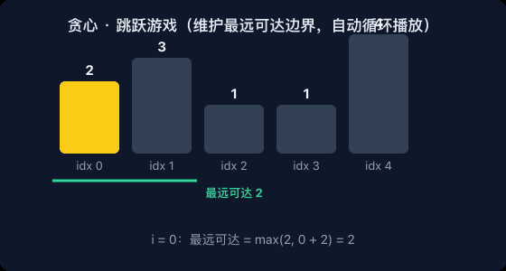

动画演示贪心专题里贪心边界的典型过程；每个方案在「TypeScript 解题方案」一节还配了专属动画与专属流程图。

### 主解法流程图（真实控制流）

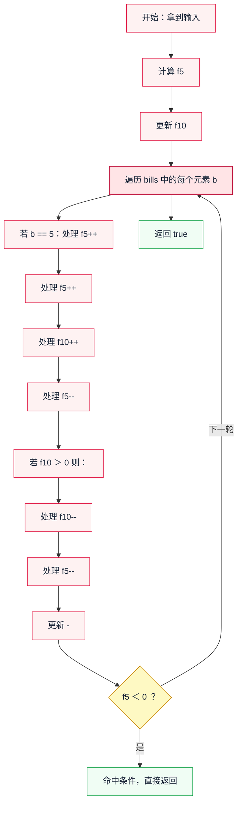

## TypeScript 解题方案（6 个方案逐个讲）

> **运行与提交**：每个方案都是自包含文件（内嵌用例自测，输出 PASS），整块复制到 `.ts` 文件后 `node 文件名` 即可运行。提交 LeetCode 时，把 `demo` 内的算法函数与辅助类型/函数整体取出、置于文件顶层即可。涉及交互/特殊接口的题以题面给定签名为准。

### 方案 1：单趟扫描

**分析与思路**：核心做法是「单趟扫描」。代码里依次做这些事：单循环线性扫描。

**运行方式**：`node 本文件`，内嵌用例全部通过会输出 PASS。


**方案专属流程图**（真实控制流）：

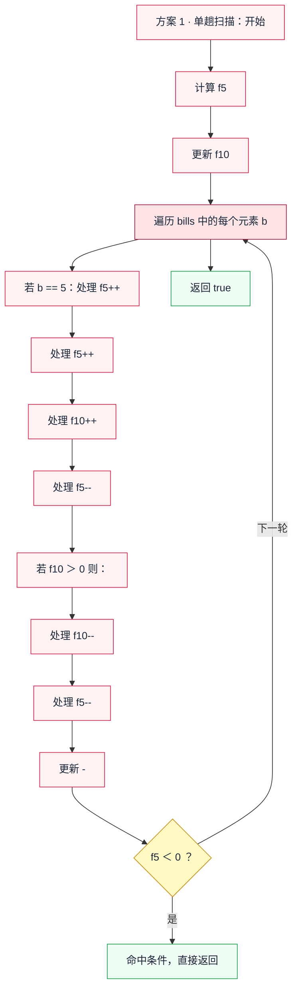

```typescript
export function demo(): void {
  // 程序入口：跑内嵌自测用例
  function lemonadeChange(bills: number[]): boolean {
    // 定义函数/方法 lemonadeChange
    let f5 = 0,
      f10 = 0; // 把 0, f10 赋值为 0 存入 f5
    for (const b of bills) {
      // for (const b of bills) {
      if (b === 5)
        f5++; // 若 b 全等于 5) f5 加一 ;
      else if (b === 10) {
        f10++;
        f5--;
      } // 否则，若 b 全等于 10) { f10 加一 ; f5 减一 ; }
      else {
        if (f10 > 0) {
          f10--;
          f5--;
        } else {
          f5 -= 3;
        }
      } // 否则
      if (f5 < 0) return false; // 若 f5 小于 0，直接返回 false
    }
    return true; // 返回 true
  }
  const cases = [
    { in: [5, 5, 5, 10, 20], want: true },
    { in: [5, 5, 10, 10, 20], want: false },
    { in: [5, 5, 5, 5, 20], want: true },
  ];
  let fail = false; // 把 false 存入 fail
  for (const c of cases) {
    // for (const 字符 of cases) {
    const got = lemonadeChange(c.in); // 把 lemonadeChange(字符.in) 存入 got
    if (got !== c.want) {
      fail = true;
      console.log('FAIL ' + got + ' want ' + c.want);
    }
  }
  if (fail) throw new Error('FAILED'); // 若 fail) throw new Error(「FAILED」);
  console.log('PASS'); // 全部用例通过，输出 PASS
}
demo(); // demo();
```

### 方案 2：计数贪心

**分析与思路**：核心做法是「计数贪心」。代码里依次做这些事：单循环线性扫描。

**运行方式**：`node 本文件`，内嵌用例全部通过会输出 PASS。

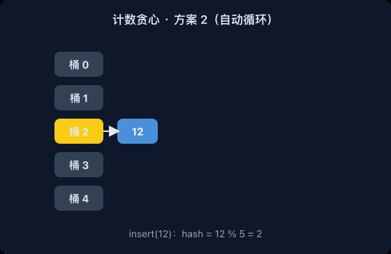

**方案专属流程图**（真实控制流）：

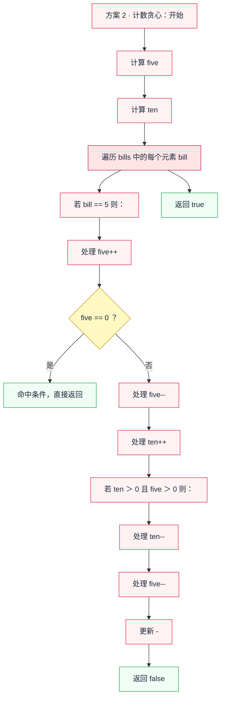

```typescript
/**
 ** LeetCode 860. 柠檬水找零
 ** 方案：方案2：计数贪心
 ** 来源：https://blog.csdn.net/tyro_java/article/details/134661209
 */

export function lemonadeChange(bills: number[]): boolean {
  // 定义函数/方法 lemonadeChange
  let five = 0; // 把 0 存入 five
  let ten = 0; // 把 0 存入 ten
  for (const bill of bills) {
    // for (const bill of bills) {
    if (bill === 5) {
      // 若 bill 全等于 5
      five++; // five 加一
    } else if (bill === 10) {
      // 否则，若 bill 全等于 10
      if (five === 0) return false; // 若 five 全等于 0，直接返回 false
      five--; // five 减一
      ten++; // ten 加一
    } else {
      // 否则
      if (ten > 0 && five > 0) {
        // 若 ten 超过 0 且 five 超过 0
        ten--; // ten 减一
        five--; // five 减一
      } else if (five >= 3) {
        // 否则，若 five 不低于 3
        five -= 3; // five累减 3
      } else {
        // 否则
        return false; // 返回 false
      }
    }
  }
  return true; // 返回 true
}

export function demo(): void {
  // 程序入口：跑内嵌自测用例
  if (!lemonadeChange([5, 5, 5, 10, 20])) throw new Error('FAILED 1');
  console.log('PASS'); // 全部用例通过，输出 PASS
}

demo(); // demo();
```

### 方案 3：单趟扫描

**分析与思路**：核心做法是「单趟扫描」。代码里依次做这些事：单循环线性扫描。

**运行方式**：`node 本文件`，内嵌用例全部通过会输出 PASS。


**方案专属流程图**（真实控制流）：

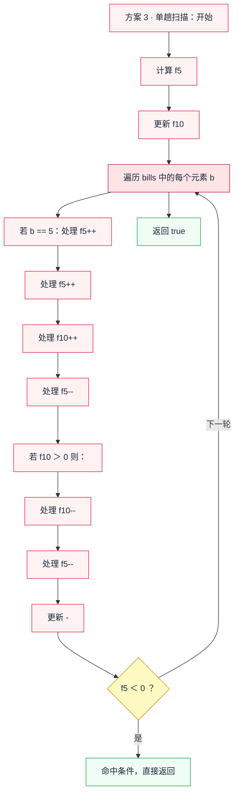

```typescript
export function demo(): void {
  // 程序入口：跑内嵌自测用例
  function lemonadeChange(bills: number[]): boolean {
    // 定义函数/方法 lemonadeChange
    let f5 = 0,
      f10 = 0; // 把 0, f10 赋值为 0 存入 f5
    for (const b of bills) {
      // for (const b of bills) {
      if (b === 5)
        f5++; // 若 b 全等于 5) f5 加一 ;
      else if (b === 10) {
        f10++;
        f5--;
      } // 否则，若 b 全等于 10) { f10 加一 ; f5 减一 ; }
      else {
        if (f10 > 0) {
          f10--;
          f5--;
        } else {
          f5 -= 3;
        }
      } // 否则
      if (f5 < 0) return false; // 若 f5 小于 0，直接返回 false
    }
    return true; // 返回 true
  }
  const cases = [
    { in: [5, 5, 5, 10, 20], want: true },
    { in: [5, 5, 10, 10, 20], want: false },
    { in: [5, 5, 5, 5, 20], want: true },
  ];
  let fail = false; // 把 false 存入 fail
  for (const c of cases) {
    // for (const 字符 of cases) {
    const got = lemonadeChange(c.in); // 把 lemonadeChange(字符.in) 存入 got
    if (got !== c.want) {
      fail = true;
      console.log('FAIL ' + got + ' want ' + c.want);
    }
  }
  if (fail) throw new Error('FAILED'); // 若 fail) throw new Error(「FAILED」);
  console.log('PASS'); // 全部用例通过，输出 PASS
}
demo(); // demo();
```

### 方案 4：双重循环枚举

**分析与思路**：核心做法是「双重循环枚举」。代码里依次做这些事：先排序再处理；双重循环遍历。

**运行方式**：`node 本文件`，内嵌用例全部通过会输出 PASS。


**方案专属流程图**（真实控制流）：

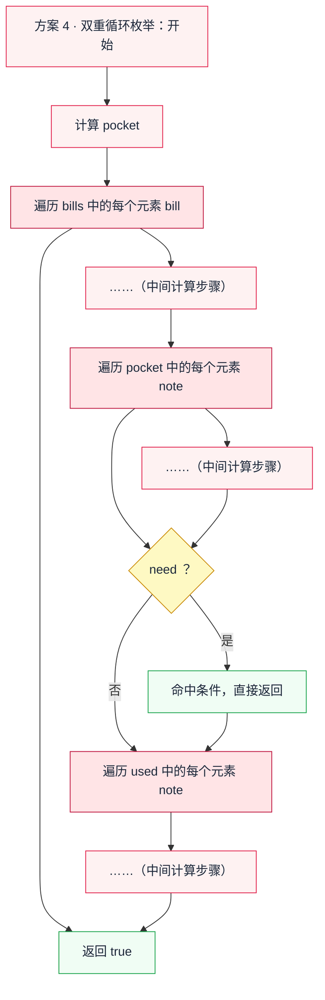

```typescript
/**
 ** LeetCode 860. 柠檬水找零
 ** 来源：https://blog.csdn.net/tyro_java/article/details/134661209
 */

export function lemonadeChange(bills: number[]): boolean {
  // 定义函数/方法 lemonadeChange
  const pocket: number[] = []; // 把 []; 写入 const pocket: number[]
  for (const bill of bills) {
    // for (const bill of bills) {
    let need = bill - 5; // 把 bill 减 5 存入 need
    if (need) {
      // 若 need
      pocket.sort((a, b) => b - a);
      const used: number[] = []; // 把 []; 写入 const used: number[]
      for (const note of pocket) {
        // for (const note of pocket) {
        if (note <= need) {
          // 若 note 不超过 need
          need -= note; // need累减 note
          used.push(note); // 把 note 压入栈/数组尾部
          if (need === 0) break; // 若 need 全等于 0) break;
        }
      }
      if (need) return false; // 若 need，直接返回 false
      for (const note of used) {
        // for (const note of 已用标记) {
        const idx = pocket.indexOf(note); // 把 pocket 查找 note) 存入 idx
        if (idx >= 0) pocket.splice(idx, 1); // 若 idx 不低于 0) pocket.splice(idx, 1);
      }
    }
    pocket.push(bill); // 把 bill 压入栈/数组尾部
  }
  return true; // 返回 true
}

export function demo(): void {
  // 程序入口：跑内嵌自测用例
  if (!lemonadeChange([5, 5, 5, 10, 20])) throw new Error('FAILED 1');
  if (lemonadeChange([5, 5, 10, 10, 20]) !== false) throw new Error('FAILED 2');
  console.log('PASS'); // 全部用例通过，输出 PASS
}

demo(); // demo();
```

### 方案 5：单趟扫描

**分析与思路**：核心做法是「单趟扫描」。代码里依次做这些事：单循环线性扫描。

**运行方式**：`node 本文件`，内嵌用例全部通过会输出 PASS。


**方案专属流程图**（真实控制流）：


```typescript
export function demo(): void {
  // 程序入口：跑内嵌自测用例
  function lemonadeChange(bills: number[]): boolean {
    // 定义函数/方法 lemonadeChange
    let f5 = 0,
      f10 = 0; // 把 0, f10 赋值为 0 存入 f5
    for (const b of bills) {
      // for (const b of bills) {
      if (b === 5)
        f5++; // 若 b 全等于 5) f5 加一 ;
      else if (b === 10) {
        f10++;
        f5--;
      } // 否则，若 b 全等于 10) { f10 加一 ; f5 减一 ; }
      else {
        if (f10 > 0) {
          f10--;
          f5--;
        } else {
          f5 -= 3;
        }
      } // 否则
      if (f5 < 0) return false; // 若 f5 小于 0，直接返回 false
    }
    return true; // 返回 true
  }
  const cases = [
    { in: [5, 5, 5, 10, 20], want: true },
    { in: [5, 5, 10, 10, 20], want: false },
    { in: [5, 5, 5, 5, 20], want: true },
  ];
  let fail = false; // 把 false 存入 fail
  for (const c of cases) {
    // for (const 字符 of cases) {
    const got = lemonadeChange(c.in); // 把 lemonadeChange(字符.in) 存入 got
    if (got !== c.want) {
      fail = true;
      console.log('FAIL ' + got + ' want ' + c.want);
    }
  }
  if (fail) throw new Error('FAILED'); // 若 fail) throw new Error(「FAILED」);
  console.log('PASS'); // 全部用例通过，输出 PASS
}
demo(); // demo();
```

### 方案 6：双重循环枚举

**分析与思路**：核心做法是「双重循环枚举」。代码里依次做这些事：先排序再处理；双重循环遍历。

**运行方式**：`node 本文件`，内嵌用例全部通过会输出 PASS。

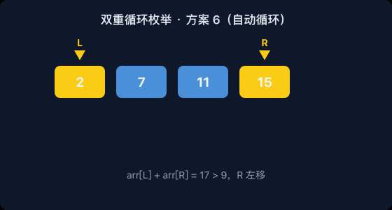

**方案专属流程图**（真实控制流）：

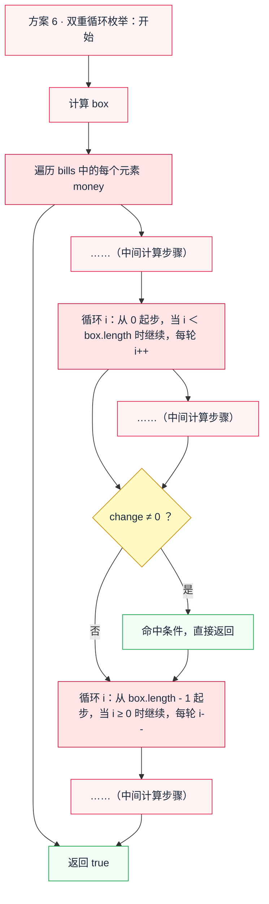

```typescript
/**
 ** LeetCode 860. 柠檬水找零
 ** 来源：https://blog.csdn.net/tyro_java/article/details/134661209
 */

export function lemonadeChange(bills: number[]): boolean {
  // 定义函数/方法 lemonadeChange
  const box: number[] = []; // 把 []; 写入 const box: number[]
  for (const money of bills) {
    // for (const money of bills) {
    let change = money - 5; // 把 money 减 5 存入 change
    if (change > 0) {
      // 若 change 超过 0
      box.sort((a, b) => b - a);
      for (let i = 0; i < box.length; i++) {
        // 让 下标 i 从 0 开始计数，下标 i 小于 box.长度 就继续
        if (box[i] <= change) {
          // 若 box[下标 i] 不超过 change
          change -= box[i]; // change累减 box[下标 i]
          box[i] = 0; // 把 0; 写入 box[i]
          if (change === 0) break; // 若 change 全等于 0) break;
        }
      }
      if (change !== 0) return false; // 若 change 不等于 0，直接返回 false
      for (let i = box.length - 1; i >= 0; i--) {
        // 让 下标 i 从 box.长度 减 1 开始计数，下标 i 不低于 0 就继续
        if (box[i] === 0) box.splice(i, 1); // 若 box[下标 i] 全等于 0) box.splice(下标 i, 1);
      }
    }
    box.push(money); // 把 money 压入栈/数组尾部
  }
  return true; // 返回 true
}

export function demo(): void {
  // 程序入口：跑内嵌自测用例
  if (!lemonadeChange([5, 5, 5, 10, 20])) throw new Error('FAILED 1');
  if (lemonadeChange([5, 5, 10, 10, 20]) !== false) throw new Error('FAILED 2');
  console.log('PASS'); // 全部用例通过，输出 PASS
}

demo(); // demo();
```

## 逐步拆解与面试追问

**复杂度**：时间 O(n)（单趟线性扫描），空间 O(1) 到 O(n)（视辅助结构）

**为什么是这个量级**：每个元素被常数次访问，辅助哈希或栈的开销与 n 同阶

**面试官可能会追问**：

- 贪心的正确性怎么证明？
- 排序依据选错了会怎样？
- 能否举出反例推翻当前策略？

## 关键 API 速查（TS 主解法实际用到，附官方链接）

本题主解法只用到基础语法（变量、循环、比较），不依赖特殊库 API。

### 各语言官方文档导航

- **TypeScript / JS**：[MDN 中文参考](https://developer.mozilla.org/zh-CN/)
- **Python**：[Python 官方文档](https://docs.python.org/zh-cn/3/)
- **Go**：[Go 标准库](https://pkg.go.dev/std)
- **Java**：[JDK 17 API](https://docs.oracle.com/en/java/javase/17/docs/api/)
- **Rust**：[Rust 标准库](https://doc.rust-lang.org/std/)
- **Lua**：[Lua 5.4 手册](https://www.lua.org/manual/5.4/)
- **C**：[Cppreference C](https://zh.cppreference.com/w/c)
- **C++**：[Cppreference C++](https://zh.cppreference.com/w/cpp)
- **R**：[R 官方手册](https://stat.ethz.ch/R-manual/)
- **Zig**：[Zig 语言文档](https://ziglang.org/documentation/master/)
- **Dart**：[Dart API](https://api.dart.dev/)

## 附录：其他 10 种语言全部实现（每种语言列举其全部方案）

> TypeScript 的全部方案见「TypeScript 解题方案」一节；下面是其余 10 种语言的对应实现，每种语言的每个方案都带思路分析、代码走读与专属运行架构图。
> 每个方案都内嵌用例自测，可独立运行（老仓库 python/go 文件遵循「打印结果」约定）。
> 完整解法文件见 `dsa/<语言>/greedy/lc_860_柠檬水找零/`。

### Python 实现（6 种方案）

Python 的全部方案如下，每个方案都内嵌用例自测，可独立运行（老仓库 python/go 文件遵循「打印结果」约定）：

#### 方案 1：单趟扫描

**思路与代码分析**：核心是「单趟扫描」。Python 版用切片与字典推导式简化操作，突出可读性。**走读**：方案 1 · 单趟扫描：开始 → 更新 five → 遍历 bills: 中的每个元素 bill → 命中条件，直接返回 → 返回 False → 返回 True。

**运行架构**（真实控制流）：

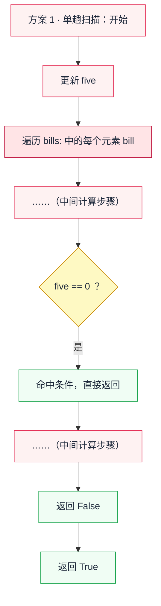

```python
import sys  # 提高递归深度上限（深输入防 RecursionError）

sys.setrecursionlimit(200000)  # 树/链表类题目节点数可达 1e4 量级

def lemonadeChange(bills):  # 定义函数 lemonadeChange（参数：bills）
    five = ten = 0  # 把 ten 赋值为 0 存入 five
    for bill in bills:  # 逐个取出 bills 的元素（bill）
        if bill == 5:  # 若 bill 等于 5
            five += 1  # five累加 1
        elif bill == 10:  # 否则，若 bill 等于 10
            if five == 0:  # 若 five 等于 0
                return False  # 返回 False
            five -= 1  # five累减 1
            ten += 1  # ten累加 1
        else:  # 否则
            if ten > 0 and five > 0:  # 若 ten 超过 0 and five 超过 0
                ten -= 1  # ten累减 1
                five -= 1  # five累减 1
            elif five >= 3:  # 否则，若 five 不低于 3
                five -= 3  # five累减 3
            else:  # 否则
                return False  # 返回 False
    return True  # 返回 True

if __name__ == "__main__":  # 若 __name__ 等于 '__main__'
    print(lemonadeChange([5, 5, 5, 10, 20]))  # 打印输出
```

#### 方案 2：计数贪心

**思路与代码分析**：核心是「计数贪心」。Python 版用切片与字典推导式简化操作，突出可读性。**走读**：方案 2 · 计数贪心：开始 → 更新 five → 遍历 bills: 中的每个元素 bill → 命中条件，直接返回 → 返回 False → 返回 True。

**运行架构**（真实控制流）：

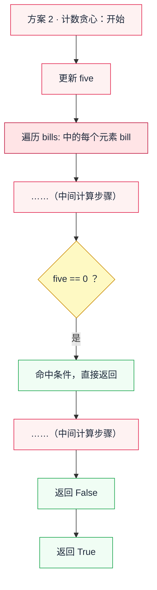

```python
import sys  # 提高递归深度上限（深输入防 RecursionError）

sys.setrecursionlimit(200000)  # 树/链表类题目节点数可达 1e4 量级

def lemonadeChange(bills):  # 定义函数 lemonadeChange（参数：bills）
    five = ten = 0  # 把 ten 赋值为 0 存入 five
    for bill in bills:  # 逐个取出 bills 的元素（bill）
        if bill == 5:  # 若 bill 等于 5
            five += 1  # five累加 1
        elif bill == 10:  # 否则，若 bill 等于 10
            if five == 0:  # 若 five 等于 0
                return False  # 返回 False
            five -= 1  # five累减 1
            ten += 1  # ten累加 1
        else:  # 否则
            if ten > 0 and five > 0:  # 若 ten 超过 0 and five 超过 0
                ten -= 1  # ten累减 1
                five -= 1  # five累减 1
            elif five >= 3:  # 否则，若 five 不低于 3
                five -= 3  # five累减 3
            else:  # 否则
                return False  # 返回 False
    return True  # 返回 True

if __name__ == "__main__":  # 若 __name__ 等于 '__main__'
    print(lemonadeChange([5, 5, 5, 10, 20]))  # 打印输出
```

#### 方案 3：单趟扫描

**思路与代码分析**：核心是「单趟扫描」。Python 版用切片与字典推导式简化操作，突出可读性。**走读**：方案 3 · 单趟扫描：开始 → 更新 five → 遍历 bills: 中的每个元素 bill → 命中条件，直接返回 → 返回 False → 返回 True。

**运行架构**（真实控制流）：


```python
import sys  # 提高递归深度上限（深输入防 RecursionError）

sys.setrecursionlimit(200000)  # 树/链表类题目节点数可达 1e4 量级

def lemonadeChange(bills):  # 定义函数 lemonadeChange（参数：bills）
    # 计数贪心（另一种写法）：20 优先用 10+5，否则三张 5，否则失败
    five = ten = 0  # 把 ten 赋值为 0 存入 five
    for bill in bills:  # 逐个取出 bills 的元素（bill）
        if bill == 5:  # 若 bill 等于 5
            five += 1  # five累加 1
        elif bill == 10:  # 否则，若 bill 等于 10
            if five <= 0:  # 若 five 不超过 0
                return False  # 返回 False
            five -= 1  # five累减 1
            ten += 1  # ten累加 1
        else:  # 否则
            if ten > 0 and five > 0:  # 若 ten 超过 0 and five 超过 0
                ten -= 1  # ten累减 1
                five -= 1  # five累减 1
            elif five >= 3:  # 否则，若 five 不低于 3
                five -= 3  # five累减 3
            else:  # 否则
                return False  # 返回 False
    return True  # 返回 True

if __name__ == "__main__":  # 若 __name__ 等于 '__main__'
    print(lemonadeChange([5, 5, 5, 10, 20]))  # 打印输出
    print(lemonadeChange([5, 5, 10, 10, 20]))  # 打印输出
```

#### 方案 4：双重循环枚举

**思路与代码分析**：核心是「双重循环枚举」。Python 版用切片与字典推导式简化操作，突出可读性。代码里依次做这些事：先排序再处理。**走读**：方案 4 · 双重循环枚举：开始 → 更新 pocket → 遍历 bills: 中的每个元素 bill → 遍历 pocket: 中的每个元素 note → 命中条件，直接返回 → 遍历 used: 中的每个元素 note → 返回 True。

**运行架构**（真实控制流）：

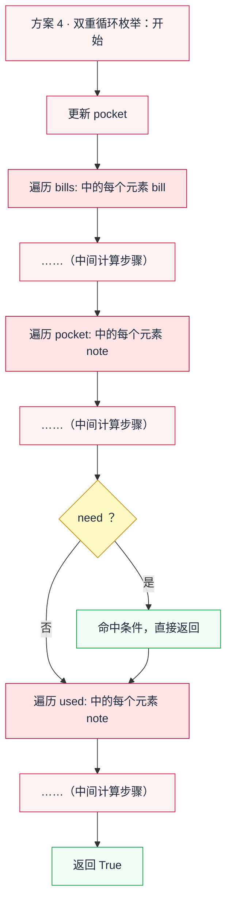

```python
import sys  # 提高递归深度上限（深输入防 RecursionError）

sys.setrecursionlimit(200000)  # 树/链表类题目节点数可达 1e4 量级

def lemonadeChange(bills):  # 定义函数 lemonadeChange（参数：bills）
    # 钱箱贪心（另一种写法）：把零钱放进列表，找零时从大到小取
    pocket = []  # 把 [] 存入 pocket
    for bill in bills:  # 逐个取出 bills 的元素（bill）
        need = bill - 5  # 把 bill 减 5 存入 need
        if need:  # 若 need
            pocket.sort(reverse=True)  # 排序
            used = []  # 把 [] 存入 已用标记
            for note in pocket:  # 逐个取出 pocket 的元素（note）
                if note <= need:  # 若 note 不超过 need
                    need -= note  # need累减 note
                    used.append(note)  # 把 note 追加到列表尾部
                    if need == 0:  # 若 need 等于 0
                        break  # 跳出循环
            if need:  # 若 need
                return False  # 返回 False
            for note in used:  # 逐个取出 已用标记 的元素（note）
                pocket.remove(note)  # pocket 弹出 note)
        pocket.append(bill)  # 把 bill 追加到列表尾部
    return True  # 返回 True

if __name__ == "__main__":  # 若 __name__ 等于 '__main__'
    print(lemonadeChange([5, 5, 5, 10, 20]))  # 打印输出
    print(lemonadeChange([5, 5, 10, 10, 20]))  # 打印输出
```

#### 方案 5：单趟扫描

**思路与代码分析**：核心是「单趟扫描」。Python 版用切片与字典推导式简化操作，突出可读性。**走读**：方案 5 · 单趟扫描：开始 → 更新 c5 → 遍历 bills: 中的每个元素 b → 命中条件，直接返回 → 返回 False → 返回 True。

**运行架构**（真实控制流）：

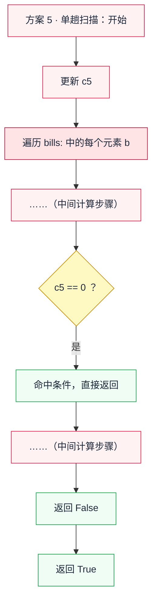

```python
import sys  # 提高递归深度上限（深输入防 RecursionError）

sys.setrecursionlimit(200000)  # 树/链表类题目节点数可达 1e4 量级

def lemonadeChange(bills):  # 定义函数 lemonadeChange（参数：bills）
    # 计数贪心：分别记录 5/10/20 面额零钱的数量
    c5 = c10 = 0  # 把 c10 赋值为 0 存入 c5
    for b in bills:  # 逐个取出 bills 的元素（b）
        if b == 5:  # 若 b 等于 5
            c5 += 1  # c5累加 1
        elif b == 10:  # 否则，若 b 等于 10
            if c5 == 0:  # 若 c5 等于 0
                return False  # 返回 False
            c5 -= 1  # c5累减 1
            c10 += 1  # c10累加 1
        else:  # 20
            if c10 > 0 and c5 > 0:  # 若 c10 超过 0 and c5 超过 0
                c10 -= 1  # c10累减 1
                c5 -= 1  # c5累减 1
            elif c5 >= 3:  # 否则，若 c5 不低于 3
                c5 -= 3  # c5累减 3
            else:  # 否则
                return False  # 返回 False
    return True  # 返回 True

if __name__ == "__main__":  # 若 __name__ 等于 '__main__'
    print(lemonadeChange([5, 5, 5, 10, 20]))  # 打印输出
    print(lemonadeChange([5, 5, 10, 10, 20]))  # 打印输出
```

#### 方案 6：双重循环枚举

**思路与代码分析**：核心是「双重循环枚举」。Python 版用切片与字典推导式简化操作，突出可读性。代码里依次做这些事：先排序再处理。**走读**：方案 6 · 双重循环枚举：开始 → 更新 box → 遍历 bills: 中的每个元素 money → 循环 i：从 0 到 len(box 前 → 命中条件，直接返回 → 返回 True。

**运行架构**（真实控制流）：

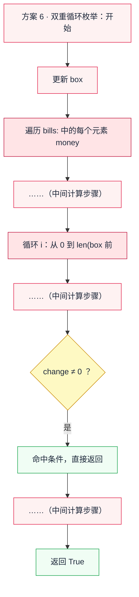

```python
import sys  # 提高递归深度上限（深输入防 RecursionError）

sys.setrecursionlimit(200000)  # 树/链表类题目节点数可达 1e4 量级

def lemonadeChange(bills):  # 定义函数 lemonadeChange（参数：bills）
    # 钱箱贪心：用列表维护所有零钱，找零时优先用大面额（降序）凑足
    box = []  # 把 [] 存入 box
    for money in bills:  # 逐个取出 bills 的元素（money）
        change = money - 5  # 把 money 减 5 存入 change
        if change > 0:  # 若 change 超过 0
            box.sort(reverse=True)  # 排序
            for i in range(len(box)):  # 让 下标 i 从 长度(box 遍历
                if box[i] <= change:  # 若 box[下标 i] 不超过 change
                    change -= box[i]  # change累减 box[下标 i]
                    box[i] = 0  # 把 0 写入 box[i]
                    if change == 0:  # 若 change 等于 0
                        break  # 跳出循环
            if change != 0:  # 若 change 不等于 0
                return False  # 返回 False
            box = [x for x in box if x != 0]  # 把 [x for x in box if x 不等于 0] 存入 box
        box.append(money)  # 把 money 追加到列表尾部
    return True  # 返回 True

if __name__ == "__main__":  # 若 __name__ 等于 '__main__'
    print(lemonadeChange([5, 5, 5, 10, 20]))  # 打印输出
    print(lemonadeChange([5, 5, 10, 10, 20]))  # 打印输出
```

### Go 实现（6 种方案）

Go 的全部方案如下，每个方案都内嵌用例自测，可独立运行（老仓库 python/go 文件遵循「打印结果」约定）：

#### 方案 1：单趟扫描

**思路与代码分析**：核心是「单趟扫描」。Go 版用切片与多返回值惯用法，显式处理索引边界。**走读**：方案 1 · 单趟扫描：开始 → 更新 : → 遍历 bills 的下标与元素 bill → 处理 if bill == 5 → 处理 five++ → 处理 if five == 0 → 返回 false → 处理 five-- → 处理 ten++ → 处理 if ten ＞ 0 且 five ＞ 0 → 处理 ten-- → 处理 five-- → 更新 - → 返回 false → 返回 true。

**运行架构**（真实控制流）：


```go
package main // 引入依赖
import (
	"fmt"
	"os"
) // 引入依赖
func lemonadeChange(bills []int) bool { // 定义函数/方法 lemonadeChange
	five, ten := 0, 0            // 把 0, 0 写入 five, ten :
	for _, bill := range bills { // 同时取 _ 与 bill 遍历
		if bill == 5 {
			five++
		} else if bill == 10 { // 若 bill 等于 5 { five 加一 } else if bill 等于 10
			if five == 0 {
				return false
			} // 若 five 等于 0 { return false }
			five--
			ten++ // five 减一 ; ten 加一
		} else { // 否则
			if ten > 0 && five > 0 {
				ten--
				five--
			} else if five >= 3 {
				five -= 3
			} else {
				return false
			}
		}
	}
	return true // 返回 true
}
func main() { // 程序入口：跑内嵌自测用例
	ok := true // 把 true 写入 ok :
	if !lemonadeChange([]int{5, 5, 5, 10, 20}) {
		ok = false
		fmt.Println("FAIL1")
	}
	if lemonadeChange([]int{5, 5, 10, 10, 20}) {
		ok = false
		fmt.Println("FAIL2")
	}
	if !ok {
		os.Exit(1)
	} // 若 取反 ok { os.Exit(1) }
	fmt.Println("PASS") // 全部用例通过，输出 PASS
}
```

#### 方案 2：计数贪心

**思路与代码分析**：核心是「计数贪心」。Go 版用切片与多返回值惯用法，显式处理索引边界。**走读**：方案 2 · 计数贪心：开始 → 更新 : → 遍历 bills 的下标与元素 bill → 处理 if bill == 5 → 处理 five++ → 处理 if five == 0 → 返回 false → 处理 five-- → 处理 ten++ → 处理 if ten ＞ 0 且 five ＞ 0 → 处理 ten-- → 处理 five-- → 更新 - → 返回 false → 返回 true。

**运行架构**（真实控制流）：

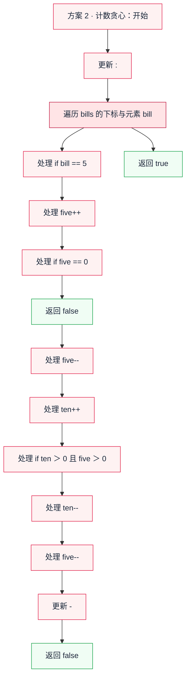

```go
package main // 引入依赖
import (
	"fmt"
	"os"
) // 引入依赖
func lemonadeChange(bills []int) bool { // 定义函数/方法 lemonadeChange
	five, ten := 0, 0            // 把 0, 0 写入 five, ten :
	for _, bill := range bills { // 同时取 _ 与 bill 遍历
		if bill == 5 {
			five++
		} else if bill == 10 { // 若 bill 等于 5 { five 加一 } else if bill 等于 10
			if five == 0 {
				return false
			} // 若 five 等于 0 { return false }
			five--
			ten++ // five 减一 ; ten 加一
		} else { // 否则
			if ten > 0 && five > 0 {
				ten--
				five--
			} else if five >= 3 {
				five -= 3
			} else {
				return false
			}
		}
	}
	return true // 返回 true
}
func main() { // 程序入口：跑内嵌自测用例
	ok := true // 把 true 写入 ok :
	if !lemonadeChange([]int{5, 5, 5, 10, 20}) {
		ok = false
		fmt.Println("FAIL1")
	}
	if lemonadeChange([]int{5, 5, 10, 10, 20}) {
		ok = false
		fmt.Println("FAIL2")
	}
	if !ok {
		os.Exit(1)
	} // 若 取反 ok { os.Exit(1) }
	fmt.Println("PASS") // 全部用例通过，输出 PASS
}
```

#### 方案 3：单趟扫描

**思路与代码分析**：核心是「单趟扫描」。Go 版用切片与多返回值惯用法，显式处理索引边界。**走读**：方案 3 · 单趟扫描：开始 → 更新 : → 遍历 bills 的下标与元素 bill → 处理 if bill == 5 → 处理 five++ → 处理 if five == 0 → 返回 false → 处理 five-- → 处理 ten++ → 处理 if ten ＞ 0 且 five ＞ 0 → 处理 ten-- → 处理 five-- → 更新 - → 返回 false → 返回 true。

**运行架构**（真实控制流）：

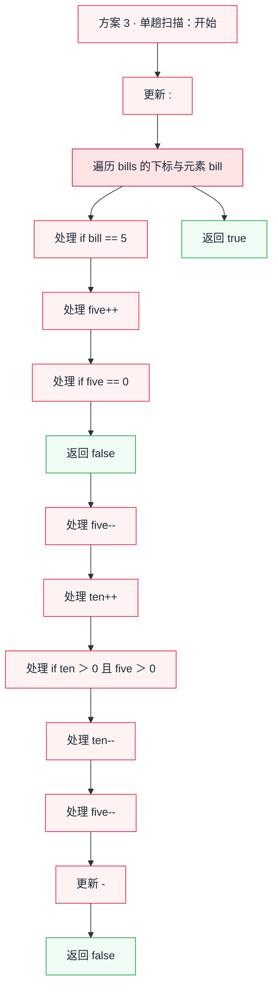

```go
package main // 引入依赖
import (
	"fmt"
	"os"
) // 引入依赖
func lemonadeChange(bills []int) bool { // 定义函数/方法 lemonadeChange
	five, ten := 0, 0            // 把 0, 0 写入 five, ten :
	for _, bill := range bills { // 同时取 _ 与 bill 遍历
		if bill == 5 {
			five++
		} else if bill == 10 { // 若 bill 等于 5 { five 加一 } else if bill 等于 10
			if five == 0 {
				return false
			} // 若 five 等于 0 { return false }
			five--
			ten++ // five 减一 ; ten 加一
		} else { // 否则
			if ten > 0 && five > 0 {
				ten--
				five--
			} else if five >= 3 {
				five -= 3
			} else {
				return false
			}
		}
	}
	return true // 返回 true
}
func main() { // 程序入口：跑内嵌自测用例
	ok := true // 把 true 写入 ok :
	if !lemonadeChange([]int{5, 5, 5, 10, 20}) {
		ok = false
		fmt.Println("FAIL1")
	}
	if lemonadeChange([]int{5, 5, 10, 10, 20}) {
		ok = false
		fmt.Println("FAIL2")
	}
	if !ok {
		os.Exit(1)
	} // 若 取反 ok { os.Exit(1) }
	fmt.Println("PASS") // 全部用例通过，输出 PASS
}
```

#### 方案 4：双重循环枚举

**思路与代码分析**：核心是「双重循环枚举」。Go 版用切片与多返回值惯用法，显式处理索引边界。**走读**：方案 4 · 双重循环枚举：开始 → 更新 : → 遍历 bills 的下标与元素 bill → 处理 if bill == 5 → 处理 five++ → 处理 if five == 0 → 返回 false → 处理 five-- → 处理 ten++ → 处理 if ten ＞ 0 且 five ＞ 0 → 处理 ten-- → 处理 five-- → 更新 - → 返回 false → 返回 true。

**运行架构**（真实控制流）：

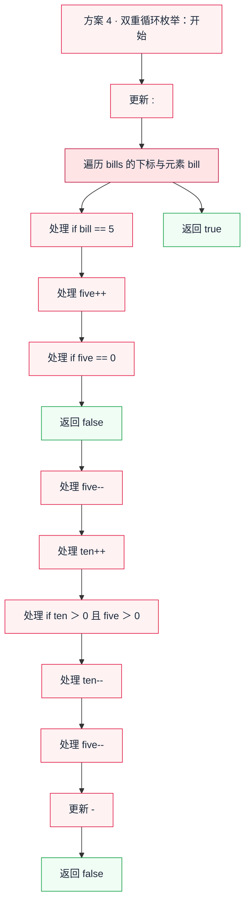

```go
package main // 引入依赖
import (
	"fmt"
	"os"
) // 引入依赖
func lemonadeChange(bills []int) bool { // 定义函数/方法 lemonadeChange
	five, ten := 0, 0            // 把 0, 0 写入 five, ten :
	for _, bill := range bills { // 同时取 _ 与 bill 遍历
		if bill == 5 {
			five++
		} else if bill == 10 { // 若 bill 等于 5 { five 加一 } else if bill 等于 10
			if five == 0 {
				return false
			} // 若 five 等于 0 { return false }
			five--
			ten++ // five 减一 ; ten 加一
		} else { // 否则
			if ten > 0 && five > 0 {
				ten--
				five--
			} else if five >= 3 {
				five -= 3
			} else {
				return false
			}
		}
	}
	return true // 返回 true
}
func main() { // 程序入口：跑内嵌自测用例
	ok := true // 把 true 写入 ok :
	if !lemonadeChange([]int{5, 5, 5, 10, 20}) {
		ok = false
		fmt.Println("FAIL1")
	}
	if lemonadeChange([]int{5, 5, 10, 10, 20}) {
		ok = false
		fmt.Println("FAIL2")
	}
	if !ok {
		os.Exit(1)
	} // 若 取反 ok { os.Exit(1) }
	fmt.Println("PASS") // 全部用例通过，输出 PASS
}
```

#### 方案 5：单趟扫描

**思路与代码分析**：核心是「单趟扫描」。Go 版用切片与多返回值惯用法，显式处理索引边界。**走读**：方案 5 · 单趟扫描：开始 → 更新 : → 遍历 bills 的下标与元素 bill → 处理 if bill == 5 → 处理 five++ → 处理 if five == 0 → 返回 false → 处理 five-- → 处理 ten++ → 处理 if ten ＞ 0 且 five ＞ 0 → 处理 ten-- → 处理 five-- → 更新 - → 返回 false → 返回 true。

**运行架构**（真实控制流）：


```go
package main // 引入依赖
import (
	"fmt"
	"os"
) // 引入依赖
func lemonadeChange(bills []int) bool { // 定义函数/方法 lemonadeChange
	five, ten := 0, 0            // 把 0, 0 写入 five, ten :
	for _, bill := range bills { // 同时取 _ 与 bill 遍历
		if bill == 5 {
			five++
		} else if bill == 10 { // 若 bill 等于 5 { five 加一 } else if bill 等于 10
			if five == 0 {
				return false
			} // 若 five 等于 0 { return false }
			five--
			ten++ // five 减一 ; ten 加一
		} else { // 否则
			if ten > 0 && five > 0 {
				ten--
				five--
			} else if five >= 3 {
				five -= 3
			} else {
				return false
			}
		}
	}
	return true // 返回 true
}
func main() { // 程序入口：跑内嵌自测用例
	ok := true // 把 true 写入 ok :
	if !lemonadeChange([]int{5, 5, 5, 10, 20}) {
		ok = false
		fmt.Println("FAIL1")
	}
	if lemonadeChange([]int{5, 5, 10, 10, 20}) {
		ok = false
		fmt.Println("FAIL2")
	}
	if !ok {
		os.Exit(1)
	} // 若 取反 ok { os.Exit(1) }
	fmt.Println("PASS") // 全部用例通过，输出 PASS
}
```

#### 方案 6：双重循环枚举

**思路与代码分析**：核心是「双重循环枚举」。Go 版用切片与多返回值惯用法，显式处理索引边界。**走读**：方案 6 · 双重循环枚举：开始 → 更新 : → 遍历 bills 的下标与元素 bill → 处理 if bill == 5 → 处理 five++ → 处理 if five == 0 → 返回 false → 处理 five-- → 处理 ten++ → 处理 if ten ＞ 0 且 five ＞ 0 → 处理 ten-- → 处理 five-- → 更新 - → 返回 false → 返回 true。

**运行架构**（真实控制流）：


```go
package main // 引入依赖
import (
	"fmt"
	"os"
) // 引入依赖
func lemonadeChange(bills []int) bool { // 定义函数/方法 lemonadeChange
	five, ten := 0, 0            // 把 0, 0 写入 five, ten :
	for _, bill := range bills { // 同时取 _ 与 bill 遍历
		if bill == 5 {
			five++
		} else if bill == 10 { // 若 bill 等于 5 { five 加一 } else if bill 等于 10
			if five == 0 {
				return false
			} // 若 five 等于 0 { return false }
			five--
			ten++ // five 减一 ; ten 加一
		} else { // 否则
			if ten > 0 && five > 0 {
				ten--
				five--
			} else if five >= 3 {
				five -= 3
			} else {
				return false
			}
		}
	}
	return true // 返回 true
}
func main() { // 程序入口：跑内嵌自测用例
	ok := true // 把 true 写入 ok :
	if !lemonadeChange([]int{5, 5, 5, 10, 20}) {
		ok = false
		fmt.Println("FAIL1")
	}
	if lemonadeChange([]int{5, 5, 10, 10, 20}) {
		ok = false
		fmt.Println("FAIL2")
	}
	if !ok {
		os.Exit(1)
	} // 若 取反 ok { os.Exit(1) }
	fmt.Println("PASS") // 全部用例通过，输出 PASS
}
```

### Java 实现（6 种方案）

Java 的全部方案如下，每个方案都内嵌用例自测，可独立运行（老仓库 python/go 文件遵循「打印结果」约定）：

#### 方案 1：单趟扫描

**思路与代码分析**：核心是「单趟扫描」。Java 版用类与静态方法组织，集合操作显式明了。代码里依次做这些事：单循环线性扫描。**走读**：方案 1 · 单趟扫描：开始 → 更新 five → 遍历循环 → 若 bill == 5 则： → 处理 five++ → 命中条件，直接返回 → 处理 five-- → 处理 ten++ → 若 ten ＞ 0 且 five ＞ 0 则： → 处理 ten-- → 处理 five-- → 更新 - → 返回 false → 返回 true。

**运行架构**（真实控制流）：

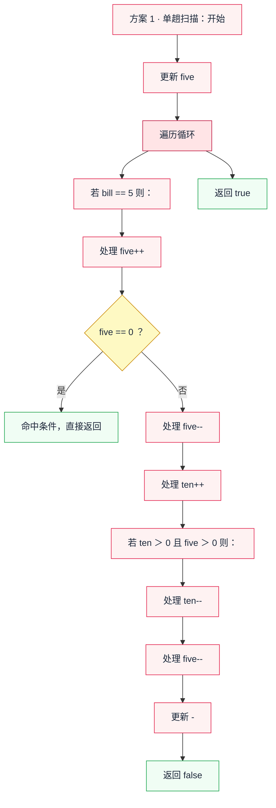

```java
package com.webfault.dsa; // 引入依赖

class Main { // 定义类型
  boolean lemonadeChange(int[] bills) { // 定义函数/方法 lemonadeChange
    int five = 0, ten = 0; // 把 0, ten 赋值为 0 存入 five
    for (int bill : bills) { // for (int bill : bills) {
      if (bill == 5) { // 若 bill 等于 5
        five++; // five 加一
      } else if (bill == 10) { // 否则，若 bill 等于 10
        if (five == 0) return false; // 若 five 等于 0，直接返回 false
        five--; // five 减一
        ten++; // ten 加一
      } else { // 否则
        if (ten > 0 && five > 0) { // 若 ten 超过 0 且 five 超过 0
          ten--; // ten 减一
          five--; // five 减一
        } else if (five >= 3) { // 否则，若 five 不低于 3
          five -= 3; // five累减 3
        } else { // 否则
          return false; // 返回 false
        }
      }
    }
    return true; // 返回 true
  }

  public static void main(String[] args) { // public static void main(String[] args) {
    Main s = new Main(); // 把 new Main(); 写入 Main s
    boolean ok = true; // 把 true; 写入 boolean ok
    if (!s.lemonadeChange(new int[] {5, 5, 5, 10, 20})) {
      ok = false;
      System.out.println("FAIL case1");
    }
    if (s.lemonadeChange(new int[] {5, 5, 10, 10, 20})) {
      ok = false;
      System.out.println("FAIL case2");
    }
    if (!s.lemonadeChange(new int[] {5, 5, 5, 5, 5, 5, 20})) {
      ok = false;
      System.out.println("FAIL case3");
    }
    if (s.lemonadeChange(new int[] {10})) {
      ok = false;
      System.out.println("FAIL case4");
    }
    if (!ok) throw new RuntimeException("FAILED"); // 若 取反 ok) throw new RuntimeException(「FAILED」);
    System.out.println("PASS"); // 全部用例通过，输出 PASS
  }
}
```

#### 方案 2：计数贪心

**思路与代码分析**：核心是「计数贪心」。Java 版用类与静态方法组织，集合操作显式明了。代码里依次做这些事：单循环线性扫描。**走读**：方案 2 · 计数贪心：开始 → 更新 five → 遍历循环 → 若 bill == 5 则： → 处理 five++ → 命中条件，直接返回 → 处理 five-- → 处理 ten++ → 若 ten ＞ 0 且 five ＞ 0 则： → 处理 ten-- → 处理 five-- → 更新 - → 返回 false → 返回 true。

**运行架构**（真实控制流）：

```mermaid
graph TD
    N0["方案 2 · 计数贪心：开始"]
    N1["更新 five"]
    N2["遍历循环"]
    N3["若 bill == 5 则："]
    N4["处理 five++"]
    N5{"five == 0 ？"}
    N6["命中条件，直接返回"]
    N7["处理 five--"]
    N8["处理 ten++"]
    N9["若 ten ＞ 0 且 five ＞ 0 则："]
    N10["处理 ten--"]
    N11["处理 five--"]
    N12["更新 -"]
    N13["返回 false"]
    N14["返回 true"]
    N0 --> N1
    N1 --> N2
    N2 --> N3
    N3 --> N4
    N4 --> N5
    N5 -- 是 --> N6
    N5 -- 否 --> N7
    N7 --> N8
    N8 --> N9
    N9 --> N10
    N10 --> N11
    N11 --> N12
    N12 --> N13
    N2 --> N14
    classDef n fill:#fef2f2,stroke:#e11d48,color:#1e293b;
    classDef lp fill:#ffe4e6,stroke:#be123c,color:#1e293b;
    classDef dc fill:#fef9c3,stroke:#ca8a04,color:#1e293b;
    classDef tm fill:#f0fdf4,stroke:#16a34a,color:#1e293b;
    class N0,N1,N3,N4,N7,N8,N9,N10,N11,N12 n;
    class N2 lp;
    class N5 dc;
    class N6,N13,N14 tm;
```

```java
package com.webfault.dsa; // 引入依赖

class Lm { // 定义类型
  boolean lemonadeChange(int[] bills) { // 定义函数/方法 lemonadeChange
    int five = 0, ten = 0; // 把 0, ten 赋值为 0 存入 five
    for (int bill : bills) { // for (int bill : bills) {
      if (bill == 5) { // 若 bill 等于 5
        five++; // five 加一
      } else if (bill == 10) { // 否则，若 bill 等于 10
        if (five == 0) return false; // 若 five 等于 0，直接返回 false
        five--; // five 减一
        ten++; // ten 加一
      } else { // 否则
        if (ten > 0 && five > 0) { // 若 ten 超过 0 且 five 超过 0
          ten--; // ten 减一
          five--; // five 减一
        } else if (five >= 3) { // 否则，若 five 不低于 3
          five -= 3; // five累减 3
        } else { // 否则
          return false; // 返回 false
        }
      }
    }
    return true; // 返回 true
  }

  public static void main(String[] args) { // public static void main(String[] args) {
    Lm s = new Lm(); // 把 new Lm(); 写入 Lm s
    boolean ok = true; // 把 true; 写入 boolean ok
    if (!s.lemonadeChange(new int[] {5, 5, 5, 10, 20})) {
      ok = false;
      System.out.println("FAIL case1");
    }
    if (s.lemonadeChange(new int[] {5, 5, 10, 10, 20})) {
      ok = false;
      System.out.println("FAIL case2");
    }
    if (!s.lemonadeChange(new int[] {5, 5, 5, 5, 5, 5, 20})) {
      ok = false;
      System.out.println("FAIL case3");
    }
    if (s.lemonadeChange(new int[] {10})) {
      ok = false;
      System.out.println("FAIL case4");
    }
    if (!ok) throw new RuntimeException("FAILED"); // 若 取反 ok) throw new RuntimeException(「FAILED」);
    System.out.println("PASS"); // 全部用例通过，输出 PASS
  }
}
```

#### 方案 3：单趟扫描

**思路与代码分析**：核心是「单趟扫描」。Java 版用类与静态方法组织，集合操作显式明了。代码里依次做这些事：单循环线性扫描。**走读**：方案 3 · 单趟扫描：开始 → 更新 five → 遍历循环 → 若 bill == 5 则： → 处理 five++ → 命中条件，直接返回 → 处理 five-- → 处理 ten++ → 若 ten ＞ 0 且 five ＞ 0 则： → 处理 ten-- → 处理 five-- → 更新 - → 返回 false → 返回 true。

**运行架构**（真实控制流）：

```mermaid
graph TD
    N0["方案 3 · 单趟扫描：开始"]
    N1["更新 five"]
    N2["遍历循环"]
    N3["若 bill == 5 则："]
    N4["处理 five++"]
    N5{"five == 0 ？"}
    N6["命中条件，直接返回"]
    N7["处理 five--"]
    N8["处理 ten++"]
    N9["若 ten ＞ 0 且 five ＞ 0 则："]
    N10["处理 ten--"]
    N11["处理 five--"]
    N12["更新 -"]
    N13["返回 false"]
    N14["返回 true"]
    N0 --> N1
    N1 --> N2
    N2 --> N3
    N3 --> N4
    N4 --> N5
    N5 -- 是 --> N6
    N5 -- 否 --> N7
    N7 --> N8
    N8 --> N9
    N9 --> N10
    N10 --> N11
    N11 --> N12
    N12 --> N13
    N2 --> N14
    classDef n fill:#fef2f2,stroke:#e11d48,color:#1e293b;
    classDef lp fill:#ffe4e6,stroke:#be123c,color:#1e293b;
    classDef dc fill:#fef9c3,stroke:#ca8a04,color:#1e293b;
    classDef tm fill:#f0fdf4,stroke:#16a34a,color:#1e293b;
    class N0,N1,N3,N4,N7,N8,N9,N10,N11,N12 n;
    class N2 lp;
    class N5 dc;
    class N6,N13,N14 tm;
```

```java
package com.webfault.dsa; // 引入依赖

class Lm { // 定义类型
  boolean lemonadeChange(int[] bills) { // 定义函数/方法 lemonadeChange
    int five = 0, ten = 0; // 把 0, ten 赋值为 0 存入 five
    for (int bill : bills) { // for (int bill : bills) {
      if (bill == 5) { // 若 bill 等于 5
        five++; // five 加一
      } else if (bill == 10) { // 否则，若 bill 等于 10
        if (five == 0) return false; // 若 five 等于 0，直接返回 false
        five--; // five 减一
        ten++; // ten 加一
      } else { // 否则
        if (ten > 0 && five > 0) { // 若 ten 超过 0 且 five 超过 0
          ten--; // ten 减一
          five--; // five 减一
        } else if (five >= 3) { // 否则，若 five 不低于 3
          five -= 3; // five累减 3
        } else { // 否则
          return false; // 返回 false
        }
      }
    }
    return true; // 返回 true
  }

  public static void main(String[] args) { // public static void main(String[] args) {
    Lm s = new Lm(); // 把 new Lm(); 写入 Lm s
    boolean ok = true; // 把 true; 写入 boolean ok
    if (!s.lemonadeChange(new int[] {5, 5, 5, 10, 20})) {
      ok = false;
      System.out.println("FAIL case1");
    }
    if (s.lemonadeChange(new int[] {5, 5, 10, 10, 20})) {
      ok = false;
      System.out.println("FAIL case2");
    }
    if (!s.lemonadeChange(new int[] {5, 5, 5, 5, 5, 5, 20})) {
      ok = false;
      System.out.println("FAIL case3");
    }
    if (s.lemonadeChange(new int[] {10})) {
      ok = false;
      System.out.println("FAIL case4");
    }
    if (!ok) throw new RuntimeException("FAILED"); // 若 取反 ok) throw new RuntimeException(「FAILED」);
    System.out.println("PASS"); // 全部用例通过，输出 PASS
  }
}
```

#### 方案 4：双重循环枚举

**思路与代码分析**：核心是「双重循环枚举」。Java 版用类与静态方法组织，集合操作显式明了。代码里依次做这些事：单循环线性扫描。**走读**：方案 4 · 双重循环枚举：开始 → 更新 five → 遍历循环 → 若 bill == 5 则： → 处理 five++ → 命中条件，直接返回 → 处理 five-- → 处理 ten++ → 若 ten ＞ 0 且 five ＞ 0 则： → 处理 ten-- → 处理 five-- → 更新 - → 返回 false → 返回 true。

**运行架构**（真实控制流）：

```mermaid
graph TD
    N0["方案 4 · 双重循环枚举：开始"]
    N1["更新 five"]
    N2["遍历循环"]
    N3["若 bill == 5 则："]
    N4["处理 five++"]
    N5{"five == 0 ？"}
    N6["命中条件，直接返回"]
    N7["处理 five--"]
    N8["处理 ten++"]
    N9["若 ten ＞ 0 且 five ＞ 0 则："]
    N10["处理 ten--"]
    N11["处理 five--"]
    N12["更新 -"]
    N13["返回 false"]
    N14["返回 true"]
    N0 --> N1
    N1 --> N2
    N2 --> N3
    N3 --> N4
    N4 --> N5
    N5 -- 是 --> N6
    N5 -- 否 --> N7
    N7 --> N8
    N8 --> N9
    N9 --> N10
    N10 --> N11
    N11 --> N12
    N12 --> N13
    N2 --> N14
    classDef n fill:#fef2f2,stroke:#e11d48,color:#1e293b;
    classDef lp fill:#ffe4e6,stroke:#be123c,color:#1e293b;
    classDef dc fill:#fef9c3,stroke:#ca8a04,color:#1e293b;
    classDef tm fill:#f0fdf4,stroke:#16a34a,color:#1e293b;
    class N0,N1,N3,N4,N7,N8,N9,N10,N11,N12 n;
    class N2 lp;
    class N5 dc;
    class N6,N13,N14 tm;
```

```java
package com.webfault.dsa; // 引入依赖

class Lm { // 定义类型
  boolean lemonadeChange(int[] bills) { // 定义函数/方法 lemonadeChange
    int five = 0, ten = 0; // 把 0, ten 赋值为 0 存入 five
    for (int bill : bills) { // for (int bill : bills) {
      if (bill == 5) { // 若 bill 等于 5
        five++; // five 加一
      } else if (bill == 10) { // 否则，若 bill 等于 10
        if (five == 0) return false; // 若 five 等于 0，直接返回 false
        five--; // five 减一
        ten++; // ten 加一
      } else { // 否则
        if (ten > 0 && five > 0) { // 若 ten 超过 0 且 five 超过 0
          ten--; // ten 减一
          five--; // five 减一
        } else if (five >= 3) { // 否则，若 five 不低于 3
          five -= 3; // five累减 3
        } else { // 否则
          return false; // 返回 false
        }
      }
    }
    return true; // 返回 true
  }

  public static void main(String[] args) { // public static void main(String[] args) {
    Lm s = new Lm(); // 把 new Lm(); 写入 Lm s
    boolean ok = true; // 把 true; 写入 boolean ok
    if (!s.lemonadeChange(new int[] {5, 5, 5, 10, 20})) {
      ok = false;
      System.out.println("FAIL case1");
    }
    if (s.lemonadeChange(new int[] {5, 5, 10, 10, 20})) {
      ok = false;
      System.out.println("FAIL case2");
    }
    if (!s.lemonadeChange(new int[] {5, 5, 5, 5, 5, 5, 20})) {
      ok = false;
      System.out.println("FAIL case3");
    }
    if (s.lemonadeChange(new int[] {10})) {
      ok = false;
      System.out.println("FAIL case4");
    }
    if (!ok) throw new RuntimeException("FAILED"); // 若 取反 ok) throw new RuntimeException(「FAILED」);
    System.out.println("PASS"); // 全部用例通过，输出 PASS
  }
}
```

#### 方案 5：单趟扫描

**思路与代码分析**：核心是「单趟扫描」。Java 版用类与静态方法组织，集合操作显式明了。代码里依次做这些事：单循环线性扫描。**走读**：方案 5 · 单趟扫描：开始 → 更新 five → 遍历循环 → 若 bill == 5 则： → 处理 five++ → 命中条件，直接返回 → 处理 five-- → 处理 ten++ → 若 ten ＞ 0 且 five ＞ 0 则： → 处理 ten-- → 处理 five-- → 更新 - → 返回 false → 返回 true。

**运行架构**（真实控制流）：

```mermaid
graph TD
    N0["方案 5 · 单趟扫描：开始"]
    N1["更新 five"]
    N2["遍历循环"]
    N3["若 bill == 5 则："]
    N4["处理 five++"]
    N5{"five == 0 ？"}
    N6["命中条件，直接返回"]
    N7["处理 five--"]
    N8["处理 ten++"]
    N9["若 ten ＞ 0 且 five ＞ 0 则："]
    N10["处理 ten--"]
    N11["处理 five--"]
    N12["更新 -"]
    N13["返回 false"]
    N14["返回 true"]
    N0 --> N1
    N1 --> N2
    N2 --> N3
    N3 --> N4
    N4 --> N5
    N5 -- 是 --> N6
    N5 -- 否 --> N7
    N7 --> N8
    N8 --> N9
    N9 --> N10
    N10 --> N11
    N11 --> N12
    N12 --> N13
    N2 --> N14
    classDef n fill:#fef2f2,stroke:#e11d48,color:#1e293b;
    classDef lp fill:#ffe4e6,stroke:#be123c,color:#1e293b;
    classDef dc fill:#fef9c3,stroke:#ca8a04,color:#1e293b;
    classDef tm fill:#f0fdf4,stroke:#16a34a,color:#1e293b;
    class N0,N1,N3,N4,N7,N8,N9,N10,N11,N12 n;
    class N2 lp;
    class N5 dc;
    class N6,N13,N14 tm;
```

```java
package com.webfault.dsa; // 引入依赖

class Lm { // 定义类型
  boolean lemonadeChange(int[] bills) { // 定义函数/方法 lemonadeChange
    int five = 0, ten = 0; // 把 0, ten 赋值为 0 存入 five
    for (int bill : bills) { // for (int bill : bills) {
      if (bill == 5) { // 若 bill 等于 5
        five++; // five 加一
      } else if (bill == 10) { // 否则，若 bill 等于 10
        if (five == 0) return false; // 若 five 等于 0，直接返回 false
        five--; // five 减一
        ten++; // ten 加一
      } else { // 否则
        if (ten > 0 && five > 0) { // 若 ten 超过 0 且 five 超过 0
          ten--; // ten 减一
          five--; // five 减一
        } else if (five >= 3) { // 否则，若 five 不低于 3
          five -= 3; // five累减 3
        } else { // 否则
          return false; // 返回 false
        }
      }
    }
    return true; // 返回 true
  }

  public static void main(String[] args) { // public static void main(String[] args) {
    Lm s = new Lm(); // 把 new Lm(); 写入 Lm s
    boolean ok = true; // 把 true; 写入 boolean ok
    if (!s.lemonadeChange(new int[] {5, 5, 5, 10, 20})) {
      ok = false;
      System.out.println("FAIL case1");
    }
    if (s.lemonadeChange(new int[] {5, 5, 10, 10, 20})) {
      ok = false;
      System.out.println("FAIL case2");
    }
    if (!s.lemonadeChange(new int[] {5, 5, 5, 5, 5, 5, 20})) {
      ok = false;
      System.out.println("FAIL case3");
    }
    if (s.lemonadeChange(new int[] {10})) {
      ok = false;
      System.out.println("FAIL case4");
    }
    if (!ok) throw new RuntimeException("FAILED"); // 若 取反 ok) throw new RuntimeException(「FAILED」);
    System.out.println("PASS"); // 全部用例通过，输出 PASS
  }
}
```

#### 方案 6：双重循环枚举

**思路与代码分析**：核心是「双重循环枚举」。Java 版用类与静态方法组织，集合操作显式明了。代码里依次做这些事：单循环线性扫描。**走读**：方案 6 · 双重循环枚举：开始 → 更新 five → 遍历循环 → 若 bill == 5 则： → 处理 five++ → 命中条件，直接返回 → 处理 five-- → 处理 ten++ → 若 ten ＞ 0 且 five ＞ 0 则： → 处理 ten-- → 处理 five-- → 更新 - → 返回 false → 返回 true。

**运行架构**（真实控制流）：

```mermaid
graph TD
    N0["方案 6 · 双重循环枚举：开始"]
    N1["更新 five"]
    N2["遍历循环"]
    N3["若 bill == 5 则："]
    N4["处理 five++"]
    N5{"five == 0 ？"}
    N6["命中条件，直接返回"]
    N7["处理 five--"]
    N8["处理 ten++"]
    N9["若 ten ＞ 0 且 five ＞ 0 则："]
    N10["处理 ten--"]
    N11["处理 five--"]
    N12["更新 -"]
    N13["返回 false"]
    N14["返回 true"]
    N0 --> N1
    N1 --> N2
    N2 --> N3
    N3 --> N4
    N4 --> N5
    N5 -- 是 --> N6
    N5 -- 否 --> N7
    N7 --> N8
    N8 --> N9
    N9 --> N10
    N10 --> N11
    N11 --> N12
    N12 --> N13
    N2 --> N14
    classDef n fill:#fef2f2,stroke:#e11d48,color:#1e293b;
    classDef lp fill:#ffe4e6,stroke:#be123c,color:#1e293b;
    classDef dc fill:#fef9c3,stroke:#ca8a04,color:#1e293b;
    classDef tm fill:#f0fdf4,stroke:#16a34a,color:#1e293b;
    class N0,N1,N3,N4,N7,N8,N9,N10,N11,N12 n;
    class N2 lp;
    class N5 dc;
    class N6,N13,N14 tm;
```

```java
package com.webfault.dsa; // 引入依赖

class Lm { // 定义类型
  boolean lemonadeChange(int[] bills) { // 定义函数/方法 lemonadeChange
    int five = 0, ten = 0; // 把 0, ten 赋值为 0 存入 five
    for (int bill : bills) { // for (int bill : bills) {
      if (bill == 5) { // 若 bill 等于 5
        five++; // five 加一
      } else if (bill == 10) { // 否则，若 bill 等于 10
        if (five == 0) return false; // 若 five 等于 0，直接返回 false
        five--; // five 减一
        ten++; // ten 加一
      } else { // 否则
        if (ten > 0 && five > 0) { // 若 ten 超过 0 且 five 超过 0
          ten--; // ten 减一
          five--; // five 减一
        } else if (five >= 3) { // 否则，若 five 不低于 3
          five -= 3; // five累减 3
        } else { // 否则
          return false; // 返回 false
        }
      }
    }
    return true; // 返回 true
  }

  public static void main(String[] args) { // public static void main(String[] args) {
    Lm s = new Lm(); // 把 new Lm(); 写入 Lm s
    boolean ok = true; // 把 true; 写入 boolean ok
    if (!s.lemonadeChange(new int[] {5, 5, 5, 10, 20})) {
      ok = false;
      System.out.println("FAIL case1");
    }
    if (s.lemonadeChange(new int[] {5, 5, 10, 10, 20})) {
      ok = false;
      System.out.println("FAIL case2");
    }
    if (!s.lemonadeChange(new int[] {5, 5, 5, 5, 5, 5, 20})) {
      ok = false;
      System.out.println("FAIL case3");
    }
    if (s.lemonadeChange(new int[] {10})) {
      ok = false;
      System.out.println("FAIL case4");
    }
    if (!ok) throw new RuntimeException("FAILED"); // 若 取反 ok) throw new RuntimeException(「FAILED」);
    System.out.println("PASS"); // 全部用例通过，输出 PASS
  }
}
```

### Rust 实现（6 种方案）

Rust 的全部方案如下，每个方案都内嵌用例自测，可独立运行（老仓库 python/go 文件遵循「打印结果」约定）：

#### 方案 1：单趟扫描

**思路与代码分析**：核心是「单趟扫描」。Rust 版用所有权移动与切片借用改写同一逻辑，注意 Option 与引用边界。**走读**：方案 1 · 单趟扫描：开始 → 计算 let (mut f5, mut f10) = → 遍历 bills 中的每个元素 b → 处理 if b == 5 → 更新 + → 更新 + → 更新 - → 处理 if f10 ＞ 0 → 更新 - → 更新 - → 更新 - → 处理 if f5 ＜ 0 → 返回 false → 处理 true。

**运行架构**（真实控制流）：

```mermaid
graph TD
    N0["方案 1 · 单趟扫描：开始"]
    N1["计算 let (mut f5, mut f10) ="]
    N2["遍历 bills 中的每个元素 b"]
    N3["处理 if b == 5"]
    N4["更新 +"]
    N5["更新 +"]
    N6["更新 -"]
    N7["处理 if f10 ＞ 0"]
    N8["更新 -"]
    N9["更新 -"]
    N10["更新 -"]
    N11["处理 if f5 ＜ 0"]
    N12["返回 false"]
    N13["处理 true"]
    N0 --> N1
    N1 --> N2
    N2 --> N3
    N3 --> N4
    N4 --> N5
    N5 --> N6
    N6 --> N7
    N7 --> N8
    N8 --> N9
    N9 --> N10
    N10 --> N11
    N11 --> N12
    N2 --> N13
    classDef n fill:#fef2f2,stroke:#e11d48,color:#1e293b;
    classDef lp fill:#ffe4e6,stroke:#be123c,color:#1e293b;
    classDef dc fill:#fef9c3,stroke:#ca8a04,color:#1e293b;
    classDef tm fill:#f0fdf4,stroke:#16a34a,color:#1e293b;
    class N0,N1,N3,N4,N5,N6,N7,N8,N9,N10,N11,N13 n;
    class N2 lp;
    class N12 tm;
```

```rust
// LeetCode 860. 柠檬水找零 — Rust 版（方案1）
fn lemonade_change(bills: Vec<i32>) -> bool {
    // 定义函数/方法 lemonade_change
    let (mut f5, mut f10) = (0i32, 0i32); // 把 (0i32, 0i32); 写入 let (mut f5, mut f10)
    for b in bills {
        // 逐个取出 bills 的元素（b）
        if b == 5 {
            f5 += 1;
        }
        // 若 b 等于 5 { f5 累加 1; }
        else if b == 10 {
            f10 += 1;
            f5 -= 1;
        }
        // 否则，若 b 等于 10 { f10 累加 1; f5 累减 1; }
        else {
            // 否则
            if f10 > 0 {
                f10 -= 1;
                f5 -= 1;
            }
            // 若 f10 超过 0 { f10 累减 1; f5 累减 1; }
            else {
                f5 -= 3;
            } // 否则
        }
        if f5 < 0 {
            return false;
        } // 若 f5 小于 0 { return false; }
    }
    true // true
}
fn main() {
    // 程序入口：跑内嵌自测用例
    assert!(lemonade_change(vec![5, 5, 5, 10, 20])); // 断言校验
    assert!(!lemonade_change(vec![5, 5, 10, 10, 20])); // 断言校验
    assert!(lemonade_change(vec![5, 5, 5, 5, 20])); // 断言校验
    println!("PASS"); // 全部用例通过，输出 PASS
}
```

#### 方案 2：计数贪心

**思路与代码分析**：核心是「计数贪心」。Rust 版用所有权移动与切片借用改写同一逻辑，注意 Option 与引用边界。**走读**：方案 2 · 计数贪心：开始 → 计算 let (mut f5, mut f10) = → 遍历 bills 中的每个元素 b → 处理 if b == 5 → 更新 + → 更新 + → 更新 - → 处理 if f10 ＞ 0 → 更新 - → 更新 - → 更新 - → 处理 if f5 ＜ 0 → 返回 false → 处理 true。

**运行架构**（真实控制流）：

```mermaid
graph TD
    N0["方案 2 · 计数贪心：开始"]
    N1["计算 let (mut f5, mut f10) ="]
    N2["遍历 bills 中的每个元素 b"]
    N3["处理 if b == 5"]
    N4["更新 +"]
    N5["更新 +"]
    N6["更新 -"]
    N7["处理 if f10 ＞ 0"]
    N8["更新 -"]
    N9["更新 -"]
    N10["更新 -"]
    N11["处理 if f5 ＜ 0"]
    N12["返回 false"]
    N13["处理 true"]
    N0 --> N1
    N1 --> N2
    N2 --> N3
    N3 --> N4
    N4 --> N5
    N5 --> N6
    N6 --> N7
    N7 --> N8
    N8 --> N9
    N9 --> N10
    N10 --> N11
    N11 --> N12
    N2 --> N13
    classDef n fill:#fef2f2,stroke:#e11d48,color:#1e293b;
    classDef lp fill:#ffe4e6,stroke:#be123c,color:#1e293b;
    classDef dc fill:#fef9c3,stroke:#ca8a04,color:#1e293b;
    classDef tm fill:#f0fdf4,stroke:#16a34a,color:#1e293b;
    class N0,N1,N3,N4,N5,N6,N7,N8,N9,N10,N11,N13 n;
    class N2 lp;
    class N12 tm;
```

```rust
// LeetCode 860. 柠檬水找零 — Rust 版（方案2）
fn lemonade_change(bills: Vec<i32>) -> bool {
    // 定义函数/方法 lemonade_change
    let (mut f5, mut f10) = (0i32, 0i32); // 把 (0i32, 0i32); 写入 let (mut f5, mut f10)
    for b in bills {
        // 逐个取出 bills 的元素（b）
        if b == 5 {
            f5 += 1;
        }
        // 若 b 等于 5 { f5 累加 1; }
        else if b == 10 {
            f10 += 1;
            f5 -= 1;
        }
        // 否则，若 b 等于 10 { f10 累加 1; f5 累减 1; }
        else {
            // 否则
            if f10 > 0 {
                f10 -= 1;
                f5 -= 1;
            }
            // 若 f10 超过 0 { f10 累减 1; f5 累减 1; }
            else {
                f5 -= 3;
            } // 否则
        }
        if f5 < 0 {
            return false;
        } // 若 f5 小于 0 { return false; }
    }
    true // true
}
fn main() {
    // 程序入口：跑内嵌自测用例
    assert!(lemonade_change(vec![5, 5, 5, 10, 20])); // 断言校验
    assert!(!lemonade_change(vec![5, 5, 10, 10, 20])); // 断言校验
    assert!(lemonade_change(vec![5, 5, 5, 5, 20])); // 断言校验
    println!("PASS"); // 全部用例通过，输出 PASS
}
```

#### 方案 3：单趟扫描

**思路与代码分析**：核心是「单趟扫描」。Rust 版用所有权移动与切片借用改写同一逻辑，注意 Option 与引用边界。**走读**：方案 3 · 单趟扫描：开始 → 计算 let (mut f5, mut f10) = → 遍历 bills 中的每个元素 b → 处理 if b == 5 → 更新 + → 更新 + → 更新 - → 处理 if f10 ＞ 0 → 更新 - → 更新 - → 更新 - → 处理 if f5 ＜ 0 → 返回 false → 处理 true。

**运行架构**（真实控制流）：

```mermaid
graph TD
    N0["方案 3 · 单趟扫描：开始"]
    N1["计算 let (mut f5, mut f10) ="]
    N2["遍历 bills 中的每个元素 b"]
    N3["处理 if b == 5"]
    N4["更新 +"]
    N5["更新 +"]
    N6["更新 -"]
    N7["处理 if f10 ＞ 0"]
    N8["更新 -"]
    N9["更新 -"]
    N10["更新 -"]
    N11["处理 if f5 ＜ 0"]
    N12["返回 false"]
    N13["处理 true"]
    N0 --> N1
    N1 --> N2
    N2 --> N3
    N3 --> N4
    N4 --> N5
    N5 --> N6
    N6 --> N7
    N7 --> N8
    N8 --> N9
    N9 --> N10
    N10 --> N11
    N11 --> N12
    N2 --> N13
    classDef n fill:#fef2f2,stroke:#e11d48,color:#1e293b;
    classDef lp fill:#ffe4e6,stroke:#be123c,color:#1e293b;
    classDef dc fill:#fef9c3,stroke:#ca8a04,color:#1e293b;
    classDef tm fill:#f0fdf4,stroke:#16a34a,color:#1e293b;
    class N0,N1,N3,N4,N5,N6,N7,N8,N9,N10,N11,N13 n;
    class N2 lp;
    class N12 tm;
```

```rust
// LeetCode 860. 柠檬水找零 — Rust 版（方案3）
fn lemonade_change(bills: Vec<i32>) -> bool {
    // 定义函数/方法 lemonade_change
    let (mut f5, mut f10) = (0i32, 0i32); // 把 (0i32, 0i32); 写入 let (mut f5, mut f10)
    for b in bills {
        // 逐个取出 bills 的元素（b）
        if b == 5 {
            f5 += 1;
        }
        // 若 b 等于 5 { f5 累加 1; }
        else if b == 10 {
            f10 += 1;
            f5 -= 1;
        }
        // 否则，若 b 等于 10 { f10 累加 1; f5 累减 1; }
        else {
            // 否则
            if f10 > 0 {
                f10 -= 1;
                f5 -= 1;
            }
            // 若 f10 超过 0 { f10 累减 1; f5 累减 1; }
            else {
                f5 -= 3;
            } // 否则
        }
        if f5 < 0 {
            return false;
        } // 若 f5 小于 0 { return false; }
    }
    true // true
}
fn main() {
    // 程序入口：跑内嵌自测用例
    assert!(lemonade_change(vec![5, 5, 5, 10, 20])); // 断言校验
    assert!(!lemonade_change(vec![5, 5, 10, 10, 20])); // 断言校验
    assert!(lemonade_change(vec![5, 5, 5, 5, 20])); // 断言校验
    println!("PASS"); // 全部用例通过，输出 PASS
}
```

#### 方案 4：双重循环枚举

**思路与代码分析**：核心是「双重循环枚举」。Rust 版用所有权移动与切片借用改写同一逻辑，注意 Option 与引用边界。**走读**：方案 4 · 双重循环枚举：开始 → 计算 let (mut f5, mut f10) = → 遍历 bills 中的每个元素 b → 处理 if b == 5 → 更新 + → 更新 + → 更新 - → 处理 if f10 ＞ 0 → 更新 - → 更新 - → 更新 - → 处理 if f5 ＜ 0 → 返回 false → 处理 true。

**运行架构**（真实控制流）：

```mermaid
graph TD
    N0["方案 4 · 双重循环枚举：开始"]
    N1["计算 let (mut f5, mut f10) ="]
    N2["遍历 bills 中的每个元素 b"]
    N3["处理 if b == 5"]
    N4["更新 +"]
    N5["更新 +"]
    N6["更新 -"]
    N7["处理 if f10 ＞ 0"]
    N8["更新 -"]
    N9["更新 -"]
    N10["更新 -"]
    N11["处理 if f5 ＜ 0"]
    N12["返回 false"]
    N13["处理 true"]
    N0 --> N1
    N1 --> N2
    N2 --> N3
    N3 --> N4
    N4 --> N5
    N5 --> N6
    N6 --> N7
    N7 --> N8
    N8 --> N9
    N9 --> N10
    N10 --> N11
    N11 --> N12
    N2 --> N13
    classDef n fill:#fef2f2,stroke:#e11d48,color:#1e293b;
    classDef lp fill:#ffe4e6,stroke:#be123c,color:#1e293b;
    classDef dc fill:#fef9c3,stroke:#ca8a04,color:#1e293b;
    classDef tm fill:#f0fdf4,stroke:#16a34a,color:#1e293b;
    class N0,N1,N3,N4,N5,N6,N7,N8,N9,N10,N11,N13 n;
    class N2 lp;
    class N12 tm;
```

```rust
// LeetCode 860. 柠檬水找零 — Rust 版（方案4）
fn lemonade_change(bills: Vec<i32>) -> bool {
    // 定义函数/方法 lemonade_change
    let (mut f5, mut f10) = (0i32, 0i32); // 把 (0i32, 0i32); 写入 let (mut f5, mut f10)
    for b in bills {
        // 逐个取出 bills 的元素（b）
        if b == 5 {
            f5 += 1;
        }
        // 若 b 等于 5 { f5 累加 1; }
        else if b == 10 {
            f10 += 1;
            f5 -= 1;
        }
        // 否则，若 b 等于 10 { f10 累加 1; f5 累减 1; }
        else {
            // 否则
            if f10 > 0 {
                f10 -= 1;
                f5 -= 1;
            }
            // 若 f10 超过 0 { f10 累减 1; f5 累减 1; }
            else {
                f5 -= 3;
            } // 否则
        }
        if f5 < 0 {
            return false;
        } // 若 f5 小于 0 { return false; }
    }
    true // true
}
fn main() {
    // 程序入口：跑内嵌自测用例
    assert!(lemonade_change(vec![5, 5, 5, 10, 20])); // 断言校验
    assert!(!lemonade_change(vec![5, 5, 10, 10, 20])); // 断言校验
    assert!(lemonade_change(vec![5, 5, 5, 5, 20])); // 断言校验
    println!("PASS"); // 全部用例通过，输出 PASS
}
```

#### 方案 5：单趟扫描

**思路与代码分析**：核心是「单趟扫描」。Rust 版用所有权移动与切片借用改写同一逻辑，注意 Option 与引用边界。**走读**：方案 5 · 单趟扫描：开始 → 计算 let (mut f5, mut f10) = → 遍历 bills 中的每个元素 b → 处理 if b == 5 → 更新 + → 更新 + → 更新 - → 处理 if f10 ＞ 0 → 更新 - → 更新 - → 更新 - → 处理 if f5 ＜ 0 → 返回 false → 处理 true。

**运行架构**（真实控制流）：

```mermaid
graph TD
    N0["方案 5 · 单趟扫描：开始"]
    N1["计算 let (mut f5, mut f10) ="]
    N2["遍历 bills 中的每个元素 b"]
    N3["处理 if b == 5"]
    N4["更新 +"]
    N5["更新 +"]
    N6["更新 -"]
    N7["处理 if f10 ＞ 0"]
    N8["更新 -"]
    N9["更新 -"]
    N10["更新 -"]
    N11["处理 if f5 ＜ 0"]
    N12["返回 false"]
    N13["处理 true"]
    N0 --> N1
    N1 --> N2
    N2 --> N3
    N3 --> N4
    N4 --> N5
    N5 --> N6
    N6 --> N7
    N7 --> N8
    N8 --> N9
    N9 --> N10
    N10 --> N11
    N11 --> N12
    N2 --> N13
    classDef n fill:#fef2f2,stroke:#e11d48,color:#1e293b;
    classDef lp fill:#ffe4e6,stroke:#be123c,color:#1e293b;
    classDef dc fill:#fef9c3,stroke:#ca8a04,color:#1e293b;
    classDef tm fill:#f0fdf4,stroke:#16a34a,color:#1e293b;
    class N0,N1,N3,N4,N5,N6,N7,N8,N9,N10,N11,N13 n;
    class N2 lp;
    class N12 tm;
```

```rust
// LeetCode 860. 柠檬水找零 — Rust 版（方案5）
fn lemonade_change(bills: Vec<i32>) -> bool {
    // 定义函数/方法 lemonade_change
    let (mut f5, mut f10) = (0i32, 0i32); // 把 (0i32, 0i32); 写入 let (mut f5, mut f10)
    for b in bills {
        // 逐个取出 bills 的元素（b）
        if b == 5 {
            f5 += 1;
        }
        // 若 b 等于 5 { f5 累加 1; }
        else if b == 10 {
            f10 += 1;
            f5 -= 1;
        }
        // 否则，若 b 等于 10 { f10 累加 1; f5 累减 1; }
        else {
            // 否则
            if f10 > 0 {
                f10 -= 1;
                f5 -= 1;
            }
            // 若 f10 超过 0 { f10 累减 1; f5 累减 1; }
            else {
                f5 -= 3;
            } // 否则
        }
        if f5 < 0 {
            return false;
        } // 若 f5 小于 0 { return false; }
    }
    true // true
}
fn main() {
    // 程序入口：跑内嵌自测用例
    assert!(lemonade_change(vec![5, 5, 5, 10, 20])); // 断言校验
    assert!(!lemonade_change(vec![5, 5, 10, 10, 20])); // 断言校验
    assert!(lemonade_change(vec![5, 5, 5, 5, 20])); // 断言校验
    println!("PASS"); // 全部用例通过，输出 PASS
}
```

#### 方案 6：双重循环枚举

**思路与代码分析**：核心是「双重循环枚举」。Rust 版用所有权移动与切片借用改写同一逻辑，注意 Option 与引用边界。**走读**：方案 6 · 双重循环枚举：开始 → 计算 let (mut f5, mut f10) = → 遍历 bills 中的每个元素 b → 处理 if b == 5 → 更新 + → 更新 + → 更新 - → 处理 if f10 ＞ 0 → 更新 - → 更新 - → 更新 - → 处理 if f5 ＜ 0 → 返回 false → 处理 true。

**运行架构**（真实控制流）：

```mermaid
graph TD
    N0["方案 6 · 双重循环枚举：开始"]
    N1["计算 let (mut f5, mut f10) ="]
    N2["遍历 bills 中的每个元素 b"]
    N3["处理 if b == 5"]
    N4["更新 +"]
    N5["更新 +"]
    N6["更新 -"]
    N7["处理 if f10 ＞ 0"]
    N8["更新 -"]
    N9["更新 -"]
    N10["更新 -"]
    N11["处理 if f5 ＜ 0"]
    N12["返回 false"]
    N13["处理 true"]
    N0 --> N1
    N1 --> N2
    N2 --> N3
    N3 --> N4
    N4 --> N5
    N5 --> N6
    N6 --> N7
    N7 --> N8
    N8 --> N9
    N9 --> N10
    N10 --> N11
    N11 --> N12
    N2 --> N13
    classDef n fill:#fef2f2,stroke:#e11d48,color:#1e293b;
    classDef lp fill:#ffe4e6,stroke:#be123c,color:#1e293b;
    classDef dc fill:#fef9c3,stroke:#ca8a04,color:#1e293b;
    classDef tm fill:#f0fdf4,stroke:#16a34a,color:#1e293b;
    class N0,N1,N3,N4,N5,N6,N7,N8,N9,N10,N11,N13 n;
    class N2 lp;
    class N12 tm;
```

```rust
// LeetCode 860. 柠檬水找零 — Rust 版（方案6）
fn lemonade_change(bills: Vec<i32>) -> bool {
    // 定义函数/方法 lemonade_change
    let (mut f5, mut f10) = (0i32, 0i32); // 把 (0i32, 0i32); 写入 let (mut f5, mut f10)
    for b in bills {
        // 逐个取出 bills 的元素（b）
        if b == 5 {
            f5 += 1;
        }
        // 若 b 等于 5 { f5 累加 1; }
        else if b == 10 {
            f10 += 1;
            f5 -= 1;
        }
        // 否则，若 b 等于 10 { f10 累加 1; f5 累减 1; }
        else {
            // 否则
            if f10 > 0 {
                f10 -= 1;
                f5 -= 1;
            }
            // 若 f10 超过 0 { f10 累减 1; f5 累减 1; }
            else {
                f5 -= 3;
            } // 否则
        }
        if f5 < 0 {
            return false;
        } // 若 f5 小于 0 { return false; }
    }
    true // true
}
fn main() {
    // 程序入口：跑内嵌自测用例
    assert!(lemonade_change(vec![5, 5, 5, 10, 20])); // 断言校验
    assert!(!lemonade_change(vec![5, 5, 10, 10, 20])); // 断言校验
    assert!(lemonade_change(vec![5, 5, 5, 5, 20])); // 断言校验
    println!("PASS"); // 全部用例通过，输出 PASS
}
```

### Lua 实现（6 种方案）

Lua 的全部方案如下，每个方案都内嵌用例自测，可独立运行（老仓库 python/go 文件遵循「打印结果」约定）：

#### 方案 1：单趟扫描

**思路与代码分析**：核心是「单趟扫描」。Lua 版用表与 ipairs 遍历，注意 ipairs 遇 nil 即停的语义。**走读**：方案 1 · 单趟扫描：开始 → 更新 f10 → 遍历 ipairs(bills) do 中的每个元素 b → 返回 false → 返回 true。

**运行架构**（真实控制流）：

```mermaid
graph TD
    N0["方案 1 · 单趟扫描：开始"]
    N1["更新 f10"]
    N2["遍历 ipairs(bills) do 中的每个元素 b"]
    D1["……（中间计算步骤）"]
    N12["返回 false"]
    N13["返回 true"]
    Dend["……（中间计算步骤）"]
    N0 --> N1
    N1 --> N2
    N12 --> N13
    N2 --> D1
    D1 --> N12
    N13 --> Dend
    classDef n fill:#fef2f2,stroke:#e11d48,color:#1e293b;
    classDef lp fill:#ffe4e6,stroke:#be123c,color:#1e293b;
    classDef dc fill:#fef9c3,stroke:#ca8a04,color:#1e293b;
    classDef tm fill:#f0fdf4,stroke:#16a34a,color:#1e293b;
    class N0,N1,D1,Dend n;
    class N2 lp;
    class N12,N13 tm;
```

```lua
-- LeetCode 860. 柠檬水找零 — Lua 版（方案1）
local function lemonade_change(bills) -- local function lemonade_change(bills)
	local f5, f10 = 0, 0 -- 把 0, 0 写入 local f5, f10
	for _, b in ipairs(bills) do -- 遍历取 b
		if b == 5 then -- 若 b 等于 5 then
			f5 = f5 + 1 -- 把 f5 加 1 存入 f5
		elseif b == 10 then -- 把 赋值为 10 then 写入 elseif b
			f10 = f10 + 1
			f5 = f5 - 1 -- 把 f10 加 1; f5 赋值为 f5 减 1 存入 f10
		else -- 否则
			if f10 > 0 then
				f10 = f10 - 1
				f5 = f5 - 1
			else
				f5 = f5 - 3
			end
		end -- 终点
		if f5 < 0 then
			return false
		end -- 若 f5 小于 0 then return false 终点
	end -- 终点
	return true -- 返回 true
end -- 终点
assert(lemonade_change({ 5, 5, 5, 10, 20 }) == true) -- 断言校验
assert(lemonade_change({ 5, 5, 10, 10, 20 }) == false) -- 断言校验
assert(lemonade_change({ 5, 5, 5, 5, 20 }) == true) -- 断言校验
print("PASS") -- 全部用例通过，输出 PASS
```

#### 方案 2：计数贪心

**思路与代码分析**：核心是「计数贪心」。Lua 版用表与 ipairs 遍历，注意 ipairs 遇 nil 即停的语义。**走读**：方案 2 · 计数贪心：开始 → 更新 f10 → 遍历 ipairs(bills) do 中的每个元素 b → 返回 false → 返回 true。

**运行架构**（真实控制流）：

```mermaid
graph TD
    N0["方案 2 · 计数贪心：开始"]
    N1["更新 f10"]
    N2["遍历 ipairs(bills) do 中的每个元素 b"]
    D1["……（中间计算步骤）"]
    N12["返回 false"]
    N13["返回 true"]
    Dend["……（中间计算步骤）"]
    N0 --> N1
    N1 --> N2
    N12 --> N13
    N2 --> D1
    D1 --> N12
    N13 --> Dend
    classDef n fill:#fef2f2,stroke:#e11d48,color:#1e293b;
    classDef lp fill:#ffe4e6,stroke:#be123c,color:#1e293b;
    classDef dc fill:#fef9c3,stroke:#ca8a04,color:#1e293b;
    classDef tm fill:#f0fdf4,stroke:#16a34a,color:#1e293b;
    class N0,N1,D1,Dend n;
    class N2 lp;
    class N12,N13 tm;
```

```lua
-- LeetCode 860. 柠檬水找零 — Lua 版（方案2）
local function lemonade_change(bills) -- local function lemonade_change(bills)
	local f5, f10 = 0, 0 -- 把 0, 0 写入 local f5, f10
	for _, b in ipairs(bills) do -- 遍历取 b
		if b == 5 then -- 若 b 等于 5 then
			f5 = f5 + 1 -- 把 f5 加 1 存入 f5
		elseif b == 10 then -- 把 赋值为 10 then 写入 elseif b
			f10 = f10 + 1
			f5 = f5 - 1 -- 把 f10 加 1; f5 赋值为 f5 减 1 存入 f10
		else -- 否则
			if f10 > 0 then
				f10 = f10 - 1
				f5 = f5 - 1
			else
				f5 = f5 - 3
			end
		end -- 终点
		if f5 < 0 then
			return false
		end -- 若 f5 小于 0 then return false 终点
	end -- 终点
	return true -- 返回 true
end -- 终点
assert(lemonade_change({ 5, 5, 5, 10, 20 }) == true) -- 断言校验
assert(lemonade_change({ 5, 5, 10, 10, 20 }) == false) -- 断言校验
assert(lemonade_change({ 5, 5, 5, 5, 20 }) == true) -- 断言校验
print("PASS") -- 全部用例通过，输出 PASS
```

#### 方案 3：单趟扫描

**思路与代码分析**：核心是「单趟扫描」。Lua 版用表与 ipairs 遍历，注意 ipairs 遇 nil 即停的语义。**走读**：方案 3 · 单趟扫描：开始 → 更新 f10 → 遍历 ipairs(bills) do 中的每个元素 b → 返回 false → 返回 true。

**运行架构**（真实控制流）：

```mermaid
graph TD
    N0["方案 3 · 单趟扫描：开始"]
    N1["更新 f10"]
    N2["遍历 ipairs(bills) do 中的每个元素 b"]
    D1["……（中间计算步骤）"]
    N12["返回 false"]
    N13["返回 true"]
    Dend["……（中间计算步骤）"]
    N0 --> N1
    N1 --> N2
    N12 --> N13
    N2 --> D1
    D1 --> N12
    N13 --> Dend
    classDef n fill:#fef2f2,stroke:#e11d48,color:#1e293b;
    classDef lp fill:#ffe4e6,stroke:#be123c,color:#1e293b;
    classDef dc fill:#fef9c3,stroke:#ca8a04,color:#1e293b;
    classDef tm fill:#f0fdf4,stroke:#16a34a,color:#1e293b;
    class N0,N1,D1,Dend n;
    class N2 lp;
    class N12,N13 tm;
```

```lua
-- LeetCode 860. 柠檬水找零 — Lua 版（方案3）
local function lemonade_change(bills) -- local function lemonade_change(bills)
	local f5, f10 = 0, 0 -- 把 0, 0 写入 local f5, f10
	for _, b in ipairs(bills) do -- 遍历取 b
		if b == 5 then -- 若 b 等于 5 then
			f5 = f5 + 1 -- 把 f5 加 1 存入 f5
		elseif b == 10 then -- 把 赋值为 10 then 写入 elseif b
			f10 = f10 + 1
			f5 = f5 - 1 -- 把 f10 加 1; f5 赋值为 f5 减 1 存入 f10
		else -- 否则
			if f10 > 0 then
				f10 = f10 - 1
				f5 = f5 - 1
			else
				f5 = f5 - 3
			end
		end -- 终点
		if f5 < 0 then
			return false
		end -- 若 f5 小于 0 then return false 终点
	end -- 终点
	return true -- 返回 true
end -- 终点
assert(lemonade_change({ 5, 5, 5, 10, 20 }) == true) -- 断言校验
assert(lemonade_change({ 5, 5, 10, 10, 20 }) == false) -- 断言校验
assert(lemonade_change({ 5, 5, 5, 5, 20 }) == true) -- 断言校验
print("PASS") -- 全部用例通过，输出 PASS
```

#### 方案 4：双重循环枚举

**思路与代码分析**：核心是「双重循环枚举」。Lua 版用表与 ipairs 遍历，注意 ipairs 遇 nil 即停的语义。**走读**：方案 4 · 双重循环枚举：开始 → 更新 f10 → 遍历 ipairs(bills) do 中的每个元素 b → 返回 false → 返回 true。

**运行架构**（真实控制流）：

```mermaid
graph TD
    N0["方案 4 · 双重循环枚举：开始"]
    N1["更新 f10"]
    N2["遍历 ipairs(bills) do 中的每个元素 b"]
    D1["……（中间计算步骤）"]
    N12["返回 false"]
    N13["返回 true"]
    Dend["……（中间计算步骤）"]
    N0 --> N1
    N1 --> N2
    N12 --> N13
    N2 --> D1
    D1 --> N12
    N13 --> Dend
    classDef n fill:#fef2f2,stroke:#e11d48,color:#1e293b;
    classDef lp fill:#ffe4e6,stroke:#be123c,color:#1e293b;
    classDef dc fill:#fef9c3,stroke:#ca8a04,color:#1e293b;
    classDef tm fill:#f0fdf4,stroke:#16a34a,color:#1e293b;
    class N0,N1,D1,Dend n;
    class N2 lp;
    class N12,N13 tm;
```

```lua
-- LeetCode 860. 柠檬水找零 — Lua 版（方案4）
local function lemonade_change(bills) -- local function lemonade_change(bills)
	local f5, f10 = 0, 0 -- 把 0, 0 写入 local f5, f10
	for _, b in ipairs(bills) do -- 遍历取 b
		if b == 5 then -- 若 b 等于 5 then
			f5 = f5 + 1 -- 把 f5 加 1 存入 f5
		elseif b == 10 then -- 把 赋值为 10 then 写入 elseif b
			f10 = f10 + 1
			f5 = f5 - 1 -- 把 f10 加 1; f5 赋值为 f5 减 1 存入 f10
		else -- 否则
			if f10 > 0 then
				f10 = f10 - 1
				f5 = f5 - 1
			else
				f5 = f5 - 3
			end
		end -- 终点
		if f5 < 0 then
			return false
		end -- 若 f5 小于 0 then return false 终点
	end -- 终点
	return true -- 返回 true
end -- 终点
assert(lemonade_change({ 5, 5, 5, 10, 20 }) == true) -- 断言校验
assert(lemonade_change({ 5, 5, 10, 10, 20 }) == false) -- 断言校验
assert(lemonade_change({ 5, 5, 5, 5, 20 }) == true) -- 断言校验
print("PASS") -- 全部用例通过，输出 PASS
```

#### 方案 5：单趟扫描

**思路与代码分析**：核心是「单趟扫描」。Lua 版用表与 ipairs 遍历，注意 ipairs 遇 nil 即停的语义。**走读**：方案 5 · 单趟扫描：开始 → 更新 f10 → 遍历 ipairs(bills) do 中的每个元素 b → 返回 false → 返回 true。

**运行架构**（真实控制流）：

```mermaid
graph TD
    N0["方案 5 · 单趟扫描：开始"]
    N1["更新 f10"]
    N2["遍历 ipairs(bills) do 中的每个元素 b"]
    D1["……（中间计算步骤）"]
    N12["返回 false"]
    N13["返回 true"]
    Dend["……（中间计算步骤）"]
    N0 --> N1
    N1 --> N2
    N12 --> N13
    N2 --> D1
    D1 --> N12
    N13 --> Dend
    classDef n fill:#fef2f2,stroke:#e11d48,color:#1e293b;
    classDef lp fill:#ffe4e6,stroke:#be123c,color:#1e293b;
    classDef dc fill:#fef9c3,stroke:#ca8a04,color:#1e293b;
    classDef tm fill:#f0fdf4,stroke:#16a34a,color:#1e293b;
    class N0,N1,D1,Dend n;
    class N2 lp;
    class N12,N13 tm;
```

```lua
-- LeetCode 860. 柠檬水找零 — Lua 版（方案5）
local function lemonade_change(bills) -- local function lemonade_change(bills)
	local f5, f10 = 0, 0 -- 把 0, 0 写入 local f5, f10
	for _, b in ipairs(bills) do -- 遍历取 b
		if b == 5 then -- 若 b 等于 5 then
			f5 = f5 + 1 -- 把 f5 加 1 存入 f5
		elseif b == 10 then -- 把 赋值为 10 then 写入 elseif b
			f10 = f10 + 1
			f5 = f5 - 1 -- 把 f10 加 1; f5 赋值为 f5 减 1 存入 f10
		else -- 否则
			if f10 > 0 then
				f10 = f10 - 1
				f5 = f5 - 1
			else
				f5 = f5 - 3
			end
		end -- 终点
		if f5 < 0 then
			return false
		end -- 若 f5 小于 0 then return false 终点
	end -- 终点
	return true -- 返回 true
end -- 终点
assert(lemonade_change({ 5, 5, 5, 10, 20 }) == true) -- 断言校验
assert(lemonade_change({ 5, 5, 10, 10, 20 }) == false) -- 断言校验
assert(lemonade_change({ 5, 5, 5, 5, 20 }) == true) -- 断言校验
print("PASS") -- 全部用例通过，输出 PASS
```

#### 方案 6：双重循环枚举

**思路与代码分析**：核心是「双重循环枚举」。Lua 版用表与 ipairs 遍历，注意 ipairs 遇 nil 即停的语义。**走读**：方案 6 · 双重循环枚举：开始 → 更新 f10 → 遍历 ipairs(bills) do 中的每个元素 b → 返回 false → 返回 true。

**运行架构**（真实控制流）：

```mermaid
graph TD
    N0["方案 6 · 双重循环枚举：开始"]
    N1["更新 f10"]
    N2["遍历 ipairs(bills) do 中的每个元素 b"]
    D1["……（中间计算步骤）"]
    N12["返回 false"]
    N13["返回 true"]
    Dend["……（中间计算步骤）"]
    N0 --> N1
    N1 --> N2
    N12 --> N13
    N2 --> D1
    D1 --> N12
    N13 --> Dend
    classDef n fill:#fef2f2,stroke:#e11d48,color:#1e293b;
    classDef lp fill:#ffe4e6,stroke:#be123c,color:#1e293b;
    classDef dc fill:#fef9c3,stroke:#ca8a04,color:#1e293b;
    classDef tm fill:#f0fdf4,stroke:#16a34a,color:#1e293b;
    class N0,N1,D1,Dend n;
    class N2 lp;
    class N12,N13 tm;
```

```lua
-- LeetCode 860. 柠檬水找零 — Lua 版（方案6）
local function lemonade_change(bills) -- local function lemonade_change(bills)
	local f5, f10 = 0, 0 -- 把 0, 0 写入 local f5, f10
	for _, b in ipairs(bills) do -- 遍历取 b
		if b == 5 then -- 若 b 等于 5 then
			f5 = f5 + 1 -- 把 f5 加 1 存入 f5
		elseif b == 10 then -- 把 赋值为 10 then 写入 elseif b
			f10 = f10 + 1
			f5 = f5 - 1 -- 把 f10 加 1; f5 赋值为 f5 减 1 存入 f10
		else -- 否则
			if f10 > 0 then
				f10 = f10 - 1
				f5 = f5 - 1
			else
				f5 = f5 - 3
			end
		end -- 终点
		if f5 < 0 then
			return false
		end -- 若 f5 小于 0 then return false 终点
	end -- 终点
	return true -- 返回 true
end -- 终点
assert(lemonade_change({ 5, 5, 5, 10, 20 }) == true) -- 断言校验
assert(lemonade_change({ 5, 5, 10, 10, 20 }) == false) -- 断言校验
assert(lemonade_change({ 5, 5, 5, 5, 20 }) == true) -- 断言校验
print("PASS") -- 全部用例通过，输出 PASS
```

### C 实现（6 种方案）

C 的全部方案如下，每个方案都内嵌用例自测，可独立运行（老仓库 python/go 文件遵循「打印结果」约定）：

#### 方案 1：单趟扫描

**思路与代码分析**：核心是「单趟扫描」。C 版手动管理下标与内存，循环边界全部显式写出。代码里依次做这些事：单循环线性扫描。**走读**：方案 1 · 单趟扫描：开始 → 更新 f5 → 遍历循环 → 若 bills[i] == 5：处理 f5++ → 处理 f5++ → 处理 f10++ → 处理 f5-- → 若 f10 ＞ 0 则： → 处理 f10-- → 处理 f5-- → 更新 - → 命中条件，直接返回 → 返回 1。

**运行架构**（真实控制流）：

```mermaid
graph TD
    N0["方案 1 · 单趟扫描：开始"]
    N1["更新 f5"]
    N2["遍历循环"]
    N3["若 bills[i] == 5：处理 f5++"]
    N4["处理 f5++"]
    N5["处理 f10++"]
    N6["处理 f5--"]
    N7["若 f10 ＞ 0 则："]
    N8["处理 f10--"]
    N9["处理 f5--"]
    N10["更新 -"]
    N11{"f5 ＜ 0 ？"}
    N12["命中条件，直接返回"]
    N13["返回 1"]
    N0 --> N1
    N1 --> N2
    N2 --> N3
    N3 --> N4
    N4 --> N5
    N5 --> N6
    N6 --> N7
    N7 --> N8
    N8 --> N9
    N9 --> N10
    N10 --> N11
    N11 -- 是 --> N12
    N11 -- 下一轮 --> N2
    N2 --> N13
    classDef n fill:#fef2f2,stroke:#e11d48,color:#1e293b;
    classDef lp fill:#ffe4e6,stroke:#be123c,color:#1e293b;
    classDef dc fill:#fef9c3,stroke:#ca8a04,color:#1e293b;
    classDef tm fill:#f0fdf4,stroke:#16a34a,color:#1e293b;
    class N0,N1,N3,N4,N5,N6,N7,N8,N9,N10 n;
    class N2 lp;
    class N11 dc;
    class N12,N13 tm;
```

```c
/* LeetCode 860. 柠檬水找零 — C 版（方案1） */
#include <stdio.h>                                    // 引入头文件
static int lemonade_change(const int *bills, int n) { // 定义函数/方法 lemonade_change
    int f5 = 0, f10 = 0;                              // 把 0, f10 赋值为 0 存入 f5
    for (int i = 0; i < n; i++) { // 让 下标 i 从 0 开始计数，下标 i 小于 元素个数 就继续
        if (bills[i] == 5)
            f5++; // 若 bills[下标 i] 等于 5) f5 加一 ;
        else if (bills[i] == 10) {
            f10++;
            f5--;
        }      // 否则，若 bills[下标 i] 等于 10) { f10 加一 ; f5 减一 ; }
        else { // 否则
            if (f10 > 0) {
                f10--;
                f5--;
            } else
                f5 -= 3; // 若 f10 超过 0) { f10 减一 ; f5 减一 ; } else f5 累减 3;
        }
        if (f5 < 0)
            return 0; // 若 f5 小于 0，直接返回 0
    }
    return 1; // 返回 1
}
int main(void) { // 程序入口：跑内嵌自测用例
    if (!lemonade_change((int[]){5, 5, 5, 10, 20}, 5)) {
        printf("FAIL 1\n");
        return 1;
    }
    if (lemonade_change((int[]){5, 5, 10, 10, 20}, 5)) {
        printf("FAIL 2\n");
        return 1;
    }
    if (!lemonade_change((int[]){5, 5, 5, 5, 20}, 5)) {
        printf("FAIL 3\n");
        return 1;
    }
    printf("PASS\n"); // 全部用例通过，输出 PASS
    return 0;         // 返回 0
}
```

#### 方案 2：计数贪心

**思路与代码分析**：核心是「计数贪心」。C 版手动管理下标与内存，循环边界全部显式写出。代码里依次做这些事：单循环线性扫描。**走读**：方案 2 · 计数贪心：开始 → 更新 f5 → 遍历循环 → 若 bills[i] == 5：处理 f5++ → 处理 f5++ → 处理 f10++ → 处理 f5-- → 若 f10 ＞ 0 则： → 处理 f10-- → 处理 f5-- → 更新 - → 命中条件，直接返回 → 返回 1。

**运行架构**（真实控制流）：

```mermaid
graph TD
    N0["方案 2 · 计数贪心：开始"]
    N1["更新 f5"]
    N2["遍历循环"]
    N3["若 bills[i] == 5：处理 f5++"]
    N4["处理 f5++"]
    N5["处理 f10++"]
    N6["处理 f5--"]
    N7["若 f10 ＞ 0 则："]
    N8["处理 f10--"]
    N9["处理 f5--"]
    N10["更新 -"]
    N11{"f5 ＜ 0 ？"}
    N12["命中条件，直接返回"]
    N13["返回 1"]
    N0 --> N1
    N1 --> N2
    N2 --> N3
    N3 --> N4
    N4 --> N5
    N5 --> N6
    N6 --> N7
    N7 --> N8
    N8 --> N9
    N9 --> N10
    N10 --> N11
    N11 -- 是 --> N12
    N11 -- 下一轮 --> N2
    N2 --> N13
    classDef n fill:#fef2f2,stroke:#e11d48,color:#1e293b;
    classDef lp fill:#ffe4e6,stroke:#be123c,color:#1e293b;
    classDef dc fill:#fef9c3,stroke:#ca8a04,color:#1e293b;
    classDef tm fill:#f0fdf4,stroke:#16a34a,color:#1e293b;
    class N0,N1,N3,N4,N5,N6,N7,N8,N9,N10 n;
    class N2 lp;
    class N11 dc;
    class N12,N13 tm;
```

```c
/* LeetCode 860. 柠檬水找零 — C 版（方案2） */
#include <stdio.h>                                    // 引入头文件
static int lemonade_change(const int *bills, int n) { // 定义函数/方法 lemonade_change
    int f5 = 0, f10 = 0;                              // 把 0, f10 赋值为 0 存入 f5
    for (int i = 0; i < n; i++) { // 让 下标 i 从 0 开始计数，下标 i 小于 元素个数 就继续
        if (bills[i] == 5)
            f5++; // 若 bills[下标 i] 等于 5) f5 加一 ;
        else if (bills[i] == 10) {
            f10++;
            f5--;
        }      // 否则，若 bills[下标 i] 等于 10) { f10 加一 ; f5 减一 ; }
        else { // 否则
            if (f10 > 0) {
                f10--;
                f5--;
            } else
                f5 -= 3; // 若 f10 超过 0) { f10 减一 ; f5 减一 ; } else f5 累减 3;
        }
        if (f5 < 0)
            return 0; // 若 f5 小于 0，直接返回 0
    }
    return 1; // 返回 1
}
int main(void) { // 程序入口：跑内嵌自测用例
    if (!lemonade_change((int[]){5, 5, 5, 10, 20}, 5)) {
        printf("FAIL 1\n");
        return 1;
    }
    if (lemonade_change((int[]){5, 5, 10, 10, 20}, 5)) {
        printf("FAIL 2\n");
        return 1;
    }
    if (!lemonade_change((int[]){5, 5, 5, 5, 20}, 5)) {
        printf("FAIL 3\n");
        return 1;
    }
    printf("PASS\n"); // 全部用例通过，输出 PASS
    return 0;         // 返回 0
}
```

#### 方案 3：单趟扫描

**思路与代码分析**：核心是「单趟扫描」。C 版手动管理下标与内存，循环边界全部显式写出。代码里依次做这些事：单循环线性扫描。**走读**：方案 3 · 单趟扫描：开始 → 更新 f5 → 遍历循环 → 若 bills[i] == 5：处理 f5++ → 处理 f5++ → 处理 f10++ → 处理 f5-- → 若 f10 ＞ 0 则： → 处理 f10-- → 处理 f5-- → 更新 - → 命中条件，直接返回 → 返回 1。

**运行架构**（真实控制流）：

```mermaid
graph TD
    N0["方案 3 · 单趟扫描：开始"]
    N1["更新 f5"]
    N2["遍历循环"]
    N3["若 bills[i] == 5：处理 f5++"]
    N4["处理 f5++"]
    N5["处理 f10++"]
    N6["处理 f5--"]
    N7["若 f10 ＞ 0 则："]
    N8["处理 f10--"]
    N9["处理 f5--"]
    N10["更新 -"]
    N11{"f5 ＜ 0 ？"}
    N12["命中条件，直接返回"]
    N13["返回 1"]
    N0 --> N1
    N1 --> N2
    N2 --> N3
    N3 --> N4
    N4 --> N5
    N5 --> N6
    N6 --> N7
    N7 --> N8
    N8 --> N9
    N9 --> N10
    N10 --> N11
    N11 -- 是 --> N12
    N11 -- 下一轮 --> N2
    N2 --> N13
    classDef n fill:#fef2f2,stroke:#e11d48,color:#1e293b;
    classDef lp fill:#ffe4e6,stroke:#be123c,color:#1e293b;
    classDef dc fill:#fef9c3,stroke:#ca8a04,color:#1e293b;
    classDef tm fill:#f0fdf4,stroke:#16a34a,color:#1e293b;
    class N0,N1,N3,N4,N5,N6,N7,N8,N9,N10 n;
    class N2 lp;
    class N11 dc;
    class N12,N13 tm;
```

```c
/* LeetCode 860. 柠檬水找零 — C 版（方案3） */
#include <stdio.h>                                    // 引入头文件
static int lemonade_change(const int *bills, int n) { // 定义函数/方法 lemonade_change
    int f5 = 0, f10 = 0;                              // 把 0, f10 赋值为 0 存入 f5
    for (int i = 0; i < n; i++) { // 让 下标 i 从 0 开始计数，下标 i 小于 元素个数 就继续
        if (bills[i] == 5)
            f5++; // 若 bills[下标 i] 等于 5) f5 加一 ;
        else if (bills[i] == 10) {
            f10++;
            f5--;
        }      // 否则，若 bills[下标 i] 等于 10) { f10 加一 ; f5 减一 ; }
        else { // 否则
            if (f10 > 0) {
                f10--;
                f5--;
            } else
                f5 -= 3; // 若 f10 超过 0) { f10 减一 ; f5 减一 ; } else f5 累减 3;
        }
        if (f5 < 0)
            return 0; // 若 f5 小于 0，直接返回 0
    }
    return 1; // 返回 1
}
int main(void) { // 程序入口：跑内嵌自测用例
    if (!lemonade_change((int[]){5, 5, 5, 10, 20}, 5)) {
        printf("FAIL 1\n");
        return 1;
    }
    if (lemonade_change((int[]){5, 5, 10, 10, 20}, 5)) {
        printf("FAIL 2\n");
        return 1;
    }
    if (!lemonade_change((int[]){5, 5, 5, 5, 20}, 5)) {
        printf("FAIL 3\n");
        return 1;
    }
    printf("PASS\n"); // 全部用例通过，输出 PASS
    return 0;         // 返回 0
}
```

#### 方案 4：双重循环枚举

**思路与代码分析**：核心是「双重循环枚举」。C 版手动管理下标与内存，循环边界全部显式写出。代码里依次做这些事：单循环线性扫描。**走读**：方案 4 · 双重循环枚举：开始 → 更新 f5 → 遍历循环 → 若 bills[i] == 5：处理 f5++ → 处理 f5++ → 处理 f10++ → 处理 f5-- → 若 f10 ＞ 0 则： → 处理 f10-- → 处理 f5-- → 更新 - → 命中条件，直接返回 → 返回 1。

**运行架构**（真实控制流）：

```mermaid
graph TD
    N0["方案 4 · 双重循环枚举：开始"]
    N1["更新 f5"]
    N2["遍历循环"]
    N3["若 bills[i] == 5：处理 f5++"]
    N4["处理 f5++"]
    N5["处理 f10++"]
    N6["处理 f5--"]
    N7["若 f10 ＞ 0 则："]
    N8["处理 f10--"]
    N9["处理 f5--"]
    N10["更新 -"]
    N11{"f5 ＜ 0 ？"}
    N12["命中条件，直接返回"]
    N13["返回 1"]
    N0 --> N1
    N1 --> N2
    N2 --> N3
    N3 --> N4
    N4 --> N5
    N5 --> N6
    N6 --> N7
    N7 --> N8
    N8 --> N9
    N9 --> N10
    N10 --> N11
    N11 -- 是 --> N12
    N11 -- 下一轮 --> N2
    N2 --> N13
    classDef n fill:#fef2f2,stroke:#e11d48,color:#1e293b;
    classDef lp fill:#ffe4e6,stroke:#be123c,color:#1e293b;
    classDef dc fill:#fef9c3,stroke:#ca8a04,color:#1e293b;
    classDef tm fill:#f0fdf4,stroke:#16a34a,color:#1e293b;
    class N0,N1,N3,N4,N5,N6,N7,N8,N9,N10 n;
    class N2 lp;
    class N11 dc;
    class N12,N13 tm;
```

```c
/* LeetCode 860. 柠檬水找零 — C 版（方案4） */
#include <stdio.h>                                    // 引入头文件
static int lemonade_change(const int *bills, int n) { // 定义函数/方法 lemonade_change
    int f5 = 0, f10 = 0;                              // 把 0, f10 赋值为 0 存入 f5
    for (int i = 0; i < n; i++) { // 让 下标 i 从 0 开始计数，下标 i 小于 元素个数 就继续
        if (bills[i] == 5)
            f5++; // 若 bills[下标 i] 等于 5) f5 加一 ;
        else if (bills[i] == 10) {
            f10++;
            f5--;
        }      // 否则，若 bills[下标 i] 等于 10) { f10 加一 ; f5 减一 ; }
        else { // 否则
            if (f10 > 0) {
                f10--;
                f5--;
            } else
                f5 -= 3; // 若 f10 超过 0) { f10 减一 ; f5 减一 ; } else f5 累减 3;
        }
        if (f5 < 0)
            return 0; // 若 f5 小于 0，直接返回 0
    }
    return 1; // 返回 1
}
int main(void) { // 程序入口：跑内嵌自测用例
    if (!lemonade_change((int[]){5, 5, 5, 10, 20}, 5)) {
        printf("FAIL 1\n");
        return 1;
    }
    if (lemonade_change((int[]){5, 5, 10, 10, 20}, 5)) {
        printf("FAIL 2\n");
        return 1;
    }
    if (!lemonade_change((int[]){5, 5, 5, 5, 20}, 5)) {
        printf("FAIL 3\n");
        return 1;
    }
    printf("PASS\n"); // 全部用例通过，输出 PASS
    return 0;         // 返回 0
}
```

#### 方案 5：单趟扫描

**思路与代码分析**：核心是「单趟扫描」。C 版手动管理下标与内存，循环边界全部显式写出。代码里依次做这些事：单循环线性扫描。**走读**：方案 5 · 单趟扫描：开始 → 更新 f5 → 遍历循环 → 若 bills[i] == 5：处理 f5++ → 处理 f5++ → 处理 f10++ → 处理 f5-- → 若 f10 ＞ 0 则： → 处理 f10-- → 处理 f5-- → 更新 - → 命中条件，直接返回 → 返回 1。

**运行架构**（真实控制流）：

```mermaid
graph TD
    N0["方案 5 · 单趟扫描：开始"]
    N1["更新 f5"]
    N2["遍历循环"]
    N3["若 bills[i] == 5：处理 f5++"]
    N4["处理 f5++"]
    N5["处理 f10++"]
    N6["处理 f5--"]
    N7["若 f10 ＞ 0 则："]
    N8["处理 f10--"]
    N9["处理 f5--"]
    N10["更新 -"]
    N11{"f5 ＜ 0 ？"}
    N12["命中条件，直接返回"]
    N13["返回 1"]
    N0 --> N1
    N1 --> N2
    N2 --> N3
    N3 --> N4
    N4 --> N5
    N5 --> N6
    N6 --> N7
    N7 --> N8
    N8 --> N9
    N9 --> N10
    N10 --> N11
    N11 -- 是 --> N12
    N11 -- 下一轮 --> N2
    N2 --> N13
    classDef n fill:#fef2f2,stroke:#e11d48,color:#1e293b;
    classDef lp fill:#ffe4e6,stroke:#be123c,color:#1e293b;
    classDef dc fill:#fef9c3,stroke:#ca8a04,color:#1e293b;
    classDef tm fill:#f0fdf4,stroke:#16a34a,color:#1e293b;
    class N0,N1,N3,N4,N5,N6,N7,N8,N9,N10 n;
    class N2 lp;
    class N11 dc;
    class N12,N13 tm;
```

```c
/* LeetCode 860. 柠檬水找零 — C 版（方案5） */
#include <stdio.h>                                    // 引入头文件
static int lemonade_change(const int *bills, int n) { // 定义函数/方法 lemonade_change
    int f5 = 0, f10 = 0;                              // 把 0, f10 赋值为 0 存入 f5
    for (int i = 0; i < n; i++) { // 让 下标 i 从 0 开始计数，下标 i 小于 元素个数 就继续
        if (bills[i] == 5)
            f5++; // 若 bills[下标 i] 等于 5) f5 加一 ;
        else if (bills[i] == 10) {
            f10++;
            f5--;
        }      // 否则，若 bills[下标 i] 等于 10) { f10 加一 ; f5 减一 ; }
        else { // 否则
            if (f10 > 0) {
                f10--;
                f5--;
            } else
                f5 -= 3; // 若 f10 超过 0) { f10 减一 ; f5 减一 ; } else f5 累减 3;
        }
        if (f5 < 0)
            return 0; // 若 f5 小于 0，直接返回 0
    }
    return 1; // 返回 1
}
int main(void) { // 程序入口：跑内嵌自测用例
    if (!lemonade_change((int[]){5, 5, 5, 10, 20}, 5)) {
        printf("FAIL 1\n");
        return 1;
    }
    if (lemonade_change((int[]){5, 5, 10, 10, 20}, 5)) {
        printf("FAIL 2\n");
        return 1;
    }
    if (!lemonade_change((int[]){5, 5, 5, 5, 20}, 5)) {
        printf("FAIL 3\n");
        return 1;
    }
    printf("PASS\n"); // 全部用例通过，输出 PASS
    return 0;         // 返回 0
}
```

#### 方案 6：双重循环枚举

**思路与代码分析**：核心是「双重循环枚举」。C 版手动管理下标与内存，循环边界全部显式写出。代码里依次做这些事：单循环线性扫描。**走读**：方案 6 · 双重循环枚举：开始 → 更新 f5 → 遍历循环 → 若 bills[i] == 5：处理 f5++ → 处理 f5++ → 处理 f10++ → 处理 f5-- → 若 f10 ＞ 0 则： → 处理 f10-- → 处理 f5-- → 更新 - → 命中条件，直接返回 → 返回 1。

**运行架构**（真实控制流）：

```mermaid
graph TD
    N0["方案 6 · 双重循环枚举：开始"]
    N1["更新 f5"]
    N2["遍历循环"]
    N3["若 bills[i] == 5：处理 f5++"]
    N4["处理 f5++"]
    N5["处理 f10++"]
    N6["处理 f5--"]
    N7["若 f10 ＞ 0 则："]
    N8["处理 f10--"]
    N9["处理 f5--"]
    N10["更新 -"]
    N11{"f5 ＜ 0 ？"}
    N12["命中条件，直接返回"]
    N13["返回 1"]
    N0 --> N1
    N1 --> N2
    N2 --> N3
    N3 --> N4
    N4 --> N5
    N5 --> N6
    N6 --> N7
    N7 --> N8
    N8 --> N9
    N9 --> N10
    N10 --> N11
    N11 -- 是 --> N12
    N11 -- 下一轮 --> N2
    N2 --> N13
    classDef n fill:#fef2f2,stroke:#e11d48,color:#1e293b;
    classDef lp fill:#ffe4e6,stroke:#be123c,color:#1e293b;
    classDef dc fill:#fef9c3,stroke:#ca8a04,color:#1e293b;
    classDef tm fill:#f0fdf4,stroke:#16a34a,color:#1e293b;
    class N0,N1,N3,N4,N5,N6,N7,N8,N9,N10 n;
    class N2 lp;
    class N11 dc;
    class N12,N13 tm;
```

```c
/* LeetCode 860. 柠檬水找零 — C 版（方案6） */
#include <stdio.h>                                    // 引入头文件
static int lemonade_change(const int *bills, int n) { // 定义函数/方法 lemonade_change
    int f5 = 0, f10 = 0;                              // 把 0, f10 赋值为 0 存入 f5
    for (int i = 0; i < n; i++) { // 让 下标 i 从 0 开始计数，下标 i 小于 元素个数 就继续
        if (bills[i] == 5)
            f5++; // 若 bills[下标 i] 等于 5) f5 加一 ;
        else if (bills[i] == 10) {
            f10++;
            f5--;
        }      // 否则，若 bills[下标 i] 等于 10) { f10 加一 ; f5 减一 ; }
        else { // 否则
            if (f10 > 0) {
                f10--;
                f5--;
            } else
                f5 -= 3; // 若 f10 超过 0) { f10 减一 ; f5 减一 ; } else f5 累减 3;
        }
        if (f5 < 0)
            return 0; // 若 f5 小于 0，直接返回 0
    }
    return 1; // 返回 1
}
int main(void) { // 程序入口：跑内嵌自测用例
    if (!lemonade_change((int[]){5, 5, 5, 10, 20}, 5)) {
        printf("FAIL 1\n");
        return 1;
    }
    if (lemonade_change((int[]){5, 5, 10, 10, 20}, 5)) {
        printf("FAIL 2\n");
        return 1;
    }
    if (!lemonade_change((int[]){5, 5, 5, 5, 20}, 5)) {
        printf("FAIL 3\n");
        return 1;
    }
    printf("PASS\n"); // 全部用例通过，输出 PASS
    return 0;         // 返回 0
}
```

### C++ 实现（6 种方案）

C++ 的全部方案如下，每个方案都内嵌用例自测，可独立运行（老仓库 python/go 文件遵循「打印结果」约定）：

#### 方案 1：单趟扫描

**思路与代码分析**：核心是「单趟扫描」。C++ 版用 STL 容器与迭代器，减少手写下标错误。代码里依次做这些事：单循环线性扫描。**走读**：方案 1 · 单趟扫描：开始 → 更新 f5 → 遍历循环 → 若 b == 5：处理 ++f5 → 处理 ++f5 → 处理 ++f10 → 处理 --f5 → 若 f10 ＞ 0 则： → 处理 --f10 → 处理 --f5 → 更新 - → 命中条件，直接返回 → 返回 true。

**运行架构**（真实控制流）：

```mermaid
graph TD
    N0["方案 1 · 单趟扫描：开始"]
    N1["更新 f5"]
    N2["遍历循环"]
    N3["若 b == 5：处理 ++f5"]
    N4["处理 ++f5"]
    N5["处理 ++f10"]
    N6["处理 --f5"]
    N7["若 f10 ＞ 0 则："]
    N8["处理 --f10"]
    N9["处理 --f5"]
    N10["更新 -"]
    N11{"f5 ＜ 0 ？"}
    N12["命中条件，直接返回"]
    N13["返回 true"]
    N0 --> N1
    N1 --> N2
    N2 --> N3
    N3 --> N4
    N4 --> N5
    N5 --> N6
    N6 --> N7
    N7 --> N8
    N8 --> N9
    N9 --> N10
    N10 --> N11
    N11 -- 是 --> N12
    N11 -- 下一轮 --> N2
    N2 --> N13
    classDef n fill:#fef2f2,stroke:#e11d48,color:#1e293b;
    classDef lp fill:#ffe4e6,stroke:#be123c,color:#1e293b;
    classDef dc fill:#fef9c3,stroke:#ca8a04,color:#1e293b;
    classDef tm fill:#f0fdf4,stroke:#16a34a,color:#1e293b;
    class N0,N1,N3,N4,N5,N6,N7,N8,N9,N10 n;
    class N2 lp;
    class N11 dc;
    class N12,N13 tm;
```

```cpp
// LeetCode 860. 柠檬水找零 — C++ 版（方案1）
#include <cassert>                                          // 引入头文件
#include <iostream>                                         // 引入头文件
#include <vector>                                           // 引入头文件
static bool lemonadeChange(const std::vector<int> &bills) { // 定义函数/方法 lemonadeChange
    int f5 = 0, f10 = 0;                                    // 把 0, f10 赋值为 0 存入 f5
    for (int b : bills) {                                   // for (int b : bills) {
        if (b == 5)
            ++f5; // 若 b 等于 5) 加一 f5;
        else if (b == 10) {
            ++f10;
            --f5;
        }      // 否则，若 b 等于 10) { 加一 f10; 减一 f5; }
        else { // 否则
            if (f10 > 0) {
                --f10;
                --f5;
            } // 若 f10 超过 0) { 减一 f10; 减一 f5; }
            else
                f5 -= 3; // 否则
        }
        if (f5 < 0)
            return false; // 若 f5 小于 0，直接返回 false
    }
    return true; // 返回 true
}
int main() {                                     // 程序入口：跑内嵌自测用例
    assert(lemonadeChange({5, 5, 5, 10, 20}));   // 断言校验
    assert(!lemonadeChange({5, 5, 10, 10, 20})); // 断言校验
    assert(lemonadeChange({5, 5, 5, 5, 20}));    // 断言校验
    std::cout << "PASS" << std::endl;            // 全部用例通过，输出 PASS
    return 0;                                    // 返回 0
}
```

#### 方案 2：计数贪心

**思路与代码分析**：核心是「计数贪心」。C++ 版用 STL 容器与迭代器，减少手写下标错误。代码里依次做这些事：单循环线性扫描。**走读**：方案 2 · 计数贪心：开始 → 更新 f5 → 遍历循环 → 若 b == 5：处理 ++f5 → 处理 ++f5 → 处理 ++f10 → 处理 --f5 → 若 f10 ＞ 0 则： → 处理 --f10 → 处理 --f5 → 更新 - → 命中条件，直接返回 → 返回 true。

**运行架构**（真实控制流）：

```mermaid
graph TD
    N0["方案 2 · 计数贪心：开始"]
    N1["更新 f5"]
    N2["遍历循环"]
    N3["若 b == 5：处理 ++f5"]
    N4["处理 ++f5"]
    N5["处理 ++f10"]
    N6["处理 --f5"]
    N7["若 f10 ＞ 0 则："]
    N8["处理 --f10"]
    N9["处理 --f5"]
    N10["更新 -"]
    N11{"f5 ＜ 0 ？"}
    N12["命中条件，直接返回"]
    N13["返回 true"]
    N0 --> N1
    N1 --> N2
    N2 --> N3
    N3 --> N4
    N4 --> N5
    N5 --> N6
    N6 --> N7
    N7 --> N8
    N8 --> N9
    N9 --> N10
    N10 --> N11
    N11 -- 是 --> N12
    N11 -- 下一轮 --> N2
    N2 --> N13
    classDef n fill:#fef2f2,stroke:#e11d48,color:#1e293b;
    classDef lp fill:#ffe4e6,stroke:#be123c,color:#1e293b;
    classDef dc fill:#fef9c3,stroke:#ca8a04,color:#1e293b;
    classDef tm fill:#f0fdf4,stroke:#16a34a,color:#1e293b;
    class N0,N1,N3,N4,N5,N6,N7,N8,N9,N10 n;
    class N2 lp;
    class N11 dc;
    class N12,N13 tm;
```

```cpp
// LeetCode 860. 柠檬水找零 — C++ 版（方案2）
#include <cassert>                                          // 引入头文件
#include <iostream>                                         // 引入头文件
#include <vector>                                           // 引入头文件
static bool lemonadeChange(const std::vector<int> &bills) { // 定义函数/方法 lemonadeChange
    int f5 = 0, f10 = 0;                                    // 把 0, f10 赋值为 0 存入 f5
    for (int b : bills) {                                   // for (int b : bills) {
        if (b == 5)
            ++f5; // 若 b 等于 5) 加一 f5;
        else if (b == 10) {
            ++f10;
            --f5;
        }      // 否则，若 b 等于 10) { 加一 f10; 减一 f5; }
        else { // 否则
            if (f10 > 0) {
                --f10;
                --f5;
            } // 若 f10 超过 0) { 减一 f10; 减一 f5; }
            else
                f5 -= 3; // 否则
        }
        if (f5 < 0)
            return false; // 若 f5 小于 0，直接返回 false
    }
    return true; // 返回 true
}
int main() {                                     // 程序入口：跑内嵌自测用例
    assert(lemonadeChange({5, 5, 5, 10, 20}));   // 断言校验
    assert(!lemonadeChange({5, 5, 10, 10, 20})); // 断言校验
    assert(lemonadeChange({5, 5, 5, 5, 20}));    // 断言校验
    std::cout << "PASS" << std::endl;            // 全部用例通过，输出 PASS
    return 0;                                    // 返回 0
}
```

#### 方案 3：单趟扫描

**思路与代码分析**：核心是「单趟扫描」。C++ 版用 STL 容器与迭代器，减少手写下标错误。代码里依次做这些事：单循环线性扫描。**走读**：方案 3 · 单趟扫描：开始 → 更新 f5 → 遍历循环 → 若 b == 5：处理 ++f5 → 处理 ++f5 → 处理 ++f10 → 处理 --f5 → 若 f10 ＞ 0 则： → 处理 --f10 → 处理 --f5 → 更新 - → 命中条件，直接返回 → 返回 true。

**运行架构**（真实控制流）：

```mermaid
graph TD
    N0["方案 3 · 单趟扫描：开始"]
    N1["更新 f5"]
    N2["遍历循环"]
    N3["若 b == 5：处理 ++f5"]
    N4["处理 ++f5"]
    N5["处理 ++f10"]
    N6["处理 --f5"]
    N7["若 f10 ＞ 0 则："]
    N8["处理 --f10"]
    N9["处理 --f5"]
    N10["更新 -"]
    N11{"f5 ＜ 0 ？"}
    N12["命中条件，直接返回"]
    N13["返回 true"]
    N0 --> N1
    N1 --> N2
    N2 --> N3
    N3 --> N4
    N4 --> N5
    N5 --> N6
    N6 --> N7
    N7 --> N8
    N8 --> N9
    N9 --> N10
    N10 --> N11
    N11 -- 是 --> N12
    N11 -- 下一轮 --> N2
    N2 --> N13
    classDef n fill:#fef2f2,stroke:#e11d48,color:#1e293b;
    classDef lp fill:#ffe4e6,stroke:#be123c,color:#1e293b;
    classDef dc fill:#fef9c3,stroke:#ca8a04,color:#1e293b;
    classDef tm fill:#f0fdf4,stroke:#16a34a,color:#1e293b;
    class N0,N1,N3,N4,N5,N6,N7,N8,N9,N10 n;
    class N2 lp;
    class N11 dc;
    class N12,N13 tm;
```

```cpp
// LeetCode 860. 柠檬水找零 — C++ 版（方案3）
#include <cassert>                                          // 引入头文件
#include <iostream>                                         // 引入头文件
#include <vector>                                           // 引入头文件
static bool lemonadeChange(const std::vector<int> &bills) { // 定义函数/方法 lemonadeChange
    int f5 = 0, f10 = 0;                                    // 把 0, f10 赋值为 0 存入 f5
    for (int b : bills) {                                   // for (int b : bills) {
        if (b == 5)
            ++f5; // 若 b 等于 5) 加一 f5;
        else if (b == 10) {
            ++f10;
            --f5;
        }      // 否则，若 b 等于 10) { 加一 f10; 减一 f5; }
        else { // 否则
            if (f10 > 0) {
                --f10;
                --f5;
            } // 若 f10 超过 0) { 减一 f10; 减一 f5; }
            else
                f5 -= 3; // 否则
        }
        if (f5 < 0)
            return false; // 若 f5 小于 0，直接返回 false
    }
    return true; // 返回 true
}
int main() {                                     // 程序入口：跑内嵌自测用例
    assert(lemonadeChange({5, 5, 5, 10, 20}));   // 断言校验
    assert(!lemonadeChange({5, 5, 10, 10, 20})); // 断言校验
    assert(lemonadeChange({5, 5, 5, 5, 20}));    // 断言校验
    std::cout << "PASS" << std::endl;            // 全部用例通过，输出 PASS
    return 0;                                    // 返回 0
}
```

#### 方案 4：双重循环枚举

**思路与代码分析**：核心是「双重循环枚举」。C++ 版用 STL 容器与迭代器，减少手写下标错误。代码里依次做这些事：单循环线性扫描。**走读**：方案 4 · 双重循环枚举：开始 → 更新 f5 → 遍历循环 → 若 b == 5：处理 ++f5 → 处理 ++f5 → 处理 ++f10 → 处理 --f5 → 若 f10 ＞ 0 则： → 处理 --f10 → 处理 --f5 → 更新 - → 命中条件，直接返回 → 返回 true。

**运行架构**（真实控制流）：

```mermaid
graph TD
    N0["方案 4 · 双重循环枚举：开始"]
    N1["更新 f5"]
    N2["遍历循环"]
    N3["若 b == 5：处理 ++f5"]
    N4["处理 ++f5"]
    N5["处理 ++f10"]
    N6["处理 --f5"]
    N7["若 f10 ＞ 0 则："]
    N8["处理 --f10"]
    N9["处理 --f5"]
    N10["更新 -"]
    N11{"f5 ＜ 0 ？"}
    N12["命中条件，直接返回"]
    N13["返回 true"]
    N0 --> N1
    N1 --> N2
    N2 --> N3
    N3 --> N4
    N4 --> N5
    N5 --> N6
    N6 --> N7
    N7 --> N8
    N8 --> N9
    N9 --> N10
    N10 --> N11
    N11 -- 是 --> N12
    N11 -- 下一轮 --> N2
    N2 --> N13
    classDef n fill:#fef2f2,stroke:#e11d48,color:#1e293b;
    classDef lp fill:#ffe4e6,stroke:#be123c,color:#1e293b;
    classDef dc fill:#fef9c3,stroke:#ca8a04,color:#1e293b;
    classDef tm fill:#f0fdf4,stroke:#16a34a,color:#1e293b;
    class N0,N1,N3,N4,N5,N6,N7,N8,N9,N10 n;
    class N2 lp;
    class N11 dc;
    class N12,N13 tm;
```

```cpp
// LeetCode 860. 柠檬水找零 — C++ 版（方案4）
#include <cassert>                                          // 引入头文件
#include <iostream>                                         // 引入头文件
#include <vector>                                           // 引入头文件
static bool lemonadeChange(const std::vector<int> &bills) { // 定义函数/方法 lemonadeChange
    int f5 = 0, f10 = 0;                                    // 把 0, f10 赋值为 0 存入 f5
    for (int b : bills) {                                   // for (int b : bills) {
        if (b == 5)
            ++f5; // 若 b 等于 5) 加一 f5;
        else if (b == 10) {
            ++f10;
            --f5;
        }      // 否则，若 b 等于 10) { 加一 f10; 减一 f5; }
        else { // 否则
            if (f10 > 0) {
                --f10;
                --f5;
            } // 若 f10 超过 0) { 减一 f10; 减一 f5; }
            else
                f5 -= 3; // 否则
        }
        if (f5 < 0)
            return false; // 若 f5 小于 0，直接返回 false
    }
    return true; // 返回 true
}
int main() {                                     // 程序入口：跑内嵌自测用例
    assert(lemonadeChange({5, 5, 5, 10, 20}));   // 断言校验
    assert(!lemonadeChange({5, 5, 10, 10, 20})); // 断言校验
    assert(lemonadeChange({5, 5, 5, 5, 20}));    // 断言校验
    std::cout << "PASS" << std::endl;            // 全部用例通过，输出 PASS
    return 0;                                    // 返回 0
}
```

#### 方案 5：单趟扫描

**思路与代码分析**：核心是「单趟扫描」。C++ 版用 STL 容器与迭代器，减少手写下标错误。代码里依次做这些事：单循环线性扫描。**走读**：方案 5 · 单趟扫描：开始 → 更新 f5 → 遍历循环 → 若 b == 5：处理 ++f5 → 处理 ++f5 → 处理 ++f10 → 处理 --f5 → 若 f10 ＞ 0 则： → 处理 --f10 → 处理 --f5 → 更新 - → 命中条件，直接返回 → 返回 true。

**运行架构**（真实控制流）：

```mermaid
graph TD
    N0["方案 5 · 单趟扫描：开始"]
    N1["更新 f5"]
    N2["遍历循环"]
    N3["若 b == 5：处理 ++f5"]
    N4["处理 ++f5"]
    N5["处理 ++f10"]
    N6["处理 --f5"]
    N7["若 f10 ＞ 0 则："]
    N8["处理 --f10"]
    N9["处理 --f5"]
    N10["更新 -"]
    N11{"f5 ＜ 0 ？"}
    N12["命中条件，直接返回"]
    N13["返回 true"]
    N0 --> N1
    N1 --> N2
    N2 --> N3
    N3 --> N4
    N4 --> N5
    N5 --> N6
    N6 --> N7
    N7 --> N8
    N8 --> N9
    N9 --> N10
    N10 --> N11
    N11 -- 是 --> N12
    N11 -- 下一轮 --> N2
    N2 --> N13
    classDef n fill:#fef2f2,stroke:#e11d48,color:#1e293b;
    classDef lp fill:#ffe4e6,stroke:#be123c,color:#1e293b;
    classDef dc fill:#fef9c3,stroke:#ca8a04,color:#1e293b;
    classDef tm fill:#f0fdf4,stroke:#16a34a,color:#1e293b;
    class N0,N1,N3,N4,N5,N6,N7,N8,N9,N10 n;
    class N2 lp;
    class N11 dc;
    class N12,N13 tm;
```

```cpp
// LeetCode 860. 柠檬水找零 — C++ 版（方案5）
#include <cassert>                                          // 引入头文件
#include <iostream>                                         // 引入头文件
#include <vector>                                           // 引入头文件
static bool lemonadeChange(const std::vector<int> &bills) { // 定义函数/方法 lemonadeChange
    int f5 = 0, f10 = 0;                                    // 把 0, f10 赋值为 0 存入 f5
    for (int b : bills) {                                   // for (int b : bills) {
        if (b == 5)
            ++f5; // 若 b 等于 5) 加一 f5;
        else if (b == 10) {
            ++f10;
            --f5;
        }      // 否则，若 b 等于 10) { 加一 f10; 减一 f5; }
        else { // 否则
            if (f10 > 0) {
                --f10;
                --f5;
            } // 若 f10 超过 0) { 减一 f10; 减一 f5; }
            else
                f5 -= 3; // 否则
        }
        if (f5 < 0)
            return false; // 若 f5 小于 0，直接返回 false
    }
    return true; // 返回 true
}
int main() {                                     // 程序入口：跑内嵌自测用例
    assert(lemonadeChange({5, 5, 5, 10, 20}));   // 断言校验
    assert(!lemonadeChange({5, 5, 10, 10, 20})); // 断言校验
    assert(lemonadeChange({5, 5, 5, 5, 20}));    // 断言校验
    std::cout << "PASS" << std::endl;            // 全部用例通过，输出 PASS
    return 0;                                    // 返回 0
}
```

#### 方案 6：双重循环枚举

**思路与代码分析**：核心是「双重循环枚举」。C++ 版用 STL 容器与迭代器，减少手写下标错误。代码里依次做这些事：单循环线性扫描。**走读**：方案 6 · 双重循环枚举：开始 → 更新 f5 → 遍历循环 → 若 b == 5：处理 ++f5 → 处理 ++f5 → 处理 ++f10 → 处理 --f5 → 若 f10 ＞ 0 则： → 处理 --f10 → 处理 --f5 → 更新 - → 命中条件，直接返回 → 返回 true。

**运行架构**（真实控制流）：

```mermaid
graph TD
    N0["方案 6 · 双重循环枚举：开始"]
    N1["更新 f5"]
    N2["遍历循环"]
    N3["若 b == 5：处理 ++f5"]
    N4["处理 ++f5"]
    N5["处理 ++f10"]
    N6["处理 --f5"]
    N7["若 f10 ＞ 0 则："]
    N8["处理 --f10"]
    N9["处理 --f5"]
    N10["更新 -"]
    N11{"f5 ＜ 0 ？"}
    N12["命中条件，直接返回"]
    N13["返回 true"]
    N0 --> N1
    N1 --> N2
    N2 --> N3
    N3 --> N4
    N4 --> N5
    N5 --> N6
    N6 --> N7
    N7 --> N8
    N8 --> N9
    N9 --> N10
    N10 --> N11
    N11 -- 是 --> N12
    N11 -- 下一轮 --> N2
    N2 --> N13
    classDef n fill:#fef2f2,stroke:#e11d48,color:#1e293b;
    classDef lp fill:#ffe4e6,stroke:#be123c,color:#1e293b;
    classDef dc fill:#fef9c3,stroke:#ca8a04,color:#1e293b;
    classDef tm fill:#f0fdf4,stroke:#16a34a,color:#1e293b;
    class N0,N1,N3,N4,N5,N6,N7,N8,N9,N10 n;
    class N2 lp;
    class N11 dc;
    class N12,N13 tm;
```

```cpp
// LeetCode 860. 柠檬水找零 — C++ 版（方案6）
#include <cassert>                                          // 引入头文件
#include <iostream>                                         // 引入头文件
#include <vector>                                           // 引入头文件
static bool lemonadeChange(const std::vector<int> &bills) { // 定义函数/方法 lemonadeChange
    int f5 = 0, f10 = 0;                                    // 把 0, f10 赋值为 0 存入 f5
    for (int b : bills) {                                   // for (int b : bills) {
        if (b == 5)
            ++f5; // 若 b 等于 5) 加一 f5;
        else if (b == 10) {
            ++f10;
            --f5;
        }      // 否则，若 b 等于 10) { 加一 f10; 减一 f5; }
        else { // 否则
            if (f10 > 0) {
                --f10;
                --f5;
            } // 若 f10 超过 0) { 减一 f10; 减一 f5; }
            else
                f5 -= 3; // 否则
        }
        if (f5 < 0)
            return false; // 若 f5 小于 0，直接返回 false
    }
    return true; // 返回 true
}
int main() {                                     // 程序入口：跑内嵌自测用例
    assert(lemonadeChange({5, 5, 5, 10, 20}));   // 断言校验
    assert(!lemonadeChange({5, 5, 10, 10, 20})); // 断言校验
    assert(lemonadeChange({5, 5, 5, 5, 20}));    // 断言校验
    std::cout << "PASS" << std::endl;            // 全部用例通过，输出 PASS
    return 0;                                    // 返回 0
}
```

### R 实现（6 种方案）

R 的全部方案如下，每个方案都内嵌用例自测，可独立运行（老仓库 python/go 文件遵循「打印结果」约定）：

#### 方案 1：单趟扫描

**思路与代码分析**：核心是「单趟扫描」。R 版用向量化思维与 1 起始下标，注意 1:n 的降序陷阱。代码里依次做这些事：单循环线性扫描。**走读**：方案 1 · 单趟扫描：开始 → 处理 f5 ＜- 0L → 处理 f10 ＜- 0L → 循环 b：遍历 bills → 若 b == 5：处理 f5 ＜- f5 + 1L → 处理 f5 ＜- f5 + 1L → 处理 f10 ＜- f10 + 1L → 处理 f5 ＜- f5 - 1L → 若 f10 ＞ 0 则： → 处理 f10 ＜- f10 - 1L → 处理 f5 ＜- f5 - 1L → 命中条件，直接返回 → 处理 TRUE。

**运行架构**（真实控制流）：

```mermaid
graph TD
    N0["方案 1 · 单趟扫描：开始"]
    N1["处理 f5 ＜- 0L"]
    N2["处理 f10 ＜- 0L"]
    N3["循环 b：遍历 bills"]
    N4["若 b == 5：处理 f5 ＜- f5 + 1L"]
    N5["处理 f5 ＜- f5 + 1L"]
    N6["处理 f10 ＜- f10 + 1L"]
    N7["处理 f5 ＜- f5 - 1L"]
    N8["若 f10 ＞ 0 则："]
    N9["处理 f10 ＜- f10 - 1L"]
    N10["处理 f5 ＜- f5 - 1L"]
    N11{"f5 ＜ 0 ？"}
    N12["命中条件，直接返回"]
    N13["处理 TRUE"]
    N0 --> N1
    N1 --> N2
    N2 --> N3
    N3 --> N4
    N4 --> N5
    N5 --> N6
    N6 --> N7
    N7 --> N8
    N8 --> N9
    N9 --> N10
    N10 --> N11
    N11 -- 是 --> N12
    N11 -- 下一轮 --> N3
    N3 --> N13
    classDef n fill:#fef2f2,stroke:#e11d48,color:#1e293b;
    classDef lp fill:#ffe4e6,stroke:#be123c,color:#1e293b;
    classDef dc fill:#fef9c3,stroke:#ca8a04,color:#1e293b;
    classDef tm fill:#f0fdf4,stroke:#16a34a,color:#1e293b;
    class N0,N1,N2,N4,N5,N6,N7,N8,N9,N10,N13 n;
    class N3 lp;
    class N11 dc;
    class N12 tm;
```

```r
# 版（方案1） 定义函数 lemonade_change（参数：bills）
lemonade_change <- function(bills) {
    f5 <- 0L
    f10 <- 0L  # 把 0L; f10 小于 减 0L 存入 f5
    for (b in bills) {
        # for (b in bills) { 否则
        if (b == 5)
            f5 <- f5 + 1L  # 若 b 等于 5) f5 小于 减 f5 加 1L
 else if (b == 10)
            {
                f10 <- f10 + 1L
                f5 <- f5 - 1L
            }  # 否则，若 b 等于 10) { f10 小于 减 f10 加 1L; f5 小于 减 f5 减 1L }
 else {
            if (f10 > 0) {
                f10 <- f10 - 1L
                f5 <- f5 - 1L
            } else f5 <- f5 - 3L
        }
        if (f5 < 0)
            return(FALSE)  # 若 f5 小于 0) return(FALSE
    }
    TRUE  # TRUE
}
stopifnot(lemonade_change(c(5L, 5L, 5L, 10L, 20L)))  # 断言校验
stopifnot(!lemonade_change(c(5L, 5L, 10L, 10L, 20L)))  # 断言校验
stopifnot(lemonade_change(c(5L, 5L, 5L, 5L, 20L)))  # 断言校验
cat("PASS\n")  # 全部用例通过，输出 PASS
```

#### 方案 2：计数贪心

**思路与代码分析**：核心是「计数贪心」。R 版用向量化思维与 1 起始下标，注意 1:n 的降序陷阱。代码里依次做这些事：单循环线性扫描。**走读**：方案 2 · 计数贪心：开始 → 处理 f5 ＜- 0L → 处理 f10 ＜- 0L → 循环 b：遍历 bills → 若 b == 5：处理 f5 ＜- f5 + 1L → 处理 f5 ＜- f5 + 1L → 处理 f10 ＜- f10 + 1L → 处理 f5 ＜- f5 - 1L → 若 f10 ＞ 0 则： → 处理 f10 ＜- f10 - 1L → 处理 f5 ＜- f5 - 1L → 命中条件，直接返回 → 处理 TRUE。

**运行架构**（真实控制流）：

```mermaid
graph TD
    N0["方案 2 · 计数贪心：开始"]
    N1["处理 f5 ＜- 0L"]
    N2["处理 f10 ＜- 0L"]
    N3["循环 b：遍历 bills"]
    N4["若 b == 5：处理 f5 ＜- f5 + 1L"]
    N5["处理 f5 ＜- f5 + 1L"]
    N6["处理 f10 ＜- f10 + 1L"]
    N7["处理 f5 ＜- f5 - 1L"]
    N8["若 f10 ＞ 0 则："]
    N9["处理 f10 ＜- f10 - 1L"]
    N10["处理 f5 ＜- f5 - 1L"]
    N11{"f5 ＜ 0 ？"}
    N12["命中条件，直接返回"]
    N13["处理 TRUE"]
    N0 --> N1
    N1 --> N2
    N2 --> N3
    N3 --> N4
    N4 --> N5
    N5 --> N6
    N6 --> N7
    N7 --> N8
    N8 --> N9
    N9 --> N10
    N10 --> N11
    N11 -- 是 --> N12
    N11 -- 下一轮 --> N3
    N3 --> N13
    classDef n fill:#fef2f2,stroke:#e11d48,color:#1e293b;
    classDef lp fill:#ffe4e6,stroke:#be123c,color:#1e293b;
    classDef dc fill:#fef9c3,stroke:#ca8a04,color:#1e293b;
    classDef tm fill:#f0fdf4,stroke:#16a34a,color:#1e293b;
    class N0,N1,N2,N4,N5,N6,N7,N8,N9,N10,N13 n;
    class N3 lp;
    class N11 dc;
    class N12 tm;
```

```r
# 版（方案2） 定义函数 lemonade_change（参数：bills）
lemonade_change <- function(bills) {
    f5 <- 0L
    f10 <- 0L  # 把 0L; f10 小于 减 0L 存入 f5
    for (b in bills) {
        # for (b in bills) { 否则
        if (b == 5)
            f5 <- f5 + 1L  # 若 b 等于 5) f5 小于 减 f5 加 1L
 else if (b == 10)
            {
                f10 <- f10 + 1L
                f5 <- f5 - 1L
            }  # 否则，若 b 等于 10) { f10 小于 减 f10 加 1L; f5 小于 减 f5 减 1L }
 else {
            if (f10 > 0) {
                f10 <- f10 - 1L
                f5 <- f5 - 1L
            } else f5 <- f5 - 3L
        }
        if (f5 < 0)
            return(FALSE)  # 若 f5 小于 0) return(FALSE
    }
    TRUE  # TRUE
}
stopifnot(lemonade_change(c(5L, 5L, 5L, 10L, 20L)))  # 断言校验
stopifnot(!lemonade_change(c(5L, 5L, 10L, 10L, 20L)))  # 断言校验
stopifnot(lemonade_change(c(5L, 5L, 5L, 5L, 20L)))  # 断言校验
cat("PASS\n")  # 全部用例通过，输出 PASS
```

#### 方案 3：单趟扫描

**思路与代码分析**：核心是「单趟扫描」。R 版用向量化思维与 1 起始下标，注意 1:n 的降序陷阱。代码里依次做这些事：单循环线性扫描。**走读**：方案 3 · 单趟扫描：开始 → 处理 f5 ＜- 0L → 处理 f10 ＜- 0L → 循环 b：遍历 bills → 若 b == 5：处理 f5 ＜- f5 + 1L → 处理 f5 ＜- f5 + 1L → 处理 f10 ＜- f10 + 1L → 处理 f5 ＜- f5 - 1L → 若 f10 ＞ 0 则： → 处理 f10 ＜- f10 - 1L → 处理 f5 ＜- f5 - 1L → 命中条件，直接返回 → 处理 TRUE。

**运行架构**（真实控制流）：

```mermaid
graph TD
    N0["方案 3 · 单趟扫描：开始"]
    N1["处理 f5 ＜- 0L"]
    N2["处理 f10 ＜- 0L"]
    N3["循环 b：遍历 bills"]
    N4["若 b == 5：处理 f5 ＜- f5 + 1L"]
    N5["处理 f5 ＜- f5 + 1L"]
    N6["处理 f10 ＜- f10 + 1L"]
    N7["处理 f5 ＜- f5 - 1L"]
    N8["若 f10 ＞ 0 则："]
    N9["处理 f10 ＜- f10 - 1L"]
    N10["处理 f5 ＜- f5 - 1L"]
    N11{"f5 ＜ 0 ？"}
    N12["命中条件，直接返回"]
    N13["处理 TRUE"]
    N0 --> N1
    N1 --> N2
    N2 --> N3
    N3 --> N4
    N4 --> N5
    N5 --> N6
    N6 --> N7
    N7 --> N8
    N8 --> N9
    N9 --> N10
    N10 --> N11
    N11 -- 是 --> N12
    N11 -- 下一轮 --> N3
    N3 --> N13
    classDef n fill:#fef2f2,stroke:#e11d48,color:#1e293b;
    classDef lp fill:#ffe4e6,stroke:#be123c,color:#1e293b;
    classDef dc fill:#fef9c3,stroke:#ca8a04,color:#1e293b;
    classDef tm fill:#f0fdf4,stroke:#16a34a,color:#1e293b;
    class N0,N1,N2,N4,N5,N6,N7,N8,N9,N10,N13 n;
    class N3 lp;
    class N11 dc;
    class N12 tm;
```

```r
# 版（方案3） 定义函数 lemonade_change（参数：bills）
lemonade_change <- function(bills) {
    f5 <- 0L
    f10 <- 0L  # 把 0L; f10 小于 减 0L 存入 f5
    for (b in bills) {
        # for (b in bills) { 否则
        if (b == 5)
            f5 <- f5 + 1L  # 若 b 等于 5) f5 小于 减 f5 加 1L
 else if (b == 10)
            {
                f10 <- f10 + 1L
                f5 <- f5 - 1L
            }  # 否则，若 b 等于 10) { f10 小于 减 f10 加 1L; f5 小于 减 f5 减 1L }
 else {
            if (f10 > 0) {
                f10 <- f10 - 1L
                f5 <- f5 - 1L
            } else f5 <- f5 - 3L
        }
        if (f5 < 0)
            return(FALSE)  # 若 f5 小于 0) return(FALSE
    }
    TRUE  # TRUE
}
stopifnot(lemonade_change(c(5L, 5L, 5L, 10L, 20L)))  # 断言校验
stopifnot(!lemonade_change(c(5L, 5L, 10L, 10L, 20L)))  # 断言校验
stopifnot(lemonade_change(c(5L, 5L, 5L, 5L, 20L)))  # 断言校验
cat("PASS\n")  # 全部用例通过，输出 PASS
```

#### 方案 4：双重循环枚举

**思路与代码分析**：核心是「双重循环枚举」。R 版用向量化思维与 1 起始下标，注意 1:n 的降序陷阱。代码里依次做这些事：单循环线性扫描。**走读**：方案 4 · 双重循环枚举：开始 → 处理 f5 ＜- 0L → 处理 f10 ＜- 0L → 循环 b：遍历 bills → 若 b == 5：处理 f5 ＜- f5 + 1L → 处理 f5 ＜- f5 + 1L → 处理 f10 ＜- f10 + 1L → 处理 f5 ＜- f5 - 1L → 若 f10 ＞ 0 则： → 处理 f10 ＜- f10 - 1L → 处理 f5 ＜- f5 - 1L → 命中条件，直接返回 → 处理 TRUE。

**运行架构**（真实控制流）：

```mermaid
graph TD
    N0["方案 4 · 双重循环枚举：开始"]
    N1["处理 f5 ＜- 0L"]
    N2["处理 f10 ＜- 0L"]
    N3["循环 b：遍历 bills"]
    N4["若 b == 5：处理 f5 ＜- f5 + 1L"]
    N5["处理 f5 ＜- f5 + 1L"]
    N6["处理 f10 ＜- f10 + 1L"]
    N7["处理 f5 ＜- f5 - 1L"]
    N8["若 f10 ＞ 0 则："]
    N9["处理 f10 ＜- f10 - 1L"]
    N10["处理 f5 ＜- f5 - 1L"]
    N11{"f5 ＜ 0 ？"}
    N12["命中条件，直接返回"]
    N13["处理 TRUE"]
    N0 --> N1
    N1 --> N2
    N2 --> N3
    N3 --> N4
    N4 --> N5
    N5 --> N6
    N6 --> N7
    N7 --> N8
    N8 --> N9
    N9 --> N10
    N10 --> N11
    N11 -- 是 --> N12
    N11 -- 下一轮 --> N3
    N3 --> N13
    classDef n fill:#fef2f2,stroke:#e11d48,color:#1e293b;
    classDef lp fill:#ffe4e6,stroke:#be123c,color:#1e293b;
    classDef dc fill:#fef9c3,stroke:#ca8a04,color:#1e293b;
    classDef tm fill:#f0fdf4,stroke:#16a34a,color:#1e293b;
    class N0,N1,N2,N4,N5,N6,N7,N8,N9,N10,N13 n;
    class N3 lp;
    class N11 dc;
    class N12 tm;
```

```r
# 版（方案4） 定义函数 lemonade_change（参数：bills）
lemonade_change <- function(bills) {
    f5 <- 0L
    f10 <- 0L  # 把 0L; f10 小于 减 0L 存入 f5
    for (b in bills) {
        # for (b in bills) { 否则
        if (b == 5)
            f5 <- f5 + 1L  # 若 b 等于 5) f5 小于 减 f5 加 1L
 else if (b == 10)
            {
                f10 <- f10 + 1L
                f5 <- f5 - 1L
            }  # 否则，若 b 等于 10) { f10 小于 减 f10 加 1L; f5 小于 减 f5 减 1L }
 else {
            if (f10 > 0) {
                f10 <- f10 - 1L
                f5 <- f5 - 1L
            } else f5 <- f5 - 3L
        }
        if (f5 < 0)
            return(FALSE)  # 若 f5 小于 0) return(FALSE
    }
    TRUE  # TRUE
}
stopifnot(lemonade_change(c(5L, 5L, 5L, 10L, 20L)))  # 断言校验
stopifnot(!lemonade_change(c(5L, 5L, 10L, 10L, 20L)))  # 断言校验
stopifnot(lemonade_change(c(5L, 5L, 5L, 5L, 20L)))  # 断言校验
cat("PASS\n")  # 全部用例通过，输出 PASS
```

#### 方案 5：单趟扫描

**思路与代码分析**：核心是「单趟扫描」。R 版用向量化思维与 1 起始下标，注意 1:n 的降序陷阱。代码里依次做这些事：单循环线性扫描。**走读**：方案 5 · 单趟扫描：开始 → 处理 f5 ＜- 0L → 处理 f10 ＜- 0L → 循环 b：遍历 bills → 若 b == 5：处理 f5 ＜- f5 + 1L → 处理 f5 ＜- f5 + 1L → 处理 f10 ＜- f10 + 1L → 处理 f5 ＜- f5 - 1L → 若 f10 ＞ 0 则： → 处理 f10 ＜- f10 - 1L → 处理 f5 ＜- f5 - 1L → 命中条件，直接返回 → 处理 TRUE。

**运行架构**（真实控制流）：

```mermaid
graph TD
    N0["方案 5 · 单趟扫描：开始"]
    N1["处理 f5 ＜- 0L"]
    N2["处理 f10 ＜- 0L"]
    N3["循环 b：遍历 bills"]
    N4["若 b == 5：处理 f5 ＜- f5 + 1L"]
    N5["处理 f5 ＜- f5 + 1L"]
    N6["处理 f10 ＜- f10 + 1L"]
    N7["处理 f5 ＜- f5 - 1L"]
    N8["若 f10 ＞ 0 则："]
    N9["处理 f10 ＜- f10 - 1L"]
    N10["处理 f5 ＜- f5 - 1L"]
    N11{"f5 ＜ 0 ？"}
    N12["命中条件，直接返回"]
    N13["处理 TRUE"]
    N0 --> N1
    N1 --> N2
    N2 --> N3
    N3 --> N4
    N4 --> N5
    N5 --> N6
    N6 --> N7
    N7 --> N8
    N8 --> N9
    N9 --> N10
    N10 --> N11
    N11 -- 是 --> N12
    N11 -- 下一轮 --> N3
    N3 --> N13
    classDef n fill:#fef2f2,stroke:#e11d48,color:#1e293b;
    classDef lp fill:#ffe4e6,stroke:#be123c,color:#1e293b;
    classDef dc fill:#fef9c3,stroke:#ca8a04,color:#1e293b;
    classDef tm fill:#f0fdf4,stroke:#16a34a,color:#1e293b;
    class N0,N1,N2,N4,N5,N6,N7,N8,N9,N10,N13 n;
    class N3 lp;
    class N11 dc;
    class N12 tm;
```

```r
# 版（方案5） 定义函数 lemonade_change（参数：bills）
lemonade_change <- function(bills) {
    f5 <- 0L
    f10 <- 0L  # 把 0L; f10 小于 减 0L 存入 f5
    for (b in bills) {
        # for (b in bills) { 否则
        if (b == 5)
            f5 <- f5 + 1L  # 若 b 等于 5) f5 小于 减 f5 加 1L
 else if (b == 10)
            {
                f10 <- f10 + 1L
                f5 <- f5 - 1L
            }  # 否则，若 b 等于 10) { f10 小于 减 f10 加 1L; f5 小于 减 f5 减 1L }
 else {
            if (f10 > 0) {
                f10 <- f10 - 1L
                f5 <- f5 - 1L
            } else f5 <- f5 - 3L
        }
        if (f5 < 0)
            return(FALSE)  # 若 f5 小于 0) return(FALSE
    }
    TRUE  # TRUE
}
stopifnot(lemonade_change(c(5L, 5L, 5L, 10L, 20L)))  # 断言校验
stopifnot(!lemonade_change(c(5L, 5L, 10L, 10L, 20L)))  # 断言校验
stopifnot(lemonade_change(c(5L, 5L, 5L, 5L, 20L)))  # 断言校验
cat("PASS\n")  # 全部用例通过，输出 PASS
```

#### 方案 6：双重循环枚举

**思路与代码分析**：核心是「双重循环枚举」。R 版用向量化思维与 1 起始下标，注意 1:n 的降序陷阱。代码里依次做这些事：单循环线性扫描。**走读**：方案 6 · 双重循环枚举：开始 → 处理 f5 ＜- 0L → 处理 f10 ＜- 0L → 循环 b：遍历 bills → 若 b == 5：处理 f5 ＜- f5 + 1L → 处理 f5 ＜- f5 + 1L → 处理 f10 ＜- f10 + 1L → 处理 f5 ＜- f5 - 1L → 若 f10 ＞ 0 则： → 处理 f10 ＜- f10 - 1L → 处理 f5 ＜- f5 - 1L → 命中条件，直接返回 → 处理 TRUE。

**运行架构**（真实控制流）：

```mermaid
graph TD
    N0["方案 6 · 双重循环枚举：开始"]
    N1["处理 f5 ＜- 0L"]
    N2["处理 f10 ＜- 0L"]
    N3["循环 b：遍历 bills"]
    N4["若 b == 5：处理 f5 ＜- f5 + 1L"]
    N5["处理 f5 ＜- f5 + 1L"]
    N6["处理 f10 ＜- f10 + 1L"]
    N7["处理 f5 ＜- f5 - 1L"]
    N8["若 f10 ＞ 0 则："]
    N9["处理 f10 ＜- f10 - 1L"]
    N10["处理 f5 ＜- f5 - 1L"]
    N11{"f5 ＜ 0 ？"}
    N12["命中条件，直接返回"]
    N13["处理 TRUE"]
    N0 --> N1
    N1 --> N2
    N2 --> N3
    N3 --> N4
    N4 --> N5
    N5 --> N6
    N6 --> N7
    N7 --> N8
    N8 --> N9
    N9 --> N10
    N10 --> N11
    N11 -- 是 --> N12
    N11 -- 下一轮 --> N3
    N3 --> N13
    classDef n fill:#fef2f2,stroke:#e11d48,color:#1e293b;
    classDef lp fill:#ffe4e6,stroke:#be123c,color:#1e293b;
    classDef dc fill:#fef9c3,stroke:#ca8a04,color:#1e293b;
    classDef tm fill:#f0fdf4,stroke:#16a34a,color:#1e293b;
    class N0,N1,N2,N4,N5,N6,N7,N8,N9,N10,N13 n;
    class N3 lp;
    class N11 dc;
    class N12 tm;
```

```r
# 版（方案6） 定义函数 lemonade_change（参数：bills）
lemonade_change <- function(bills) {
    f5 <- 0L
    f10 <- 0L  # 把 0L; f10 小于 减 0L 存入 f5
    for (b in bills) {
        # for (b in bills) { 否则
        if (b == 5)
            f5 <- f5 + 1L  # 若 b 等于 5) f5 小于 减 f5 加 1L
 else if (b == 10)
            {
                f10 <- f10 + 1L
                f5 <- f5 - 1L
            }  # 否则，若 b 等于 10) { f10 小于 减 f10 加 1L; f5 小于 减 f5 减 1L }
 else {
            if (f10 > 0) {
                f10 <- f10 - 1L
                f5 <- f5 - 1L
            } else f5 <- f5 - 3L
        }
        if (f5 < 0)
            return(FALSE)  # 若 f5 小于 0) return(FALSE
    }
    TRUE  # TRUE
}
stopifnot(lemonade_change(c(5L, 5L, 5L, 10L, 20L)))  # 断言校验
stopifnot(!lemonade_change(c(5L, 5L, 10L, 10L, 20L)))  # 断言校验
stopifnot(lemonade_change(c(5L, 5L, 5L, 5L, 20L)))  # 断言校验
cat("PASS\n")  # 全部用例通过，输出 PASS
```

### Zig 实现（6 种方案）

Zig 的全部方案如下，每个方案都内嵌用例自测，可独立运行（老仓库 python/go 文件遵循「打印结果」约定）：

#### 方案 1：单趟扫描

**思路与代码分析**：核心是「单趟扫描」。Zig 版显式分配与清零，整型边界处理严格。代码里依次做这些事：单循环线性扫描。**走读**：方案 1 · 单趟扫描：开始 → 计算 f5 → 计算 f10 → 遍历集合元素 → 若 b == 5 则： → 更新 + → 更新 + → 更新 - → 若 f10 ＞ 0 则： → 更新 - → 更新 - → 更新 - → 命中条件，直接返回 → 返回 true。

**运行架构**（真实控制流）：

```mermaid
graph TD
    N0["方案 1 · 单趟扫描：开始"]
    N1["计算 f5"]
    N2["计算 f10"]
    N3["遍历集合元素"]
    N4["若 b == 5 则："]
    N5["更新 +"]
    N6["更新 +"]
    N7["更新 -"]
    N8["若 f10 ＞ 0 则："]
    N9["更新 -"]
    N10["更新 -"]
    N11["更新 -"]
    N12{"f5 ＜ 0 ？"}
    N13["命中条件，直接返回"]
    N14["返回 true"]
    N0 --> N1
    N1 --> N2
    N2 --> N3
    N3 --> N4
    N4 --> N5
    N5 --> N6
    N6 --> N7
    N7 --> N8
    N8 --> N9
    N9 --> N10
    N10 --> N11
    N11 --> N12
    N12 -- 是 --> N13
    N12 -- 下一轮 --> N3
    N3 --> N14
    classDef n fill:#fef2f2,stroke:#e11d48,color:#1e293b;
    classDef lp fill:#ffe4e6,stroke:#be123c,color:#1e293b;
    classDef dc fill:#fef9c3,stroke:#ca8a04,color:#1e293b;
    classDef tm fill:#f0fdf4,stroke:#16a34a,color:#1e293b;
    class N0,N1,N2,N4,N5,N6,N7,N8,N9,N10,N11 n;
    class N3 lp;
    class N12 dc;
    class N13,N14 tm;
```

```zig
// LeetCode 860. 柠檬水找零 — Zig 版（方案1）
const std = @import("std"); // 把 @import(「std」) 存入 std
fn lemonadeChange(bills: []const i32) bool { // 定义函数/方法 lemonadeChange
    var f5: i32 = 0; // 把 0; 写入 var f5: i32
    var f10: i32 = 0; // 把 0; 写入 var f10: i32
    for (bills) |b| { // 逐个取出 bills 的元素（b）
        if (b == 5) { // 若 b 等于 5
            f5 += 1; // f5累加 1
        } else if (b == 10) { // 否则，若 b 等于 10
            f10 += 1; // f10累加 1
            f5 -= 1; // f5累减 1
        } else { // 否则
            if (f10 > 0) { // 若 f10 超过 0
                f10 -= 1; // f10累减 1
                f5 -= 1; // f5累减 1
            } else { // 否则
                f5 -= 3; // f5累减 3
            }
        }
        if (f5 < 0) return false; // 若 f5 小于 0，直接返回 false
    }
    return true; // 返回 true
}
pub fn main() !void { // 程序入口：跑内嵌自测用例
    if (!lemonadeChange(&[_]i32{ 5, 5, 5, 10, 20 })) return error.TestFailed;
    if (lemonadeChange(&[_]i32{ 5, 5, 10, 10, 20 })) return error.TestFailed;
    if (!lemonadeChange(&[_]i32{ 5, 5, 5, 5, 20 })) return error.TestFailed;
    std.debug.print("PASS\n", .{}); // 全部用例通过，输出 PASS
}
```

#### 方案 2：计数贪心

**思路与代码分析**：核心是「计数贪心」。Zig 版显式分配与清零，整型边界处理严格。代码里依次做这些事：单循环线性扫描。**走读**：方案 2 · 计数贪心：开始 → 计算 f5 → 计算 f10 → 遍历集合元素 → 若 b == 5 则： → 更新 + → 更新 + → 更新 - → 若 f10 ＞ 0 则： → 更新 - → 更新 - → 更新 - → 命中条件，直接返回 → 返回 true。

**运行架构**（真实控制流）：

```mermaid
graph TD
    N0["方案 2 · 计数贪心：开始"]
    N1["计算 f5"]
    N2["计算 f10"]
    N3["遍历集合元素"]
    N4["若 b == 5 则："]
    N5["更新 +"]
    N6["更新 +"]
    N7["更新 -"]
    N8["若 f10 ＞ 0 则："]
    N9["更新 -"]
    N10["更新 -"]
    N11["更新 -"]
    N12{"f5 ＜ 0 ？"}
    N13["命中条件，直接返回"]
    N14["返回 true"]
    N0 --> N1
    N1 --> N2
    N2 --> N3
    N3 --> N4
    N4 --> N5
    N5 --> N6
    N6 --> N7
    N7 --> N8
    N8 --> N9
    N9 --> N10
    N10 --> N11
    N11 --> N12
    N12 -- 是 --> N13
    N12 -- 下一轮 --> N3
    N3 --> N14
    classDef n fill:#fef2f2,stroke:#e11d48,color:#1e293b;
    classDef lp fill:#ffe4e6,stroke:#be123c,color:#1e293b;
    classDef dc fill:#fef9c3,stroke:#ca8a04,color:#1e293b;
    classDef tm fill:#f0fdf4,stroke:#16a34a,color:#1e293b;
    class N0,N1,N2,N4,N5,N6,N7,N8,N9,N10,N11 n;
    class N3 lp;
    class N12 dc;
    class N13,N14 tm;
```

```zig
// LeetCode 860. 柠檬水找零 — Zig 版（方案2）
const std = @import("std"); // 把 @import(「std」) 存入 std
fn lemonadeChange(bills: []const i32) bool { // 定义函数/方法 lemonadeChange
    var f5: i32 = 0; // 把 0; 写入 var f5: i32
    var f10: i32 = 0; // 把 0; 写入 var f10: i32
    for (bills) |b| { // 逐个取出 bills 的元素（b）
        if (b == 5) { // 若 b 等于 5
            f5 += 1; // f5累加 1
        } else if (b == 10) { // 否则，若 b 等于 10
            f10 += 1; // f10累加 1
            f5 -= 1; // f5累减 1
        } else { // 否则
            if (f10 > 0) { // 若 f10 超过 0
                f10 -= 1; // f10累减 1
                f5 -= 1; // f5累减 1
            } else { // 否则
                f5 -= 3; // f5累减 3
            }
        }
        if (f5 < 0) return false; // 若 f5 小于 0，直接返回 false
    }
    return true; // 返回 true
}
pub fn main() !void { // 程序入口：跑内嵌自测用例
    if (!lemonadeChange(&[_]i32{ 5, 5, 5, 10, 20 })) return error.TestFailed;
    if (lemonadeChange(&[_]i32{ 5, 5, 10, 10, 20 })) return error.TestFailed;
    if (!lemonadeChange(&[_]i32{ 5, 5, 5, 5, 20 })) return error.TestFailed;
    std.debug.print("PASS\n", .{}); // 全部用例通过，输出 PASS
}
```

#### 方案 3：单趟扫描

**思路与代码分析**：核心是「单趟扫描」。Zig 版显式分配与清零，整型边界处理严格。代码里依次做这些事：单循环线性扫描。**走读**：方案 3 · 单趟扫描：开始 → 计算 f5 → 计算 f10 → 遍历集合元素 → 若 b == 5 则： → 更新 + → 更新 + → 更新 - → 若 f10 ＞ 0 则： → 更新 - → 更新 - → 更新 - → 命中条件，直接返回 → 返回 true。

**运行架构**（真实控制流）：

```mermaid
graph TD
    N0["方案 3 · 单趟扫描：开始"]
    N1["计算 f5"]
    N2["计算 f10"]
    N3["遍历集合元素"]
    N4["若 b == 5 则："]
    N5["更新 +"]
    N6["更新 +"]
    N7["更新 -"]
    N8["若 f10 ＞ 0 则："]
    N9["更新 -"]
    N10["更新 -"]
    N11["更新 -"]
    N12{"f5 ＜ 0 ？"}
    N13["命中条件，直接返回"]
    N14["返回 true"]
    N0 --> N1
    N1 --> N2
    N2 --> N3
    N3 --> N4
    N4 --> N5
    N5 --> N6
    N6 --> N7
    N7 --> N8
    N8 --> N9
    N9 --> N10
    N10 --> N11
    N11 --> N12
    N12 -- 是 --> N13
    N12 -- 下一轮 --> N3
    N3 --> N14
    classDef n fill:#fef2f2,stroke:#e11d48,color:#1e293b;
    classDef lp fill:#ffe4e6,stroke:#be123c,color:#1e293b;
    classDef dc fill:#fef9c3,stroke:#ca8a04,color:#1e293b;
    classDef tm fill:#f0fdf4,stroke:#16a34a,color:#1e293b;
    class N0,N1,N2,N4,N5,N6,N7,N8,N9,N10,N11 n;
    class N3 lp;
    class N12 dc;
    class N13,N14 tm;
```

```zig
// LeetCode 860. 柠檬水找零 — Zig 版（方案3）
const std = @import("std"); // 把 @import(「std」) 存入 std
fn lemonadeChange(bills: []const i32) bool { // 定义函数/方法 lemonadeChange
    var f5: i32 = 0; // 把 0; 写入 var f5: i32
    var f10: i32 = 0; // 把 0; 写入 var f10: i32
    for (bills) |b| { // 逐个取出 bills 的元素（b）
        if (b == 5) { // 若 b 等于 5
            f5 += 1; // f5累加 1
        } else if (b == 10) { // 否则，若 b 等于 10
            f10 += 1; // f10累加 1
            f5 -= 1; // f5累减 1
        } else { // 否则
            if (f10 > 0) { // 若 f10 超过 0
                f10 -= 1; // f10累减 1
                f5 -= 1; // f5累减 1
            } else { // 否则
                f5 -= 3; // f5累减 3
            }
        }
        if (f5 < 0) return false; // 若 f5 小于 0，直接返回 false
    }
    return true; // 返回 true
}
pub fn main() !void { // 程序入口：跑内嵌自测用例
    if (!lemonadeChange(&[_]i32{ 5, 5, 5, 10, 20 })) return error.TestFailed;
    if (lemonadeChange(&[_]i32{ 5, 5, 10, 10, 20 })) return error.TestFailed;
    if (!lemonadeChange(&[_]i32{ 5, 5, 5, 5, 20 })) return error.TestFailed;
    std.debug.print("PASS\n", .{}); // 全部用例通过，输出 PASS
}
```

#### 方案 4：双重循环枚举

**思路与代码分析**：核心是「双重循环枚举」。Zig 版显式分配与清零，整型边界处理严格。代码里依次做这些事：单循环线性扫描。**走读**：方案 4 · 双重循环枚举：开始 → 计算 f5 → 计算 f10 → 遍历集合元素 → 若 b == 5 则： → 更新 + → 更新 + → 更新 - → 若 f10 ＞ 0 则： → 更新 - → 更新 - → 更新 - → 命中条件，直接返回 → 返回 true。

**运行架构**（真实控制流）：

```mermaid
graph TD
    N0["方案 4 · 双重循环枚举：开始"]
    N1["计算 f5"]
    N2["计算 f10"]
    N3["遍历集合元素"]
    N4["若 b == 5 则："]
    N5["更新 +"]
    N6["更新 +"]
    N7["更新 -"]
    N8["若 f10 ＞ 0 则："]
    N9["更新 -"]
    N10["更新 -"]
    N11["更新 -"]
    N12{"f5 ＜ 0 ？"}
    N13["命中条件，直接返回"]
    N14["返回 true"]
    N0 --> N1
    N1 --> N2
    N2 --> N3
    N3 --> N4
    N4 --> N5
    N5 --> N6
    N6 --> N7
    N7 --> N8
    N8 --> N9
    N9 --> N10
    N10 --> N11
    N11 --> N12
    N12 -- 是 --> N13
    N12 -- 下一轮 --> N3
    N3 --> N14
    classDef n fill:#fef2f2,stroke:#e11d48,color:#1e293b;
    classDef lp fill:#ffe4e6,stroke:#be123c,color:#1e293b;
    classDef dc fill:#fef9c3,stroke:#ca8a04,color:#1e293b;
    classDef tm fill:#f0fdf4,stroke:#16a34a,color:#1e293b;
    class N0,N1,N2,N4,N5,N6,N7,N8,N9,N10,N11 n;
    class N3 lp;
    class N12 dc;
    class N13,N14 tm;
```

```zig
// LeetCode 860. 柠檬水找零 — Zig 版（方案4）
const std = @import("std"); // 把 @import(「std」) 存入 std
fn lemonadeChange(bills: []const i32) bool { // 定义函数/方法 lemonadeChange
    var f5: i32 = 0; // 把 0; 写入 var f5: i32
    var f10: i32 = 0; // 把 0; 写入 var f10: i32
    for (bills) |b| { // 逐个取出 bills 的元素（b）
        if (b == 5) { // 若 b 等于 5
            f5 += 1; // f5累加 1
        } else if (b == 10) { // 否则，若 b 等于 10
            f10 += 1; // f10累加 1
            f5 -= 1; // f5累减 1
        } else { // 否则
            if (f10 > 0) { // 若 f10 超过 0
                f10 -= 1; // f10累减 1
                f5 -= 1; // f5累减 1
            } else { // 否则
                f5 -= 3; // f5累减 3
            }
        }
        if (f5 < 0) return false; // 若 f5 小于 0，直接返回 false
    }
    return true; // 返回 true
}
pub fn main() !void { // 程序入口：跑内嵌自测用例
    if (!lemonadeChange(&[_]i32{ 5, 5, 5, 10, 20 })) return error.TestFailed;
    if (lemonadeChange(&[_]i32{ 5, 5, 10, 10, 20 })) return error.TestFailed;
    if (!lemonadeChange(&[_]i32{ 5, 5, 5, 5, 20 })) return error.TestFailed;
    std.debug.print("PASS\n", .{}); // 全部用例通过，输出 PASS
}
```

#### 方案 5：单趟扫描

**思路与代码分析**：核心是「单趟扫描」。Zig 版显式分配与清零，整型边界处理严格。代码里依次做这些事：单循环线性扫描。**走读**：方案 5 · 单趟扫描：开始 → 计算 f5 → 计算 f10 → 遍历集合元素 → 若 b == 5 则： → 更新 + → 更新 + → 更新 - → 若 f10 ＞ 0 则： → 更新 - → 更新 - → 更新 - → 命中条件，直接返回 → 返回 true。

**运行架构**（真实控制流）：

```mermaid
graph TD
    N0["方案 5 · 单趟扫描：开始"]
    N1["计算 f5"]
    N2["计算 f10"]
    N3["遍历集合元素"]
    N4["若 b == 5 则："]
    N5["更新 +"]
    N6["更新 +"]
    N7["更新 -"]
    N8["若 f10 ＞ 0 则："]
    N9["更新 -"]
    N10["更新 -"]
    N11["更新 -"]
    N12{"f5 ＜ 0 ？"}
    N13["命中条件，直接返回"]
    N14["返回 true"]
    N0 --> N1
    N1 --> N2
    N2 --> N3
    N3 --> N4
    N4 --> N5
    N5 --> N6
    N6 --> N7
    N7 --> N8
    N8 --> N9
    N9 --> N10
    N10 --> N11
    N11 --> N12
    N12 -- 是 --> N13
    N12 -- 下一轮 --> N3
    N3 --> N14
    classDef n fill:#fef2f2,stroke:#e11d48,color:#1e293b;
    classDef lp fill:#ffe4e6,stroke:#be123c,color:#1e293b;
    classDef dc fill:#fef9c3,stroke:#ca8a04,color:#1e293b;
    classDef tm fill:#f0fdf4,stroke:#16a34a,color:#1e293b;
    class N0,N1,N2,N4,N5,N6,N7,N8,N9,N10,N11 n;
    class N3 lp;
    class N12 dc;
    class N13,N14 tm;
```

```zig
// LeetCode 860. 柠檬水找零 — Zig 版（方案5）
const std = @import("std"); // 把 @import(「std」) 存入 std
fn lemonadeChange(bills: []const i32) bool { // 定义函数/方法 lemonadeChange
    var f5: i32 = 0; // 把 0; 写入 var f5: i32
    var f10: i32 = 0; // 把 0; 写入 var f10: i32
    for (bills) |b| { // 逐个取出 bills 的元素（b）
        if (b == 5) { // 若 b 等于 5
            f5 += 1; // f5累加 1
        } else if (b == 10) { // 否则，若 b 等于 10
            f10 += 1; // f10累加 1
            f5 -= 1; // f5累减 1
        } else { // 否则
            if (f10 > 0) { // 若 f10 超过 0
                f10 -= 1; // f10累减 1
                f5 -= 1; // f5累减 1
            } else { // 否则
                f5 -= 3; // f5累减 3
            }
        }
        if (f5 < 0) return false; // 若 f5 小于 0，直接返回 false
    }
    return true; // 返回 true
}
pub fn main() !void { // 程序入口：跑内嵌自测用例
    if (!lemonadeChange(&[_]i32{ 5, 5, 5, 10, 20 })) return error.TestFailed;
    if (lemonadeChange(&[_]i32{ 5, 5, 10, 10, 20 })) return error.TestFailed;
    if (!lemonadeChange(&[_]i32{ 5, 5, 5, 5, 20 })) return error.TestFailed;
    std.debug.print("PASS\n", .{}); // 全部用例通过，输出 PASS
}
```

#### 方案 6：双重循环枚举

**思路与代码分析**：核心是「双重循环枚举」。Zig 版显式分配与清零，整型边界处理严格。代码里依次做这些事：单循环线性扫描。**走读**：方案 6 · 双重循环枚举：开始 → 计算 f5 → 计算 f10 → 遍历集合元素 → 若 b == 5 则： → 更新 + → 更新 + → 更新 - → 若 f10 ＞ 0 则： → 更新 - → 更新 - → 更新 - → 命中条件，直接返回 → 返回 true。

**运行架构**（真实控制流）：

```mermaid
graph TD
    N0["方案 6 · 双重循环枚举：开始"]
    N1["计算 f5"]
    N2["计算 f10"]
    N3["遍历集合元素"]
    N4["若 b == 5 则："]
    N5["更新 +"]
    N6["更新 +"]
    N7["更新 -"]
    N8["若 f10 ＞ 0 则："]
    N9["更新 -"]
    N10["更新 -"]
    N11["更新 -"]
    N12{"f5 ＜ 0 ？"}
    N13["命中条件，直接返回"]
    N14["返回 true"]
    N0 --> N1
    N1 --> N2
    N2 --> N3
    N3 --> N4
    N4 --> N5
    N5 --> N6
    N6 --> N7
    N7 --> N8
    N8 --> N9
    N9 --> N10
    N10 --> N11
    N11 --> N12
    N12 -- 是 --> N13
    N12 -- 下一轮 --> N3
    N3 --> N14
    classDef n fill:#fef2f2,stroke:#e11d48,color:#1e293b;
    classDef lp fill:#ffe4e6,stroke:#be123c,color:#1e293b;
    classDef dc fill:#fef9c3,stroke:#ca8a04,color:#1e293b;
    classDef tm fill:#f0fdf4,stroke:#16a34a,color:#1e293b;
    class N0,N1,N2,N4,N5,N6,N7,N8,N9,N10,N11 n;
    class N3 lp;
    class N12 dc;
    class N13,N14 tm;
```

```zig
// LeetCode 860. 柠檬水找零 — Zig 版（方案6）
const std = @import("std"); // 把 @import(「std」) 存入 std
fn lemonadeChange(bills: []const i32) bool { // 定义函数/方法 lemonadeChange
    var f5: i32 = 0; // 把 0; 写入 var f5: i32
    var f10: i32 = 0; // 把 0; 写入 var f10: i32
    for (bills) |b| { // 逐个取出 bills 的元素（b）
        if (b == 5) { // 若 b 等于 5
            f5 += 1; // f5累加 1
        } else if (b == 10) { // 否则，若 b 等于 10
            f10 += 1; // f10累加 1
            f5 -= 1; // f5累减 1
        } else { // 否则
            if (f10 > 0) { // 若 f10 超过 0
                f10 -= 1; // f10累减 1
                f5 -= 1; // f5累减 1
            } else { // 否则
                f5 -= 3; // f5累减 3
            }
        }
        if (f5 < 0) return false; // 若 f5 小于 0，直接返回 false
    }
    return true; // 返回 true
}
pub fn main() !void { // 程序入口：跑内嵌自测用例
    if (!lemonadeChange(&[_]i32{ 5, 5, 5, 10, 20 })) return error.TestFailed;
    if (lemonadeChange(&[_]i32{ 5, 5, 10, 10, 20 })) return error.TestFailed;
    if (!lemonadeChange(&[_]i32{ 5, 5, 5, 5, 20 })) return error.TestFailed;
    std.debug.print("PASS\n", .{}); // 全部用例通过，输出 PASS
}
```

### Dart 实现（6 种方案）

Dart 的全部方案如下，每个方案都内嵌用例自测，可独立运行（老仓库 python/go 文件遵循「打印结果」约定）：

#### 方案 1：单趟扫描

**思路与代码分析**：核心是「单趟扫描」。Dart 版用可空类型标注与集合方法，注意空安全。代码里依次做这些事：单循环线性扫描。**走读**：方案 1 · 单趟扫描：开始 → 计算 f5 → 遍历循环 → 若 b == 5 则： → 处理 f5++ → 处理 f10++ → 处理 f5-- → 若 f10 ＞ 0 则： → 处理 f10-- → 处理 f5-- → 更新 - → 命中条件，直接返回 → 返回 true。

**运行架构**（真实控制流）：

```mermaid
graph TD
    N0["方案 1 · 单趟扫描：开始"]
    N1["计算 f5"]
    N2["遍历循环"]
    N3["若 b == 5 则："]
    N4["处理 f5++"]
    N5["处理 f10++"]
    N6["处理 f5--"]
    N7["若 f10 ＞ 0 则："]
    N8["处理 f10--"]
    N9["处理 f5--"]
    N10["更新 -"]
    N11{"f5 ＜ 0 ？"}
    N12["命中条件，直接返回"]
    N13["返回 true"]
    N0 --> N1
    N1 --> N2
    N2 --> N3
    N3 --> N4
    N4 --> N5
    N5 --> N6
    N6 --> N7
    N7 --> N8
    N8 --> N9
    N9 --> N10
    N10 --> N11
    N11 -- 是 --> N12
    N11 -- 下一轮 --> N2
    N2 --> N13
    classDef n fill:#fef2f2,stroke:#e11d48,color:#1e293b;
    classDef lp fill:#ffe4e6,stroke:#be123c,color:#1e293b;
    classDef dc fill:#fef9c3,stroke:#ca8a04,color:#1e293b;
    classDef tm fill:#f0fdf4,stroke:#16a34a,color:#1e293b;
    class N0,N1,N3,N4,N5,N6,N7,N8,N9,N10 n;
    class N2 lp;
    class N11 dc;
    class N12,N13 tm;
```

```dart
// LeetCode 860. 柠檬水找零 — Dart 版（方案1）
bool lemonadeChange(List<int> bills) {
  // 定义函数/方法 lemonadeChange
  var f5 = 0, f10 = 0; // 把 0, f10 赋值为 0 存入 f5
  for (final b in bills) {
    // for (final b in bills) {
    if (b == 5) {
      // 若 b 等于 5
      f5++; // f5 加一
    } else if (b == 10) {
      // 否则，若 b 等于 10
      f10++; // f10 加一
      f5--; // f5 减一
    } else {
      // 否则
      if (f10 > 0) {
        // 若 f10 超过 0
        f10--; // f10 减一
        f5--; // f5 减一
      } else {
        // 否则
        f5 -= 3; // f5累减 3
      }
    }
    if (f5 < 0) return false; // 若 f5 小于 0，直接返回 false
  }
  return true; // 返回 true
}

void main() {
  // 程序入口：跑内嵌自测用例
  if (!lemonadeChange([5, 5, 5, 10, 20])) throw StateError('c1');
  if (lemonadeChange([5, 5, 10, 10, 20])) throw StateError('c2');
  if (!lemonadeChange([5, 5, 5, 5, 20])) throw StateError('c3');
  print('PASS'); // 全部用例通过，输出 PASS
}
```

#### 方案 2：计数贪心

**思路与代码分析**：核心是「计数贪心」。Dart 版用可空类型标注与集合方法，注意空安全。代码里依次做这些事：单循环线性扫描。**走读**：方案 2 · 计数贪心：开始 → 计算 f5 → 遍历循环 → 若 b == 5 则： → 处理 f5++ → 处理 f10++ → 处理 f5-- → 若 f10 ＞ 0 则： → 处理 f10-- → 处理 f5-- → 更新 - → 命中条件，直接返回 → 返回 true。

**运行架构**（真实控制流）：

```mermaid
graph TD
    N0["方案 2 · 计数贪心：开始"]
    N1["计算 f5"]
    N2["遍历循环"]
    N3["若 b == 5 则："]
    N4["处理 f5++"]
    N5["处理 f10++"]
    N6["处理 f5--"]
    N7["若 f10 ＞ 0 则："]
    N8["处理 f10--"]
    N9["处理 f5--"]
    N10["更新 -"]
    N11{"f5 ＜ 0 ？"}
    N12["命中条件，直接返回"]
    N13["返回 true"]
    N0 --> N1
    N1 --> N2
    N2 --> N3
    N3 --> N4
    N4 --> N5
    N5 --> N6
    N6 --> N7
    N7 --> N8
    N8 --> N9
    N9 --> N10
    N10 --> N11
    N11 -- 是 --> N12
    N11 -- 下一轮 --> N2
    N2 --> N13
    classDef n fill:#fef2f2,stroke:#e11d48,color:#1e293b;
    classDef lp fill:#ffe4e6,stroke:#be123c,color:#1e293b;
    classDef dc fill:#fef9c3,stroke:#ca8a04,color:#1e293b;
    classDef tm fill:#f0fdf4,stroke:#16a34a,color:#1e293b;
    class N0,N1,N3,N4,N5,N6,N7,N8,N9,N10 n;
    class N2 lp;
    class N11 dc;
    class N12,N13 tm;
```

```dart
// LeetCode 860. 柠檬水找零 — Dart 版（方案2）
bool lemonadeChange(List<int> bills) {
  // 定义函数/方法 lemonadeChange
  var f5 = 0, f10 = 0; // 把 0, f10 赋值为 0 存入 f5
  for (final b in bills) {
    // for (final b in bills) {
    if (b == 5) {
      // 若 b 等于 5
      f5++; // f5 加一
    } else if (b == 10) {
      // 否则，若 b 等于 10
      f10++; // f10 加一
      f5--; // f5 减一
    } else {
      // 否则
      if (f10 > 0) {
        // 若 f10 超过 0
        f10--; // f10 减一
        f5--; // f5 减一
      } else {
        // 否则
        f5 -= 3; // f5累减 3
      }
    }
    if (f5 < 0) return false; // 若 f5 小于 0，直接返回 false
  }
  return true; // 返回 true
}

void main() {
  // 程序入口：跑内嵌自测用例
  if (!lemonadeChange([5, 5, 5, 10, 20])) throw StateError('c1');
  if (lemonadeChange([5, 5, 10, 10, 20])) throw StateError('c2');
  if (!lemonadeChange([5, 5, 5, 5, 20])) throw StateError('c3');
  print('PASS'); // 全部用例通过，输出 PASS
}
```

#### 方案 3：单趟扫描

**思路与代码分析**：核心是「单趟扫描」。Dart 版用可空类型标注与集合方法，注意空安全。代码里依次做这些事：单循环线性扫描。**走读**：方案 3 · 单趟扫描：开始 → 计算 f5 → 遍历循环 → 若 b == 5 则： → 处理 f5++ → 处理 f10++ → 处理 f5-- → 若 f10 ＞ 0 则： → 处理 f10-- → 处理 f5-- → 更新 - → 命中条件，直接返回 → 返回 true。

**运行架构**（真实控制流）：

```mermaid
graph TD
    N0["方案 3 · 单趟扫描：开始"]
    N1["计算 f5"]
    N2["遍历循环"]
    N3["若 b == 5 则："]
    N4["处理 f5++"]
    N5["处理 f10++"]
    N6["处理 f5--"]
    N7["若 f10 ＞ 0 则："]
    N8["处理 f10--"]
    N9["处理 f5--"]
    N10["更新 -"]
    N11{"f5 ＜ 0 ？"}
    N12["命中条件，直接返回"]
    N13["返回 true"]
    N0 --> N1
    N1 --> N2
    N2 --> N3
    N3 --> N4
    N4 --> N5
    N5 --> N6
    N6 --> N7
    N7 --> N8
    N8 --> N9
    N9 --> N10
    N10 --> N11
    N11 -- 是 --> N12
    N11 -- 下一轮 --> N2
    N2 --> N13
    classDef n fill:#fef2f2,stroke:#e11d48,color:#1e293b;
    classDef lp fill:#ffe4e6,stroke:#be123c,color:#1e293b;
    classDef dc fill:#fef9c3,stroke:#ca8a04,color:#1e293b;
    classDef tm fill:#f0fdf4,stroke:#16a34a,color:#1e293b;
    class N0,N1,N3,N4,N5,N6,N7,N8,N9,N10 n;
    class N2 lp;
    class N11 dc;
    class N12,N13 tm;
```

```dart
// LeetCode 860. 柠檬水找零 — Dart 版（方案3）
bool lemonadeChange(List<int> bills) {
  // 定义函数/方法 lemonadeChange
  var f5 = 0, f10 = 0; // 把 0, f10 赋值为 0 存入 f5
  for (final b in bills) {
    // for (final b in bills) {
    if (b == 5) {
      // 若 b 等于 5
      f5++; // f5 加一
    } else if (b == 10) {
      // 否则，若 b 等于 10
      f10++; // f10 加一
      f5--; // f5 减一
    } else {
      // 否则
      if (f10 > 0) {
        // 若 f10 超过 0
        f10--; // f10 减一
        f5--; // f5 减一
      } else {
        // 否则
        f5 -= 3; // f5累减 3
      }
    }
    if (f5 < 0) return false; // 若 f5 小于 0，直接返回 false
  }
  return true; // 返回 true
}

void main() {
  // 程序入口：跑内嵌自测用例
  if (!lemonadeChange([5, 5, 5, 10, 20])) throw StateError('c1');
  if (lemonadeChange([5, 5, 10, 10, 20])) throw StateError('c2');
  if (!lemonadeChange([5, 5, 5, 5, 20])) throw StateError('c3');
  print('PASS'); // 全部用例通过，输出 PASS
}
```

#### 方案 4：双重循环枚举

**思路与代码分析**：核心是「双重循环枚举」。Dart 版用可空类型标注与集合方法，注意空安全。代码里依次做这些事：单循环线性扫描。**走读**：方案 4 · 双重循环枚举：开始 → 计算 f5 → 遍历循环 → 若 b == 5 则： → 处理 f5++ → 处理 f10++ → 处理 f5-- → 若 f10 ＞ 0 则： → 处理 f10-- → 处理 f5-- → 更新 - → 命中条件，直接返回 → 返回 true。

**运行架构**（真实控制流）：

```mermaid
graph TD
    N0["方案 4 · 双重循环枚举：开始"]
    N1["计算 f5"]
    N2["遍历循环"]
    N3["若 b == 5 则："]
    N4["处理 f5++"]
    N5["处理 f10++"]
    N6["处理 f5--"]
    N7["若 f10 ＞ 0 则："]
    N8["处理 f10--"]
    N9["处理 f5--"]
    N10["更新 -"]
    N11{"f5 ＜ 0 ？"}
    N12["命中条件，直接返回"]
    N13["返回 true"]
    N0 --> N1
    N1 --> N2
    N2 --> N3
    N3 --> N4
    N4 --> N5
    N5 --> N6
    N6 --> N7
    N7 --> N8
    N8 --> N9
    N9 --> N10
    N10 --> N11
    N11 -- 是 --> N12
    N11 -- 下一轮 --> N2
    N2 --> N13
    classDef n fill:#fef2f2,stroke:#e11d48,color:#1e293b;
    classDef lp fill:#ffe4e6,stroke:#be123c,color:#1e293b;
    classDef dc fill:#fef9c3,stroke:#ca8a04,color:#1e293b;
    classDef tm fill:#f0fdf4,stroke:#16a34a,color:#1e293b;
    class N0,N1,N3,N4,N5,N6,N7,N8,N9,N10 n;
    class N2 lp;
    class N11 dc;
    class N12,N13 tm;
```

```dart
// LeetCode 860. 柠檬水找零 — Dart 版（方案4）
bool lemonadeChange(List<int> bills) {
  // 定义函数/方法 lemonadeChange
  var f5 = 0, f10 = 0; // 把 0, f10 赋值为 0 存入 f5
  for (final b in bills) {
    // for (final b in bills) {
    if (b == 5) {
      // 若 b 等于 5
      f5++; // f5 加一
    } else if (b == 10) {
      // 否则，若 b 等于 10
      f10++; // f10 加一
      f5--; // f5 减一
    } else {
      // 否则
      if (f10 > 0) {
        // 若 f10 超过 0
        f10--; // f10 减一
        f5--; // f5 减一
      } else {
        // 否则
        f5 -= 3; // f5累减 3
      }
    }
    if (f5 < 0) return false; // 若 f5 小于 0，直接返回 false
  }
  return true; // 返回 true
}

void main() {
  // 程序入口：跑内嵌自测用例
  if (!lemonadeChange([5, 5, 5, 10, 20])) throw StateError('c1');
  if (lemonadeChange([5, 5, 10, 10, 20])) throw StateError('c2');
  if (!lemonadeChange([5, 5, 5, 5, 20])) throw StateError('c3');
  print('PASS'); // 全部用例通过，输出 PASS
}
```

#### 方案 5：单趟扫描

**思路与代码分析**：核心是「单趟扫描」。Dart 版用可空类型标注与集合方法，注意空安全。代码里依次做这些事：单循环线性扫描。**走读**：方案 5 · 单趟扫描：开始 → 计算 f5 → 遍历循环 → 若 b == 5 则： → 处理 f5++ → 处理 f10++ → 处理 f5-- → 若 f10 ＞ 0 则： → 处理 f10-- → 处理 f5-- → 更新 - → 命中条件，直接返回 → 返回 true。

**运行架构**（真实控制流）：

```mermaid
graph TD
    N0["方案 5 · 单趟扫描：开始"]
    N1["计算 f5"]
    N2["遍历循环"]
    N3["若 b == 5 则："]
    N4["处理 f5++"]
    N5["处理 f10++"]
    N6["处理 f5--"]
    N7["若 f10 ＞ 0 则："]
    N8["处理 f10--"]
    N9["处理 f5--"]
    N10["更新 -"]
    N11{"f5 ＜ 0 ？"}
    N12["命中条件，直接返回"]
    N13["返回 true"]
    N0 --> N1
    N1 --> N2
    N2 --> N3
    N3 --> N4
    N4 --> N5
    N5 --> N6
    N6 --> N7
    N7 --> N8
    N8 --> N9
    N9 --> N10
    N10 --> N11
    N11 -- 是 --> N12
    N11 -- 下一轮 --> N2
    N2 --> N13
    classDef n fill:#fef2f2,stroke:#e11d48,color:#1e293b;
    classDef lp fill:#ffe4e6,stroke:#be123c,color:#1e293b;
    classDef dc fill:#fef9c3,stroke:#ca8a04,color:#1e293b;
    classDef tm fill:#f0fdf4,stroke:#16a34a,color:#1e293b;
    class N0,N1,N3,N4,N5,N6,N7,N8,N9,N10 n;
    class N2 lp;
    class N11 dc;
    class N12,N13 tm;
```

```dart
// LeetCode 860. 柠檬水找零 — Dart 版（方案5）
bool lemonadeChange(List<int> bills) {
  // 定义函数/方法 lemonadeChange
  var f5 = 0, f10 = 0; // 把 0, f10 赋值为 0 存入 f5
  for (final b in bills) {
    // for (final b in bills) {
    if (b == 5) {
      // 若 b 等于 5
      f5++; // f5 加一
    } else if (b == 10) {
      // 否则，若 b 等于 10
      f10++; // f10 加一
      f5--; // f5 减一
    } else {
      // 否则
      if (f10 > 0) {
        // 若 f10 超过 0
        f10--; // f10 减一
        f5--; // f5 减一
      } else {
        // 否则
        f5 -= 3; // f5累减 3
      }
    }
    if (f5 < 0) return false; // 若 f5 小于 0，直接返回 false
  }
  return true; // 返回 true
}

void main() {
  // 程序入口：跑内嵌自测用例
  if (!lemonadeChange([5, 5, 5, 10, 20])) throw StateError('c1');
  if (lemonadeChange([5, 5, 10, 10, 20])) throw StateError('c2');
  if (!lemonadeChange([5, 5, 5, 5, 20])) throw StateError('c3');
  print('PASS'); // 全部用例通过，输出 PASS
}
```

#### 方案 6：双重循环枚举

**思路与代码分析**：核心是「双重循环枚举」。Dart 版用可空类型标注与集合方法，注意空安全。代码里依次做这些事：单循环线性扫描。**走读**：方案 6 · 双重循环枚举：开始 → 计算 f5 → 遍历循环 → 若 b == 5 则： → 处理 f5++ → 处理 f10++ → 处理 f5-- → 若 f10 ＞ 0 则： → 处理 f10-- → 处理 f5-- → 更新 - → 命中条件，直接返回 → 返回 true。

**运行架构**（真实控制流）：

```mermaid
graph TD
    N0["方案 6 · 双重循环枚举：开始"]
    N1["计算 f5"]
    N2["遍历循环"]
    N3["若 b == 5 则："]
    N4["处理 f5++"]
    N5["处理 f10++"]
    N6["处理 f5--"]
    N7["若 f10 ＞ 0 则："]
    N8["处理 f10--"]
    N9["处理 f5--"]
    N10["更新 -"]
    N11{"f5 ＜ 0 ？"}
    N12["命中条件，直接返回"]
    N13["返回 true"]
    N0 --> N1
    N1 --> N2
    N2 --> N3
    N3 --> N4
    N4 --> N5
    N5 --> N6
    N6 --> N7
    N7 --> N8
    N8 --> N9
    N9 --> N10
    N10 --> N11
    N11 -- 是 --> N12
    N11 -- 下一轮 --> N2
    N2 --> N13
    classDef n fill:#fef2f2,stroke:#e11d48,color:#1e293b;
    classDef lp fill:#ffe4e6,stroke:#be123c,color:#1e293b;
    classDef dc fill:#fef9c3,stroke:#ca8a04,color:#1e293b;
    classDef tm fill:#f0fdf4,stroke:#16a34a,color:#1e293b;
    class N0,N1,N3,N4,N5,N6,N7,N8,N9,N10 n;
    class N2 lp;
    class N11 dc;
    class N12,N13 tm;
```

```dart
// LeetCode 860. 柠檬水找零 — Dart 版（方案6）
bool lemonadeChange(List<int> bills) {
  // 定义函数/方法 lemonadeChange
  var f5 = 0, f10 = 0; // 把 0, f10 赋值为 0 存入 f5
  for (final b in bills) {
    // for (final b in bills) {
    if (b == 5) {
      // 若 b 等于 5
      f5++; // f5 加一
    } else if (b == 10) {
      // 否则，若 b 等于 10
      f10++; // f10 加一
      f5--; // f5 减一
    } else {
      // 否则
      if (f10 > 0) {
        // 若 f10 超过 0
        f10--; // f10 减一
        f5--; // f5 减一
      } else {
        // 否则
        f5 -= 3; // f5累减 3
      }
    }
    if (f5 < 0) return false; // 若 f5 小于 0，直接返回 false
  }
  return true; // 返回 true
}

void main() {
  // 程序入口：跑内嵌自测用例
  if (!lemonadeChange([5, 5, 5, 10, 20])) throw StateError('c1');
  if (lemonadeChange([5, 5, 10, 10, 20])) throw StateError('c2');
  if (!lemonadeChange([5, 5, 5, 5, 20])) throw StateError('c3');
  print('PASS'); // 全部用例通过，输出 PASS
}
```

---

## 内容总结

- **柠檬水找零**（贪心 · Medium）：共 6 个方案，主线思路「单趟扫描」；时间 O(n)（单趟线性扫描）；动画演示贪心边界过程，附录给出 11 种语言 × 全部方案的可运行实现。
- 来源博客：[https://blog.csdn.net/tyro_java/article/details/134661209](https://blog.csdn.net/tyro_java/article/details/134661209)
- 导航：[📋 总目录](../) ｜ [← 106 dota2 参议院](../106_dota2_参议院/) ｜ [108 二叉树的最大深度 →](../108_二叉树的最大深度/)
